# 第9章 直流电源

原始 PDF 第 455–505 页。

## 第9章

## 直流电源

## 本章讨论的问题

- 如何将 50 Hz、220 V 的交流电压变为 6 V 的直流电压？主要步骤是什么？
- 220 V 的电网电压是稳定的吗？它的波动范围是多少？
- 220 V 交流电压经整流后是否输出 220 V 的直流电压?
- 将市场销售的 6 V 直流电源接到收音机上，为什么有的声音清晰，有的含有交流声？
- 对于同样标称输出电压为 6 V 的直流电源，在未接收音机时，为什么测量输出端子的电压，有的为 6 V，而有的为 7\~8 V？用后者为收音机供电，会造成收音机损坏吗？
- 要使一个有效值为 5 V 的交流电压变为 6 V 直流电压是否可能？变为 10 V 直流电压呢？
- 一个 $3\mathrm{V}$ 电池是否可以转换为 $6\mathrm{V}$ 的直流电压？
- 对于一般直流电源，若不慎将输出端短路，则一定会使电源损坏吗？
- 线性电源和开关型电源有何区别？它们分别应用在什么场合为好？

## 9.1 直流电源的组成及各部分的作用

在电子电路及设备中,一般都需要稳定的直流电源供电。本章所介绍的直流电源为单相小功率电源,它将频率为50 Hz、有效值为220 V的单相交流电压转换为幅值稳定、输出电流为几十安以下的直流电压。

单相交流电经过电源变压器、整流电路、滤波电路和稳压电路转换成稳定的直流电压，其方框图及各电路的输出电压波形如图9.1.1所示，下面就各部分的作用加以介绍。

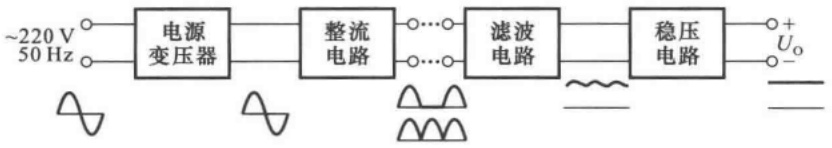

text_image

~220 V
50 Hz
电源
变压器
整流
电路
滤波
电路
稳压
电路
+ Uo
-

图 9.1.1 直流稳压电源的方框图

直流电源的输入为 220 V 的电网电压(即市电),一般情况下,所需直流电压的数值和电网电压的有效值相差较大,因而需要通过电源变压器降压后,再对交流电压进行处理。变压器二次

---

9.2 整流电路

433

电压有效值决定于后面电路的需要。目前，也有部分电路不用变压器，利用其它方法升压或降压。

变压器二次电压通过整流电路从交流电压转换为直流电压，即将正弦波电压转换为单一方向的脉动电压，半波整流电路和全波整流电路的输出波形如图中所画。可以看出，它们均含有较大的交流分量，会影响负载电路的正常工作；例如，交流分量将混入输入信号被放大电路放大，甚至在放大电路的输出端所混入的电源交流分量大于有用信号；因而不能直接作为电子电路的供电电源。应当指出，图中整流电路输出端所画波形是未接滤波电路时的波形，接入滤波电路后波形将有所变化。

为了减小电压的脉动,需通过低通滤波电路滤波,使输出电压平滑。理想情况下,应将交流分量全部滤掉,使滤波电路的输出电压仅为直流电压。然而,由于滤波电路为无源电路,所以接入负载后势必影响其滤波效果。对于稳定性要求不高的电子电路,整流、滤波后的直流电压可以作为供电电源。

交流电压通过整流、滤波后虽然变为交流分量较小的直流电压,但是当电网电压波动或者负载变化时,其平均值也将随之变化。稳压电路的功能是使输出直流电压基本不受电网电压波动和负载电阻变化的影响,从而获得足够高的稳定性。

## 9.2 整流电路

在分析整流电路时,为了突出重点,简化分析过程,一般均假定负载为纯电阻性;整流二极管具有图1.2.4(a)中实线所示理想的伏安特性,即导通时正向压降为零,截止时反向电流为零;变压器无损耗,内部压降为零等。

## 9.2.1 整流电路的分析方法及其基本参数

分析整流电路,就是弄清电路的工作原理(即整流原理),求出主要参数,并确定整流二极管的极限参数。下面以图9.2.1所示单相半波整流电路为例来说明整流电路的分析方法及其基本参数。

## 一、工作原理

单相半波整流电路是最简单的一种整流电路，设变压器的二次电压有效值为 $U_{2}$，则其瞬时值 $u_{2} = \sqrt{2} U_{2}\sin \omega t$。

在 $u_{2}$ 的正半周，A点为正，B点为负，二极管外加正向电压，因而处于导通状态。电流从A点流出，经过二极管D和负载电阻 $R_{\mathrm{L}}$ 流入B点， $u_0 = u_2 = \sqrt{2} U_2\sin \omega t(\omega t = 0\sim \pi)$ 。在 $u_{2}$ 的负半周，B点为正，A点为负，二极管外加反向电压，因而处于截止状态， $u_0 = 0(\omega t = \pi \sim 2\pi)$ 。负载电阻 $R_{\mathrm{L}}$ 的电压和电流都具有单一方向脉动的特性。图9.2.2所示为变压器二次电压 $u_{2}$ 、输出电压$u_{0}$ （也可表示输出电流和二极管的电流）、二极管端电压的波形。

分析整流电路工作原理时,应研究变压器二次电压极性不同时二极管的工作状态,从而得出输出电压的波形,也就弄清了整流原理。整流电路的波形分析是其定量分析的基础。

---

434

第 9 章 直流电源

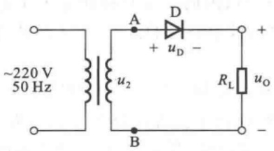

text_image

~220 V
50 Hz
A
D
+
uD -
B
RL
uO
-

图 9.2.1 单相半波整流电路

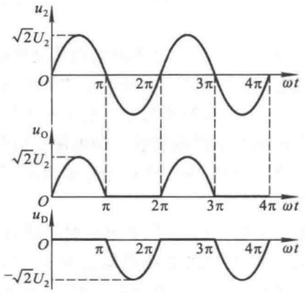

line

| \(\omega t\) | u2 | uO | ud |
| --- | --- | --- | --- |
| 0 | 0 | 0 | 0 |
| \(\pi/4\) | \(\sqrt{2}U2\) | \(\sqrt{2}U2\) | 0 |
| \(\pi\) | 0 | 0 | \(-\sqrt{2}U2\) |
| \(3\pi/4\) | \(-\sqrt{2}U2\) | 0 | 0 |
| \(5\pi/4\) | \(\sqrt{2}U2\) | \(\sqrt{2}U2\) | \(-\sqrt{2}U2\) |
| \(7\pi/4\) | 0 | 0 | 0 |
| \(9\pi/4\) | \(-\sqrt{2}U2\) | \(\sqrt{2}U2\) | \(-\sqrt{2}U2\) |
| \(11\pi/4\) | \(\sqrt{2}U2\) | 0 | 0 |
| \(13\pi/4\) | 0 | 0 | 0 |
| \(15\pi/4\) | \(-\sqrt{2}U2\) | \(\sqrt{2}U2\) | \(-\sqrt{2}U2\) |
| \(17\pi/4\) | \(\sqrt{2}U2\) | 0 | 0 |
| \(19\pi/4\) | 0 | 0 | 0 |
| \(21\pi/4\) | \(-\sqrt{2}U2\) | \(\sqrt{2}U2\) | \(-\sqrt{2}U2\) |
| \(23\pi/4\) | \(\sqrt{2}U2\) | 0 | 0 |
| \(25\pi/4\) | 0 | 0 | 0 |
| \(27\pi/4\) | \(-\sqrt{2}U2\) | \(\sqrt{2}U2\) | \(-\sqrt{2}U2\) |
| \(29\pi/4\) | \(\sqrt{2}U2\) | 0 | 0 |
| \(31\pi/4\) | 0 | 0 | 0 |
| \(33\pi/4\) | \(-\sqrt{2}U2\) | \(\sqrt{2}U2\) | \(-\sqrt{2}U2\) |
| \(35\pi/4\) | \(\sqrt{2}U2\) | 0 | 0 |
| \(37\pi/4\) | 0 | 0 | 0 |
| \(39\pi/4\) | \(-\sqrt{2}U2\) | \(\sqrt{2}U2\) | \(-\sqrt{2}U2\) |
| \(41\pi/4\) | \(\sqrt{2}U2\) | 0 | 0 |
| \(43\pi/4\) | 0 | 0 | 0 |
| \(45\pi/4\) | \(-\sqrt{2}U2\) | \(\sqrt{2}U2\) | \(-\sqrt{2}U2\) |
| \(47\pi/4\) | \(\sqrt{2}U2\) | 0 | 0 |
| \(49\pi/4\) | 0 | 0 | 0 |
| \(51\pi/4\) | \(-\sqrt{2}U2\) | \(\sqrt{2}U2\) | \(-\sqrt{2}U2\) |
| \(53\pi/4\) | \(\sqrt{2}U2\) | 0 | 0 |
| \(55\pi/4\) | 0 | 0 | 0 |
| \(57\pi/4\) | \(-\sqrt{2}U2\) | \(\sqrt{2}U2\) | \(-\sqrt{2}U2\) |
| \(59\pi/4\) | \(\sqrt{2}U2\) | 0 | 0 |
| \(61\pi/4\) | 0 | 0 | 0 |
| \(63\pi/4\) | \(-\sqrt{2}U2\) | \(\sqrt{2}U2\) | \(-\sqrt{2}U2\) |
| \(65\pi/4\) | \(\sqrt{2}U2\) | 0 | 0 |
| \(67\pi/4\) | 0 | 0 | 0 |
| \(69\pi/4\) | \(-\sqrt{2}U2\) | \(\sqrt{2}U2\) | \(-\sqrt{2}U2\) |
| \(71\pi/4\) | \(\sqrt{2}U2\) | 0 | 0 |
| \(73\pi/4\) | 0 | 0 | 0 |
| \(75\pi/4\) | \(-\sqrt{2}U2\) | \(\sqrt{2}U2\) | \(-\sqrt{2}U2\) |
| \(77\pi/4\) | \(\sqrt{2}U2\) | 0 | 0 |
| \(79\pi/4\) | 0 | 0 | 0 |
| \(81\pi/4\) | \(-\sqrt{2}U2\) | \(\sqrt{2}U2\) | \(-\sqrt{2}U2\) |
| \(83\pi/4\) | \(\sqrt{2}U2\) | 0 | 0 |
| \(85\pi/4\) | 0 | 0 | 0 |
| \(87\pi/4\) | \(-\sqrt{2}U2\) | \(\sqrt{2}U2\) | \(-\sqrt{2}U2\) |
| \(89\pi/4\) | \(\sqrt{2}U2\) | 0 | 0 |
| \(91\pi/4\) | 0 | 0 | 0 |
| \(93\pi/4\) | \(-\sqrt{2}U2\) | \(\sqrt{2}U2\) | \(-\sqrt{2}U2\) |
| \(95\pi/4\) | \(\sqrt{2}U2\) | 0 | 0 |
| \(97\pi/4\) | 0 | 0 | 0 |
| \(99\pi/4\) | \(-\sqrt{2}U2\) | \(\sqrt{2}U2\) | \(-\sqrt{2}U2\) |
| \(101\pi/4\) | \(\sqrt{2}U2\) | 0 | 0 |
| \(103\pi/4\) | 0 | 0 | 0 |
| \(105\pi/4\) | \(-\sqrt{2}U2\) | \(\sqrt{2}U2\) | \(-\sqrt{2}U2\) |
| \(107\pi/4\) | \(\sqrt{2}U2\) | 0 | 0 |
| \(109\pi/4\) | 0 | 0 | 0 |
| \(111\pi/4\) | \(-\sqrt{2}U2\) | \(\sqrt{2}U2\) | \(-\sqrt{2}U2\) |
| \(113\pi/4\) | \(\sqrt{2}U2\) | 0 | 0 |
| \(115\pi/4\) | 0 | 0 | 0 |
| \(117\pi/4\) | \(-\sqrt{2}U2\) | \(\sqrt{2}U2\) | \(-\sqrt{2}U2\) |
| \(119\pi/4\) | \(\sqrt{2}U2\) | 0 | 0 |
| \(121\pi/4\) | 0 | 0 | 0 |
| \(123\pi/4\) | \(-\sqrt{2}U2\) | \(\sqrt{2}U2\) | \(-\sqrt{2}U2\) |
| \(125\pi/4\) | \(\sqrt{2}U2\) | 0 | 0 |
| \(127\pi/4\) | 0 | 0 | 0 |
| \(129\pi/4\) | \(-\sqrt{2}U2\) | \(\sqrt{2}U2\) | \(-\sqrt{2}U2\) |
| \(131\pi/4\) | \(\sqrt{2}U2\) | 0 | 0 |
| \(133\pi/4\) | 0 | 0 | 0 |
| \(135\pi/4\) | \(-\sqrt{2}U2\) | \(\sqrt{2}U2\) | \(-\sqrt{2}U2\) |
| \(137\pi/4\) | \(\sqrt{2}U2\) | 0 | 0 |
| \(139\pi/4\) | 0 | 0 | 0 |
| \(141\pi/4\) | \(-\sqrt{2}U2\) | \(\sqrt{2}U2\) | \(-\sqrt{2}U2\) |
| \(143\pi/4\) | \(\sqrt{2}U2\) | 0 | 0 |
| \(145\pi/4\) | 0 | 0 | 0 |
| \(147\pi/4\) | \(-\sqrt{2}U2\) | \(\sqrt{2}U2\) | \(-\sqrt{2}U2\) |

图 9.2.2 半波整流电路的波形图

## 二、主要参数

在研究整流电路时,至少应考查整流电路输出电压平均值和输出电流平均值两项指标,有时还需考虑脉动系数,以便定量反映输出波形脉动的情况。

输出电压平均值就是负载电阻上电压的平均值 $U_{\mathrm{O(AV)}}$ 。从图9.2.2所示波形图可知，当 $\omega t = 0 \sim \pi$ 时， $u_0 = \sqrt{2} U_2 \sin \omega t$；当 $\omega t = \pi \sim 2\pi$ 时， $u_0 = 0$ 。所以，求解 $u_0$ 的平均值 $U_{\mathrm{O(AV)}}$，就是将 $0 \sim \pi$ 的电压平均在 $0 \sim 2\pi$ 时间间隔之中，如图9.2.3所示，写成表达式为

$$
U _ {\mathrm{O(AV)}} = \frac {1}{2 \pi} \int_ {0} ^ {\pi} \sqrt {2} U _ {2} \sin \omega t \mathrm{d} (\omega t)
$$

解得

$$
U _ {\mathrm{O(AV)}} = \frac {\sqrt {2} U _ {2}}{\pi} \approx 0. 4 5 U _ {2} \tag {9.2.1}
$$

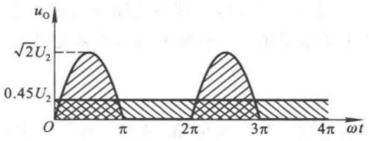

area

| \(\omega t\) | \(u_{0}\) |
| --- | --- |
| 0 | 0.45U₂ |
| ~\(0.5\pi\) | \(\sqrt{2}U_{2}\) |
| \(\pi\) | 0.45U₂ |
| \(2\pi\) | 0.45U₂ |
| ~\(2.5\pi\) | \(\sqrt{2}U_{2}\) |
| \(3\pi\) | 0.45U₂ |
| \(4\pi\) | 0.45U₂ |

图 9.2.3 单相半波整流电路输出电压平均值

负载电流的平均值

$$
I _ {\mathrm{O(AV)}} = \frac {U _ {\mathrm{O(AV)}}}{R _ {\mathrm{L}}} \approx \frac {0 . 4 5 U _ {2}}{R _ {\mathrm{L}}} \tag {9.2.2}
$$

例如，当变压器二次电压有效值  $U_{2}=20\ V$  时，单相半波整流电路的输出电压平均值  $U_{0(AV)}\approx9\ V$ 。若负载电阻  $R_{L}=20\ \Omega$ ，则负载电流平均值  $I_{0(AV)}\approx0.45\ A$ 。

整流输出电压的脉动系数 S 定义为整流输出电压的基波峰值  $U_{01M}$  与输出电压平均值  $U_{0(AV)}$  之比, 即

---

9.2 整流电路

435

$$
S = \frac {U _ {\mathrm{01M}}}{U _ {\mathrm{O(AV)}}} \tag {9.2.3}
$$

因而 S 愈大, 脉动愈大。

由于半波整流电路输出电压 $u_{0}$ 的周期与 $u_{2}$ 相同， $u_{0}$ 的基波角频率与 $u_{2}$ 相同，即50 Hz。通过谐波分析①可得 $U_{01M}=U_{2}/\sqrt{2}$，故半波整流电路输出电压的脉动系数

$$
S = \frac {U _ {2} / \sqrt {2}}{\sqrt {2} U _ {2} / \pi} = \frac {\pi}{2} \approx 1. 5 7 \tag {9.2.4}
$$

说明半波整流电路的输出脉动很大,其基波峰值约为平均值的1.57倍。

## 三、二极管的选择

当整流电路的变压器二次电压有效值和负载电阻值确定后,电路对二极管参数的要求也就确定了。一般应根据流过二极管电流的平均值和它所承受的最大反向电压来选择二极管的型号。

在单相半波整流电路中,二极管的正向平均电流等于负载电流平均值,即

$$
I _ {\mathrm{D(AV)}} = I _ {0 (\mathrm{AV})} \approx \frac {0 . 4 5 U _ {2}}{R _ {\mathrm{L}}} \tag {9.2.5}
$$

二极管承受的最大反向电压等于变压器二次侧的峰值电压,即

$$
U _ {R \mathrm{max}} = \sqrt {2} U _ {2} \tag {9.2.6}
$$

一般情况下,允许电网电压有  $\pm10\%$  的波动,即电源变压器一次电压为  $198\sim242\ V$ ,因此在选用二极管时,对于最大整流平均电流  $I_{F}$  和最高反向工作电压  $U_{RM}$  应至少留有 10% 的余地,以保证二极管安全工作,即选取

$$
I _ {\mathrm{F}} > 1. 1 I _ {0 (\mathrm{AV})} = 1. 1 \frac {\sqrt {2} U _ {2}}{\pi R _ {\mathrm{L}}} \tag {9.2.7}
$$

$$
U _ {\mathrm{RM}} > 1. 1 \sqrt {2} U _ {2} \tag {9.2.8}
$$

单相半波整流电路简单易行,所用二极管数量少。但是由于它只利用了交流电压的半个周期,所以输出电压低,交流分量大(即脉动大),效率低。因此,这种电路仅适用于整流电流较小,对脉动要求不高的场合。

【例 9.2.1】在图 9.2.1 所示整流电路中, 已知电网电压波动范围是  $\pm10\%$ , 变压器二次电压有效值  $U_{2}=30\ V$ , 负载电阻  $R_{L}=100\ \Omega$ , 试问:

(1) 负载电阻  $R_{L}$  上的电压平均值和电流平均值各为多少?
(2) 二极管承受的最大反向电压和流过的最大电流平均值各为多少?
(3) 若不小心将输出端短路, 则会出现什么现象?

解:(1) 负载电阻上电压平均值

$$
U _ {\mathrm{O(AV)}} \approx 0. 4 5 U _ {2} = (0. 4 5 \times 3 0) \mathrm{V} = 1 3. 5 \mathrm{V}
$$

流过负载电阻的电流平均值

$$
I _ {\mathrm{O(AV)}} = \frac {U _ {\mathrm{O(AV)}}}{R _ {\mathrm{L}}} \approx \frac {1 3 . 5}{1 0 0} \mathrm{A=0.135~A}
$$

<small>① 可参阅童诗白主编的《模拟电子技术基础(第二版)》11.2.1节。</small>

---

436

第9章 直流电源

(2) 二极管承受的最大反向电压

$$
U _ {R \max} = 1. 1 \sqrt {2} U _ {2} \approx (1. 1 \times 1. 4 1 4 \times 3 0) \mathrm{V} \approx 4 6. 7 \mathrm{V}
$$

流过二极管的最大平均电流

$$
I _ {\mathrm{D(AV)}} = 1. 1 I _ {\mathrm{O(AV)}} = 1. 1 \times 0. 1 3 5 \mathrm{A} \approx 0. 1 4 9 \mathrm{A}
$$

（3）若不小心将输出端短路，则变压器二次电压全部加在二极管上，二极管会因正向电流过大而烧坏。若将二极管烧成为短路，则会使变压器二次线圈短路，二次电流将很大，如不及时断电，会造成变压器永久性损坏。

## 9.2.2 单相桥式整流电路

为了克服单相半波整流电路的缺点,在实用电路中多采用单相全波整流电路,最常用的是单相桥式整流电路。

## 一、电路的组成

单相桥式整流电路由四只二极管组成，其构成原则就是保证在变压器二次电压 $u_{2}$ 的整个周期内，负载上的电压和电流方向始终不变。为达到这一目的，就要在 $u_{2}$ 的正、负半周内正确引导流向负载的电流。设变压器二次侧两端分别为A和B，则A为“+”、B为“-”时应有电流流出A点，A为“-”、B为“+”时应有电流流入A点；相反，A为“+”、B为“-”时应有电流流入B点，A为“-”、B为“+”时应有电流流出B点；因而A和B点均应分别接两只二极管的阳极和阴极，以引导电流；如图9.2.4(a)所示，负载接入的方式如图(b)所示。图9.2.5(a)所示为习惯画法，图(b)所示为简化画法。

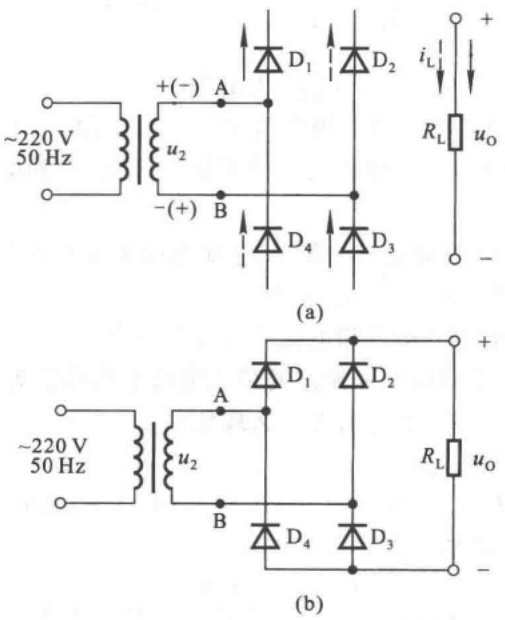

图 9.2.4 单相桥式整流电路

(a) 构成思路 (b) 电路组成

---

9.2 整流电路

437

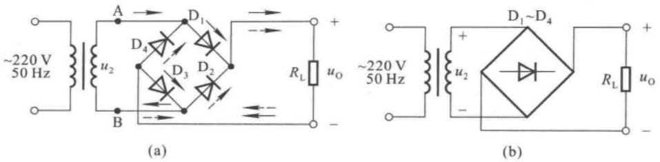

图 9.2.5 单相桥式整流电路的习惯画法

(a) 习惯画法 (b) 简化画法

## 二、工作原理

设变压器二次电压  $u_{2}=\sqrt{2}U_{2}\sin\omega t,U_{2}$  为其有效值。

当 $u_{2}$ 为正半周时，电流由A点流出，经 $\mathrm{D}_1,\mathrm{R_L},\mathrm{D_3}$ 流入B点，如图9.2.5(a)中实线箭头所示，因而负载电阻 $R_{\mathrm{L}}$ 上的电压等于变压器二次电压，即 $u_0 = u_2,\mathrm{D}_2$ 和 $\mathrm{D}_4$ 管承受的反向电压为$-u_{2}$ 。当 $u_{2}$ 为负半周时，电流由B点流出，经 $\mathrm{D}_2,\mathrm{R_L},\mathrm{D_4}$ 流入A点，如图9.2.5(a)中虚线箭头所示，负载电阻 $R_{\mathrm{L}}$ 上的电压等于 $-u_{2}$ ，即 $u_0 = -u_2,\mathrm{D}_1,\mathrm{D}_3$ 承受的反向电压为 $u_{2}$ 。

这样，由于 $\mathrm{D}_1, \mathrm{D}_3$ 和 $\mathrm{D}_2, \mathrm{D}_4$ 两对二极管交替导通，致使负载电阻 $R_{\mathrm{L}}$ 上在 $u_2$ 的整个周期内都有电流通过，而且方向不变，输出电压 $u_0 = \left|\sqrt{2} U_2\sin \omega t\right|$ 。图9.2.6所示为单相桥式整流电路各部分的电压和电流的波形。

## 三、输出电压平均值 $U_{\mathrm{O(AV)}}$ 和输出电流平均值 $I_{\mathrm{O(AV)}}$

根据图 9.2.6 中所示  $u_{0}$  的波形可知, 输出电压的平均值

$$
U _ {\mathrm{O(AV)}} = \frac {1}{\pi} \int_ {0} ^ {\pi} \sqrt {2} U _ {2} \sin \omega t \mathrm{d} (\omega t)
$$

解得

$$
U _ {\mathrm{O(AV)}} = \frac {2 \sqrt {2} U _ {2}}{\pi} \approx 0. 9 U _ {2} \tag {9.2.9}
$$

由于桥式整流电路实现了全波整流电路,它将  $u_{2}$  的负半周也利用起来,所以在变压器二次电压有效值相同的情况下,输出电压的平均值是半波整流电路的两倍。

输出电流的平均值(即负载电阻中的电流平均值)

$$
I _ {\mathrm{O(AV)}} = \frac {U _ {\mathrm{O(AV)}}}{R _ {\mathrm{L}}} \approx \frac {0 . 9 U _ {2}}{R _ {\mathrm{L}}} \tag {9.2.10}
$$

在变压器二次电压相同、且负载也相同的情况下，输出电流的平均值也是半波整流电路的两倍。

根据谐波分析,桥式整流电路的基波  $U_{01M}$  的角频率是  $u_{2}$  的 2 倍, 即 100 Hz,  $U_{01M} = \frac{2}{3} \times 2\sqrt{2}U_{2}/\pi$ 。故脉动系数

$$
S = \frac {U _ {\mathrm{01M}}}{U _ {\mathrm{O(AV)}}} = \frac {2}{3} \approx 0. 6 7 \tag {9.2.11}
$$

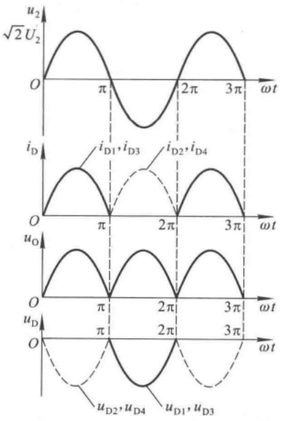

line

| \(\omega t\) | \(u2 (\sqrt{2}U2)\) | iD (iD1, iD3) | iD (iD2, iD4) | uO | uD2, uD4 |
| --- | --- | --- | --- | --- | --- |
| 0 | 0 | 0 | 0 | 0 | 0 |
| \(\pi\) | 0 | 0 | 0 | 0 | 0 |
| \(2\pi\) | 0 | 0 | 0 | 0 | 0 |
| \(3\pi\) | 0 | 0 | 0 | 0 | 0 |
| \(4\pi\) | ~\(0.8\pi\) | ~\(0.8\pi\) | ~\(0.8\pi\) | ~\(0.8\pi\) | ~\(0.8\pi\) |
| \(5\pi\) | ~\(0.8\pi\) | ~\(0.8\pi\) | ~\(0.8\pi\) | ~\(0.8\pi\) | ~\(0.8\pi\) |
| \(6\pi\) | ~\(0.8\pi\) | ~\(0.8\pi\) | ~\(0.8\pi\) | ~\(0.8\pi\) | ~\(0.8\pi\) |
| \(7\pi\) | ~\(0.8\pi\) | ~\(0.8\pi\) | ~\(0.8\pi\) | ~\(0.8\pi\) | ~\(0.8\pi\) |
| \(8\pi\) | ~\(0.8\pi\) | ~\(0.8\pi\) | ~\(0.8\pi\) | ~\(0.8\pi\) | ~\(0.8\pi |
| \(9\pi\) | ~\(0.8\pi\) | ~\(0.8\pi\) | ~\(0.8\pi\) | ~\(0.8\pi\) | ~\(0.8\pi |
| \(10\pi\) | ~\(0.8\pi\) | ~\(0.8\pi\) | ~\(0.8\pi\) | ~\(0.8\pi\) | ~\(0.8\pi |
| \(11\pi\) | ~\(0.8\pi\) | ~\(0.8\pi\) | ~\(0.8\pi\) | ~\(0.8\pi\) | ~\(0.8\pi |
| \(12\pi\) | ~\(0.8\pi\) | ~\(0.8\pi\) | ~\(0.8\pi\) | ~\(0.8\pi\) | ~\(0.8\pi |
| \(13\pi\) | ~\(0.8\pi\) | ~\(0.8\pi\) | ~\(0.8\pi\) | ~\(0.8\pi\) | ~\(0.8\pi |
| \(14\pi\) | ~\(0.8\pi\) | ~\(0.8\pi\) | ~\(0.8\pi\) | ~\(0.8\pi\) | ~\(0.8\pi |
| \(15\pi\) | ~\(0.8\pi\) | ~\(0.8\pi\) | ~\(0.8\pi\) | ~\(0.8\pi\) | ~\(0.8\pi |
| \(16\pi\) | ~\(0.8\pi\) | ~\(0.8\pi\) | ~\(0.8\pi\) | ~\(0.8\pi\) | ~\(0.8\pi |
| \(17\pi\) | ~\(0.8\pi\) | ~\(0.8\pi\) | ~\(0.8\pi\) | ~\(0.8\pi\) | ~\(0.8\pi |
| \(18\pi\) | ~\(0.8\pi\) | ~\(0.8\pi\) | ~\(0.8\pi\) | ~\(0.8\pi\) | ~\(0.8\pi |
| \(19\pi\) | ~\(0.8\pi\) | ~\(0.8\pi\) | ~\(0.8\pi\) | ~\(0.8\pi\) | ~\(0.8\pi |
| \(20\pi\) | ~\(0.8\pi\) | ~\(0.8\pi\) | ~\(0.8\pi\) | ~\(0.8\pi\) | ~\(0.8\pi |
| \(21\pi\) | ~\(0.8\pi\) | ~\(0.8\pi\) | ~\(0.8\pi\) | ~\(0.8\pi\) | ~\(0.8\pi |
| \(22\pi\) | ~\(0.8\pi\) | ~\(0.8\pi\) | ~\(0.8\pi\) | ~\(0.8\pi\) | ~\(0.8\pi |
| \(23\pi\) | ~\(0.8\pi\) | ~\(0.8\pi\) | ~\(0.8\pi\) | ~\(0.8\pi\) | ~\(0.8\pi |
| \(24\pi\) | ~\(0.8\pi\) | ~\(0.8\pi\) | ~\(0.8\pi\) | ~\(0.8\pi\) | ~\(0.8\pi |
| \(25\pi\) | ~\(0.8\pi\) | ~\(0.8\pi\) | ~\(0.8\pi\) | ~\(0.8\pi\) | ~\(0.8\pi |
| \(26\pi\) | ~\(0.8\pi\) | ~\(0.8\pi\) | ~\(0.8\pi\) | ~\(0.8\pi\) | ~\(0.8\pi |
| \(27\pi\) | ~\(0.8\pi\) | ~\(0.8\pi\) | ~\(0.8\pi\) | ~\(0.8\pi\) | ~\(0.8\pi |
| \(28\pi\) | ~\(0.8\pi\) | ~\(0.8\pi\) | ~\(0.8\pi\) | ~\(0.8\pi\) | ~\(0.8\pi |
| \(29\pi\) | ~\(0.8\pi\) | ~\(0.8\pi\) | ~\(0.8\pi\) | ~\(0.8\pi\) | ~\(0.8\pi |

图 9.2.6 单相桥式整流电路的波形图

---

438

第9章 直流电源

与半波整流电路相比,输出电压的脉动减小很多。

## 四、二极管的选择

在单相桥式整流电路中,因为每只二极管只在变压器二次电压的半个周期通过电流,所以每只二极管的平均电流只有负载电阻上电流平均值的一半,即

$$
I _ {\mathrm{D(AV)}} = \frac {I _ {\mathrm{O(AV)}}}{2} \approx \frac {0 . 4 5 U _ {2}}{R _ {\mathrm{L}}} \tag {9.2.12}
$$

与半波整流电路中二极管的平均电流相同。

根据图 9.2.6 中所示  $u_{D}$  的波形可知,二极管承受的最大反向电压

$$
U _ {\mathrm{Rmax}} = \sqrt {2} U _ {2} \tag {9.2.13}
$$

与半波整流电路中二极管承受的最大反向电压也相同。

考虑到电网电压的波动范围为  $\pm10\%$ , 在实际选用二极管时, 应至少有 10% 的余量, 选择最大整流电流  $I_{F}$  和最高反向工作电压  $U_{RM}$  分别为

$$
I _ {\mathrm{F}} > \frac {1 . 1 I _ {0 (\mathrm{AV})}}{2} = 1. 1 \frac {\sqrt {2} U _ {2}}{\pi R _ {\mathrm{L}}} \tag {9.2.14}
$$

$$
U _ {\mathrm{RM}} > 1. 1 \sqrt {2} U _ {2} \tag {9.2.15}
$$

单相桥式整流电路与半波整流电路相比，在相同的变压器二次电压下，对二极管的参数要求是一样的，并且还具有输出电压高、变压器利用率高、脉动小等优点，因此得到相当广泛的应用。目前有不同性能指标的集成电路，称之为“整流桥堆”。它的主要缺点是所需二极管的数量多，由于实际上二极管的正向电阻不为零，必然使得整流电路内阻较大，当然损耗也就较大。

可以想象,如果将桥式整流电路变压器二次侧中点接地,并将两个负载电阻相连接,且连接点接地,如图9.2.7所示;那么根据桥式整流电路的工作原理,当A点为“+”B点为“-”时, $D_{1}$ 、 $D_{3}$ 导通, $D_{2}$ 、 $D_{4}$ 截止,电流如图中实线所示;而当B点为“+”A点为“-”时, $D_{2}$ 、 $D_{4}$ 导通, $D_{1}$ 、 $D_{3}$ 截止,电流如图中虚线所示;这样,两个负载上就分别获得正、负电源。可见,利用桥式整流电路可以轻而易举地获得正、负电源,这是其它类型整流电路难于做到的。

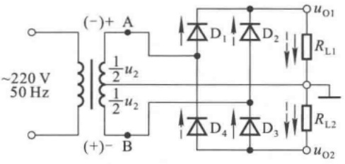

text_image

~220 V
50 Hz
(-) + A
1/2 u₂
1/2 u₂
(+)- B
D₁
D₂
uₒ₁
Rₗ₁
D₄
D₃
Rₗ₂
uₒ₂

图 9.2.7 利用桥式整流电路实现正、负电源

在实际应用中,当整流电路的输出功率(即输出电压平均值与电流平均值之积)超过几千瓦且又要求脉动较小时,就需要采用三相整流电路。三相整流电路的组成原则和方法与单相桥式整流电路相同,变压器二次侧的三个端均应接两只二极管,且一只接阴极,另一只接阳极,电路如图9.2.8(a)所示;利用前面所述方法分析电路,可以得出其波形,如图(b)所示。

---

9.2 整流电路

439

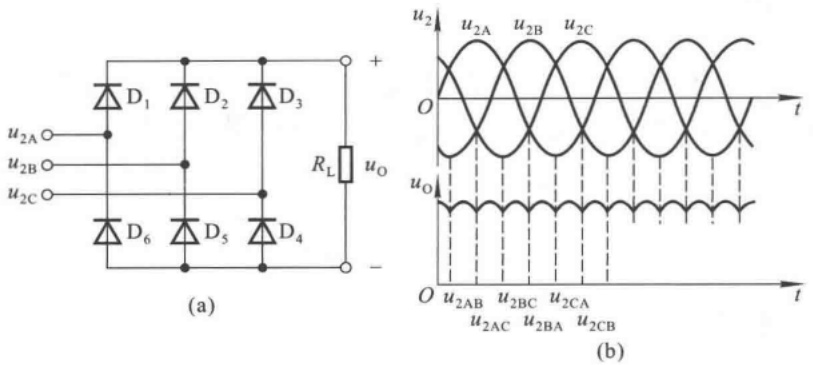

图 9.2.8 三相整流电路及其波形

(a) 电路 (b) 波形

【例 9.2.2】在图 9.2.5 所示电路中, 已知变压器二次电压有效值  $U_{2} = 30 \, V$ , 负载电阻  $R_{L} = 100 \, \Omega$ 。试问:

(1) 输出电压与输出电流平均值各为多少?
（2）当电网电压波动范围为  $\pm10\%$ , 二极管的最大整流平均电流  $I_{F}$  与最高反向工作电压  $U_{RM}$  至少应选取多少?
(3) 若整流桥中的二极管  $D_{1}$  开路或短路, 则分别产生什么现象?

解:(1) 根据式(9.2.9), 输出电压平均值

$$
U _ {\mathrm{O(AV)}} \approx 0. 9 U _ {2} = 0. 9 \times 3 0 \mathrm{V} = 2 7 \mathrm{V}
$$

根据式（9.2.10），输出电流平均值

$$
I _ {\mathrm{O(AV)}} = \frac {U _ {\mathrm{O(AV)}}}{R _ {\mathrm{L}}} \approx \frac {2 7}{1 0 0} \mathrm{A=0.27~A}
$$

（2）根据式(9.2.14)和式(9.2.15)，二极管的最大整流平均电流 $I_{F}$ 和最高反向工作电压 $U_{RM}$ 分别应满足

$$
\begin{array}{l} I _ {\mathrm{F}} > \frac {1 . 1 I _ {\mathrm{O(AV)}}}{2} \approx 1. 1 \times \frac {0 . 2 7}{2} \mathrm{A} \approx 0. 1 4 9 \mathrm{A} \\ U _ {\mathrm{RM}} > 1. 1 \sqrt {2} U _ {2} = 1. 1 \times \sqrt {2} \times 3 0 \mathrm{V} \approx 4 6. 7 \mathrm{V} \\ \end{array}
$$

（3）若  $D_{1}$  开路，则电路仅能实现半波整流，因而输出电压平均值仅为原来的一半。若  $D_{1}$  短路，则在  $u_{2}$  的负半周将变压器二次电压全部加在  $D_{2}$  上， $D_{2}$  将因电流过大而烧坏，且若  $D_{2}$  烧成为短路，则有可能烧坏变压器。

## 思考题

9.2.1 若单相半波整流电路中的二极管接反,则将产生什么现象?
9.2.2 试问单相桥式整流电路中若有一只二极管接反,则将产生什么现象?

---

440

第 9 章 直流电源

## 9.3 滤波电路

整流电路的输出电压虽然是单一方向的,但是含有较大的交流成分,不能适应大多数电子电路及设备的需要。因此,一般在整流后,还需利用滤波电路将脉动的直流电压变为平滑的直流电压。与用于信号处理的滤波电路相比,直流电源中滤波电路的显著特点是:均采用无源电路;理想情况下,滤去所有交流成分,而只保留直流成分;能够输出较大电流;而且,因为整流管工作在非线性状态(即导通或截止),故而滤波特性的分析方法也不尽相同。

## 9.3.1 电容滤波电路

电容滤波电路是最常见也是最简单的滤波电路，在整流电路的输出端（即负载电阻两端）并联一个电容即构成电容滤波电路，如图9.3.1(a)所示。滤波电容容量较大，因而一般均采用电解电容，在接线时要注意电解电容的正、负极。电容滤波电路利用电容的充放电作用，使输出电压趋于平滑。

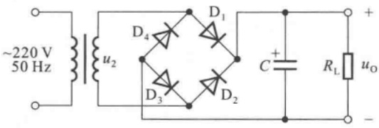

text_image

~220 V
50 Hz
u₂
D₄
D₁
C⁺
D₃
D₂
Rₗ
uₒ
+

(a)

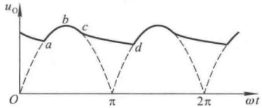

line

| \(\omega t\) | uO (a) | uO (b) |
| --- | --- | --- |
| 0 | 0 | ~0.6 |
| \(\pi/2\) | ~0.6 | ~0.5 |
| \(3\pi/4\) | 0 | ~0.6 |
| \(7\pi/8\) | ~0.6 | ~0.5 |
| \(2\pi\) | 0 | ~0.4 |

(b)

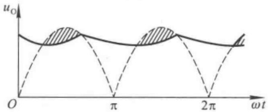

area

| \(\omega t\) | u_o (Solid Line) | u_o (Dashed Line) |
| --- | --- | --- |
| 0 | ~0.65 | 0 |
| \(\pi/2\) | ~0.45 | ~0.65 |
| \(\pi\) | ~0.65 | 0 |
| \(3\pi/2\) | ~0.45 | ~0.65 |
| \(2\pi\) | ~0.65 | 0 |
| \(5\pi/2\) | ~0.45 | ~0.65 |

(c)

图 9.3.1 单相桥式整流电容滤波电路及稳态时的波形分析

(a) 电路 (b) 理想情况下的波形 (c) 考虑整流电路内阻时的波形

## 一、滤波原理

当变压器二次电压 $u_{2}$ 处于正半周并且数值大于电容两端电压 $u_{C}$ 时，二极管 $\mathrm{D}_1, \mathrm{D}_3$ 导通，电流一路流经负载电阻 $R_{\mathrm{L}}$ ，另一路对电容 $C$ 充电。因为在理想情况下，变压器二次侧无损耗，二极管导通电压为零，所以电容两端电压 $u_{C}(u_{\mathrm{L}})$ 与 $u_{2}$ 相等，见图9.3.1(b)中曲线的ab段。当 $u_{2}$ 上升到峰值后开始下降，电容通过负载电阻 $R_{\mathrm{L}}$ 放电，其电压 $u_{C}$ 也开始下降，趋势与 $u_{2}$ 基本相同，

---

9.3 滤波电路

441

见图(b)中曲线的bc段。但是由于电容按指数规律放电，所以当 $u_{2}$ 下降到一定数值后， $u_{c}$ 的下降速度小于 $u_{2}$ 的下降速度，使 $u_{c}$ 大于 $u_{2}$ 从而导致 $D_{1}$ 、 $D_{3}$ 反向偏置而变为截止。此后，电容C继续通过 $R_{L}$ 放电， $u_{c}$ 按指数规律缓慢下降，见图9.3.1(b)cd段。

当  $u_{2}$  的负半周幅值变化到恰好大于  $u_{C}$  时， $D_{2}$ 、 $D_{4}$  因加正向电压变为导通状态， $u_{2}$  再次对 C 充电， $u_{C}$  上升到  $u_{2}$  的峰值后又开始下降；下降到一定数值时  $D_{2}$ 、 $D_{4}$  变为截止，C 对  $R_{L}$  放电， $u_{C}$  按指数规律下降；放电到一定数值时  $D_{1}$ 、 $D_{3}$  变为导通，重复上述过程。

从图 9.3.1(b) 所示波形可以看出, 经滤波后的输出电压不仅变得平滑, 而且平均值也得到提高。若考虑变压器内阻和二极管的导通电阻, 则  $u_{c}$  的波形如图(c) 所示, 阴影部分为整流电路内阻上的压降。

从以上分析可知，电容充电时，回路电阻为整流电路的内阻，即变压器内阻和二极管的导通电阻之和，其数值很小，因而时间常数很小。电容放电时，回路电阻为 $R_{L}$ ，放电时间常数为 $R_{L}C$ ，通常远大于充电的时间常数。因此，滤波效果取决于放电时间。电容愈大，负载电阻愈大，滤波后输出电压愈平滑，并且其平均值愈大，如图9.3.2所示。换言之，当滤波电容容量一定时，若负载电阻减小（即负载电流增大），则时间常数 $R_{L}C$ 减小，放电速度加快，输出电压平均值随即下降，且脉动变大。

## 二、输出电压平均值

滤波电路输出电压波形难于用解析式来描述，近似估算时，可将图9.3.1(c)所示波形近似为锯齿波，如图9.3.3所示。图中 $T$ 为电网电压的周期。设整流电路内阻较小而 $R_{\mathrm{L}}C$ 较大，电容每次充电均可达到 $u_{2}$ 的峰值（即 $U_{0\mathrm{max}} = \sqrt{2} U_2$），然后按 $R_{\mathrm{L}}C$ 放电的起始斜率直线下降，经 $R_{\mathrm{L}}C$ 交于横轴，且在 $T / 2$ 处的数值为最小值 $U_{0\mathrm{min}}$，则输出电压平均值为

$$
U _ {\mathrm{O(AV)}} = \frac {U _ {\mathrm{Omax}} + U _ {\mathrm{Omin}}}{2}
$$

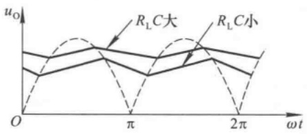

line

| \(\omega t\) | RLC大 (uO) | RLC小 (uO) |
| --- | --- | --- |
| 0 | ~0.65 | ~0.45 |
| \(\pi/2\) | ~0.75 | ~0.35 |
| \(\pi\) | ~0.65 | 0 |
| \(3\pi/2\) | ~0.75 | ~0.35 |
| \(2\pi\) | ~0.65 | 0 |

图 9.3.2  $R_{L}C$  不同时  $u_{C}$  的波形

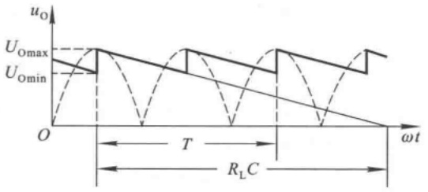

line

| Parameter | Description |
| --- | --- |
| U_Omax | Maximum voltage level |
| U_Omin | Minimum voltage level |
| T | Time interval (between 0 and \(\omega t)\) |
| R_L C | Load resistance or capacitance interval (between T and \(\omega t)\) |

图 9.3.3 电容滤波电路输出电压平均值的分析

同时按相似三角形关系可得

$$
\frac {U _ {\mathrm{Omax}} - U _ {\mathrm{Omin}}}{U _ {\mathrm{Omax}}} = \frac {T / 2}{R _ {\mathrm{L}} C}
$$

$$
U _ {\mathrm{O(AV)}} = \frac {U _ {\mathrm{Omax}} + U _ {\mathrm{Omin}}}{2} = U _ {\mathrm{Omax}} - \frac {U _ {\mathrm{Omax}} - U _ {\mathrm{Omin}}}{2} = U _ {\mathrm{Omax}} \left(1 - \frac {T}{4 R _ {\mathrm{L}} C}\right) \tag {9.3.1}
$$

因而

$$
U _ {0 (\mathrm{AV})} = \sqrt {2} U _ {2} \bigg (1 - \frac {T}{4 R _ {\mathrm{L}} C} \bigg) \tag {9.3.2}
$$

---

442

第9章 直流电源

式(9.3.2)表明,当负载开路,即 $R_{L}=\infty$ 时, $U_{O(AV)}=\sqrt{2}U_{2}$ 。当 $R_{L}C=(3\sim5)T/2$ 时,

$$
U _ {\mathrm{O(AV)}} \approx 1. 2 U _ {2} \tag {9.3.3}
$$

为了获得较好的滤波效果，在实际电路中，应选择滤波电容的容量满足 $R_{\mathrm{L}}C = (3 \sim 5)T / 2$ 的条件。由于采用电解电容，考虑到电网电压的波动范围为 $\pm 10\%$，电容的耐压值应大于 $1.1\sqrt{2} U_{2}$ 。在半波整流电路中，为获得较好的滤波效果，电容容量应选得更大些。

## 三、脉动系数

在图 9.3.3 所示的近似波形中, 交流分量的基波的峰 - 峰值为  $(U_{0\max} - U_{0\min})$ , 根据式 (9.3.1) 可得基波峰值为

$$
\frac {U _ {\mathrm{Omax}} - U _ {\mathrm{Omin}}}{2} = \frac {T}{4 R _ {\mathrm{L}} C} \cdot U _ {\mathrm{Omax}}
$$

因此，脉动系数为

$$
S = \frac {\frac {T}{4 R _ {\mathrm{L}} C} \cdot U _ {\mathrm{Omax}}}{U _ {\mathrm{Omax}} \left(1 - \frac {T}{4 R _ {\mathrm{L}} C}\right)} = \frac {T}{4 R _ {\mathrm{L}} C - T}
$$

或 $S = \frac{1}{\frac{4R_{\mathrm{L}}C}{T} - 1}$ (9.3.4)

应当指出,由于图9.3.3所示锯齿波所含的交流分量大于滤波电路输出电压实际的交流分量,因而根据式(9.3.4)计算出的脉动系数大于实际数值。

## 四、整流二极管的导通角

在未加滤波电容之前,无论是哪种整流电路中的二极管均有半个周期处于导通状态,也称二极管的导通角  $\theta$  等于  $\pi$ 。加滤波电容后,只有当电容充电时,二极管才导通,因此,每只二极管的导通角都小于  $\pi$ 。而且, $R_{L}C$  的值愈大,滤波效果愈好,导通角  $\theta$  将愈小。由于电容滤波后输

出平均电流增大，而二极管的导通角反而减小，所以整流二极管在短暂的时间内将流过一个很大的冲击电流为电容充电，如图9.3.4所示。这对二极管的寿命很不利，所以必须选用较大容量的整流二极管，通常应选择其最大整流平均电流 $I_{\mathrm{F}}$ 大于负载电流的2\~3倍。

## 五、电容滤波电路的输出特性和滤波特性

当滤波电容 C 选定后，输出电压平均值  $U_{\mathrm{O(AV)}}$  和输出电流平均值  $I_{\mathrm{O(AV)}}$  的关系称为输出特性，脉动系数 S 和输出电流平均值  $I_{\mathrm{O(AV)}}$  的关系称为滤波特性。根据式(9.3.2)和(9.3.4)可画出输出特性如图9.3.5(a)所示，滤波特性如图9.3.5(b)所示。曲线表明，C 愈大电路带负载能力愈强，滤波效果愈好； $I_{\mathrm{O(AV)}}$  愈大（即负载电阻  $R_{L}$  愈小）， $U_{\mathrm{O(AV)}}$  愈低，S 的值愈大。

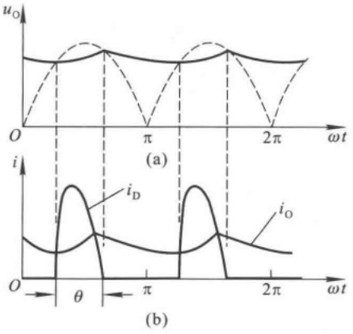

line

| \(\omega t\) | uO (a) | iO (b) |
| --- | --- | --- |
| 0 | 0 | ~0.4 |
| \(\pi/2\) | ~0.6 | ~0.3 |
| \(\pi\) | 0 | 0 |
| \(5\pi/2\) | ~0.6 | ~0.3 |
| \(2\pi\) | 0 | ~0.4 |

图 9.3.4 电容滤波电路中二极管的电流和导通角

(a) 输出电压波形

(b) 二极管电流波形及导通角

---

9.3 滤波电路

443

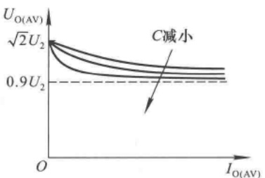

line

| I_O(AV) | U_O(AV) (C=0.9) | U_O(AV) (C=1) | U_O(AV) (C=2) | U_O(AV) (C=3) |
| --- | --- | --- | --- | --- |
| 0 | \(\sqrt{2}U_{2}\) | \(\sqrt{2}U_{2}\) | \(\sqrt{2}U_{2}\) | \(\sqrt{2}U_{2}\) |

(a)

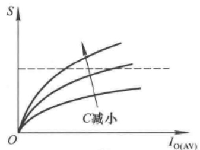

line

| I_O(AV) | S (Curve 1) | S (Curve 2) | S (Curve 3) |
| --- | --- | --- | --- |
| 0 | 0 | 0 | 0 |
| ~mid-range | ~mid-range | ~mid-range | ~low-range |

(b)

图 9.3.5 电容滤波电路的输出特性和滤波特性

(a) 输出特性 (b) 滤波特性

综上所述,电容滤波电路简单易行,输出电压平均值高,适用于负载电流较小且其变化也较小的场合。

【例 9.3.1】在图 9.3.1(a) 所示电路中, 已知电网电压的波动范围为  $\pm10\%$ ,  $U_{\mathrm{O(AV)}} \approx 1.2U_{2}$ 。要求输出电压平均值  $U_{\mathrm{O(AV)}} = 15\ V$ , 负载电流平均值  $I_{\mathrm{L(AV)}} = 100\ mA$ 。试选择合适的滤波电容。

解:根据  $U_{0(AV)} \approx 1.2U_{2}$  可知,C 的取值满足  $R_{\mathrm{L}}C = (3 \sim 5)T/2$  的条件。

$$
R _ {\mathrm{L}} = \frac {U _ {\mathrm{O(AV)}}}{I _ {\mathrm{L(AV)}}} = \frac {1 5}{1 0 0 \times 1 0 ^ {- 3}} \Omega = 1 5 0 \Omega
$$

电容的容量为

$$
C = (3 \sim 5) \frac {2 0 \times 1 0 ^ {- 3}}{2} \times \frac {1}{1 5 0} \mathrm{F} \approx 2 0 0 \sim 3 3 3 \mu \mathrm{F}
$$

变压器二次电压有效值为

$$
U _ {2} \approx \frac {U _ {\mathrm{O(AV)}}}{1 . 2} = \frac {1 5}{1 . 2} \mathrm{V} = 1 2. 5 \mathrm{V}
$$

电容的耐压值为

$$
U > 1. 1 \sqrt {2} U _ {2} = 1. 1 \sqrt {2} \times 1 2. 5 \mathrm{V} \approx 1 9. 5 \mathrm{V}
$$

实际可选取容量为  $300 \mu F$  、耐压为 25 V 的电容做本电路的滤波电容。

## 9.3.2 倍压整流电路

利用滤波电容的存储作用,由多个电容和二极管可以获得几倍于变压器二次电压的输出电压,称为倍压整流电路。

图 9.3.6 所示为二倍压整流电路, $U_{2}$  为变压器二次电压有效值。其工作原理简述如下: 当

$u_{2}$  正半周时，A 点为“+”，B 点为“-”，使得二极管  $D_{1}$  导通， $D_{2}$  截止； $C_{1}$  充电，电流如图中实线所示； $C_{1}$  上电压极性右为“+”，左为“-”，最大值可达  $\sqrt{2}U_{2}$ 。当  $u_{2}$  负半周时，A 点为“-”，B 点为“+”， $C_{1}$  上电压与变压器二次电压相加，使得  $D_{2}$  导通， $D_{1}$  截止； $C_{2}$  充电，电流如图中虚线所示； $C_{2}$  上电压的极性下为“+”，上为

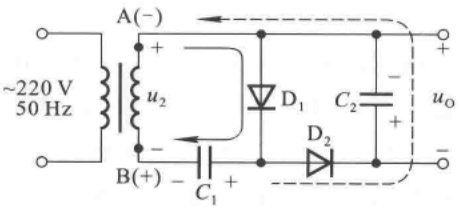

text_image

~220 V
50 Hz
A(-)
+
-
u₂
B(+)
-
C₁
+
-
D₁
C₂
+
-
D₂
uₒ
+

图 9.3.6 二倍压整流电路

---

444

第 9 章 直流电源

“-”，最大值可达 $2\sqrt{2} U_{2}$ 。可见，是 $C_1$ 对电荷的存储作用，使输出电压（即电容 $C_2$ 上的电压）为变压器二次电压峰值的2倍，利用同样原理可以实现所需倍数的输出电压。

图9.3.7所示为多倍压整流电路，在空载情况下，根据上述分析方法可得， $C_1$ 上电压为$\sqrt{2} U_{2},C_{2}\sim C_{6}$ 上电压均为 $2\sqrt{2} U_{2}$ 。因此，以 $C_1$ 两端作为输出端，输出电压的值为 $\sqrt{2} U_{2}$ ；以 $C_2$ 两端作为输出端，输出电压的值为 $2\sqrt{2} U_{2}$ ；以 $C_1$ 和 $C_3$ 上电压相加作为输出，输出电压的值为$3\sqrt{2} U_{2}\dots$ 依此类推，从不同位置输出，可获得 $\sqrt{2} U_2$ 的4、5、6倍的输出电压。应当指出，为了简便起见，分析这类电路时，总是设电路空载，且已处于稳态；当电路带上负载后，输出电压将不可能达到 $u_{2}$ 峰值的倍数。

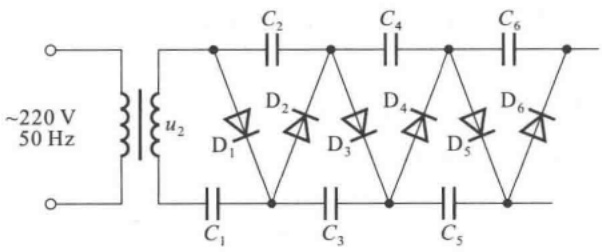

chemical

Electrical circuit diagram with transformer, capacitors, and diodes labeled D1–D6

图 9.3.7 多倍压整流电路

## 9.3.3 其它形式的滤波电路

## 一、电感滤波电路

在大电流负载情况下，由于负载电阻 $R_{\mathrm{L}}$ 很小，若采用电容滤波电路，则电容容量势必很大，而且整流二极管的冲击电流也非常大，这就使得整流管和电容器的选择变得很困难，甚至不太可能，在此情况下应当采用电感滤波。在整流电路与负载电阻之间串联一个电感线圈 $L$ 就构成电感滤波，如图9.3.8所示。由于电感线圈的电感量要足够大，所以一般需要采用有铁心的线圈。

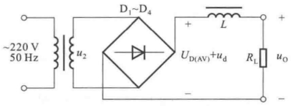

text_image

~220 V
50 Hz
u₂
D₁~D₄
+
L
U_D(AV)+u_d
R_L
u_O
-

图 9.3.8 单相桥式整流电感滤波电路

电感的基本性质是当流过它的电流变化时，电感线圈中产生的感生电动势将阻止电流的变化。当通过电感线圈的电流增大时，电感线圈产生的自感电动势与电流方向相反，阻止电流的增加，同时将一部分电能转化成磁场能存储于电感之中；当通过电感线圈的电流减小时，自感电动势与电流方向相同，阻止电流的减小，同时释放出存储的能量，以补偿电流的减小。因此，经电感滤波后，不但负载电流及电压的脉动减小，波形变得平滑，而且整流二极管的导

---

9.3 滤波电路

445

通角增大。

整流电路输出电压可分解为两部分，一部分为直流分量，它就是整流电路输出电压的平均值 $U_{0(AV)}$ ，对于全波整流电路，其值约为 $0.9U_{2}$ ；另一部分为交流分量 $u_{d}$ ；如图9.3.8所标注。电感线圈对直流分量呈现的电抗很小，就是线圈本身的电阻R；而对交流分量呈现的电抗为 $\omega L$ 。所以若二极管的导通角近似为 $\pi$ ，则电感滤波后的输出电压平均值

$$
U _ {\mathrm{O(AV)}} = \frac {R _ {\mathrm{L}}}{R + R _ {\mathrm{L}}} \cdot U _ {\mathrm{D(AV)}} \approx \frac {R _ {\mathrm{L}}}{R + R _ {\mathrm{L}}} \cdot 0. 9 U _ {2} \tag {9.3.5}
$$

输出电压的交流分量

$$
u _ {0} \approx \frac {R _ {\mathrm{L}}}{\sqrt {(\omega L) ^ {2} + R _ {\mathrm{L}} ^ {2}}} \cdot u _ {\mathrm{d}} \approx \frac {R _ {\mathrm{L}}}{\omega L} \cdot u _ {\mathrm{d}} \tag {9.3.6}
$$

从式(9.3.5)可以看出,电感滤波电路输出电压平均值小于整流电路输出电压平均值,在线圈电阻可忽略的情况下, $U_{0(AV)}\approx0.9U_{2}$ 。从式(9.3.6)可以看出,在电感线圈不变的情况下,负载电阻愈小(即负载电流愈大),输出电压的交流分量愈小,脉动愈小。注意,只有在 $R_{L}$ 远远小于 $\omega L$ 时,才能获得较好的滤波效果。显然,L愈大,滤波效果愈好。

另外,由于滤波电感电动势的作用,可以使二极管的导通角等于  $\pi$ , 减小了二极管的冲击电流, 平滑了流过二极管的电流, 从而延长了整流二极管的寿命。

## 二、复式滤波电路

当单独使用电容或电感进行滤波,效果仍不理想时,可采用复式滤波电路。电容和电感是基本的滤波元件,利用它们对直流量和交流量呈现不同电抗的特点,只要合理地接入电路都可以达到滤波的目的。图9.3.9(a)所示为LC滤波电路,图(b)、(c)所示为两种 $\pi$ 型滤波电路。读者可根据上面的分析方法分析它们的工作原理。

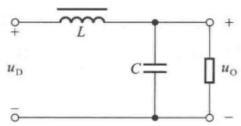

chemical

Simple LC circuit diagram with inductor, capacitor, and resistor components labeled L, C, uD, uO

(a)

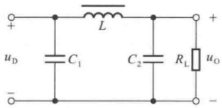

chemical

Electrical circuit diagram with inductor, capacitors, and resistor labeled with voltages and component symbols

(b)

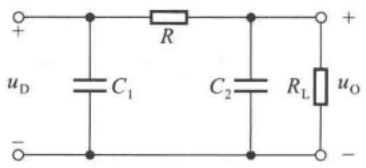

text_image

+
R
uD C1 C2 RL uO
-

(c)

图 9.3.9 复式滤波电路

(a) LC 滤波电路 (b)  $LC \pi$  型滤波电路 (c)  $RC \pi$  型滤波电路

## 三、各种滤波电路的比较

表 9.3.1 中列出各种滤波电路性能的比较。构成滤波电路的电容及电感应足够大， $\theta$  为二极管的导通角，凡  $\theta$  角小的，整流管的冲击电流大；凡  $\theta$  角大的，整流管的冲击电流小。

---

446

第9章 直流电源

表 9.3.1 各种滤波电路性能的比较

| 性能\\类型 | 电容滤波 | 电感滤波 | LC 滤波 | RC 或 LC$\pi$ 型滤波 |
| --- | --- | --- | --- | --- |
| $U_{0(AV)}/U_2$ | 1.2 | 0.9 | 0.9 | 1.2 |
| θ | 小 | 大 | 大 | 小 |
| 适用场合 | 小电流负载 | 大电流负载 | 适应性较强 | 小电流负载 |

## 思考题

9.3.1 在单相桥式整流、电容滤波电路中, 若有一只二极管断路, 则输出电压平均值是否为正常时的一半? 为什么?
9.3.2 为什么用电容滤波要将电容与负载电阻并联,而用电感滤波要将电感与负载电阻串联?

## 9.4 稳压管稳压电路

虽然整流滤波电路能将正弦交流电压变换成较为平滑的直流电压，但是，一方面，由于输出电压平均值取决于变压器二次电压有效值，所以当电网电压波动时，输出电压平均值将随之产生相应的波动；另一方面，由于整流滤波电路内阻的存在，当负载变化时，内阻上的电压将产生变化，于是输出电压平均值也将随之产生相反的变化。例如，如果负载电阻减小，则负载电流增大，内阻上的电流也就随之增大，其压降必然增大，输出电压平均值必将相应减小。因此，整流滤波电路输出电压会随着电网电压的波动而波动，随着负载电阻的变化而变化。为了获得稳定性好的直流电压，必须采取稳压措施。本节将对稳压管稳压电路的组成、工作原理和电路参数的选择一一加以介绍。

## 9.4.1 电路组成

由稳压二极管 $\mathrm{D_Z}$ 和限流电阻 $R$ 所组成的稳压电路是一种最简单的直流稳压电源，如图9.4.1中点画线框内所示。其输入电压 $U_{\mathrm{I}}$ 是整流滤波后的电压，输出电压 $U_{0}$ 就是稳压管的稳定电压 $U_{\mathrm{Z}}$ ， $R_{\mathrm{L}}$ 是负载电阻。

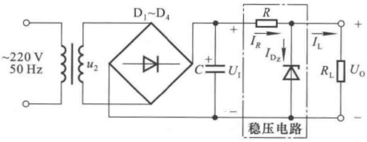

text_image

~220 V
50 Hz
u₂
D₁~D₄
+
C +
U₁
-
R
I_R
I_Dz
稳压电路
I_L
R_L
U_O
-

图 9.4.1 稳压二极管组成的稳压电路

---

9.4 稳压管稳压电路

447

从稳压管稳压电路可得两个基本关系式

$$
U _ {1} = U _ {R} + U _ {0} \tag {9.4.1}
$$

$$
I _ {R} = I _ {\mathrm{Dz}} + I _ {\mathrm{L}} \tag {9.4.2}
$$

从图9.4.2所示稳压管的伏安特性中可以看出，在稳压管稳压电路中，只要能使稳压管始终工作在稳压区，即保证稳压管的电流 $I_{\mathrm{Z}} \leqslant I_{\mathrm{D_Z}} \leqslant I_{\mathrm{ZM}}$，输出电压 $U_0$ 就基本稳定。

## 9.4.2 稳压原理

对任何稳压电路都应从两个方面考察其稳压特性,一是设电网电压波动,研究其输出电压是否稳定;二是设负载变化,研究其输出电压是否稳定。

在图 9.4.1 所示稳压管稳压电路中, 当电网电压升高时, 稳压电路的输入电压  $U_{1}$  随之增大, 输出电压  $U_{0}$  也随之按比例

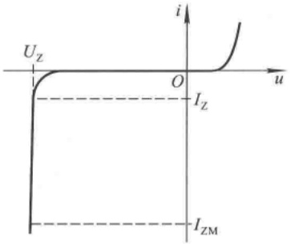

line

| Parameter | Description |
| --- | --- |
| Uz | Zero-crossing voltage level |
| O | Zero crossing point |
| Iz | Zero-crossing current level |
| IZM | Zero-crossing main current level |

图 9.4.2 稳压管的伏安特性

增大；但是，由于 $U_{0}=U_{Z}$ ，根据稳压管的伏安特性， $U_{Z}$ 的增大将使 $I_{D_{Z}}$ 急剧增大；根据式(9.4.2)， $I_{R}$ 必然随着 $I_{D_{Z}}$ 急剧增大， $U_{R}$ 会同时随着 $I_{R}$ 而急剧增大；根据式(9.4.1)， $U_{R}$ 的增大必将使输出电压 $U_{0}$ 减小。因此，只要参数选择合适，R上的电压增量就可以与 $U_{1}$ 的增量近似相等，从而使 $U_{0}$ 基本不变。上述过程可简单描述如下:

$$
\text {电网电压} \uparrow \longrightarrow U _ {\mathrm{I}} \uparrow \longrightarrow U _ {\mathrm{O}} (U _ {\mathrm{Z}}) \uparrow \longrightarrow I _ {\mathrm{Dz}} \uparrow \longrightarrow I _ {R} \uparrow \longrightarrow U _ {R} \uparrow
$$

当电网电压下降时,各电量的变化与上述过程相反。

可见,当电网电压变化时,稳压电路通过限流电阻 R 上电压的变化来抵消  $U_{1}$  的变化,即  $\Delta U_{R} \approx \Delta U_{1}$ ,从而使  $U_{0}$  基本不变。

当负载电阻 $R_{\mathrm{L}}$ 减小即负载电流 $I_{\mathrm{L}}$ 增大时，根据式(9.4.2)，导致 $I_{R}$ 增加，$U_{R}$ 也随之增大；根据式(9.4.1)，$U_{0}$ 必然下降，即 $U_{\mathrm{Z}}$ 下降；根据稳压管的伏安特性，$U_{\mathrm{Z}}$ 的下降使 $I_{\mathrm{D_Z}}$ 急剧减小，从而 $I_{R}$ 随之急剧减小。如果参数选择恰当，就可使 $\Delta I_{\mathrm{D_Z}} \approx -\Delta I_{\mathrm{L}}$ ，使 $I_{R}$ 基本不变，从而 $U_{0}$ 也就基本不变。上述过程可简单描述如下:

$$
\begin{array}{r l}&R _ {\mathrm{L}} \downarrow \rightarrow U _ {0} (U _ {\mathrm{Z}}) \downarrow \rightarrow I _ {\mathrm{D} _ {\mathrm{Z}}} \downarrow \rightarrow I _ {R} \downarrow \rightarrow \Delta I _ {\mathrm{D} _ {\mathrm{Z}}} \approx - \Delta I _ {\mathrm{L}} \rightarrow I _ {R} \text {基本不变} \rightarrow U _ {0} \text {基本不变}\\&\quad \underbrace {\longrightarrow I _ {\mathrm{L}} \uparrow \rightarrow I _ {R} \uparrow} _ {\text {↑}}\end{array}
$$

相反，如果 $R_{\mathrm{L}}$ 增大即 $I_{\mathrm{L}}$ 减小，则 $I_{\mathrm{D_Z}}$ 增大，同样可使 $I_{R}$ 基本不变，从而保证 $U_{0}$ 基本不变。

显然，在电路中只要能使  $\Delta I_{D_{Z}} \approx -\Delta I_{L}$ ，就可以使  $I_{R}$  基本不变，从而保证负载变化时输出电压基本不变。

综上所述，在稳压二极管所组成的稳压电路中，利用稳压管所起的电流调节作用，通过限流电阻 R 上电压或电流的变化进行补偿，来达到稳压的目的。限流电阻 R 是必不可少的元件，它既限制稳压管中的电流使其正常工作，又与稳压管相配合以达到稳压的目的。一般情况下，在电路中如果有稳压管存在，就必然有与之匹配的限流电阻。

## 9.4.3 性能指标

对于任何稳压电路，均可用稳压系数  $S_{r}$  和输出电阻  $R_{o}$  来描述其稳压性能。 $S_{r}$  定义为负载

---

448

第9章 直流电源

一定时稳压电路输出电压相对变化量与其输入电压相对变化量之比,即

$$
S _ {\mathrm{r}} = \frac {\Delta U _ {0} / U _ {0}}{\Delta U _ {\mathrm{I}} / U _ {\mathrm{I}}} \Bigg | _ {R _ {\mathrm{L}} = \text {常数}} = \frac {U _ {\mathrm{I}}}{U _ {0}} \cdot \frac {\Delta U _ {0}}{\Delta U _ {\mathrm{I}}} \Bigg | _ {R _ {\mathrm{L}} = \text {常数}} \tag {9.4.3}
$$

$S_{r}$  表明电网电压波动的影响, 其值愈小, 电网电压变化时输出电压的变化愈小。式中  $U_{1}$  为整流滤波后的直流电压。

$R_{o}$  为输出电阻, 是稳压电路输入电压一定时输出电压变化量与输出电流变化量之比, 即

$$
R _ {\mathrm{o}} = \frac {\Delta U _ {0}}{\Delta I _ {0}} \Bigg | _ {U _ {1} = \text {常数}} \tag {9.4.4}
$$

$R_{o}$  表明负载电阻对稳压性能的影响。

在仅考虑变化量时，图9.4.1所示稳压管稳压电路的等效电路如图9.4.3所示， $r_{z}$ 为稳压管的动态电阻。通常， $R_{L} \gg r_{z}$ ，且 $R \gg r_{z}$ ，因而

$$
\frac {\Delta U _ {0}}{\Delta U _ {1}} = \frac {r _ {z} / / R _ {\mathrm{L}}}{R + r _ {z} / / R _ {\mathrm{L}}} \approx \frac {r _ {z}}{R + r _ {z}} \approx \frac {r _ {z}}{R}
$$

所以稳压系数

$$
S _ {\mathrm{r}} = \frac {\Delta U _ {0}}{\Delta U _ {1}} \cdot \frac {U _ {1}}{U _ {0}} \approx \frac {r _ {\mathrm{z}}}{R} \cdot \frac {U _ {1}}{U _ {\mathrm{Z}}} \tag {9.4.5}
$$

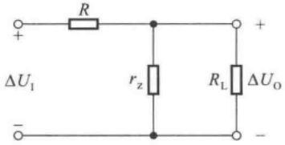

text_image

R
ΔU₁
+
-
r_z
R_L
ΔU_O
+
-

图 9.4.3 稳压管稳压电路的交流等效电路

式(9.4.5)表明,为使 $S_{r}$ 数值小,需增大R;而在 $U_{0}(U_{z})$ 和负载

电流确定的情况下, 若 R 的取值大, 则  $U_{1}$  的取值必须大, 这势必使  $S_{r}$  增大; 可见 R 和  $U_{1}$  必须合理搭配,  $S_{r}$  的数值才可能比较小。

根据式(9.4.4)，稳压管稳压电路的输出电阻为

$$
R _ {\mathrm{o}} = R / / r _ {\mathrm{z}} \approx r _ {\mathrm{z}} \tag {9.4.6}
$$

在一些文献中，也常用电压调整率和电流调整率来描述稳压性能。在额定负载且输入电压产生最大变化的条件下，输出电压产生的变化量  $\Delta U_{0}$  称为电压调整率；在输入电压一定且负载电流产生最大变化的条件下，输出电压产生的变化量  $\Delta U_{0}$  称为电流调整率。

## 9.4.4 电路参数的选择

设计一个稳压管稳压电路，就是合理地选择电路元件的有关参数。在选择元件时，应首先知道负载所要求的输出电压 $U_{0}$，负载电流 $I_{\mathrm{L}}$ 的最小值 $I_{\mathrm{Lmin}}$ 和最大值 $I_{\mathrm{Lmax}}$ （或者负载电阻 $R_{\mathrm{L}}$ 的最大值 $R_{\mathrm{Lmax}}$ 和最小值 $R_{\mathrm{Lmin}}$），输入电压 $U_{1}$ 的波动范围（一般为 $\pm 10\%$）。

## 一、稳压电路输入电压  $U_{1}$  的选择

根据经验,一般选取

$$
U _ {\mathrm{I}} = (2 \sim 3) U _ {0} \tag {9.4.7}
$$

$U_{1}$  确定后, 就可以根据此值选择整流滤波电路的元件参数。

## 二、稳压管的选择

在稳压管稳压电路中 $U_{0} = U_{\mathrm{Z}}$; 当负载电流 $I_{\mathrm{L}}$ 变化时, 稳压管的电流将产生一个与之相反的变化, 即 $\Delta I_{\mathrm{D_Z}} \approx -\Delta I_{\mathrm{L}}$, 所以稳压管工作在稳压区所允许的电流变化范围应大于负载电流的变化范围, 即 $I_{\mathrm{Zmax}} - I_{\mathrm{Zmin}} > I_{\mathrm{Lmax}} - I_{\mathrm{Lmin}}$。选择稳压管时应满足

---

9.4 稳压管稳压电路

449

$$
\left\{ \begin{array}{l l} U _ {\mathrm{Z}} = U _ {0} & (9. 4. 8 \mathrm{a}) \\ I _ {\mathrm{Zmax}} - I _ {\mathrm{Zmin}} > I _ {\mathrm{Lmax}} - I _ {\mathrm{Lmin}} & (9. 4. 8 \mathrm{b}) \end{array} \right.
$$

若考虑到空载时稳压管流过的电流  $I_{D_{Z}}$  将与 R 上电流  $I_{R}$  相等，满载时  $I_{D_{Z}}$  应大于  $I_{Zmin}$ ，稳压管的最大稳定电流  $I_{ZM}$  的选取应留有充分的余量，则还应满足

$$
I _ {\mathrm{ZM}} \geqslant I _ {\mathrm{Lmax}} + I _ {\mathrm{Zmin}} \tag {9.4.9}
$$

## 三、限流电阻 R 的选择

R 的选择必须满足两个条件:一是稳压管流过的最小电流  $I_{D_{Z\min}}$  应大于稳压管的最小稳定电流  $I_{Z\min}$  (即手册中的  $I_{Z}$ );二是稳压管流过的最大电流  $I_{D_{Z\max}}$  应小于稳压管的最大稳定电流  $I_{Z\max}$  (即手册中的  $I_{ZM}$ )。即

$$
I _ {\mathrm{Zmin}} \leqslant I _ {\mathrm{Dz}} \leqslant I _ {\mathrm{Zmax}} \tag {9.4.10}
$$

从图 9.4.1 所示电路可以看出

$$
I _ {R} = \frac {U _ {1} - U _ {Z}}{R} \tag {9.4.11}
$$

$$
I _ {\mathrm{Dz}} = I _ {R} - I _ {\mathrm{L}} \tag {9.4.12}
$$

当电网电压最低（即  $U_{1}$  最低）且负载电流最大时，流过稳压管的电流最小，根据式（9.4.10）、（9.4.11）、（9.4.12）可写成表达式

$$
I _ {\mathrm{D} _ {Z ^ {\min}}} = I _ {R ^ {\min}} - I _ {\mathrm{Lmax}} = \frac {U _ {\mathrm{lmin}} - U _ {\mathrm{z}}}{R} - I _ {\mathrm{Lmax}} \geqslant I _ {\mathrm{z}}
$$

由此得出限流电阻的上限值为

$$
R _ {\mathrm{max}} = \frac {U _ {\mathrm{lmin}} - U _ {\mathrm{z}}}{I _ {\mathrm{z}} + I _ {\mathrm{lmax}}} \tag {9.4.13}
$$

式中  $I_{Lmax} = U_{Z}/R_{Lmin}$

当电网电压最高(即  $U_{1}$  最高)且负载电流最小时,流过稳压管的电流最大,根据式(9.4.10)、(9.4.11)、(9.4.12)可写成表达式

$$
I _ {\mathrm{D} _ {Z ^ {\max}}} = I _ {R \max} - I _ {\mathrm{Lmin}} = \frac {U _ {\mathrm{lmax}} - U _ {\mathrm{Z}}}{R} - I _ {\mathrm{Lmin}} \leqslant I _ {\mathrm{ZM}}
$$

由此得出限流电阻的下限值为

$$
R _ {\mathrm{min}} = \frac {U _ {\mathrm{lmax}} - U _ {\mathrm{z}}}{I _ {\mathrm{ZM}} + I _ {\mathrm{Lmin}}} \tag {9.4.14}
$$

式中  $I_{Lmin} = U_{Z}/R_{Lmax}$

R 的阻值一旦确定,根据它的电流即可算出其功率。

【例 9.4.1】在图 9.4.1 所示电路中, 已知  $U_{1}=15\ V$ , 负载电流为  $10 \sim 20\ mA$ ; 稳压管的稳定电压  $U_{z}=6\ V$ , 最小稳定电流  $I_{Zmin}=5\ mA$ , 最大稳定电流  $I_{Zmax}=40\ mA, r_{z}=15\ \Omega$ 。

(1) 求解 R 的取值范围；
(2) 若  $R = 250 \Omega$ ，则稳压系数  $S_{r}$  和输出电阻  $R_{o}$  各为多少？
(3) 为使稳压性能好一些, 在允许范围内, R 的取值应当偏大些, 还是偏小些? 为什么?

解:(1) 根据式(9.4.13)、(9.4.14)

---

450

第 9 章 直流电源

$$
\begin{array}{l} R _ {\max} = \frac {U _ {\mathrm{lmin}} - U _ {\mathrm{Z}}}{I _ {\mathrm{Zmin}} + I _ {\mathrm{Lmax}}} = \left(\frac {1 5 - 6}{5 + 2 0} \times 1 0 ^ {3}\right) \Omega = 3 6 0 \Omega \\ R _ {\min} = \frac {U _ {\mathrm{Imax}} - U _ {\mathrm{Z}}}{I _ {\mathrm{Zmax}} + I _ {\mathrm{Lmin}}} = \left(\frac {1 5 - 6}{4 0 + 1 0} \times 1 0 ^ {3}\right) \Omega = 1 8 0 \Omega \\ \end{array}
$$

因此，R 的取值范围是  $180 \sim 360 \Omega$ 。

(2) 根据式(9.4.5)、(9.4.6)

$$
\begin{array}{l} S _ {\mathrm{r}} \approx \frac {r _ {\mathrm{z}}}{R + r _ {\mathrm{z}}} \cdot \frac {U _ {\mathrm{l}}}{U _ {\mathrm{z}}} = \frac {1 5}{2 5 0 + 1 5} \times \frac {1 5}{6} \approx 0. 1 4 \\ R _ {\mathrm{o}} \approx r _ {z} = 1 5 \Omega \\ \end{array}
$$

（3）在允许范围内，R 的取值应当偏大些。因为式(9.4.5)、(9.4.6)表明，当其余参数确定的情况下，R 愈大， $S_{r}$  愈小， $R_{o}$  愈接近  $r_{z}$ 。

【例 9.4.2】在图 9.4.1 所示电路中，已知  $U_{1}=12\ V$ ，电网电压允许波动范围为  $\pm10\%$ ; 稳压管的稳定电压  $U_{Z}=5\ V$ ，最小稳定电流  $I_{Zmin}=5\ mA$ ，最大稳定电流  $I_{Zmax}=30\ mA$ ，负载电阻  $R_{L}=250\sim350\ \Omega$ 。试求解:

(1) R 的取值范围；
(2) 若限流电阻短路, 则将产生什么现象?

解:(1) 首先求出负载电流的变化范围:

$$
\begin{array}{l} I _ {\mathrm{Lmax}} = U _ {\mathrm{Z}} / R _ {\mathrm{Lmin}} = (5 / 2 5 0) \mathrm{A} = 0. 0 2 \mathrm{A} \\ I _ {\mathrm{Lmin}} = U _ {\mathrm{Z}} / R _ {\mathrm{Lmax}} = (5 / 3 5 0) \mathrm{A} \approx 0. 0 1 4 3 \mathrm{A} \\ \end{array}
$$

再求出 R 的最大值和最小值

$$
\begin{array}{l} R _ {\max} = \frac {U _ {\mathrm{lmin}} - U _ {\mathrm{z}}}{I _ {\mathrm{Zmin}} + I _ {\mathrm{Lmax}}} = \frac {0 . 9 \times 1 2 - 5}{0 . 0 0 5 + 0 . 0 2} \Omega = 2 3 2 \Omega \\ R _ {\min} = \frac {U _ {\mathrm{lmax}} - U _ {\mathrm{Z}}}{I _ {\mathrm{Zmax}} + I _ {\mathrm{Lmin}}} = \frac {1 . 1 \times 1 2 - 5}{0 . 0 3 + 0 . 0 1 4 3} \Omega \approx 1 8 5 \Omega \\ \end{array}
$$

所以，R 的取值范围是  $185 \sim 232 \Omega$ 。

(2) 若限流电阻短路, 则  $U_{1}$  全部加在稳压管上, 使之因电流过大而烧坏。

稳压管稳压电路的优点是电路简单,所用元件数量少;但是,因为受稳压管自身参数的限制,其输出电流较小,输出电压不可调节,因此只适用于负载电流较小,负载电压不变的场合。

## 思考题

9.4.1 在稳压管稳压电路中,限流电阻的作用是什么?其值过小或过大将产生什么现象?
9.4.2 在选择稳压管稳压电路中的限流电阻 R 时, 若计算出 R 应大于  $300 \Omega$ 、小于  $270 \Omega$ , 则说明出现了什么问题? 应如何解决?
9.4.3 若计算出稳压管稳压电路中的限流电阻 R 应在  $200 \sim 300 \Omega$  之间，则应选择 R 接近  $300 \Omega$ 、还是  $200 \Omega$ ，为什么？
9.4.4 在选择稳压管稳压电路中的稳压管时, 若  $I_{Zmax} < I_{Lmax}$ , 一旦负载由于某种原因开路, 则将产生什么现象?

---

9.5 串联型稳压电路

451

## 9.5 串联型稳压电路

稳压管稳压电路输出电流较小,输出电压不可调,不能满足很多场合下的应用。串联型稳压电路以稳压管稳压电路为基础,利用晶体管的电流放大作用,增大负载电流;在电路中引入深度电压负反馈使输出电压稳定;并且,通过改变反馈网络参数使输出电压可调。

## 9.5.1 串联型稳压电路的工作原理

## 一、基本调整管电路

如前所述，在图9.5.1(a)所示稳压管稳压电路中，负载电流最大变化范围等于稳压管的最大稳定电流和最小稳定电流之差 $(I_{\mathrm{Zmax}}-I_{\mathrm{Zmin}})$ 。不难想象，扩大负载电流最简单的方法是:将稳压管稳压电路的输出电流作为晶体管的基极电流，而晶体管的发射极电流作为负载电流，电路采用射极输出形式，如图9.5.1(b)所示，常见画法如图(c)所示。

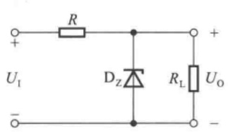

chemical

Electrical circuit diagram with resistor, diode, and load resistor labeled with input/output voltages and polarities

(a)

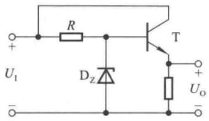

text_image

R
T
U₁
Dz
+
-
Uₒ

(b)

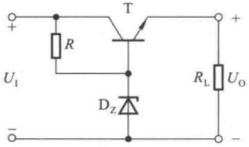

text_image

+
R
T
U_I
D_Z
R_L
U_O
-

(c)

图 9.5.1 基本调整管稳压电路

(a) 稳压管稳压电路 (b) 加晶体管扩大负载电流的变化范围 (c) 常见画法

由于图(b)、(c)所示电路引入了电压负反馈,故能够稳定输出电压。但它们与一般共集放大电路有着明显的区别:其工作电源 $U_{1}$ 不稳定,“输入信号”为稳定电压 $U_{z}$,并且要求输出电压 $U_{0}$ 在 $U_{1}$ 变化或负载电阻 $R_{L}$ 变化时基本不变。

其稳压原理简述如下。

当电网电压波动引起 $U_{1}$ 增大，或负载电阻 $R_{\mathrm{L}}$ 增大时，输出电压 $U_{0}$ 将随之增大，即晶体管发射极电位 $U_{\mathrm{E}}$ 升高；稳压管端电压基本不变，即晶体管基极电位 $U_{\mathrm{B}}$ 基本不变；故晶体管的 $U_{\mathrm{BE}}$ （ $=U_{\mathrm{B}} - U_{\mathrm{E}}$ ）减小，导致 $I_{\mathrm{B}}(I_{\mathrm{E}})$ 减小，从而使 $U_{0}$ 减小；因此可以保持 $U_{0}$ 基本不变。当 $U_{1}$ 减小或负载电阻 $R_{\mathrm{L}}$ 减小时，变化与上述过程相反。可见，晶体管的调节作用使 $U_{0}$ 稳定，所以称晶体管为调整管，称图(b)、(c)所示电路为基本调整管电路。

根据稳压管稳压电路输出电流的分析已知，晶体管基极的最大电流为 $(I_{\mathrm{Zmax}}-I_{\mathrm{Zmin}})$ ，因而

---

452

第 9 章 直流电源

图(b)所示的最大负载电流为

$$
I _ {\mathrm{Lmax}} = (1 + \beta) (I _ {\mathrm{Zmax}} - I _ {\mathrm{Zmin}}) \tag {9.5.1}
$$

这也就大大提高了负载电流的调节范围。输出电压为

$$
U _ {\mathrm{O}} = U _ {\mathrm{Z}} - U _ {\mathrm{BE}} \tag {9.5.2}
$$

从上述稳压过程可知,要想使调整管起到调整作用,必须使之工作在放大状态,因此其管压降应大于饱和管压降 $U_{CES}$ ;换言之,电路应满足 $U_{1}\geqslant U_{0}+U_{CES}$ 的条件。由于调整管与负载相串联,故称这类电路为串联型稳压电源;由于调整管工作在线性区,故称这类电路为线性稳压电源。

## 二、具有放大环节的串联型稳压电路

式(9.5.2)表明基本调整管稳压电路的输出电压仍然不可调,且输出电压将因 $U_{BE}$ 的变化而变,稳定性较差。为了使输出电压可调,也为了加深电压负反馈以提高输出电压的稳定性,通常在基本调整管稳压电路的基础上引入放大环节。

## 1. 电路的构成

若同相比例运算电路的输入电压为稳定电压,且比例系数可调,则其输出电压就可调节;同时,为了扩大输出电流,集成运放输出端加晶体管,并保持射极输出形式,就构成具有放大环节的串联型稳压电路,如图9.5.2(a)所示。输出电压为

$$
U _ {0} = \left(1 + \frac {R _ {1} + R _ {2} ^ {\prime \prime}}{R _ {2} ^ {\prime} + R _ {3}}\right) U _ {z} \tag {9.5.3}
$$

由于集成运放开环差模增益可达80 dB以上,电路引入深度电压负反馈,输出电阻趋近于零,因而输出电压相当稳定。图(b)所示为电路的常见画法。

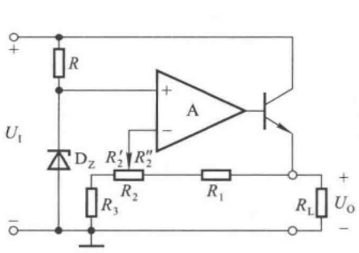

text_image

+
R
U_I
D_Z
R'_2
R'_2
A
-
R_3
R_2
R_1
+
R_L
U_O
-

(a)

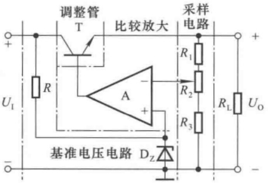

text_image

调整管
T
比较放大
采样
电路
+
R1
R2
RL
UO
Ui
A
+
R3
基准电压电路 DZ
-

(b)

图 9.5.2 具有放大环节的串联型稳压电路

(a) 原理电路 (b) 常见画法

在图(b)所示电路中,晶体管T为调整管,电阻R与稳压管 $D_{z}$ 构成基准电压电路,电阻 $R_{1}$ 、 $R_{2}$ 和 $R_{3}$ 为输出电压的采样电路,集成运放作为比较放大电路,如图中所标注。调整管、基准电压电路、采样电路和比较放大电路是串联型稳压电路的基本组成部分。

## 2. 稳压原理

当由于某种原因(如电网电压波动或负载电阻的变化等)使输出电压 $U_{0}$ 升高(降低)时,采样电路将这一变化趋势送到A的反相输入端,并与同相输入端电位 $U_{z}$ 进行比较放大;A的输出电压,即调整管的基极电位降低(升高);因为电路采用射极输出形式,所以输出电压 $U_{0}$ 必然降

---

9.5 串联型稳压电路

453

低(升高)，从而使 $U_{0}$ 得到稳定。可简述如下:

$$
U _ {\mathrm{o}} \uparrow \longrightarrow U _ {\mathrm{N}} \uparrow \longrightarrow U _ {\mathrm{B}} \downarrow \longrightarrow U _ {\mathrm{o}} \downarrow
$$

或

$$
U _ {\mathrm{o}} \downarrow \longrightarrow U _ {\mathrm{N}} \downarrow \longrightarrow U _ {\mathrm{B}} \uparrow \longrightarrow U _ {\mathrm{o}} \uparrow
$$

可见,电路是靠引入深度电压负反馈来稳定输出电压的。

## 3. 输出电压的可调范围

在理想运放条件下， $U_{N}=U_{P}=U_{Z}$ 。所以，当电位器 $R_{2}$ 的滑动端在最上端时，输出电压最小，为

$$
U _ {\mathrm{Omin}} = \frac {R _ {1} + R _ {2} + R _ {3}}{R _ {2} + R _ {3}} \cdot U _ {\mathrm{Z}} \tag {9.5.4}
$$

当电位器  $R_{2}$  的滑动端在最下端时, 输出电压最大, 为

$$
U _ {\mathrm{Omax}} = \frac {R _ {1} + R _ {2} + R _ {3}}{R _ {3}} \cdot U _ {\mathrm{Z}} \tag {9.5.5}
$$

若  $R_{1}=R_{2}=R_{3}=300\ \Omega, U_{z}=6\ V$ ，则输出电压  $9\ V \leqslant U_{0} \leqslant 18\ V$ 。

## 4. 调整管的选择

在串联型稳压电路中，调整管是核心元件，它的安全工作是电路正常工作的保证。调整管常为大功率管，因而选用原则与功率放大电路中的功放管相同，主要考虑其极限参数 $I_{\mathrm{CM}}$ 、 $U_{(\mathrm{BR})\mathrm{CEO}}$ 和 $P_{\mathrm{CM}}$ 。调整管极限参数的确定，必须考虑到输入电压 $U_{1}$ 由于电网电压波动而产生的变化，以及输出电压的调节和负载电流的变化所产生的影响。

从图9.5.2(b)所示电路可知，调整管T的发射极电流 $I_{\mathrm{E}}$ 等于采样电阻 $R_{1}$ 中电流和负载电流 $I_{\mathrm{L}}$ 之和 $(I_{\mathrm{E}} = I_{R_1} + I_{\mathrm{L}})$ ;T的管压降 $U_{\mathrm{CE}}$ 等于输入电压 $U_{1}$ 与输出电压 $U_{0}$ 之差 $(U_{\mathrm{CE}} = U_{1} - U_{0})$ 。显然，当负载电流最大时，流过T管发射极的电流最大，即 $I_{\mathrm{Emax}} = I_{R_1} + I_{\mathrm{Lmax}}$ 。通常， $R_{1}$ 上电流可忽略，且 $I_{\mathrm{Emax}} \approx I_{\mathrm{Cmax}}$，所以调整管的最大集电极电流

$$
I _ {\mathrm{Cmax}} \approx I _ {\mathrm{Lmax}} \tag {9.5.6}
$$

当电网电压最高(即输入电压最高),同时输出电压又最低时,调整管承受的管压降最大,即

$$
U _ {\mathrm{CEmax}} = U _ {\mathrm{Imax}} - U _ {\mathrm{Omin}} \tag {9.5.7}
$$

当晶体管的集电极(发射极)电流最大(即满载),且管压降最大时,调整管的功率损耗最大,即

$$
P _ {\mathrm{Cmax}} = I _ {\mathrm{Cmax}} U _ {\mathrm{CEmax}} \tag {9.5.8}
$$

根据式(9.5.6)、(9.5.7)、(9.5.8)，在选择调整管T时，应保证其最大集电极电流、集电极与发射极之间的反向击穿电压和集电极最大耗散功率满足

$$
\left\{ \begin{array}{l l} I _ {\mathrm{CM}} > I _ {\mathrm{Lmax}} & (9. 5. 9 \mathrm{a}) \\ U _ {(\mathrm{BR}) \mathrm{CEO}} > U _ {\mathrm{Imax}} - U _ {\mathrm{Omin}} & (9. 5. 9 \mathrm{b}) \\ P _ {\mathrm{CM}} > I _ {\mathrm{Lmax}} (U _ {\mathrm{Imax}} - U _ {\mathrm{Omin}}) & (9. 5. 9 \mathrm{c}) \end{array} \right.
$$

实际选用时,不但要考虑一定的余量,还应按手册上的规定采取散热措施。

在图 9.5.2(b) 所示电路中, 如果最大负载电流为 500 mA; 输出电压调节范围为 10 \~ 20 V; 输入电压 25 V, 波动范围为 ±10%; 那么选择 T 管时, 其极限参数应为

$$
I _ {\mathrm{CM}} > I _ {\mathrm{L}} = 5 0 0 \mathrm{mA}
$$

$$
U _ {(\mathrm{BR}) \mathrm{CEO}} > 1. 1 U _ {\mathrm{l}} - U _ {\mathrm{0min}} = (1. 1 \times 2 5 - 1 0) \mathrm{V} = 1 7. 5 \mathrm{V}
$$

---

454

第9章 直流电源

$$
P _ {\mathrm{CM}} > I _ {\mathrm{L}} (1. 1 U _ {\mathrm{I}} - U _ {\mathrm{Omin}}) = (0. 5 \times 1 7. 5) \mathrm{W} = 8. 7 5 \mathrm{W}
$$

## 三、串联型稳压电路的方框图

根据上述分析,实用的串联型稳压电路至少包含调整管、基准电压电路、采样电路和比较放大电路四个部分。此外,为使电路安全工作,还常在电路中加保护电路(见节9.5.2),所以串联型稳压电路的方框图如图9.5.3所示。

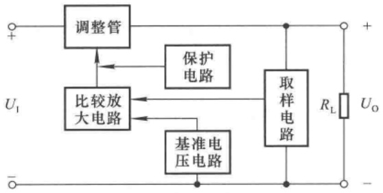

flowchart

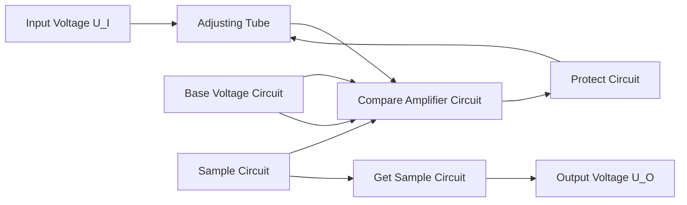

图 9.5.3 串联型稳压电路的方框图

【例 9.5.1】电路如图 9.5.2(b) 所示, 已知输入电压  $U_{1}$  的波动范围为  $\pm10\%$ , 调整管的饱和管压降  $U_{CES}=2\ V$ , 输出电压  $U_{0}$  的调节范围为  $5\sim20\ V$ ,  $R_{1}=R_{3}=200\ \Omega$ 。试问:

(1) 稳压管的稳定电压  $U_{z}$  和  $R_{2}$  的取值各为多少?
(2) 为使调整管正常工作, $U_{1}$ 的值至少应取多少?

解:(1) 输出电压的表达式为

$$
\frac {R _ {1} + R _ {2} + R _ {3}}{R _ {2} + R _ {3}} \cdot U _ {\mathrm{z}} \leqslant U _ {0} \leqslant \frac {R _ {1} + R _ {2} + R _ {3}}{R _ {3}} \cdot U _ {\mathrm{z}}
$$

将  $U_{0\min}=5\ V$ 、 $U_{0\max}=20\ V$ 、 $R_{1}=R_{3}=200\ \Omega$  代入上式，解二元方程，可得  $R_{2}=600\ \Omega$ ， $U_{Z}=4\ V$ 。

（2）所谓调整管正常工作，是指在输入电压波动和输出电压改变时调整管应始终工作在放大状态。研究电路的工作情况可知，在输入电压最低且输出电压最高时管压降最小，若此时管压降大于饱和管压降，则在其它情况下管子一定会工作在放大区。用式子表示为 $U_{\mathrm{CEmin}} = U_{\mathrm{lmin}} - U_{\mathrm{Omax}} > U_{\mathrm{CES}}$，即

$$
U _ {\mathrm{lmin}} > U _ {\mathrm{Omax}} + U _ {\mathrm{CES}}
$$

代入数据

$$
0. 9 U _ {1} > (2 0 + 2) \mathrm{V}
$$

得出  $U_{1}>24.7\ V$ ，故  $U_{1}$  至少应取  $25\ V$ 。

【例 9.5.2】电路如图 9.5.2(b) 所示, 已知集成运放输出电流  $I_{0}$  最大值为 2 mA, 调整管的电流放大倍数为 30。试问:

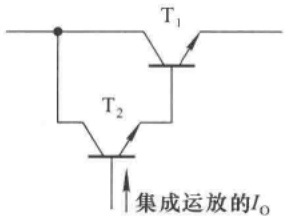

text_image

T₁
T₂
集成运放的I₀

图 9.5.4 用复合管作调整管

(1) 最大负载电流  $I_{Lmax}$  约为多少?

（2）若要稳压电路的输出电流为1 A,则应采取什么办法？画出改进部分的电路图来。

解:(1) 最大负载电流

$$
I _ {\mathrm{Lmax}} \approx I _ {\mathrm{Emax}} \approx I _ {\mathrm{Cmax}} = \beta I _ {0} = (3 0 \times 2) \mathrm{mA} = 6 0 \mathrm{mA}
$$

(2) 可用复合管做调整管, 如图 9.5.4 所示。

---

9.5 串联型稳压电路

455

此时， $I_{\mathrm{Lmax}} \approx I_{\mathrm{Emax}} \approx I_{\mathrm{Cmax}} \approx \beta_1 \beta_2 I_0$，只要 $\beta_1 \beta_2 > 500$，就可使稳压电路的输出电流达到 $1 \mathrm{~A}$ 以上。若 $\beta_1 = 30$，则要求 $\beta_2 > 17$。

## 9.5.2 集成稳压器中的基准电压电路和保护电路

从 9.5.1 节的分析可知串联型稳压电路的基本组成部分及它们的功能。集成稳压器内的基准电压电路与分立元件电路有着明显的差别，而且芯片内部的保护电路也与分立元件电路不尽相同，下面将一一加以介绍。

## 一、基准电压电路

式(9.5.4)和式(9.5.5)表明,串联型稳压电路输出电压的稳定性取决于基准电压的稳定性,因而通常要求基准电压电路具有温度系数为零、输出电阻小、噪声低等特点。

## 1. 稳压管基准电压电路

图 9.5.5 所示为稳压管基准电压电路,也称齐纳基准源。设稳压管  $D_{z}$  的稳定电压为  $U_{z}$ , 晶体管  $T_{2}$  导通时 b-e 间电压为  $U_{BE}$ , 则输出基准电压为

$$
U _ {\mathrm{REF}} = U _ {\mathrm{BE}} + U _ {\mathrm{Z}} \tag {9.5.10}
$$

由于图中的稳压管具有正温度系数，即温度升高时 $U_{\mathrm{Z}}$ 增大，反之则 $U_{\mathrm{Z}}$ 减小；而 $\mathrm{T}_{2}$ 的发射结在正向导通时具有负温度系数，即在基极电流基本不变条件下，温度升高时 $U_{\mathrm{BE}}$ 减小，反之 $U_{\mathrm{BE}}$ 增大；所以该电路具有温度补偿作用。当温度变化时，$U_{\mathrm{Z}}$ 与 $U_{\mathrm{BE}}$ 的变化相反，互相抵消，使 $U_{\mathrm{REF}}$ 变化很小。此外，电路采用射极输出形式，引入了电压负反馈，进一步提高了 $U_{\mathrm{REF}}$ 的稳定性，且使输出电阻更小。

图 9.5.6(a) 所示为零温度系数基准电压电路, 其等效电路如图(b)所示。已知稳压管的稳定电压具有正温度系数,

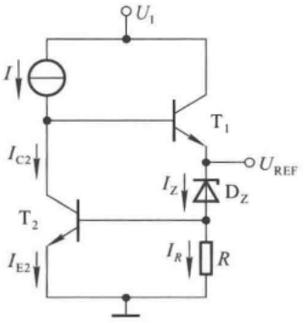

text_image

U1
I
IC2
T2
IE2
T1
IZ
DZ
UREF
IR
R

图 9.5.5 稳压管基准电压电路

NPN 型管 b-e 间电压  $U_{BE}$  具有负温度系数。设 n 个和 m 个二极管的导通电压  $U_{BE}$  基本相等，则基准电压为

$$
U _ {\mathrm{REF}} = I _ {\mathrm{E}} R _ {2} + m U _ {\mathrm{BE}} \tag {9.5.11}
$$

$$
I _ {\mathrm{E}} = \frac {U _ {\mathrm{Z}} - (m + n) U _ {\mathrm{BE}}}{R _ {1} + R _ {2}} \tag {9.5.12}
$$

将式(9.5.12)代入式(9.5.11)，整理可得

$$
U _ {\mathrm{REF}} = \frac {U _ {\mathrm{Z}} R _ {2} + (m R _ {1} - n R _ {2}) U _ {\mathrm{BE}}}{R _ {1} + R _ {2}} \tag {9.5.13}
$$

在集成电路内，因材料相同， $R_{1}$  与  $R_{2}$  具有同样的温度系数，当温度变化时其比值不变，它们随温度变化而产生的变化量相互抵消，因而对  $U_{REF}$  的影响很小，可忽略不计。所以  $U_{REF}$  的温度系数为

$$
\frac {\mathrm{d} U _ {\mathrm{REF}}}{\mathrm{d} T} = \frac {R _ {2}}{R _ {1} + R _ {2}} \cdot \frac {\mathrm{d} U _ {\mathrm{Z}}}{\mathrm{d} T} + \frac {m R _ {1} - n R _ {2}}{R _ {1} + R _ {2}} \cdot \frac {\mathrm{d} U _ {\mathrm{BE}}}{\mathrm{d} T} \tag {9.5.14}
$$

设 $\frac{dU_{Z}}{dT}\bigg/\frac{dU_{BE}}{dT}=k$ ，代入式(9.5.14)，令 $\frac{dU_{REF}}{dT}=0$ ，可得

---

456

第9章 直流电源

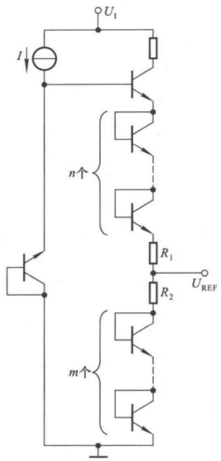

text_image

I
U₁
n↑
R₁
R₂
U_REF
m↑

(a)

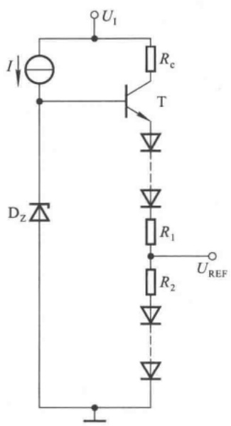

text_image

U1
I
Rc
T
Dz
R1
UREF
R2

(b)

图 9.5.6 零温度系数基准电压电路及其等效电路  
(a) 原理电路 (b) 等效电路

$$
\frac {R _ {1}}{R _ {2}} = \frac {n - k}{m} \tag {9.5.15}
$$

上述分析表明，在 m、n、稳压管的  $U_{Z}$  和二极管的  $U_{BE}$  的温度系数确定的情况下，只要  $R_{1}$  与  $R_{2}$  按式(9.5.15)取值，就可做到基准电压温度系数为零。

## 2. 能隙基准电压电路

稳压管基准电压电路提供的基准电压中含有较高的噪声电平,因而在很多集成稳压器中采用能隙基准电压电路,也称带隙 $^{①}$ 基准电压电路或禁带宽度基准电压电路,其基本组成如图9.5.7所示。从图可知,基准电压为

$$
U _ {\mathrm{REF}} = U _ {\mathrm{BE3}} + I _ {2} R _ {2} \tag {9.5.16}
$$

而 $I_{2} \approx I_{3} \approx I_{\mathrm{S}} \mathrm{e}^{\frac{U_{\mathrm{BE}}}{U_{\mathrm{T}}}$ ②，且 $I_{3}R_{3} = U_{\mathrm{BE1}} - U_{\mathrm{BE2}}$ 。由于电路中晶体

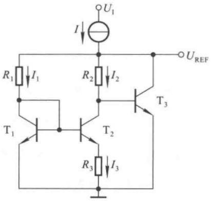

text_image

U₁
I
R₁ I₁
R₂ I₂
T₁ T₂ T₃
R₃ I₃
U_REF

图 9.5.7 能隙基准电压电路

<small>① 即英文 Bandgap Reference。</small>

<small>② 见本书 1.1 节。</small>

---

9.5 串联型稳压电路

457

管具有相同的特性,所以

$$
U _ {\mathrm{BE1}} - U _ {\mathrm{BE2}} \approx U _ {\mathrm{T}} \ln \left(\frac {I _ {1}}{I _ {2}}\right)
$$

$$
I _ {3} \approx \frac {1}{R _ {3}} \cdot U _ {\mathrm{T}} \ln \left(\frac {I _ {1}}{I _ {2}}\right)
$$

因而 $R_{2}$ 上的电压为

$$
U _ {R _ {2}} \approx I _ {3} R _ {2} \approx \frac {R _ {2}}{R _ {3}} \cdot U _ {\mathrm{T}} \ln \left(\frac {I _ {1}}{I _ {2}}\right) \tag {9.5.17}
$$

由于 $\mathrm{T}_{1}$ 和 $\mathrm{T}_{3}$ 特性相同，若 $U_{\mathrm{BE1}} \approx U_{\mathrm{BE3}}$ ，则 $R_{1}$ 上电压与 $R_{2}$ 上电压近似相等，即 $I_{1}R_{1} \approx I_{2}R_{2}$，故 $I_{1} / I_{2} \approx R_{2} / R_{1}$ 。代入式(9.5.17)，可得

$$
U _ {R _ {2}} \approx I _ {3} R _ {2} \approx \frac {R _ {2}}{R _ {3}} \cdot U _ {\mathrm{T}} \ln \left(\frac {R _ {2}}{R _ {1}}\right)
$$

将上式代入式(9.5.16)，可得基准电压为

$$
U _ {\mathrm{REF}} \approx U _ {\mathrm{BE3}} + \frac {R _ {2}}{R _ {3}} \cdot U _ {\mathrm{T}} \ln \left(\frac {R _ {2}}{R _ {1}}\right) \tag {9.5.18}
$$

式中 $U_{\mathrm{BE3}}$ 的温度系数 $\alpha$ 为负值，且 $\alpha = \mathrm{d}U_{\mathrm{BE}} / \mathrm{d}T = -(1.8\sim 2.4)\mathrm{mV / K}$ ，故可将 $U_{\mathrm{BE3}}$ 表示为

$$
U _ {\mathrm{BE3}} = U _ {\mathrm{go}} + \alpha T \tag {9.5.19}
$$

式中  $U_{go}$  为硅材料在 0 K 时外推禁带宽度(能带间隙)的电压值,又称为能隙电压值,根据 PN 结的分析,其值为

$$
U _ {\mathrm{go}} = 1. 2 0 5 \mathrm{V} \tag {9.5.20}
$$

因此基准电压为  $U_{REF} = U_{go} + \alpha T + U_{R2}$ ，即

$$
U _ {\mathrm{REF}} \approx U _ {\mathrm{go}} + \alpha T + \frac {R _ {2}}{R _ {3}} \cdot U _ {\mathrm{T}} \ln \left(\frac {I _ {1}}{I _ {2}}\right) \approx U _ {\mathrm{go}} + \alpha T + \frac {R _ {2}}{R _ {3}} \cdot U _ {\mathrm{T}} \ln \left(\frac {R _ {2}}{R _ {1}}\right) \tag {9.5.21}
$$

由于 $I_{1} > I_{2},\ln \left(\frac{I_{1}}{I_{2}}\right) > 0;U_{\mathrm{T}} = \frac{kT}{q},q$ 和 $k$ 为常量， $T$ 为热力学温度， $T$ 增大时 $U_{\mathrm{T}}$ 增大；所以第三项将随温度 $T$ 的升高而增大，即具有正温度系数。因此，只要选取合适的 $R_{1}\sim R_{3}$ 的数值，就可使式(9.5.21)中的第二项和第三项相互抵消，从而使基准电压变为

$$
U _ {\mathrm{REF}} = U _ {\mathrm{go}} \tag {9.5.22}
$$

显然,基准电压将与温度无关,从而获得极好的稳定性。

## 二、保护电路

在集成稳压器电路内部含有各种保护电路，如过流保护、短路保护、调整管安全工作区保护、芯片过热保护电路等，使集成稳压器在出现不正常情况时不至于损坏。而且，因为串联型稳压电路的调整管是其核心器件，它流过的电流近似等于负载电流，且电网电压波动或输出电压调节时管压降将产生相应的变化，所以这些保护电路都与调整管紧密相关。

## 1. 过流保护电路

过流保护电路能够在稳压器输出电流超过额定值时,限制调整管发射极电流在某一数值或使之迅速减小,从而保护调整管不会因电流过大而烧坏。凡在过流时使调整管发射极电流限制在某一数值的电路,称为限流型过流保护电路;凡在过流时使调整管发射极电流迅速减小到较小

---

458

第9章 直流电源

数值的电路,称为截流型(或减流型)过流保护电路。

图9.5.8(a)所示为限流型过流保护电路，$\mathrm{T}_{1}$ 为调整管，$\mathrm{T}_{2}$ 和 $R_{0}$ 构成保护电路，图(b)所示为集成稳压电路中的画法。$R_{0}$ 为电流采样电阻，其电流等于稳压电路的输出电流 $I_{0}$，故其电压正比于 $I_{0}$。正常工作时，$\mathrm{T}_{2}$ 的 $\mathrm{b - e}$ 间电压 $U_{\mathrm{BE2}} = I_{0}R_{0} < U_{\mathrm{on}}$，$U_{\mathrm{on}}$ 为 $\mathrm{b - e}$ 间的开启电压，因而 $\mathrm{T}_{2}$ 处于截止状态。当过流，即输出电流增大到一定数值时，$R_{0}$ 上的电压足以使 $\mathrm{T}_{2}$ 导通，便从 $\mathrm{T}_{1}$ 管的基极电流分流，因而限制了调整管的发射极电流。$R_{0}$ 的取值不同，调整管发射极的限定值将不同，其表达式为

$$
I _ {\mathrm{Omax}} \approx I _ {\mathrm{Emax}} \approx U _ {\mathrm{BE2}} / R _ {0} \tag {9.5.23}
$$

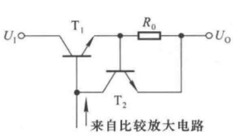

text_image

U₁○─T₁─R₀─○U₀
↑
T₂
来自比较放大电路

(a)

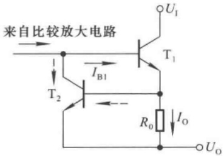

text_image

来自比较放大电路
T₁
I_B1
T₂
R₀
I_O
U_O
U_I

(b)

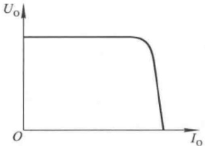

line

| \(I_{0}\) | \(U_{o}\) |
| --- | --- |
| Low | High |
| Medium | High |
| High | Low |

(c)

图 9.5.8 限流型过流保护电路及其输出特性

(a) 保护电路 (b) 集成稳压电路中的画法 (c) 输出特性

图(c)所示为输出特性。上述分析表明,限流型保护电路虽然组成简单,但是在保护电路起作用后调整管仍有较大的工作电流,因而也就有较大的功耗,所以不适用于大功率电路。

图 9.5.9(a) 所示为截流型过流保护电路, $T_{1}$  为调整管, $R_{0}$  为电流采样电阻, 它与 $T_{2}$ 、 $R_{1}$  和 $R_{2}$  构成保护电路, 图(b) 所示为集成稳压电路中的画法。电路中 A、B 点的电位分别为

$$
U _ {\mathrm{A}} = I _ {0} R _ {0} + U _ {0}
$$

$$
U _ {\mathrm{B}} = \frac {R _ {2}}{R _ {1} + R _ {2}} \cdot U _ {\mathrm{A}}
$$

因而  $T_{2}$  管 b-e 间电压为

$$
U _ {\mathrm{BE2}} = U _ {\mathrm{B}} - U _ {0} = \frac {R _ {2}}{R _ {1} + R _ {2}} \cdot (I _ {0} R _ {0} + U _ {0}) - U _ {0} \tag {9.5.24}
$$

式(9.5.24)表明， $I_{0}$  增大， $U_{BE2}$  将随之增大。未过流时， $U_{BE2}<U_{on}$ ，使  $T_{2}$  截止。当  $I_{0}$  增大到一定数值或输出端短路时， $T_{2}$  导通，对调整管  $T_{1}$  的基极分流，使  $I_{0}$  减小，从而导致输出电压  $U_{0}$  减小；此时虽然  $U_{B}$  随  $U_{0}$  的下降而下降，但是  $U_{0}$  下降的幅值大于  $U_{B}$ ，使得  $T_{2}$  的电流进一步增大，

---

9.5 串联型稳压电路

459

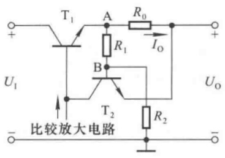

text_image

T₁
A
R₀
I₀
R₁
B
U₁
比较放大电路
T₂
R₂
Uₒ

(a)

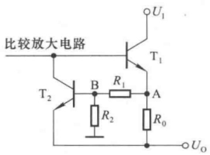

text_image

比较放大电路
T₂
B
R₁
R₂
A
R₀
U₁
T₁
Uₒ

(b)

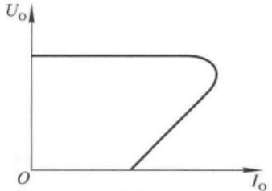

line

| Io | Uo |
| --- | --- |
| 0 | High |
| ~Mid-range | High |
| ~Mid-range + I0 | Low |
| ~Mid-range + II0 | High |

(c)

图 9.5.9 截流型过流保护电路及其输出特性

(a) 保护电路 (b) 集成稳压电路中的画法 (c) 输出特性

$T_{1}$  的电流进一步减小,最终减小到较小数值。输出特性如图(c)所示。设  $T_{2}$  导通时 b-e 间电压为  $U_{on}$ , 令输出电压  $U_{0}$  为零, 并代入式(9.5.24), 可求出输出电流的最小值为

$$
I _ {0} \approx \frac {U _ {\mathrm{on}}}{k R _ {0}} \quad \left(k = \frac {R _ {2}}{R _ {1} + R _ {2}}\right) \tag {9.5.25}
$$

通常，在截流型过流保护电路启动后，均有一个正反馈过程，使输出电流迅速减小。

## 2. 调整管的安全工作区保护电路

调整管的安全工作区保护电路可使调整管既不因过电流而烧坏，又不因过电压而击穿，因此它由过流保护和过压保护两种电路组合而成，最终保证调整管不超过其最大耗散功率。在图9.5.10所示电路中，由晶体管 $T_{16}$ 、 $T_{17}$ 组成的复合管为调整管，由 $R_{13}$ 、 $D_{Z2}$ 和 $R_{11}$ 、 $R_{12}$ 、 $R_{21}$ 、 $T_{15}$ 组成保护电路，输出电流如图中所标注。在电路正常工作时， $D_{Z2}$ 和 $T_{15}$ 均截止。电阻 $R_{12}$ 上的电压为

$$
U _ {R _ {1 2}} = \frac {R _ {1 2}}{R _ {2 1} + R _ {1 2}} \cdot U _ {\mathrm{BE17}}
$$

$T_{15}$  的 b-e 间电压为

$$
U _ {\mathrm{BE15}} = U _ {R _ {1 2}} + I _ {0} R _ {1 1} \tag {9.5.26}
$$

且  $U_{BE15} < U_{on}$ 。 $I_{0}$  增大， $R_{11}$  上的电压增大， $U_{BE15}$  将随之增大。

当电路过载或输出端短路时， $R_{11}$ 上的电压增大使 $U_{BE15} > U_{on}$， $T_{15}$ 导通，对调整管的基极分流，实现了过流保护。若 $U_{1}$ 与 $U_{0}$ 之间电压（即调整管管压降）超过允许值，则 $D_{Z2}$ 击穿，使 $T_{15}$ 基极电流骤然增大而迅速进入饱和区， $I_{9}$ 的大部分电流流过 $T_{15}$，从而使调整管 $T_{17}$ 接近截止区，也就使其功耗下降到较小的数值。可见，过压保护电路最终限制了调整管的功耗，使调整管工作在安全区。

---

460

第9章 直流电源

## 3. 芯片过热保护电路

芯片损坏的重要原因之一是长期通过大电流而引起结温超过允许值。在集成稳压器中，调整管的结温决定芯片的温度。为此，常利用二极管或晶体管的结温升作为测温元件，让它们靠近调整管，从而反映调整管的温升情况。当调整管温升超过允许值时，测温二极管（或晶体管）启动一个电路，减小其电流，使芯片温度下降至安全值。

在图9.5.11所示电路中，由晶体管 $\mathrm{T}_{16}$ 、 $\mathrm{T}_{17}$ 组成的复合管为调整管； $\mathrm{T}_{14}$ 和 $R_{7}$ 为测温元件，它们与 $R_{1}, R_{6}^{\prime}$ 和 $\mathrm{D}_{\mathrm{Z}1}$ 组成芯片过热保护电路。 $\mathrm{T}_{14}$ 管b-e间电压为

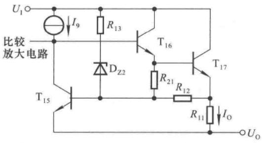

text_image

U₁
比较
放大电路
I₉
R₁₃
T₁₆
D₂₂
R₂₁
R₁₂
T₁₇
R₁₁
Iₒ
T₁₅
Uₒ

图 9.5.10 调整管的安全工作区保护电路

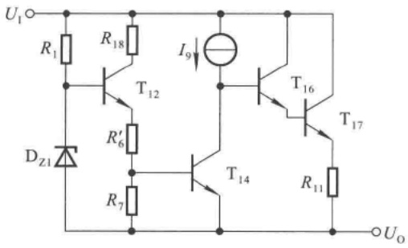

text_image

U₁
R₁
R₁₈
I₉
T₁₂
Dz₁
R'₆
R₇
T₁₄
T₁₆
T₁₇
R₁₁
Uₒ

图 9.5.11 芯片过热保护电路

$$
U _ {\mathrm{BE14}} = U _ {R _ {7}} = \frac {R _ {7}}{R _ {6} ^ {\prime} + R _ {7}} \cdot (U _ {\mathrm{Z1}} - U _ {\mathrm{BE12}})
$$

其中稳压管具有正温度系数，而晶体管b-e间电压具有负温度系数。芯片未过热时，$\mathrm{T}_{14}$ 管截止。芯片温度上升，$U_{\mathrm{Z1}}$ 增大，$U_{\mathrm{BE12}}$ 减小，即 $(U_{\mathrm{Z1}} - U_{\mathrm{BE12}})$ 增大，而 $\mathrm{T}_{14}$ 管b-e间的开启电压 $U_{\mathrm{on}}$ 却减小。当芯片温度上升到一定数值（通常在 $150\sim 175^{\circ}\mathrm{C}$ ）时，$\mathrm{T}_{14}$ 管导通，对调整管的基极分流，输出电流减小，调整管的功耗下降，使芯片温度被限制在一定数值之下。

## 9.5.3 集成稳压器电路

从外形上看，集成串联型稳压电路有三个引脚，分别为输入端、输出端和公共端（或调整端），因而称为三端稳压器。按功能可分为固定式稳压电路和可调式稳压电路；前者的输出电压不能进行调节，为固定值；后者可通过外接元件使输出电压得到很宽的调节范围。本节首先对型号为W7800固定式集成稳压器电路加以简要分析，然后介绍型号为W117可调式集成稳压器的特点。

## 一、W7800三端稳压器

## 1. 输出电压和输出电流

W7800 系列三端稳压器的输出电压有 5 V、6 V、9 V、12 V、15 V、18 V 和 24 V 七个挡，型号后面的两个数字表示输出电压值。输出电流有 1.5 A（W7800）、0.5 A（W78M00）和 0.1 A（W78L00）三个挡。例如，W7805 表示输出电压为 5 V、最大输出电流为 1.5 A，W78M05 表示输出电压为 5 V、最大输出电流为 0.5 A，W78L05 表示输出电压为 5 V、最大输出电流为 0.1 A，其它类推。它因性能稳定、价格低廉而得到广泛的应用。

---

9.5 串联型稳压电路

461

## 2. 电路原理图分析

W7805 电路原理框图如图 9.5.12 所示 $^{①}$ ，其中稳压电路部分如图 9.5.13 所示。

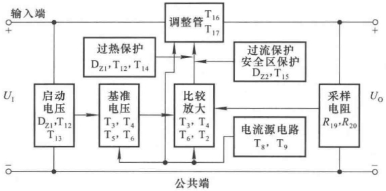

flowchart

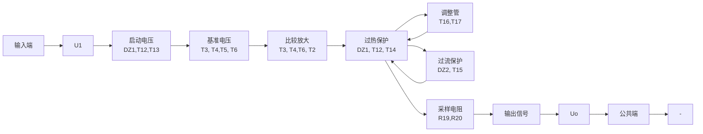

图 9.5.12 W7805 的原理框图

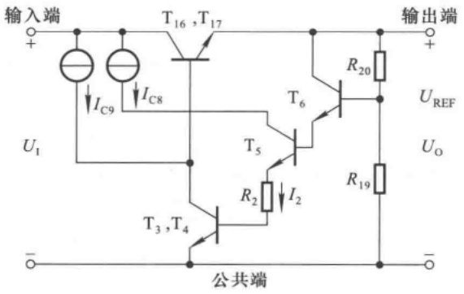

text_image

输入端
T16,T17
IC9
IC8
U1
T5
R2
I2
T3,T4
公共端
输出端
R20
T6
R19
UREF
UO

图 9.5.13 W7805 电路中的稳压电路部分

在图 9.5.13 所示电路中，由  $T_{16}$  和  $T_{17}$  管构成的复合管作为调整管。

以  $T_{3}$  和  $T_{4}$  构成的复合管作为放大管、以  $T_{9}$  管为有源负载组成的共射放大电路作为比较放大电路。基准电压  $U_{REF}$  通过  $T_{6}$  管 ( $T_{2}$  管为有源负载) 的发射极输入到  $T_{3}$  管的基极。

$T_{3}$ 、 $T_{4}$ 、 $T_{5}$ 、 $T_{6}$ 管和电阻 $R_{2}$ 组成基准电压电路，它是与图9.5.7所示电路相类似的能隙基准电压电路。基准电压

$$
U _ {\mathrm{REF}} = U _ {\mathrm{BE4}} + U _ {\mathrm{BE3}} + I _ {2} R _ {2} + U _ {\mathrm{BE5}} + U _ {\mathrm{BE6}} \tag {9.5.27}
$$

在  $T_{3} \sim T_{6}$  特性相同的情况下, 得出

$$
U _ {\mathrm{REF}} = 4 U _ {\mathrm{BE}} + I _ {2} R _ {2} \tag {9.5.28}
$$

根据式(9.5.19)、(9.5.21)可知

$$
U _ {\mathrm{REF}} \approx 4 U _ {\mathrm{go}} + 4 \alpha T + \frac {R _ {2}}{R _ {3}} \cdot U _ {\mathrm{T}} \ln \left(\frac {R _ {2}}{R _ {1}}\right) \tag {9.5.29}
$$

通过调整  $R_{1} \sim R_{3}$  的阻值, 可使式 (9.5.29) 中的第二、三项相互抵消, 从而基准电压仅决定于第一项, 为

<small>① W7805 电路原理图可参阅童诗白、华成英主编《模拟电子技术基础(第四版)》的 10.5.3 节。</small>

---

462

第 9 章 直流电源

$$
U _ {\mathrm{REF}} = 4 U _ {\mathrm{go}}
$$

实现了零温度系数。根据式(9.5.20)可得

$$
U _ {\mathrm{REF}} = 4. 8 2 \mathrm{V} \tag {9.5.30}
$$

输出电压为

$$
U _ {0} = \left(1 + \frac {R _ {2 0}}{R _ {1 9}}\right) \cdot U _ {\mathrm{REF}} \approx 5 \mathrm{V} \tag {9.5.31}
$$

在图9.5.12所示电路中， $R_{11}, R_{12}, R_{13}, \mathrm{D}_{\mathrm{Z}2}$ 和 $\mathrm{T}_{15}$ 组成如图9.5.10所示的安全工作区保护电路，在过流、过压时保护电路起作用，同时避免了过损耗。$\mathrm{D}_{\mathrm{Z}1}, \mathrm{T}_{12}, \mathrm{T}_{14}, R_5, R_6$ 和 $R_{7}$ 组成如图9.5.11所示的芯片过热保护电路。

图9.5.12中，$\mathrm{T_8}$ 和 $\mathrm{T_9}$ 管所构成的电流源电路为比较放大电路、基准电压电路和调整管提供静态电流；但是，在通电后，靠 $\mathrm{T_8}$ 和 $\mathrm{T_9}$ 管自身并不能形成基极电流回路，因而也就无法使整个电路正常工作。启动电路的作用是在 $U_{1}$ 接入后，为 $\mathrm{T_8}$ 和 $\mathrm{T_9}$ 管提供电流通路，从而使稳压电路各部分建立起正常的工作关系。电路启动正常工作之后，启动电路与稳压电路分开。可见启动电路仅在通电时起作用。

由以上分析可知,电路中的一些元件出现在多个功能电路中,如  $D_{Z1}$  既作为启动电路的一部分,又作为过热保护电路的一部分。

## 3. 主要参数

在温度为  $25^{\circ}$ C 条件下 W7805 的主要参数如表 9.5.1 所示。

表 9.5.1 W7805 的主要参数

| 参数名称 | 符号 | 测试条件 | 单位 | W7805(典型值) |
| --- | --- | --- | --- | --- |
| 输入电压 | $U_{1}$ |  | V | 10 |
| 输出电压 | $U_{0}$ | $I_{0}=500mA$ | V | 5 |
| 最小输入电压 | $U_{\text{tmin}}$ | $I_{0}\leqslant1.5A$ | V | 7 |
| 电压调整率 | $S_{U}(\Delta U_{0})$ | $I_{0}=500mA$$8V\leqslant U_{1}\leqslant18V$ | mV | 7 |
| 电流调整率 | $S_{I}(\Delta U_{0})$ | $10mA\leqslant I_{0}\leqslant1.5A$ | mV | 25 |
| 输出电压温度变化率 | $S_{T}$ | $I_{0}=5mA$ | mV/°C | 1 |
| 输出噪声电压 | $U_{no}$ | $10Hz\leqslant f\leqslant100kHz$ | μV | 40 |

从表中参数可知,W7805输入端和输出端之间的电压允许值为3\~13 V;输出交流噪声很小,温度稳定性很好。

## 二、W117 三端稳压器

W117 为可调式三端稳压器。

## 1. 原理框图

W117 的原理框图如图 9.5.14 所示。它有三个引出端，分别为输入端、输出端和电压调整端

---

9.5 串联型稳压电路

463

（简称调整端）。调整端是基准电压电路的公共端。 $T_{1}$  和  $T_{2}$  组成的复合管为调整管；基准电压电路为能隙基准电压电路；比较放大电路 A 是共集-共射放大电路；保护电路包括过流保护、调整管安全区保护和过热保护三部分 $^{①}$ 。 $R_{1}$  和  $R_{2}$  为外接的采样电阻，调整端接在它们的连接点上。

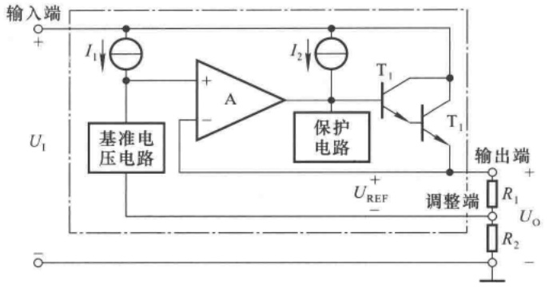

text_image

输入端
+
I₁
U₁
基准电压电路
+
-
A
保护电路
I₂
T₁
T₁
U_REF
输出端
+
-
调整端
R₁
Uₒ
R₂
-

图 9.5.14 W117 的原理框图

与一般串联型稳压电路一样,由于 W117 电路中引入了深度的电压负反馈,输出电压非常稳定。

因为调整端的电流很小,约为  $50 \mu A$ , 所以输出电压为

$$
U _ {0} = \left(1 + \frac {R _ {2}}{R _ {1}}\right) \cdot U _ {\mathrm{REF}} \tag {9.5.32}
$$

其中  $U_{REF}$  的典型值为 1.25 V $^{②}$ 。

## 2. 主要参数

与 W7800 系列产品一样，W117、W117M 和 W147L 的最大输出电流分别为 1.5 A、0.5 A 和 0.1 A。W117、W217 和 W317 具有相同的引出端、相同的基准电压和相似的内部电路，它们的工作温度范围依次为  $-55^{\circ}C \sim 150^{\circ}C$ 、 $-25^{\circ}C \sim 150^{\circ}C$ 、 $0 \sim 125^{\circ}C$ 。它们在  $25^{\circ}C$  时主要参数如表 9.5.2 所示。

表 9.5.2 W117/W217/W317 的主要参数

<table><tr><td rowspan="2">参数名称</td><td rowspan="2">符号</td><td rowspan="2">测试条件</td><td rowspan="2">单位</td><td colspan="3">W117/W217</td><td colspan="3">W317</td></tr><tr><td>最小值</td><td>典型值</td><td>最大值</td><td>最小值</td><td>典型值</td><td>最大值</td></tr><tr><td>输出电压</td><td> $U_0$ </td><td> $I_0=1.5A$ </td><td>V</td><td colspan="6">1.2~37</td></tr><tr><td>电压调整率</td><td> $S_U$ </td><td> $I_O=500mA$  $3V\leqslant U_1-U_0\leqslant40V$ </td><td>%/V</td><td></td><td>0.01</td><td>0.02</td><td></td><td>0.01</td><td>0.04</td></tr><tr><td>电流调整率</td><td> $S_I$ </td><td> $10mA\leqslant I_0\leqslant1.5A$ </td><td>%</td><td></td><td>0.1</td><td>0.3</td><td></td><td>0.1</td><td>0.5</td></tr><tr><td>调整端电流</td><td> $I_{Adj}$ </td><td></td><td>μA</td><td></td><td>50</td><td>100</td><td></td><td>50</td><td>100</td></tr></table>

<small>① 可参阅童诗白主编《模拟电子技术基础(第二版)》第十一章附录。</small>

<small>② 可参阅童诗白主编《模拟电子技术基础(第二版)》第十一章附录。</small>

---

464

第9章 直流电源

续表

<table><tr><td rowspan="2">参数名称</td><td rowspan="2">符号</td><td rowspan="2">测试条件</td><td rowspan="2">单位</td><td colspan="3">W117/W217</td><td colspan="3">W317</td></tr><tr><td>最小值</td><td>典型值</td><td>最大值</td><td>最小值</td><td>典型值</td><td>最大值</td></tr><tr><td>调整端电流变化</td><td> $\Delta I_{Adj}$ </td><td> $3\mathrm{V}\leqslant U_1 - U_0\leqslant 40\mathrm{V}$  $10\mathrm{mA}\leqslant I_0\leqslant 1.5\mathrm{A}$ </td><td>μA</td><td></td><td>0.2</td><td>5</td><td></td><td>0.2</td><td>5</td></tr><tr><td>基准电压</td><td> $U_R$ </td><td> $I_0 = 500\mathrm{mA}$  $25\mathrm{V}\leqslant U_1 - U_0\leqslant 40\mathrm{V}$ </td><td>V</td><td>1.2</td><td>1.25</td><td>1.30</td><td>1.2</td><td>1.25</td><td>1.30</td></tr><tr><td>最小负载电流</td><td> $I_{0min}$ </td><td> $U_1 - U_0 = 40\mathrm{V}$ </td><td>mA</td><td></td><td>3.5</td><td>5</td><td></td><td>3.5</td><td>10</td></tr></table>

对表 9.5.2 作以下说明:

① 对于特定的稳压器,基准电压  $U_{R}$  是 1.2\~1.3 V 中的某一个值,在一般分析计算时可取典型值 1.25 V;
② W117、W217 和 W317 的输出端和输入端电压之差为 3～40 V，过低时不能保证调整管工作在放大区，从而使稳压电路不能稳压；过高时调整管可能因管压降过大而击穿；
③ 外接采样电阻必不可少,根据最小输出电流  $I_{0min}$  可以求出  $R_{1}$  的最大值;
④ 调整端电流很小,且变化也很小;
⑤ 与 W7800 系列产品一样, W117、W217 和 W317 在电网电压波动和负载电阻变化时, 输出电压非常稳定。

## 9.5.4 三端稳压器的应用

## 一、三端稳压器的外形和方框图

与其它大功率器件一样，三端稳压器的外形便于自身散热和安装散热器。封装形式有金属封装和塑料封装两种形式。图9.5.15(a)、(b)、(c)所示分别为W7800系列产品金属封装、塑料封装的外形图和方框图，图(d)所示为W117系列产品金属封装、塑料封装的外形图和方框图。

## 二、W7800的应用

## 1. 基本应用电路

基本应用电路如图9.5.16所示，输出电压和最大输出电流决定于所选三端稳压器。图中电容 $C_{i}$ 用于抵消输入线较长时的电感效应，以防止电路产生自激振荡，其容量较小，一般小于 $1\mu F$ 。电容 $C_{o}$ 用于消除输出电压中的高频噪声，可取小于 $1\mu F$ 的电容，也可取几微法甚至几十微法的电容，以便输出较大的脉冲电流。但是若 $C_{o}$ 容量较大，一旦输入端断开， $C_{o}$ 将从稳压器输出端向稳压器放电，易使稳压器损坏。因此，可在稳压器的输入端和输出端之间跨接一个二极管，如图中虚线所画，起保护作用。

## 2. 扩大输出电流的稳压电路

若所需输出电流大于稳压器标称值时,可采用外接电路来扩大输出电流。图 9.5.17 所示电路为实现输出电流扩展的一种电路。

---

9.5 串联型稳压电路

465

图 9.5.15 三端稳压器的外形和方框图

(a) W7800 金属封装外形图 (b) W7800 塑料封装外形图

(c) W7800 方框图 (d) W117 外形图和方框图

text_image

D
W7800
+
U1 Ci 0.33 μF C0 1 μF RL UO
-

图 9.5.16 W7800 的基本应用电路

text_image

W7800
U1
C1
D
R
IR
C2
+ 10 μF
T
RL
UO
-

图 9.5.17 一种输出电流扩展电路

设三端稳压器的输出电压为 $U_{0}^{\prime}$ 。图示电路的输出电压 $U_{0}=U_{0}^{\prime}+U_{D}-U_{BE}$，在理想情况下，即 $U_{D}=U_{BE}$ 时， $U_{0}=U_{0}^{\prime}$ 。可见，二极管用于消除 $U_{BE}$ 对输出电压的影响。设三端稳压器的最大输出电流为 $I_{Omax}$，则晶体管的最大基极电流 $I_{Bmax}=I_{Omax}-I_{R}$，因而负载电流的最大值为

$$
I _ {\mathrm{Lmax}} = (1 + \beta) (I _ {0 \mathrm{max}} - I _ {R}) \tag {9.5.33}
$$

## 3. 输出电压可调的稳压电路

图 9.5.18 所示电路为利用三端稳压器构成的输出电压可调的稳压电路。图中电阻  $R_{2}$  中流过的电流为  $I_{R_{2}}, R_{1}$  中的电流为  $I_{R_{1}}$ ，稳压器公共端的电流为  $I_{W}$ ，因而

$$
I _ {R _ {2}} = I _ {R _ {1}} + I _ {\mathrm{W}}
$$

text_image

W7800
+
U1 Ci Iw IR1
R2 IR2 Co RL UO
-

图 9.5.18 一种输出电压可调的稳压电路

---

466

第9章 直流电源

由于电阻  $R_{1}$  上的电压为稳压器的输出电压  $U_{0}^{\prime}, I_{R_{1}} = U_{0}^{\prime}/R_{1}$ ，输出电压  $U_{0}$  等于  $R_{1}$  上电压与  $R_{2}$  上电压之和，所以输出电压为

$$
U _ {0} = U _ {0} ^ {\prime} + \left(\frac {U _ {0} ^ {\prime}}{R _ {1}} + I _ {\mathrm{w}}\right) R _ {2}
$$

$$
U _ {\mathrm{o}} = \left(1 + \frac {R _ {2}}{R _ {1}}\right) \cdot U _ {\mathrm{o}} ^ {\prime} + I _ {\mathrm{w}} R _ {2} \tag {9.5.34}
$$

改变  $R_{2}$  滑动端位置, 可以调节  $U_{0}$  的大小。三端稳压器既作为稳压器件, 又为电路提供基准电压。由于公共端电流  $I_{w}$  的变化将影响输出电压, 实用电路中常加电压跟随器将稳压器与采样电阻隔离, 如图 9.5.19 所示。

图中电压跟随器的输出电压等于三端稳压器的输出电压  $U_{0}^{\prime}$ ，即电阻  $R_{1}$  与  $R_{2}$  上部分的电压之和，是一个常量，改变电位器滑动端的位置，即可调节输出电压  $U_{0}$  的大小。以输出电压的正端为参考点，不难求出输出电压为

$$
\frac {R _ {1} + R _ {2} + R _ {3}}{R _ {1} + R _ {2}} \cdot U _ {0} ^ {\prime} \leqslant U _ {0} \leqslant \frac {R _ {1} + R _ {2} + R _ {3}}{R _ {1}} \cdot U _ {0} ^ {\prime} \tag {9.5.35}
$$

设 $R_{1} = R_{2} = R_{3} = 300\Omega ,U_{0}^{\prime} = 12\mathrm{V}$ ，则输出电压的调节范围为 $18\sim 36\mathrm{V}$ 。可以根据输出电压的调节范围及输出电流大小选择三端稳压器及采样电阻。

## 4. 正、负输出稳压电路

W7900 系列芯片是一种输出负电压的固定式三端稳压器，输出电压有 -5 V、-6 V、-9 V、-12 V、-15 V、-18 V 和 -24 V 七个档次，并且也有 1.5 A、0.5 A 和 0.1 A 三个电流档次，使用方法与 W7800 系列稳压器相同，只是要特别注意输入电压和输出电压的极性。W7900 与 W7800 相配合，可以得到正、负输出的稳压电路，如图 9.5.20 所示。

text_image

W7800
+
U1 Ci
-
A
+
U'O
R1
R2
Co
R3
RL
UO
-

图 9.5.19 输出电压可调的实用稳压电路

text_image

+U1
W7800
+Uo
Ci
Co
D1
RL
C'i
C'o'
D2
W7900
-U1
-Uo

图 9.5.20 正、负输出稳压电路

图中两只二极管起保护作用，正常工作时均处于截止状态。若W7900的输入端未接入输入电压，W7800的输出电压将通过负载电阻接到W7900的输出端，使 $\mathrm{D}_2$ 导通，从而将W7900的输出端钳位在 $0.7\mathrm{V}$ 左右，保护其不至于损坏；同理， $\mathrm{D}_1$ 可在W7800的输入端未接入输入电压时保护其不至于损坏。

## 三、W117的应用

## 1. 基准电压源电路

图 9.5.21 所示是由 W117 组成的基准电压源电路, 输出端和调整端之间的电压是非常稳定的电压, 其值为 1.25 V。输出电流可达 1.5 A。图中 R 为泄放电阻, 根据表 9.5.2 中的最小负载

---

9.5 串联型稳压电路

467

电流(取5 mA)可以计算出R的最大值。 $R_{\mathrm{max}} = (1.25 / 0.005)\Omega = 250\Omega$ ，实际取值可略小于250Ω，如240Ω。

## 2. 典型应用电路

可调式三端稳压器的主要应用是要实现输出电压可调的稳压电路。正如前面所述，可调式三端稳压器的外接采样电阻是稳压电路不可缺少的组成部分，其典型电路如图9.5.22所示。

text_image

W117
U_I C_i C_o R U_O=1.25 V

图 9.5.21 基准电压源电路

text_image

W117
R1
C0
U1 Ci
R2
UO

图 9.5.22 典型应用电路

图中  $R_{1}$  取值原则与图 9.5.21 所示电路中的 R 相同, 可取 240 Ω。由于调整端的电流可忽略不计, 输出电压为

$$
U _ {0} = \left(1 + \frac {R _ {2}}{R _ {1}}\right) \times 1. 2 5 \mathrm{V} \tag {9.5.36}
$$

为了减小  $R_{2}$  上的纹波电压, 可在其上并联一个  $10 \mu F$  电容 C。但是, 在输出开路时, C 将向稳压器调整端放电, 并使调整管发射结反偏, 为了保护稳压器, 可加二极管  $D_{2}$ , 提供一个放电回路, 如图 9.5.23 所示。 $D_{1}$  的作用与图 9.5.16 所示电路中的 D 相同。

text_image

D₁
W117
R₁
D₂
R₂
C
C₀
Rₗ
U₁ Cᵢ
+
-
Uₒ
-

图 9.5.23 W117 的外加保护电路

## 3. 程序控制稳压电路

在调整端加控制电路可以实现程序控制稳压电路，如图9.5.24(a)所示。图中晶体管为电子开关，当基极加高电平时，晶体管饱和导通，相对于开关闭合；当基极加低电平时，晶体管截止，相对于开关断开。因此，图(a)所示电路可等效为图(b)所示电路。

四路控制信号从全部为低电平到全部为高电平，共有十六种不同组合； $T_{1}\sim T_{4}$  也就有从全截止到全饱和导通，共有十六种不同的状态；因而 $R_{2}$  将与不同阻值的电阻并联，并联电阻最大值和最小值分别为

$$
R _ {2 \max} ^ {\prime} = R _ {2}, R _ {2 \min} ^ {\prime} = R _ {2} / / R _ {D 0} / / R _ {D 1} / / R _ {D 2} / / R _ {D 3}
$$

text_image

W117
R1
U1 Ci
R2
RD0 RD1 RD2 RD3 Co UO
-
(a)
D0 D1 D2 D3
-

---

468

第9章 直流电源

text_image

W117
R1
U1 Ci
R2 RD0 RD1 RD2 RD3 Co UO
D0 D1 D2 D3
(b)

图 9.5.24 程序控制稳压电路

(a) 电路组成 (b) 等效电路

根据式(9.5.36)，输出电压在不同控制信号下有十六个不同的数值。

W137/W237/W337 与 W7900 相类似,能够提供负的基准电压,可以构成负输出电压稳压电路,也可与 W117/W217/W317 一起组成正、负输出电压的稳压电路,这里不赘述。

## 思考题

9.5.1 在图 9.5.2 所示的串联型稳压电路中, 如出现下列情况, 将分别产生什么现象?

(1) 集成运放的同相输入端与反相输入端接反；
(2) 稳压管接反；
(3) R 断路；
(4)  $R_{2}$  短路。

9.5.2 在图 9.5.2 所示的串联型稳压电路中, 已知输入电压的波动范围是 18 \~ 22 V, 调整管的饱和管压降为 2 V。作为稳压电源的性能指标的最大输出电压是 16 V, 还是 20 V? 为什么?
9.5.3 在图 9.5.2 所示的串联型稳压电路中, 若调整管的电流放大倍数  $\beta$  为 50, 最大集电极电流  $I_{CM}$  为 500 mA, 而从调整管最大集电极耗散功率算出的集电极电流最大值为 450 mA; 集成运放的最大输出电流为 8 mA; 则作为稳压电源的性能指标的最大输出电流应为多少? 为什么? 若取其它值将会怎样?
9.5.4 通常，在组成输出电压可调的稳压电源时应选用图9.5.19、图9.5.20所示电路，还是图9.5.23所示电路？为什么？

## 9.6 开关型稳压电路

前节所讲的线性稳压电路具有结构简单、调节方便、输出电压稳定性强、纹波电压小等优点。但是，由于调整管始终工作在放大状态，自身功耗较大；故效率较低，甚至仅为30%\~40%。而且，为了解决调整管散热问题，必须安装散热器，这就必然增大整个电源设备的体积、重量和成本。

可以设想,如果调整管工作在开关状态,那么当其截止时,因电流很小(为穿透电流)而管耗很小;当其饱和时,因管压降很小(为饱和管压降)而管耗也很小;这将可以大大提高电路的效率。开关型稳压电路中的调整管正是工作在开关状态,并因此而得名,其效率可达70%\~95%。

---

9.6 开关型稳压电路

469

## 9.6.1 开关型稳压电路的发展及分类

开关型稳压电源的发展依赖于半导体器件和磁性材料的发展。随着电子工业的发展，高频率、高耐压、大功率开关管问世。20世纪70年代以来，无工频电源变压器的开关型稳压电源在世界各工业化国家中已普及成为商品，电路可直接从电网电压整流供电，更显现突出的优越性。因此，以其自身功耗小、体积小、重量轻，得到越来越广泛的使用，尤其适用于大功率且负载固定、输出电压调节范围不大的场合。到了80年代，开关电源技术不断有新的突破，出现了许多不同种类的开关稳压电源。

按调整管与负载的连接方式可分为串联型和并联型。

按稳压的控制方式可分为脉冲宽度调制型(PWM)、脉冲频率调制型(PFM)和混合调制(即脉宽-频率调制)型。

按调整管是否参与振荡可分为自激式和他激式。

按使用开关管的类型可分为晶体管、VMOS 管和晶闸管型。

本节主要介绍采样双极型管作开关管的串联开关型稳压电源和并联开关型稳压电路的组成和工作原理。

## 9.6.2 串联开关型稳压电路

## 一、换能电路的基本原理

开关型稳压电路的换能电路将输入的直流电压转换成脉冲电压，再将脉冲电压经 $LC$ 滤波转换成直流电压，图9.6.1(a)所示为基本原理图。输入电压 $U_{1}$ 是未经稳压的直流电压；晶体管T为调整管，即开关管；$u_{\mathrm{B}}$ 为矩形波，控制开关管的工作状态；电感 $L$ 和电容 $C$ 组成滤波电路，D为续流二极管。

text_image

T
+
U_I
u_B
e
L
D
C
R_L
U_O
-

(a)

text_image

T
+ -
e +
iL
D
C
RL
Uo
+
-

(b)

text_image

T
+
U₁
-
e
-
L
+
iₗ
D
C
Rₗ
Uₒ
-

(c)

图 9.6.1 换能电路的基本原理图及其等效电路

(a) 基本原理图 (b) T 饱和导通时的等效电路 (c) T 截止时的等效电路

当 $u_{\mathrm{B}}$ 为高电平时，T饱和导通，D因承受反压而截止，等效电路如图(b)所示，电流如图中所标注；电感 $L$ 存储能量，电容 $C$ 充电；发射极电位 $u_{\mathrm{E}} = U_{1} - U_{\mathrm{CES}} \approx U_{1}$ 。当 $u_{\mathrm{B}}$ 为低电平时，T截止，

---

470

第9章 直流电源

此时虽然发射极电流为零,但是 L 释放能量,其感应电动势使 D 导通,等效电路如图(c)所示;与

此同时，C 放电，负载电流方向不变， $u_{E} = -U_{D} \approx 0$ 。

根据上述分析,可以画出  $u_{B}$ 、 $u_{E}$ 、电感上的电压  $u_{L}$  和电流  $i_{L}$  以及输出电压  $u_{0}$  的波形,如图9.6.2所示。为使问题简单起见,图中将  $i_{L}$  折线化。在  $u_{B}$  的一个周期 T 内, $T_{on}$  为调整管导通时间, $T_{off}$  为调整管截止时间,占空比  $q = T_{on} / T$ 。

在换能电路中,如果电感 L 数值太小,在  $T_{on}$  期间储能不足,那么在  $T_{off}$  还未结束时,能量已放尽,将导致输出电压为零,出现台阶,这是绝对不允许的。同时为了使输出电压的交流分量足够小,C 的取值应足够大。换言之,只有在 L 和 C 足够大时,输出电压  $U_{0}$  和负载电流  $I_{0}$  才为连续的,L 和 C 愈大, $U_{0}$  的波形愈平滑。由于输出电流  $I_{0}$  是  $U_{1}$  通过开关调整管 T 和 LC 滤波电路轮流提供,通常脉动成分比线性稳压电源要大一些,这是开关型稳压电路的缺点之一。

若将  $u_{E}$  视为直流分量和交流分量之和, 则输出电压的平均值等于  $u_{E}$  的直流分量, 即

$$
U _ {\mathrm{O}} = \frac {T _ {\mathrm{on}}}{T} (U _ {\mathrm{l}} - U _ {\mathrm{CES}}) + \frac {T _ {\mathrm{off}}}{T} (- U _ {\mathrm{D}}) \approx \frac {T _ {\mathrm{on}}}{T} U _ {\mathrm{l}}
$$

可以写为

$$
U _ {0} \approx q U _ {1} \tag {9.6.1}
$$

改变占空比 q，即可改变输出电压的大小。

图 9.6.2 换能电路的波形分析

## 二、串联开关型稳压电路的组成

在图9.6.1所示的换能电路中，当输入电压波动或负载变化时，输出电压将随之增大或减小。可以想象，如果能在 $U_{0}$ 增大时减小占空比，而在 $U_{0}$ 减小时增大占空比，那么输出电压就可获得稳定。将 $U_{0}$ 的采样电压通过反馈来调节控制电压 $u_{B}$ 的占空比，就可达到稳压的目的。由此而构思的串联开关型稳压电源的结构框图如图9.6.3所示。它包括调整管及其开关驱动

text_image

T
+
U1
uB
A2
+
-
uN2
三角波
发生电路
A1
+
-
UN1
基准电压
电路
UREF
L
D
C
R1
R2
RL
UO
+
-

图 9.6.3 串联开关型稳压电源的结构框图

---

9.6 开关型稳压电路

471

电路（电压比较器）、采样电路、三角波发生电路、基准电压电路、比较放大电路、滤波电路（电感L、电容C和续流二极管D）等几个部分。

与图 9.6.1 所示电路相同, 若所有的开关和滤波元件都是无损耗的, 根据能量守恒原理, 输出电压  $U_{0}$  与输入电压  $U_{1}$  之间也有如下关系:

$$
U _ {0} \approx \frac {t _ {\mathrm{on}}}{T} U _ {1} = q U _ {1}
$$

## 三、串联开关型稳压电路的工作原理

基准电压电路输出稳定的电压，采样电压 $U_{\mathrm{N1}}$ 与基准电压 $U_{\mathrm{REF}}$ 之差，经 $A_1$ 放大后，作为由 $A_2$ 组成的电压比较器的阈值电压 $U_{\mathrm{P2}}$，三角波发生电路的输出电压与之相比较，得到控制信号 $u_{\mathrm{B}}$，控制调整管的工作状态。

当  $U_{0}$  升高时，采样电压会同时增大，并作用于比较放大电路的反相输入端，与同相输入端的基准电压比较放大，使放大电路的输出电压减小，经电压比较器使  $u_{B}$  的占空比变小，因此输出电压随之减小，调节结果使  $U_{0}$  基本不变。上述变化过程可简述如下:

$$
\begin{array}{l} U _ {0} \uparrow \longrightarrow U _ {\mathrm{N1}} \uparrow \longrightarrow U _ {\mathrm{P2}} \downarrow \longrightarrow q \downarrow \\ U _ {0} \downarrow \leftarrow \end{array}
$$

当  $U_{0}$  因某种原因减小时,与上述变化相反,即

$$
\begin{array}{l} U _ {\mathrm{o}} \downarrow \longrightarrow U _ {\mathrm{N1}} \downarrow \longrightarrow U _ {\mathrm{P2}} \uparrow \longrightarrow q \uparrow \\ U _ {\mathrm{o}} \uparrow \leftarrow \end{array}
$$

图9.6.4所示为三角波 $u_{\mathrm{N2}}$ 和 $u_{\mathrm{B}}$ 的波形，与图9.6.2所示波形对照，可以进一步理解开关型稳压电路的工作原理。当采样电压 $u_{\mathrm{N1}} < U_{\mathrm{REF}}$ 时，占空比大于 $50\%$；当 $u_{\mathrm{N1}} > U_{\mathrm{REF}}$ 时，占空比小于 $50\%$；因而改变 $R_{1}$ 与 $R_{2}$ 的比值，可以改变输出电压的数值。

应当指出,由于负载电阻变化时影响 LC 滤波电路的滤波效果,因而开关型稳压电路不适用于负载变化较大的场合。

从对图9.6.3所示电路工作原理的分析可知，控制过程是在保持调整管开关周期 $T$ 不变的情况下，通过改变开关管导通时间 $T_{\mathrm{on}}$ 来调节脉冲占空比，从而达到稳压目的，故称之为脉宽调制型开关电源。目前有多种脉宽调制型开关电源的控制器芯片，有的还将开关管也集成于芯片之中，且含有各种保护电路，因而图9.6.3所示电路可简化成图9.6.5所示电路。

line

| Time Interval | uN2 (Peak) | uB (Trough) |
| --- | --- | --- |
| 1 | U_P2 | U_B |
| 2 | U_P2 | U_B |
| 3 | U_P2 | U_B |
| 4 | U_P2 | U_B |
| 5 | U_P2 | U_B |
| 6 | U_P2 | U_B |
| 7 | U_P2 | U_B |
| 8 | U_P2 | U_B |
| 9 | U_P2 | U_B |
| 10 | U_P2 | U_B |
| 11 | U_P2 | U_B |
| 12 | U_P2 | U_B |
| 13 | U_P2 | U_B |
| 14 | U_P2 | U_B |
| 15 | U_P2 | U_B |
| 16 | U_P2 | U_B |
| 17 | U_P2 | U_B |
| 18 | U_P2 | U_B |
| 19 | U_P2 | U_B |
| 20 | U_P2 | U_B |
| 21 | U_P2 | U_B |
| 22 | U_P2 | U_B |
| 23 | U_P2 | U_B |
| 24 | U_P2 | U_B |
| 25 | U_P2 | U_B |
| 26 | U_P2 | U_B |
| 27 | U_P2 | U_B |
| 28 | U_P2 | U_B |
| 29 | U_P2 | U_B |
| 30 | U_P2 | U_B |
| 31 | U_P2 | U_B |
| 32 | U_P2 | U_B |
| 33 | U_P2 | U_B |
| 34 | U_P2 | U_B |
| 35 | U_P2 | U_B |
| 36 | U_P2 | U_B |
| 37 | U_P2 | U_B |
| 38 | U_P2 | U_B |
| 39 | U_P2 | U_B |
| 40 | U_P2 | U_B |
| 41 | U_P2 | U_B |
| 42 | U_P2 | U_B |
| 43 | U_P2 | U_B |
| 44 | U_P2 | U_B |
| 45 | U_P2 | U_B |
| 46 | U_P2 | U_B |
| 47 | U_P2 | U_B |
| 48 | U_P2 | U_B |
| 49 | U_P2 | U_B |
| 50 | U_P2 | U_B |
| 51 | U_P2 | U_B |
| 52 | U_P2 | U_B |
| 53 | U_P2 | U_B |
| 54 | U_P2 | U_B |
| 55 | U_P2 | U_B |
| 56 | U_P2 | U_B |
| 57 | U_P2 | U_B |
| 58 | U_P2 | U_B |
| 59 | U_P2 | U_B |
| 60 | U_P2 | U_B |
| 61-70 (dashed line) | N/A | N/A |

The chart includes annotations for peak values (UP, UP_2) and time intervals (Ton, Toff).

图9.6.4 图9.6.3所示电路中 $u_{\mathrm{N2}}$ 和 $u_{\mathrm{B}}$ 的波形

text_image

T
E
L
D
PWM电路
C
RL
Uo
+
-
Ui
-

图 9.6.5 开关型稳压电路的简化电路

---

472

第9章 直流电源

调节脉冲占空比的方式还有两种,一种是固定开关调整管的导通时间  $T_{on}$ , 通过改变振荡频率 f(即周期 T) 调节开关管的截止时间  $T_{off}$  以实现稳压的方式, 称为频率调制型开关电源。另一种是同时调整导通时间  $T_{on}$  和截止时间  $T_{off}$  来稳定输出电压的方式, 称为混合调制型开关电源。

## 9.6.3 并联开关型稳压电路

串联开关型稳压电路调整管与负载串联，输出电压总是小于输入电压，故称为降压型稳压电路。在实际应用中，还需要将输入直流电源经稳压电路转换成大于输入电压的稳定的输出电压，称为升压型稳压电路。在这类电路中，开关管常与负载并联，故称之为并联开关型稳压电路；它通过电感的储能作用，将感生电动势与输入电压相叠加后作用于负载，因而 $U_{0}>U_{1}$ 。

图 9.6.6(a) 所示为并联开关型稳压电路中的换能电路, 输入电压  $U_{1}$  为直流供电电压, 晶体管 T 为开关管,  $u_{B}$  为矩形波, 电感 L 和电容 C 组成滤波电路, D 为续流二极管。

text_image

L
D
T
uB
C
RL
Uo
+
-
U1
-

(a)

text_image

L
+
U1
-
T
D
C
RL
UO
-

(b)

text_image

L
+
-
U₁
+
T
D
C
Rₗ
Uₒ
+

(c)

图 9.6.6 换能电路的基本原理图及其等效电路

(a) 基本原理图 (b) T 饱和导通时的等效电路 (c) T 截止时的等效电路

T 管的工作状态受  $u_{B}$  的控制。当  $u_{B}$  为高电平时，T 饱和导通， $U_{1}$  通过 T 给电感 L 充电储能，充电电流几乎线性增大；D 因承受反压而截止；滤波电容 C 对负载电阻放电，等效电路如图(b)所示，各部分电流如图中所标注。当  $u_{B}$  为低电平时，T 截止，L 产生感生电动势，其方向阻止电流的变化，因而与  $U_{1}$  同方向，两个电压相加后通过二极管 D 对 C 充电，等效电路如图(c)所示。因此，无论 T 和 D 的状态如何，负载电流方向始终不变。

根据上述分析,可以画出控制信号  $u_{B}$  、电感上的电压  $u_{L}$  和输出电压  $u_{0}$  的波形,如图9.6.7所示。从波形分析可知,只有当 L 足够大时,才能升压;并且只有当 C 足够大时,输出电压的脉动才可能足够小;当  $u_{B}$  的周期不变时,其占空比愈大,输出电压将愈高。

line

| Time Point | uB | uL | uo |
| --- | --- | --- | --- |
| Before Ton | High | Low | ~0.5 |
| After Ton | Low | High | ~-0.5 |
| After Toff | High | Low | ~0.5 |

图 9.6.7 换能电路的波形分析

---

9.7 Multisim 应用举例——三端稳压器 W7805 稳压性能的研究

473

在图 9.6.6(a) 所示换能电路中加上脉宽调制电路后, 便可得到并联开关型稳压电路, 如图 9.6.8 所示, 其稳压原理与图 9.6.3 所示电路相同, 这里不赘述。

text_image

L
D
PWM电路
C
RL
Uo
+
-
U1
T
-

图 9.6.8 并联型开关稳压电路的原理图

## 思考题

9.6.1 为什么串联开关型稳压电路的输出电压会低于其输入电压？而并联开关型稳压电路的输出电压在一定条件下会高于其输入电压？条件是什么？
9.6.2 在图 9.6.5 和图 9.6.8 所示电路中, 二极管 D 是必需的吗? 为什么?
9.6.3 为什么说开关型稳压电源的关键技术是大功率开关管和高性能磁性材料？PWM电路输出电压的频率应该高些、还是低些？为什么？

## 9.7 Multisim 应用举例——三端稳压器 W7805 稳压性能的研究

## 一、题目

W7805 输出电压、电压调整率、电流调整率以及输出纹波电压的研究。

## 二、仿真电路

电路如图 9.7.1 所示。集成稳压芯片采用 LM7805CT。

## 三、仿真内容

(1) 测量图 9.7.1(a) LM7805CT 的电压调整率, 测量条件为  $I_{0}=500\ mA, 7\ V \leqslant U_{1} \leqslant 25\ V$ 。

(2) 测量图 9.7.1(b) LM7805CT 的电流调整率, 测量条件为  $5 \, mA \leqslant I_{0} \leqslant 1.5 \, A$ 。

(3) 观察图 9.7.1(c) 输出纹波电压。

text_image

Multikm [W7205低压调整单]
V1
C1
0.35μF
U3
LNT601CT
X881
C2
0.4μF
E1
V9.5 um
X881
U4
C2
0.35μF
U3
LNT601CT
X881
C4
0.4μF
E1
V9.5 um
X881
Voltage check: 0.00A
4782V

(a)

---

474

第9章 直流电源

text_image

Multimarker [WJDM]电源调整器
File Edit View Place Simulate Transfer Tools Reports Options Window Help
U1
LNT06CT
LDP V310
XBM1
V2
12 V
C2
0.5mA
C4
10uF
R2
+19.2 Ohm
U2
LNT06CT
LDP V320
XBM2
V3
12 V
C6
0.5mA
C4
1uF
R1
+0.32 Ohm
Multimarker-XAM1
-770 V
A V
Set
Multimarker-XAM2
-741 V
A V
Set

(b)

text_image

Multimeter [W7205] 软滤
X3C1
1.7 V
10 Hz
10deg
D1
154842
C1
6.1uF
LST80ACCT
LST80ACCT
VOUT
VOUT
X3C1
X3C1
X3C1
X3C1
X3C1
MultiMaster_XMC2
5.01 V
A V
B
C
D
E
F
G
H
I
J
K
L
M
N
O
P
Q
R
S
T
U
V
W
X
Y
Z
A
B
C
D
E
F
G
H
I
J
K
L
M
N
O
P
Q
R
S
T
U
V
W
X
Y
Z
A
B
C
D
E
F
G
H
I
J
K
L
M
N
O
P
Q
R
S

(c)

图 9.7.1

## 四、仿真结果

仿真结果如表9.7.1、9.7.2所示。

表 9.7.1 电压调整率仿真结果

<table><tr><td>输入直流电压V1/V</td><td>负载电阻 $R_{L}/\Omega$ </td><td>直流电压表读数  $U_{0}/V$ </td><td>输出电流 $I_{0}/mA$ </td><td>电压调整率 $\Delta U_{0}/mV$ </td></tr><tr><td>7</td><td>9.5</td><td>4.756</td><td>500.6</td><td rowspan="2">26</td></tr><tr><td>25</td><td>9.55</td><td>4.782</td><td>500.5</td></tr></table>

纹波电压正向幅度为 34.743 mV, 负向幅度为 73.889 mV。

## 五、结论

（1）在  $I_{0}=500\ mA$ 、 $7\ V\leqslant U_{1}\leqslant25\ V$  的条件下，测得 LM7805CT 的电压调整率为 26 mV。

---

本章小结

475

表 9.7.2 电流调整率仿真结果

<table><tr><td>输入直流电压V1/V</td><td>负载电阻 $R_{L}/\Omega$ </td><td>直流电压表读数  $U_{0}/V$ </td><td>输出电流 $\dot{I}_{0}/mA$ </td><td>电流调整率 $\Delta U_{0}/mV$ </td></tr><tr><td>12</td><td>19.2</td><td>4.796</td><td>250</td><td rowspan="2">55</td></tr><tr><td>12</td><td>6.32</td><td>4.741</td><td>750</td></tr></table>

(2) 在  $250 \, mA \leqslant I_{0} \leqslant 750 \, mA$  的条件下，测得 LM7805CT 的电流调整率为  $55 \, mV$ 。
(3) 图 9.7.1(c) 输出直流电压近似为 5 V, 纹波电压近似为正负方向幅度不对称的矩形波。

## 本章小结

本章介绍了直流稳压电源的组成,各部分电路的工作原理和各种不同类型电路的结构及工作特点、性能指标等。主要内容可归纳如下:

一、直流稳压电源由整流电路、滤波电路和稳压电路组成。整流电路将交流电压变为脉动的直流电压，滤波电路可减小脉动使直流电压平滑，稳压电路的作用是在电网电压波动或负载电流变化时保持输出电压基本不变。
二、整流电路有半波和全波两种，最常用的是单相桥式整流电路。分析整流电路时，应分别判断在变压器二次电压正、负半周两种情况下二极管的工作状态（导通或截止），从而得到负载两端电压、二极管端电压及其电流波形，并由此得到输出电压和电流的平均值，以及二极管的最大整流平均电流和所承受的最高反向电压。
三、滤波电路通常有电容滤波、电感滤波和复式滤波，本章重点介绍电容滤波电路。在 $R_{\mathrm{L}}C=(3\sim5)T/2$ 时，滤波电路的输出电压约为 $1.2U_{2}$ 。负载电流较大时，应采用电感滤波；对滤波效果要求较高时，应采用复式滤波。
四、稳压管稳压电路结构简单，但输出电压不可调，仅适用于负载电流较小且其变化范围也较小的情况。电路依靠稳压管的电流调节作用和限流电阻的补偿作用，使得输出电压稳定。限流电阻是必不可少的组成部分，必须合理选择阻值，才能保证稳压管既能工作在稳压状态，又不至于因功耗过大而损坏。
五、在串联型线性稳压电源中，调整管、基准电压电路、输出电压采样电路和比较放大电路是基本组成部分。电路引入深度电压负反馈，使输出电压稳定。基准电压的稳定性和反馈深度是影响输出电压稳定性的重要因素。

在集成稳压器和实用的分立元件稳压电路中，还常包含过流、过压、调整管安全区和芯片过热等保护电路。集成稳压器仅有输入端、输出端和公共端（或调整端）三个引出端（故称为三端稳压器），使用方便，稳压性能好。W7800（W7900）系列为固定式稳压器，W117/W217/W317（W137/W237/W337）为可调式稳压器。通过外接电路可扩展输出电流和电压。

由于串联型稳压电路的调整管始终工作在线性区(即放大区),功耗较大,因而电路的效率低。

六、开关型稳压电路中的调整管工作在开关状态，因而功耗小，电路效率高，但一般输出的纹波电压较大，适用于输出电压调节范围小、负载对输出纹波要求不高的场合。串联开关型稳压电路是降压型电路，并联开关型稳压电路是升压型电路。脉冲宽度调制式(PWM)开关型稳压电路是在控制电路输出频率不变的情况下，通过电压反馈调整其占空比，从而达到稳定输出电压的目的的。

---

476

第9章 直流电源

学习本章,应能达到下列要求:

一、理解直流稳压电源的组成及各部分的作用。
二、能够分析整流电路的工作原理、估算输出电压及电流的平均值。
三、了解滤波电路的工作原理，能够估算电容滤波电路输出电压平均值。
四、掌握稳压管稳压电路的工作原理，能够合理选择限流电阻。
五、理解串联型稳压电路的工作原理，能够计算输出电压的调节范围。
六、了解集成稳压器的工作原理及使用方法。
七、了解开关型稳压电路的工作原理及特点。

## 自测题

一、判断下列说法是否正确，用“√”、“×”表示判断结果填入空内。

(1) 直流电源是一种将正弦信号转换为直流信号的波形变换电路。( )
(2) 直流电源是一种能量转换电路, 它将交流能量转换为直流能量。( )
（3）在变压器二次电压和负载电阻相同的情况下，桥式整流电路的输出电流是半波整流电路输出电流的2倍。（）

因此,它们的整流管的平均电流比值为2:1。( )

（4）若  $U_{2}$  为电源变压器二次电压的有效值，则半波整流电容滤波电路和全波整流电容滤波电路在空载时的输出电压均为  $\sqrt{2}U_{2}$ 。（）

(5) 当输入电压  $U_{1}$  和负载电流  $I_{L}$  变化时，稳压电路的输出电压是绝对不变的。（）

(6) 一般情况下, 开关型稳压电路比线性稳压电路效率高。( )

二、在图9.3.1(a)中，已知变压器二次电压有效值 $U_{2}$ 为 $10\mathrm{V}, R_{\mathrm{L}}C \geqslant \frac{3T}{2} (T$ 为电网电压的周期）。测得输出电压平均值 $U_{\mathrm{O(AV)}}$ 可能的数值为

A. 14 V

B. 12 V

C. 9 V

D. 4.5 V

选择合适答案填入空内。

(1) 正常情况  $U_{\mathrm{O(AV)}} \approx$ \_\_\_\_ ;
(2) 电容虚焊时  $U_{\mathrm{O(AV)}} \approx$ \_\_\_\_ ;
(3) 负载电阻开路时  $U_{\mathrm{O(AV)}} \approx$ \_\_\_\_ ;
(4)一只整流管和滤波电容同时开路, $U_{0(AV)}\approx$ \_\_\_\_。

三、填空:在图 T9.3 所示电路中,调整管为\_\_\_\_,采样电路由\_\_\_\_组成,基准电压电路由\_\_\_\_组成,比较放大电路由\_\_\_\_组成,保护电路由\_\_\_\_组成;输出电压最小值的表达式为\_\_\_\_,最大值的表达式\_\_\_\_。

四、在图 T9.4 所示稳压电路中，已知稳压管的稳定电压  $U_{Z}$  为 6 V，最小稳定电流  $I_{Zmin}$  为 5 mA，最大稳定电流  $I_{Zmax}$  为 40 mA；输入电压  $U_{1}$  为 15 V，波动范围为 ±10%；限流电阻 R 为 200 Ω。

(1) 电路是否能空载？为什么？
(2) 作为稳压电路的指标, 负载电流  $I_{L}$  的范围为多少?

五、在图9.5.23所示电路中，已知输出电压的最大值 $U_{0\max}$ 为 $25\mathrm{V}, R_{1} = 240\Omega$ ; W117的输出端和调整端间的电压 $U_{\mathrm{R}} = 1.25\mathrm{V}$，允许加在输入端和输出端之间的电压为 $3\sim 40\mathrm{V}$ 。试求解:

(1) 输出电压的最小值  $U_{0min}$ ;
(2) $R_{2}$ 的取值；

---

习题

477

text_image

T1
R0
R
Rc
T3
R1
U1
T2
R2 RL UO
Dz
R3
-

图 T9.3

chemical

Electrical circuit diagram with resistor, diode, and load resistor labeled with voltages and currents

图 T9.4

（3）若 $U_{1}$ 的波动范围为 $\pm 10\%$ ，为保证输出电压的最大值 $U_{\mathrm{Omax}}$ 为 $25\mathrm{V}, U_{1}$ 至少应取多少伏？为保证W117安全工作，$U_{1}$ 的最大值为多少伏？

六、电路如图 T9.6 所示。合理连线，构成 5 V 的直流电源。

text_image

~220 V
50 Hz
①
u₂
②
③
④
⑤
⑥
⑦
+
⑧
W7805
⑨
⑩
⑪
⑫
⑬
Rₗ
Uₒ=5 V
⑬
-

图 T9.6

## 习题

9.1 判断下列说法是否正确，用“√”、“×”表示判断结果填入空内。

(1) 整流电路可将正弦电压变为脉动的直流电压。( )
(2) 电容滤波电路适用于小负载电流, 而电感滤波电路适用于大负载电流。( )
(3) 在单相桥式整流电容滤波电路中, 若有一只整流管断开, 输出电压平均值变为原来的一半。( )

9.2 判断下列说法是否正确，用“√”、“×”表示判断结果填入空内。

（1）对于理想的稳压电路， $\Delta U_{0}/\Delta U_{1}=0,R_{0}=0$ 。（）
(2) 线性直流电源中的调整管工作在放大状态,开关型直流电源中的调整管工作在开关状态。( )
(3) 因为串联型稳压电路中引入了深度负反馈,因此也可能产生自激振荡。( )
(4) 在稳压管稳压电路中, 稳压管的最大稳定电流必须大于最大负载电流。( )
而且,其最大稳定电流与最小稳定电流之差应大于负载电流的变化范围。( )

9.3 选择合适答案填入空内。

(1) 整流的目的是 \_\_\_\_。

A. 将交流变为直流 B. 将高频变为低频 C. 将正弦波变为方波

(2) 在单相桥式整流电路中, 若有一只整流管接反, 则 \_\_\_\_。

A. 输出电压约为  $2U_{D}$  B. 变为半波整流 C. 整流管将因电流过大而烧坏

---

478

第9章 直流电源

(3) 直流稳压电源中滤波电路的目的是 \_\_\_\_。

A. 将交流变为直流

B. 将高频变为低频

C. 将交、直流混合量中的交流成分滤掉

(4) 滤波电路应选用 \_\_\_\_。

A. 高通滤波电路

B. 低通滤波电路

C. 带通滤波电路

9.4 选择合适答案填入空内。

(1) 若要组成输出电压可调、最大输出电流为 3 A 的直流稳压电源, 则应采用 \_\_\_\_。

A. 电容滤波稳压管稳压电路

B. 电感滤波稳压管稳压电路

C. 电容滤波串联型稳压电路

D. 电感滤波串联型稳压电路

(2) 串联型稳压电路中的放大环节所放大的对象是 \_\_\_\_。

A. 基准电压

B. 采样电压

C. 基准电压与采样电压之差

(3) 开关型直流电源比线性直流电源效率高的原因是 \_\_\_\_。

A. 调整管工作在开关状态

B. 输出端有 LC 滤波电路

C. 可以不用电源变压器

(4) 在脉宽调制式串联型开关稳压电路中, 为使输出电压增大, 对调整管基极控制信号的要求是 \_\_\_\_。

A. 周期不变，占空比增大

B. 频率增大, 占空比不变

C. 在一个周期内, 高电平时间不变, 周期增大

9.5 在图 9.2.5(a) 所示电路中, 已知输出电压平均值  $U_{\mathrm{O(AV)}} = 15 \, \mathrm{V}$ , 负载电流平均值  $I_{\mathrm{L(AV)}} = 100 \, \mathrm{mA}$ 。

(1) 变压器二次电压有效值  $U_{2} \approx ?$

（2）设电网电压波动范围为  $\pm10\%$  。在选择二极管的参数时，其最大整流平均电流  $I_{F}$  和最高反向电压  $U_{R}$  的下限值约为多少？

9.6 电路如图 P9.6 所示, 变压器二次电压有效值为  $2U_{2}$ 。

(1) 画出  $u_{2}$ 、 $u_{D1}$  和  $u_{0}$  的波形；

(2) 求出输出电压平均值  $U_{0(AV)}$  和输出电流平均值  $I_{L(AV)}$  的表达式；

(3) 二极管的平均电流  $I_{\mathrm{D(AV)}}$  和所承受的最大反向电压  $U_{Rmax}$  的表达式。

9.7 电路如图 P9.7 所示, 变压器二次电压有效值  $U_{1}=50\ V, U_{2}=20\ V$ 。试问:

text_image

~220 V
50 Hz
u₂
u₂
D₁
Rₗ
uₒ
+
-
D₂

图P9.6

text_image

~220 V
50 Hz
u21
u22
u22
D1
RL1
uO1
D2
uO2
RL2
D3

图 P9.7

(1) 输出电压平均值  $U_{01(AV)}$  和  $U_{02(AV)}$  各为多少?
(2) 各二极管承受的最大反向电压为多少?

9.8 电路如图 P9.8 所示。

(1) 分别标出  $u_{01}$  和  $u_{02}$  对地的极性；
(2) $u_{01}$ 、 $u_{02}$ 分别是半波整流还是全波整流？
(3) 当  $U_{21}=U_{22}=20\ V$  时， $U_{01(AV)}$  和  $U_{02(AV)}$  各为多少？

---

习题

479

text_image

~220 V
50 Hz
u21
u22
D4
D1
D2
D3
RL1 uO1
RL2 uO2

图 P9.8

(4) 当  $U_{21}=18\ V, U_{22}=22\ V$  时，画出  $u_{01}, u_{02}$  的波形；并求出  $U_{01(AV)}$  和  $U_{02(AV)}$  各为多少？

9.9 分别判断图 P9.9 所示各电路能否作为滤波电路, 简述理由。

chemical

Simple RC circuit diagram with resistor and capacitor labeled R and C, input voltage U1, output voltage Uo

(a)

chemical

Simple LC circuit diagram with inductor and capacitor labeled L, U1, Uo, and polarity signs

(b)

chemical

Electrical circuit diagram with inductors L1 and L2, capacitor C, and voltage sources U1 and U0

(c)

图 P9.9

9.10 试在图 P9.10 所示电路中, 标出各电容两端电压的极性和数值, 并分析负载电阻上能够获得几倍压的输出。

图 P9.10

9.11 电路如图 T9.4 所示, 已知稳压管的稳定电压为 6 V, 最小稳定电流为 5 mA, 允许耗散功率为 240 mW, 动态电阻小于 15 Ω。试问:

（1）当输入电压为  $20 \sim 24 \, V$ 、 $R_{L}$  为  $200 \sim 600 \, \Omega$  时，限流电阻 R 的选取范围是多少？

(2) 若  $R = 390 \Omega$ ，则电路的稳压系数  $S_{r}$  为多少？

9.12 电路如图 P9.12 所示, 已知稳压管的稳定电压为 6 V, 最小稳定电流为 5 mA, 最大耗散功率为 240 mW; 输入电压为 20 \~ 24 V,  $R_{1} = 360 \Omega$ 。试问:

text_image

+
R₁
U₁
Dz
R₂
Rₗ
Uₒ
-

图 P9.12

---

480

第9章 直流电源

(1) 为保证空载时稳压管能够安全工作, $R_{2}$ 应选多大?
(2) 当  $R_{2}$  按上面原则选定后, 负载电阻允许的变化范围是多少?

9.13 电路如图 T9.3 所示, 稳压管的稳定电压  $U_{Z}=4.3V$ , 晶体管的  $U_{RE}=0.7V, R_{1}=R_{2}=R_{3}=300\Omega, R_{0}=5\Omega$ 。试估算:

(1) 输出电压的可调范围；
(2) 调整管发射极允许的最大电流；
(3) 若  $U_{1}=25\ V$ ，波动范围为  $\pm10\%$ ，则调整管的最大功耗为多少。

9.14 电路如图 P9.14 所示, 已知稳压管的稳定电压  $U_{Z} = 6 \, V$ , 晶体管的  $U_{BE} = 0.7 \, V, R_{1} = R_{2} = R_{3} = 300 \, \Omega, U_{1} = 24 \, V$ 。判断出现下列现象时, 分别因为电路产生什么故障 (即哪个元件开路或短路)。

text_image

T₁
R Rc
U₁ T₂ T₃ R₁ C Uₒ
Rₑ R₂ R₃ RL
-

图 P9.14

(1) $U_{0} \approx 24 \mathrm{~V}$; (2) $U_{0} \approx 23.3 \mathrm{~V}$; (3) $U_{0} \approx 12 \mathrm{~V}$ 且不可调; (4) $U_{0} \approx 6 \mathrm{~V}$ 且不可调; (5) $U_{0}$ 可调范围变为 $6 \sim 12 \mathrm{~V}$。

9.15 直流稳压电源如图 P9.15 所示。

text_image

~220 V
50 Hz
u2
D1~D4
C1 +
U1
+
R'
T2
T1
A
R
R2
C2
RL
UO
-
R3
DZ
DZ

图 P9.15

（1）说明电路的整流电路、滤波电路、调整管、基准电压电路、比较放大电路、采样电路等部分各由哪些元件组成。
(2) 标出集成运放的同相输入端和反相输入端。
(3) 写出输出电压的表达式。

9.16 电路如图 P9.16 所示, 设  $I_{1}^{\prime} \approx I_{0}^{\prime} = 1.5 \, A$ , 晶体管 T 的  $U_{EB} \approx U_{D}, R_{1} = 1 \, \Omega, R_{2} = 2 \, \Omega, I_{D} \gg I_{B}$ 。求解负载电流  $I_{L}$  的最大值约为多少?

9.17 在图 P9.17 所示电路中， $R_{1}=240\ \Omega, R_{2}=3\ k\Omega$ ; W117 输入端和输出端电压允许范围为  $3\sim40\ V$ ，输出端和调整端之间的电压  $U_{R}$  为  $1.25\ V$ 。

试求解:

(1) 输出电压的调节范围；
(2) 输入电压允许的范围。

---

习题

481

text_image

T
R1
IB
Ic
W7805
Ib
R2
ID
I1'
C1
C2
IO
IL
U1
+
-
UO
-

图 P9.16

text_image

W117
+
U1 C1 R1 C2 R1 RL UO
-
R2

图 P9.17

9.18 试分别求出图 P9.18 所示各电路输出电压的表达式。

text_image

W7812
R₁
R₂
R₃
U₁
A
R₄
RL
Uₒ
R₅
-

(a)

text_image

W117
R₁
U₁
U_REF
R₂
-
Uₒ
Dz
-

(b)

text_image

W117
+
U_REF
R_1
U_O
C_1
U_I
C_2
D_z
R_2
R'_2
R''_2
-

(c)

图 P9.18

9.19 两个恒流源电路分别如图 P9.19(a)、(b) 所示。

(1) 求解各电路负载电流的表达式；
（2）设输入电压为 $20\mathrm{V}$，晶体管饱和压降为 $3\mathrm{V},\mathrm{b - e}$ 间电压数值 $\left|U_{\mathrm{BE}}\right| = 0.7\mathrm{V};$ W7805输入端和输出端间的电压最小值为 $3\mathrm{V}$；稳压管的稳定电压 $U_{\mathrm{Z}} = 5\mathrm{V};R_{1} = R = 50\Omega$。分别求出两电路负载电阻的最大值。

text_image

+
U1
Dz
R1
T
I0
RL
R2
-

(a)

text_image

W7805
+
U₁
C₁
C₂
R
I₀
Rₗ
-

(b)

图 P9.19

---

482

第9章 直流电源

9.20 在图 9.6.5 所示电路中, 若需要输出电压有一定的调节范围, 则应如何改进电路, 请画出电路来。

9.21 电路如图 P9.21 所示。已知输入电压为 50 Hz 的正弦交流电，来源于电源变压器二次侧；输出电压调节范围为 5\~20 V，满载为 0.5 A； $C_{3}$  为消振电容。试利用 Multisim 作为工具，完成以下任务:

(1) 选择合适参数,使电路正常工作;
(2) 测试电路的各项性能指标。

text_image

D₁~D₄
U₂
C₁ +
U₁
+
R′
T₁
T₂
D₁
A
-
R
R₂
C₂ +
R₃
D'z
C₃
Dz
RL
Uₒ
+
-

图 P9.21

9.22 利用 W117 设计一个稳压电路, 要求输出电压的调节范围为 5\~20 V, 最大负载电流为 400 mA。利用 Multisim 对所设计电路进行仿真, 并测试所有性能指标。
