# 第10章 模拟电子电路读图

原始 PDF 第 506–524 页。

第10章

## 模拟电子电路读图

## 本章讨论的问题

- 本书讲述了哪些基本电路？它们各具有什么功能？
- 本书阐明了模拟电子电路哪些分析方法？它们分别适用于什么基本电路？
- 如何分析复杂的模拟电子电路？怎样应用本书讲述的基本概念、基本电路和基本分析方法读图？

## 10.1 读图的思路和步骤

所谓“读图”，就是对电路进行分析。读图能力体现了对所学知识的综合应用能力。通过读图，开阔视野，可以提高评价性能优劣的能力、系统集成的能力和设计能力，为电子电路在实际工程中的应用提供有益的帮助。

在分析电子电路时,首先将整个电路分解成具有独立功能的几个部分,进而弄清每一部分电路的工作原理和主要功能,然后分析各部分电路之间的联系,从而得出整个电路所具有的功能和性能特点,必要时再进行定量估算;为了得到更细致的分析,还可借助于各种电子电路计算机辅助分析和设计软件。详细思路和步骤如下:

## 一、了解用途

了解所读电路应用于何处及其所起作用,对于分析整个电路的工作原理、各部分功能以及性能指标均具有指导意义。因而“了解用途”是读图非常重要的第一步。通常,对于已知电路均可根据其使用场合大概了解其主要功能,有时还可知电路的主要性能指标。

## 二、化整为零

将所读电路分解为若干具有独立功能的部分,究竟分为多少部分,与电路的复杂程度、读者所掌握基本功能电路的多少和读图经验有关。有些电路的组成具有一定的规律,例如通用型集成运放一般均有输入级、中间级、输出级和偏置电路四个部分,串联型稳压电源一般均有调整管、基准电压电路、输出电压采样电路、比较放大电路和保护电路等部分,正弦波振荡电路一般均有放大电路、选频网络、正反馈网络和稳幅环节等部分。

模拟电子电路分为信号处理电路、波形产生电路和电路的供电电源电路等。其中信号处理电路是最主要、也是电路形式最多的部分，而且不同电路对信号处理的方式和所达到的目的各不相同，例如可对信号加以放大、滤波、比较、转换等。因此，对于信号处理电路，一般以信号的流通方向为线索将复杂电路分解为若干基本电路。

## 三、分析功能

选择合适的方法分别分析所分解的每部分电路的工作原理和主要功能。因而不但需要读者能够识别电路的类型，如是放大电路、运算电路、电压比较器……而且还需要读者能够定性分析

---

484

第 10 章 模拟电子电路读图

电路的性能特点,如放大能力的强弱、输入和输出电阻的大小、振荡频率的高低、输出量的稳定性……它们是确定整个电路功能和性能的基础。

## 四、统观整体

首先将每部分电路用框图表示，并用合适的方式（文字、表达式、曲线、波形）扼要表述其功能；然后根据各部分的联系将框图连接起来，得到整个电路的方框图。方框图不但直观地看出各部分电路应如何相互配合以达到整个电路的功能，还能够根据前面的分析定性分析出整个电路的性能特点。

## 五、性能估算

对各部分电路进行定量估算,从而得出整个电路的性能指标。从估算过程可知每一部分电路对整个电路的哪一性能产生什么样的影响,为调整、维修和改进电路打下基础。

应当指出,读图时,应首先分析电路主要组成部分的功能和性能,必要时再对次要部分作进一步分析。对于不同水平的读者和不同的具体电路,分析步骤也不尽相同,上述思路和步骤仅供参考。

## 10.2 基本电路和基本分析方法回顾

为了能够顺利读图，本节对前九章所讲述的基本电路和基本分析方法作一简单回顾。

## 10.2.1 基本电路

表 10.2.1 中列出基本电路的名称、所在章节、特点和典型功能、所涉及的指标参数或功能描述方法等,以便读图时参考。

表 10.2.1 基本电路一览表

<table><tr><td>电路类型</td><td>电路名称</td><td>所在章节</td><td>特点和典型功能</td><td>指标参数或功能描述方法</td></tr><tr><td rowspan="7">基本放大电路</td><td>共射放大</td><td>2.2</td><td> $\left| {\dot{A}}_{u}\right|$ 大;适于小信号电压放大</td><td rowspan="5"> $\dot{A}_{u}、R_{i}、R_{o}、f_{L},f_{H},f_{bw}$ </td></tr><tr><td>共集放大</td><td>2.5</td><td> $R_{i}$ 大、 $R_{o}$ 小;适于作输入级、输出级,缓冲级</td></tr><tr><td>共基放大</td><td>2.5</td><td> $f_{H}$ 高;适于作宽频带放大电路</td></tr><tr><td>共源放大</td><td>2.6</td><td> $\left| {\dot{A}}_{u}\right|$ 较大, $R_{i}$ 很大;适于小信号电压放大</td></tr><tr><td>共漏放大</td><td>2.6</td><td> $R_{i}$ 很大、 $R_{o}$ 较小;适于作输入级、输出级</td></tr><tr><td>差分放大</td><td>3.3</td><td>有两个输入端、四种接法、温漂小;作集成运放输入级</td><td> $A_{d}、A_{e}、K_{CMR}、R_{i}、R_{o}$ </td></tr><tr><td>互补输出</td><td>3.3</td><td> $R_{o}$ 小,双向跟随;作集成运放输入级、功率放大</td><td> $\dot{A}_{u}、R_{o}、U_{om}$ </td></tr></table>

---

10.2 基本电路和基本分析方法回顾

485

续表

<table><tr><td>电路类型</td><td>电路名称</td><td>所在章节</td><td>特点和典型功能</td><td>指标参数或功能描述方法</td></tr><tr><td rowspan="3">电流源电路</td><td>镜像</td><td rowspan="3">3.3</td><td rowspan="3">具有良好的恒流特性;集成运放的偏置电路、有源负载</td><td rowspan="3">输出电流表达式</td></tr><tr><td>微</td></tr><tr><td>多路</td></tr><tr><td>集成运放</td><td>F007C14573LF153</td><td>3.4</td><td>A od和KCMR高、rid大,能放大变化缓慢的信号,LM324可单电压供电;可用于放大、运算、波形发生、波形变换</td><td>A od、KCMR、rid、Uos和dUos/dT、Ios和Ios/dT、fH、SR</td></tr><tr><td rowspan="4">由集成运放组成的运算电路</td><td>反相比例</td><td>6.1</td><td>R1、Ro、共模信号均小;可用于电压放大、电流-电压转换</td><td rowspan="2">比例系数、R1</td></tr><tr><td>同相比例</td><td>6.1</td><td>R1大、Ro小、共模信号大;可用于电压放大,电压跟随器可用于电压跟随和隔离</td></tr><tr><td>加减</td><td>6.1</td><td>实现多个信号的线性叠加;可作为求和、求差、差分放大电路</td><td rowspan="2">用运算关系式表达输出电压和输入电压之间的函数关系</td></tr><tr><td>积分</td><td>6.1</td><td>实现对输入电压的积分;正弦波移相90°、波形变换</td></tr><tr><td rowspan="4">由集成运放组成的运算电路</td><td>微分</td><td>6.1</td><td>实现对输入电压的微分;反映输入信号的变化速率</td><td rowspan="4">用运算关系式表达输出电压和输入电压之间的函数关系</td></tr><tr><td>模拟乘法器</td><td>6.2</td><td>实现乘法运算;用于乘法器、除法器、乘方和开方运算、功率测量</td></tr><tr><td>对数</td><td>6.1</td><td rowspan="2">实现输入电压的对数和反对数运算;可用于将乘除运算变为加减运算、将信号范围扩大或缩小</td></tr><tr><td>指数</td><td>6.1</td></tr><tr><td rowspan="4">有源滤波电路</td><td>低通</td><td>6.3</td><td>通过低频信号,抑制高频信号;减少直流信号的脉动,提高低频信号的信噪比</td><td rowspan="4">Au(s)、Aup、f0、fp幅频特性</td></tr><tr><td>高通</td><td>6.3</td><td>通过高频信号,抑制低频信号;减少放大电路的漂移成分,提高高频信号的信噪比</td></tr><tr><td>带通</td><td>6.3</td><td>通过一定频率范围的信号,抑制其它频率的信号;从混入干扰、噪声和多频率信号中选出有用信号</td></tr><tr><td>带阻</td><td>6.3</td><td>抑制一定频率范围的信号,通过其它频率的信号;抑制干扰、噪声和无用信号的通过</td></tr></table>

---

486

第 10 章 模拟电子电路读图

续表

<table><tr><td>电路类型</td><td>电路名称</td><td>所在章节</td><td>特点和典型功能</td><td>指标参数或功能描述方法</td></tr><tr><td rowspan="5">正弦波振荡电路</td><td>RC桥式</td><td>7.1</td><td>输出波形好,振荡频率可调范围宽;用于产生1 Hz~1 MHz的正弦波</td><td>f0=1/2πRC</td></tr><tr><td>变压器反馈式</td><td>7.1</td><td>放大电路和反馈网络耦合不紧密;用于产生几kHz~几十MHz的正弦波</td><td rowspan="3">f0≈1/2π√LC(L和C分别为选频网络中等效电感和电容)</td></tr><tr><td>电感反馈式</td><td>7.1</td><td>放大电路和反馈网络耦合紧密,易振,输出波形含高次谐波;用于产生几kHz~几十MHz的正弦波,改变选频网络的电容容量可得较宽的振荡频率范围</td></tr><tr><td>电容反馈式</td><td>7.1</td><td>输出波形好;用于产生几kHz~几十MHz固定频率的正弦波</td></tr><tr><td>石英晶体</td><td>7.1</td><td>振荡频率非常稳定;用于产生一百kHz~几百MHz的固定频率正弦波</td><td>f0等于石英晶体的固有频率</td></tr><tr><td rowspan="3">电压比较器</td><td>单限</td><td>7.2</td><td>只有一个阈值电压;作为基本开关电路</td><td rowspan="3">UOH、UOL、UT电压传输特性</td></tr><tr><td>滞回</td><td>7.2</td><td>输入电压正负方向变化的阈值电压不同,具有抗干扰能力;用于作抗干扰开关电路、作为非正弦波振荡电路的基本组成部分之一</td></tr><tr><td>窗口</td><td>7.2</td><td>输入电压单一方向变化时有两个阈值电压;判断信号电压幅值是否在两个阈值之间或之外</td></tr><tr><td rowspan="3">非正弦波发生电路</td><td>矩形波</td><td>7.3</td><td>由RC回路和滞回比较器组成;产生脉冲信号</td><td rowspan="3">UOH、UOL、T(f)波形分析</td></tr><tr><td>三角波</td><td>7.3</td><td>由积分运算电路和滞回比较器组成,产生三角波-方波电压;用于延时和定时,函数发生器的基本组成部分之一</td></tr><tr><td>锯齿波</td><td>7.3</td><td>由积分运算电路和滞回比较器组成,产生锯齿波-矩形波电压;用于单方向的延时和定时</td></tr><tr><td rowspan="4">波形变换电路</td><td>任意波变为矩形波</td><td>7.2</td><td>利用比较器</td><td rowspan="4">输入、输出波形</td></tr><tr><td>方波变为三角波</td><td>6.1</td><td>利用积分器</td></tr><tr><td>三角波变为锯齿波</td><td>7.3</td><td>利用可变极性的比例运算电路</td></tr><tr><td>三角波变为正弦波</td><td>7.3</td><td>利用二极管使比例系数改变,实现折线法</td></tr></table>

---

10.2 基本电路和基本分析方法回顾

487

续表

<table><tr><td>电路类型</td><td>电路名称</td><td>所在章节</td><td>特点和典型功能</td><td>指标参数或功能描述方法</td></tr><tr><td rowspan="3">信号转换电路</td><td>电压/电流</td><td>7.4</td><td>将输入电压转换成输出电流</td><td>i0=f(u1)</td></tr><tr><td>交流/直流</td><td>7.4</td><td>将输入交流电压整流为直流电压</td><td>u0=f(u1)</td></tr><tr><td>电压/频率</td><td>7.4</td><td>将输入直流电压转换成频率与之幅值成正比的脉冲(或三角波、矩形波)</td><td>T0=f(u1)或f=f(u1)</td></tr><tr><td rowspan="2">功率放大电路</td><td>OTL</td><td>8.1</td><td>单电源供电,需加输出电容,低频特性差</td><td rowspan="2">Pom、η</td></tr><tr><td>OCL</td><td>8.2</td><td>双电源供电,低频特性好</td></tr><tr><td>功率放大电路</td><td>BTL</td><td>8.1</td><td>单电源供电,低频特性好,效率比OCL电路低</td><td>Pom、η</td></tr><tr><td rowspan="9">直流电源</td><td>桥式整流电路</td><td>9.2</td><td>将交流电源进行全波整流,整流效率高</td><td>U0(AV)、I0(AV)、S</td></tr><tr><td>电容滤波电路</td><td>9.3</td><td>减小整流电压的脉动;用于负载电流较小且变化也较小的情况</td><td>U0(AV)、I0(AV)</td></tr><tr><td>倍压整流电路</td><td>9.3</td><td>输出电压平均值高于变压器二次电压有效值;用于高输出电压小负载电流的情况</td><td>U0(AV)</td></tr><tr><td>电感滤波电路</td><td>9.3</td><td>减小输出电压的脉动;用于负载电流较大的情况</td><td>U0(AV)、I0(AV)</td></tr><tr><td>稳压管稳压电路</td><td>9.4</td><td>电路简单,输出电压等于稳压管的稳定电压,输出电流变化范围小;作为小负载电流且输出电压固定的稳压电源</td><td rowspan="5">U0、I0</td></tr><tr><td>串联型稳压电路</td><td>9.5</td><td>调整管工作在放大状态,输出电压稳定且可调、输出电流范围大;作为通用型的稳压电源</td></tr><tr><td>W78x×</td><td>9.5</td><td>输出电压稳定、内含多种保护电路;作为输出电压为固定值的稳压电源</td></tr><tr><td>W117</td><td>9.5</td><td>输出电压稳定、内含多种保护电路;作为输出电压可调的稳压电源的基准电压源</td></tr><tr><td>开关型稳压电路</td><td>9.6</td><td>调整管工作在开关状态,转换效率高,可不用电源变压器;作为输出电压调节范围很小的稳压电源</td></tr></table>

---

488

第 10 章 模拟电子电路读图

## 10.2.2 基本分析方法

## 一、小信号情况下的等效电路法

用半导体管在低频小信号作用下的等效电路取代放大电路交流通路中的管子,便可得到放大电路的交流等效电路,由此可估算放大倍数、输入电阻、输出电阻。

## 二、频率响应的求解方法

首先画出适于信号频率 $0 \sim \infty$ 的等效电路，求出电路的上、下限频率，然后写出电压放大倍数的表达式，最后画出波特图，通常可画折线化波特图。

在放大电路中,某个电容所确定的截止频率决定于其所在回路的时间常数  $\tau$ ,而求解  $\tau$  的关键是正确求出它所在回路的等效电阻,截止频率等于  $\frac{1}{2\pi\tau}$ 。

## 三、反馈的判断方法和深度负反馈条件下放大倍数的求解方法

电子电路中总是引入这样或那样的反馈,以适应不同场合下的应用。例如,在实用放大电路中引入不同组态的交流负反馈以改善其性能,在电压比较器中引入正反馈以获得滞回特性,等等。正确判断电路中所引入的反馈是读懂电路的基础。

反馈的判断方法包括有无反馈、直流反馈和交流反馈、反馈极性（利用瞬时极性法）的判断，以及交流负反馈反馈组态（电压串联、电压并联、电流串联、电流并联）的判断。

在深度负反馈条件下可以通过两种方法求解电压放大倍数，一种是基于  $\dot{A}_{f}=1/\dot{F}$  的方法；另一种是基于理想运放的方法。前者适用于满足深度负反馈条件的所有电路，后者只适用于由集成运放所组成的负反馈放大电路。

## 四、集成运放应用电路的识别方法

根据集成运放应用电路中引入反馈的性质,可以判断电路的基本功能。集成运放若引入负反馈,则构成运算电路或有源滤波电路;利用同相比例运算电路和RC串并联网路又可构成正弦波振荡电路。若集成运放处于开环或仅引入正反馈,则构成电压比较器;利用电压比较器和积分运算电路又可构成波形发生电路。因而在识别集成运放应用电路时,可根据下面的基本思路:

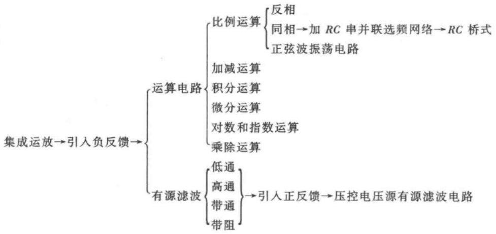

flowchart

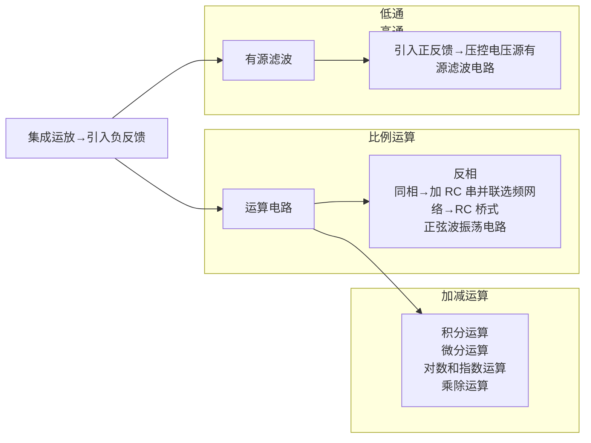

---

10.3 读图举例

489

$$
\begin{array}{l}\text {集成运放} \rightarrow \text {开环或仅引入正反馈} \rightarrow \text {电压比较器}\\\left\{\begin{array}{l}\text {单限}\\\text {滞回} \rightarrow \left\{\begin{array}{l}\text {加RC延迟环节} \rightarrow \text {矩形波发生电路}\\\text {加积分运算电路} \rightarrow \text {三角波、锯齿波发生电路、压控振荡电路}\end{array}\right.\\\text {窗口}\end{array}\right.\end{array}
$$

## 五、运算电路运算关系的求解方法

在运算电路中都引入了深度负反馈,可以认为集成运放的净输入电压为零(即虚短),净输入电流也为零(虚断)。以“虚短”和“虚断”为基础,利用节点电流法和叠加原理(适于多个输入信号的情况)即可求出输出与输入的运算关系式。

## 六、电压比较器电压传输特性的分析方法

根据电压比较器的限幅电路求出输出高电平和低电平,令集成运放同相输入端和反相输入端电位相等求出(输入电压)阈值电压,根据输入电压作用于集成运放的同相输入端和反相输入端来确定输出电压在输入电压过阈值电压时的跃变方向,即得到电压比较器的电压传输特性。

## 七、波形发生电路的判振方法

对于正弦波振荡,首先应观察电路是否存在正弦波振荡电路的基本组成部分,放大电路能否正常工作,进而利用瞬时极性法判断电路是否符合正弦波振荡的相位条件,然后看其是否有可能满足正弦波振荡的幅值条件。同时满足两个条件,电路才能产生振荡。

对于非正弦波振荡,首先观察电路是否有电压比较器和延时电路(RC电路或积分电路),然后假设比较器输出为某一状态(低电平或高电平),分析电路是否能稳定,若比较器的两个输出状态可以自动地相互转换,则说明电路能够产生非正弦波振荡,否则不振。

## 八、功率放大电路最大输出功率和转换效率的分析方法

首先求出最大不失真输出电压,即负载上可能获得的最大不失真电压,然后求出负载上可能获得的最大交流功率,即为最大输出功率。

输出最大输出功率时电源提供的平均电流与电源电压相乘,即得到电源的平均功率。

最大输出功率与此时电源提供的平均功率之比为转换效率。

## 九、直流电源的分析方法

包括整流电路、滤波电路、稳压管稳压电路、串联型稳压电路、三端稳压器应用电路、开关型稳压电路的分析方法，从而得出它们的主要参数。

## 10.3 读图举例

本节仅举几例分别说明分立元件电路和集成运放应用电路的分析方法,而且着重于定性分析,进一步的定量分析可借助于各种计算机辅助分析软件。

## 10.3.1 低频功率放大电路

图 10.3.1 所示为实用低频功率放大电路, 最大输出功率为 7 W。其中 A 的型号为 LF356N, T₁ 和 T₃ 的型号为 2SC1815, T₄ 的型号为 2SD525, T₂ 和 T₅ 的型号为 2SA1015, T₆ 的型号为 2SB595。T₄ 和 T₆ 需安装散热器。

---

490

第 10 章 模拟电子电路读图

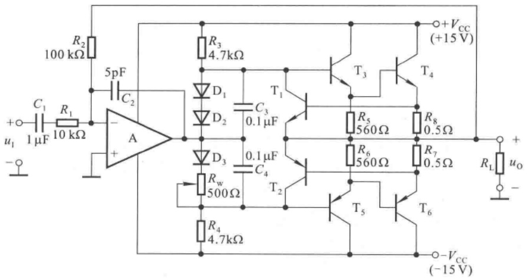

text_image

R2
100 kΩ
C1
1 μF
R1
10 kΩ
5pF
C2
-
A
+
-
u1
-
R3
4.7kΩ
D1
C3
0.1 μF
D2
D3
0.1 μF
C4
Rw
500 Ω
R4
4.7kΩ
T1
T2
T3
T4
+VCC
(+15 V)
R5
560 Ω
R8
0.5 Ω
R6
560 Ω
R7
0.5 Ω
RL
uo
-
T5
T6
-VCC
(-15 V)

图 10.3.1 低频功率放大电路

## 一、化整为零

对于分立元件电路,应根据信号的传递方向,分解电路。

$R_{2}$  将电路的输出端与 A 的反相输入端连接起来, 因而电路引入了反馈。由于图 10.3.1 所示电路为放大电路, 可以推测它引入的应为负反馈, 进一步的分析还需在弄清电路的基本组成之后。

$C_{1}$  为耦合电容。输入电压  $U_{i}$  作用于 A 的反相输入端，A 的输出又作用于  $T_{3}$  和  $T_{5}$  管的基极，故集成运放 A 为前置放大电路，且  $T_{3}$  和  $T_{5}$  为下一级的放大管； $T_{3}$  和  $T_{4}$ 、 $T_{5}$  和  $T_{6}$  分别组成复合管，前者等效为 NPN 型管，后者等效为 PNP 型管，A 的输出作用于两个复合管的基极，而且两个复合管的发射极作为输出端，故第二级为互补输出级；因此可以判断出电路是两级电路。

因为  $T_{1}$ 、 $T_{2}$  的基极和发射极分别接  $R_{7}$  和  $R_{8}$  的两端，而  $R_{7}$  和  $R_{8}$  上的电流等于输出电流  $I_{0}$ ；可以推测，当  $I_{0}$  增大到一定数值， $T_{1}$ 、 $T_{2}$  才导通，可以为功放管分流，所以  $T_{1}$ 、 $T_{2}$ 、 $R_{7}$  和  $R_{8}$  构成过流保护电路。

利用反馈的判断方法可以得出,图 10.3.1 所示电路引入的是电压并联负反馈。

## 二、分析功能

对于功率放大电路,通常均应分析其最大输出功率和效率。在图 10.3.1 所示电路中,由于电流采样电阻  $R_{7}$  和  $R_{8}$  的存在,负载上可能获得的最大输出电压幅值为

$$
U _ {\mathrm{omax}} = \frac {R _ {\mathrm{L}}}{R _ {8} + R _ {\mathrm{L}}} \cdot (V _ {\mathrm{CC}} - U _ {\mathrm{CES}}) \tag {10.3.1}
$$

式中 $U_{\mathrm{CES}}$ 为 $\mathrm{T_4}$ 管的饱和管压降。最大输出功率为

$$
P _ {\mathrm{om}} = \frac {\left(\frac {U _ {\mathrm{omax}}}{\sqrt {2}}\right) ^ {2}}{R _ {\mathrm{L}}} = \frac {U _ {\mathrm{omax}} ^ {2}}{2 R _ {\mathrm{L}}} \tag {10.3.2}
$$

在忽略静态损耗的情况下,效率为

$$
\eta = \frac {\pi}{4} \cdot \frac {U _ {\mathrm{omax}}}{V _ {\mathrm{CC}}} \tag {10.3.3}
$$

---

10.3 读图举例

491

可见电流采样电阻使得负载上的最大不失真输出电压减小,从而使最大输出功率减小,效率降低。

设功放管饱和管压降的数值为 3 V, 负载为 10 Ω, 则最大不失真输出电压幅值为

$$
U _ {\mathrm{omax}} = \frac {R _ {\mathrm{L}}}{R _ {\mathrm{g}} + R _ {\mathrm{L}}} \cdot (V _ {\mathrm{CC}} - U _ {\mathrm{CES}}) = \left[ \frac {1 0}{1 0 + 0 . 5} \times (1 5 - 3) \right] \mathrm{V} \approx 1 1. 4 3 \mathrm{V}
$$

最大输出功率为

$$
P _ {\mathrm{om}} = \frac {U _ {\mathrm{omax}} ^ {2}}{2 R _ {\mathrm{L}}} \approx \frac {1 1 . 4 3 ^ {2}}{2 \times 1 0} \mathrm{W} \approx 6. 5 3 \mathrm{W}
$$

效率

$$
\eta = \frac {\pi}{4} \cdot \frac {U _ {\mathrm{omax}}}{V _ {\mathrm{CC}}} \approx \frac {\pi}{4} \cdot \frac {1 1 . 4 3}{1 5} \approx 5 9.8\%
$$

一旦输出电流过流， $T_{1}$  和  $T_{2}$  管将导通，为功放管分流，保护电流的数值为

$$
i _ {\mathrm{omax}} = \frac {U _ {\mathrm{on}}}{R _ {7}} \approx \frac {0 . 7}{0 . 5} \mathrm{A} = 1. 4 \mathrm{A}
$$

## 三、统观整体

综上所述,图 10.3.1 所示电路的方框图如图 10.3.2(a) 所示。若仅研究反馈,则可将电路简化为图(b)所示电路。

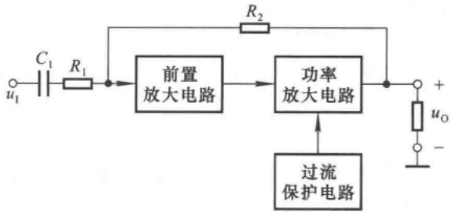

flowchart

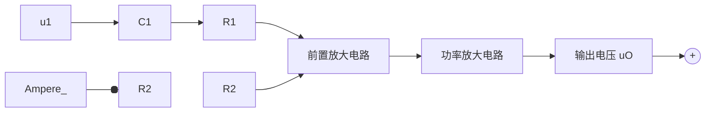

(a)

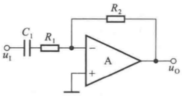

text_image

C₁
R₁
u₁
R₂
A
+
-
uₒ

(b)

图 10.3.2 图 10.3.1 所示电路的方框图和简化电路

(a) 方框图 (b) 简化电路

根据图(b)所示电路,可以求得深度负反馈条件下电路的电压放大倍数为

$$
A _ {u f} \approx - \frac {R _ {2}}{R _ {1}} = - 1 0
$$

从而获得在输出功率最大时所需要的输入电压有效值为

$$
U _ {\mathrm{i}} = \left| \frac {U _ {\mathrm{omax}}}{\sqrt {2} A _ {\mathrm{uf}}} \right| \tag {10.3.4}
$$

其它器件作用如下:

(1)  $C_{2}$  为相位补偿电容, 它改变了频率响应, 可以消除自激振荡。
(2) $R_{3}$ 、 $D_{1}$ 、 $D_{2}$ 、 $D_{3}$ 、 $R_{w}$ 和 $R_{4}$ 构成偏置电路，使输出级消除交越失真。
(3) $C_{3}$  和  $C_{4}$  为旁路电容, 使  $T_{3}$  和  $T_{5}$  的基极动态电位相等, 以减少有用信号的损失。
（4） $R_{5}$  和  $R_{6}$  为泄漏电阻，用以减小  $T_{4}$  和  $T_{6}$  的穿透电流。其值不可过小，否则将使有用信号损失过大。

---

492

第 10 章 模拟电子电路读图

## 10.3.2 火灾报警电路

图 10.3.3 所示为火灾报警电路， $u_{11}$  和  $u_{12}$  分别来源于两个温度传感器，它们安装在室内同一处。但是，一个安装在金属板上，产生  $u_{11}$ ；而另一个安装在塑料壳体内部，产生  $u_{12}$ 。

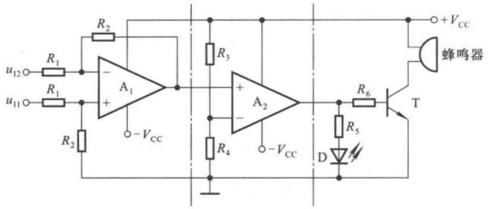

text_image

u12○─R1─┐
          │
          ──A1
          │
          └─VCC
          │
          └─R2
          │
          │
          │
          │
          │
          │
          │
          │
          │
          │
          │
          │
          │
          │
          │
          │
          │
          │
          │
          │
          │
          │
          │
          │
          │
          │
          │
          │
          │
          │
          │
          │
          │
          │

R2─┐
          │
          ──A1
          │
          └─VCC
          │
          │
          │
          │
          │
          │
          │
          │
          │
          │
          │
          │
          │
          │
          │
          │
          │
          │
          │
          │
          │
          │
          │
          │
          │
          │
          │
          │
          │
          │
          │
          │
          │

图 10.3.3 火灾报警电路

## 一、了解用途

在正常情况下，即无火情时，两个温度传感器所产生的电压相等， $u_{11}=u_{12}$ ，发光二极管不亮，蜂鸣器不响。有火情时，安装在金属板上的温度传感器因金属板导热快而温度升高较快，而安装在塑料壳体内的温度传感器温度上升得较慢，使 $u_{11}$ 与 $u_{12}$ 产生差值电压。差值电压增大到一定数值时，发光二极管发光、蜂鸣器鸣叫，同时报警。

## 二、化整为零

分析由单个集成运放所组成应用电路的功能时,可根据其有无引入反馈以及反馈的极性,来判断集成运放的工作状态和电路输出与输入的关系。

根据信号的流通,图 10.3.3 所示电路可分为三部分。 $A_{1}$  引入了负反馈,故构成运算电路; $A_{2}$  没有引入反馈,工作在开环状态,故组成电压比较器;后面分立元件电路是声光报警及其驱动电路。

## 三、分析功能

输入级参数具有对称性,是双端输入的比例运算电路,也可实现差分放大,输出电压 $u_{01}$ 为

$$
u _ {\mathrm{01}} = \frac {R _ {2}}{R _ {1}} (u _ {\mathrm{11}} - u _ {\mathrm{12}}) \tag {10.3.5}
$$

第二级电路的阈值电压  $U_{T}$  为

$$
U _ {\mathrm{T}} = \frac {R _ {4}}{R _ {3} + R _ {4}} \cdot V _ {\mathrm{cc}} \tag {10.3.6}
$$

当  $u_{01} < U_{T}$  时， $u_{02} = U_{OL}$ ; 当  $u_{01} > U_{T}$  时， $u_{02} = U_{OH}$ ; 电路只有一个阈值电压，故为单限比较器。 $u_{02}$  的高、低电平决定于集成运放输出电压的最小值和最大值。电压传输特性如图 10.3.4 所示。

当  $u_{02}$  为高电平时, 发光二极管因导通而发光, 与此同时晶体

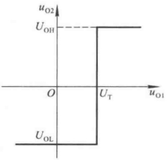

line

| uO1 | uO2 |
| --- | --- |
| 0 | UOL |
| UT | UOL |
| UT | UOH |
| >UT | UOH |

图 10.3.4  $A_{2}$  组成的电压比较器的电压传输特性

---

10.3 读图举例

493

管 T 导通,蜂鸣器鸣叫。发光二极管的电流为

$$
I _ {\mathrm{D}} = \frac {U _ {\mathrm{OH}} - U _ {\mathrm{D}}}{R _ {5}} \tag {10.3.7}
$$

晶体管的基极电流为

$$
I _ {\mathrm{B}} = \frac {U _ {\mathrm{OH}} - U _ {\mathrm{BE}}}{R _ {6}} \tag {10.3.8}
$$

集电极电流,即蜂鸣器的电流为

$$
I _ {\mathrm{C}} = \beta I _ {\mathrm{B}} \tag {10.3.9}
$$

若参数选择的结果是晶体管在导通时处于饱和状态,则

$$
I _ {\mathrm{C}} = \frac {V _ {\mathrm{CC}} - U _ {\mathrm{CES}}}{R _ {\mathrm{L}}} \leqslant \beta I _ {\mathrm{B}} \tag {10.3.10}
$$

式中  $U_{CES}$  为管子的饱和管压降,  $R_{L}$  是蜂鸣器等效电阻。

## 四、统观整体

根据上述分析,图 10.3.4 所示电路的方框图如图 10.3.5 所示。

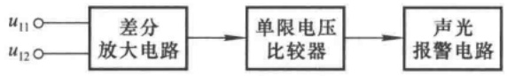

flowchart

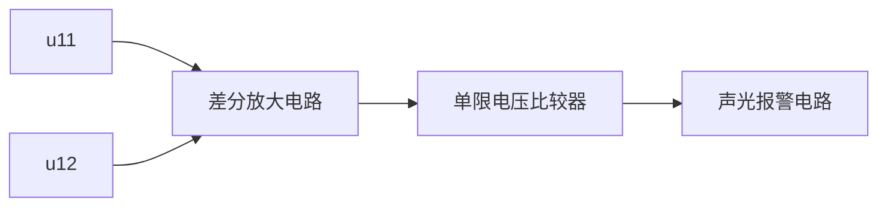

图 10.3.5 火灾报警电路的方块图

在没有火情时， $(u_{11}-u_{12})$  数值很小， $u_{01}<U_{T},u_{02}=U_{0L}$ ，发光二极管和晶体管均截止。

当有火情时， $u_{11} > u_{12}$ ， $(u_{11} - u_{12})$ 增大到一定程度， $u_{01} > U_{T}$ ， $u_{02}$ 从低电平跃变为高电平， $u_{02} = U_{OH}$ ，使得发光二极管和晶体管导通，发光二极管和蜂鸣器发出警告。

## 10.3.3 自动增益控制电路

自动增益控制电路如图 10.3.6 所示,为了便于读懂,这里作了适当的简化。

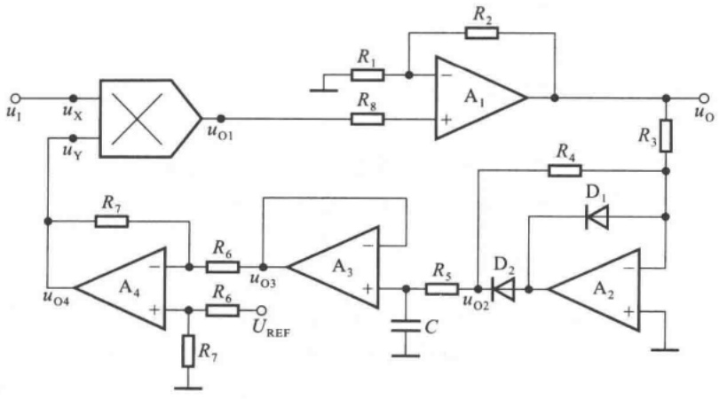

text_image

u1
ux
UY
R7
uO4
A4
+
-
R6
uO3
R6
R7
UREF
R1
R8
R2
A1
+
-
A3
-
+
C
R5
uO2
D2
R4
D1
R3
uO
A2
+
-

图 10.3.6 自动增益控制电路

---

494

第 10 章 模拟电子电路读图

## 一、了解功能

图 10.3.6 所示电路用于自动控制系统之中。输入电压为正弦波，当其幅值由于某种原因产生变化时，增益产生相应变化，使得输出电压幅值基本不变。

## 二、化整为零

以模拟集成电路为核心器件分解图10.3.6所示电路，可以看出，每一部分都是一种基本电路。第一部分是模拟乘法器。第二部分是由 $\mathrm{A}_1, R_1, R_2$ 和 $R_8$ 构成的同相比例运算电路，其输出为整个电路的输出。第三部分是由 $\mathrm{A}_2, R_3, R_4, \mathrm{D}_1$ 和 $\mathrm{D}_2$ 构成的精密整流电路。第四部分是由 $\mathrm{A}_3, R_5$ 和 $C$ 构成的有源滤波电路。第五部分是由 $\mathrm{A}_4, R_6$ 和 $R_7$ 构成的差分放大电路。$\mathrm{A}_4$ 的输出电压 $u_{04}$ 作为模拟乘法器的输入，与输入电压 $u_1$ 相乘，因此电路引入了反馈，是一个闭环系统。

## 三、功能分析

根据所学知识可知,模拟乘法器的输出电压

$$
u _ {0 1} = k u _ {\mathrm{X}} u _ {\mathrm{Y}} = k u _ {1} u _ {0 4} \tag {10.3.11}
$$

同相比例运算电路的输出电压 $u_{0}$ 为

$$
u _ {0} = \left(1 + \frac {R _ {2}}{R _ {1}}\right) u _ {0 1} \tag {10.3.12}
$$

设 $R_{3} = R_{4}$ ，则精密整流电路的输出电压 $u_{02}$ 为

$$
u _ {0 2} = \left\{ \begin{array}{l l} 0 & u _ {0} > 0 \\ - u _ {0} & u _ {0} <   0 \end{array} \right. \tag {10.3.13}
$$

因此为半波整流电路。

有源滤波电路的电压放大倍数为

$$
A _ {u} = \frac {U _ {0 3}}{U _ {0 2}} = \frac {1}{1 + \mathrm{j} \frac {f}{f _ {\mathrm{H}}}} \quad \left(f = \frac {1}{2 \pi R _ {5} C}\right) \tag {10.3.14}
$$

可见电路为低通滤波电路。当参数选择合理时，可使输出电压 $u_{03}$ 为直流电压 $U_{03}$，且 $U_{03}$ 正比于输出电压 $u_{0}$ 的幅值。

在差分放大电路中,输出电压  $u_{04}$  为

$$
u _ {0 4} = \frac {R _ {7}}{R _ {6}} (U _ {\mathrm{REF}} - U _ {0 3}) = A _ {u 4} (U _ {\mathrm{REF}} - U _ {0 3}) \tag {10.3.15}
$$

因而 $u_{04}$ 正比于基准电压 $U_{\mathrm{REF}}$ 与 $U_{03}$ 的差值。

## 四、统观整体

根据上述分析,可以得到各部分电路的关系,图 10.3.6 所示电路的方框图如图 10.3.7 所示。

根据式(10.3.11)、(10.3.12)、(10.3.15)，输出电压的表达式为

$$
u _ {0} = k u _ {1} u _ {0 4} = k \left(1 + \frac {R _ {2}}{R _ {1}}\right) \frac {R _ {7}}{R _ {6}} (U _ {\mathrm{REF}} - U _ {0 3}) u _ {1} \tag {10.3.16}
$$

设输入电压 $u_{1}$ 幅值增大，则输出电压 $u_{0}$ 的幅值随之增大，$U_{03}(U_{03}$ 正比于输出电压 $u_{0}$ )必然增大，导致 $(U_{\mathrm{REF}} - U_{03})$ 减小，从而使 $u_{0}$ 幅值减小；若 $u_{1}$ 幅值减小，则各部分的变化与上述过程相反。在参数选择合适的条件下，在一定的频率范围内，通过电路增益的自动调节，对于不同幅值的正弦波 $u_{1}, u_{0}$ 的幅值可基本不变。

---

10.3 读图举例

495

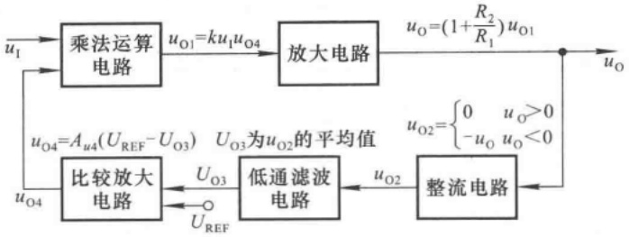

flowchart

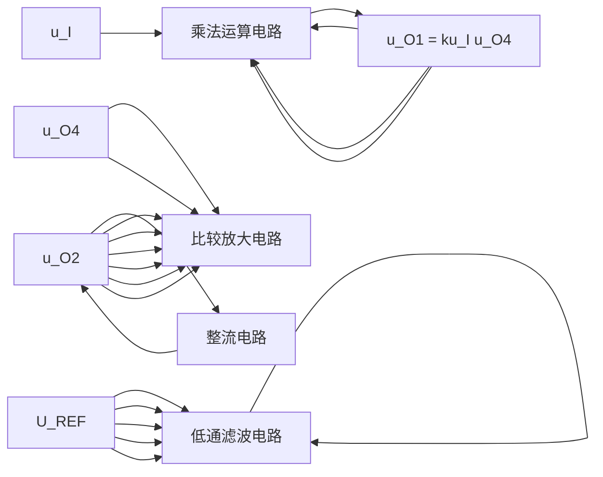

图 10.3.7 图 10.3.6 所示电路的方框图

## 10.3.4 电容测量电路

DT890C$_{+}$型 3 $\frac{1}{2}$位多功能数字多用表包括 12 个组成部分,有 A/D 转换器、小数点及标志符驱动电路、直流电压测量电路、交流电压测量电路、直流电流测量电路、交流电流测量电路、200 Ω \~ 20 MΩ电阻测量电路、200 MΩ 电阻测量电路、电容测量电路、温度测量电路、晶体管 h$_{FE}$ 测量电路、二极管及蜂鸣器电路等。电路中共用 6 片集成电路,分别是一片 3 $\frac{1}{2}$A/D 转换器(型号为 TSC7106)、一片 CMOS 四与非门(型号为 CC4011)、两片低失调 JEFT 双运放(型号为 TL062)和两片低功耗通用双运放(型号为 LM358)。

图 10.3.8 所示为五量程电容测量电路, 其输出电压通过 AC/DC(交流/直流)转换器和 A/D (模拟/数字)转换器, 驱动液晶显示器, 即获得测量值, 方框图如图 10.3.9 所示。其中 AC/DC 转换器、A/D 转换器和液晶显示器是 DT890C $_{+}$ 型数字多用表中的公用电路。下面仅对图 10.3.8 所示电路加以分析。

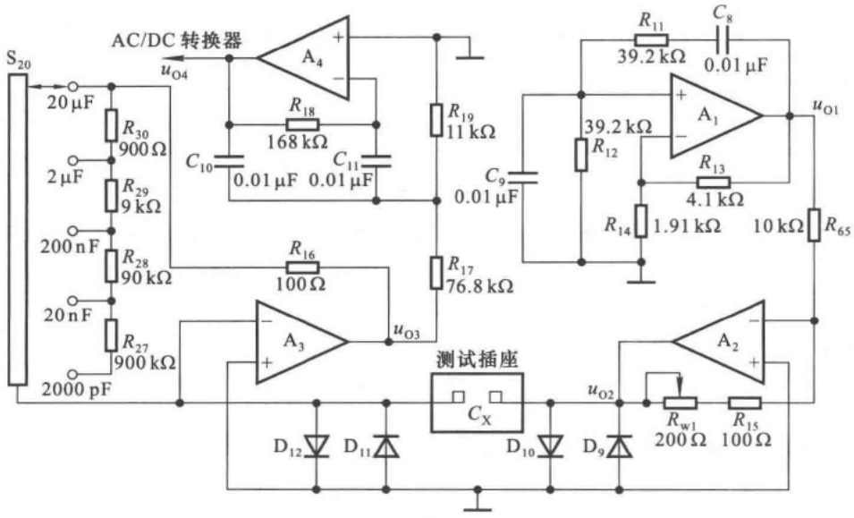

text_image

AC/DC 转换器
S20
20 μF
R30
900 Ω
2 μF
R29
9 kΩ
200 nF
R28
90 kΩ
20 nF
R27
900 kΩ
2000 pF
uO4
A4
+
-
R18
168 kΩ
C10
0.01 μF 0.01 μF
C11
R19
11 kΩ
C9
0.01 μF
R16
100 Ω
R17
76.8 kΩ
uO3
A3
+
-
测试插座
CX
D12
D11
D10
D9
uO2
Rw1
200 Ω
R15
100 Ω
R11
39.2 kΩ
C8
0.01 μF
A1
+
-
R12
39.2 kΩ
R13
4.1 kΩ
R14
1.91 kΩ
10 kΩ
R65
uO1

图 10.3.8 五量程电容测量电路

---

496

第 10 章 模拟电子电路读图

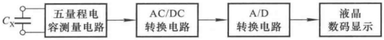

flowchart

图 10.3.9 电容测量电路及其输出电压转换电路方框图

## 一、了解功能

在 DT890C$_{4}$型多功能数字多用表中，是利用容抗法测量电容量的。其基本设计思想是:将 400 Hz 的正弦波信号作用于被测电容 $C_{x}$，利用所产生的容抗 $X_{c}$ 实现 C/ACV 转换，将 $X_{c}$ 转换为交流电压；再通过测量交流电压来获得 $C_{x}$ 的电容量。

测量范围分为 2 nF、20 nF、200 nF、2 μF 和 20 μF 五挡，测量准确度为 ±2.5%。分辨率取决于 A/D 转换器的位数，当采用 TSC7106 时，最高分辨率为 1 pF。

图 10.3.8 所示电路中  $A_{1}$  和  $A_{2}$  是一片 TL062,  $A_{3}$  和  $A_{4}$  是一片 LM358。

## 二、化整为零

观察图10.3.8所示电路，以集成运放为核心器件可将其分解为四个部分。 $\mathrm{A}_{1}$ 和 $C_8, C_9, R_{11}, R_{12}, R_{13}, R_{14}$ 组成文氏桥振荡电路； $\mathrm{A}_{2}$ 和 $R_{65}, R_{15}, R_{\mathrm{w1}}$ 组成反相比例运算电路； $\mathrm{A}_{2}$ 的输出电压在被测电容 $C_{\mathrm{x}}$ 上产生电流，通过 $\mathrm{A}_{3}$ 及其有关元件组成的电路将电容量转换成交流电压，故组成C/ACV电路； $\mathrm{A}_{4}$ 和 $R_{17}, R_{18}, R_{19}, C_{10}, C_{11}$ 组成有源滤波电路，根据整个电路的功能，该滤波电路应只允许$400\mathrm{Hz}$ 正弦波信号通过，而滤掉其它频率的干扰，故为带通滤波电路。

## 三、功能分析

## 1. 文氏桥振荡电路

振荡频率的表达式为

$$
f _ {0} = \frac {1}{2 \pi \sqrt {R _ {1 1} R _ {1 2} C _ {8} C _ {9}}} \tag {10.3.17}
$$

因为  $R_{11}=R_{12}=39.2\ k\Omega, C_{8}=C_{9}=0.01\ \mu F$ ，所以

$$
f _ {0} = \frac {1}{2 \pi R _ {1 1} C _ {8}} = \left(\frac {1}{2 \pi \times 3 9 . 2 \times 1 0 ^ {3} \times 0 . 0 1 \times 1 0 ^ {- 6}}\right) \mathrm{Hz} \approx 4 0 0 \mathrm{Hz}
$$

## 2. 反相比例运算电路

比例系数为

$$
A _ {u} = - \frac {R _ {1 5} + R _ {\mathrm{w1}}}{R _ {6 5}} \tag {10.3.18}
$$

式中  $R_{w1}$  为电容挡的校准电位器，调节  $R_{w1}$  可以改变比例系数。该电路还起缓冲作用，隔离振荡电路和被测电容。

## 3. C/ACV 转换电路

电路的输入电抗为被测电容的容抗,即

$$
X _ {C _ {\mathrm{X}}} = \frac {1}{\mathrm{j} \omega C _ {\mathrm{X}}} = \frac {1}{\mathrm{j} 2 \pi f C _ {\mathrm{X}}} \tag {10.3.19}
$$

当电容量程不同时,电路的反馈电阻  $R_{f}$  将不同(如表 10.3.1 所示),转换关系也将不同。

转换系数为

$$
\dot {A} _ {u 3} = \frac {\dot {U} _ {\mathrm{o3}}}{\dot {U} _ {\mathrm{o2}}} = - \frac {R _ {\mathrm{f}}}{X _ {C _ {\mathrm{x}}}} = - \frac {R _ {\mathrm{f}}}{1 / (2 \pi \mathrm{j} f C _ {\mathrm{x}})} = - 2 \pi \mathrm{j} f R _ {\mathrm{f}} C _ {\mathrm{x}}
$$

---

10.3 读图举例

497

表 10.3.1 不同量程时 C/ACV 转换电路的反馈电阻  $R_{f}$

| 电容量程 | $R_{\mathrm {f}}$的表达式 | $R_{\mathrm {f}}$的数值 |
| --- | --- | --- |
| 20 μF | $R_{16}$ | 100 Ω |
| 2 μF | $R_{16} + R_{30}$ | 1 kΩ |
| 200 nF | $R_{16} + R_{30} + R_{29}$ | 10 kΩ |
| 20 nF | $R_{16} + R_{30} + R_{29} + R_{28}$ | 100 kΩ |
| 2000 pF | $R_{16} + R_{30} + R_{29} + R_{28} + R_{27}$ | 1 MΩ |

其模为  $\left|\dot{A}_{u3}\right|=2\pi f R_{f} C_{x}$  (10.3.20)

式中 $f = 400\mathrm{Hz}$ ，若在 $200\mathrm{nF}$ 挡，从表10.3.1中可知 $R_{\mathrm{F}} = 10\mathrm{k}\Omega$ ，则

$$
\mid \dot {A} _ {u 3} \mid = 2 \pi f R _ {\mathrm{f}} C _ {\mathrm{X}} = 2 \pi \times 4 0 0 \times 1 0 \times 1 0 ^ {3} C _ {\mathrm{X}} = 8 \pi \times 1 0 ^ {6} \times C _ {\mathrm{X}}
$$

其最大值为

$$
\left| \dot {A} _ {u 3} \right| _ {\max} = 8 \pi \times 1 0 ^ {6} \times C _ {\mathrm{X}} = 8 \pi \times 1 0 ^ {6} \times 2 0 0 \times 1 0 ^ {- 9} \approx 5. 0 3
$$

从表 10.3.1 中可以看出,电容量每增大 10 倍,反馈电阻阻值减小 10 倍。因此,不难发现,在各电容挡,电路的转换系数的最大数值均相等。这样,可以保证对于各电容挡输出电压最大幅值均相等,也就限制了 A/D 转换电路的最大输入电压。

输出电压有效值为

$$
U _ {\mathrm{o3}} = \mid \dot {A} _ {u 3} \mid U _ {\mathrm{o2}} = 2 \pi f R _ {\mathrm{f}} C _ {\mathrm{X}} U _ {\mathrm{o2}} \tag {10.3.21}
$$

当 400 Hz 正弦波信号  $U_{o2}$  幅值一定时，电容挡确定， $R_{f}$  也就随之确定，因而  $U_{o3}$  与被测电容容量  $C_{X}$  成正比。

## 4. 有源滤波电路

从测量的需要出发,该电路应为带通滤波电路。为了便于识别电路,首先将电路变为习惯画法,如图10.3.10所示,这是一个多路反馈无限增益电路。

经推导可得中心频率为

$$
f _ {0} = \frac {1}{2 \pi C _ {1 0}} \sqrt {\frac {1}{R _ {1 8}} \left(\frac {1}{R _ {1 7}} + \frac {1}{R _ {1 9}}\right)} \tag {10.3.22}
$$

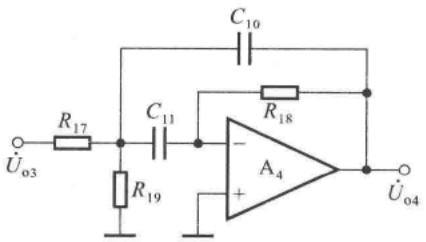

text_image

C₁₀
R₁₇
C₁₁
R₁₈
Uₒ₃
A₄
+
R₁₉
Uₒ₄

图 10.3.10 多路反馈无限增益带通滤波电路

将  $C_{10}=0.01\mu F, R_{18}=168k\Omega, R_{17}=76.8k\Omega, R_{19}=11k\Omega$  代入上式，得出  $f_{0}\approx400Hz$ 。因此，有源滤波电路只允许  $u_{03}$  中 400 Hz 信号通过，而滤去其它频率的干扰。

可见，输出电压  $u_{04}$  是幅值与被测电容  $C_{x}$  容量成正比关系的 400 Hz 交流电压。

## 四、统观整体

根据上述四部分的关系,可得图 10.3.8 所示电路的方框图如图 10.3.11 所示。

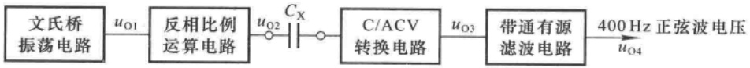

flowchart

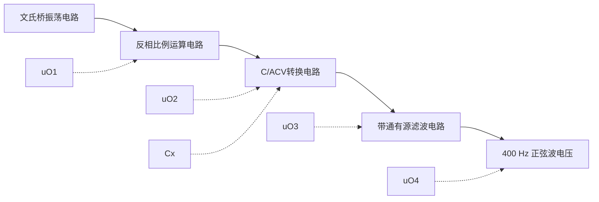

图 10.3.11 图 10.3.8 所示电路的方框图

---

498

第 10 章 模拟电子电路读图

综上所述，在测量电容量时，文氏桥振荡电路产生400 Hz正弦波电压，经过反相比例运算电路作为缓冲电路，作用于被测电容 $C_{x}$ ；通过C/ACV转换电路将 $C_{x}$ 转换为交流电压信号，再经二阶带通滤波电路滤掉其它频率的干扰，输出是幅值与 $C_{x}$ 成正比的400 Hz正弦波电压。

电容测量电路的输出电压作为 AC/DC 转换电路的输入信号,转换为直流电压;再由 A/D 转换电路转换成数字信号,并驱动液晶显示器,显示出被测电容的容量值。

电路有如下特点:

（1）在 C/ACV 转换电路中，电容挡愈大，反馈电阻阻值愈小，使得各挡转换系数的最大数值均相等，从而限制了整个电路的最大输出电压幅值，也就限制了 A/D 转换电路的最大输入电压，其值为 200 mV。
（2）电路中所有集成运放的输入均为交流信号，因而其温漂不会影响电路的测量精度，也就不需要对电容挡手动调零。电路中仅有一个电位器 $R_{w1}$ 用于校准电容挡，一般一经调好就不再变动。
（3）二极管  $D_{9}$  和  $D_{10}$  用于  $A_{2}$  输出电压的限幅，二极管  $D_{11}$  和  $D_{12}$  用于限制  $A_{3}$  净输入电压幅值，以保护运放。此外，尽管电容挡不允许带电测量，但是若发生误操作，则二极管可为被测电容提供放电回路，从而在一定程度上保护了测量电路。

## 本章小结

本章回顾了书中所讲述的基本电路和基本分析方法,介绍了电子电路读图的一般方法,并通过实例具体说明了分析步骤。

模拟电子电路种类繁多,千差万别,能够读懂实用电路,必须综合运用所学知识。本章介绍的“了解用途、化整为零、分析功能、统观整体、性能估算”的基本读图方法和步骤适用于一般电路。通过读图,能够训练电路的识别能力、电路性能的评估能力和电子系统的集成能力。

在读图时还应注意:

(1) 本章所介绍的读图方法是一般方法, 使用时应视具体电路灵活应用。
（2）了解所读电路的用途，以及根据“用途”研究对电路性能的要求，对于读图有指导意义。特别是读者不太熟悉的应用领域，“了解用途”是关键步骤，否则将无从下手。
（3）“化整为零”时应以“能够识别”为原则，因而掌握基本电路的组成、原理和性能是读图的基础，同时还要不断丰富基本知识，拓宽知识面。
(4) 在很多实用电路中, 电路的画法、元器件的符号与本书的习惯相差很大, 因此, 为了方便读图, 读者可首先将图中符号和电路画法改成习惯的形式。
（5）随着电子技术的发展，集成电路的功能越来越强，因而实用电路中所用芯片的数量也就越来越少，有的还采用了专用芯片。所以，在分析电路性能时，需要查阅有关手册和生产厂家的网上资料，了解所用元器件的基本功能和性能指标。
(6) 对于所读电路详细的定量分析应尽可能借助于电子电路计算机辅助分析软件。

应当指出,读图是工程技术人员的基本技能,单凭本章所介绍的知识,对读图能力的训练是非常有限的。只有不断跟踪电子器件的新发展,增加电子技术的基本知识,加强训练,积累经验,才能不断提高读图水平。

---

习题

499

## 习题

10.1 电路如图 P10.1 所示, 其功能是实现模拟计算, 求解微分方程。

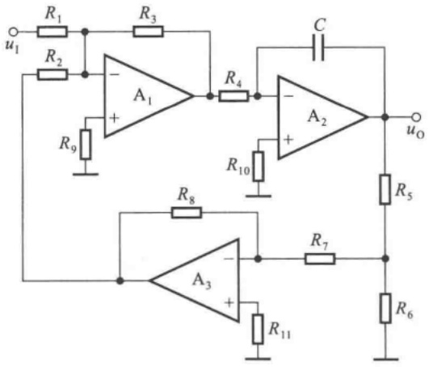

text_image

R1
R2
u1
R3
A1
+
-
R4
C
A2
+
-
uO
R9
R10
R8
A3
+
-
R7
R5
R6
R11

图 P10.1

(1) 求出微分方程；
(2) 简述电路原理。

10.2 图 P10.2 所示为反馈式稳幅电路, 其功能是: 当输入电压变化时, 输出电压基本不变。主要技术指标为

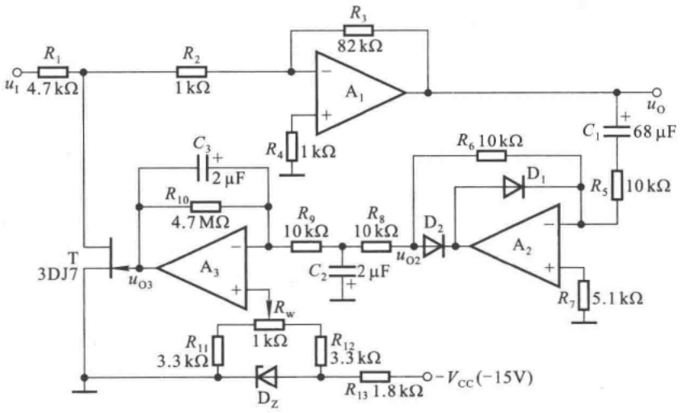

text_image

R1
4.7 kΩ
R2
1 kΩ
R3
82 kΩ
A1
+
-
R4
1 kΩ
C3
+
2 μF
R10
4.7 MΩ
R9
10 kΩ
R8
10 kΩ
C2
+
2 μF
uO2
D2
R6 10 kΩ
D1
C1
+
68 μF
R5
10 kΩ
uO
T
3DJ7
uO3
A3
+
-
Rw
1 kΩ
R11
3.3 kΩ
R12
3.3 kΩ
Dz
R13 1.8 kΩ
- VCC (-15V)
R7 5.1 kΩ

图P10.2

(1) 输入电压波动 20% 时, 输出电压波动小于 0.1%;
(2) 输入信号频率从 50\~2 000 Hz 变化时, 输出电压波动小于 0.1%;
(3) 负载电阻从  $10 \, k\Omega$  变为  $5 \, k\Omega$  时, 输出电压波动小于 0.1%。

要求:

(1) 以每个集成运放为核心器件,说明各部分电路的功能;

---

500

第 10 章 模拟电子电路读图

(2) 用方框图表明各部分电路之间的相互关系；
(3) 简述电路的工作原理。

提示:场效应管工作在可变电阻区,电路通过集成运放  $A_{3}$  的输出控制场效应管的工作电流,来达到调整输出电压的目的。

10.3 在图 P10.2 所示电路中, 参数如图中所标注。设场效应管 D-S 之间的等效电阻为  $r_{DS}$ 。

(1) 求出输出电压  $u_{0}$  与输入电压  $u_{1}, r_{DS}$  的运算关系式；说明当  $u_{1}$  增大时， $r_{DS}$  应如何变化才能使  $u_{0}$  稳幅？
(2) 当  $u_{1}$  为 1 kHz 的正弦波时, 定性画出  $u_{0}$  和  $u_{02}$  的波形。
（3） $u_{03}$ 是直流信号，还是交流信号，为什么？为使 $u_{0}$ 稳幅，当 $u_{1}$ 因某种原因增大时， $u_{03}$ 的幅值应当增大，还是减小，为什么？
(4) 电位器  $R_{w}$  的作用是什么?

10.4 在图 P10.2 所示电路中, 设场效应管 D-S 之间的等效电阻为  $r_{DS}$ 。为了使得输入电压  $u_{t}$  波动 20% 时, 输出电压  $u_{0}$  波动小于 0.1%,  $r_{DS}$  应变化百分之多少?

10.5 五量程电容测量电路如图 P10.5 所示, $C_{x}$ 为被测电容, 输出电压 $u_{0}$ 是一定频率的正弦波, $u_{0}$ 经 AC/DC 转换和 A/D 转换, 送入数字显示器, 即可得到测量结果。

(1) 以每个集成运放为核心器件,说明各部分电路的功能;
(2) 用方框图表明各部分电路之间的相互关系；
(3) 简述电路的工作原理。

10.6 电路如图 P10.5 所示, 试求解:

(1)  $u_{01}$  的频率；
(2) $u_{02}$ 与 $u_{01}$ 的运算关系式；
(3) 在五个量程中, $u_{03}$ 与 $u_{02}$ 的各运算关系式;
(4) $A_{4}$ 及其有关元件所组成的电路的中心频率为多少?

10.7 电路如图 P10.5 所示。回答下列问题:

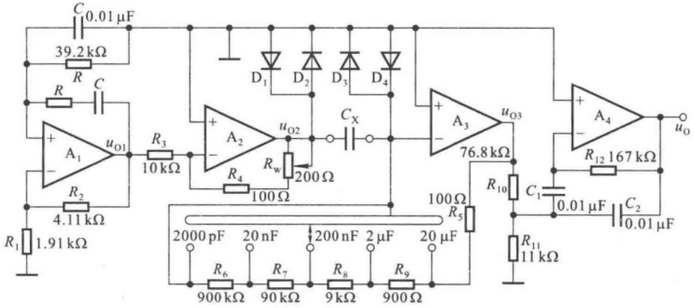

text_image

C 0.01 μF
39.2 kΩ
R C
R
+
A1 uO1
R2 4.11 kΩ
R1 1.91 kΩ
R3 10 kΩ
D1 D2 D3 D4
+
A2 uO2
Rw 200 Ω
R4 100 Ω
Cx
+
A3 uO3
76.8 kΩ
R5 100 Ω
R6 900 kΩ R7 90 kΩ R8 9 kΩ R9 900 Ω
2000 pF 20 nF 200 nF 2 μF 20 μF
R10 C1 0.01 μF C2 0.01 μF
R11 11 kΩ
A4 uO
R12 167 kΩ

图 P10.5

（1）在不同量程下， $u_{03}$ 与 $u_{02}$ 转换系数的最大值为多少？为什么这样设计？简述理由。
(2) 为什么  $u_{01}$  的频率和由  $A_{4}$  及其有关元件所组成的电路的中心频率相同？简述理由。
(3) 二极管  $D_{1} \sim D_{4}$  的作用是什么?

10.8 直流稳压电源如图 P10.8 所示。

(1) 用方框图描述电路各部分的功能及相互之间的关系；

---

习题

501

（2）已知 W117 的输出端和调整端之间的电压为 1.25 V, 3 端电流可忽略不计, 求解输出电压  $U_{01}$  和  $U_{02}$  的调节范围, 并说明为什么称该电源为“跟踪电源”?

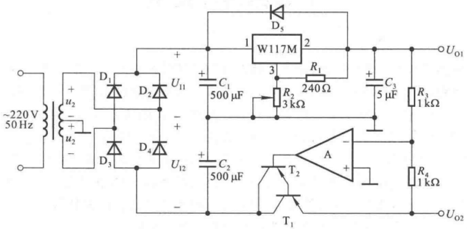

text_image

~220 V
50 Hz
+
u2
-
+
u2
-
D1
D2
D3
D4
U11
U12
+
C1
500 μF
+
C2
500 μF
-
+
W117M
1
2
3
R1
240 Ω
R2
3 kΩ
C3
5 μF
R3
1 kΩ
A
-
T2
T1
R4
1 kΩ
UO1
UO2

图 P10.8

10.9 电路如图 P10.8 所示。已知 W117 的输出端和调整端之间的电压为 1.25 V, 3 端电流可忽略不计，输出电流的最小值为 5 mA; 1 和 2 端之间电压大于 3 V 才能正常工作，小于 40 V 才不至于损坏；晶体管 T₁ 饱和管压降的数值为 3 V；电网电压波动范围为 ±10%。

(1) 求解输出电压  $U_{01}$  和  $U_{02}$  的调节范围；
(2) 为使电路正常工作, 在电网电压为  $220 \, V$  时,  $U_{1}$  的取值范围为多少?
(3) 若在电网电压为 220 V 时,  $U_{1}=32V$ , 则变压器二次电压有效值  $U_{2}$  约为多少伏?

10.10 电路如图 P10.8 所示。回答下列问题:

(1) 电路中各电容的作用；
(2) 二极管  $D_{5}$  的作用；
(3) 调整管为什么采用复合管。
