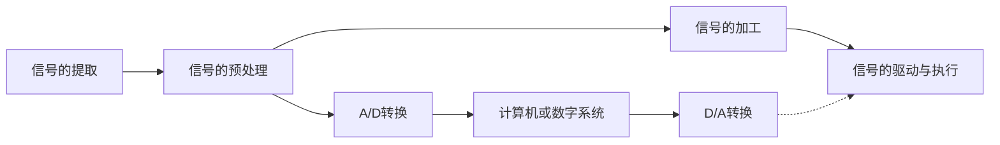

# 模拟电子技术基础

(第五版)

清华大学电子学教研组 编

原主编 童诗白 华成英

修订者 华成英 叶朝辉

# 模拟电子技术基础

# MONI DIANZI JISHU JICHU

(第五版)

清华大学电子学教研组 编

原主编 童诗白 华成英

修订者 华成英 叶朝辉

## 内容简介

本书是普通高等教育“十二五”国家级规划教材，是总结首届国家级精品课程——清华大学“电子技术基础”的十年教学实践和资源共享课的建设工作，在第四版的基础上修订而成的。

主要内容包括:导言、常用半导体器件、基本放大电路、集成运算放大电路、放大电路的频率响应、放大电路中的反馈、信号的运算和处理、波形的发生和信号的转换、功率放大电路、直流电源和模拟电子电路读图等十一章。

全书以导言开篇，以读图结尾；每章以本章讨论的问题开始，以小结结束；基本知识内容系统、精炼、深入。作者力图使读者站在电子系统的高度认识电路，以便学以致用；从设计的角度讲述部分电路，以便学习科学的思维方法；从结构特点阐明基本电路，以便掌握其精髓和“根本”；从具体电子电路应用的局限性获得重构电路的思路，以便学会自己发现问题、研究问题和解决问题；例题、思考题、自测题、习题层次分明，具有基础性、启发性、灵活性和实践性，特别增加了故障诊断和具有设计性质的问题，以提高综合应用基本知识的能力及理论指导实践的能力。纵观各章 Multisim 部分，基本涵盖了 EDA 在模拟电子电路中的主要应用，系统且具有示范性。书中减少了分立元件电路，突出集成电路，使双极型、单极型和混合型集成运放的特点及应用更突出；扩展内容和涉及集成器件内部电路的部分相对独立，利于取舍。

本书适于作为高等院校电气类、自动化类、电子类等专业和部分非电类专业与模拟电子技术相关课程的教材，也可作为工程技术人员的参考书。

## 图书在版编目（CIP）数据

模拟电子技术基础/童诗白，华成英主编；清华大学电子学教研组编.-5版.-北京:高等教育出版社，2015.7

ISBN 978-7-04-042505-5

I. ①模… II. ①童…②华…③清… III. ①模拟电路-电子技术-高等学校-教材 IV. ①TN710

中国版本图书馆 CIP 数据核字（2015）第 074846 号

| 策划编辑 | 欧阳舟 | 责任编辑 | 欧阳舟 | 封面设计 | 李卫青 | 版式设计 | 童丹 |
| --- | --- | --- | --- | --- | --- | --- | --- |
| 插图绘制 | 杜晓丹 | 责任校对 | 陈杨 | 责任印制 | 田甜 |  |  |

| 出版发行 | 高等教育出版社 | 网 址 | http://www.hep.edu.cn |
| --- | --- | --- | --- |
| 社 址 | 北京市西城区德外大街4号 |  | http://www.hep.com.cn |
| 邮政编码 | 100120 | 网上订购 | http://www.landraco.com |
| 印 刷 | 固安县铭成印刷有限公司 |  | http://www.landraco.com.cn |
| 开 本 | 787mm×1092mm 1/16 |  |  |
| 印 张 | 34.75 | 版 次 | 1980年9月第1版 |
| 字 数 | 840千字 |  | 2015年7月第5版 |
| 购书热线 | 010-58581118 | 印 次 | 2015年7月第1次印刷 |
| 咨询电话 | 400-810-0598 | 定 价 | 56.00元 |

## 作者声明

未经本书作者和高等教育出版社书面许可，任何单位和个人均不得以任何形式将《模拟电子技术基础》（第五版）中的习题解答后出版，不得翻印或在出版物中选编、摘录本书的内容；否则，将依照《中华人民共和国著作权法》追究法律责任。

## 第五版序

《模拟电子技术基础》第五版是普通高等教育“十二五”国家级规划教材，是总结首届国家级精品课程——清华大学“电子技术基础”的十年教学实践和资源共享课的建设工作，在第四版的基础上修订而成的。适于作为高等院校电气类、自动化类、电子类等专业和部分非电类专业模拟电子技术基础课程的教材，也可作为工程技术人员的参考书。

主要内容包括:导言、常用半导体器件、基本放大电路、集成运算放大电路、放大电路的频率响应、放大电路中的反馈、信号的运算和处理、波形的发生和信号的转换、功率放大电路、直流电源和模拟电子电路读图等十一章。

## 一、修订原则

本次修订以“保证基础，体现先进，联系实际，引导创新，分清层次，利于教学”为基本原则，紧扣教学基本要求，“立足基础，面向发展”。

与第四版相比，保持了原内容体系和体例结构基本不变、“基础与发展”“基本知识与扩张知识”兼顾的内容编排方式不变、“深入、透彻”的叙述风格不变、突出教材的基础性、科学性、先进性、实用性和适用性的基本特点不变。同时，加强了电路产生背景、电路结构构思过程、场效应管电路的主要应用以及模拟电子电路的故障诊断、电路设计、EDA技术应用等方面的内容。

全书以导言开篇，以读图结尾，力图使读者站在电子系统的高度认识电路，以便学以致用；从设计的角度讲述部分电路，再现“器件、电路、方法的获得过程”，以便学习科学的思维方法；从结构特点阐明基本电路，以便掌握其精髓和“根本”，从而能够举一反三；从具体电子电路应用的局限性引导获得重构电路的思路，从而学会自己发现问题、研究问题、解决问题。

## 二、内容变化

1. 将第四版的多级放大电路部分必要内容合并于集成运算放大电路一章, 减少分立元件电路, 突出集成电路。
2. 在“集成放大电路”和“功率放大电路”等章节适当增加场效应管的内容，阐明 CMOS 电路、Bi-FET 电路、Bi-CMOS 电路的组成及其特点。使双极型、单极型和混合型集成运放的分类更清晰，各自的特点更突出。
3. 完善全书 Multisim 章节部分,使之基本涵盖 EDA 在模拟电子电路中的基本应用,更加系统,更具示范性。
4. 在例题、思考题、自测题、习题中增加故障诊断和具有设计性质的问题，以提高学生发现问题和应用基本知识的能力；适当增加 EDA 方面的内容，以提高电子电路现代化分析和设计工具的应用能力。
5. 使扩展内容和涉及集成器件内部电路的部分相对独立，以利于教学的取舍。

在修订本教材的同时,重新编写了辅助教材;从原来的《模拟电子技术基础习题解答》更名为《模拟电子技术基础学习辅导与习题解答》,保留了“例题精解”和“习题解答”,增加了“内容概要”和“难点释疑”,以利于读者学习。

本次修订由华成英主编。华成英修订第0至第7章、第10章，叶朝辉修订第8、9章；同时，

## Ⅱ 第五版序

由华成英编写辅助教材。在修订过程中，清华大学电子技术基础教学组全体成员参加了大纲的讨论。

本次修订承蒙浙江大学王小海教授审阅了全书，提出了很多宝贵的意见和建议，在此表示衷心的感谢！同时，也向对原教材提出过意见和建议的读者们表示衷心的感谢！

由于我们的能力和水平所限，书中定有疏漏、欠妥和错误之处。恳请各界读者一如既往，多加指正，以便今后不断改进。

编者电子邮箱:

华成英:hchya@tsinghua.edu.cn

叶朝辉: yezhaohui@tsinghua.edu.cn

编者

2015年3月于清华园

## 第四版序

《模拟电子技术基础》(第四版)是普通高等教育“十五”国家级规划教材,是总结首届国家级精品课程——清华大学“电子技术基础”课程的教学实践,在第三版的基础上,根据教学基本要求修订而成的。适于作为高等院校电气信息、电子信息类各专业模拟电子技术基础课程的教材,也可作为工程技术人员的参考书。

主要内容包括:导言、常用半导体器件、基本放大电路、多级放大电路、集成运算放大电路、放大电路的频率响应、放大电路中的反馈、信号的运算和处理、波形的发生和信号的转换、功率放大电路、直流电源和模拟电子电路读图。

主要特点如下:

一、第四版基本沿袭了第三版的体系，遵循“先器件后电路，先小信号后大信号，先基础后应用”的规律编排内容。在应用方面，是围绕信号的放大、运算、处理、转换和产生来介绍的。

二、第四版增加了第0章导言，与最后一章读图呼应，使读者了解模拟电子技术基础课程的特点，尽快入门，并能站在电子系统的高度来认识模拟电子电路，了解它们的功能和用途。

三、每章以“本章讨论的问题”开始，以“本章小结”结束，前后呼应。重新提炼了模拟电子技术的基本概念、基本电路和基本方法，它们占有主要篇幅，内容系统，叙述细致、深入、精炼。并力图在讲清电路工作原理和分析方法的同时，尽量阐明电路结构的构思方法，使读者从中获得启迪，有利于培养创新意识。扩展部分触类旁通，简单易懂，篇幅虽少，内容丰富，开阔眼界。

四、在各章主要节后增加了思考题，以利于理解和掌握基本概念、基本电路和基本方法。例题、自测题和习题难度层次分明，题型多样，内容丰富，联系实际；并增加了故障诊断和设计性的题目，使提问题的角度更具有启发性、灵活性和实践性。

五、各章最后一节为 Multisim 应用举例,这些举例或者具有研究性质,或者在实际实验中难于实现,且全书的举例尽量涵盖模拟电子电路的基本测试方法和仿真方法。

第四版由华成英修订，叶朝辉编写了各章的 Multisim 应用举例，刘昕对书中的例题进行了仿真；阎石、杨素行、王宏宝等参加了编写大纲的讨论。

北京工业大学陆培新教授审阅了全书,提出了很多宝贵的意见和建议,在此表示衷心的感谢!同时,也向对原教材提出过意见和建议的读者们表示衷心的感谢!

由于我们的能力和水平所限,书中定有疏漏、欠妥和错误之处。恳请各界读者一如既往,多加指正,以便今后不断改进。

本书第一、二、三版主编童诗白教授在第四版修订之初仙逝，在此谨表深切的怀念之情，并以此书的出版作为纪念。

编者

2006年1月于清华园

## 第三版序

为了适应电子科学技术的高度发展和21世纪高等教育培养高素质人才的需要，我们在第二版的基础上，总结了多年来课程改革的经验，对教材内容作了修改和更新。考虑到素质教育的特点，在修订时，既要保持多年形成的比较成熟的体系，又要面向新世纪的发展；既要符合本门课程的基本要求，又要适当地引进电子技术中的新器件、新技术、新方法；既要使学生掌握基础知识，又要培养他们的定性分析能力、综合应用能力和创新意识；既要有利于教师对教材的灵活取舍，又要有利于学生对教材内容的主动学习和思考。为此制定了“保证基础，体现先进，联系实际，引导创新，分清层次，利于教学”的修订原则，使第三版具有系统性、科学性、启发性、先进性、实用性和适用性。具体做法是:

一、各章顺序是按先器件后电路、先小信号后大信号、先基础后应用的原则安排的，并以读图作为全书内容的复习和总结。鉴于21世纪是信息时代，在应用方面，书中是围绕信号的放大、运算、处理、转换和产生来介绍的。各章具体名称请见目录。

二、将第二版中难点和重点集中的部分加以调整，使每一章只有一个或两个主干，每一节只解决一个或两个问题，使难点分散，以利于读者“入门”和自学。

三、各章力图按“提出问题，突出主干，理顺思路，启发引导，总结规律，举一反三”的原则编排内容，沿主干方向由浅入深、由简到繁、承前启后、相互呼应，激发读者学习兴趣。在给定的条件下，使读者能主动思考，找出解决问题的方法，并在此基础上总结规律，“举一反三”。

四、由于电子电路分析和设计方法的现代化和自动化，使定量计算更准确和精确，因此设计者将更侧重电路结构的设计。第三版将更多地讲述电子电路的组成，更加注重电路结构的构思，突出定性分析。力图使读者不但“知其然”，还“知其所以然”，从中获得启迪，并进一步提高创新意识。

五、各章节在讲清基本内容的基础上，增加了“提高”和“引申”的内容，以扩展知识面，开阔视野。并对这部分内容设置相对独立的章节，以利于教师按学时多少和专业需要取舍。

六、对例题和习题作了进一步的修改,力图使其在难度上更有层次,在题型上更多样化,在提问题的角度上更具有启发性。

七、适当引入了近些年来电子技术的新器件、新技术、新方法，如可编程模拟器件、开关电容技术、EDA软件等等，以利于读者了解电子技术的新发展。

第三版由童诗白、华成英主编，由华成英执笔。浙江大学郑家龙教授和北京工业大学陆培新教授审阅了全书，提出了很多宝贵的意见和建议。在本书的编写过程中还得到美国俄亥俄州立大学徐雄教授、北京市英塞尔器件集团总工程师高光天高级工程师的帮助。在此，谨向他们以及对原教材提出过批评和建议的读者们表示衷心的感谢！

由于我们的能力和水平所限,所提编写原则和书中具体内容若有疏漏、欠妥和错误之处,恳请各界读者一如既往,多加指正,以便今后不断改进。

编者

2000年3月于清华大学自动化系

## 第二版序

《模拟电子技术基础》上、下册自1980年和1981年相继出版以来，在各兄弟院校师生和广大读者的关注下，迄今总印刷量已超过一百万册。在这段时间内，我们一方面收到许多批评和建议，另一方面，通过几年来的教学实践，认识到教材中有些内容已不能适应当前教学改革形势的需要。这次修订第二版，编者将在总结经验、改正错误的基础上，力求能在以下几方面有所前进:

一、为了提高思想性、科学性和启发性，我们首先着眼于运用辩证唯物主义的观点来阐述分析问题和解决问题的科学思维过程。为此，书中在介绍基本电路和与之有关的基本概念、基本原理和基本方法之后，对每一个新出现的电路，都尽可能做到从实际需要出发，突出构成该电路的思路。我们希望，这样做一方面可以加深对基本原理的理解，简化定量分析的过程，加强读图的能力；更重要的是有利于启发思考、引导创新。

二、为了体现适合我国情况的先进性，我们大量删减了原书中现已过时的内容，诸如阻容耦合电压放大电路、变压器耦合功率放大电路、由分立元件组成的放大电路设计举例等。另外，在书中的第三章即开始介绍集成运算放大电路的组成和有关性能，在以后各章中还分别介绍了集成比较器、集成乘法器、集成功率放大器、集成三端稳压器、第四代高精度运算放大器等目前在国内已比较流行而且已经生产的先进器件。我们还根据形势的发展，以直接耦合式代替阻容耦合式作为基本放大电路的典型，对它进行全面的分析，以便更好地与模拟、数字集成电路相配合。

三、为了加强教学上的适用性，本书中除第六章和末章外，其余各章都有正文和附录两部分。前者是按国家教委在1987年颁发的《高等工业学校电子技术基础课程教学基本要求》的精神编写的，这部分的内容大致符合60\~70学时的课堂教学之用；后者是根据加深加宽的需要而补充的。为了适应不同学校或不同专业在讲授“模拟”和“数字”两部分课程的先后次序上有不同的安排，书中第一章（半导体器件基础）已为数字电路对半导体器件和基本电路的需要做好准备，因此学完该章后即可转入与本书配套的《数字电子技术基础》教材。考虑到两个学期教学内容的平衡性，建议教学内容可按下表处理:

<table><tr><td rowspan="2">教学次序</td><td colspan="2">教材内容</td></tr><tr><td>第一学期 60~70学时</td><td>第二学期 60~70学时</td></tr><tr><td>先“模拟”后“数字”</td><td>《模拟电子技术基础》</td><td>《数字电子技术基础》</td></tr><tr><td>先“数字”后“模拟”</td><td>《模拟》第一章《数字》除去“模数转换”一章</td><td>《模拟》从第二章开始加《数字》中的“模数转换”</td></tr></table>

四、为了帮助复习、巩固所学内容并启发不同程度的读者对各类问题进行思考，书中习题采用了多层次的结构。例如，属于基本要求的自我检验题，排在每章的习题之前，利用选择、填空等方式，使读者便于自行检查学习效果；设有思考题以加深对基本概念的理解；设有提高题以引导深入钻研；还有一定数量的分析计算和综合应用题以培养有关能力。习题总量增加到三百二十多道，其中除极个别的仍取自原教材外，其余都是根据近年来从教学和科学研究中所取得的经验重新改编的。书末附有部分计算题的答案以供校核。

## Ⅱ 第二版序

本书先以讲义形式在本校出版并试用过两届。其中第一章由高扬编写，后因工作调动由胡尔珊整理；第二、三、四、十、十一章由胡尔珊编写；第五、六、七、八、九章由孙梅生编写；第十二章由胡尔珊、孙梅生二人合写；童诗白任主编，负责组织各章节内容的讨论和定稿；教研组主任阎石参加了编写过程的讨论。讲义稿承西安交通大学信控系沈尚贤教授主审，参加审阅的还有叶德璇、王志宏、唐泽荷几位副教授，他们都提出了很多宝贵意见。本书是在遵照审阅意见和针对讲义使用中所出现的问题加以修改而成。在此谨向他们和以前对原教材提出过批评和建议的同志们表示衷心的感谢！

电子技术日新月异,教学改革任重道远,我们的能力和这两方面的发展所提出的要求相比,还有很大的差距。恳请各界读者一如既往,对书中的缺点和错误多加指正,以便今后不断改进。

编者

1987年5月

## 初版序

本书是参照高等学校工科基础课电工、无线电类教材会议在1977年11月制订的“电子技术基础”（自动化类）教材编写大纲和各兄弟院校后来对该大纲提出的修改意见编写的。现以《模拟电子技术基础》和《数字电子技术基础》两书出版。其中的基本部分，可供高等院校自动化专业“电子技术基础”课程两学期的教学使用。

在编写过程中,我们力图把内容的重点放在培养分析问题和解决问题的能力上。我们认为,自动化专业的毕业生在电子技术方面应该初步具有一看、二算、三选、四干的能力。所谓会看,就是能看懂本专业中典型电子设备的原理图,了解各部分的组成及其工作原理;会算,就是对各个环节的工作性能会进行定性或定量分析、估算;会选和会干,就是遇到本专业的一般性任务,能大致选定方案,选用有关的元、器件,并且通过安装调试把它基本上研制出来。因此,为了能会看,书中加强了基本概念和各种典型的基本单元电路的介绍,并专设阅图训练的章节;为了能会算,书中加强了基本原理和基本分析方法;至于会选和会干的能力,主要应在设计课、实验课和后续的其它教学环节中培养,但为了配合这方面的要求,书中也有一些设计举例,并设有电子设备的一些实际问题一章。

在处理不断增长的新技术和有限的篇幅之间的矛盾时,我们采取的措施是在保证基本概念、基本原理和基本分析方法的前提下,尽可能地使学生能适应80年代电子技术发展的需要。为此,对于有些用分立元件组成的单元如调制放大、功率放大、门电路、触发电路等方面的内容,均予以大幅度地削减,而有关线性集成电路和数字集成电路部分,则相应加强。此外,还利用排小字(比较深入的部分)、打星号(附加内容)和加下注(补充说明和指明参考资料的出处)等方式,以适应不同程度的要求。在模拟电子技术基础各章小结之后,还附有思路流程图,希望能有助于使读者了解编写意图和基本内容(用粗线框出)。

参加模拟电子技术基础编写工作的有童诗白、金国芬、阎石、吴白纯、孙家炘、张乃国等同志，童诗白同志负责组织和定稿。参加讨论和整理的有马钟璞、董鸿芳、杨素行、王寒伟、孙昌龄、胡东成、尤素英等同志；为书中一些电路进行测试和验证的有朱亚尔、蔡文华、朱占星、杨炘、胡尔珊等同志。李士鑫同志协助一部分制图的工作。

在模拟电子技术基础的整理和定稿过程中,得到了全国六十余所兄弟院校老师们对征求意见稿提出的宝贵意见。审稿会上,在主审单位西安交通大学沈尚贤教授的主持下,华中工学院、南京工学院、浙江大学、山东工学院、哈尔滨工业大学、上海交通大学、大连工学院、昆明工学院、太原工学院、华南工学院、天津大学、重庆大学、合肥工业大学等兄弟院校的老师们仔细阅读了原稿,指出错误和不妥之处,并提出改进的建议,尤其是西安交通大学沈尚贤、叶德璇、王志宏等同志,在审稿期间,倍加辛劳,写出详细的评审和修改意见。此外,我们还得到本校计算机科学系、无线电系以及北京航空学院等单位同志的指正和帮助,本校建工系的几位同志描绘全部插图,在此一并致以衷心的感谢。

由于我们对先进的电子技术了解不够,本教材又缺乏一定的教学实践,因此书中必然存在许多缺点和错误,恳切希望兄弟院校的师生和其它读者给予批评和指正。

# 模拟电子技术基础符号说明

## 一、几点原则

1. 电流和电压(以基极电流为例,其它电流、电压可类比)

| $I_{\text{B(AV)}}$ | 表示平均值 |
| --- | --- |
| $I_{\text{B}}(I_{\text{BQ}})$ | 大写字母、大写下标,表示直流量(或静态电流) |
| $i_{\text{B}}$ | 小写字母、大写下标,表示交、直流量的瞬时总量 |
| $I_{\text{b}}$ | 大写字母、小写下标,表示交流有效值 |
| $i_{\text{b}}$ | 小写字母、小写下标,表示交流瞬时值 |
| $\dot{I}_{\text{b}}$ | 表示交流复数值 |
| $\Delta i_{\text{B}}$ | 表示瞬时值的变化量 |

2. 电阻

| R | 电路中的电阻或等效电阻 |
| --- | --- |
| r | 器件内部的等效电阻 |

## 二、基本符号

1. 电流和电压

| $I$、$i$ | 电流的通用符号 |
| --- | --- |
| $U$、$u$ | 电压的通用符号 |
| $\dot{I}_{\mathrm {f}}$、$\dot{U}_{\mathrm {f}}$ | 反馈电流、电压 |
| $\dot{I}_{\mathrm {i}}$、$\dot{U}_{\mathrm {i}}$ | 交流输入电流、电压 |
| $\dot{I}_{\mathrm {o}}$、$\dot{U}_{\mathrm {o}}$ | 交流输出电流、电压 |
| $I_{\mathrm {Q}}$、$U_{\mathrm {Q}}$ | 电流、电压静态值 |
| $I_{\mathrm {REF}}$、$U_{\mathrm {REF}}$ | 参考电流、电压 |
| $i_{\mathrm {P}}$、$u_{\mathrm {P}}$ | 集成运放同相输入端的电流、电位 |
| $i_{\mathrm {N}}$、$u_{\mathrm {N}}$ | 集成运放反相输入端的电流、电位 |
| $u_{\mathrm {Ic}}$、$\Delta u_{\mathrm {Ic}}$ | 共模输入电压、共模输入电压增量 |
| $u_{\mathrm {Id}}$、$\Delta u_{\mathrm {Id}}$ | 差模输入电压、差模输入电压增量 |
| $\dot{U}_{\mathrm {s}}$ | 交流信号源电压 |
| $U_{\mathrm {T}}$ | 电压比较器的阈值电压 |
| $U_{\mathrm {OH}}$、$U_{\mathrm {OL}}$ | 电压比较器的输出高电平、输出低电平 |
| $V_{\mathrm {BB}}$ | 基极回路电源 |
| $V_{\mathrm {CC}}$ | 集电极回路电源 |
| $V_{\mathrm {DD}}$ | 漏极回路电源 |
| $V_{\mathrm {EE}}$ | 发射极回路电源 |
| $V_{\mathrm {SS}}$ | 源极回路电源 |

## 2. 功率和效率

| P | 功率通用符号 |
| --- | --- |
| p | 瞬时功率 |
| $P_{o}$ | 输出交流功率 |
| $P_{om}$ | 最大输出交流功率 |
| $P_{T}$ | 晶体管耗散功率 |
| $P_{V}$ | 电源消耗的功率 |

## 3. 频率

| $f$ | 频率通用符号 |
| --- | --- |
| ${f}_{\mathrm{{bw}}}$ | 通频带 |
| ${f}_{\mathrm{c}}$ | 使放大电路增益为0dB时的信号频率 |
| ${f}_{\mathrm{H}}{f}_{\mathrm{L}}$ | 放大电路的上限截止频率、下限截止频率 |
| ${f}_{\mathrm{P}}$ | 滤波电路的通带截止频率 |
| ${f}_{0}$ | 电路的振荡频率、中心频率、滤波电路的特征频率 |
| ω | 角频率通用符号 |

## 4. 电阻、电导、电容、电感

| $R$ | 电阻通用符号 |
| --- | --- |
| $G$ | 电导通用符号 |
| $C$ | 电容通用符号 |
| $L$ | 电感通用符号 |
| ${R}_{\mathrm{b}}\text{、}{R}_{\mathrm{c}}\text{、}{R}_{\mathrm{e}}$ | 晶体三极管的基极电阻、集电极电阻、发射极电阻 |
| ${R}_{\mathrm{g}}\text{、}{R}_{\mathrm{d}}\text{、}{R}_{\mathrm{s}}$ | 场效应管的栅极电阻、漏极电阻、源极电阻 |
| ${R}_{\mathrm{i}}\text{、}{R}_{\mathrm{{if}}}$ | 放大电路的输入电阻、负反馈放大电路的输入电阻 |
| ${R}_{\mathrm{L}}$ | 负载电阻 |
| ${R}_{\mathrm{N}}\text{、}{R}_{\mathrm{P}}$ | 集成运放反相输入端外接的等效电阻、同相输入端外接的等效电阻 |
| ${R}_{\mathrm{o}}\text{、}{R}_{\mathrm{{of}}}$ | 放大电路的输出电阻、负反馈放大电路的输出电阻 |
| ${R}_{\mathrm{s}}$ | 信号源内阻 |

## 5. 放大倍数、增益

| $A$ | 放大倍数或增益的通用符号 |
| --- | --- |
| $A_{\mathrm{c}}$ | 共模电压放大倍数 |
| $A_{\mathrm{d}}$ | 差模电压放大倍数 |
| $\dot{A}_{u}$ | 电压放大倍数的通用符号,$\dot{A}_{u} = \dot{U}_{\mathrm{o}} / \dot{U}_{\mathrm{i}}$ |
| $\dot{A}_{uh}$ | 高频电压放大倍数 |
| $\dot{A}_{ul}$ | 低频电压放大倍数 |
| $\dot{A}_{um}$ | 中频电压放大倍数 |
| $\dot{A}_{up}$ | 有源滤波电路的通带放大倍数 |
| $\dot{A}_{us}$ | 考虑信号源内阻时的电压放大倍数的通用符号,$\dot{A}_{us} = \dot{U}_{\mathrm{o}} / \dot{U}_{\mathrm{s}}$ |

$\dot{A}_{uu}$  第一个下标为输出量,第二个下标为输入量,电压放大倍数符号, $\dot{A}_{ui}$ 、 $\dot{A}_{ii}$ 、 $\dot{A}_{iu}$ 以此类推

$\dot{F}$ 反馈系数通用符号

$\dot{F}_{uu}$  第一个下标为反馈量,第二个下标为输出量, $\dot{F}_{uu}=\dot{U}_{f}/\dot{U}_{o},\dot{F}_{ui},\dot{F}_{ii},\dot{F}_{iu}$ 以此类推

## 三、器件参数符号

1. P 型、N 型半导体和 PN 结

$C_{b}$  势垒电容

$C_{d}$  扩散电容

$C_{j}$  结电容

$U_{T}$  温度的电压当量

2. 二极管

D 二极管

$D_{z}$  稳压二极管

$I_{D}$  二极管的电流

$I_{D(AV)}$  二极管的整流平均电流

$I_{F}$  二极管的最大整流平均电流

$I_{R}$ 、 $I_{S}$  二极管的反向电流、反向饱和电流

$r_{d}$  二极管导通时的动态电阻

$r_{z}$  稳压管工作在稳压状态下的动态电阻

$U_{on}$  二极管的开启电压

$U_{(BR)}$  二极管的击穿电压

3. 晶体三极管

T 晶体管

b、c、e 基极、集电极、发射极

$C_{ob}$  共基接法时晶体管的输出电容

$C_{\mu}, C_{\pi}$  混合  $\pi$  等效电路中集电结的等效电容、发射结的等效电容

$f_{\beta}$  晶体管共射接法电流放大系数的上限截止频率

$f_{\alpha}$  晶体管共基接法电流放大系数的上限截止频率

$f_{T}$  晶体管的特征频率,即共射接法下使电流放大系数为1的频率

$g_{m}$  跨导

$h_{11e}$ 、 $h_{12e}$  晶体管共射接法 h 参数等效电路的四个参数

$h_{21e}, h_{22e}$

$I_{CBO}$  发射极开路时 b-c 间的反向电流

$I_{CEO}$  基极开路时 c-e 间的穿透电流

$I_{CM}$  集电极最大允许电流

$P_{CM}$  集电极最大允许耗散功率

| $r_{bb'}$ | 基区体电阻 |
| --- | --- |
| $r_{b'e}$ | 发射结的动态电阻 |
| $U_{(BR)CBO}$ | 发射极开路时 b-c 间的击穿电压 |
| $U_{(BR)CEO}$ | 基极开路时 c-e 间的击穿电压 |
| $U_{CES}$ | 晶体管饱和管压降 |
| $U_{on}$ | 晶体管 b-e 间的开启电压 |
| $\alpha, \overline{\alpha}$ | 晶体管共基交流电流放大系数、共基直流电流放大系数 |
| $\beta, \overline{\beta}$ | 晶体管共射交流电流放大系数、共射直流电流放大系数 |

## 4. 场效应管

| T | 场效应管 |
| --- | --- |
| d、g、s | 漏极、栅极、源极 |
| $C_{\text{ds}}$、$C_{\text{gs}}$、$C_{\text{gd}}$ | d-s间等效电容、g-s间等效电容、g-d间等效电容 |
| $g_{\text{m}}$ | 跨导 |
| $i_{\text{D}}$、$i_{\text{S}}$ | 漏极电流、源极电流 |
| $I_{\text{DO}}$ | 增强型MOS管$U_{\text{GS}} = 2U_{\text{GS(th)}}$时的漏极电流 |
| $I_{\text{DSS}}$ | 结型场效应管$U_{\text{GS}} = 0$时的漏极电流 |
| $P_{\text{DM}}$ | 漏极最大允许耗散功率 |
| $r_{\text{ds}}$ | d-s间的动态电阻 |
| $U_{\text{GS(off)}}$或$U_{\text{P}}$ | 耗尽型场效应管的夹断电压 |
| $U_{\text{GS(th)}}$或$U_{\text{T}}$ | 增强型场效应管的开启电压 |

## 5. 集成运放

| $A_{\text{od}}$ | 开环差模增益 |
| --- | --- |
| $f_c$ | 单位增益带宽 |
| $f_h$ | -3 dB带宽 |
| $I_{\text{IB}}$ | 输入级偏置电流 |
| $I_{\text{IO}}$、$\mathrm{d}I_{\text{IO}}/\mathrm{d}T$ | 输入失调电流、输入失调电流的温漂 |
| $K_{\text{CMR}}$ | 共模抑制比 |
| $r_{\text{id}}$ | 差模输入电阻 |
| $SR$ | 转换速率 |
| $U_{\text{IO}}$、$\mathrm{d}U_{\text{IO}}/\mathrm{d}T$ | 输入失调电压、输入失调电压的温漂 |

## 四、其它符号

| D | 非线性失真系数 |
| --- | --- |
| K | 热力学温度的单位 |
| $N_{\mathrm {F}}$ | 噪声系数 |
| Q | 静态工作点 |
| S | 整流电路的脉动系数 |
| $S_{\mathrm {r}}$ | 稳压电路中的稳压系数 |

T 温度,周期

$\eta$  效率,等于输出功率与电源提供的功率之比

$\tau$ 时间常数

$\varphi$ 相位角

## 目录

## 第0章 绪论 …… 1

本章讨论的问题 …… 1

## 0.1 电信号 …… 1

0.1.1 什么是电信号 …… 1
0.1.2 模拟信号和数字信号 …… 1

## 0.2 电子信息系统 …… 2

0.2.1 模拟电子系统的组成 …… 2
0.2.2 电子信息系统的组成原则 …… 3
0.2.3 电子信息系统中的模拟电路 …… 4

## 0.3 模拟电子技术基础课程 …… 4

0.3.1 模拟电子技术基础的课程
特点 …… 4
0.3.2 如何学习模拟电子技术
基础课 …… 5

## 0.4 电子电路的计算机辅助分析 和设计软件介绍 …… 6

0.4.1 概述 …… 6
0.4.2 PSpice 6
0.4.3 Multisim 6

## 第 1 章 常用半导体器件 …… 8

本章讨论的问题 8

## 1.1 半导体基础知识 8

1.1.1 本征半导体 8
1.1.2 杂质半导体 …… 10
1.1.3 PN 结 …… 11

思考题 15

## 1.2 半导体二极管 15

1.2.1 半导体二极管的几种常见
结构 …… 15
1.2.2 二极管的伏安特性 …… 16
1.2.3 二极管的主要参数 …… 17
1.2.4 二极管的等效电路 …… 17
1.2.5 稳压二极管 20

1.2.6 其它类型二极管 21
思考题 23

## 1.3 晶体三极管 24

1.3.1 晶体管的结构及类型 24
1.3.2 晶体管的电流放大作用 24
1.3.3 晶体管的共射特性曲线 27
1.3.4 晶体管的主要参数 28
1.3.5 温度对晶体管特性及参数的影响 30
1.3.6 光电三极管 32

思考题 33

## 1.4 场效应管 33

1.4.1 结型场效应管 33
1.4.2 绝缘栅型场效应管 37
1.4.3 场效应管的主要参数 …… 42
1.4.4 场效应管与晶体管的比较…… 44

思考题 45

## 1.5 集成电路中的元件 45

1.5.1 集成双极型管 45
1.5.2 集成单极型管 47
1.5.3 集成电路中的无源元件 47
1.5.4 集成电路中元件的特点 47

## 1.6 Multisim 应用举例 48

1.6.1 半导体器件特性曲线测试
方法的研究 …… 48
1.6.2 半导体二极管特性的研究…… 49

## 本章小结 51

## 自测题 52

## 习题 53

## 第 2 章 基本放大电路…… 58

## 本章讨论的问题 …… 58

## 2.1 放大的概念和放大电路的主要性能指标 …… 58

2.1.1 放大的概念 …… 58

2.1.2 放大电路的性能指标 …… 59

思考题 62

## 2.2 基本共射放大电路的

## 工作原理 63

2.2.1 基本共射放大电路的组成及各元件的作用 …… 63
2.2.2 设置静态工作点的必要性……63
2.2.3 基本共射放大电路的工作原理
及波形分析 …… 64
2.2.4 放大电路的组成原则 65

思考题 67

## 2.3 放大电路的分析方法

2.3.1 直流通路与交流通路 68
2.3.2 图解法 70
2.3.3 等效电路法 75

思考题 83

## 2.4 放大电路静态工作点的

## 稳定 83

2.4.1 静态工作点稳定的必要性……83
2.4.2 典型的静态工作点稳定
电路 84
2.4.3 稳定静态工作点的措施 88

思考题 89

## 2.5 晶体管单管放大电路的三种

## 基本接法 89

2.5.1 基本共集放大电路 89
2.5.2 基本共基放大电路 92
2.5.3 三种接法的比较 …… 93

思考题 93

## 2.6 场效应管放大电路

2.6.1 场效应管放大电路的三种
接法 …… 94
2.6.2 场效应管放大电路静态工作点的设置方法及其分析估算…… 94
2.6.3 场效应管放大电路的动态
分析 …… 96

思考题 100

## 2.7 基本放大电路的派生电路 …… 100

2.7.1 复合管放大电路…… 100
2.7.2 共射 - 共基放大电路 …… 105
2.7.3 共集 - 共基放大电路 …… 105

思考题 106

## 2.8 Multisim 应用举例

2.8.1 利用“直流扫描分析”测试基本
共射放大电路电压传输特性 … 106
2.8.2 放大电路静态工作点及电压
放大倍数的测试…… 108
2.8.3 利用“参数扫描分析”研究电阻
变化对静态工作点的影响 …… 109
2.8.4  $U_{GSQ}$  对共源放大电路电压放大倍数的影响 …… 111

本章小结…… 113

自测题…… 114

习题…… 116

## 第 3 章 集成运算放大电路 …… 123

## 本章讨论的问题…… 123

## 3.1 多级放大电路的一般问题 …… 123

3.1.1 多级放大电路的耦合方式 …… 123
3.1.2 多级放大电路的动态分析 …… 128

思考题 130

## 3.2 集成运算放大电路概述

3.2.1 集成运放的电路结构特点 …… 130
3.2.2 集成运放电路的组成及其各部分的作用 131
3.2.3 集成运放的电压传输特性 …… 131

思考题 132

## 3.3 集成运放中的单元电路

3.3.1 直接耦合放大电路的零点漂移
现象 …… 133
3.3.2 差分放大电路 134
3.3.3 电流源电路 144
3.3.4 直接耦合互补输出级 …… 151
思考题 …… 154

## 3.4 集成运放电路简介

## 154

3.4.1 双极型集成运放电路 …… 154
3.4.2 单极型集成运放…… 159
3.4.3 双极型与单极型混合结构集成
运放 …… 160
思考题 161

## 3.5 集成运放的性能指标及低频 等效电路 …… 162

3.5.1 集成运放的主要性能指标 …… 162
3.5.2 集成运放的低频等效电路 …… 164
思考题 164

## 3.6 集成运放的种类及选择 …… 165

3.6.1 集成运放的发展概况 …… 165
3.6.2 集成运放的种类…… 165
3.6.3 集成运放的选择…… 168

3.7.1 使用时必做的工作 …… 168
3.7.2 保护措施 …… 170

## 3.7 集成运放的使用 168

## 3.8 Multisim 应用举例 171

3.8.1 直接耦合多级放大电路调试
方法的研究 …… 171
3.8.2 消除互补输出级交越失真方法
的研究 …… 174

本章小结…… 176
自测题…… 177
习题…… 178

## 第 4 章 放大电路的频率响应 …… 186

本章讨论的问题…… 186

## 4.1 频率响应概述 186

4.1.1 研究放大电路频率响应的
必要性 …… 186
4.1.2 频率响应的基本概念 …… 186
4.1.3 波特图 189
思考题 190

## 4.2 晶体管的高频等效模型 …… 190

4.2.1 晶体管的混合  $\pi$  模型 …… 190
4.2.2 晶体管电流放大倍数的频率响应 192思考题 194

## 4.3 场效应管的高频等效模型 …… 194 思考题 …… 195

## 4.4 单管放大电路的频率响应 …… 195

4.4.1 单管共射放大电路的频率
响应 …… 195
4.4.2 单管共源放大电路的频率
响应 …… 200
4.4.3 放大电路频率响应的改善和
增益带宽积 …… 201
思考题 202

## 4.5 多级放大电路的频率响应 …… 202

4.5.1 多级放大电路频率特性的定性
分析 …… 202
4.5.2 截止频率的估算…… 204
思考题 …… 207

## 4.6 频率响应与阶跃响应 207

4.6.1 阶跃响应的指标…… 207
4.6.2 频率响应与阶跃响应的关系 … 208

## 4.7 Multisim 应用举例 210

4.7.1 放大电路频率响应的仿真
方法 …… 210
4.7.2 静态工作点稳定电路频率响应的研究 …… 212

本章小结…… 214
自测题…… 214
习题…… 216

## 第 5 章 放大电路中的反馈 …… 220

本章讨论的问题…… 220

5.1.1 反馈的基本概念…… 220
5.1.2 反馈的判断 221
思考题 224

## 5.1 反馈的基本概念及判断方法 … 220

## 5.2 负反馈放大电路的四种基本组态 …… 224

5.2.1 负反馈放大电路分析要点 …… 224
5.2.2 由集成运放组成的四种组态

负反馈放大电路…… 226

5.2.3 反馈组态的判断…… 227

思考题 229

## 5.3 负反馈放大电路的方块图及 一般表达式 …… 229

5.3.1 负反馈放大电路的方块图
表示法 …… 230

5.3.2 四种组态电路的方块图 …… 230

5.3.3 负反馈放大电路的一般
表达式 …… 232

思考题 232

## 5.4 深度负反馈放大电路放大倍数的分析 …… 233

5.4.1 深度负反馈的实质 …… 233

5.4.2 反馈网络的分析…… 233

5.4.3 基于反馈系数的放大倍数
分析 …… 234

5.4.4 基于理想运放的放大倍数
分析 …… 238

思考题 241

## 5.5 负反馈对放大电路性能的影响 241

5.5.1 稳定放大倍数 241

5.5.2 改变输入电阻和输出
电阻 …… 242

5.5.3 展宽频带 245

5.5.4 减小非线性失真 246

5.5.5 放大电路中引入负反馈的一般
原则 …… 248

思考题 249

## 5.6 负反馈放大电路的稳定性 …… 249

5.6.1 负反馈放大电路自激振荡
产生的原因和条件 …… 250

5.6.2 负反馈放大电路稳定性的
定性分析 …… 251

5.6.3 负反馈放大电路稳定性的
判断 …… 251

5.6.4 负反馈放大电路自激振荡的
消除方法 …… 252

5.6.5 集成运放的频率响应和频率补偿 257

思考题 258

## 5.7 放大电路中其它形式的反馈 … 259

5.7.1 放大电路中的正反馈 …… 259

5.7.2 电流反馈运算放大电路 …… 261

思考题 265

## 5.8 Multisim 应用举例 265

5.8.1 开环放大倍数对闭环放大
倍数的影响 …… 265

5.8.2 交流负反馈对频率特性的
影响 …… 266

## 本章小结…… 267

自测题…… 269

习题…… 270

## 第 6 章 信号的运算和处理 …… 276

## 本章讨论的问题…… 276

## 6.1 基本运算电路 …… 276

6.1.1 概述 276

6.1.2 比例运算电路 277

6.1.3 加减运算电路 281

6.1.4 积分运算电路和微分运算
电路 …… 285

6.1.5 对数运算电路和指数运算
电路 …… 289

6.1.6 利用对数和指数运算电路实现的乘法运算电路和除法运算电路 292

6.1.7 集成运放性能指标对运算
误差的影响 …… 293

思考题 296

## 6.2 模拟乘法器及其在运算电路中的应用 296

6.2.1 模拟乘法器简介…… 296

6.2.2 变跨导型模拟乘法器的工作原理 297

6.2.3 模拟乘法器在运算电路中的应用 300思考题 303

## 6.3 有源滤波电路 …… 303

6.3.1 滤波电路的基础知识 …… 304
6.3.2 低通滤波器 307
6.3.3 其它滤波电路 312
6.3.4 开关电容滤波器 317
6.3.5 状态变量型有源滤波器 318
思考题 321

## 6.4 电子信息系统预处理中所用 放大电路 …… 321

6.4.1 仪表放大器 321
6.4.2 电荷放大器 324
6.4.3 隔离放大器 325
6.4.4 放大电路中的干扰和噪声及其抑制措施 326

## 6.5 Multisim 应用举例 326

6.5.1 利用运算电路求解方程的方法研究 …… 326
6.5.2 压控电压源二阶 LPF 幅频
特性的研究 …… 328

本章小结…… 329

自测题…… 330

习题…… 331

## 第 7 章 波形的发生和信号的

转换 340

本章讨论的问题…… 340

## 7.1 正弦波振荡电路 340

7.1.1 概述 340
7.1.2 RC 正弦波振荡电路 342
7.1.3 LC 正弦波振荡电路 346
7.1.4 石英晶体正弦波振荡电路 …… 355
思考题 …… 357

## 7.2 电压比较器 …… 358

7.2.1 概述 358
7.2.2 单限比较器 360
7.2.3 滞回比较器 362
7.2.4 窗口比较器 365

7.2.5 集成电压比较器…… 366
思考题 368

## 7.3 非正弦波发生电路 369

7.3.1 矩形波发生电路…… 369
7.3.2 三角波发生电路…… 372
7.3.3 锯齿波发生电路…… 374
7.3.4 波形变换电路 375
7.3.5 函数发生器 …… 379
思考题 …… 380

## 7.4 利用集成运放实现的信号 转换电路 …… 381

7.4.1 电压 - 电流转换电路 …… 381
7.4.2 精密整流电路 382
7.4.3 电压 - 频率转换电路 …… 384
思考题 …… 388

## 7.5 Multisim 应用举例 388

7.5.1 RC 桥式正弦波振荡电路
的调试 …… 388
7.5.2 滞回比较器电压传输特性
的测量 …… 390
7.5.3 压控振荡电路的测试 …… 391

## 本章小结……392

自测题…… 394
习题…… 396

## 第 8 章 功率放大电路 …… 404

本章讨论的问题…… 404

## 8.1 功率放大电路概述 404

8.1.1 功率放大电路的特点 …… 404
8.1.2 功率放大电路的组成 …… 405
思考题 …… 410

## 8.2 互补功率放大电路 410

8.2.1 OCL 电路的组成及工作
原理 …… 410
8.2.2 OCL 电路的输出功率及
效率 …… 411
8.2.3 OCL 电路中晶体管的
选择 …… 413思考题 415

8.3 功率放大电路的安全运行 …… 415

8.3.1 功放管的二次击穿 415

8.3.2 功放管的散热问题 416

8.4 集成功率放大电路 418

8.4.1 集成功率放大电路的分析 …… 418

8.4.2 集成功率放大电路的主要
性能指标 …… 419

8.4.3 集成功率放大电路的应用 …… 420

思考题 422

8.5 Multisim 应用举例——OCL 电路输出功率和效率的研究 …… 423

本章小结 424

自测题…… 425

习题…… 426

第9章 直流电源 432

本章讨论的问题…… 432

9.1 直流电源的组成及各部分的作用 432

9.2 整流电路 433

9.2.1 整流电路的分析方法及其基本参数 433

9.2.2 单相桥式整流电路 …… 436
思考题 …… 439

9.3 滤波电路 440

9.3.1 电容滤波电路 440

9.3.2 倍压整流电路 443

9.3.3 其它形式的滤波电路 …… 444
思考题 …… 446

9.4 稳压管稳压电路 446

9.4.1 电路组成 446

9.4.2 稳压原理 447

9.4.3 性能指标 447

9.4.4 电路参数的选择…… 448
思考题 …… 450

9.5 串联型稳压电路 451

9.5.1 串联型稳压电路的工作原理 … 451

9.5.2 集成稳压器中的基准电压电路
和保护电路 …… 455

9.5.3 集成稳压器电路 460

9.5.4 三端稳压器的应用 …… 464
思考题 …… 468

9.6 开关型稳压电路 468

9.6.1 开关型稳压电路的发展及
分类 …… 469

9.6.2 串联开关型稳压电路 …… 469

9.6.3 并联开关型稳压电路 …… 472
思考题 …… 473

9.7 Multisim 应用举例——三端
稳压器 W7805 稳压性能
的研究 …… 473

本章小结 475

自测题 476

习题 477

第 10 章 模拟电子电路读图 …… 483

本章讨论的问题…… 483

10.1 读图的思路和步骤…… 483

10.2 基本电路和基本分析方法
回顾…… 484

10.2.1 基本电路 484

10.2.2 基本分析方法 488

10.3 读图举例…… 489

10.3.1 低频功率放大电路 489

10.3.2 火灾报警电路 492

10.3.3 自动增益控制电路 493

10.3.4 电容测量电路 495

本章小结 498

习题…… 499

附录 半导体器件模型 502

一、二极管的模型及其参数 …… 502
二、晶体三极管的模型及其

参数 504

三、场效应管的模型及其参数 …… 507

1. 结型场效应管的模型及其参数 …… 507
2. MOS 管的模型及其参数 …… 509

四、集成运放的模型及其参数 …… 511

部分自测题和习题答案 513
参考文献 517
索引 518

## 第0章 绪论

## 本章讨论的问题

- 什么是信号？为什么常将非电的物理量通过传感器转换为电信号？
- 什么是模拟信号？什么是数字信号？
- 电子系统由哪些部分组成？各部分的作用是什么？
- 电子信息系统中有哪些常见的模拟电路？它们各具有什么功能？
- 如何学习模拟电子技术基础？
- 什么是EDA？为什么说它使电子电路的设计和实现产生革命性变化？

## 0.1 电信号

## 0.1.1 什么是电信号

信号是反映消息的物理量,例如工业控制中的温度、压力、流量、自然界的声音信号等,因而信号是消息的表现形式。人们所说的信息,是指存在于消息之中的新内容,例如人们从各种媒体上获得原来未知的消息,就是获得了信息。可见,信息需要借助于某些物理量(如声、光、电)的变化来表示和传递,广播和电视利用电磁波来传送声音和图像就是最好的例证。

由于电信号较容易传送、处理和控制,人们就将非电的物理量通过各种传感器转换成电信号,以达到信息的提取、传送、交换、存储等目的。

电信号是指随时间而变化的电压 u 或电流 i，因此在数学描述上可将它表示为时间 t 的函数，即  $u = f(t)$  或  $i = f(t)$ ，并可画出其波形。电子电路中的信号均为电信号，以下简称为信号。

## 0.1.2 模拟信号和数字信号

信号的形式是多种多样的,可以从不同角度进行分类。例如,根据信号是否具有随机性分为确定信号和随机信号,根据信号是否具有周期性分为周期信号和非周期信号,根据信号对时间的取值分为连续时间信号和离散时间信号,等等。在电子电路中则将信号分为模拟信号和数字信号。

模拟信号在时间和数值上均具有连续性,即对应于任意时间值 t 均有确定的函数值 u 或 i,并且 u 或 i 的幅值是连续取值的。例如,正弦波信号是典型的模拟信号,图 0.1.1(a) 所示也是典型的模拟信号。

与模拟信号不同,数字信号在时间和数值上均具有离散性,u 或 i 的变化在时间上不连续,总是发生在离散的瞬间,且它们的数值是一个最小量值的整倍数,并以此倍数作为数字信号的数值,如图 0.1.1(b) 所示。当实际信号的值在 N 与  $N+1$  (N 为整数) 之间时,则需通过设定的阈值将其确定为 1 或  $N+1$ ,即认为 N 与  $N+1$  之间的数值没有意义。

line

| t | u |
| --- | --- |
| 0 | ~1.5 |
| ~1 | ~3.5 |
| ~2 | ~4.0 |
| ~3 | ~3.0 |
| ~4 | ~3.5 |
| ~5 | ~3.0 |
| ~6 | ~3.5 |
| ~7 | ~4.0 |
| ~8 | ~4.5 |

(a)

bar

| t | u |
| --- | --- |
| 1 | 1 |
| 2 | 3 |
| 3 | 2 |
| 4 | 5 |

(b)

图 0.1.1 模拟信号与数字信号

(a) 模拟信号 (b) 数字信号

应当指出,大多数物理量所转换成的电信号均为模拟信号。在信号处理时,模拟信号和数字信号可以相互转化。例如,用计算机处理信号时,由于计算机只能识别数字信号,故需将模拟信号转换为数字信号,称为模-数转换 $^{①}$ ;由于负载常需模拟信号驱动,故需将计算机输出的数字信号转换为模拟信号,称为数-模转换 $^{②}$ 。

本书所涉及的信号多为模拟信号。

## 0.2 电子信息系统

电子信息系统可简称为电子系统。本节简要介绍模拟电子系统所包含的主要组成部分和各部分的作用，以及电子系统的设计原则、组成系统时所要考虑的问题和系统中常用的模拟电子电路。

## 0.2.1 模拟电子系统的组成

图 0.2.1 所示点画线框内为模拟电子系统的示意图。系统首先采集信号，即进行信号的提取。通常，这些信号来源于转换各种物理量为电信号的传感器、接收器，或者来源于用于测试的信号发生器。对于实际系统，传感器或接收器所提供的信号的幅值往往很小，噪声很大，且易受干扰，有时甚至分不清什么是有用信号，什么是干扰或噪声；因此，在加工信号之前需将其进行预处理。预处理时需根据实际情况利用隔离、滤波、阻抗变换等各种手段将信号分离出来并进行放大。当信号足够大时，再进行信号的运算、转换、比较、采样保持等不同的加工。最后，通常要经过功率放大以驱动执行机构（负载）。

若系统不经过计算机处理,则图0.2.1中的信号的预处理和信号的加工可合而为一,统称为信号的处理,为模拟系统。若要进行数字化处理,则将模拟信号预处理后经A/D转换器送入计算机或专门的数字系统进行处理,然后再经D/A转换器返回功率放大以驱动执行机构,如图0.2.1点画线框外所示。

<small>① 模-数转换，简称 A/D(Analog to Digital) 转换。</small>

<small>② 数 - 模转换, 简称 D/A (Digital to Analog) 转换。</small>

flowchart

图 0.2.1 电子系统的示意图

对模拟信号处理的电路称为模拟电路,对数字信号处理的电路称为数字电路;目前实用系统常常是两种信号都存在的模-数混合系统。

## 0.2.2 电子信息系统的组成原则

在设计电子信息系统时,不但要考虑如何实现预期的功能和性能指标,而且还要考虑系统的可测性和可靠性。所谓可测性,包含两个含义,其一是为了调试方便引出合适的测试点,其二是为系统设计有一定故障覆盖率的自检电路和测试激励信号。所谓可靠性是指系统在工作环境下能够稳定运行,具有一定的抗干扰能力。

在系统设计时,应尽可能做到以下几点:

(1) 必须满足功能和性能指标的要求。
（2）在满足基本要求的前提下，电路要尽量简单。因为具有同样功能和性能的电路，电路越简单，元器件数目越少，连线和焊点越少，出现故障的概率越小，系统的可靠性也就越强。因此，对于电子系统，通常，集成电路能实现的就不选用分立元件电路，大规模集成电路能实现的就不选用小规模集成电路。
（3）电磁兼容性。电子系统常常不可避免地工作在复杂的电磁环境中，其中既有来自大自然的各种放电现象、宇宙的各种电磁变化，又有人类自己利用电和电磁场从事的各种活动。空间电磁场的变化对于电子系统均会造成不同程度的干扰；与此同时，电子系统本身也在不同程度上成为其它电子设备的干扰源。所谓电磁兼容性，是指电子系统在预定的环境下，既能够抵御周围电磁场的干扰，又能够较少地影响周围环境。在设计电子系统时，电磁兼容性设计的重点是研究周围环境电磁干扰的物理特性，以及采取必要措施抑制干扰源或阻断干扰源的传播途径，使系统正常工作。

在电子系统中，多采用隔离、屏蔽、接地、滤波、去耦等技术来获得较强的抗干扰能力。

（4）系统的可测性。合理引出测试点，设计自检电路，使系统调试简单易操作，且生产工艺简单方便。
（5）设计电路和选择元器件时，需统筹考虑，权衡利弊，满足设计需求即可，不盲目追求某单一方面性能特别优秀；因为对于多数电子电路，当其某方面性能改善时，其它方面的性能可能会变坏。

其次，用通用型元器件能实现的，就不用专用型元器件，从而减小系统造价。换言之，只有当系统电路结构正确、但性能不满足要求时，才考虑更换所选的元器件。

## 0.2.3 电子信息系统中的模拟电路

在电子系统中,常用的模拟电路及其功能如下:

(1) 放大电路: 用于信号的电压、电流或功率放大。
(2) 滤波电路: 用于信号的提取、变换或抗干扰。
(3) 运算电路: 完成一个信号或多个信号的加、减、乘、除、积分、微分、对数、指数……运算。
（4）信号转换电路:用于将电流信号转换成电压信号或将电压信号转换成电流信号、将直流信号转换为交流信号或将交流信号转换为直流信号、将直流电压转换成与之成正比的频率……
(5) 信号发生电路: 用于产生正弦波、矩形波、三角波、锯齿波等。
（6）直流电源:将  $220 \, V$ 、 $50 \, Hz$  交流电转换成不同输出电压和电流的直流电，作为各种电子电路的供电电源。

应当指出,放大是对模拟信号最基本的处理,在上述电路中均含有放大电路,因此放大电路是构成各种功能模拟电路的基本电路。

## 0.3 模拟电子技术基础课程

## 0.3.1 模拟电子技术基础的课程特点

模拟电子技术基础课是入门性质的技术基础课,目的是使学生初步掌握模拟电子电路的基本理论、基本知识和基本技能。本课程与数学、物理、甚至电路课程有着明显的差别,主要表现在它的工程性和实践性上。因而学习时应特别注意由此带来的课程特点,进而调整过去形成的学习方法和思维习惯,学会像电子科学家那样思考问题。

## 一、工程性

在模拟电子技术基础课程中,需学会从工程的角度思考和处理问题。

1. 当掌握模拟电子技术的基础知识时,不必通过计算,而根据电路的组成、结构特征及各部分电路的特点,就可推论出整个电路的基本功能和性能,这个过程称为“定性分析”。本课程特别重视电子电路的“定性分析”。

实际工程的解决方案往往不是唯一的,因而不但要提出满足需求的方案,还要对各种方案进行可行性分析;即阐明能够达到预期功能和性能的理由,比较不同方案的优缺点,并能选定一种,这个过程也是定性分析。

2. 实际工程在满足基本性能指标的前提下总是容许存在一定的误差范围的, 在电子电路的定量分析中也容许存在一定的误差范围, 比如 5% 以下, 因而称这种计算为“估算”。

由于半导体器件性能参数的分散性和对温度的敏感性,精确的计算常常没有意义。若确实需要精确求解,则可借助于各种 EDA $^{①}$ 软件。

3. 近似分析要“合理”。估算就是近似分析，因而在估算前必须考虑“研究的是什么问题、在什么条件下、哪些参数被忽略不计及其原因”。换言之，要“近似”得有道理。

<small>① 电子设计自动化(Electronic Design Automation)的英文缩写。</small>

4. 估算不同的参数需采用不同的模型。模拟电子电路归根结底是“电路”，其特殊性表现在含有具有非线性特性的半导体器件。通常，在求解模拟电子电路时需将其转换成用线性元件组成的电路，即将电路中的半导体器件用其等效模型（或称等效电路）取代。不同的条件、解决不同的问题，应构造不同的等效模型。当等效模型取代半导体器件时，就可利用解决一般电路的所有规律来求解电子电路了。

## 二、实践性

课程的工程性决定了解决问题时不能“纸上谈兵”，因此强调理论与实践相结合，将理论分析的“可行”转换为“硬件实现”。

实用的模拟电子电路几乎都要通过调试才能达到预期的指标，掌握常用电子仪器的使用方法、模拟电子电路的测试方法、故障的判断和排除方法、仿真方法是教学基本要求。了解各元器件参数对电路性能的影响是正确调试的前提，而对所测试电路原理的理解是正确判断和排除故障的基础，掌握一种仿真软件是提高分析问题、解决问题能力的必要手段。

实现电子电路的方法是,首先在 EDA 环境下对分析或设计的电路进行仿真,调整电路参数直至达到预期目的,然后搭建实际电路,再进行调试,最后实测性能指标。

## 0.3.2 如何学习模拟电子技术基础课

既然模拟电子技术基础课具有上述特点,那么应如何学习这门课程呢?

## 一、重点掌握“基本概念、基本电路、基本分析方法”

1. 基本概念的含义是不变的,但应用是灵活的。对于任何一个基本概念,至少应了解引入这一概念的必要性及其物理意义,如果是一个物理参数,则还应了解其求解方法及求解过程中的注意事项。
2. 基本电路的组成原则是不变的，电路是千变万化的，实际上不可能也没必要记住所有电路。每一章都有其基本电路，掌握这些电路是学好该课程的关键。某种基本电路常不是特指某一个电路，而是指具有同样功能和结构特征的所有电路。掌握它们至少应了解其产生背景（即为满足什么需求）、结构特点和性能特点，以及在电子系统中的作用。
3. 在掌握基本概念、基本电路的基础上还应掌握基本分析方法。不同类型的电路具有不同的功能，需用不同的参数和不同的方法描述，而不同的参数有不同的求解方法。基本分析方法包括电路的识别方法、性能指标的估算方法和描述方法、电路形式及电路参数的选择方法等。

## 二、学会全面、辩证地分析模拟电子电路中的问题

应当指出,对于实际需求,从适用的角度出发,没有最好的电路,只有最合适的电路,或者说在某一应用场合中最合适的电路才是最好的电路,“最合适”是由各种约束条件得出的,比如环境、现有元器件、甚至造价,等等。而且,当你为改善电路某方面性能而采取某种措施时,必须自问,这种措施还改变了什么?怎么变的?能容忍这种变化吗?因为一个电子电路是一个整体,各方面性能是相互联系的,通常“有一利将有一弊”,不能“顾此失彼”。

## 三、注意电路的基本定理、定律在模拟电子电路分析中的应用

如前所述，当模拟电子电路中的半导体器件用其等效电路取代后，则与一般电路一样了。因此，电路的基本定理、定律均可用于模拟电子电路的分析计算，如基尔霍夫定理、戴维宁定理、诺顿定理等。

## 0.4 电子电路的计算机辅助分析和设计软件介绍

## 0.4.1 概述

随着计算机的飞速发展,以计算机辅助设计(Computer Aided Design,简称 CAD)为基础的电子设计自动化(EDA)技术已成为电子学领域的重要学科。EDA 工具使电子电路和电子系统的设计产生了革命性的变化,它摒弃了靠硬件调试来达到设计目标的繁琐过程,实现了硬件设计软件化。

EDA 技术自 20 世纪 70 年代开始发展, 其标志是美国加利福尼亚大学柏克莱 (Berkeley) 分校开发的 SPICE (Simulation Program with Integrated Circuit Emphasis) 于 1972 年研制成功, 并于 1975 年推出实用化版本。当时仅适用于模拟电路的分析, 而且只能用程序的方式输入。此后, 在扩充电路分析功能、改进和完善算法、增加元器件模型库、改进用户界面等方面做了很多实用化的工作, 使之成为享有盛誉的电子电路计算机辅助设计工具, 1988 年被定为美国国家工业标准。与此同时, 各种以 SPICE 为核心的商用仿真软件应运而生, 常用的有 PSpice $^{①}$  和 Electronics Workbench EDA (简称 EWB) $^{②}$ 。

## 0.4.2 PSpice

PSpice 是非常出色的 EDA 软件, 它的 5.00 以上版本是在 Windows 下的模拟电路和数字电路的混合仿真软件, 因而得到相当广泛的应用。

PSpice 由电路原理图输入程序 (Schematic)、激励源编辑程序 (Stimulus Editor)、电路仿真程序 (PSpice A/D)、输出结果绘图程序 (Probe)、模型参数提取程序 (Parts) 和元器件模型参数库 (LIB) 六部分组成。

PSpice 支持电路原理图和网单文件两种输入方式,电路元器件符号库提供绘制电路原理图的所有元器件符号;具有正弦波、脉冲源、指数源、分段线性源、单频调频源等种类繁多的信号源。作为 PSpice 的核心部分——仿真功能包括:直流工作点分析、直流转移特性分析、直流小信号传递函数分析、交流小信号分析、交流小信号噪声分析、瞬态分析、傅里叶分析、直流灵敏度分析、温度分析、最坏情况分析和蒙特卡罗统计分析等;仿真结果可在屏幕绘出曲线、波形,并可打印输出。PSpice 提供一个从元器件特性提取模型参数的软件包,它利用优化算法以用户给出的特性或初值为基础求得参数的最优解。PSpice 具有二极管库、晶体管库、通用集成运放库、晶体振荡器库,Analog Device 公司、Harris 公司等专用 IC 库以及 74 系列、PAL、GAL 等几十个元器件模型参数库,而且在不断扩展。

## 0.4.3 Multisim

EWB 是基于 PC 平台的电子设计软件, 它提供了一个功能全面的 SPICE A/D 系统, 支持模拟和数字混合电路的分析和设计,创造了集成的一体化设计环境,把电路原理图的输入、仿真和分析紧密地结合起来。系统将 SPICE 仿真器完全集成在原理图输入和测试仪器等工具之中。与其它 Windows 环境下的系统软件相类似,它具有图形化界面,提供按钮式的工具栏,各个菜单中各个选项的物理意义一目了然。在输入原理图时,自动地将其编辑成网络表送到仿真器,加快建立和管理的时间;而在仿真过程中,若改变设计,则立刻获得该变化所带来的影响,实现了交互式的设计和仿真。

<small>① 较早 Micro Sim 公司开发，后 Micro Sim 公司被 OrCAD 公司兼并，再后 OrCAD 公司又被 Cadence 公司并购，目前最新版本为 16.3。</small>

<small>② 加拿大 Interactive Image Technologies Ltd. 公司开发的产品，后称为 Multisim。该公司在 2005 年推出 Multisim8 之后，被美国国家仪器 (NI) 有限公司收购，目前最新版本为 Multisim13.0。</small>

Multisim 是 EWB 的新产品, 具有更为庞大的元器件模型参数库和更为齐全的仪器仪表库; 除了具有 SPICE A/D 全部分析功能外, 还包含万用表、信号发生器、示波器、频谱分析仪、网络分析仪、失真分析仪、频率计、逻辑分析仪、逻辑转换仪、波特图仪、瓦特表等 18 种虚拟仪器仪表, 可模拟实验室内的操作进行各种实验。因而, 学习 Multisim, 除了可以提高仿真能力、综合能力和设计能力外, 还可进一步提高实践能力。

初步掌握一种电子电路计算机辅助分析和设计软件对学习模拟电子技术基础课很有必要。鉴于 Multisim 的上述特点,本书选用 Multisim 作为基本工具,在各章的最后一节讲述应用举例,力图使读者从中学习电子电路的仿真方法和测试方法。

## 第1章

## 常用半导体器件

## 本章讨论的问题

- 为什么采用半导体材料制作电子器件？
- 空穴是一种载流子吗？空穴导电时电子运动吗？
- 什么是N型半导体？什么是P型半导体？当两种半导体制作在一起时会产生什么现象？
- PN结上所加端电压与电流符合欧姆定律吗？它为什么具有单向导电性？在PN结加反向电压时果真没有电流吗？
- 晶体管是通过什么方式来控制集电极电流的？场效应管是通过什么方式来控制漏极电流的？为什么它们都可以用于放大？
- 为什么半导体器件的参数会受温度的影响呢？

## 1.1 半导体基础知识

半导体器件是构成电子电路的基本元件,它们所用的材料是经过特殊加工且性能可控的半导体材料。

## 1.1.1 本征半导体

纯净的具有晶体结构的半导体称为本征半导体。

## 一、半导体

物质的导电性能决定于原子结构。导体一般为低价元素，它们的最外层电子极易挣脱原子核的束缚成为自由电子，在外电场的作用下产生定向移动，形成电流。高价元素（如惰性气体）或高分子物质（如橡胶），它们的最外层电子受原子核束缚力很强，很难成为自由电子，所以导电性极差，成为绝缘体。常用的半导体材料硅（Si）和锗（Ge）均为四价元素，它们的最外层电子既不像导体那么容易挣脱原子核的束缚，也不像绝缘体那样被原子核束缚得那么紧，因而其导电性介于二者之间。

在形成晶体结构的半导体中,人为地掺入特定的杂质元素时,导电性能具有可控性;并且,在光照和热辐射条件下,其导电性还有明显的变化;这些特殊的性质就决定了半导体可以制成各种电子器件。

## 二、本征半导体的晶体结构

将纯净的半导体经过一定的工艺过程制成单晶体，即为本征半导体。晶体中的原子在空间形成排列整齐的点阵，称为晶格。由于相邻原子间的距离很小，因此，相邻的两个原子的一对最外层电子（即价电子）不但各自围绕自身所属的原子核运动，而且出现在相邻原子所属的轨道上，成为共用电子，这样的组合称为共价键结构，如图1.1.1所示。图中标有“+4”的圆圈表示

除价电子外的正离子。

## 三、本征半导体中的两种载流子

晶体中的共价键具有很强的结合力，因此，在常温下，仅有极少数的价电子由于热运动（热激发）获得足够的能量，从而挣脱共价键的束缚变成为自由电子。与此同时，在共价键中留下一个空位置，称为空穴。原子因失掉一个价电子而带正电，或者说空穴带正电。在本征半导体中，自由电子与空穴是成对出现的，即自由电子与空穴数目相等，如图1.1.2所示。这样，若在本征半导体两端外加一电场，则一方面自由电子将产生定向移动，形成电子电流；另一方面由于空穴的存在，价电子将按一定的方向依次填补空穴，也就是说空穴也产生定向移动，形成空穴电流。由于自由电子和空穴所带电荷极性不同，所以它们的运动方向相反，本征半导体中的电流是两个电流之和。

text_image

+4
+4
+4
+4
+4
+4
+4
+4
+4
共价键

图1.1.1 本征半导体结构示意图

text_image

+4
+4
+4
空穴
自由电子
+4
+4
+4
+4
+4
+4
+4
+4

图 1.1.2 本征半导体中的自由电子和空穴

运载电荷的粒子称为载流子。导体导电只有一种载流子，即自由电子导电；而本征半导体有两种载流子，即自由电子和空穴均参与导电，这是半导体导电的特殊性质。

## 四、本征半导体中载流子的浓度

半导体在热激发下产生自由电子和空穴对的现象称为本征激发。自由电子在运动的过程中如果与空穴相遇就会填补空穴，使两者同时消失，这种现象称为复合。在一定的温度下，本征激发所产生的自由电子与空穴对，与复合的自由电子与空穴对数目相等，故达到动态平衡。换言之，在一定温度下，本征半导体中载流子的浓度是一定的，并且自由电子与空穴的浓度相等。当环境温度升高时，热运动加剧，挣脱共价键束缚的自由电子增多，空穴也随之增多，即载流子的浓度升高，因而必然使得导电性能增强。反之，若环境温度降低，则载流子的浓度降低，因而导电性能变差，可见，本征半导体载流子的浓度是环境温度的函数。理论分析表明，本征半导体载流子的浓度为

$$
n _ {\mathrm{i}} = p _ {\mathrm{i}} = K _ {1} T ^ {\frac {3}{2}} \mathrm{e} ^ {\frac {- E _ {\mathrm{GO}}}{(2 k T)}} \tag {1.1.1}
$$

式中 $n_{\mathrm{i}}$ 和 $p_{\mathrm{i}}$ 分别表示自由电子与空穴的浓度 $(\mathrm{cm}^{-3})$ ， $T$ 为热力学温度， $k$ 为玻尔兹曼常数$(8.63\times 10^{-5}\mathrm{eV / K})$ ， $E_{\mathrm{G0}}$ 为热力学零度时破坏共价键所需的能量，又称禁带宽度（硅为 $1.21\mathrm{eV}$ 锗为 $0.785\mathrm{eV})$ ， $K_{1}$ 是与半导体材料载流子有效质量、有效能级密度有关的常量（硅为 $3.87\times$