续表

<table><tr><td colspan="3">分类</td><td>符号</td><td>转移特性曲线</td><td>输出特性曲线</td></tr><tr><td rowspan="2">绝缘栅型场效应管</td><td rowspan="2">P沟道</td><td>增强型</td><td>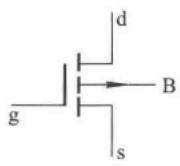</td><td>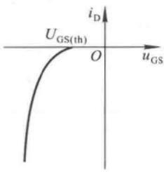</td><td>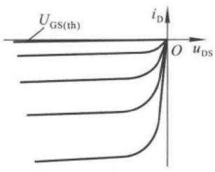</td></tr><tr><td>耗尽型</td><td>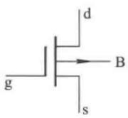</td><td>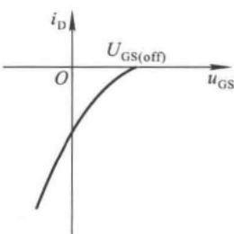</td><td>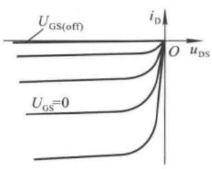</td></tr></table>

图 1.4.13 场效应管的符号及特性

应当指出，如果 MOS 管的衬底不与源极相连接，则衬-源之间电压  $U_{BS}$  必须保证衬-源间的 PN 结反向偏置，因此，N 沟道管的  $U_{BS}$  应小于零，而 P 沟道管的  $U_{BS}$  应大于零。此时导电沟道宽度将受  $u_{GS}$  和  $U_{BS}$  双重控制， $U_{BS}$  使开启电压或夹断电压的数值增大。比较而言，N 沟道管受  $U_{BS}$  的影响更大些。

## 1.4.3 场效应管的主要参数

## 一、直流参数

1. 开启电压  $U_{\mathrm{GS(th)}}: U_{\mathrm{GS(th)}}$  是在  $U_{DS}$  为一常量时，使  $i_{D}$  大于零所需的最小  $\left| u_{GS} \right|$  值。手册中给出的是在  $i_{D}$  为规定的微小电流（如  $5 \mu A$ ）时的  $u_{GS}$ 。 $U_{\mathrm{GS(th)}}$  是增强型 MOS 管的参数。
2. 夹断电压  $U_{\mathrm{GS(off)}}$  : 与  $U_{\mathrm{GS(th)}}$  相类似,  $U_{\mathrm{GS(off)}}$  是在  $u_{DS}$  为常量情况下  $i_{D}$  为规定的微小电流（如  $5 \mu A$ ）时的  $u_{GS}$ , 它是结型场效应管和耗尽型 MOS 管的参数。
3. 饱和漏极电流  $I_{DSS}$  : 对于结型场效应管, 在  $u_{GS} = 0 \, V$  情况下产生预夹断时的漏极电流定义为  $I_{DSS}$ 。
4. 直流输入电阻  $R_{\mathrm{GS(DC)}}:R_{\mathrm{GS(DC)}}$  等于栅-源电压与栅极电流之比，结型管的  $R_{\mathrm{GS(DC)}}$  大于  $10^{7}\Omega$ ，而 MOS 管的  $R_{\mathrm{GS(DC)}}$  大于  $10^{9}\Omega$ 。手册中一般只给出栅极电流的大小。

## 二、交流参数

1. 低频跨导 $g_{\mathrm{m}}: g_{\mathrm{m}}$ 数值的大小表示 $u_{\mathrm{GS}}$ 对 $i_{\mathrm{D}}$ 控制作用的强弱。在管子工作在恒流区且 $u_{\mathrm{DS}}$ 为常量的条件下，$i_{\mathrm{D}}$ 的微小变化量 $\Delta i_{\mathrm{D}}$ 与引起它变化的 $\Delta u_{\mathrm{GS}}$ 之比，称为低频跨导。即

$$
g _ {\mathrm{m}} = \frac {\Delta i _ {\mathrm{D}}}{\Delta u _ {\mathrm{GS}}} \Bigg | _ {U _ {\mathrm{DS}} = \text {常数}} \tag {1.4.6}
$$

$g_{\mathrm{m}}$ 的单位是S（西门子）或 $\mathrm{mS}$ 。 $g_{\mathrm{m}}$ 是转移特性曲线上某一点的切线的斜率，可通过对式(1.4.4)或式(1.4.5)求导而得。 $g_{\mathrm{m}}$ 与切点的位置密切相关，由于转移特性曲线的非线性，因而$i_{\mathrm{D}}$ 愈大， $g_{\mathrm{m}}$ 也愈大。

2. 极间电容: 场效应管的三个极之间均存在极间电容。通常, 栅 - 源电容  $C_{gs}$  和栅 - 漏电容  $C_{gd}$  为 1 \~ 3 pF, 而漏 - 源电容  $C_{ds}$  为 0.1 \~ 1 pF。在高频电路中, 应考虑极间电容的影响。管子的最高工作频率  $f_{M}$  是综合考虑了三个电容的影响而确定的工作频率的上限值。

## 三、极限参数

1. 最大漏极电流  $I_{DM}: I_{DM}$  是管子正常工作时漏极电流的上限值。

2. 击穿电压: 管子进入恒流区后, 使  $i_{D}$  骤然增大的  $u_{DS}$  称为漏 - 源击穿电压  $U_{(BR)DS}$ ,  $u_{DS}$  超过此值会使管子损坏。

对于结型场效应管，使栅极与沟道间PN结反向击穿的 $u_{GS}$ 为栅-源击穿电压 $U_{(BR)GS}$ ；对于绝缘栅型场效应管，使绝缘层击穿的 $u_{GS}$ 为栅-源击穿电压 $U_{(BR)GS}$ 。

3. 最大耗散功率  $P_{DM}: P_{DM}$  决定于管子允许的温升。 $P_{DM}$  确定后，便可在管子的输出特性上画出临界最大功耗线；再根据  $I_{DM}$  和  $U_{(BR)DS}$ ，便可得到管子的安全工作区。

对于 MOS 管，栅-衬之间的电容容量很小，只要有少量的感应电荷就可产生很高的电压。而由于  $R_{\mathrm{GS(DC)}}$  很大，感应电荷难于释放，以至于感应电荷所产生的高压会使很薄的绝缘层击穿，造成管子的损坏。因此，无论是在存放还是在工作电路中，都应为栅-源之间提供直流通路，避免栅极悬空；同时在焊接时，要将电烙铁良好接地。

【例 1.4.1】已知某管子的输出特性曲线如图 1.4.14 所示。试分析该管是什么类型的场效应管（结型、绝缘栅型、N 沟道、P 沟道、增强型、耗尽型）。

解:从  $i_{D}$  或  $u_{DS}$ 、 $u_{GS}$  的极性可知,该管为 N 沟道管;从输出特性曲线中开启电压  $U_{\mathrm{GS(th)}} = 4 \, \mathrm{V} > 0 \, \mathrm{V}$  可知,该管为增强型 MOS 管;所以,该管为 N 沟道增强型 MOS 管。

【例 1.4.2】电路如图 1.4.15 所示, 其中管子 T 的输出特性曲线如图 1.4.14 所示。试分析  $u_{1}$  为 0 V、8 V 和 10 V 三种情况下  $u_{0}$  分别为多少?

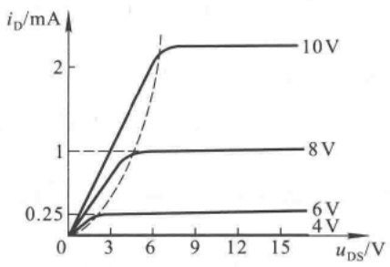

line

| uDS (V) | iD (mA)::4V | iD (mA)::6V | iD (mA)::8V | iD (mA)::10V |
| --- | --- | --- | --- | --- |
| 0 | 0 | 0 | 0 | 0 |
| ~3 | ~0.25 | ~0.25 | ~0.75 | ~1.25 |
| ~6 | ~0.25 | ~0.25 | 1 | ~2.25 |
| ~9 | ~0.25 | ~0.25 | 1 | ~2.25 |
| ~12 | ~0.25 | ~0.25 | 1 | ~2.25 |
| ~15 | ~0.25 | ~0.25 | 1 | ~2.25 |

图1.4.14 例1.4.1输出特性曲线

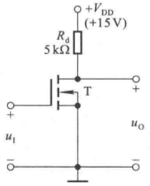

chemical

Electronic circuit diagram of a transistor amplifier with labeled components and voltage supply

图1.4.15 例1.4.2电路图

解:当 $u_{\mathrm{GS}} = u_{1} = 0 \mathrm{~V}$ 时，管子处于夹断状态，因而 $i_{\mathrm{D}} = 0$ 。而 $u_{\mathrm{O}} = u_{\mathrm{DS}} = V_{\mathrm{DD}} - i_{\mathrm{D}} R_{\mathrm{D}} = V_{\mathrm{DD}} = 15 \mathrm{~V}$ 。当 $u_{\mathrm{GS}} = u_{1} = 8 \mathrm{~V}$ 时，设管子工作在恒流区，则 $i_{\mathrm{D}} = 1 \mathrm{~mA}$，因此

$$
u _ {\mathrm{O}} = u _ {\mathrm{DS}} = V _ {\mathrm{DD}} - i _ {\mathrm{D}} R _ {\mathrm{d}} = (1 5 - 1 \times 5) \mathrm{V} = 1 0 \mathrm{V}
$$

大于 $u_{\mathrm{GS}} - U_{\mathrm{GS(th)}} = (8 - 4)\mathrm{V} = 4\mathrm{V}$ ，说明假设成立，管子工作在恒流区。

当 $u_{\mathrm{GS}} = u_{\mathrm{I}} = 10\mathrm{V}$ 时，若认为管子工作在恒流区，则 $i_{\mathrm{D}}$ 约为 $2.2\mathrm{mA}$，因而 $u_{\mathrm{O}} = (15 - 2.2\times 5)\mathrm{V} = 4\mathrm{V}$。但是，$u_{\mathrm{GS}} = 10\mathrm{V}$ 时的预夹断电压为

$$
u _ {\mathrm{DS}} = u _ {\mathrm{GS}} - U _ {\mathrm{GS(th)}} = (1 0 - 4) \mathrm{V} = 6 \mathrm{V}
$$

$u_{DS}$ 小于 d-s 在 $u_{GS}=10\ V$ 时的预夹断电压,说明管子已不工作在恒流区,而是工作在可变电阻区。从输出特性曲线可得 $u_{GS}=10\ V$ 时 d-s 间的等效电阻为

$$
R _ {\mathrm{DS}} = U _ {\mathrm{DS}} / I _ {\mathrm{D}} \approx \left(\frac {3}{1 \times 1 0 ^ {- 3}}\right) \Omega = 3 \mathrm{k} \Omega
$$

所以

$$
u _ {\mathrm{O}} = \frac {R _ {\mathrm{DS}}}{R _ {\mathrm{d}} + R _ {\mathrm{DS}}} \cdot V _ {\mathrm{CC}} = \left(\frac {3}{5 + 3} \times 1 5\right) \mathrm{V} \approx 5. 6 \mathrm{V}
$$

【例 1.4.3】电路如图 1.4.16 所示, 场效应管的夹断电压  $U_{\mathrm{GS(off)}} = -4 \, \mathrm{V}$ , 饱和漏极电流  $I_{DSS} = 4 \, mA$ 。试问:

为保证负载电阻  $R_{L}$  上的电流为恒流， $R_{L}$  的取值范围应为多少？

解:从电路图可知, $u_{GS}=0\ V$ ,因而 $i_{D}=I_{DSS}=4\ mA$ 。并且 $u_{GS}=0\ V$ 时的预夹断电压 $u_{DS}=u_{GS}-U_{GS(off)}=[0-(-4)]\ V=4\ V$ ,而

$$
u _ {\mathrm{DS}} = V _ {\mathrm{DD}} - i _ {\mathrm{D}} R _ {\mathrm{L}}
$$

所以保证  $R_{L}$  为恒流的最大输出电压  $U_{\mathrm{omax}} = (V_{\mathrm{DD}} - 4)\mathrm{V} = 8\mathrm{~V}$ ，输出电压范围为  $0 \sim 8\ ~V$ ，负载电阻  $R_{L}$  的取值范围为

$$
R _ {\mathrm{L}} = \frac {U _ {\mathrm{o}}}{I _ {\mathrm{DSS}}} = 0 \sim 2 \mathrm{k} \Omega
$$

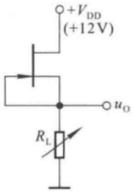

text_image

+VDD
(+12V)
uo
RL

图1.4.16 例1.4.3电路图

## 1.4.4 场效应管与晶体管的比较

场效应管的栅极 g、源极 s、漏极 d 对应于晶体管的基极 b、发射极 e、集电极 c，它们的作用相类似。

一、场效应管用栅-源电压 $u_{GS}$ 控制漏极电流 $i_{D}$，栅极基本不取电流。而晶体管工作时基极总要索取一定的电流。因此，要求输入电阻高的电路应选用场效应管；而若信号源可以提供一定的电流，则可选用晶体管。
二、场效应管只有多子参与导电。晶体管内既有多子又有少子参与导电，而少子数目受温度、辐射等因素影响较大，因而场效应管比晶体管的温度稳定性好、抗辐射能力强。所以在环境条件变化很大的情况下应选用场效应管。
三、场效应管的噪声系数 $^{①}$ 很小,所以低噪声放大器的输入级及要求信噪比 $^{②}$ 较高的电路应选用场效应管。当然也可选用特制的低噪声晶体管。
四、场效应管的漏极与源极可以互换使用，互换后特性变化不大。而晶体管的发射极与集电极互换后特性差异很大，因此只在特殊需要时才互换，成倒置状态，如在集成逻辑电路中。

<small>① 噪声系数 $N_{\mathrm{F}} = \frac{P_{\mathrm{si}} / P_{\mathrm{ni}}}{P_{\mathrm{so}} / P_{\mathrm{no}}}$，$P_{\mathrm{si}}$ 和 $P_{\mathrm{so}}$ 分别为信号的输入和输出功率，$P_{\mathrm{ni}}$ 和 $P_{\mathrm{no}}$ 分别为噪声的输入和输出功率。</small>

<small>② 放大电路输出的信号功率与噪声功率之比。</small>

五、场效应管比晶体管的种类多，特别是耗尽型 MOS 管，栅-源电压  $u_{GS}$  可正、可负、可零，均能控制漏极电流。因而在组成电路时场效应管比晶体管更灵活。

六、场效应管和晶体管均可用于放大电路和开关电路，它们构成了品种繁多的集成电路。但由于场效应管集成工艺更简单，且具有耗电省、工作电源电压范围宽等优点，因此场效应管越来越多地应用于大规模和超大规模集成电路中。

除本章所述晶体二极管、三极管外，常用的半导体元件还有利用一个PN结构成的具有负阻特性的器件——单结晶体管，以及利用三个PN结构成的大功率可控整流器件——晶闸管。它们多用于电力电子技术中，本书不赘述。

## 思考题

1.4.1 为使结型场效应管工作在恒流区，为什么其栅-源之间必须加反向电压？为什么耗尽型 MOS 管的栅-源电压可正、可零、可负？
1.4.2 若将图 1.4.9 中 MOS 管的衬底接小于零的电位, 则对其特性产生什么影响?
1.4.3 从 N 沟道场效应管的输出特性曲线上看,为什么  $u_{GS}$  越大预夹断电压越大、漏-源间击穿电压也越高?
1.4.4 为使六种场效应管均工作在恒流区，应分别在它们的栅-源之间和漏-源之间加什么样的电压？

## 1.5 集成电路中的元件

集成电路就是采用一定的制造工艺，将晶体管、场效应管、二极管、电阻、电容等许多元件组成的具有完整功能的电路制作在同一块半导体基片上，然后加以封装所构成的半导体器件。由于它的元件密度高（即集成度高）、体积小、功能强、功耗低、外部连线及焊点少，从而大大提高了电子设备的可靠性和灵活性，实现了元件、电路与系统的紧密结合。

## 1.5.1 集成双极型管

## 一、NPN型管

在制造集成电路时，需将各个元件相互绝缘。利用PN结反向偏置时电阻很大的特点，把各元件所在的N区或P区四周用PN结包围起来，便可使它们相互绝缘，称这个N区或P区为隔离岛。在基片上经过氧化、光刻、腐蚀、扩散、外延及氧化等重复过程①，即可制造出隔离岛。图1.5.1(a)所示为集成电路制造过程中的剖面，中间的N区为隔离岛，它两侧的 $\mathrm{P}^{+}$ 区为隔离槽。

利用上述的工艺过程在隔离岛中首先制造出基区,然后制造发射区和集电区,最后制造各极引出窗口,就成为 NPN 型管 $^{②}$ ,如图(b)所示。

## 二、PNP型管

PNP型管有衬底PNP管和横向PNP管，其结构如图1.5.2所示。衬底PNP管以隔离槽为集

<small>①、② 可参阅《模拟电子技术基础(第三版)》1.6节。</small>

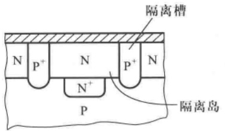

text_image

隔离槽
N P⁺ N P⁺ N
N⁺
P
隔离岛

(a)

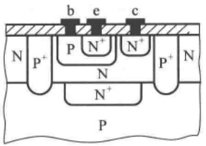

text_image

b e c
N P⁺ P N⁺ N⁺ P⁺ N
N
N⁺
P

(b)

图 1.5.1 隔离岛及 NPN 型管

(a) 隔离岛 (b) NPN 型管

电极,是纵向管,即载流子从发射区沿纵向向集电区运动。由于可以准确控制基区的厚度,所以 $\beta$ 值较大。但由于隔离槽只能接在整个电路电位最低端,所以应用的局限性很大。

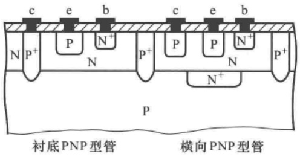

text_image

c e b c e b
N P⁺ P N⁺ P⁺ P P N⁺ P⁺
N N⁺
P
衬底PNP型管 横向PNP型管

图 1.5.2 集成电路中的 PNP 型管

横向 PNP 管的载流子从发射区沿水平方向向集电区运动, 故称横向管。由于制造工艺所限, 基区较厚, 所以  $\beta$  值很小, 仅为 2\~20 倍。但其发射结和集电结耐压较高, 因而可利用横向 PNP 管和纵向 NPN 管复合而成既有足够大的电流放大系数又耐压较高的管子, 从而构成各方面性能俱佳的放大电路。

## 三、其它类型晶体管

在制造 NPN 型管时, 若制作多个发射区, 则得到多发射极管, 其结构与符号见图 1.5.3 所示。这种管子广泛用于集成数字电路。

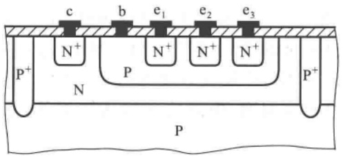

text_image

c b e₁ e₂ e₃
N⁺ N⁺ N⁺ N⁺
P⁺ P
N
P

(a)

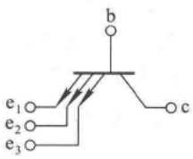

text_image

b
e₁
e₂
e₃
c

(b)

图 1.5.3 多发射极管的结构与符号

(a) 结构 (b) 符号

在制作横向 PNP 型管时, 若制作多个集电区, 则得到多集电极管, 各集电极电流之比决定于对应的集电区面积之比, 其结构与符号如图 1.5.4 所示。这种管子多用于集成放大电路中的电流源电路。

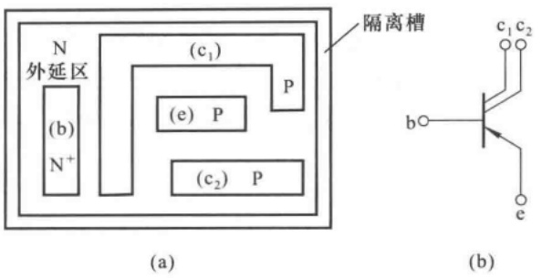

text_image

N
外延区
(b)
N+
(c₁)
P
(e) P
(c₂) P
隔离槽
(a)
b○—●—c₁ c₂
e
(b)

图 1.5.4 多集电极管的结构与符号

(a) 结构 (b) 符号

集成电路中普通 NPN 型管的基区宽度为  $0.5 \sim 1 \mu m$ ，若将基区做得很薄，厚度只有  $0.1 \sim 0.2 \mu m$ ，则得到超  $\beta$  晶体管。它的基极电流很小（如小于 10 nA）时， $\beta$  可高达千倍以上，但其反向击穿电压很低， $U_{(BR)CBO}$  为  $10 \sim 20 V$ ， $U_{(BR)CEO}$  为  $5 \sim 10 V$ 。这种管子常用于高精度集成放大电路的输入极。

## 1.5.2 集成单极型管

集成 MOS 管的结构与分立元件 MOS[见图 1.4.7(a)] 的结构完全相同, 这里不再赘述。在集成 MOS 电路中, 常采用 N 沟道 MOS 管与 P 沟道 MOS 管组成的互补电路(简称 CMOS 电路), 其结构与电路如图 1.5.5 所示。电路功耗小、工作电源电压范围宽、输入电流非常小、连接方便, 是目前应用广泛的集成电路之一。

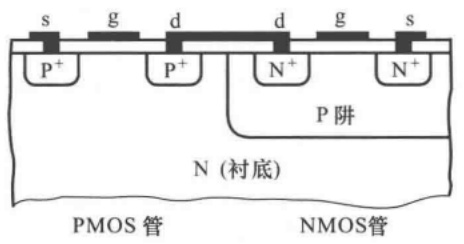

text_image

s g d d g s
P+ P+ N+ N+
P阱
N (衬底)
PMOS管 NMOS管

(a)

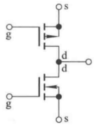

chemical

Electrical circuit diagram with MOSFET transistors and diodes labeled g, d, s

(b)

图 1.5.5 CMOS 电路

(a) 结构 (b) 符号

## 1.5.3 集成电路中的无源元件

集成电路中各种无源元件的制造不需要特殊工艺,例如,用 NPN 型管的发射结作为二极管和稳压管,用 NPN 型管基区体电阻作为电阻,用 PN 结势垒电容或 MOS 管栅极与沟道间等效电容作为电容等。

## 1.5.4 集成电路中元件的特点

与分立元件相比,集成电路中的元件有如下特点:

一、具有良好的对称性。由于元件在同一硅片上用相同的工艺制造，所以它们的性能比较一致；而且由于元件密集使环境温度差别很小，所以同类元件温度对称性也较好。

二、电阻与电容的数值有一定的限制。由于集成电路中电阻和电容要占用硅片的面积，且数值愈大，占用面积也愈大。因而不易制造大电阻和大电容。因此，电阻阻值范围为几十欧～几千欧，电容容量一般小于100 pF。

三、纵向晶体管的  $\beta$  值大；横向晶体管的  $\beta$  小，但 PN 结耐压高。

四、用有源元件取代无源元件。由于纵向 NPN 管占用硅片面积小且性能好，而电阻和电容占用硅片面积大且取值范围窄，因此，在集成电路的设计中尽量多采用 NPN 型管，而少用电阻和电容。

## 1.6 Multisim 应用举例

## 1.6.1 半导体器件特性曲线测试方法的研究

## 一、题目

利用 IV 分析仪测量二极管的伏安特性

## 二、测量方法及步骤

1. 选择元件: 在 Multisim 主界面的左侧元器件栏中选择某种型号的二极管 (Diode), 如 1N4148, 并将某拖至电路图窗口。
2. 选择仪器: 在右侧仪器仪表栏中选择 IV 分析仪(IV - Analysis), 也将其拖至电路图窗口; 打开 IV 分析仪, 在仪器的 Components 栏选择 Diode, IV 分析仪的右下角将显示出二极管管脚所接端子。
3. 完成测试: 单击 Sim\_Param, 设置仪器参数; 闭合仿真开关, 即可得到伏安特性曲线。移动光标, 可以读出管压降及其对应的电流值。

以上过程如图 1.6.1 所示。

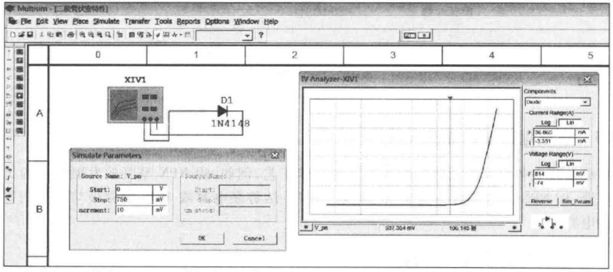

text_image

Multisim - [二极管状安特性]
File Edit View Place Simulate Transfer Tools Reports Options Window Help
0	1	2	3	4	5
A
XIV1
D1
1N4148
Simulate Parameters
Source Name: V_pn
Start: 0	V
Stop: 750	mV
Increment: 10	mV
Source Name:
Start:
Step:
m states:
OK	Cancel
IV Analyzer-XIV1
Components:
Divdc
Current Range(A)
Log Lin
F 36.865 mA
-3.351 mA
Voltage Range(V)
Log Lin
F 814	mV
-74	mV
Reverse Sim Params
V_pn	937.354 mV	106.145 Hz

图 1.6.1 二极管伏安特性的测试

## 三、举一反三

利用 IV 分析仪测试二极管的伏安特性简单易行,而且可以推而广之,采用同样方法测出晶体三极管和各种场效应管的特性曲线。

按上述步骤可测出晶体管的输出特性曲线,如图 1.6.2 所示。值得提醒的是,测试时需对两个参数基极电流 I\_b 和管压降 V\_ce 分别进行设置。

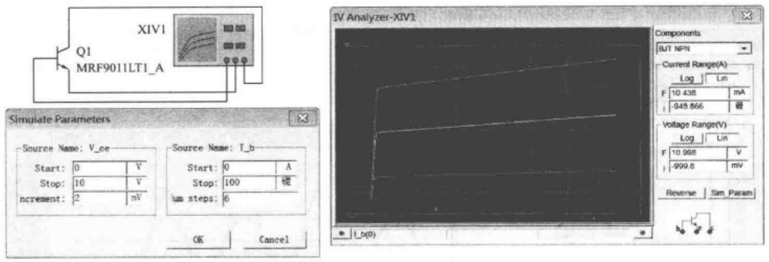

图 1.6.2 晶体管输出特性的测试

## 1.6.2 半导体二极管特性的研究

## 一、题目

研究二极管对直流量和交流量表现的不同特点。

## 二、仿真电路

仿真电路如图 1.6.3 所示。因为只有在低频小信号下二极管才能等效成一个电阻，所以图中交流信号的频率为 1 kHz、数值为 10 mV（有效值）。由于交流信号很小，输出电压不失真，故可以认为直流电压表（测平均值）的读数是电阻上直流电压值。

## 三、仿真内容

1. 在直流电流不同时二极管管压降的变化。利用直流电压表测电阻上电压，从而得二极管管压降。
2. 在直流电流不同时二极管交流等效电阻的变化。利用示波器测得电阻上交流电压的峰值，从而得二极管交流电压的峰值。

## 四、仿真结果

仿真结果如表 1.6.1 所示。

表 1.6.1 仿真数据

| 直流电源$V_1$/V | 交流信号$V_2$/mV | R直流电压表读数$U_R$ | R交流电压$U_r$/mV | 二极管直流电压$U_D$/V | 二极管交流电压$U_d$/mV |
| --- | --- | --- | --- | --- | --- |
| 1 | 10 | 353.847 mV | 9.321 | 0.646 153≈0.65 | 0.679 |
| 4 | 10 | 3.296 V | 9.921 | 0.704 | 0.079 |

表中的所有交流电压均为峰值。

## 五、结论

1. 比较直流电源在 1 V 和 4 V 两种情况下二极管的直流管压降可知, 二极管的直流电流越大, 管压降越大, 直流管压降不是常量。
2. 比较直流电源在 1 V 和 4 V 两种情况下二极管的交流管压降可知, 二极管的直流电流越大, 其交流管压降越小, 说明随着静态电流的增大, 动态电阻将减小; 两种情况下电阻的交流压降均接近输入交流电压值, 说明二极管的动态电阻很小。

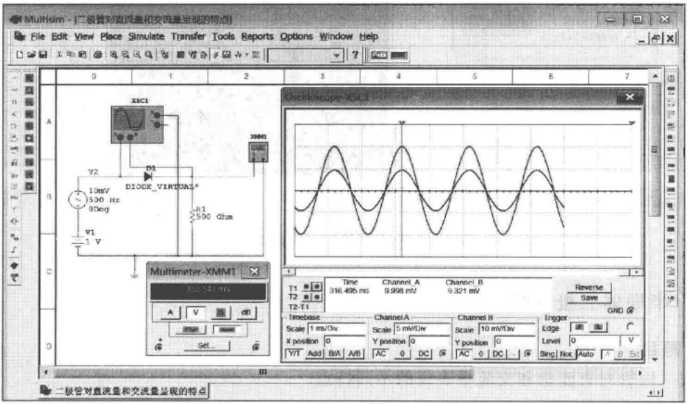

text_image

Multisim - |二极管对直流量和交流量呈现的特点
File Edit View Place Simulate Transfer Tools Reports Options Window Help
0 1 2 3 4 5 6 7
A XSC1
B V2 D1 DIODE_VIRTUAL*
10mV 500 Hz 90deg R1 500 Ohm
V1
-1 V
Multimeter-XMM1
800.14 mV
A V dB
T2-T1
Time Channel_A Channel_B
316.495 ms 9.998 mV 9.321 mV
Reverse Save
GND @
Timebase Channel_A Channel_B
Scale 1 mV/Div Scale 5 mV/Div Scale 10 mV/Div
X position 0 Y position 0 Y position 0 Edge Level 0 V
Y/T Add B/A A/B AC 0 DC AC 0 DC Sing Non Auto A B SX

(a)

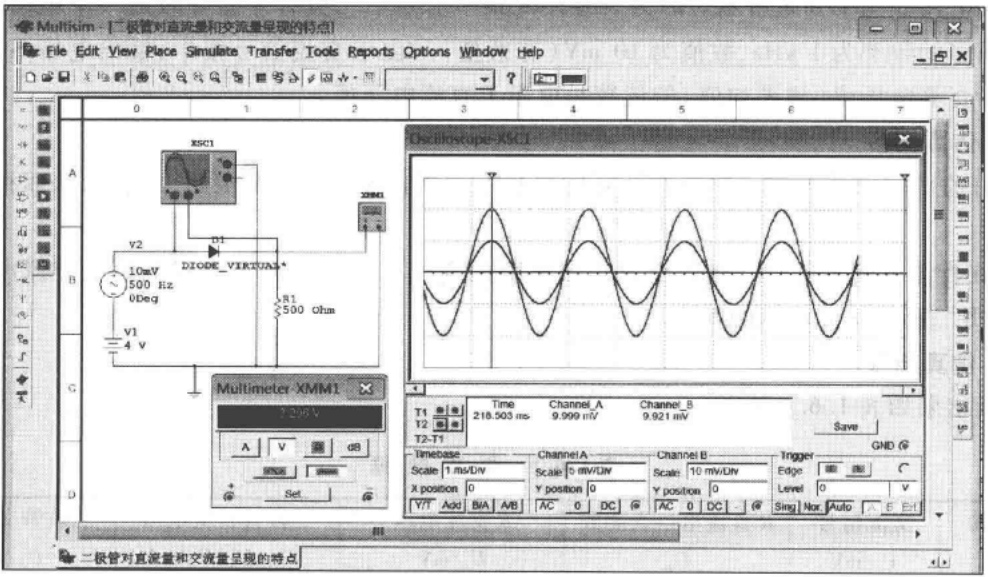

text_image

Multikim - [二极管对直流量和交流量呈现的特点]
File Edit View Place Simulate Transfer Tools Reports Options Window Help
0 1 2 3 4 5 6 7
A XSCI
B V2 DIODE_VIKUALS*
10mV 500 Hz 0Deg
V1 R1 500 Ohm
4 V
Multimeter-XMM1
T2:200 V
A V dB
T2-T1
Time Channel_A Channel_B
218.503 ms 9.999 mV 9.921 mV
Save GND @
Timebase Channel_A Channel_B Trigger Edge C
Scale 1 ms/Div Scale 5 mV/Div Scale 10 mV/Div
X position 0 Y position 0 Y position 0
Y/Y Add B/A A/B AC 0 DC AC 0 DC AC Sing Nor Auto E Edit
二极管对直流量和交流量呈现的特点

(b)

图 1.6.3 二极管静态和动态电压的测试

(a) 直流电源电压为 $1\mathrm{V}$ 时的情况 (b) 直流电源电压为 $4\mathrm{V}$ 时的情况

## 本章小结

本章首先介绍半导体的基础知识,然后重点阐述半导体二极管、晶体管(BJT)和场效应管(FET)的工作原理、特性曲线和主要参数。应当指出,了解管子内部结构及载流子的运动应以理解外特性为度。各部分归纳如下:

## 一、杂质半导体与PN结

在本征半导体中掺入五价元素(如磷)就形成N型半导体,掺入三价元素(如硼)就形成P型半导体,控制掺入杂质的多少就可有效地实现导电性能的可控性。半导体中有两种载流子:自由电子与空穴。载流子有两种有序的运动:因浓度差而产生的运动称为扩散运动,因电位差而产生的运动称为漂移运动。在同一个硅片(或锗片)上制作两种杂质半导体,在它们的交界面将形成PN结。正确理解PN结的单向导电性、反向击穿特性、温度特性和电容效应,将有利于了解半导体二极管、晶体管和场效应管等电子器件的特性和参数。

## 二、半导体二极管

将一个PN结封装并引出电极后就构成二极管。二极管加正向电压时，产生扩散电流，电流与电压成指数关系；加反向电压时，产生漂移电流，其数值很小；体现出单向导电性。 $I_{\mathrm{F}}$ 、 $I_{\mathrm{R}}$ 、 $U_{\mathrm{R}}$ 和 $f_{\mathrm{M}}$ 是二极管的主要参数。

特殊二极管也具有单向导电性。利用 PN 结击穿时的特性可制成稳压二极管，利用发光材料可制成发光二极管，利用 PN 结的光敏性可制成光电二极管。

## 三、晶体管

当发射结正向偏置且集电结反向偏置时，晶体管具有电流放大作用；发射区多子的扩散运动形成 $I_{\mathrm{E}}$，基区非平衡少子与多子的复合运动形成基极电流 $I_{\mathrm{B}}$，集电结少子的漂移运动形成 $I_{\mathrm{C}}$。$i_{\mathrm{B}}$ 对 $i_{\mathrm{C}}$ 具有控制作用，$i_{\mathrm{C}} = \beta i_{\mathrm{B}}$，可将 $i_{\mathrm{C}}$ 看成为受电流 $i_{\mathrm{B}}$ 控制的电流源。晶体管的输入特性和输出特性表明各极之间电流与电压的关系，$\beta, \alpha, I_{\mathrm{CBO}}(I_{\mathrm{CEO}}), I_{\mathrm{CM}}, U_{(\mathrm{BR})\mathrm{CEO}}, P_{\mathrm{CM}}$ 和 $f_{\mathrm{T}}$ 是它的主要参数。晶体管有截止、放大、饱和三个工作区域，学习时应特别注意使管子工作在不同工作区的外部条件。

特殊三极管与晶体管一样,也能够实现输入信号对  $i_{c}$  的控制。如光电三极管是用光的入射量来控制  $i_{c}$  的大小的。

## 四、场效应管

场效应管分为结型和绝缘栅型两种类型,每种类型又分为 N 沟道和 P 沟道两种,同一沟道的 MOS 管又分为增强型和耗尽型两种形式。

场效应管工作在恒流区时，利用栅-源之间外加电压所产生的电场来改变导电沟道的宽窄，从而控制多子漂移运动所产生的漏极电流 $i_{D}$ 。此时，可将 $i_{D}$ 看成电压 $u_{GS}$ 控制的电流源，转移特性曲线描述了这种控制关系。输出特性曲线描述 $u_{GS}$ 、 $u_{DS}$ 与 $i_{D}$ 三者之间的关系。 $g_{m}$ 、 $U_{\mathrm{GS(th)}}$ 或 $U_{\mathrm{GS(off)}}$ 、 $I_{\mathrm{DSS}}$ 、 $I_{\mathrm{DM}}$ 、 $U_{(\mathrm{BR})\mathrm{DS}}$ 、 $P_{DM}$ 和极间电容是它的主要参数。和晶体管相类似，场效应管有夹断区、恒流区和可变电阻区三个工作区域。

因 VMOS 管较好地解决了散热问题,故可制成大功率管。

半导体材料的光敏性和热敏性具有两面性，一方面它使普通半导体器件的温度稳定性变差；另一方面又可利用它来制成特殊半导体器件，如光敏器件和热敏器件。

尽管各种半导体器件的工作原理不尽相同,但在外特性上却有不少相同之处。例如,晶体管的输入特性与二极管的伏安特性相似,二极管的反向特性(特别是光电二极管在第三象限的反向特性)与晶体管的输出特性相似,而场效应管与晶体管的输出特性也相似。

除上述主要内容外，本节还介绍了集成电路中的元件。

学完本章后，应能掌握以下几点:

一、熟悉下列定义、概念及原理:自由电子与空穴，扩散与漂移，复合，空间电荷区，PN结，耗尽层，导电沟道，二极管的单向导电性，稳压管的稳压作用，晶体管与场效应管的放大作用及三个工作区域。

二、掌握二极管、稳压管、晶体管、场效应管的工作原理、外特性和主要参数。
三、了解选用器件的原则。

## 自测题

一、判断下列说法是否正确，用“√”和“×”表示并将结果填入空内。

(1) 在 P 型半导体中如果掺入足够量的五价元素, 可将其改型为 N 型半导体。( )
(2) 因为 P 型半导体的多子是空穴, 所以它带正电。( )
(3) PN 结在无光照、无外加电压时, 结电流为零。( )
(4) 处于放大状态的晶体管,集电极电流是多子漂移运动形成的。( )
（5）结型场效应管外加的栅-源电压应使栅-源间的耗尽层承受反向电压，才能保证其 $R_{GS}$ 大的特点。（）
(6) 若耗尽型 N 沟道 MOS 管的  $u_{GS}$  大于零，则其输入电阻会明显变小。（）

二、选择正确答案填入空内。

(1) PN 结加正向电压时, 空间电荷区将 \_\_\_\_。

A. 变窄

B. 基本不变

C. 变宽

(2) 稳压管的稳压区是其工作在 \_\_\_\_。

A. 正向导通

B. 反向截止

C. 反向击穿

(3) 当晶体管工作在放大区时, 发射结电压和集电结电压应为 \_\_\_\_。

A. 前者反偏、后者也反偏

B. 前者正偏、后者反偏

C. 前者正偏、后者也正偏

(4)  $u_{GS}=0\ V$  时能够工作在恒流区的场效应管有 \_\_\_\_。

A. 结型管

B. 增强型 MOS 管

C. 耗尽型 MOS 管

三、求解图 T1.3 所示各电路的输出电压值，设二极管导通电压  $U_{D}=0.7\ V$ 。

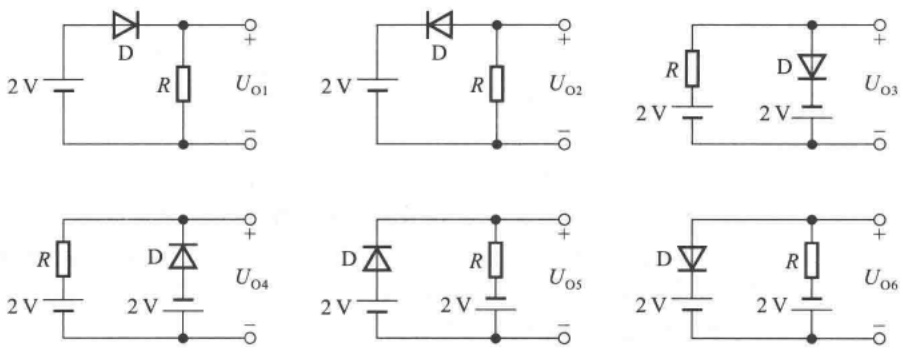

图 T1.3

四、电路如图 T1.4 所示。已知稳压管的稳压值  $U_{z}=6\ V$ ，稳定电流的最小值  $I_{Zmin}=5\ mA; R_{L}=5\ k\Omega$ 。

（1）分别求出  $R=500\ \Omega$  和  $R=5\ k\Omega$  两种情况下的  $U_{0}$  各为多少伏；
(2) 若已知  $R_{L}$  的电流变化范围为 5\~20 mA, 则稳压管的最大稳定电流至少应取多少毫安?

五、电路如图 T1.5 所示,  $\beta = 100, U_{BE} = 0.7 V$ 。试问:

(1)  $R_{b}=50\ k\Omega$  时,  $u_{0}=?$
(2) 若 T 临界饱和, 则  $R_{b} \approx ?$

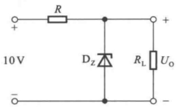

chemical

Simple electronic circuit diagram with resistor, diode, and load resistor labeled with voltage and polarity

图 T1.4

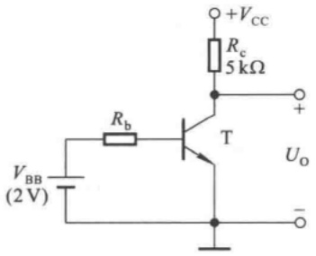

text_image

+VCC
Rc
5kΩ
Rb
T
VBB
(2 V)
Uo
-

图 T1.5

六、测得某放大电路中三个 MOS 管的三个电极的电位如表 T1.6 所示, 它们的开启电压也在表中。试分析各管的工作状态(截止区、恒流区、可变电阻区), 并填入表内。

表 T1.6

| 管号 | $U_{GS(th)}$/V | $U_S$/V | $U_G$/V | $U_D$/V | 工作状态 |
| --- | --- | --- | --- | --- | --- |
| $T_1$ | 4 | -5 | 1 | 3 |  |
| $T_2$ | -4 | 3 | 3 | 10 |  |
| $T_3$ | -4 | 6 | 0 | 5 |  |

## 习题

1.1 选择合适答案填入空内。

(1) 在本征半导体中加入\_\_\_\_元素可形成 N 型半导体, 加入\_\_\_\_元素可形成 P 型半导体。

A. 五价

B. 四价

C. 三价

(2) 当温度升高时,二极管的反向饱和电流将\_\_\_\_。

A. 增大

B. 不变

C. 减小

（3）工作在放大区的某三极管，如果当 $I_{B}$ 从12 μA增大到22 μA时， $I_{C}$ 从1 mA变为2 mA，那么它的β约为\_\_\_\_。

A. 83

B. 91

C. 100

（4）当场效应管的漏极直流电流  $I_{D}$  从 2 mA 变为 4 mA 时，它的低频跨导  $g_{m}$  将 \_\_\_\_。

A. 增大

B. 不变

C. 减小

1.2 电路如图 P1.2 所示, 已知  $u_{i}=10\sin\omega t(\mathrm{~V})$ , 试画出  $u_{i}$  与  $u_{0}$  的波形。设二极管正向导通电压可忽略不计。

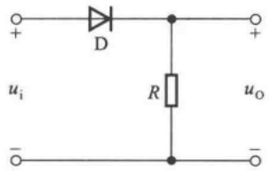

chemical

Simple electronic circuit diagram with diode and resistor components labeled D and R

图 P1.2

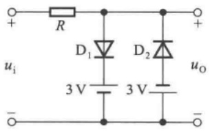

chemical

Electrical circuit diagram with resistors, diodes, and 3V voltage sources labeled

图 P1.3

1.3 电路如图 P1.3 所示, 已知  $u_{i}=5\sin\omega t(\mathrm{~V})$ , 二极管导通电压  $U_{D}=0.7\ V$ 。试画出  $u_{i}$  与  $u_{0}$  的波形, 并标出幅值。

1.4 电路如图 P1.4 所示, 二极管导通电压  $U_{D}=0.7\ V$ , 常温下  $U_{T}\approx26\ mV$ , 电容 C 对交流信号可视为短路;  $u_{i}$  为正弦波, 有效值为 10 mV。

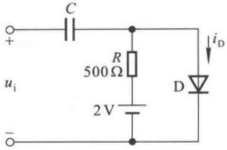

text_image

C
+
ui
-
R
500Ω
2V
iD
D

图 P1.4

试问二极管中流过的交流电流有效值为多少？

1.5 现有两只稳压管,它们的稳定电压分别为6 V和8 V,正向导通电压为0.7 V。试问:

(1) 将它们串联相接, 则可得到几种稳压值? 各为多少?

(2) 将它们并联相接, 则又可得到几种稳压值? 各为多少?

1.6 已知图 P1.6 所示电路中稳压管的稳定电压  $U_{z}=6\ V$ ，最小稳定电流  $I_{Zmin}=5\ mA$ ，最大稳定电流  $I_{Zmax}=25\ mA$ 。

(1) 分别计算  $U_{1}$  为 10 V、15 V、35 V 三种情况下输出电压  $U_{0}$  的值；

(2) 若  $U_{1}=35\ V$  时负载开路, 则会出现什么现象? 为什么?

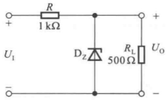

chemical

Electrical circuit diagram with resistor, diode, and load resistor labeled with values

图P1.6

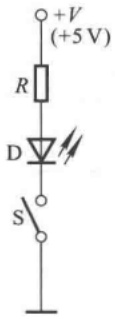

chemical

Electrical circuit diagram with resistor, diode, and switch symbols

图 P1.7

1.7 在图 P1.7 所示电路中, 发光二极管导通电压  $U_{D} = 1.5 \, V$ , 正向电流在  $5 \sim 15 \, mA$  时才能正常工作。试问:

(1) 开关 S 在什么位置时发光二极管才能发光?

(2) R 的取值范围是多少?

1.8 现测得放大电路中两只管子两个电极的电流如图 P1.8 所示。分别求另一电极的电流，标出其实际方向，并在圆圈中画出管子，且分别求出它们的电流放大系数  $\beta$ 。

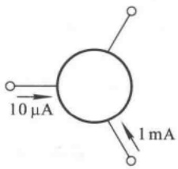

text_image

10 μA
1 mA

(a)

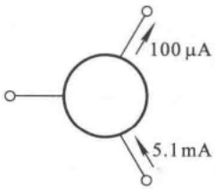

text_image

100 μA
5.1 mA

(b)

图 P1.8

1.9 测得放大电路中六只晶体管的直流电位如图 P1.9 所示。在圆圈中画出管子，并分别说明它们是硅管还是锗管。

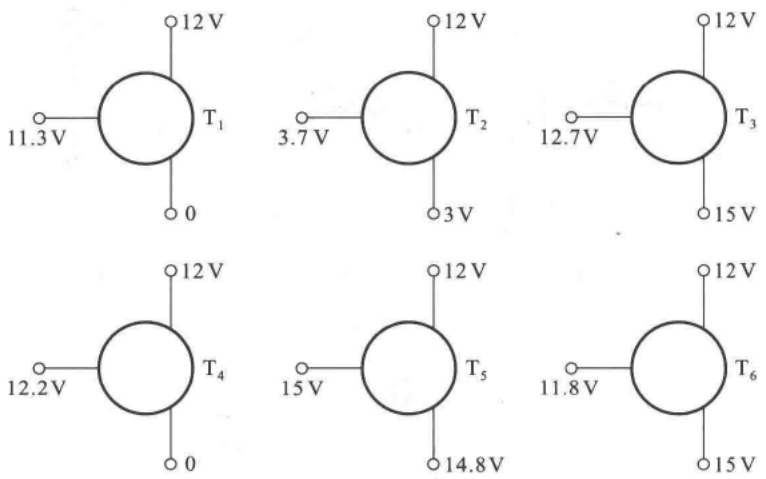

图 P1.9

1.10 电路如图 P1.10 所示，晶体管导通时  $U_{BE}=0.7\ V,\beta=50$ 。试分析  $V_{BB}$  为 0 V、1 V、3 V 三种情况下 T 的工作状态及输出电压  $u_{0}$  的值。

1.11 电路如图 P1.11 所示, 晶体管的  $\beta = 50$ ,  $\left| U_{BE} \right| = 0.2 V$ , 饱和管压降  $\left| U_{CES} \right| = 0.1 V$ ; 稳压管的稳定电压  $U_{Z} = 5 V$ , 正向导通电压  $U_{D} = 0.5 V$ 。

试问: 当  $u_{1}=0\ V$  时  $u_{0}=?$  当  $u_{1}=-5\ V$  时  $u_{0}=?$

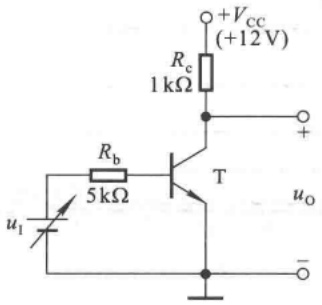

text_image

+Vcc
(+12V)
Rc
1 kΩ
Rb
5 kΩ
T
+
uI
uo
-

图 P1.10

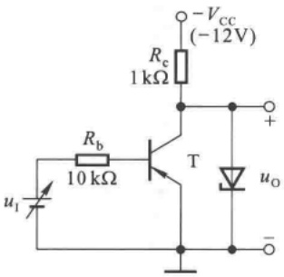

text_image

Rc
1 kΩ
-Vcc
(-12V)
+
T
Rb
10 kΩ
uI
uo
-

图 P1.11

1.12 分别判断图 P1.12 所示各电路中晶体管是否有可能工作在放大状态。

1.13 已知放大电路中一只 N 沟道场效应管三个极①、②、③的电位分别为 4 V、8 V、12 V，管子工作在恒流区。试判断它可能是哪种管子（结型管、MOS 管、增强型、耗尽型），并说明 ①、②、③与 g、s、d 的对应关系。

1.14 电路如图 P1.14(a) 所示, T 的输出特性如图(b) 所示, 分析当  $u_{1}=4\ V$ 、8 V、12 V 三种情况下场效应管分别工作在什么区域。

1.15 分别判断图 P1.15 所示各电路中的场效应管是否有可能工作在恒流区。

1.16 利用 Multisim 研究图 P1.4 所示电路在 R 的阻值变化时二极管的直流电压和交流电流的变化，并总结仿真结果。

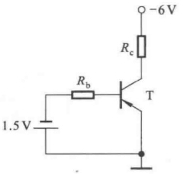

text_image

1.5V
Rb
T
-6V
Rc

(a)

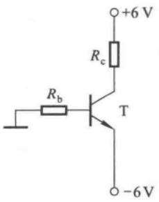

text_image

+6 V
Rc
T
Rb
-6 V

(b)

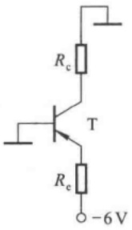

text_image

Rc
T
Rc
-6 V

(c)

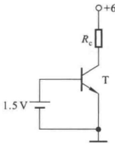

text_image

1.5 V
Rc
T
+6

(d)

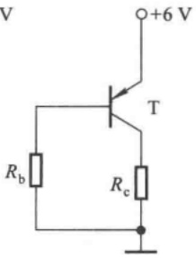

text_image

V
+6 V
T
Rb
Rc

(e)

图 P1.12

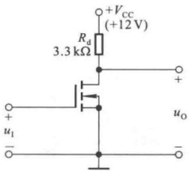

chemical

Electronic circuit diagram of a transistor amplifier with 3.3 kΩ resistor and +12V supply

(a)

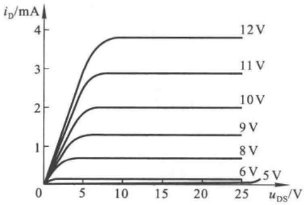

line

| uDS (V) | iD (mA)::5 V | iD (mA)::6 V | iD (mA)::8 V | iD (mA)::9 V | iD (mA)::10 V | iD (mA)::11 V | iD (mA)::12 V |
| --- | --- | --- | --- | --- | --- | --- | --- |
| 0 | 0 | 0 | 0 | 0 | 0 | 0 | 0 |
| 5 | ~0.15 | ~0.75 | ~1.3 | ~2.0 | ~2.9 | ~3.8 | ~3.8 |
| 10 | ~0.15 | ~0.75 | ~1.3 | ~2.0 | ~2.9 | ~3.8 | ~3.8 |
| 15 | ~0.15 | ~0.75 | ~1.3 | ~2.0 | ~2.9 | ~3.8 | ~3.8 |
| 20 | ~0.15 | ~0.75 | ~1.3 | ~2.0 | ~2.9 | ~3.8 | ~3.8 |
| 25 | ~0.15 | ~0.75 | ~1.3 | ~2.0 | ~2.9 | ~3.8 | ~3.8 |

(b)

图 P1.14

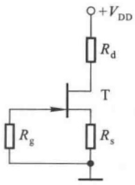

text_image

+VDD
Rd
T
Rg
Rs

(a)

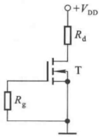

text_image

+VDD
Rd
T
Rg

(b)

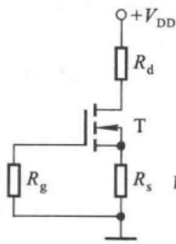

text_image

+VDD
Rd
T
Rg
Rs

(c)

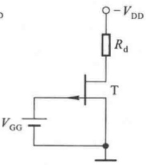

chemical

Electronic circuit diagram showing a transistor amplifier with gate voltage, drain resistance, and power supply connections

(d)

图 P1.15

出题目的:

(1) 学习在 Multisim 环境下搭建电路的方法；
(2) 学习直流电压与交流电流的测试方法；
(3) 进一步理解二极管对直流量和交流量呈现的不同特性。

提示:二极管采用实际二极管,如1BH62;其它元件可采用虚拟元件。

1.17 利用 Multisim 研究图 P1.10 所示电路中的晶体管在  $u_{1}$  为何值时从截止状态变为导通状态， $u_{1}$  为何值时从放大状态变为饱和状态。

提示:晶体管采用实际晶体管,如 2N2222A,其它元件可采用虚拟元件。

## 第2章

## 基本放大电路

## 本章讨论的问题

- 什么是放大？放大电路放大电信号与放大镜放大物体的意义相同吗？放大的特征是什么？
- 为什么晶体管的输入输出特性说明它有放大作用？如何将晶体管接入电路才能使其起放大作用？组成放大电路的原则是什么？有几种接法？
- 如何评价放大电路的性能？有哪些主要指标？用什么方法分析这些参数？
- 晶体管的三种基本放大电路各有什么特点？如何根据需求利用它们的特点组成派生电路？
- 怎样根据放大电路的组成原则利用场效应管构成放大电路？它也有三种接法吗？场效应管放大电路的特点是什么？
- 在什么场合下应选用晶体管放大电路？在什么场合下应选用场效应管放大电路？
- 在不同场合下，应如何选用不同接法的基本放大电路？

## 2.1 放大的概念和放大电路的主要性能指标

## 2.1.1 放大的概念

放大现象存在于各种场合,例如,利用放大镜放大微小物体,这是光学中的放大;利用杠杆原理用小力移动重物,这是力学中的放大;利用变压器将低电压变换为高电压,这是电学中的放大。研究它们的共同点,一是都将原物形状或大小的差异按一定比例放大了,二是放大前后能量守恒,例如,杠杆原理中前后端做功相同,理想变压器的一次功率(也称原边功率)、二次功率(也称副边功率)相同等。

利用扩音机放大声音,是电子学中的放大,其原理框图如图2.1.1所示;图中V为供电电源 $^{①}$ ,“⊥”为电路的公共端 $^{②}$ 。话筒(传感器)将微弱的声音转换成电信号,经放大电路放大成足够强的电信号后,驱动扬声器(执行机构),使其发出较原来强得多的声音。这种放大与上述放大的相同之处是放大的对象均为变化量(差异),不同之处在于扬声器所获得的能量(或输出功率)远大于话筒送出的能量(或输入功率)。可见,放大电路放大的本质是能量的控制和转换;是在输入信号作用下,通过放大电路将直流电源的能量转换成负载所获得的能量,使负载从电源获得的能量大于信号源所提供的能量。因此，电子电路放大的基本特征是功率放大，即负载上总是获得比输入信号大得多的电压或电流，有时兼而有之。能够控制能量的元件称为有源元件，因而在放大电路中必须存在有源元件，如晶体管和场效应管等。

<small>① 实际的扩音机可能是一个电源供电，也可能是正、负两个电源供电，图2.1.1示意性地画一个电源。 ② 也称为电路的接地端(点)。在电子电路中若电源的负极接地，则电源标为“+V”；若电源的正极接地，则电源标为“-V”。</small>

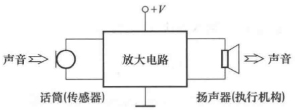

flowchart

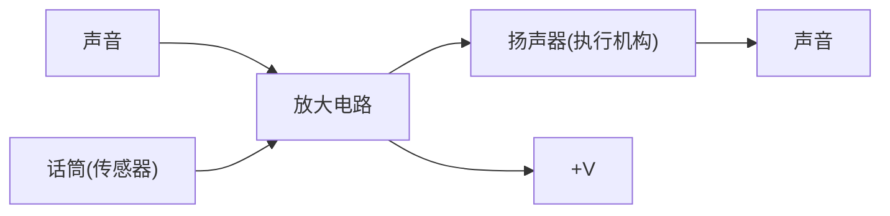

图 2.1.1 扩音机示意图

放大的前提是不失真,即只有在不失真的情况下放大才有意义。晶体管和场效应管是放大电路的核心元件,只有它们工作在合适的区域(晶体管工作在放大区、场效应管工作在恒流区),才能使输出量与输入量始终保持线性关系,即电路才不会产生失真。

由于任何稳态信号都可分解为若干频率正弦信号(谐波)的叠加,所以放大电路常以正弦波作为测试信号。

## 2.1.2 放大电路的性能指标

图2.1.2(a)所示为放大电路的示意图。对于信号而言，任何一个放大电路均可看成一个两端口网络。左边为输入端口，当内阻为 $R_{s}$ 的正弦波信号源 $\dot{U}_{s}$ 作用时，放大电路得到输入电压 $\dot{U}_{i}$，同时产生输入电流 $\dot{I}_{i}$；右边为输出端口，输出电压为 $\dot{U}_{o}$，输出电流为 $\dot{I}_{o}, R_{L}$ 为负载电阻。不同放大电路在 $\dot{U}_{s}$ 和 $R_{L}$ 相同的条件下，$\dot{U}, \dot{I}_{i}, \dot{U}_{o}, \dot{I}_{o}$ 将不同，说明不同放大电路从信号源索取的电流和获不同，且对同样信号的放大能力也不同；同一放大电路在幅值相同、频率不同的 $\dot{U}_{s}$ 作用下，$\dot{U}_{o}$ 也将不同，即同一放大电路对不同频率信号的放大能力也存在差异。为了反映放大电路的各方面性能，引出如下主要指标。

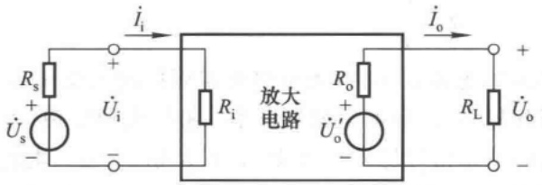

text_image

i_i
+
R_s
+
U_s
-
U_i
-
R_i
放大电路
i_o
+
R_o
+
U_o'
-
R_L
U_o
-

(a)

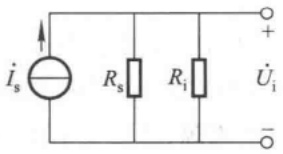

text_image

İs
Rs
Ri
Üi
+

(b)

图 2.1.2 放大电路示意图

(a) 放大电路示意图 (b) 信号源等效变换为电流源

## 一、放大倍数

放大倍数是直接衡量放大电路放大能力的重要指标,其值为输出量  $\dot{X}_{\mathrm{o}}(\dot{U}_{\mathrm{o}} \text{ 或 } \dot{I}_{\mathrm{o}})$  与输入量  $\dot{X}_{\mathrm{i}}(\dot{U}_{\mathrm{i}} \text{ 或 } \dot{I}_{\mathrm{i}})$  之比。对于小功率放大电路,人们常常只关心电路单一指标的放大倍数,如电压放

大倍数,而不研究其功率放大能力。

电压放大倍数是输出电压  $\dot{U}_{o}$  与输入电压  $\dot{U}_{i}$  之比，记作  $\dot{A}_{uu}^{①}$ ，即

$$
\dot {A} _ {u u} = \dot {A} _ {u} = \frac {\dot {U} _ {\mathrm{o}}}{\dot {U} _ {\mathrm{i}}} \tag {2.1.1}
$$

电流放大倍数是输出电流  $\dot{I}_{o}$  与输入电流  $\dot{I}_{i}$  之比，即

$$
\dot {A} _ {i i} = \dot {A} _ {i} = \frac {\dot {I} _ {\mathrm{o}}}{\dot {I} _ {\mathrm{i}}} \tag {2.1.2}
$$

电压对电流的放大倍数是输出电压  $\dot{U}_{o}$  与输入电流  $\dot{I}_{i}$  之比，即

$$
\dot {A} _ {u i} = \frac {\dot {U} _ {\mathrm{o}}}{\dot {I} _ {\mathrm{i}}} \tag {2.1.3}
$$

因其量纲为电阻,有些文献也称之为互阻放大倍数。

电流对电压的放大倍数是输出电流  $\dot{I}_{o}$  与输入电压  $\dot{U}_{i}$  之比，即

$$
\dot {A} _ {i u} = \frac {\dot {I} _ {\mathrm{o}}}{\dot {U} _ {\mathrm{i}}} \tag {2.1.4}
$$

因其量纲为电导,有些文献也称之为互导放大倍数。

本章重点研究电压放大倍数  $\dot{A}_{u}$  。应当指出，在实测放大倍数时，必须用示波器观察输出端的波形，只有在不失真的情况下，测试数据才有意义；测试其它指标时也应如此。

当输入信号为缓慢变化量或直流变化量时，输入电压、输入电流、输出电压和输出电流分别用 $\Delta u_{1},\Delta i_{1},\Delta u_{0}$ 和 $\Delta i_0$ 表示。放大倍数 $A_{u} = \Delta u_{0} / \Delta u_{1},A_{i} = \Delta i_{0} / \Delta i_{1},A_{ui} = \Delta u_{0} / \Delta i_{1},A_{iu} =$ $\Delta i_0 / \Delta u_1$ 。

## 二、输入电阻

放大电路与信号源相连接就成为信号源的负载,必然从信号源索取电流,电流的大小表明放大电路对信号源的影响程度。输入电阻  $R_{i}$  是从放大电路输入端看进去的等效电阻,定义为输入电压有效值  $U_{i}$  和输入电流有效值  $I_{i}$  之比,即

$$
R _ {\mathrm{i}} = \frac {U _ {\mathrm{i}}}{I _ {\mathrm{i}}} \tag {2.1.5}
$$

$R_{\mathrm{i}}$ 越大，表明放大电路从信号源索取的电流越小，放大电路所得到的输入电压 $U_{\mathrm{i}}$ 越接近信号源电压 $U_{\mathrm{s}}$；换言之，信号源内阻的压降越小，信号电压损失越小。根据诺顿定理，可将信号源等效变换为电流源，如图2.1.2(b)所示；通常信号源内阻 $R_{\mathrm{s}}$ 是常量，$R_{\mathrm{i}}$ 越小，输入电流 $I_{\mathrm{i}}$ 就越接近信号源电流 $I_{\mathrm{s}}$，信号源内阻 $R_{\mathrm{s}}$ 的分流越小，信号电流损失越小。可见，放大电路输入电阻的大小要视放大电路对信号的需要而设计。

## 三、输出电阻

任何放大电路的输出都可以等效成一个有内阻的电压源，从放大电路输出端看进去的等效内阻称为输出电阻 $R_{0}$ ，如图2.1.2(a)所示。 $U_{0}^{\prime}$ 为空载时输出电压的有效值， $U_{0}$ 为带负载后输出

<small>① 放大倍数 A 下标的第一个字母表示输出量, 第二个字母表示输入量, 为电压时标 u, 为电流时标 i。</small>

电压的有效值,因此

$$
U _ {\mathrm{o}} = \frac {R _ {\mathrm{L}}}{R _ {\mathrm{o}} + R _ {\mathrm{L}}} \cdot U _ {\mathrm{o}} ^ {\prime}
$$

输出电阻

$$
R _ {\mathrm{o}} = \left(\frac {U _ {\mathrm{o}} ^ {\prime}}{U _ {\mathrm{o}}} - 1\right) R _ {\mathrm{L}} \tag {2.1.6}
$$

$R_{o}$  愈小, 负载电阻  $R_{L}$  变化时,  $U_{o}$  的变化愈小, 放大电路的带负载能力愈强。然而, 若要使负载电阻获得的信号电流大一些, 则放大电路的输出电阻就应当小一些。因此, 放大电路输出电阻的大小要视负载的需要而设计。

输入电阻与输出电阻描述了电子电路在相互连接时所产生的影响。当两个放大电路相互连接时（如图2.1.3所示），放大电路Ⅱ的输入电阻 $R_{i2}$ 是放大电路Ⅰ的负载电阻，而放大电路Ⅰ是放大电路Ⅱ的信号源，其内阻就是放大电路Ⅰ的输出电阻 $R_{o1}$ 。因此，输入电阻和输出电阻均会直接或间接地影响放大电路的放大能力。

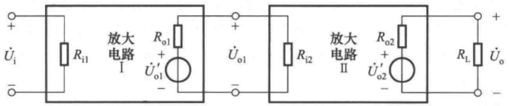

text_image

+
Üi
-
Ri1
放大电路
I
Ro1
+
Üo1
-
+
Üo1
-
Ri2
放大电路
II
Ro2
+
Üo2
-
RL
+
Üo
-

图 2.1.3 两个放大电路相连接的示意图

## 四、通频带

通频带用于衡量放大电路对不同频率信号的放大能力。由于放大电路中电容、电感及半导体器件结电容等电抗元件的存在，在输入信号频率较低或较高时，放大倍数的数值会下降并产生相移。一般情况，放大电路只适用于放大某一个特定频率范围内的信号。图2.1.4所示为某放大电路放大倍数的数值与信号频率的关系曲线，称为幅频特性曲线，图中 $\dot{A}_{m}$ 为中频放大倍数。

line

| Low (fL) | 0.707 |
| --- | --- |
| High (fH) | 0.707 |

图 2.1.4 放大电路的频率指标

在信号频率下降到一定程度时，放大倍数的数值明显下降，使放大倍数的数值等于0.707倍 $|\dot{A}_{\mathrm{m}}|$ 的频率称为下限截止频率 $f_{\mathrm{L}}$ 。信号频率上升到一定程度，放大倍数数值也将减小，使放大倍数的数值等于0.707倍 $|\dot{A}_{\mathrm{m}}|$ 的频率称为上限截止频率 $f_{\mathrm{H}}$ 。 $f$ 小于 $f_{\mathrm{L}}$ 的部分称为放大电路的低频段， $f$ 大于 $f_{H}$ 的部分称为高频段，而 $f_{L}$ 与 $f_{H}$ 之间形成的频带称为中频段，也称为放大电路的通频带 $f_{bw}$ 。

$$
f _ {\mathrm{bw}} = f _ {\mathrm{H}} - f _ {\mathrm{L}} \tag {2.1.7}
$$

通频带宽,表明放大电路对不同频率信号的适应能力越强。当频率趋近于零或无穷大时放大倍数的数值趋近于零。对于扩音机,其通频带应宽于音频(20 Hz\~20 kHz)范围,才能完全不失真地放大声音信号。在实用电路中有时也希望频带尽可能窄,比如选频放大电路,从理论上讲希望它只对单一频率的信号放大,以避免干扰和噪声的影响。

## 五、非线性失真系数

由于放大器件均具有非线性特性,它们的线性放大范围有一定的限度,当输入信号幅度超过一定值后,输出电压将会产生非线性失真。输出波形中的谐波成分总量与基波成分之比称为非线性失真系数D。设基波幅值为 $A_{1}$ ,谐波幅值为 $A_{2}$ 、 $A_{3}\cdots$ 则

$$
D = \sqrt {\left(\frac {A _ {2}}{A _ {1}}\right) ^ {2} + \left(\frac {A _ {3}}{A _ {1}}\right) ^ {2} + \cdots} \tag {2.1.8}
$$

## 六、最大不失真输出电压

最大不失真输出电压定义为当输入电压再增大就会使输出波形产生非线性失真时的输出电压。实测时，需要定义非线性失真系数的额定值，比如 $10\%$ ，输出波形的非线性失真系数刚刚达到此额定值时的输出电压即为最大不失真输出电压。一般以有效值 $U_{\mathrm{om}}$ 表示，也可以用峰-峰值 $U_{\mathrm{opp}}$ 表示， $U_{\mathrm{opp}} = 2\sqrt{2} U_{\mathrm{om}}$ 。

## 七、最大输出功率与效率

在输出信号不失真的情况下,负载上能够获得的最大功率称为最大输出功率  $P_{om}$  。此时,输出电压达到最大不失真输出电压。

直流电源能量的利用率称为效率  $\eta$ ，设电源消耗的功率为  $P_{v}$ ，则效率  $\eta$  等于最大输出功率  $P_{om}$  与  $P_{v}$  之比，即

$$
\eta = \frac {P _ {\mathrm{om}}}{P _ {\mathrm{v}}} \tag {2.1.9}
$$

在测试上述指标参数时，对于 $A, R_{\mathrm{i}}, R_{\mathrm{o}}$ ，应给放大电路输入中频段小幅值信号；对于 $f_{\mathrm{L}}, f_{\mathrm{H}}, f_{\mathrm{BW}}$ ，应给放大电路输入小幅值、宽频率范围的信号；对于 $U_{\mathrm{om}}, P_{\mathrm{om}}, \eta$ 和 $D$ ，应给放大电路输入中频段大幅值信号。

## 思考题

2.1.1 在放大电路中,输出电流和输出电压是由有源元件提供的吗?为什么?
2.1.2 在放大电路中,输出电压是否一定大于输入电压? 输出电流是否一定大于输入电流? 放大电路放大的特征是什么?
2.1.3 已知放大电路空载时的电压放大倍数  $\left|\dot{A}_{u}\right|=U_{o}/U_{i}$  ( $U_{o}$  和  $U_{i}$  均为有效值)、输入电阻  $R_{i}$ 、输出电阻  $R_{o}$ ，试求出  $\left|\dot{A}_{ui}\right|$ 、 $\left|\dot{A}_{iu}\right|$  和  $\left|\dot{A}_{ii}\right|$ 。
2.1.4 两级放大电路的方框图如图 2.1.3 所示, 已知电路 I 和电路 II 空载时的电压放大倍数, 以及它们的输入电阻和输出电阻, 试求解整个电路的电压放大倍数。

## 2.2 基本共射放大电路的工作原理

本节将以 NPN 型晶体管组成的基本共射放大电路为例, 阐明放大电路的组成原则及电路中各元件的作用。

## 2.2.1 基本共射放大电路的组成及各元件的作用

图 2.2.1 所示为基本共射放大电路，晶体管是起放大作用的核心元件。输入信号  $u_{i}$  为正弦波电

压。由于该电路是依据晶体管工作在放大状态 b-e、c-e 所需电压而组成，故也称之为原理性电路，以区别于实用电路。

当 $u_{\mathrm{i}} = 0$ 时，称放大电路处于静态。在输入回路中，基极电源 $V_{\mathrm{BB}}$ 使晶体管b-e间电压 $U_{\mathrm{BE}}$ 大于开启电压 $U_{\mathrm{on}}$ ，并与基极电阻 $R_{\mathrm{b}}$ 共同决定基极电流 $I_{\mathrm{B}}$ ；在输出回路中，集电极电源 $V_{\mathrm{CC}}$ 应足够高，使晶体管的集电结反向偏置，以保证晶体管工作在放大状态，因此集电极电流 $I_{\mathrm{C}} = \beta I_{\mathrm{B}}$ ；集电极电阻 $R_{\mathrm{c}}$ 上的电流等于 $I_{\mathrm{C}}$ ，因而其电压为 $I_{\mathrm{C}}R_{\mathrm{c}}$ ，从而确定了c-e间电压 $U_{\mathrm{CE}} = V_{\mathrm{CC}} - I_{\mathrm{C}}R_{\mathrm{c}}$ 。

text_image

Rb
+
ui
-
VBB
T
Rc
+
uo
-
VCC

图 2.2.1 基本共射放大电路

当 $u_{\mathrm{i}}$ 不为0时，在输入回路中，必将在静态值的基础上产生一个动态的基极电流 $i_{\mathrm{b}}$ ；当然，在输出回路就得到动态电流 $i_{\mathrm{c}}$ ；集电极电阻 $R_{\mathrm{c}}$ 将集电结电流的变化转化成电压的变化，使得管压降 $u_{\mathrm{CE}}$ 产生变化，管压降的变化量就是输出动态电压 $u_{\mathrm{o}}$，从而实现了电压放大。直流电源 $V_{\mathrm{CC}}$ 为输出提供所需能量。

由于图 2.2.1 所示电路的输入回路与输出回路以发射极为公共端, 故称之为共射放大电路。在电子电路中, 称公共端为“地”。

## 2.2.2 设置静态工作点的必要性

## 一、静态工作点

由以上分析可知，在放大电路中，当有信号输入时，交流量与直流量共存。将输入信号为零、即直流电源单独作用时晶体管的基极电流 $I_{\mathrm{B}}$ 、集电极电流 $I_{\mathrm{C}}$ 、b-e间电压 $U_{\mathrm{BE}}$ 、管压降 $U_{\mathrm{CE}}$ 称为放大电路的静态工作点 $Q^{①}$，常将四个物理量记作 $I_{\mathrm{BQ}}$ 、 $I_{\mathrm{CQ}}$ 、 $U_{\mathrm{BEQ}}$ 、 $U_{\mathrm{CEQ}}$ 。在近似估算中常认为 $U_{\mathrm{BEQ}}$ 为已知量，对于硅管，取 $|U_{\mathrm{BEQ}}|$ 为0.6\~0.8V中的某一值，如0.7V；对于锗管，取 $|U_{\mathrm{BEQ}}|$ 为0.1\~0.3V中的某一值，如0.2V；而且认为穿透电流 $I_{\mathrm{CEO}} = 0, \bar{\beta} = \beta$ 。

在图 2.2.1 所示电路中，令  $\dot{U}_{i}=0$ ，根据回路方程，便可得到静态工作点的表达式

$$
\left\{ \begin{array}{l l} I _ {\mathrm{BQ}} = \frac {V _ {\mathrm{BB}} - U _ {\mathrm{BEQ}}}{R _ {\mathrm{b}}} & (2. 2. 1 \mathrm{a}) \\ I _ {\mathrm{CQ}} = \overline {{\beta}} I _ {\mathrm{BQ}} = \beta I _ {\mathrm{BQ}} & (2. 2. 1 \mathrm{b}) \\ U _ {\mathrm{CEQ}} = V _ {\mathrm{CC}} - I _ {\mathrm{CQ}} R _ {\mathrm{c}} & (2. 2. 1 \mathrm{c}) \end{array} \right.
$$

<small>① Q 是英文 Quiescent 的字头。</small>

## 二、为什么要设置静态工作点

既然放大电路要放大的对象是动态信号,那么为什么要设置静态工作点呢?为了说明这一问题,不妨将基极电源去掉,如图2.2.2所示,电源 $+V_{CC}$ 的负端接“地”。

图 2.2.2 没有设置合适的静态工作点

(a) 电路 (b) 分析

在图2.2.2所示电路中，静态时将输入端A与B短路，必然得出 $I_{\mathrm{BQ}} = 0, I_{\mathrm{CQ}} = 0, U_{\mathrm{CEQ}} \approx V_{\mathrm{CC}}$ 的结论，因而晶体管处于截止状态。当加入输入电压 $u_{\mathrm{i}}$ 时， $u_{\mathrm{AB}} = u_{\mathrm{i}}$，若其峰值小于b-e间开启电压 $U_{\mathrm{on}}$，则在信号的整个周期内晶体管始终工作在截止状态，因而 $U_{\mathrm{CE}}$ 毫无变化，输出电压为零；即使 $u_{\mathrm{i}}$ 的幅值足够大，晶体管也只可能在信号正半周大于 $U_{\mathrm{on}}$ 的时间间隔内导通，所以输出电压必然严重失真。

对于放大电路的最基本要求,一是不失真,二是能够放大。如果输出波形严重失真,所谓“放大”就毫无意义了。因此,设置合适的静态工作点,以保证放大电路不产生失真是非常必要的。

应当指出，$Q$ 点不仅影响电路是否会产生失真，而且影响着放大电路几乎所有的动态参数，这些将在后面几节中详细加以说明。

## 2.2.3 基本共射放大电路的工作原理及波形分析

在图2.2.1所示的基本放大电路中，静态时的 $I_{\mathrm{BQ}}$ 、 $I_{\mathrm{CQ}}$ 、 $U_{\mathrm{CEQ}}$ 如图2.2.3(b)、(c)中虚线所标注。

当有输入电压时，基极电流是在原来直流分量 $I_{\mathrm{BQ}}$ 的基础上叠加一个正弦交流电流 $i_{\mathrm{b}}$，因而基极总电流 $i_{\mathrm{B}} = I_{\mathrm{BQ}} + i_{\mathrm{b}}$，见图2.2.3(b)中实线所画波形。根据晶体管基极电流对集电极电流的控制作用，集电极电流也会在直流分量 $I_{\mathrm{CQ}}$ 的基础上产生一个正弦交流电流 $i_{\mathrm{c}}$，而且 $i_{\mathrm{c}} = \beta i_{\mathrm{b}}$，集电结总电流 $i_{\mathrm{C}} = I_{\mathrm{CQ}} + \beta i_{\mathrm{b}}$。不难理解，集电极动态电流 $i_{\mathrm{c}}$ 必将在集电极电阻 $R_{\mathrm{c}}$ 上产生一个与 $i_{\mathrm{c}}$ 波形相同的交变电压。而由于 $R_{\mathrm{c}}$ 上的电压增大时，管压降 $u_{\mathrm{CE}}$ 必然减小；$R_{\mathrm{c}}$ 上的电压减小时，$u_{\mathrm{CE}}$ 必然增大，所以管压降是在直流分量 $U_{\mathrm{CEQ}}$ 的基础上叠加上一个与 $i_{\mathrm{c}}$ 变化方向相反的交变电压 $u_{\mathrm{ce}}$。管压降总量 $u_{\mathrm{CE}} = U_{\mathrm{CEQ}} + u_{\mathrm{ce}}$，见图2.2.3(c)中实线所画波形。将管压降中的直流分量 $U_{\mathrm{CEQ}}$ 去掉，就得到一个与输入电压 $u_{\mathrm{i}}$ 相位相反且放大了的交流电压 $u_{\mathrm{o}}$，如图2.2.3(d)所示。

图 2.2.3 基本共射放大电路的波形分析

(a)  $u_{i}$  的波形 (b)  $i_{\mathrm{B}}(i_{\mathrm{C}})$  的波形 (c)  $u_{CE}$  的波形 (d)  $u_{o}$  的波形

从以上分析可知,对于基本共射放大电路,只有设置合适的静态工作点,使交流信号驮载在直流分量之上,以保证晶体管在输入信号的整个周期内始终工作在放大状态,输出电压波形才不会产生非线性失真。基本共射放大电路的电压放大作用是利用晶体管的电流放大作用,并依靠 $R_{c}$ 将电流的变化转化成电压的变化来实现的。

## 2.2.4 放大电路的组成原则

## 一、组成原则

通过对基本共射放大电路的简单分析可以总结出,在组成放大电路时必须遵循以下几个原则。

（1）必须根据所用放大管的类型提供直流电源，以便设置合适的静态工作点，并作为输出的能源。对于晶体管放大电路，电源的极性和大小应使晶体管发射结处于正向偏置，且静态电压 $|U_{BEQ}|$ 大于开启电压 $U_{on}$，以保证晶体管工作在导通状态；集电结处于反向偏置，以保证晶体管工作在放大区。对于场效应管放大电路，电源的极性和大小应为场效应管的栅-源之间、漏-源之间提供合适的电压，从而使之工作在恒流区。

(2) 电阻取值得当,与电源配合,使放大管有合适的静态工作电流。

（3）输入信号必须能够作用于放大管的输入回路。对于晶体管，输入信号必须能够改变基极与发射极之间的电压，产生  $\Delta u_{BE}$ ，从而改变基极或发射极电流，产生  $\Delta i_{B}$  或  $\Delta i_{E}$ 。对于场效应管，输入信号必须能够改变栅-源之间的电压，产生  $\Delta u_{GS}$ 。这样，才能改变放大管输出回路的电流，从而放大输入信号。

（4）当负载接入时，必须保证放大管输出回路的动态电流（晶体管的  $\Delta i_{C}$ 、 $\Delta i_{E}$  或场效应管的  $\Delta i_{D}$ 、 $\Delta i_{S}$ ）能够作用于负载，从而使负载获得比输入信号大得多的信号电流或信号电压。

## 二、两种实用的共射放大电路

根据上述原则,可以构成与图 2.2.1 不尽相同的共射放大电路。

在实用放大电路中,为了防止干扰,常要求输入信号、直流电源、输出信号均有一端接在公共

端，即“地”端，称为“共地”。这样，将图2.2.1所示电路中的基极电源与集电极电源合二为一，

并且为了合理设置静态工作点，在基极回路又增加一个电阻，便得到图2.2.4所示的共射放大电路。由于图2.2.1和图2.2.4所示电路中信号源与放大电路、放大电路与负载电阻均直接相连，故称为“直接耦合”，“耦合”即为“连接”。

将图 2.2.4 所示电路的输入端短路便可求出静态工作点。

$$
\left\{ \begin{array}{l l} I _ {\mathrm{BQ}} = \frac {V _ {\mathrm{CC}} - U _ {\mathrm{BEQ}}}{R _ {\mathrm{b2}}} - \frac {U _ {\mathrm{BEQ}}}{R _ {\mathrm{b1}}} & (2. 2. 2 \mathrm{a}) \\ I _ {\mathrm{CQ}} = \overline {{\beta}} I _ {\mathrm{BQ}} = \beta I _ {\mathrm{BQ}} & (2. 2. 2 \mathrm{b}) \\ U _ {\mathrm{CEQ}} = V _ {\mathrm{CC}} - I _ {\mathrm{CQ}} R _ {\mathrm{c}} & (2. 2. 2 \mathrm{c}) \end{array} \right.
$$

text_image

Rb1
+ VCC
Rb2
Rc
T
+
uI
uo
RL
-

图 2.2.4 直接耦合共射放大电路

应当指出， $R_{b1}$ 是必不可少的。试想，若 $R_{b1}=0$，则静态时，由于输入端短路， $I_{BQ}=0$，晶体管将截止，电路不可能正常工作。 $R_{b1}$ 、 $R_{b2}$ 的取值与 $V_{CC}$ 相配合，才能得到合适的基极电流 $I_{BQ}$，合理地选取 $R_{c}$，才能得到合适的管压降 $U_{CEQ}$ 。有输入信号时的波形分析如图2.2.3所示。

当输入信号作用时，由于信号电压在图2.2.1所示电路中的 $R_{b}$ 和图2.2.4所示电路中的 $R_{b1}$ 上均有损失，因而减小了晶体管基极与发射极之间的信号电压，也就影响了电路的放大能力。同时，上述两种电路接入负载后，负载电阻不但有信号电压，还有直流电源作用的结果，即存在直流分量，这常常需要去除。图2.2.5(a)所示电路既解决了“共地”问题，又使一定频率范围内的输入信号几乎毫无损失地加到放大管的输入回路，而且负载电阻上没有直流分量。

text_image

Rb
C1
+
UBEQ
+
ui
-
Rc
C2
+
UCEQ
-
+
T
uo
RL
+VCC
-

(a)

text_image

UBEQ
+
ui
-
T

(b)

图 2.2.5 阻容耦合共射放大电路

(a) 电路 (b) 输入回路等效电路

图 2.2.5(a) 中电容  $C_{1}$  用于连接信号源与放大电路，电容  $C_{2}$  用于连接放大电路与负载。在电子电路中起连接作用的电容称为耦合电容 $^{①}$ ，利用电容连接电路称为阻容耦合，故图 2.2.5(a) 所示电路为阻容耦合共射放大电路。由于电容对直流量的容抗无穷大，所以信号源与放大电路、放大电路与负载之间没有直流量通过。耦合电容的容量应足够大，使其在输入信号频率范围内的容抗很小,可视为短路,所以输入信号几乎无损失地加在放大管的基极与发射极之间。可见,耦合电容的作用是“隔离直流,通过交流”。令输入端短路,可以求出静态工作点。

<small>① 耦合电容容量较大，多为电解电容，接入电路时应注意其正、负极。</small>

$$
\left\{ \begin{array}{l l} I _ {\mathrm{BQ}} = \frac {V _ {\mathrm{CC}} - U _ {\mathrm{BEQ}}}{R _ {\mathrm{b}}} & (2. 2. 3 \mathrm{a}) \\ I _ {\mathrm{CQ}} = \overline {{\beta}} I _ {\mathrm{BQ}} = \beta I _ {\mathrm{BQ}} & (2. 2. 3 \mathrm{b}) \\ U _ {\mathrm{CEQ}} = V _ {\mathrm{CC}} - I _ {\mathrm{CQ}} R _ {\mathrm{c}} & (2. 2. 3 \mathrm{c}) \end{array} \right.
$$

电容 $C_1$ 上的电压为 $U_{\mathrm{BEQ}}$ ，电容 $C_2$ 上的电压为 $U_{\mathrm{CEQ}}$ ，方向如图2.2.5(a)中所标注。由于在输入信号作用时， $C_1$ 上电压基本不变，因此可将其等效成一个电池，如图2.2.5(b)所示。这样，放大管基极与发射极之间总电压为 $U_{\mathrm{BEQ}}$ 与 $u_{\mathrm{i}}$ 之和。 $u_{\mathrm{i}},i_{\mathrm{B}},i_{\mathrm{C}},u_{\mathrm{CE}},u_{\mathrm{o}}$ 的波形分析如图2.2.3所示。应该注意，输出电压 $u_{\mathrm{o}}$ 等于集电极与发射极之间总电压减去 $C_2$ 上的电压 $U_{\mathrm{CEQ}}$ ，所以 $u_{\mathrm{o}}$ 为纯交流信号。

【例 2.2.1】现有一个直流电源,试用一只 PNP 型管组成共射放大电路。

解: 在放大电路中, 直流电源一方面设置合适的静态工作点, 另一方面作为负载的能源。为使晶体管导通, 发射结应正偏, 因而 PNP 型管的发射极应接电源的正极, 而基极应接电源的负极; 且为了限制基极电流, 基极回路应加电阻  $R_{b}$ , 如图 2.2.6(a) 所示。为使晶体管工作在放大状态, 集电结应反偏, 因而 PNP 型管的集电极应接电源的负极; 且为了将集电极电流的变化转换为电压的变化, 集电极应通过电阻  $R_{c}$  接电源的负极, 如图(b) 所示。为了使输入信号驮载在 b-e 静态电压之上, 则应在晶体管基极与信号源之间加一个电阻或电容, 如图(c)、(d) 所示; 图(c) 电路的输入端为直接耦合方式, 图(d) 电路的输入端为阻容耦合方式; 它们的输出端均采用了直接耦合方式, 当然也可采用阻容耦合方式。

text_image

-Vcc
Rb
T

(a)

text_image

Rb
Rc
- VCC
T

(b)

text_image

R
Rb
-VCC
Rc
+
T
uO
RL
uI
-

(c)

text_image

C
+
ui
-
Rb
T
Rc
-VCC
+
uo
RL
-

(d)

图 2.2.6 用 PNP 型管组成共射放大电路

(a) 使发射结正偏

(b) 使集电结反偏

(c) 输入端为直接耦合的共射放大电路

(d) 输入端为阻容耦合的共射放大电路

## 思考题

2.2.1 试用 NPN 型管组成一个共射放大电路,使之在输入为零时输出为零。要求画出电路图。可以用一路电源,也可用两路电源。
2.2.2 试标出图 2.2.6(d) 中耦合电容的极性。
2.2.3 PNP 管共射放大电路的输出电压与输入电压反相吗？用波形来分析这个问题。
2.2.4 在图 2.2.1 所示电路中, 若在输出端接入负载电阻  $R_{L}$ , 则如何求解静态管压降  $U_{CEQ}$ ?

## 2.3 放大电路的分析方法

分析放大电路就是在理解放大电路工作原理的基础上求解静态工作点和各项动态参数。本节以 NPN 型晶体管组成的基本共射放大电路为例，针对电子电路中存在着晶体管或场效应管等非线性器件，而且直流量与交流量同时作用的特点，提出分析方法。

## 2.3.1 直流通路与交流通路

通常，在放大电路中，直流电源的作用和交流信号的作用总是共存的，即静态电流、电压和动态电流、电压总是共存的。但是由于电容、电感等电抗元件的存在，直流量所流经的通路与交流信号所流经的通路不完全相同。因此，为了研究问题方便起见，常把直流电源对电路的作用和输入信号对电路的作用区分开来，分成直流通路和交流通路。

直流通路是在直流电源作用下直流电流流经的通路,也就是静态电流流经的通路,用于研究静态工作点。对于直流通路,①电容视为开路;②电感线圈视为短路(即忽略线圈电阻);③信号源视为短路,但应保留其内阻。

交流通路是输入信号作用下交流信号流经的通路,用于研究动态参数。对于交流通路,
① 容量大的电容(如耦合电容)视为短路,② 无内阻的直流电源(如  $V_{cc}$ )视为短路。

根据上述原则，图2.2.1所示共射放大电路的直流通路如图2.3.1(a)所示。图中，基极电源 $V_{BB}$ 和集电极电源 $V_{CC}$ 的负极均接地。为了得到交流通路，应将直流电源 $V_{BB}$ 和 $V_{CC}$ 均短路，因而集电极电阻 $R_{c}$ 并联在晶体管的集电极和发射极之间，如图2.3.1(b)所示。

text_image

+V_BB R_b T +V_CC
R_c
(a)
R_b T R_c
+ U_i - U_o -
(b)
R_b T R_c U_o
+ U_i - U_o -

图 2.3.1 图 2.2.1 所示共射放大电路的直流通路和交流通路

(a) 直流通路 (b) 交流通路

在图2.3.2(a)所示的直接耦合共射放大电路中， $R_{\mathrm{s}}$ 为信号源内阻，因此其直流通路如图(b)所示。从直流通路可以看出，直接耦合放大电路的静态工作点既与信号源内阻 $R_{\mathrm{s}}$ 有关，又与负载电阻 $R_{\mathrm{L}}$ 有关。由于直流电源 $V_{\mathrm{CC}}$ 对交流信号短路，所以，在交流通路中， $R_{\mathrm{b2}}$ 并联在晶体管的基极与发射极之间，而集电极电阻 $R_{\mathrm{c}}$ 和负载电阻 $R_{\mathrm{L}}$ 均并联在晶体管的集电极与发射极之间，如图2.3.2(c)所示。

text_image

Rb1
Rs
+
us
-
Rb2
T
Rc
+VCC
+
RL
uO
-

(a)

text_image

Rb1
Rs
Rb2
T
+VCC
Rc
RL

(b)

text_image

Rs
+
Us
-
Rb1
T
Rb2
Rc
RL
Uo
+

(c)

图 2.3.2 直接耦合共射放大电路及其直流通路和交流通路

(a) 直接耦合共射放大电路 (b) 直流通路 (c) 交流通路

在图2.2.5(a)所示阻容耦合放大电路中，信号源内阻为0。对于直流量， $C_1, C_2$ 开路，所以直流通路如图2.3.3(a)所示。对于交流信号， $C_1, C_2$ 相当于短路，直流电源 $V_{\mathrm{CC}}$ 短路，因而输入电压 $\dot{U}_{\mathrm{i}}$ 加在晶体管基极与发射极之间，基极电阻 $R_{\mathrm{b}}$ 并联在输入端；集电极电阻 $R_{\mathrm{e}}$ 与负载电阻$R_{\mathrm{L}}$ 并联在集电极与发射极之间，即并联在输出端。因此，交流通路如图2.3.3(b)所示。从直流通路可以看出，由于 $C_1, C_2$ 的“隔直”作用，静态工作点与信号源内阻和负载电阻无关。

text_image

Rb
Rc
+Vcc
T

(a)

text_image

+
Üᵢ
-
Rb
T
Rc
RL
Üₒ
+

(b)

图 2.3.3 阻容耦合共射放大电路的直流通路和交流通路

(a) 直流通路 (b) 交流通路

在分析放大电路时，应遵循“先静态，后动态”的原则，求解静态工作点时应利用直流通路，求解动态参数时应利用交流通路，两种通路切不可混淆。静态工作点合适，动态分析才有意义。对于简单电路，不一定非画出直流通路不可。读者不难发现，在式(2.2.1)、(2.2.2)、(2.2.3)的分析过程中已经使用了直流通路。

## 2.3.2 图解法

在实际测出放大管的输入特性、输出特性和已知放大电路中其它各元件参数的情况下，利用作图的方法对放大电路进行分析即为图解法。

## 一、静态工作点的分析

将图 2.2.1 所示电路变换成图 2.3.4 所示电路, 用虚线将晶体管与外电路分开, 两条虚线之间为晶体管, 虚线之外是电路的其它元件。

text_image

ΔuI
+
-
VBB
Rb
iB
+
-
uBE
T
iC
+
-
uCE
Rc
VCC

图 2.3.4 共射放大电路

当输入信号  $\Delta u_{1}=0$  时, 在晶体管的输入回路中, 静态工作点既应在晶体管的输入特性曲线上, 又应满足外电路的回路方程:

$$
u _ {\mathrm{BE}} = V _ {\mathrm{BB}} - i _ {\mathrm{B}} R _ {\mathrm{b}} \tag {2.3.1}
$$

在输入特性坐标系中，画出式(2.3.1)所确定的直线，它与横轴的交点为 $(V_{\mathrm{BB}},0)$ ，与纵轴的交点为 $(0,V_{\mathrm{BB}}/R_{\mathrm{b}})$ ，斜率为 $-1/R_{b}$ 。直线与曲线的交点就是静态工作点Q，其横坐标值为 $U_{BEQ}$ ，纵坐标值为 $I_{BQ}$ ，如图2.3.5(a)中所标注。式(2.3.1)所确定的直线称为输入回路负载线。

line

| 特征 | 描述 |
| --- | --- |
| Y轴标签 | i_B |
| X轴标签 | u_BE |
| 曲线类型 | 线性 (Line) |
| 关键点 | Q (均衡点) |
| 曲线交点 | V_BB/R_b |
| 曲线交点 | I_BQ |
| 曲线交点 | U_BEQ |

(a)

line

| uCE | ic (Curve 1) | ic (Curve 2) | ic (Curve 3) | ic (Curve 4) |
| --- | --- | --- | --- | --- |
| 0 | 0 | 0 | 0 | 0 |
| U_CEQ | I_CQ | I_CQ | I_CQ | I_CQ |
| >U_CEQ | Constant | Constant | Constant | Constant |

(b)

图 2.3.5 利用图解法求解静态工作点

(a) 输入回路的图解分析 (b) 输出回路的图解分析

与输入回路相似,在晶体管的输出回路中,静态工作点既应在 $I_{B}=I_{BQ}$ 的那条输出特性曲线上,又应满足外电路的回路方程:

$$
u _ {\mathrm{CE}} = V _ {\mathrm{CC}} - i _ {\mathrm{C}} R _ {\mathrm{c}} \tag {2.3.2}
$$

在输出特性坐标系中，画出式(2.3.2)所确定的直线，它与横轴的交点为 $(V_{\mathrm{CC}},0)$，与纵轴的交点为（0，$V_{\mathrm{CC}} / R_{\mathrm{c}}$），斜率为 $-1 / R_{\mathrm{c}}$；并且找到 $I_{\mathrm{B}} = I_{\mathrm{BQ}}$ 的那条输出特性曲线，该曲线与上述直线的交点就是静态工作点 $Q$ ，其纵坐标值为 $I_{\mathrm{CQ}}$ ，横坐标值为 $U_{\mathrm{CEQ}}$ ，如图2.3.5(b)中所标注。由式(2.3.2)所确定的直线称为输出回路负载线。

应当指出，如果输出特性曲线中没有 $I_{\mathrm{B}} = I_{\mathrm{BQ}}$ 的那条输出特性曲线，则应当补测该曲线。

## 二、电压放大倍数的分析

当加入输入信号  $\Delta u_{1}$  时, 输入回路方程为

$$
u _ {\mathrm{BE}} = V _ {\mathrm{BB}} + \Delta u _ {\mathrm{I}} - i _ {\mathrm{B}} R _ {\mathrm{b}} \tag {2.3.3}
$$

该直线与横轴的交点为 $(V_{\mathrm{BB}}+\Delta u_{1},0)$ ，与纵轴的交点为 $\left(0,\frac{V_{\mathrm{BB}}+\Delta u_{1}}{R_{\mathrm{b}}}\right)$ 。但斜率仍为 $-1/R_{b}$ 。

在求解电压放大倍数 $A_{u}$ 时，首先给定 $\Delta u_{\mathrm{I}}$ ，然后根据式(2.3.3)做输入回路负载线，从输入回路负载线与输入特性曲线的交点便可得到在 $\Delta u_{\mathrm{I}}$ 作用下的基极电流变化量 $\Delta i_{\mathrm{B}}$ ；在输出特性中，找到 $i_{\mathrm{B}} = I_{\mathrm{BQ}} + \Delta i_{\mathrm{B}}$ 的那条输出特性曲线，输出回路负载线与曲线的交点为（ $U_{\mathrm{CEQ}} + \Delta u_{\mathrm{CE}}, I_{\mathrm{CQ}} + \Delta i_{\mathrm{C}}$ )，其中 $\Delta u_{\mathrm{CE}}$ 就是输出电压，见图2.3.6所示。从而可得电压放大倍数

$$
A _ {u} = \frac {\Delta u _ {\mathrm{CE}}}{\Delta u _ {\mathrm{I}}} = \frac {\Delta u _ {\mathrm{O}}}{\Delta u _ {\mathrm{I}}} \tag {2.3.4}
$$

line

| 特征 | 描述 |
| --- | --- |
| Y轴标签 | i_B |
| X轴标签 | u_BE |
| 关键点 | Q (基极点) |
| 曲线1 | V_BB/R_b |
| 曲线2 | (V_BB+Δu_1)/R_b |
| 曲线3 | U_BEQ |
| 曲线4 | V_BB |
| 曲线5 | \(\Delta u_BE\) |
| 曲线6 | \(\Delta u_1\) |
| 曲线7 | I_BQ |
| 曲线8 | \(\Delta i_B\) |

(a)

line

| u_CE | ic (IB=IBQ) | ic (IB=IBQ+I_BQ) |
| --- | --- | --- |
| 0 | 0 | 0 |
| U_CEQ | I_CQ | — |
| U_CEQ | I_CQ | I_CQ + I_BQ |
| >U_CEQ | I_CQ | I_B = I_BQ + \(\Delta i_B\) |

(b)

图2.3.6 利用图解法求解电压放大倍数

(a) 从 $\Delta u_{\mathrm{I}}$ 得出 $\Delta i_{\mathrm{B}}$ (b) 从 $\Delta i_{\mathrm{B}}$ 得出 $\Delta i_{\mathrm{C}}$ 和 $\Delta u_{\mathrm{CE}}(\Delta u_{\mathrm{O}})$

上述求解过程可简述如下:首先给定  $\Delta u_{1}$

$$
\Delta u _ {1} (\text {经输入回路图解}) \rightarrow \Delta i _ {\mathrm{B}} (\text {经输出回路图解}) \rightarrow \Delta i _ {\mathrm{C}} \rightarrow \Delta u _ {\mathrm{CE}} \rightarrow A _ {u}
$$

从图解分析可知，当 $\Delta u_{1} > 0$ 时，$\Delta i_{\mathrm{B}} > 0, \Delta i_{\mathrm{C}} > 0$，而 $\Delta u_{\mathrm{CE}} < 0$；反之，当 $\Delta u_{1} < 0$ 时，$\Delta i_{\mathrm{B}} < 0, \Delta i_{\mathrm{C}} < 0$，而 $\Delta u_{\mathrm{CE}} > 0$；说明输出电压与输入电压的变化相反。在输入回路中，若直流电压 $V_{\mathrm{BB}}$ 的数值不变，则基极电阻 $R_{\mathrm{b}}$ 的值愈小，$Q$ 点愈高（即 $I_{\mathrm{BQ}}$ 和 $U_{\mathrm{BEQ}}$ 的值愈大），$Q$ 点附近的曲线愈陡，因而在同样的 $\Delta u_{1}$ 作用下所产生的 $\Delta i_{\mathrm{B}}$ 就愈大，也就意味着 $|A_u|$ 将愈大。在输出回路中，$R_{\mathrm{c}}$ 的数值愈小，负载线愈陡，这就意味着同样的 $\Delta i_{\mathrm{C}}$ 下所产生的 $\Delta u_{\mathrm{CE}}$ 愈小，即 $|A_u|$ 将愈小。可见，$Q$ 点的位置影响着放大电路的电压放大能力。

应当指出，利用图解法求解电压放大倍数时，$\Delta u_{1}$ 的数值愈大，晶体管的非线性特性对分析结果的影响愈大。另外，其分析过程与后面将阐述的微变等效电路法相比，较为繁琐，而且误差较大。因此，讲述图解法求解 $A_{u}$ 的目的是为了进一步体会放大电路的工作原理和 $Q$ 点对 $A_{u}$ 的

影响。

## 三、波形非线性失真的分析

当输入电压为正弦波时，若静态工作点合适且输入信号幅值较小，则晶体管b-e间的动态电压为正弦波，基极动态电流也为正弦波，如图2.3.7(a)所示。在放大区内集电极电流随基极电流按 $\beta$ 倍变化，并且 $i_{\mathrm{C}}$ 与 $u_{\mathrm{CE}}$ 将沿负载线变化。当 $i_{\mathrm{C}}$ 增大时，$u_{\mathrm{CE}}$ 减小；当 $i_{\mathrm{C}}$ 减小时，$u_{\mathrm{CE}}$ 增大。由此得到动态管压降 $u_{\mathrm{ce}}$ ，即输出电压 $u_{\mathrm{o}}, u_{\mathrm{o}}$ 与 $u_{\mathrm{i}}$ 反相，如图(b)所示。

line

| Parameter | Description |
| --- | --- |
| iB | Input Current |
| uBE | Output Voltage |
| t | Time |
| IBQ | Breakdown Current |
| Q | Point of Charge/Transition |
| VBW | Voltage waveform |
| UBEQ | Equilibrium voltage level |
| ube | Base current level |
| ui | Input current level |

(a)

line

| Parameter | Description |
| --- | --- |
| ic | Collector Current |
| iC | Base Current |
| ICO | Output Current |
| IBQ | Base Output Current |
| uBE | Base-Emitter Voltage |
| UCES | Critical Voltage Level |
| UCEQ | Critical Voltage Level |
| t | Time (t) |
| VCC/Rc | Supply Voltage Ratio |
| Q | Point of Charge/Transition |

(b)

图 2.3.7 基本共射放大电路的波形分析

(a) 输入回路的波形分析 (b) 输出回路的波形分析

当 $Q$ 点过低时，在输入信号负半周靠近峰值的某段时间内，晶体管b-e间电压总量 $u_{\mathrm{BE}}$ 小于其开启电压 $U_{\mathrm{on}}$ ，晶体管截止。因此基极电流 $i_{\mathrm{b}}$ 将产生底部失真，如图2.3.8(a)所示。集电极电流 $i_{\mathrm{c}}$ 和集电极电阻 $R_{\mathrm{c}}$ 上电压的波形必然随 $i_{\mathrm{b}}$ 产生同样的失真；而由于输出电压 $u_{\mathrm{o}}$ 与 $R_{\mathrm{c}}$ 上电压的变化相位相反，从而导致 $u_{\mathrm{o}}$ 波形产生顶部失真，如图2.3.8(b)所示。因晶体管截止而产生的失真称为截止失真。在图2.3.4所示电路中，只有增大基极电源 $V_{\mathrm{BB}}$ ，才能消除截止失真。

line

| Variable | Description |
| --- | --- |
| iB | Base Current (Y-axis) |
| vBE | Voltage (X-axis) |
| t | Time (t-axis) |
| VBB/Rb | Voltage ratio of base to base |
| IBQ | Base Current |
| UBEQ | Breakdown voltage |
| ube | Base current |
| iB | Peak current level |
| vBE | Voltage at break point |

(a)

line

| Parameter | Description |
| --- | --- |
| Y-axis | ic |
| X-axis | uCE |
| Curve 1 | iCQ |
| Curve 2 | U_CEQ |
| Curve 3 | V_CC |
| Point Q | Intersection of I_CQ and u_CQ |
| Note | 截止失真 |

(b)

图 2.3.8 基本共射放大电路的截止失真

(a) 输入回路的波形分析 (b) 输出回路的波形分析

当 $Q$ 点过高时，虽然基极动态电流 $i_{\mathrm{b}}$ 为不失真的正弦波，如图2.3.9(a)所示，但是由于输入信号正半周靠近峰值的某段时间内晶体管进入了饱和区，导致集电极动态电流 $i_{\mathrm{c}}$ 产生顶部失真，集电极电阻 $R_{\mathrm{c}}$ 上的电压波形随之产生同样的失真。由于输出电压 $u_{\mathrm{o}}$ 与 $R_{\mathrm{c}}$ 上电压的变化相位相反，从而导致 $u_{\mathrm{o}}$ 波形产生底部失真，如图2.3.9(b)所示。因晶体管饱和而产生的失真称为饱和失真。为了消除饱和失真，就要适当降低 $Q$ 点。为此，可以增大基极电阻 $R_{\mathrm{b}}$ 以减小基极静态电流 $I_{\mathrm{BQ}}$ ，从而减小集电极静态电流 $I_{\mathrm{CQ}}$ ；也可以减小集电极电阻 $R_{\mathrm{c}}$ 以改变负载线斜率，从而增大管压降 $U_{\mathrm{CEQ}}$ ；或者更换一只 $\beta$ 较小的管子，以便在同样的 $I_{\mathrm{BQ}}$ 情况下减小 $I_{\mathrm{CQ}}$ 。

图 2.3.9 基本共射放大电路的饱和失真

(a) 输入回路的波形分析 (b) 输出回路的波形分析

应当指出,截止失真和饱和失真都是比较极端的情况。实际上,在输入信号的整个周期内,即使晶体管始终工作在放大区域,也会因为输入特性和输出特性的非线性使输出波形产生失真,只不过当输入信号幅值较小时,这种失真非常小,可忽略不计。

如果将晶体管的特性理想化，即认为在管压降总量 $u_{\mathrm{CE}}$ 最小值大于饱和管压降 $U_{\mathrm{CES}}$ （即管子不饱和），且基极电流总量 $i_{\mathrm{B}}$ 的最小值大于0（即管子不截止）的情况下，非线性失真可忽略不计，那么就可以得出放大电路的最大不失真输出电压 $U_{\mathrm{om}}$ 。对于图2.3.4所示的放大电路，从图2.3.7(b)所示输出特性的图解分析可得最大不失真输出电压的峰值，其方法是以 $U_{\mathrm{CEQ}}$ 为中心，取“$V_{\mathrm{CC}} - U_{\mathrm{CEQ}}$”和“$U_{\mathrm{CEQ}} - U_{\mathrm{CES}}$”这两段距离中较小的数值，并除以 $\sqrt{2}$，则得到其有效值 $U_{\mathrm{om}}$ 。为了使 $U_{\mathrm{om}}$ 尽可能大，应将 $Q$ 点设置在放大区内负载线的中点，即其横坐标值为 $\frac{V_{\mathrm{CC}} + U_{\mathrm{CES}}}{2}$ 的位置，此时的 $U_{\mathrm{om}} = \frac{V_{\mathrm{CC}} - U_{\mathrm{CEQ}}}{\sqrt{2}}$。

## 四、直流负载线与交流负载线

从图2.3.3(b)所示阻容耦合放大电路的交流通路可以看出，当电路带上负载电阻 $R_{\mathrm{L}}$ 时，输出电压是集电极动态电流 $i_{\mathrm{c}}$ 在集电极电阻 $R_{\mathrm{c}}$ 和负载电阻 $R_{\mathrm{L}}$ 并联总电阻 $(R_{\mathrm{e}} / / R_{\mathrm{L}})$ 上所产生的电压，而不仅决定于 $R_{\mathrm{c}}$ 。因此，由直流通路所确定的负载线 $u_{\mathrm{CE}} = V_{\mathrm{CC}} - i_{\mathrm{C}}R_{\mathrm{c}}$，称为直流负载线，而动态信号遵循的负载线称为交流负载线。交流负载线应具备两个特征:第