一，由于输入电压 $u_{i}=0$ 时，晶体管的集电极电流应为 $I_{CQ}$ ，管压降应为 $U_{CEQ}$ ，所以它必过Q

点；第二，由于集电极动态电流 $i_{\mathrm{c}}$ 仅决定于基极动态电流 $i_{\mathrm{b}}$，而动态管压降 $u_{\mathrm{ce}}$ 等于 $i_{\mathrm{c}}$ 与 $R_{\mathrm{c}} / / R_{\mathrm{L}}$ 之积，所以它的斜率为 $-1 / (R_{\mathrm{c}} / / R_{\mathrm{L}})$ 。根据上述特征，只要过 $Q$ 点做一条斜率为 $-1 / (R_{\mathrm{c}} / / R_{\mathrm{L}})$ 的直线就是交流负载线。实际上，已知直线上一点为 $Q$，再寻找另一点，连接两点即可。在图2.3.10中，对于直角三角形 $QAB$，已知直角边 $QA$ 为 $I_{\mathrm{CQ}}$，斜率为 $-1 / (R_{\mathrm{c}} / / R_{\mathrm{L}})$，因而另一直角边 $AB$ 为 $I_{\mathrm{CQ}}(R_{\mathrm{c}} / / R_{\mathrm{L}})$，所以交流负载线与横轴的交点坐标为 $[U_{\mathrm{CEQ}} + I_{\mathrm{CQ}}(R_{\mathrm{c}} / / R_{\mathrm{L}}), 0]$，连接该点与 $Q$ 点所得的直线就是交流负载线，如图2.3.10所示。

放大电路带负载  $R_{L}$  后，在输入信号  $u_{i}$  不变的情况下，输出电压  $u_{o}$  的幅值变小，即电压放大倍数的数值变小。同时，最大不失真输出电压也产生变化，其峰值等于  $(U_{\mathrm{CEQ}} - U_{\mathrm{CES}})$  与  $I_{\mathrm{CQ}}(R_{\mathrm{c}} // R_{\mathrm{L}})$  中的小者；有效值是峰值除以  $\sqrt{2}$ 。

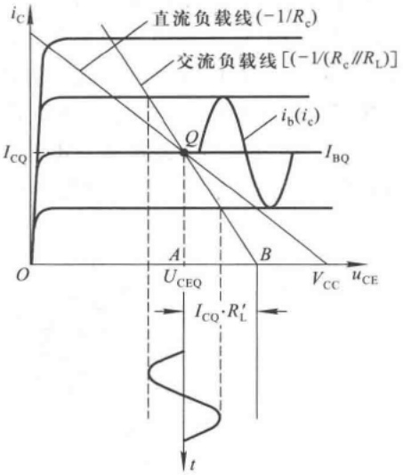

line

| Parameter | Description |
| --- | --- |
| ic | Collector Current (Y-axis) |
| ib(ic) | Base Current (Y-axis) |
| IcQ | Common Mode Voltage (X-axis) |
| Uceq | Common-mode Voltage (X-axis) |
| Vcc | Common-mode Voltage (X-axis) |
| t | Switching Period (X-axis) |

图 2.3.10 直流负载线和交流负载线

对于放大电路与负载直接耦合的情况,直流负载线与交流负载线是同一条直线;而对于阻容耦合放大电路,则只有在空载时两条直线才合二而一。

## 五、图解法的适用范围

图解法的特点是直观形象地反映晶体管的工作情况,但是必须实测所用管的特性曲线,而且用图解法进行定量分析时误差较大。此外,晶体管的特性曲线只反映信号频率较低时的电压、电流关系,而不反映信号频率较高时极间电容产生的影响。因此,图解法多适用于分析输出幅值比较大而工作频率不太高时的情况。在实际应用中,多用于分析Q点位置、最大不失真输出电压和失真情况等。

【例 2.3.1】在图 2.2.1 所示基本共射放大电路中,由于电路参数的改变使静态工作点产生如图 2.3.11 所示的变化。试问:

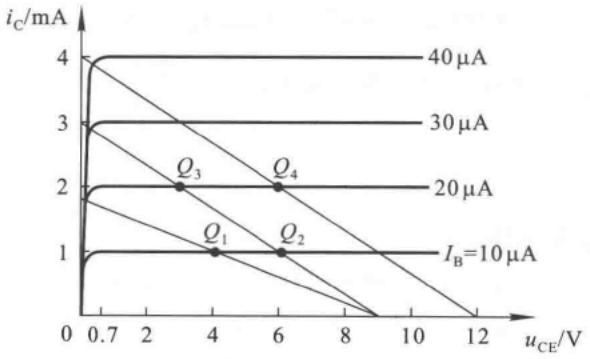

line

| uCE (V) | \(IC (\mu A)\) :: IB=10 \(\mu A\) | \(IC (\mu A)\) :: 20 \(\mu A\) | \(IC (\mu A)\) :: 30 \(\mu A\) | \(IC (\mu A)\) :: 40 \(\mu A\) |
| --- | --- | --- | --- | --- |
| 0.7 | 1 | 2 | 3 | 4 |
| 4 | — | 2 | — | — |
| 6 | — | — | 2 | — |
| 9 | 1 | — | — | — |
| 12 | — | — | — | 4 |

图2.3.11 例2.3.1图

（1）当静态工作点从 $Q_{1}$ 移到 $Q_{2}$ 、从 $Q_{2}$ 移到 $Q_{3}$ 、从 $Q_{3}$ 移到 $Q_{4}$ 时，分别是因为电路的哪个参数变化造成的？这些参数是如何变化的？
（2）当电路的静态工作点分别为  $Q_{1} \sim Q_{4}$  时，从输出电压的角度看，哪种情况下最易产生截止失真？哪种情况下最易产生饱和失真？哪种情况下最大不失真输出电压  $U_{om}$  最大？其值约为多少？
（3）电路的静态工作点为  $Q_{4}$  时，集电极电源  $V_{cc}$  的值为多少伏？集电极电阻  $R_{c}$  为多少千欧？

解:(1) 因为  $Q_{2}$  与  $Q_{1}$  在一条输出特性曲线上, 所以  $I_{BQ}$  相同, 说明  $R_{b}$ 、 $V_{BB}$  均没变;  $Q_{2}$  与  $Q_{1}$  不在同一条负载线上, 说明  $R_{c}$  变化了, 由于负载线变陡, 所以静态工作点从  $Q_{1}$  移到  $Q_{2}$  的原因是  $R_{c}$  减小。

因为  $Q_{3}$  与  $Q_{2}$  都同在一条负载线上，所以  $R_{e}$  没变；而  $Q_{3}$  与  $Q_{2}$  不在同一条输出特性曲线上，说明  $R_{b}$ 、 $V_{BB}$  产生变化。由于  $Q_{3}$  的  $I_{BQ}(20\mu A)$  大于  $Q_{2}$  的  $I_{BQ}(10\mu A)$ ，因此从  $Q_{2}$  移到  $Q_{3}$  的原因是  $R_{b}$  减小或  $V_{BB}$  增大，当然也可能兼而有之。

因为  $Q_{4}$  与  $Q_{3}$  在同一条输出特性曲线上，所以输入回路参数没有变化；而  $Q_{4}$  所在负载线平行于  $Q_{3}$  所在负载线，说明  $R_{c}$  没变；从负载线与横轴交点可知，从  $Q_{3}$  移到  $Q_{4}$  的原因是集电极电源  $V_{cc}$  增大。

（2）从 Q 点在晶体管输出特性坐标平面中的位置可知， $Q_{2}$  最靠近截止区，因而电路最易出现截止失真； $Q_{3}$  最靠近饱和区，因而电路最易出现饱和失真； $Q_{4}$  距饱和区和截止区最远，所以静态工作点为  $Q_{4}$  时的最大不失真电压  $U_{om}$  最大。

因为  $Q_{4}$  点  $U_{CEQ}=6\ V$ ，正居负载线中点，所以其最大不失真输出电压有效值

$$
U _ {\mathrm{om}} = \frac {U _ {\mathrm{CEQ}} - U _ {\mathrm{CES}}}{\sqrt {2}} \approx 3. 7 5 \mathrm{V}
$$

估算时  $U_{CES}$  取 0.7 V。

（3）根据  $Q_{4}$  所在负载线与横轴的交点可知，集电极电源为 12 V；根据  $Q_{4}$  所在负载线与纵轴的交点可知，集电极电阻

$$
R _ {\mathrm{c}} = V _ {\mathrm{cc}} / I _ {\mathrm{c}} = (1 2 / 4) \mathrm{k} \Omega = 3 \mathrm{k} \Omega
$$

## 2.3.3 等效电路法

晶体管电路分析的复杂性在于其特性的非线性,如果能在一定条件下将特性线性化,即用线性电路来描述其非线性特性,建立线性模型,就可应用线性电路的分析方法来分析晶体管电路了。针对应用场合的不同和所分析问题的不同,同一只晶体管有不同的等效模型①。这里首先简单介绍晶体管在分析静态工作点时所用的直流模型;然后重点阐述用于低频小信号时的h参数等效模型,以及使用该模型分析动态参数的方法。

## 一、晶体管的直流模型及静态工作点的估算法

在对图 2.2.1、图 2.2.4、图 2.2.5 所示各共射放大电路进行静态分析时，分别得出静态工作点的表达式(2.2.1)、(2.2.2)、(2.2.3)。当将b-e间电压 $U_{BEQ}$ 取一个固定数值时，也就是认为b-e间等效为直流恒压源，说明已将晶体管输入特性折线化，如图2.3.12(a)所示。式中集电极电流 $I_{CQ}=\beta I_{BQ}$ ，说明 $I_{CQ}$ 仅决定于 $I_{BQ}$ 而与静态管压降 $U_{CEQ}$ 无关，即输出特性曲线是横轴的平行线，如图2.3.12(b)所示，所以晶体管的直流模型如图(c)所示。图(c)中的理想二极管限定了电流方向。

<small>① 在计算机辅助分析或设计电子电路时，较为常见的晶体管模型为 EM 模型，EM 为 J. J. Ebers 和 J. L. Moll 二人姓的字头。详细内容见参考文献[18]。</small>

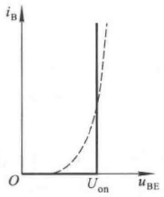

line

| uBE | iB (Solid Line) | iB (Dashed Line) |
| --- | --- | --- |
| 0 | 0 | 0 |
| U_on | >I_B | ~I_B |

(a)

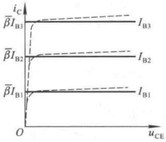

line

| uCE | iC (IB1) | iC (IB2) | iC (IB3) |
| --- | --- | --- | --- |
| 0 | 0 | 0 | 0 |
| High | ~I_B1 | ~I_B2 | ~I_B3 |

(b)

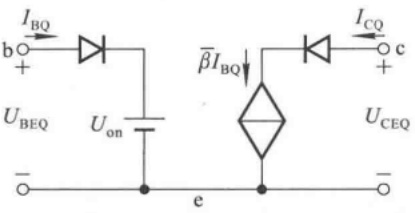

chemical

Electrical circuit diagram with transistor symbols and current/voltage labels

(c)

图 2.3.12 晶体管的直流模型

(a) 输入特性折线化 (b) 输出特性理想化 (c) 直流模型

应当特别指出,晶体管的直流模型是晶体管在静态时工作在放大状态的模型,它的使用条件是: $U_{BE}>U_{on}$ 且 $U_{CE}\geqslant U_{BE}$ ,并认为 $\bar{\beta}=\beta$ 。

在图2.2.5(a)所示电路中，若已知 $V_{\mathrm{CC}} = 12\mathrm{V}, R_{\mathrm{b}} = 510\mathrm{k}\Omega, R_{\mathrm{c}} = 3\mathrm{k}\Omega$；晶体管的 $\beta = 100$，$U_{\mathrm{BEQ}} \approx 0.7\mathrm{V}$，则根据式(2.2.3)可得，$I_{\mathrm{BQ}} \approx 22\mu \mathrm{A}, I_{\mathrm{CQ}} \approx 2.2\mathrm{mA}, U_{\mathrm{CEQ}} \approx 5.35\mathrm{V}$。

## 二、晶体管共射 $h$ 参数等效模型

在共射接法的放大电路中，在低频小信号作用下，将晶体管看成一个线性双口网络，利用网络的 h 参数来表示输入端口、输出端口的电压与电流的相互关系，便可得出等效电路，称之为共射 h 参数等效模型。这个模型只能用于放大电路低频动态小信号参数的分析。

## 1. $h$ 参数等效模型的由来

若将晶体管看成一个双口网络，并以 b-e 作为输入端口，以 c-e 作为输出端口，如图 2.3.13(a) 所示，则网络外部的端电压和电流关系就是晶体管的输入特性和输出特性，如图 2.3.13(b)、(c) 所示。可以写成关系式

$$
\left\{ \begin{array}{l l} u _ {\mathrm{BE}} = f (i _ {\mathrm{B}}, u _ {\mathrm{CE}}) & \text {(2.3.5a)} \\ i _ {\mathrm{C}} = f (i _ {\mathrm{B}}, u _ {\mathrm{CE}}) & \text {(2.3.5b)} \end{array} \right.
$$

式中  $u_{BE}$ 、 $i_{B}$ 、 $u_{CE}$ 、 $i_{C}$  均为各电量的瞬时总量。为了研究低频小信号作用下各变化量之间的关系，对上边两式求全微分，得出

$$
\left\{ \begin{array}{l} \mathrm{d} u _ {\mathrm{BE}} = \frac {\partial u _ {\mathrm{BE}}}{\partial i _ {\mathrm{B}}} \Bigg | _ {U _ {\mathrm{CE}}} \mathrm{d} i _ {\mathrm{B}} + \frac {\partial u _ {\mathrm{BE}}}{\partial u _ {\mathrm{CE}}} \Bigg | _ {I _ {\mathrm{B}}} \mathrm{d} u _ {\mathrm{CE}} \\ \mathrm{d} i _ {\mathrm{C}} = \frac {\partial i _ {\mathrm{C}}}{\partial i _ {\mathrm{B}}} \Bigg | _ {U _ {\mathrm{CE}}} \mathrm{d} i _ {\mathrm{B}} + \frac {\partial i _ {\mathrm{C}}}{\partial u _ {\mathrm{CE}}} \Bigg | _ {I _ {\mathrm{B}}} \mathrm{d} u _ {\mathrm{CE}} \end{array} \right. \tag {2.3.6a}
$$

由于  $du_{BE}$  代表  $u_{BE}$  的变化部分, 可以用  $\dot{U}_{be}$  取代; 同理  $di_{B}$  可用  $\dot{I}_{b}$  取代,  $di_{C}$  可用  $\dot{I}_{c}$  取代,  $du_{CE}$  可用  $\dot{U}_{ce}$  取代。根据电路原理网络分析知识, 可从式 (2.3.6) 得出 h 参数方程

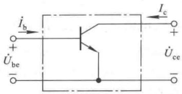

text_image

İb
+
Übe
-
Ic
+
Üce
-

(a)

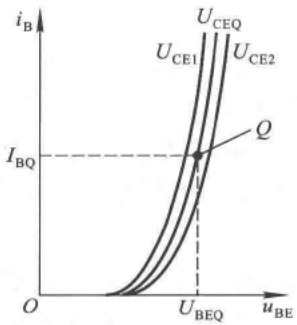

line

| Point | uBE | iB |
| --- | --- | --- |
| Q | U_BEQ | I_BQ |

(b)

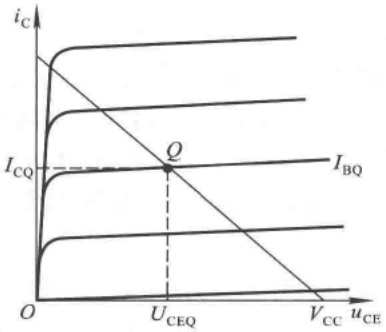

line

| uCE | iC (Curve 1) | iC (Curve 2) | iC (Curve 3) | iC (Curve 4) |
| --- | --- | --- | --- | --- |
| U_CEQ | — | — | — | I_CQ |
| V_CC | — | — | — | I_BQ |

(c)

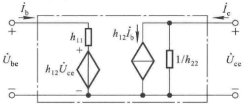

text_image

i_b
+
U_be
-
h_11
+
h_12 Û_ce
-
h_12 Û_b
-
1/h_22
i_c
+
U_ce
-

(d)

图 2.3.13 晶体管的共射 h 参数等效模型

(a) 将晶体管看成线性双口网络 (b) 输入特性曲线

(c) 输出特性曲线 (d) 共射 $h$ 参数等效模型

$$
\left\{ \begin{array}{l l} \dot {U} _ {\mathrm{be}} = h _ {1 1 \mathrm{e}} \dot {I} _ {\mathrm{b}} + h _ {1 2 \mathrm{e}} \dot {U} _ {\mathrm{ce}} & (2. 3. 7 \mathrm{a}) \\ \dot {I} _ {\mathrm{c}} = h _ {2 1 \mathrm{e}} \dot {I} _ {\mathrm{b}} + h _ {2 2 \mathrm{e}} \dot {U} _ {\mathrm{ce}} & (2. 3. 7 \mathrm{b}) \end{array} \right.
$$

下标 e 表示共射接法, 式中

$$
\left\{ \begin{array}{l l} h _ {1 1 \mathrm{e}} = \frac {\partial u _ {\mathrm{BE}}}{\partial i _ {\mathrm{B}}} \Bigg | _ {U _ {\mathrm{CE}}} & (2. 3. 8 \mathrm{a}) \\ h _ {1 2 \mathrm{e}} = \frac {\partial u _ {\mathrm{BE}}}{\partial u _ {\mathrm{CE}}} \Bigg | _ {I _ {\mathrm{B}}} & (2. 3. 8 \mathrm{b}) \\ h _ {2 1 \mathrm{e}} = \frac {\partial i _ {\mathrm{C}}}{\partial i _ {\mathrm{B}}} \Bigg | _ {U _ {\mathrm{CE}}} & (2. 3. 8 \mathrm{c}) \\ h _ {2 2 \mathrm{e}} = \frac {\partial i _ {\mathrm{C}}}{\partial u _ {\mathrm{CE}}} \Bigg | _ {I _ {\mathrm{B}}} & (2. 3. 8 \mathrm{d}) \end{array} \right.
$$

式(2.3.7a)表明,电压 $\dot{U}_{be}$ 由两部分组成,第一项表示由 $\dot{I}_{b}$ 产生一个电压,因而 $h_{11e}$ 为一电阻；第二项表示由 $\dot{U}_{\mathrm{ce}}$ 产生一个电压，因而 $h_{12e}$ 量纲为一；所以b-e间等效成一个电阻与一个电压控制的电压源串联。式(2.3.7b)表明，电流 $\dot{I}_{\mathrm{c}}$ 也由两部分组成，第一项表示由 $\dot{I}_{\mathrm{b}}$ 控制产生一个电流，因而 $h_{21e}$ 量纲为一；第二项表示由 $\dot{U}_{\mathrm{ce}}$ 产生一个电流，因而 $h_{22e}$ 为电导；所以c-e间等效成一个电流控制的电流源与一个电阻并联。这样，得到晶体管的等效模型如图2.3.13(d)所示。由于式(2.3.8)中四个参数的量纲不同，故称为 $h^{\text{①}}$ （混合）参数，由此得到的等效电路称为 $h$ 参数等效模型。

## 2. $h$ 参数的物理意义

研究 h 参数与晶体管特性曲线的关系,可以进一步理解它们的物理意义和求解方法。

$h_{11e}$ 是当 $u_{CE}=U_{CEQ}$ 时 $u_{BE}$ 对 $i_{B}$ 的偏导数。从输入特性上看，就是 $u_{CE}=U_{CEQ}$ 那条输入特性曲线在Q点处切线斜率的倒数。小信号作用时， $h_{11e}=\partial u_{BE}/\partial i_{B}\approx\Delta u_{BE}/\Delta i_{B}$ ，见图2.3.14(a)所示。因此 $h_{11e}$ 表示小信号作用下b-e间的动态电阻，常记作 $r_{be}$ 。Q点愈高，输入特性曲线愈陡， $h_{11e}$ 的值也就愈小。

$h_{12e}$ 是当 $i_{B}=I_{BQ}$ 时 $u_{BE}$ 对 $u_{CE}$ 的偏导数。从输入特性上看，就是在 $i_{B}=I_{BQ}$ 的情况下 $u_{CE}$ 对 $u_{BE}$ 的影响，可以用 $\Delta u_{BE}/\Delta u_{CE}$ 求出 $h_{12e}$ 的近似值，如图2.3.14(b)所示。 $h_{12e}$ 描述了晶体管输出回路电压 $u_{CE}$ 对输入回路电压 $u_{BE}$ 的影响，故称之为内反馈系数。当c-e间电压足够大时，如 $U_{CE}\geqslant1V$ ， $\Delta u_{BE}/\Delta u_{CE}$ 的值很小，多小于 $10^{-2}$ 。

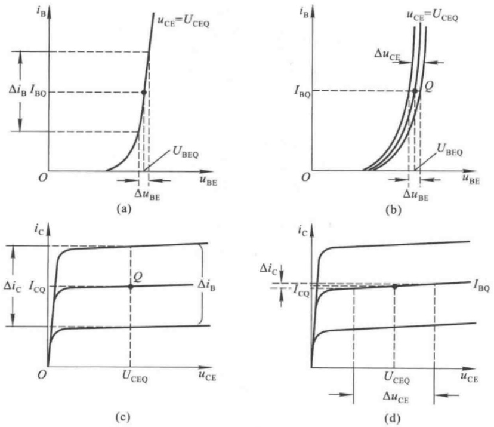

图 2.3.14 h 参数的物理意义及求解方法

(a) 求解  $h_{11e}$  (b) 求解  $h_{12e}$  (c) 求解  $h_{21e}$  (d) 求解  $h_{22e}$

<small>① h 是英文 Hybrid 的字头。</small>

$h_{21\mathrm{e}}$ 是当 $u_{\mathrm{CE}} = U_{\mathrm{CEQ}}$ 时 $i_{\mathrm{C}}$ 对 $i_{\mathrm{B}}$ 的偏导数。从输出特性上看，当小信号作用时，$h_{21\mathrm{e}} = \partial i_{\mathrm{C}} / \partial i_{\mathrm{B}} \approx \Delta i_{\mathrm{C}} / \Delta i_{\mathrm{B}}$ ，如图2.3.14(c)所示。所以，$h_{21\mathrm{e}}$ 表示晶体管在 $Q$ 点附近的电流放大系数 $\beta$ 。

$h_{22e}$ 是当 $i_{B}=I_{BQ}$ 时， $i_{C}$ 对 $u_{CE}$ 的偏导数。从输出特性上看， $h_{22e}$ 是在 $i_{B}=I_{BQ}$ 的那条输出特性曲线上Q点处导数，如图2.3.14(d)所示，它表示输出特性曲线上翘的程度，可以利用 $\Delta i_{C}/\Delta u_{CE}$ 得到其近似值。由于大多数管子工作在放大区时曲线均几乎平行于横轴，所以其值常小于 $10^{-5}S$ 。常称 $1/h_{22e}$ 为c-e间动态电阻 $r_{ce}$，其值在几百千欧以上。

## 3. 简化的 $h$ 参数等效模型

由以上分析可知，在输入回路，内反馈系数 $h_{12e}$ 很小，即内反馈很弱，近似分析中可忽略不

计，故晶体管的输入回路可近似等效为只有一个动态电阻 $r_{\mathrm{be}}(h_{11\mathrm{e}})$ ；在输出回路， $h_{22\mathrm{e}}$ 很小，即 $r_{\mathrm{ce}}$ 很大，说明在近似分析中该支路的电流可忽略不计，故晶体管的输出回路可近似等效为只有一个受控电流源 $\dot{I}_{\mathrm{c}}, \dot{I}_{\mathrm{c}} = \beta \dot{I}_{\mathrm{b}}$ ；因此，简化的h参数等效模型如图2.3.15所示。

应当指出,如果晶体管输出回路所接负载电阻  $R_{L}$  与  $r_{ce}$  可比,如  $r_{ce}<10R_{L}$ ,则在电路分析中应当考虑  $r_{ce}$  的影响。

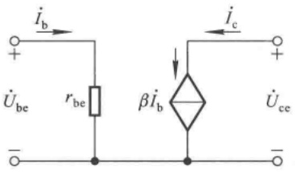

text_image

i_b
+
U_be r_be βi_b i_c
-
U_ce
+

图2.3.15 简化的 $h$ 参数等效模型

## 4. $r_{\mathrm{be}}$ 的近似表达式

在简化的 $h$ 参数等效模型中，可以通过实测得到工作在 $Q$ 点下的 $\beta$ ，并可以通过以下分析所得的近似表达式来计算 $r_{\mathrm{be}}$ 的数值。

从图2.3.16(a)所示晶体管的结构示意图中可以看出，b-e间电阻由基区体电阻 $r_{\mathrm{bb'}}$ 、发射结电阻 $r_{\mathrm{b'e'}}$ 和发射区体电阻 $r_{\mathrm{e}}$ 三部分组成。 $r_{\mathrm{bb'}}$ 与 $r_{\mathrm{e}}$ 仅与杂质浓度及制造工艺有关，由于基区很薄且多子浓度很低， $r_{\mathrm{bb'}}$ 数值较大，对于小功率管，多在几十欧到几百欧，可以通过查阅手册得到。由于发射区多数载流子浓度很高， $r_{\mathrm{e}}$ 数值很小，只有几欧，与 $r_{\mathrm{bb'}}$ 和 $r_{\mathrm{b'e}}$ 相比可以忽略不计。因此，晶体管输入回路的等效电路如图2.3.16(b)所示。流过 $r_{\mathrm{bb'}}$ 的电流为 $\dot{I}_{\mathrm{b}}$ ，而流过 $r_{\mathrm{b'e}}$ 的电流为$\dot{I}_{\mathrm{e}}$ ，所以

$$
\dot {U} _ {\mathrm{be}} \approx \dot {I} _ {\mathrm{b}} r _ {\mathrm {bb^ {\prime}}} + \dot {I} _ {\mathrm{e}} r _ {\mathrm {b^ {\prime} e}}
$$

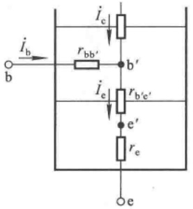

text_image

i_b
b
r_bb'
i_c
b'
i_e
r_b'e'
e'
e
r_e

(a)

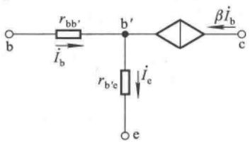

text_image

r_{bb'}
I_b
b'
β\dot{I}_b
c
r_{b'e}
\dot{I}_e
e

(b)

图 2.3.16 晶体管输入回路的分析

(a) 结构 (b) 等效电路

根据第1章中对PN结电流方程的分析可知，发射结的总电流

$$
i _ {\mathrm{E}} = I _ {\mathrm{S}} (\mathrm{e} ^ {\frac {u}{U _ {\mathrm{T}}}} - 1) \quad (u \mathrm{为发射结所加总电压})
$$

因而

$$
\frac {1}{r _ {\mathrm {b^ {'} e}}} = \frac {\mathrm{d} i _ {\mathrm{E}}}{\mathrm{d} u} = \frac {1}{U _ {\mathrm{T}}} \cdot I _ {\mathrm{s}} \cdot \mathrm{e} ^ {\frac {u}{U _ {\mathrm{T}}}}
$$

由于发射结处于正向偏置，u 大于开启电压（如硅管  $U_{on}$  为 0.5 V 左右），而常温下  $U_{T} \approx 26 \, mV$ ，因此可以认为  $i_{E} \approx I_{S} e^{\frac{u}{U_{T}}}$ ，代入上式可得

$$
\frac {1}{r _ {\mathrm {b^{\prime} e}}} \approx \frac {1}{U _ {\mathrm{T}}} \cdot i _ {\mathrm{E}}
$$

当用以 $Q$ 点为切点的切线取代 $Q$ 点附近的曲线时

$$
\frac {1}{r _ {\mathrm {b^{\prime} e}}} \approx \frac {1}{U _ {\mathrm{T}}} \cdot I _ {\mathrm{EQ}}
$$

根据 $r_{\mathrm{be}}$ 的定义

$$
r _ {\mathrm{be}} = \frac {U _ {\mathrm{be}}}{I _ {\mathrm{b}}} \approx \frac {U _ {\mathrm {bb^ {\prime}}} + U _ {\mathrm {b^ {\prime}e}}}{I _ {\mathrm{b}}} = \frac {U _ {\mathrm {bb^ {\prime}}}}{I _ {\mathrm{b}}} + \frac {U _ {\mathrm {b^ {\prime}e}}}{I _ {\mathrm{b}}} = r _ {\mathrm {bb^ {\prime}}} + \frac {I _ {\mathrm{e}} r _ {\mathrm {b^ {\prime}e}}}{I _ {\mathrm{b}}}
$$

由此得出 $r_{\mathrm{be}}$ 的近似表达式

$$
r _ {\mathrm{be}} \approx r _ {\mathrm {b b ^ {\prime}}} + (1 + \beta) \frac {U _ {\mathrm{T}}}{I _ {\mathrm{EQ}}} \quad \text {或} \quad r _ {\mathrm{be}} \approx r _ {\mathrm {b b ^ {\prime}}} + \beta \frac {U _ {\mathrm{T}}}{I _ {\mathrm{CQ}}} \tag {2.3.9}
$$

式(2.3.9)进一步表明，Q点愈高，即 $I_{\mathrm{EQ}}(I_{\mathrm{CQ}})$ 愈大， $r_{be}$ 愈小。

h 参数等效模型用于研究动态参数, 它的四个参数都是在 Q 点处求偏导数得到的。因此, 只有在信号比较小, 且工作在线性度比较好的区域内, 分析计算的结果误差才较小。而且, 由于 h 参数等效模型没有考虑结电容的作用, 只适用低频信号的情况, 故也称之为晶体管的低频小信号模型。

## 三、共射放大电路动态参数的分析

利用 h 参数等效模型可以求解放大电路的电压放大倍数、输入电阻和输出电阻。在放大电路的交流通路中，用 h 参数等效模型取代晶体管便可得到放大电路的交流等效电路。图 2.2.1 所示基本共射放大电路的交流等效电路如图 2.3.17(a) 所示。

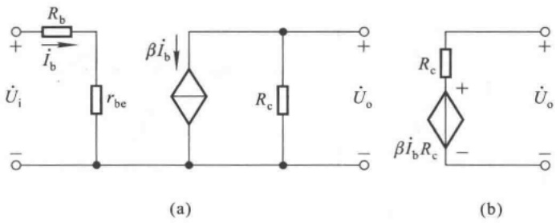

图 2.3.17 基本共射放大电路的动态分析

(a) 交流等效电路 (b) 输出电阻的分析

1. 电压放大倍数  $\dot{A}_{u}$

根据电压放大倍数的定义,利用晶体管  $\dot{I}_{b}$  对  $\dot{I}_{c}$  的控制关系,可得  $\dot{U}_{\mathrm{i}} = \dot{I}_{\mathrm{b}} (R_{\mathrm{b}} + r_{\mathrm{be}})$ ,  $\dot{U}_{o} = -\dot{I}_{c} R_{c} = -\beta \dot{I}_{b} R_{c}$ , 因此电压放大倍数的表达式为

$$
\dot {A} _ {u} = \frac {\dot {U} _ {\mathrm{o}}}{\dot {U} _ {\mathrm{i}}} = - \frac {\beta R _ {\mathrm{e}}}{R _ {\mathrm{b}} + r _ {\mathrm{be}}} \tag {2.3.10}
$$

2. 输入电阻  $R_{i}$

$R_{i}$ 是从放大电路输入端看进去的等效电阻。因为输入电流有效值 $I_{i}=I_{b}$，输入电压有效值 $U_{i}=I_{b}(R_{b}+r_{be})$，故输入电阻为

$$
R _ {\mathrm{i}} = \frac {U _ {\mathrm{i}}}{I _ {\mathrm{i}}} = R _ {\mathrm{b}} + r _ {\mathrm{be}} \tag {2.3.11}
$$

3. 输出电阻  $R_{0}$

根据诺顿定理将放大电路输出回路进行等效变换,使之成为一个有内阻的电压源,如图2.3.17(b)所示,可得

$$
R _ {\mathrm{o}} = R _ {\mathrm{c}} \tag {2.3.12}
$$

对电子电路输出电阻进行分析时,还可令信号源电压  $\dot{U}_{s}=0$ ,但保留内阻  $R_{s}$ ;然后,在输出端加一正弦波测试信号  $U_{o}$ ,必然产生动态电流  $I_{o}$ ,则

$$
R _ {\mathrm{o}} = \frac {U _ {\mathrm{o}}}{I _ {\mathrm{o}}} \Bigg | _ {U _ {\mathrm{s}} = 0} \tag {2.3.13}
$$

在图2.3.17(a)所示电路中，所加信号 $\dot{U}_{\mathrm{i}}$ 为恒压源，内阻为0。当 $\dot{U}_{\mathrm{i}} = 0$ 时， $\dot{I}_{\mathrm{b}} = 0$ ，当然$\dot{I}_{\mathrm{c}} = 0$ ，因此，

$$
R _ {\mathrm{o}} = \frac {U _ {\mathrm{o}}}{I _ {\mathrm{o}}} = \frac {U _ {\mathrm{o}}}{U _ {\mathrm{o}} / R _ {\mathrm{c}}} = R _ {\mathrm{c}}
$$

应当指出,虽然利用 h 参数等效模型分析的是动态参数,但是由于  $r_{be}$  与 Q 点紧密相关,因而使动态参数与 Q 点紧密相关;对放大电路的分析应遵循“先静态,后动态”的原则,只有 Q 点合适,动态分析才有意义。

上述分析方法为等效电路法,有些文献也称之为微变等效电路法。

【例 2.3.2】 在图 2.2.1 所示电路中，已知  $V_{BB} = 1 \, V, R_{b} = 24 \, k\Omega, V_{CC} = 12 \, V, R_{c} = 5.1 \, k\Omega$ ; 晶体管的  $r_{bb}' = 100 \, \Omega, \beta = 100$ ，导通时的  $U_{BEQ} = 0.7 \, V$ 。

(1) 静态工作点 Q;

(2) 求解  $\dot{A}_{u}$ 、 $R_{i}$  和  $R_{o}$ 。

解:(1) 利用式(2.2.1)求出 Q 点。

$$
I _ {\mathrm{BQ}} = \frac {V _ {\mathrm{BB}} - U _ {\mathrm{BEQ}}}{R _ {\mathrm{b}}} = \left(\frac {1 - 0 . 7}{2 4 \times 1 0 ^ {3}}\right) \mathrm{A} = (1 2. 5 \times 1 0 ^ {- 6}) \mathrm{A} = 1 2. 5 \mu \mathrm{A}
$$

$$
I _ {\mathrm{CQ}} = \bar {\beta} I _ {\mathrm{BQ}} = \beta I _ {\mathrm{BQ}} = (1 0 0 \times 1 2. 5 \times 1 0 ^ {- 6}) \mathrm{A} = 1. 2 5 \mathrm{mA}
$$

$$
U _ {\mathrm{CEQ}} = V _ {\mathrm{CC}} - I _ {\mathrm{CQ}} R _ {\mathrm{c}} = (1 2 - 1. 2 5 \times 5. 1) \mathrm{V} \approx 5. 6 3 \mathrm{V}
$$

$U_{CEQ}$ 大于 $U_{BEQ}$，说明晶体管工作在放大区。

(2) 动态分析时, 先求出  $r_{be}$ 。

$$
r _ {\mathrm{be}} \approx r _ {\mathrm {b b ^ {\prime}}} + \beta \frac {U _ {\mathrm{T}}}{I _ {\mathrm{CQ}}} \approx \left(1 0 0 + 1 0 0 \times \frac {2 6}{1 . 2 5}\right) \Omega \approx 2 2 0 0 \Omega = 2. 2 \mathrm{k} \Omega
$$

根据式(2.3.10)、(2.3.11)、(2.3.12)可得

$$
\dot {A} _ {u} = - \frac {\beta R _ {\mathrm{c}}}{R _ {\mathrm{b}} + r _ {\mathrm{be}}} \approx - \frac {1 0 0 \times 5 . 1}{2 4 + 2 . 2} \approx - 1 9. 5
$$

$$
R _ {\mathrm{i}} = R _ {\mathrm{b}} + r _ {\mathrm{be}} \approx (2 4 + 2. 2) \mathrm{k} \Omega = 2 6. 2 \mathrm{k} \Omega
$$

$$
R _ {\mathrm{o}} = R _ {\mathrm{c}} = 5. 1 \mathrm{k} \Omega
$$

【例 2.3.3】在图 2.2.5(a) 所示电路中，已知  $V_{CC} = 12 \, V, R_{b} = 510 \, k\Omega, R_{c} = 3 \, k\Omega$ ; 晶体管的  $r_{bb'} = 150 \, \Omega, \beta = 80, U_{BEQ} = 0.7 \, V; R_{L} = 3 \, k\Omega$ ; 耦合电容对交流信号可视为短路。

(1) 求出电路的  $A_{u}$ 、 $R_{i}$  和  $R_{o}$ ;
(2) 若所加信号源内阻  $R_{s}$  为  $2 k\Omega$ ，求出  $\dot{A}_{us} = \dot{U}_{o} / \dot{U}_{s} = ?$
(3) 若电容  $C_{2}$  短路, 则对电路的静态和动态有哪些影响? 简述理由。

解:(1) 首先求出 Q 点和  $r_{be}$ ，再求出  $\dot{A}_{u}, R_{b}$  和  $R_{o}$ 。

根据式(2.2.3)可得

$$
\begin{array}{l} I _ {\mathrm{BQ}} = \frac {V _ {\mathrm{CC}} - U _ {\mathrm{BEQ}}}{R _ {\mathrm{b}}} = \left(\frac {1 2 - 0 . 7}{5 1 0}\right) \mathrm{mA} \approx 0. 0 2 2 2 \mathrm{mA} = 2 2. 2 \mu \mathrm{A} \\ I _ {\mathrm{CQ}} = \beta I _ {\mathrm{BQ}} \approx (8 0 \times 0. 0 2 2 2) \mathrm{mA} \approx 1. 7 7 \mathrm{mA} \\ U _ {\mathrm{CEQ}} = V _ {\mathrm{CC}} - I _ {\mathrm{CQ}} R _ {\mathrm{c}} \approx (1 2 - 1. 7 7 \times 3) \mathrm{V} = 6. 6 9 \mathrm{V} \\ \end{array}
$$

$U_{CEQ}$  大于  $U_{BEQ}$ ，说明 Q 点在晶体管的放大区。

$$
r _ {\mathrm{be}} \approx r _ {\mathrm {bb^ {\prime}}} + \beta \frac {U _ {\mathrm{T}}}{I _ {\mathrm{CQ}}} \approx \left(1 5 0 + 8 0 \times \frac {2 6}{1 . 7 7}\right) \Omega \approx 1 3 2 5 \Omega \approx 1. 3 3 \mathrm{k} \Omega
$$

画出交流等效电路,如图 2.3.18 所示。

从图2.3.18可知， $\dot{U}_{\mathrm{o}} = -\dot{I}_{\mathrm{c}}(R_{\mathrm{c}} / / R_{\mathrm{L}}) = -\beta \dot{I}_{\mathrm{b}}(R_{\mathrm{c}} / / R_{\mathrm{L}}),\dot{U}_{\mathrm{i}} = \dot{I}_{\mathrm{b}}r_{\mathrm{be}}$ ，根据 $\dot{A}_u$ 的定义可以得出

$$
\dot {A} _ {\mathrm{u}} = \frac {\dot {U} _ {\mathrm{o}}}{\dot {U} _ {\mathrm{i}}} = - \frac {\beta R _ {\mathrm{L}} ^ {\prime}}{r _ {\mathrm{be}}} \quad (R _ {\mathrm{L}} ^ {\prime} = R _ {\mathrm{c}} / / R _ {\mathrm{L}}) \tag {2.3.14}
$$

代入数据

$$
\dot {A} _ {u} \approx - 8 0 \times \frac {\frac {3 \times 3}{3 + 3}}{1 . 3 3} \approx - 9 0
$$

根据 $R_{i}$ 定义可以得出

$$
R _ {\mathrm{i}} = \frac {U _ {\mathrm{i}}}{I _ {\mathrm{i}}} = R _ {\mathrm{b}} / / r _ {\mathrm{be}} \tag {2.3.15}
$$

通常情况下  $R_{b} \gg r_{be}$ ，所以  $R_{i} \approx r_{be} \approx 1.33 k\Omega$ 。

$$
R _ {\mathrm{o}} = R _ {\mathrm{c}} \tag {2.3.16}
$$

代入数据, 得  $R_{o}=3\ k\Omega$ 。

应当指出,放大电路的输入电阻与信号源内阻无关,输出电阻与负载无关。

(2) 根据  $\dot{A}_{us}$  的定义

$$
\dot {A} _ {u s} = \frac {\dot {U} _ {\mathrm{o}}}{\dot {U} _ {\mathrm{s}}} = \frac {\dot {U} _ {\mathrm{i}}}{\dot {U} _ {\mathrm{s}}} \cdot \frac {\dot {U} _ {\mathrm{o}}}{\dot {U} _ {\mathrm{i}}} = \frac {R _ {\mathrm{i}}}{R _ {\mathrm{s}} + R _ {\mathrm{i}}} \cdot \dot {A} _ {u} \tag {2.3.17}
$$

代入数据后,得

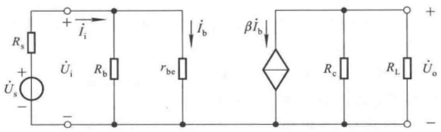

text_image

Rs
+ 
Ûs
-
+ 
Ûi
Rb
rbe
îi
îb
βîb
Rc
RL
Ûo
-

图 2.3.18 图 2.2.5(a) 所示电路的交流等效电路

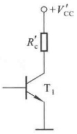

chemical

Electronic circuit diagram of a transistor amplifier with labeled components and voltage supply

图2.3.19 例2.3.3解图

$$
\dot {A} _ {u s} \approx \frac {1 . 3 3}{2 + 1 . 3 3} \times (- 9 0) \approx - 3 6
$$

$\left|\dot{A}_{us}\right|$  总是小于  $\left|\dot{A}_{u}\right|$ ，输入电阻愈大， $\dot{U}_{i}$  愈接近  $\dot{U}_{s}$ ， $\left|\dot{A}_{u}\right|$  也就愈接近  $\left|\dot{A}_{us}\right|$ 。

（3）若电容  $C_{2}$  短路，则电路输出端与负载电阻由阻容耦合变为直接耦合， $R_{L}$  将影响 Q 点。此时，虽然由于静态时晶体管的输入回路没有变化，因此  $I_{BQ}$ 、 $I_{CQ}$  保持不变；但是，输出回路经戴维宁定理进行等效变换为新的直流电源  $V_{CC}^{\prime}$  和等效电阻  $R_{c}^{\prime}$ ，分别为

$$
V _ {\mathrm{cc}} ^ {\prime} = \frac {R _ {\mathrm{L}}}{R _ {\mathrm{c}} + R _ {\mathrm{L}}} \cdot V _ {\mathrm{cc}}, \quad R _ {\mathrm{c}} ^ {\prime} = R _ {\mathrm{c}} / / R _ {\mathrm{L}}
$$

如图2.3.19所示，代入数据，得 $V_{\mathrm{CC}}^{\prime} = 6\mathrm{V},R_{\mathrm{c}}^{\prime} = 1.5\mathrm{k}\Omega$ 。因此，管压降

$$
U _ {\mathrm{CEQ}} = V _ {\mathrm{CC}} ^ {\prime} - I _ {\mathrm{CQ}} R _ {\mathrm{c}} ^ {\prime} \approx (6 - 1. 7 7 \times 1. 5) \mathrm{V} = 3. 3 5 \mathrm{V}
$$

管压降减小,图解分析可知,放大电路的最大不失真输出电压明显变小。

因为交流等效电路没变,所以电路的电压放大倍数、输入电阻和输出电阻未变。

## 思考题

2.3.1 “若输入信号为直流信号,则用直流通路分析电路;若输入信号为交流信号,则用交流通路分析电路。”这种说法正确吗?为什么?
2.3.2 试用图解法分别说明如何消除图 2.2.1 和图 2.2.5(a) 所示两个放大电路的截止失真和饱和失真。
2.3.3 利用等效电路法求解出的电压放大倍数、输入电阻和输出电阻都是在中频段小信号下的参数，在大信号作用下这些参数有变化吗？为什么？
2.3.4 分别说明采用什么措施可以增强图 2.2.1 和图 2.2.5(a) 所示共射放大电路的电压放大能力, 采用什么措施可以增大输入电阻; 并说明增大输入电阻将对电压放大倍数有什么影响。

## 2.4 放大电路静态工作点的稳定

## 2.4.1 静态工作点稳定的必要性

从上节的分析可以看出,静态工作点不但决定了电路是否会产生失真,而且还影响着电压放大倍数、输入电阻等动态参数。实际上,电源电压的波动、元件的老化以及因温度变化所引起晶体管参数的变化,都会造成静态工作点的不稳定,从而使动态参数不稳定,有时电路甚至无法正常工作。在引起 Q 点不稳定的诸多因素中, 温度对晶体管参数的影响是最为主要的。

在图 2.4.1 中, 实线为晶体管在  $20^{\circ}$ C 时的输出特性曲线, 虚线为  $40^{\circ}$ C 时的输出特性曲线。

从图可知，当环境温度升高时，晶体管的电流放大系数 $\beta$ 增大，穿透电流 $I_{CEO}$ 增大；这一切集中地表现为集电极电流 $I_{CQ}$ 明显增大，共射电路中晶体管的管压降 $U_{CEQ}$ 将减小，Q点沿直流负载线上移到 $Q'$，向饱和区变化；而要想使之回到原来位置，必须减小基极电流 $I_{BQ}$ 。可以想象，当温度降低时，Q点将沿直流负载线下移，向截止区变化，要想使之基本不变，则必须增大 $I_{BQ}$ 。

由此可见，所谓稳定 Q 点，通常是指在环境温度变化时静态集电极电流  $I_{CQ}$  和管压降  $U_{CEQ}$  基本不变，即 Q 点在晶体管输出特性坐标平面中的位置基本不变，而且，必须依靠  $I_{BQ}$  的变化来抵消  $I_{CQ}$  和  $U_{CEQ}$  的变化。常用引入直流负反馈或温度补偿的方法使  $I_{BQ}$  在温度变化时产生与  $I_{CQ}$  相反的变化。

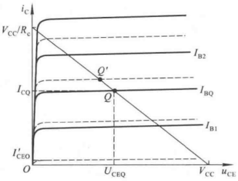

line

| Feature | Description |
| --- | --- |
| Y-axis | iC |
| X-axis | uCE |
| Curve 1 | VCC/RC |
| Curve 2 | IB2 |
| Curve 3 | ICQ |
| Curve 4 | IBQ |
| Curve 5 | IB1 |
| Point Q | Intersection of curves |
| Point Q' | Intersection of curves |
| Point O | Origin (0,0) |
| Point U_CEQ | Collector-emitter voltage (at U_CEQ) |
| Point V_CC | Collector-emitter voltage (at V_CC) |
| Point I'_CEO | Collector-emitter current (at I'_CEO) |

图 2.4.1 晶体管在不同环境温度下的输出特性曲线

## 2.4.2 典型的静态工作点稳定电路

## 一、电路组成和 $Q$ 点稳定原理

典型的 Q 点稳定电路如图 2.4.2 所示, 图(a)为直接耦合方式, 图(b)为阻容耦合方式, 它们具有相同的直流通路, 如图(c)所示。

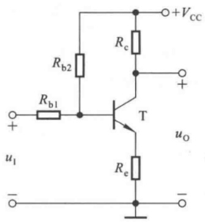

text_image

Rb2
Rb1
+
-
u1
T
Rc
uo
Re
+VCC
-

(a)

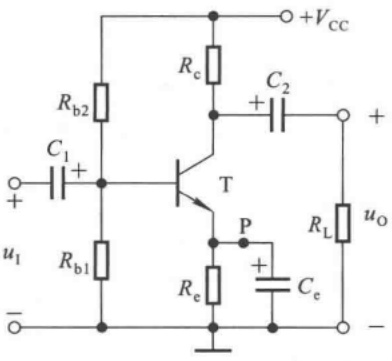

text_image

Rb2
C1
+
ui
-
Rb1
T
P
Re
Ce
+VCC
Rc
C2
+
RL
uo
-

(b)

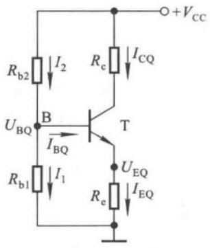

text_image

Rb2 I2 Rc ICQ
UBQ B T UEQ
IBQ
Rb1 I1 Re IEQ
+VCC

(c)

图 2.4.2 静态工作点稳定电路

(a) 直接耦合电路 (b) 阻容耦合电路 (c) 图(a)、(b) 所示电路的直流通路

在图 2.4.2(c) 所示电路中, 节点 B 的电流方程为

$$
I _ {2} = I _ {1} + I _ {\mathrm{BQ}}
$$

为了稳定 Q 点,通常使参数的选取满足

$$
I _ {1} \gg I _ {\mathrm{BQ}} \tag {2.4.1}
$$

因此， $I_{2}\approx I_{1}$ ，B点电位

$$
U _ {\mathrm{BQ}} \approx \frac {R _ {\mathrm{b1}}}{R _ {\mathrm{b1}} + R _ {\mathrm{b2}}} \cdot V _ {\mathrm{CC}} \tag {2.4.2}
$$

式(2.4.2)表明基极电位几乎仅决定于 $R_{b1}$ 与 $R_{b2}$ 对 $V_{CC}$ 的分压，而与环境温度无关，即当温度变化时 $U_{BQ}$ 基本不变。

当温度升高时，集电极电流 $I_{\mathrm{C}}$ 增大，发射极电流 $I_{\mathrm{E}}$ 必然相应增大，因而发射极电阻 $R_{e}$ 上的电压 $U_{\mathrm{E}}$ （即发射极的电位）随之增大；因为 $U_{\mathrm{BQ}}$ 基本不变，而 $U_{\mathrm{BE}} = U_{\mathrm{B}} - U_{\mathrm{E}}$，所以 $U_{\mathrm{BE}}$ 势必减小，导致基极电流 $I_{\mathrm{B}}$ 减小，$I_{\mathrm{C}}$ 随之相应减小。结果，$I_{\mathrm{C}}$ 随温度升高而增大的部分几乎被由于 $I_{\mathrm{B}}$ 减小而减小的部分相抵消，$I_{\mathrm{C}}$ 将基本不变，$U_{\mathrm{CE}}$ 也将基本不变，从而 $Q$ 点在晶体管输出特性坐标平面上的位置基本不变。可将上述过程简写为:

$$
T (\mathrm{C}) \uparrow \rightarrow I _ {\mathrm{C}} \uparrow (I _ {\mathrm{E}} \uparrow) \rightarrow U _ {\mathrm{E}} \uparrow (\text {因为} U _ {\mathrm{BQ}} \text {基本不变}) \rightarrow U _ {\mathrm{BE}} \downarrow \rightarrow I _ {\mathrm{B}} \downarrow
$$

当温度降低时,各物理量向相反方向变化, $I_{C}$  和  $U_{CE}$  也将基本不变。

不难看出，在稳定的过程中， $R_{e}$  起着重要作用，当晶体管的输出回路电流  $I_{C}$  变化时，通过  $R_{e}$  上产生电压的变化来影响 b-e 间电压，从而使  $I_{B}$  向相反方向变化，达到稳定 Q 点的目的。这种将输出量 ( $I_{C}$ ) 通过一定的方式（利用  $R_{e}$  将  $I_{C}$  的变化转化成电压的变化）引回到输入回路来影响输入量 ( $U_{BE}$ ) 的措施称为反馈；由于反馈的结果使输出量的变化减小，故称为负反馈；又由于反馈出现在直流通路之中，故称为直流负反馈。 $R_{e}$  为直流负反馈电阻。

由此可见，图2.4.2(c)所示电路 $Q$ 点稳定的原因是:

(1) $R_{e}$ 的直流负反馈作用；
(2) 在  $I_{1} \gg I_{BQ}$  的情况下,  $U_{BQ}$  在温度变化时基本不变。

所以也称这种电路为分压式电流负反馈 Q 点稳定电路。从理论上讲， $R_{e}$  愈大，反馈愈强，Q 点愈稳定。但是实际上，对于一定的集电极电流  $I_{c}$ ，由于  $V_{cc}$  的限制， $R_{e}$  太大会使晶体管进入饱和区，电路将不能正常工作。

## 二、静态工作点的估算

已知 $I_{1} \gg I_{\mathrm{BQ}}$

$$
U _ {\mathrm{BQ}} \approx \frac {R _ {\mathrm{b1}}}{R _ {\mathrm{b1}} + R _ {\mathrm{b2}}} \cdot V _ {\mathrm{CC}}
$$

发射极电流

$$
I _ {\mathrm{EQ}} = \frac {U _ {\mathrm{BQ}} - U _ {\mathrm{BEQ}}}{R _ {\mathrm{c}}} \tag {2.4.3}
$$

由于 $I_{\mathrm{CQ}} \approx I_{\mathrm{EQ}}$ ，管压降

$$
U _ {\mathrm{CEQ}} \approx V _ {\mathrm{CC}} - I _ {\mathrm{CQ}} (R _ {\mathrm{c}} + R _ {\mathrm{e}}) \tag {2.4.4}
$$

基极电流

$$
I _ {\mathrm{BQ}} = \frac {I _ {\mathrm{EQ}}}{1 + \beta} \tag {2.4.5}
$$

应当指出，不管电路参数是否满足 $I_{1} \gg I_{\mathrm{BQ}}, R_{\mathrm{e}}$ 的负反馈作用都存在。利用戴维宁定理，可将图2.4.2(c)所示电路变换成图2.4.3所示电路，其中

$$
V _ {\mathrm{BB}} = \frac {R _ {\mathrm{b1}}}{R _ {\mathrm{b1}} + R _ {\mathrm{b2}}} \cdot V _ {\mathrm{cc}}
$$

$$
R _ {\mathrm{b}} = R _ {\mathrm{b1}} / / R _ {\mathrm{b2}}
$$

列输入回路方程

$$
V _ {\mathrm{BB}} = I _ {\mathrm{BQ}} R _ {\mathrm{b}} + U _ {\mathrm{BEQ}} + I _ {\mathrm{EQ}} R _ {\mathrm{e}}
$$

可得出 $I_{\mathrm{EQ}}$

$$
I _ {\mathrm{EQ}} = \frac {V _ {\mathrm{BB}} - U _ {\mathrm{BEQ}}}{\frac {R _ {\mathrm{b}}}{1 + \beta} + R _ {\mathrm{e}}}
$$

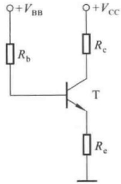

chemical

Electronic circuit diagram of a transistor amplifier with labeled resistors and power supply connections

图 2.4.3 图 2.4.2(c)
所示电路的等效电路

当 $R_{\mathrm{e}} \gg \frac{R_{\mathrm{b}}}{1 + \beta}$, 即 $(1 + \beta) R_{\mathrm{e}} \gg R_{\mathrm{b}}$ 时, $I_{\mathrm{EQ}}$ 的表达式与式(2.4.3)相同。因此, 可用 $(1 + \beta) R_{\mathrm{e}}$ 与 $R_{\mathrm{b1}} / / R_{\mathrm{b2}}$ 的大小关系来判断式(2.4.1)是否成立。

## 三、动态参数的估算

画出图2.4.2(b)所示电路的交流等效电路如图2.4.4(a)所示，电容 $C_{\mathrm{e}}$ 为旁路电容，容量很大，对交流信号可视为短路。若将 $R_{\mathrm{b1}} / / R_{\mathrm{b2}}$ 看成一个电阻 $R_{\mathrm{b}}$ ，则图2.4.4(a)所示电路与阻容耦合共射放大电路的交流等效电路（见图2.3.18)完全相同，因此动态参数

$$
\left\{ \begin{array}{l l} \dot {A} _ {\mathrm{u}} = \frac {\dot {U} _ {\mathrm{o}}}{\dot {U} _ {\mathrm{i}}} = - \frac {\beta R _ {\mathrm{L}} ^ {\prime}}{r _ {\mathrm{be}}} & (R _ {\mathrm{L}} ^ {\prime} = R _ {\mathrm{c}} / / R _ {\mathrm{L}}) \\ R _ {\mathrm{i}} = \frac {\dot {U} _ {\mathrm{i}}}{\dot {I} _ {\mathrm{i}}} = R _ {\mathrm{b}} / / r _ {\mathrm{be}} = R _ {\mathrm{b1}} / / R _ {\mathrm{b2}} / / r _ {\mathrm{be}} & \\ R _ {\mathrm{o}} = R _ {\mathrm{c}} & \end{array} \right. \tag {2.4.6a}
$$

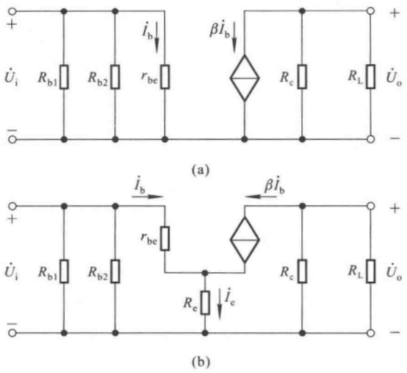

图 2.4.4 阻容耦合 Q 点稳定电路的交流等效电路

（a）有旁路电容时的交流等效电路 （b）无旁路电容时的交流等效电路

倘若没有旁路电容  $C_{e}$ ，则图 2.4.2(b) 所示电路的交流等效电路如图 2.4.4(b) 所示。由图可知

$$
\dot {U} _ {\mathrm{i}} = \dot {I} _ {\mathrm{b}} r _ {\mathrm{be}} + \dot {I} _ {\mathrm{e}} R _ {\mathrm{e}} = \dot {I} _ {\mathrm{b}} r _ {\mathrm{be}} + \dot {I} _ {\mathrm{b}} (1 + \beta) R _ {\mathrm{e}}
$$

$$
\dot {U} _ {\mathrm{o}} = - \dot {I} _ {\mathrm{c}} R _ {\mathrm{L}} ^ {'}
$$

所以

$$
\left\{ \begin{array}{l} \dot {A} _ {\mathrm{u}} = \frac {\dot {U} _ {\mathrm{o}}}{\dot {U} _ {\mathrm{i}}} = - \frac {\beta R _ {\mathrm{L}} ^ {\prime}}{r _ {\mathrm{be}} + (1 + \beta) R _ {\mathrm{e}}} \quad (R _ {\mathrm{L}} ^ {\prime} = R _ {\mathrm{c}} / / R _ {\mathrm{L}}) \\ R _ {\mathrm{i}} = \frac {\dot {U} _ {\mathrm{i}}}{\dot {I} _ {\mathrm{i}}} = R _ {\mathrm{b1}} / / R _ {\mathrm{b2}} / / [ r _ {\mathrm{be}} + (1 + \beta) R _ {\mathrm{e}} ] \\ R _ {\mathrm{o}} = R _ {\mathrm{c}} \end{array} \right. \tag {2.4.7a}
$$

在式(2.4.7a)中, 若 $(1+\beta)R_{\mathrm{e}} \gg r_{\mathrm{be}}$ , 且  $\beta \gg 1$ , 则

$$
\dot {A} _ {u} = \frac {\dot {U} _ {\mathrm{o}}}{\dot {U} _ {\mathrm{i}}} \approx - \frac {R _ {\mathrm{L}} ^ {\prime}}{R _ {\mathrm{c}}} \quad (R _ {\mathrm{L}} ^ {\prime} = R _ {\mathrm{c}} / / R _ {\mathrm{L}}) \tag {2.4.8}
$$

可见,虽然  $R_{e}$  使  $\left|A_{u}\right|$  减小了,但由于  $A_{u}$  仅决定于电阻取值,不受环境温度的影响,所以温度稳定性好。

【例 2.4.1】 在图 2.4.2(b) 所示电路中, 已知  $V_{CC} = 12 \, V, R_{b1} = 5 \, k\Omega, R_{b2} = 15 \, k\Omega, R_{e} = 2.3 \, k\Omega, R_{c} = 5.1 \, k\Omega, R_{L} = 5.1 \, k\Omega$ ; 晶体管的  $\beta = 50, r_{be} = 1.5 \, k\Omega, U_{BEQ} = 0.7 \, V$ 。

(1) 估算静态工作点 Q;
(2) 分别求出有、无  $C_{e}$  两种情况下的  $\dot{A}_{u}$  和  $R_{i}$ 。
(3) 若  $R_{bi}$  因虚焊而开路, 则电路会产生什么现象?

解:(1) 求解 Q 点，因为  $(1 + \beta)R_{\mathrm{e}} \gg R_{\mathrm{b}1} // R_{\mathrm{b}2}$ ，所以

$$
U _ {\mathrm{BQ}} \approx \frac {R _ {\mathrm{b1}}}{R _ {\mathrm{b1}} + R _ {\mathrm{b2}}} \cdot V _ {\mathrm{CC}} = \left(\frac {5}{5 + 1 5} \times 1 2\right) \mathrm{V} = 3 \mathrm{V}
$$

$$
I _ {\mathrm{EQ}} = \frac {U _ {\mathrm{BQ}} - U _ {\mathrm{BEQ}}}{R _ {\mathrm{e}}} \approx \left(\frac {3 - 0 . 7}{2 . 3}\right) \mathrm{mA} = 1 \mathrm{mA}
$$

$$
U _ {\mathrm{CEQ}} \approx V _ {\mathrm{CC}} - I _ {\mathrm{CQ}} (R _ {e} + R _ {e}) = [ 1 2 - 1 \times (5. 1 + 2. 3) ] \mathrm{V} = 4. 6 \mathrm{V}
$$

$$
I _ {\mathrm{BQ}} = \frac {I _ {\mathrm{EQ}}}{1 + \beta} = \left(\frac {1}{1 + 5 0}\right) \mathrm{mA} \approx 0. 0 2 \mathrm{mA} = 2 0 \mu \mathrm{A}
$$

(2) 求解  $\dot{A}_{u}$  和  $R_{i}$ 。当有  $C_{e}$  时:

$$
\dot {A} _ {u} = - \frac {\beta R _ {\mathrm{L}} ^ {\prime}}{r _ {\mathrm{be}}} = - \frac {5 0 \times \frac {5 . 1 \times 5 . 1}{5 . 1 + 5 . 1}}{1 . 5} = - 8 5
$$

$$
R _ {\mathrm{i}} = R _ {\mathrm{b1}} / / R _ {\mathrm{b2}} / / r _ {\mathrm{be}} \approx 1. 0 7 \mathrm{k} \Omega
$$

当无 $C_e$ 时，由于 $(1 + \beta)R_{\mathrm{e}}\gg r_{\mathrm{be}}$ ，且 $\beta \gg 1$ ，所以

$$
\dot {A} _ {u} \approx - \frac {R _ {\mathrm{L}} ^ {\prime}}{R _ {e}} = - 1. 7
$$

$$
R _ {\mathrm{i}} = R _ {\mathrm{b1}} / / R _ {\mathrm{b2}} / / \left[ r _ {\mathrm{be}} + (1 + \beta) R _ {\mathrm{e}} \right] \approx 3. 7 5 \mathrm{k} \Omega
$$

当无  $C_{e}$  时,电路的电压放大能力很差,因此在实用电路中常常将  $R_{e}$  分为两部分,只将其中一部分接旁路电容。

（3）若  $R_{b1}$  开路，则电路如图 2.4.5 所示。设电路中晶体管仍工作在放大状态，则基极电流和集电极电流（也约为发射极电流）分别为

$$
\begin{array}{l} I _ {\mathrm{BQ}} = \frac {V _ {\mathrm{CC}} - U _ {\mathrm{BEQ}}}{R _ {\mathrm{b2}} + (1 + \beta) R _ {\mathrm{e}}} \\ = \left[ \frac {1 2 - 0 . 7}{1 5 + (1 + 5 0) \times 2 . 3} \right] \mathrm{mA} = 0. 0 9 \mathrm{mA} \\ I _ {\mathrm{CQ}} = \beta I _ {\mathrm{BQ}} = (5 0 \times 0. 0 9) \mathrm{mA} = 4. 5 \mathrm{mA} \\ \end{array}
$$

管压降

$$
\begin{array}{l} U _ {\mathrm{CEQ}} \approx V _ {\mathrm{CC}} - I _ {\mathrm{CQ}} (R _ {\mathrm{c}} + R _ {\mathrm{e}}) \\ = [ 1 2 - 4. 5 \times (5. 1 + 2. 3) ] \mathrm{V} = - 2 1. 3 \mathrm{V} \\ \end{array}
$$

上式表明,原假设不成立,管子已不工作在放大区,而进入饱和区,动态分析已无意义。

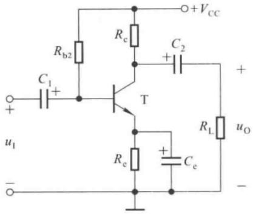

text_image

Rb2
C1 +
+VCC
Rc
C2
+
T
uI
-
RL
uo
Ce
Re

图 2.4.5 例 2.4.1 电路图

若晶体管的饱和管压降  $U_{CES} = U_{BEQ} = 0.7 \, V$ ，则管子的发射极电位和集电极电位分别近似为

$$
U _ {\mathrm{EQ}} = \frac {V _ {\mathrm{CC}} - U _ {\mathrm{CES}}}{R _ {\mathrm{c}} + R _ {\mathrm{e}}} \cdot R _ {\mathrm{e}} = \left(\frac {1 2 - 0 . 7}{5 . 1 + 2 . 3} \times 2. 3\right) \mathrm{V} = 3. 5 2 \mathrm{V}
$$

$$
U _ {\mathrm{CQ}} = U _ {\mathrm{EQ}} + U _ {\mathrm{CES}} = (3. 5 2 + 0. 7) \mathrm{V} = 4. 2 2 \mathrm{V}
$$

本题也可假设晶体管工作在饱和区,然后通过分析来判断假设的正确性。

## 2.4.3 稳定静态工作点的措施

典型的静态工作点稳定电路中利用负反馈稳定 Q 点, 而图 2.4.6(a) 中则采用温度补偿的方法来稳定 Q 点。

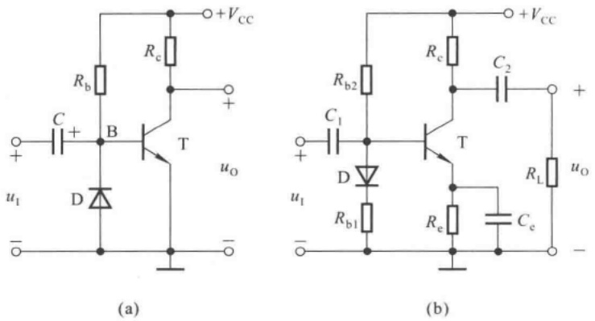

图 2.4.6 稳定静态工作点的措施

（a）利用二极管的反向特性进行温度补偿 （b）利用二极管的正向特性进行温度补偿

使用温度补偿方法稳定静态工作点时，必须在电路中采用对温度敏感的器件，如二极管、热敏电阻等。在图2.4.6(a)所示电路中，电源电压 $V_{CC}$ 远大于晶体管b-e间导通电压 $U_{BEQ}$，因此

$R_{b}$ 中静态电流

$$
I _ {R _ {\mathrm{b}}} = \frac {V _ {\mathrm{CC}} - U _ {\mathrm{BEQ}}}{R _ {\mathrm{b}}} \approx \frac {V _ {\mathrm{CC}}}{R _ {\mathrm{b}}}
$$

节点 B 的电流方程为

$$
I _ {R _ {\mathrm{b}}} = I _ {\mathrm{R}} + I _ {\mathrm{BQ}}
$$

$I_{R}$  为二极管的反向电流, $I_{BQ}$  为晶体管基极静态电流。当温度升高时,一方面 $I_{C}$  增大,另一方面由于 $I_{R}$  增大导致 $I_{B}$  减小,从而 $I_{C}$  随之减小。当参数合适时, $I_{C}$  可基本不变。其过程简述如下:

$$
\begin{array}{c} T (\mathrm {^\circ C}) \uparrow \longrightarrow I _ {\mathrm{C}} \uparrow \\ \searrow I _ {\mathrm{R}} \uparrow \longrightarrow I _ {\mathrm{B}} \downarrow \longrightarrow I _ {\mathrm{C}} \downarrow \end{array}
$$

从这个过程的分析可知,温度补偿的方法是靠温度敏感器件直接对基极电流  $I_{B}$  产生影响,使之产生与  $I_{C}$  相反方向的变化。

图 2.4.6(b) 所示电路同时使用引入直流负反馈和温度补偿两种方法来稳定 Q 点。设温度升高时二极管内电流基本不变，因此其压降  $U_{D}$  必然减小，稳定过程简述如下:

$$
T (^ {\circ} \mathrm{C}) \uparrow \xrightarrow {} I _ {\mathrm{C}} \uparrow \longrightarrow U _ {\mathrm{E}} \uparrow \xrightarrow {} U _ {\mathrm{BE}} \downarrow \longrightarrow I _ {\mathrm{C}} \downarrow
$$

当温度降低时,各物理量向相反方向变化。

## 思考题

2.4.1 在典型的静态工作点稳定电路中，既然 $R_{\mathrm{e}}$ 的阻值越大，负反馈越强，$Q$ 点越稳定，那么 $R_{\mathrm{e}}$ 有上限值吗？
2.4.2 在图 2.4.2(a)、(b) 所示电路中, 为了增强 Q 点的稳定性, 若  $R_{b1}$ 、 $R_{b2}$  采用热敏电阻, 则分别说明它们应具有正温度系数, 还是负温度系数? 为什么?
2.4.3 为了增强图2.4.2(b)所示电路电压放大倍数 $\dot{A}_{u}$ 的稳定性，又不至于使 $|\dot{A}_{u}|$ 下降太多，可将 $R_{e}$ 的一部分加旁路电容，画出图来，并写出 $Q, \dot{A}_{u}, R_{i}$ 和 $R_{o}$ 的表达式。

## 2.5 晶体管单管放大电路的三种基本接法

晶体管组成的基本放大电路有共射、共集、共基三种基本接法，即除了前面所述的共射放大电路外，还有以集电极为公共端的共集放大电路和以基极为公共端的共基放大电路。它们的组成原则和分析方法完全相同，但动态参数具有不同的特点，使用时要根据需求合理选用。

## 2.5.1 基本共集放大电路

## 一、电路的组成

根据放大电路的组成原则，晶体管应工作在放大区，即 $u_{\mathrm{BE}} > U_{\mathrm{on}}, u_{\mathrm{CE}} \geqslant u_{\mathrm{BE}}$，所以在图2.5.1所示基本共集放大电路中，晶体管的输入回路加基极电源 $V_{BB}$，它与 $R_{b}, R_{e}$ 共同确定合适的基极静态电流；晶体管的输出回路加集电极电源 $V_{CC}$，它提供集电极电流和输出电流。画出图2.5.1(a)所示电路的直流通路如图(b)所示，电源 $V_{BB}$ 和 $V_{CC}$ 的负端接地；交流通路如图(c)所示，集电极是输入回路和输出回路的公共端。

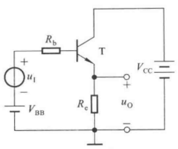

text_image

+
ui
-
VBB
Rb
T
Re
uo
-
VCC

(a)

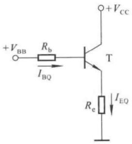

text_image

+V_BB R_b T +V_CC
I_BQ
R_e I_EQ

(b)

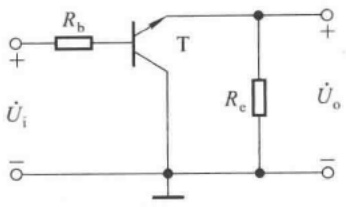

text_image

Rb
T
+ 
Üi
-
Re
Üo
-

(c)

图 2.5.1 基本共集放大电路

(a) 电路 (b) 直流通路 (c) 交流通路

交流信号  $u_{i}$  输入时，产生动态的基极电流  $i_{b}$ ，驮载在静态电流  $I_{BQ}$  之上，通过晶体管得到放大了的发射极电流  $i_{E}$ ，其交流分量  $i_{e}$  在发射极电阻  $R_{e}$  上产生的交流电压即为输出电压  $u_{o}$ 。由于输出电压由发射极获得，故也称共集放大电路为射极输出器。

## 二、静态分析

在图 2.5.1(b) 所示直流通路中, 列出输入回路的方程

$$
V _ {\mathrm{BB}} = I _ {\mathrm{BQ}} R _ {\mathrm{b}} + U _ {\mathrm{BEQ}} + I _ {\mathrm{EQ}} R _ {\mathrm{e}} = I _ {\mathrm{BQ}} R _ {\mathrm{b}} + U _ {\mathrm{BEQ}} + (1 + \beta) I _ {\mathrm{BQ}} R _ {\mathrm{e}}
$$

便得到基极静态电流  $I_{BQ}$  、发射极静态电流  $I_{EQ}$  和管压降  $U_{CEQ}$

$$
\left\{ \begin{array}{l l} I _ {\mathrm{BQ}} = \frac {V _ {\mathrm{BB}} - U _ {\mathrm{BEQ}}}{R _ {\mathrm{b}} + (1 + \beta) R _ {\mathrm{e}}} & \tag {2.5.1a} \\ I _ {\mathrm{EQ}} = (1 + \beta) I _ {\mathrm{BQ}} & \tag {2.5.1b} \\ U _ {\mathrm{CEQ}} = V _ {\mathrm{CC}} - I _ {\mathrm{EQ}} R _ {\mathrm{e}} & \tag {2.5.1c} \end{array} \right.
$$

## 三、动态分析

把图 2.5.1(c) 所示电路中的晶体管用其 h 参数等效模型取代便得到共集放大电路的交流等效电路, 如图 2.5.2 所示。

根据电压放大倍数的定义,利用  $\dot{I}_{b}$  对  $\dot{I}_{c}$  的控制关系,可得出  $\dot{A}_{u}$  的表达式为

$$
\dot {A} _ {u} = \frac {\dot {U} _ {\mathrm{o}}}{\dot {U} _ {\mathrm{i}}} = \frac {I _ {\mathrm{e}} R _ {\mathrm{e}}}{I _ {\mathrm{b}} (R _ {\mathrm{b}} + r _ {\mathrm{be}}) + I _ {\mathrm{e}} R _ {\mathrm{e}}} = \frac {(1 + \beta) I _ {\mathrm{b}} R _ {\mathrm{e}}}{(R _ {\mathrm{b}} + r _ {\mathrm{be}}) I _ {\mathrm{b}} + (1 + \beta) I _ {\mathrm{b}} R _ {\mathrm{e}}}
$$

$$
\dot {A} _ {u} = \frac {(1 + \beta) R _ {\mathrm{e}}}{R _ {\mathrm{b}} + r _ {\mathrm{be}} + (1 + \beta) R _ {\mathrm{e}}} \tag {2.5.2}
$$

式(2.5.2)表明，$\dot{A}_{u}$ 大于0且小于1，即 $\dot{U}_{\mathrm{o}}$ 与 $\dot{U}_{\mathrm{i}}$ 同相且 $U_{\mathrm{o}} < U_{\mathrm{i}}$ 。当 $(1 + \beta)R_{\mathrm{e}} \gg R_{\mathrm{b}} + r_{\mathrm{be}}$ 时，$\dot{A}_{u} \approx 1$ ，即 $\dot{U}_{\mathrm{o}} \approx \dot{U}_{\mathrm{i}}$ ，故常称共集放大电路为射极跟随器。虽然 $|\dot{A}_{u}| < 1$ ，电路无电压放大能力，但是输出电流 $I_{\mathrm{e}}$ 远大于输入电流 $I_{\mathrm{b}}$ ，所以电路仍有功率放大作用。

根据输入电阻  $R_{i}$  的物理意义能够得出  $R_{i}$  的表达式

$$
R _ {\mathrm{i}} = \frac {\dot {U} _ {\mathrm{i}}}{\dot {I} _ {\mathrm{i}}} = \frac {\dot {U} _ {\mathrm{i}}}{\dot {I} _ {\mathrm{b}}} = \frac {\dot {I} _ {\mathrm{b}} (R _ {\mathrm{b}} + r _ {\mathrm{be}}) + \dot {I} _ {\mathrm{e}} R _ {\mathrm{e}}}{\dot {I} _ {\mathrm{b}}}
$$

$$
R _ {\mathrm{i}} = R _ {\mathrm{b}} + r _ {\mathrm{be}} + (1 + \beta) R _ {\mathrm{e}} \tag {2.5.3}
$$

可见,发射极电阻  $R_{e}$  等效到基极回路时,将增大到  $(1+\beta)$  倍,因此共集放大电路的输入电阻比共射放大电路的输入电阻大得多,可达几十千欧到几百千欧。

为了计算输出电阻 $R_{\mathrm{o}}$ ，令输入信号为零，在输出端加正弦波电压 $U_{\mathrm{o}}$ ，求出因其产生的电流$I_{\mathrm{o}}$ ，则输出电阻 $R_{\mathrm{o}} = U_{\mathrm{o}} / I_{\mathrm{o}}$ ，如图2.5.3所示。在图中， $I_{\mathrm{o}}$ 由两部分组成，一部分是 $U_{\mathrm{o}}$ 在 $R_{\mathrm{e}}$ 上产生的电流 $I_{R_{\mathrm{e}}}$ ，另一部分是 $U_{\mathrm{o}}$ 由于作用于晶体管的基极回路产生基极电流 $I_{\mathrm{b}}$ 从而获得的 $I_{\mathrm{e}}$ ，它们分别为

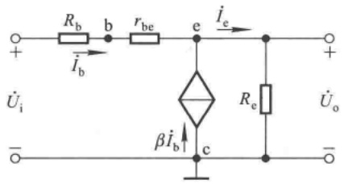

text_image

Rb b rbe e ie +
+ ïb Re Uo
Üi βîb c -

图 2.5.2 基本共集放大电路的交流等效电路

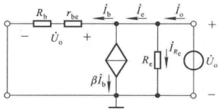

text_image

Rb
rbe
iB
iE
io
+
- Uo
+
βiB
Re
iRe
Uo
-

图 2.5.3 基本共集放大电路输出电阻的求解

$$
I _ {\mathrm{b}} = \frac {U _ {\mathrm{o}}}{R _ {\mathrm{b}} + r _ {\mathrm{be}}}, I _ {\mathrm{e}} = (1 + \beta) \frac {U _ {\mathrm{o}}}{R _ {\mathrm{b}} + r _ {\mathrm{be}}}
$$

$$
I _ {\mathrm{o}} = I _ {R _ {\mathrm{e}}} + I _ {\mathrm{e}}
$$

所以,输出电阻的表达式为

$$
R _ {\mathrm{o}} = \frac {U _ {\mathrm{o}}}{I _ {\mathrm{o}}} = \frac {U _ {\mathrm{o}}}{\frac {U _ {\mathrm{o}}}{R _ {\mathrm{e}}} + (1 + \beta) \frac {U _ {\mathrm{o}}}{R _ {\mathrm{b}} + r _ {\mathrm{be}}}} = \frac {1}{\frac {1}{R _ {\mathrm{e}}} + (1 + \beta) \frac {1}{R _ {\mathrm{b}} + r _ {\mathrm{be}}}}
$$

故

$$
R _ {\mathrm{o}} = R _ {\mathrm{e}} / / \frac {R _ {\mathrm{b}} + r _ {\mathrm{be}}}{1 + \beta} \tag {2.5.4}
$$

可见，基极回路电阻 $R_{\mathrm{b}}$ 等效到射极回路时，应减小到原来的 $1 / (1 + \beta)$ 。由于通常情况下，$R_{\mathrm{e}}$ 取值较小，$r_{\mathrm{be}}$ 也多在几百欧到几千欧，而 $\beta$ 至少几十倍，所以 $R_{\mathrm{o}}$ 可小到几十欧。

因为共集放大电路输入电阻大、输出电阻小，因而从信号源索取的电流小而且带负载能力强，所以常用于多级放大电路的输入级和输出级；也可用它连接两电路，减少电路间直接相连所带来的影响，起缓冲作用。

【例 2.5.1】 在图 2.5.1(a) 所示电路中, 已知  $V_{BB} = 6 \, V, V_{CC} = 12 \, V, R_{b} = 15 \, k\Omega, R_{e} = 5 \, k\Omega$ ; 晶体管的  $U_{BEQ} = 0.7 \, V, r_{bb'} = 200 \, \Omega, \beta = 150$ 。

试估算 Q 点、 $\dot{A}_{u}$ 、 $R_{i}$  和  $R_{o}$ 。

解:根据式(2.5.1)

$$
I _ {\mathrm{BQ}} = \frac {V _ {\mathrm{BB}} - U _ {\mathrm{BEQ}}}{R _ {\mathrm{b}} + (1 + \beta) R _ {\mathrm{e}}} = \frac {6 - 0 . 7}{1 5 + (1 + 1 5 0) \times 5} \mathrm{mA} \approx 0. 0 0 6 8 8 \mathrm{mA} = 6. 8 8 \mu \mathrm{A}
$$

$$
I _ {\mathrm{EQ}} = (1 + \beta) I _ {\mathrm{BQ}} \approx (1 + 1 5 0) \times 0. 0 0 6 8 8 \mathrm{mA} \approx 1. 0 4 \mathrm{mA}
$$

$$
U _ {\mathrm{CEQ}} = V _ {\mathrm{CC}} - I _ {\mathrm{EQ}} R _ {\mathrm{e}} \approx (1 2 - 1. 0 4 \times 5) \mathrm{V} = 6. 8 \mathrm{V}
$$

$$
r _ {\mathrm{be}} \approx r _ {\mathrm {b b ^ {\prime}}} + \beta \frac {U _ {\mathrm{T}}}{I _ {\mathrm{CQ}}} \approx \left(2 0 0 + 1 5 0 \times \frac {2 6}{1}\right) \Omega = 4 1 0 0 \Omega = 4. 1 \mathrm{k} \Omega
$$

根据式(2.5.2)、(2.5.3)、(2.5.4)可得

$$
\begin{array}{l} \dot {A} _ {u} = \frac {(1 + \beta) R _ {\mathrm{e}}}{R _ {\mathrm{b}} + r _ {\mathrm{be}} + (1 + \beta) R _ {\mathrm{e}}} \approx \frac {(1 + 1 5 0) \times 5}{1 5 + 4 . 1 + (1 + 1 5 0) \times 5} \approx 0. 9 7 5 \\ R _ {\mathrm{i}} = R _ {\mathrm{b}} + r _ {\mathrm{be}} + (1 + \beta) R _ {\mathrm{e}} \approx (1 5 + 4. 1 + 1 5 1 \times 5) \mathrm{k} \Omega \approx 7 7 4 \mathrm{k} \Omega \\ R _ {\mathrm{o}} = R _ {\mathrm{e}} / / \frac {R _ {\mathrm{b}} + r _ {\mathrm{be}}}{1 + \beta} \approx \frac {R _ {\mathrm{b}} + r _ {\mathrm{be}}}{1 + \beta} = \left(\frac {1 5 + 4 . 1}{1 5 1} \times 1 0 ^ {3}\right) \Omega \approx 1 2 6 \Omega \\ \end{array}
$$

## 2.5.2 基本共基放大电路

图2.5.4(a)所示为基本共基放大电路，根据放大电路的组成原则，为使晶体管发射结正向偏置且 $U_{\mathrm{BE}} > U_{\mathrm{on}}$，在其输入回路加电源 $V_{\mathrm{BB}}, V_{\mathrm{BB}}$ 与 $R_{\mathrm{e}}$ 共同确定发射极静态电流 $I_{\mathrm{EQ}}$；为使晶体管的集电结反向偏置，在其输出回路加电源 $V_{\mathrm{CC}}, V_{\mathrm{CC}}$ 提供集电极电流和输出电流。画出交流通路如图2.5.4(b)所示，可以看出输入回路与输出回路的公共端为基极。

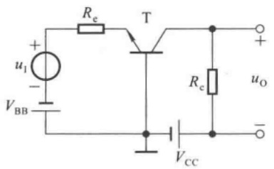

text_image

+
u₁
-
V_BB
R_e
T
R_c
u_O
-
V_CC

(a)

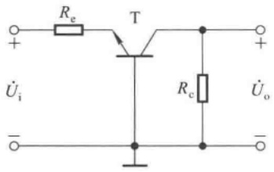

text_image

Rₑ
T
Rₑ
Uₒ
+ 
- 
Üᵢ

(b)

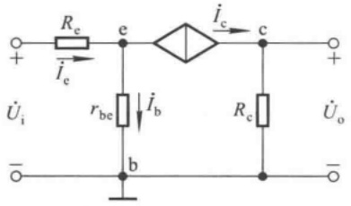

text_image

R_e
i_e
e
i_c
c
+
U_i
r_be
i_b
R_c
U_o
-
b
-

(c)

图 2.5.4 基本共基放大电路

(a) 电路 (b) 交流通路 (c) 交流等效电路

在图2.5.4(a)所示电路中，令 $\dot{U}_{\mathrm{i}} = 0$ ，发射极电位 $U_{\mathrm{EQ}} = -U_{\mathrm{BE}}$ ，集电极电位 $U_{\mathrm{CQ}} = V_{\mathrm{CC}} - I_{\mathrm{CQ}}R_{\mathrm{e}}$ ，便可得出静态工作点

$$
\left\{ \begin{array}{l l} I _ {\mathrm{EQ}} = \frac {V _ {\mathrm{BB}} - U _ {\mathrm{BEQ}}}{R _ {\mathrm{e}}} & (2. 5. 5 \mathrm{a}) \\ I _ {\mathrm{BQ}} = \frac {I _ {\mathrm{EQ}}}{1 + \beta} & (2. 5. 5 \mathrm{b}) \\ U _ {\mathrm{CEQ}} = U _ {\mathrm{CQ}} - U _ {\mathrm{EQ}} = V _ {\mathrm{CC}} - I _ {\mathrm{CQ}} R _ {\mathrm{c}} + U _ {\mathrm{BEQ}} & (2. 5. 5 \mathrm{c}) \end{array} \right.
$$

用晶体管的 h 参数等效模型取代图 2.5.4(b) 所示电路中的晶体管, 便可得到基本共基放大电路的交流等效电路,如图2.5.4(c)所示。根据上节所讲的等效电路法可得电压放大倍数 $A_{u}$ 、输入电阻 $R_{i}$ 和输出电阻 $R_{o}$ 。

$$
\left\{ \begin{array}{l} \dot {A} _ {u} = \frac {\dot {U} _ {\mathrm{o}}}{\dot {U} _ {\mathrm{i}}} = \frac {\dot {I} _ {\mathrm{c}} R _ {\mathrm{c}}}{\dot {I} _ {\mathrm{e}} R _ {\mathrm{e}} + \dot {I} _ {\mathrm{b}} r _ {\mathrm{be}}} = \frac {\beta R _ {\mathrm{c}}}{r _ {\mathrm{be}} + (1 + \beta) R _ {\mathrm{e}}} \\ R _ {\mathrm{i}} = \frac {\dot {U} _ {\mathrm{i}}}{\dot {I} _ {\mathrm{i}}} = \frac {\dot {U} _ {\mathrm{i}}}{\dot {I} _ {\mathrm{e}}} = \frac {\dot {I} _ {\mathrm{e}} R _ {\mathrm{e}} + \dot {I} _ {\mathrm{b}} r _ {\mathrm{be}}}{\dot {I} _ {\mathrm{e}}} = R _ {\mathrm{e}} + \frac {r _ {\mathrm{be}}}{1 + \beta} \\ R _ {\mathrm{o}} = R _ {\mathrm{c}} \end{array} \right. \tag {2.5.6a}
$$

由于共基电路的输入回路电流为 $i_{E}$，而输出回路电流为 $i_{C}$，所以无电流放大能力。而当 $R_{e}$ 为信号源内阻时，电压放大倍数与阻容耦合共射放大电路的数值相同，均为 $\beta R_{c}/r_{be}$，所以有足够的电压放大能力，从而实现功率放大。此外，共基放大电路的输出电压与输入电压同相；输入电阻较共射电路小；输出电阻与共射电路相当，均为 $R_{c}$ 。共基放大电路的最大优点是频带宽，因而常用于无线电通信等方面。

【例2.5.2】电路如图2.5.4(a)所示。设 $R_{\mathrm{e}} = 300\Omega$ ， $R_{\mathrm{c}} = 5\mathrm{k}\Omega$ ；晶体管的 $\beta = 100,r_{\mathrm{be}} =$ $1\mathrm{k}\Omega$ ；静态工作点合适。试估算 $\dot{A}_{u},R_{i}$ 和 $R_{o}$ 的值。

解:根据式(2.5.6)可得

$$
\begin{array}{l} \dot {A} _ {u} = \frac {\beta R _ {\mathrm{c}}}{r _ {\mathrm{be}} + (1 + \beta) R _ {\mathrm{e}}} = \frac {1 0 0 \times 5}{1 + 1 0 1 \times 0 . 3} \approx 1 6 \\ R _ {\mathrm{i}} = R _ {\mathrm{e}} + \frac {r _ {\mathrm{be}}}{1 + \beta} = \left(3 0 0 + \frac {1 0 ^ {3}}{1 0 1}\right) \Omega \approx 3 1 0 \Omega = 0. 3 1 \mathrm{k} \Omega \\ R _ {\mathrm{o}} = R _ {\mathrm{c}} = 5 \mathrm{k} \Omega \\ \end{array}
$$

## 2.5.3 三种接法的比较

综上所述,晶体管单管放大电路的三种基本接法的特点归纳如下:

（1）共射电路既能放大电流又能放大电压，输入电阻居三种电路之中，输出电阻较大，频带较窄。常作为低频电压放大电路的单元电路。
（2）共集电路只能放大电流不能放大电压，是三种接法中输入电阻最大、输出电阻最小的电路，并具有电压跟随的特点。常用于电压放大电路的输入级和输出级，在功率放大电路中也常采用射极输出的形式。
（3）共基电路只能放大电压不能放大电流，具有电流跟随的特点；输入电阻小，电压放大倍数、输出电阻与共射电路相当，是三种接法中高频特性最好的电路。常作为宽频带放大电路。

## 思考题

2.5.1 如何判别晶体管基本放大电路是哪种(共射、共集、共基)接法?
2.5.2 试用 NPN 型管分别组成单管阻容耦合共集放大电路和共基放大电路，并分析它们的 Q 点、 $\hat{A}_{u}$ 、 $R_{i}$  和  $R_{o}$ 。
2.5.3 在图 2.5.1(a) 和图 2.5.4(a) 所示电路中, 若输出电压波形出现底部失真, 则分别说明这是产生了饱和失真还是截止失真?

2.5.4 在三种基本接法的单管放大电路中,要实现电压放大,应选用什么电路?要实现电流放大,应选用什么电路?要实现电压跟随,应选用什么电路?要实现电流跟随,应选用什么电路?

## 2.6 场效应管放大电路

场效应管通过栅-源之间电压 $u_{GS}$ 来控制漏极电流 $i_{D}$，因此，它和晶体管一样可以实现对能量的控制，构成放大电路。由于栅-源之间电阻可达 $10^{7}\sim10^{12}\Omega$，所以常作为高输入阻抗放大器的输入级。

## 2.6.1 场效应管放大电路的三种接法

场效应管的源极、栅极和漏极与晶体管的发射极、基极和集电极相对应，因此在组成放大电路时也有三种接法，即共源放大电路、共漏放大电路和共栅放大电路。以N沟道结型场效应管为例，三种接法的交流通路如图2.6.1所示，由于共栅电路很少使用，本节只对共源和共漏两种电路进行分析。

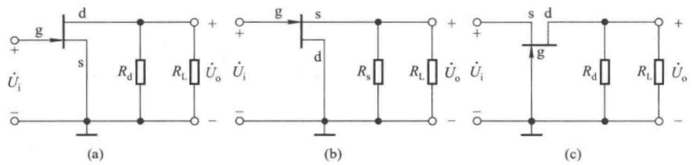

图 2.6.1 场效应管放大电路的三种接法

(a) 共源放大电路 (b) 共漏放大电路 (c) 共栅放大电路

## 2.6.2 场效应管放大电路静态工作点的设置方法及其分析估算

与晶体管放大电路一样,为了使电路正常放大,必须设置合适的静态工作点,以保证在信号的整个周期内场效应管均工作在恒流区。下面以共源电路为例,说明设置Q点的几种方法。

## 一、基本共源放大电路

图2.6.2所示共源放大电路采用的是N沟道增强型MOS管，为使它工作在恒流区，在输入回路加栅极电源 $V_{\mathrm{GG}}, V_{\mathrm{GG}}$ 应大于开启电压 $U_{\mathrm{GS(th)}}$ ；在输出回路加漏极电源 $V_{\mathrm{DD}}$，它一方面使漏-源电压大于预夹断电压以保证管子工作在恒流区，另一方面作为负载的能源； $R_{\mathrm{d}}$ 与共射放大电路中 $R_{\mathrm{c}}$ 具有完全相同的作用，它将漏极电流 $i_{\mathrm{D}}$ 的变化转换成电压 $u_{\mathrm{DS}}$ 的变化，从而实现电压放大。

令  $\dot{U}_{i}=0$ ，由于栅-源之间是绝缘的，故栅极电流为0，所以  $U_{GSQ}=V_{GG}$ 。如果已知场效应管的输出特性曲线，那么首先在输出特性中找到  $U_{GS}=V_{GG}$  的那条曲线（若没有，需测出该曲线），然后作负载线  $u_{DS}=V_{DD}-i_{D}R_{d}$ ，如图2.6.3所示，曲线与直线的交点就是Q点，读其坐标值即得  $I_{DQ}$  和  $U_{DSQ}$ 。

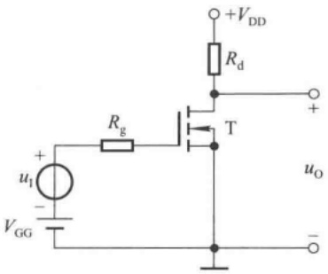

text_image

+VDD
Rd
+
T
u1
-
RG
VGG
uo
-

图 2.6.2 基本共源放大电路

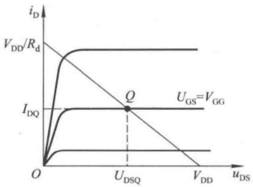

line

| Parameter | Description |
| --- | --- |
| Y-axis | iD |
| X-axis | uDS |
| Curve 1 | High-current region |
| Curve 2 | Low-current region |
| Curve 3 | Saturation current (IDQ) |
| Line | Threshold voltage (VDD/Rd) |
| Point Q | Intersection of VDD/Rd and IDQ at UDSQ |
| Line | Gate-source voltage (UGS = VGG) |

图 2.6.3 图解法求基本共源放大电路的静态工作点

当然,也可以利用场效应管的电流方程,求出 $I_{DQ}$ 。因为

$$
i _ {\mathrm{D}} = I _ {\mathrm{DO}} \left(\frac {u _ {\mathrm{GS}}}{U _ {\mathrm{GS(th)}}} - 1\right) ^ {2}
$$

所以  $I_{DQ}$  和  $U_{DSQ}$  分别为

$$
I _ {\mathrm{DQ}} = I _ {\mathrm{DO}} \left(\frac {V _ {\mathrm{GG}}}{U _ {\mathrm{GS(th)}}} - 1\right) ^ {2} \tag {2.6.1}
$$

$$
U _ {\mathrm{DSQ}} = V _ {\mathrm{DD}} - I _ {\mathrm{DQ}} R _ {\mathrm{d}} \tag {2.6.2}
$$

为了使信号源与放大电路“共地”，也为了采用单电源供电，在实用电路中多采用下面介绍的自给偏压电路和分压式偏置电路。

## 二、自给偏压电路

图 2.6.4(a) 所示为 N 沟道结型场效应管共源放大电路,也是典型的自给偏压电路。N 沟道结型场效应管只有在栅 - 源电压  $U_{GS}$  小于零时电路才能正常工作,那么图示电路中为什么  $U_{GS}$  会小于零呢?

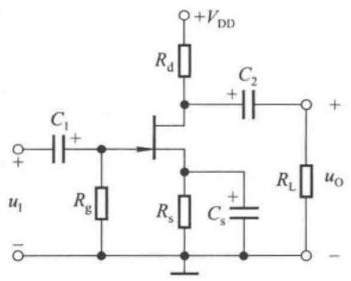

text_image

+VDD
Rd
C2
+
C1
+
ui
-
Rg
Rs
Cs
+
RL
uO
-

(a)

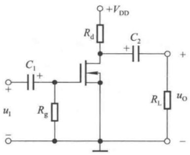

text_image

+VDD
Rd
C1
+
-
u1
-
Rg
C2
+
-
RL
uo
-

(b)

图 2.6.4 自给偏压共源放大电路

(a) 由 N 沟道结型场效应管组成的电路 (b) 由 N 沟道耗尽型管组成的电路

在静态时，由于场效应管栅极电流为零，因而电阻 $R_{\mathrm{g}}$ 的电流为零，栅极电位 $U_{\mathrm{GQ}}$ 也就为零；而漏极电流 $I_{\mathrm{DQ}}$ 流过源极电阻 $R_{s}$ 必然产生电压，使源极电位 $U_{\mathrm{SQ}} = I_{\mathrm{DQ}}R_{s}$，因此，栅-源之间静态电压

$$
U _ {\mathrm{GSQ}} = U _ {\mathrm{GQ}} - U _ {\mathrm{SQ}} = - I _ {\mathrm{DQ}} R _ {\mathrm{s}} \tag {2.6.3}
$$

可见，电路是靠源极电阻上的电压为栅-源两极提供一个负偏压的，故称为自给偏压。将式(2.6.3)与场效应管的电流方程联立，即可解出 $I_{DQ}$ 和 $U_{GSQ}$ 。

$$
I _ {\mathrm{DQ}} = I _ {\mathrm{DSS}} \left(1 - \frac {U _ {\mathrm{GSQ}}}{U _ {\mathrm{GS(off)}}}\right) ^ {2} \tag {2.6.4}
$$

$$
U _ {\mathrm{DSQ}} = V _ {\mathrm{DD}} - I _ {\mathrm{DQ}} (R _ {\mathrm{d}} + R _ {\mathrm{s}}) \tag {2.6.5}
$$

也可用图解法求解 Q 点。

图 2.6.4(b) 所示电路是自给偏压的一种特例，其  $U_{GSQ} = 0$ 。图中采用耗尽型 N 沟道 MOS 管，因此其栅-源之间电压在小于零、等于零和大于零的一定范围内均能正常工作。求解 Q 点时，可先在转移特性上求得  $U_{GS} = 0$  时的  $i_{D}$ ，即  $I_{DQ}$ ；然后利用式 (2.6.2) 求出管压降  $U_{DSQ}$ 。

## 三、分压式偏置电路

图 2.6.5 所示为 N 沟道增强型 MOS 管构成的共源放大电路, 它靠  $R_{g1}$  与  $R_{g2}$  对电源  $V_{DD}$  分压来设置偏压, 故称分压式偏置电路。

静态时,由于栅极电流为0,所以电阻 $R_{g3}$ 上的电流为0,栅极电位和源极电位分别为

$$
U _ {\mathrm{GQ}} = U _ {\mathrm{A}} = \frac {R _ {\mathrm{g1}}}{R _ {\mathrm{g1}} + R _ {\mathrm{g2}}} \cdot V _ {\mathrm{DD}}, U _ {\mathrm{SQ}} = I _ {\mathrm{DQ}} R _ {\mathrm{s}}
$$

因此，栅-源电压

$$
U _ {\mathrm{GSQ}} = U _ {\mathrm{GQ}} - U _ {\mathrm{SQ}} = \frac {R _ {\mathrm{g1}}}{R _ {\mathrm{g1}} + R _ {\mathrm{g2}}} \cdot V _ {\mathrm{DD}} - I _ {\mathrm{DQ}} R _ {\mathrm{s}} \tag {2.6.6}
$$

与式(1.4.5)联立可得 $I_{DQ}$ 和 $U_{GSQ}$，再利用式(2.6.5)可得管压降 $U_{DSQ}$。

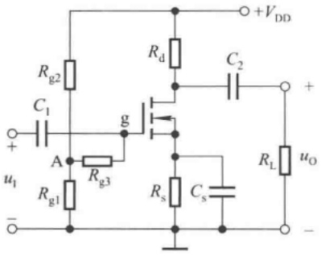

text_image

Rg2
C1
+
u1
-
A
Rg3
Rg1
g
Rd
C2
+
VDD
Rs
Cs
RL
uO
-

图 2.6.5 分压式偏置电路

电路中的  $R_{g3}$  可取值到几兆欧，以增大输入电阻。

## 2.6.3 场效应管放大电路的动态分析

## 一、场效应管的低频小信号等效模型

与分析晶体管的 h 参数等效模型相同, 将场效应管也看成一个两端口网络, 栅极与源极之间看成输入端口, 漏极与源极之间看成输出端口。以 N 沟道增强型 MOS 管为例, 可以认为栅极电流为零, 栅 - 源之间只有电压存在。而漏极电流  $i_{D}$  是栅 - 源电压  $u_{GS}$  和漏 - 源电压  $u_{DS}$  的函数, 即

$$
i _ {\mathrm{D}} = f (u _ {\mathrm{GS}}, u _ {\mathrm{DS}})
$$

研究动态信号作用时用全微分表示

$$
\mathrm{d} i _ {\mathrm{D}} = \frac {\partial i _ {\mathrm{D}}}{\partial u _ {\mathrm{GS}}} \Bigg | _ {U _ {\mathrm{DS}}} \mathrm{d} u _ {\mathrm{GS}} + \frac {\partial i _ {\mathrm{D}}}{\partial u _ {\mathrm{DS}}} \Bigg | _ {U _ {\mathrm{GS}}} \mathrm{d} u _ {\mathrm{DS}} \tag {2.6.7}
$$

令式中

$$
\left. \frac {\partial i _ {\mathrm{D}}}{\partial u _ {\mathrm{GS}}} \right| _ {U _ {\mathrm{DS}}} = g _ {\mathrm{m}} \tag {2.6.8}
$$

$$
\left. \frac {\partial i _ {\mathrm{D}}}{\partial u _ {\mathrm{DS}}} \right| _ {U _ {\mathrm{GS}}} = \frac {1}{r _ {\mathrm{ds}}} \tag {2.6.9}
$$

当信号幅值较小时，管子的电流、电压只在 $Q$ 点附近变化，因此可以认为在 $Q$ 点附近的特性是线性的，$g_{\mathrm{m}}$ 与 $r_{\mathrm{ds}}$ 近似为常数。用交流信号 $\dot{I}_{\mathrm{d}}$、$\dot{U}_{\mathrm{gs}}$ 和 $\dot{U}_{\mathrm{ds}}$ 取代变化量 $\mathrm{di}_{\mathrm{D}}$、$\mathrm{du}_{\mathrm{GD}}$ 和 $\mathrm{du}_{\mathrm{DS}}$，式(2.6.7)可写成

$$
\dot {I} _ {\mathrm{d}} = g _ {\mathrm{m}} \dot {U} _ {\mathrm{gs}} + \frac {1}{r _ {\mathrm{ds}}} \cdot \dot {U} _ {\mathrm{ds}} \tag {2.6.10}
$$

根据此式可构造出场效应管的低频小信号作用下的等效模型，如图2.6.6所示。输入回路栅-源之间相当于开路；输出回路与晶体管的h参数等效模型相似，是一个电压 $\dot{U}_{gs}$ 控制的电流源和一个电阻 $r_{ds}$ 并联。

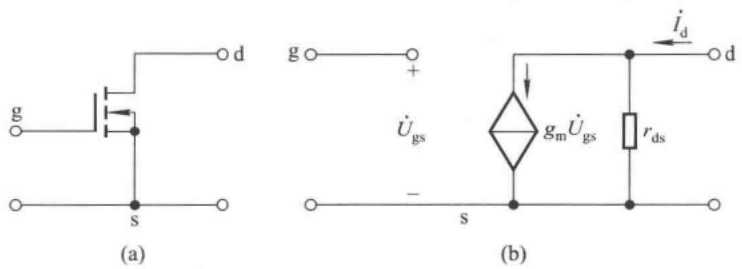

图 2.6.6 MOS 管的低频小信号等效模型

(a) N 沟道增强型 MOS 管 (b) 交流等效模型

可以从场效应管的转移特性和输出特性曲线上求出 $g_{\mathrm{m}}$ 和 $r_{\mathrm{ds}}$ ，如图2.6.7所示。从转移特性可知， $g_{\mathrm{m}}$ 是 $U_{\mathrm{DS}} = U_{\mathrm{DSQ}}$ 那条转移特性曲线上 $Q$ 点处的导数，即以 $Q$ 点为切点的切线斜率。在小信号作用时可用切线来等效 $Q$ 点附近的曲线。由于 $g_{\mathrm{m}}$ 是输出回路电流与输入回路电压之比，故称为跨导，其量纲是电导。

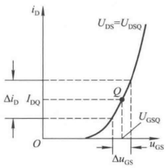

line

| Parameter | Description |
| --- | --- |
| U_DS | Drain-Source Voltage |
| U_DSQ | Drain-Source Quiesing Voltage |
| U_GSQ | Gate-Source Quiesing Voltage |
| \(\Delta\)u_GS | Gate-Source Voltage Change |
| I_DQ | Drain-Drain Current |
| \(\Delta i_D\) | Drain-Drain Current Change |

(a)

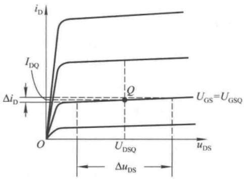

line

| Parameter | Description |
| --- | --- |
| U_GS | Gate-Source Voltage (U_GS) = U_GSQ |
| I_DQ | Drain Current (IDQ) |
| \(\Delta i_D\) | Change in Drain Current |
| U_DSQ | Drain-Source Voltage |
| \(\Delta u_DS\) | Saturation Voltage |
| Q | Saturation Current Point |

(b)

图 2.6.7 从特性曲线求解  $g_{m}$  和  $r_{ds}$

(a) 从转移特性曲线求解  $g_{m}$  (b) 从输出特性曲线求解  $r_{ds}$

从输出特性可知， $r_{ds}$  是  $U_{GS} = U_{GSQ}$  这条输出特性曲线上 Q 点处斜率的倒数，与  $r_{ce}$  一样，它描述曲线上翘的程度， $r_{ds}$  越大，曲线越平。通常  $r_{ds}$  在几十千欧到几百千欧之间，如果外电路的电阻较小时,也可忽略 $r_{ds}$ 中的电流,将输出回路只等效成一个受控电流源。

对增强型 MOS 管的电流方程求导可得出  $g_{m}$  的表达式。

$$
g _ {\mathrm{m}} = \frac {\partial i _ {\mathrm{D}}}{\partial u _ {\mathrm{GS}}} \Bigg | _ {U _ {\mathrm{DS}}} = \frac {2 I _ {\mathrm{DO}}}{U _ {\mathrm{GS(th)}}} \Big (\frac {u _ {\mathrm{GS}}}{U _ {\mathrm{GS(th)}}} - 1 \Big) \Bigg | _ {U _ {\mathrm{DS}}} = \frac {2}{U _ {\mathrm{GS(th)}}} \sqrt {I _ {\mathrm{DO}} i _ {\mathrm{D}}}
$$

在小信号作用时,可用 $I_{DQ}$ 来近似 $i_{D}$ ,得出

$$
g _ {\mathrm{m}} \approx \frac {2}{U _ {\mathrm{GS(th)}}} \sqrt {I _ {\mathrm{DO}} I _ {\mathrm{DQ}}} \tag {2.6.11}
$$

上式表明， $g_{m}$  与 Q 点紧密相关，Q 点愈高， $g_{m}$  愈大。因此，场效应管放大电路与晶体管放大电路相同，Q 点不仅影响电路是否会产生失真，而且影响着电路的动态参数。

## 二、基本共源放大电路的动态分析

画出图 2.6.2 所示基本共源放大电路的交流等效电路如图 2.6.8 所示, 图中采用了 MOS 管的简化模型, 即认为  $r_{ds} = \infty$  。根据电路可得

$$
\left\{ \begin{array}{l l} \dot {A} _ {u} = \frac {\dot {U} _ {\mathrm{o}}}{\dot {U} _ {\mathrm{i}}} = \frac {- \dot {I} _ {\mathrm{d}} R _ {\mathrm{d}}}{\dot {U} _ {\mathrm{gs}}} = - \frac {g _ {\mathrm{m}} \dot {U} _ {\mathrm{gs}} R _ {\mathrm{d}}}{\dot {U} _ {\mathrm{gs}}} = - g _ {\mathrm{m}} R _ {\mathrm{d}} & (2. 6. 1 2 \mathrm{a}) \\ R _ {\mathrm{i}} = \infty & (2. 6. 1 2 \mathrm{b}) \\ R _ {\mathrm{o}} = R _ {\mathrm{d}} & (2. 6. 1 2 \mathrm{c}) \end{array} \right.
$$

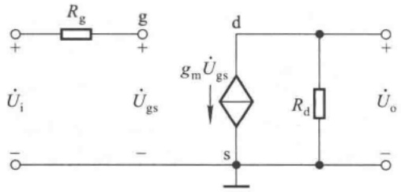

text_image

Rg
+
-
U̇i
g
+
-
U̇gs
gm U̇gs
d
s
Rd
+
-
U̇o
-

图 2.6.8 基本共源放大电路的交流等效电路

与共射放大电路类似,共源放大电路具有一定的电压放大能力,且输出电压与输入电压反相,只是共源电路比共射电路的输入电阻大得多。

【例 2.6.1】已知图 2.6.2 所示电路中， $V_{GG} = 6 \, V, V_{DD} = 12 \, V, R_{d} = 3 \, k\Omega$ ; 场效应管的开启电压  $U_{\mathrm{GS(th)}} = 4 \, \mathrm{V}, I_{\mathrm{DO}} = 10 \, \mathrm{mA}$ 。试估算电路的 Q 点、 $\dot{A}_{u}$  和  $R_{o}$ 。

解:(1) 估算静态工作点:已知  $U_{GS}=V_{GG}=6\ V$ , 根据式(2.6.1)、(2.6.2)可以得出

$$
I _ {\mathrm{DQ}} = I _ {\mathrm{DO}} \left(\frac {V _ {\mathrm{GG}}}{U _ {\mathrm{GS(th)}}} - 1\right) ^ {2} = \left[ 1 0 \times \left(\frac {6}{4} - 1\right) ^ {2} \right] \mathrm{mA} = 2. 5 \mathrm{mA}
$$

$$
U _ {\mathrm{DSQ}} = V _ {\mathrm{DD}} - I _ {\mathrm{DQ}} R _ {\mathrm{d}} = (1 2 - 2. 5 \times 3) \mathrm{V} = 4. 5 \mathrm{V}
$$

(2) 估算  $\dot{A}_{u}$  和  $R_{0}$ :

$$
g _ {\mathrm{m}} = \frac {2}{U _ {\mathrm{GS(th)}}} \sqrt {I _ {\mathrm{DO}} I _ {\mathrm{DQ}}} = \left(\frac {2}{4} \sqrt {1 0 \times 2 . 5}\right) \mathrm{mS} = 2. 5 \mathrm{mS}
$$

$$
\dot {A} _ {u} = - g _ {\mathrm{m}} R _ {\mathrm{d}} = - 2. 5 \times 3 = - 7. 5
$$

$$
R _ {\mathrm{o}} = R _ {\mathrm{d}} = 3 \mathrm{k} \Omega
$$

由以上分析可知,要提高共源电路的电压放大能力,最有效的方法是增大漏极静态电流以增大  $g_{m}$ 。

## 三、基本共漏放大电路的动态分析

基本共漏放大电路如图 2.6.9(a) 所示, 图(b) 是它的交流等效电路。

可以利用输入回路方程和场效应管的电流方程联立

$$
V _ {\mathrm{GG}} = U _ {\mathrm{GSQ}} + I _ {\mathrm{DQ}} R _ {\mathrm{s}}
$$

$$
I _ {\mathrm{DQ}} = I _ {\mathrm{DO}} \left(\frac {U _ {\mathrm{GSQ}}}{U _ {\mathrm{GS(th)}}} - 1\right) ^ {2}
$$

求出漏极静态电流  $I_{DQ}$  和栅-源静态电压  $U_{GSQ}$ ，再根据输出回路方程求出管压降

$$
U _ {\mathrm{DSQ}} = V _ {\mathrm{DD}} - I _ {\mathrm{DQ}} R _ {\mathrm{s}}
$$

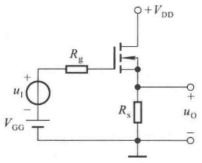

text_image

+
uI
-
VGG
Rg
+VDD
Rs
+
uo
-

(a)

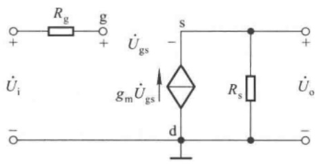

text_image

Rg g
+ +
Ugs
s
-
+
U̇i gm U̇gs d Rs U̇o
-

(b)

图 2.6.9 基本共漏放大电路

(a) 电路 (b) 交流等效电路

从图(b)可得动态参数

$$
\dot {A} _ {u} = \frac {\dot {U} _ {\mathrm{o}}}{\dot {U} _ {\mathrm{i}}} = \frac {\dot {I} _ {\mathrm{d}} R _ {\mathrm{s}}}{\dot {U} _ {\mathrm{gs}} + \dot {I} _ {\mathrm{d}} R _ {\mathrm{s}}} = \frac {g _ {\mathrm{m}} \dot {U} _ {\mathrm{gs}} R _ {\mathrm{s}}}{\dot {U} _ {\mathrm{gs}} + g _ {\mathrm{m}} \dot {U} _ {\mathrm{gs}} R _ {\mathrm{s}}} = \frac {g _ {\mathrm{m}} R _ {\mathrm{s}}}{1 + g _ {\mathrm{m}} R _ {\mathrm{s}}} \tag {2.6.13}
$$

$$
R _ {\mathrm{i}} = \infty \tag {2.6.14}
$$

分析输出电阻时,将输入端短路,在输出端加交流电压  $U_{o}$ , 如图 2.6.10 所示, 然后求出  $I_{o}$ , 则  $R_{o} = U_{o} / I_{o}$ 。由图可知

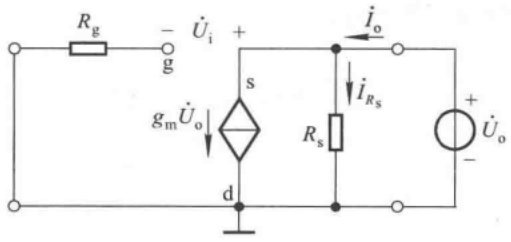

text_image

Rg
-
g
gmÛo
+
s
d
Rs
iO
iRS
+
Ûo
-

图 2.6.10 求解基本共漏放大电路的输出电阻

$$
\dot {I} _ {\mathrm{o}} = \frac {\dot {U} _ {\mathrm{o}}}{R _ {\mathrm{s}}} + \dot {I} _ {\mathrm{d}} = \frac {\dot {U} _ {\mathrm{o}}}{R _ {\mathrm{s}}} + g _ {\mathrm{m}} \dot {U} _ {\mathrm{o}}
$$

所以

$$
R _ {\mathrm{o}} = R _ {\mathrm{s}} / / \frac {1}{g _ {\mathrm{m}}} \tag {2.6.15}
$$

【例 2.6.2】电路如图 2.6.9(a) 所示, 已知场效应管的开启电压  $U_{\mathrm{GS(th)}} = 3 \, \mathrm{V}, I_{\mathrm{DO}} = 8 \, \mathrm{mA}$ ;  $R_{s} = 3 \, k\Omega$ ; 静态时  $I_{DQ} = 2.5 \, mA$ , 场效应管工作在恒流区。

试估算电路的  $\dot{A}_{u}$ 、 $R_{i}$  和  $R_{o}$ 。

解:首先求出  $g_{m}$

$$
g _ {\mathrm{m}} = \frac {2}{U _ {\mathrm{GS(th)}}} \sqrt {I _ {\mathrm{DO}} I _ {\mathrm{DQ}}} = \left(\frac {2}{3} \sqrt {8 \times 2 . 5}\right) \mathrm{mS} \approx 2. 9 8 \mathrm{mS}
$$

然后根据式(2.6.13)、(2.6.14)和(2.6.15)可得

$$
\dot {A} _ {u} = \frac {g _ {\mathrm{m}} R _ {\mathrm{s}}}{1 + g _ {\mathrm{m}} R _ {\mathrm{s}}} \approx \frac {2 . 9 8 \times 3}{1 + 2 . 9 8 \times 3} \approx 0. 8 9 9
$$

$$
R _ {\mathrm{i}} = \infty
$$

$$
R _ {\mathrm{o}} = R _ {\mathrm{s}} / / \frac {1}{g _ {\mathrm{m}}} \approx \left(\frac {3 \times \frac {1}{2 . 9 8}}{3 + \frac {1}{2 . 9 8}}\right) \mathrm{k} \Omega \approx 0. 3 0 2 \mathrm{k} \Omega = 3 0 2 \Omega
$$

场效应管(单极型管)与晶体管(双极型管)相比,最突出的优点是可以组成高输入电阻的放大电路。此外,由于它还有噪声低、温度稳定性好、抗辐射能力强等优于晶体管的特点,而且便于集成化,构成低功耗电路,所以被广泛地应用于各种电子电路中。

## 思考题

2.6.1 什么应用场合下采用场效应管放大电路？

2.6.2 试根据图 1.4.13 用各种场效应管分别组成类似图 2.6.2 所示的基本共源放大电路。

2.6.3 哪些场效应管组成的放大电路可以采用自给偏压的方法设置静态工作点？画出图来。

2.6.4 试分别比较共射放大电路和共源放大电路、共集放大电路和共漏放大电路的相同之处和不同之处。

## 2.7 基本放大电路的派生电路

在实际应用中,为了进一步改善放大电路的性能,可用多只晶体管构成复合管来取代基本电路中的一只晶体管;也可根据需要将两种基本接法组合起来,以得到多方面性能俱佳的放大电路。

## 2.7.1 复合管放大电路

## 一、复合管

1. 晶体管组成的复合管及其电流放大系数

图 2.7.1(a) 和 (b) 所示为两只同类型 (NPN 或 PNP) 晶体管组成的复合管, 等效成与组成它们的晶体管同类型的管子; 图 (c) 和 (d) 所示为不同类型晶体管组成的复合管, 等效成与  $T_{1}$  管同类型的管子。下面以图(a)为例说明复合管的电流放大系数  $\beta$  与  $T_{1}$ 、 $T_{2}$  的电流放大系数  $\beta_{1}$ 、 $\beta_{2}$  的关系。

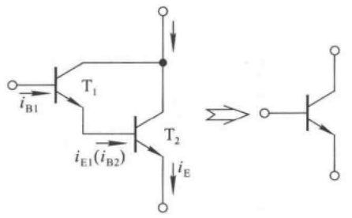

text_image

iB1
T1
iE1(iB2)
T2
iE
→
○—●—●—●—●—●—●—●—●—●—●—●—●—●—●—●—●—●—●—●—●—●—●—●—●—●—●—●—●—●—●—●—●—●—●—●—●—●—●—●—●—●—●—●—●—●—●—●—●—●—●—○

(a)

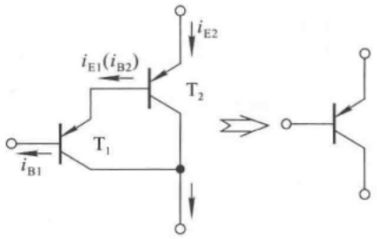

text_image

iE1(iB2)
T2
iE2
T1
iB1

(b)

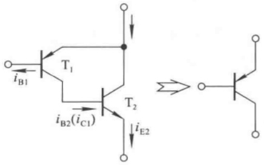

text_image

iB1
T1
iB2(iC1)
T2
iE2

(c)

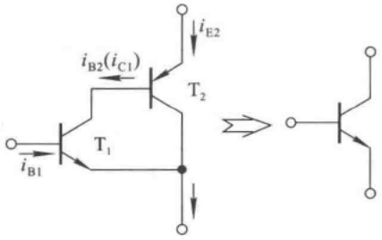

text_image

iB1
T1
iB2(iC1)
T2
iE2

(d)

图 2.7.1 复合管

(a) 由两只 NPN 型管组成 (b) 由两只 PNP 型管组成

(c) 由 PNP 型管和 NPN 型管组成 (d) 由 NPN 型管和 PNP 型管组成

在图(a)中,复合管的基极电流 $i_{B}$ 等于 $T_{1}$ 管的基极电流 $i_{B1}$,集电极电流 $i_{C}$ 等于 $T_{2}$ 管的集电极电流 $i_{C2}$ 与 $T_{1}$ 管的集电极电流 $i_{C1}$ 之和,而 $T_{2}$ 管的基极电流 $i_{B2}$ 等于 $T_{1}$ 管的发射极电流 $i_{E1}$,所以

$$
i _ {\mathrm{C}} = i _ {\mathrm{C1}} + i _ {\mathrm{C2}} = \beta_ {1} i _ {\mathrm{B1}} + \beta_ {2} (1 + \beta_ {1}) i _ {\mathrm{B1}} = (\beta_ {1} + \beta_ {2} + \beta_ {1} \beta_ {2}) i _ {\mathrm{B1}}
$$

因为  $\beta_{1}$  和  $\beta_{2}$  至少为几十，因而  $\beta_{1}\beta_{2}\gg(\beta_{1}+\beta_{2})$ ，所以可以认为复合管的电流放大系数

$$
\beta \approx \beta_ {1} \beta_ {2} \tag {2.7.1}
$$

用上述方法可以推导出图2.7.1(b)、(c)、(d)所示复合管的 $\beta$ 均约为 $\beta_{1}\beta_{2}$ 。

本章所述单管放大电路输出的动态电流大约在几毫安,采用复合管后,在信号源提供的输入电流不变的情况下,可以得到高达几安的输出驱动电流,要注意的是此时应选择中等功率或大功率管。从另一角度看,若驱动电流仍为几毫安,采用复合管后,需要信号源提供的输入电流会非常小,这对于微弱信号的放大是非常有意义的。

## 2. 场效应管与晶体管组成的复合管及其跨导

图2.7.2所示为N沟道增强型场效应管和NPN型晶体管组成的复合管，等效为场效应管。由图可知，复合管的栅-源动态电压 $\Delta u_{\mathrm{GS}}$ 等于 $\mathrm{T}_{1}$ 管的栅-源动态电压 $\Delta u_{\mathrm{GS1}}$ 和 $\mathrm{T}_{2}$ 管的b-e动态电压 $\Delta u_{\mathrm{BE}}$ 之和，漏极动态电流 $\Delta i_{\mathrm{D}}$ 等于 $\mathrm{T}_{1}$ 管的漏极动态电流 $\Delta i_{\mathrm{D1}}$ 和 $\mathrm{T}_{2}$ 管集电极动态电流 $\Delta i_{\mathrm{C2}}$ 之和，$\mathrm{T}_{2}$ 管的基极动态电流 $\Delta i_{\mathrm{B2}}$ 等于 $\mathrm{T}_{1}$ 管的源极动态电流 $\Delta i_{\mathrm{S1}}$ （即 $\Delta i_{\mathrm{D1}}$）。

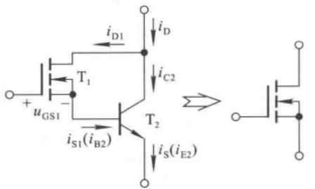

chemical

Electronic circuit diagram showing a transistor amplifier with MOSFETs and associated current/voltage labels

(a)

text_image

g
+
-
Ugs
+
-
Ube2
-
g1
d1
gm1
Ugs1
s1
rbe
iB2
β2iB2
S
d
-

(b)

图 2.7.2 由场效应管与晶体管组成的复合管

(a) 接法 (b) 交流等效电路

下面说明复合管的跨导 $g_{m}$ 与 $T_{1}$ 管的跨导 $g_{m1}$ 、 $T_{2}$ 管的电流放大系数 $\beta_{2}$ 的关系，画出它们的交流等效电路，如图(b)所示。复合管的栅-源电压和漏极电流

$$
\dot {U} _ {\mathrm{gs}} = \dot {U} _ {\mathrm{gsl}} + \dot {U} _ {\mathrm{be}} = \dot {U} _ {\mathrm{gsl}} + g _ {\mathrm{ml}} \dot {U} _ {\mathrm{gsl}} r _ {\mathrm{be}} = (1 + g _ {\mathrm{ml}} r _ {\mathrm{be}}) \dot {U} _ {\mathrm{gsl}}
$$

$$
\dot {I} _ {\mathrm{d}} = \dot {I} _ {\mathrm{d1}} + \dot {I} _ {\mathrm{c2}} = g _ {\mathrm{m1}} \dot {U} _ {\mathrm{gs1}} + \beta_ {2} g _ {\mathrm{m1}} \dot {U} _ {\mathrm{gs1}} = (1 + \beta_ {2}) g _ {\mathrm{m1}} \dot {U} _ {\mathrm{gs1}}
$$

因而跨导

$$
g _ {\mathrm{m}} = \frac {\Delta i _ {\mathrm{D}}}{\Delta u _ {\mathrm{GS}}} = \frac {\dot {I} _ {\mathrm{d}}}{\dot {U} _ {\mathrm{gs}}} = \frac {(1 + \beta_ {2}) g _ {\mathrm{ml}} \dot {U} _ {\mathrm{gs1}}}{(1 + g _ {\mathrm{ml}} r _ {\mathrm{be}}) \dot {U} _ {\mathrm{gs1}}} = \frac {(1 + \beta_ {2}) g _ {\mathrm{ml}}}{1 + g _ {\mathrm{ml}} r _ {\mathrm{be}}}
$$

因为  $\beta_{2} \gg 1$ ，所以可以认为复合管的跨导

$$
g _ {\mathrm{m}} \approx \frac {\beta_ {2} g _ {\mathrm{ml}}}{1 + g _ {\mathrm{ml}} r _ {\mathrm{be}}} \tag {2.7.2}
$$

场效应管与晶体管还可用其它接法构成复合管,但两只管子的位置不能互换,它们的跨导表达式与式(2.7.2)相类似。

## 3. 复合管的组成原则

（1）在正确的外加电压下，每只管子的各极电流均有合适的通路，且均工作在放大区或恒流区；
（2）为了实现电流放大，应将第一只管的集电极（漏极）或发射极（源极）电流作为第二只管子的基极电流。

由于晶体管构成的复合管有很高的电流放大系数，所以只需很小的输入驱动电流 $i_{\mathrm{B}}$，便可获得很大的集电极（或发射极）电流 $i_{\mathrm{C}}$ （或 $i_{\mathrm{E}}$）。在一些场合下，还可将三只晶体管接成复合管。应当指出，使用三只以上管子构成复合管的情况比较少，因为管子数目太多时，会因结电容的作用使高频特性变坏；复合管的穿透电流会很大，温度稳定性变差；而且为保证复合管中每一只管子都工作在放大区，必然要求复合管的直流管压降足够大，这就需要提高电源电压。

## 二、复合管共射放大电路

将图2.2.5(a)所示电路中的晶体管用图2.7.1(a)所示复合管取代,便可得到如图2.7.3(a)所示的复合管共射放大电路,图(b)是它的交流等效电路。

text_image

C1
+
-
u1
Rb
T1
T2
Rc
C2
+
-
RL
uO
+VCC
-

(a)

text_image

i_{b1} → βi_{b1} → i_{c1} → i_{c2}
+       βi_{b2} →
U_i R_b      R_c      R_L      U_o
-       r_{be1}          r_{be2}          (i_{e1})
-

(b)

图 2.7.3 阻容耦合复合管共射放大电路

(a) 电路 (b) 交流等效电路

从图(b)可知

$$
\dot {I} _ {\mathrm{c}} = \dot {I} _ {\mathrm{c1}} + \dot {I} _ {\mathrm{c2}} \approx \beta_ {1} \beta_ {2} \dot {I} _ {\mathrm{b1}}
$$

$$
\dot {U} _ {\mathrm{i}} = \dot {I} _ {\mathrm{b1}} r _ {\mathrm{be1}} + \dot {I} _ {\mathrm{b2}} r _ {\mathrm{be2}} = \dot {I} _ {\mathrm{b1}} r _ {\mathrm{be1}} + \dot {I} _ {\mathrm{b1}} (1 + \beta_ {1}) r _ \mathrm{be2}
$$

$$
\dot {U} _ {\mathrm{o}} \approx - \beta_ {1} \beta_ {2} \dot {I} _ {\mathrm{bl}} (R _ {\mathrm{c}} / / R _ {\mathrm{L}})
$$

电压放大倍数

$$
\dot {A} _ {u} \approx - \frac {\beta_ {1} \beta_ {2} (R _ {\mathrm{c}} / / R _ {\mathrm{L}})}{r _ {\mathrm{be1}} + (1 + \beta_ {1}) r _ {\mathrm{be2}}} \tag {2.7.3}
$$

输入电阻

$$
R _ {\mathrm{i}} = R _ {\mathrm{b}} / / \left[ r _ {\mathrm{be1}} + (1 + \beta_ {1}) r _ {\mathrm{be2}} \right] \tag {2.7.4}
$$

与式(2.3.15)相比, $R_{i}$ 明显增大。说明当 $\dot{U}_{i}$ 相同时,从信号源索取的电流将显著减小,降低了对信号源输出电流的要求。

## 三、复合管共源放大电路

若要进一步提高图 2.6.5 所示电路的输入电阻, 可将图中的场效应管用图 2.7.2(a) 所示复合管取代, 便得到如图 2.7.4(a) 所示的复合管共源放大电路, 图(b) 是它的交流等效电路。

text_image

Rg2
C1
+
u1
-
Rg1
Rg3
T1
T2
Rd
C2
+
VCC
+
RL
uO
-

(a)

text_image

Rg3
U̇i
Rg1 Rg2
- U̇be2
+ - +
- gml Ûgs1
β2 Ib2
- i̇b2
Id
Rd RL U̇o
+ -

(b)

图 2.7.4 阻容耦合复合管共源放大电路

(a) 电路 (b) 交流等效电路

从图(b)可知

$$
\dot {I} _ {\mathrm{d}} = \dot {I} _ {\mathrm{dl}} + \dot {I} _ {\mathrm{c2}} = g _ {\mathrm{ml}} \dot {U} _ {\mathrm{gs1}} + \beta_ {2} g _ {\mathrm{ml}} \dot {U} _ {\mathrm{gs1}} = (1 + \beta_ {2}) g _ {\mathrm{ml}} \dot {U} _ {\mathrm{gs1}} \approx g _ {\mathrm{ml}} \beta_ {2} \dot {U} _ {\mathrm{gs1}}
$$

$$
\dot {U} _ {\mathrm{i}} = \dot {U} _ {\mathrm{gs1}} + \dot {U} _ {\mathrm{be2}} = \dot {U} _ {\mathrm{gs1}} + g _ {\mathrm{m1}} \dot {U} _ {\mathrm{gs1}} r _ {\mathrm{be}} = (1 + g _ {\mathrm{m1}} r _ {\mathrm{be}}) \dot {U} _ {\mathrm{gs1}}
$$

$$
\dot {U} _ {\mathrm{o}} = - \dot {I} _ {\mathrm{d}} (R _ {\mathrm{d}} / / R _ {\mathrm{L}}) \approx - g _ {\mathrm{ml}} \beta_ {2} \dot {U} _ {\mathrm{gsl}} (R _ {\mathrm{d}} / / R _ {\mathrm{L}})
$$

电压放大倍数

$$
\dot {A} _ {u} = \frac {\dot {U} _ {\mathrm{o}}}{\dot {U} _ {\mathrm{i}}} \approx - \frac {g _ {\mathrm{ml}} \beta_ {2} (R _ {\mathrm{d}} / / R _ {\mathrm{L}})}{1 + g _ {\mathrm{ml}} r _ {\mathrm{be}}} \tag {2.7.5}
$$

输入电阻

$$
R _ {\mathrm{i}} = R _ {\mathrm{g3}} + R _ {\mathrm{g1}} / / R _ {\mathrm{g2}} \tag {2.7.6}
$$

与式(2.7.4)相比可知,由于 $R_{g3}$ 可取几兆欧,电路的输入电阻比复合管共射放大电路的输入电阻大得多,表现出场效应管放大电路的突出优点。

## 四、复合管共集放大电路

图 2.7.5(a) 所示为阻容耦合复合管共集放大电路, 其交流通路如图(b) 所示, 交流等效电路如图(c) 所示。

text_image

Rs
+
us
-
+
C1
+
-
Rb
T1
T2
C2
+
RL
uo
-
+VCC

(a)

text_image

Rs
+ 
Us
-
Ui
-
Rb
T1
T2
Re
RL
Uo
-

(b)

text_image

Rs
+ 
Ûs
-
+
Ûi
-
Rb
b1
rbe1
îb2(îe1)
rbe2
b2(e1)
îb1
β1îb1
c1
c2
e2
îe2
β2îb2
Re
RL
Ûo
-

(c)

图 2.7.5 阻容耦合复合管共集放大电路

(a) 电路 (b) 交流通路 (c) 交流等效电路

根据输入电阻和输出电阻的物理意义,从图(c)可知

$$
\begin{array}{l} \dot {U} _ {\mathrm{i}} = \dot {I} _ {\mathrm{b1}} r _ {\mathrm{be1}} + \dot {I} _ {\mathrm{b2}} r _ {\mathrm{be2}} + \dot {I} _ {\mathrm{e2}} (R _ {\mathrm{e}} / / R _ {\mathrm{L}}) \\ = \dot {I} _ {\mathrm{bl}} r _ {\mathrm{be1}} + \dot {I} _ {\mathrm{bl}} (1 + \beta_ {1}) r _ {\mathrm{be2}} + \dot {I} _ {\mathrm{bl}} (1 + \beta_ {1}) (1 + \beta_ {2}) (R _ {\mathrm{e}} / / R _ {\mathrm{L}}) \\ \end{array}
$$

$$
R _ {\mathrm{i}} = R _ {\mathrm{b}} / / \left[ r _ {\mathrm{be1}} + (1 + \beta_ {1}) r _ {\mathrm{be2}} + (1 + \beta_ {1}) (1 + \beta_ {2}) (R _ {\mathrm{e}} / / R _ {\mathrm{L}}) \right] \tag {2.7.7}
$$

$$
R _ {\mathrm{o}} = R _ {\mathrm{e}} / / \frac {r _ {\mathrm{be2}} + \frac {R _ {\mathrm{s}} / / R _ {\mathrm{b}} + r _ {\mathrm{bel}}}{1 + \beta_ {1}}}{1 + \beta_ {2}} \tag {2.7.8}
$$

以上表明，由于采用复合管，输入电阻 $R_{i}$ 中与 $R_{b}$ 相并联的部分大大提高，而输出电阻 $R_{o}$ 中与 $R_{e}$ 相并联的部分大大降低，使共集放大电路 $R_{i}$ 大、 $R_{o}$ 小的特点得到进一步的发挥。

从式(2.7.7)可知,共集放大电路的输入电阻与负载电阻有关;从式(2.7.8)可知,共集放大电路的输出电阻与信号源内阻有关。但是必须特别指出,根据输入、输出电阻的定义,无论什么样的放大电路, $R_{i}$ 均与 $R_{s}$ 无关,而 $R_{o}$ 均与 $R_{L}$ 无关。

## 2.7.2 共射 - 共基放大电路

将共射电路与共基电路组合在一起，既保持共射放大电路电压放大能力较强的优点，又获得共基放大电路较好的高频特性。图2.7.6所示为共射-共基放大电路的交流通路，$\mathrm{T}_{1}$ 组成共射电路，$\mathrm{T}_{2}$ 组成共基电路，由于 $\mathrm{T}_{1}$ 管以输入电阻小的共基电路为负载，使 $\mathrm{T}_{1}$ 管集电结电容对输入回路的影响减小①，从而使共射电路高频特性得到改善。

text_image

R_s
+
Û_s
-
+ 
Û_i
-
î_b1
T_1
î_c1(î_e2)
T_2
î_c2
R_c
R_L
Û_o
+
-
î_b2

图 2.7.6 共射 - 共基放大电路的交流通路

从图 2.7.6 可以推导出电压放大倍数  $\dot{A}_{u}$  的表达式。设  $T_{1}$  的电流放大系数为  $\beta_{1}$ ，b-e 间动态电阻为  $r_{be1}$ ； $T_{2}$  的电流放大系数为  $\beta_{2}$ ，则

$$
\dot {A} _ {u} = \frac {\dot {U} _ {\mathrm{o}}}{\dot {U} _ {\mathrm{i}}} = \frac {\dot {I} _ {\mathrm{c1}}}{\dot {U} _ {\mathrm{i}}} \cdot \frac {\dot {U} _ {\mathrm{o}}}{\dot {I} _ {\mathrm{e2}}} = \frac {\beta_ {1} \dot {I} _ {\mathrm{b1}}}{\dot {I} _ {\mathrm{b1}} r _ {\mathrm{be}}} \cdot \frac {- \beta_ {2} \dot {I} _ {\mathrm{b2}} (R _ {\mathrm{c}} / / R _ {\mathrm{L}})}{(1 + \beta_ {2}) \dot {I} _ {\mathrm{b2}}}
$$

因为 $\beta_{2} \gg 1$，即 $\beta_{2} / (1 + \beta_{2}) \approx 1$，所以

$$
\dot {A} _ {u} \approx \frac {- \beta_ {\mathrm{l}} (R _ {\mathrm{c}} / / R _ {\mathrm{L}})}{r _ {\mathrm{bel}}} \tag {2.7.9}
$$

与单管共射放大电路的  $\dot{A}_{u}$  相同。

## 2.7.3 共集 - 共基放大电路

图 2.7.7 所示为共集-共基放大电路的交流通路，它以  $T_{1}$  管组成的共集电路作为输入端，故输入电阻较大；以  $T_{2}$  管组成的共基电路作为输出端，故具有一定电压放大能力；由于共集电路和共基电路均有较高的上限截止频率，故电路有较宽的通频带。

<small>① 可参阅第4章关于晶体管高频等效电路中对 $C_{\mu}$ 的分析。</small>