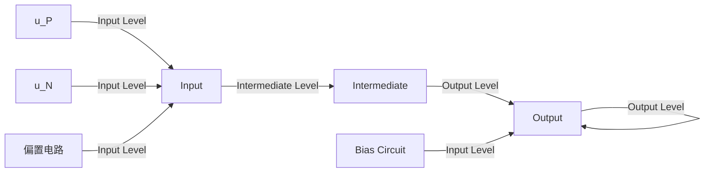

text_image

R_s
+
U_s
-
+ 
U_i
i_b1
T_1
i_e1(i_e2)
T_2
i_c2
R_c
R_L
U_o
+
-
i_b2

图 2.7.7 共集 - 共基放大电路的交流通路

根据具体需要,还可以组成其它电路,如共漏-共射放大电路,既保持高输入电阻,又具有高的电压放大倍数。可见,利用两种基本接法组合,可以同时获得两种接法的优点。

## 思考题

2.7.1 如何判断两只连接在一起的管子是否可作为复合管？举例说明，什么样的连接能够作为复合管，什么样的连接不能作为复合管。
2.7.2 电路如图 2.7.3(a)、图 2.2.5(a) 所示，已知所有晶体管的电流放大系数均为  $\beta, r_{bb'}$  均可忽略不计。试比较两个电路的电压放大倍数和输入电阻，并说明复合管在图 2.7.3(a) 所示电路中的作用。
2.7.3 画出共漏 - 共射放大电路的交流通路。

## 2.8 Multisim 应用举例

## 2.8.1 利用“直流扫描分析”测试基本共射放大电路电压传输特性

所谓电压传输特性,是指一个电路输出电压  $u_{0}$  与输入电压  $u_{1}$  之间的函数关系,即  $u_{0}=f(u_{1})$ ,通常用曲线描述。电压传输特性是稳态特性,可用逐点测试的方法获得。

## 一、仿真电路

在 Multisim 电路图区域搭建基本共射放大电路,选择元器件型号和参数值,如图 2.8.1 所示。

text_image

R1
5 kOhm
2
9
Q1
MRF9011LT1_A
R2
24 kOhm
4
7
V1
1 V
0
V2
12 V

图 2.8.1 基本共射放大电路

## 二、仿真方法与步骤

首先设置直流扫描分析(DC Sweep Analysis)参数；在Analysis Parameters栏目中选定V1为自变量输入电压，设定其起始值(Start value)、终了值(Stop value)和步长(Increment)，在Output variables栏目中选定节点2作为函数，即输出电压，也就是晶体管的管压降，如图2.8.2(a)所示；按仿真(Simulate)按钮即得到基本共射放大电路的电压传输特性，如图2.8.2(b)所示。

(a)

line

| vvl Voltage (V) | Voltage (V) |
| --- | --- |
| 0 | ~12.0 |
| 0.5 | ~12.0 |
| 0.7 | ~11.8 |
| 1.0 | ~6.5 |
| 1.5 | ~0.2 |
| 2.0 | ~0.1 |

(b)

图 2.8.2 基本共射放大电路电压传输特性的测试

(a) 仿真参数的设定 (b) 仿真结果

## 三、仿真结果分析

1. 在仿真电路中，应将 V1 理解为加在输入的交、直流总量。从图 2.8.2(b) 能够读出使晶体管处于放大区时 V1 的近似值，当 V1 < 0.7 V 时晶体管截止，当 V1 > 1.5 V 晶体管饱和，当 0.7 V < V1 < 1.5 V 时晶体管工作在放大区，静态工作点 Q 应设置在这个区域。当已知 Q 在曲线上的位置时，就可得出，电路不出现失真时输入交流信号的峰值。从另一角度讲，若已知输入交流信号的峰值，则可确定出使电路不失真的 Q 点的合适位置；当然，也可能 Q 点没有合适的位置，需要重新选择电路参数。

2. 直流扫描分析用于研究一个或两个直流电源发生变化时电路中各点的变化。若扫描一个直流电源，则仿真结果得到一条曲线；若同时扫描两个直流电源，则仿真结果可得到一组曲线，因此可用它测试晶体管和场效应管的输出特性曲线。可见，它与1.6节中介绍的IV分析仪有异曲同工之妙。

## 2.8.2 放大电路静态工作点及电压放大倍数的测试

## 一、仿真电路

搭建阻容耦合静态工作点稳定电路,如图2.8.3所示,晶体管型号及其它参数值如图中所标注。

双击电路图中晶体管符号,可对其参数进行修改。晶体管模型参数众多,初学者可仅根据实际仪器(如晶体管测试仪)测得的静态工作点附近的电流放大系数修改BF( $\beta$ ),这里将 $\beta$ 由87改为200,其它参数可保持不变。

## 二、静态与动态的测试

在图 2.8.3 中, 函数发生器 XFG1 给放大电路输入频率为 10 kHz、峰值为 2 mV 的正弦波电压, 万用表 XMM1 测量基极静态电位, 万用表 XMM2 测量集电极静态电位, 双踪示波器测量输入电压和输出电压。

text_image

Multisim - [静态工作点跟踪网]e
File Edit View Place Simulate Transfer Tools Reports Options Window Help
Oscilloscope-XSC2
A
B
C
D
E
F
G
H
I
J
K
L
M
N
O
P
Q
R
S
T
U
V
W
X
Y
Z
A1
A2
A3
A4
A5
A6
A7
A8
A9
A10
A11
A12
A13
A14
A15
A16
A17
A18
A19
A20
A21
A22
A23
A24
A25
A26
A27
A28
A29
A30
A31
A32
A33
A34
A35
A36
A37
A38
A39
A40
A41
A42
A43
A44
A45
A46
A47
A48
A49
A50
A51
A52
A53
A54
A55
A56
A57
A58
A59
A60
A61
A62
A63
A64
A65
A66
A67
A68
A69
A70
A71
A72
A73
A74
A75
A76
A77
A78
A79
A80
A81
A82
A83
A84
A85
A86
A87
A88
A89
A90
A91
A92
A93
A94
A95
A96
A97
A98
A99
A100

图 2.8.3 静态工作点稳定共射放大电路静态和动态电压的测试

根据万用表的读数, $U_{BQ}=1.525\ V$ , $U_{CQ}=9.808\ V$ ,可以计算出静态工作点

$$
I _ {\mathrm{CQ}} = \frac {V _ {\mathrm{CC}} - U _ {\mathrm{CQ}}}{R _ {\mathrm{c}}} \tag {2.8.1}
$$

$$
I _ {\mathrm{BQ}} = \frac {I _ {\mathrm{CQ}}}{\beta} \tag {2.8.2}
$$

$$
U _ {\mathrm{CEQ}} \approx V _ {\mathrm{CC}} - I _ {\mathrm{CQ}} (R _ {\mathrm{c}} + R _ {\mathrm{e}}) \tag {2.8.3}
$$

得  $I_{CQ} \approx 0.66 \, mA, I_{BQ} \approx 3.3 \, \mu A, U_{CEQ} \approx 9.03 \, V$ 。

根据示波器读数可得输入电压正半周峰值约为2 mV时，输出电压负半周峰值约为100 mV，因此电压放大倍数  $\dot{A}_{u}=U_{omax}/U_{imax}\approx-50$ 。

从示波器读数中可以看到,输入电压正半周峰值约为2 mV时,输出电压负半周峰值约为98 mV,可见电路稍有非线性失真,这是因为晶体管的非线性特性造成的。通常,失真度为5%以下时肉眼是很难观察出来的,需要用专门设备(失真度仪)来测试。

## 三、总结

1. 在 Multisim 环境下可以像在实验室里一样搭建电路并用虚拟仪器进行各种测量, 这些仪器的调节方法和在实验室利用真实仪器时的操作过程完全相同, 故而可在软件环境下学习各种仪器的使用方法和电路的测试方法。
2. 为了测试的准确性, 测试仪器与被测电路应“共地”, 如图 2.8.3 所示。因此静态测电位, 再通过计算求得电压和电流。
3. 由于晶体管的非线性特性,单管放大电路的输出电压总会或多或少有些失真,而饱和失真和截止失真是比较极端的情况。通过输出电压正、负半周峰值是否相同,可初步判断电路失真的情况,再根据需求决定是否采取措施。

## 2.8.3 利用“参数扫描分析”研究电阻变化对静态工作点的影响

对于放大电路,若已知静态工作点 Q,则可根据集电极电流  $I_{CQ}$  (或发射极电流  $I_{EQ}$ ) 得出 b-e 间动态电阻  $r_{be}$ , 进而得到输入电阻、电压放大倍数等性能指标。因此, 研究电阻变化对 Q 点的影响, 便可得到其对动态性能的影响。以下是对图 2.8.3 所示的静态工作点稳定共射放大电路进行研究。

## 一、研究偏置电阻变化对静态工作点的影响

在参数扫描分析(Parameter Sweep Analysis)中利用如前所述直流扫描分析的仿真方法与步骤,首先设置 $R_{b22}$ 的起始值、终了值和点数,分别为3 000 Ω、12 000 Ω、6;点数即 $R_{b22}$ 从起始值到终了值取值的个数,它决定扫描时每次变化的步长,得1 800 Ω;Analysis to 选“DC operating point”;如图2.8.4(a)所示。然后进行扫描,得到发射极(S2)电位 $U_{E}$ 和集电极(S9)电位 $U_{C}$ 的变化,分别如图(b)所示。

text_image

Parameters Sweep
Analysis Parameters | Output variables | Miscellaneous Options | Summary |
Sweep Parameters
Sweep Parameter Device Resistor
Device Parameter Name r:xrb22
Parameter resistance
Present 80000
Descripti Resistance
Points to sweep
Sweep Variation Type Start 3000
Linear Stop 12000
# of 6
Increment 1800
More Options
Analysis to DC operating point Edit Analysis
✓ Group all traces on on
Less << Simulate Apply Cancel Help

(a)

text_image

Parameter Sweep
静态工作点稳定电路
Device Parameter Sweep:
$9, r:xrb22 resistance=30000 6.73246
$2, r:xrb22 resistance=30000 1.92528
$9, r:xrb22 resistance=48000 8.27346
$2, r:xrb22 resistance=48000 1.36172
$9, r:xrb22 resistance=66000 9.25895
$2, r:xrb22 resistance=66000 1.00147
$9, r:xrb22 resistance=94000 9.94117
$2, r:xrb22 resistance=94000 752.14450m
$9, r:xrb22 resistance=102000 10.43958
$2, r:xrb22 resistance=102000 570.02681m
$9, r:xrb22 resistance=120000 10.81782
$2, r:xrb22 resistance=120000 431.83097m

(b)

图 2.8.4 利用参数扫描分析研究  $R_{b22}$  变化对静态工作点的影响  
(a)  $R_{b22}$  的仿真参数设置 (b) 仿真结果

由图可知，随 $R_{\mathrm{b22}}$ 增大，$U_{\mathrm{B}}$ 降低，$U_{\mathrm{C}}$ 升高，说明集电极电流 $I_{\mathrm{CQ}}$ 随之减小；可以推论，电压放大倍数的数值将逐渐减小，而输入电阻将逐渐增大。同时，若已设定 $I_{\mathrm{CQ}}$ 的值，根据式(2.8.3)可得 $U_{\mathrm{C}}$ 的值，则从扫描结果中就可确定 $R_{\mathrm{b22}}$ 的值，从而完成 $R_{\mathrm{b22}}$ 的选取。

## 二、研究集电极电阻变化对静态工作点的影响

设置 $R_{\mathrm{c}}$ 的起始值、终了值和点数，分别为 $3300\Omega ,20000\Omega ,6$ （即步长为 $3340\Omega$），如图2.8.5(a)所示。然后进行扫描，得到发射极(S2)电位 $U_{\mathrm{E}}$ 和集电极(S9)电位 $U_{\mathrm{C}}$ 的变化，分别如图(b)所示。

由图(b)可知，在 $R_{c}$ 的变化过程中， $U_{E}$ 变化很小，说明 $R_{c}$ 变化对 $I_{EQ}$ （即 $I_{CQ}$ ）的影响很小；但 $U_{C}$ 随之降低，使管压降随之减小，当 $R_{c}$ 增至16.66 kΩ时 $U_{C}$ 与 $U_{E}$ 接近，说明管子进入饱和区，电路不能正常放大。可见，虽然 $R_{c}$ 的增大可使电压放大能力增强，但应以电路不产生失真为度。

text_image

Analysis Parameters | Output variables | Miscellaneous Options | Summary |
Sweep Parameters
Sweep Parameter Device Resistor
Device Parameter Name r:xre
Parameter resistance
Present 3300
Descripti Resistance
Points to sweep
Sweep Variation Type Start 3300
Linear Stop 20000
# of 6
Increment 3340
More Options
Analysis to DC operating point
✓ Group all traces on on
Less << Simulate Apply Cancel Help

(a)

text_image

Parameter Sweep
静态工作点稳定电路
Device Parameter Sweep:
$9, r:xrc resistance=3300 9.80848
$2, r:xrc resistance=3300 800.63532m
$9, r:xrc resistance=6640 7.60734
$2, r:xrc resistance=6640 797.73989m
$9, r:xrc resistance=9980 5.42497
$2, r:xrc resistance=9980 794.65121m
$9, r:xrc resistance=13320 3.26334
$2, r:xrc resistance=13320 791.34881m
$9, r:xrc resistance=16660 1.12484
$2, r:xrc resistance=16660 787.80238m
$9, r:xrc resistance=20000 765.64998m
$2, r:xrc resistance=20000 687.89689m

(b)

图 2.8.5 利用参数扫描分析研究  $R_{c}$  变化对静态工作点的影响

(a) $R_{\mathrm{c}}$ 的仿真参数设置 (b) 仿真结果

与参数扫描分析的步骤与方法相类似,利用温度扫描分析(Temperature Sweep Analysis)可以研究温度变化对静态工作点的影响,不赘述。

## 三、总结

1. 利用参数扫描分析可以研究电路中各个元件参数对电路的影响。
2. 通过参数扫描分析可以从不同需求来确定某一电阻合理的取值范围。例如，在已知输入电压最大幅值的情况下，结合动态测试，从既不失真又能有足够电压放大能力的角度来确定集电极电阻的取值。可见，仿真在电路参数设计中可以发挥重要作用。
3. 扫描分析(包括 DC、参数、温度等)的仿真方法与步骤有共性, 即首先选定研究对象, 对自变量设定起始值、终了值、步长(点数), 其后确定函数, 仿真, 便得到它们的关系, 进而分析仿真结果。

## 2.8.4  $U_{GSQ}$  对共源放大电路电压放大倍数的影响

仿真电路为共源放大电路，MOS场效应管型号及其它参数如图2.8.6中所标注。

## 一、仿真内容

1. 通过直流扫描分析方法（DC Sweep）测量2N7000的转移特性，测量电路及结果如图2.8.6所示。在图左边所示电路中，设定直流电源V1为被扫描电压，节点2为输出，由于源极电阻为 $1\Omega$ ，因而其电压可表示源极（即漏极）电流；图右边所示为几组测试数据；中间是测试所得转移特性曲线。测量结果表明，2N7000的开启电压 $U_{\mathrm{GS(th)}} = 2\mathrm{V}, I_{\mathrm{DO}} \approx 200\mathrm{mA}$ 。

line

| vv1 Voltage (V) | Voltage (V) |
| --- | --- |
| 0 | 0 |
| 1 | ~5 |
| 2 | ~15 |
| 3 | ~45 |
| 4 | ~110 |

图 2.8.6 场效应管转移特性的测试

2. 图 2.8.7(a)、(b) 所示为  $R_{g2}$  分别等于 6 MΩ 和 6.1 MΩ 情况下  $U_{GSQ}$ 、 $U_{DSQ}$  和  $U_{o}$  的测试结果。左边的电压表指示的是  $U_{GSQ}$ ，右边的电压表指示的是  $U_{DSQ}$ ，从示波器中读出  $U_{o}$  的峰值。

text_image

Multsim - 计算放大电路的测试
File Edit View Place Simulate Transfer Tools Reports Options Window Help
A
B
C
D
0 1 2 3 4 5 6 7 8
VDD
15V
Rd
10kohm
C1
10uF
Rp2
Mohm
Q1
10uF
Rg1
1Mohm
XMM2
2N7000
Rf
10kohm
Multimeter-XXM1
Multimeter-XXM2
Time Channel_A Channel_B
T1 175.751 ms -9.997 mV 670.884 mV Reverse Save GND @
T2:31
Timebase Channel_A Channel_B Trigger Edge Edge
Scale [200]/-Div Scale 0 mV/Div Scale 500 mV/Div X position 0 Y position 0 Y position 0 Level 0 V
Y/Y Add B/A A/B AC 0 DC AC 0 DC - # Sing Hor Auto

(a)

text_image

Multism - [共源放大电路的测试]
File Edit View Place Simulate Transfer Tools Reports Options Window Help
0 1 2 3 4 5 6 7 8
A
B
C
D
Multimeter-XMM1
2.157%
A V dB
Set
Multimeter-XMM2
9.211%
A V dB
Set
VDD
15V
Rg2
6.1Mohm
Rg
2Mohm
Rg1
1Mohm
Q1
2N7000
Rd
10kohm
C2
10uF
xsec2
RL
10kohm
Channel A Channel B Trigger Edge Level Noise Auto
Time: 161.254 ms 9.995 mV -564.943 mV Reverse Save
Timebase Channel A Channel B Trigger GND @ Scale 200 f/div Scale 5 mW/div Scale 200 mW/div X position 0 Y position 0 Y position 0 AC 0 DC AC 0 DC ... Sag Now Auto

(b)

图 2.8.7 共源放大电路的测试

(a)  $R_{g2}$  为 6 MΩ 时 (b)  $R_{g2}$  为 6.1 MΩ 时

## 二、仿真结果

整理图 2.8.7(a) 和 (b) 中电压表和示波器上的数据, 可得表 2.8.1。

表 2.8.1

| 输入电压峰值$U_{ipp}/mV$ | $R_{g2}$/MΩ | $U_{GSQ}$/V | $U_{DSQ}$/V | 漏极电流$I_{DQ}/mA$ | 输出电压$U_o/mV$ | 电压放大倍数$\dot{A}_u$ |
| --- | --- | --- | --- | --- | --- | --- |
| 10 | 6.0 | 2.137 | 5.561 | 0.9439 | 670.884 | -67 |
| 10 | 6.1 | 2.107 | 9.251 | 0.5749 | 554.943 | -55 |

## 三、总结

1. 用直流扫描分析可测试场效应管的转移特性，从中可读出 $U_{\mathrm{GS(th)}}$ 和 $I_{\mathrm{DO}}$ 的数值，也可读出在不同 $U_{\mathrm{GS}}$ 所确定的 $I_{\mathrm{D}}$ 的数值。

应当指出，由于  $u_{GS}$  变化时  $i_{D}$  变化较快，因而用常用电子仪器测量时，应特别注意不能超过场效应管的最大功耗，以免其烧坏。

2. 当电阻 $R_{\mathrm{g2}}$ 增大时，$U_{\mathrm{GSQ}}$ 减小，$I_{\mathrm{DQ}}$ 减小，$U_{\mathrm{DSQ}}$ 增大，$|\dot{A}_u|$ 减小。与此相反，在 $R_{\mathrm{d}}$ 和 $R_{\mathrm{L}}$ 不变的情况下，调整偏置电阻增大 $I_{\mathrm{DQ}}$ （即增大 $U_{\mathrm{GSQ}}$）是提高电路电压放大能力的有效方法。需要注意的是，在调节 $R_{\mathrm{g2}}$ 时，要始终保证场效应管工作在恒流区（即满足 $U_{\mathrm{DS}} > U_{\mathrm{GS}} - U_{\mathrm{GS(th)}}$），即保证电路不失真。

3. 由 $U_{\mathrm{GS(th)}} = 2 \mathrm{~V}$、$I_{\mathrm{DO}} = 200.172 \mathrm{~mA}$ 和公式 $g_{\mathrm{m}} = \frac{2}{U_{\mathrm{GS(th)}}} \sqrt{I_{\mathrm{DO}} \cdot I_{\mathrm{DQ}}}$，分别计算出 $R_{\mathrm{g2}}$ 等于 $6.0 \mathrm{M}\Omega$ 和 $6.1 \mathrm{M}\Omega$ 时的 $g_{\mathrm{m}}$ 分别为 $13.7 \mathrm{~mS}$ 和 $10.7 \mathrm{~mS}$，因此电压放大倍数为

$$
\begin{array}{l} \dot {A} _ {u} = - g _ {\mathrm{m}} (R _ {\mathrm{d}} / / R _ {\mathrm{L}}) \approx - 1 3. 7 \times 5 \approx - 6 8 \\ \dot {A} _ {u} = - g _ {\mathrm{m}} (R _ {\mathrm{d}} / / R _ {\mathrm{L}}) \approx - 1 0. 7 \times 5 \approx - 5 4 \\ \end{array}
$$

与仿真结果近似。说明公式的近似程度很好，也说明仿真对电路的实际调试具有指导意义。

## 本章小结

本章既是学习的重点又是学习的难点；一是因为它是后面各章学习的基础，二是因为对于初学者来讲它包含了太多的基本概念、电路、方法，而且它们几乎贯穿于全书。主要内容如下:

## 一、放大的概念

在电子电路中,放大的对象是变化量,常用的测试信号是正弦波。放大的本质是在输入信号的作用下,通过有源元件(晶体管或场效应管)对直流电源的能量进行控制和转换,使负载从电源中获得的输出信号能量比信号源向放大电路提供的能量大得多,因此放大的特征是功率放大,表现为输出电压大于输入电压,或者输出电流大于输入电流,或者二者兼而有之。放大的前提是不失真,换言之,如果电路输出波形产生失真便谈不上放大。

## 二、放大电路的组成原则

1. 放大电路的核心元件是有源元件, 即晶体管或场效应管。
2. 供电电源电压的数值、极性及其它电路参数应使晶体管工作在放大区、场效应管工作在恒流区，即建立起合适的静态工作点，保证即使输入信号幅值最大电路也不产生失真。
3. 输入信号应能够有效地作用于有源元件的输入回路，即晶体管的 b-e 回路和场效应管的 g-s 回路；输出信号应能够作用于负载之上。

## 三、放大电路的主要性能指标

1. 放大倍数 A: 输出变化量幅值与输入变化量幅值之比, 或二者的正弦交流量之比, 用以衡量电路的放大能力。
2. 输入电阻  $R_{i}$ : 从输入端看进去的等效电阻, 反映放大电路从信号源索取电流的大小。
3. 输出电阻  $R_{0}$  : 从输出端看进去的等效输出信号源的内阻, 说明放大电路的带负载能力。
4. 最大不失输出电压  $U_{om}$  : 未产生截止失真和饱和失真时, 最大输出电压信号的正弦有效值或峰-峰值。
5. 下限、上限截止频率 $f_{\mathrm{L}}$ 和 $f_{\mathrm{H}}$ 、通频带 $f_{\mathrm{bw}}$ :均为频率响应参数，反映电路对信号频率的适应能力，见第4章。
6. 最大输出功率  $P_{om}$  和效率  $\eta$ : 衡量在输出波形基本不失真情况下负载能够从电路获得的最大功率, 以及电源为此应提供的功率, 见第 8 章。

## 四、放大电路的分析方法

1. 静态分析就是求解静态工作点 Q，在输入信号为零时，晶体管和场效应管各电极间的电流与电压就是 Q 点。可用估算法或图解法求解。
2. 动态分析就是求解各动态参数和分析输出波形。通常，利用 h 参数等效电路计算小信号作用时的  $\dot{A}_{u}$ 、 $R_{i}$  和  $R_{o}$ ，利用图解法分析  $U_{om}$  和失真情况。

放大电路的分析应遵循“先静态、后动态”的原则，只有静态工作点合适，动态分析才有意义；Q点不但影响电路输出是否失真，而且与动态参数密切相关，稳定Q点非常必要。

## 五、晶体管和场效应管的基本放大电路

1. 晶体管基本放大电路有共射、共集、共基三种接法。共射放大电路既能放大电流又能放大电压，输入电阻居三种电路之中，输出电阻较大，适用于一般放大。共集放大电路只放大电流不放大电压，具有电压跟随作用；因输入电阻高而常作为多级放大电路的输入级，因输出电阻低而常作为多级放大电路的输出级，并可作为中间级起隔离作用。共基电路只放大电压不放大电流，具有电流跟随作用，输入电阻小；高频特性好，适用于宽频带放大电路。
2. 场效应管放大电路有共源、共漏、共栅接法，与晶体管放大电路的共射、共集、共基接法相对应，因共源、共漏电路比晶体管电路输入电阻高、噪声系数低、抗辐射能力强，适用于做电压放大电路的输入级。

## 六、基本放大电路的派生电路

在基本放大电路不能满足性能要求时,可将放大管采用复合管结构或两种接法组合的方式构成放大电路,前者可提高等效管的电流放大能力,后者可集中两种接法的优点于一个电路。

学完本章希望能够达到以下要求:

一、掌握基本概念和定义:放大，静态工作点，饱和失真与截止失真，直流通路与交流通路，直流负载线与交流负载线，h参数等效模型，放大倍数，输入电阻和输出电阻，最大不失真输出电压，静态工作点的稳定。
二、“会看”，即会根据结构判断电路的基本接法，从而掌握组成放大电路的原则和各种基本放大电路的工作原理及特点。
三、“会算”，即掌握放大电路的分析方法，能够正确估算基本放大电路的静态工作点和动态参数  $\dot{A}_{u}$ 、 $R_{i}$  和  $R_{o}$ ，正确分析电路的输出波形和产生截止失真、饱和失真的原因。
四、“会选”，即能够根据需求选择电路的类型，根据对静态工作点和动态性能的要求选择放大管的种类和部分电路参数。
五、了解稳定静态工作点的必要性及稳定方法。

## 自测题

## 一、在括号内用“✓”或“×”表明下列说法是否正确

(1) 只放大电压不放大电流或只放大电流不放大电压的电路, 不能称其为放大电路; ()
(2) 可以说任何放大电路都有功率放大作用；()
(3) 放大电路中输出的电流和电压都是由有源元件提供的；()
(4) 电路中各电量的交流成分是交流信号源提供的；()
(5) 放大电路必须加上合适的直流电源才能正常工作；()
(6) 由于放大的对象是变化量, 所以当输入信号为直流信号时, 任何放大电路的输出都毫无变化; ()
(7) 只要是共射放大电路, 输出电压的底部失真都是饱和失真。( )

二、试分析图 T2.2 所示各电路是否能够放大正弦交流信号, 简述理由。设图中所有电容对交流信号均可视为短路。
三、在图 T2.3 所示电路中，已知  $V_{CC} = 12 \, V$ ，晶体管的  $\beta = 100, R_{b}^{\prime} = 100 \, k\Omega$ 。填空:要求先填文字表达式后填得数。

（1）当  $\dot{U}_{i}=0\ V$  时，测得  $U_{BEQ}=0.7\ V$ ，若要基极电流  $I_{BQ}=20\ \mu A$ ，则  $R_{b}^{\prime}$  和  $R_{w}$  之和  $R_{b}=$ \_\_\_\_ ≈ \_\_\_\_ kΩ；而若测得  $U_{CEQ}=6\ V$ ，则  $R_{c}=$ \_\_\_\_ ≈ \_\_\_\_ kΩ。
（2）若测得输入电压有效值  $U_{i}=5\ mV$  时，输出电压有效值  $U_{o}=0.6\ V$ ，则电压放大倍数  $\dot{A}_{u}=$  \_\_\_\_≈ \_\_\_\_；若负载电阻  $R_{L}$  值与  $R_{c}$  相等，则带上负载后输出电压有效值  $U_{o}=$  \_\_\_\_= \_\_\_\_ V。

四、已知图 T2.3 所示电路中  $V_{CC} = 12 \, V, R_{e} = 3 \, k\Omega$ ，静态管压降  $U_{CEQ} = 6 \, V$ ；并在输出端加负载电阻  $R_{L}$ ，其阻值为  $3 \, k\Omega$ 。选择一个合适的答案填入空内。

text_image

+VCC
Rc
+
T
uO
Rb
u1
VBB
-

(a)

text_image

+VCC
C
T
+
u1
-
Rb
Rc
+
uO
-

(b)

text_image

VCC
+
T
Rb
u1
-
Re
uo
-

(c)

text_image

+VCC
Rc
+
ui
-
1.2 V
VBB
T
uo
-

(d)

text_image

R1
C1
+
u1
-
R2
C2
T
Rc
+Vcc
+
uo
Re
C3
-

(e)

text_image

C₁
R_b
T
u₁
+
-
+Vcc
u_O
R_e

(f)

text_image

+VDD
Rd
T
uI
+
-
uo
-

(g)

text_image

+VDD
Rd
T
+
uI
-
Rs
uo
-

(h)

text_image

-VDD
Rd
+
T
uO
+
ui
-
Rg
Rs
-

(i)

图 T2.2

(1) 该电路的最大不失真输出电压有效值  $U_{om} \approx$ \_\_\_\_ ;

A. 2 V

B. 3 V

C. 6 V

（2）当  $U_{i}=1\ mV$  时，若在不失真的条件下，减小  $R_{w}$ ，则输出电压的幅值将 \_\_\_\_；

A. 减小

B. 不变

C. 增大

（3）在  $U_{i}=1\ mV$  时，将  $R_{w}$  调到输出电压最大且刚好不失真，若此时增大输入电压，则输出电压波形将 \_\_\_\_；

A. 顶部失真

B. 底部失真

C. 为正弦波

(4) 若发现电路出现饱和失真, 则为消除失真可将 \_\_\_\_。

A.  $R_{u}$  减小

B.  $R_{c}$  减小

C.  $V_{cc}$  减小

五、现有直接耦合基本放大电路如下:

text_image

R'b
Rw
C1
+
ui
-
T
Rc
C2
+
Vcc
uo
-

图 T2.3

A. 共射电路

B. 共集电路

C. 共基电路

D. 共源电路

E. 共漏电路

它们的电路分别如图2.2.1、2.5.1(a)、2.5.4(a)、2.7.2和2.7.9(a)所示；设图中 $R_{e}<R_{b}$ ，且 $I_{CQ}$ 、 $J_{DQ}$ 均相等。选择正确答案填入空内，只需填A、B……

(1) 输入电阻最小的电路是\_\_\_\_，最大的是\_\_\_\_；
(2) 输出电阻最小的电路是 \_\_\_\_;
(3) 有电压放大作用的电路是\_\_\_\_；
(4) 有电流放大作用的电路是\_\_\_\_；
(5) 高频特性最好的电路是 \_\_\_\_;
（6）输入电压与输出电压同相的电路是\_\_\_\_；反相的电路是\_\_\_\_。

六、未画完的场效应管放大电路如图 T2.6 所示, 试将合适的场效应管接入电路, 使之能够正常放大。要求给出两种方案。

text_image

+VCC
R
+
+
u1
-
uo
-

图 T2.6

## 习题

2.1 分别改正图 P2.1 所示各电路中的错误,使它们有可能放大正弦波信号。要求保留电路原来的共射接法。

text_image

ui
+
-
Rb
T
- VCC
Rc
+
uo
-

(a)

text_image

C1
+
-
u1
T
Rc
C2
+
-
+VCC
uo
-

(b)

text_image

u_I
-
R_b
V_BB
T
R_c
-V_CC
+
u_O
-

(c)

text_image

C₁ +
+ -
u₁
V_BB
T
R_e
-V_CC
+ -
u_O
-

(d)

图 P2.1

2.2 画出图 P2.2 所示各电路的直流通路和交流通路。设图中所有电容对交流信号均可视为短路。

text_image

+VCC
R1 R2 R3
C1 C3
+ +
u1 T uO
C2 +

(a)

text_image

C₁
+
T
R₁
u₁
R₂
+
C₃
R₃
R₄
C₄
+
uₒ
Vₒₒ

(b)

text_image

R1
C1 +
R2
C2 +
R3
R4
C3 +
T2
T1
uo
+VCC
u1
-

(c)

text_image

+
ui
-
T
R1
C1
R2
C2
+
R3
RL
uo
-

(d)

图 P2.2

2.3 分别判断图 P2.2(a)、(b) 所示两电路各是共射、共集、共基放大电路中的哪一种，并写出  $Q_{1}$ 、 $A_{u}$ 、 $R_{i}$  和  $R_{o}$  的表达式。
2.4 电路如图 P2.4(a) 所示, 图(b) 是晶体管的输出特性, 静态时  $U_{BEQ} = 0.7 \, V$ 。利用图解法分别求出  $R_{L} = \infty$  和  $R_{L} = 3 \, k\Omega$  时的静态工作点和最大不失真输出电压  $U_{om}$  (有效值)。

text_image

+VCC
(+12 V)
Rc
3 kΩ
+
ui
-
15 kΩ
T
RB
RL
3 kΩ
uo
- VBB
1 V

(a)

line

| \(uce/V\) | \(ic/mA::10 \mu A\) | \(ic/mA::20 \mu A\) | \(ic/mA::30 \mu A\) | \(ic/mA::40 \mu A\) |
| --- | --- | --- | --- | --- |
| 0 | 0 | 0 | 0 | 0 |
| ~0.5 | ~1 | ~2 | ~2.8 | ~3.8 |
| 2 | 1 | 2 | 3 | 4 |
| 4 | 1 | 2 | 3 | 4 |
| 6 | 1 | 2 | 3 | 4 |
| 8 | 1 | 2 | 3 | 4 |
| 10 | 1 | 2 | 3 | 4 |
| 12 | 1 | 2 | 3 | 4 |

(b)

图 P2.4

2.5 在图 P2.5 所示电路中，已知晶体管的  $\beta = 80, r_{be} = 1 \, k\Omega, U_{i} = 20 \, mV$ ; 静态时  $U_{BEQ} = 0.7 \, V, U_{CEQ} = 4 \, V, I_{BQ} = 20 \, \muA$ 。判断下列结论是否正确，凡对的在括号内打“√”，否则打“×”。

(1)  $\dot{A}_{u} = -\frac{4}{20 \times 10^{-3}} = -200$  ( )

(2)  $\dot{A}_{u} = -\frac{4}{0.7} \approx -5.71$  ( )

(3)  $\dot{A}_{u} = -\frac{80 \times 5}{1} = -400$  ( )

(4)  $\dot{A}_{n} = -\frac{80 \times 2.5}{1} = -200$  ( )

(5)  $R_{i}=\frac{20}{20}k\Omega=1k\Omega$  ( )

(6)  $R_{i}=\frac{0.7}{0.02}k\Omega=35k\Omega$  ( )

(7)  $R_{i} \approx 3 \, k\Omega$  ( )

(8)  $R_{i} \approx 1 \, k\Omega$  ( )

(9)  $R_{\omega}=5\ k\Omega$  ( )

(10)  $R_{e}=2.5\ k\Omega$  ( )

(11)  $U_{s} \approx 20 \, mV$  ( )

(12)  $U_{s} \approx 60 \, mV$  ( )

2.6 电路如图 P2.6 所示, 已知晶体管  $\beta = 120, U_{BE} = 0.7 V$ , 饱和管压降  $U_{CES} = 0.5 V$ 。在下列情况下, 用直流电压表测晶体管的集电极电位, 应分别为多少?

text_image

Rb
510 kΩ
Rc
5 kΩ
C2
+
+
Rs
2 kΩ
+
us
-
ui
T
RL
5 kΩ
uo
+Vcc
-

图 P2.5

text_image

Rb2
82 kΩ
Rb1
4.3 kΩ
+VCC
(+15 V)
Rc
5.1 kΩ
+
uO
u1
-

图 P2.6

(1) 正常情况；(2)  $R_{b1}$  短路；(3)  $R_{b1}$  开路；
(4) $R_{b2}$ 开路； (5) $R_{b2}$ 短路； (6) $R_{c}$ 短路。

2.7 电路如图 P2.7 所示，晶体管的  $\beta = 80, r_{bb'} = 100 \Omega$ 。分别计算  $R_{L} = \infty$  和  $R_{L} = 3 k\Omega$  时的 Q 点、 $A_{a}, R_{i}$  和  $R_{o}$ 。

2.8 若将图 P2.7 所示电路中的 NPN 型管换成 PNP 型管, 其它参数不变, 则为使电路正常放大, 电源应作如何变化? Q 点、 $\dot{A}_{u}$ 、 $R_{i}$  和  $R_{o}$  变化吗? 如变, 如何变化? 若输出电压波形底部失真, 说明电路产生了什么失真, 如何消除。

2.9 已知电路如图 P2.9 所示。晶体管的  $\beta = 100, r_{be} = 1 k\Omega$ 。

text_image

Rb
56 kΩ
+Vcc
(+15V)
Rc
5 kΩ
+
Rs
3 kΩ
us
u1
T
RL
uo
-

图 P2.7

text_image

Rb
C1 +
+VCC (+12V)
Re
3kΩ
C2 +
+
u1
-
RL uO
-

图 P2.9

（1）现已测得静态管压降  $U_{CEQ}=6V$ ，估算  $R_{b}$  约为多少千欧；
（2）已知负载电阻  $R_{L}=5\ k\Omega$ 。若保持  $R_{b}$  不变，则为了使输入电压有效值  $U_{i}=1\ mV$  时输出电压有效值  $U_{o}>220\ mV$ ，则  $R_{c}$  至少应选取多少千欧？

2.10 在图 P2.9 所示电路中，设静态时  $I_{CQ} = 2 \, mA$ ，晶体管饱和管压降  $U_{CES} = 0.6 \, V$ 。试问:当  $R_{L} = 3 \, k\Omega$  时电路的最大不失真输出电压为多少伏？若要使输出不失真输出电压最大，则在其它电路参数不变的情况下  $R_{b}$  应选取多少千欧？

2.11 电路如图 P2.11 所示, 晶体管的  $\beta = 100$ ,  $r_{bb'} = 100 \Omega$ 。

(1) 求电路的 Q 点、 $\dot{A}_{u}$ 、 $R_{i}$  和  $R_{o}$ ;
(2) 若改用  $\beta=200$  的晶体管, 则 Q 点如何变化?
（3）若电容  $C_{e}$  开路，则将引起电路的哪些动态参数发生变化？如何变化？

text_image

Rb2
25kΩ
C1
+
ui
-
Rb1
5kΩ
Rc
5kΩ
+VCC
(+12V)
C2
+
Rf
300Ω
Re
1kΩ
RL
5kΩ
uo
+
Ce
-

图 P2.11

text_image

+VCC
(+15V)
Rb
200 kΩ
C1
+
Rs
2 kΩ
us
+
-
u1
+
-
Re
3 kΩ
C2
+
RL
uo
-

图 P2.12

2.12 电路如图 P2.12 所示, 晶体管的  $\beta = 80, r_{be} = 1 \, k\Omega$ 。

(1) 求出 Q 点；
(2) 分别求出  $R_{L} = \infty$  和  $R_{L} = 3 k\Omega$  时电路的  $\dot{A}_{u}, R_{i}$  和  $R_{o}$

2.13 电路如图 P2.13 所示, 晶体管的  $\beta = 60$ ,  $r_{bb'} = 100 \Omega$ 。

(1) 求解 Q 点、 $\dot{A}_{u}$ 、 $R_{i}$  和  $R_{o}$ ;
(2) 设  $U_{s}=10\ mV$  (有效值)，问  $U_{i}=?U_{o}=?$  若  $C_{3}$  开路，则  $U_{i}=?U_{o}=?$

text_image

Rs
2 kΩ
+
us
-
+
ui
-
Rb
300 kΩ
C1
T
Rc
3 kΩ
C2
+Vcc
(+12V)
RL
3 kΩ
uo
Re
1 kΩ
C3
-

图 P2.13

2.14 改正图 P2.14 所示各电路中的错误,使它们有可能放大正弦波电压。要求保留电路的共源接法。

text_image

Rg
+VDD
Rd
T
+
uI
-
uo
-

(a)

text_image

+VDD
+
T
uo
Rg
Rs
uI
-

(b)

text_image

+VDD
Rd
+
T
uI
-
Rg
Rs
RL
uo
-

(c)

图 P2.14

2.15 已知图 P2.15(a) 所示电路中场效应管的转移特性和输出特性分别如图(b)、(c) 所示。

text_image

+VDD
(+10 V)
Rd
5 kΩ
C2
+
T
C1
+
ui
-
Rg
1 MΩ
Rs
2 kΩ
+
C3
uo
-

(a)

line

| uGS (V) | iD (mA) |
| --- | --- |
| -4 | 0 |
| -3 | ~0.2 |
| -2 | ~0.8 |
| -1 | ~2.0 |
| 0 | 4 |

(b)

line

| uDS (V) | iD (mA)::-1 V | iD (mA)::-2 V | iD (mA)::-3 V |
| --- | --- | --- | --- |
| 0 | 0 | 0 | 0 |
| 2 | 2 | 1 | ~0.3 |
| 4 | 2 | 1 | ~0.3 |
| 6 | 2 | 1 | ~0.3 |
| 8 | 2 | 1 | ~0.3 |
| 10 | 2 | 1 | ~0.3 |
| 12 | 2 | 1 | ~0.3 |

(c)

图 P2.15

(1) 利用图解法求解 Q 点；
(2) 利用等效电路法求解  $\dot{A}_{u}, R_{i}$  和  $R_{o}$ 。

2.16 已知图 P2.16(a) 所示电路中场效应管的转移特性如图(b)所示。求解电路的 Q 点和  $\dot{A}_{u}$ 。

text_image

+VDD
(+15V)
Rd 10 kΩ
Rg
10 MΩ
ui
-
VGG 3 V
uo
-

(a)

line

| uGS (V) | iD (mA) |
| --- | --- |
| 2 | 0 |
| ~3 | ~1.5 |
| 4 | 4 |

(b)

图 P2.16

2.17 电路如图 P2.17 所示。

(1) 若输出电压波形底部失真, 则可采取哪些措施? 若输出电压波形顶部失真, 则可采取哪些措施?
(2) 若想增大  $\left|\dot{A}_{u}\right|$ ，则可采取哪些措施？

text_image

R1
C1
+
ui
-
R3
R2
Rd
C2
+
uo
Rs
Rs
Cs
+VDD
-

图 P2.17

2.18 图 P2.18 中的哪些接法可以构成复合管？标出它们等效管的类型（如 NPN 型、PNP 型、N 沟道结型……）及管脚（b、e、c、d、g、s）。

2.19 利用 Multisim 分析图 P2.5 所示电路中  $R_{b}$ 、 $R_{c}$  和晶体管参数变化对 Q 点、 $\dot{A}_{u}$ 、 $R_{i}$ 、 $R_{o}$  和  $U_{om}$  的影响。

出题目的:

(1) 学习在 Multisim 环境下搭建电路的方法；
(2) 学习静态工作点与动态参数的测试方法和分析方法；
（3）进一步理解放大电路的组成原则、各元件的作用及其对动态参数的影响。

提示:

（1）为便于设置和修改电路参数，以及研究参数对性能的影响，全部元件均可采用虚拟元件。
(2) 在研究某一电路参数变化对电路的影响时, 应假设其它参数均保持不变。

natural_image

Pure electrical circuit lines without any symbols

(a)

natural_image

Pure electrical circuit lines without any symbols

(b)

natural_image

Pure electrical circuit lines without any symbols

(c)

natural_image

Pure electrical circuit lines without any symbols

(d)

natural_image

Pure electrical circuit lines without any symbols

(e)

natural_image

Pure electrical circuit lines without any symbols

(f)

natural_image

Pure electrical circuit lines without any symbols

(g)

图 P2.18

（3）测量 $Q$ 点时，应令 $u_{\mathrm{S}} = 0$ 。测量 $\dot{A}_{u}, R_{i}, R_{o}$ 时，$u_{\mathrm{S}}$ 应为中频小信号电压，即耦合电容容抗可忽略不计，结电容电流可忽略不计。测量 $U_{\mathrm{om}}$ 时，$u_{\mathrm{S}}$ 应为中频大信号电压。

实际上，在单管放大电路中，若输入电压幅值较大，则即使晶体管未饱和或截止，由于晶体管特性的非线性，输出电压波形也会产生失真，造成 $U_{om}$ 的值难以确定。因而，可采用将测量值与估算值相比较的方法来确定 $U_{om}$ ；也可设定若输出电压波形正半周峰值与负半周峰值相差10%，则认为产生失真，来确定 $U_{om}$ 。在用常用电子仪器测量时，可用失真度仪来判断输出电压是否失真。

2.20 电路如图 P2.17 所示。利用 Multisim 研究下列问题:

(1) 确定一组电路参数, 使电路的 Q 点合适。
（2）若输出电压波形底部失真，则可采取哪些措施？若输出电压波形顶部失真，则可采取哪些措施？调整Q点约在交流负载线的中点。

(3) 要想提高电路的电压放大能力, 可采用哪些措施?

提示:为便于设置和修改电路参数,全部元件均可采用虚拟元件。

## 第3章

## 集成运算放大电路

## 本章讨论的问题

- 为什么需要多级放大电路？如何将多个单级放大电路连接成多级放大电路？各种连接方式有什么特点？
- 多级放大电路的动态参数与组成它的各个单级放大电路有什么关系？
- 直接耦合放大电路的特殊问题是什么？如何解决？
- 如何根据要求组成多级放大电路？
- 集成运放有什么特点？它由哪几部分组成？各部分的作用是什么？各级放大电路的特点是什么？如何设置它们的静态工作点？
- 集成运放的电压传输特性有什么特点？为什么？
- 如何评价集成运放的性能？有哪些主要指标？
- 集成运放有哪些类型？如何选择？使用时应注意哪些问题？

## 3.1 多级放大电路的一般问题

在实际应用中,常对放大电路的性能提出多方面的要求。例如,要求一个放大电路输入电阻大于2 MΩ,电压放大倍数大于2 000,输出电阻小于100 Ω等。仅靠前面所讲的任何一种放大电路都不可能同时满足上述要求,这时就可选择多个基本放大电路,将它们合理连接构成多级放大电路。

## 3.1.1 多级放大电路的耦合方式

组成多级放大电路的每一个基本放大电路称为一级,级与级之间的连接称为级间耦合。多级放大电路有四种常见的耦合方式:直接耦合、阻容耦合、变压器耦合和光电耦合。

## 一、直接耦合放大电路

将前一级的输出端直接连接到后一级的输入端，称为直接耦合，如图3.1.1(a)所示。图中所示电路省去了第二级的基极电阻，而使 $R_{c1}$ 既作为第一级的集电极电阻，又作为第二级的基极电阻，只要 $R_{c1}$ 取值合适，就可以为 $T_{2}$ 管提供合适的基极电流。

## 1. 直接耦合放大电路静态工作点的设置

从图3.1.1(a)所示电路中可知，静态时，$\mathrm{T}_{1}$ 管的管压降 $U_{\mathrm{CEQ1}}$ 等于 $\mathrm{T}_{2}$ 管的b-e间电压 $U_{\mathrm{BEQ2}}$ 。通常情况下，若 $\mathrm{T}_{1}$ 管为硅管，$U_{\mathrm{BEQ2}}$ 约为 $0.7\mathrm{V}$，则 $\mathrm{T}_{1}$ 管的静态工作点靠近饱和区，在动态信号作用时容易引起饱和失真。因此，为使第一级有合适的静态工作点，就要抬高 $\mathrm{T}_{2}$ 管的基极电位。为此，可以在 $\mathrm{T}_{2}$ 管的发射极加电阻 $R_{e2}$，如图3.1.1(b)所示。

text_image

Rb2
Rc1
Rc2
+VCC
+
T2
T1
uO
uI
-
-

(a)

text_image

Rb2
Rc1
Rc2
+VCC
+
T2
T1
Rb1
u1
-
Re2
uo
-

(b)

text_image

Rb2
Rc1 R Rc2
+VCC
+
T1
T2
iE
uO
iR
Dz iDz
u1
-
-

(c)

text_image

Rb2
Rc1
Re2
+VCC
Rb1
T1
T2
Rc2
uI
+
-
uo
-

(d)

图 3.1.1 直接耦合放大电路静态工作点的设置

(a) 前级的输出直接接到后级的输入 (b) 为增大 $U_{\mathrm{CE1}}$ 而加 $R_{e}$ 或二极管

(c) 后级发射极电阻用稳压管替代 (d) NPN 和 PNP 管混合使用

然而，增加 $R_{e2}$ 后，虽然在参数取值得当时，两级均可有合适的静态工作点，但是， $R_{e2}$ 会使第二级的电压放大倍数大大下降，从而影响整个电路的放大能力。因此，需要选择一种器件取代 $R_{e2}$，它应对直流量和交流量呈现出不同的特性；对直流量，它相当于一个电压源；而对交流量，它等效成一个小电阻；这样，既可以设置合适的静态工作点，又对放大电路的放大能力影响不大。二极管和稳压管都具有上述特性。

通过第1章对二极管正向特性的分析可知，当二极管流过直流电流时，在伏安特性上可以确定它的端电压 $U_{\mathrm{D}}$ ；而在这个直流信号上叠加一个交流信号时，二极管的动态电阻为 $du_{D}/di_{D}$ ，对于小功率管，其值仅为几至几十欧。若要求 $T_{1}$ 管的管压降 $U_{CEQ}$ 的数值小于2 V，则可用一只或两只二极管取代 $R_{e2}$ ，如图(b)所示。但如果要求 $U_{CEQ}$ 为几伏，则需要多个二极管串联。这样，一方面多个二极管串联后的动态电阻变大，使放大能力变差；另一方面元件数量的增多，必然使焊点增多，故障率增大，可靠性变差。

通过第1章对稳压管反向特性的分析可知，当稳压管工作在击穿状态时，在一定的电流范围内，其端电压基本不变，并且动态电阻也仅为十几至几十欧，所以可用稳压管取代 $R_{e2}$ ，如图(c)所示。为了保证稳压管工作在稳压状态，图(c)中电阻R的电流 $I_{R}$ 流经稳压管，使得稳压管中的电流大于稳定电流（多为5 mA或10 mA）。根据 $T_{1}$ 管管压降 $U_{CEQ}$ 所需的数值，选取稳压管的稳定电压 $U_{Z}$ 。

在图 3.1.1(a)、(b)、(c) 所示电路中，为使各级晶体管都工作在放大区，必然要求  $T_{2}$  管的集电极电位高于其基极电位。可以设想，如果级数增多，且仍为NPN型管构成的共射电路，则由于集电极电位逐级升高，以至于接近电源电压，势必使后级的静态工作点不合适。因此，直接耦合多级放大电路常采用NPN型和PNP型管混合使用的方法解决上述问题，如图(d)所示。在图(d)所示电路中，虽然 $T_{1}$ 管的集电极电位高于其基极电位，但是为使 $T_{2}$ 管工作在放大区， $T_{2}$ 管的集电极电位应低于其基极电位（即 $T_{1}$ 管的集电极电位）。

## 2. 直接耦合方式的优缺点

从以上分析可知,采用直接耦合方式使各级之间的直流通路相连,因静态工作点相互影响,这样就给电路的分析、设计和调试带来一定的困难。在求解静态工作点时,应写出直流通路中各个回路的方程,然后求解多元一次方程组。实际应用时,则应采用各种计算机软件辅助分析。

直接耦合放大电路的突出优点是具有良好的低频特性,可以放大变化缓慢的信号;并且由于电路中没有大容量电容,所以易于将全部电路集成在一片硅片上,构成集成放大电路。由于电子工业的飞速发展,集成放大电路的性能越来越好,种类越来越多,价格也越来越便宜,所以凡能用集成放大电路的场合,均不再使用分立元件放大电路。

直接耦合放大电路最大的问题是存在零点漂移现象,即输入信号为零时,输出电压产生变化的现象,关于这种现象产生的原因以及为克服该现象而采用的差分放大电路,将在本章3.3节中讲述。

## 二、阻容耦合放大电路

将放大电路的前级输出端通过电容接到后级输入端,称为阻容耦合方式,图3.1.2所示为两级阻容耦合放大电路,第一级为共射放大电路,第二级为共集放大电路。

text_image

R1
C1 +
+ VCC
R3
C2
R5
T1
T2
C4
+
u1
R2
R4 +
C3
R6
RL uO
-

图 3.1.2 两级阻容耦合放大电路

由于电容对直流量的电抗为无穷大，因而阻容耦合放大电路各级之间的直流通路各不相通，各级的静态工作点相互独立，在求解或实际调试 $Q$ 点时可按单级处理，所以电路的分析、设计和调试简单易行。而且，只要输入信号频率较高，耦合电容容量较大，前级的输出信号就可以几乎没有衰减地传递到后级的输入端，因此，在分立元件电路中阻容耦合方式得到了非常广泛的应用。

阻容耦合放大电路的低频特性差,不能放大变化缓慢的信号。这是因为电容对这类信号呈现出很大的容抗,信号的一部分甚至全部都衰减在耦合电容上,而根本不向后级传递。此外,在集成电路中制造大容量电容很困难,甚至不可能,所以这种耦合方式不便于集成化。

应当指出,通常只有在信号频率很高、输出功率很大等特殊情况下,才采用阻容耦合方式的分立元件放大电路。

## 三、变压器耦合放大电路

将放大电路前级的输出信号通过变压器接到后级的输入端或负载电阻上，称为变压器耦合。图3.1.3(a)所示为变压器耦合共射放大电路， $R_{L}$ 既可以是实际的负载电阻，也可以代表后级放大电路，图(b)是它的交流等效电路。

text_image

Rb2
C1 +
+
ui
-
T
N1
N2
+VCC
RL
Rb1
Re
Ce +
-

(a)

text_image

+
Üᵢ Rb1 Rb2 rbe
-
i̇b
βi̇b
i̇c
N1 N2 RL

(b)

图 3.1.3 变压器耦合共射放大电路

(a) 电路 (b) 交流等效电路

由于变压器耦合放大电路的前、后级靠磁路耦合，所以与阻容耦合放大电路一样，它的各级放大电路的静态工作点相互独立，便于分析、设计和调试。而它的低频特性差，不能放大变化缓慢的信号，且笨重，更不能集成化。与前两种耦合方式相比，其最大特点是可以实现阻抗变换，因而在分立元件功率放大电路中得到了广泛应用。

在实际系统中，负载电阻的数值往往很小。例如扩音系统中的扬声器，其阻值一般为 $3\Omega$ 、$4\Omega,8\Omega$ 和 $16\Omega$ 等几种。把它们接到直接耦合或阻容耦合的任何一种放大电路的输出端，都将使其电压放大倍数的数值变得很小，从而使负载上无法获得大功率。采用变压器耦合时，若忽略变压器自身的损耗，则一次侧损耗的功率等于二次侧负载电阻所获得的功率，即 $P_{1} = P_{2}$ 。设一次电流为 $I_{1}(I_{\mathrm{c}})$，二次电流为 $I_{2}$，将负载折合到一次侧的等效电阻为 $R_{\mathrm{L}}^{\prime}$，如图3.1.4所示，则 $I_{1}^{2}R_{\mathrm{L}}^{\prime} = I_{2}^{2}R_{\mathrm{L}}$ ，即

$$
R _ {\mathrm{L}} ^ {\prime} = \left(\frac {I _ {2}}{I _ {1}}\right) ^ {2} R _ {\mathrm{L}}
$$

text_image

i₁(i_c)
N₁
i₂(i_L)
N₂
R
i_c
R'_L

图 3.1.4 变压器耦合的阻抗变换

因为变压器二次电流与一次电流之比等于一次线圈匝数 $N_{1}$ 与二次线圈匝数 $N_{2}$ 之比，所以

$$
R _ {\mathrm{L}} ^ {\prime} = \left(\frac {N _ {1}}{N _ {2}}\right) ^ {2} R _ {\mathrm{L}} \tag {3.1.1}
$$

对于图 3.1.3 所示电路, 可得电压放大倍数

$$
\dot {A} _ {u} = - \frac {\beta R _ {\mathrm{L}} ^ {\prime}}{r _ {\mathrm{be}}} \quad \left[ R _ {\mathrm{L}} ^ {\prime} = \left(\frac {N _ {1}}{N _ {2}}\right) ^ {2} R _ {\mathrm{L}} \right] \tag {3.1.2}
$$

根据所需的电压放大倍数,可以选择合适的匝数比,使负载电阻上获得足够大的电压。并且当匹配得当时,负载可以获得足够大的功率。在集成功率放大电路产生之前,几乎所有的功率放大电路都采用变压器耦合的形式。而目前,只有在集成功率放大电路无法满足需要的情况下,如需输出特大功率,或实现高频功率放大时,才考虑用分立元件构成变压器耦合放大电路。

## 四、光电耦合

光电耦合是以光信号为媒介来实现电信号的耦合和传递的,因其抗干扰能力强而得到越来越广泛的应用。

## 1. 光电耦合器

光电耦合器是实现光电耦合的基本器件,它将发光元件(发光二极管)与光敏元件(光电三极管)相互绝缘地组合在一起,如图3.1.5(a)所示。发光元件为输入回路,它将电能转换成光能;光敏元件为输出回路,它将光能再转换成电能,实现了两部分电路的电气隔离,从而可有效地抑制电干扰。在输出回路常采用复合管(也称为达林顿结构)形式以增大放大倍数。

图 3.1.5 光电耦合器及其传输特性

光电耦合器的传输特性如图3.1.5(b)所示,它描述当发光二极管的电流为一个常量 $I_{D}$ 时,集电极电流 $i_{C}$ 与管压降 $u_{CE}$ 之间的函数关系,即

$$
i _ {\mathrm{C}} = f (u _ {\mathrm{CE}}) \mid_ {I _ {\mathrm{D}}} \tag {3.1.3}
$$

因此，与晶体管的输出特性一样，也是一族曲线。当管压降 $u_{\mathrm{CE}}$ 足够大时，$i_{\mathrm{C}}$ 几乎仅决定于 $i_{\mathrm{D}}$ 。与晶体管的 $\beta$ 相类似，在 $c - e$ 之间电压一定的情况下，$i_{\mathrm{C}}$ 的变化量与 $i_{\mathrm{D}}$ 的变化量之比称为传输比 $CTR$ 。

$$
C T R = \frac {\Delta i _ {\mathrm{C}}}{\Delta i _ {\mathrm{D}}} \big | _ {U _ {\mathrm{CE}}} \tag {3.1.4}
$$

不过 CTR 的数值比  $\beta$  小得多, 只有 0.1 \~ 1.5。

## 2. 光电耦合放大电路

图 3.1.6 所示为光电耦合放大电路，信号源部分可以是真实的信号源，也可以是前级放大电路。当动态信号为 0 时，输入回路有静态电流  $I_{DQ}$ ，输出回路有静态电流  $I_{CQ}$ ，从而确定出静态管压降  $U_{CEQ}$ 。有动态信号时，随着  $i_{D}$  的变化， $i_{C}$  将产生线性变化。当然， $u_{CE}$  也将产生相应的变化。

由于传输比的数值较小,所以一般情况下,输出电压还需进一步放大。实际上,目前已有集成光电耦合放大电路,具有较强的放大能力。

text_image

信号源
Rs
us
+
-
V
光电耦合器
D
T1
T2
输出回路
+VCC
Rc
+
uo
-

图 3.1.6 光电耦合放大电路

在图 3.1.6 所示电路中, 若信号源部分与输出回路部分采用独立电源且分别接不同的“地”, 则即使是远距离信号传输, 也可以避免受到各种电干扰。

## 3.1.2 多级放大电路的动态分析

一个 N 级放大电路的交流等效电路可用图 3.1.7 所示方框图表示。由图可知，放大电路中前级的输出电压就是后级的输入电压，即  $\dot{U}_{o1} = \dot{U}_{i2}$ 、 $\dot{U}_{o2} = \dot{U}_{i3}$ 、 $\cdots$ 、 $\dot{U}_{o(N-1)} = \dot{U}_{iN}$ ，所以，多级放大电路的电压放大倍数为

$$
\dot {A} _ {u} = \frac {\dot {U} _ {\mathrm{o1}}}{\dot {U} _ {\mathrm{i}}} \cdot \frac {\dot {U} _ {\mathrm{o2}}}{\dot {U} _ {\mathrm{i2}}} \cdot \dots \cdot \frac {\dot {U} _ {\mathrm{o}}}{\dot {U} _ {\mathrm{iN}}} = \dot {A} _ {u 1} \cdot \dot {A} _ {u 2} \cdot \dots \cdot \dot {A} _ {u N}
$$

即

$$
\dot {A} _ {u} = \prod_ {j = 1} ^ {N} \dot {A} _ {u j} \tag {3.1.5}
$$

式(3.1.5)表明,多级放大电路的电压放大倍数等于组成它的各级放大电路的电压放大倍数之积。对于第一级到第(N-1)级,每一级的放大倍数均应该是以后级输入电阻作为负载时的放大倍数。

text_image

R_s
+ 
U_s +
U_i
A_1
+ 
U_o1 U_i2
A_2
+ 
U_iN
A_N
R_L
+ 
U_o
-

图 3.1.7 多级放大电路方框图

根据放大电路的输入电阻的定义,多级放大电路的输入电阻就是第一级的输入电阻,即

$$
R _ {\mathrm{i}} = R _ {\mathrm{il}} \tag {3.1.6}
$$

根据放大电路的输出电阻的定义,多级放大电路的输出电阻就是最后一级的输出电阻,即

$$
R _ {\mathrm{o}} = R _ {\mathrm{oN}} \tag {3.1.7}
$$

应当注意,当共集放大电路作为输入级(即第一级)时,它的输入电阻与其负载,即与第二级的输入电阻有关;而当共集放大电路作为输出级(即最后一级)时,它的输出电阻与其信号源内阻,即与倒数第二级的输出电阻有关。

当多级放大电路的输出波形产生失真时,应首先确定是在哪一级先出现的失真,然后再判断是产生了饱和失真还是截止失真,进而采用合适的方法消除这种失真。

【例 3.1.1】已知图 3.1.2 所示电路中， $R_{1}=15\ k\Omega, R_{2}=R_{3}=5\ k\Omega, R_{4}=2.3\ k\Omega, R_{5}=100\ k\Omega, R_{6}=R_{L}=5\ k\Omega; V_{CC}=12\ V$ ; 晶体管的  $\beta$  均为 150,  $r_{be1}=4\ k\Omega, r_{be2}=2.2\ k\Omega, U_{BEQ1}=U_{BEQ2}=0.7\ V$ 。

试估算电路的 Q 点、 $\dot{A}_{u}$ 、 $R_{i}$  和  $R_{o}$ 。

解:(1)求解 Q 点:由于电路采用阻容耦合方式,所以每一级的 Q 点都可以按单管放大电路来求解。

第一级为典型的 Q 点稳定电路,根据参数取值可以认为

$$
U _ {\mathrm{BQ1}} \approx \frac {R _ {1}}{R _ {1} + R _ {2}} \cdot V _ {\mathrm{CC}} = \frac {5}{1 5 + 5} \times 1 2 \mathrm{V} = 3 \mathrm{V}
$$

$$
I _ {\mathrm{EQ1}} = \frac {U _ {\mathrm{BQ1}} - U _ {\mathrm{BEQ1}}}{R _ {4}} \approx \frac {3 - 0 . 7}{2 . 3} \mathrm{mA} = 1 \mathrm{mA}
$$

$$
I _ {\mathrm{BQ1}} = \frac {I _ {\mathrm{EQ1}}}{1 + \beta_ {1}} \approx \frac {1}{1 5 0} \mathrm{mA} \approx 0. 0 0 6 7 \mathrm{mA} = 6. 7 \mu \mathrm{A}
$$

$$
U _ {\mathrm{CEQ1}} \approx V _ {\mathrm{CC}} - I _ {\mathrm{EQ1}} (R _ {3} + R _ {4}) = [ 1 2 - 1 \times (5 + 2. 3) ] \mathrm{V} = 4. 7 \mathrm{V}
$$

第二级为共集放大电路，根据其基极回路方程求出 $I_{BQ2}$ ，便可得到 $I_{EQ2}$ 和 $U_{CEQ2}$ 。即

$$
I _ {\mathrm{BQ2}} = \frac {V _ {\mathrm{CC}} - U _ {\mathrm{BEQ2}}}{R _ {5} + (1 + \beta_ {2}) R _ {6}} = \frac {1 2 - 0 . 7}{1 0 0 + 1 5 1 \times 5} \mathrm{mA} \approx 0. 0 1 3 \mathrm{mA} = 1 3 \mu \mathrm{A}
$$

$$
I _ {\mathrm{EQ2}} = (1 + \beta_ {2}) I _ {\mathrm{BQ2}} \approx (1 + 1 5 0) \times 1 3 \mu \mathrm{A} = 1 9 6 3 \mu \mathrm{A} \approx 2 \mathrm{mA}
$$

$$
U _ {\mathrm{CEQ2}} \approx V _ {\mathrm{CC}} - I _ {\mathrm{EQ2}} R _ {6} \approx (1 2 - 2 \times 5) \mathrm{V} = 2 \mathrm{V}
$$

(2) 求解  $\dot{A}_{u}$ 、 $R_{i}$  和  $R_{o}$ :画出图 3.1.2 所示电路的交流等效电路如图 3.1.8 所示。

text_image

+
Üᵢ R₁ R₂ r_be1
-
Rᵢ
βİb1
R₃ R₅
R₆ R_L Üₒ
-
r_be2
İb2
βİb2
İe2
+

图 3.1.8 图 3.1.2 所示电路的交流等效电路

为了求出第一级的电压放大倍数  $\dot{A}_{u1}$ ，首先应求出其负载电阻，即第二级的输入电阻:

$$
R _ {\mathrm{i2}} = R _ {5} / / \{r _ {\mathrm{be2}} + [ (1 + \beta_ {2}) (R _ {6} / / R _ {\mathrm{L}}) ] \} \approx 7 9 \mathrm{k} \Omega
$$

$$
\dot {A} _ {u 1} = - \frac {\beta_ {1} (R _ {3} / / R _ {i 2})}{r _ {\mathrm{be1}}} \approx - \frac {1 5 0 \times \frac {5 \times 7 9}{5 + 7 9}}{4} \approx - 1 7 6
$$

第二级的电压放大倍数应接近1,根据电路可得

$$
\dot {A} _ {\mathrm{u2}} = \frac {(1 + \beta_ {2}) (R _ {6} / / R _ {\mathrm{L}})}{r _ {\mathrm{be2}} + (1 + \beta_ {2}) (R _ {6} / / R _ {\mathrm{L}})} = \frac {1 5 1 \times 2 . 5}{2 . 2 + 1 5 1 \times 2 . 5} \approx 0. 9 9 4
$$

将  $\dot{A}_{u1}$  与  $\dot{A}_{u2}$  相乘,便可得出整个电路的电压放大倍数为

$$
\dot {A} _ {u} = \dot {A} _ {u 1} \cdot \dot {A} _ {u 2} \approx - 1 7 6 \times 0. 9 9 4 \approx - 1 7 5
$$

根据输入电阻的物理意义, 可知

$$
R _ {\mathrm{i}} = R _ {1} / / R _ {2} / / r _ {\mathrm{bel}} = \left(\frac {1}{1 / 1 5 + 1 / 5 + 1 / 4}\right) \mathrm{k} \Omega \approx 1. 9 4 \mathrm{k} \Omega
$$

电路的输出电阻  $R_{0}$  与第一级的输出电阻  $R_{3}$  有关，

$$
R _ {\mathrm{o}} = R _ {6} / / \frac {r _ {\mathrm{be2}} + R _ {3} / / R _ {5}}{1 + \beta_ {2}} \approx \frac {r _ {\mathrm{be2}} + R _ {3}}{1 + \beta_ {2}} = \frac {2 . 2 + 5}{1 + 1 5 0} \mathrm{k} \Omega \approx 0. 0 4 7 7 \mathrm{k} \Omega \approx 4 8 \Omega
$$

## 思考题

3.1.1 直接耦合放大电路只能放大直流信号,阻容耦合和变压器耦合放大电路只能放大交流信号,这种说法对吗?为什么?
3.1.2 如何组成一个输入电阻大于  $1 \, M\Omega$ 、输出电阻小于  $150 \, \Omega$ 、电压放大倍数的数值大于  $10^{3}$  的多级放大电路？画出方框图，填写每个方框的电路名称，并简述理由。
3.1.3 已知一个三级放大电路的负载电阻和各级电路的输入电阻、输出电阻、空载电压放大倍数，试求解整个放大电路的电压放大倍数。
3.1.4 已知两级共射放大电路由 NPN 型管组成, 其输出电压波形产生底部失真, 试说明产生失真所有可能的原因。

## 3.2 集成运算放大电路概述

集成电路是一种将“管”和“路”紧密结合的器件，它以半导体单晶硅为芯片，采用专门的制造工艺，把晶体管、场效应管、二极管、电阻和电容等元件及它们之间的连线所组成的完整电路制作在一起，使之具有特定的功能。集成放大电路最初多用于各种模拟信号的运算（如比例、求和、求差、积分、微分……）上，故被称为运算放大电路，简称集成运放。集成运放广泛用于模拟信号的处理和产生电路之中，因其高性能低价位，在大多数情况下，已经取代了分立元件放大电路。

## 3.2.1 集成运放的电路结构特点

由1.6节可知，在集成运放电路中，相邻元器件的参数具有良好的一致性；纵向晶体管的 $\beta$ 大，横向晶体管的耐压高；电阻的阻值和电容的容量均有一定的限制；以及便于制造互补式MOS电路等特点。这些特点就使得集成放大电路与分立元件放大电路在结构上有较大的差别。观察它们的电路图可以发现，后者除放大管外，其余元件多为电阻、电容、电感等；而前者以晶体管和场效应管为主要元件，电阻与电容的数量很少。归纳起来，集成运放有如下特点:

一、因为硅片上不能制作大电容，所以集成运放均采用直接耦合方式。
二、因为相邻元件具有良好的对称性,而且受环境温度和干扰等影响后的变化也相同,所以集成运放中大量采用元件具有对称性的各种差分放大电路(作输入级)和恒流源电路(作偏置电

路或有源负载）。

三、因为制作不同形式的集成电路，只是所用掩模不同，增加元器件并不增加制造工序，即电路的复杂化并不会使工艺过程复杂化，所以集成运放允许采用复杂的电路形式，以达到提高各方面性能的目的。
四、集成运放电路中作为放大管的晶体管和场效应管数量很少，其余管子用做它用。例如，因为硅片上不宜制作高阻值的电阻，所以在集成运放中常用有源元件（晶体管或场效应管）取代电阻。
五、集成晶体管和场效应管因制作工艺不同,性能上有较大差异,所以在集成运放中常采用复合形式,以得到各方面性能俱佳的效果。

## 3.2.2 集成运放电路的组成及其各部分的作用

集成运放电路由输入级、中间级、输出级和偏置电路四部分组成，如图3.2.1所示。它有两个输入端和一个输出端，图中所标 $u_{\mathrm{P}}, u_{\mathrm{N}}, u_{\mathrm{O}}$ 均以“地”为公共端。

flowchart

图 3.2.1 集成运放电路方框图

## 一、输入级

输入级又称前置级,它往往是一个双端输入的高性能差分放大电路。一般要求其输入电阻高,电压放大倍数大,抑制零点漂移现象的能力强,静态电流小。输入级的好坏直接影响集成运放的大多数性能参数,因此,在几代产品的更新过程中,输入级的变化最大。

## 二、中间级

中间级是整个放大电路的主放大器,其作用是使集成运放具有较强的放大能力,多采用共射或共源放大电路。而且,为了提高电压放大倍数,经常采用复合管作放大管,以恒流源作集电极负载。其电压放大倍数可达千倍以上。

## 三、输出级

输出级应具有输出电压线性范围宽,输出电阻小(即带负载能力强)、非线性失真小等特点。集成运放的输出级多采用互补输出电路。

## 四、偏置电路

偏置电路用于设置集成运放各级放大电路的静态工作点。与分立元件不同，集成运放采用电流源电路为各级提供合适的集电极（或发射极、漏极、源极）静态工作电流，从而确定了合适的静态工作点。

## 3.2.3 集成运放的电压传输特性

集成运放有同相输入端和反相输入端, 这里的“同相”和“反相”是指运放的输入电压与输出电压之间的相位关系, 其符号如图 3.2.2(a) 所示。从外部看, 可以认为集成运放是一个双端输入、单端输出，具有高电压放大倍数、高输入电阻、低输出电阻，能较好地抑制零点漂移现象的差分放大电路；有单电源供电和正负双电源供电之分。

图 3.2.2 集成运放的符号和电压传输特性

(a) 符号 (b) 电压传输特性

集成运放的输出电压 $u_{0}$ 与输入电压（即同相输入端与反相输入端之间的电位差） $(u_{\mathrm{P}} - u_{\mathrm{N}})$ 之间的关系曲线称为电压传输特性，即

$$
u _ {\mathrm{O}} = f (u _ {\mathrm{P}} - u _ {\mathrm{N}}) \tag {3.2.1}
$$

对于正、负两路电源供电的集成运放，电压传输特性如图3.2.2(b)所示。从图示曲线可以看出，集成运放有线性放大区域(称为线性区)和饱和区域(称为非线性区)两部分。在线性区，曲线的斜率为电压放大倍数；在非线性区，输出电压只有两种可能的情况， $+U_{OM}$ 或 $-U_{OM}$ 。

由于集成运放放大的是 $u_{\mathrm{P}}$ 和 $u_{\mathrm{N}}$ 之间的差值信号，称为差模信号，且没有通过外电路引入反馈，故称其电压放大倍数为差模开环放大倍数，记作 $A_{\mathrm{od}}$，因而当集成运放工作在线性区时

$$
u _ {\mathrm{O}} = A _ {\mathrm{od}} (u _ {\mathrm{P}} - u _ {\mathrm{N}}) \tag {3.2.2}
$$

通常 $A_{\mathrm{od}}$ 非常高，可达几十万倍，因此集成运放电压传输特性中的线性区非常之窄。如果输出电压的最大值 $\pm U_{\mathrm{OM}} = \pm 14\mathrm{V}, A_{\mathrm{od}} = 5\times 10^{5}$，那么只有当 $|u_{\mathrm{P}} - u_{\mathrm{N}}| < 28\mu \mathrm{V}$ 时，电路才工作在线性区。换言之，若 $|u_{\mathrm{P}} - u_{\mathrm{N}}| > 28\mu \mathrm{V}$，则集成运放进入非线性区，因而输出电压 $u_{0}$ 不是 $+14\mathrm{V}$，就是 $-14\mathrm{V}$。

## 思考题

3.2.1 利用分立元件组成和集成运放内部完全相同的电路,是否会具有同样优良的性能?为什么?
3.2.2 为什么集成运放内部可以采用增加电路复杂性的方法来提高其性能,而分立元件电路不能采用同样的方法?
3.2.3 若集成运放的电源电压为  $\pm15\ V$ ，差模放大倍数为  $10^{5}$ ，则当其差模输入电压为  $\pm1\ \mu V$ 、 $\pm10\ \mu V$ 、 $\pm100\ \mu V$ 、 $\pm1\ mV$  时，输出电压各为多少？

## 3.3 集成运放中的单元电路

从上节分析可知,通用型集成运放是由差分放大电路、复合管共射放大电路、互补输出级以及偏置电路组成的直接耦合放大电路,本节将对直接耦合放大电路的零点漂移现象和各单元电

路一一加以阐述。

## 3.3.1 直接耦合放大电路的零点漂移现象

工业控制中的很多物理量均为模拟量，如温度、流量、压力、液面、长度等，它们通过各种不同传感器转化成的电量也均为变化缓慢的非周期性信号，而且比较微弱，因而这类信号一般均需通过直接耦合放大电路放大后才能驱动负载。只有克服直接耦合放大电路存在的问题才能使之实用。

## 一、零点漂移现象及其产生的原因

人们在实验中发现，在直接耦合放大电路中，即使将输入端短路，用灵敏的直流表测量输出端，也会有变化缓慢的输出电压，如图3.3.1所示。这种输入电压 $\left(\Delta u_{1}\right)$ 为零而输出电压的变化 $\left(\Delta u_{0}\right)$ 不为零的现象称为零点漂移现象。

图 3.3.1 零点漂移现象

(a) 测试电路 (b) 测试结果

在放大电路中,任何元件参数的变化,如电源电压的波动、元件的老化、半导体元件参数随温度变化而产生的变化,都将产生输出电压的漂移。在阻容耦合放大电路中,这种缓慢变化的漂移电压都将降落在耦合电容之上,而不会传递到下一级电路进一步放大。但是,在直接耦合放大电路中,由于前后级直接相连,前一级的漂移电压会和有用信号一起被送到下一级,而且逐级放大,以至于有时在输出端很难区分什么是有用信号,什么是漂移电压,放大电路不能正常工作。

采用高质量的稳压电源和使用经过老化实验的元件就可以大大减小因此而产生的漂移。由温度变化所引起的半导体器件参数的变化就成为产生零点漂移现象的主要原因，因此，也称零点漂移为温度漂移，简称温漂。在第2章的2.4节曾分析了温度对晶体管参数的影响，这里不再赘述。

## 二、抑制温度漂移的方法

对于直接耦合放大电路,如果不采取措施抑制温度漂移,从理论分析上它的性能再优良,也不能成为实用电路。在第2章的2.4节曾经讲到稳定静态工作点的方法,这些方法也是抑制温度漂移的方法。因为从某种意义上讲,零点漂移就是Q点的漂移,因此抑制温度漂移的方法如下:

（1）在电路中引入直流负反馈，例如典型的静态工作点稳定电路（图 2.4.2）中  $R_{e}$  所起的作用。
（2）采用温度补偿的方法，利用热敏元件来抵消放大管的变化。例如图 2.4.6 所示电路中的二极管。
（3）采用特性相同的管子，使它们的温漂相互抵消，构成“差分放大电路”。这个方法也可归结为温度补偿。

## 3.3.2 差分放大电路

差分放大电路是构成多级直接耦合放大电路的基本单元电路，常作为集成运放的输入级。

## 一、电路的组成

差分放大电路是由典型的工作点稳定电路演变而来的。在图3.3.2(a)所示电路中，若基极电阻 $R_{b}$ 上的静态电压可忽略不计，则发射极的静态电流 $I_{\mathrm{EQ}} \approx (V_{\mathrm{BB}} - U_{\mathrm{BEQ}}) / R_{e}$，因而可以认为其Q点基本稳定。但是，如果仔细研究在温度变化时Q点的稳定过程，就不难发现，最终，集电极电流 $I_{CQ}$ 会有微小的变化；而且也正是这种变化在发射极电阻 $R_{e}$ 上产生变化的电压（即负反馈电压），影响了晶体管的b-e间静态电压，才达到减小温漂的目的。可以想象，只要采用直接耦合方式，这种变化就会逐级放大。

text_image

+VCC
Rc
+
T
uO
-
Rb
Re
uI
-
VBB

(a)

text_image

+VCC
Rc
+
uo
-
uI
-
RB
T
V
BB
Re

(b)

text_image

Rc1
+ uO -
Rc2
+ VCC
Rb1
T1
T2
Rb2
u11 +
-
VBB
Re1
Re2
u12 +
-
VBB

(c)

text_image

Rc1
+ uO -
Rc2
+VCC
Rb1
T1
T2
Rb2
+
u11
-
iE1
iE2
u12
+
VBB
Re

(d)

text_image

Rc1
+VCC
Rc2
+
uO
-
T1
T2
Rb1
uI1
-
iE1
iE2
Rb2
uI2
+
Re
-VEE

(e)

图 3.3.2 差分放大电路的组成

(a) 带有  $R_{e}$  负反馈电阻 (b) 带有温控的电压源 (c) 对称式电路加共模信号

(d) 加差模信号 (e) 实用差分放大电路

但是，如果能像图3.3.2(b)所示电路那样，改变电压输出端，并能寻找到一个受温度控制的直流电压源 $V$ ，当晶体管集电极静态电位 $U_{\mathrm{CQ}}$ 变化时， $V$ 始终与之保持相等，那么输出电压中就只有动态信号 $u_{1}$ 作用的部分了，而与静态工作电位 $U_{\mathrm{CQ}}$ 及其温度漂移毫无关系。可以想象，如果采用与图(b)所示电路参数完全相同，管子特性也完全相同的电路，那么两只管子的集电极静态电位在温度变化时也将时时相等，电路以两只管子集电极电位差作为输出，就克服了温度漂移，实现了上述构思，如图(c)所示。

在图(c)所示电路中，当 $u_{\mathrm{II}}$ 与 $u_{\mathrm{I2}}$ 所加信号为大小相等、极性相同的输入信号（称为共模信号）时，由于电路参数对称，$\mathrm{T}_{1}$ 管和 $\mathrm{T}_{2}$ 管所产生的电流变化相等，即 $\Delta i_{\mathrm{B1}} = \Delta i_{\mathrm{B2}}, \Delta i_{\mathrm{C1}} = \Delta i_{\mathrm{C2}}$；因此集电极电位的变化也相等，即 $\Delta u_{\mathrm{C1}} = \Delta u_{\mathrm{C2}}$。那么，图中所标注的输出电压 $u_{0} = u_{\mathrm{C1}} - u_{\mathrm{C2}} = (U_{\mathrm{CQ1}} + \Delta u_{\mathrm{C1}}) - (U_{\mathrm{CQ2}} + \Delta u_{\mathrm{C2}}) = 0$，说明差分放大电路对共模信号具有很强的抑制作用，在参数理想对称的情况下，共模输出为零。

为使信号得以放大，需将其分成大小相等的两部分，按相反极性加在电路的两个输入端，如图(d)所示。称这种大小相等极性相反的信号为差模信号。由于 $\Delta u_{\mathrm{I1}} = -\Delta u_{\mathrm{I2}}$ ，又由于电路参数对称， $\mathrm{T}_{1}$ 管和 $\mathrm{T}_{2}$ 管所产生的电流的变化大小相等而变化方向相反，即 $\Delta i_{\mathrm{B1}} = -\Delta i_{\mathrm{B2}},\Delta i_{\mathrm{C1}} = -\Delta i_{\mathrm{C2}}$ ；因此集电极电位的变化也是大小相等且变化方向相反的，即 $\Delta u_{\mathrm{C1}} = -\Delta u_{\mathrm{C2}}$ ，这样得到的输出电压 $\Delta u_0 =$ $\Delta u_{\mathrm{C1}} - \Delta u_{\mathrm{C2}} = 2\Delta u_{\mathrm{C1}}$ ，从而实现了电压放大。但是，由于图(c)中 $R_{\mathrm{e1}}$ 和 $R_{\mathrm{e2}}$ 的存在使电路的电压放大能力变差，当它们数值较大时，甚至不能放大。研究差模输入信号作用时， $\mathrm{T}_{1}$ 管和 $\mathrm{T}_{2}$ 管发射极电流的变化，就会发现，它们与基极电流一样，变化量的大小相等方向相反，即 $\Delta i_{\mathrm{E1}} = -\Delta i_{\mathrm{E2}}$ 。若将 $\mathrm{T}_{1}$ 管和 $\mathrm{T}_{2}$ 管的发射极连在一起，将 $R_{\mathrm{e1}}$ 和 $R_{\mathrm{e2}}$ 合二而一，成为一个电阻 $R_{\mathrm{e}}$ ，如图(d)所示，则在差模信号作用下 $R_{\mathrm{e}}$ 中的电流变化为零，即 $R_{\mathrm{e}}$ 对差模信号无反馈作用，相当于短路，因此大大提高了对差模信号的放大能力。为了简化电路，便于调节 $Q$ 点，也为了使电源与信号源“共地”，就产生了图(e)所示的典型差分放大电路。也有文献称之为差动放大电路，所谓“差动”，是指只有当两个输入端之间的电位有差别（即变化量）时，输出电压才有变动（即变化量）的意思。

对于差分放大电路的分析,多是在电路参数理想对称情况下进行的。所谓电路参数理想对称,是指在对称位置的电阻值绝对相等,两只晶体管在任何温度下输入特性曲线与输出特性曲线均完全重合。

应当指出,由于实际电阻的阻值误差各不相同,特别是晶体管特性的分散性,任何分立元件差分放大电路的参数不可能理想对称,也就不可能完全抑制零点漂移;而在集成电路中,由于相邻元件具有良好的对称性,故能够实现趋于参数理想对称的差分放大电路。

## 二、长尾式差分放大电路

图3.3.3所示为典型的差分放大电路，由于 $R_{\mathrm{e}}$ 接负电源 $-V_{\mathrm{EE}}$ ，拖一个尾巴，故称为长尾式电路，电路参数理想对称，即 $R_{\mathrm{b1}} = R_{\mathrm{b2}} = R_{\mathrm{b}}, R_{\mathrm{c1}} = R_{\mathrm{c2}} = R_{\mathrm{c}};\mathrm{T}_{1}$ 管与 $\mathrm{T}_{2}$ 管的特性相同， $\beta_{1} = \beta_{2} = \beta ,r_{\mathrm{be1}} = r_{\mathrm{be2}} = r_{\mathrm{be}};R_{\mathrm{e}}$ 为公共的发射极电阻。

## 1. 静态分析

当输入信号  $u_{11}=u_{12}=0$  时，电阻  $R_{e}$  中的电流等于  $T_{1}$  管和  $T_{2}$  管的发射极电流之和，即

text_image

Rc1
+VCC
uC1 + uO -
Rc2
uC2
iC1
iC2
T1
T2
Rb1
u11 iB1
iE1 iE2
Re
-VEE
u12
iB2

图 3.3.3 长尾式差分放大电路

$$
I _ {R _ {\mathrm{c}}} = I _ {\mathrm{EQ1}} + I _ {\mathrm{EQ2}} = 2 I _ {\mathrm{EQ}}
$$

根据基极回路方程

$$
I _ {\mathrm{BQ}} R _ {\mathrm{b}} + U _ {\mathrm{BEQ}} + 2 I _ {\mathrm{EQ}} R _ {\mathrm{e}} = V _ {\mathrm{EE}} \tag {3.3.1}
$$

可以求出基极静态电流 $I_{\mathrm{BQ}}$ 或发射极电流 $I_{\mathrm{EQ}}$，从而解出静态工作点。通常情况下，由于 $R_{\mathrm{b}}$ 阻值很小（很多情况下 $R_{\mathrm{b}}$ 为信号源内阻），而且 $I_{\mathrm{BQ}}$ 也很小，所以 $R_{\mathrm{b}}$ 上的电压可忽略不计，发射极电位 $U_{\mathrm{EQ}} \approx -U_{\mathrm{BEQ}}$，因而发射极的静态电流为

$$
I _ {\mathrm{EQ}} \approx \frac {V _ {\mathrm{EE}} - U _ {\mathrm{BEQ}}}{2 R _ {\mathrm{e}}} \tag {3.3.2}
$$

可见，只要合理地选择 $R_{\mathrm{e}}$ 的阻值，并与电源 $V_{\mathrm{EE}}$ 相配合，就可以设置合适的静态工作点。由 $I_{\mathrm{EQ}}$ 可得

$$
I _ {\mathrm{BQ}} = \frac {I _ {\mathrm{EQ}}}{1 + \beta} \tag {3.3.3}
$$

$$
U _ {\mathrm{CEQ}} = U _ {\mathrm{CQ}} - U _ {\mathrm{EQ}} \approx V _ {\mathrm{CC}} - I _ {\mathrm{CQ}} R _ {\mathrm{c}} + U _ {\mathrm{BEQ}} \tag {3.3.4}
$$

由于  $U_{CQ1}=U_{CQ2}$ ，所以  $u_{0}=U_{CQ1}-U_{CQ2}=0$ 。

## 2. 对共模信号的抑制作用

从差分放大电路组成的分析可知，电路参数的对称性起了相互补偿的作用，抑制了温度漂移。当电路输入共模信号时，如图3.3.4所示，基极电流和集电极电流的变化量相等，即 $\Delta i_{B1}=\Delta i_{B2},\Delta i_{C1}=\Delta i_{C2}$ ;因此，集电极电位的变化也相等，即 $\Delta u_{C1}=\Delta u_{C2}$ ，从而使得输出电压 $u_{0}=0$ ，即对共模信号不放大。由于电路参数的理想对称性，温度变化时管子的电流变化完全相同，故可以将温度漂移等效成共模信号。

text_image

uI1
+
-
uIc
Rb1
iB1
T1
E
iE1
iE2
Re
-VEE
Rc1
+ uOc -
Rc2
uC1
uC2
uC2
uC1
uC2
uI2
Rb2
iB2
uCC

图 3.3.4 差分放大电路输入共模信号

实际上，差分放大电路对共模信号的抑制，不但利用了电路参数对称性所起的补偿作用，使两只晶体管的集电极电位变化相等；而且还利用了发射极电阻 $R_{e}$ 对共模信号的负反馈作用，抑制了每只晶体管集电极电流的变化，从而抑制集电极电位的变化。

从图3.3.4中可以看出，当共模信号作用于电路时，两只管子发射极电流的变化量相等，即$\Delta i_{\mathrm{E1}} = \Delta i_{\mathrm{E2}} = \Delta i_{\mathrm{E}}$；因而 $R_{\mathrm{e}}$ 上电流的变化量为2倍的 $\Delta i_{\mathrm{E}}$ ，发射极电位的变化量 $\Delta u_{\mathrm{E}} = 2\Delta i_{\mathrm{E}}R_{\mathrm{e}}$ 。 $\Delta u_{\mathrm{E}}$ 的变化方向与输入共模信号的变化方向相同，致使b-e间电压的变化（ $\Delta u_{\mathrm{BE}}$ )方向与 $\Delta u_{\mathrm{E}}$ 相反，而基极电流必将随 $\Delta u_{\mathrm{BE}}$ 产生与 $\Delta u_{\mathrm{BE}}$ 变化方向相同的变化 $\Delta i_{\mathrm{B}}$ ，从而减小集电极电流的变化 $\Delta i_{\mathrm{C}}$ 也就抑制了集电极电位的变化。例如，当所加共模信号 $\Delta u_{\mathrm{Ic}}$ 为正时，简述晶体管各极之间电流、电压的变化方向如下:

```mermaid
graph LR
  A["Δu_Ic"] --> B["i_B1"]
  B --> C["i_C1"]
  C --> D["(i_E1 ↑)"]
  D --> E["u_E"]
  E --> F["u_BE1"]
  F --> G["i_B1"]
  H["i_B2"] --> I["i_C2"]
  I --> J["(i_E2 ↑)"]
  J --> K["u_BE2"]
  K --> L["i_B2"]
  M["i_C1"] -.-> N["Output Node"]
  M -.-> O["Output Node"]
  M -.-> P["Output Node"]
  M -.-> Q["Output Node"]
  M -.-> R["Output Node"]
  M -.-> S["Output Node"]
  M -.-> T["Output Node"]
  M -.-> U["Output Node"]
  M -.-> V["Output Node"]
  M -.-> W["Output Node"]
  M -.-> X["Output Node"]
  M -.-> Y["Output Node"]
  M -.-> Z["Output Node"]
  M -.-> AA["Output Node"]
  M -.-> AB["Output Node"]
  M -.-> AC["Output Node"]
  M -.-> AD["Output Node"]
  M -.-> AE["Output Node"]
  M -.-> AF["Output Node"]
  M -.-> AG["Output Node"]
  M -.-> AH["Output Node"]
  M -.-> AI["Output Node"]
  M -.-> AJ["Output Node"]
  M -.-> AK["Output Node"]
  M -.-> AL["Output Node"]
  M -.-> AM["Output Node"]
  M -.-> AN["Output Node"]
  M -.-> AO["Output Node"]
  M -.-> AP["Output Node"]
  M -.-> AQ["Output Node"]
  M -.-> AR["Output Node"]
  M -.-> AS["Output Node"]
  M -.-> AT["Output Node"]
  M -.-> AU["Output Node"]
  M -.-> AV["Output Node"]
  M -.-> AW["Output Node"]
  M -.-> AX["Output Node"]
  M -.-> AY["Output Node"]
  M -.-> AZ["Output Node"]
  M -.-> BA["Output Node"]
  M -.-> BC["Output Node"]
  M -.-> BD["Output Node"]
  M -.-> BE["Output Node"]
  M -.-> BF["Output Node"]
  M -.-> BG["Output Node"]
  M -.-> BH["Output Node"]
  M -.-> BI["Output Node"]
  M -.-> BJ["Output Node"]
  M -.-> BK["Output Node"]
  M -.-> BL["Output Node"]
  M -.-> BM["Output Node"]
  M -.-> BN["Output Node"]
  M -.-> BO["Output Node"]
  M -.-> BP["Output Node"]
  M -.-> BR["Output Node"]
  M -.-> CB["Output Node"]
  M -.-> CD["Output Node"]
  M -.-> CE["Output Node"]
  M -.-> CF["Output Node"]
  M -.-> CG["Output Node"]
  M -.-> CH["Output Node"]
  M -.-> CI["Output Node"]
  M -.-> CJ["Output Node"]
  M -.-> CL["Output Node"]
  M -.-> CM["Output Node"]
  M -.-> CN["Output Node"]
  M -.-> CO["Output Node"]
  M -.-> CP["Output Node"]
  M -.-> CR["Output Node"]
  M -.-> CS["Output Node"]
  M -.-> CT["Output Node"]
  M -.-> CU["Output Node"]
  M -.-> CV["Output Node"]
  M -.-> CW["Output Node"]
  M -.-> CX["Output Node"]
  M -.-> CY["Output Node"]
  M -.-> CZ["Output Node"]
  M -.-> CDX["Output Node"]
  M -.-> CEY["Output Node"]
  M -.-> CEZ["Output Node"]
  M -.-> CCX["Output Node"]
  M -.-> CEYX["Output Node"]
  M -.-> CEZX["Output Node"]
  M -.-> CCXX["Output Node"]
  M -.-> CEYXX["Output Node"]
```

flowchart

因为  $\Delta u_{\mathrm{E}} = \Delta i_{\mathrm{E}} (2 R_{\mathrm{e}})$ ，所以对于每边晶体管而言，发射极等效电阻为  $2 R_{e}$ 。由于  $R_{e}$  对共模信号起负反馈作用，故称之为共模负反馈电阻。 $R_{e}$  阻值愈大，负反馈作用愈强，集电极电流变化愈小，因而集电极电位的变化也就愈小。但  $R_{e}$  的取值不宜过大，因为由式(3.3.2)可知，它受电源电压  $V_{EE}$  的限制。为了描述差分放大电路对共模信号的抑制能力，引入“共模放大倍数  $A_{e}$ ”这一参数 $^{①}$ ，定义为

$$
A _ {\mathrm{c}} = \frac {\Delta u _ {\mathrm{Oc}}}{\Delta u _ {\mathrm{Ic}}} \tag {3.3.5}
$$

式中， $\Delta u_{1c}$  为共模输入电压， $\Delta u_{0c}$  是  $\Delta u_{1c}$  作用下的输出电压。它们可以是缓慢变化的信号，也可以是正弦交流信号。

在图 3.3.3 所示差分放大电路中, 若电路参数理想对称, 则  $A_{c}=0$ 。

## 3. 对差模信号的放大作用

当给差分放大电路输入一个差模信号  $\Delta u_{1d}$  时，由于电路参数的对称性， $\Delta u_{1d}$  经分压后，加在  $T_{1}$  管一边的为  $+\Delta u_{1d}/2$ ，加在  $T_{2}$  管一边的为  $-\Delta u_{1d}/2$ ，如图 3.3.5(a) 所示。

由于 E 点电位在差模信号作用下不变，相当于接“地”；又由于负载电阻的中点电位在差模信号作用下也不变，也相当于接“地”，因而  $R_{L}$  被分成相等的两部分，分别接在  $T_{1}$  管和  $T_{2}$  管的 c-e 之间，所以图 3.3.5(a) 所示电路在差模信号作用下的交流等效电路如图(b) 所示。

text_image

u1d
+
-
u1d
2
+
-
u1d
2
-
u11
Rb1
iB1
T1
E
T2
Rc1
RL
+
-
uC1
uC2
uC2
+VCC
iC1
iC2
iE1
iE2
Re
-VEE
Rb2
iB2

(a)

text_image

Rb1
ΔiB1
rbe1
β1ΔiB1
Rc1
RL/2
ΔuId
rbe2
β2ΔiB2
Rb2
ΔiB2
Rc2
RL/2
ΔuOd
-

(b)

图 3.3.5 差分放大电路加差模信号

(a) 电路 (b) 交流等效电路

<small>① 脚注 C 是 common 的字头。</small>