整理可得

$$
\mid \dot {A} _ {\mathrm{usm}} f _ {\mathrm{bw}} \mid \approx \frac {1}{2 \pi (r _ {\mathrm{bb} ^ {\prime}} + R _ {\mathrm{s}}) C _ {\mu}} \tag {4.4.15}
$$

上式表明，当晶体管选定后， $r_{bb'}$  和  $C_{\mu}$ （约为  $C_{ob}$ ）就随之确定，因而增益带宽积也就大体确定，即增益增大多少倍，带宽几乎就变窄多少倍，这个结论具有普遍性。

从另一角度看,为了改善电路的高频特性,展宽频带,首先应选用 $r_{bb'}$ 和 $C_{ob}$ 均小的高频管,与此同时还要尽量减小 $C'_{\pi}$ 所在回路的总等效电阻。另外,还可考虑采用共基电路。

根据式(4.3.1)、式(4.4.11)和式(4.4.12)，图4.4.7(a)所示场效应管共源放大电路的增益带宽积

$$
\mid \dot {A} _ {\mathrm{um}} f _ {\mathrm{bw}} \mid \approx \mid \dot {A} _ {\mathrm{um}} f _ {\mathrm{H}} \mid = g _ {\mathrm{m}} R _ {\mathrm{L}} ^ {\prime} \cdot \frac {1}{2 \pi R _ {\mathrm{g}} \left[ C _ {\mathrm{gs}} + (1 + g _ {\mathrm{m}} R _ {\mathrm{L}} ^ {\prime}) C _ {\mathrm{gd}} \right]}
$$

若 $g_{\mathrm{m}}R_{\mathrm{L}}^{\prime}\gg 1$ ，且 $(1 + g_{\mathrm{m}}R_{\mathrm{L}}^{\prime})C_{\mathrm{gd}}\gg C_{\mathrm{gs}}$ ，则

$$
\left| \dot {A} _ {\mathrm{um}} f _ {\mathrm{bw}} \right| \approx g _ {\mathrm{m}} R _ {\mathrm{L}} ^ {\prime} \cdot \frac {1}{2 \pi R _ {\mathrm{g}} g _ {\mathrm{m}} R _ {\mathrm{L}} ^ {\prime} C _ {\mathrm{gd}}} = \frac {1}{2 \pi R _ {\mathrm{g}} C _ {\mathrm{gd}}} \tag {4.4.16}
$$

可见,场效应管选定后,增益带宽积也近似为常量。因此改善高频特性的根本办法是选择  $C_{gd}$  小的管子并减小  $R_{g}$  的阻值。

应当指出，并不是在所有的应用场合都需要宽频带的放大电路，例如正弦波振荡电路中的放大电路就应具有选频特性，它仅对某单一频率的信号进行放大，而其余频率的信号均被衰减，而且衰减愈快，电路的选频特性愈好，振荡的波形将愈好。应当说，在信号频率范围已知的情况下，放大电路只需具有与信号频段相对应的通频带即可，而且这样做将有利于抵抗外部的干扰信号。盲目追求宽频带不但无益，而且还将牺牲放大电路的增益。

## 思考题

4.4.1 在图 4.4.1(a) 所示电路中, 耦合电容 C 和 b'-e 间的等效电容  $C_{\pi}^{\prime}$  分别构成的是低通电路还是高通电路? 为什么?

4.4.2 电路如图2.2.5(a)所示，已知所有电路参数及负载电阻 $R_{\mathrm{L}}$ 。试分别求解上限频率 $f_{\mathrm{H}}, C_{1}$ 所确定的下限频率 $f_{\mathrm{L1}}$ 和 $C_{2}$ 所确定的下限频率 $f_{\mathrm{L2}}$ 的表达式。

4.4.3 在图 4.4.1 所示电路中, 若空载, 则该电路的电压放大倍数和上限频率有何变化? 简述理由。

## 4.5 多级放大电路的频率响应

在多级放大电路中含有多个放大管，因而在高频等效电路中就含有多个 $C_{\pi}^{\prime}$ （或 $C_{\mathrm{gs}}^{\prime}$），即有多个低通电路。在阻容耦合放大电路中，如有多个耦合电容或旁路电容，则在低频等效电路中就含有多个高通电路。对于含有多个电容回路的电路，如何求解截止频率呢？电路的截止频率与每个电容回路的时间常数有什么关系呢？这是本节所要讨论的问题。

## 4.5.1 多级放大电路频率特性的定性分析

设一个 N 级放大电路各级的电压放大倍数分别为  $\dot{A}_{u1}, \dot{A}_{u2}, \cdots, \dot{A}_{uN}$ ，则该电路的电压放大

倍数

$$
\dot {A} _ {u} = \prod_ {k = 1} ^ {N} \dot {A} _ {u k} \tag {4.5.1}
$$

对数幅频特性和相频特性表达式为

$$
\left\{ \begin{array}{l} 2 0 \lg | \dot {A} _ {u} | = \sum_ {k = 1} ^ {N} 2 0 \lg | \dot {A} _ {u k} | \\ \varphi = \sum_ {k = 1} ^ {N} \varphi_ {k} \end{array} \right. \tag {4.5.2a}
$$

即该电路的增益为各级放大电路增益之和,相移也为各级放大电路相移之和。

设组成两级放大电路的两个单管共射放大电路具有相同的频率响应， $\dot{A}_{u1}=\dot{A}_{u2}$ ；即它们的中频电压增益 $\dot{A}_{um1}=\dot{A}_{um2}$ ，下限频率 $f_{L1}=f_{L2}$ ，上限频率 $f_{H1}=f_{H2}$ ；故整个电路的中频电压增益

$$
2 0 \lg | \dot {A} _ {u} | = 2 0 \lg | \dot {A} _ {u m 1} \cdot \dot {A} _ {u m 2} | = 4 0 \lg | \dot {A} _ {u m 1} |
$$

当 $f = f_{\mathrm{L1}}$ 时， $\mid \dot{A}_{u1}\mid = \mid \dot{A}_{u12}\mid = \frac{\mid\dot{A}_{um1}\mid}{\sqrt{2}}$ ，所以

$$
2 0 \lg | A _ {u} | = 4 0 \lg | \dot {A} _ {u m 1} | - 4 0 \lg \sqrt {2}
$$

说明增益下降6 dB，并且由于  $\dot{A}_{u1}$  和  $\dot{A}_{u2}$  均产生 +45° 的附加相移，所以  $\dot{A}_{u}$  产生 +90° 附加相移。根据同样的分析可得，当  $f = f_{H1}$  时，增益也下降6 dB，但所产生的附加相移为 -90°。因此，两级放大电路和组成它的单级放大电路的波特图如图4.5.1所示。根据截止频率的定义，在幅频特性中找到使增益下降3 dB 的频率就是两级放大电路的下限频率  $f_{L}$  和上限频率  $f_{H}$ ，如图中所标注。显然， $f_{L} > f_{L1}(f_{L2})$ ,  $f_{H} < f_{H1}(f_{H2})$ ，因此两级放大电路的通频带比组成它的单级放大电路窄。

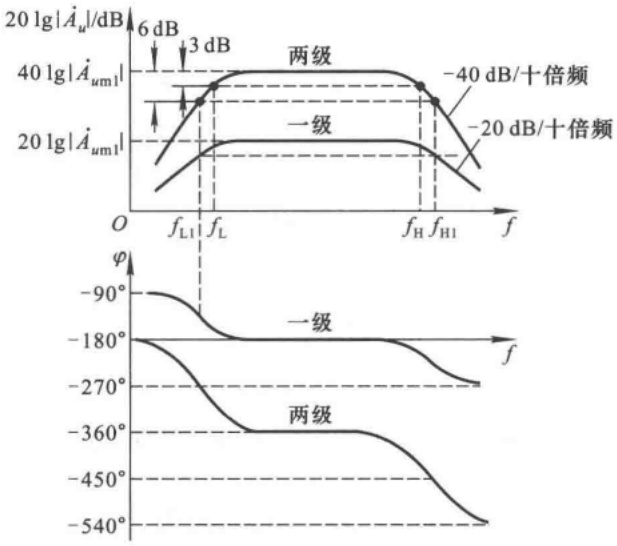

图 4.5.1 两级放大电路的波特图

上述结论具有普遍意义。对于一个 N 级放大电路，设组成它的各级放大电路的下限频率分别为  $f_{L1}, f_{L2}, \cdots, f_{LN}$ ，上限频率分别为  $f_{H1}, f_{H2}, \cdots, f_{HN}$ ，通频带分别为  $f_{bw1}, f_{bw2}, \cdots, f_{bwN}$ ；该多级放大电路的下限频率为 $f_{L}$ ，上限频率为 $f_{H}$ ，通频带为 $f_{bw}$ ；则

$$
\left\{ \begin{array}{l l} f _ {\mathrm{L}} > f _ {\mathrm{Lk}} & (k = 1 \sim N) \\ f _ {\mathrm{H}} <   f _ {\mathrm{Hk}} & (k = 1 \sim N) \\ f _ {\mathrm{bw}} <   f _ {\mathrm{bwk}} & (k = 1 \sim N) \end{array} \right. \tag {4.5.3a}
$$

## 4.5.2 截止频率的估算

## 一、下限频率 $f_{L}$

将式(4.5.1)中的  $\dot{A}_{uk}$  用低频电压放大倍数  $\dot{A}_{ulk}$  的表达式代入并取模, 得出多级放大电路低频段的电压放大倍数为

$$
\mid \dot {A} _ {u 1} \mid = \prod_ {k = 1} ^ {N} \frac {\mid \dot {A} _ {u m k} \mid}{\sqrt {1 + \left(\frac {f _ {L k}}{f}\right) ^ {2}}}
$$

根据 $f_{L}$ 的定义, 当 $f=f_{L}$ 时

$$
\mid \dot {A} _ {u 1} \mid = \frac {\prod_ {k = 1} ^ {N} \mid \dot {A} _ {u m k} \mid}{\sqrt {2}}
$$

即  $\prod_{k=1}^{N}\sqrt{1+\left(\frac{f_{\mathrm{L}k}}{f_{\mathrm{L}}}\right)^{2}}=\sqrt{2}$

等式两边取平方,得

$$
\prod_ {k = 1} ^ {N} \left[ 1 + \left(\frac {f _ {\mathrm{L} k}}{f _ {\mathrm{L}}}\right) ^ {2} \right] = 2
$$

展开上式,得

$$
1 + \sum \left(\frac {f _ {\mathrm{Lk}}}{f _ {\mathrm{L}}}\right) ^ {2} + \text {高次项} = 2
$$

由于 $f_{Lk}/f_{L}$ 小于1,可将高次项忽略,得出

$$
f _ {\mathrm{L}} \approx \sqrt {\sum_ {k = 1} ^ {N} f _ {\mathrm{L} k} ^ {2}} \tag {4.5.4}
$$

如加上修正系数 $^{①}$ ，则

$$
f _ {\mathrm{L}} \approx 1. 1 \sqrt {\sum_ {k = 1} ^ {N} f _ {\mathrm{L} k} ^ {2}} \tag {4.5.5}
$$

## 二、上限频率 $f_{H}$

将式(4.5.1)中的  $\dot{A}_{uk}$  用高频电压放大倍数  $\dot{A}_{uhk}$  的表达式代入并取模, 得

$$
\mid \dot {A} _ {u h} \mid = \prod_ {k = 1} ^ {N} \frac {\mid \dot {A} _ {u m k} \mid}{\sqrt {1 + \left(\frac {f}{f _ {\mathrm{H} k}}\right) ^ {2}}}
$$

<small><span class="docvortex-page-footnote" data-block-type="page_footnote" style="color:#6b7280">① 参阅 J. 米尔曼. 微电子学: 数字和模拟电路与系统 中册 [M]. 清华大学电子学教研组, 译. 北京: 人民教育出版社, 1981:111\~112.</span></small>

根据 $f_{H}$ 的定义, 当 $f=f_{H}$ 时

$$
\mid \dot {A} _ {u h} \mid = \frac {\prod_ {k = 1} ^ {N} \mid \dot {A} _ {u m k} \mid}{\sqrt {2}}
$$

即 $\prod_{k=1}^{N}\sqrt{1 + \left(\frac{f_{\mathrm{H}}}{f_{\mathrm{H}k}}\right)^2} = \sqrt{2}$

等式两边取平方,得

$$
\prod_ {k = 1} ^ {N} \left[ 1 + \left(\frac {f _ {\mathrm{H}}}{f _ {\mathrm{H} k}}\right) ^ {2} \right] = 2
$$

展开等式,得

$$
1 + \sum_ {k = 1} ^ {N} \left(\frac {f _ {\mathrm{H}}}{f _ {\mathrm{H} k}}\right) ^ {2} + \mathrm{高次项} = 2
$$

由于 $f_{H}/f_{Hk}$ 小于1,所以可以忽略高次项,得出 $f_{H}$ 的近似表达式

$$
\frac {1}{f _ {\mathrm{H}}} \approx \sqrt {\sum_ {k = 1} ^ {N} \frac {1}{f _ {\mathrm{H} k} ^ {2}}}
$$

如加上修正系数,则得

$$
\frac {1}{f _ {\mathrm{H}}} \approx 1. 1 \sqrt {\sum_ {k = 1} ^ {N} \frac {1}{f _ {\mathrm{Hk}} ^ {2}}} \tag {4.5.6}
$$

根据以上分析可知,若两级放大电路是由两个具有相同频率特性的单管放大电路组成,则其上、下限频率分别为

$$
\left\{ \begin{array}{l l} \frac {1}{f _ {\mathrm{H}}} \approx 1. 1 \sqrt {\frac {2}{f _ {\mathrm{HI}} ^ {2}}}, & f _ {\mathrm{H}} \approx \frac {f _ {\mathrm{HI}}}{1 . 1 \sqrt {2}} \approx 0. 6 4 3 f _ {\mathrm{HI}} \\ f _ {\mathrm{L}} \approx 1. 1 \sqrt {2} f _ {\mathrm{L1}} \approx 1. 5 6 f _ {\mathrm{L1}} \end{array} \right. \tag {4.5.7a}
$$

对各级具有相同频率特性的三级放大电路,其上、下限频率分别为

$$
\left\{ \begin{array}{l l} \frac {1}{f _ {\mathrm{H}}} \approx 1. 1 \sqrt {\frac {3}{f _ {\mathrm{H1}} ^ {2}}}, & f _ {\mathrm{H}} \approx \frac {f _ {\mathrm{H1}}}{1 . 1 \sqrt {3}} \approx 0. 5 2 f _ {\mathrm{H1}} \\ f _ {\mathrm{L}} \approx 1. 1 \sqrt {3} f _ {\mathrm{L1}} \approx 1. 9 1 f _ {\mathrm{L1}} \end{array} \right. \tag {4.5.8a}
$$

可见,三级放大电路的通频带几乎是单级电路的一半。放大电路的级数愈多,频带愈窄。

在多级放大电路中,若某级的下限频率远高于其它各级的下限频率,则可认为整个电路的下限频率近似为该级的下限频率;同理,若某级的上限频率远低于其它各级的上限频率,则可认为整个电路的上限频率近似为该级的上限频率。因此式(4.5.5)、(4.5.6)多用于各级截止频率相差不多的情况。此外,对于有多个耦合电容和旁路电容的单管放大电路,在分析下限频率时,应先求出每个电容所确定的截止频率,然后利用式(4.5.5)求出电路的下限频率。

【例 4.5.1】已知某电路的各级均为共射放大电路, 其对数幅频特性如图 4.5.2 所示。试求解下限频率  $f_{L}$  、上限频率  $f_{H}$  和电压放大倍数  $\dot{A}_{u}$ 。

解:由图 4.5.2 可知

（1）频率特性曲线的低频段只有一个拐点，且低频段曲线斜率为20 dB/十倍频，说明影响低频特性的只有一个电容，故电路的下限频率为10 Hz。

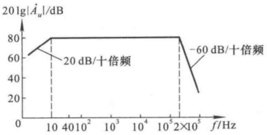

<details>
<summary>line</summary>

| Frequency (Hz) | Gain (dB) |
| --- | --- |
| 10 | 80 |
| 200000 | 80 |
| >200000 | ~25 |
</details>

图4.5.2 例4.5.1图

（2）频率特性曲线的高频段只有一个拐点，且高频段曲线斜率为-60 dB/十倍频，说明影响高频特性的有三个电容，即电路为三级放大电路，且每一级的上限频率均为 $2 \times 10^{5}$ Hz，根据式(4.5.8a)可得上限频率为

$$
f _ {\mathrm{H}} \approx 0. 5 2 f _ {\mathrm{H1}} = (0. 5 2 \times 2 \times 1 0 ^ {5}) \mathrm{Hz} = 1. 0 4 \times 1 0 ^ {5} \mathrm{Hz} = 1 0 4 \mathrm{kHz}
$$

（3）因各级均为共射电路，所以在中频段输出电压与输入电压相位相反。因此，电压放大倍数

$$
\dot {A} _ {u} = \frac {- 1 0 ^ {4}}{\left(1 + \frac {1 0}{\mathrm{j} f}\right) \left(1 + \mathrm{j} \frac {f}{2 \times 1 0 ^ {5}}\right) ^ {3}} \quad \text {或} \quad \dot {A} _ {u} = \frac {- 1 0 ^ {3} \mathrm{j} f}{\left(1 + \mathrm{j} \frac {f}{1 0}\right) \left(1 + \mathrm{j} \frac {f}{2 \times 1 0 ^ {5}}\right) ^ {3}}
$$

【例 4.5.2】在图 2.4.2(b) 所示 Q 点稳定电路中, 已知  $C_{1} = C_{2} = C_{e}$ , 其余参数选择合适, 电路在中频段工作正常。试问: 电路的下限频率决定于哪个电容? 为什么?

解: 考虑到  $C_{1}$ 、 $C_{2}$ 、 $C_{e}$  的作用, 图 2.4.2(b) 所示电路的低频等效电路如图 4.5.3(a) 所示。在考虑某一电容对频率响应的影响时, 应将其它电容作理想化处理, 即将其它耦合电容或旁路电容视为短路。比较三个电容所在回路的等效电阻, 数值最小的说明该电容的时间常数最小, 因而它所确定的下限频率最高, 若能判断出这个下限频率远高于其它两个, 则说明整个电路的下限频率就是该频率。

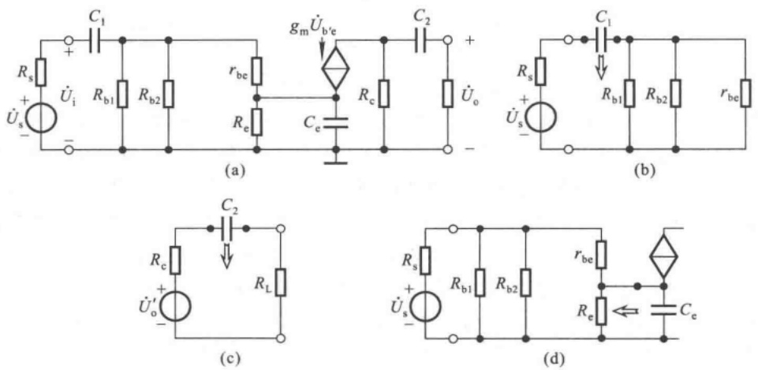

图 4.5.3 例 4.5.2 图

(a) $Q$ 点稳定电路的交流等效电路 (b) $C_1$ 所在回路的等效电路

(c)  $C_{2}$  所在回路的等效电路 (d)  $C_{e}$  所在回路的等效电路

在考虑  $C_{1}$  对低频特性的影响时, 应将  $C_{2}$ 、 $C_{e}$  短路。图(b)所示是  $C_{1}$  所在回路的等效电路, 其时间常数

$$
\tau_ {1} = (R _ {\mathrm{s}} + R _ {\mathrm{b1}} / / R _ {\mathrm{b2}} / / r _ {\mathrm{be}}) C _ {1} = (R _ {\mathrm{s}} + R _ {\mathrm{i}}) C _ {1} \tag {4.5.9}
$$

在考虑  $C_{2}$  对低频特性的影响时, 应将  $C_{1}$ 、 $C_{e}$  短路。图(c)所示是  $C_{2}$  所在回路的等效电路, 其时间常数

$$
\tau_ {2} = (R _ {\mathrm{c}} + R _ {\mathrm{L}}) C _ {2} \tag {4.5.10}
$$

式(4.5.9)与(4.5.10)在本质上是相同的,因为倘若电路的负载是下一级放大电路,则式(4.5.10)中的 $R_{L}$ 即为后级的输入电阻 $R_{i}$ ,而 $R_{c}$ 正是后级电路的信号源内阻 $R_{s}$ 。

在考虑  $C_{e}$  对低频特性的影响时，应将  $C_{1}$ 、 $C_{2}$  短路。图(d)所示是  $C_{e}$  所在回路的等效电路。从  $C_{e}$  两端向左看的等效电阻是射极输出器的输出电阻，因此它的时间常数

$$
\tau_ {\mathrm{e}} = \left(R _ {\mathrm{e}} / / \frac {r _ {\mathrm{be}} + R _ {\mathrm{b1}} / / R _ {\mathrm{b2}} / / R _ {\mathrm{s}}}{1 + \beta}\right) C _ {\mathrm{e}} \tag {4.5.11}
$$

设 $C_1, C_2, C_e$ 所在回路所确定的下限频率分别为 $f_{\mathrm{L1}} \sqrt{f_{\mathrm{L2}}} \sqrt{f_{\mathrm{Le}}}$。比较时间常数 $\tau_1, \tau_2, \tau_e$，不难看出，当取 $C_1 = C_2 = C_e$ 时，$\tau_e$ 将远小于 $\tau_1, \tau_2$，即 $f_{\mathrm{Le}}$ 远大于 $f_{\mathrm{L1}} \sqrt{f_{\mathrm{L2}}}$，因此可以认为 $f_{\mathrm{Le}}$ 就约为该电路的下限频率，即

$$
f _ {\mathrm{L}} \approx f _ {\mathrm{Le}} = \frac {1}{2 \pi \tau_ {\mathrm{e}}} = \frac {1}{2 \pi \left(R _ {\mathrm{e}} / / \frac {r _ {\mathrm{be}} + R _ {\mathrm{b1}} / / R _ {\mathrm{b2}} / / R _ {\mathrm{s}}}{1 + \beta}\right) C _ {\mathrm{e}}}
$$

从另一角度考虑，为改善电路的低频特性， $C_{e}$  的容量应远大于  $C_{1}$ 、 $C_{2}$ 。当  $f_{L1}$ 、 $f_{L2}$  和  $f_{Le}$  的数值相差不大时，可用式(4.5.5)求解电路的  $f_{L}$ 。

## 思考题

4.5.1 为什么说放大电路的级数越多、耦合电容和旁路电容越多,通频带越窄?
4.5.2 一般情况下,要想改善图2.4.2(b)所示电路的低频特性,应增大哪个电容的容量?为什么?
4.5.3 试求解图 2.4.2(b) 所示电路适用于频率从零到无穷大的电压放大倍数的表达式。

## 4.6 频率响应与阶跃响应

频率响应描述放大电路对不同频率正弦信号放大的能力，即在输入信号幅值不变的情况下改变信号频率，来考察输出信号幅值与相位的变化，这种方法称为频域法。实际上，还可以用阶跃函数作为放大电路的输入，考察输出信号前沿与顶部的变化，来研究电路的放大性能，这种方法称为时域法。所谓阶跃函数，就是在 $t < 0$ 时 $u_{1} = 0\mathrm{V}, t \geqslant 0$ 时 $u_{1} = U_{1}(U_{1}$ 为常量）的信号，如图4.6.1所示。

输出对于阶跃函数的响应,应采用过渡过程的分析方法。

## 4.6.1 阶跃响应的指标

阶跃函数是在 t=0 时刻产生单位突变的信号,由于电路中电容(如耦合电容、极间电容等)上的电压不会跃变,造成输出信号跟不上输入信号的变化,因而产生失真,如图 4.6.2 所示。

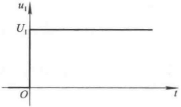

<details>
<summary>line</summary>

| t | u1 |
| --- | --- |
| 0 | U1 |
</details>

图 4.6.1 阶跃信号

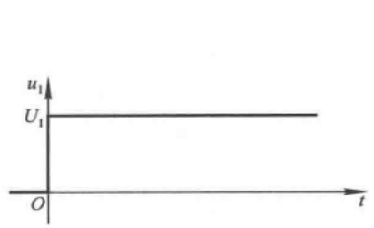

<details>
<summary>text_image</summary>

u₁
U₁
O
t
</details>

(a)

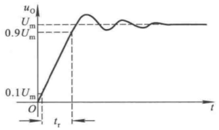

<details>
<summary>line</summary>

| Time (t) | Output Voltage (uO) |
| --- | --- |
| 0 | 0.1Um |
| tr | 0.9Um |
| >tr | Um |
</details>

(b)

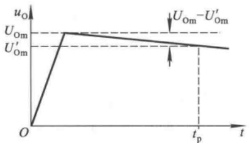

<details>
<summary>line</summary>

| Time (t) | Voltage (u_O) |
| --- | --- |
| 0 | 0 |
| Peak | U_Om |
| tp | U'_{Om} - U'_{Om} |
</details>

(c)

图 4.6.2 放大电路的阶跃响应

(a) 输入阶跃信号 (b) 输出电压波形 (c) 输出电压波形的近似分析

为了描述输出电压的失真情况,引入以下三个指标:

（1）上升时间:指输出电压从终了值的 $10\%$ 上升到终了值的 $90\%$ 所需要的时间，见图4.6.2(b)中标注的 $t_{\mathrm{r}}$。
(2) 倾斜率: 指在指定的时间  $t_{p}$  内, 输出电压顶部的变化量与上升的终了值的百分比, 即倾斜率

$$
\delta = \frac{U_{0\mathrm{m}} - U'_{0\mathrm{m}}}{U_{0\mathrm{m}}} \cdot 100\% \tag{4.6.1}
$$

见图(c)中所标注。

（3）超调量:指在输出电压上升的瞬态过程中，上升值超过终了值的部分，一般用超过终了值的百分比来表示。

## 4.6.2 频率响应与阶跃响应的关系

从频谱的概念去理解,一个阶跃函数的频谱应包含从0到无穷大无数个频率成分,因此只有放大电路的频带无限宽,才可能在阶跃函数作用时,在输出端得到与输入信号成比例的输出信号,即输出信号也为阶跃信号,或仅仅反相。下面以图4.4.1(a)所示单管共射放大电路为例来说明 $f_{H}$ 与 $t_{r},f_{L}$ 与 $\delta$ 之间的关系,从中理解频率响应与阶跃响应的关系。

从频率特性的分析已知 $C_{\pi}^{\prime}$ 所在回路是低通电路，如图4.6.3(a)所示。因此，在阶跃信号作用时，$C_{\pi}^{\prime}$ 上的电压 $u_{\mathrm{b'e}}$ 将按指数规律上升。$u_{\mathrm{b'e}}$ 的起始值为 $0\mathrm{V}$，终了值为 $U_{1}$，回路时间常数为 $RC_{\pi}^{\prime}$，因而 $u_{\mathrm{b'e}}$ 的表达式为

$$
u _ {\mathrm {b^ {'} e}} = U _ {\mathrm{I}} (1 - \mathrm{e} ^ {- \frac {t}{R C _ {\pi} ^ {'}}}) \tag {4.6.2}
$$

$u_{1}$ 与 $u_{\mathrm{b'e}}$ 随时间的变化波形如图4.6.3(b)所示。根据式(4.6.2)可以计算出， $u_{\mathrm{b'e}}$ 上升到 $10\% U_{1}$ 所需的时间为 $0.1RC_{\pi}^{\prime}$，上升到 $90\% U_{1}$ 所需的时间为 $2.3RC_{\pi}^{\prime}$，因此 $u_{\mathrm{b'e}}$ 的上升时间

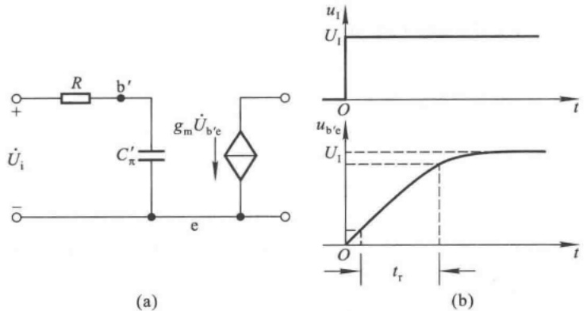

图 4.6.3 图 4.4.1 所示电路输入回路的阶跃响应  
(a) 输入回路 (b) 阶跃响应

$$
t _ {\mathrm{r}} = 2. 2 R C _ {\pi} ^ {\prime} \tag {4.6.3}
$$

因为上限频率 $f_{\mathrm{H}} = \frac{1}{2\pi RC'_{\pi}}$，所以与式(4.6.3)联立可得出 $t_{r}$ 与 $f_{\mathrm{H}}$ 的关系式，

$$
t _ {\mathrm{r}} \approx \frac {0 . 3 5}{f _ {\mathrm{H}}} \tag {4.6.4}
$$

上述分析表明,与上限频率一样,上升时间也决定于  $C_{\pi}^{\prime}$  所在回路的时间常数, $f_{H}$  愈大, $t_{r}$  愈小,放大电路的高频特性愈好。

根据定义，倾斜率是研究输入信号从突变到某一固定值时引起输出电压变化的过程，因此电路的低频参数将起主要作用。从放大电路低频特性的分析可知，耦合电容 $C$ 所在回路是高通电路，如图4.6.4(a)所示。 $u_0^{\prime}$ 为开路时的输出电压， $u_0^{\prime} = -g_{\mathrm{m}}u_{\mathrm{b'e}}R_{\mathrm{c}}$ ，它随 $u_{\mathrm{b'e}}$ 而产生线性变化，并与之反相。因为回路时间常数 $(R_{\mathrm{c}} + R_{\mathrm{L}})C >> t_{\mathrm{r}}$ ，所以可以认为在 $u_{\mathrm{b'e}}$ 从零到 $U_{1}$ 的变化阶段， $u_0$ 跟随 $u_0^{\prime}$ 按比例变化。即认为电容 $C$ 近似为短路， $u_0 = \frac{R_L}{R_c + R_L}\cdot u_0^{\prime}\circ$ 当 $u_{\mathrm{b'e}}$ 达到稳态值 $U_{1}$ 时， $u_0$ 也达到最大值 $U_{0\mathrm{m}}$ 。之后 $u_0$ 以 $U_{0\mathrm{m}}$ 为起始值，以 $(R_{\mathrm{c}} + R_{\mathrm{L}})C$ 为时间常数，以零为终了值，按指数规律变化， $u_0$ 的表达式为

$$
u _ {0} = U _ {0 \mathrm{m}} \mathrm{e} ^ {- \frac {t}{R C}} \quad (R = R _ {\mathrm{c}} + R _ {\mathrm{L}}) \tag {4.6.5}
$$

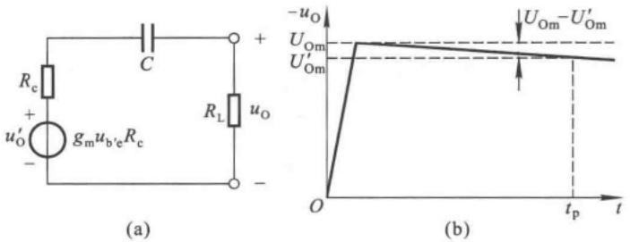

图 4.6.4 图 4.4.1 所示电路输出回路的阶跃响应  
(a) 输出回路 (b) 阶跃响应

当 $t \ll RC$ 时

$$
u _ {0} \approx U _ {0 \mathrm{m}} \bigg (1 - \frac {t}{R C} \bigg)
$$

在图4.6.4中， $t_{\mathrm{r}} \ll t_{\mathrm{p}} \ll RC$ ，因此倾斜率 $\delta$ 为

$$
\delta = \frac {U _ {\mathrm{Om}} - U _ {\mathrm{Om}} ^ {\prime}}{U _ {\mathrm{Om}}} \cdot 100 \% \approx \frac {U _ {\mathrm{Om}} - U _ {\mathrm{Om}} \left(1 - \frac {t _ {\mathrm{p}}}{R C}\right)}{U _ {\mathrm{Om}}} = \frac {t _ {\mathrm{p}}}{R C} \cdot 100 \% \tag {4.6.6}
$$

因为下限频率 $f_{\mathrm{L}} = \frac{1}{2\pi RC}$，所以与式(4.6.6)联立后，可得到 $\delta$ 与 $f_{\mathrm{L}}$ 的关系为

$$
\delta \approx 2\pi f_{\mathrm{L}}t_{\mathrm{p}}\times 100\%
$$

上述分析表明,与下限频率 $f_{L}$ 一样,倾斜率 $\delta$ 也决定于C所在回路的时间常数, $f_{L}$ 愈低, $\delta$ 愈小,放大电路的低频特性愈好。

综上所述,频率响应与阶跃响应有着内在的联系,这是因为它们只是分别从频域和时域两个角度描述同一个电路模型的放大性能,从而得出不同的指标。这些指标的优劣都取决于电抗元件所在回路的时间常数。

## 4.7 Multisim应用举例

## 4.7.1 放大电路频率响应的仿真方法

仿真电路为典型的阻容耦合静态工作点稳定电路，如图4.7.1所示。其中晶体管采用小功率高频晶体管ZTX325，它的电流放大系数 $\beta$ 为93，发射结电容 $C_{\pi}$ 为1.18pF，集电结电容 $C_{\mu}$ 为1.54pF；其余参数如图中所标注。

## 一、仿真内容

在 Multisim 中, 可采用两种方法测试放大电路的频率响应。

方法一是利用“交流分析（AC Analysis）”获得幅频特性曲线和相频特性曲线。方法与扫描分析相类似，首先设定起始频率、终了频率、点数、扫描方式、扫描对象，然后按扫描键即可；方法二是利用虚拟仪器波特图仪（Bode Plotter）直接测试，在图示仪上只能分别看幅频特性曲线和相频特性曲线；如图4.7.1(a)所示。第二种方法也可在“Analysis Graphs”同时观察两条曲线，如图(b)所示。

## 二、仿真结果

在图 4.7.1(a) 中, 波特图仪上指针正好在通频带内, 可读出电路的中频段增益, 为 33.499 dB。移动指针, 在低频段和高频段分别找到使增益下降 3 dB 的频率, 即为下限频率和上限频率, 结果如表 4.7.1 所示。

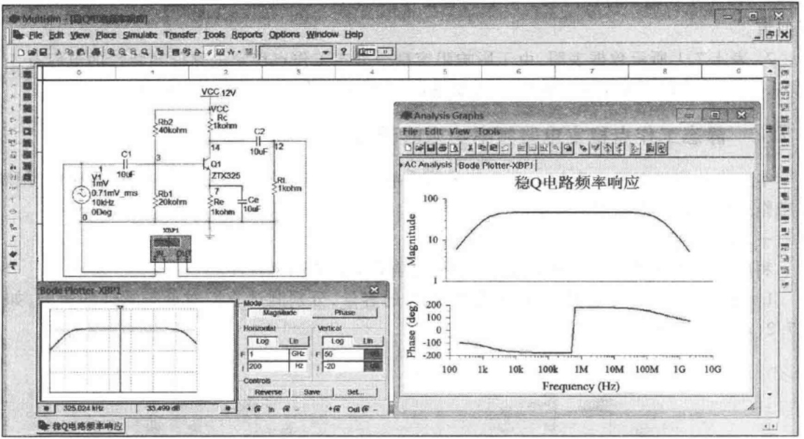

<details>
<summary>text_image</summary>

Multism - [E]Q-10(368)450
File Edit View Place Simulate Transfer Tools Reports Options Window Help
VCC 12V
C1
V1
1mV
0.71mV_mrs
10kHz
0Deg
Rb2
40kohm
C2
14
Q1
ZTX325
7
Re
1kohm
Ce
10uF
R1
1kohm
XBP1
JN
DLP
Analysis Graphs
File Edit View Tools
AC Analysis Bode Plotter-XBP1
稳Q电路频率响应
Magnitude
100
log
10
Phase (deg)
100
log
100
Frequency (Hz)
100
1k
10k
100k
1M
10M
100M
1G
10G
Mode Magnitude Phase Horizontal Vertical Log Lin Log Lin
Controls Reverse Save Set...
Bode Plotter-XBP1
325.024 kHz 33.499 dB + In In - + Out In -
按Q电路频率响应
</details>

(a)

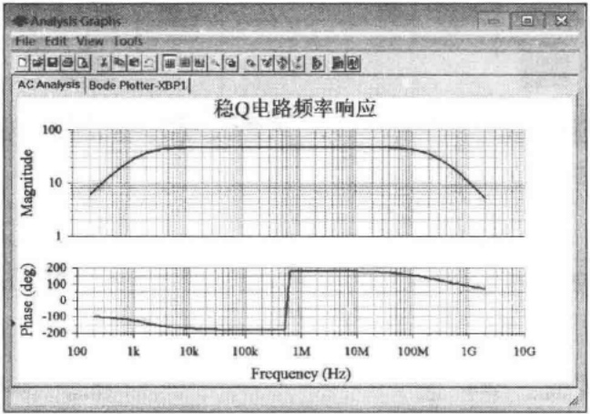

<details>
<summary>line</summary>

| Frequency (Hz) | Magnitude | Phase (deg) |
| --- | --- | --- |
| 100 | ~6 | ~-100 |
| 1k | ~30 | ~-120 |
| 10k | ~45 | ~-170 |
| 100k | ~45 | ~-180 |
| 500k | ~45 | ~-180 |
| 1M | ~45 | ~180 |
| 10M | ~45 | ~180 |
| 100M | ~45 | ~160 |
| 1G | ~10 | ~80 |
| 2G | ~5 | ~60 |
</details>

(b)

图 4.7.1 放大电路频率响应的测试

（a）测试电路和两种测试方法 （b）在“Analysis Graphs”观察波特图仪的测试结果

表 4.7.1 图 4.7.1(a) 所示放大电路的频率响应

| 中频段增益/dB | 下限频率$f_{L}$/kHz | $f=f_{L}$时的增益/dB | 上限频率$f_{H}$/MHz | $f=f_{H}$时的增益/dB |
| --- | --- | --- | --- | --- |
| 33.499 | ≈1.558 | 30.479 | ≈233.723 | 30.36 |

## 三、结论

1. 在 Multisim 中,无论是用“交流分析(AC Analysis)”还是用波特图仪,均可方便地测试出放大电路的对数幅频特性曲线和相频特性曲线。在波特图仪上很难寻找到准确的下限频率和上限频率,因而需在幅频特性曲线上耐心调整指针,尽量找到最接近-3 dB的频率,以获得它们的近似值。

2. 表 4.7.1 所示数据表明,由于影响阻容耦合静态工作点稳定电路低频特性的电容有 3 个之多,导致其下限频率高达千赫以上,需要进行改进,才能有更宽泛的应用场合。

## 4.7.2 静态工作点稳定电路频率响应的研究

本节将分别研究图 4.7.1(a) 所示阻容耦合静态工作点稳定电路中耦合电容、旁路电容和静态工作点对电路频率响应的影响。

## 一、仿真内容

利用上节所述测试方法测试电路参数变化前后电路的频率特性。

1. 变化输入端耦合电容  $C_{1}$  和旁路电容  $C_{e}$  的容量, 分别测试它们对低频特性的影响, 如图 4.7.2(a)、(b) 所示。

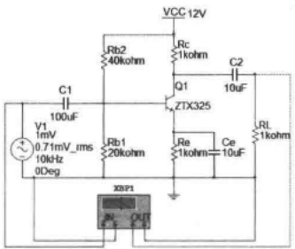

<details>
<summary>text_image</summary>

VCC 12V
Rb2
40kohm
C1
100uF
V1
1mV
0.71mV_rms
10kHz
0Deg
Rb1
20kohm
ZTX325
Q1
10uF
Rc
1kohm
C2
RL
1kohm
Ce
10uF
XBP1
OUT
</details>


<details>
<summary>text_image</summary>

VCC 12V
R1
40kohm
R2
1kohm
C4
10uF
C3
10uF
G2
ZTX325
R4
20kohm
R5
1kohm
Ce1
10uF
R3
11kohm
V2
1mV
0.71mV_rms
10kHz
60Deg
XBP2
OUT
</details>

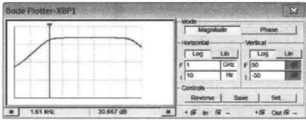

<details>
<summary>text_image</summary>

Bode Plotter-XBP1
Mode
Magnitude
Phase
Horizontal
Log
Lib
Vertical
Log
Lin
F 1 GHz F 50
10 Hz -50
Controls
Reverse
Save
Set.
+ @ In @ - + @ Out @ -
1.61 MHz 30.667 dB
</details>

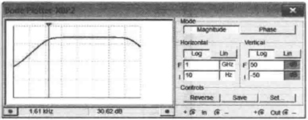

<details>
<summary>text_image</summary>

Bode Plotter: X0V2
Mode
Magnitude Phase
Horizontal
Log Lin Vertical
F 1 GHz F 50 dB
10 Hz -50 dB
Controls
Reverse Save Set
+ @ In @ - +@ Out @ -
1.61 kHz 30.62 dB
</details>

(a)

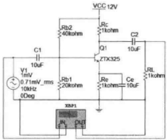

<details>
<summary>text_image</summary>

VCC 12V
Rb2
40kohm
C1
10uF
V1
1mV
0.71mV_rms
10kHz
0Deg
Rb1
20kohm
Q1
ZTX325
Re
1kohm
Ce
10uF
RL
1kohm
XXP1
IN OUT
</details>

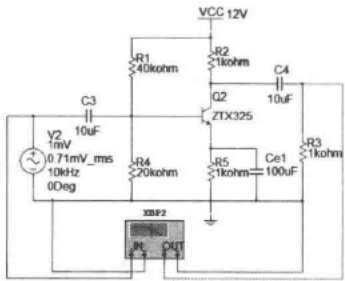

<details>
<summary>text_image</summary>

VCC 12V
R1
40kohm
R2
1kohm
C4
10uF
C3
10uF
Q2
2TX325
V2
1mV
0.71mV_rms
10kHz
0Deg
R4
20kohm
R5
1kohm
Ce1
100uF
R3
11kohm
ZBP2
IN
OUT
</details>

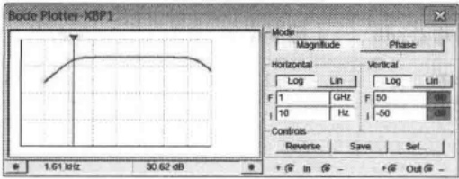

<details>
<summary>text_image</summary>

Bode Plotter-XBP1
Mode
Magnitude	Phase
Horizontal	Vertical
Log Lin Log Liti
F 1 GHz F 50
10 Hz I -50
Controls
Reverse	Save	Set_
+ @ In @ -	+@ Out @ -
</details>


<details>
<summary>text_image</summary>

Mode
Magnitude Phase
Horizontal
Log Lin
F 1 GHz F 50 dB
I 10 Hz I 50 dB
Controls
Reverse Save Set
+ @ In @ - +@ Out @ -
163.604 Hz 30.266 dB
</details>

(b)

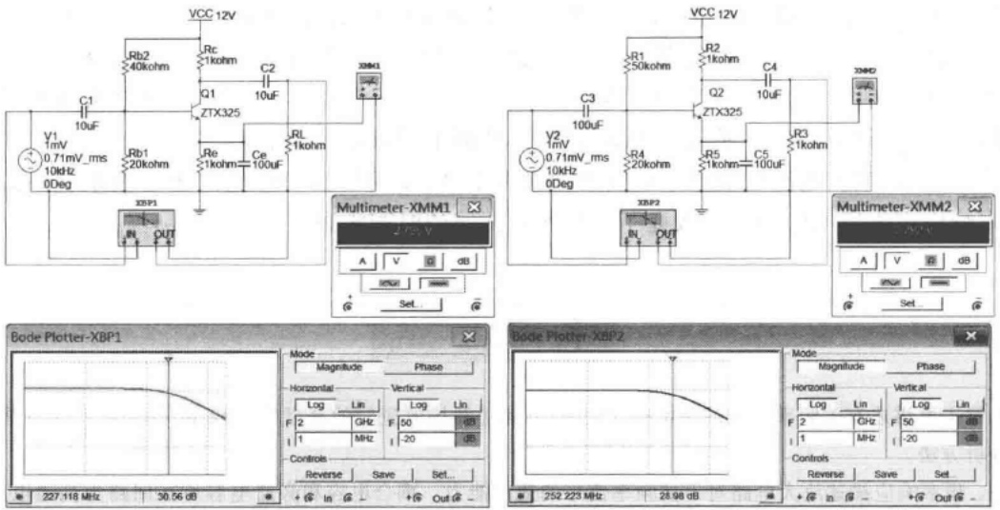

(c)

图 4.7.2 典型的静态工作点稳定电路频率响应的测试

(a) 耦合电容  $C_{1}$  变化 (b) 旁路电容  $C_{e}$  变化 (c) 偏置电阻  $R_{b2}$  变化

2. 变化偏置电路中  $R_{b2}$  的阻值, 测试静态工作点对频率特性的影响, 如图 4.7.2(c) 所示。

图(c)中两只万用表分别测试左右两个电路中发射极的静态地位,已知它们的发射极电阻均为1 kΩ,由此计算出两个电路的发射极静态电流,分别为2.795 mA和2.292 mA,可近似为集电极电流,并根据电路的其它参数可估算基极静态电位、管压降等。

## 二、仿真结果

如表 4.7.2 所示。

表 4.7.2 电路参数变化时对频率响应的影响

| 耦合电容 $C_{1}$$(C_{3})/\mu F$ | 耦合电容 $C_{2}$$(C_{4})/\mu F$ | 旁路电容 $C_{e}$$(C_{5})/\mu F$ | 偏置电阻 $R_{b2}$$(R_{1})/k\Omega$ | 中频电压增益/dB | 下限频率$f_{L}/Hz$ | 上限频率$f_{H}/MHz$ |
| --- | --- | --- | --- | --- | --- | --- |
| 10 | 10 | 10 | 40 | 33.499 | 1610 |  |
| 100 | 10 | 10 | 40 | 33.499 | 1610 |  |
| 10 | 10 | 100 | 40 | 33.499 | 163.604 | 227.118 |
| 10 | 10 | 100 | 50 | 31.96 | 134.7 | 252.223 |

## 三、结论

1. 实验表明，耦合电容 $C_1$ 从 $10\mu \mathrm{F}$ 变为 $100~\mu \mathrm{F}$ 时下限频率基本不变，而旁路电容 $C_{e}$ 从$10\mu \mathrm{F}$ 变为 $100~\mu \mathrm{F}$ 时下限频率明显减小。这一方面说明由于 $C_{e}$ 所在回路的等效电阻最小，要想改善该电路的低频特性应增大 $C_{e}$ ；另一方面还说明在分析电路的下限频率时，如果有一个电容所在回路的时间常数远小于其它电容所在回路的时间常数，那么该电容所确定的下限频率就可近似为整个电路的下限频率，而没有必要计算其它电容所确定的下限频率，因而计算前的定性分析很重要。

2. 在静态工作点稳定电路中，当偏置电阻 $R_{\mathrm{b2}}$ 从 $40\mathrm{k}\Omega$ 变为 $50\mathrm{k}\Omega$ 时，一方面放大管的静态发射极电流减小，b-e间等效电阻变大，导致增益减小；同时跨导 $g_{\mathrm{m}}$ 减小，$k = g_{\mathrm{m}}R'_{\mathrm{L}}$ 减小，$C_{\pi}'$ 随之减小，$C_{\pi}'$ 回路时间常数变小，从而上限频率 $f_{\mathrm{H}}$ 升高。另一方面b-e间等效电阻变大，导致输入电阻增大，使得 $C_1$ 和 $C_e$ 回路时间常数增大，从而下限频率 $f_{\mathrm{L}}$ 降低。

综上所述,放大电路增益减小的同时通频带变宽,说明增益与带宽的矛盾关系;静态工作点对频率响应产生影响的原因是改变了电容所在回路的时间常数。

## 本章小结

本章主要讲述有关频率响应的基本概念,介绍晶体管和场效应管的高频等效模型,并阐明放大电路频率响应的分析方法。

一、频率响应描述放大电路对不同频率信号的适应能力。耦合电容和旁路电容所在回路为高通电路，在低频段使放大倍数的数值下降，且产生超前相移。极间电容所在回路为低通电路，在高频段使放大倍数的数值下降，且产生滞后相移。

二、在研究频率响应时，应采用放大管的高频等效模型。在晶体管高频等效模型中，极间电容等效为 $C_{\pi}^{\prime}$ ；在场效应管高频等效模型中，极间电容等效为 $C_{gs}^{\prime}$ 。

三、放大电路的上限频率 $f_{\mathrm{H}}$ 和下限频率 $f_{\mathrm{L}}$ 决定于电容所在回路的时间常数 $\tau, f_{\mathrm{H}} = \frac{1}{2\pi\tau_{\mathrm{H}}}, f_{\mathrm{L}} = \frac{1}{2\pi\tau_{\mathrm{L}}}$ 。通频带 $f_{\mathrm{bw}}$ 等于 $f_{\mathrm{H}}$ 与 $f_{\mathrm{L}}$ 之差 $(f_{\mathrm{H}} - f_{\mathrm{L}})$ 。

四、对于单管共射放大电路，若已知 $f_{H}\sqrt{f_{L}}$ 和中频放大倍数 $\dot{A}_{um}$ （或 $\dot{A}_{usm}$ ），便可画出波特图，并可写出适于频率从零到无穷大情况下的放大倍数 $\dot{A}_{u}$ （或 $\dot{A}_{us}$ ）的表达式。当 $f=f_{L}$ 或 $f=f_{H}$ 时，增益下降3 dB，附加相移为 $+45^{\circ}$ 或 $-45^{\circ}$ 。

在一定条件下，增益带宽积 $|\dot{A}_{\mathrm{um}}f_{\mathrm{bw}}|$ （或 $|\dot{A}_{\mathrm{usm}}f_{\mathrm{bw}}|$ ）约为常量。要想高频特性好，首先应选择截止频率高的管子，然后合理选择参数，使 $C_{\pi}^{\prime}$ 所在回路的等效电阻尽可能小。要想低频特性好，应采用直接耦合方式。

五、多级放大电路的波特图是已考虑了前后级相互影响的各级波特图的代数和。若各级的上限频率（或下限频率）相近，则可根据式(4.5.6)[或式(4.5.5)]方便地求解整个电路的上限频率（或下限频率）。若各级上限频率或下限频率相差较大，则可以近似认为各上限频率中最低的频率为整个电路的上限频率，各下限频率中最高的频率为整个电路的下限频率。

学完本章后，应掌握以下几方面:

一、掌握以下概念:上限频率，下限频率，通频带，波特图，增益带宽积。
二、能够计算放大电路中只含一个时间常数时的 $f_{H}$ 和 $f_{L}$ ，并会画出波特图。
三、了解多级放大电路频率响应与组成它的各级电路频率响应间的关系。

## 自测题

一、选择正确答案填入空内。

（1）测试放大电路输出电压幅值与相位的变化，可以得到它的频率响应，条件是\_\_\_\_。

A. 输入电压幅值不变, 改变频率

B. 输入电压频率不变, 改变幅值

C. 输入电压的幅值与频率同时变化

（2）放大电路在高频信号作用时放大倍数数值下降的原因是\_\_\_\_，而低频信号作用时放大倍数数值下降的原因是\_\_\_\_。

A. 耦合电容和旁路电容的存在
B. 半导体管极间电容和分布电容的存在
C. 半导体管的非线性特性
D. 放大电路的静态工作点不合适

（3）当信号频率等于放大电路的 $f_{L}$ 或 $f_{H}$ 时，放大倍数的值约下降到中频时的\_\_\_\_。

A. 0.5

B. 0.7

C. 0.9

即增益约下降\_\_\_\_。

A. 3 dB

B. 4 dB

C. 5 dB

（4）对于单管共射放大电路，当 $f=f_{L}$ 时， $\dot{U}_{o}$ 与 $\dot{U}_{i}$ 相位关系是\_\_\_\_。

A.  $+45^{\circ}$

B.  $-90^{\circ}$

C.  $-135^{\circ}$

当 $f=f_{H}$ 时， $\dot{U}_{o}$ 与 $\dot{U}_{i}$ 的相位关系是\_\_\_\_。

A.  $-45^{\circ}$

B.  $-135^{\circ}$

C.  $-225^{\circ}$

二、电路如图 T4.2 所示。已知:晶体管的  $C_{\mu}=4\ pF, f_{T}=50\ MHz, r_{bb'}=100\ \Omega, \beta_{0}=80$ 。试求解:

(1) 中频电压放大倍数  $\dot{A}_{usm}$ ;
(2)  $C'_{\pi}$ ;
(3) $f_{H}$  和  $f_{L}$ ;
(4) 画出波特图。

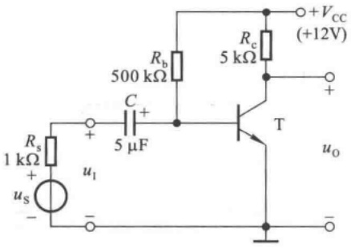

<details>
<summary>text_image</summary>

Rb
500 kΩ
C
+
5 μF
Rs
1 kΩ
+
us
-
u1
T
Rc
5 kΩ
+VCC
(+12V)
+
uo
-
</details>

图 T4.2

三、已知某放大电路的波特图如图 T4.3 所示, 填空:

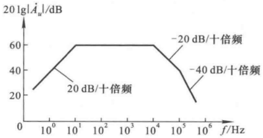

<details>
<summary>line</summary>

| Frequency (f/Hz) | Magnitude (dB) |
| --- | --- |
| ~1 | ~25 |
| 10^1 | 60 |
| 10^4 | 60 |
| 10^5 | 40 |
| ~3x10^5 | ~15 |
</details>

图 T4.3

(1) 电路的中频电压增益  $20 \lg \left| \dot{A}_{um} \right| = \_\_\_\_\mathrm{dB}, \dot{A}_{um} = \_\_\_\_\circ$
(2) 电路的下限频率 $f_{\mathrm{L}} \approx$ \_\_\_\_ Hz, 上限频率 $f_{\mathrm{H}} \approx$ \_\_\_\_ kHz。
(3) 电路的电压放大倍数的表达式  $\dot{A}_{u}=$ \_\_\_\_。

## 习题

4.1 在图 P4.1 所示电路中，已知晶体管的  $r_{bb'}$ 、 $C_{\mu}$ 、 $C_{\pi}$ ， $R_{i} \approx r_{be}$ 。

填空:除要求填写表达式的之外,其余各空填入①增大、②基本不变、③减小。

（1）在空载情况下，下限频率的表达式 $f_{\mathrm{L}} =$ \_\_\_\_。当 $R_{\mathrm{b}}$ 减小时，$f_{\mathrm{L}}$ 将\_\_\_\_；当带上负载电阻后，$f_{\mathrm{L}}$ 将\_\_\_\_。
（2）在空载情况下，若 b-e 间等效电容为  $C_{\pi}^{\prime}$ ，则上限频率的表达式  $f_{H}=$  \_\_\_\_；当  $R_{s}$  为零时， $f_{H}$  将 \_\_\_\_；当  $R_{b}$  减小时， $g_{m}$  将 \_\_\_\_， $C_{\pi}^{\prime}$  将 \_\_\_\_， $f_{H}$  将 \_\_\_\_。

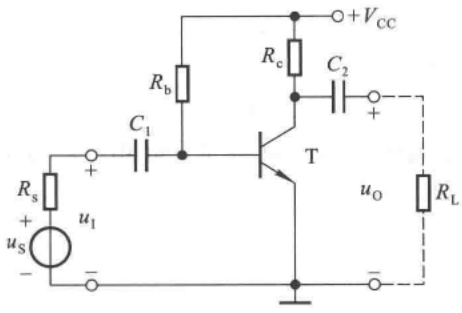

<details>
<summary>text_image</summary>

Rs
+
us
-
ui
+
C1
Rb
Rc
C2
T
+
VCC
uo
RL
</details>

图P4.1

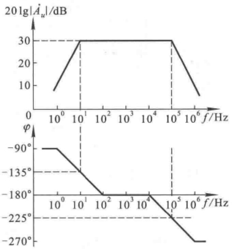

<details>
<summary>line</summary>

| Frequency (Hz) | Magnitude (dB) | Phase \(({}^{\circ})\) |
| --- | --- | --- |
| 10^0 | ~8 | -90 |
| 10^1 | 30 | -135 |
| 10^2 | 30 | -180 |
| 10^4 | 30 | -180 |
| 10^5 | 30 | -225 |
| 10^6 | ~6 | -270 |
</details>

图 P4.2

4.2 已知某电路的波特图如图 P4.2 所示, 试写出  $\dot{A}_{u}$  的表达式。
4.3 已知某共射放大电路的波特图如图 P4.3 所示, 试写出  $\dot{A}_{u}$  的表达式。

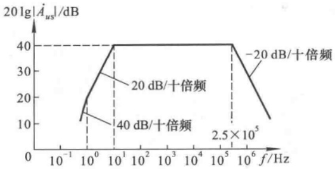

<details>
<summary>line</summary>

| Frequency (f/Hz) | Gain (dB) |
| --- | --- |
| 10^0 | 40 |
| 10^5 | 40 |
</details>

图 P4.3

4.4 已知某电路的幅频特性如图 P4.4 所示, 试问:

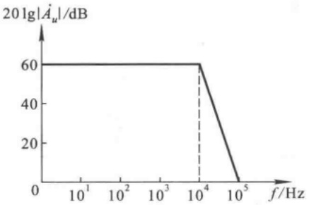

<details>
<summary>line</summary>

| 0 | 60 |
| --- | --- |
| 10^4 | 60 |
| 10^5 | 0 |
</details>

图 P4.4

(1) 该电路的耦合方式；
(2) 该电路由几级放大电路组成；
(3) 当  $f=10^{4}$  Hz 时, 附加相移为多少? 当  $f=10^{5}$  Hz 时, 附加相移又为多少?
(4) 该电路的上限频率 $f_{H}$ 约为多少?

4.5 已知某电路电压放大倍数

$$
\dot {A} _ {u} = \frac {- 1 0 \mathrm{j} f}{\left(1 + \mathrm{j} \frac {f}{1 0}\right) \left(1 + \mathrm{j} \frac {f}{1 0 ^ {5}}\right)}
$$

试求解  $\dot{A}_{um}f_{L}f_{H}$ ，并画出波特图。

4.6 已知两级共射放大电路的电压放大倍数

$$
\dot {A} _ {u} = \frac {2 0 0 \mathrm{j} f}{\left(1 + \mathrm{j} \frac {f}{1 0}\right) \left(1 + \mathrm{j} \frac {f}{1 0 ^ {4}}\right) \left(1 + \mathrm{j} \frac {f}{1 0 ^ {5}}\right)}
$$

试求解  $\dot{A}_{um}f_{L}\sqrt{f_{H}}$ ，并画出波特图。

4.7 电路如图 P4.7 所示。已知:晶体管的  $\beta_{r}$ 、 $r_{bb'}$ 、 $C_{\mu}$  均相等，所有电容的容量均相等，静态时所有电路中晶体管的发射极电流  $I_{EQ}$  均相等。定性分析各电路，将结论填入空内。

（1）低频特性最差即下限频率最高的电路是\_\_\_\_；
(2) 低频特性最好即下限频率最低的电路是 \_\_\_\_;
(3) 高频特性最差即上限频率最低的电路是\_\_\_\_。

4.8 在图 P4.7(b) 所示电路中, 若要求  $C_{1}$  与  $C_{2}$  所在回路的时间常数相等, 且已知  $r_{be} = 1 \, k\Omega$ , 则  $C_{1}: C_{2} = ?$  若  $C_{1}$  与  $C_{2}$  所在回路的时间常数均为 25 ms, 则  $C_{1}, C_{2}$  各为多少? 下限频率  $f_{L} \approx ?$

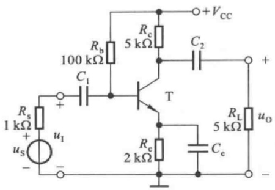

<details>
<summary>text_image</summary>

Rs
1 kΩ
+
us
-
+
C1
Rb
100 kΩ
Rc
5 kΩ
C2
T
Rc
2 kΩ
Ce
RL
5 kΩ
uo
+Vcc
-
</details>

(a)

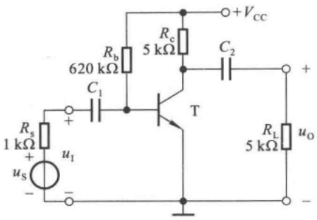

<details>
<summary>text_image</summary>

620 kΩ
Rb
5 kΩ
C1
Rs
1 kΩ
+
us
-
T
+
VCC
C2
RL
5 kΩ
uo
-
</details>

(b)

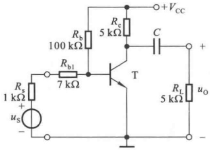

<details>
<summary>text_image</summary>

Rs
1 kΩ
+
us
-
Rb
100 kΩ
Rb1
7 kΩ
T
Rc
5 kΩ
C
+VCC
RL
5 kΩ
uo
-
</details>

(c)

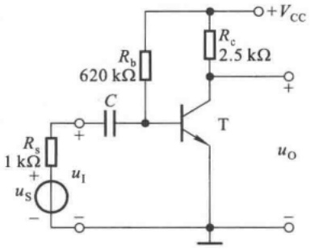

<details>
<summary>text_image</summary>

620 kΩ
Rb
+VCC
Rc
2.5 kΩ
C
T
Rs
1 kΩ
+
us
-
+
-
uo
</details>

(d)

图 P4.7

4.9 在图 P4.7(a) 所示电路中, 若  $C_{e}$  突然开路, 则中频电压放大倍数  $A_{usm} f_{H}$  和  $f_{L}$  各产生什么变化(是增大、减小、还是基本不变)? 为什么?
4.10 电路如图 P4.10 所示, 已知 $C_{\mathrm{gs}} = C_{\mathrm{gd}} = 5 \mathrm{~pF}$, $g_{\mathrm{m}} = 5 \mathrm{~mS}$, $C_1 = C_2 = C_s = 10 \mu \mathrm{F}$。试求 $f_{\mathrm{H}} f_{\mathrm{L}}$ 各约为多少, 并写出 $\dot{A}_{\mathrm{us}}$ 的表达式。

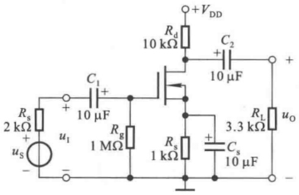

<details>
<summary>text_image</summary>

+VDD
Rd
10 kΩ
C2
+
10 μF
Rs
2 kΩ
+
us
-
uI
C1
+
10 μF
Rg
1 MΩ
Rs
1 kΩ
+
Cs
10 μF
RL
3.3 kΩ
uo
-
</details>

图 P4.10

4.11 在图 4.4.7(a) 所示电路中，已知  $R_{g}=2\ M\Omega, R_{d}=R_{L}=10\ k\Omega, C=10\ \mu F$ ; 场效应管的  $C_{gs}=C_{gd}=4\ pF, g_{m}=10\ mS$ 。试画出电路的波特图，并标出有关数据。
4.12 已知一个两级放大电路各级电压放大倍数分别为

$$
\dot {A} _ {\mathrm{u1}} = \frac {\dot {U} _ {\mathrm{o1}}}{U _ {\mathrm{i}}} = \frac {- 2 5 \mathrm{j} f}{\left(1 + \mathrm{j} \frac {f}{4}\right) \left(1 + \mathrm{j} \frac {f}{1 0 ^ {5}}\right)}, \quad \dot {A} _ {\mathrm{u2}} = \frac {\dot {U} _ {\mathrm{o}}}{\dot {U} _ {\mathrm{i2}}} = \frac {- 2 \mathrm{j} f}{\left(1 + \mathrm{j} \frac {f}{5 0}\right) \left(1 + \mathrm{j} \frac {f}{1 0 ^ {5}}\right)}
$$

(1) 写出该放大电路的电压放大倍数的表达式；
(2) 求出该电路的  $f_{L}$  和  $f_{H}$  各约为多少；
(3) 画出该电路的波特图。

4.13 电路如图 P4.13 所示。试定性分析下列问题，并简述理由。

(1) 哪一个电容决定电路的下限频率；
(2) 若  $T_{1}$  和  $T_{2}$  静态时发射极电流相等，且  $r_{bb'}$  和  $C'_{\pi}$  相等，则哪一级的上限频率低。

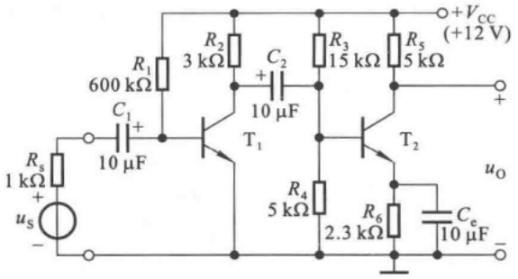

<details>
<summary>text_image</summary>

R1
600 kΩ
R2
3 kΩ
C2
+
10 μF
R3
15 kΩ
R5
5 kΩ
+VCC
(+12 V)
+
Rs
1 kΩ
+
us
-
10 μF
T1
T2
R4
5 kΩ
R6
2.3 kΩ
Ce
10 μF
uo
-
</details>

图 P4.13

4.14 利用 Multisim 来从下列几个方面研究图 P4.7(b) 所示电路的频率响应。

（1）设  $C_{1}=C_{2}=10\mu F$ ，分别测试它们所确定的下限频率；
(2) $C_{1}=C_{2}=10\ \mu F$ 时电路的频率响应及 $C_{1},C_{2}$ 取值对低频特性的影响；
(3) 放大管的集电极静态电流对上限频率的影响。

出题目的:虽然正确估算具有一个耦合电容电子电路的频率特性是教学基本要求,但实际放大电路若采用阻容耦合方式,则很少只含有一个电容的。因此,了解实际电路频率特性的测试方法和改善频率特性的方法非常必要。

提示:

（1）晶体管采用高频小信号晶体管，如 ZTX325。若函数发生器作信号源，则应在放大电路输入端接  $1 \, k\Omega$  电阻，等效为信号源内阻；并可用波特图仪测量幅频特性。
(2) 若测  $C_{1}(10\mu F)$  所确定的下限频率, 则应取  $C_{2}$  远远大于  $C_{1}$ , 如取  $C_{2}$  为  $500\mu F$ , 使  $C_{2}$  对放大电路的下限频率几乎无影响。

4.15 利用 Multisim 从下列两个方面研究图 P4.10 所示电路的频率响应。

（1）为改善低频特性，应增大三个耦合电容中的哪一个最有效。
(2) 场效应管的漏极静态电流对上限频率的影响。

提示: 可采用虚拟 N 沟道耗尽型 MOS 场效应管, 便于设置参数。例如, 设置虚拟 MOS 管的沟道长度 Channel length = 100 μm、沟道宽度 Channel width = 100 μm, 设置模型参数 VT = $U_{\text{GS(th)}}$ = -2 V, KP = 1 \* $10^{-3}$ mA/V$^{2}$, CGSO = 1 \* $10^{-8}$ F/m, CGDO = 2 \* $10^{-8}$ F/m。

## 第5章

## 放大电路中的反馈

## 本章讨论的问题

- 什么是反馈？什么是直流反馈和交流反馈？什么是正反馈和负反馈？为什么要引入反馈？
- 如何判断电路中有无引入反馈？引入的是直流反馈还是交流反馈？是正反馈还是负反馈？
- 交流负反馈有哪四种组态？如何判断？
- 交流负反馈放大电路的一般表达式是什么？
- 放大电路中引入不同组态的负反馈将对性能分别产生什么样的影响？
- 什么是深度负反馈？在深度负反馈条件下，如何估算放大倍数？
- 什么是理想运放？指标参数有哪些特点？为什么理想运放工作在线性区时会有“虚短”和“虚断”的特点？如何计算由理想运放组成的负反馈放大电路的放大倍数？
- 为什么放大电路以三级为最常见？
- 负反馈愈深愈好吗？什么是自激振荡？什么样的负反馈放大电路容易产生自激振荡？如何消除自激振荡？
- 放大电路中只能引入负反馈吗？放大电路引入正反馈能改善性能吗？

## 5.1 反馈的基本概念及判断方法

在实用放大电路中,几乎都要引入这样或那样的反馈,以改善放大电路某些方面的性能。因此,掌握反馈的基本概念及判断方法是研究实用电路的基础。

## 5.1.1 反馈的基本概念

## 一、什么是反馈

反馈也称为“回授”，广泛应用于各个领域。例如，在行政管理中，通过对执行部门工作效果（输出）的调研，以便修订政策（输入）；在商业活动中，通过对商品销售（输出）的调研来调整进货渠道及进货数量（输入）；在控制系统中，通过对执行机构偏移量（输出量）的监测来修正系统的输入量；等等。上述例子表明，反馈的目的是通过输出对输入的影响来改善系统的运行状况及控制效果。

什么是电子电路中的反馈呢？在电子电路中，将输出量（输出电压或输出电流）的一部分或全部通过一定的电路形式作用到输入回路，用来影响其输入量（放大电路的输入电压或输入电流）的措施称为反馈。

将反馈放大电路网络化后,按照各部分电路的主要功能可将其分为基本放大电路和反馈网络两部分,如图 5.1.1 所示。前者主要功能是放大信号,后者主要功能是传输反馈信号。基本放大电路的输入信号称为净输入量,它不但决定于输入信号(输入量),还与反馈信号(反馈量)有关。

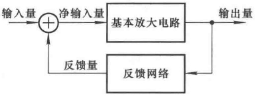

<details>
<summary>flowchart</summary>

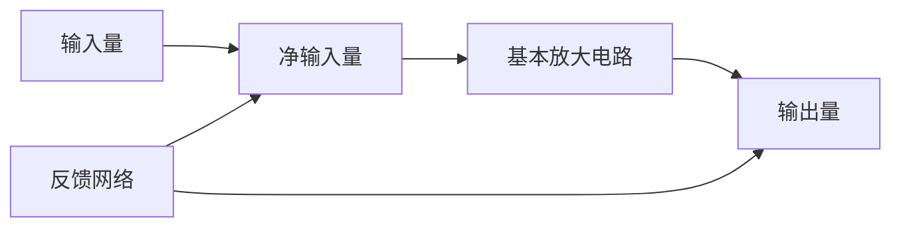
</details>

图 5.1.1 反馈放大电路的方框图

## 二、正反馈与负反馈

根据反馈的效果可以区分反馈的极性,使基本放大电路净输入量增大的反馈称为正反馈,使基本放大电路净输入量减小的反馈称为负反馈。由于反馈的结果影响了净输入量,就必然影响输出量;所以,根据输出量的变化也可以区分反馈的极性,反馈的结果使输出量的变化增大的为正反馈,使输出量的变化减小的为负反馈。

在图2.4.2(b)所示的典型工作点稳定电路中，温度的变化引起集电极电流 $I_{\mathrm{C}}$ （输出量）变化，这种变化在发射极电阻 $R_{\mathrm{e}}$ 上产生变化的电压，并影响放大管b-e间的电压（净输入量），导致基极电流 $I_{\mathrm{B}}$ 向相反方向变化，从而使 $I_{\mathrm{C}}$ 向相反方向变化。可见，反馈的结果使 $|\Delta I_{\mathrm{C}}|$ 减小，说明电路中引入的是负反馈。

## 三、直流反馈与交流反馈

如果反馈量只含有直流量，则称为直流反馈；如果反馈量只含有交流量，则称为交流反馈。或者说，仅在直流通路中存在的反馈称为直流反馈；仅在交流通路中存在的反馈称为交流反馈。在很多放大电路中，常常是交、直流反馈兼而有之。在图2.4.2(b)所示电路中， $R_{e}$ 仅存在于直流通路，故引入的是直流反馈；但若去掉旁路电容 $C_{e}$ ，则 $R_{e}$ 上的电压就既有直流量又有交流量，因而电路中既引入了直流反馈又引入了交流反馈。

直流负反馈主要用于稳定放大电路的静态工作点，本章的重点是研究交流负反馈。

## 5.1.2 反馈的判断

反馈的判断就是对放大电路中的反馈进行定性分析,正确判断反馈的性质是研究反馈放大电路的基础。

## 一、有无反馈的判断

若放大电路中存在将输出回路与输入回路相连接的通路，并由此影响放大电路的净输入，则表明电路引入了反馈；否则电路中便没有反馈。

在图5.1.2(a)所示电路中，集成运放的输出端与同相输入端、反相输入端均无通路，故电路中没有引入反馈。在图(b)所示电路中，电阻 $R_{2}$ 将集成运放的输出端与反相输入端相连接，因而集成运放的净输入量不仅决定于输入信号，还与输出信号有关，所以该电路中引入了反馈。在图(c)所示电路中，虽然电阻 $R$ 跨接在集成运放的输出端与同相输入端之间，但是因为同相输入端接地，$R$ 只不过是集成运放的负载，而不会使 $u_{0}$ 作用于输入回路，所以电路中没有引入反馈。

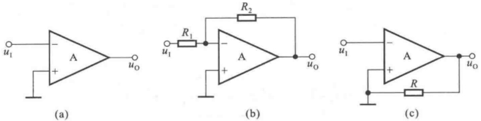

图 5.1.2 有无反馈的判断

(a) 没引入反馈的放大电路 (b) 引入反馈的放大电路 (c) R 的接入没有引入反馈

由以上分析可知,通过寻找电路中有无反馈通路,即可判断出电路是否引入了反馈。

## 二、反馈极性的判断

瞬时极性法是判断电路中反馈极性的基本方法。具体做法是:规定电路输入信号在某一时刻对地的极性,并以此为依据,逐级判断电路中各相关点电流的流向和电位的极性,从而得到输出信号的极性;根据输出信号的极性判断出反馈信号的极性;若反馈信号使基本放大电路的净输入信号增大,则说明引入了正反馈;若反馈信号使基本放大电路的净输入信号减小,则说明引入了负反馈。

在图 5.1.3（a）所示电路中，设输入电压  $u_{1}$  的瞬时极性对地为正，即集成运放同相输入端电位  $u_{P}$  对地为正，因而输出电压  $u_{0}$  对地也为正； $u_{0}$  在  $R_{2}$  和  $R_{1}$  回路产生电流，方向如图中虚线所示，并且该电流在  $R_{1}$  上产生极性为上“+”下“-”的反馈电压  $u_{F}$，使反相输入端电位对地为正；由此导致集成运放的净输入电压  $u_{\mathrm{D}}(u_{\mathrm{P}} - u_{\mathrm{N}})$  的数值减小，说明电路引入了负反馈。

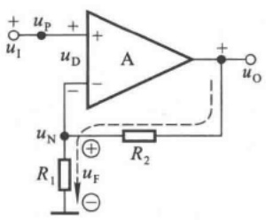

<details>
<summary>text_image</summary>

+
uP
+
uD
A
+
uO
-
uN
R1
+
uF
-
R2
</details>

(a)

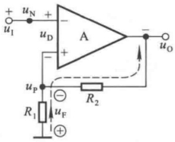

<details>
<summary>text_image</summary>

+
uN
+
uD
A
-
uO
uI
-
+
R1
uP
-
R2
uF
+
</details>

(b)

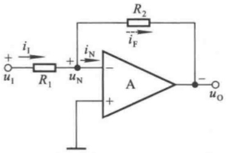

<details>
<summary>text_image</summary>

i₁
+
u₁
R₁
+
uₙ
iₙ
-
A
+
R₂
i_F
-
uₒ
</details>

(c)

图 5.1.3 反馈极性的判断

（a）通过净输入电压的变化判断反馈的极性 （b）电路引入了正反馈

(c) 通过净输入电流的变化判断反馈的极性

应当特别指出，反馈量是仅仅决定于输出量的物理量，而与输入量无关。例如，在图5.1.3(a)所示电路中，反馈电压 $u_{\mathrm{F}}$ 不表示 $R_{1}$ 上的实际电压，而只表示输出电压 $u_{0}$ 作用的结果。因此，在分析反馈极性时，可将输出量视为作用于反馈网络的独立源。

若将图(a)所示电路中集成运放的同相输入端和反相输入端互换时，则得到图(b)所示电路。设 $u_{1}$ 瞬时极性对地为正，则输出电压 $u_{0}$ 极性对地为负； $u_{0}$ 作用于 $R_{1}$ 和 $R_{2}$ 回路所产生的电流的方向如图中虚线所示，由此可得 $R_{1}$ 上所产生的反馈电压 $u_{F}$ 的极性为上“-”下“+”，即同相输入端电位 $u_{P}$ 对地为负；所以必然导致集成运放的净输入电压 $u_{\mathrm{D}}(u_{\mathrm{P}} - u_{\mathrm{N}})$ 的数值增大，说明电路引入了正反馈。

在图 5.1.3(c) 所示电路中，设输入电流  $i_{1}$  瞬时极性如图所示。集成运放反相输入端的电流  $i_{N}$  流入集成运放，电位  $u_{N}$  对地为正，因而输出电压  $u_{0}$  极性对地为负； $u_{0}$  作用于电阻  $R_{2}$ ，产生电流  $i_{F}$ ，如图中虚线所标注； $i_{F}$  对  $i_{1}$  分流，导致集成运放的净输入电流  $i_{N}$  的数值减小，故说明电路引入了负反馈。

以上分析说明,在集成运放组成的反馈放大电路中,可以通过分析集成运放的净输入电压 $u_{D}$ ,或者净输入电流 $i_{P}$ (或 $i_{N}$ ),因反馈的引入是增大了还是减小了,来判断反馈的极性。

由于集成运放输出电压的变化总是与其反相输入端电位的变化方向相反，因而从集成运放的输出端通过电阻、电容等反馈通路引回到其反相输入端的电路必然构成负反馈电路；同理，由于集成运放输出电压的变化总是与其同相输入端电位的变化方向相同，因而从集成运放的输出端通过电阻、电容等反馈通路引回到其同相输入端的电路必然构成正反馈电路；上述结论可用于单个集成运放中引入反馈的极性的判断。

对于分立元件电路,可以通过判断输入级放大管的净输入电压(b-e间或e-b间电压,g-s间或s-g间电压)或者净输入电流( $i_{B}$ 或 $i_{E},i_{S}$ )因反馈的引入被增大还是被减小,来判断反馈

的极性。例如，在图5.1.4所示电路中，设输入电压 $u_{1}$ 的瞬时极性对地为“+”，因而 $T_{1}$ 管的基极电位对地为“+”；共射电路输出电压与输入电压反相，故 $T_{1}$ 管的集电极电位对地为“-”，即 $T_{2}$ 管的基极电位对地为“-”；第二级仍为共射电路，故 $T_{2}$ 管的集电极电位对地为“+”，即输出电压 $u_{0}$ 极性为上“+”下“-”； $u_{0}$ 作用于 $R_{6}$ 和 $R_{3}$ 回路，产生电流，如图中虚线所示，从而在 $R_{3}$ 上得到反馈电压 $u_{F}$ ；根据 $u_{0}$ 的极性得到 $u_{F}$ 的极性为上“+”下“-”，如图中所标注； $u_{F}$ 作用的结果使 $T_{1}$ 管b-e间电压减小，故判定电路引入了负反馈。

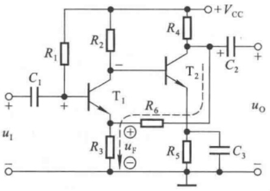

<details>
<summary>text_image</summary>

R1
C1
+
-
u1
R2
T1
R3
uF
-
R4
T2
R6
R5
C2
+
-
+VCC
uo
C3
</details>

图 5.1.4 分立元件放大电路反馈极性的判断

## 三、直流反馈与交流反馈的判断

根据直流反馈与交流反馈的定义,可以通过反馈存在于放大电路的直流通路之中还是交流通路之中,来判断电路引入的是直流反馈还是交流反馈。

在图 5.1.5(a) 所示电路中, 已知电容 C 对交流信号可视为短路, 因而它的直流通路和交流通路分别如图(b) 和图(c) 所示, 与图 5.1.3(a) 和图 5.1.2(c) 所示电路相比较可知, 图(a) 所示电路中只引入了直流反馈, 而没有引入交流反馈。

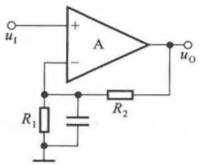

<details>
<summary>text_image</summary>

u₁
+
A
-
R₁
R₂
uₒ
</details>

(a)

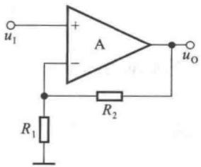

<details>
<summary>text_image</summary>

u₁
+
A
-
R₁
R₂
uₒ
</details>

(b)

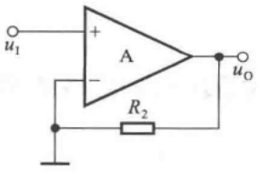

<details>
<summary>text_image</summary>

u₁
+
A
-
R₂
uₒ
</details>

(c)

图 5.1.5 直流反馈与交流反馈的判断(一)

(a) 电路 (b) 直流通路 (c) 交流通路

在图 5.1.6 所示电路中, 已知电容 C 对交流信号可视为短路。对于直流量, 电容 C 相当于开路, 即在直流通路中不存在连接输出回路与输入回路的通路, 故电路中没有直流负反馈。对于交流量, C 相当于短路,  $R_{2}$  将集成运放的输出端与反相输入端相连接, 故电路中引入了交流反馈。

【例 5.1.1】判断 5.1.7 所示电路中是否引入了反馈；若引入了反馈，是直流反馈还是交流反馈，是正反馈还是负反馈。

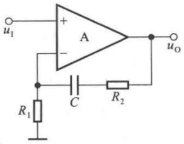

<details>
<summary>text_image</summary>

u₁
+
A
-
R₁
C
R₂
uₒ
</details>

图 5.1.6 直流反馈与交流反馈的判断(二)

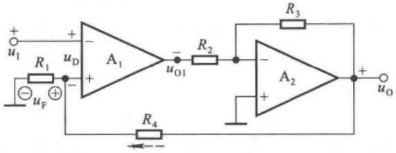

<details>
<summary>text_image</summary>

+
u₁
+
-
R₁
uD
+
-
uF
A₁
-
-
uO₁
R₂
R₃
A₂
+
-
R₄
uO
</details>

图 5.1.7 例 5.1.1 电路图

解: 观察图 5.1.7 所示电路, 电阻  $R_{4}$  将输出回路与输入回路相连接, 故电路中引入了反馈。又因为无论在直流通路还是在交流通路中, 反馈通路均存在, 所以电路中既引入了直流反馈又引入了交流反馈。

利用瞬时极性法可以判断反馈的极性。设输入电压 $u_{1}$ 的极性对地为“+”，$A_{1}$ 的输出电位 $u_{01}$ 为“-”，即后级电路的输入电压对地为“-”，故输出电压 $u_{0}$ 对地为“+”；$u_{0}$ 作用于 $R_{4}$ 和 $R_{1}$ 回路，所产生的电流（如图中虚线所示）在 $R_{1}$ 上获得反馈电压 $u_{F}$，极性如图中所注；由于 $u_{F}$ 使 $A_{1}$ 的净输入电压 $u_{D}$ 减小，故电路中引入了负反馈。

在图 5.1.7 所示电路中， $A_{2}$  与  $R_{2}$ 、 $R_{3}$  所构成的电路与图 5.1.3(c) 相同，也引入了负反馈，因其只影响局部电路，故称之为“局部反馈”；而  $R_{4}$  所引入的反馈影响整个电路，故称之为“总体反馈”或“级间反馈”；本章重点研究后者。

## 思考题

5.1.1 “直接耦合放大电路只能引入直流反馈，阻容耦合放大电路只能引入交流反馈。”这种说法正确吗？举例说明。
5.1.2 为什么说“反馈量是仅仅决定于输出量的物理量”？在判断反馈极性时如何体现上述概念？
5.1.3 试分别修改图 5.1.7 所示电路,使之只引入直流负反馈或者只引入交流反馈。

## 5.2 负反馈放大电路的四种基本组态

通常,引入了交流负反馈的放大电路称为负反馈放大电路。本节将讲述交流负反馈的四种基本组态及其特点。

## 5.2.1 负反馈放大电路分析要点

利用前面所讲的方法可以判断出图 5.2.1(a) 所示电路中引入了交流负反馈, 输出电压  $u_{0}$的全部作为反馈电压作用于集成运放的反相输入端。在输入电压 $u_{1}$ 不变的情况下，若由于某种原因（例如负载电阻 $R_{L}$ 变化）引起输出电压 $u_{0}$ 增大，则集成运放反相输入端电位 $u_{N}$ 势必随之升高，导致集成运放的净输入电压 $u_{D}$ 减小，从而使 $u_{0}$ 减小。上述过程可表示为

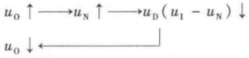

<details>
<summary>flowchart</summary>

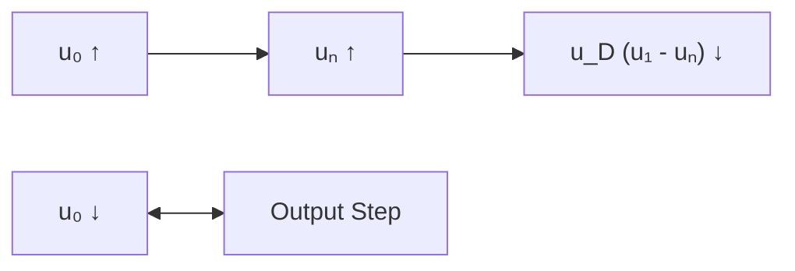
</details>

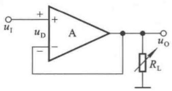

<details>
<summary>text_image</summary>

uI
+
-
uD
A
RL
uo
</details>

(a)

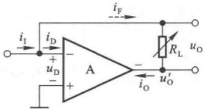

<details>
<summary>text_image</summary>

iI
iD
+
uD
-
+
A
iF
RL
uO
uo
iO
uo'
</details>

(b)

图 5.2.1 负反馈放大电路

（a）输出电压引回后影响净输入电压 （b）输出电流引回后影响净输入电流

若由于某种原因使 $u_{0}$ 减小时，则负反馈的结果将使 $u_{0}$ 增大；总之，反馈的结果使输出电压的变化减小。当开环增益很大时，净输入电压 $u_{\mathrm{D}}$ 必然很小，因而图5.2.1所示电路的输出电压$u_{0}$ 近似等于输入电压 $u_{1}$，即 $u_{0} \approx u_{1}$。

经判断，图(b)所示电路中也引入了交流负反馈，输出电流 $i_{0}$ 的全部作为反馈电流作用于集成运放的反相输入端。在输入电流 $i_{1}$ 不变的情况下，若由于某种原因（例如负载电阻 $R_{L}$ 变化）引起输出电流 $i_{0}$ 增大， $i_{F}$ 随之增大，则集成运放反相输入端的电流 $i_{D}$ 将减小，导致 $u_{D}$ 减小，反相输入端电位 $u_{N}$ 势必降低，从而使集成运放的输出电压 $u_{0}^{\prime}$ 升高， $i_{0}$ 随之减小。上述过程可表示为

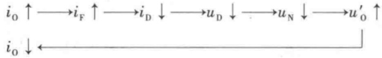

<details>
<summary>flowchart</summary>

```mermaid
graph LR
  A["i₀ ↑"] --> B["i_F ↑"]
  B --> C["i_D ↓"]
  C --> D["u_D ↓"]
  D --> E["u_N ↓"]
  E --> F["u'₀ ↑"]
  G["i₀ ↓"] <--> H[""]
  style A fill:#fff,stroke:#333
  style B fill:#fff,stroke:#333
  style C fill:#fff,stroke:#333
  style D fill:#fff,stroke:#333
  style E fill:#fff,stroke:#333
  style F fill:#fff,stroke:#333
```
</details>

若由于某种原因使 $i_0$ 减小时，则负反馈的结果将使 $i_0$ 增大；总之，反馈的结果使输出电流的变化减小。当净输入电流 $i_D$ 很小时，图 5.2.1(b) 所示电路的输出电流 $i_0$ 近似等于输入电流 $i_1$，即 $i_0 \approx i_1$。

对上述电路的分析,可以得出如下结论:

（1）交流负反馈稳定放大电路的输出量，任何因素引起的输出量的变化均将得到抑制。由于输入量的变化所引起的输出量的变化也同样会受到抑制，所以交流负反馈使电路的放大能力下降。
（2）反馈量实质上是对输出量的采样，它既可能来源于输出电压，如图(a)所示电路；又可能来源于输出电流，如图(b)所示电路；其数值与输出量成正比。
（3）负反馈的基本作用是将引回的反馈量与输入量相减，从而调整电路的净输入量和输出量。净输入量既可能是输入电压减反馈电压，如图5.2.1(a)所示电路；也可能是输入电流减反馈电流，如图(b)所示电路。
（4）反馈量取自输出电压将使输出电压稳定，如图5.2.1(a)所示电路；反馈量取自输出电流将使输出电流稳定，如图(b)所示电路。

因此,对于具体的负反馈放大电路,首先应研究下列问题,进而进行定量分析。

（1）从输出端看，反馈量是取自于输出电压，还是取自于输出电流；即反馈的目的是稳定输出电压，还是稳定输出电流。
（2）从输入端看，反馈量与输入量是以电压方式相叠加，还是以电流方式相叠加；即反馈的结果是减小净输入电压，还是减小净输入电流。

反馈量若取自输出电压,则称为电压反馈;若取自输出电流,则称为电流反馈。反馈量与输入量若以电压方式相叠加,则称为串联反馈;若以电流方式相叠加,则称为并联反馈。因此,交流负反馈有四种组态,即电压串联、电压并联、电流串联和电流并联,有时也称为交流负反馈的四种方式。

## 5.2.2 由集成运放组成的四种组态负反馈放大电路

## 一、电压串联负反馈电路

图 5.2.1(a) 所示电路将输出电压的全部作为反馈电压, 而大多数电路均采用电阻分压的方式将输出电压的一部分作为反馈电压, 如图 5.2.2 所示。电路各点电位的瞬时极性如图中所标注。由图可知, 反馈量

$$
u _ {\mathrm{F}} = \frac {R _ {1}}{R _ {1} + R _ {2}} \cdot u _ {0} \tag {5.2.1}
$$

表明反馈量取自于输出电压  $u_{0}$ ，且正比于  $u_{0}$ ，并将与输入电压  $u_{1}$  求差后放大，故电路引入了电压串联负反馈。

## 二、电流串联负反馈电路

在图 5.2.2 所示电路中, 若将负载电阻  $R_{L}$  接在  $R_{2}$  处, 则  $R_{L}$  中就可得到稳定的电流, 如图 5.2.3(a) 所示, 习惯上常画成图 (b) 所示形式。电路中相关电位及电流的瞬时极性和电流流向如图中所标注。由图可知, 反馈量

$$
u _ {\mathrm{F}} = i _ {0} R _ {1} \tag {5.2.2}
$$

表明反馈量取自于输出电流  $i_{0}$ ，且转换为反馈电压  $u_{F}$ ，并将与输入电压  $u_{1}$  求差后放大，故电路引入了电流串联负反馈。

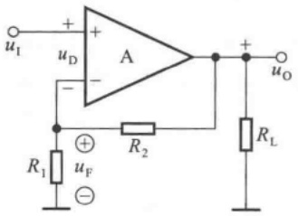

<details>
<summary>text_image</summary>

uI
+
-
uD
A
R1
+
uF
-
R2
RL
uo
</details>

图 5.2.2 电压串联负反馈电路

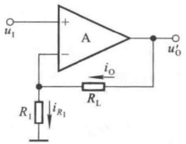

<details>
<summary>text_image</summary>

u₁
+
A
-
iₒ
R₁
iᵣ₁
Rₗ
uₒ
</details>

(a)

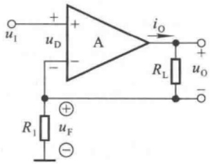

<details>
<summary>text_image</summary>

u₁
+
-
uD
A
iₒ
R₁
Rₗ
uₒ
+
-
uF
-
</details>

(b)

图 5.2.3 电流串联负反馈电路

(a) 基本电路 (b) 习惯画法

## 三、电压并联负反馈电路

在图 5.2.4 所示电路中, 相关电位及电流的瞬时极性和电流流向如图中所标注。由图可知, 反馈量

$$
i _ {\mathrm{F}} = - \frac {u _ {0}}{R} \tag {5.2.3}
$$

表明反馈量取自输出电压  $u_{0}$ ，且转换成反馈电流  $i_{F}$ ，并将与输入电流  $i_{1}$  求差后放大，因此电路引入了电压并联负反馈。

## 四、电流并联负反馈电路

在图 5.2.5 所示电路中, 各支路电流的瞬时极性如图中所标注。由图可知, 反馈量

$$
i _ {\mathrm{F}} = - \frac {R _ {2}}{R _ {1} + R _ {2}} \cdot i _ {\mathrm{O}} \tag {5.2.4}
$$

表明反馈信号取自输出电流  $i_{0}$ ，且转换成反馈电流  $i_{F}$ ，并将与输入电流  $i_{1}$  求差后放大，因而电路引入了电流并联负反馈。


<details>
<summary>text_image</summary>

iI
iD
A
-
R
iF
uO
RL
</details>

图 5.2.4 电压并联负反馈电路


<details>
<summary>text_image</summary>

uP
+
iI
iD
A
-
R1
iF
R2
iO
uo
+
-
</details>

图 5.2.5 电流并联负反馈电路

由上述四个电路可知，串联负反馈电路所加信号源均为电压源，这是因为若加恒流源，则电路的净输入电压将等于信号源电流与集成运放输入电阻之积，而不受反馈电压的影响；同理，并联负反馈电路所加信号源均为电流源，这是因为若加恒压源，则电路的净输入电流将等于信号源电压除以集成运放输入电阻，而不受反馈电流的影响。换言之，串联负反馈适用于输入信号为恒压源或近似恒压源的情况，而并联负反馈适用于输入信号为恒流源或近似恒流源的情况。

综上所述,放大电路中应引入电压负反馈还是电流负反馈,取决于负载欲得到稳定的电压还是稳定的电流;放大电路中应引入串联负反馈还是并联负反馈,取决于输入信号源是恒压源(或近似恒压源)还是恒流源(或近似恒流源)。

## 5.2.3 反馈组态的判断

## 一、电压负反馈与电流负反馈的判断

电压反馈与电流反馈的区别在于基本放大电路的输出回路与反馈网络的连接方式不同。如前所述，负反馈电路中的反馈量不是取自输出电压就是取自输出电流；因此，只要令负反馈放大电路的输出电压 $u_{0}$ 为零，若反馈量也随之为零，则说明电路中引入了电压负反馈；若反馈量依然存在，则说明电路中引入了电流负反馈。

通过判断可知，图5.2.6(a)所示电路中引入了交流负反馈，输入电流 $i_{1}$ 与反馈电流 $i_{\mathrm{F}}$ 如图中所标注。令输出电压 $u_{0} = 0$，即将集成运放的输出端接地，便得到图(b)所示电路。此时，虽然反馈电阻 $R_{\mathrm{f}}$ 中仍有电流，但那是输入电流 $i_{1}$ 作用的结果，而因为输出电压 $u_{0}$ 为零，所以它在 $R_{\mathrm{f}}$ 中产生的电流（即反馈电流）也必然为零，故电路中引入的是电压反馈。


<details>
<summary>text_image</summary>

i₁
+
A
-
i_F
R_f
R_L
u_O
</details>

(a)


<details>
<summary>text_image</summary>

i₁
A
Rₗ
</details>

(b)

图 5.2.6 电压反馈与电流反馈的判断(一)

(a) 电路 (b) 令输出电压为零

通过判断可知，图5.2.7(a)所示电路中引入了交流负反馈，各支路电流如图中所标注。令输出电压 $u_{0}=0$ ，即将负载电阻 $R_{L}$ 两端短路，便得到如图(b)所示电路。因为输出电流 $i_{0}$ 仅受集成运放输入信号的控制，所以即使 $R_{L}$ 短路， $i_{0}$ 也并不为零；又因为反馈电流 $i_{F}$ 与 $i_{0}$ 的关系不变，仍如式(5.2.4)所示，说明反馈量依然存在，故电路中引入的是电流反馈。


<details>
<summary>text_image</summary>

iI
A
+
-
RL
iO
uO
R1
iF
R2
</details>

(a)


<details>
<summary>text_image</summary>

i₁
+
A
-
R₁ i_F
iₒ
R₂
</details>

(b)

图 5.2.7 电压反馈与电流反馈的判断(二)

(a) 电路 (b) 令输出电压为零

应当特别指出,上述方法仅仅是判断方法,而不是实验方法;因为如果将集成运放的输出端强制接地,常会使之因电流过大而烧坏。

## 二、串联反馈与并联反馈的判断

串联反馈与并联反馈的区别在于基本放大电路的输入回路与反馈网络的连接方式不同。若反馈信号为电压量，与输入电压求差而获得净输入电压，则为串联反馈；若反馈信号为电流量，与输入电流求差获得净输入电流，则为并联反馈。

在图 5.2.2 和图 5.2.3 所示两电路中, 集成运放的净输入电压

$$
u _ {\mathrm{D}} = u _ {\mathrm{I}} - u _ {\mathrm{F}}
$$

故它们均引入了串联反馈。

在图 5.2.4 和图 5.2.5 所示两电路中, 集成运放的净输入电流

$$
i _ {\mathrm{D}} = i _ {\mathrm{I}} - i _ {\mathrm{F}}
$$

故它们均引入了并联反馈。

【例 5.2.1】试分析图 5.2.8 所示电路中有无引入反馈；若有反馈，则说明引入的是直流反馈还是交流反馈，是正反馈还是负反馈；若为交流负反馈，则说明反馈的组态。

解: 观察电路,  $R_{2}$  将输出回路与输入回路相连接, 因而电路引入了反馈。无论在直流通路中,还是在交流通路中, $R_{2}$ 形成的反馈通路均存在,因而电路中既引入了直流反馈,又引入了交流反馈。

设输入电压 $u_{1}$ 对地为“+”，集成运放的输出端电位（即晶体管T的基极电位）为“+”，因此集电极电流（即输出电流 $i_{0}$ ）的流向如图中所标注。 $i_{0}$ 通过 $R_{3}$ 和 $R_{2}$ 所在支路分流，在 $R_{1}$ 上获得反馈电压 $u_{\mathrm{F}}, u_{\mathrm{F}}$ 的极性为上“+”下“-”，使集成运放的净输入电压 $u_{\mathrm{D}}$ 减小，故电路中引入的是负反馈。

根据 $u_{1}, u_{\mathrm{F}}$ 和 $u_{\mathrm{D}}$ 的关系，说明电路引入的是串联反馈。令输出电压 $u_{0} = 0$ ，即将 $R_{\mathrm{L}}$ 短路，因 $i_{0}$ 仅受 $i_{\mathrm{B}}$ 的控制而依然存在，$u_{\mathrm{F}}$ 和 $i_{0}$ 的关系不变，故电路中引入的是电流反馈。所以，电路中引入了电流串联负反馈。

【例 5.2.2】试分析图 5.2.9 所示电路中引入了哪种组态的交流负反馈。


<details>
<summary>text_image</summary>

uI
+
-
uD
A
+
-
RL
+VCC
+
uo
-
iO
T
R2
R1
+
uF
-
R3
</details>

图5.2.8 例5.2.1电路图


<details>
<summary>text_image</summary>

R1
+
u1
-
T1
T2
I
-
R2
+
uF
-
R4
R3
T3
+
R5
+
uo
-
VCC
-
</details>

图5.2.9 例5.2.2电路图

解: 在假设输入电压  $u_{1}$  对地为“+”的情况下, 电路中各点的电位如图中所标注, 在电阻  $R_{2}$  上获得反馈电压  $u_{F}$ 。 $u_{F}$  使差分放大电路的净输入电压 (即  $T_{1}$  管和  $T_{2}$  管的基极电位之差) 变小, 故电路中引入了串联反馈。

令输出电压 $u_{0} = 0$，即将 $T_{3}$ 管的集电极接地，将使 $u_{\mathrm{F}}$ 为零，故电路中引入了电压负反馈。

可见，该电路中引入了电压串联负反馈。

## 思考题

5.2.1 当负载电阻变化时,电压负反馈放大电路和电流负反馈放大电路的输出电压分别如何变化?为什么?
5.2.2 在分析分立元件放大电路和集成运放电路中反馈的性质时,净输入电压和净输入电流分别指的是什么地方的电压和电流?电流负反馈电路的输出电流一定是负载电流吗?举例说明。
5.2.3 在图 5.2.9 所示电路中, 当输出电压为零时, 电阻  $R_{2}$  上电压不为零。为什么认为这个电路引入的是电压负反馈, 而不是电流负反馈?

## 5.3 负反馈放大电路的方块图及一般表达式

因为负反馈放大电路有四种基本组态,而且对于同一种组态,具体电路也各不相同;所以为研究负反馈放大电路的共同规律,可以利用方块图来描述所有电路。本节将讲述负反馈放大电

路的方块图及其一般表达式。

## 5.3.1 负反馈放大电路的方块图表示法

任何负反馈放大电路都可以用图5.3.1所示的方块图来表示，上面一个方块是负反馈放大

电路的基本放大电路,下面一个方块是负反馈放大电路的反馈网络。负反馈放大电路的基本放大电路是在断开反馈且考虑了反馈网络的负载效应 $^{①}$ 的情况下所构成的放大电路;反馈网络是指与反馈系数 $\dot{F}$ 有关的所有元器件构成的网络。

图中  $\dot{X}_{i}$  为输入量， $\dot{X}_{f}$  为反馈量， $\dot{X}_{i}^{\prime}$  为净输入量， $\dot{X}_{\alpha}$  为输出量。图中连线的箭头表示信号的流通方向，说明方块图中的信号是单向流通的，即输入信号  $\dot{X}_{i}$  仅通过基本放大电


<details>
<summary>flowchart</summary>


</details>

图 5.3.1 负反馈放大电路的方块图

路传递到输出，而输出信号 $\dot{X}_{\mathrm{o}}$ 仅通过反馈网络传递到输入；换言之，$\dot{X}_{\mathrm{i}}$ 不通过反馈网络传递到输出，而 $\dot{X}_{\mathrm{o}}$ 也不通过基本放大电路传递到输入。输入端的圆圈 $\oplus$ 表示信号 $\dot{X}_{\mathrm{i}}$ 和 $\dot{X}_{\mathrm{f}}$ 在此叠加，“+”号和“-”号表明了 $\dot{X}_{\mathrm{i}}, \dot{X}_{\mathrm{f}}$ 和 $\dot{X}_{\mathrm{i}}'$ 之间的关系为

$$
\dot {X} _ {\mathrm{i}} ^ {\prime} = \dot {X} _ {\mathrm{i}} - \dot {X} _ {\mathrm{f}} \tag {5.3.1}
$$

在信号的中频段， $\dot{X}_{i}^{\prime},\dot{X}_{i}$  和  $\dot{X}_{i}$  均为实数，所以可写为

$$
\mid \dot {X} _ {\mathrm{i}} ^ {\prime} \mid = \mid \dot {X} _ {\mathrm{i}} \mid - \mid \dot {X} _ {\mathrm{f}} \mid \text {或} X _ {\mathrm{i}} ^ {\prime} = X _ {\mathrm{i}} - X _ {\mathrm{f}} \tag {5.3.2}
$$

在方块图中定义基本放大电路的放大倍数为

$$
\dot {A} = \frac {\dot {X} _ {\mathrm{o}}}{\dot {X} _ {\mathrm{i}} ^ {\prime}} \tag {5.3.3}
$$

反馈系数为

$$
\dot {F} = \frac {\dot {X} _ {\mathrm{f}}}{\dot {X} _ {\mathrm{o}}} \tag {5.3.4}
$$

负反馈放大电路的放大倍数(也称闭环放大倍数)为

$$
\dot {A} _ {\mathrm{f}} = \frac {\dot {X} _ {\mathrm{o}}}{\dot {X} _ {\mathrm{i}}} \tag {5.3.5}
$$

根据式(5.3.3)、(5.3.4)可得

$$
\dot {A} \dot {F} = \frac {\dot {X} _ {\mathrm{f}}}{\dot {X} _ {\mathrm{i}} ^ {\prime}} \tag {5.3.6}
$$

$\dot{A}\dot{F}$ 称为电路的环路放大倍数。

## 5.3.2 四种组态电路的方块图

若将负反馈放大电路的基本放大电路与反馈网络均看为两端口网络,则不同反馈组态表明两个网络的不同连接方式。四种反馈组态电路的方块图如图5.3.2所示。其中图(a)所示为电压串联负反馈电路，图(b)所示为电流串联负反馈电路，图(c)所示为电压并联负反馈电路，图(d)所示为电流并联负反馈电路。

<small><span class="docvortex-page-footnote" data-block-type="page_footnote" style="color:#6b7280">① 参阅童诗白、华成英主编的《模拟电子技术基础(第三版)》6.3.4节。</span></small>


图 5.3.2 四种反馈组态电路的方块图

(a) 电压串联负反馈电路 (b) 电流串联负反馈电路

(c) 电压并联负反馈电路 (d) 电流并联负反馈电路

由于电压负反馈电路中  $\dot{X}_{o} = \dot{U}_{o}$ ，电流负反馈电路中  $\dot{X}_{o} = \dot{I}_{o}$ ；串联负反馈电路中， $\dot{X}_{i} = \dot{U}_{i}$ ， $\dot{X}_{i}' = \dot{U}_{i}'$ ， $\dot{X}_{f} = \dot{U}_{f}$ ；并联负反馈电路中， $\dot{X}_{i} = \dot{I}_{i}$ ， $\dot{X}_{i}' = \dot{I}_{i}'$ ， $\dot{X}_{f} = \dot{I}_{f}$ ；因此，不同的反馈组态， $\dot{A}$ 、 $\dot{F}$  和  $\dot{A}_{f}$  的物理意义不同，量纲也不同，电路实现的控制关系不同，因而功能也就不同，如表 5.3.1 所示。

表 5.3.1 四种组态负反馈放大电路的比较

| 反馈组态 | $\dot{X}_{i}\dot{X}_{f}\dot{X}_{i}^{\prime}$ | $\dot{X}_{o}$ | $\dot{A}$ | $\dot{F}$ | $\dot{A}_{f}$ | 功能 |
| --- | --- | --- | --- | --- | --- | --- |
| 电压串联 | $\dot{U}_{i}\dot{U}_{f}\dot{U}_{i}^{\prime}$ | $\dot{U}_{o}$ | $\dot{A}_{uu}=\frac{\dot{U}_{o}}{\dot{U}_{i}^{\prime}}$ | $\dot{F}_{uu}=\frac{\dot{U}_{f}}{\dot{U}_{o}}$ | $\dot{A}_{uuf}=\frac{\dot{U}_{o}}{\dot{U}_{i}}$ | $\dot{U}_{i}$控制$\dot{U}_{o}$,电压放大 |
| 电流串联 | $\dot{U}_{i}\dot{U}_{f}\dot{U}_{i}^{\prime}$ | $\dot{I}_{o}$ | $\dot{A}_{iu}=\frac{\dot{I}_{o}}{\dot{U}_{i}^{\prime}}$ | $\dot{F}_{ui}=\frac{\dot{U}_{f}}{\dot{I}_{o}}$ | $\dot{A}_{inf}=\frac{\dot{I}_{o}}{\dot{U}_{i}}$ | $\dot{U}_{i}$控制$\dot{I}_{o}$,电压转换成电流 |
| 电压并联 | $\dot{I}_{i}\dot{I}_{f}\dot{I}_{i}^{\prime}$ | $\dot{U}_{o}$ | $\dot{A}_{ui}=\frac{\dot{U}_{o}}{\dot{I}_{i}^{\prime}}$ | $\dot{F}_{ui}=\frac{\dot{I}_{f}}{\dot{U}_{o}}$ | $\dot{A}_{uif}=\frac{\dot{U}_{o}}{\dot{I}_{i}}$ | $\dot{I}_{i}$控制$\dot{U}_{o}$,电流转换成电压 |
| 电流并联 | $\dot{I}_{i}\dot{I}_{f}\dot{I}_{i}^{\prime}$ | $\dot{I}_{o}$ | $\dot{A}_{ii}=\frac{\dot{I}_{o}}{\dot{I}_{i}^{\prime}}$ | $\dot{F}_{ii}=\frac{\dot{I}_{f}}{\dot{I}_{o}}$ | $\dot{A}_{inf}=\frac{\dot{I}_{o}}{\dot{I}_{i}}$ | $\dot{I}_{i}$控制$\dot{I}_{o}$,电流放大 |

表 5.3.1 说明, 负反馈放大电路的放大倍数具有广泛的含义, 而且环路放大倍数  $\dot{A}\dot{F}$  在四种组态中均量纲为一。

## 5.3.3 负反馈放大电路的一般表达式

根据式(5.3.3)、(5.3.4)、(5.3.5)、(5.3.6)，可得

$$
\dot {A} _ {\mathrm{f}} = \frac {\dot {X} _ {\mathrm{o}}}{\dot {X} _ {\mathrm{i}}} = \frac {\dot {X} _ {\mathrm{o}}}{\dot {X} _ {\mathrm{i}} ^ {\prime} + \dot {X} _ {\mathrm{f}}} = \frac {\dot {A} \dot {X} _ {\mathrm{i}} ^ {\prime}}{\dot {X} _ {\mathrm{i}} ^ {\prime} + \dot {A} \dot {F} \dot {X} _ {\mathrm{i}} ^ {\prime}}
$$

由此得到 $\dot{A}_{\mathrm{f}}$ 的一般表达式

$$
\dot {A} _ {\mathrm{f}} = \frac {\dot {A}}{1 + \dot {A} \dot {F}} \tag {5.3.7}
$$

在中频段， $\dot{A}_{f}$ 、 $\dot{A}$  和  $\dot{F}$  均为实数，因此式(5.3.7)可写为

$$
A _ {\mathrm{f}} = \frac {A}{1 + A F} \tag {5.3.8}
$$

当电路引入负反馈时,AF>0,表明引入负反馈后电路的放大倍数等于基本放大电路放大倍数的 $(1+AF)$ 分之一,而且A、F和 $A_{f}$ 的符号均相同。

倘若在分析中发现 $\dot{A}\dot{F} < 0$ ，即 $1 + \dot{A}\dot{F} < 1$ ，即 $|\dot{A}_{\mathrm{f}}|$ 大于 $|\dot{A}|$ ，则说明电路中引入了正反馈；而若 $\dot{A}\dot{F} = -1$ ，使 $1 + \dot{A}\dot{F} = 0$ ，则说明电路在输入量为零时就有输出，称电路产生了自激振荡。

若电路引入深度负反馈, 即  $1 + AF \gg 1$ , 则

$$
A _ {\mathrm{f}} \approx \frac {1}{F} \tag {5.3.9}
$$

表明放大倍数几乎仅仅决定于反馈网络，而与基本放大电路无关。由于反馈网络常为无源网络，受环境温度的影响极小，因而放大倍数获得很高的稳定性。从深度负反馈的条件可知，反馈网络的参数确定后，基本放大电路的放大能力愈强，即 $A$ 的数值愈大，反馈愈深，$A_{\mathrm{f}}$ 与 $1 / F$ 的近似程度愈好。

大多数负反馈放大电路,特别是用集成运放组成的负反馈放大电路,一般均满足 $1+AF\gg1$ 的条件,因而在近似分析中均可认为 $A_{f}\approx1/F$ ,而不必求出A,当然也就不必定量分析基本放大电路了。

应当指出,通常所说的负反馈放大电路是指中频段的反馈极性;当信号频率进入低频段或高频段时,由于附加相移的产生,负反馈放大电路可能对某一特定频率产生正反馈过程,甚至产生自激振荡,5.6节将重点讲述这一问题。

## 思考题

5.3.1 利用图 5.3.2 所示方块图说明为什么串联负反馈适用于输入信号为恒压源或近似恒压源的情况，而并联负反馈适用于输入信号为恒流源或近似恒流源的情况。
5.3.2 说明在负反馈放大电路的方块图中,什么是反馈网络,什么是基本放大电路;在研究负反馈放大电路时,为什么重点研究的是反馈网络,而不是基本放大电路。
5.3.3 为什么说“无论用集成运放组成哪种组态的负反馈放大电路，通常都可以认为引入的是深度负反馈”？

## 5.4 深度负反馈放大电路放大倍数的分析

实用的放大电路中多引入深度负反馈,因此分析负反馈放大电路的重点是从电路中分离出反馈网络,并求出反馈系数 $\dot{F}$ 。为了便于研究和测试,人们还常常需要求出不同组态负反馈放大电路的电压放大倍数。本节将重点研究具有深度负反馈放大电路的放大倍数的估算方法。

## 5.4.1 深度负反馈的实质

在负反馈放大电路的一般表达式中, 若  $\left|1+\dot{A}\dot{F}\right|\gg1$ , 则

$$
\dot {A} _ {\mathrm{f}} \approx \frac {1}{\dot {F}} \tag {5.4.1}
$$

根据  $\dot{A}_{f}$  和  $\dot{F}$  的定义，

$$
\dot {A} _ {\mathrm{f}} = \frac {\dot {X} _ {\mathrm{o}}}{\dot {X} _ {\mathrm{i}}}, \quad \dot {F} = \frac {\dot {X} _ {\mathrm{f}}}{\dot {X} _ {\mathrm{o}}}, \quad \dot {A} _ {\mathrm{f}} \approx \frac {1}{\dot {F}} = \frac {\dot {X} _ {\mathrm{o}}}{\dot {X} _ {\mathrm{f}}}
$$

说明  $\dot{X}_{i} \approx \dot{X}_{f}$ 。可见，深度负反馈的实质是在近似分析中忽略净输入量。但不同组态，可忽略的净输入量也将不同。当电路引入深度串联负反馈时，

$$
\dot {U} _ {\mathrm{i}} \approx \dot {U} _ {\mathrm{f}} \tag {5.4.2}
$$

认为净输入电压  $\dot{U}_{i}^{\prime}$  可忽略不计。当电路引入深度并联负反馈时，

$$
\dot {I} _ {\mathrm{i}} \approx \dot {I} _ {\mathrm{f}} \tag {5.4.3}
$$

认为净输入电流  $\dot{I}^{\prime}$  可忽略不计。

利用式 $(5.4.1)$ 、 $(5.4.2)$ 、 $(5.4.3)$ 可以求出四种不同组态负反馈放大电路的放大倍数。

## 5.4.2 反馈网络的分析

反馈网络连接放大电路的输出回路与输入回路,并且影响着反馈量。寻找出负反馈放大电路的反馈网络,便可根据定义求出反馈系数。

图 5.2.2 所示电压串联负反馈电路的反馈网络如图 5.4.1(a) 方框中所示。因而反馈系数为

$$
\dot {F} _ {u u} = \frac {\dot {U} _ {\mathrm{f}}}{\dot {U} _ {\mathrm{o}}} = \frac {R _ {1}}{R _ {1} + R _ {2}} \tag {5.4.4}
$$

图 5.2.3(b) 所示电流串联负反馈电路的反馈网络如图 5.4.1(b) 方框中所示。其反馈系数

$$
\dot {F} _ {u i} = \frac {\dot {U} _ {\mathrm{f}}}{\dot {I} _ {\mathrm{o}}} = \frac {\dot {I} _ {\mathrm{o}} R}{\dot {I} _ {\mathrm{o}}} = R \tag {5.4.5}
$$

图 5.2.4 所示电压并联负反馈电路的反馈网络如图 5.4.1(c) 方框中所示。其反馈系数为

$$
\dot {F} _ {i u} = \frac {\dot {I} _ {\mathrm{f}}}{\dot {U} _ {\mathrm{o}}} = \frac {- \frac {\dot {U} _ {\mathrm{o}}}{R}}{\dot {U} _ {\mathrm{o}}} = - \frac {1}{R} \tag {5.4.6}
$$