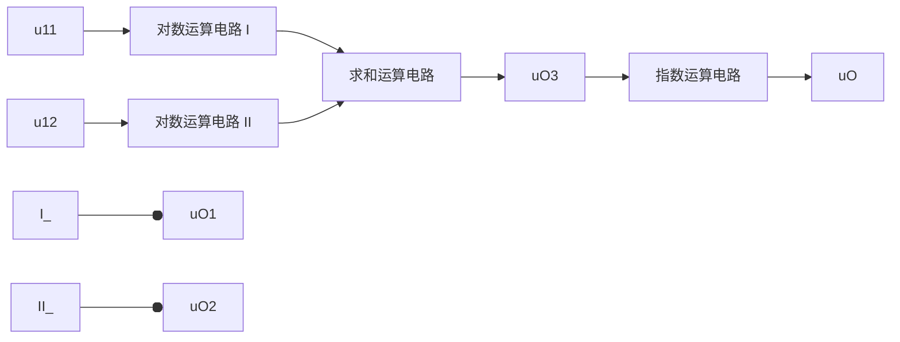

text_image

R1
1kOhm
R2
100kOhm
R5 10kOhm
U1A
1
4
LF347D
R4
1kOhm
R7
1kOhm
R6
99kOhm
U2A
1
4
LF347D
V2
15 V
V3
15 V
XFG1
R3
1kOhm
R9
100kOhm
R12 1000kOhm
U3A
1
4
LF347D
R11
1kOhm
R14
1kOhm
R13
99kOhm
U4A
1
4
LF347D
V1
15 V
V4
15 V
XFG2
R8
1kOhm
R10
1kOhm
Oscilloscope XSC1
T1 Time 125.392 ms Channel_A 988.809 mV Channel_B 900.531 mV Reverse Save T2-T1
Timebase Channel A Scale T V/Div Channel B Scale 500 mV/Div Trigger Edge GND @ X position 0 Y position 0 Y position 0 Level 0 V Y/T Add B/A A/B AC 0 DC @ AC 0 DC - @ Sing/Nor Auto D Ed

图 5.8.1 改变开环增益测量输出电压

测试数据及整理如表 5.8.1 所示。

表 5.8.1 开环放大倍数变化对闭环放大倍数的影响

| 实测信号源峰值 $U_{ip}$/mV | 反馈电阻$R_5$/kΩ | 运放 U2A 输出电压峰值 $U_{op}$/V | 闭环电压放大倍数 $\dot{A}_{uf}$ | 电压放大倍数$\dot{A}_{uft}$ | 电压放大倍数$\dot{A}_{uf2}$ | 开环电压放大倍数 $\dot{A}_u$ |
| --- | --- | --- | --- | --- | --- | --- |
| 9.997 | 10 | 900.531 | 90.5 | -100 | -10 | $10^3$ |
| 9.997 | 1000 | 988.809 | 98.9 | -100 | -1000 | $10^5$ |

表中采用峰值之比来计算电压放大倍数。

## 三、结论

1. 由表 5.8.1 可知, 当  $R_{5}$  从 10 kΩ 变为 1 MΩ 时, 开环增益变大, 使闭环电压放大倍数由 90.5 变为 98.9, 更接近式 (5.8.2) 所示理想情况下的数值。
2. 当  $R_{5}$  从  $10 \, k\Omega$  变为  $1 \, M\Omega$  时，电路的开环电压放大倍数 A 从  $10^{3}$  变为  $10^{5}$ ，相对变化  $\Delta\dot{A}_{u}/\dot{A}_{u} = (10^{3} - 10^{5})/10^{5} = -0.99$ ，闭环电压放大倍数相对变化  $\Delta\dot{A}_{uf}/\dot{A}_{uf} = (90.5 - 98.9)/98.9 \approx -0.08$ ，数值远小于开环放大倍数的相对变化，说明负反馈提高了放大倍数的稳定性。

## 5.8.2 交流负反馈对频率特性的影响

两级直接耦合放大电路由图 3.4.1 所示电路演变而来, 电路参数也与之相同, 如图 5.8.2(a) 所示。

## 一、仿真内容

研究电路引入电压串联负反馈前后增益和带宽的变化,测试电路分别如图5.8.2(a)、(b)所示,图中采用波特图仪测试对数幅频特性曲线,测试数据及整理见表5.8.2。

text_image

XFG1
R6
1kOhm
Q1
2N2222A
2N2222A
R1
18kOhm
Q2
R3
2kOhm
R4
360 Ohm
VCC
12 V
Q4
2N3702
R7
1kOhm
Q3
2N2222A
D3
1N4730A
R2
30kOhm
R5
16kOhm
VEE
6 V
R8
20kOhm
XSC1
XBP1
Mode Magnitude Phase
Horizonte Vertical Log Lin Log Lin
F 10 MHz F 100 dB
1 Hz 20 dB
Controls Reverse Save Set...
71.076 kHz 51.573 dB
C

(a)

text_image

XFG1
R6
1kOhm
Q1
2N2222A
2N2222A
R1
18kOhm
Q2
R3
2kOhm
R4
360 Ohm
VCC
12 V
Q4
2N3702
R7
1kOhm
Q3
2N2222A
D3
1N4730A
R2
30kOhm
R5
16kOhm
VEE
6 V
R8
20kOhm
XSC1
XBP1
Mode
Magnitude
Phase
Horizontal
Vertical
Log Lin
Log Lin
F 10 MHz F 50 Hz
1 Hz -20
Controls
Reverse Save Set...
2.944 MHz 22.807 dB
C

(b)

图 5.8.2 引入交流负反馈前后对数幅频特性曲线的测试

(a) 引入反馈前 (b) 引入反馈前后

表 5.8.2 引入交流负反馈前后增益及上限频率的变化

| 电路 | 中频增益/dB | 上限频率/kHz |
| --- | --- | --- |
| 引入反馈之前 | 54.532 | ≈71.076 |
| 引入反馈之后 | 25.848 | ≈2944 |

## 二、总结

1. 本电路引入的反馈是交、直流共存的负反馈, 故在引入反馈后应测试电路静态工作点仍正常, 方可进行动态测试, 这里为节省篇幅而略去。
2. 当静态工作点变化时,晶体管的动态参数会有所变化,故上述测试存在误差。另外,由图5.8.2可知,表5.8.2中所示上限频率并不是准确的增益下降3 dB频率,因而也只是近似值。
3. 尽管测试是近似的,但是数据仍可表明,放大电路引入交流负反馈使得频带明显展宽。

## 本章小结

本章既是全书的重点,也是难点;原因一是实用电路中几乎没有不引入反馈的,要想学以致用,必须深刻了解反馈;原因二是除了要综合应用前几章的基本知识,还引入了其特有的概念、方法和解决问题的思路。

本章主要讲述了反馈的基本概念、负反馈放大电路的方块图及一般表达式、负反馈对放大电路性能的影响和放大电路的稳定性等问题,阐明了反馈的判断方法、深度负反馈条件下放大倍数的估算方法、根据需要正确引入负反馈的方法、负反馈放大电路稳定性的判断方法和自激振荡的消除方法等。主要内容为:

一、在电子电路中，将输出量（输出电压或输出电流）的一部分或全部通过一定的电路形式作用到输入回路，用来影响其输入量（放大电路的输入电压或输入电流）的措施称为反馈。若反馈的结果使输出量的变化（或净输入量）减小，则称之为负反馈；反之，则称之为正反馈。若反馈存在于直流通路，则称为直流反馈；若反馈存在于交流通路，则称为交流反馈。本章重点研究交流负反馈。

交流负反馈有四种组态:电压串联负反馈，电压并联负反馈，电流串联负反馈，电流并联负反馈。反馈量取自输出电压的称为电压反馈；反馈量取自输出电流的称为电流反馈；若输入量 $\dot{X}_{\mathrm{i}}$ 、反馈量 $\dot{X}_{\mathrm{f}}$ 和净输入量 $\dot{X}_{\mathrm{i}}^{\prime}$ 以电压形式相叠加，即 $\dot{U}_{\mathrm{i}} = \dot{U}_{\mathrm{i}}^{\prime} + \dot{U}_{\mathrm{f}}$ ，则称为串联反馈；以电流形式相叠加，即 $\dot{I}_{\mathrm{i}} = \dot{I}_{\mathrm{i}}^{\prime} + \dot{I}_{\mathrm{f}}$ ，则称为并联反馈。反馈组态不同， $\dot{X}_{\mathrm{i}},\dot{X}_{\mathrm{f}},\dot{X}_{\mathrm{i}}^{\prime},\dot{X}_{\mathrm{o}}$ 的量纲也就不同。

二、在分析反馈放大电路时，“有无反馈”决定于输出回路和输入回路是否存在反馈通路；“直流反馈或交流反馈”决定于反馈通路存在于直流通路还是交流通路；“正、负反馈”用瞬时极性法来判断，反馈的结果使净输入量减小的为负反馈，使净输入量增大的为正反馈。电压负反馈和电流负反馈的判断方法是令放大电路输出电压等于零，若反馈量随之为零，则为电压反馈；若反馈量依然存在，则为电流反馈；串联反馈和并联反馈决定于 $\dot{X}_{i}$ 、 $\dot{X}_{f}$ 、 $\dot{X}_{i}^{\prime}$ 叠加时的量纲。

三、负反馈放大电路放大倍数的一般表达式为 $\dot{A}_{\mathrm{f}} = \frac{\dot{A}}{1 + \dot{A}\dot{F}}$ ，若 $(1 + \dot{A}\dot{F})\gg 1$ ，即在深度负反馈条件下， $\dot{A}_{\mathrm{f}}$ $\approx 1 / \dot{F}$ ，即 $\dot{X}_{\mathrm{i}}\approx \dot{X}_{\mathrm{f}}$ 。若电路引入深度串联负反馈，则 $\dot{U}_{\mathrm{i}}\approx \dot{U}_{\mathrm{f}}$ ；若电路引入深度并联负反馈，则 $\dot{I}_{\mathrm{i}}\approx \dot{I}_{\mathrm{f}}$ ，通常可以认为信号源电压 $\dot{U}_{s}\approx \dot{I}_{s}R_{s}$ 。引入电流负反馈时， $\dot{U}_{\mathrm{o}}\approx \dot{I}_{\mathrm{o}}R^{\prime}_{\mathrm{L}}$ 。利用 $\dot{A}_{\mathrm{f}}\approx 1 / \dot{F}$ 可以求出四种反馈组态放大电路的电压放大倍数 $\dot{A}_{\mathrm{uf}}$ 或 $\dot{A}_{\mathrm{usf}}$ 。

开环差模增益、共模抑制比、输入电阻为无穷大，输出电阻、所有失调参数及其温漂、噪声均为零的运放为理想运放。对于用理想运放组成的负反馈放大电路，可利用其“虚短”和“虚断”的特点求解放大倍数。

四、引入交流负反馈后可以提高放大倍数的稳定性、改变输入电阻和输出电阻、展宽频带、减小非线性失真等。引入不同组态负反馈对放大电路性能的影响不尽相同，在实用电路中应根据需求引入合适组态的负反馈。

五、负反馈放大电路的级数愈多，反馈愈深，产生自激振荡的可能性愈大，因此实用的负反馈放大电路以三级最常见。在已知环路增益的波特图的情况下，可以根据 $f_{0}$ 和 $f_{c}$ 的关系判断电路的稳定性，若 $f_{0}<f_{c}$ ，则电路不稳定，会产生自激振荡；若 $f_{0}>f_{c}$ ，则电路稳定，不会产生自激振荡。为使电路具有足够的稳定性，幅值裕度应小于-10 dB，相位裕度应大于45°。若负反馈放大电路产生了自激振荡，则应在电路中合适的位置加小容量电容或电阻和电容来消振。

在放大电路中除了引入负反馈外,有时还可能引入正反馈。此外,利用电流反馈型集成运放构成的负反馈放大电路还可在改变增益的情况下使上限截止频率基本不变。

学完本章后，应在理解反馈基本概念的基础上，达到下列要求:

一、“会判”，即能够正确判断电路中是否引入了反馈及反馈的性质，例如是直流反馈还是交流反馈，是正反馈还是负反馈；如为交流负反馈，是哪种组态的反馈等。

二、“会算”，即理解负反馈放大电路放大倍数  $A_{f}$  在不同反馈组态下的物理意义，并能够估算深度负反馈条件下的放大倍数。

三、“会引”，即掌握负反馈四种组态对放大电路性能的影响，并能够根据需要在放大电路中引入合适的交流负反馈。

四、“会判振消振”，即理解负反馈放大电路产生自激振荡的原因，能够利用环路增益的波特图判断电路的稳定性，并了解消除自激振荡的方法。

## 自测题

## 一、已知交流负反馈有四种组态:

A. 电压串联负反馈

B. 电压并联负反馈

C. 电流串联负反馈

D. 电流并联负反馈

选择合适的答案填入下列空格内，只填入 A、B、C 或 D。

（1）欲得到电流-电压转换电路，应在放大电路中引入\_\_\_\_；
(2) 欲将电压信号转换成与之成比例的电流信号,应在放大电路中引入\_\_\_\_;
（3）欲减小电路从信号源索取的电流，增强带负载能力，应在放大电路中引入\_\_\_\_；
（4）欲从信号源获得更大的电流，并稳定输出电流，应在放大电路中引入\_\_\_\_。

## 二、判断图 T5.2 所示各电路中是否引入了反馈；若引入了反馈，则判断是正反馈还是负反馈；若引入了交流负反馈，则判断是哪种组态的负反馈，并求出反馈系数和深度负反馈条件下的电压放大倍数  $\dot{A}_{uf}$  或  $\dot{A}_{usf}$ 。设图中所有电容对交流信号均可视为短路。

text_image

电流表
+VCC
+
uO
-
iO
u1
+
A
-
R1
R2
R3

(a)

text_image

u₁
R₁
+
-
A₁
+
-
A₂
R₂
uₒ

(b)

text_image

Rb
+VCC
C1
T
C2
u1
Re
RL uO
-

(c)

text_image

R1
R2
R4
R6
+VCC
+
T1
T2
u1
R3
R5
R7
R8
RL uO
-

(d)

图 T5.2

## 三、电路如图 T5.3 所示。

（1）正确接入信号源和反馈，使电路的输入电阻增大、输出电阻减小；

text_image

u1
+
-
R1
10 kΩ
R2
10 kΩ
A
D1
D2
R3
T1
+VCC
R4
T2
RL
uo
-
Rf
-VCC

图 T5.3

(2) 若  $\left|\dot{A}_{u}\right|=\frac{U_{o}}{U_{i}}=20$ ，则  $R_{f}$  应取多少千欧？

四、已知一个负反馈放大电路中基本放大电路的对数幅频特性如图 T5.4 所示，反馈网络由纯电阻组成。试问:若要求电路稳定工作，即不产生自激振荡，则反馈系数的上限值为多少分贝？简述理由。

line

| Frequency (Hz) | Gain (dB) |
| --- | --- |
| 10^2 | 60 |
| 10^4 | 60 |
| 10^5 | 40 |
| ~5x10^5 | 0 |

图 T5.4

## 习题

5.1 选择合适的答案填入空内。

(1) 对于放大电路,所谓开环是指 \_\_\_\_;

A. 无信号源

B. 无反馈通路

C. 无电源

D. 无负载

而所谓闭环是指\_\_\_\_。

A. 考虑信号源内阻

B. 存在反馈通路

C. 接入电源

D. 接入负载

(2) 在输入量不变的情况下, 若引入反馈后 \_\_\_\_, 则说明引入的反馈是负反馈。

A. 输入电阻增大

B. 输出量增大

C. 净输入量增大

D. 净输入量减小

(3) 直流负反馈是指 \_\_\_\_。

A. 直接耦合放大电路中所引入的负反馈
B. 只有放大直流信号时才有的负反馈
C. 在直流通路中的负反馈

(4) 交流负反馈是指 \_\_\_\_。

A. 阻容耦合放大电路中所引入的负反馈
B. 只有放大交流信号时才有的负反馈
C. 在交流通路中的负反馈

(5) 为了实现下列目的, 应引入

A. 直流负反馈

B. 交流负反馈

①为了稳定静态工作点,应引入\_\_\_\_;
②为了稳定放大倍数,应引入\_\_\_\_;
③为了改变输入电阻和输出电阻,应引入\_\_\_\_;
④ 为了抑制温漂,应引入\_\_\_\_;
⑤为了展宽频带,应引入\_\_\_\_。

5.2 选择合适答案填入空内。

A. 电压

B. 电流

C. 串联

D. 并联

(1) 为了稳定放大电路的输出电压,应引入\_\_\_\_负反馈;

(2) 为了稳定放大电路的输出电流, 应引入 \_\_\_\_ 负反馈;
(3) 为了增大放大电路的输入电阻, 应引入 \_\_\_\_ 负反馈;
（4）为了减小放大电路的输入电阻，应引入\_\_\_\_负反馈；
(5) 为了增大放大电路的输出电阻, 应引入 \_\_\_\_ 负反馈;
(6) 为了减小放大电路的输出电阻, 应引入\_\_\_\_负反馈。

5.3 分别简述下列说法中的问题。

(1) 为了改善放大电路的性能,电路中只能引入负反馈。
(2) 放大电路中引入的负反馈越强,电路的放大倍数就一定越稳定。
(3) 在图 T5.2(a) 所示电路中,  $R_{1}$  上的电压就是反馈电压。
（4）既然电流负反馈稳定输出电流，那么必然稳定输出电压；既然电压负反馈稳定输出电压，那么也必然稳定输出电流；因此电流负反馈与电压负反馈没有本质的区别。

5.4 判断图 P5.4 所示各电路中是否引入了反馈, 是直流反馈还是交流反馈, 是正反馈还是负反馈。设图中所有电容对交流信号均可视为短路。

text_image

Üi
+
A1
-
C
R1
R2
R3
Üo

(a)

text_image

Üi
+
A1
-
R3
R4
A2
+
R2
R1
Üo

(b)

text_image

R₁
R₂
C
R₃
Uᵢ
A₁
+
Uₒ

(c)

text_image

R₁
+ A₁ R₂ R₃
- A₂
Uᵢ - -
Iₒ + Ûₒ
Rₗ
-

(d)

text_image

R₁
R₃
A
Uᵢ
R₂
Uₒ

(e)

text_image

Üi
+
A
-
R1
R2
C
Üo

(f)

text_image

uI
A
+
R1
R2
R3
T
+VCC
R1
uO
-
- VCC

(g)

text_image

R2 R2
+VCC
A
uO
R1
R1
R3
ui
-VCC

(h)

图 P5.4

5.5 电路如图 P5.5 所示, 要求同题 5.4。
5.6 分别判断图 P5.4(d) \~ (h) 所示各电路中引入了哪种组态的交流负反馈。
5.7 分别判断图 P5.5(a)、(b)、(e)、(f) 所示各电路中引入了哪种组态的交流负反馈。
5.8 分别估算图 P5.4(d) \~ (h) 所示各电路在理想运放条件下的电压放大倍数。
5.9 分别估算图 P5.5(a)、(b)、(e)、(f) 所示各电路在深度负反馈条件下的电压放大倍数。

text_image

+
us
-
Rs
+
ui
-
C1
Rf
T
Rc
C2
+VCC
+
RL
uo
-

(a)

text_image

R2
R3
+VCC
T1 T2
T3
+
u1
-
R1
R4
R1
R5
uo
-VCC

(b)

text_image

R1
C1
Rs
+
us
-
Rg
C2
T
Rd
C2
+
RL
uo
-
Rs

(c)

text_image

R1
+
u1
-
R2
T1
R3
R4
T2
+
uo
-
R5
+VCC

(d)

text_image

C1
R1
+VCC
R2
T1
T2
C2
Rs
+
us
-
R3
R4
RL
uo
-
VEE
-

(e)

text_image

C1
+
u1
-
R1
R3
C2
T1
R4
R2
T2
R5
R7
R6
C3
R9
T3
R8
+VCC
+
RL uO
-

(f)

图 P5.5

5.10 电路如图 P5.10 所示, 已知集成运放为理想运放, 最大输出电压幅值为  $\pm14$  V。填空:

电路引入了\_\_\_\_（填入反馈组态）交流负反馈，电路的输入电阻趋近于\_\_\_\_，电压放大倍数 $A_{uf}=\Delta u_{0}/\Delta u_{1}=$ \_\_\_\_。设 $u_{1}=1\ V$，则 $u_{0}=$ \_\_\_\_ V；若 $R_{1}$ 开路，则 $u_{0}$ 变为 \_\_\_\_ V；

若  $R_{1}$  短路，则  $u_{0}$  变为 \_\_\_\_ V；若  $R_{2}$  开路，则  $u_{0}$  变为 \_\_\_\_ V；若  $R_{2}$  短路，则  $u_{0}$  变为 \_\_\_\_ V。

5.11 设计一个电压串联负反馈放大电路,要求电压放大倍数  $A_{uf}=20$ , 且基本放大电路的电压放大倍数  $A_{u}$  的相对变化率为 1% 时,  $A_{uf}$  的相对变化率为 0.01%, 求出 F 和  $A_{u}$  各为多少, 并以集成运放为放大电路画出电路图来, 标注出各电阻值。

text_image

R₁
10 kΩ
R₂
100 kΩ
A
+
u₁
uₒ

图 P5.10

5.12 已知负反馈放大电路的 $\dot{A} = \frac{10^4}{\left(1 + \mathrm{j}\frac{f}{10^4}\right)\left(1 + \mathrm{j}\frac{f}{10^5}\right)^2}$ 。试分析:为了使放大电路能够稳定工作（即不产生自激振荡），反馈系数的上限值为多少？

5.13 以集成运放作为放大电路，引入合适的负反馈，分别达到下列目的，要求画出电路图来。

(1) 实现电流 - 电压转换电路；
(2) 实现电压 - 电流转换电路；
（3）实现输入电阻高、输出电压稳定的电压放大电路；
(4) 实现输入电阻低、输出电流稳定的电流放大电路。

5.14 电路如图 P5.14 所示。

（1）试通过电阻引入合适的交流负反馈，使输入电压 $u_{1}$ 转换成稳定的输出电流 $i_{L}$；
(2) 若  $u_{1}=0\sim5\ V$  时， $i_{L}=0\sim10\ mA$ ，则反馈电阻  $R_{F}$  应取多少？

text_image

R2
R2
10 kΩ
A
+
-
u1
R1
10 kΩ
T1 T2
R2
20 kΩ
R4
5 kΩ
R5
2.3 kΩ
R1
R6
1.5 kΩ
-VCC
+VCC
iL

图 P5.14

5.15 图 P5.15(a) 所示放大电路  $\dot{A}\dot{F}$  的波特图如图(b) 所示。

(1) 判断该电路是否会产生自激振荡？简述理由。
(2) 若电路产生了自激振荡, 则应采取什么措施消振? 要求在图(a)中画出来。
（3）若仅有一个 50 pF 电容，分别接在三个晶体管的基极和地之间均未能消振，则将其接在何处有可能消振？为什么？

图 P5.15

5.16 试分析如图 P5.16 所示电路中是否引入了正反馈（即构成自举电路），如有，则在电路中标出，并简述正反馈起什么作用。设电路中所有电容对交流信号视为短路。

5.17 电路如图 P5.4(b) 所示, 已知  $A_{1}$ 、 $A_{2}$  均为理想运放, 其最大输出电压幅值  $\pm U_{OM} = \pm 14 V$ ;  $R_{1} = R_{3} = 10 k\Omega$ ,  $R_{2} = R_{4} = 100 k\Omega$ ; 输入电压  $u_{1} = 1 V$ 。回答下列问题:

(1) 正常情况下  $u_{0} = \_\_\_\_\_\mathrm{V}$ ;
(2) 若  $R_{1}$  开路，则  $u_{0}=$  \_\_\_\_ V；若  $R_{1}$  短路，则  $u_{0}=$  \_\_\_\_ V；
(3) 若  $R_{2}$  开路，则  $u_{0}=$  \_\_\_\_ V；若  $R_{2}$  短路，则  $u_{0}=$  \_\_\_\_ V；
(4) 若  $R_{4}$  开路，则  $u_{0}=$  \_\_\_\_ V；若  $R_{4}$  短路，则  $u_{0}=$  \_\_\_\_ V；
(5) 简化电路, 利用一个集成运放实现与原图同样功能, 画出电路图。

text_image

R_s
+
u_S
-
C_1
+
-
R_1
T
R_3
C_2
R_2
C_3
R_4
+
u_O
-
+V_CC

图 P5.16

text_image

+Vcc
T
R
A
+
R
uo

图 P5.18

5.18 测试 NPN 型晶体管穿透电流的电路如图 P5.18 所示。

(1) 电路中引入了哪种反馈？测试晶体管穿透电流的原理是什么？
(2) 选择合适的 R，在 Multisim 环境下测试四种型号晶体管的穿透电流。

提示:首先应了解穿透电流的定义、小功率管和大功率晶体管穿透电流的数量级,然后根据所加  $V_{cc}$  的数值和所希望输出电压的数值选择 R 的取值。由于穿透电流数值较小,为了测量比较精确,R 的取值不可太小。

5.19 测试 N 沟道场效应管夹断电压(或开启电压)的电路如图 P5.19 所示。

text_image

R4
1.00 kOhm_1%
V2 15 V R1 301 kOhm_1%
Q1 2N3686 R3 10.0 kOhm_1%
U1A
2 11
3 +
4
LF347M D1
1BH 62
V1 15 V R2 100 kOhm_1%
XMM1

图 P5.19

（1）分析电路的测试原理，并在 Multisim 环境下测试五种不同型号场效应管的夹断电压（或开启电压）。所选场效应管应具有典型性。
(2) 修改电路,使之能够测试 P 沟道场效应管的夹断电压(或开启电压),并进行仿真。

## 出题目的:

(1) 联系实际,研究负反馈放大电路的应用。
(2) 熟悉场效应管的种类及夹断电压(开启电压)的物理意义。

提示:手册中给出的夹断电压或开启电压,通常是漏极电流 $I_{D}$ 为一很小数值(如5 $\mu$ A)下的栅-源电压 $U_{GS}$ 。

5.20 图 P5.20 所示为简易测试集成运放开环差模增益的电路。因集成运放的上限频率很低，开环差模增益很高，故输入为低频正弦波小信号（如频率为 10 Hz、峰值  $U_{ip}$  为 10 mV），测得输出电压峰值为  $U_{op}$ ，即可得开环差模放大倍数。

C 为耦合电容, 故应取值足够大。

text_image

C
u₁
R₂ 50 kΩ
R₁ 50 Ω
A
+
R₄ 50 Ω
R₃ 5 kΩ
uₒ

图 P5.20

（1）分析电路中的反馈，说明测量原理，求出开环差模放大倍数的表达式。
(2) 在 Multisim 环境下仿真, 测试不同型号集成运放的开环差模增益。

## 第6章

## 信号的运算和处理

## 本章讨论的问题

- 什么情况下需要进行模拟信号的数学运算？
- 运算电路一定要引入负反馈吗？运算电路中集成运放必须工作在线性区吗？不是理想运放就不能构成运算电路吗？
- 如何判断电路是否是运算电路？怎样分析运算电路的运算关系？
- 为了获得信号中的直流分量,或者为了获得信号中的高频分量,或者为了传送某一频段的信号,或者为了去掉信号中电源所带来的50 Hz干扰,应采用什么电路?
- 为什么说有源滤波电路是信号处理电路？有几种滤波电路？它们分别有什么特点？应用在什么场合？有哪些主要性能指标？如何描述它们的特性？
- 由集成运放组成的有源滤波电路中一定要引入负反馈吗？能否引入正反馈？为什么？

## 6.1 基本运算电路

集成运放的基本应用之一是能构成各种运算电路，并因此而得名。在运算电路中，以输入电压作为自变量，以输出电压作为函数；当输入电压变化时，输出电压将按一定的数学规律变化，即输出电压反映输入电压某种运算的结果。运算电路首先应用在控制电路中，例如在自动控制系统中，常常需要其主要参数（如温度、压力、流量……）经传感器变为电信号放大后，再经一定数学运算（如比例、积分、微分……）的结果去驱动执行机构，才能获得最佳控制；另外，基本运算电路也是构成其它集成运放应用电路的基础电路。

本节将介绍比例、加减、积分、微分、对数、指数等基本运算电路。

## 6.1.1 概述

## 一、电路的组成

为了实现输出电压与输入电压的某种运算关系,运算电路中的集成运放应当工作在线性区,因而电路中必须引入负反馈;且为了稳定输出电压,故均引入电压负反馈。可见,运算电路的特征是从集成运放的输出端到其反相输入端存在反馈通路,如图5.4.5所示。

由于集成运放优良的指标参数,不管引入电压串联负反馈,还是引入电压并联负反馈,均为深度负反馈。因此电路是利用反馈网络和输入网络来实现各种数学运算的。

## 二、“虚短”和“虚断”是分析运算电路的基本出发点

通常,在分析运算电路时均设集成运放为理想运放,因而其两个输入端的净输入电压和净输入电流均为零,即具有“虚短路”和“虚断路”两个特点,这是分析运算电路输出电压与输入电压

运算关系的基本出发点。

在运算电路中,无论输入电压,还是输出电压,均对“地”而言。

在求解运算关系式时,多采用节点电流法;对于多输入的电路,还可利用叠加原理。

## 6.1.2 比例运算电路

## 一、反相比例运算电路

## 1. 基本电路

反相比例运算电路如图6.1.1所示，与图5.4.6(b)所示电路相比可知，这是典型的电压并

联负反馈电路。输入电压 $u_{1}$ 通过电阻R作用于集成运放的反相输入端，故输出电压 $u_{0}$ 与 $u_{1}$ 反相。同相输入端通过电阻 $R'$ 接地， $R'$ 为补偿电阻，以保证集成运放输入级差分放大电路外接电阻的对称性；其值为 $u_{1}=0$ （将输入端接地）时反相输入端的总等效电阻，即各支路电阻的并联，因此 $R'=R//R_{f}$ 。电路中通过 $R_{f}$ 引入负反馈，故

$$
u _ {\mathrm{N}} = u _ {\mathrm{P}} = 0 \tag {6.1.1}
$$

text_image

iF
Rf
iN
u1 R iR N A uO
P iP + R'
R'

图 6.1.1 反相比例运算电路

为“虚地”；“虚”即“假”，表明电位为零，但又不真正接地。

$$
i _ {\mathrm{P}} = i _ {\mathrm{N}} = 0 \tag {6.1.2}
$$

节点 N 的电流方程为

$$
i _ {\mathrm{R}} = i _ {\mathrm{F}}
$$

$$
\frac {u _ {\mathrm{I}} - u _ {\mathrm{N}}}{R} = \frac {u _ {\mathrm{N}} - u _ {\mathrm{O}}}{R _ {\mathrm{f}}}
$$

由于 N 点为虚地, 整理得出

$$
u _ {0} = - \frac {R _ {\mathrm{f}}}{R} u _ {1} \tag {6.1.3}
$$

$u_{0}$ 与 $u_{1}$ 成比例关系，比例系数为 $-R_{f}/R$，负号表示 $u_{0}$ 与 $u_{1}$ 反相。比例系数的数值可以是大于、等于和小于1的任何值。

因为电路引入了深度电压负反馈,且  $1 + AF = \infty$ , 所以输出电阻  $R_{0} = 0$ , 电路带负载后运算关系不变。

因为从电路输入端和地之间看进去的等效电阻等于输入端和虚地之间看进去的等效电阻，所以电路的输入电阻

$$
R _ {\mathrm{i}} = R \tag {6.1.4}
$$

可见,尽管理想运放的输入电阻为无穷大,但是由于电路引入的是并联负反馈,反相比例运算电路的输入电阻却不大。

式(6.1.4)表明为了增大输入电阻,必须增大 $R_{0}$ 。例如,在比例系数为-50的情况下,若要求 $R_{i}=10\ k\Omega$ ,则R应取 $10\ k\Omega,R_{f}$ 应取 $500\ k\Omega$ ;若要求 $R_{i}=100\ k\Omega$ ,则R应取 $100\ k\Omega,R_{f}$ 应取 $5\ M\Omega$ 。实际上,当电路中电阻取值过大时,一方面由于工艺的原因,电阻的稳定性差且噪声大;

另一方面，当阻值与集成运放的输入电阻等数量级时，式(6.1.3)所示比例系数会发生较大变化，其值将不仅决定于反馈网络，还与集成运放的参数有关。使用阻值较小的电阻，达到数值较大的比例系数，并且具有较大的输入电阻，是实际应用的需要。

在基本电路中，由于反馈电流与输入电流相等，所以使比例系数为 $-R_{f}/R$ 。可以想象，若 $i_{F}$ 远大于 $i_{1}$，则利用阻值不大的电阻就可以得到较大的输出电压，从而获得同样的比例系数。利用T形网络取代图6.1.1所示电路中的 $R_{f}$，可以达到上述目的。

## 2. T形网络反相比例运算电路

在图 6.1.2 所示电路中，电阻  $R_{2}$ 、 $R_{3}$  和  $R_{4}$  构成英文字母 T，故称为 T 形网络电路。

节点 N 的电流方程为

$$
\frac {u _ {1}}{R _ {1}} = \frac {- u _ {\mathrm{M}}}{R _ {2}}
$$

因而节点 M 的电位

$$
u _ {\mathrm{M}} = - \frac {R _ {2}}{R _ {1}} \cdot u _ {1}
$$

$R_{3}$  和  $R_{4}$  的电流分别为

text_image

R1
u1 → N
R2
i2
M
R3
i3
R4
i4
A
+
R5
uO

图 6.1.2 T 形网络反相比例运算电路

$$
i _ {3} = - \frac {u _ {\mathrm{M}}}{R _ {3}} = \frac {R _ {2}}{R _ {1} R _ {3}} u _ {1}
$$

$$
i _ {4} = i _ {2} + i _ {3}
$$

输出电压

$$
u _ {0} = - i _ {2} R _ {2} - i _ {4} R _ {4}
$$

将各电流表达式代入,整理可得

$$
u _ {0} = - \frac {R _ {2} + R _ {4}}{R _ {1}} \bigg (1 + \frac {R _ {2} / / R _ {4}}{R _ {3}} \bigg) u _ {1} \tag {6.1.5}
$$

上式表明当 $R_{3} = \infty$ 时，反馈电阻 $R_{\mathrm{f}} = R_{2} + R_{4}, u_{0}$ 与 $u_{1}$ 的关系如式(6.1.3)所示。T形网络电路的输入电阻 $R_{\mathrm{i}} = R_{1}$ 。若要求比例系数为-50且 $R_{\mathrm{i}} = 100\mathrm{k}\Omega$ ，则 $R_{1}$ 应取 $100\mathrm{k}\Omega$ ；如果 $R_{2}$ 和 $R_{4}$ 也取$100\mathrm{k}\Omega$ ，那么只要 $R_{3}$ 取 $2.08\mathrm{k}\Omega$ ，即可得到-50的比例系数。

因为  $R_{3}$  的引入使反馈系数减小, 所以为保证足够的反馈深度, 应选用开环增益更大的集成运放。

## 二、同相比例运算电路

将图 6.1.1 所示电路中的输入端和接地端互换, 就得到同相比例运算电路, 如图 6.1.3 所示。电路引入了电压串联负反馈, 故可以认为输入电阻为无穷大, 输出电阻为零。即使考虑集成运放参数的影响, 输入电阻也可达  $10^{9} \Omega$  以上。

根据“虚短”和“虚断”的概念,集成运放的净输入电压为零,即

$$
u _ {\mathrm{P}} = u _ {\mathrm{N}} = u _ {\mathrm{I}} \tag {6.1.6}
$$

说明集成运放有共模输入电压。

净输入电流为零,因而  $i_{R}=i_{F}$ , 即

$$
\frac {u _ {\mathrm{N}} - 0}{R} = \frac {u _ {\mathrm{O}} - u _ {\mathrm{N}}}{R _ {\mathrm{f}}}
$$

$$
u _ {\mathrm{O}} = \left(1 + \frac {R _ {\mathrm{f}}}{R}\right) u _ {\mathrm{N}} = \left(1 + \frac {R _ {\mathrm{f}}}{R}\right) u _ {\mathrm{P}} \tag {6.1.7}
$$

将式(6.1.6)代入,得

$$
u _ {0} = \left(1 + \frac {R _ {\mathrm{f}}}{R}\right) u _ {\mathrm{I}} \tag {6.1.8}
$$

text_image

uF +
R
iF
uN
A
Rf
+
-
R'
uP
+
-
uI
+
-
uo

图 6.1.3 同相比例运算电路

上式表明  $u_{0}$  与  $u_{1}$  同相，且  $u_{0}$  大于  $u_{1}$ 。

应当指出,虽然同相比例运算电路具有高输入电阻、低输出电阻的优点,但因为集成运放有共模输入,所以为了提高运算精度,应当选用高共模抑制比的集成运放。从另一角度看,在对电路进行误差分析时,应特别注意共模信号的影响。

比例运算电路可作为反相或同相放大电路,其放大倍数非常稳定;且电路设计较分立元件电路要简单得多,只需选择几个电阻值即可。

## 三、电压跟随器

在同相比例运算电路中,若将输出电压的全部反馈到反相输入端,就构成图6.1.4所示的电压跟随器。电路引入了电压串联负反馈,且反馈系数为1。由于 $u_{0}=u_{N}=u_{P}$ ,故输出电压与输入电压的关系为

$$
u _ {0} = u _ {1} \tag {6.1.9}
$$

图 6.1.4 电压跟随器

理想运放的开环差模增益为无穷大,因而电压跟随器具有比射极输出器和源极输出器好得多的跟随特性。实用时,还可选择集成电压跟随器,它们在多方面具有更优良的性能。

综上所述,对于单一信号作用的运算电路,在分析运算关系时,应首先列出关键节点的电流方程,所谓关键节点是指那些与输入电压和输出电压产生关系的节点,如 N 点和 P 点;然后根据

“虚短”和“虚断”的原则,进行整理,即可得到输出电压和输入电压的运算关系。

【例 6.1.1】电路如图 6.1.5 所示, 已知  $R_{2} \gg R_{4}, R_{1} = R_{2}$ , 试问:

(1) $u_{0}$ 与 $u_{1}$ 的比例系数为多少?
(2) 若  $R_{4}$  开路, 则  $u_{0}$  与  $u_{1}$  的比例系数为多少?

解: 比较图 6.1.5 和图 6.1.2 所示的电路不难发现, 它们

text_image

R5
+
A
R1
i1
u1
-
R2
i2
R3
M
uO
R4

图 6.1.5 例 6.1.1 的电路图

是完全相同的运算电路, 即 T 形网络反相比例运算电路。

(1) 由于  $u_{N}=u_{P}=0$  , 因而

$$
i _ {2} = i _ {1} = \frac {u _ {1}}{R _ {1}}
$$

M 点的电位

$$
u _ {\mathrm{M}} = - i _ {2} R _ {2} = - \frac {R _ {2}}{R _ {1}} u _ {1}
$$

由于 $R_{2} \gg R_{4}$, 可以认为

$$
u _ {\mathrm{O}} \approx \left(1 + \frac {R _ {3}}{R _ {4}}\right) u _ {\mathrm{M}}
$$

$$
u _ {0} \approx - \frac {R _ {2}}{R _ {1}} \bigg (1 + \frac {R _ {3}}{R _ {4}} \bigg) u _ {1}
$$

在上式中，由于 $R_{1} = R_{2}$ ，故 $u_{0}$ 与 $u_{1}$ 的关系式为

$$
u _ {0} \approx - \left(1 + \frac {R _ {3}}{R _ {4}}\right) u _ {1}
$$

所以，比例系数约为  $-(1 + R_{3}/R_{4})$ 。

(2) 若  $R_{4}$  开路, 则电路变为典型的反相比例运算电路, 根据式 (6.1.3),  $u_{0}$  与  $u_{1}$  的运算关系式为

$$
u _ {0} = - \frac {R _ {2} + R _ {3}}{R _ {1}} \cdot u _ {1}
$$

由于 $R_{1} = R_{2}$ ，故比例系数为 $-(1 + R_{3} / R_{1})$ 。

【例 6.1.2】电路如图 6.1.6 所示, 已知集成运放输出的最大幅值为  $\pm14\ V; u_{0} = -55u_{1}$ , 其余参数如图中所标注。回答下列问题:

(1) 求出  $R_{5}$  的值；
(2) 若  $u_{1}$  与地接反, 则输出电压与输入电压的关系将产生什么变化?
(3) 若  $u_{1}=10\ mV$ ，而  $u_{0}=-14\ V$ ，则电路可能出现了什么故障？

text_image

R1
10 kΩ
R2
100 kΩ
A1
+
uO1
R4
100 kΩ
R5
A2
+
uO

图6.1.6 例6.1.2的电路图

解: 在图 6.1.6 所示电路中,  $A_{1}$  构成同相比例运算电路,  $A_{2}$  构成反相比例运算电路。

(1) $u_{01}=\left(1+\frac{R_{2}}{R_{1}}\right)u_{1}=\left(1+\frac{100\ k\Omega}{10\ k\Omega}\right)u_{1}=11u_{1}$

$$
u _ {0} = - \frac {R _ {5}}{R _ {4}} u _ {0 1} = - \frac {R _ {5}}{1 0 0 \mathrm{k} \Omega} \times 1 1 u _ {1} = - 5 5 u _ {1}
$$

得出  $R_{5}=500\ k\Omega$ 。

(2) 若  $u_{1}$  与地接反, 则第一级变为反相比例运算电路。因此,

$$
u _ {0 1} = - \frac {R _ {2}}{R _ {1}} \cdot u _ {1} = - \frac {1 0 0 \mathrm{k} \Omega}{1 0 \mathrm{k} \Omega} \cdot u _ {1} = - 1 0 u _ {1}
$$

由于第二级电路的比例系数仍为 -5，所以  $u_{0}=50u_{1}$ 。

在多级运算电路的分析中,因各级电路的输出电阻均为零,后级电路作为前级电路的负载不影响前级电路的运算关系,所以对每级电路的分析和单级电路完全相同。

（3）电路正常工作时，若 $u_{1} = 10\mathrm{mV}$ ，则 $u_0 = -550~\mathrm{mV}$ 。 $u_0 = -14\mathrm{V}$ 表明至少有一级电路的集成运放工作在开环状态，即反馈电阻 $R_{2}$ 或 $R_{5}$ 断开，或者二者均断开；当然，也可能至少有一级电路接成正反馈，即 $\mathrm{A}_{1}$ 或 $\mathrm{A}_{2}$ 的同相输入端和反相输入端接反，或者二者均接反。

实验中常常会出现故障,只有在理论的指导下才能迅速查出并排除故障。

## 6.1.3 加减运算电路

实现多个输入信号按各自不同的比例求和或求差的电路统称为加减运算电路。若所有输入信号均作用于集成运放的同一个输入端，则实现加法运算；若一部分输入信号作用于同相输入端，而另一部分输入信号作用于反相输入端，则实现加减法运算。

## 一、求和运算电路

## 1. 反相求和运算电路

反相求和运算电路的多个输入信号均作用于集成运放的反相输入端，如图6.1.7所示。根据“虚短”和“虚断”的原则， $u_{N}=u_{P}=0$ ，节点N的电流方程为

$$
i _ {1} + i _ {2} + i _ {3} = i _ {\mathrm{F}}
$$

$$
\frac {u _ {1 1}}{R _ {1}} + \frac {u _ {1 2}}{R _ {2}} + \frac {u _ {1 3}}{R _ {3}} = - \frac {u _ {0}}{R _ {\mathrm{f}}}
$$

所以 $u_{0}$ 的表达式为

$$
u _ {0} = - R _ {\mathrm{f}} \left(\frac {u _ {\mathrm{I1}}}{R _ {1}} + \frac {u _ {\mathrm{I2}}}{R _ {2}} + \frac {u _ {\mathrm{I3}}}{R _ {3}}\right) \tag {6.1.10}
$$

对于多输入的电路除了用上述节点电流法求解运算关系外,还可利用叠加原理,首先分别求出各输入电压单独作用时的输出电压,然后将它们相加,便得到所有信号共同作用时输出电压与输入电压的运算关系。

设  $u_{11}$  单独作用, 此时应将  $u_{12}$  和  $u_{13}$  接地, 如图 6.1.8 所示。由于电阻  $R_{2}$  和  $R_{3}$  的一端是“地”, 一端是“虚地”, 故它们的电流为零。因此, 电路实现的是反相比例运算

$$
u _ {\mathrm{01}} = - \frac {R _ {\mathrm{f}}}{R _ {\mathrm{1}}} u _ {\mathrm{11}}
$$

利用同样方法，分别求出 $u_{12}$ 和 $u_{13}$ 单独作用时的输出 $u_{02}$ 和 $u_{03}$，即

$$
u _ {\mathrm{O2}} = - \frac {R _ {\mathrm{f}}}{R _ {2}} u _ {\mathrm{I2}}, \quad u _ {\mathrm{O3}} = - \frac {R _ {\mathrm{f}}}{R _ {3}} u _ {\mathrm{I3}}
$$

text_image

R₁
u₁₁ → i₁
R₂
u₁₂ → i₂
R₃
u₁₃ → i₃
N
i_F
A
+
R₄=R₁//R₂//R₃//R_f
uₒ

图 6.1.7 反相求和运算电路

当 $u_{11}, u_{12}$ 和 $u_{13}$ 同时作用时，有

$$
u _ {0} = u _ {0 1} + u _ {0 2} + u _ {0 3} = - \frac {R _ {\mathrm{f}}}{R _ {1}} u _ {\mathrm{I1}} - \frac {R _ {\mathrm{f}}}{R _ {2}} u _ {\mathrm{I2}} - \frac {R _ {\mathrm{f}}}{R _ {3}} u _ {\mathrm{I3}}
$$

与式(6.1.10)相同。

若  $R_{1}=5\ k\Omega, R_{2}=20\ k\Omega, R_{3}=50\ k\Omega, R_{f}=100\ k\Omega$ ，则  $u_{0}=-20u_{11}-5u_{12}-2u_{13}$ 。

从反相求和运算电路的分析可知,各信号源为运算电路提供的输入电流各不相同,表明从不同的输入端看进去的等效电阻不同,即输入电阻不同。

## 2. 同相求和运算电路

当多个输入信号同时作用于集成运放的同相输入端时,就构成同相求和运算电路,如图6.1.9所示。

text_image

R1
u11 → i1
R2
i2
R3
i3
N
iF
A
+
R4
Rf
uo

图 6.1.8 利用叠加原理求解运算关系

text_image

R
Rf
u11○─R1─●─P─A─●○
      i1─●─●─+   │
      R2─●─●─↓i4
      i2─●─●─R4
      u12○─R3─●─●─●─o
      i3─●─●─R4
      u13○─R3─●─●─o
      i3─●─●─o
      uO

图 6.1.9 同相求和运算电路

在同相比例运算电路的分析中,曾得到式(6.1.7)所示的结论。因此求出图6.1.9所示电路的 $u_{p}$ ,即可得到输出电压与输入电压的运算关系。

节点 P 的电路方程为

$$
i _ {1} + i _ {2} + i _ {3} = i _ {4}
$$

$$
\frac {u _ {\mathrm{II}} - u _ {\mathrm{P}}}{R _ {1}} + \frac {u _ {\mathrm{I2}} - u _ {\mathrm{P}}}{R _ {2}} + \frac {u _ {\mathrm{I3}} - u _ {\mathrm{P}}}{R _ {3}} = \frac {u _ {\mathrm{P}}}{R _ {4}}
$$

$$
\left(\frac {1}{R _ {1}} + \frac {1}{R _ {2}} + \frac {1}{R _ {3}} + \frac {1}{R _ {4}}\right) u _ {\mathrm{p}} = \frac {u _ {\mathrm{I1}}}{R _ {1}} + \frac {u _ {\mathrm{I2}}}{R _ {2}} + \frac {u _ {\mathrm{I3}}}{R _ {3}}
$$

所以同相输入端电位为

$$
u _ {\mathrm{P}} = R _ {\mathrm{P}} \left(\frac {u _ {\mathrm{I1}}}{R _ {1}} + \frac {u _ {\mathrm{I2}}}{R _ {2}} + \frac {u _ {\mathrm{I3}}}{R _ {3}}\right) \tag {6.1.11}
$$

式中， $R_{p}=R_{1}\parallel R_{2}\parallel R_{3}\parallel R_{4}$ 。

将式(6.1.11)代入式(6.1.7)，得出

$$
\begin{array}{l} u _ {0} = \left(1 + \frac {R _ {\mathrm{f}}}{R}\right) \cdot R _ {\mathrm{p}} \cdot \left(\frac {u _ {1 1}}{R _ {1}} + \frac {u _ {1 2}}{R _ {2}} + \frac {u _ {1 3}}{R _ {3}}\right) \\ = \frac {R + R _ {\mathrm{f}}}{R} \cdot \frac {R _ {\mathrm{f}}}{R _ {\mathrm{f}}} \cdot R _ {\mathrm{p}} \cdot \left(\frac {u _ {1 1}}{R _ {1}} + \frac {u _ {1 2}}{R _ {2}} + \frac {u _ {1 3}}{R _ {3}}\right) \\ \end{array}
$$

$$
= R _ {\mathrm{f}} \cdot \frac {R _ {\mathrm{P}}}{R _ {\mathrm{N}}} \cdot \left(\frac {u _ {\mathrm{I1}}}{R _ {1}} + \frac {u _ {\mathrm{I2}}}{R _ {2}} + \frac {u _ {\mathrm{I3}}}{R _ {3}}\right) \tag {6.1.12}
$$

式中， $R_{N}=R\parallel R_{f}$ 。若 $R_{N}=R_{p}$ ，则

$$
u _ {\mathrm{O}} = R _ {\mathrm{f}} \left(\frac {u _ {\mathrm{I1}}}{R _ {\mathrm{I}}} + \frac {u _ {\mathrm{I2}}}{R _ {\mathrm{2}}} + \frac {u _ {\mathrm{I3}}}{R _ {\mathrm{3}}}\right) \tag {6.1.13}
$$

与式(6.1.10)相比,仅差符号。应当说明,只有在 $R_{N}=R_{P}$ 的条件下,式(6.1.13)才成立,否则应利用式(6.1.12)求解。若 $R\parallel R_{f}=R_{1}\parallel R_{2}\parallel R_{3}$ ,则可省去 $R_{4}$ 。

与反相求和运算电路相同,也可用叠加原理求解同相求和运算电路的  $u_{p}$ , 可得

$$
u _ {\mathrm{P}} = \frac {R _ {2} / / R _ {3} / / R _ {4}}{R _ {1} + R _ {2} / / R _ {3} / / R _ {4}} u _ {\mathrm{I1}} + \frac {R _ {1} / / R _ {3} / / R _ {4}}{R _ {2} + R _ {1} / / R _ {3} / / R _ {4}} u _ {\mathrm{I2}} + \frac {R _ {1} / / R _ {2} / / R _ {4}}{R _ {3} + R _ {1} / / R _ {2} / / R _ {4}} u _ {\mathrm{I3}}
$$

输出电压

$$
u _ {0} = \left(1 + \frac {R _ {\mathrm{f}}}{R}\right) \left(\frac {R _ {2} / / R _ {3} / / R _ {4}}{R _ {1} + R _ {2} / / R _ {3} / / R _ {4}} u _ {1 1} + \frac {R _ {1} / / R _ {3} / / R _ {4}}{R _ {2} + R _ {1} / / R _ {3} / / R _ {4}} u _ {1 2} + \frac {R _ {1} / / R _ {2} / / R _ {4}}{R _ {3} + R _ {1} / / R _ {2} / / R _ {4}} u _ {1 3}\right) \tag {6.1.14}
$$

虽然式中每一项的物理意义非常明确,但计算过程繁琐。

由以上分析可知,对于不同的运算电路,应选用不同的分析方法,以简化求解过程,并获得简洁的表达式。

## 二、加减运算电路

从对比例运算电路和求和运算电路的分析可知,输出电压与同相输入端信号电压极性相同,与反相输入端信号电压极性相反,因而如果多个信号同时作用于两个输入端时,那么必然可以实现加减运算。

图 6.1.10 所示为四个输入的加减运算电路, 表示反相输入端各信号作用和同相输入端各信号作用的电路分别如图 6.1.11(a) 和 (b) 所示。

text_image

u11○─R₁─●─●─Rf─●─o─uO
          │     │
u12○─R₂─●─●─A─●─o─uO
          │     │
u13○─R₃─●─●─+─o─uO
          │     │
u14○─R₄─●─●─R₅─●─o─uO

图 6.1.10 加减运算电路

text_image

u11○─R₁─●─Rf─┐
          │     │
u12○─R₂─●─A─●─uO1
          │     │
u13○─R₃─●─+ ──┐
          │     │
u14○─R₄─●─R₅─┘

(a)

text_image

u11
R1
Rf
u12
R2
-
A
u13
R3
+
u14
R4
R5
uO2

(b)

图 6.1.11 利用叠加原理求解加减运算电路

（a）反相输入端各信号作用时的等效电路 （b）同相输入端各信号作用时的等效电路

图 6.1.11(a) 所示电路为反相求和运算电路, 故输出电压为

$$
u _ {\mathrm{O1}} = - R _ {\mathrm{f}} \bigg (\frac {u _ {\mathrm{II}}}{R _ {1}} + \frac {u _ {\mathrm{I2}}}{R _ {2}} \bigg)
$$

图 6.1.11(b) 所示电路为同相求和运算电路, 若  $R_{1} \parallel R_{2} \parallel R_{f} = R_{3} \parallel R_{4} \parallel R_{5}$ , 则输出电压为

$$
u _ {0 2} = R _ {\mathrm{f}} \bigg (\frac {u _ {1 3}}{R _ {3}} + \frac {u _ {1 4}}{R _ {4}} \bigg)
$$

因此,所有输入信号同时作用时的输出电压为

$$
u _ {0} = u _ {0 1} + u _ {0 2} = R _ {\mathrm{f}} \left(\frac {u _ {1 3}}{R _ {3}} + \frac {u _ {1 4}}{R _ {4}} - \frac {u _ {1 1}}{R _ {1}} - \frac {u _ {1 2}}{R _ {2}}\right) \tag {6.1.15}
$$

若电路只有两个输入,且参数对称,如图 6.1.12 所示,则

$$
u _ {0} = \frac {R _ {\mathrm{f}}}{R} (u _ {1 2} - u _ {1 1}) \tag {6.1.16}
$$

电路实现了对输入差模信号的比例运算。

使用单个集成运放构成加减运算电路存在两个缺点:一是电阻的选取和调整不方便；二是对于每个信号源的输入电阻均较小。因此，必要时可采用两级电路。例如，可用图6.1.13所示的电路实现差分比例运算。第一级电路为同相比例运算电路，因而

text_image

u11○─R─●─A─●─o uO
          │       │
          └───R        └───Rf
          │       │
          └───R        │
          │       │
          └───Rf
          │       │

图 6.1.12 差分比例运算电路

$$
u _ {\mathrm{01}} = \left(1 + \frac {R _ {\mathrm{fl}}}{R _ {\mathrm{l}}}\right) u _ {\mathrm{II}}
$$

利用叠加原理,第二级电路的输出为

$$
u _ {\mathrm{o}} = - \frac {R _ {\mathrm{f2}}}{R _ {3}} u _ {\mathrm{o1}} + \left(1 + \frac {R _ {\mathrm{f2}}}{R _ {3}}\right) u _ {\mathrm{t2}}
$$

若 $R_{1} = R_{\mathrm{f2}}, R_{3} = R_{\mathrm{f1}}$ ，则

$$
u _ {0} = \left(1 + \frac {R _ {\mathrm{f2}}}{R _ {3}}\right) (u _ {\mathrm{I2}} - u _ {\mathrm{II}}) \tag {6.1.17}
$$

text_image

Rf1
R1
u11
R2
A1
+
-
uo1
R3
R4
u12
Rf2
A2
+
-
uo

图 6.1.13 高输入电阻的差分比例运算电路

从电路的组成可以看出,无论对于  $u_{11}$  还是对于  $u_{12}$ ,均可认为输入电阻为无穷大。

【例 6.1.3】设计一个运算电路,要求输出电压和输入电压的运算关系式为  $u_{0}=10u_{11}-5u_{12}-4u_{13}$ 。

解:根据已知的运算关系式可知,当采用单个集成运放构成电路时, $u_{11}$ 应作用于同相输入端,而 $u_{12}$ 和 $u_{13}$ 应作用于反相输入端,如图6.1.14所示。

选取  $R_{f}=100\ k\Omega$ ，若  $R_{2}\parallel R_{3}\parallel R_{f}=R_{1}\parallel R_{4}$ ，则

$$
u _ {\mathrm{o}} = R _ {\mathrm{f}} \bigg (\frac {u _ {\mathrm{I1}}}{R _ {1}} - \frac {u _ {\mathrm{I2}}}{R _ {2}} - \frac {u _ {\mathrm{I3}}}{R _ {3}} \bigg)
$$

因为  $R_{f}/R_{1}=10$ ，故  $R_{1}=10\ k\Omega$ ；因为  $R_{f}/R_{2}=5$ ，故  $R_{2}=20\ k\Omega$ ；因为  $R_{f}/R_{3}=4$ ，故  $R_{3}=25\ k\Omega$ 。

$$
\frac {1}{R _ {4}} = \frac {1}{R _ {2}} + \frac {1}{R _ {3}} + \frac {1}{R _ {\mathrm{f}}} - \frac {1}{R _ {1}} = \left(\frac {1}{2 0} + \frac {1}{2 5} + \frac {1}{1 0 0} - \frac {1}{1 0}\right) \mathrm{k} \Omega^ {- 1} \approx 0 \mathrm{k} \Omega^ {- 1}
$$

即  $R_{4}=\infty$ ，故可省去  $R_{4}$ 。所设计的电路如图 6.1.15 所示。

text_image

u13○─R3─●─●─Rf─┐
          │     │
u12○─R2─●─●─A─●─o─uO
          │     │
u11○─R1─●─●─+─R4─┘

图 6.1.14 例 6.1.3 的电路(一)

text_image

R₃
25 kΩ
R₂
20 kΩ
u₁₃○─R₃
          │
          │
          │
          │
          │
          │
          │
          │
          │
          │
          │
          │
          │
          │
          │
          │
          │
          │
          │
          │
          │
          │
          │
          │
          │
          │
          │
          │
          │
          │
          │
          │
          │
          │

R_f
100 kΩ

u₁₂○─R₂
          │
          │
          │
          │
          │
          │
          │
          │
          │
          │
          │
          │
          │
          │
          │
          │
          │
          │
          │
          A

u₁₁○─R₁
         │
          │
          │
          │
          │
          │
          │
          │
          │
          │
          │

uₒ○─A

图 6.1.15 例 6.1.3 的电路(二)

## 6.1.4 积分运算电路和微分运算电路

积分运算和微分运算互为逆运算。在自控系统中，常用积分电路和微分电路作为调节环节。此外，它们还被广泛应用于波形的产生和变换以及仪器仪表之中。以集成运放作为放大电路，利用电阻和电容作为反馈网络，可以实现这两种运算电路。

## 一、积分运算电路

在图 6.1.16 所示积分运算电路中,由于集成运放的同相输入端通过  $R'$  接地,  $u_{P} = u_{N} = 0$ , 为“虚地”。

电路中,电容 C 中的电流等于电阻 R 中的电流,即

$$
i _ {C} = i _ {R} = \frac {u _ {1}}{R}
$$

输出电压与电容上电压的关系为

$$
u _ {0} = - u _ {c}
$$

而电容上电压等于其电流的积分,故

$$
u _ {0} = - \frac {1}{C} \int i _ {c} \mathrm{d} t = - \frac {1}{R C} \int u _ {1} \mathrm{d} t \tag {6.1.18}
$$

text_image

Rf
C
iC
uI
iR
A
+
R'
uo

图 6.1.16 积分运算电路

求解 $t_1$ 到 $t_2$ 时间段的积分值，有

$$
u _ {0} = - \frac {1}{R C} \int_ {t _ {1}} ^ {t _ {2}} u _ {1} \mathrm{d} t + u _ {0} (t _ {1}) \tag {6.1.19}
$$

式中  $u_{0}(t_{1})$  为积分起始时刻的输出电压, 即积分运算的起始值, 积分的终值是  $t_{2}$  时刻的输出电压。

当  $u_{1}$  为常量时, 输出电压

$$
u _ {0} = - \frac {1}{R C} u _ {1} (t _ {2} - t _ {1}) + u _ {0} (t _ {1}) \tag {6.1.20}
$$

当输入为阶跃信号时，若 $t_0$ 时刻电容上的电压为零，则输出电压波形如图6.1.17(a)所示。当输入为方波和正弦波时，输出电压波形分别如图(b)和(c)所示。可见，利用积分运算电路可以实现方波-三角波的波形变换和正弦-余弦的移相功能。

text_image

u₁
O
t
u₀
O
t

(a)

line

| Time (t) | u1 | u0 |
| --- | --- | --- |
| 0 | High | High |
| 1 | Low | 0 |
| 2 | High | High |
| 3 | Low | 0 |

(b)

(c)

图 6.1.17 积分运算电路在不同输入情况下的波形

(a) 输入为阶跃信号 (b) 输入为方波 (c) 输入为正弦波

在实用电路中,为了防止低频信号增益过大,常在电容上并联一个电阻加以限制,如图6.1.16中虚线所示。

## 二、微分运算电路

## 1. 基本微分运算电路

若将图 6.1.16 所示电路中电阻 R 和电容 C 的位置互换, 则得到基本微分运算电路, 如图 6.1.18 所示。

根据“虚短”和“虚断”的原则， $u_{P}=u_{N}=0$ ，为“虚地”，电容两端电压 $u_{C}=u_{I}$ 。因而

$$
i _ {R} = i _ {C} = C \frac {\mathrm{d} u _ {1}}{\mathrm{d} t}
$$

输出电压

$$
u _ {0} = - i _ {R} R = - R C \frac {\mathrm{d} u _ {\mathrm{I}}}{\mathrm{d} t} \tag {6.1.21}
$$

text_image

uI
C
iC
-
A
+
R'
R
iR
uO

图 6.1.18 基本微分运算电路

输出电压与输入电压的变化率成比例。

## 2. 实用微分运算电路

在图 6.1.18 所示电路中,无论是输入电压产生阶跃变化,还是脉冲式大幅值干扰,都会使得集成运放内部的放大管进入饱和或截止状态,以至于即使信号消失,管子还不能脱离原状态回到放大区,出现阻塞现象,电路不能正常工作;同时,由于反馈网络为滞后环节,它与集成运放内部的滞后环节相叠加,易于满足自激振荡的条件,从而使电路不稳定。

为了解决上述问题,可在输入端串联一个小阻值的电阻  $R_{1}$ , 以限制输入电流,也就限制了 R 中电流;在反馈电阻 R 上并联稳压二极管,以限制输出电压幅值,保证集成运放中的放大管始终工作在放大区，不至于出现阻塞现象；在 $R$ 上并联小容量电容 $C_1$ ，起相位补偿作用，提高电路的稳定性，如图6.1.19所示。该电路的输出电压与输入电压成近似微分关系。若输入电压为方波，且 $RC \ll \frac{T}{2}$ （$T$ 为方波的周期），则输出为尖顶波，如图6.1.20所示。

text_image

Dz1 Dz2
C1
R
R1 C
u1 - - A uO
+ R'
-

图 6.1.19 实用微分运算电路

line

| Time (t) | u1 | u0 |
| --- | --- | --- |
| 0 | High | Low |
| 1 | High | Low |
| 2 | Low | High |
| 3 | Low | Low |
| 4 | High | Low |
| 5 | High | High |
| 6 | Low | Low |

图 6.1.20 微分电路输入、输出波形分析

## 3. 逆函数型微分运算电路

若将积分运算电路作为负反馈回路，则可得到微分运算电路，如图6.1.21所示。若输入电

压 $u_{1}$ 假设正方向为“+”，则只有电阻 $R_{2}$ 的电流方向如图中所示，即 $u_{02}$ 极性为“-”，才说明电路引入的是负反馈；而因为 $u_{0}$ 为积分电路的输入，积分电路的输出电压与输入电压反相，故 $u_{0}$ 极性必须为“+”，即 $u_{0}$ 与 $u_{1}$ 极性相同；由此推出 $u_{1}$ 应加在 $\mathrm{A}_1$ 的同相输入端一边。因此，各部分电流与电压的极性如图6.1.21所示。

在图 6.1.21 所示电路中， $i_{R_{1}} = i_{R_{2}}$ ，即

$$
\frac {u _ {1}}{R _ {1}} = - \frac {u _ {0 2}}{R _ {2}}
$$

$$
u _ {0 2} = - \frac {R _ {2}}{R _ {1}} \cdot u _ {1}
$$

根据积分运算电路的运算关系可知

text_image

C
iC
uO2
-
A2
+
R3
iR3
R2
iR2
R1
uI
+
iR1
+
A1
-
R4
R5
+
uO

图 6.1.21 逆函数型微分运算电路

$$
u _ {0 2} = - \frac {1}{R _ {3} C} \int u _ {0} \mathrm{d} t
$$

因此

$$
- \frac {R _ {2}}{R _ {1}} u _ {1} = - \frac {1}{R _ {3} C} \int u _ {0} \mathrm{d} t
$$

从而得到输出电压的表达式为

$$
u _ {\mathrm{o}} = \frac {R _ {2} R _ {3} C}{R _ {1}} \cdot \frac {\mathrm{d} u _ {1}}{\mathrm{d} t} \tag {6.1.22}
$$

利用积分运算电路来实现微分运算的方法具有普遍意义。例如，若以乘法运算电路、乘方运算电路、对数运算电路分别作为集成运放的负反馈通路，则可分别实现除法运算、开方运算和指数运算。必须强调的是,只要是运算电路,就必须引入负反馈。

【例 6.1.4】电路如图 6.1.22 所示， $C_{1}=C_{2}=C$ ，试求出  $u_{0}$  与  $u_{1}$  的运算关系式。

解:根据“虚短”和“虚断”的原则,在节点 N 上,电流方程为

$$
\begin{array}{l} i _ {1} = i _ {c _ {1}} \\ - \frac {u _ {\mathrm{N}}}{R} = C \frac {\mathrm{d} (u _ {\mathrm{N}} - u _ {\mathrm{o}})}{\mathrm{d} t} = C \frac {\mathrm{d} u _ {\mathrm{N}}}{\mathrm{d} t} - C \frac {\mathrm{d} u _ {\mathrm{o}}}{\mathrm{d} t} \\ C \frac {\mathrm{d} u _ {\mathrm{o}}}{\mathrm{d} t} = C \frac {\mathrm{d} u _ {\mathrm{N}}}{\mathrm{d} t} + \frac {u _ {\mathrm{N}}}{R} \\ \end{array}
$$

在节点 P 上,电流方程为

$$
\begin{array}{l} i _ {2} = i _ {C _ {2}} \\ \frac {u _ {\mathrm{I}} - u _ {\mathrm{P}}}{R} = C \frac {\mathrm{d} u _ {\mathrm{P}}}{\mathrm{d} t} \\ \frac {u _ {\mathrm{I}}}{R} = C \frac {\mathrm{d} u _ {\mathrm{P}}}{\mathrm{d} t} + \frac {u _ {\mathrm{P}}}{R} \\ \end{array}
$$

因为 $u_{\mathrm{P}} = u_{\mathrm{N}}$ ，所以

$$
\begin{array}{l} C \frac {\mathrm{d} u _ {0}}{\mathrm{d} t} = \frac {u _ {1}}{R} \\ u _ {0} = \frac {1}{R C} \int u _ {1} \mathrm{d} t \\ \end{array}
$$

在  $t_{1} \sim t_{2}$  时间段中， $u_{0}$  的表达式为

$$
u _ {0} = \frac {1}{R C} \int_ {t _ {1}} ^ {t _ {2}} u _ {1} \mathrm{d} t + u _ {0} (t _ {1})
$$

电路实现了同相积分运算。

【例 6.1.5】在自动控制系统中,常采用如图 6.1.23 所示的 PID $^{①}$ 调节器,试分析输出电压与输入电压的运算关系式。

text_image

i₁ → R
R
u₁ ○─ R─ P─ A
i₂
i_C₁
C₁
C₂
i_C₂
uₒ

图 6.1.22 例 6.1.4 的电路图

text_image

C₁
i_C₁
R₂
C₂
i_F
u₁
R₁
i₁
N
A
P
R₃
uₒ

图 6.1.23 PID 调节器电路图

解:根据“虚短”和“虚断”的原则, $u_{P}=u_{N}=0$ ,为虚地。N点的电流方程为

$$
i _ {\mathrm{F}} = i _ {C _ {1}} + i _ {1}
$$

<small>① PID 是 Propotional Integral Differential 的缩写。</small>

$$
i _ {c _ {1}} = C _ {1} \frac {\mathrm{d} u _ {\mathrm{I}}}{\mathrm{d} t}, \qquad i _ {1} = \frac {u _ {\mathrm{I}}}{R _ {1}}
$$

输出电压  $u_{0}$  等于  $R_{2}$  两端的电压  $u_{R_{2}}$  和  $C_{2}$  两端的电压  $u_{C_{2}}$  之和，而

$$
u _ {R _ {2}} = i _ {\mathrm{F}} R _ {2} = \frac {R _ {2}}{R _ {1}} u _ {1} + R _ {2} C _ {1} \frac {\mathrm{d} u _ {1}}{\mathrm{d} t}
$$

$$
\begin{array}{l} u _ {C _ {2}} = \frac {1}{C _ {2}} \int i _ {\mathrm{F}} \mathrm{d} t = \frac {1}{C _ {2}} \int \left(C _ {1} \frac {\mathrm{d} u _ {1}}{\mathrm{d} t} + \frac {u _ {1}}{R _ {1}}\right) \mathrm{d} t \\ = \frac {C _ {1}}{C _ {2}} u _ {1} + \frac {1}{R _ {1} C _ {2}} \int u _ {1} \mathrm{d} t \\ \end{array}
$$

所以

$$
u _ {0} = - \left(\frac {R _ {2}}{R _ {1}} + \frac {C _ {1}}{C _ {2}}\right) u _ {1} - R _ {2} C _ {1} \frac {\mathrm{d} u _ {1}}{\mathrm{d} t} - \frac {1}{R _ {1} C _ {2}} \int u _ {1} \mathrm{d} t
$$

因电路中含有比例、积分和微分运算,故称之为 PID 调节器。

当  $R_{2}=0$  时,电路只有比例和积分运算部分,称为 PI 调节器;当  $C_{2}=0$  时,电路只有比例和微分运算部分,称为 PD 调节器。根据控制中的不同需要,采用不同的调节器。

## 6.1.5 对数运算电路和指数运算电路

利用 PN 结伏安特性所具有的指数规律, 将二极管或者晶体管分别接入集成运放的反馈回路和输入回路, 可以实现对数运算和指数运算, 而利用对数运算、指数运算和加减运算电路相组合, 便可实现乘法、除法、乘方和开方等运算。

## 一、对数运算电路

## 1. 采用二极管的对数运算电路

图 6.1.24 所示为采用二极管的对数运算电路,为使二极管导通,输入电压  $u_{1}$  应大于零。根据半导体基础知识可知,二极管的正向电流与其端电压的

近似关系为

$$
i _ {\mathrm{D}} \approx I _ {\mathrm{S}} \mathrm{e} ^ {\frac {u _ {\mathrm{D}}}{U _ {\mathrm{T}}}}
$$

因而

$$
u _ {\mathrm{D}} \approx U _ {\mathrm{T}} \ln \frac {i _ {\mathrm{D}}}{I _ {\mathrm{S}}}
$$

由于  $u_{P}=u_{N}=0$ ，为虚地，因而

$$
i _ {\mathrm{D}} = i _ {R} = \frac {u _ {1}}{R}
$$

根据以上分析可得输出电压

$$
u _ {\mathrm{O}} = - u _ {\mathrm{D}} \approx - U _ {\mathrm{T}} \ln \frac {u _ {\mathrm{I}}}{I _ {\mathrm{S}} R} \tag {6.1.23}
$$

text_image

u₁
(u₁>0)
R
iᵣ
D
iₐ
A
+
R′
uₒ

图 6.1.24 采用二极管的对数运算电路

上式表明,运算关系与 $U_{T}$ 和 $I_{S}$ 有关,因而运算精度受温度的影响;而且,二极管在电流较小时内部载流子的复合运动不可忽略,在大电流较大时内阻不可忽略;所以,仅在一定的电流范围才满足指数特性。为了扩大输入电压的动态范围,实用电路中常用晶体管取代二极管。

## 2. 利用晶体管的对数运算电路

利用晶体管的对数运算电路如图 6.1.25 所示,由于集成运放的反相输入端为虚地,因此节点方程为

$$
i _ {\mathrm{C}} = i _ {R} = \frac {u _ {1}}{R}
$$

在忽略晶体管基区体电阻压降且认为晶体管的共基电路放大系数  $\alpha\approx1$  的情况下, 若  $u_{BE}\gg U_{T}$ , 则

$$
i _ {\mathrm{C}} = \alpha i _ {\mathrm{E}} \approx I _ {\mathrm{S}} \mathrm{e} ^ {\frac {u _ {\mathrm{BE}}}{U _ {\mathrm{T}}}}
$$

$$
u _ {\mathrm{BE}} = U _ {\mathrm{T}} \ln \frac {i _ {\mathrm{C}}}{I _ {\mathrm{S}}}
$$

text_image

(u₁>0) R i_R → A
+ R' i_C T u_O

图 6.1.25 利用晶体管的对数运算电路

输出电压

$$
u _ {\mathrm{O}} = - u _ {\mathrm{BE}} = - U _ {\mathrm{T}} \ln \frac {u _ {\mathrm{I}}}{I _ {\mathrm{S}} R}
$$

与式(6.1.23)相同。与二极管构成的对数运算电路一样,运算关系仍受温度的影响,而且在输入电压较小和较大的情况下,运算精度变差。

在设计实用的对数运算电路时,人们总要采用一定的措施来减小 $I_{s}$ 对运算关系的影响。

## 3. 集成对数运算电路

在集成对数运算电路中，根据差分电路的基本原理，利用特性相同的两只晶体管进行补偿，消去 $I_{s}$ 对运算关系的影响。型号为ICL8048的对数运算电路如图6.1.26所示，点画线框内为集成电路，框外为外接电阻。

电路分析的思路是: 欲知  $u_{0}$  需知  $u_{P2}$ ，而根据图中所标注的电压方向， $u_{P2} = u_{BE2} - u_{BE1}$ ；因为  $u_{BE2}$  与  $I_{R}$  成对数关系， $u_{BE1}$  与  $i_{1}$  成对数关系，而  $i_{1}$  与  $u_{1}$  成线性关系，故可求出  $u_{0}$  与  $u_{1}$  的运算关系。

text_image

i₁
u₁ R₃
R₄
N₁
A₁
+
-
T₁
R₁
T₂
P₂
U_REF R I_R
uₒ
A₂
N₂
R₂
R₅

图 6.1.26 集成对数运算电路

节点  $N_{1}$  的电流方程为

$$
i _ {\mathrm{C1}} = i _ {\mathrm{I}} = \frac {u _ {\mathrm{I}}}{R _ {3}} \approx I _ {\mathrm{S}} \mathrm{e} ^ {\frac {u _ {\mathrm{BE1}}}{U _ {\mathrm{T}}}}
$$

因而 $u_{\mathrm{BE1}} \approx U_{\mathrm{T}} \ln \frac{u_{\mathrm{I}}}{I_{\mathrm{S}} R_{3}}$

节点  $P_{2}$  的电流方程为

$$
i _ {\mathrm{C2}} = I _ {R} \approx I _ {\mathrm{S}} \mathrm{e} ^ {\frac {u _ {\mathrm{BE2}}}{U _ {\mathrm{T}}}}
$$

因而 $u_{\mathrm{BE2}} \approx U_{\mathrm{T}} \ln \frac{I_R}{I_{\mathrm{S}}}$

$P_{2}$ 点的电位为

$$
u _ {\mathrm{P2}} = u _ {\mathrm{BE2}} - u _ {\mathrm{BE1}} \approx - U _ {\mathrm{T}} \ln \frac {u _ {\mathrm{I}}}{I _ {R} R _ {3}}
$$

$u_{\mathrm{P}} = u_{\mathrm{N}}$ ，因此输出电压

$$
u _ {0} \approx - \left(1 + \frac {R _ {2}}{R _ {5}}\right) U _ {\mathrm{T}} \ln \frac {u _ {1}}{I _ {R} R _ {3}} \tag {6.1.24}
$$

若外接电阻  $R_{5}$  为热敏电阻，则可补偿  $U_{T}$  的温度特性。 $R_{5}$  应具有正温度系数，当环境温度升高时， $R_{5}$  阻值增大，使得放大倍数  $(1 + R_{2}/R_{5})$  减小，以补偿  $U_{T}$  的增大，使  $u_{0}$  在  $u_{1}$  不变时基本不变。

## 二、指数运算电路

将图 6.1.25 所示对数运算电路中的电阻和晶体管互换,便可得到指数运算电路,如图 6.1.27 所示。

因为集成运放反相输入端为虚地,所以

$$
u _ {\mathrm{BE}} = u _ {\mathrm{I}}
$$

$$
i _ {R} = i _ {\mathrm{E}} \approx I _ {\mathrm{S}} \mathrm{e} ^ {\frac {u _ {\mathrm{I}}}{U _ {\mathrm{T}}}}
$$

输出电压

$$
u _ {0} = - i _ {R} R = - I _ {\mathrm{S}} \mathrm{e} ^ {\frac {u _ {\mathrm{I}}}{U / \mathrm{T}}} R \tag {6.1.25}
$$

为使晶体管导通, $u_{1}$ 应大于零,且只能在发射结导通电压范围内,故其变化范围很小。同时,从式(6.1.25)可以

看出，由于运算结果与受温度影响较大的 $I_{s}$ 有关，因而指数运算的精度也与温度有关。

在集成指数运算电路中,采用了类似集成对数运算电路的方法,利用两只双极型晶体管特性的对称性,消除 $I_{s}$ 对运算关系的影响;并且,采用热敏电阻补偿 $U_{T}$ 的变化;电路如图6.1.28所示。

对照图 6.1.26 所示集成对数运算电路的分析过程,读者可自行推出集成指数运算电路的运算关系式,这里不赘述。

text_image

iE
R
iR
uI
T
A
+
R'
uO

图 6.1.27 指数运算电路

text_image

I_REF
u_1
R_1
T_1 T_2
E
R_2
A_1
P
+
-
u_O1
R_f
A_2
u_O

图 6.1.28 集成指数运算电路

## 6.1.6 利用对数和指数运算电路实现的乘法运算电路和除法运算电路

利用对数和指数运算电路实现的乘法运算电路的方框图如图 6.1.29 所示, 具体电路如图 6.1.30 所示。

flowchart

图 6.1.29 利用对数和指数运算电路实现的乘法运算电路的方框图

text_image

T1
R
u11
A1
+
-
uO1
R
R
R1
T2
u12
R
A2
+
-
uO2
R3
A3
+
-
uO3
T3
R
A4
+
-
uO
R4
R

图 6.1.30 乘法运算电路

在图 6.1.30 所示电路中, 有

$$
u _ {0 1} \approx - U _ {\mathrm{T}} \ln \frac {u _ {1 1}}{I _ {\mathrm{s}} R}
$$

$$
u _ {0 2} \approx - U _ {\mathrm{T}} \ln \frac {u _ {1 2}}{I _ {\mathrm{S}} R}
$$

为了满足指数运算电路输入电压的幅值要求,求和运算电路的系数为1,故

$$
u _ {0 3} = - (u _ {0 1} + u _ {0 2}) \approx U _ {\mathrm{T}} \ln \frac {u _ {1 1} u _ {1 2}}{(I _ {\mathrm{S}} R) ^ {2}}
$$

$$
u _ {0} \approx - I _ {\mathrm{S}} R \mathrm{e} ^ {\frac {u _ {0 3}}{U _ {\mathrm{T}}}} \approx - \frac {u _ {1 1} u _ {1 2}}{I _ {\mathrm{S}} R} \tag {6.1.26}
$$

若将图 6.1.29 和图 6.1.30 所示电路中的求和运算电路换为求差(差分)运算电路, 则可实现除法运算电路。

## 6.1.7 集成运放性能指标对运算误差的影响

在上述各电路运算关系的分析中，均认为集成运放为理想运放。而实际上，当利用运放构成运算电路时，由于开环差模增益 $A_{od}$ 、差模输入电阻 $r_{id}$ 和共模抑制比 $K_{CMR}$ 为有限值，且输入失调电压 $U_{10}$ 、失调电流 $I_{10}$ 以及它们的温漂 $\frac{dU_{10}}{dT}$ 、 $\frac{dI_{10}}{dT}$ 均不为零，必然造成误差。

对于任何运算电路,若元器件参数理想情况下输出电压为  $u_{0}^{\prime}$ , 电路的实际输出电压为  $u_{0}$ , 则输出电压的绝对误差  $\Delta u_{0} = |u_{0}| - |u_{0}^{\prime}|$ , 而相对误差为

$$
\delta = \frac{\Delta u_0}{u_0'}\times 100\% \tag{6.1.27}
$$

本节仅对几种情况作一简要分析。

## 一、 $A_{od}$  和  $r_{id}$  为有限值时，对反相比例运算电路运算误差的影响

考虑  $A_{od}$  和  $r_{id}$  为有限值时，反相比例运算电路的等效电路如图 6.1.31 所示。由于  $r_{id} \gg R'$ ，可以认为

$$
u _ {\mathrm{N}} \approx - u _ {\mathrm{Id}} = - \frac {u _ {0}}{A _ {\mathrm{od}}} \tag {6.1.28}
$$

text_image

R
N
i₁
u₁
R
i_R
R_f
i_F
A_{od}u_{id}
+
-
P
u_{id}
R'
u_O

图 6.1.31  $A_{od}$  和  $r_{id}$  为有限值时反相比例运算电路的等效电路

节点 N 的电流方程为  $i_{R}=i_{F}+i_{1}$ ，即

$$
\frac {u _ {\mathrm{I}} - u _ {\mathrm{N}}}{R} = \frac {u _ {\mathrm{N}} - u _ {\mathrm{O}}}{R _ {\mathrm{f}}} + \frac {u _ {\mathrm{N}}}{r _ {\mathrm{id}} + R ^ {\prime}}
$$

将式(6.1.28)代入上式,并令 $R_{N}=R\parallel R_{f}\parallel(r_{id}+R')$ ,整理可得

$$
u _ {\mathrm{O}} \approx - \frac {R _ {\mathrm{f}}}{R} \cdot \frac {A _ {\mathrm{od}} R _ {\mathrm{N}}}{R _ {\mathrm{f}} + A _ {\mathrm{od}} R _ {\mathrm{N}}} \cdot u _ {\mathrm{I}} \tag {6.1.29}
$$

理想运放时的输出电压

$$
u _ {0} ^ {\prime} = - \frac {R _ {\mathrm{f}}}{R} \cdot u _ {\mathrm{I}} \tag {6.1.30}
$$

故相对误差

$$
\delta \approx -\frac{R_{\mathrm{f}}}{R_{\mathrm{f}} + A_{\mathrm{od}}R_{\mathrm{N}}} \times 100\% \tag{6.1.31}
$$

若 $R = 10\mathrm{k}\Omega ,R_{\mathrm{f}} = 100\mathrm{k}\Omega ,R^{\prime} = R / / R_{\mathrm{f}},A_{\mathrm{od}} = 2\times 10^{5},r_{\mathrm{id}} = 2\mathrm{M}\Omega$ ，则 $\delta \approx -0.0055\%$ 。式(6.1.31)表明， $A_{\mathrm{od}}$ 和 $r_\mathrm{id}$ 愈大，相对误差的数值愈小。

## 二、 $A_{od}$  和  $K_{CMR}$  为有限值时，对同相比例运算电路运算误差的影响

因为同相比例运算电路在输入差模信号的同时伴随着共模信号输入，因此共模抑制比成为影响运算误差的重要因素。图6.1.32所示为 $A_{od}$ 和 $K_{CMR}$ 为有限值时同相比例运算电路的等效电路。由于 $r_{id}$ 为无穷大， $i_{1}=0$ ，故 $R^{\prime}$ 上电压为零， $u_{P}=u_{1}$ 。输出电压是差模信号和共模信号两部分作用的结果，其中

text_image

R
iR
N
i1
Rf
iF
AoduId
Acuc
+
-
+
uo
R'
P
u1
-

图 6.1.32 考虑  $A_{od}$  和  $K_{CMR}$  为有限值时同相比例运算电路的等效电路

$$
u _ {\mathrm{Id}} = u _ {\mathrm{P}} - u _ {\mathrm{N}}
$$

$$
u _ {\mathrm{1c}} = \frac {u _ {\mathrm{p}} + u _ {\mathrm{N}}}{2}
$$

输出电压的表达式为

$$
u _ {\mathrm{O}} = A _ {\mathrm{od}} (u _ {\mathrm{P}} - u _ {\mathrm{N}}) + A _ {\mathrm{c}} \cdot \frac {u _ {\mathrm{P}} + u _ {\mathrm{N}}}{2} \tag {6.1.32}
$$

因为  $u_{P}=u_{I}, u_{N}=\frac{R}{R+R_{f}}\cdot u_{O}=F u_{O}, A_{c}=\frac{A_{od}}{K_{CMR}}$ ，所以

$$
u _ {\mathrm{O}} = A _ {\mathrm{od}} u _ {\mathrm{I}} - A _ {\mathrm{od}} F u _ {\mathrm{O}} + \frac {A _ {\mathrm{od}}}{K _ {\mathrm{CMR}}} \cdot \frac {u _ {\mathrm{I}}}{2} + \frac {A _ {\mathrm{od}}}{K _ {\mathrm{CMR}}} \cdot \frac {F u _ {\mathrm{O}}}{2}
$$

整理可得

$$
u _ {\mathrm{O}} = \left(1 + \frac {R _ {\mathrm{f}}}{R}\right) \cdot \frac {1 + \frac {1}{K _ {\mathrm{CMR}}}}{1 + \frac {1}{A _ {\mathrm{od}} F}} \cdot u _ {\mathrm{I}} \tag {6.1.33}
$$

理想运放情况下的输出电压

$$
u _ {0} ^ {\prime} = \left(1 + \frac {R _ {\mathrm{f}}}{R}\right) u _ {1} \tag {6.1.34}
$$

所以相对误差

$$
\delta = \left(\frac {1 + \frac {1}{K _ {\mathrm{CMR}}}}{1 + \frac {1}{A _ {\mathrm{od}} F}} - 1\right) \times 100\% \tag{6.1.35}
$$

若 $R = 10\mathrm{k}\Omega ,R_{\mathrm{f}} = 100\mathrm{k}\Omega ,R^{\prime} = R / / R_{\mathrm{f}},A_{\mathrm{od}} = 2\times 10^{5},K_{\mathrm{CMR}} = 10^{4}$ ，则 $\delta \approx 0.0045\%$ 。式(6.1.35)表明， $A_{\mathrm{od}}$ 和 $K_{\mathrm{CMR}}$ 愈大，相对误差的数值愈小。

## 三、失调参数对积分运算电路运算误差的影响

考虑集成运放失调电压  $U_{10}$  和失调电流  $I_{10}$  的影响, 积分运算电路在输入电压为零时的等效电路如图 6.1.33 所示, 此时输出电压仅决定于失调因素。

text_image

R
iR
N
iI
UIO
IIO
P
C
iC
uo

图 6.1.33 考虑  $U_{10}$  和  $I_{10}$  时，积分运算电路在输入电压为零时的等效电路

因为 $u_{\mathrm{p}} = 0\mathrm{V}$ ，集成运放的差模输入电阻为无穷大，电流源 $I_{10}$ 上的电压可忽略不计，所以$u_{\mathrm{N}} = U_{10}\circ \mathrm{N}$ 点的电流方程为

$$
\frac {U _ {\mathrm{10}}}{R} + I _ {\mathrm{10}} = i _ {c}
$$

输出电压

$$
u _ {0} = - \frac {1}{C} \int \left(\frac {U _ {1 0}}{R} + I _ {1 0}\right) \mathrm{d} t \tag {6.1.36}
$$

若仅考虑失调温漂,则输出电压的变化量

$$
\Delta u _ {0} = - \frac {1}{C} \int \left(\frac {\Delta U _ {1 0}}{R} + \Delta I _ {1 0}\right) \mathrm{d} t \tag {6.1.37}
$$

因为在理想运放情况下的输出电压为

$$
u _ {0} ^ {\prime} = - \frac {1}{C} \int \frac {u _ {1}}{R} \mathrm{d} t \tag {6.1.38}
$$

所以因失调温漂所引起的相对误差的数值为

$$
\left| \delta \right| = \left| \frac {\Delta u _ {0}}{u _ {0}} \right| = \left| \frac {\Delta U _ {1 0} + \Delta I _ {1 0} R}{u _ {1}} \right| \times 1 0 0
$$

可见，失调温漂愈大，R愈大， $u_{1}$ 愈小，相对误差愈大。

应当指出,运算电路的运算误差不仅来源于集成运放非理想的指标参数,还取决于其它元器件的精度及电源电压的稳定性等。因此,为了提高运算精度,除了应选择高质量的集成运放外,还应合理选择其它元器件,提高电源电压的稳定性,减小环境温度的变化,抑制干扰和噪声,精心设计电路板等。

## 思考题

6.1.1 如何识别电路是否为运算电路？为什么两个运算电路在相互连接时可以不考虑前后级之间的影响？
6.1.2 如何分析运算电路输出电压与输入电压的运算关系式？
6.1.3 在图 6.1.7 所示电路中, 对各个信号源, 电路的输入电阻分别为多少?
6.1.4 设计一个电路,要求输出电压与输入电压的运算关系式为  $u_{0}=k_{1}u_{11}-k_{2}u_{12}, k_{1}, k_{2}$  为正数,且两个信号源  $u_{11}$  和  $u_{12}$  的输出电流均为零。
6.1.5 对于积分运算电路, 当输入一个幅值为  $\pm U_{1max}$  的方波时, 定性画出输出电压初始值为零和不为零两种情况下的波形, 并对它们进行比较。

## 6.2 模拟乘法器及其在运算电路中的应用

模拟乘法器是实现两个模拟量相乘的非线性电子器件,利用它可以方便地实现乘法、除法、乘方和开方运算电路。此外,由于它还能广泛地应用于广播电视、通信、仪表和自动控制系统之中,进行模拟信号的处理,所以发展很快,成为模拟集成电路的重要分支之一。

## 6.2.1 模拟乘法器简介

模拟乘法器有两个输入端,一个输出端,输入及输出均对“地”而言,如图6.2.1(a)所示。输入的两个模拟信号是互不相关的物理量,输出电压是它们的乘积,即

$$
u _ {0} = k u _ {\mathrm{X}} u _ {\mathrm{Y}} \tag {6.2.1}
$$

k 为乘积系数,也称为乘积增益或标尺因子,其值多为  $+0.1\ V^{-1}$  或  $-0.1\ V^{-1}$ 。

text_image

uₓ○─×─uₒ
uᵧ○─

(a)

text_image

ΔuX
+
-
ΔuY
-
ri2
ri1
ro
kΔuxΔuy
ΔuO
+

(b)

图 6.2.1 模拟乘法器的符号及其等效电路

(a) 符号 (b) 等效电路

模拟乘法器的等效电路如图(b)所示， $r_{i1}$  和  $r_{i2}$  分别为两个输入端的输入电阻， $r_{o}$  是输出电阻。理想模拟乘法器应具备如下条件:

(1) $r_{i1}$ 和 $r_{i2}$ 为无穷大；

(2) $r_{0}$ 为零;
(3) k 值不随信号幅值和频率而产生变化；
（4）当  $u_{x}$  或  $u_{y}$  为零时  $u_{0}$  为零，电路没有失调电压、电流和噪声。

在上述条件下,无论  $u_{x}$  和  $u_{y}$  的波形、幅值、频率、极性如何变化,式(6.2.1)均成立。本节的分析均设模拟乘法器为理想器件。

输入信号 $u_{\mathrm{X}}$ 和 $u_{\mathrm{Y}}$ 的极性有四种可能的组合，在 $u_{\mathrm{X}}$ 和 $u_{\mathrm{Y}}$ 的坐标平面上，分为四个区域，即四个象限，如图6.2.2所示。按照允许输入信号的极性，模拟乘法器有单象限、两象限和四象限之分。

text_image

u_Y
II
(u_X<0,u_Y>0)
I
(u_X>0,u_Y>0)
O
u_X
III
(u_X<0,u_Y<0)
IV
(u_X>0,u_Y<0)

图 6.2.2 模拟乘法器输入信号的四个象限

## 6.2.2 变跨导型模拟乘法器的工作原理

实现模拟量相乘可有多种方案,但就集成电路而言,多采用变跨导型电路。变跨导型电路利用一路输入电压控制差分放大电路差分管的发射极电路,使之跨导作相应的变化,从而达到与另一路输入电压相乘的目的。

## 一、差分放大电路的差模传输特性

差分放大电路的差模传输特性是指在差模信号作用下,输出电压与输入电压的函数关系。

在图 6.2.3(a) 所示差分放大电路中， $u_{x}$  为差模输入电压，

$$
u _ {\mathrm{X}} = u _ {\mathrm{Id}} = u _ {\mathrm{BE1}} - u _ {\mathrm{BE2}} \tag {6.2.2}
$$

差分管的跨导

$$
g _ {\mathrm{m}} = \frac {I _ {\mathrm{EQ}}}{U _ {\mathrm{T}}} = \frac {I _ {0}}{2 U _ {\mathrm{T}}} \tag {6.2.3}
$$

恒流源电流

$$
\begin{array}{l} I _ {0} \approx i _ {\mathrm{E1}} + i _ {\mathrm{E2}} \\ = I _ {\mathrm{S}} \mathrm{e} ^ {\frac {u _ {\mathrm{BE1}}}{U _ {\mathrm{T}}}} + I _ {\mathrm{S}} \mathrm{e} ^ {\frac {u _ {\mathrm{BE2}}}{U _ {\mathrm{T}}}} \\ = I _ {\mathrm{S}} \mathrm{e} ^ {\frac {u _ {\mathrm{BE2}}}{U _ {\mathrm{T}}}} \left(1 + \mathrm{e} ^ {\frac {u _ {\mathrm{BE1}} - u _ {\mathrm{BE2}}}{U _ {\mathrm{T}}}}\right) \\ = i _ {\mathrm{E2}} \left(1 + \mathrm{e} ^ {\frac {u _ {\mathrm{BE1}} - u _ {\mathrm{BE2}}}{U _ {\mathrm{T}}}}\right) \\ \end{array}
$$

因此  $T_{2}$  管的发射极电流

$$
i _ {\mathrm{E2}} = \frac {I _ {0}}{1 + \mathrm{e} ^ {\frac {u _ {\mathrm{X}}}{U _ {\mathrm{T}}}}}
$$

同理,可得  $T_{1}$  管的发射极电流

$$
i _ {\mathrm{E1}} = \frac {I _ {0}}{1 + \mathrm{e} ^ {\frac {- u _ {\mathrm{X}}}{U _ {\mathrm{T}}}}}
$$