负反馈后，可以实现模拟信号的比例、加减、乘除、积分、微分、对数和指数等各种基本运算。模拟乘法器引入电压负反馈后，可以实现模拟信号的乘法、除法、乘方和开方等各种基本运算。因此其电路特征是引入电压负反馈。

## 2. 运算关系的分析方法

通常,求解运算电路输出电压与输入电压的运算关系时认为集成运放和模拟乘法器均具有理想化的指标参数,基本方法有两种:

## (1) 节点电流法

列出集成运放同相输入端和反相输入端及其它关键节点的电流方程,利用虚短和虚断的概念,求出运算关系。

## (2) 叠加原理

对于多信号输入的电路,可以首先分别求出每个输入电压单独作用时的输出电压,然后将它们相加,就是所有信号同时输入时的输出电压,也就得到了输出电压与输入电压的运算关系。

对于多级电路,一般均可将前级电路看成是恒压源,故可分别求出各级电路的运算关系式,然后以前级的输出作为后级的输入,逐级代入后级的运算关系式,从而得出整个电路的运算关系式。

## 二、有源滤波电路

运算电路研究频域问题,即电路要实现的是输出电压与输入电压的频率成所需的函数关系。

1. 有源滤波电路一般由 RC 网络和集成运放组成，主要用于小信号处理。按其幅频特性可分为低通滤波器、高通滤波器、带通滤波器和带阻滤波器四种电路。应用时，应根据有用信号、无用信号和干扰等所占频段来选择合理的类型。
2. 有源滤波电路一般均引入电压负反馈，因而集成运放工作在线性区，故分析方法与运算电路基本相同，常用传递函数表示输出与输入的函数关系。有源滤波电路的主要性能指标有通带放大倍数 $A_{up}$ 、通带截止频率 $f_{p}$ 、特征频率 $f_{0}$ 、带宽 $f_{bw}$ 和品质因数Q等，用幅频特性描述。
3. 在有源滤波电路中也常常引入正反馈,以实现压控电压源滤波电路,当参数选择不合适时,电路会产生自激振荡。

除了上述内容外,本章还介绍了全通滤波器、状态变量型滤波器、开关电容滤波器以及用于小信号放大的仪表用放大器、电荷放大器和隔离放大器等,并简述了放大电路的干扰和噪声及其抑制措施。

学完本章后,希望能够达到下列基本要求:

一、“会看”，即能够识别运算电路；“会算”，即掌握基本运算电路输出电压和输入电压运算关系的分析方法；“会选”，根据需求选择电路和电路参数。
二、正确理解 LPF、HPF、BPF 和 BEF 的组成及特点；“会看”，即能够识别滤波电路；“会选”，即能够根据需要合理选择电路。
三、了解干扰和噪声的来源及抑制方法。

## 自测题

## 一、现有电路:

A. 反相比例运算电路

B. 同相比例运算电路

C. 积分运算电路

D. 微分运算电路

E. 加法运算电路

F. 乘方运算电路

选择一个合适的答案填入空内。

(1) 欲将正弦波电压移相 +90°, 应选用 \_\_\_\_。
(2) 欲将正弦波电压转换成二倍频电压, 应选用 \_\_\_\_。
(3) 欲将正弦波电压叠加上一个直流量, 应选用 \_\_\_\_。

(4) 欲实现  $A_{u} = -100$  的放大电路, 应选用 \_\_\_\_。
(5) 欲将方波电压转换成三角波电压, 应选用 \_\_\_\_。
(6) 欲将方波电压转换成尖顶波电压, 应选用 \_\_\_\_。

## 二、填空:

(1) 为了避免  $50 \, Hz$  电网电压的干扰进入放大器, 应选用 \_\_\_\_ 滤波电路。
(2) 已知输入信号的频率为  $10 \sim 12 \, kHz$ ，为了防止干扰信号的混入，应选用 \_\_\_\_ 滤波电路。
(3) 为了获得输入电压中的低频信号, 应选用 \_\_\_\_ 滤波电路。
(4) 为了使滤波电路的输出电阻足够小,保证负载电阻变化时滤波特性不变,应选用\_\_\_\_滤波电路。

## 三、已知图 T6.3 所示各电路中的集成运放均为理想运放，模拟乘法器的乘积系数 k 大于零，试分别求解各电路的运算关系。

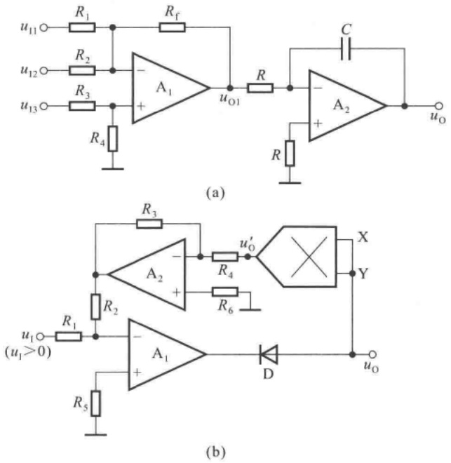

图 T6.3

## 习题

本章习题中的集成运放均为理想运放。

## 6.1 填空:

(1) 运算电路可实现  $A_{u} > 1$  的放大器。
(2) \_\_\_\_ 运算电路可实现  $A_{u} < 0$  的放大器。
(3) 运算电路可将三角波电压转换成方波电压。
(4) 运算电路可实现函数  $Y = aX_{1} + bX_{2} + cX_{3}$ ，a、b 和 c 均大于零。
(5) \_\_\_\_ 运算电路可实现函数  $Y = aX_{1} + bX_{2} + cX_{3}$ ，a、b 和 c 均小于零。
(6) 运算电路可实现函数  $Y = aX^{2}$ 。

## 6.2 电路如图 P6.2 所示, 集成运放输出电压的最大幅值为  $\pm14$  V, 填表。

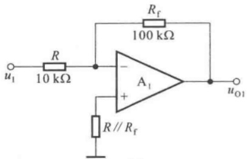

text_image

R
10 kΩ
u₁
R
A₁
+
R // R_f
R_f
100 kΩ
uₒ₁

(a)

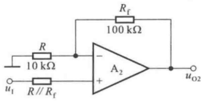

text_image

R
10 kΩ
Rf
100 kΩ
u1
R // Rf
A2
+
-
uo2

(b)

图 P6.2

| $u_{1}/V$ | 0.1 | 0.5 | 1.0 | 1.5 |
| --- | --- | --- | --- | --- |
| $u_{01}/V$ |  |  |  |  |
| $u_{02}/V$ |  |  |  |  |

6.3 设计一个比例运算电路,要求输入电阻  $R_{i}=20\ k\Omega$ , 比例系数为 -100。
6.4 电路如图 P6.4 所示, 试求其输入电阻和比例系数。

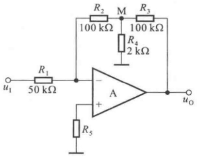

text_image

R1
50 kΩ
u1
R2
100 kΩ
M
R3
100 kΩ
R4
2 kΩ
A
+
-
uO
R5

图 P6.4

6.5 电路如图 P6.4 所示, 集成运放输出电压的最大幅值为  $\pm14\ V$ ,  $u_{1}$  为 2 V 的直流信号。分别求出下列各种情况下的输出电压。

(1) $R_{2}$ 短路；(2) $R_{3}$ 短路；(3) $R_{4}$ 短路；(4) $R_{4}$ 断路。
6.6 试求图 P6.6 所示各电路输出电压与输入电压的运算关系式。
6.7 在图 P6.6 所示各电路中, 集成运放的共模信号分别为多少? 要求写出表达式。
6.8 图 P6.8 所示为恒流源电路, 已知稳压管工作在稳压状态, 试求负载电阻  $R_{L}$  中的电流; 若要求  $R_{L}$  中电流的变化范围是 1\~10 mA, 则电阻  $R_{2}$  应如何变化?

6.9 电路如图 P6.9 所示。

(1) 写出  $u_{0}$  与  $u_{11}$ 、 $u_{12}$  的运算关系式；
(2) 当  $R_{w}$  的滑动端在最上端时, 若  $u_{11}=10\ mV, u_{12}=20\ mV$ , 则  $u_{0}=$ ?
（3）若 $u_{0}$ 的最大幅值为 $\pm 14\mathrm{V}$，输入电压最大值 $u_{11\max} = 10\mathrm{mV}, u_{12\max} = 20\mathrm{mV}$，它们的最小值均为0，则为了保证集成运放工作在线性区，$R_{2}$ 的最大值为多少？

6.10 分别求解图 P6.10 所示各电路的运算关系。

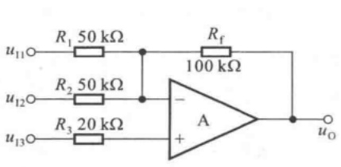

text_image

R₁ 50 kΩ
u₁₁○─ R₂ 50 kΩ ── R_f
          │     │
          │     │
          │     │
          │     │
          │     │
          │     │
          │     │
          │     │
          │     │
          │     │
          │     │
          │     │
          │     │
          │     │
          │     │
          │     │
          │     │
          │     │
          │     │
          │     │
          │     A       uₒ
           │         │
           │         │
           │         │
           │         │
           │         │
           │         │
           │         │
           │         │
           │         │
           │         │
           │         │
           │         │
           │         │
           │         │
           │         │
           │         │
           │         │
           │         │
           │         │
           │         │
           │         ○

(a)

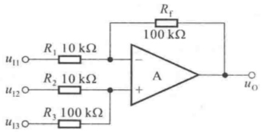

text_image

Rf
100 kΩ
R1 10 kΩ
u11 ○─●─A
     │
     ──┐
     │
     └───┐
     │
     └───┘
     │
     └───┘
     │
     └───┘
     │
     └───┘
     │
     └───┘
     │
     └───┘
     │
     └───┘
     │
     └───┘
     │
     └───┘
     │
     └───┘
     │
     └───┐
     │
     └───┐
     │
     └───┐
     │
     └───┘
     │
     └───┘
     │
     └───┘
     │
     └───┘
     │
     └───┘
     │
     └───┘
     │
     └───┘
     │
     └───┘
     │
     └─────┘
     │
     └─────┘
     │
     └─────┘
     │
     └─────┘
     │
     └─────┘
     │
     └─────┘
     │
     └─────┘
     │
     └─────┘
     │
     └─────┘
     │
     └─────┘
     │
     └─────────┘
     │
     └─────────┘
     │
     └─────────┘
     │
     └─────────┘
     │
     └─────────┘
    │o

(b)

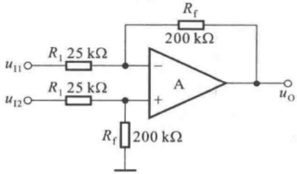

text_image

u11○─R1 25 kΩ─┐
          │
          └───A
          │
          └───Rf 200 kΩ─┐
          │
          └───Rf 200 kΩ─┘
          │
          └───uO

(c)

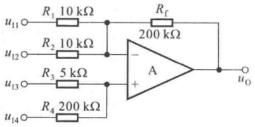

text_image

u11○─R1 10 kΩ─●─●─●─●─●─●─●─●─●─●─●─●─●─●─●─●─●─●─●─●─●─●─●─●─●─●─●─●─●─●─●─●─●─●─●─●─●─●─●─●─●─●─●─●─●─●─●─●─●─●─○
u12○─R2 10 kΩ─●─●─●─●─●─●─●─●─●─●─●─●─●─●─●─●─●─●─●─●─●─●─●─●─●─●─●─●─●─●─●─●─●─●─●─●─●─●─●─●─●─●─●─●─●─●─● ────○
u13○─R3 5 kΩ─●─●─●─●─●─●─●─●─●─●─●─●─●─●─●─●─●─●─●─●─●─●─●─●─●─●─●─●─●─●─●─●─●─●─●─●─●─●─●─●─●─●─●─●─●─●─●─●─○
 u14○─R4 200 kΩ─●─●─●─●─●─●─●─●─●─●─●─●─●─●─●─●─●─●─●─●─●─●─●─●─○

(d)

图 P6.6

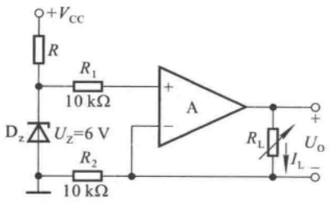

text_image

+Vcc
R
R1
10 kΩ
+
A
Dz
UZ=6 V
R2
10 kΩ
RL
IL
UO
-

图 P6.8

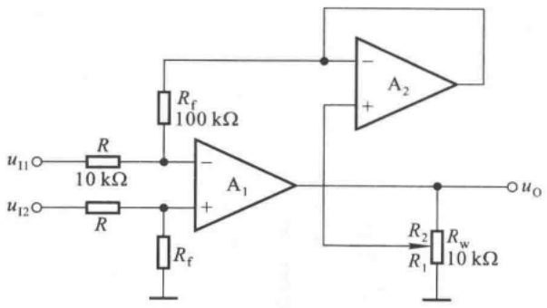

text_image

u11○─R
        10 kΩ
u12○─R
        Rf
        Rf
        A1
        +
        R2
        Rw
        R1
        uO
        -
        +

图 P6.9

6.11 在图 P6.11(a) 所示电路中, 已知输入电压  $u_{1}$  的波形如图(b) 所示, 当 t = 0 时  $u_{0} = 0$ 。试画出输出电压  $u_{0}$  的波形。
6.12 已知图 P6.12 所示电路输入电压  $u_{1}$  的波形如图 P6.11(b) 所示，且当 t=0 时  $u_{0}=0$ 。试画出输出电压  $u_{0}$  的波形。

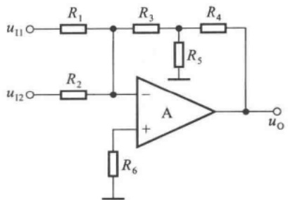

text_image

u11○─R1─●─R3─●─R4─
          │     │     │     │
          └───●─●─●─●─●─●─●─●─●─●─●─●─●─●─●─●─●─●─●─●─●─●─●─●─●─●─●─●─●─●─●─●─●─●─●─●─●─●─●─●─●─●─●─●─●─●─●─●─●─●─○
          │     │     │     │     │     │     │     │     │     │     │     │     │     │     │     │     │     │     │     │     │     │     │     │     │     │     │     │     │     │     │     │     │     │     │     │     │     │     │     │     │     │     │     │     │     │     │     │     │     │     │    R2─●─○─A─●─○─o
          │     │     │     │     │     │     │     │     │     │     │     │     │     │     │     │     │     │     │     │     │     │     │     │     │     │     │     │     │     │     │     │     │     │     │     │     │    R6─●─○─R6─●─+
          └───●─●─●─●─●─●─●─●─●─●─●─●─●─●─●─●─●─●─●─●─●─●─●─●─●─●─●─●─●─●─●─●─●─●─●─●─●─●─●─●─●─●─●─●─●─●─●─○
          └───●─●─●─●─●─●─●─●─●─●─●─●─●─●─●─●─●─●─●─●─●─●─●─●─●─●─●─●─●─●─●─●─●─●─●─●─●─●─●─●─●─●─●─●─●─●─●＝
          └───○────────────────────────────────────────────────────────────────────────────────────────────────────────────────────────────────────────────────────────────────────────────────────────────────────────────────────────────────────────────────────────────────────────────────────────────────────────────────じ
          └──────────────────────────────────────────────────────────────────────────────────────────────────────────────────────────────────────────────────────────────────────────────────────────────────────────────────────────────────────────────────────────────────────────────────────────────────────────────────────────────────────────────────────────────────────────────────────────────────────────────────────────────────────────────────────────────────────────────────────────────────────────────────────────────────────────────────────────────────────────────────────────────────────────────────────────────────────────────────────────────────────────────────────────────────────────────────────────────────────────────────────────────────────────────────────────────────────────────────────────────────一一○

(a)

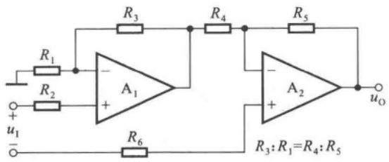

text_image

R1
R2
u1
-
A1
+
R3
R4
R5
R6
A2
+
R3: R1=R4: R5
uO

(b)

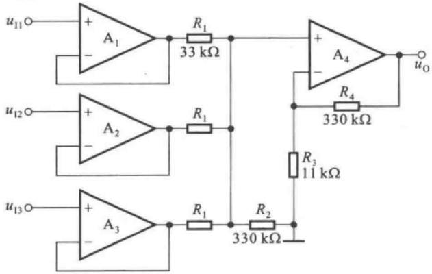

text_image

u11○—+ A1 —— R1 33 kΩ —— + A4 ○ uO
          |           |
          └─A2       └─R1       └─R4 330 kΩ
          |           │
          └─A3       └─R1       └─R2 330 kΩ     |           │
          └─A2       └─R1       └─R3 11 kΩ
          |           │
          └─A3       └─R1       └─R2 330 kΩ

(c)

图 P6.10

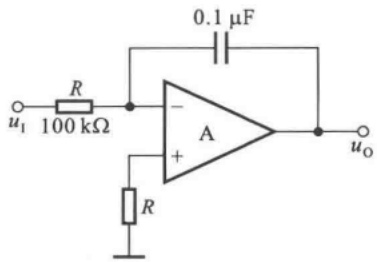

text_image

0.1 μF
R
100 kΩ
u₁
A
+
R
uₒ

(a)

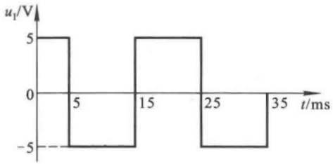

line

| Time (ms) | Voltage (V) |
| --- | --- |
| 0 | 5 |
| 2.5 | 5 |
| 3 | -5 |
| 12.5 | -5 |
| 13 | 5 |
| 22.5 | 5 |
| 23 | -5 |
| 35 | -5 |

(b)

图 P6.11

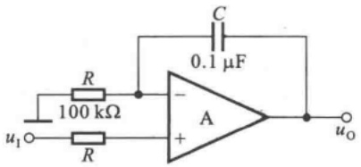

text_image

R
100 kΩ
u₁○─R
      │
      └───A
      │
      └───C
      │
      └───0.1 μF
      │
      └───uₒ

图 P6.12

6.13 试分别求解图 P6.13 所示各电路的运算关系。
6.14 在图 P6.14 所示电路中, 已知  $R_{1}=R=R^{\prime}=R_{2}=R_{f}=100\ k\Omega$ ,  $C=1\ \mu F$ 。

(1) 试求出  $u_{0}$  与  $u_{1}$  的运算关系。
(2) 设 t=0 时  $u_{0}=0$ ，且  $u_{1}$  由零跃变为 -1 V，试求输出电压由零上升到 +6 V 所需要的时间。

6.15 试求出图 P6.15 所示电路的运算关系。

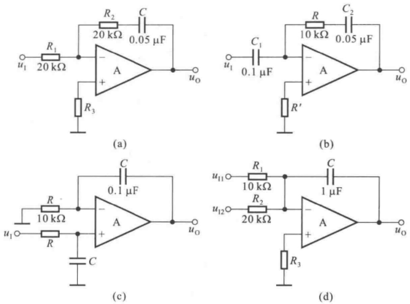

图 P6.13

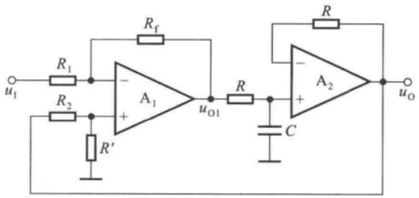

text_image

u₁
R₁
R₂
R′
A₁
+
-
uₒ₁
R
C
R
A₂
+
-
uₒ
R

图 P6.14

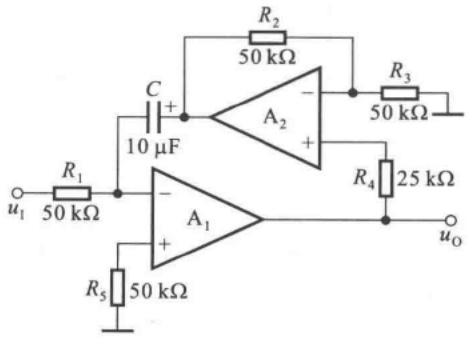

text_image

R1
50 kΩ
C
+
10 μF
R2
50 kΩ
A2
-
+
R3
50 kΩ
R4
25 kΩ
u1
A1
+
-
R5
50 kΩ
uo

图 P6.15

6.16 在图 P6.16 所示电路中, 已知  $u_{11}=4\ V, u_{12}=1\ V$ 。回答下列问题:

(1) 当开关 S 闭合时, 分别求解 A、B、C、D 和  $u_{0}$  的电位;
(2) 设 t=0 时 S 打开, 问经过多长时间  $u_{0}=0$ ?

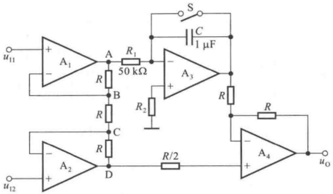

text_image

u11
+
A1
-
A
R1
50 kΩ
S
C
1 μF
B
R2
A3
+
R
R
R
A4
+
uO
u12
+
A2
-
D
R/2

图 P6.16

6.17 为了使图 P6.17 所示电路实现除法运算，

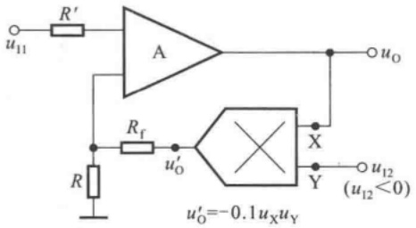

text_image

R'
A
u11
Rf
R
uO
X
Y
uO
u12
(u12<0)
uO'=-0.1uxuy

图 P6.17

(1) 标出集成运放的同相输入端和反相输入端；
(2) 求出  $u_{0}$  和  $u_{11}$ 、 $u_{12}$  的运算关系式。

6.18 求出图 P6.18 所示各电路的运算关系。

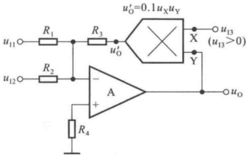

text_image

u'0=0.1uXuY
R1 R3 u'O X uI3 (uI3>0)
uI1 R2 - A X Y
uI2 R4 + uO

(a)

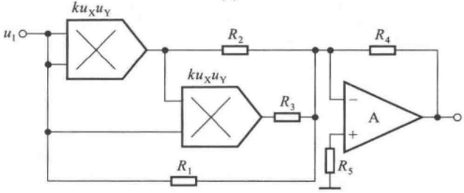

text_image

u₁
kuₓuᵧ
R₂
R₄
kuₓuᵧ
R₃
A
+
-
R₁
R₅

(b)

图 P6.18

6.19 分别设计完成以下函数关系的运算电路,画出电路图,并选取电路参数。

(1) $u_{\mathrm{e1}} = -\sqrt{2u_{\mathrm{II}}^2 + 2u_{\mathrm{I2}}^2}$
(2) $u_{02}=\frac{4u_{11}}{2u_{12}+2u_{13}}$
(3) $u_{\mathrm{a3}} = -\frac{1}{10^3}\int (6u_{\mathrm{II}} \cdot u_{\mathrm{I2}})\,\mathrm{d}t$

6.20 试说明图 P6.20 所示各电路属于哪种类型的滤波电路；是几阶滤波电路？

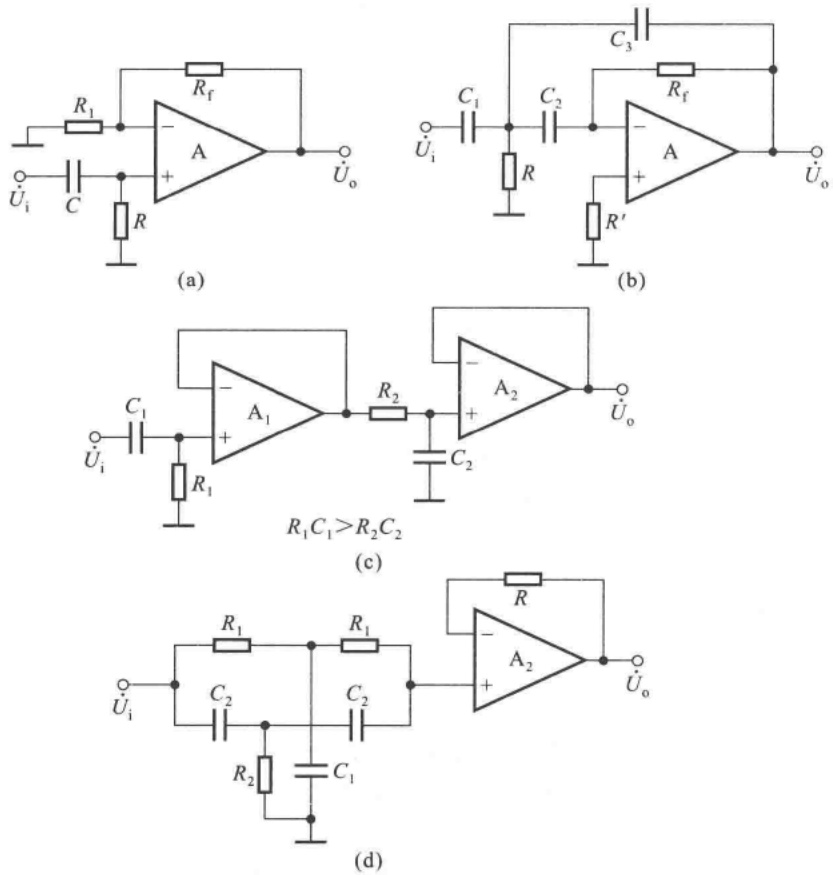

图 P6.20

6.21 设一阶 HPF 和二阶 LPF 的通带放大倍数均为 2，通带截止频率分别为 2 Hz 和 100 kHz。试用它们构成一个带通滤波电路，并画出幅频特性。
6.22 在图 6.3.9 所示电路中, 已知通带放大倍数为 2, 截止频率为 1 kHz, C 取值为  $1 \mu F$ 。试选取电路中各电阻的阻值。
6.23 试分析图 P6.23 所示电路的输出 $u_{01}$、$u_{02}$ 和 $u_{03}$ 分别具有哪种滤波特性 (LPF、HPF、BPF、BEF)?
6.24 利用 Multisim 分析图 P6.13(a)、(c) 所示电路的输入电压为 200 Hz、幅值为 ±1 V 的方波时输出电压的波形。

出题目的:具有积分或微分环节的运算电路的波形分析是学习的一个难点,本题借助于 Multisim 来了解输出电压与输入电压的波形关系。

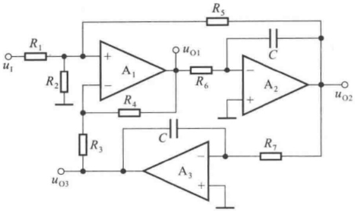

text_image

R1
u1
R2
+
A1
-
R4
uO1
R6
C
A2
+
R7
uO2
R3
C
uO3
A3
+

图 P6.23

提示:

（1）为防止图示电路的直流增益过大，可在电容上并联阻值为1 MΩ的电阻。
(2) 在什么情况下输出电压有直流分量。

6.25 在图 P6.25 所示电路中, 已知  $R = 51 \, k\Omega, R_{3} = 500 \, \Omega; f_{0} = 1 \, kHz$ 。利用 Multisim 分析下列问题:

(1) 选取合适的  $R_{1}$ 、 $R_{2}$ 、 $C_{1}$ 、 $C_{2}$  的值，使  $f_{0}=1\ kHz$ ;
(2) 测试幅频特性, 求出通带放大倍数和通带截止频率。

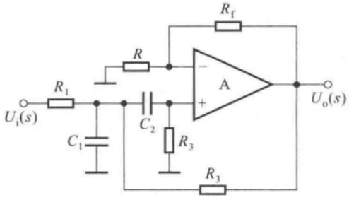

text_image

Ui(s)
R1
C1
R
C2
R3
Rf
A
+
Uo(s)
R3

图 P6.25

提示:

(1) 集成运放选用通用型器件, 其余采用虚拟元件, 以便调试。
（2）波特图仪的频率扫描范围和增益的设定范围均不宜太宽，否则一方面不利于观察，另一方面影响测试精度。

6.26 在图 P6.26 所示电容测量电路中，已知输入电压是频率为 100 Hz、幅值为 ±5 V 的锯齿波， $C_{X}$  为被测电容，通过测量输出电压的直流电压得到  $C_{X}$  的容量； $C_{1}$  为消振电容。利用 Multisim 研究下列问题:

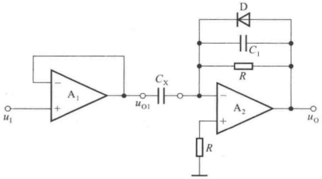

text_image

u₁
A₁
+
-
Cₓ
uₒ₁
D
C₁
R
A₂
+
-
R
uₒ

图 P6.26

(1) 设  $C_{x}=0.05\mu F$  时  $u_{0}=-10\ V$ ，选取 R 的阻值。
(2) 设  $C_{x}=0.05\mu F$ ，进行仿真，观察  $u_{01}, u_{0}$  的波形，测试  $u_{0}$  的直流值。
(3) 改变  $C_{x}$  的值, 测试电路的测量范围及线性度。

提示:

(1) 分析两个集成运放各组成什么基本运算电路,弄清电路的工作原理。
(2) 集成运放可用通用型元件,其余可用虚拟元件。从函数发生器获得锯齿波电压信号。
（3）所谓线性度是指输出电压与 $C_{x}$ 的比例系数是否为常量，在 $C_{x}$ 变化时比例系数的变化情况。

## 第7章

## 波形的发生和信号的转换

## 本章讨论的问题

- 在模拟电子电路中需要哪些波形的信号作为测试信号和控制信号？
- 什么是自激振荡？正弦波振荡电路所产生的自激振荡和负反馈放大电路中所产生的自激振荡有区别吗？为什么正弦波振荡电路中必须有选频网络？选频网络可由哪些元件组成？
- 怎样组成正弦波振荡电路？如何判断电路是否是正弦波振荡电路？
- 波形发生电路中必须有放大电路吗？
- 为什么说矩形波发生电路是产生其它非正弦波信号的基础？为什么非正弦波发生电路中几乎都含有电压比较器？
- 电压比较器与放大电路有什么区别？集成运放在电压比较器电路和运算电路中的工作状态一样吗？为什么？如何判断电路中集成运放的工作状态？
- 如何组成矩形波、三角波和锯齿波发生电路？
- 为什么需要将输入信号进行转换？有哪些基本的转换？这些转换电路组成的基本思路是什么？

在模拟电子电路中，常常需要各种波形的信号，作为测试信号或控制信号等。例如，在测量放大电路的指标参数时需要给电路输入正弦波信号；又如，在用示波器测试电路的电压传输特性时需要给电路输入锯齿波电压；再如，在增益可控集成运放的控制端需要输入矩形波，等等。而为了使所采集的信号能够用于测量、控制、驱动负载或送入计算机，常常需要将信号进行变换，如将电压变换成电流、将电流变换成电压、将电压变换成频率与之成正比的脉冲，等等。

本章将讲述有关波形发生和信号转换电路的组成原则、工作原理以及主要参数。

## 7.1 正弦波振荡电路

正弦波振荡电路是在没有外加输入信号的情况下，依靠电路自激振荡而产生正弦波输出电压的电路。它被广泛地应用于量测、遥控、通信、自动控制、热处理和超声波电焊等加工设备之中，也作为模拟电子电路的测试信号。本节将就正弦波振荡电路的种类、组成和工作原理一一加以介绍。

## 7.1.1 概述

## 一、产生正弦波振荡的条件

在负反馈放大电路中，若在低频段或高频段中存在频率 $f_{0}$ ，使电路产生的附加相移为 $\pm\pi$ ，而且当 $f=f_{0}$ 时 $|\dot{A}\dot{F}|>1$ ，则电路将产生自激振荡。振荡频率除了决定于电路中的电阻和电容外,还决定于晶体管的极间电容、电路的分布电容等人们不能确定的因素 $^{①}$ ,因此不能作为信号源。

虽然正弦波振荡电路的振荡原理在本质上与负反馈放大电路产生自激振荡的原理相同,但是,正弦波振荡电路引入正反馈以满足振荡条件,而且外加选频网络使振荡频率人为可控,这是其电路组成的显著特征。

通常，可将正弦波振荡电路分解为图7.1.1(a)所示方框图，上一个方框为放大电路，下一个方框为反馈网络，反馈极性为正。当输入量为零时，反馈量等于输入量，如图(b)所示。由于电扰动（如合闸通电的瞬间），电路产生一个幅值很小的输出量，它含有丰富的频率，若电路只对频率为 $f_{0}$ 的正弦波产生正反馈过程，则将产生如下过程:

$$
X _ {\mathrm{o}} \uparrow \rightarrow X _ {\mathrm{f}} \uparrow (X _ {\mathrm{i}} ^ {\prime} \uparrow) \rightarrow X _ {\mathrm{o}} \uparrow \uparrow
$$

即输出量  $X_{o}$  的增大使反馈量  $X_{f}$  增大，因放大电路的输入量就是  $X_{i}^{\prime}$  反馈量  $X_{f}$ ，故  $X_{o}$  将进一步增大。

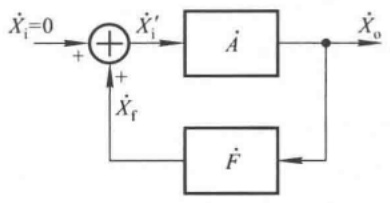

flowchart

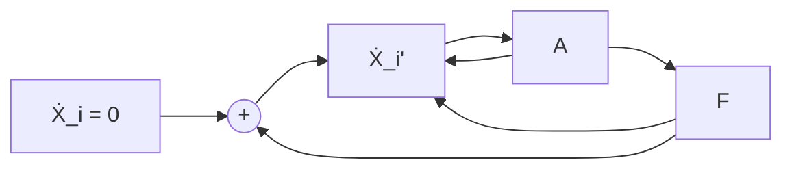

(a)

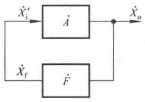

flowchart

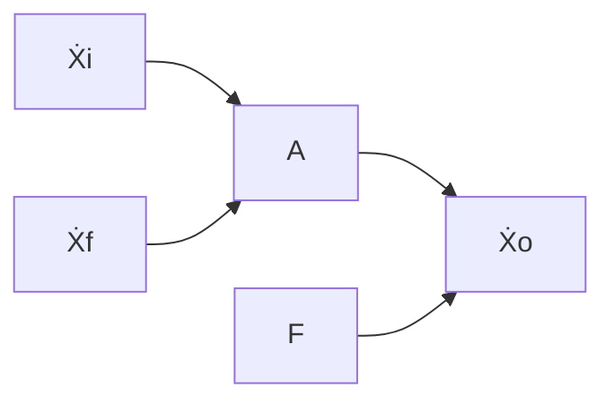

(b)

图 7.1.1 正弦波振荡电路的方框图

(a) 电路引入正反馈 (b) 反馈量作为净输入量

$X_{o}$  不会无限制地增大, 当  $X_{o}$  增大到一定数值时, 由于晶体管的非线性特性和电源电压的限制, 使放大电路放大倍数的数值减小, 最终  $X_{o}$  的幅值将维持在一个确定值, 电路达到动态平衡。这时, 输出量  $X_{o}$  通过反馈网络产生反馈量  $X_{f}$  作为放大电路的输入量  $X_{i}^{\prime}$ , 而输入量  $X_{i}^{\prime}$  又通过放大电路维持着输出量  $X_{o}$ , 写成表达式为

$$
\dot {X} _ {\mathrm{o}} = \dot {A} \dot {X} _ {\mathrm{f}} = \dot {A} \dot {F} \dot {X} _ {\mathrm{o}}
$$

也就是说,正弦波振荡的平衡条件为

$$
\dot {A} \dot {F} = 1 \tag {7.1.1}
$$

写成幅值与相角的形式为

$$
\left\{ \begin{array}{l l} {\mid \dot {A} \dot {F} \mid = 1} & {(7. 1. 2 \mathrm{a})} \\ {\varphi_ {\mathrm{A}} + \varphi_ {\mathrm{F}} = 2 n \pi} & {(n \text {为整数})} \end{array} \right. \tag {7.1.2b}
$$

式(7.1.2a)称为幅值平衡条件,式(7.1.2b)称为相位平衡条件,分别简称为幅值条件和相位条件。为了使输出量在合闸后能够有一个从小到大直至平衡在一定幅值的过程,电路的起振条件为

$$
\mid \dot {A} \dot {F} \mid > 1 \tag {7.1.3}
$$

电路把频率 $f=f_{0}$ 以外的输出量均逐渐衰减为零，因此输出量为 $f=f_{0}$ 的正弦波。

<small>① 参阅 5.6 节。</small>

## 二、正弦波振荡电路的组成及分类

从以上分析可知,正弦波振荡电路必须由以下四个部分组成:

（1）放大电路:保证电路能够有从起振到幅值逐渐增大直至动态平衡的过程，使电路获得一定幅值的输出量，实现能量的控制。
（2）选频网络:确定电路的振荡频率，使电路产生单一频率的振荡，即保证电路产生正弦波振荡。
(3) 正反馈网络: 引入正反馈, 使放大电路的输入信号等于反馈信号。
(4) 稳幅环节: 也就是非线性环节, 作用是使输出信号幅值稳定。

在不少实用电路中,常将选频网络和正反馈网络“合二而一”;而且,对于分立元件放大电路,也不再另加稳幅环节,而依靠晶体管特性的非线性来达到稳幅作用。

正弦波振荡电路常用选频网络所用元件来命名，分为 RC 正弦波振荡电路、LC 正弦波振荡电路和石英晶体正弦波振荡电路三种类型。RC 正弦波振荡电路的振荡频率较低，一般在 1 MHz 以下；LC 正弦波振荡电路的振荡频率多在 1 MHz 以上；石英晶体正弦波振荡电路也可等效为 LC 正弦波振荡电路，其特点是振荡频率非常稳定。

## 三、判断电路是否可能产生正弦波振荡的方法和步骤

（1）观察电路是否包含了放大电路、选频网络、正反馈网络和稳幅环节四个组成部分。
（2）判断放大电路是否能够正常工作，即是否有合适的静态工作点且动态信号是否能够输入、输出和放大。
（3）利用瞬时极性法判断电路是否满足正弦波振荡的相位条件。具体做法是:断开反馈，在

断开处给放大电路加频率为 $f_{0}$ 的正弦波输入电压 $\dot{U}_{i}$，并给定其瞬时极性，如图7.1.2所示；然后以 $\dot{U}_{i}$ 极性为依据判断输出电压 $\dot{U}_{0}$ 的极性，从而得到反馈电压 $\dot{U}_{f}$ 的极性；若 $\dot{U}_{f}$ 与 $\dot{U}_{i}$ 极性相同，则说明满足相位条件，电路有可能产生正弦波振荡，否则表明不满足相位条件，电路不可能产生正弦波振荡。

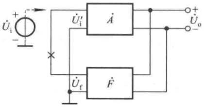

text_image

Üi
+
-
Üi'
A
Üf
F
Üo
+

图7.1.2 利用瞬时极性法判断相位条件

（4）判断电路是否满足正弦波振荡的幅值条件，即是否满足起振条件。具体方法是:分别求解电路的 $\dot{A}$ 和 $\dot{F}$，然后判断 $|\dot{A}\dot{F}|$ 是否大于1。只有在电路满足相位条件的情况下，判断是否满足幅值条件才有意义。换言之，若电路不满足相位条件，则电路一定不可能振荡。

## 7.1.2 RC 正弦波振荡电路

实用的 RC 正弦波振荡电路多种多样,但最具典型性的是 RC 桥式正弦波振荡电路,在文献中也称之为文氏桥振荡电路。本节介绍它的电路组成、工作原理和振荡频率。

## 一、RC串并联选频网络

将电阻 $R_{1}$ 与电容 $C_1$ 串联、电阻 $R_{2}$ 与电容 $C_2$ 并联所组成的网络称为 $RC$ 串并联选频网络，如图7.1.3(a)所示。通常，选取 $R_{1} = R_{2} = R, C_{1} = C_{2} = C$ 。因为 $RC$ 串并联选频网络在正弦波振荡电路中既为选频网络，又为正反馈网络，所以其输入电压为 $\dot{U}_{\mathrm{o}}$ ，输出电压为 $\dot{U}_{\mathrm{f}}$ 。

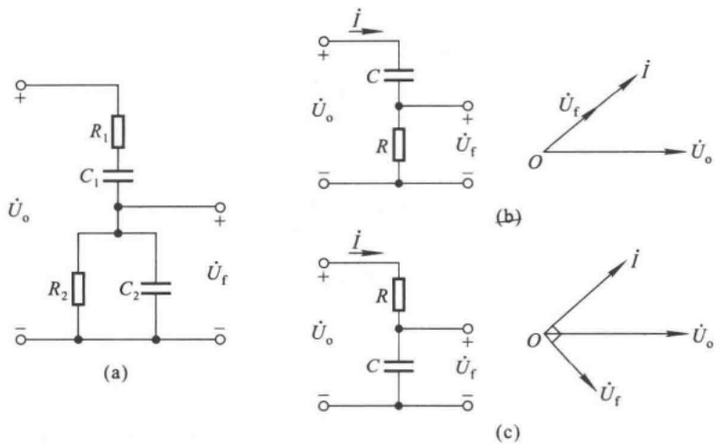

图 7.1.3 RC 串并联选频网络及其在低频段和高频段的等效电路

(a) RC 串并联选频网络 (b) 低频段等效电路及其相量图

(c) 高频段等效电路及其相量图

当信号频率足够低时， $\frac{1}{\omega C}\gg R$ ，因而网络的简化电路及其电压和电流的相量图如图7.1.3(b)所示。 $\dot{U}_{f}$  超前 $\dot{U}_{o}$ ，当频率趋近于零时，相位超前趋近于 $+90^{\circ}$ ，且 $|\dot{U}_{f}|$  趋近于零。

当信号频率足够高时， $\frac{1}{\omega C}\ll R$ ，因而网络的简化电路及其电压和电流的相量图如图7.1.3(c)所示。 $\dot{U}_{f}$ 滞后 $\dot{U}_{o}$ ，当频率趋近于无穷大时，相位滞后趋近于 $-90^{\circ}$ ，且 $|\dot{U}_{f}|$ 趋近于零。

可以想象, 当信号频率从零逐渐变化到无穷大时,  $\dot{U}_{f}$  的相位将从  $+90^{\circ}$  逐渐变化到  $-90^{\circ}$ 。因此, 对于 RC 串并联选频网络, 必定存在一个频率  $f_{0}$ , 当  $f = f_{0}$  时,  $\dot{U}_{f}$  与  $\dot{U}_{o}$  同相。通过以下计算, 可以求出 RC 串并联选频网络的频率特性和  $f_{0}$ 。

$$
\dot {F} = \frac {\dot {U} _ {\mathrm{f}}}{\dot {U} _ {\mathrm{o}}} = \frac {R / / \frac {1}{\mathrm{j} \omega C}}{R + \frac {1}{\mathrm{j} \omega C} + R / / \frac {1}{\mathrm{j} \omega C}}
$$

整理可得

$$
\dot {F} = \frac {1}{3 + \mathrm{j} \left(\omega R C - \frac {1}{\omega R C}\right)}
$$

令 $\omega_0 = \frac{1}{RC}$ ，则

$$
f _ {0} = \frac {1}{2 \pi R C} \tag {7.1.4}
$$

代入上式,得出

$$
\dot {F} = \frac {1}{3 + \mathrm{j} \left(\frac {f}{f _ {0}} - \frac {f _ {0}}{f}\right)} \tag {7.1.5}
$$

幅频特性为

$$
\mid \dot {F} \mid = \frac {1}{\sqrt {3 ^ {2} + \left(\frac {f}{f _ {0}} - \frac {f _ {0}}{f}\right) ^ {2}}} \tag {7.1.6}
$$

相频特性为

$$
\varphi_ {\mathrm{F}} = - \arctan \frac {1}{3} \left(\frac {f}{f _ {0}} - \frac {f _ {0}}{f}\right) \tag {7.1.7}
$$

根据式(7.1.6)和式(7.1.7)画出 $\dot{F}$ 的频率特性，如图7.1.4所示。当 $f = f_{0}$ 时，$\dot{F} = \frac{1}{3}$，即 $\left|\dot{U}_{\mathrm{f}}\right| = \frac{1}{3}\left|\dot{U}_{\mathrm{o}}\right|, \varphi_{\mathrm{F}} = 0^{\circ}$。

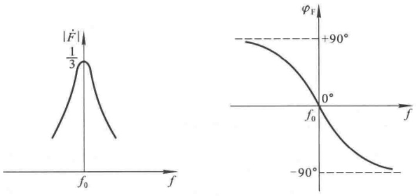

line

| Function | Description |
| --- | --- |
| Left Chart | Probability density function |
| Right Chart | Phase response curve |
| Key Points | f0, 1/3, +90°, 0°, -90° |

图 7.1.4 RC 串并联选频网络的频率特性

## 二、RC 桥式正弦波振荡电路

根据式(7.1.1)，因为当 $f=f_{0}$ 时， $\dot{F}=\frac{1}{3}$ ，所以

$$
\dot {A} = \dot {A} _ {u} = 3 \tag {7.1.8}
$$

式(7.1.8)表明,只要为RC串并联选频网络匹配一个电压放大倍数等于3(即输出电压与输入电压同相,且放大倍数的数值为3)的放大电路就可以构成正弦波振荡电路,如图7.1.5所示。考虑到起振条件,所选放大电路的电压放大倍数应略大于3。

从理论上讲,任何满足放大倍数要求的放大电路与RC串并联选频网络都可组成正弦波振荡电路;但是,实际上,所选用的放大电路应具有尽可能大的输入电阻和尽可能小的输出电阻,以减小放大电路对选频特性的影响,使振荡频率几乎仅仅决定于选频网络。因此,通常选用引入电压串联负反馈的放大电路,如同相比例运算电路。

由 RC 串并联选频网络和同相比例运算电路所构成的 RC 桥式正弦波振荡电路如图 7.1.6(a) 所示。观察电路，负反馈网络的  $R_{1}$ 、 $R_{f}$  以及正反馈网络串联的 R 和

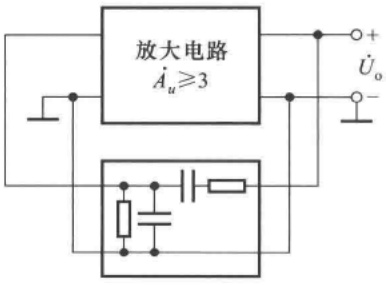

text_image

放大电路
Âu≥3
+ 
Ûo -

图 7.1.5 利用 RC 串并联选频网络构成正弦波振荡电路的方框图

C、并联的 R 和 C 各为一臂构成桥路，故此得名。集成运放的输出端和“地”接桥路的两个顶点作为电路的输出；集成运放的同相输入端和反相输入端接另外两个顶点，是集成运放的净输入电压；如图(b)所示。

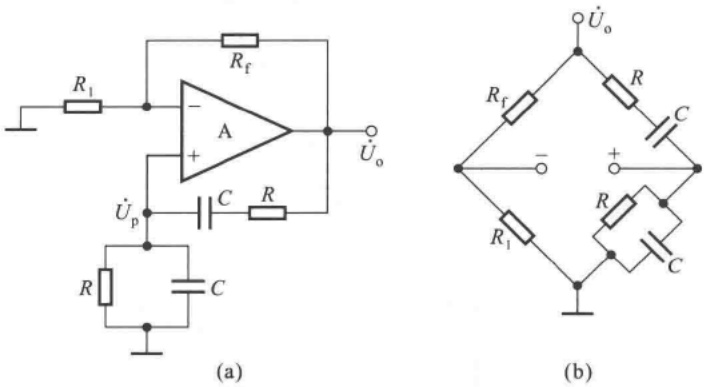

图 7.1.6 RC 桥式正弦波振荡电路

(a) 电路 (b) 电路中的桥路

正反馈网络的反馈电压  $\dot{U}_{f}$  是同相比例运算电路的输入电压, 因而要把同相比例运算电路作为整体看成电压放大电路, 它的比例系数是电压放大倍数, 根据起振条件和幅值平衡条件

$$
\dot {A} _ {u} = \frac {\dot {U} _ {\mathrm{o}}}{\dot {U} _ {\mathrm{p}}} = 1 + \frac {R _ {\mathrm{f}}}{R} \geqslant 3
$$

$$
R _ {\mathrm{f}} \geqslant 2 R _ {1} \tag {7.1.9}
$$

$R_{\mathrm{f}}$ 的取值要略大于 $2R_{1}$ 。应当指出，由于 $U_{\mathrm{o}}$ 与 $U_{\mathrm{f}}$ 具有良好的线性关系，所以为了稳定输出电压的幅值，一般应在电路中加入非线性环节。例如，可选用 $R_{1}$ 为正温度系数的热敏电阻，当 $U_{\mathrm{o}}$ 因某种原因而增大时，流过 $R_{\mathrm{f}}$ 和 $R_{1}$ 上的电流增大，$R_{1}$ 上的功耗随之增大，导致温度升高，因而 $R_{1}$ 的阻值增大，从而使得 $\dot{A}_{u}$ 数值减小，$U_{\mathrm{o}}$ 也就随之减小；当 $U_{\mathrm{o}}$ 因某种原因而减小时，各物理量与上述变化相反，从而使输出电压稳定。当然，也可选用 $R_{\mathrm{f}}$ 为负温度系数的热敏电阻。

此外,还可在  $R_{f}$  回路串联两个并联的二极管,如图 7.1.7 所示,利用电流增大时二极管动态电阻减小、电流减小时二极管动态电阻增大的特点,加入非线性环节,从而使输出电压稳定。此时比例系数为

$$
\dot {A} _ {u} = 1 + \frac {R _ {\mathrm{f}} + r _ {\mathrm{d}}}{R _ {1}} \tag {7.1.10}
$$

## 三、振荡频率可调的 $RC$ 桥式正弦波振荡电路

为了使得振荡频率连续可调，常在 RC 串并联网络中，用双层波段开关接不同的电容作为振荡频率  $f_{0}$  的粗调；用同轴电位器实现  $f_{0}$  的微调，如图 7.1.8 所示。振荡频率的可调范围能够从几赫兹到几百千赫。

综上所述，RC 桥式正弦波振荡电路以 RC 串并联网络为选频网络和正反馈网络，以电压串联负反馈放大电路为放大环节,具有振荡频率稳定、带负载能力强、输出电压失真小等优点,因此获得相当广泛的应用。

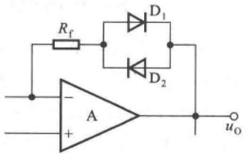

text_image

Rf
D1
D2
A
uO

图7.1.7 利用二极管作为非线性环节

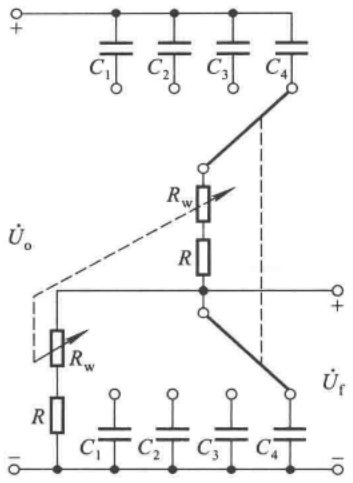

text_image

C1 C2 C3 C4
Rw
R
Uo
Rw
R
C1 C2 C3 C4
Uf

图 7.1.8 振荡频率连续可调的 RC 串并联选频网络

为了提高 RC 桥式正弦波振荡电路的振荡频率, 必须减小 R 和 C 的数值。然而, 一方面, 当 R 减小到一定程度时, 同相比例运算电路的输出电阻将影响选频特性; 另一方面, 当 C 减小到一定程度时, 晶体管的极间电容和电路的分布电容将影响选频特性; 因此, 振荡频率  $f_{0}$  高到一定程度时, 其值不仅决定于选频网络, 还与放大电路的参数有关。这样,  $f_{0}$  不但与一些未知因素有关, 而且还将受环境温度的影响。因此, 当振荡频率较高时, 应选用 LC 正弦波振荡电路。

【例 7.1.1】在图 7.1.8 所示电路中, 若电容的取值分别为  $0.01 \mu F$ 、 $0.1 \mu F$ 、 $1 \mu F$ 、 $10 \mu F$ ，电阻  $R = 50 \Omega$ ，电位器  $R_{w} = 10 k\Omega$ 。试问:  $f_{0}$  的调节范围为多少?

解: 因为  $f_{0}=\frac{1}{2\pi RC}$ ，所以  $f_{0}$  的最小值

$$
f _ {0 \mathrm{min}} = \frac {1}{2 \pi (R + R _ {\mathrm{w}}) C _ {\mathrm{max}}} = \frac {1}{2 \pi \times (5 0 + 1 0 \times 1 0 ^ {3}) \times 1 0 \times 1 0 ^ {- 6}} \mathrm{Hz} \approx 1. 5 9 \mathrm{Hz}
$$

$f_{0}$ 的最大值

$$
f _ {0 \mathrm{max}} = \frac {1}{2 \pi R C _ {\mathrm{min}}} = \frac {1}{2 \pi \times 5 0 \times 0 . 0 1 \times 1 0 ^ {- 6}} \mathrm{Hz} \approx 3 1 8 0 0 0 \mathrm{Hz} = 3 1 8 \mathrm{kHz}
$$

$f_{0}$ 的调节范围为1.59 Hz\~318 kHz。

## 7.1.3 LC正弦波振荡电路

LC正弦波振荡电路与RC桥式正弦波振荡电路的组成原则在本质上是相同的，只是选频网络采用LC电路。在LC振荡电路中，当 $f = f_{0}$ 时，放大电路的放大倍数数值最大，而其余频率的信号均被衰减到零；引入正反馈后，使反馈电压作为放大电路的输入电压，以维持输出电压，从而形成正弦波振荡。由于LC正弦波振荡电路的振荡频率较高，所以放大电路多采用分立元件电路，必要时还应采用共基电路，也可采用宽频带集成运放。

## 一、LC谐振回路的频率特性

常见的 LC 正弦波振荡电路中的选频网络多采用 LC 并联网络, 如图 7.1.9 所示。图 (a) 为理想电路, 无损耗, 谐振频率为

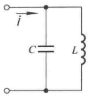

text_image

i
C
L

(a)

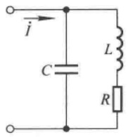

text_image

i
C
L
R

(b)

图 7.1.9 LC 并联网络

(a) 理想情况下的网络 (b) 考虑电路损耗时的网络

$$
f _ {0} = \frac {1}{2 \pi \sqrt {L C}}
$$

在信号频率较低时,电容的容抗很大,网络呈感性;在信号频率较高时,电感的感抗很大,网络呈容性;只有当 $f=f_{0}$ 时,网络才呈纯阻性,且阻抗无穷大。这时电路产生电流谐振,电容的电场能转换成磁场能,而电感的磁场能又转换成电场能,两种能量相互转换。

实际的 LC 并联网络总是有损耗的, 将各种损耗等效成电阻 R, 如图(b)所示。电路的导纳为

$$
Y = \mathrm{j} \omega C + \frac {1}{R + \mathrm{j} \omega L} = \frac {R}{R ^ {2} + (\omega L) ^ {2}} + \mathrm{j} \left[ \omega C - \frac {\omega L}{R ^ {2} + (\omega L) ^ {2}} \right] \tag {7.1.11}
$$

令式中虚部为零,可求出谐振角频率

$$
\omega_ {0} = \frac {1}{\sqrt {1 + \left(\frac {R}{\omega_ {0} L}\right) ^ {2}}} \cdot \frac {1}{\sqrt {L C}} = \frac {1}{\sqrt {1 + \frac {1}{Q ^ {2}}} \cdot \sqrt {L C}}
$$

式中 $Q$ 为品质因数，并且

$$
Q = \frac {\omega_ {0} L}{R} \tag {7.1.12}
$$

当 $Q \gg 1$ 时, $\omega_0 \approx \frac{1}{\sqrt{LC}}$, 所以谐振频率

$$
f _ {0} \approx \frac {1}{2 \pi \sqrt {L C}} \tag {7.1.13}
$$

将式(7.1.13)代入式(7.1.12)，得出

$$
Q \approx \frac {1}{R} \sqrt {\frac {L}{C}} \tag {7.1.14}
$$

可见,选频网络的损耗愈小;谐振频率相同时,电容容量愈小,电感数值愈大,品质因数愈大,将使得选频特性愈好。

当 $f=f_{0}$ 时,电抗

$$
Z _ {0} = \frac {1}{Y _ {0}} = \frac {R ^ {2} + (\omega_ {0} L) ^ {2}}{R} = R + Q ^ {2} R
$$

当 $Q \gg 1$ 时，$Z_0 \approx Q^2 R$，将式(7.1.14)代入，整理可得

$$
Z _ {0} \approx Q X _ {L} \approx Q X _ {C} \tag {7.1.15}
$$

$X_{L}$  和  $X_{C}$  分别是电感和电容的电抗。因此，当网络的输入电流为  $I_{0}$  时，电容和电感的电流约为  $QI_{0}$ 。

根据式(7.1.11)，可得适用于频率从零到无穷大时 LC 并联网络电抗的表达式为

$$
Z = \frac {1}{Y}
$$

Z 是频率的函数, 其频率特性如图 7.1.10 所示。Q 值愈大, 曲线愈陡, 选频特性愈好。

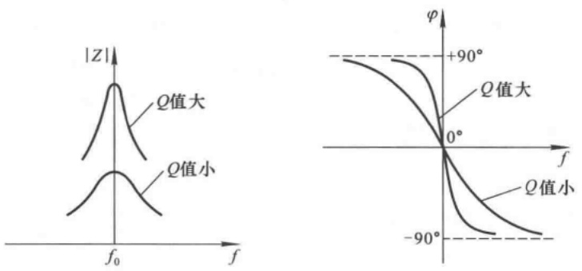

图 7.1.10 LC 并联网络电抗的频率特性

若以 LC 并联网络作为共射放大电路的集电极负载, 如图 7.1.11 所示, 则电路的电压放大倍数

$$
\dot {A} _ {u} = - \beta \frac {Z}{r _ {\mathrm{be}}}
$$

根据 LC 并联网络的频率特性, 当  $f = f_{0}$  时, 电压放大倍数的数值最大, 且无附加相移。对于其余频率的信号, 电压放大倍数不但数值减小, 而且有附加相移。电路具有选频特性, 故称之为

选频放大电路。若在电路中引入正反馈，并能用反馈电压取代输入电压，则电路就成为正弦波振荡电路。根据引入反馈的方式不同，LC正弦波振荡电路分为变压器反馈式、电感反馈式和电容反馈式三种电路；所用放大电路视振荡频率而定，可用共射电路、共基电路或者是宽频带集成运放。

## 二、变压器反馈式振荡电路

## 1. 工作原理

引入正反馈最简单的方法是采用变压器反馈方式,如图7.1.12所示;为使反馈电压与输入电压同相,同名端如图中所标注。当反馈电压取代输入电压时,就得到变压器反馈式振荡电路,如图 7.1.13 所示。

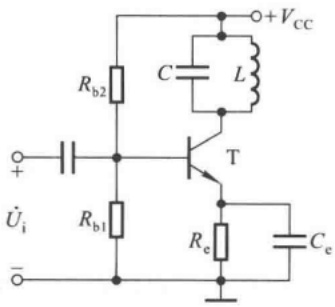

text_image

Rb2
C
L
+VCC
+
Üi
Rb1
T
Re
Ce
-

图 7.1.11 选频放大电路

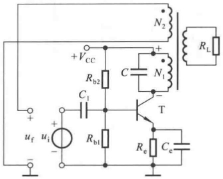

text_image

+VCC
Rb2
C1
C
N1
+
-
T
uF
ui
-
Rb1
Re
Ce
RL

图 7.1.12 在选频放大电路中引入正反馈

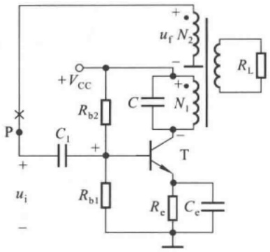

text_image

+VCC
Rb2
C
N1
uF N2
RL
+
-
T
C1
+
-
ui
-
Rb1
Re Ce

图 7.1.13 变压器反馈式振荡电路

对于图 7.1.13 所示的电路, 可以用前面所叙述的方法判断电路产生正弦波振荡的可

能性。首先，观察电路，存在放大电路、选频网络、正反馈网络以及用晶体管的非线性特性所实现的稳幅环节四个部分。然后，判断放大电路能否正常工作，图中放大电路是典型的工作点稳定电路，可以设置合适的静态工作点；电路的交流通路如图7.1.14所示，交流信号传递过程中无开路或短路现象，电路可以正常放大。最后，采用瞬时极性法判断电路是否满足相位平衡条件。在图7.1.14中，断开P点，加 $f=f_{0}$ 的输入电压，规定其极性，得到变压器一次

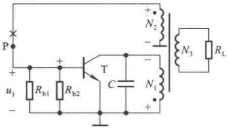

text_image

P
+
ui
-
Rb1
+
Rb2
T
C
N1
+
-
N2
+
-
N3
RL

图 7.1.14 变压器反馈式振荡电路的交流通路

线圈 $N_{1}$ 电压的极性，进而得到二次线圈 $N_{2}$ 电压的极性，如图中所标注，故电路满足相位条件，有可能产生正弦波振荡。

而在多数情况下，不必画出交流通路就可判断电路是否满足相位条件。具体做法是:在图7.1.13所示电路中，断开P点，在断开处给放大电路加 $f=f_{0}$ 的输入电压 $\dot{U}_{1}$ ，给定其极性对“地”为正，因而晶体管基极动态电位对“地”为正，由于放大电路为共射接法，故集电极动态电位对“地”为负；对于交流信号，电源相当于“地”，所以线圈 $N_{1}$ 上电压为上“正”下“负”；根据同名端， $N_{2}$ 上电压也为上“正”下“负”，即反馈电压对“地”为正，与输入电压假设极性相同，满足正弦波振荡的相位条件。

图 7.1.13 所示电路表明, 变压器反馈式振荡电路中放大电路的输入电阻是放大电路负载的一部分, 因此  $\dot{A}$  与  $\dot{F}$  相互关联。一般情况下, 只要合理选择变压器一次、二次线圈的匝数比以及其它电路参数, 电路很容易满足幅值条件。

## 2. 振荡频率及起振条件

图7.1.13所示变压器反馈式振荡电路的交流等效电路如图7.1.15所示。 $R$ 是 $LC$ 谐振回路、负载等的总损耗， $L_{1}$ 为考虑到 $N_{3}$ 回路参数折合到一次侧的等效电感， $L_{2}$ 为二次电感， $M$ 为 $N_{1}$ 和 $N_{2}$ 间的等效互感； $R_{\mathrm{i}}$ 为放大电路的输入电阻，其值 $R_{\mathrm{i}} = R_{\mathrm{b1}} / / R_{\mathrm{b2}} / / r_{\mathrm{be}}$ 。

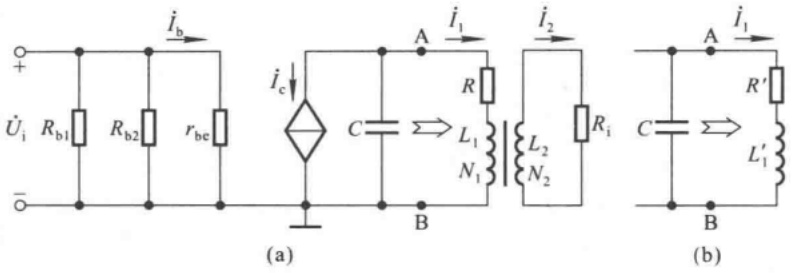

图 7.1.15 变压器反馈式振荡电路的交流等效电路

(a) 交流等效电路 (b) 变压器部分的等效电路

为了分析振荡频率和起振条件,首先求解图 7.1.15(a) 中从 A 和 B 两点向右边看进去的等效电路及其参数。在变压器一次侧,有

$$
\dot {U} _ {\mathrm{o}} = (R + \mathrm{j} \omega L _ {1}) \dot {I} _ {1} - \mathrm{j} \omega M \dot {I} _ {2} \tag {7.1.16}
$$

在二次侧,有

$$
\dot {I} _ {2} = \frac {\mathrm{j} \omega M \dot {I} _ {1}}{R _ {\mathrm{i}} + \mathrm{j} \omega L _ {2}} \tag {7.1.17}
$$

将式(7.1.17)代入式(7.1.16)，整理可得

$$
\dot {U} _ {\mathrm{o}} = (R ^ {\prime} + \mathrm{j} \omega L _ {1} ^ {\prime}) \dot {I} _ {1} \tag {7.1.18}
$$

其中

$$
\left\{ \begin{array}{l l} R ^ {\prime} = R + \frac {\omega^ {2} M ^ {2}}{R _ {\mathrm{i}} ^ {2} + \omega^ {2} L _ {2} ^ {2}} \cdot R _ {\mathrm{i}} & (7. 1. 1 9 \mathrm{a}) \\ L _ {1} ^ {\prime} = L _ {1} - \frac {\omega^ {2} M ^ {2}}{R _ {\mathrm{i}} ^ {2} + \omega^ {2} L _ {2} ^ {2}} \cdot L _ {2} & (7. 1. 1 9 \mathrm{b}) \end{array} \right.
$$

因此，从变压器一次侧向二次侧看进去的等效电路如图7.1.15(b)所示，为典型的LC谐振回路。但与之相比，带负载后，电感量变小，损耗变大，因而品质因数变小，选频特性变差。其品质因数

$$
Q \approx \frac {1}{R ^ {\prime}} \sqrt {\frac {L _ {i} ^ {\prime}}{C}} \tag {7.1.20}
$$

当 $Q \gg 1$ 时, 振荡频率

$$
f _ {0} \approx \frac {1}{2 \pi \sqrt {L _ {1} ^ {\prime} C}} \tag {7.1.21}
$$

根据前面的分析可知，在谐振频率下， $L_{1}$ 中电流的数值约为晶体管集电极电流的Q倍，即

$$
\mid \dot {I} _ {\mathrm{t}} \mid \approx Q \mid \dot {I} _ {\mathrm{c}} \mid = Q \beta \mid \dot {I} _ {\mathrm{b}} \mid = Q \beta \frac {\mid \dot {U} _ {\mathrm{i}} \mid}{r _ {\mathrm{be}}}
$$

根据式(7.1.17)，反馈电压

$$
\dot {U} _ {\mathrm{f}} = \dot {I} _ {\mathrm{f}} R _ {\mathrm{i}} = \frac {\mathrm{j} \omega_ {0} M \dot {I} _ {1}}{R _ {\mathrm{i}} + \mathrm{j} \omega_ {0} L _ {2}} \cdot R _ {\mathrm{i}}
$$

通常， $\omega_0L_2\ll R_i$ ，所以

$$
\mid \dot {U} _ {\mathrm{f}} \mid \approx \omega_ {0} M \mid \dot {I} _ {1} \mid = \omega_ {0} M Q \beta \frac {\mid \dot {U} _ {\mathrm{i}} \mid}{r _ {\mathrm{be}}}
$$

电路的起振条件

$$
\left| \frac {\dot {U} _ {\mathrm{f}}}{\dot {U} _ {\mathrm{i}}} \right| > 1
$$

即

$$
\beta > \frac {r _ {\mathrm{be}}}{\omega_ {0} M Q} \tag {7.1.22}
$$

式(7.1.22)表明选频网络的品质因数愈大,对晶体管电流放大系数的要求愈低。若将式(7.1.20)和式(7.1.21)代入式(7.1.22),则得出起振条件为

$$
\beta > \frac {r _ {\mathrm{be}} R ^ {\prime} C}{M} \tag {7.1.23}
$$

## 3. 优缺点

变压器反馈式振荡电路易于产生振荡,波形较好,应用范围广泛。但是,由于输出电压与反馈电压靠磁路耦合,因而耦合不紧密,损耗较大。并且振荡频率的稳定性不高。

## 三、电感反馈式振荡电路

## 1. 电路组成

为了克服变压器反馈式振荡电路中变压器一次线圈和二次线圈耦合不紧密的缺点, 可将  $N_{1}$  和  $N_{2}$  合并为一个线圈, 把图 7.1.13 所示电路中线圈  $N_{1}$  接电源的一端和  $N_{2}$  接地的一端相连作为中间抽头; 为了加强谐振效果, 将电容 C 跨接在整个线圈两端, 如图 7.1.16 所示。

## 2. 工作原理

利用判断电路能否产生正弦波振荡的方法来分析图7.1.16所示电路。首先观察电路，它包含了放大电路、选频网络、反馈网络和非线性元件——晶体管四个部分，而且放大电路能够正常工作。然后用瞬时极性法判断电路是否满足正弦波振荡的相位条件:断开反馈，加频率为 $f_{0}$ 的输入电压，给定其极性，判断出从 $N_{2}$ 上获得的反馈电压极性与输入电压相

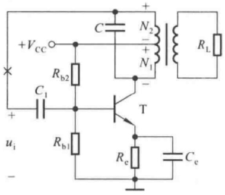

text_image

+Vcc
C
N2
+
-
Rb2
N1
RL
C1
T
ui
+
-
Rb1
Re
Ce

图 7.1.16 电感反馈式振荡电路

同，故电路满足正弦波振荡的相位条件，各点瞬时极性如图中所标注。只要电路参数选择得当，电路就可满足幅值条件，而产生正弦波振荡。

图 7.1.17 所示为电感反馈式振荡电路的交流通路,一次线圈的三个端分别接在晶体管的三个极,故称电感反馈式振荡电路为电感三点式电路。

## 3. 振荡频率和起振条件

断开反馈且空载情况下的交流等效电路如图 7.1.18 所示。

设 $N_{1}$ 的电感量为 $L_{1}, N_{2}$ 的电感量为 $L_{2}, N_{1}$ 与 $N_{2}$ 间的互感为 $M$ ，且品质因数远大于1，则振荡频率

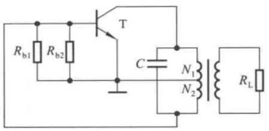

text_image

Rb1 Rb2 T C N1 N2 RL

图 7.1.17 电感反馈式振荡电路的交流通路

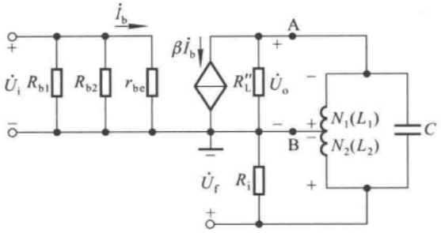

text_image

i̇b
βi̇b
Rb1 Rb2 rbe
U̇i
-
R''L U̇o
A
+
-
B
N1(L1)
N2(L2) C
+ -
- -
+ - +
Ri
U̇f
+

图 7.1.18 电感反馈式振荡电路的交流等效电路

$$
f _ {0} \approx \frac {1}{2 \pi \sqrt {(L _ {1} + L _ {2} + 2 M) C}} \tag {7.1.24}
$$

反馈系数的数值

$$
\left| \dot {F} \right| = \left| \frac {\dot {U} _ {\mathrm{f}}}{\dot {U} _ {\mathrm{o}}} \right| \approx \frac {\mathrm{j} \omega L _ {2} + \mathrm{j} \omega M}{\mathrm{j} \omega L _ {1} + \mathrm{j} \omega M} = \frac {L _ {2} + M}{L _ {1} + M} \tag {7.1.25}
$$

因而,从 A 和 B 两端向右看的等效电阻为

$$
R _ {\mathrm{i}} ^ {\prime} = \frac {R _ {\mathrm{i}}}{\mid \dot {F} \mid^ {2}} \tag {7.1.26}
$$

设  $R_{L}^{\prime}$  为  $R_{L}$  折合到 A、B 两点间的等效电阻，则集电极总负载

$$
R _ {\mathrm{L}} ^ {\prime \prime} = R _ {\mathrm{L}} ^ {\prime} / / R _ {\mathrm{i}} ^ {\prime} \tag {7.1.27}
$$

当 $f=f_{0}$ 且Q>>1时，LC回路产生谐振，等效电阻非常大，所取电流可忽略不计，因此放大电路的电压放大倍数

$$
\dot {A} _ {u} = - \beta \frac {R _ {\mathrm{L}} ^ {\prime \prime}}{r _ {\mathrm{be}}} \tag {7.1.28}
$$

根据  $\left|\dot{A}\dot{F}\right|>1$  , 利用式 (7.1.25) 和式 (7.1.28), 可得起振条件为

$$
\beta > \frac {L _ {1} + M}{L _ {2} + M} \cdot \frac {r _ {\mathrm{be}}}{R _ {\mathrm{L}} ^ {\prime \prime}} \tag {7.1.29}
$$

从式(7.1.25)、(7.1.28)、(7.1.29)可以看出，若增大 $L_{2}$ 与 $L_{1}$ 的比值，则一方面 $|\dot{F}|$ 随之增大，有利于电路起振；另一方面，它又使 $R_{L}^{\prime\prime}$ 减小，从而使 $|\dot{A}_{u}|$ 减小，不利于电路起振。所以， $L_{2}/L_{1}$ 既不能太大，也不能太小。在大批量生产时，应通过实验确定 $N_{2}$ 与 $N_{1}$ 的比值，一般在 $1/7\sim1/4$ 之间。

## 4. 优缺点

电感反馈式振荡电路中  $N_{2}$  与  $N_{1}$  之间耦合紧密，振幅大；当 C 采用可变电容时，可以获得调节范围较宽的振荡频率，最高振荡频率可达几十兆赫。由于反馈电压取自电感，对高频信号具有较大的电抗，输出电压波形中常含有高次谐波。因此，电感反馈式振荡电路常用在对波形要求不高的设备之中，如高频加热器、接收机的本机振荡器等。

## 四、电容反馈式振荡电路

## 1. 电路组成

为了获得较好的输出电压波形,若将电感反馈式振荡电路中的电容换成电感,电感换成电

容，并在置换后将两个电容的公共端接地，且增加集电极电阻 $R_{c}$ ，就可得到电容反馈式振荡电

路,如图 7.1.19 所示。因为两个电容的三个端分别接晶体管的三个极,故也称之为电容三点式电路。

## 2. 工作原理

根据正弦波振荡电路的判断方法,观察图7.1.19所示电路,包含了放大电路、选频网络、反馈网络和非线性元件——晶体管四个部分,而且放大电路能够正常工作。断开反馈,加频率为 $f_{0}$ 的输入电压,给定其极性,判断出从 $C_{2}$ 上所获得的反馈电压的极性与输入电压相同,故电路满足正弦波振荡的相位条件,各点瞬时极性如图中所标注。只要电路参数选择得当,电路就可满足幅值条件,而产生正弦波振荡。

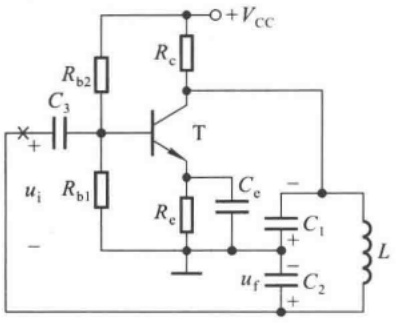

text_image

Rb2
C3
+
ui
-
Rb1
T
Rc
+VCC
Ce
Re
C1
+
uf
C2
L

图 7.1.19 电容反馈式振荡电路

## 3. 振荡频率和起振条件

当由  $L, C_{1}$  和  $C_{2}$  所构成的选频网络的品质因数 Q 远大于 1 时，振荡频率

$$
f _ {0} \approx \frac {1}{2 \pi \sqrt {L \frac {C _ {1} C _ {2}}{C _ {1} + C _ {2}}}} \tag {7.1.30}
$$

设 $C_1$ 和 $C_2$ 的电流分别为 $\dot{I}_{c_1}$ 和 $\dot{I}_{c_2}$，则反馈系数

$$
\mid \dot {F} \mid = \left| \frac {\dot {U} _ {\mathrm{f}}}{\dot {U} _ {\mathrm{o}}} \right| = \left| \frac {I _ {C _ {2}} / \mathrm{j} \omega C _ {2}}{I _ {C _ {1}} / \mathrm{j} \omega C _ {1}} \right| \approx \frac {C _ {1}}{C _ {2}} \tag {7.1.31}
$$

电压放大倍数

$$
\left| \dot {A} _ {u} \right| = \left| \frac {\dot {U} _ {\mathrm{o}}}{\dot {U} _ {\mathrm{i}}} \right| = \beta \frac {R _ {\mathrm{L}} ^ {\prime}}{r _ {\mathrm{be}}} \tag {7.1.32}
$$

在空载情况下,类比式(7.1.26)可知,式(7.1.32)中集电极等效负载

$$
R _ {\mathrm{L}} ^ {\prime} = R _ {\mathrm{c}} / / \frac {R _ {\mathrm{i}}}{| \dot {F} | ^ {2}}
$$

根据  $\left|\dot{A}\dot{F}\right|>1$  , 利用式 (7.1.31) 和式 (7.1.32), 可得起振条件为

$$
\beta > \frac {C _ {2}}{C _ {1}} \cdot \frac {r _ {\mathrm{be}}}{R _ {\mathrm{L}} ^ {\prime}} \tag {7.1.33}
$$

与电感反馈式振荡电路相类似,若增大  $C_{1}/C_{2}$ , 则一方面反馈系数数值随之增大, 有利于电路起振; 另一方面, 它又使  $R_{L}^{\prime}$  减小, 从而造成电压放大倍数数值减小, 不利于电路起振。因此,

$C_{1}/C_{2}$ 既不能太大,又不能太小,具体数值应通过实验来确定。

电容反馈式振荡电路的输出电压波形好,但若用改变电容的方法来调节振荡频率,则会影响电路的起振条件;而若用改变电感的方法来调节振荡频率,则比较困难。所以,电容反馈式振荡电路常常用在固定振荡频率的场合。在振荡频率可调范围不大的情况下,可采用图7.1.20所示电路取代图7.1.19所示电路中的选频网络。

chemical

Electrical circuit diagram with capacitors C1, C2, capacitor C3, and inductor L

图 7.1.20 频率可调的选频网络

## 4. 稳定振荡频率的措施

若要提高电容反馈式振荡电路的振荡频率，则势必要减小 $C_1, C_2$ 的电容量和 $L$ 的电感量。实际上，当 $C_1$ 和 $C_2$ 减小到一定程度时，晶体管的极间电容和电路中的杂散电容将影响振荡频率。这些电容等效为放大电路的输入电容 $C_i$ 和输出电容 $C_o$，它们分别与 $C_1$ 和 $C_2$ 并联，如图7.1.21所标注。由于极间电容受温度的影响，杂散电容又难于确定，为了稳定振荡频率，在设计电路时，必须能够使 $C_i$ 和 $C_o$ 对选频特性的影响忽略不计。试想，如果 $C_1$ 和 $C_2$ 远大于极间电容和杂散电容，只起分压作用，以便获得合适的反馈电压，而几乎对振荡频率无影响，那么电路的振荡频率就可能很稳定。具体方法是在电感所在支路串联一个小容量电容 $C$，而且 $C \ll C_1, C \ll C_2$，这样

$$
\frac {1}{C _ {1}} + \frac {1}{C _ {2}} + \frac {1}{C} \approx \frac {1}{C}
$$

总电容约为 C, 因而电路的振荡频率

$$
f _ {0} \approx \frac {1}{2 \pi \sqrt {L C}} \tag {7.1.34}
$$

几乎与  $C_{1}$  和  $C_{2}$  无关, 当然, 也就几乎与极间电容和杂散电容无关了。

若要求电容反馈式振荡电路的振荡频率高达 $100\mathrm{MHz}$ 以上，则要考虑采用共基放大电路，如图7.1.22所示。图中 $C_{\mathrm{b}}$ 为旁路电容，对交流信号可视为短路；放大电路为共基放大电路。断开反馈，给放大电路加频率为 $f_{0}$ 的输入电压，极性为上“+”下“-”；因共基放大电路的输出电压与输入电压同相，故集电极动态电位为“+”；选频网络的电压方向为上“-”下“+”，因此从 $C_{1}$ 上获得的反馈电压也为上“-”下“+”，与输入电压同相，所以电路满足正弦波振荡的相位平衡条件。如果参数选择合适，使电路满足起振条件，那么电路就一定会产生正弦波振荡。

text_image

Rb2
C3
Rb1
Ci
T
Re
Ce
Co
C1
L
C2
C
+VCC

图 7.1.21 电容反馈式振荡电路的改进

text_image

C_b
R_{b1}
R_{b2}
L
C_1
u_f
+
-
C_2
+
+
R_e
u_i
-
+V_CC

图 7.1.22 采用共基放大电路的电容反馈式振荡电路

由以上分析可知,在判断电路是否可能产生正弦波振荡,即判断电路是否满足正弦波振荡的相位条件时,必须弄清反馈电压取自哪个线圈或电容,而通常这个线圈或电容总有一端为交流通路的“地”。

【例 7.1.2】电路如图 7.1.23 所示, 图中  $C_{b}$  为旁路电容,  $C_{1}$  为耦合电容, 对交流信号均可视为短路。为使电路可能产生正弦波振荡, 试说明变压器一次线圈和二次线圈的同名端。

解: 图 7.1.23 所示电路中的放大电路为共基放大电路。断开反馈, 给放大电路加频率为  $f_{0}$  的输入电压, 极性为上“+”下“-”; 集电极动态电位为“+”, 选频网络的电压极性为上“-”下“+”;从变压器二次侧获得的反馈电压应为上“+”下“-”,才满足正弦波振荡的相位平衡条件。因此,变压器一次线圈的下端和二次线圈的上端为同名端;或者说一次线圈的上端和二次线圈的下端为同名端。

【例 7.1.3】改正图 7.1.24 所示电路中的错误,使之有可能产生正弦波振荡。要求不能改变放大电路的基本接法。

text_image

+VCC
Rb2
C
N1
N2
T
Cb
Rb1
Re
C1

图 7.1.23 例 7.1.2 电路图

text_image

Rb2
L
T
C1 4000 pF
Rb1
Re
+
Ce 10 μF
C2 4000 pF
+VCC

图 7.1.24 例 7.1.3 电路图

解: 观察电路,  $C_{e}$  容量远大于  $C_{1}$  和  $C_{2}$ , 故为旁路电容, 对交流信号可视为短路。 $C_{1}$ 、 $C_{2}$  和 L 构

成 LC 并联谐振网络,  $C_{2}$  上的电压为输出电压,  $C_{1}$  上的电压为反馈电压, 因而电路为电容反馈式振荡电路。

电感 L 连接晶体管的基极和集电极，在直流通路中使两个极近似短路，造成放大电路的静态工作点不合适，故应在选频网络与放大电路输入端之间加耦合电容。

晶体管的集电极直接接电源，在交流通路中使集电极与发射极短路，因而输出电压恒等于零，所以必须在集电极加电阻 $R_{e}$ 。

改正电路如图 7.1.25 所示,与图 7.1.19 所示电路相比,同为电容反馈式振荡电路,只是画法不同而已。

text_image

Rb2
L
C
T
C1
Rb1
Re
Ce
+VCC
C2

图7.1.25 图7.1.24所示电路的改正电路

## 7.1.4 石英晶体正弦波振荡电路

石英晶体谐振器,简称石英晶体,具有非常稳定的固有频率。对于振荡频率的稳定性要求高的电路,应选用石英晶体作选频网络。

## 一、石英晶体的特点

将二氧化硅 $\left(\mathrm{SiO}_{2}\right)$ 结晶体按一定的方向切割成很薄的晶片，再将晶片两个对应的表面抛光和涂敷银层，并作为两个极引出引脚，加以封装，就构成石英晶体谐振器。其结构示意图和符号如图7.1.26所示。

## 1. 压电效应和压电振荡

在石英晶体两个引脚加交变电场时,它将会产生一定频率的机械变形,而这种机械振动又会产生交变电场,上述物理现象称为压电效应。一般情况下,无论是机械振动的振幅,还是交变电场的振幅都非常小。但是,当交变电场的频率为某一特定值时,振幅骤然增大,产生共振,称之为压电振荡。这一特定频率就是石英晶体的固有频率,也称为谐振频率。

text_image

引脚
晶片
引脚
敷银层

(a)

(b)

图 7.1.26 石英晶体谐振器的结构示意图及符号

(a) 结构示意图 (b) 符号

## 2. 石英晶体的等效电路和振荡频率

石英晶体的等效电路如图7.1.27(a)所示。当石英晶体不振动时，可等效为一个平板电容 $C_{0}$ ，称为静态电容；其值决定于晶片的几何尺寸和电极面积，一般约为几皮法到几十皮法。当晶片产生振动时，机械振动的惯性等效为电感L，其值为几毫亨到几十毫亨。晶片的弹性等效为电容C，其值仅为0.01\~0.1 pF，因此 $C\ll C_{0}$ 。晶片的摩擦损耗等效为电阻R，其值约为100Ω，理想情况下 $R=0\Omega$ 。

chemical

Simple RC circuit diagram with capacitors and inductor

(a)

contour

| Point | f | X |
| --- | --- | --- |
| fs | 0 | 0 |
| fp | fp | 0 |

(b)

图 7.1.27 石英晶体的等效电路及其频率特性

(a) 等效电路 (b) 频率特性

当等效电路中的 L、C、R 支路产生串联谐振时，该支路呈纯阻性，等效电阻为 R，谐振频率

$$
f _ {\mathrm{s}} = \frac {1}{2 \pi \sqrt {L C}} \tag {7.1.35}
$$

谐振频率下整个网络的电抗等于 R 并联  $C_{0}$  的容抗，因  $R \ll \omega_{0} C_{0}$ ，故可以近似认为石英晶体也呈纯阻性，等效电阻为 R。

当 $f<f_{s}$ 时， $C_{0}$ 和C电抗较大，起主导作用，石英晶体呈容性。

当 $f>f_{s}$ 时，L、C、R支路呈感性，将与 $C_{0}$ 产生并联谐振，石英晶体又呈纯阻性，谐振频率

$$
f _ {\mathrm{p}} = \frac {1}{2 \pi \sqrt {L \frac {C C _ {0}}{C + C _ {0}}}} = f _ {\mathrm{s}} \sqrt {1 + \frac {C}{C _ {0}}} \tag {7.1.36}
$$

由于  $C \ll C_{0}$ ，所以  $f_{p} \approx f_{s}$ 。

当 $f>f_{p}$ 时，电抗主要决定于 $C_{0}$ ，石英晶体又呈容性。因此，若 $R=0\Omega$ ，则石英晶体电抗的频率特性如图7.1.27(b)所示，只有在 $f_{\mathrm{s}} < f < f_{\mathrm{p}}$ 的情况下，石英晶体才呈感性；并且 $C$ 和 $C_0$ 的容量相差愈悬殊， $f_{\mathrm{s}}$ 和 $f_{\mathrm{p}}$ 愈接近，石英晶体呈感性的频带愈狭窄。

根据品质因数的表达式

$$
Q \approx \frac {1}{R} \sqrt {\frac {L}{C}}
$$

由于 C 和 R 的数值都很小，L 数值很大，所以 Q 值高达  $10^{4} \sim 10^{6}$ 。而且，因为振荡频率几乎仅决定于晶片的尺寸，所以其稳定度  $\Delta f/f_{0}$  可达  $10^{-8} \sim 10^{-6}$ ，一些产品甚至高达到  $10^{-11} \sim 10^{-10}$ 。而即使最好的 LC 振荡电路，Q 值也只能达到几百，振荡频率的稳定度也只能达到  $10^{-5}$ 。因此，石英晶体的选频特性是其它选频网络不能比拟的。

## 二、石英晶体正弦波振荡电路

## 1. 并联型石英晶体正弦波振荡电路

如果用石英晶体取代图 7.1.19 所示电路中的电感, 就得到并联型石英晶体正弦波振荡电路, 如图 7.1.28 所示。

图中电容  $C_{1}$  和  $C_{2}$  与石英晶体中的  $C_{0}$  并联，总容量大于  $C_{0}$ ，当然远大于石英晶体中的 C，所以电路的振荡频率约等于石英晶体的并联谐振频率  $f_{p}$ 。

## 2. 串联型石英晶体正弦波振荡电路

图7.1.29所示为串联型石英晶体正弦波振荡电路。电容 $C$ 为旁路电容，对交流信号可视为短路。电路的第一级为共基放大电路，第二级为共集放大电路。若断开反馈，给放大电路加输入电压，极性上“+”下“-”；则 $\mathrm{T}_{1}$ 管的集电极动态电位为“+”，$\mathrm{T}_{2}$ 管的发射极动态电位也为“+”。只有在石英晶体呈纯阻性，即产生串联谐振时，反馈电压才与输入电压同相，电路才满足正弦波振荡的相位平衡条件。所以，电路的振荡频率为石英晶体的串联谐振频率 $f_{\mathrm{s}}$ 。调整 $R_{\mathrm{f}}$ 的阻值，可使电路满足正弦波振荡的幅值平衡条件。

text_image

Rb2
C
Rb1
T
Rc
+VCC
Re
Ce
C1
C2

图 7.1.28 并联型石英晶体振荡电路

text_image

C₁
Rb₂
Rb₁
T₁
Rc
+
-
uᵢ
Rₑ₁
+
-
Rf
T₂
+Vcc
Rₑ₂

图 7.1.29 串联型石英晶体振荡电路

## 思考题

7.1.1 负反馈放大电路产生自激振荡与正弦波振荡电路产生自激振荡有什么相同之处和不同之处？为什么不能用产生自激振荡的负反馈放大电路作信号发生电路用？
7.1.2 用单管共射放大电路、共基放大电路或共集放大电路与 RC 串并联网络相连接能构成正弦波振荡电路吗？为什么？在桥式正弦波振荡电路的放大电路中，为什么必须引入电压串联负反馈？
7.1.3 如何根据应用场合(如振荡频率的高低、振荡频率的稳定性)选择正弦波振荡电路?

## 7.1.4 判断电路是否可能产生正弦波振荡的基本要点是什么？

## 7.2 电压比较器

电压比较器是对输入信号进行鉴幅与比较的电路,是组成非正弦波发生电路的基本单元电路,在测量和控制系统中有着相当广泛的应用。本节主要讲述各种电压比较器的特点及电压传输特性,同时阐明电压比较器的组成特点和分析方法。

## 7.2.1 概述

## 一、电压比较器的电压传输特性

电压比较器的输出电压 $u_{0}$ 与输入电压 $u_{1}$ 的函数关系 $u_{0}=f(u_{1})$ 一般用曲线来描述，称为电压传输特性。输入电压 $u_{1}$ 是模拟信号，而输出电压 $u_{0}$ 只有两种可能的状态，不是高电平 $U_{\mathrm{OH}}$，就是低电平 $U_{\mathrm{OL}}$，用以表示比较的结果。使 $u_{0}$ 从 $U_{\mathrm{OH}}$ 跃变为 $U_{\mathrm{OL}}$，或者从 $U_{\mathrm{OL}}$ 跃变为 $U_{\mathrm{OH}}$ 的输入电压称为阈值电压或转折电压，记作 $U_{\mathrm{T}}$。

为了正确画出电压传输特性,必须求出以下三个要素:

(1) 输出电压高电平和低电平的数值  $U_{OH}$  和  $U_{OL}$ ;
(2) 阈值电压的数值  $U_{T}$ ;
(3) 当  $u_{I}$  变化且经过  $U_{T}$  时， $u_{0}$  跃变的方向，即是从  $U_{OH}$  跃变为  $U_{OL}$ ，还是从  $U_{OL}$  跃变为  $U_{OH}$ 。

电压比较器是最简单的模/数转换电路,即从模拟信号转换成一位二值信号的电路。它的输出表明模拟信号是否超出预定范围,因此报警电路是其最基本的应用。

## 二、集成运放的非线性工作区

在电压比较器电路中，绝大多数集成运放不是处于开环状态（即没有引入反馈），就是只引入了正反馈，如图7.2.1(a)、(b)所示；图(b)中反馈通路为电阻网络。对于理想运放，由于差模增益无穷大，只要同相输入端与反相输入端之间有无穷小的差值电压，输出电压就将达到正的最大值或负的最大值，即输出电压 $u_{0}$ 与输入电压 $(u_{\mathrm{P}} - u_{\mathrm{N}})$ 不再是线性关系，称集成运放工作在非线性工作区，其电压传输特性如图(c)所示。

理想运放工作在非线性区的两个特点是:

（1）若集成运放的输出电压 $u_{0}$ 的幅值为 $\pm U_{OM}$，则当 $u_{\mathrm{P}} > u_{\mathrm{N}}$ 时 $u_{\mathrm{O}} = +U_{\mathrm{OM}}$，当 $u_{\mathrm{N}} > u_{\mathrm{P}}$ 时 $u_{\mathrm{O}} = -U_{\mathrm{OM}}$；
(2) 由于理想运放的差模输入电阻无穷大, 故净输入电流为零, 即  $i_{P} = i_{N} = 0$ 。

## 三、电压比较器的种类

## 1. 单限比较器

电路只有一个阈值电压，输入电压 $u_{1}$ 逐渐增大或减小过程中，当通过 $U_{T}$ 时，输出电压 $u_{0}$ 产生跃变，从高电平 $U_{OH}$ 跃变为低电平 $U_{OL}$，或者从 $U_{OL}$ 跃变为 $U_{OH}$。图7.2.2(a)是某单限比较器的电压传输特性。

## 2. 滞回比较器

电路有两个阈值电压,输入电压  $u_{1}$  从小变大过程中使输出电压  $u_{0}$  产生跃变的阈值电压  $U_{T1}$ ,不等于从大变小过程中使输出电压 $u_{0}$ 产生跃变的阈值电压 $U_{\mathrm{r2}}$，电路具有滞回特性。它与单限比较器的相同之处在于:当输入电压向单一方向变化时，输出电压只跃变一次。图7.2.2(b)是某滞回比较器的电压传输特性。

text_image

uP
+
A
-
uN
uO

(a)

text_image

反馈通路
uP
+
A
-
uN
uO

(b)

line

| Category | Value |
| --- | --- |
| UOM | Positive |
| -UOM | Negative |

(c)

图 7.2.1 集成运放工作在非线性区的电路特点及其电压传输特性

(a) 集成运放的开环状态 (b) 集成运放引入正反馈 (c) 集成运放的电压传输特性

line

| u1 | uO |
| --- | --- |
| Low | High |
| High | Low |

(a)

text_image

uO
UOH
UT1 O UT2 u1
UOL

(b)

line

| u1 | u0 |
| --- | --- |
| 0 | High |
| UT1 | Low |
| UT2 | High |

(c)

图 7.2.2 电压比较器电压传输特性举例

(a) 单限比较器 (b) 滞回比较器 (c) 窗口比较器

## 3. 窗口比较器

电路有两个阈值电压，输入电压 $u_{1}$ 从小变大或从大变小过程中使输出电压 $u_{0}$ 产生两次跃变。例如，某窗口比较器的两个阈值电压 $U_{\mathrm{T1}}$ 小于 $U_{\mathrm{T2}}$，且均大于零；输入电压 $u_{1}$ 从零开始增大，当经过 $U_{\mathrm{T1}}$ 时，$u_{0}$ 从高电平 $U_{\mathrm{OH}}$ 跃变为低电平 $U_{\mathrm{OL}}$；$u_{1}$ 继续增大，当经过 $U_{\mathrm{T2}}$ 时，$u_{0}$ 又从 $U_{\mathrm{OL}}$ 跃变为 $U_{\mathrm{OH}}$；电压传输特性如图7.2.2(c)所示，中间如开了个窗口，故此得名。窗口比较器与前两种比较器的区别在于:输入电压向单一方向变化过程中，输出电压跃变两次。

上述为常见的三种电压比较器，在实际应用中还有其它种类，如三态电压比较器。

## 7.2.2 单限比较器

## 一、过零比较器

过零比较器，顾名思义，其阈值电压 $U_{\mathrm{T}} = 0 \mathrm{~V}$ 。电路如图7.2.3(a)所示，集成运放工作在开环状态，其输出电压为 $+U_{\mathrm{OM}}$ 或 $-U_{\mathrm{OM}}$ 。当输入电压 $u_{1} < 0 \mathrm{~V}$ 时， $U_{0} = +U_{\mathrm{OM}}$ ；当 $u_{1} > 0 \mathrm{~V}$ 时， $U_{0} = -U_{\mathrm{OM}}$ 。因此，电压传输特性如图(b)所示。若想获得 $u_{0}$ 跃变方向相反的电压传输特性，则应在图(a)所示电路中将反相输入端接地，而在同相输入端接输入电压。

图 7.2.3 过零比较器及其电压传输特性

(a) 电路 (b) 电压传输特性

为了限制集成运放的差模输入电压,保护其输入级,可加二极管限幅电路,如图7.2.4所示。

text_image

R D₁ D₂
u₁ - A uₒ
+

图 7.2.4 电压比较器输入级的保护电路

在实用电路中为了满足负载的需要，常在集成运放的输出端加稳压管限幅电路，从而获得合适的 $U_{\mathrm{OL}}$ 和 $U_{\mathrm{OH}}$，如图7.2.5(a)所示。图中 $R$ 为限流电阻，两只稳压管的稳定电压均应小于集成运放的最大输出电压 $U_{\mathrm{OM}}$ 。设稳压管 $\mathrm{D}_{\mathrm{Z1}}$ 的稳定电压为 $U_{\mathrm{Z1}}, \mathrm{D}_{\mathrm{Z2}}$ 的稳定电压为 $U_{\mathrm{Z2}}; \mathrm{D}_{\mathrm{Z1}}$ 和 $\mathrm{D}_{\mathrm{Z2}}$ 的正向导通电压均为 $U_{\mathrm{D}}$ 。当 $u_{\mathrm{I}} < 0 \mathrm{~V}$ 时，由于集成运放的输出电压 $u_{\mathrm{O}}^{\prime} = +U_{\mathrm{OM}}$，使 $\mathrm{D}_{\mathrm{Z1}}$ 工作在稳压状态，$\mathrm{D}_{\mathrm{Z2}}$ 工作在正向导通状态，所以输出电压 $u_{\mathrm{O}} = U_{\mathrm{OH}} = + (U_{\mathrm{Z1}} + U_{\mathrm{D}})$ 。当 $u_{\mathrm{I}} > 0 \mathrm{~V}$ 时，由于集成运放的输出电压 $u_{0}^{\prime} = -U_{0\mathrm{M}}$，使 $\mathrm{D}_{\mathrm{Z2}}$ 工作在稳压状态，$\mathrm{D}_{\mathrm{Z1}}$ 工作在正向导通状态，所以输出电压 $u_{0} = U_{\mathrm{OL}} = -(U_{\mathrm{Z2}} + U_{\mathrm{D}})$。若要求 $U_{\mathrm{Z1}} = U_{\mathrm{Z2}}$，则可以采用两只特性相同而又制作在一起的稳压管，其符号如图7.2.5(b)所示，导通时的端电压标为 $\pm U_{\mathrm{Z}}$。当 $u_{\mathrm{I}} < 0 \mathrm{~V}$ 时，$u_{\mathrm{O}} = U_{\mathrm{OH}} = +U_{\mathrm{Z}}$；当 $u_{\mathrm{I}} > 0 \mathrm{~V}$ 时，$u_{\mathrm{O}} = U_{\mathrm{OL}} = -U_{\mathrm{Z}}$。

图 7.2.5 电压比较器的输出限幅电路

（a）两只稳压管稳压值不同 （b）两只稳压管的稳压值相同

限幅电路的稳压管还可跨接在集成运放的输出端和反相输入端之间，如图7.2.6所示。假

设稳压管截止，则集成运放必然工作在开环状态，输出电压不是 $+U_{OM}$ ，就是 $-U_{OM}$ ；这样，必将导致稳压管击穿而工作在稳压状态， $D_{Z}$ 构成负反馈通路，使反相输入端为“虚地”，限流电阻上的电流 $i_{R}$ 等于稳压管的电流 $i_{Z}$ ，输出电压 $u_{0}=±U_{Z}$ 。可见，虽然图示电路中引入了负反馈，但它仍具有电压比较器的基本特征。

text_image

u₁
R
D_Z
A
+
-
uₒ

图 7.2.6 将稳压管接在反馈通路中

图 7.2.6 所示电路具有如下两个优点: 一是由于集成运放的净输入电压和净输入电流均近似为零, 从而保

护了输入级；二是由于集成运放并没有工作到非线性区，因而在输入电压过零时，其内部的晶体管不需要从截止区逐渐进入饱和区，或从饱和区逐渐进入截止区，所以提高了输出电压的变化速度。

应当指出,在图7.2.5和图7.2.6中,需根据稳压管的稳定电流和最大稳定电流选取限流电阻R的阻值,使稳压管既工作在稳压状态又不至于因电流过大而损坏;具体选取方法可参阅9.4节。

## 二、一般单限比较器

图 7.2.7(a) 所示为一般单限比较器,  $U_{REF}$  为外加参考电压。根据叠加原理, 集成运放反相输入端的电位为

$$
u _ {\mathrm{N}} = \frac {R _ {1}}{R _ {1} + R _ {2}} u _ {1} + \frac {R _ {2}}{R _ {1} + R _ {2}} U _ {\mathrm{REF}}
$$

令  $u_{N}=u_{P}=0$ ，则求出阈值电压为

$$
U _ {\mathrm{T}} = - \frac {R _ {2}}{R _ {1}} U _ {\mathrm{REF}} \tag {7.2.1}
$$

text_image

U_REF
R_1
R_2
u_1
A
+
-
u'_O
R
u_O
u_O

(a)

line

| u1 | u |
| --- | --- |
| 0 | +Uz |
| U_T | -Uz |

(b)

图 7.2.7 一般单限比较器及其电压传输特性

(a) 电路 (b) 电压传输特性