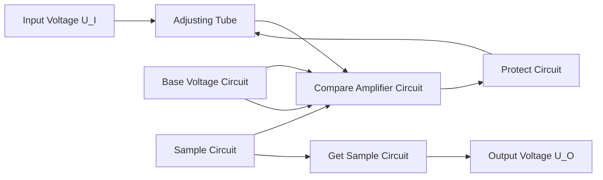

text_image

R1
u1
R1
1 kΩ
+
-
A
R2
T1
+VCC
(+18 V)
R3
T3
R4
T2
RL
8 Ω
uo
-
- VCC
(-18 V)
R5
R6

图 T8.2

## 习题

8.1 分析下列说法是否正确,用“√”、“×”表示判断结果填入括号内。

(1) 在功率放大电路中, 输出功率愈大, 功放管的功耗愈大。( )
(2) 功率放大电路的最大输出功率是指在基本不失真情况下, 负载上可能获得的最大交流功率。( )
(3) 当 OCL 电路的最大输出功率为 1 W 时, 功放管的集电极最大耗散功率应大于 1 W。( )

（4）功率放大电路与电压放大电路、电流放大电路的共同点是

① 都使输出电压大于输入电压；（）
② 都使输出电流大于输入电流；（）
③ 都使输出功率大于信号源提供的输入功率。（）

(5) 功率放大电路与电压放大电路的区别是

① 前者比后者电源电压高；（）
② 前者比后者电压放大倍数数值大；（）
③ 前者比后者效率高；（）
④ 在电源电压相同的情况下,前者比后者的最大不失真输出电压大;( )
⑤ 前者比后者的输出功率大。（）

(6) 功率放大电路与电流放大电路的区别是

① 前者比后者电流放大倍数大；（）
② 前者比后者效率高；（）
③ 在电源电压相同的情况下,前者比后者的输出功率大。( )

8.2 已知电路如图 P8.2 所示， $T_{1}$  和  $T_{2}$  管的饱和管压降  $\left|U_{CES}\right|=3\ V$ ， $V_{CC}=15\ V, R_{L}=8\ \Omega$ 。选择正确答案填入空内。

(1) 电路中  $D_{1}$  和  $D_{2}$  管的作用是消除 \_\_\_\_。

A. 饱和失真

B. 截止失真

C. 交越失真

(2) 静态时, 晶体管发射极电位  $U_{EQ}$  \_\_\_\_。

A. >0 V

B. =0 V

C. <0 V

(3) 最大输出功率  $P_{om}$  \_\_\_\_。

A.  $\approx28\ W$

B. =18 W

C. =9 W

text_image

R₁
D₁
u₁
D₂
R₂
T₁
T₂
+Vcc
Rₗ
uₒ
-
- Vcc

图 P8.2

（4）当输入为正弦波时，若 $R_{1}$ 虚焊，即开路，则输出电压\_\_\_\_。

A. 为正弦波

B. 仅有正半波

C. 仅有负半波

(5) 若  $D_{1}$  虚焊，则  $T_{1}$  管 \_\_\_\_。

A. 可能因功耗过大烧坏

B. 始终饱和

C. 始终截止

8.3 电路如图 P8.2 所示。在出现下列故障时，分别产生什么现象。

(1)  $R_{1}$  开路；(2)  $D_{1}$  开路；(3)  $R_{2}$  开路；(4)  $T_{1}$  集电极开路；

(5)  $R_{1}$  短路；(6)  $D_{1}$  短路。

8.4 在图 P8.2 所示电路中，已知  $V_{CC} = 16 \, V$ ,  $R_{L} = 4 \, \Omega$ ,  $T_{1}$  和  $T_{2}$  管的饱和管压降  $\left| U_{CES} \right| = 2 \, V$ ，输入电压足够大。试问:

(1) 最大输出功率  $P_{om}$  和效率  $\eta$  各为多少?

(2) 晶体管的最大功耗  $P_{Tmax}$  为多少?

(3) 为了使输出功率达到  $P_{om}$ ，输入电压的有效值约为多少？

8.5 在图 P8.5 所示电路中，已知二极管的导通电压  $U_{D}=0.7\ V$ ，晶体管导通时的  $\left|U_{BE}\right|=0.7\ V, T_{2}$  和  $T_{4}$  管发射极静态电位  $U_{EQ}=0\ V$ 。试问:

(1)  $T_{1}$ 、 $T_{3}$  和  $T_{5}$  管基极的静态电位各为多少?

（2）设 $R_{2} = 10\mathrm{k}\Omega ,R_{3} = 100\Omega$ 。若 $\mathrm{T}_{1}$ 和 $\mathrm{T}_{3}$ 管基极的静态电流可忽略不计，则 $\mathrm{T}_{5}$ 管集电极静态电流为多少？静态时 $u_{1} = ?$

(3) 若静态时  $i_{B1} > i_{B3}$ ，则应调节哪个参数可使  $i_{B1} = i_{B3}$ ？如何调节？

(4) 电路中二极管的个数可以是1、2、3、4吗？你认为哪个最合适？为什么？

8.6 电路如图 P8.5 所示。在出现下列故障时，分别产生什么现象。

(1) $R_{2}$ 开路；(2) $D_{1}$ 开路；(3) $R_{2}$ 短路；

(4)  $T_{1}$  集电极开路；(5)  $R_{3}$  短路。

8.7 在图 P8.5 所示电路中，已知  $T_{2}$  和  $T_{4}$  管的饱和管压降  $\left|U_{CES}\right|=2\ V$ ，静态时电源电流可忽略不计。试问:

(1) 负载上可能获得的最大输出功率  $P_{om}$  和效率  $\eta$  各约为多少?

(2)  $T_{2}$  和  $T_{4}$  管的最大集电极电流、最大管压降和集电极最大功耗各约为多少。

8.8 为了稳定输出电压,减小非线性失真,试通过电阻  $R_{f}$  在图 P8.5 所示电路中引入合适的负反馈;并估算在电压放大倍数数值约为 10 的情况下, $R_{f}$  的取值。

8.9 在图 P8.9 所示电路中，已知  $V_{CC} = 15 \, V, T_{1}$  和  $T_{2}$  管的饱和管压降  $\left| U_{CES} \right| = 2 \, V$ ，输入电压足够大。求解:

text_image

R2
+VCC
(+18 V)
T1
R3
D1
T2
D2
uI
R1
1 kΩ
T5
T3
T4
RL
32 Ω
uo
-
-VCC
(-18 V)

图 P8.5

text_image

R1
+VCC
T1
R2
0.5Ω
R4
D1
uI
D2
R3
0.5Ω
RL
8Ω
uo
-
T2
-VCC

图 P8.9

(1) 最大不失真输出电压的有效值；
(2) 负载电阻  $R_{1}$  上电流的最大值；
(3) 最大输出功率  $P_{om}$  和效率  $\eta$ 。

8.10 在图 P8.9 所示电路中, $R_{4}$  和  $R_{5}$  可起短路保护作用, 当输出因故障而短路时, 晶体管的最大集电极电流和功耗各为多少?

8.11 在图 P8.11 所示电路中，已知  $V_{CC} = 15 \, V, T_{1}$  和  $T_{2}$  管的饱和管压降  $\left| U_{CES} \right| = 1 \, V$ ，集成运放的最大输出电压幅值为  $\pm 13 \, V$ ，二极管的导通电压为 0.7 V。

text_image

+
u1
-
R1
R1
1 kΩ
+
A
D1
D2
R2
T1
+VCC
R3
T2 8Ω
RL
uo
-VCC

图P8.11

(1) 若输入电压幅值足够大,则电路的最大输出功率为多少?
(2) 为了提高输入电阻,稳定输出电压,且减小非线性失真,应引入哪种组态的交流负反馈?画出图来。
(3) 若  $U_{i}=0.1\ V$  时,  $U_{o}=5\ V$ , 则反馈网络中电阻的取值约为多少?

8.12 OTL 电路如图 P8.12 所示。

（1）为了使得最大不失真输出电压幅值最大，静态时  $T_{2}$  和  $T_{4}$  管的发射极电位应为多少？若不合适，则一般应调节哪个元件参数？
(2) 若  $T_{2}$  和  $T_{4}$  管的饱和管压降  $\left|U_{CES}\right|=3\ V$ ，输入电压足够大，则电路的最大输出功率  $P_{om}$  和效率  $\eta$  各为多少？
(3)  $T_{2}$  和  $T_{4}$  管的  $I_{CM}$ 、 $U_{(BR)CEO}$  和  $P_{CM}$  应如何选择？

8.13 已知图 P8.13 所示电路中  $T_{2}$  和  $T_{4}$  管的饱和管压降  $\left|U_{CES}\right|=2\ V$ ，导通时的  $\left|U_{BE}\right|=0.7\ V$ ，输入电压足够大。

text_image

+VCC
(+24 V)
R2
T1
T2
C
+
R3
D1
D2
T3
T4
RL
8Ω uO
uI
-
R1
T5

图 P8.12

text_image

+VCC
(+20 V)
R2
C
T1
R3
D1
D2
B
T3
T5
D
C2
+
D
RL
16Ω
uo
-
ui
A
-

图 P8.13

(1) A、B、C、D 点的静态电位各为多少?
(2) 若管压降  $\left|U_{CE}\right| \geqslant 3\ V$ ，为使最大输出功率  $P_{om}$  不小于 1.5 W，则电源电压至少应取多少？

8.14 LM1877N-9为2通道低频功率放大电路，单电源供电，最大不失真输出电压的峰-峰值 $U_{\mathrm{opp}} = (V_{\mathrm{CC}} - 6)\mathrm{V}$，开环电压增益为 $70~\mathrm{dB}$ 。图P8.14所示为LM1877N-9中一个通道组成的实用电路，电源电压为 $24\mathrm{V}, C_1 \sim C_3$ 对交流信号可视为短路； $R_{3}$ 和 $C_4$ 起相位补偿作用，可以认为负载为 $8\Omega$ 。

text_image

10 μF
C₁
+ 510 Ω
R₁
N
- ½ LM1877
+ 100 kΩ
C₂
0.1 μF
P
R₂
1 MΩ
u₁
-
C₃
+
50 μF
R₃
2.7 Ω
C₄
0.1 μF
R_f
500 μF
uₒ
+
C₅
8 Ω
uₒ

图 P8.14

(1) 图示电路为哪种功率放大电路?
(2) 静态时  $u_{p}$ 、 $u_{N}$ 、 $u_{0}^{\prime}$ 、 $u_{0}$  各为多少？
(3) 设输入电压足够大,电路的最大输出功率  $P_{om}$  和效率  $\eta$  各为多少?

8.15 电路如图 8.4.7 所示, 回答下列问题:

(1)  $\dot{A}_{u} = \dot{U}_{o1} / \dot{U}_{i} \approx ?$
(2) 若  $V_{CC} = 15 \, V$  时最大不失真输出电压的峰 - 峰值为  $27 \, V$ ，则电路的最大输出功率  $P_{om}$  和效率  $\eta$  各为多少？
(3) 为了使负载获得最大输出功率, 输入电压的有效值约为多少?

8.16 TDA1556 为 2 通道 BTL 电路, 图 P8.16 所示为 TDA1556 中一个通道组成的实用电路。已知  $V_{CC} = 15 \, V$ , 放大器的最大输出电压幅值为 13 V。

text_image

1/2 Rs C
+
us
-
1/2 Rs -
u1
UREF
R
R
A1
uO1
+
1/2 TDA1556 4Ω
uO
-
A2
uO2

图 P8.16

（1）为了使负载上得到的最大不失真输出电压幅值最大，基准电压  $U_{REF}$  应为多少伏？静态时  $u_{01}$  和  $u_{02}$  各为多少伏？

(2) 若  $U_{i}$  足够大, 则电路的最大输出功率  $P_{om}$  和效率  $\eta$  各为多少?
(3) 若电路的电压放大倍数为 20, 则为了使负载获得最大输出功率, 输入电压的有效值约为多少?

8.17 TDA1556 为 2 通道 BTL, 图 P8.17 所示为 TDA1556 中一个通道组成的实用电路。已知  $V_{CC} = 15 \, V$ , 放大器的最大输出电压幅值为 13 V。

text_image

u₁
R
60 kΩ
U_REF
R
A₁
+
-
uₒ₁
A₂
+
-
uₒ₂
Rₗ
4 Ω
uₒ
½TDA1551

图 P8.17

（1）输入信号分别作用于 $A_{1}$ 、 $A_{2}$ 的同相输入端还是反相输入端？若输入电压为 $\dot{U}_{i}$，则 $A_{1}$ 、 $A_{2}$ 的输入各为多少？
(2) 为了使负载上得到的最大不失真输出电压幅值最大, 基准电压  $U_{REF}$  应为多少伏? 静态时  $u_{01}$  和  $u_{02}$  各为多少伏?

(3) 若  $U_{i}$  足够大, 则电路的最大输出功率  $P_{om}$  和效率  $\eta$  各为多少?

8.18 已知型号为 TDA1521、LM1877 和 TDA1556 的电路形式和电源电压范围如表所示，它们的功放管的最小管压降  $\left|U_{CEmin}\right|$  均为 3 V。

| 型号 | TDA1521 | LM1877 | TDA1556 |
| --- | --- | --- | --- |
| 电路形式 | OCL | OTL | BTL |
| 电源电压 | $\pm 7.5 \sim \pm 20$ V | 6.0~24 V | 6.0~18 V |

（1）设在负载电阻均相同的情况下，三种器件的最大输出功率均相同。已知OCL电路的电源电压 $\pm V_{\mathrm{CC}} = \pm 10\mathrm{V}$，试问OTL电路和BTL电路的电源电压分别应取多少伏？
(2) 设仅有一种电源, 其值为 15 V; 负载电阻为 32 Ω。问三种器件的最大输出功率各为多少?

8.19 电路如图 P8.19 所示。利用 Multisim 研究下列问题:

(1) 负载  $R_{6}$  上能够获得的最大输出功率；
(2) 电容  $C_{1}$ 、 $C_{2}$  的作用；
(3) 当输入电压为频率为  $1 \, kHz$ 、峰值为  $5 \, V$  的正弦波时，若  $R_{1}$  开路，将产生什么现象，解释理由。

8.20 电路如图 P8.19 所示。

（1）若输入正弦波的最大峰值为 $1.4\mathrm{V}$，则为使负载 $R_{6}$ 上获得最大输出功率，应采用什么措施？画出电路图来。

（2）为了使信号源与图示电路直流通路隔离，同时为了稳定输出电压，减小非线性失真，引入合适的交流负反馈，画出电路图来。并利用Multisim选择合适的电路参数，使输入电压有效值 $U_{\mathrm{i}} = 0.1 \mathrm{~V}$ 时，输出电压有效值 $U_{\mathrm{o}} = 1 \mathrm{~V}$ 。

text_image

R1
4.7 kOhm_5%
D1
1BH62*
C1
10 µF
D2
1BH62*
u1
D3
1BH62*
C2
10 µF
R3
Key=A
500 Ohm
50%
R2
4.7 kOhm_5%
Q1
2SC1815*
Q3
2SC2001*
R4
560 Ohm_5%
R5
560 Ohm_5%
Q2
2SA1015*
Q4
2SA952*
R6
8 Ohm
V1
16 V
V2
16 V

图 P8.19

## 第9章

## 直流电源

## 本章讨论的问题

- 如何将 50 Hz、220 V 的交流电压变为 6 V 的直流电压？主要步骤是什么？
- 220 V 的电网电压是稳定的吗？它的波动范围是多少？
- 220 V 交流电压经整流后是否输出 220 V 的直流电压?
- 将市场销售的 6 V 直流电源接到收音机上，为什么有的声音清晰，有的含有交流声？
- 对于同样标称输出电压为 6 V 的直流电源，在未接收音机时，为什么测量输出端子的电压，有的为 6 V，而有的为 7\~8 V？用后者为收音机供电，会造成收音机损坏吗？
- 要使一个有效值为 5 V 的交流电压变为 6 V 直流电压是否可能？变为 10 V 直流电压呢？
- 一个 $3\mathrm{V}$ 电池是否可以转换为 $6\mathrm{V}$ 的直流电压？
- 对于一般直流电源，若不慎将输出端短路，则一定会使电源损坏吗？
- 线性电源和开关型电源有何区别？它们分别应用在什么场合为好？

## 9.1 直流电源的组成及各部分的作用

在电子电路及设备中,一般都需要稳定的直流电源供电。本章所介绍的直流电源为单相小功率电源,它将频率为50 Hz、有效值为220 V的单相交流电压转换为幅值稳定、输出电流为几十安以下的直流电压。

单相交流电经过电源变压器、整流电路、滤波电路和稳压电路转换成稳定的直流电压，其方框图及各电路的输出电压波形如图9.1.1所示，下面就各部分的作用加以介绍。

text_image

~220 V
50 Hz
电源
变压器
整流
电路
滤波
电路
稳压
电路
+ Uo
-

图 9.1.1 直流稳压电源的方框图

直流电源的输入为 220 V 的电网电压(即市电),一般情况下,所需直流电压的数值和电网电压的有效值相差较大,因而需要通过电源变压器降压后,再对交流电压进行处理。变压器二次电压有效值决定于后面电路的需要。目前，也有部分电路不用变压器，利用其它方法升压或降压。

变压器二次电压通过整流电路从交流电压转换为直流电压，即将正弦波电压转换为单一方向的脉动电压，半波整流电路和全波整流电路的输出波形如图中所画。可以看出，它们均含有较大的交流分量，会影响负载电路的正常工作；例如，交流分量将混入输入信号被放大电路放大，甚至在放大电路的输出端所混入的电源交流分量大于有用信号；因而不能直接作为电子电路的供电电源。应当指出，图中整流电路输出端所画波形是未接滤波电路时的波形，接入滤波电路后波形将有所变化。

为了减小电压的脉动,需通过低通滤波电路滤波,使输出电压平滑。理想情况下,应将交流分量全部滤掉,使滤波电路的输出电压仅为直流电压。然而,由于滤波电路为无源电路,所以接入负载后势必影响其滤波效果。对于稳定性要求不高的电子电路,整流、滤波后的直流电压可以作为供电电源。

交流电压通过整流、滤波后虽然变为交流分量较小的直流电压,但是当电网电压波动或者负载变化时,其平均值也将随之变化。稳压电路的功能是使输出直流电压基本不受电网电压波动和负载电阻变化的影响,从而获得足够高的稳定性。

## 9.2 整流电路

在分析整流电路时,为了突出重点,简化分析过程,一般均假定负载为纯电阻性;整流二极管具有图1.2.4(a)中实线所示理想的伏安特性,即导通时正向压降为零,截止时反向电流为零;变压器无损耗,内部压降为零等。

## 9.2.1 整流电路的分析方法及其基本参数

分析整流电路,就是弄清电路的工作原理(即整流原理),求出主要参数,并确定整流二极管的极限参数。下面以图9.2.1所示单相半波整流电路为例来说明整流电路的分析方法及其基本参数。

## 一、工作原理

单相半波整流电路是最简单的一种整流电路，设变压器的二次电压有效值为 $U_{2}$，则其瞬时值 $u_{2} = \sqrt{2} U_{2}\sin \omega t$。

在 $u_{2}$ 的正半周，A点为正，B点为负，二极管外加正向电压，因而处于导通状态。电流从A点流出，经过二极管D和负载电阻 $R_{\mathrm{L}}$ 流入B点， $u_0 = u_2 = \sqrt{2} U_2\sin \omega t(\omega t = 0\sim \pi)$ 。在 $u_{2}$ 的负半周，B点为正，A点为负，二极管外加反向电压，因而处于截止状态， $u_0 = 0(\omega t = \pi \sim 2\pi)$ 。负载电阻 $R_{\mathrm{L}}$ 的电压和电流都具有单一方向脉动的特性。图9.2.2所示为变压器二次电压 $u_{2}$ 、输出电压$u_{0}$ （也可表示输出电流和二极管的电流）、二极管端电压的波形。

分析整流电路工作原理时,应研究变压器二次电压极性不同时二极管的工作状态,从而得出输出电压的波形,也就弄清了整流原理。整流电路的波形分析是其定量分析的基础。

text_image

~220 V
50 Hz
A
D
+
uD -
B
RL
uO
-

图 9.2.1 单相半波整流电路

line

| \(\omega t\) | u2 | uO | ud |
| --- | --- | --- | --- |
| 0 | 0 | 0 | 0 |
| \(\pi/4\) | \(\sqrt{2}U2\) | \(\sqrt{2}U2\) | 0 |
| \(\pi\) | 0 | 0 | \(-\sqrt{2}U2\) |
| \(3\pi/4\) | \(-\sqrt{2}U2\) | 0 | 0 |
| \(5\pi/4\) | \(\sqrt{2}U2\) | \(\sqrt{2}U2\) | \(-\sqrt{2}U2\) |
| \(7\pi/4\) | 0 | 0 | 0 |
| \(9\pi/4\) | \(-\sqrt{2}U2\) | \(\sqrt{2}U2\) | \(-\sqrt{2}U2\) |
| \(11\pi/4\) | \(\sqrt{2}U2\) | 0 | 0 |
| \(13\pi/4\) | 0 | 0 | 0 |
| \(15\pi/4\) | \(-\sqrt{2}U2\) | \(\sqrt{2}U2\) | \(-\sqrt{2}U2\) |
| \(17\pi/4\) | \(\sqrt{2}U2\) | 0 | 0 |
| \(19\pi/4\) | 0 | 0 | 0 |
| \(21\pi/4\) | \(-\sqrt{2}U2\) | \(\sqrt{2}U2\) | \(-\sqrt{2}U2\) |
| \(23\pi/4\) | \(\sqrt{2}U2\) | 0 | 0 |
| \(25\pi/4\) | 0 | 0 | 0 |
| \(27\pi/4\) | \(-\sqrt{2}U2\) | \(\sqrt{2}U2\) | \(-\sqrt{2}U2\) |
| \(29\pi/4\) | \(\sqrt{2}U2\) | 0 | 0 |
| \(31\pi/4\) | 0 | 0 | 0 |
| \(33\pi/4\) | \(-\sqrt{2}U2\) | \(\sqrt{2}U2\) | \(-\sqrt{2}U2\) |
| \(35\pi/4\) | \(\sqrt{2}U2\) | 0 | 0 |
| \(37\pi/4\) | 0 | 0 | 0 |
| \(39\pi/4\) | \(-\sqrt{2}U2\) | \(\sqrt{2}U2\) | \(-\sqrt{2}U2\) |
| \(41\pi/4\) | \(\sqrt{2}U2\) | 0 | 0 |
| \(43\pi/4\) | 0 | 0 | 0 |
| \(45\pi/4\) | \(-\sqrt{2}U2\) | \(\sqrt{2}U2\) | \(-\sqrt{2}U2\) |
| \(47\pi/4\) | \(\sqrt{2}U2\) | 0 | 0 |
| \(49\pi/4\) | 0 | 0 | 0 |
| \(51\pi/4\) | \(-\sqrt{2}U2\) | \(\sqrt{2}U2\) | \(-\sqrt{2}U2\) |
| \(53\pi/4\) | \(\sqrt{2}U2\) | 0 | 0 |
| \(55\pi/4\) | 0 | 0 | 0 |
| \(57\pi/4\) | \(-\sqrt{2}U2\) | \(\sqrt{2}U2\) | \(-\sqrt{2}U2\) |
| \(59\pi/4\) | \(\sqrt{2}U2\) | 0 | 0 |
| \(61\pi/4\) | 0 | 0 | 0 |
| \(63\pi/4\) | \(-\sqrt{2}U2\) | \(\sqrt{2}U2\) | \(-\sqrt{2}U2\) |
| \(65\pi/4\) | \(\sqrt{2}U2\) | 0 | 0 |
| \(67\pi/4\) | 0 | 0 | 0 |
| \(69\pi/4\) | \(-\sqrt{2}U2\) | \(\sqrt{2}U2\) | \(-\sqrt{2}U2\) |
| \(71\pi/4\) | \(\sqrt{2}U2\) | 0 | 0 |
| \(73\pi/4\) | 0 | 0 | 0 |
| \(75\pi/4\) | \(-\sqrt{2}U2\) | \(\sqrt{2}U2\) | \(-\sqrt{2}U2\) |
| \(77\pi/4\) | \(\sqrt{2}U2\) | 0 | 0 |
| \(79\pi/4\) | 0 | 0 | 0 |
| \(81\pi/4\) | \(-\sqrt{2}U2\) | \(\sqrt{2}U2\) | \(-\sqrt{2}U2\) |
| \(83\pi/4\) | \(\sqrt{2}U2\) | 0 | 0 |
| \(85\pi/4\) | 0 | 0 | 0 |
| \(87\pi/4\) | \(-\sqrt{2}U2\) | \(\sqrt{2}U2\) | \(-\sqrt{2}U2\) |
| \(89\pi/4\) | \(\sqrt{2}U2\) | 0 | 0 |
| \(91\pi/4\) | 0 | 0 | 0 |
| \(93\pi/4\) | \(-\sqrt{2}U2\) | \(\sqrt{2}U2\) | \(-\sqrt{2}U2\) |
| \(95\pi/4\) | \(\sqrt{2}U2\) | 0 | 0 |
| \(97\pi/4\) | 0 | 0 | 0 |
| \(99\pi/4\) | \(-\sqrt{2}U2\) | \(\sqrt{2}U2\) | \(-\sqrt{2}U2\) |
| \(101\pi/4\) | \(\sqrt{2}U2\) | 0 | 0 |
| \(103\pi/4\) | 0 | 0 | 0 |
| \(105\pi/4\) | \(-\sqrt{2}U2\) | \(\sqrt{2}U2\) | \(-\sqrt{2}U2\) |
| \(107\pi/4\) | \(\sqrt{2}U2\) | 0 | 0 |
| \(109\pi/4\) | 0 | 0 | 0 |
| \(111\pi/4\) | \(-\sqrt{2}U2\) | \(\sqrt{2}U2\) | \(-\sqrt{2}U2\) |
| \(113\pi/4\) | \(\sqrt{2}U2\) | 0 | 0 |
| \(115\pi/4\) | 0 | 0 | 0 |
| \(117\pi/4\) | \(-\sqrt{2}U2\) | \(\sqrt{2}U2\) | \(-\sqrt{2}U2\) |
| \(119\pi/4\) | \(\sqrt{2}U2\) | 0 | 0 |
| \(121\pi/4\) | 0 | 0 | 0 |
| \(123\pi/4\) | \(-\sqrt{2}U2\) | \(\sqrt{2}U2\) | \(-\sqrt{2}U2\) |
| \(125\pi/4\) | \(\sqrt{2}U2\) | 0 | 0 |
| \(127\pi/4\) | 0 | 0 | 0 |
| \(129\pi/4\) | \(-\sqrt{2}U2\) | \(\sqrt{2}U2\) | \(-\sqrt{2}U2\) |
| \(131\pi/4\) | \(\sqrt{2}U2\) | 0 | 0 |
| \(133\pi/4\) | 0 | 0 | 0 |
| \(135\pi/4\) | \(-\sqrt{2}U2\) | \(\sqrt{2}U2\) | \(-\sqrt{2}U2\) |
| \(137\pi/4\) | \(\sqrt{2}U2\) | 0 | 0 |
| \(139\pi/4\) | 0 | 0 | 0 |
| \(141\pi/4\) | \(-\sqrt{2}U2\) | \(\sqrt{2}U2\) | \(-\sqrt{2}U2\) |
| \(143\pi/4\) | \(\sqrt{2}U2\) | 0 | 0 |
| \(145\pi/4\) | 0 | 0 | 0 |
| \(147\pi/4\) | \(-\sqrt{2}U2\) | \(\sqrt{2}U2\) | \(-\sqrt{2}U2\) |

图 9.2.2 半波整流电路的波形图

## 二、主要参数

在研究整流电路时,至少应考查整流电路输出电压平均值和输出电流平均值两项指标,有时还需考虑脉动系数,以便定量反映输出波形脉动的情况。

输出电压平均值就是负载电阻上电压的平均值 $U_{\mathrm{O(AV)}}$ 。从图9.2.2所示波形图可知，当 $\omega t = 0 \sim \pi$ 时， $u_0 = \sqrt{2} U_2 \sin \omega t$；当 $\omega t = \pi \sim 2\pi$ 时， $u_0 = 0$ 。所以，求解 $u_0$ 的平均值 $U_{\mathrm{O(AV)}}$，就是将 $0 \sim \pi$ 的电压平均在 $0 \sim 2\pi$ 时间间隔之中，如图9.2.3所示，写成表达式为

$$
U _ {\mathrm{O(AV)}} = \frac {1}{2 \pi} \int_ {0} ^ {\pi} \sqrt {2} U _ {2} \sin \omega t \mathrm{d} (\omega t)
$$

解得

$$
U _ {\mathrm{O(AV)}} = \frac {\sqrt {2} U _ {2}}{\pi} \approx 0. 4 5 U _ {2} \tag {9.2.1}
$$

area

| \(\omega t\) | \(u_{0}\) |
| --- | --- |
| 0 | 0.45U₂ |
| ~\(0.5\pi\) | \(\sqrt{2}U_{2}\) |
| \(\pi\) | 0.45U₂ |
| \(2\pi\) | 0.45U₂ |
| ~\(2.5\pi\) | \(\sqrt{2}U_{2}\) |
| \(3\pi\) | 0.45U₂ |
| \(4\pi\) | 0.45U₂ |

图 9.2.3 单相半波整流电路输出电压平均值

负载电流的平均值

$$
I _ {\mathrm{O(AV)}} = \frac {U _ {\mathrm{O(AV)}}}{R _ {\mathrm{L}}} \approx \frac {0 . 4 5 U _ {2}}{R _ {\mathrm{L}}} \tag {9.2.2}
$$

例如，当变压器二次电压有效值  $U_{2}=20\ V$  时，单相半波整流电路的输出电压平均值  $U_{0(AV)}\approx9\ V$ 。若负载电阻  $R_{L}=20\ \Omega$ ，则负载电流平均值  $I_{0(AV)}\approx0.45\ A$ 。

整流输出电压的脉动系数 S 定义为整流输出电压的基波峰值  $U_{01M}$  与输出电压平均值  $U_{0(AV)}$  之比, 即

$$
S = \frac {U _ {\mathrm{01M}}}{U _ {\mathrm{O(AV)}}} \tag {9.2.3}
$$

因而 S 愈大, 脉动愈大。

由于半波整流电路输出电压 $u_{0}$ 的周期与 $u_{2}$ 相同， $u_{0}$ 的基波角频率与 $u_{2}$ 相同，即50 Hz。通过谐波分析①可得 $U_{01M}=U_{2}/\sqrt{2}$，故半波整流电路输出电压的脉动系数

$$
S = \frac {U _ {2} / \sqrt {2}}{\sqrt {2} U _ {2} / \pi} = \frac {\pi}{2} \approx 1. 5 7 \tag {9.2.4}
$$

说明半波整流电路的输出脉动很大,其基波峰值约为平均值的1.57倍。

## 三、二极管的选择

当整流电路的变压器二次电压有效值和负载电阻值确定后,电路对二极管参数的要求也就确定了。一般应根据流过二极管电流的平均值和它所承受的最大反向电压来选择二极管的型号。

在单相半波整流电路中,二极管的正向平均电流等于负载电流平均值,即

$$
I _ {\mathrm{D(AV)}} = I _ {0 (\mathrm{AV})} \approx \frac {0 . 4 5 U _ {2}}{R _ {\mathrm{L}}} \tag {9.2.5}
$$

二极管承受的最大反向电压等于变压器二次侧的峰值电压,即

$$
U _ {R \mathrm{max}} = \sqrt {2} U _ {2} \tag {9.2.6}
$$

一般情况下,允许电网电压有  $\pm10\%$  的波动,即电源变压器一次电压为  $198\sim242\ V$ ,因此在选用二极管时,对于最大整流平均电流  $I_{F}$  和最高反向工作电压  $U_{RM}$  应至少留有 10% 的余地,以保证二极管安全工作,即选取

$$
I _ {\mathrm{F}} > 1. 1 I _ {0 (\mathrm{AV})} = 1. 1 \frac {\sqrt {2} U _ {2}}{\pi R _ {\mathrm{L}}} \tag {9.2.7}
$$

$$
U _ {\mathrm{RM}} > 1. 1 \sqrt {2} U _ {2} \tag {9.2.8}
$$

单相半波整流电路简单易行,所用二极管数量少。但是由于它只利用了交流电压的半个周期,所以输出电压低,交流分量大(即脉动大),效率低。因此,这种电路仅适用于整流电流较小,对脉动要求不高的场合。

【例 9.2.1】在图 9.2.1 所示整流电路中, 已知电网电压波动范围是  $\pm10\%$ , 变压器二次电压有效值  $U_{2}=30\ V$ , 负载电阻  $R_{L}=100\ \Omega$ , 试问:

(1) 负载电阻  $R_{L}$  上的电压平均值和电流平均值各为多少?
(2) 二极管承受的最大反向电压和流过的最大电流平均值各为多少?
(3) 若不小心将输出端短路, 则会出现什么现象?

解:(1) 负载电阻上电压平均值

$$
U _ {\mathrm{O(AV)}} \approx 0. 4 5 U _ {2} = (0. 4 5 \times 3 0) \mathrm{V} = 1 3. 5 \mathrm{V}
$$

流过负载电阻的电流平均值

$$
I _ {\mathrm{O(AV)}} = \frac {U _ {\mathrm{O(AV)}}}{R _ {\mathrm{L}}} \approx \frac {1 3 . 5}{1 0 0} \mathrm{A=0.135~A}
$$

<small>① 可参阅童诗白主编的《模拟电子技术基础(第二版)》11.2.1节。</small>

(2) 二极管承受的最大反向电压

$$
U _ {R \max} = 1. 1 \sqrt {2} U _ {2} \approx (1. 1 \times 1. 4 1 4 \times 3 0) \mathrm{V} \approx 4 6. 7 \mathrm{V}
$$

流过二极管的最大平均电流

$$
I _ {\mathrm{D(AV)}} = 1. 1 I _ {\mathrm{O(AV)}} = 1. 1 \times 0. 1 3 5 \mathrm{A} \approx 0. 1 4 9 \mathrm{A}
$$

（3）若不小心将输出端短路，则变压器二次电压全部加在二极管上，二极管会因正向电流过大而烧坏。若将二极管烧成为短路，则会使变压器二次线圈短路，二次电流将很大，如不及时断电，会造成变压器永久性损坏。

## 9.2.2 单相桥式整流电路

为了克服单相半波整流电路的缺点,在实用电路中多采用单相全波整流电路,最常用的是单相桥式整流电路。

## 一、电路的组成

单相桥式整流电路由四只二极管组成，其构成原则就是保证在变压器二次电压 $u_{2}$ 的整个周期内，负载上的电压和电流方向始终不变。为达到这一目的，就要在 $u_{2}$ 的正、负半周内正确引导流向负载的电流。设变压器二次侧两端分别为A和B，则A为“+”、B为“-”时应有电流流出A点，A为“-”、B为“+”时应有电流流入A点；相反，A为“+”、B为“-”时应有电流流入B点，A为“-”、B为“+”时应有电流流出B点；因而A和B点均应分别接两只二极管的阳极和阴极，以引导电流；如图9.2.4(a)所示，负载接入的方式如图(b)所示。图9.2.5(a)所示为习惯画法，图(b)所示为简化画法。

图 9.2.4 单相桥式整流电路

(a) 构成思路 (b) 电路组成

图 9.2.5 单相桥式整流电路的习惯画法

(a) 习惯画法 (b) 简化画法

## 二、工作原理

设变压器二次电压  $u_{2}=\sqrt{2}U_{2}\sin\omega t,U_{2}$  为其有效值。

当 $u_{2}$ 为正半周时，电流由A点流出，经 $\mathrm{D}_1,\mathrm{R_L},\mathrm{D_3}$ 流入B点，如图9.2.5(a)中实线箭头所示，因而负载电阻 $R_{\mathrm{L}}$ 上的电压等于变压器二次电压，即 $u_0 = u_2,\mathrm{D}_2$ 和 $\mathrm{D}_4$ 管承受的反向电压为$-u_{2}$ 。当 $u_{2}$ 为负半周时，电流由B点流出，经 $\mathrm{D}_2,\mathrm{R_L},\mathrm{D_4}$ 流入A点，如图9.2.5(a)中虚线箭头所示，负载电阻 $R_{\mathrm{L}}$ 上的电压等于 $-u_{2}$ ，即 $u_0 = -u_2,\mathrm{D}_1,\mathrm{D}_3$ 承受的反向电压为 $u_{2}$ 。

这样，由于 $\mathrm{D}_1, \mathrm{D}_3$ 和 $\mathrm{D}_2, \mathrm{D}_4$ 两对二极管交替导通，致使负载电阻 $R_{\mathrm{L}}$ 上在 $u_2$ 的整个周期内都有电流通过，而且方向不变，输出电压 $u_0 = \left|\sqrt{2} U_2\sin \omega t\right|$ 。图9.2.6所示为单相桥式整流电路各部分的电压和电流的波形。

## 三、输出电压平均值 $U_{\mathrm{O(AV)}}$ 和输出电流平均值 $I_{\mathrm{O(AV)}}$

根据图 9.2.6 中所示  $u_{0}$  的波形可知, 输出电压的平均值

$$
U _ {\mathrm{O(AV)}} = \frac {1}{\pi} \int_ {0} ^ {\pi} \sqrt {2} U _ {2} \sin \omega t \mathrm{d} (\omega t)
$$

解得

$$
U _ {\mathrm{O(AV)}} = \frac {2 \sqrt {2} U _ {2}}{\pi} \approx 0. 9 U _ {2} \tag {9.2.9}
$$

由于桥式整流电路实现了全波整流电路,它将  $u_{2}$  的负半周也利用起来,所以在变压器二次电压有效值相同的情况下,输出电压的平均值是半波整流电路的两倍。

输出电流的平均值(即负载电阻中的电流平均值)

$$
I _ {\mathrm{O(AV)}} = \frac {U _ {\mathrm{O(AV)}}}{R _ {\mathrm{L}}} \approx \frac {0 . 9 U _ {2}}{R _ {\mathrm{L}}} \tag {9.2.10}
$$

在变压器二次电压相同、且负载也相同的情况下，输出电流的平均值也是半波整流电路的两倍。

根据谐波分析,桥式整流电路的基波  $U_{01M}$  的角频率是  $u_{2}$  的 2 倍, 即 100 Hz,  $U_{01M} = \frac{2}{3} \times 2\sqrt{2}U_{2}/\pi$ 。故脉动系数

$$
S = \frac {U _ {\mathrm{01M}}}{U _ {\mathrm{O(AV)}}} = \frac {2}{3} \approx 0. 6 7 \tag {9.2.11}
$$

line

| \(\omega t\) | \(u2 (\sqrt{2}U2)\) | iD (iD1, iD3) | iD (iD2, iD4) | uO | uD2, uD4 |
| --- | --- | --- | --- | --- | --- |
| 0 | 0 | 0 | 0 | 0 | 0 |
| \(\pi\) | 0 | 0 | 0 | 0 | 0 |
| \(2\pi\) | 0 | 0 | 0 | 0 | 0 |
| \(3\pi\) | 0 | 0 | 0 | 0 | 0 |
| \(4\pi\) | ~\(0.8\pi\) | ~\(0.8\pi\) | ~\(0.8\pi\) | ~\(0.8\pi\) | ~\(0.8\pi\) |
| \(5\pi\) | ~\(0.8\pi\) | ~\(0.8\pi\) | ~\(0.8\pi\) | ~\(0.8\pi\) | ~\(0.8\pi\) |
| \(6\pi\) | ~\(0.8\pi\) | ~\(0.8\pi\) | ~\(0.8\pi\) | ~\(0.8\pi\) | ~\(0.8\pi\) |
| \(7\pi\) | ~\(0.8\pi\) | ~\(0.8\pi\) | ~\(0.8\pi\) | ~\(0.8\pi\) | ~\(0.8\pi\) |
| \(8\pi\) | ~\(0.8\pi\) | ~\(0.8\pi\) | ~\(0.8\pi\) | ~\(0.8\pi\) | ~\(0.8\pi |
| \(9\pi\) | ~\(0.8\pi\) | ~\(0.8\pi\) | ~\(0.8\pi\) | ~\(0.8\pi\) | ~\(0.8\pi |
| \(10\pi\) | ~\(0.8\pi\) | ~\(0.8\pi\) | ~\(0.8\pi\) | ~\(0.8\pi\) | ~\(0.8\pi |
| \(11\pi\) | ~\(0.8\pi\) | ~\(0.8\pi\) | ~\(0.8\pi\) | ~\(0.8\pi\) | ~\(0.8\pi |
| \(12\pi\) | ~\(0.8\pi\) | ~\(0.8\pi\) | ~\(0.8\pi\) | ~\(0.8\pi\) | ~\(0.8\pi |
| \(13\pi\) | ~\(0.8\pi\) | ~\(0.8\pi\) | ~\(0.8\pi\) | ~\(0.8\pi\) | ~\(0.8\pi |
| \(14\pi\) | ~\(0.8\pi\) | ~\(0.8\pi\) | ~\(0.8\pi\) | ~\(0.8\pi\) | ~\(0.8\pi |
| \(15\pi\) | ~\(0.8\pi\) | ~\(0.8\pi\) | ~\(0.8\pi\) | ~\(0.8\pi\) | ~\(0.8\pi |
| \(16\pi\) | ~\(0.8\pi\) | ~\(0.8\pi\) | ~\(0.8\pi\) | ~\(0.8\pi\) | ~\(0.8\pi |
| \(17\pi\) | ~\(0.8\pi\) | ~\(0.8\pi\) | ~\(0.8\pi\) | ~\(0.8\pi\) | ~\(0.8\pi |
| \(18\pi\) | ~\(0.8\pi\) | ~\(0.8\pi\) | ~\(0.8\pi\) | ~\(0.8\pi\) | ~\(0.8\pi |
| \(19\pi\) | ~\(0.8\pi\) | ~\(0.8\pi\) | ~\(0.8\pi\) | ~\(0.8\pi\) | ~\(0.8\pi |
| \(20\pi\) | ~\(0.8\pi\) | ~\(0.8\pi\) | ~\(0.8\pi\) | ~\(0.8\pi\) | ~\(0.8\pi |
| \(21\pi\) | ~\(0.8\pi\) | ~\(0.8\pi\) | ~\(0.8\pi\) | ~\(0.8\pi\) | ~\(0.8\pi |
| \(22\pi\) | ~\(0.8\pi\) | ~\(0.8\pi\) | ~\(0.8\pi\) | ~\(0.8\pi\) | ~\(0.8\pi |
| \(23\pi\) | ~\(0.8\pi\) | ~\(0.8\pi\) | ~\(0.8\pi\) | ~\(0.8\pi\) | ~\(0.8\pi |
| \(24\pi\) | ~\(0.8\pi\) | ~\(0.8\pi\) | ~\(0.8\pi\) | ~\(0.8\pi\) | ~\(0.8\pi |
| \(25\pi\) | ~\(0.8\pi\) | ~\(0.8\pi\) | ~\(0.8\pi\) | ~\(0.8\pi\) | ~\(0.8\pi |
| \(26\pi\) | ~\(0.8\pi\) | ~\(0.8\pi\) | ~\(0.8\pi\) | ~\(0.8\pi\) | ~\(0.8\pi |
| \(27\pi\) | ~\(0.8\pi\) | ~\(0.8\pi\) | ~\(0.8\pi\) | ~\(0.8\pi\) | ~\(0.8\pi |
| \(28\pi\) | ~\(0.8\pi\) | ~\(0.8\pi\) | ~\(0.8\pi\) | ~\(0.8\pi\) | ~\(0.8\pi |
| \(29\pi\) | ~\(0.8\pi\) | ~\(0.8\pi\) | ~\(0.8\pi\) | ~\(0.8\pi\) | ~\(0.8\pi |

图 9.2.6 单相桥式整流电路的波形图

与半波整流电路相比,输出电压的脉动减小很多。

## 四、二极管的选择

在单相桥式整流电路中,因为每只二极管只在变压器二次电压的半个周期通过电流,所以每只二极管的平均电流只有负载电阻上电流平均值的一半,即

$$
I _ {\mathrm{D(AV)}} = \frac {I _ {\mathrm{O(AV)}}}{2} \approx \frac {0 . 4 5 U _ {2}}{R _ {\mathrm{L}}} \tag {9.2.12}
$$

与半波整流电路中二极管的平均电流相同。

根据图 9.2.6 中所示  $u_{D}$  的波形可知,二极管承受的最大反向电压

$$
U _ {\mathrm{Rmax}} = \sqrt {2} U _ {2} \tag {9.2.13}
$$

与半波整流电路中二极管承受的最大反向电压也相同。

考虑到电网电压的波动范围为  $\pm10\%$ , 在实际选用二极管时, 应至少有 10% 的余量, 选择最大整流电流  $I_{F}$  和最高反向工作电压  $U_{RM}$  分别为

$$
I _ {\mathrm{F}} > \frac {1 . 1 I _ {0 (\mathrm{AV})}}{2} = 1. 1 \frac {\sqrt {2} U _ {2}}{\pi R _ {\mathrm{L}}} \tag {9.2.14}
$$

$$
U _ {\mathrm{RM}} > 1. 1 \sqrt {2} U _ {2} \tag {9.2.15}
$$

单相桥式整流电路与半波整流电路相比，在相同的变压器二次电压下，对二极管的参数要求是一样的，并且还具有输出电压高、变压器利用率高、脉动小等优点，因此得到相当广泛的应用。目前有不同性能指标的集成电路，称之为“整流桥堆”。它的主要缺点是所需二极管的数量多，由于实际上二极管的正向电阻不为零，必然使得整流电路内阻较大，当然损耗也就较大。

可以想象,如果将桥式整流电路变压器二次侧中点接地,并将两个负载电阻相连接,且连接点接地,如图9.2.7所示;那么根据桥式整流电路的工作原理,当A点为“+”B点为“-”时, $D_{1}$ 、 $D_{3}$ 导通, $D_{2}$ 、 $D_{4}$ 截止,电流如图中实线所示;而当B点为“+”A点为“-”时, $D_{2}$ 、 $D_{4}$ 导通, $D_{1}$ 、 $D_{3}$ 截止,电流如图中虚线所示;这样,两个负载上就分别获得正、负电源。可见,利用桥式整流电路可以轻而易举地获得正、负电源,这是其它类型整流电路难于做到的。

text_image

~220 V
50 Hz
(-) + A
1/2 u₂
1/2 u₂
(+)- B
D₁
D₂
uₒ₁
Rₗ₁
D₄
D₃
Rₗ₂
uₒ₂

图 9.2.7 利用桥式整流电路实现正、负电源

在实际应用中,当整流电路的输出功率(即输出电压平均值与电流平均值之积)超过几千瓦且又要求脉动较小时,就需要采用三相整流电路。三相整流电路的组成原则和方法与单相桥式整流电路相同,变压器二次侧的三个端均应接两只二极管,且一只接阴极,另一只接阳极,电路如图9.2.8(a)所示;利用前面所述方法分析电路,可以得出其波形,如图(b)所示。

图 9.2.8 三相整流电路及其波形

(a) 电路 (b) 波形

【例 9.2.2】在图 9.2.5 所示电路中, 已知变压器二次电压有效值  $U_{2} = 30 \, V$ , 负载电阻  $R_{L} = 100 \, \Omega$ 。试问:

(1) 输出电压与输出电流平均值各为多少?
（2）当电网电压波动范围为  $\pm10\%$ , 二极管的最大整流平均电流  $I_{F}$  与最高反向工作电压  $U_{RM}$  至少应选取多少?
(3) 若整流桥中的二极管  $D_{1}$  开路或短路, 则分别产生什么现象?

解:(1) 根据式(9.2.9), 输出电压平均值

$$
U _ {\mathrm{O(AV)}} \approx 0. 9 U _ {2} = 0. 9 \times 3 0 \mathrm{V} = 2 7 \mathrm{V}
$$

根据式（9.2.10），输出电流平均值

$$
I _ {\mathrm{O(AV)}} = \frac {U _ {\mathrm{O(AV)}}}{R _ {\mathrm{L}}} \approx \frac {2 7}{1 0 0} \mathrm{A=0.27~A}
$$

（2）根据式(9.2.14)和式(9.2.15)，二极管的最大整流平均电流 $I_{F}$ 和最高反向工作电压 $U_{RM}$ 分别应满足

$$
\begin{array}{l} I _ {\mathrm{F}} > \frac {1 . 1 I _ {\mathrm{O(AV)}}}{2} \approx 1. 1 \times \frac {0 . 2 7}{2} \mathrm{A} \approx 0. 1 4 9 \mathrm{A} \\ U _ {\mathrm{RM}} > 1. 1 \sqrt {2} U _ {2} = 1. 1 \times \sqrt {2} \times 3 0 \mathrm{V} \approx 4 6. 7 \mathrm{V} \\ \end{array}
$$

（3）若  $D_{1}$  开路，则电路仅能实现半波整流，因而输出电压平均值仅为原来的一半。若  $D_{1}$  短路，则在  $u_{2}$  的负半周将变压器二次电压全部加在  $D_{2}$  上， $D_{2}$  将因电流过大而烧坏，且若  $D_{2}$  烧成为短路，则有可能烧坏变压器。

## 思考题

9.2.1 若单相半波整流电路中的二极管接反,则将产生什么现象?
9.2.2 试问单相桥式整流电路中若有一只二极管接反,则将产生什么现象?

## 9.3 滤波电路

整流电路的输出电压虽然是单一方向的,但是含有较大的交流成分,不能适应大多数电子电路及设备的需要。因此,一般在整流后,还需利用滤波电路将脉动的直流电压变为平滑的直流电压。与用于信号处理的滤波电路相比,直流电源中滤波电路的显著特点是:均采用无源电路;理想情况下,滤去所有交流成分,而只保留直流成分;能够输出较大电流;而且,因为整流管工作在非线性状态(即导通或截止),故而滤波特性的分析方法也不尽相同。

## 9.3.1 电容滤波电路

电容滤波电路是最常见也是最简单的滤波电路，在整流电路的输出端（即负载电阻两端）并联一个电容即构成电容滤波电路，如图9.3.1(a)所示。滤波电容容量较大，因而一般均采用电解电容，在接线时要注意电解电容的正、负极。电容滤波电路利用电容的充放电作用，使输出电压趋于平滑。

text_image

~220 V
50 Hz
u₂
D₄
D₁
C⁺
D₃
D₂
Rₗ
uₒ
+

(a)

line

| \(\omega t\) | uO (a) | uO (b) |
| --- | --- | --- |
| 0 | 0 | ~0.6 |
| \(\pi/2\) | ~0.6 | ~0.5 |
| \(3\pi/4\) | 0 | ~0.6 |
| \(7\pi/8\) | ~0.6 | ~0.5 |
| \(2\pi\) | 0 | ~0.4 |

(b)

area

| \(\omega t\) | u_o (Solid Line) | u_o (Dashed Line) |
| --- | --- | --- |
| 0 | ~0.65 | 0 |
| \(\pi/2\) | ~0.45 | ~0.65 |
| \(\pi\) | ~0.65 | 0 |
| \(3\pi/2\) | ~0.45 | ~0.65 |
| \(2\pi\) | ~0.65 | 0 |
| \(5\pi/2\) | ~0.45 | ~0.65 |

(c)

图 9.3.1 单相桥式整流电容滤波电路及稳态时的波形分析

(a) 电路 (b) 理想情况下的波形 (c) 考虑整流电路内阻时的波形

## 一、滤波原理

当变压器二次电压 $u_{2}$ 处于正半周并且数值大于电容两端电压 $u_{C}$ 时，二极管 $\mathrm{D}_1, \mathrm{D}_3$ 导通，电流一路流经负载电阻 $R_{\mathrm{L}}$ ，另一路对电容 $C$ 充电。因为在理想情况下，变压器二次侧无损耗，二极管导通电压为零，所以电容两端电压 $u_{C}(u_{\mathrm{L}})$ 与 $u_{2}$ 相等，见图9.3.1(b)中曲线的ab段。当 $u_{2}$ 上升到峰值后开始下降，电容通过负载电阻 $R_{\mathrm{L}}$ 放电，其电压 $u_{C}$ 也开始下降，趋势与 $u_{2}$ 基本相同，见图(b)中曲线的bc段。但是由于电容按指数规律放电，所以当 $u_{2}$ 下降到一定数值后， $u_{c}$ 的下降速度小于 $u_{2}$ 的下降速度，使 $u_{c}$ 大于 $u_{2}$ 从而导致 $D_{1}$ 、 $D_{3}$ 反向偏置而变为截止。此后，电容C继续通过 $R_{L}$ 放电， $u_{c}$ 按指数规律缓慢下降，见图9.3.1(b)cd段。

当  $u_{2}$  的负半周幅值变化到恰好大于  $u_{C}$  时， $D_{2}$ 、 $D_{4}$  因加正向电压变为导通状态， $u_{2}$  再次对 C 充电， $u_{C}$  上升到  $u_{2}$  的峰值后又开始下降；下降到一定数值时  $D_{2}$ 、 $D_{4}$  变为截止，C 对  $R_{L}$  放电， $u_{C}$  按指数规律下降；放电到一定数值时  $D_{1}$ 、 $D_{3}$  变为导通，重复上述过程。

从图 9.3.1(b) 所示波形可以看出, 经滤波后的输出电压不仅变得平滑, 而且平均值也得到提高。若考虑变压器内阻和二极管的导通电阻, 则  $u_{c}$  的波形如图(c) 所示, 阴影部分为整流电路内阻上的压降。

从以上分析可知，电容充电时，回路电阻为整流电路的内阻，即变压器内阻和二极管的导通电阻之和，其数值很小，因而时间常数很小。电容放电时，回路电阻为 $R_{L}$ ，放电时间常数为 $R_{L}C$ ，通常远大于充电的时间常数。因此，滤波效果取决于放电时间。电容愈大，负载电阻愈大，滤波后输出电压愈平滑，并且其平均值愈大，如图9.3.2所示。换言之，当滤波电容容量一定时，若负载电阻减小（即负载电流增大），则时间常数 $R_{L}C$ 减小，放电速度加快，输出电压平均值随即下降，且脉动变大。

## 二、输出电压平均值

滤波电路输出电压波形难于用解析式来描述，近似估算时，可将图9.3.1(c)所示波形近似为锯齿波，如图9.3.3所示。图中 $T$ 为电网电压的周期。设整流电路内阻较小而 $R_{\mathrm{L}}C$ 较大，电容每次充电均可达到 $u_{2}$ 的峰值（即 $U_{0\mathrm{max}} = \sqrt{2} U_2$），然后按 $R_{\mathrm{L}}C$ 放电的起始斜率直线下降，经 $R_{\mathrm{L}}C$ 交于横轴，且在 $T / 2$ 处的数值为最小值 $U_{0\mathrm{min}}$，则输出电压平均值为

$$
U _ {\mathrm{O(AV)}} = \frac {U _ {\mathrm{Omax}} + U _ {\mathrm{Omin}}}{2}
$$

line

| \(\omega t\) | RLC大 (uO) | RLC小 (uO) |
| --- | --- | --- |
| 0 | ~0.65 | ~0.45 |
| \(\pi/2\) | ~0.75 | ~0.35 |
| \(\pi\) | ~0.65 | 0 |
| \(3\pi/2\) | ~0.75 | ~0.35 |
| \(2\pi\) | ~0.65 | 0 |

图 9.3.2  $R_{L}C$  不同时  $u_{C}$  的波形

line

| Parameter | Description |
| --- | --- |
| U_Omax | Maximum voltage level |
| U_Omin | Minimum voltage level |
| T | Time interval (between 0 and \(\omega t)\) |
| R_L C | Load resistance or capacitance interval (between T and \(\omega t)\) |

图 9.3.3 电容滤波电路输出电压平均值的分析

同时按相似三角形关系可得

$$
\frac {U _ {\mathrm{Omax}} - U _ {\mathrm{Omin}}}{U _ {\mathrm{Omax}}} = \frac {T / 2}{R _ {\mathrm{L}} C}
$$

$$
U _ {\mathrm{O(AV)}} = \frac {U _ {\mathrm{Omax}} + U _ {\mathrm{Omin}}}{2} = U _ {\mathrm{Omax}} - \frac {U _ {\mathrm{Omax}} - U _ {\mathrm{Omin}}}{2} = U _ {\mathrm{Omax}} \left(1 - \frac {T}{4 R _ {\mathrm{L}} C}\right) \tag {9.3.1}
$$

因而

$$
U _ {0 (\mathrm{AV})} = \sqrt {2} U _ {2} \bigg (1 - \frac {T}{4 R _ {\mathrm{L}} C} \bigg) \tag {9.3.2}
$$

式(9.3.2)表明,当负载开路,即 $R_{L}=\infty$ 时, $U_{O(AV)}=\sqrt{2}U_{2}$ 。当 $R_{L}C=(3\sim5)T/2$ 时,

$$
U _ {\mathrm{O(AV)}} \approx 1. 2 U _ {2} \tag {9.3.3}
$$

为了获得较好的滤波效果，在实际电路中，应选择滤波电容的容量满足 $R_{\mathrm{L}}C = (3 \sim 5)T / 2$ 的条件。由于采用电解电容，考虑到电网电压的波动范围为 $\pm 10\%$，电容的耐压值应大于 $1.1\sqrt{2} U_{2}$ 。在半波整流电路中，为获得较好的滤波效果，电容容量应选得更大些。

## 三、脉动系数

在图 9.3.3 所示的近似波形中, 交流分量的基波的峰 - 峰值为  $(U_{0\max} - U_{0\min})$ , 根据式 (9.3.1) 可得基波峰值为

$$
\frac {U _ {\mathrm{Omax}} - U _ {\mathrm{Omin}}}{2} = \frac {T}{4 R _ {\mathrm{L}} C} \cdot U _ {\mathrm{Omax}}
$$

因此，脉动系数为

$$
S = \frac {\frac {T}{4 R _ {\mathrm{L}} C} \cdot U _ {\mathrm{Omax}}}{U _ {\mathrm{Omax}} \left(1 - \frac {T}{4 R _ {\mathrm{L}} C}\right)} = \frac {T}{4 R _ {\mathrm{L}} C - T}
$$

或 $S = \frac{1}{\frac{4R_{\mathrm{L}}C}{T} - 1}$ (9.3.4)

应当指出,由于图9.3.3所示锯齿波所含的交流分量大于滤波电路输出电压实际的交流分量,因而根据式(9.3.4)计算出的脉动系数大于实际数值。

## 四、整流二极管的导通角

在未加滤波电容之前,无论是哪种整流电路中的二极管均有半个周期处于导通状态,也称二极管的导通角  $\theta$  等于  $\pi$ 。加滤波电容后,只有当电容充电时,二极管才导通,因此,每只二极管的导通角都小于  $\pi$ 。而且, $R_{L}C$  的值愈大,滤波效果愈好,导通角  $\theta$  将愈小。由于电容滤波后输

出平均电流增大，而二极管的导通角反而减小，所以整流二极管在短暂的时间内将流过一个很大的冲击电流为电容充电，如图9.3.4所示。这对二极管的寿命很不利，所以必须选用较大容量的整流二极管，通常应选择其最大整流平均电流 $I_{\mathrm{F}}$ 大于负载电流的2\~3倍。

## 五、电容滤波电路的输出特性和滤波特性

当滤波电容 C 选定后，输出电压平均值  $U_{\mathrm{O(AV)}}$  和输出电流平均值  $I_{\mathrm{O(AV)}}$  的关系称为输出特性，脉动系数 S 和输出电流平均值  $I_{\mathrm{O(AV)}}$  的关系称为滤波特性。根据式(9.3.2)和(9.3.4)可画出输出特性如图9.3.5(a)所示，滤波特性如图9.3.5(b)所示。曲线表明，C 愈大电路带负载能力愈强，滤波效果愈好； $I_{\mathrm{O(AV)}}$  愈大（即负载电阻  $R_{L}$  愈小）， $U_{\mathrm{O(AV)}}$  愈低，S 的值愈大。

line

| \(\omega t\) | uO (a) | iO (b) |
| --- | --- | --- |
| 0 | 0 | ~0.4 |
| \(\pi/2\) | ~0.6 | ~0.3 |
| \(\pi\) | 0 | 0 |
| \(5\pi/2\) | ~0.6 | ~0.3 |
| \(2\pi\) | 0 | ~0.4 |

图 9.3.4 电容滤波电路中二极管的电流和导通角

(a) 输出电压波形

(b) 二极管电流波形及导通角

line

| I_O(AV) | U_O(AV) (C=0.9) | U_O(AV) (C=1) | U_O(AV) (C=2) | U_O(AV) (C=3) |
| --- | --- | --- | --- | --- |
| 0 | \(\sqrt{2}U_{2}\) | \(\sqrt{2}U_{2}\) | \(\sqrt{2}U_{2}\) | \(\sqrt{2}U_{2}\) |

(a)

line

| I_O(AV) | S (Curve 1) | S (Curve 2) | S (Curve 3) |
| --- | --- | --- | --- |
| 0 | 0 | 0 | 0 |
| ~mid-range | ~mid-range | ~mid-range | ~low-range |

(b)

图 9.3.5 电容滤波电路的输出特性和滤波特性

(a) 输出特性 (b) 滤波特性

综上所述,电容滤波电路简单易行,输出电压平均值高,适用于负载电流较小且其变化也较小的场合。

【例 9.3.1】在图 9.3.1(a) 所示电路中, 已知电网电压的波动范围为  $\pm10\%$ ,  $U_{\mathrm{O(AV)}} \approx 1.2U_{2}$ 。要求输出电压平均值  $U_{\mathrm{O(AV)}} = 15\ V$ , 负载电流平均值  $I_{\mathrm{L(AV)}} = 100\ mA$ 。试选择合适的滤波电容。

解:根据  $U_{0(AV)} \approx 1.2U_{2}$  可知,C 的取值满足  $R_{\mathrm{L}}C = (3 \sim 5)T/2$  的条件。

$$
R _ {\mathrm{L}} = \frac {U _ {\mathrm{O(AV)}}}{I _ {\mathrm{L(AV)}}} = \frac {1 5}{1 0 0 \times 1 0 ^ {- 3}} \Omega = 1 5 0 \Omega
$$

电容的容量为

$$
C = (3 \sim 5) \frac {2 0 \times 1 0 ^ {- 3}}{2} \times \frac {1}{1 5 0} \mathrm{F} \approx 2 0 0 \sim 3 3 3 \mu \mathrm{F}
$$

变压器二次电压有效值为

$$
U _ {2} \approx \frac {U _ {\mathrm{O(AV)}}}{1 . 2} = \frac {1 5}{1 . 2} \mathrm{V} = 1 2. 5 \mathrm{V}
$$

电容的耐压值为

$$
U > 1. 1 \sqrt {2} U _ {2} = 1. 1 \sqrt {2} \times 1 2. 5 \mathrm{V} \approx 1 9. 5 \mathrm{V}
$$

实际可选取容量为  $300 \mu F$  、耐压为 25 V 的电容做本电路的滤波电容。

## 9.3.2 倍压整流电路

利用滤波电容的存储作用,由多个电容和二极管可以获得几倍于变压器二次电压的输出电压,称为倍压整流电路。

图 9.3.6 所示为二倍压整流电路, $U_{2}$  为变压器二次电压有效值。其工作原理简述如下: 当

$u_{2}$  正半周时，A 点为“+”，B 点为“-”，使得二极管  $D_{1}$  导通， $D_{2}$  截止； $C_{1}$  充电，电流如图中实线所示； $C_{1}$  上电压极性右为“+”，左为“-”，最大值可达  $\sqrt{2}U_{2}$ 。当  $u_{2}$  负半周时，A 点为“-”，B 点为“+”， $C_{1}$  上电压与变压器二次电压相加，使得  $D_{2}$  导通， $D_{1}$  截止； $C_{2}$  充电，电流如图中虚线所示； $C_{2}$  上电压的极性下为“+”，上为“-”，最大值可达 $2\sqrt{2} U_{2}$ 。可见，是 $C_1$ 对电荷的存储作用，使输出电压（即电容 $C_2$ 上的电压）为变压器二次电压峰值的2倍，利用同样原理可以实现所需倍数的输出电压。

text_image

~220 V
50 Hz
A(-)
+
-
u₂
B(+)
-
C₁
+
-
D₁
C₂
+
-
D₂
uₒ
+

图 9.3.6 二倍压整流电路

图9.3.7所示为多倍压整流电路，在空载情况下，根据上述分析方法可得， $C_1$ 上电压为$\sqrt{2} U_{2},C_{2}\sim C_{6}$ 上电压均为 $2\sqrt{2} U_{2}$ 。因此，以 $C_1$ 两端作为输出端，输出电压的值为 $\sqrt{2} U_{2}$ ；以 $C_2$ 两端作为输出端，输出电压的值为 $2\sqrt{2} U_{2}$ ；以 $C_1$ 和 $C_3$ 上电压相加作为输出，输出电压的值为$3\sqrt{2} U_{2}\dots$ 依此类推，从不同位置输出，可获得 $\sqrt{2} U_2$ 的4、5、6倍的输出电压。应当指出，为了简便起见，分析这类电路时，总是设电路空载，且已处于稳态；当电路带上负载后，输出电压将不可能达到 $u_{2}$ 峰值的倍数。

chemical

Electrical circuit diagram with transformer, capacitors, and diodes labeled D1–D6

图 9.3.7 多倍压整流电路

## 9.3.3 其它形式的滤波电路

## 一、电感滤波电路

在大电流负载情况下，由于负载电阻 $R_{\mathrm{L}}$ 很小，若采用电容滤波电路，则电容容量势必很大，而且整流二极管的冲击电流也非常大，这就使得整流管和电容器的选择变得很困难，甚至不太可能，在此情况下应当采用电感滤波。在整流电路与负载电阻之间串联一个电感线圈 $L$ 就构成电感滤波，如图9.3.8所示。由于电感线圈的电感量要足够大，所以一般需要采用有铁心的线圈。

text_image

~220 V
50 Hz
u₂
D₁~D₄
+
L
U_D(AV)+u_d
R_L
u_O
-

图 9.3.8 单相桥式整流电感滤波电路

电感的基本性质是当流过它的电流变化时，电感线圈中产生的感生电动势将阻止电流的变化。当通过电感线圈的电流增大时，电感线圈产生的自感电动势与电流方向相反，阻止电流的增加，同时将一部分电能转化成磁场能存储于电感之中；当通过电感线圈的电流减小时，自感电动势与电流方向相同，阻止电流的减小，同时释放出存储的能量，以补偿电流的减小。因此，经电感滤波后，不但负载电流及电压的脉动减小，波形变得平滑，而且整流二极管的导通角增大。

整流电路输出电压可分解为两部分，一部分为直流分量，它就是整流电路输出电压的平均值 $U_{0(AV)}$ ，对于全波整流电路，其值约为 $0.9U_{2}$ ；另一部分为交流分量 $u_{d}$ ；如图9.3.8所标注。电感线圈对直流分量呈现的电抗很小，就是线圈本身的电阻R；而对交流分量呈现的电抗为 $\omega L$ 。所以若二极管的导通角近似为 $\pi$ ，则电感滤波后的输出电压平均值

$$
U _ {\mathrm{O(AV)}} = \frac {R _ {\mathrm{L}}}{R + R _ {\mathrm{L}}} \cdot U _ {\mathrm{D(AV)}} \approx \frac {R _ {\mathrm{L}}}{R + R _ {\mathrm{L}}} \cdot 0. 9 U _ {2} \tag {9.3.5}
$$

输出电压的交流分量

$$
u _ {0} \approx \frac {R _ {\mathrm{L}}}{\sqrt {(\omega L) ^ {2} + R _ {\mathrm{L}} ^ {2}}} \cdot u _ {\mathrm{d}} \approx \frac {R _ {\mathrm{L}}}{\omega L} \cdot u _ {\mathrm{d}} \tag {9.3.6}
$$

从式(9.3.5)可以看出,电感滤波电路输出电压平均值小于整流电路输出电压平均值,在线圈电阻可忽略的情况下, $U_{0(AV)}\approx0.9U_{2}$ 。从式(9.3.6)可以看出,在电感线圈不变的情况下,负载电阻愈小(即负载电流愈大),输出电压的交流分量愈小,脉动愈小。注意,只有在 $R_{L}$ 远远小于 $\omega L$ 时,才能获得较好的滤波效果。显然,L愈大,滤波效果愈好。

另外,由于滤波电感电动势的作用,可以使二极管的导通角等于  $\pi$ , 减小了二极管的冲击电流, 平滑了流过二极管的电流, 从而延长了整流二极管的寿命。

## 二、复式滤波电路

当单独使用电容或电感进行滤波,效果仍不理想时,可采用复式滤波电路。电容和电感是基本的滤波元件,利用它们对直流量和交流量呈现不同电抗的特点,只要合理地接入电路都可以达到滤波的目的。图9.3.9(a)所示为LC滤波电路,图(b)、(c)所示为两种 $\pi$ 型滤波电路。读者可根据上面的分析方法分析它们的工作原理。

chemical

Simple LC circuit diagram with inductor, capacitor, and resistor components labeled L, C, uD, uO

(a)

chemical

Electrical circuit diagram with inductor, capacitors, and resistor labeled with voltages and component symbols

(b)

text_image

+
R
uD C1 C2 RL uO
-

(c)

图 9.3.9 复式滤波电路

(a) LC 滤波电路 (b)  $LC \pi$  型滤波电路 (c)  $RC \pi$  型滤波电路

## 三、各种滤波电路的比较

表 9.3.1 中列出各种滤波电路性能的比较。构成滤波电路的电容及电感应足够大， $\theta$  为二极管的导通角，凡  $\theta$  角小的，整流管的冲击电流大；凡  $\theta$  角大的，整流管的冲击电流小。

表 9.3.1 各种滤波电路性能的比较

| 性能\\类型 | 电容滤波 | 电感滤波 | LC 滤波 | RC 或 LC$\pi$ 型滤波 |
| --- | --- | --- | --- | --- |
| $U_{0(AV)}/U_2$ | 1.2 | 0.9 | 0.9 | 1.2 |
| θ | 小 | 大 | 大 | 小 |
| 适用场合 | 小电流负载 | 大电流负载 | 适应性较强 | 小电流负载 |

## 思考题

9.3.1 在单相桥式整流、电容滤波电路中, 若有一只二极管断路, 则输出电压平均值是否为正常时的一半? 为什么?
9.3.2 为什么用电容滤波要将电容与负载电阻并联,而用电感滤波要将电感与负载电阻串联?

## 9.4 稳压管稳压电路

虽然整流滤波电路能将正弦交流电压变换成较为平滑的直流电压，但是，一方面，由于输出电压平均值取决于变压器二次电压有效值，所以当电网电压波动时，输出电压平均值将随之产生相应的波动；另一方面，由于整流滤波电路内阻的存在，当负载变化时，内阻上的电压将产生变化，于是输出电压平均值也将随之产生相反的变化。例如，如果负载电阻减小，则负载电流增大，内阻上的电流也就随之增大，其压降必然增大，输出电压平均值必将相应减小。因此，整流滤波电路输出电压会随着电网电压的波动而波动，随着负载电阻的变化而变化。为了获得稳定性好的直流电压，必须采取稳压措施。本节将对稳压管稳压电路的组成、工作原理和电路参数的选择一一加以介绍。

## 9.4.1 电路组成

由稳压二极管 $\mathrm{D_Z}$ 和限流电阻 $R$ 所组成的稳压电路是一种最简单的直流稳压电源，如图9.4.1中点画线框内所示。其输入电压 $U_{\mathrm{I}}$ 是整流滤波后的电压，输出电压 $U_{0}$ 就是稳压管的稳定电压 $U_{\mathrm{Z}}$ ， $R_{\mathrm{L}}$ 是负载电阻。

text_image

~220 V
50 Hz
u₂
D₁~D₄
+
C +
U₁
-
R
I_R
I_Dz
稳压电路
I_L
R_L
U_O
-

图 9.4.1 稳压二极管组成的稳压电路

从稳压管稳压电路可得两个基本关系式

$$
U _ {1} = U _ {R} + U _ {0} \tag {9.4.1}
$$

$$
I _ {R} = I _ {\mathrm{Dz}} + I _ {\mathrm{L}} \tag {9.4.2}
$$

从图9.4.2所示稳压管的伏安特性中可以看出，在稳压管稳压电路中，只要能使稳压管始终工作在稳压区，即保证稳压管的电流 $I_{\mathrm{Z}} \leqslant I_{\mathrm{D_Z}} \leqslant I_{\mathrm{ZM}}$，输出电压 $U_0$ 就基本稳定。

## 9.4.2 稳压原理

对任何稳压电路都应从两个方面考察其稳压特性,一是设电网电压波动,研究其输出电压是否稳定;二是设负载变化,研究其输出电压是否稳定。

在图 9.4.1 所示稳压管稳压电路中, 当电网电压升高时, 稳压电路的输入电压  $U_{1}$  随之增大, 输出电压  $U_{0}$  也随之按比例

line

| Parameter | Description |
| --- | --- |
| Uz | Zero-crossing voltage level |
| O | Zero crossing point |
| Iz | Zero-crossing current level |
| IZM | Zero-crossing main current level |

图 9.4.2 稳压管的伏安特性

增大；但是，由于 $U_{0}=U_{Z}$ ，根据稳压管的伏安特性， $U_{Z}$ 的增大将使 $I_{D_{Z}}$ 急剧增大；根据式(9.4.2)， $I_{R}$ 必然随着 $I_{D_{Z}}$ 急剧增大， $U_{R}$ 会同时随着 $I_{R}$ 而急剧增大；根据式(9.4.1)， $U_{R}$ 的增大必将使输出电压 $U_{0}$ 减小。因此，只要参数选择合适，R上的电压增量就可以与 $U_{1}$ 的增量近似相等，从而使 $U_{0}$ 基本不变。上述过程可简单描述如下:

$$
\text {电网电压} \uparrow \longrightarrow U _ {\mathrm{I}} \uparrow \longrightarrow U _ {\mathrm{O}} (U _ {\mathrm{Z}}) \uparrow \longrightarrow I _ {\mathrm{Dz}} \uparrow \longrightarrow I _ {R} \uparrow \longrightarrow U _ {R} \uparrow
$$

当电网电压下降时,各电量的变化与上述过程相反。

可见,当电网电压变化时,稳压电路通过限流电阻 R 上电压的变化来抵消  $U_{1}$  的变化,即  $\Delta U_{R} \approx \Delta U_{1}$ ,从而使  $U_{0}$  基本不变。

当负载电阻 $R_{\mathrm{L}}$ 减小即负载电流 $I_{\mathrm{L}}$ 增大时，根据式(9.4.2)，导致 $I_{R}$ 增加，$U_{R}$ 也随之增大；根据式(9.4.1)，$U_{0}$ 必然下降，即 $U_{\mathrm{Z}}$ 下降；根据稳压管的伏安特性，$U_{\mathrm{Z}}$ 的下降使 $I_{\mathrm{D_Z}}$ 急剧减小，从而 $I_{R}$ 随之急剧减小。如果参数选择恰当，就可使 $\Delta I_{\mathrm{D_Z}} \approx -\Delta I_{\mathrm{L}}$ ，使 $I_{R}$ 基本不变，从而 $U_{0}$ 也就基本不变。上述过程可简单描述如下:

$$
\begin{array}{r l}&R _ {\mathrm{L}} \downarrow \rightarrow U _ {0} (U _ {\mathrm{Z}}) \downarrow \rightarrow I _ {\mathrm{D} _ {\mathrm{Z}}} \downarrow \rightarrow I _ {R} \downarrow \rightarrow \Delta I _ {\mathrm{D} _ {\mathrm{Z}}} \approx - \Delta I _ {\mathrm{L}} \rightarrow I _ {R} \text {基本不变} \rightarrow U _ {0} \text {基本不变}\\&\quad \underbrace {\longrightarrow I _ {\mathrm{L}} \uparrow \rightarrow I _ {R} \uparrow} _ {\text {↑}}\end{array}
$$

相反，如果 $R_{\mathrm{L}}$ 增大即 $I_{\mathrm{L}}$ 减小，则 $I_{\mathrm{D_Z}}$ 增大，同样可使 $I_{R}$ 基本不变，从而保证 $U_{0}$ 基本不变。

显然，在电路中只要能使  $\Delta I_{D_{Z}} \approx -\Delta I_{L}$ ，就可以使  $I_{R}$  基本不变，从而保证负载变化时输出电压基本不变。

综上所述，在稳压二极管所组成的稳压电路中，利用稳压管所起的电流调节作用，通过限流电阻 R 上电压或电流的变化进行补偿，来达到稳压的目的。限流电阻 R 是必不可少的元件，它既限制稳压管中的电流使其正常工作，又与稳压管相配合以达到稳压的目的。一般情况下，在电路中如果有稳压管存在，就必然有与之匹配的限流电阻。

## 9.4.3 性能指标

对于任何稳压电路，均可用稳压系数  $S_{r}$  和输出电阻  $R_{o}$  来描述其稳压性能。 $S_{r}$  定义为负载

一定时稳压电路输出电压相对变化量与其输入电压相对变化量之比,即

$$
S _ {\mathrm{r}} = \frac {\Delta U _ {0} / U _ {0}}{\Delta U _ {\mathrm{I}} / U _ {\mathrm{I}}} \Bigg | _ {R _ {\mathrm{L}} = \text {常数}} = \frac {U _ {\mathrm{I}}}{U _ {0}} \cdot \frac {\Delta U _ {0}}{\Delta U _ {\mathrm{I}}} \Bigg | _ {R _ {\mathrm{L}} = \text {常数}} \tag {9.4.3}
$$

$S_{r}$  表明电网电压波动的影响, 其值愈小, 电网电压变化时输出电压的变化愈小。式中  $U_{1}$  为整流滤波后的直流电压。

$R_{o}$  为输出电阻, 是稳压电路输入电压一定时输出电压变化量与输出电流变化量之比, 即

$$
R _ {\mathrm{o}} = \frac {\Delta U _ {0}}{\Delta I _ {0}} \Bigg | _ {U _ {1} = \text {常数}} \tag {9.4.4}
$$

$R_{o}$  表明负载电阻对稳压性能的影响。

在仅考虑变化量时，图9.4.1所示稳压管稳压电路的等效电路如图9.4.3所示， $r_{z}$ 为稳压管的动态电阻。通常， $R_{L} \gg r_{z}$ ，且 $R \gg r_{z}$ ，因而

$$
\frac {\Delta U _ {0}}{\Delta U _ {1}} = \frac {r _ {z} / / R _ {\mathrm{L}}}{R + r _ {z} / / R _ {\mathrm{L}}} \approx \frac {r _ {z}}{R + r _ {z}} \approx \frac {r _ {z}}{R}
$$

所以稳压系数

$$
S _ {\mathrm{r}} = \frac {\Delta U _ {0}}{\Delta U _ {1}} \cdot \frac {U _ {1}}{U _ {0}} \approx \frac {r _ {\mathrm{z}}}{R} \cdot \frac {U _ {1}}{U _ {\mathrm{Z}}} \tag {9.4.5}
$$

text_image

R
ΔU₁
+
-
r_z
R_L
ΔU_O
+
-

图 9.4.3 稳压管稳压电路的交流等效电路

式(9.4.5)表明,为使 $S_{r}$ 数值小,需增大R;而在 $U_{0}(U_{z})$ 和负载

电流确定的情况下, 若 R 的取值大, 则  $U_{1}$  的取值必须大, 这势必使  $S_{r}$  增大; 可见 R 和  $U_{1}$  必须合理搭配,  $S_{r}$  的数值才可能比较小。

根据式(9.4.4)，稳压管稳压电路的输出电阻为

$$
R _ {\mathrm{o}} = R / / r _ {\mathrm{z}} \approx r _ {\mathrm{z}} \tag {9.4.6}
$$

在一些文献中，也常用电压调整率和电流调整率来描述稳压性能。在额定负载且输入电压产生最大变化的条件下，输出电压产生的变化量  $\Delta U_{0}$  称为电压调整率；在输入电压一定且负载电流产生最大变化的条件下，输出电压产生的变化量  $\Delta U_{0}$  称为电流调整率。

## 9.4.4 电路参数的选择

设计一个稳压管稳压电路，就是合理地选择电路元件的有关参数。在选择元件时，应首先知道负载所要求的输出电压 $U_{0}$，负载电流 $I_{\mathrm{L}}$ 的最小值 $I_{\mathrm{Lmin}}$ 和最大值 $I_{\mathrm{Lmax}}$ （或者负载电阻 $R_{\mathrm{L}}$ 的最大值 $R_{\mathrm{Lmax}}$ 和最小值 $R_{\mathrm{Lmin}}$），输入电压 $U_{1}$ 的波动范围（一般为 $\pm 10\%$）。

## 一、稳压电路输入电压  $U_{1}$  的选择

根据经验,一般选取

$$
U _ {\mathrm{I}} = (2 \sim 3) U _ {0} \tag {9.4.7}
$$

$U_{1}$  确定后, 就可以根据此值选择整流滤波电路的元件参数。

## 二、稳压管的选择

在稳压管稳压电路中 $U_{0} = U_{\mathrm{Z}}$; 当负载电流 $I_{\mathrm{L}}$ 变化时, 稳压管的电流将产生一个与之相反的变化, 即 $\Delta I_{\mathrm{D_Z}} \approx -\Delta I_{\mathrm{L}}$, 所以稳压管工作在稳压区所允许的电流变化范围应大于负载电流的变化范围, 即 $I_{\mathrm{Zmax}} - I_{\mathrm{Zmin}} > I_{\mathrm{Lmax}} - I_{\mathrm{Lmin}}$。选择稳压管时应满足

$$
\left\{ \begin{array}{l l} U _ {\mathrm{Z}} = U _ {0} & (9. 4. 8 \mathrm{a}) \\ I _ {\mathrm{Zmax}} - I _ {\mathrm{Zmin}} > I _ {\mathrm{Lmax}} - I _ {\mathrm{Lmin}} & (9. 4. 8 \mathrm{b}) \end{array} \right.
$$

若考虑到空载时稳压管流过的电流  $I_{D_{Z}}$  将与 R 上电流  $I_{R}$  相等，满载时  $I_{D_{Z}}$  应大于  $I_{Zmin}$ ，稳压管的最大稳定电流  $I_{ZM}$  的选取应留有充分的余量，则还应满足

$$
I _ {\mathrm{ZM}} \geqslant I _ {\mathrm{Lmax}} + I _ {\mathrm{Zmin}} \tag {9.4.9}
$$

## 三、限流电阻 R 的选择

R 的选择必须满足两个条件:一是稳压管流过的最小电流  $I_{D_{Z\min}}$  应大于稳压管的最小稳定电流  $I_{Z\min}$  (即手册中的  $I_{Z}$ );二是稳压管流过的最大电流  $I_{D_{Z\max}}$  应小于稳压管的最大稳定电流  $I_{Z\max}$  (即手册中的  $I_{ZM}$ )。即

$$
I _ {\mathrm{Zmin}} \leqslant I _ {\mathrm{Dz}} \leqslant I _ {\mathrm{Zmax}} \tag {9.4.10}
$$

从图 9.4.1 所示电路可以看出

$$
I _ {R} = \frac {U _ {1} - U _ {Z}}{R} \tag {9.4.11}
$$

$$
I _ {\mathrm{Dz}} = I _ {R} - I _ {\mathrm{L}} \tag {9.4.12}
$$

当电网电压最低（即  $U_{1}$  最低）且负载电流最大时，流过稳压管的电流最小，根据式（9.4.10）、（9.4.11）、（9.4.12）可写成表达式

$$
I _ {\mathrm{D} _ {Z ^ {\min}}} = I _ {R ^ {\min}} - I _ {\mathrm{Lmax}} = \frac {U _ {\mathrm{lmin}} - U _ {\mathrm{z}}}{R} - I _ {\mathrm{Lmax}} \geqslant I _ {\mathrm{z}}
$$

由此得出限流电阻的上限值为

$$
R _ {\mathrm{max}} = \frac {U _ {\mathrm{lmin}} - U _ {\mathrm{z}}}{I _ {\mathrm{z}} + I _ {\mathrm{lmax}}} \tag {9.4.13}
$$

式中  $I_{Lmax} = U_{Z}/R_{Lmin}$

当电网电压最高(即  $U_{1}$  最高)且负载电流最小时,流过稳压管的电流最大,根据式(9.4.10)、(9.4.11)、(9.4.12)可写成表达式

$$
I _ {\mathrm{D} _ {Z ^ {\max}}} = I _ {R \max} - I _ {\mathrm{Lmin}} = \frac {U _ {\mathrm{lmax}} - U _ {\mathrm{Z}}}{R} - I _ {\mathrm{Lmin}} \leqslant I _ {\mathrm{ZM}}
$$

由此得出限流电阻的下限值为

$$
R _ {\mathrm{min}} = \frac {U _ {\mathrm{lmax}} - U _ {\mathrm{z}}}{I _ {\mathrm{ZM}} + I _ {\mathrm{Lmin}}} \tag {9.4.14}
$$

式中  $I_{Lmin} = U_{Z}/R_{Lmax}$

R 的阻值一旦确定,根据它的电流即可算出其功率。

【例 9.4.1】在图 9.4.1 所示电路中, 已知  $U_{1}=15\ V$ , 负载电流为  $10 \sim 20\ mA$ ; 稳压管的稳定电压  $U_{z}=6\ V$ , 最小稳定电流  $I_{Zmin}=5\ mA$ , 最大稳定电流  $I_{Zmax}=40\ mA, r_{z}=15\ \Omega$ 。

(1) 求解 R 的取值范围；
(2) 若  $R = 250 \Omega$ ，则稳压系数  $S_{r}$  和输出电阻  $R_{o}$  各为多少？
(3) 为使稳压性能好一些, 在允许范围内, R 的取值应当偏大些, 还是偏小些? 为什么?

解:(1) 根据式(9.4.13)、(9.4.14)

$$
\begin{array}{l} R _ {\max} = \frac {U _ {\mathrm{lmin}} - U _ {\mathrm{Z}}}{I _ {\mathrm{Zmin}} + I _ {\mathrm{Lmax}}} = \left(\frac {1 5 - 6}{5 + 2 0} \times 1 0 ^ {3}\right) \Omega = 3 6 0 \Omega \\ R _ {\min} = \frac {U _ {\mathrm{Imax}} - U _ {\mathrm{Z}}}{I _ {\mathrm{Zmax}} + I _ {\mathrm{Lmin}}} = \left(\frac {1 5 - 6}{4 0 + 1 0} \times 1 0 ^ {3}\right) \Omega = 1 8 0 \Omega \\ \end{array}
$$

因此，R 的取值范围是  $180 \sim 360 \Omega$ 。

(2) 根据式(9.4.5)、(9.4.6)

$$
\begin{array}{l} S _ {\mathrm{r}} \approx \frac {r _ {\mathrm{z}}}{R + r _ {\mathrm{z}}} \cdot \frac {U _ {\mathrm{l}}}{U _ {\mathrm{z}}} = \frac {1 5}{2 5 0 + 1 5} \times \frac {1 5}{6} \approx 0. 1 4 \\ R _ {\mathrm{o}} \approx r _ {z} = 1 5 \Omega \\ \end{array}
$$

（3）在允许范围内，R 的取值应当偏大些。因为式(9.4.5)、(9.4.6)表明，当其余参数确定的情况下，R 愈大， $S_{r}$  愈小， $R_{o}$  愈接近  $r_{z}$ 。

【例 9.4.2】在图 9.4.1 所示电路中，已知  $U_{1}=12\ V$ ，电网电压允许波动范围为  $\pm10\%$ ; 稳压管的稳定电压  $U_{Z}=5\ V$ ，最小稳定电流  $I_{Zmin}=5\ mA$ ，最大稳定电流  $I_{Zmax}=30\ mA$ ，负载电阻  $R_{L}=250\sim350\ \Omega$ 。试求解:

(1) R 的取值范围；
(2) 若限流电阻短路, 则将产生什么现象?

解:(1) 首先求出负载电流的变化范围:

$$
\begin{array}{l} I _ {\mathrm{Lmax}} = U _ {\mathrm{Z}} / R _ {\mathrm{Lmin}} = (5 / 2 5 0) \mathrm{A} = 0. 0 2 \mathrm{A} \\ I _ {\mathrm{Lmin}} = U _ {\mathrm{Z}} / R _ {\mathrm{Lmax}} = (5 / 3 5 0) \mathrm{A} \approx 0. 0 1 4 3 \mathrm{A} \\ \end{array}
$$

再求出 R 的最大值和最小值

$$
\begin{array}{l} R _ {\max} = \frac {U _ {\mathrm{lmin}} - U _ {\mathrm{z}}}{I _ {\mathrm{Zmin}} + I _ {\mathrm{Lmax}}} = \frac {0 . 9 \times 1 2 - 5}{0 . 0 0 5 + 0 . 0 2} \Omega = 2 3 2 \Omega \\ R _ {\min} = \frac {U _ {\mathrm{lmax}} - U _ {\mathrm{Z}}}{I _ {\mathrm{Zmax}} + I _ {\mathrm{Lmin}}} = \frac {1 . 1 \times 1 2 - 5}{0 . 0 3 + 0 . 0 1 4 3} \Omega \approx 1 8 5 \Omega \\ \end{array}
$$

所以，R 的取值范围是  $185 \sim 232 \Omega$ 。

(2) 若限流电阻短路, 则  $U_{1}$  全部加在稳压管上, 使之因电流过大而烧坏。

稳压管稳压电路的优点是电路简单,所用元件数量少;但是,因为受稳压管自身参数的限制,其输出电流较小,输出电压不可调节,因此只适用于负载电流较小,负载电压不变的场合。

## 思考题

9.4.1 在稳压管稳压电路中,限流电阻的作用是什么?其值过小或过大将产生什么现象?
9.4.2 在选择稳压管稳压电路中的限流电阻 R 时, 若计算出 R 应大于  $300 \Omega$ 、小于  $270 \Omega$ , 则说明出现了什么问题? 应如何解决?
9.4.3 若计算出稳压管稳压电路中的限流电阻 R 应在  $200 \sim 300 \Omega$  之间，则应选择 R 接近  $300 \Omega$ 、还是  $200 \Omega$ ，为什么？
9.4.4 在选择稳压管稳压电路中的稳压管时, 若  $I_{Zmax} < I_{Lmax}$ , 一旦负载由于某种原因开路, 则将产生什么现象?

## 9.5 串联型稳压电路

稳压管稳压电路输出电流较小,输出电压不可调,不能满足很多场合下的应用。串联型稳压电路以稳压管稳压电路为基础,利用晶体管的电流放大作用,增大负载电流;在电路中引入深度电压负反馈使输出电压稳定;并且,通过改变反馈网络参数使输出电压可调。

## 9.5.1 串联型稳压电路的工作原理

## 一、基本调整管电路

如前所述，在图9.5.1(a)所示稳压管稳压电路中，负载电流最大变化范围等于稳压管的最大稳定电流和最小稳定电流之差 $(I_{\mathrm{Zmax}}-I_{\mathrm{Zmin}})$ 。不难想象，扩大负载电流最简单的方法是:将稳压管稳压电路的输出电流作为晶体管的基极电流，而晶体管的发射极电流作为负载电流，电路采用射极输出形式，如图9.5.1(b)所示，常见画法如图(c)所示。

chemical

Electrical circuit diagram with resistor, diode, and load resistor labeled with input/output voltages and polarities

(a)

text_image

R
T
U₁
Dz
+
-
Uₒ

(b)

text_image

+
R
T
U_I
D_Z
R_L
U_O
-

(c)

图 9.5.1 基本调整管稳压电路

(a) 稳压管稳压电路 (b) 加晶体管扩大负载电流的变化范围 (c) 常见画法

由于图(b)、(c)所示电路引入了电压负反馈,故能够稳定输出电压。但它们与一般共集放大电路有着明显的区别:其工作电源 $U_{1}$ 不稳定,“输入信号”为稳定电压 $U_{z}$,并且要求输出电压 $U_{0}$ 在 $U_{1}$ 变化或负载电阻 $R_{L}$ 变化时基本不变。

其稳压原理简述如下。

当电网电压波动引起 $U_{1}$ 增大，或负载电阻 $R_{\mathrm{L}}$ 增大时，输出电压 $U_{0}$ 将随之增大，即晶体管发射极电位 $U_{\mathrm{E}}$ 升高；稳压管端电压基本不变，即晶体管基极电位 $U_{\mathrm{B}}$ 基本不变；故晶体管的 $U_{\mathrm{BE}}$ （ $=U_{\mathrm{B}} - U_{\mathrm{E}}$ ）减小，导致 $I_{\mathrm{B}}(I_{\mathrm{E}})$ 减小，从而使 $U_{0}$ 减小；因此可以保持 $U_{0}$ 基本不变。当 $U_{1}$ 减小或负载电阻 $R_{\mathrm{L}}$ 减小时，变化与上述过程相反。可见，晶体管的调节作用使 $U_{0}$ 稳定，所以称晶体管为调整管，称图(b)、(c)所示电路为基本调整管电路。

根据稳压管稳压电路输出电流的分析已知，晶体管基极的最大电流为 $(I_{\mathrm{Zmax}}-I_{\mathrm{Zmin}})$ ，因而

图(b)所示的最大负载电流为

$$
I _ {\mathrm{Lmax}} = (1 + \beta) (I _ {\mathrm{Zmax}} - I _ {\mathrm{Zmin}}) \tag {9.5.1}
$$

这也就大大提高了负载电流的调节范围。输出电压为

$$
U _ {\mathrm{O}} = U _ {\mathrm{Z}} - U _ {\mathrm{BE}} \tag {9.5.2}
$$

从上述稳压过程可知,要想使调整管起到调整作用,必须使之工作在放大状态,因此其管压降应大于饱和管压降 $U_{CES}$ ;换言之,电路应满足 $U_{1}\geqslant U_{0}+U_{CES}$ 的条件。由于调整管与负载相串联,故称这类电路为串联型稳压电源;由于调整管工作在线性区,故称这类电路为线性稳压电源。

## 二、具有放大环节的串联型稳压电路

式(9.5.2)表明基本调整管稳压电路的输出电压仍然不可调,且输出电压将因 $U_{BE}$ 的变化而变,稳定性较差。为了使输出电压可调,也为了加深电压负反馈以提高输出电压的稳定性,通常在基本调整管稳压电路的基础上引入放大环节。

## 1. 电路的构成

若同相比例运算电路的输入电压为稳定电压,且比例系数可调,则其输出电压就可调节;同时,为了扩大输出电流,集成运放输出端加晶体管,并保持射极输出形式,就构成具有放大环节的串联型稳压电路,如图9.5.2(a)所示。输出电压为

$$
U _ {0} = \left(1 + \frac {R _ {1} + R _ {2} ^ {\prime \prime}}{R _ {2} ^ {\prime} + R _ {3}}\right) U _ {z} \tag {9.5.3}
$$

由于集成运放开环差模增益可达80 dB以上,电路引入深度电压负反馈,输出电阻趋近于零,因而输出电压相当稳定。图(b)所示为电路的常见画法。

text_image

+
R
U_I
D_Z
R'_2
R'_2
A
-
R_3
R_2
R_1
+
R_L
U_O
-

(a)

text_image

调整管
T
比较放大
采样
电路
+
R1
R2
RL
UO
Ui
A
+
R3
基准电压电路 DZ
-

(b)

图 9.5.2 具有放大环节的串联型稳压电路

(a) 原理电路 (b) 常见画法

在图(b)所示电路中,晶体管T为调整管,电阻R与稳压管 $D_{z}$ 构成基准电压电路,电阻 $R_{1}$ 、 $R_{2}$ 和 $R_{3}$ 为输出电压的采样电路,集成运放作为比较放大电路,如图中所标注。调整管、基准电压电路、采样电路和比较放大电路是串联型稳压电路的基本组成部分。

## 2. 稳压原理

当由于某种原因(如电网电压波动或负载电阻的变化等)使输出电压 $U_{0}$ 升高(降低)时,采样电路将这一变化趋势送到A的反相输入端,并与同相输入端电位 $U_{z}$ 进行比较放大;A的输出电压,即调整管的基极电位降低(升高);因为电路采用射极输出形式,所以输出电压 $U_{0}$ 必然降

低(升高)，从而使 $U_{0}$ 得到稳定。可简述如下:

$$
U _ {\mathrm{o}} \uparrow \longrightarrow U _ {\mathrm{N}} \uparrow \longrightarrow U _ {\mathrm{B}} \downarrow \longrightarrow U _ {\mathrm{o}} \downarrow
$$

或

$$
U _ {\mathrm{o}} \downarrow \longrightarrow U _ {\mathrm{N}} \downarrow \longrightarrow U _ {\mathrm{B}} \uparrow \longrightarrow U _ {\mathrm{o}} \uparrow
$$

可见,电路是靠引入深度电压负反馈来稳定输出电压的。

## 3. 输出电压的可调范围

在理想运放条件下， $U_{N}=U_{P}=U_{Z}$ 。所以，当电位器 $R_{2}$ 的滑动端在最上端时，输出电压最小，为

$$
U _ {\mathrm{Omin}} = \frac {R _ {1} + R _ {2} + R _ {3}}{R _ {2} + R _ {3}} \cdot U _ {\mathrm{Z}} \tag {9.5.4}
$$

当电位器  $R_{2}$  的滑动端在最下端时, 输出电压最大, 为

$$
U _ {\mathrm{Omax}} = \frac {R _ {1} + R _ {2} + R _ {3}}{R _ {3}} \cdot U _ {\mathrm{Z}} \tag {9.5.5}
$$

若  $R_{1}=R_{2}=R_{3}=300\ \Omega, U_{z}=6\ V$ ，则输出电压  $9\ V \leqslant U_{0} \leqslant 18\ V$ 。

## 4. 调整管的选择

在串联型稳压电路中，调整管是核心元件，它的安全工作是电路正常工作的保证。调整管常为大功率管，因而选用原则与功率放大电路中的功放管相同，主要考虑其极限参数 $I_{\mathrm{CM}}$ 、 $U_{(\mathrm{BR})\mathrm{CEO}}$ 和 $P_{\mathrm{CM}}$ 。调整管极限参数的确定，必须考虑到输入电压 $U_{1}$ 由于电网电压波动而产生的变化，以及输出电压的调节和负载电流的变化所产生的影响。

从图9.5.2(b)所示电路可知，调整管T的发射极电流 $I_{\mathrm{E}}$ 等于采样电阻 $R_{1}$ 中电流和负载电流 $I_{\mathrm{L}}$ 之和 $(I_{\mathrm{E}} = I_{R_1} + I_{\mathrm{L}})$ ;T的管压降 $U_{\mathrm{CE}}$ 等于输入电压 $U_{1}$ 与输出电压 $U_{0}$ 之差 $(U_{\mathrm{CE}} = U_{1} - U_{0})$ 。显然，当负载电流最大时，流过T管发射极的电流最大，即 $I_{\mathrm{Emax}} = I_{R_1} + I_{\mathrm{Lmax}}$ 。通常， $R_{1}$ 上电流可忽略，且 $I_{\mathrm{Emax}} \approx I_{\mathrm{Cmax}}$，所以调整管的最大集电极电流

$$
I _ {\mathrm{Cmax}} \approx I _ {\mathrm{Lmax}} \tag {9.5.6}
$$

当电网电压最高(即输入电压最高),同时输出电压又最低时,调整管承受的管压降最大,即

$$
U _ {\mathrm{CEmax}} = U _ {\mathrm{Imax}} - U _ {\mathrm{Omin}} \tag {9.5.7}
$$

当晶体管的集电极(发射极)电流最大(即满载),且管压降最大时,调整管的功率损耗最大,即

$$
P _ {\mathrm{Cmax}} = I _ {\mathrm{Cmax}} U _ {\mathrm{CEmax}} \tag {9.5.8}
$$

根据式(9.5.6)、(9.5.7)、(9.5.8)，在选择调整管T时，应保证其最大集电极电流、集电极与发射极之间的反向击穿电压和集电极最大耗散功率满足

$$
\left\{ \begin{array}{l l} I _ {\mathrm{CM}} > I _ {\mathrm{Lmax}} & (9. 5. 9 \mathrm{a}) \\ U _ {(\mathrm{BR}) \mathrm{CEO}} > U _ {\mathrm{Imax}} - U _ {\mathrm{Omin}} & (9. 5. 9 \mathrm{b}) \\ P _ {\mathrm{CM}} > I _ {\mathrm{Lmax}} (U _ {\mathrm{Imax}} - U _ {\mathrm{Omin}}) & (9. 5. 9 \mathrm{c}) \end{array} \right.
$$

实际选用时,不但要考虑一定的余量,还应按手册上的规定采取散热措施。

在图 9.5.2(b) 所示电路中, 如果最大负载电流为 500 mA; 输出电压调节范围为 10 \~ 20 V; 输入电压 25 V, 波动范围为 ±10%; 那么选择 T 管时, 其极限参数应为

$$
I _ {\mathrm{CM}} > I _ {\mathrm{L}} = 5 0 0 \mathrm{mA}
$$

$$
U _ {(\mathrm{BR}) \mathrm{CEO}} > 1. 1 U _ {\mathrm{l}} - U _ {\mathrm{0min}} = (1. 1 \times 2 5 - 1 0) \mathrm{V} = 1 7. 5 \mathrm{V}
$$

$$
P _ {\mathrm{CM}} > I _ {\mathrm{L}} (1. 1 U _ {\mathrm{I}} - U _ {\mathrm{Omin}}) = (0. 5 \times 1 7. 5) \mathrm{W} = 8. 7 5 \mathrm{W}
$$

## 三、串联型稳压电路的方框图

根据上述分析,实用的串联型稳压电路至少包含调整管、基准电压电路、采样电路和比较放大电路四个部分。此外,为使电路安全工作,还常在电路中加保护电路(见节9.5.2),所以串联型稳压电路的方框图如图9.5.3所示。

flowchart

图 9.5.3 串联型稳压电路的方框图

【例 9.5.1】电路如图 9.5.2(b) 所示, 已知输入电压  $U_{1}$  的波动范围为  $\pm10\%$ , 调整管的饱和管压降  $U_{CES}=2\ V$ , 输出电压  $U_{0}$  的调节范围为  $5\sim20\ V$ ,  $R_{1}=R_{3}=200\ \Omega$ 。试问:

(1) 稳压管的稳定电压  $U_{z}$  和  $R_{2}$  的取值各为多少?
(2) 为使调整管正常工作, $U_{1}$ 的值至少应取多少?

解:(1) 输出电压的表达式为

$$
\frac {R _ {1} + R _ {2} + R _ {3}}{R _ {2} + R _ {3}} \cdot U _ {\mathrm{z}} \leqslant U _ {0} \leqslant \frac {R _ {1} + R _ {2} + R _ {3}}{R _ {3}} \cdot U _ {\mathrm{z}}
$$

将  $U_{0\min}=5\ V$ 、 $U_{0\max}=20\ V$ 、 $R_{1}=R_{3}=200\ \Omega$  代入上式，解二元方程，可得  $R_{2}=600\ \Omega$ ， $U_{Z}=4\ V$ 。

（2）所谓调整管正常工作，是指在输入电压波动和输出电压改变时调整管应始终工作在放大状态。研究电路的工作情况可知，在输入电压最低且输出电压最高时管压降最小，若此时管压降大于饱和管压降，则在其它情况下管子一定会工作在放大区。用式子表示为 $U_{\mathrm{CEmin}} = U_{\mathrm{lmin}} - U_{\mathrm{Omax}} > U_{\mathrm{CES}}$，即

$$
U _ {\mathrm{lmin}} > U _ {\mathrm{Omax}} + U _ {\mathrm{CES}}
$$

代入数据

$$
0. 9 U _ {1} > (2 0 + 2) \mathrm{V}
$$

得出  $U_{1}>24.7\ V$ ，故  $U_{1}$  至少应取  $25\ V$ 。

【例 9.5.2】电路如图 9.5.2(b) 所示, 已知集成运放输出电流  $I_{0}$  最大值为 2 mA, 调整管的电流放大倍数为 30。试问:

text_image

T₁
T₂
集成运放的I₀

图 9.5.4 用复合管作调整管

(1) 最大负载电流  $I_{Lmax}$  约为多少?

（2）若要稳压电路的输出电流为1 A,则应采取什么办法？画出改进部分的电路图来。

解:(1) 最大负载电流

$$
I _ {\mathrm{Lmax}} \approx I _ {\mathrm{Emax}} \approx I _ {\mathrm{Cmax}} = \beta I _ {0} = (3 0 \times 2) \mathrm{mA} = 6 0 \mathrm{mA}
$$

(2) 可用复合管做调整管, 如图 9.5.4 所示。

此时， $I_{\mathrm{Lmax}} \approx I_{\mathrm{Emax}} \approx I_{\mathrm{Cmax}} \approx \beta_1 \beta_2 I_0$，只要 $\beta_1 \beta_2 > 500$，就可使稳压电路的输出电流达到 $1 \mathrm{~A}$ 以上。若 $\beta_1 = 30$，则要求 $\beta_2 > 17$。

## 9.5.2 集成稳压器中的基准电压电路和保护电路

从 9.5.1 节的分析可知串联型稳压电路的基本组成部分及它们的功能。集成稳压器内的基准电压电路与分立元件电路有着明显的差别，而且芯片内部的保护电路也与分立元件电路不尽相同，下面将一一加以介绍。

## 一、基准电压电路

式(9.5.4)和式(9.5.5)表明,串联型稳压电路输出电压的稳定性取决于基准电压的稳定性,因而通常要求基准电压电路具有温度系数为零、输出电阻小、噪声低等特点。

## 1. 稳压管基准电压电路

图 9.5.5 所示为稳压管基准电压电路,也称齐纳基准源。设稳压管  $D_{z}$  的稳定电压为  $U_{z}$ , 晶体管  $T_{2}$  导通时 b-e 间电压为  $U_{BE}$ , 则输出基准电压为

$$
U _ {\mathrm{REF}} = U _ {\mathrm{BE}} + U _ {\mathrm{Z}} \tag {9.5.10}
$$

由于图中的稳压管具有正温度系数，即温度升高时 $U_{\mathrm{Z}}$ 增大，反之则 $U_{\mathrm{Z}}$ 减小；而 $\mathrm{T}_{2}$ 的发射结在正向导通时具有负温度系数，即在基极电流基本不变条件下，温度升高时 $U_{\mathrm{BE}}$ 减小，反之 $U_{\mathrm{BE}}$ 增大；所以该电路具有温度补偿作用。当温度变化时，$U_{\mathrm{Z}}$ 与 $U_{\mathrm{BE}}$ 的变化相反，互相抵消，使 $U_{\mathrm{REF}}$ 变化很小。此外，电路采用射极输出形式，引入了电压负反馈，进一步提高了 $U_{\mathrm{REF}}$ 的稳定性，且使输出电阻更小。

图 9.5.6(a) 所示为零温度系数基准电压电路, 其等效电路如图(b)所示。已知稳压管的稳定电压具有正温度系数,

text_image

U1
I
IC2
T2
IE2
T1
IZ
DZ
UREF
IR
R

图 9.5.5 稳压管基准电压电路

NPN 型管 b-e 间电压  $U_{BE}$  具有负温度系数。设 n 个和 m 个二极管的导通电压  $U_{BE}$  基本相等，则基准电压为

$$
U _ {\mathrm{REF}} = I _ {\mathrm{E}} R _ {2} + m U _ {\mathrm{BE}} \tag {9.5.11}
$$

$$
I _ {\mathrm{E}} = \frac {U _ {\mathrm{Z}} - (m + n) U _ {\mathrm{BE}}}{R _ {1} + R _ {2}} \tag {9.5.12}
$$

将式(9.5.12)代入式(9.5.11)，整理可得

$$
U _ {\mathrm{REF}} = \frac {U _ {\mathrm{Z}} R _ {2} + (m R _ {1} - n R _ {2}) U _ {\mathrm{BE}}}{R _ {1} + R _ {2}} \tag {9.5.13}
$$

在集成电路内，因材料相同， $R_{1}$  与  $R_{2}$  具有同样的温度系数，当温度变化时其比值不变，它们随温度变化而产生的变化量相互抵消，因而对  $U_{REF}$  的影响很小，可忽略不计。所以  $U_{REF}$  的温度系数为

$$
\frac {\mathrm{d} U _ {\mathrm{REF}}}{\mathrm{d} T} = \frac {R _ {2}}{R _ {1} + R _ {2}} \cdot \frac {\mathrm{d} U _ {\mathrm{Z}}}{\mathrm{d} T} + \frac {m R _ {1} - n R _ {2}}{R _ {1} + R _ {2}} \cdot \frac {\mathrm{d} U _ {\mathrm{BE}}}{\mathrm{d} T} \tag {9.5.14}
$$

设 $\frac{dU_{Z}}{dT}\bigg/\frac{dU_{BE}}{dT}=k$ ，代入式(9.5.14)，令 $\frac{dU_{REF}}{dT}=0$ ，可得

text_image

I
U₁
n↑
R₁
R₂
U_REF
m↑

(a)

text_image

U1
I
Rc
T
Dz
R1
UREF
R2

(b)

图 9.5.6 零温度系数基准电压电路及其等效电路  
(a) 原理电路 (b) 等效电路

$$
\frac {R _ {1}}{R _ {2}} = \frac {n - k}{m} \tag {9.5.15}
$$

上述分析表明，在 m、n、稳压管的  $U_{Z}$  和二极管的  $U_{BE}$  的温度系数确定的情况下，只要  $R_{1}$  与  $R_{2}$  按式(9.5.15)取值，就可做到基准电压温度系数为零。

## 2. 能隙基准电压电路

稳压管基准电压电路提供的基准电压中含有较高的噪声电平,因而在很多集成稳压器中采用能隙基准电压电路,也称带隙 $^{①}$ 基准电压电路或禁带宽度基准电压电路,其基本组成如图9.5.7所示。从图可知,基准电压为

$$
U _ {\mathrm{REF}} = U _ {\mathrm{BE3}} + I _ {2} R _ {2} \tag {9.5.16}
$$

而 $I_{2} \approx I_{3} \approx I_{\mathrm{S}} \mathrm{e}^{\frac{U_{\mathrm{BE}}}{U_{\mathrm{T}}}$ ②，且 $I_{3}R_{3} = U_{\mathrm{BE1}} - U_{\mathrm{BE2}}$ 。由于电路中晶体

text_image

U₁
I
R₁ I₁
R₂ I₂
T₁ T₂ T₃
R₃ I₃
U_REF

图 9.5.7 能隙基准电压电路

<small>① 即英文 Bandgap Reference。</small>

<small>② 见本书 1.1 节。</small>

管具有相同的特性,所以

$$
U _ {\mathrm{BE1}} - U _ {\mathrm{BE2}} \approx U _ {\mathrm{T}} \ln \left(\frac {I _ {1}}{I _ {2}}\right)
$$

$$
I _ {3} \approx \frac {1}{R _ {3}} \cdot U _ {\mathrm{T}} \ln \left(\frac {I _ {1}}{I _ {2}}\right)
$$

因而 $R_{2}$ 上的电压为

$$
U _ {R _ {2}} \approx I _ {3} R _ {2} \approx \frac {R _ {2}}{R _ {3}} \cdot U _ {\mathrm{T}} \ln \left(\frac {I _ {1}}{I _ {2}}\right) \tag {9.5.17}
$$

由于 $\mathrm{T}_{1}$ 和 $\mathrm{T}_{3}$ 特性相同，若 $U_{\mathrm{BE1}} \approx U_{\mathrm{BE3}}$ ，则 $R_{1}$ 上电压与 $R_{2}$ 上电压近似相等，即 $I_{1}R_{1} \approx I_{2}R_{2}$，故 $I_{1} / I_{2} \approx R_{2} / R_{1}$ 。代入式(9.5.17)，可得

$$
U _ {R _ {2}} \approx I _ {3} R _ {2} \approx \frac {R _ {2}}{R _ {3}} \cdot U _ {\mathrm{T}} \ln \left(\frac {R _ {2}}{R _ {1}}\right)
$$

将上式代入式(9.5.16)，可得基准电压为

$$
U _ {\mathrm{REF}} \approx U _ {\mathrm{BE3}} + \frac {R _ {2}}{R _ {3}} \cdot U _ {\mathrm{T}} \ln \left(\frac {R _ {2}}{R _ {1}}\right) \tag {9.5.18}
$$

式中 $U_{\mathrm{BE3}}$ 的温度系数 $\alpha$ 为负值，且 $\alpha = \mathrm{d}U_{\mathrm{BE}} / \mathrm{d}T = -(1.8\sim 2.4)\mathrm{mV / K}$ ，故可将 $U_{\mathrm{BE3}}$ 表示为

$$
U _ {\mathrm{BE3}} = U _ {\mathrm{go}} + \alpha T \tag {9.5.19}
$$

式中  $U_{go}$  为硅材料在 0 K 时外推禁带宽度(能带间隙)的电压值,又称为能隙电压值,根据 PN 结的分析,其值为

$$
U _ {\mathrm{go}} = 1. 2 0 5 \mathrm{V} \tag {9.5.20}
$$

因此基准电压为  $U_{REF} = U_{go} + \alpha T + U_{R2}$ ，即

$$
U _ {\mathrm{REF}} \approx U _ {\mathrm{go}} + \alpha T + \frac {R _ {2}}{R _ {3}} \cdot U _ {\mathrm{T}} \ln \left(\frac {I _ {1}}{I _ {2}}\right) \approx U _ {\mathrm{go}} + \alpha T + \frac {R _ {2}}{R _ {3}} \cdot U _ {\mathrm{T}} \ln \left(\frac {R _ {2}}{R _ {1}}\right) \tag {9.5.21}
$$

由于 $I_{1} > I_{2},\ln \left(\frac{I_{1}}{I_{2}}\right) > 0;U_{\mathrm{T}} = \frac{kT}{q},q$ 和 $k$ 为常量， $T$ 为热力学温度， $T$ 增大时 $U_{\mathrm{T}}$ 增大；所以第三项将随温度 $T$ 的升高而增大，即具有正温度系数。因此，只要选取合适的 $R_{1}\sim R_{3}$ 的数值，就可使式(9.5.21)中的第二项和第三项相互抵消，从而使基准电压变为

$$
U _ {\mathrm{REF}} = U _ {\mathrm{go}} \tag {9.5.22}
$$

显然,基准电压将与温度无关,从而获得极好的稳定性。

## 二、保护电路

在集成稳压器电路内部含有各种保护电路，如过流保护、短路保护、调整管安全工作区保护、芯片过热保护电路等，使集成稳压器在出现不正常情况时不至于损坏。而且，因为串联型稳压电路的调整管是其核心器件，它流过的电流近似等于负载电流，且电网电压波动或输出电压调节时管压降将产生相应的变化，所以这些保护电路都与调整管紧密相关。

## 1. 过流保护电路

过流保护电路能够在稳压器输出电流超过额定值时,限制调整管发射极电流在某一数值或使之迅速减小,从而保护调整管不会因电流过大而烧坏。凡在过流时使调整管发射极电流限制在某一数值的电路,称为限流型过流保护电路;凡在过流时使调整管发射极电流迅速减小到较小