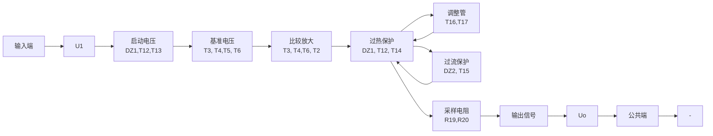
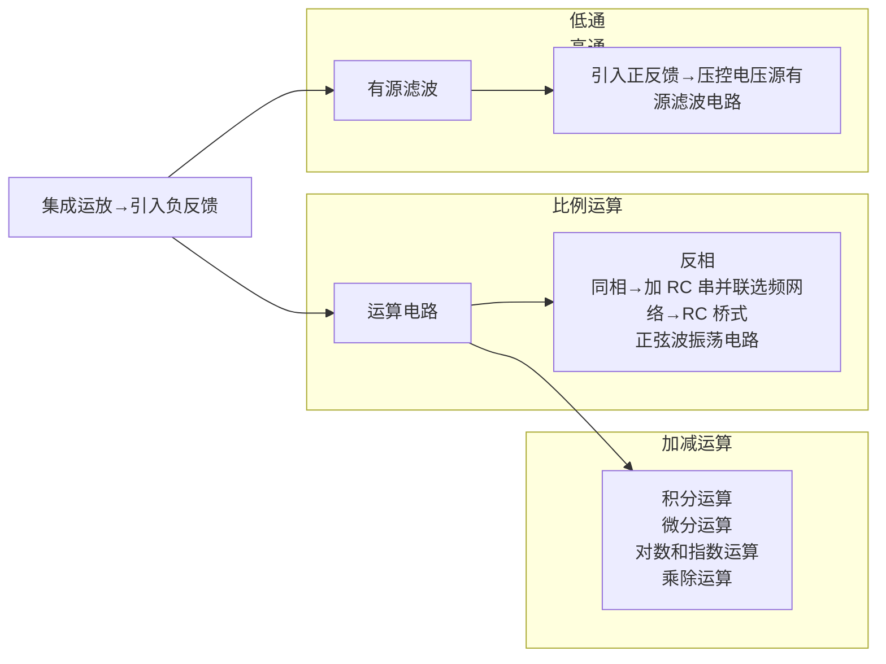

数值的电路,称为截流型(或减流型)过流保护电路。

图9.5.8(a)所示为限流型过流保护电路，$\mathrm{T}_{1}$ 为调整管，$\mathrm{T}_{2}$ 和 $R_{0}$ 构成保护电路，图(b)所示为集成稳压电路中的画法。$R_{0}$ 为电流采样电阻，其电流等于稳压电路的输出电流 $I_{0}$，故其电压正比于 $I_{0}$。正常工作时，$\mathrm{T}_{2}$ 的 $\mathrm{b - e}$ 间电压 $U_{\mathrm{BE2}} = I_{0}R_{0} < U_{\mathrm{on}}$，$U_{\mathrm{on}}$ 为 $\mathrm{b - e}$ 间的开启电压，因而 $\mathrm{T}_{2}$ 处于截止状态。当过流，即输出电流增大到一定数值时，$R_{0}$ 上的电压足以使 $\mathrm{T}_{2}$ 导通，便从 $\mathrm{T}_{1}$ 管的基极电流分流，因而限制了调整管的发射极电流。$R_{0}$ 的取值不同，调整管发射极的限定值将不同，其表达式为

$$
I _ {\mathrm{Omax}} \approx I _ {\mathrm{Emax}} \approx U _ {\mathrm{BE2}} / R _ {0} \tag {9.5.23}
$$

text_image

U₁○─T₁─R₀─○U₀
↑
T₂
来自比较放大电路

(a)

text_image

来自比较放大电路
T₁
I_B1
T₂
R₀
I_O
U_O
U_I

(b)

line

| \(I_{0}\) | \(U_{o}\) |
| --- | --- |
| Low | High |
| Medium | High |
| High | Low |

(c)

图 9.5.8 限流型过流保护电路及其输出特性

(a) 保护电路 (b) 集成稳压电路中的画法 (c) 输出特性

图(c)所示为输出特性。上述分析表明,限流型保护电路虽然组成简单,但是在保护电路起作用后调整管仍有较大的工作电流,因而也就有较大的功耗,所以不适用于大功率电路。

图 9.5.9(a) 所示为截流型过流保护电路, $T_{1}$  为调整管, $R_{0}$  为电流采样电阻, 它与 $T_{2}$ 、 $R_{1}$  和 $R_{2}$  构成保护电路, 图(b) 所示为集成稳压电路中的画法。电路中 A、B 点的电位分别为

$$
U _ {\mathrm{A}} = I _ {0} R _ {0} + U _ {0}
$$

$$
U _ {\mathrm{B}} = \frac {R _ {2}}{R _ {1} + R _ {2}} \cdot U _ {\mathrm{A}}
$$

因而  $T_{2}$  管 b-e 间电压为

$$
U _ {\mathrm{BE2}} = U _ {\mathrm{B}} - U _ {0} = \frac {R _ {2}}{R _ {1} + R _ {2}} \cdot (I _ {0} R _ {0} + U _ {0}) - U _ {0} \tag {9.5.24}
$$

式(9.5.24)表明， $I_{0}$  增大， $U_{BE2}$  将随之增大。未过流时， $U_{BE2}<U_{on}$ ，使  $T_{2}$  截止。当  $I_{0}$  增大到一定数值或输出端短路时， $T_{2}$  导通，对调整管  $T_{1}$  的基极分流，使  $I_{0}$  减小，从而导致输出电压  $U_{0}$  减小；此时虽然  $U_{B}$  随  $U_{0}$  的下降而下降，但是  $U_{0}$  下降的幅值大于  $U_{B}$ ，使得  $T_{2}$  的电流进一步增大，

text_image

T₁
A
R₀
I₀
R₁
B
U₁
比较放大电路
T₂
R₂
Uₒ

(a)

text_image

比较放大电路
T₂
B
R₁
R₂
A
R₀
U₁
T₁
Uₒ

(b)

line

| Io | Uo |
| --- | --- |
| 0 | High |
| ~Mid-range | High |
| ~Mid-range + I0 | Low |
| ~Mid-range + II0 | High |

(c)

图 9.5.9 截流型过流保护电路及其输出特性

(a) 保护电路 (b) 集成稳压电路中的画法 (c) 输出特性

$T_{1}$  的电流进一步减小,最终减小到较小数值。输出特性如图(c)所示。设  $T_{2}$  导通时 b-e 间电压为  $U_{on}$ , 令输出电压  $U_{0}$  为零, 并代入式(9.5.24), 可求出输出电流的最小值为

$$
I _ {0} \approx \frac {U _ {\mathrm{on}}}{k R _ {0}} \quad \left(k = \frac {R _ {2}}{R _ {1} + R _ {2}}\right) \tag {9.5.25}
$$

通常，在截流型过流保护电路启动后，均有一个正反馈过程，使输出电流迅速减小。

## 2. 调整管的安全工作区保护电路

调整管的安全工作区保护电路可使调整管既不因过电流而烧坏，又不因过电压而击穿，因此它由过流保护和过压保护两种电路组合而成，最终保证调整管不超过其最大耗散功率。在图9.5.10所示电路中，由晶体管 $T_{16}$ 、 $T_{17}$ 组成的复合管为调整管，由 $R_{13}$ 、 $D_{Z2}$ 和 $R_{11}$ 、 $R_{12}$ 、 $R_{21}$ 、 $T_{15}$ 组成保护电路，输出电流如图中所标注。在电路正常工作时， $D_{Z2}$ 和 $T_{15}$ 均截止。电阻 $R_{12}$ 上的电压为

$$
U _ {R _ {1 2}} = \frac {R _ {1 2}}{R _ {2 1} + R _ {1 2}} \cdot U _ {\mathrm{BE17}}
$$

$T_{15}$  的 b-e 间电压为

$$
U _ {\mathrm{BE15}} = U _ {R _ {1 2}} + I _ {0} R _ {1 1} \tag {9.5.26}
$$

且  $U_{BE15} < U_{on}$ 。 $I_{0}$  增大， $R_{11}$  上的电压增大， $U_{BE15}$  将随之增大。

当电路过载或输出端短路时， $R_{11}$ 上的电压增大使 $U_{BE15} > U_{on}$， $T_{15}$ 导通，对调整管的基极分流，实现了过流保护。若 $U_{1}$ 与 $U_{0}$ 之间电压（即调整管管压降）超过允许值，则 $D_{Z2}$ 击穿，使 $T_{15}$ 基极电流骤然增大而迅速进入饱和区， $I_{9}$ 的大部分电流流过 $T_{15}$，从而使调整管 $T_{17}$ 接近截止区，也就使其功耗下降到较小的数值。可见，过压保护电路最终限制了调整管的功耗，使调整管工作在安全区。

## 3. 芯片过热保护电路

芯片损坏的重要原因之一是长期通过大电流而引起结温超过允许值。在集成稳压器中，调整管的结温决定芯片的温度。为此，常利用二极管或晶体管的结温升作为测温元件，让它们靠近调整管，从而反映调整管的温升情况。当调整管温升超过允许值时，测温二极管（或晶体管）启动一个电路，减小其电流，使芯片温度下降至安全值。

在图9.5.11所示电路中，由晶体管 $\mathrm{T}_{16}$ 、 $\mathrm{T}_{17}$ 组成的复合管为调整管； $\mathrm{T}_{14}$ 和 $R_{7}$ 为测温元件，它们与 $R_{1}, R_{6}^{\prime}$ 和 $\mathrm{D}_{\mathrm{Z}1}$ 组成芯片过热保护电路。 $\mathrm{T}_{14}$ 管b-e间电压为

text_image

U₁
比较
放大电路
I₉
R₁₃
T₁₆
D₂₂
R₂₁
R₁₂
T₁₇
R₁₁
Iₒ
T₁₅
Uₒ

图 9.5.10 调整管的安全工作区保护电路

text_image

U₁
R₁
R₁₈
I₉
T₁₂
Dz₁
R'₆
R₇
T₁₄
T₁₆
T₁₇
R₁₁
Uₒ

图 9.5.11 芯片过热保护电路

$$
U _ {\mathrm{BE14}} = U _ {R _ {7}} = \frac {R _ {7}}{R _ {6} ^ {\prime} + R _ {7}} \cdot (U _ {\mathrm{Z1}} - U _ {\mathrm{BE12}})
$$

其中稳压管具有正温度系数，而晶体管b-e间电压具有负温度系数。芯片未过热时，$\mathrm{T}_{14}$ 管截止。芯片温度上升，$U_{\mathrm{Z1}}$ 增大，$U_{\mathrm{BE12}}$ 减小，即 $(U_{\mathrm{Z1}} - U_{\mathrm{BE12}})$ 增大，而 $\mathrm{T}_{14}$ 管b-e间的开启电压 $U_{\mathrm{on}}$ 却减小。当芯片温度上升到一定数值（通常在 $150\sim 175^{\circ}\mathrm{C}$ ）时，$\mathrm{T}_{14}$ 管导通，对调整管的基极分流，输出电流减小，调整管的功耗下降，使芯片温度被限制在一定数值之下。

## 9.5.3 集成稳压器电路

从外形上看，集成串联型稳压电路有三个引脚，分别为输入端、输出端和公共端（或调整端），因而称为三端稳压器。按功能可分为固定式稳压电路和可调式稳压电路；前者的输出电压不能进行调节，为固定值；后者可通过外接元件使输出电压得到很宽的调节范围。本节首先对型号为W7800固定式集成稳压器电路加以简要分析，然后介绍型号为W117可调式集成稳压器的特点。

## 一、W7800三端稳压器

## 1. 输出电压和输出电流

W7800 系列三端稳压器的输出电压有 5 V、6 V、9 V、12 V、15 V、18 V 和 24 V 七个挡，型号后面的两个数字表示输出电压值。输出电流有 1.5 A（W7800）、0.5 A（W78M00）和 0.1 A（W78L00）三个挡。例如，W7805 表示输出电压为 5 V、最大输出电流为 1.5 A，W78M05 表示输出电压为 5 V、最大输出电流为 0.5 A，W78L05 表示输出电压为 5 V、最大输出电流为 0.1 A，其它类推。它因性能稳定、价格低廉而得到广泛的应用。

## 2. 电路原理图分析

W7805 电路原理框图如图 9.5.12 所示 $^{①}$ ，其中稳压电路部分如图 9.5.13 所示。

flowchart

图 9.5.12 W7805 的原理框图

text_image

输入端
T16,T17
IC9
IC8
U1
T5
R2
I2
T3,T4
公共端
输出端
R20
T6
R19
UREF
UO

图 9.5.13 W7805 电路中的稳压电路部分

在图 9.5.13 所示电路中，由  $T_{16}$  和  $T_{17}$  管构成的复合管作为调整管。

以  $T_{3}$  和  $T_{4}$  构成的复合管作为放大管、以  $T_{9}$  管为有源负载组成的共射放大电路作为比较放大电路。基准电压  $U_{REF}$  通过  $T_{6}$  管 ( $T_{2}$  管为有源负载) 的发射极输入到  $T_{3}$  管的基极。

$T_{3}$ 、 $T_{4}$ 、 $T_{5}$ 、 $T_{6}$ 管和电阻 $R_{2}$ 组成基准电压电路，它是与图9.5.7所示电路相类似的能隙基准电压电路。基准电压

$$
U _ {\mathrm{REF}} = U _ {\mathrm{BE4}} + U _ {\mathrm{BE3}} + I _ {2} R _ {2} + U _ {\mathrm{BE5}} + U _ {\mathrm{BE6}} \tag {9.5.27}
$$

在  $T_{3} \sim T_{6}$  特性相同的情况下, 得出

$$
U _ {\mathrm{REF}} = 4 U _ {\mathrm{BE}} + I _ {2} R _ {2} \tag {9.5.28}
$$

根据式(9.5.19)、(9.5.21)可知

$$
U _ {\mathrm{REF}} \approx 4 U _ {\mathrm{go}} + 4 \alpha T + \frac {R _ {2}}{R _ {3}} \cdot U _ {\mathrm{T}} \ln \left(\frac {R _ {2}}{R _ {1}}\right) \tag {9.5.29}
$$

通过调整  $R_{1} \sim R_{3}$  的阻值, 可使式 (9.5.29) 中的第二、三项相互抵消, 从而基准电压仅决定于第一项, 为

<small>① W7805 电路原理图可参阅童诗白、华成英主编《模拟电子技术基础(第四版)》的 10.5.3 节。</small>

$$
U _ {\mathrm{REF}} = 4 U _ {\mathrm{go}}
$$

实现了零温度系数。根据式(9.5.20)可得

$$
U _ {\mathrm{REF}} = 4. 8 2 \mathrm{V} \tag {9.5.30}
$$

输出电压为

$$
U _ {0} = \left(1 + \frac {R _ {2 0}}{R _ {1 9}}\right) \cdot U _ {\mathrm{REF}} \approx 5 \mathrm{V} \tag {9.5.31}
$$

在图9.5.12所示电路中， $R_{11}, R_{12}, R_{13}, \mathrm{D}_{\mathrm{Z}2}$ 和 $\mathrm{T}_{15}$ 组成如图9.5.10所示的安全工作区保护电路，在过流、过压时保护电路起作用，同时避免了过损耗。$\mathrm{D}_{\mathrm{Z}1}, \mathrm{T}_{12}, \mathrm{T}_{14}, R_5, R_6$ 和 $R_{7}$ 组成如图9.5.11所示的芯片过热保护电路。

图9.5.12中，$\mathrm{T_8}$ 和 $\mathrm{T_9}$ 管所构成的电流源电路为比较放大电路、基准电压电路和调整管提供静态电流；但是，在通电后，靠 $\mathrm{T_8}$ 和 $\mathrm{T_9}$ 管自身并不能形成基极电流回路，因而也就无法使整个电路正常工作。启动电路的作用是在 $U_{1}$ 接入后，为 $\mathrm{T_8}$ 和 $\mathrm{T_9}$ 管提供电流通路，从而使稳压电路各部分建立起正常的工作关系。电路启动正常工作之后，启动电路与稳压电路分开。可见启动电路仅在通电时起作用。

由以上分析可知,电路中的一些元件出现在多个功能电路中,如  $D_{Z1}$  既作为启动电路的一部分,又作为过热保护电路的一部分。

## 3. 主要参数

在温度为  $25^{\circ}$ C 条件下 W7805 的主要参数如表 9.5.1 所示。

表 9.5.1 W7805 的主要参数

| 参数名称 | 符号 | 测试条件 | 单位 | W7805(典型值) |
| --- | --- | --- | --- | --- |
| 输入电压 | $U_{1}$ |  | V | 10 |
| 输出电压 | $U_{0}$ | $I_{0}=500mA$ | V | 5 |
| 最小输入电压 | $U_{\text{tmin}}$ | $I_{0}\leqslant1.5A$ | V | 7 |
| 电压调整率 | $S_{U}(\Delta U_{0})$ | $I_{0}=500mA$$8V\leqslant U_{1}\leqslant18V$ | mV | 7 |
| 电流调整率 | $S_{I}(\Delta U_{0})$ | $10mA\leqslant I_{0}\leqslant1.5A$ | mV | 25 |
| 输出电压温度变化率 | $S_{T}$ | $I_{0}=5mA$ | mV/°C | 1 |
| 输出噪声电压 | $U_{no}$ | $10Hz\leqslant f\leqslant100kHz$ | μV | 40 |

从表中参数可知,W7805输入端和输出端之间的电压允许值为3\~13 V;输出交流噪声很小,温度稳定性很好。

## 二、W117 三端稳压器

W117 为可调式三端稳压器。

## 1. 原理框图

W117 的原理框图如图 9.5.14 所示。它有三个引出端，分别为输入端、输出端和电压调整端（简称调整端）。调整端是基准电压电路的公共端。 $T_{1}$  和  $T_{2}$  组成的复合管为调整管；基准电压电路为能隙基准电压电路；比较放大电路 A 是共集-共射放大电路；保护电路包括过流保护、调整管安全区保护和过热保护三部分 $^{①}$ 。 $R_{1}$  和  $R_{2}$  为外接的采样电阻，调整端接在它们的连接点上。

text_image

输入端
+
I₁
U₁
基准电压电路
+
-
A
保护电路
I₂
T₁
T₁
U_REF
输出端
+
-
调整端
R₁
Uₒ
R₂
-

图 9.5.14 W117 的原理框图

与一般串联型稳压电路一样,由于 W117 电路中引入了深度的电压负反馈,输出电压非常稳定。

因为调整端的电流很小,约为  $50 \mu A$ , 所以输出电压为

$$
U _ {0} = \left(1 + \frac {R _ {2}}{R _ {1}}\right) \cdot U _ {\mathrm{REF}} \tag {9.5.32}
$$

其中  $U_{REF}$  的典型值为 1.25 V $^{②}$ 。

## 2. 主要参数

与 W7800 系列产品一样，W117、W117M 和 W147L 的最大输出电流分别为 1.5 A、0.5 A 和 0.1 A。W117、W217 和 W317 具有相同的引出端、相同的基准电压和相似的内部电路，它们的工作温度范围依次为  $-55^{\circ}C \sim 150^{\circ}C$ 、 $-25^{\circ}C \sim 150^{\circ}C$ 、 $0 \sim 125^{\circ}C$ 。它们在  $25^{\circ}C$  时主要参数如表 9.5.2 所示。

表 9.5.2 W117/W217/W317 的主要参数

<table><tr><td rowspan="2">参数名称</td><td rowspan="2">符号</td><td rowspan="2">测试条件</td><td rowspan="2">单位</td><td colspan="3">W117/W217</td><td colspan="3">W317</td></tr><tr><td>最小值</td><td>典型值</td><td>最大值</td><td>最小值</td><td>典型值</td><td>最大值</td></tr><tr><td>输出电压</td><td> $U_0$ </td><td> $I_0=1.5A$ </td><td>V</td><td colspan="6">1.2~37</td></tr><tr><td>电压调整率</td><td> $S_U$ </td><td> $I_O=500mA$  $3V\leqslant U_1-U_0\leqslant40V$ </td><td>%/V</td><td></td><td>0.01</td><td>0.02</td><td></td><td>0.01</td><td>0.04</td></tr><tr><td>电流调整率</td><td> $S_I$ </td><td> $10mA\leqslant I_0\leqslant1.5A$ </td><td>%</td><td></td><td>0.1</td><td>0.3</td><td></td><td>0.1</td><td>0.5</td></tr><tr><td>调整端电流</td><td> $I_{Adj}$ </td><td></td><td>μA</td><td></td><td>50</td><td>100</td><td></td><td>50</td><td>100</td></tr><tr><td>调整端电流变化</td><td> $\Delta I_{Adj}$ </td><td> $3\mathrm{V}\leqslant U_1 - U_0\leqslant 40\mathrm{V}$  $10\mathrm{mA}\leqslant I_0\leqslant 1.5\mathrm{A}$ </td><td>μA</td><td></td><td>0.2</td><td>5</td><td></td><td>0.2</td><td>5</td></tr><tr><td>基准电压</td><td> $U_R$ </td><td> $I_0 = 500\mathrm{mA}$  $25\mathrm{V}\leqslant U_1 - U_0\leqslant 40\mathrm{V}$ </td><td>V</td><td>1.2</td><td>1.25</td><td>1.30</td><td>1.2</td><td>1.25</td><td>1.30</td></tr><tr><td>最小负载电流</td><td> $I_{0min}$ </td><td> $U_1 - U_0 = 40\mathrm{V}$ </td><td>mA</td><td></td><td>3.5</td><td>5</td><td></td><td>3.5</td><td>10</td></tr></table>

<small>① 可参阅童诗白主编《模拟电子技术基础(第二版)》第十一章附录。</small>

<small>② 可参阅童诗白主编《模拟电子技术基础(第二版)》第十一章附录。</small>

对表 9.5.2 作以下说明:

① 对于特定的稳压器,基准电压  $U_{R}$  是 1.2\~1.3 V 中的某一个值,在一般分析计算时可取典型值 1.25 V;
② W117、W217 和 W317 的输出端和输入端电压之差为 3～40 V，过低时不能保证调整管工作在放大区，从而使稳压电路不能稳压；过高时调整管可能因管压降过大而击穿；
③ 外接采样电阻必不可少,根据最小输出电流  $I_{0min}$  可以求出  $R_{1}$  的最大值;
④ 调整端电流很小,且变化也很小;
⑤ 与 W7800 系列产品一样, W117、W217 和 W317 在电网电压波动和负载电阻变化时, 输出电压非常稳定。

## 9.5.4 三端稳压器的应用

## 一、三端稳压器的外形和方框图

与其它大功率器件一样，三端稳压器的外形便于自身散热和安装散热器。封装形式有金属封装和塑料封装两种形式。图9.5.15(a)、(b)、(c)所示分别为W7800系列产品金属封装、塑料封装的外形图和方框图，图(d)所示为W117系列产品金属封装、塑料封装的外形图和方框图。

## 二、W7800的应用

## 1. 基本应用电路

基本应用电路如图9.5.16所示，输出电压和最大输出电流决定于所选三端稳压器。图中电容 $C_{i}$ 用于抵消输入线较长时的电感效应，以防止电路产生自激振荡，其容量较小，一般小于 $1\mu F$ 。电容 $C_{o}$ 用于消除输出电压中的高频噪声，可取小于 $1\mu F$ 的电容，也可取几微法甚至几十微法的电容，以便输出较大的脉冲电流。但是若 $C_{o}$ 容量较大，一旦输入端断开， $C_{o}$ 将从稳压器输出端向稳压器放电，易使稳压器损坏。因此，可在稳压器的输入端和输出端之间跨接一个二极管，如图中虚线所画，起保护作用。

## 2. 扩大输出电流的稳压电路

若所需输出电流大于稳压器标称值时,可采用外接电路来扩大输出电流。图 9.5.17 所示电路为实现输出电流扩展的一种电路。

图 9.5.15 三端稳压器的外形和方框图

(a) W7800 金属封装外形图 (b) W7800 塑料封装外形图

(c) W7800 方框图 (d) W117 外形图和方框图

text_image

D
W7800
+
U1 Ci 0.33 μF C0 1 μF RL UO
-

图 9.5.16 W7800 的基本应用电路

text_image

W7800
U1
C1
D
R
IR
C2
+ 10 μF
T
RL
UO
-

图 9.5.17 一种输出电流扩展电路

设三端稳压器的输出电压为 $U_{0}^{\prime}$ 。图示电路的输出电压 $U_{0}=U_{0}^{\prime}+U_{D}-U_{BE}$，在理想情况下，即 $U_{D}=U_{BE}$ 时， $U_{0}=U_{0}^{\prime}$ 。可见，二极管用于消除 $U_{BE}$ 对输出电压的影响。设三端稳压器的最大输出电流为 $I_{Omax}$，则晶体管的最大基极电流 $I_{Bmax}=I_{Omax}-I_{R}$，因而负载电流的最大值为

$$
I _ {\mathrm{Lmax}} = (1 + \beta) (I _ {0 \mathrm{max}} - I _ {R}) \tag {9.5.33}
$$

## 3. 输出电压可调的稳压电路

图 9.5.18 所示电路为利用三端稳压器构成的输出电压可调的稳压电路。图中电阻  $R_{2}$  中流过的电流为  $I_{R_{2}}, R_{1}$  中的电流为  $I_{R_{1}}$ ，稳压器公共端的电流为  $I_{W}$ ，因而

$$
I _ {R _ {2}} = I _ {R _ {1}} + I _ {\mathrm{W}}
$$

text_image

W7800
+
U1 Ci Iw IR1
R2 IR2 Co RL UO
-

图 9.5.18 一种输出电压可调的稳压电路

由于电阻  $R_{1}$  上的电压为稳压器的输出电压  $U_{0}^{\prime}, I_{R_{1}} = U_{0}^{\prime}/R_{1}$ ，输出电压  $U_{0}$  等于  $R_{1}$  上电压与  $R_{2}$  上电压之和，所以输出电压为

$$
U _ {0} = U _ {0} ^ {\prime} + \left(\frac {U _ {0} ^ {\prime}}{R _ {1}} + I _ {\mathrm{w}}\right) R _ {2}
$$

$$
U _ {\mathrm{o}} = \left(1 + \frac {R _ {2}}{R _ {1}}\right) \cdot U _ {\mathrm{o}} ^ {\prime} + I _ {\mathrm{w}} R _ {2} \tag {9.5.34}
$$

改变  $R_{2}$  滑动端位置, 可以调节  $U_{0}$  的大小。三端稳压器既作为稳压器件, 又为电路提供基准电压。由于公共端电流  $I_{w}$  的变化将影响输出电压, 实用电路中常加电压跟随器将稳压器与采样电阻隔离, 如图 9.5.19 所示。

图中电压跟随器的输出电压等于三端稳压器的输出电压  $U_{0}^{\prime}$ ，即电阻  $R_{1}$  与  $R_{2}$  上部分的电压之和，是一个常量，改变电位器滑动端的位置，即可调节输出电压  $U_{0}$  的大小。以输出电压的正端为参考点，不难求出输出电压为

$$
\frac {R _ {1} + R _ {2} + R _ {3}}{R _ {1} + R _ {2}} \cdot U _ {0} ^ {\prime} \leqslant U _ {0} \leqslant \frac {R _ {1} + R _ {2} + R _ {3}}{R _ {1}} \cdot U _ {0} ^ {\prime} \tag {9.5.35}
$$

设 $R_{1} = R_{2} = R_{3} = 300\Omega ,U_{0}^{\prime} = 12\mathrm{V}$ ，则输出电压的调节范围为 $18\sim 36\mathrm{V}$ 。可以根据输出电压的调节范围及输出电流大小选择三端稳压器及采样电阻。

## 4. 正、负输出稳压电路

W7900 系列芯片是一种输出负电压的固定式三端稳压器，输出电压有 -5 V、-6 V、-9 V、-12 V、-15 V、-18 V 和 -24 V 七个档次，并且也有 1.5 A、0.5 A 和 0.1 A 三个电流档次，使用方法与 W7800 系列稳压器相同，只是要特别注意输入电压和输出电压的极性。W7900 与 W7800 相配合，可以得到正、负输出的稳压电路，如图 9.5.20 所示。

text_image

W7800
+
U1 Ci
-
A
+
U'O
R1
R2
Co
R3
RL
UO
-

图 9.5.19 输出电压可调的实用稳压电路

text_image

+U1
W7800
+Uo
Ci
Co
D1
RL
C'i
C'o'
D2
W7900
-U1
-Uo

图 9.5.20 正、负输出稳压电路

图中两只二极管起保护作用，正常工作时均处于截止状态。若W7900的输入端未接入输入电压，W7800的输出电压将通过负载电阻接到W7900的输出端，使 $\mathrm{D}_2$ 导通，从而将W7900的输出端钳位在 $0.7\mathrm{V}$ 左右，保护其不至于损坏；同理， $\mathrm{D}_1$ 可在W7800的输入端未接入输入电压时保护其不至于损坏。

## 三、W117的应用

## 1. 基准电压源电路

图 9.5.21 所示是由 W117 组成的基准电压源电路, 输出端和调整端之间的电压是非常稳定的电压, 其值为 1.25 V。输出电流可达 1.5 A。图中 R 为泄放电阻, 根据表 9.5.2 中的最小负载电流(取5 mA)可以计算出R的最大值。 $R_{\mathrm{max}} = (1.25 / 0.005)\Omega = 250\Omega$ ，实际取值可略小于250Ω，如240Ω。

## 2. 典型应用电路

可调式三端稳压器的主要应用是要实现输出电压可调的稳压电路。正如前面所述，可调式三端稳压器的外接采样电阻是稳压电路不可缺少的组成部分，其典型电路如图9.5.22所示。

text_image

W117
U_I C_i C_o R U_O=1.25 V

图 9.5.21 基准电压源电路

text_image

W117
R1
C0
U1 Ci
R2
UO

图 9.5.22 典型应用电路

图中  $R_{1}$  取值原则与图 9.5.21 所示电路中的 R 相同, 可取 240 Ω。由于调整端的电流可忽略不计, 输出电压为

$$
U _ {0} = \left(1 + \frac {R _ {2}}{R _ {1}}\right) \times 1. 2 5 \mathrm{V} \tag {9.5.36}
$$

为了减小  $R_{2}$  上的纹波电压, 可在其上并联一个  $10 \mu F$  电容 C。但是, 在输出开路时, C 将向稳压器调整端放电, 并使调整管发射结反偏, 为了保护稳压器, 可加二极管  $D_{2}$ , 提供一个放电回路, 如图 9.5.23 所示。 $D_{1}$  的作用与图 9.5.16 所示电路中的 D 相同。

text_image

D₁
W117
R₁
D₂
R₂
C
C₀
Rₗ
U₁ Cᵢ
+
-
Uₒ
-

图 9.5.23 W117 的外加保护电路

## 3. 程序控制稳压电路

在调整端加控制电路可以实现程序控制稳压电路，如图9.5.24(a)所示。图中晶体管为电子开关，当基极加高电平时，晶体管饱和导通，相对于开关闭合；当基极加低电平时，晶体管截止，相对于开关断开。因此，图(a)所示电路可等效为图(b)所示电路。

四路控制信号从全部为低电平到全部为高电平，共有十六种不同组合； $T_{1}\sim T_{4}$  也就有从全截止到全饱和导通，共有十六种不同的状态；因而 $R_{2}$  将与不同阻值的电阻并联，并联电阻最大值和最小值分别为

$$
R _ {2 \max} ^ {\prime} = R _ {2}, R _ {2 \min} ^ {\prime} = R _ {2} / / R _ {D 0} / / R _ {D 1} / / R _ {D 2} / / R _ {D 3}
$$

text_image

W117
R1
U1 Ci
R2
RD0 RD1 RD2 RD3 Co UO
-
(a)
D0 D1 D2 D3
-

text_image

W117
R1
U1 Ci
R2 RD0 RD1 RD2 RD3 Co UO
D0 D1 D2 D3
(b)

图 9.5.24 程序控制稳压电路

(a) 电路组成 (b) 等效电路

根据式(9.5.36)，输出电压在不同控制信号下有十六个不同的数值。

W137/W237/W337 与 W7900 相类似,能够提供负的基准电压,可以构成负输出电压稳压电路,也可与 W117/W217/W317 一起组成正、负输出电压的稳压电路,这里不赘述。

## 思考题

9.5.1 在图 9.5.2 所示的串联型稳压电路中, 如出现下列情况, 将分别产生什么现象?

(1) 集成运放的同相输入端与反相输入端接反；
(2) 稳压管接反；
(3) R 断路；
(4)  $R_{2}$  短路。

9.5.2 在图 9.5.2 所示的串联型稳压电路中, 已知输入电压的波动范围是 18 \~ 22 V, 调整管的饱和管压降为 2 V。作为稳压电源的性能指标的最大输出电压是 16 V, 还是 20 V? 为什么?
9.5.3 在图 9.5.2 所示的串联型稳压电路中, 若调整管的电流放大倍数  $\beta$  为 50, 最大集电极电流  $I_{CM}$  为 500 mA, 而从调整管最大集电极耗散功率算出的集电极电流最大值为 450 mA; 集成运放的最大输出电流为 8 mA; 则作为稳压电源的性能指标的最大输出电流应为多少? 为什么? 若取其它值将会怎样?
9.5.4 通常，在组成输出电压可调的稳压电源时应选用图9.5.19、图9.5.20所示电路，还是图9.5.23所示电路？为什么？

## 9.6 开关型稳压电路

前节所讲的线性稳压电路具有结构简单、调节方便、输出电压稳定性强、纹波电压小等优点。但是，由于调整管始终工作在放大状态，自身功耗较大；故效率较低，甚至仅为30%\~40%。而且，为了解决调整管散热问题，必须安装散热器，这就必然增大整个电源设备的体积、重量和成本。

可以设想,如果调整管工作在开关状态,那么当其截止时,因电流很小(为穿透电流)而管耗很小;当其饱和时,因管压降很小(为饱和管压降)而管耗也很小;这将可以大大提高电路的效率。开关型稳压电路中的调整管正是工作在开关状态,并因此而得名,其效率可达70%\~95%。

## 9.6.1 开关型稳压电路的发展及分类

开关型稳压电源的发展依赖于半导体器件和磁性材料的发展。随着电子工业的发展，高频率、高耐压、大功率开关管问世。20世纪70年代以来，无工频电源变压器的开关型稳压电源在世界各工业化国家中已普及成为商品，电路可直接从电网电压整流供电，更显现突出的优越性。因此，以其自身功耗小、体积小、重量轻，得到越来越广泛的使用，尤其适用于大功率且负载固定、输出电压调节范围不大的场合。到了80年代，开关电源技术不断有新的突破，出现了许多不同种类的开关稳压电源。

按调整管与负载的连接方式可分为串联型和并联型。

按稳压的控制方式可分为脉冲宽度调制型(PWM)、脉冲频率调制型(PFM)和混合调制(即脉宽-频率调制)型。

按调整管是否参与振荡可分为自激式和他激式。

按使用开关管的类型可分为晶体管、VMOS 管和晶闸管型。

本节主要介绍采样双极型管作开关管的串联开关型稳压电源和并联开关型稳压电路的组成和工作原理。

## 9.6.2 串联开关型稳压电路

## 一、换能电路的基本原理

开关型稳压电路的换能电路将输入的直流电压转换成脉冲电压，再将脉冲电压经 $LC$ 滤波转换成直流电压，图9.6.1(a)所示为基本原理图。输入电压 $U_{1}$ 是未经稳压的直流电压；晶体管T为调整管，即开关管；$u_{\mathrm{B}}$ 为矩形波，控制开关管的工作状态；电感 $L$ 和电容 $C$ 组成滤波电路，D为续流二极管。

text_image

T
+
U_I
u_B
e
L
D
C
R_L
U_O
-

(a)

text_image

T
+ -
e +
iL
D
C
RL
Uo
+
-

(b)

text_image

T
+
U₁
-
e
-
L
+
iₗ
D
C
Rₗ
Uₒ
-

(c)

图 9.6.1 换能电路的基本原理图及其等效电路

(a) 基本原理图 (b) T 饱和导通时的等效电路 (c) T 截止时的等效电路

当 $u_{\mathrm{B}}$ 为高电平时，T饱和导通，D因承受反压而截止，等效电路如图(b)所示，电流如图中所标注；电感 $L$ 存储能量，电容 $C$ 充电；发射极电位 $u_{\mathrm{E}} = U_{1} - U_{\mathrm{CES}} \approx U_{1}$ 。当 $u_{\mathrm{B}}$ 为低电平时，T截止，此时虽然发射极电流为零,但是 L 释放能量,其感应电动势使 D 导通,等效电路如图(c)所示;与

此同时，C 放电，负载电流方向不变， $u_{E} = -U_{D} \approx 0$ 。

根据上述分析,可以画出  $u_{B}$ 、 $u_{E}$ 、电感上的电压  $u_{L}$  和电流  $i_{L}$  以及输出电压  $u_{0}$  的波形,如图9.6.2所示。为使问题简单起见,图中将  $i_{L}$  折线化。在  $u_{B}$  的一个周期 T 内, $T_{on}$  为调整管导通时间, $T_{off}$  为调整管截止时间,占空比  $q = T_{on} / T$ 。

在换能电路中,如果电感 L 数值太小,在  $T_{on}$  期间储能不足,那么在  $T_{off}$  还未结束时,能量已放尽,将导致输出电压为零,出现台阶,这是绝对不允许的。同时为了使输出电压的交流分量足够小,C 的取值应足够大。换言之,只有在 L 和 C 足够大时,输出电压  $U_{0}$  和负载电流  $I_{0}$  才为连续的,L 和 C 愈大, $U_{0}$  的波形愈平滑。由于输出电流  $I_{0}$  是  $U_{1}$  通过开关调整管 T 和 LC 滤波电路轮流提供,通常脉动成分比线性稳压电源要大一些,这是开关型稳压电路的缺点之一。

若将  $u_{E}$  视为直流分量和交流分量之和, 则输出电压的平均值等于  $u_{E}$  的直流分量, 即

$$
U _ {\mathrm{O}} = \frac {T _ {\mathrm{on}}}{T} (U _ {\mathrm{l}} - U _ {\mathrm{CES}}) + \frac {T _ {\mathrm{off}}}{T} (- U _ {\mathrm{D}}) \approx \frac {T _ {\mathrm{on}}}{T} U _ {\mathrm{l}}
$$

可以写为

$$
U _ {0} \approx q U _ {1} \tag {9.6.1}
$$

改变占空比 q，即可改变输出电压的大小。

图 9.6.2 换能电路的波形分析

## 二、串联开关型稳压电路的组成

在图9.6.1所示的换能电路中，当输入电压波动或负载变化时，输出电压将随之增大或减小。可以想象，如果能在 $U_{0}$ 增大时减小占空比，而在 $U_{0}$ 减小时增大占空比，那么输出电压就可获得稳定。将 $U_{0}$ 的采样电压通过反馈来调节控制电压 $u_{B}$ 的占空比，就可达到稳压的目的。由此而构思的串联开关型稳压电源的结构框图如图9.6.3所示。它包括调整管及其开关驱动电路（电压比较器）、采样电路、三角波发生电路、基准电压电路、比较放大电路、滤波电路（电感L、电容C和续流二极管D）等几个部分。

text_image

T
+
U1
uB
A2
+
-
uN2
三角波
发生电路
A1
+
-
UN1
基准电压
电路
UREF
L
D
C
R1
R2
RL
UO
+
-

图 9.6.3 串联开关型稳压电源的结构框图

与图 9.6.1 所示电路相同, 若所有的开关和滤波元件都是无损耗的, 根据能量守恒原理, 输出电压  $U_{0}$  与输入电压  $U_{1}$  之间也有如下关系:

$$
U _ {0} \approx \frac {t _ {\mathrm{on}}}{T} U _ {1} = q U _ {1}
$$

## 三、串联开关型稳压电路的工作原理

基准电压电路输出稳定的电压，采样电压 $U_{\mathrm{N1}}$ 与基准电压 $U_{\mathrm{REF}}$ 之差，经 $A_1$ 放大后，作为由 $A_2$ 组成的电压比较器的阈值电压 $U_{\mathrm{P2}}$，三角波发生电路的输出电压与之相比较，得到控制信号 $u_{\mathrm{B}}$，控制调整管的工作状态。

当  $U_{0}$  升高时，采样电压会同时增大，并作用于比较放大电路的反相输入端，与同相输入端的基准电压比较放大，使放大电路的输出电压减小，经电压比较器使  $u_{B}$  的占空比变小，因此输出电压随之减小，调节结果使  $U_{0}$  基本不变。上述变化过程可简述如下:

$$
\begin{array}{l} U _ {0} \uparrow \longrightarrow U _ {\mathrm{N1}} \uparrow \longrightarrow U _ {\mathrm{P2}} \downarrow \longrightarrow q \downarrow \\ U _ {0} \downarrow \leftarrow \end{array}
$$

当  $U_{0}$  因某种原因减小时,与上述变化相反,即

$$
\begin{array}{l} U _ {\mathrm{o}} \downarrow \longrightarrow U _ {\mathrm{N1}} \downarrow \longrightarrow U _ {\mathrm{P2}} \uparrow \longrightarrow q \uparrow \\ U _ {\mathrm{o}} \uparrow \leftarrow \end{array}
$$

图9.6.4所示为三角波 $u_{\mathrm{N2}}$ 和 $u_{\mathrm{B}}$ 的波形，与图9.6.2所示波形对照，可以进一步理解开关型稳压电路的工作原理。当采样电压 $u_{\mathrm{N1}} < U_{\mathrm{REF}}$ 时，占空比大于 $50\%$；当 $u_{\mathrm{N1}} > U_{\mathrm{REF}}$ 时，占空比小于 $50\%$；因而改变 $R_{1}$ 与 $R_{2}$ 的比值，可以改变输出电压的数值。

应当指出,由于负载电阻变化时影响 LC 滤波电路的滤波效果,因而开关型稳压电路不适用于负载变化较大的场合。

从对图9.6.3所示电路工作原理的分析可知，控制过程是在保持调整管开关周期 $T$ 不变的情况下，通过改变开关管导通时间 $T_{\mathrm{on}}$ 来调节脉冲占空比，从而达到稳压目的，故称之为脉宽调制型开关电源。目前有多种脉宽调制型开关电源的控制器芯片，有的还将开关管也集成于芯片之中，且含有各种保护电路，因而图9.6.3所示电路可简化成图9.6.5所示电路。

line

| Time Interval | uN2 (Peak) | uB (Trough) |
| --- | --- | --- |
| 1 | U_P2 | U_B |
| 2 | U_P2 | U_B |
| 3 | U_P2 | U_B |
| 4 | U_P2 | U_B |
| 5 | U_P2 | U_B |
| 6 | U_P2 | U_B |
| 7 | U_P2 | U_B |
| 8 | U_P2 | U_B |
| 9 | U_P2 | U_B |
| 10 | U_P2 | U_B |
| 11 | U_P2 | U_B |
| 12 | U_P2 | U_B |
| 13 | U_P2 | U_B |
| 14 | U_P2 | U_B |
| 15 | U_P2 | U_B |
| 16 | U_P2 | U_B |
| 17 | U_P2 | U_B |
| 18 | U_P2 | U_B |
| 19 | U_P2 | U_B |
| 20 | U_P2 | U_B |
| 21 | U_P2 | U_B |
| 22 | U_P2 | U_B |
| 23 | U_P2 | U_B |
| 24 | U_P2 | U_B |
| 25 | U_P2 | U_B |
| 26 | U_P2 | U_B |
| 27 | U_P2 | U_B |
| 28 | U_P2 | U_B |
| 29 | U_P2 | U_B |
| 30 | U_P2 | U_B |
| 31 | U_P2 | U_B |
| 32 | U_P2 | U_B |
| 33 | U_P2 | U_B |
| 34 | U_P2 | U_B |
| 35 | U_P2 | U_B |
| 36 | U_P2 | U_B |
| 37 | U_P2 | U_B |
| 38 | U_P2 | U_B |
| 39 | U_P2 | U_B |
| 40 | U_P2 | U_B |
| 41 | U_P2 | U_B |
| 42 | U_P2 | U_B |
| 43 | U_P2 | U_B |
| 44 | U_P2 | U_B |
| 45 | U_P2 | U_B |
| 46 | U_P2 | U_B |
| 47 | U_P2 | U_B |
| 48 | U_P2 | U_B |
| 49 | U_P2 | U_B |
| 50 | U_P2 | U_B |
| 51 | U_P2 | U_B |
| 52 | U_P2 | U_B |
| 53 | U_P2 | U_B |
| 54 | U_P2 | U_B |
| 55 | U_P2 | U_B |
| 56 | U_P2 | U_B |
| 57 | U_P2 | U_B |
| 58 | U_P2 | U_B |
| 59 | U_P2 | U_B |
| 60 | U_P2 | U_B |
| 61-70 (dashed line) | N/A | N/A |

The chart includes annotations for peak values (UP, UP_2) and time intervals (Ton, Toff).

图9.6.4 图9.6.3所示电路中 $u_{\mathrm{N2}}$ 和 $u_{\mathrm{B}}$ 的波形

text_image

T
E
L
D
PWM电路
C
RL
Uo
+
-
Ui
-

图 9.6.5 开关型稳压电路的简化电路

调节脉冲占空比的方式还有两种,一种是固定开关调整管的导通时间  $T_{on}$ , 通过改变振荡频率 f(即周期 T) 调节开关管的截止时间  $T_{off}$  以实现稳压的方式, 称为频率调制型开关电源。另一种是同时调整导通时间  $T_{on}$  和截止时间  $T_{off}$  来稳定输出电压的方式, 称为混合调制型开关电源。

## 9.6.3 并联开关型稳压电路

串联开关型稳压电路调整管与负载串联，输出电压总是小于输入电压，故称为降压型稳压电路。在实际应用中，还需要将输入直流电源经稳压电路转换成大于输入电压的稳定的输出电压，称为升压型稳压电路。在这类电路中，开关管常与负载并联，故称之为并联开关型稳压电路；它通过电感的储能作用，将感生电动势与输入电压相叠加后作用于负载，因而 $U_{0}>U_{1}$ 。

图 9.6.6(a) 所示为并联开关型稳压电路中的换能电路, 输入电压  $U_{1}$  为直流供电电压, 晶体管 T 为开关管,  $u_{B}$  为矩形波, 电感 L 和电容 C 组成滤波电路, D 为续流二极管。

text_image

L
D
T
uB
C
RL
Uo
+
-
U1
-

(a)

text_image

L
+
U1
-
T
D
C
RL
UO
-

(b)

text_image

L
+
-
U₁
+
T
D
C
Rₗ
Uₒ
+

(c)

图 9.6.6 换能电路的基本原理图及其等效电路

(a) 基本原理图 (b) T 饱和导通时的等效电路 (c) T 截止时的等效电路

T 管的工作状态受  $u_{B}$  的控制。当  $u_{B}$  为高电平时，T 饱和导通， $U_{1}$  通过 T 给电感 L 充电储能，充电电流几乎线性增大；D 因承受反压而截止；滤波电容 C 对负载电阻放电，等效电路如图(b)所示，各部分电流如图中所标注。当  $u_{B}$  为低电平时，T 截止，L 产生感生电动势，其方向阻止电流的变化，因而与  $U_{1}$  同方向，两个电压相加后通过二极管 D 对 C 充电，等效电路如图(c)所示。因此，无论 T 和 D 的状态如何，负载电流方向始终不变。

根据上述分析,可以画出控制信号  $u_{B}$  、电感上的电压  $u_{L}$  和输出电压  $u_{0}$  的波形,如图9.6.7所示。从波形分析可知,只有当 L 足够大时,才能升压;并且只有当 C 足够大时,输出电压的脉动才可能足够小;当  $u_{B}$  的周期不变时,其占空比愈大,输出电压将愈高。

line

| Time Point | uB | uL | uo |
| --- | --- | --- | --- |
| Before Ton | High | Low | ~0.5 |
| After Ton | Low | High | ~-0.5 |
| After Toff | High | Low | ~0.5 |

图 9.6.7 换能电路的波形分析

在图 9.6.6(a) 所示换能电路中加上脉宽调制电路后, 便可得到并联开关型稳压电路, 如图 9.6.8 所示, 其稳压原理与图 9.6.3 所示电路相同, 这里不赘述。

text_image

L
D
PWM电路
C
RL
Uo
+
-
U1
T
-

图 9.6.8 并联型开关稳压电路的原理图

## 思考题

9.6.1 为什么串联开关型稳压电路的输出电压会低于其输入电压？而并联开关型稳压电路的输出电压在一定条件下会高于其输入电压？条件是什么？
9.6.2 在图 9.6.5 和图 9.6.8 所示电路中, 二极管 D 是必需的吗? 为什么?
9.6.3 为什么说开关型稳压电源的关键技术是大功率开关管和高性能磁性材料？PWM电路输出电压的频率应该高些、还是低些？为什么？

## 9.7 Multisim 应用举例——三端稳压器 W7805 稳压性能的研究

## 一、题目

W7805 输出电压、电压调整率、电流调整率以及输出纹波电压的研究。

## 二、仿真电路

电路如图 9.7.1 所示。集成稳压芯片采用 LM7805CT。

## 三、仿真内容

(1) 测量图 9.7.1(a) LM7805CT 的电压调整率, 测量条件为  $I_{0}=500\ mA, 7\ V \leqslant U_{1} \leqslant 25\ V$ 。

(2) 测量图 9.7.1(b) LM7805CT 的电流调整率, 测量条件为  $5 \, mA \leqslant I_{0} \leqslant 1.5 \, A$ 。

(3) 观察图 9.7.1(c) 输出纹波电压。

text_image

Multikm [W7205低压调整单]
V1
C1
0.35μF
U3
LNT601CT
X881
C2
0.4μF
E1
V9.5 um
X881
U4
C2
0.35μF
U3
LNT601CT
X881
C4
0.4μF
E1
V9.5 um
X881
Voltage check: 0.00A
4782V

(a)

text_image

Multimarker [WJDM]电源调整器
File Edit View Place Simulate Transfer Tools Reports Options Window Help
U1
LNT06CT
LDP V310
XBM1
V2
12 V
C2
0.5mA
C4
10uF
R2
+19.2 Ohm
U2
LNT06CT
LDP V320
XBM2
V3
12 V
C6
0.5mA
C4
1uF
R1
+0.32 Ohm
Multimarker-XAM1
-770 V
A V
Set
Multimarker-XAM2
-741 V
A V
Set

(b)

text_image

Multimeter [W7205] 软滤
X3C1
1.7 V
10 Hz
10deg
D1
154842
C1
6.1uF
LST80ACCT
LST80ACCT
VOUT
VOUT
X3C1
X3C1
X3C1
X3C1
X3C1
MultiMaster_XMC2
5.01 V
A V
B
C
D
E
F
G
H
I
J
K
L
M
N
O
P
Q
R
S
T
U
V
W
X
Y
Z
A
B
C
D
E
F
G
H
I
J
K
L
M
N
O
P
Q
R
S
T
U
V
W
X
Y
Z
A
B
C
D
E
F
G
H
I
J
K
L
M
N
O
P
Q
R
S

(c)

图 9.7.1

## 四、仿真结果

仿真结果如表9.7.1、9.7.2所示。

表 9.7.1 电压调整率仿真结果

<table><tr><td>输入直流电压V1/V</td><td>负载电阻 $R_{L}/\Omega$ </td><td>直流电压表读数  $U_{0}/V$ </td><td>输出电流 $I_{0}/mA$ </td><td>电压调整率 $\Delta U_{0}/mV$ </td></tr><tr><td>7</td><td>9.5</td><td>4.756</td><td>500.6</td><td rowspan="2">26</td></tr><tr><td>25</td><td>9.55</td><td>4.782</td><td>500.5</td></tr></table>

纹波电压正向幅度为 34.743 mV, 负向幅度为 73.889 mV。

## 五、结论

（1）在  $I_{0}=500\ mA$ 、 $7\ V\leqslant U_{1}\leqslant25\ V$  的条件下，测得 LM7805CT 的电压调整率为 26 mV。

表 9.7.2 电流调整率仿真结果

<table><tr><td>输入直流电压V1/V</td><td>负载电阻 $R_{L}/\Omega$ </td><td>直流电压表读数  $U_{0}/V$ </td><td>输出电流 $\dot{I}_{0}/mA$ </td><td>电流调整率 $\Delta U_{0}/mV$ </td></tr><tr><td>12</td><td>19.2</td><td>4.796</td><td>250</td><td rowspan="2">55</td></tr><tr><td>12</td><td>6.32</td><td>4.741</td><td>750</td></tr></table>

(2) 在  $250 \, mA \leqslant I_{0} \leqslant 750 \, mA$  的条件下，测得 LM7805CT 的电流调整率为  $55 \, mV$ 。
(3) 图 9.7.1(c) 输出直流电压近似为 5 V, 纹波电压近似为正负方向幅度不对称的矩形波。

## 本章小结

本章介绍了直流稳压电源的组成,各部分电路的工作原理和各种不同类型电路的结构及工作特点、性能指标等。主要内容可归纳如下:

一、直流稳压电源由整流电路、滤波电路和稳压电路组成。整流电路将交流电压变为脉动的直流电压，滤波电路可减小脉动使直流电压平滑，稳压电路的作用是在电网电压波动或负载电流变化时保持输出电压基本不变。
二、整流电路有半波和全波两种，最常用的是单相桥式整流电路。分析整流电路时，应分别判断在变压器二次电压正、负半周两种情况下二极管的工作状态（导通或截止），从而得到负载两端电压、二极管端电压及其电流波形，并由此得到输出电压和电流的平均值，以及二极管的最大整流平均电流和所承受的最高反向电压。
三、滤波电路通常有电容滤波、电感滤波和复式滤波，本章重点介绍电容滤波电路。在 $R_{\mathrm{L}}C=(3\sim5)T/2$ 时，滤波电路的输出电压约为 $1.2U_{2}$ 。负载电流较大时，应采用电感滤波；对滤波效果要求较高时，应采用复式滤波。
四、稳压管稳压电路结构简单，但输出电压不可调，仅适用于负载电流较小且其变化范围也较小的情况。电路依靠稳压管的电流调节作用和限流电阻的补偿作用，使得输出电压稳定。限流电阻是必不可少的组成部分，必须合理选择阻值，才能保证稳压管既能工作在稳压状态，又不至于因功耗过大而损坏。
五、在串联型线性稳压电源中，调整管、基准电压电路、输出电压采样电路和比较放大电路是基本组成部分。电路引入深度电压负反馈，使输出电压稳定。基准电压的稳定性和反馈深度是影响输出电压稳定性的重要因素。

在集成稳压器和实用的分立元件稳压电路中，还常包含过流、过压、调整管安全区和芯片过热等保护电路。集成稳压器仅有输入端、输出端和公共端（或调整端）三个引出端（故称为三端稳压器），使用方便，稳压性能好。W7800（W7900）系列为固定式稳压器，W117/W217/W317（W137/W237/W337）为可调式稳压器。通过外接电路可扩展输出电流和电压。

由于串联型稳压电路的调整管始终工作在线性区(即放大区),功耗较大,因而电路的效率低。

六、开关型稳压电路中的调整管工作在开关状态，因而功耗小，电路效率高，但一般输出的纹波电压较大，适用于输出电压调节范围小、负载对输出纹波要求不高的场合。串联开关型稳压电路是降压型电路，并联开关型稳压电路是升压型电路。脉冲宽度调制式(PWM)开关型稳压电路是在控制电路输出频率不变的情况下，通过电压反馈调整其占空比，从而达到稳定输出电压的目的的。

学习本章,应能达到下列要求:

一、理解直流稳压电源的组成及各部分的作用。
二、能够分析整流电路的工作原理、估算输出电压及电流的平均值。
三、了解滤波电路的工作原理，能够估算电容滤波电路输出电压平均值。
四、掌握稳压管稳压电路的工作原理，能够合理选择限流电阻。
五、理解串联型稳压电路的工作原理，能够计算输出电压的调节范围。
六、了解集成稳压器的工作原理及使用方法。
七、了解开关型稳压电路的工作原理及特点。

## 自测题

一、判断下列说法是否正确，用“√”、“×”表示判断结果填入空内。

(1) 直流电源是一种将正弦信号转换为直流信号的波形变换电路。( )
(2) 直流电源是一种能量转换电路, 它将交流能量转换为直流能量。( )
（3）在变压器二次电压和负载电阻相同的情况下，桥式整流电路的输出电流是半波整流电路输出电流的2倍。（）

因此,它们的整流管的平均电流比值为2:1。( )

（4）若  $U_{2}$  为电源变压器二次电压的有效值，则半波整流电容滤波电路和全波整流电容滤波电路在空载时的输出电压均为  $\sqrt{2}U_{2}$ 。（）

(5) 当输入电压  $U_{1}$  和负载电流  $I_{L}$  变化时，稳压电路的输出电压是绝对不变的。（）

(6) 一般情况下, 开关型稳压电路比线性稳压电路效率高。( )

二、在图9.3.1(a)中，已知变压器二次电压有效值 $U_{2}$ 为 $10\mathrm{V}, R_{\mathrm{L}}C \geqslant \frac{3T}{2} (T$ 为电网电压的周期）。测得输出电压平均值 $U_{\mathrm{O(AV)}}$ 可能的数值为

A. 14 V

B. 12 V

C. 9 V

D. 4.5 V

选择合适答案填入空内。

(1) 正常情况  $U_{\mathrm{O(AV)}} \approx$ \_\_\_\_ ;
(2) 电容虚焊时  $U_{\mathrm{O(AV)}} \approx$ \_\_\_\_ ;
(3) 负载电阻开路时  $U_{\mathrm{O(AV)}} \approx$ \_\_\_\_ ;
(4)一只整流管和滤波电容同时开路, $U_{0(AV)}\approx$ \_\_\_\_。

三、填空:在图 T9.3 所示电路中,调整管为\_\_\_\_,采样电路由\_\_\_\_组成,基准电压电路由\_\_\_\_组成,比较放大电路由\_\_\_\_组成,保护电路由\_\_\_\_组成;输出电压最小值的表达式为\_\_\_\_,最大值的表达式\_\_\_\_。

四、在图 T9.4 所示稳压电路中，已知稳压管的稳定电压  $U_{Z}$  为 6 V，最小稳定电流  $I_{Zmin}$  为 5 mA，最大稳定电流  $I_{Zmax}$  为 40 mA；输入电压  $U_{1}$  为 15 V，波动范围为 ±10%；限流电阻 R 为 200 Ω。

(1) 电路是否能空载？为什么？
(2) 作为稳压电路的指标, 负载电流  $I_{L}$  的范围为多少?

五、在图9.5.23所示电路中，已知输出电压的最大值 $U_{0\max}$ 为 $25\mathrm{V}, R_{1} = 240\Omega$ ; W117的输出端和调整端间的电压 $U_{\mathrm{R}} = 1.25\mathrm{V}$，允许加在输入端和输出端之间的电压为 $3\sim 40\mathrm{V}$ 。试求解:

(1) 输出电压的最小值  $U_{0min}$ ;
(2) $R_{2}$ 的取值；

text_image

T1
R0
R
Rc
T3
R1
U1
T2
R2 RL UO
Dz
R3
-

图 T9.3

chemical

Electrical circuit diagram with resistor, diode, and load resistor labeled with voltages and currents

图 T9.4

（3）若 $U_{1}$ 的波动范围为 $\pm 10\%$ ，为保证输出电压的最大值 $U_{\mathrm{Omax}}$ 为 $25\mathrm{V}, U_{1}$ 至少应取多少伏？为保证W117安全工作，$U_{1}$ 的最大值为多少伏？

六、电路如图 T9.6 所示。合理连线，构成 5 V 的直流电源。

text_image

~220 V
50 Hz
①
u₂
②
③
④
⑤
⑥
⑦
+
⑧
W7805
⑨
⑩
⑪
⑫
⑬
Rₗ
Uₒ=5 V
⑬
-

图 T9.6

## 习题

9.1 判断下列说法是否正确，用“√”、“×”表示判断结果填入空内。

(1) 整流电路可将正弦电压变为脉动的直流电压。( )
(2) 电容滤波电路适用于小负载电流, 而电感滤波电路适用于大负载电流。( )
(3) 在单相桥式整流电容滤波电路中, 若有一只整流管断开, 输出电压平均值变为原来的一半。( )

9.2 判断下列说法是否正确，用“√”、“×”表示判断结果填入空内。

（1）对于理想的稳压电路， $\Delta U_{0}/\Delta U_{1}=0,R_{0}=0$ 。（）
(2) 线性直流电源中的调整管工作在放大状态,开关型直流电源中的调整管工作在开关状态。( )
(3) 因为串联型稳压电路中引入了深度负反馈,因此也可能产生自激振荡。( )
(4) 在稳压管稳压电路中, 稳压管的最大稳定电流必须大于最大负载电流。( )
而且,其最大稳定电流与最小稳定电流之差应大于负载电流的变化范围。( )

9.3 选择合适答案填入空内。

(1) 整流的目的是 \_\_\_\_。

A. 将交流变为直流 B. 将高频变为低频 C. 将正弦波变为方波

(2) 在单相桥式整流电路中, 若有一只整流管接反, 则 \_\_\_\_。

A. 输出电压约为  $2U_{D}$  B. 变为半波整流 C. 整流管将因电流过大而烧坏

(3) 直流稳压电源中滤波电路的目的是 \_\_\_\_。

A. 将交流变为直流

B. 将高频变为低频

C. 将交、直流混合量中的交流成分滤掉

(4) 滤波电路应选用 \_\_\_\_。

A. 高通滤波电路

B. 低通滤波电路

C. 带通滤波电路

9.4 选择合适答案填入空内。

(1) 若要组成输出电压可调、最大输出电流为 3 A 的直流稳压电源, 则应采用 \_\_\_\_。

A. 电容滤波稳压管稳压电路

B. 电感滤波稳压管稳压电路

C. 电容滤波串联型稳压电路

D. 电感滤波串联型稳压电路

(2) 串联型稳压电路中的放大环节所放大的对象是 \_\_\_\_。

A. 基准电压

B. 采样电压

C. 基准电压与采样电压之差

(3) 开关型直流电源比线性直流电源效率高的原因是 \_\_\_\_。

A. 调整管工作在开关状态

B. 输出端有 LC 滤波电路

C. 可以不用电源变压器

(4) 在脉宽调制式串联型开关稳压电路中, 为使输出电压增大, 对调整管基极控制信号的要求是 \_\_\_\_。

A. 周期不变，占空比增大

B. 频率增大, 占空比不变

C. 在一个周期内, 高电平时间不变, 周期增大

9.5 在图 9.2.5(a) 所示电路中, 已知输出电压平均值  $U_{\mathrm{O(AV)}} = 15 \, \mathrm{V}$ , 负载电流平均值  $I_{\mathrm{L(AV)}} = 100 \, \mathrm{mA}$ 。

(1) 变压器二次电压有效值  $U_{2} \approx ?$

（2）设电网电压波动范围为  $\pm10\%$  。在选择二极管的参数时，其最大整流平均电流  $I_{F}$  和最高反向电压  $U_{R}$  的下限值约为多少？

9.6 电路如图 P9.6 所示, 变压器二次电压有效值为  $2U_{2}$ 。

(1) 画出  $u_{2}$ 、 $u_{D1}$  和  $u_{0}$  的波形；

(2) 求出输出电压平均值  $U_{0(AV)}$  和输出电流平均值  $I_{L(AV)}$  的表达式；

(3) 二极管的平均电流  $I_{\mathrm{D(AV)}}$  和所承受的最大反向电压  $U_{Rmax}$  的表达式。

9.7 电路如图 P9.7 所示, 变压器二次电压有效值  $U_{1}=50\ V, U_{2}=20\ V$ 。试问:

text_image

~220 V
50 Hz
u₂
u₂
D₁
Rₗ
uₒ
+
-
D₂

图P9.6

text_image

~220 V
50 Hz
u21
u22
u22
D1
RL1
uO1
D2
uO2
RL2
D3

图 P9.7

(1) 输出电压平均值  $U_{01(AV)}$  和  $U_{02(AV)}$  各为多少?
(2) 各二极管承受的最大反向电压为多少?

9.8 电路如图 P9.8 所示。

(1) 分别标出  $u_{01}$  和  $u_{02}$  对地的极性；
(2) $u_{01}$ 、 $u_{02}$ 分别是半波整流还是全波整流？
(3) 当  $U_{21}=U_{22}=20\ V$  时， $U_{01(AV)}$  和  $U_{02(AV)}$  各为多少？

text_image

~220 V
50 Hz
u21
u22
D4
D1
D2
D3
RL1 uO1
RL2 uO2

图 P9.8

(4) 当  $U_{21}=18\ V, U_{22}=22\ V$  时，画出  $u_{01}, u_{02}$  的波形；并求出  $U_{01(AV)}$  和  $U_{02(AV)}$  各为多少？

9.9 分别判断图 P9.9 所示各电路能否作为滤波电路, 简述理由。

chemical

Simple RC circuit diagram with resistor and capacitor labeled R and C, input voltage U1, output voltage Uo

(a)

chemical

Simple LC circuit diagram with inductor and capacitor labeled L, U1, Uo, and polarity signs

(b)

chemical

Electrical circuit diagram with inductors L1 and L2, capacitor C, and voltage sources U1 and U0

(c)

图 P9.9

9.10 试在图 P9.10 所示电路中, 标出各电容两端电压的极性和数值, 并分析负载电阻上能够获得几倍压的输出。

图 P9.10

9.11 电路如图 T9.4 所示, 已知稳压管的稳定电压为 6 V, 最小稳定电流为 5 mA, 允许耗散功率为 240 mW, 动态电阻小于 15 Ω。试问:

（1）当输入电压为  $20 \sim 24 \, V$ 、 $R_{L}$  为  $200 \sim 600 \, \Omega$  时，限流电阻 R 的选取范围是多少？

(2) 若  $R = 390 \Omega$ ，则电路的稳压系数  $S_{r}$  为多少？

9.12 电路如图 P9.12 所示, 已知稳压管的稳定电压为 6 V, 最小稳定电流为 5 mA, 最大耗散功率为 240 mW; 输入电压为 20 \~ 24 V,  $R_{1} = 360 \Omega$ 。试问:

text_image

+
R₁
U₁
Dz
R₂
Rₗ
Uₒ
-

图 P9.12

(1) 为保证空载时稳压管能够安全工作, $R_{2}$ 应选多大?
(2) 当  $R_{2}$  按上面原则选定后, 负载电阻允许的变化范围是多少?

9.13 电路如图 T9.3 所示, 稳压管的稳定电压  $U_{Z}=4.3V$ , 晶体管的  $U_{RE}=0.7V, R_{1}=R_{2}=R_{3}=300\Omega, R_{0}=5\Omega$ 。试估算:

(1) 输出电压的可调范围；
(2) 调整管发射极允许的最大电流；
(3) 若  $U_{1}=25\ V$ ，波动范围为  $\pm10\%$ ，则调整管的最大功耗为多少。

9.14 电路如图 P9.14 所示, 已知稳压管的稳定电压  $U_{Z} = 6 \, V$ , 晶体管的  $U_{BE} = 0.7 \, V, R_{1} = R_{2} = R_{3} = 300 \, \Omega, U_{1} = 24 \, V$ 。判断出现下列现象时, 分别因为电路产生什么故障 (即哪个元件开路或短路)。

text_image

T₁
R Rc
U₁ T₂ T₃ R₁ C Uₒ
Rₑ R₂ R₃ RL
-

图 P9.14

(1) $U_{0} \approx 24 \mathrm{~V}$; (2) $U_{0} \approx 23.3 \mathrm{~V}$; (3) $U_{0} \approx 12 \mathrm{~V}$ 且不可调; (4) $U_{0} \approx 6 \mathrm{~V}$ 且不可调; (5) $U_{0}$ 可调范围变为 $6 \sim 12 \mathrm{~V}$。

9.15 直流稳压电源如图 P9.15 所示。

text_image

~220 V
50 Hz
u2
D1~D4
C1 +
U1
+
R'
T2
T1
A
R
R2
C2
RL
UO
-
R3
DZ
DZ

图 P9.15

（1）说明电路的整流电路、滤波电路、调整管、基准电压电路、比较放大电路、采样电路等部分各由哪些元件组成。
(2) 标出集成运放的同相输入端和反相输入端。
(3) 写出输出电压的表达式。

9.16 电路如图 P9.16 所示, 设  $I_{1}^{\prime} \approx I_{0}^{\prime} = 1.5 \, A$ , 晶体管 T 的  $U_{EB} \approx U_{D}, R_{1} = 1 \, \Omega, R_{2} = 2 \, \Omega, I_{D} \gg I_{B}$ 。求解负载电流  $I_{L}$  的最大值约为多少?

9.17 在图 P9.17 所示电路中， $R_{1}=240\ \Omega, R_{2}=3\ k\Omega$ ; W117 输入端和输出端电压允许范围为  $3\sim40\ V$ ，输出端和调整端之间的电压  $U_{R}$  为  $1.25\ V$ 。

试求解:

(1) 输出电压的调节范围；
(2) 输入电压允许的范围。

text_image

T
R1
IB
Ic
W7805
Ib
R2
ID
I1'
C1
C2
IO
IL
U1
+
-
UO
-

图 P9.16

text_image

W117
+
U1 C1 R1 C2 R1 RL UO
-
R2

图 P9.17

9.18 试分别求出图 P9.18 所示各电路输出电压的表达式。

text_image

W7812
R₁
R₂
R₃
U₁
A
R₄
RL
Uₒ
R₅
-

(a)

text_image

W117
R₁
U₁
U_REF
R₂
-
Uₒ
Dz
-

(b)

text_image

W117
+
U_REF
R_1
U_O
C_1
U_I
C_2
D_z
R_2
R'_2
R''_2
-

(c)

图 P9.18

9.19 两个恒流源电路分别如图 P9.19(a)、(b) 所示。

(1) 求解各电路负载电流的表达式；
（2）设输入电压为 $20\mathrm{V}$，晶体管饱和压降为 $3\mathrm{V},\mathrm{b - e}$ 间电压数值 $\left|U_{\mathrm{BE}}\right| = 0.7\mathrm{V};$ W7805输入端和输出端间的电压最小值为 $3\mathrm{V}$；稳压管的稳定电压 $U_{\mathrm{Z}} = 5\mathrm{V};R_{1} = R = 50\Omega$。分别求出两电路负载电阻的最大值。

text_image

+
U1
Dz
R1
T
I0
RL
R2
-

(a)

text_image

W7805
+
U₁
C₁
C₂
R
I₀
Rₗ
-

(b)

图 P9.19

9.20 在图 9.6.5 所示电路中, 若需要输出电压有一定的调节范围, 则应如何改进电路, 请画出电路来。

9.21 电路如图 P9.21 所示。已知输入电压为 50 Hz 的正弦交流电，来源于电源变压器二次侧；输出电压调节范围为 5\~20 V，满载为 0.5 A； $C_{3}$  为消振电容。试利用 Multisim 作为工具，完成以下任务:

(1) 选择合适参数,使电路正常工作;
(2) 测试电路的各项性能指标。

text_image

D₁~D₄
U₂
C₁ +
U₁
+
R′
T₁
T₂
D₁
A
-
R
R₂
C₂ +
R₃
D'z
C₃
Dz
RL
Uₒ
+
-

图 P9.21

9.22 利用 W117 设计一个稳压电路, 要求输出电压的调节范围为 5\~20 V, 最大负载电流为 400 mA。利用 Multisim 对所设计电路进行仿真, 并测试所有性能指标。

## 模拟电子电路读图

## 本章讨论的问题

- 本书讲述了哪些基本电路？它们各具有什么功能？
- 本书阐明了模拟电子电路哪些分析方法？它们分别适用于什么基本电路？
- 如何分析复杂的模拟电子电路？怎样应用本书讲述的基本概念、基本电路和基本分析方法读图？

## 10.1 读图的思路和步骤

所谓“读图”，就是对电路进行分析。读图能力体现了对所学知识的综合应用能力。通过读图，开阔视野，可以提高评价性能优劣的能力、系统集成的能力和设计能力，为电子电路在实际工程中的应用提供有益的帮助。

在分析电子电路时,首先将整个电路分解成具有独立功能的几个部分,进而弄清每一部分电路的工作原理和主要功能,然后分析各部分电路之间的联系,从而得出整个电路所具有的功能和性能特点,必要时再进行定量估算;为了得到更细致的分析,还可借助于各种电子电路计算机辅助分析和设计软件。详细思路和步骤如下:

## 一、了解用途

了解所读电路应用于何处及其所起作用,对于分析整个电路的工作原理、各部分功能以及性能指标均具有指导意义。因而“了解用途”是读图非常重要的第一步。通常,对于已知电路均可根据其使用场合大概了解其主要功能,有时还可知电路的主要性能指标。

## 二、化整为零

将所读电路分解为若干具有独立功能的部分,究竟分为多少部分,与电路的复杂程度、读者所掌握基本功能电路的多少和读图经验有关。有些电路的组成具有一定的规律,例如通用型集成运放一般均有输入级、中间级、输出级和偏置电路四个部分,串联型稳压电源一般均有调整管、基准电压电路、输出电压采样电路、比较放大电路和保护电路等部分,正弦波振荡电路一般均有放大电路、选频网络、正反馈网络和稳幅环节等部分。

模拟电子电路分为信号处理电路、波形产生电路和电路的供电电源电路等。其中信号处理电路是最主要、也是电路形式最多的部分，而且不同电路对信号处理的方式和所达到的目的各不相同，例如可对信号加以放大、滤波、比较、转换等。因此，对于信号处理电路，一般以信号的流通方向为线索将复杂电路分解为若干基本电路。

## 三、分析功能

选择合适的方法分别分析所分解的每部分电路的工作原理和主要功能。因而不但需要读者能够识别电路的类型，如是放大电路、运算电路、电压比较器……而且还需要读者能够定性分析电路的性能特点,如放大能力的强弱、输入和输出电阻的大小、振荡频率的高低、输出量的稳定性……它们是确定整个电路功能和性能的基础。

## 四、统观整体

首先将每部分电路用框图表示，并用合适的方式（文字、表达式、曲线、波形）扼要表述其功能；然后根据各部分的联系将框图连接起来，得到整个电路的方框图。方框图不但直观地看出各部分电路应如何相互配合以达到整个电路的功能，还能够根据前面的分析定性分析出整个电路的性能特点。

## 五、性能估算

对各部分电路进行定量估算,从而得出整个电路的性能指标。从估算过程可知每一部分电路对整个电路的哪一性能产生什么样的影响,为调整、维修和改进电路打下基础。

应当指出,读图时,应首先分析电路主要组成部分的功能和性能,必要时再对次要部分作进一步分析。对于不同水平的读者和不同的具体电路,分析步骤也不尽相同,上述思路和步骤仅供参考。

## 10.2 基本电路和基本分析方法回顾

为了能够顺利读图，本节对前九章所讲述的基本电路和基本分析方法作一简单回顾。

## 10.2.1 基本电路

表 10.2.1 中列出基本电路的名称、所在章节、特点和典型功能、所涉及的指标参数或功能描述方法等,以便读图时参考。

表 10.2.1 基本电路一览表

<table><tr><td>电路类型</td><td>电路名称</td><td>所在章节</td><td>特点和典型功能</td><td>指标参数或功能描述方法</td></tr><tr><td rowspan="7">基本放大电路</td><td>共射放大</td><td>2.2</td><td> $\left| {\dot{A}}_{u}\right|$ 大;适于小信号电压放大</td><td rowspan="5"> $\dot{A}_{u}、R_{i}、R_{o}、f_{L},f_{H},f_{bw}$ </td></tr><tr><td>共集放大</td><td>2.5</td><td> $R_{i}$ 大、 $R_{o}$ 小;适于作输入级、输出级,缓冲级</td></tr><tr><td>共基放大</td><td>2.5</td><td> $f_{H}$ 高;适于作宽频带放大电路</td></tr><tr><td>共源放大</td><td>2.6</td><td> $\left| {\dot{A}}_{u}\right|$ 较大, $R_{i}$ 很大;适于小信号电压放大</td></tr><tr><td>共漏放大</td><td>2.6</td><td> $R_{i}$ 很大、 $R_{o}$ 较小;适于作输入级、输出级</td></tr><tr><td>差分放大</td><td>3.3</td><td>有两个输入端、四种接法、温漂小;作集成运放输入级</td><td> $A_{d}、A_{e}、K_{CMR}、R_{i}、R_{o}$ </td></tr><tr><td>互补输出</td><td>3.3</td><td> $R_{o}$ 小,双向跟随;作集成运放输入级、功率放大</td><td> $\dot{A}_{u}、R_{o}、U_{om}$ </td></tr><tr><td rowspan="3">电流源电路</td><td>镜像</td><td rowspan="3">3.3</td><td rowspan="3">具有良好的恒流特性;集成运放的偏置电路、有源负载</td><td rowspan="3">输出电流表达式</td></tr><tr><td>微</td></tr><tr><td>多路</td></tr><tr><td>集成运放</td><td>F007C14573LF153</td><td>3.4</td><td>A od和KCMR高、rid大,能放大变化缓慢的信号,LM324可单电压供电;可用于放大、运算、波形发生、波形变换</td><td>A od、KCMR、rid、Uos和dUos/dT、Ios和Ios/dT、fH、SR</td></tr><tr><td rowspan="4">由集成运放组成的运算电路</td><td>反相比例</td><td>6.1</td><td>R1、Ro、共模信号均小;可用于电压放大、电流-电压转换</td><td rowspan="2">比例系数、R1</td></tr><tr><td>同相比例</td><td>6.1</td><td>R1大、Ro小、共模信号大;可用于电压放大,电压跟随器可用于电压跟随和隔离</td></tr><tr><td>加减</td><td>6.1</td><td>实现多个信号的线性叠加;可作为求和、求差、差分放大电路</td><td rowspan="2">用运算关系式表达输出电压和输入电压之间的函数关系</td></tr><tr><td>积分</td><td>6.1</td><td>实现对输入电压的积分;正弦波移相90°、波形变换</td></tr><tr><td rowspan="4">由集成运放组成的运算电路</td><td>微分</td><td>6.1</td><td>实现对输入电压的微分;反映输入信号的变化速率</td><td rowspan="4">用运算关系式表达输出电压和输入电压之间的函数关系</td></tr><tr><td>模拟乘法器</td><td>6.2</td><td>实现乘法运算;用于乘法器、除法器、乘方和开方运算、功率测量</td></tr><tr><td>对数</td><td>6.1</td><td rowspan="2">实现输入电压的对数和反对数运算;可用于将乘除运算变为加减运算、将信号范围扩大或缩小</td></tr><tr><td>指数</td><td>6.1</td></tr><tr><td rowspan="4">有源滤波电路</td><td>低通</td><td>6.3</td><td>通过低频信号,抑制高频信号;减少直流信号的脉动,提高低频信号的信噪比</td><td rowspan="4">Au(s)、Aup、f0、fp幅频特性</td></tr><tr><td>高通</td><td>6.3</td><td>通过高频信号,抑制低频信号;减少放大电路的漂移成分,提高高频信号的信噪比</td></tr><tr><td>带通</td><td>6.3</td><td>通过一定频率范围的信号,抑制其它频率的信号;从混入干扰、噪声和多频率信号中选出有用信号</td></tr><tr><td>带阻</td><td>6.3</td><td>抑制一定频率范围的信号,通过其它频率的信号;抑制干扰、噪声和无用信号的通过</td></tr><tr><td rowspan="5">正弦波振荡电路</td><td>RC桥式</td><td>7.1</td><td>输出波形好,振荡频率可调范围宽;用于产生1 Hz~1 MHz的正弦波</td><td>f0=1/2πRC</td></tr><tr><td>变压器反馈式</td><td>7.1</td><td>放大电路和反馈网络耦合不紧密;用于产生几kHz~几十MHz的正弦波</td><td rowspan="3">f0≈1/2π√LC(L和C分别为选频网络中等效电感和电容)</td></tr><tr><td>电感反馈式</td><td>7.1</td><td>放大电路和反馈网络耦合紧密,易振,输出波形含高次谐波;用于产生几kHz~几十MHz的正弦波,改变选频网络的电容容量可得较宽的振荡频率范围</td></tr><tr><td>电容反馈式</td><td>7.1</td><td>输出波形好;用于产生几kHz~几十MHz固定频率的正弦波</td></tr><tr><td>石英晶体</td><td>7.1</td><td>振荡频率非常稳定;用于产生一百kHz~几百MHz的固定频率正弦波</td><td>f0等于石英晶体的固有频率</td></tr><tr><td rowspan="3">电压比较器</td><td>单限</td><td>7.2</td><td>只有一个阈值电压;作为基本开关电路</td><td rowspan="3">UOH、UOL、UT电压传输特性</td></tr><tr><td>滞回</td><td>7.2</td><td>输入电压正负方向变化的阈值电压不同,具有抗干扰能力;用于作抗干扰开关电路、作为非正弦波振荡电路的基本组成部分之一</td></tr><tr><td>窗口</td><td>7.2</td><td>输入电压单一方向变化时有两个阈值电压;判断信号电压幅值是否在两个阈值之间或之外</td></tr><tr><td rowspan="3">非正弦波发生电路</td><td>矩形波</td><td>7.3</td><td>由RC回路和滞回比较器组成;产生脉冲信号</td><td rowspan="3">UOH、UOL、T(f)波形分析</td></tr><tr><td>三角波</td><td>7.3</td><td>由积分运算电路和滞回比较器组成,产生三角波-方波电压;用于延时和定时,函数发生器的基本组成部分之一</td></tr><tr><td>锯齿波</td><td>7.3</td><td>由积分运算电路和滞回比较器组成,产生锯齿波-矩形波电压;用于单方向的延时和定时</td></tr><tr><td rowspan="4">波形变换电路</td><td>任意波变为矩形波</td><td>7.2</td><td>利用比较器</td><td rowspan="4">输入、输出波形</td></tr><tr><td>方波变为三角波</td><td>6.1</td><td>利用积分器</td></tr><tr><td>三角波变为锯齿波</td><td>7.3</td><td>利用可变极性的比例运算电路</td></tr><tr><td>三角波变为正弦波</td><td>7.3</td><td>利用二极管使比例系数改变,实现折线法</td></tr><tr><td rowspan="3">信号转换电路</td><td>电压/电流</td><td>7.4</td><td>将输入电压转换成输出电流</td><td>i0=f(u1)</td></tr><tr><td>交流/直流</td><td>7.4</td><td>将输入交流电压整流为直流电压</td><td>u0=f(u1)</td></tr><tr><td>电压/频率</td><td>7.4</td><td>将输入直流电压转换成频率与之幅值成正比的脉冲(或三角波、矩形波)</td><td>T0=f(u1)或f=f(u1)</td></tr><tr><td rowspan="2">功率放大电路</td><td>OTL</td><td>8.1</td><td>单电源供电,需加输出电容,低频特性差</td><td rowspan="2">Pom、η</td></tr><tr><td>OCL</td><td>8.2</td><td>双电源供电,低频特性好</td></tr><tr><td>功率放大电路</td><td>BTL</td><td>8.1</td><td>单电源供电,低频特性好,效率比OCL电路低</td><td>Pom、η</td></tr><tr><td rowspan="9">直流电源</td><td>桥式整流电路</td><td>9.2</td><td>将交流电源进行全波整流,整流效率高</td><td>U0(AV)、I0(AV)、S</td></tr><tr><td>电容滤波电路</td><td>9.3</td><td>减小整流电压的脉动;用于负载电流较小且变化也较小的情况</td><td>U0(AV)、I0(AV)</td></tr><tr><td>倍压整流电路</td><td>9.3</td><td>输出电压平均值高于变压器二次电压有效值;用于高输出电压小负载电流的情况</td><td>U0(AV)</td></tr><tr><td>电感滤波电路</td><td>9.3</td><td>减小输出电压的脉动;用于负载电流较大的情况</td><td>U0(AV)、I0(AV)</td></tr><tr><td>稳压管稳压电路</td><td>9.4</td><td>电路简单,输出电压等于稳压管的稳定电压,输出电流变化范围小;作为小负载电流且输出电压固定的稳压电源</td><td rowspan="5">U0、I0</td></tr><tr><td>串联型稳压电路</td><td>9.5</td><td>调整管工作在放大状态,输出电压稳定且可调、输出电流范围大;作为通用型的稳压电源</td></tr><tr><td>W78x×</td><td>9.5</td><td>输出电压稳定、内含多种保护电路;作为输出电压为固定值的稳压电源</td></tr><tr><td>W117</td><td>9.5</td><td>输出电压稳定、内含多种保护电路;作为输出电压可调的稳压电源的基准电压源</td></tr><tr><td>开关型稳压电路</td><td>9.6</td><td>调整管工作在开关状态,转换效率高,可不用电源变压器;作为输出电压调节范围很小的稳压电源</td></tr></table>

## 10.2.2 基本分析方法

## 一、小信号情况下的等效电路法

用半导体管在低频小信号作用下的等效电路取代放大电路交流通路中的管子,便可得到放大电路的交流等效电路,由此可估算放大倍数、输入电阻、输出电阻。

## 二、频率响应的求解方法

首先画出适于信号频率 $0 \sim \infty$ 的等效电路，求出电路的上、下限频率，然后写出电压放大倍数的表达式，最后画出波特图，通常可画折线化波特图。

在放大电路中,某个电容所确定的截止频率决定于其所在回路的时间常数  $\tau$ ,而求解  $\tau$  的关键是正确求出它所在回路的等效电阻,截止频率等于  $\frac{1}{2\pi\tau}$ 。

## 三、反馈的判断方法和深度负反馈条件下放大倍数的求解方法

电子电路中总是引入这样或那样的反馈,以适应不同场合下的应用。例如,在实用放大电路中引入不同组态的交流负反馈以改善其性能,在电压比较器中引入正反馈以获得滞回特性,等等。正确判断电路中所引入的反馈是读懂电路的基础。

反馈的判断方法包括有无反馈、直流反馈和交流反馈、反馈极性（利用瞬时极性法）的判断，以及交流负反馈反馈组态（电压串联、电压并联、电流串联、电流并联）的判断。

在深度负反馈条件下可以通过两种方法求解电压放大倍数，一种是基于  $\dot{A}_{f}=1/\dot{F}$  的方法；另一种是基于理想运放的方法。前者适用于满足深度负反馈条件的所有电路，后者只适用于由集成运放所组成的负反馈放大电路。

## 四、集成运放应用电路的识别方法

根据集成运放应用电路中引入反馈的性质,可以判断电路的基本功能。集成运放若引入负反馈,则构成运算电路或有源滤波电路;利用同相比例运算电路和RC串并联网路又可构成正弦波振荡电路。若集成运放处于开环或仅引入正反馈,则构成电压比较器;利用电压比较器和积分运算电路又可构成波形发生电路。因而在识别集成运放应用电路时,可根据下面的基本思路:

flowchart

$$
\begin{array}{l}\text {集成运放} \rightarrow \text {开环或仅引入正反馈} \rightarrow \text {电压比较器}\\\left\{\begin{array}{l}\text {单限}\\\text {滞回} \rightarrow \left\{\begin{array}{l}\text {加RC延迟环节} \rightarrow \text {矩形波发生电路}\\\text {加积分运算电路} \rightarrow \text {三角波、锯齿波发生电路、压控振荡电路}\end{array}\right.\\\text {窗口}\end{array}\right.\end{array}
$$

## 五、运算电路运算关系的求解方法

在运算电路中都引入了深度负反馈,可以认为集成运放的净输入电压为零(即虚短),净输入电流也为零(虚断)。以“虚短”和“虚断”为基础,利用节点电流法和叠加原理(适于多个输入信号的情况)即可求出输出与输入的运算关系式。

## 六、电压比较器电压传输特性的分析方法

根据电压比较器的限幅电路求出输出高电平和低电平,令集成运放同相输入端和反相输入端电位相等求出(输入电压)阈值电压,根据输入电压作用于集成运放的同相输入端和反相输入端来确定输出电压在输入电压过阈值电压时的跃变方向,即得到电压比较器的电压传输特性。

## 七、波形发生电路的判振方法

对于正弦波振荡,首先应观察电路是否存在正弦波振荡电路的基本组成部分,放大电路能否正常工作,进而利用瞬时极性法判断电路是否符合正弦波振荡的相位条件,然后看其是否有可能满足正弦波振荡的幅值条件。同时满足两个条件,电路才能产生振荡。

对于非正弦波振荡,首先观察电路是否有电压比较器和延时电路(RC电路或积分电路),然后假设比较器输出为某一状态(低电平或高电平),分析电路是否能稳定,若比较器的两个输出状态可以自动地相互转换,则说明电路能够产生非正弦波振荡,否则不振。

## 八、功率放大电路最大输出功率和转换效率的分析方法

首先求出最大不失真输出电压,即负载上可能获得的最大不失真电压,然后求出负载上可能获得的最大交流功率,即为最大输出功率。

输出最大输出功率时电源提供的平均电流与电源电压相乘,即得到电源的平均功率。

最大输出功率与此时电源提供的平均功率之比为转换效率。

## 九、直流电源的分析方法

包括整流电路、滤波电路、稳压管稳压电路、串联型稳压电路、三端稳压器应用电路、开关型稳压电路的分析方法，从而得出它们的主要参数。

## 10.3 读图举例

本节仅举几例分别说明分立元件电路和集成运放应用电路的分析方法,而且着重于定性分析,进一步的定量分析可借助于各种计算机辅助分析软件。

## 10.3.1 低频功率放大电路

图 10.3.1 所示为实用低频功率放大电路, 最大输出功率为 7 W。其中 A 的型号为 LF356N, T₁ 和 T₃ 的型号为 2SC1815, T₄ 的型号为 2SD525, T₂ 和 T₅ 的型号为 2SA1015, T₆ 的型号为 2SB595。T₄ 和 T₆ 需安装散热器。