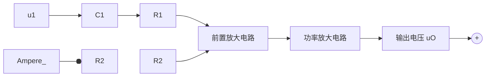
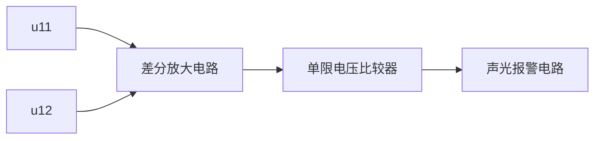
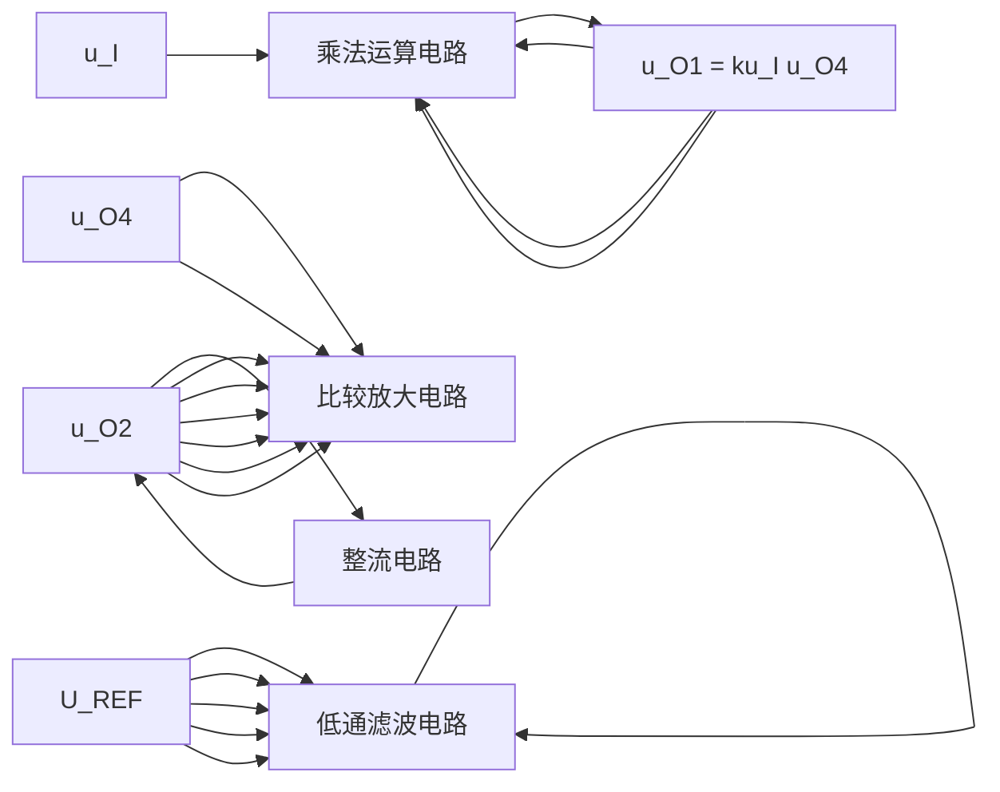
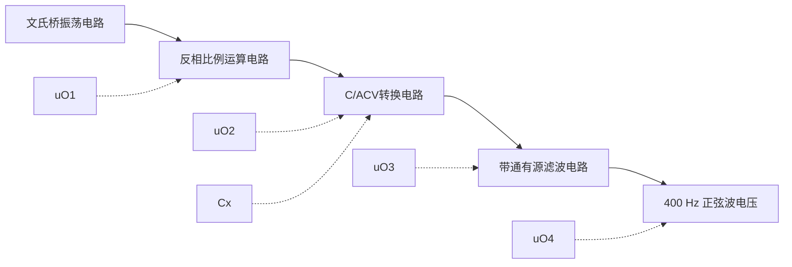
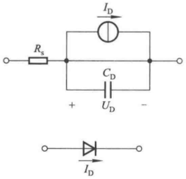
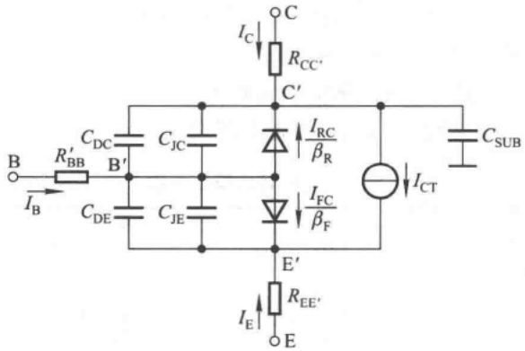
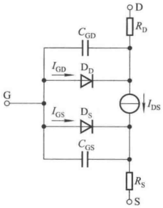
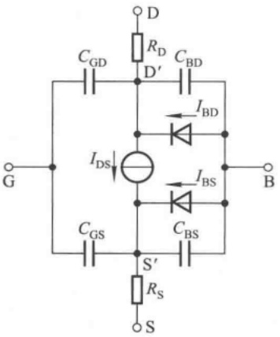
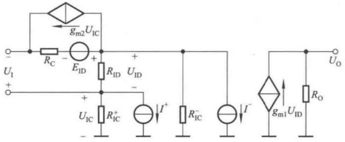
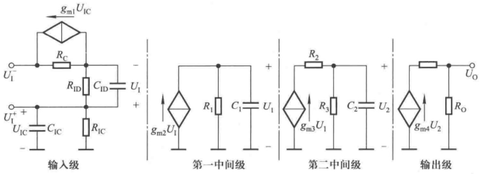

text_image

R2
100 kΩ
C1
1 μF
R1
10 kΩ
5pF
C2
-
A
+
-
u1
-
R3
4.7kΩ
D1
C3
0.1 μF
D2
D3
0.1 μF
C4
Rw
500 Ω
R4
4.7kΩ
T1
T2
T3
T4
+VCC
(+15 V)
R5
560 Ω
R8
0.5 Ω
R6
560 Ω
R7
0.5 Ω
RL
uo
-
T5
T6
-VCC
(-15 V)

图 10.3.1 低频功率放大电路

## 一、化整为零

对于分立元件电路,应根据信号的传递方向,分解电路。

$R_{2}$  将电路的输出端与 A 的反相输入端连接起来, 因而电路引入了反馈。由于图 10.3.1 所示电路为放大电路, 可以推测它引入的应为负反馈, 进一步的分析还需在弄清电路的基本组成之后。

$C_{1}$  为耦合电容。输入电压  $U_{i}$  作用于 A 的反相输入端，A 的输出又作用于  $T_{3}$  和  $T_{5}$  管的基极，故集成运放 A 为前置放大电路，且  $T_{3}$  和  $T_{5}$  为下一级的放大管； $T_{3}$  和  $T_{4}$ 、 $T_{5}$  和  $T_{6}$  分别组成复合管，前者等效为 NPN 型管，后者等效为 PNP 型管，A 的输出作用于两个复合管的基极，而且两个复合管的发射极作为输出端，故第二级为互补输出级；因此可以判断出电路是两级电路。

因为  $T_{1}$ 、 $T_{2}$  的基极和发射极分别接  $R_{7}$  和  $R_{8}$  的两端，而  $R_{7}$  和  $R_{8}$  上的电流等于输出电流  $I_{0}$ ；可以推测，当  $I_{0}$  增大到一定数值， $T_{1}$ 、 $T_{2}$  才导通，可以为功放管分流，所以  $T_{1}$ 、 $T_{2}$ 、 $R_{7}$  和  $R_{8}$  构成过流保护电路。

利用反馈的判断方法可以得出,图 10.3.1 所示电路引入的是电压并联负反馈。

## 二、分析功能

对于功率放大电路,通常均应分析其最大输出功率和效率。在图 10.3.1 所示电路中,由于电流采样电阻  $R_{7}$  和  $R_{8}$  的存在,负载上可能获得的最大输出电压幅值为

$$
U _ {\mathrm{omax}} = \frac {R _ {\mathrm{L}}}{R _ {8} + R _ {\mathrm{L}}} \cdot (V _ {\mathrm{CC}} - U _ {\mathrm{CES}}) \tag {10.3.1}
$$

式中 $U_{\mathrm{CES}}$ 为 $\mathrm{T_4}$ 管的饱和管压降。最大输出功率为

$$
P _ {\mathrm{om}} = \frac {\left(\frac {U _ {\mathrm{omax}}}{\sqrt {2}}\right) ^ {2}}{R _ {\mathrm{L}}} = \frac {U _ {\mathrm{omax}} ^ {2}}{2 R _ {\mathrm{L}}} \tag {10.3.2}
$$

在忽略静态损耗的情况下,效率为

$$
\eta = \frac {\pi}{4} \cdot \frac {U _ {\mathrm{omax}}}{V _ {\mathrm{CC}}} \tag {10.3.3}
$$

可见电流采样电阻使得负载上的最大不失真输出电压减小,从而使最大输出功率减小,效率降低。

设功放管饱和管压降的数值为 3 V, 负载为 10 Ω, 则最大不失真输出电压幅值为

$$
U _ {\mathrm{omax}} = \frac {R _ {\mathrm{L}}}{R _ {\mathrm{g}} + R _ {\mathrm{L}}} \cdot (V _ {\mathrm{CC}} - U _ {\mathrm{CES}}) = \left[ \frac {1 0}{1 0 + 0 . 5} \times (1 5 - 3) \right] \mathrm{V} \approx 1 1. 4 3 \mathrm{V}
$$

最大输出功率为

$$
P _ {\mathrm{om}} = \frac {U _ {\mathrm{omax}} ^ {2}}{2 R _ {\mathrm{L}}} \approx \frac {1 1 . 4 3 ^ {2}}{2 \times 1 0} \mathrm{W} \approx 6. 5 3 \mathrm{W}
$$

效率

$$
\eta = \frac {\pi}{4} \cdot \frac {U _ {\mathrm{omax}}}{V _ {\mathrm{CC}}} \approx \frac {\pi}{4} \cdot \frac {1 1 . 4 3}{1 5} \approx 5 9.8\%
$$

一旦输出电流过流， $T_{1}$  和  $T_{2}$  管将导通，为功放管分流，保护电流的数值为

$$
i _ {\mathrm{omax}} = \frac {U _ {\mathrm{on}}}{R _ {7}} \approx \frac {0 . 7}{0 . 5} \mathrm{A} = 1. 4 \mathrm{A}
$$

## 三、统观整体

综上所述,图 10.3.1 所示电路的方框图如图 10.3.2(a) 所示。若仅研究反馈,则可将电路简化为图(b)所示电路。

flowchart

(a)

text_image

C₁
R₁
u₁
R₂
A
+
-
uₒ

(b)

图 10.3.2 图 10.3.1 所示电路的方框图和简化电路

(a) 方框图 (b) 简化电路

根据图(b)所示电路,可以求得深度负反馈条件下电路的电压放大倍数为

$$
A _ {u f} \approx - \frac {R _ {2}}{R _ {1}} = - 1 0
$$

从而获得在输出功率最大时所需要的输入电压有效值为

$$
U _ {\mathrm{i}} = \left| \frac {U _ {\mathrm{omax}}}{\sqrt {2} A _ {\mathrm{uf}}} \right| \tag {10.3.4}
$$

其它器件作用如下:

(1)  $C_{2}$  为相位补偿电容, 它改变了频率响应, 可以消除自激振荡。
(2) $R_{3}$ 、 $D_{1}$ 、 $D_{2}$ 、 $D_{3}$ 、 $R_{w}$ 和 $R_{4}$ 构成偏置电路，使输出级消除交越失真。
(3) $C_{3}$  和  $C_{4}$  为旁路电容, 使  $T_{3}$  和  $T_{5}$  的基极动态电位相等, 以减少有用信号的损失。
（4） $R_{5}$  和  $R_{6}$  为泄漏电阻，用以减小  $T_{4}$  和  $T_{6}$  的穿透电流。其值不可过小，否则将使有用信号损失过大。

## 10.3.2 火灾报警电路

图 10.3.3 所示为火灾报警电路， $u_{11}$  和  $u_{12}$  分别来源于两个温度传感器，它们安装在室内同一处。但是，一个安装在金属板上，产生  $u_{11}$ ；而另一个安装在塑料壳体内部，产生  $u_{12}$ 。

text_image

u12○─R1─┐
          │
          ──A1
          │
          └─VCC
          │
          └─R2
          │
          │
          │
          │
          │
          │
          │
          │
          │
          │
          │
          │
          │
          │
          │
          │
          │
          │
          │
          │
          │
          │
          │
          │
          │
          │
          │
          │
          │
          │
          │
          │
          │
          │

R2─┐
          │
          ──A1
          │
          └─VCC
          │
          │
          │
          │
          │
          │
          │
          │
          │
          │
          │
          │
          │
          │
          │
          │
          │
          │
          │
          │
          │
          │
          │
          │
          │
          │
          │
          │
          │
          │
          │
          │
          │

图 10.3.3 火灾报警电路

## 一、了解用途

在正常情况下，即无火情时，两个温度传感器所产生的电压相等， $u_{11}=u_{12}$ ，发光二极管不亮，蜂鸣器不响。有火情时，安装在金属板上的温度传感器因金属板导热快而温度升高较快，而安装在塑料壳体内的温度传感器温度上升得较慢，使 $u_{11}$ 与 $u_{12}$ 产生差值电压。差值电压增大到一定数值时，发光二极管发光、蜂鸣器鸣叫，同时报警。

## 二、化整为零

分析由单个集成运放所组成应用电路的功能时,可根据其有无引入反馈以及反馈的极性,来判断集成运放的工作状态和电路输出与输入的关系。

根据信号的流通,图 10.3.3 所示电路可分为三部分。 $A_{1}$  引入了负反馈,故构成运算电路; $A_{2}$  没有引入反馈,工作在开环状态,故组成电压比较器;后面分立元件电路是声光报警及其驱动电路。

## 三、分析功能

输入级参数具有对称性,是双端输入的比例运算电路,也可实现差分放大,输出电压 $u_{01}$ 为

$$
u _ {\mathrm{01}} = \frac {R _ {2}}{R _ {1}} (u _ {\mathrm{11}} - u _ {\mathrm{12}}) \tag {10.3.5}
$$

第二级电路的阈值电压  $U_{T}$  为

$$
U _ {\mathrm{T}} = \frac {R _ {4}}{R _ {3} + R _ {4}} \cdot V _ {\mathrm{cc}} \tag {10.3.6}
$$

当  $u_{01} < U_{T}$  时， $u_{02} = U_{OL}$ ; 当  $u_{01} > U_{T}$  时， $u_{02} = U_{OH}$ ; 电路只有一个阈值电压，故为单限比较器。 $u_{02}$  的高、低电平决定于集成运放输出电压的最小值和最大值。电压传输特性如图 10.3.4 所示。

当  $u_{02}$  为高电平时, 发光二极管因导通而发光, 与此同时晶体

line

| uO1 | uO2 |
| --- | --- |
| 0 | UOL |
| UT | UOL |
| UT | UOH |
| >UT | UOH |

图 10.3.4  $A_{2}$  组成的电压比较器的电压传输特性

管 T 导通,蜂鸣器鸣叫。发光二极管的电流为

$$
I _ {\mathrm{D}} = \frac {U _ {\mathrm{OH}} - U _ {\mathrm{D}}}{R _ {5}} \tag {10.3.7}
$$

晶体管的基极电流为

$$
I _ {\mathrm{B}} = \frac {U _ {\mathrm{OH}} - U _ {\mathrm{BE}}}{R _ {6}} \tag {10.3.8}
$$

集电极电流,即蜂鸣器的电流为

$$
I _ {\mathrm{C}} = \beta I _ {\mathrm{B}} \tag {10.3.9}
$$

若参数选择的结果是晶体管在导通时处于饱和状态,则

$$
I _ {\mathrm{C}} = \frac {V _ {\mathrm{CC}} - U _ {\mathrm{CES}}}{R _ {\mathrm{L}}} \leqslant \beta I _ {\mathrm{B}} \tag {10.3.10}
$$

式中  $U_{CES}$  为管子的饱和管压降,  $R_{L}$  是蜂鸣器等效电阻。

## 四、统观整体

根据上述分析,图 10.3.4 所示电路的方框图如图 10.3.5 所示。

flowchart

图 10.3.5 火灾报警电路的方块图

在没有火情时， $(u_{11}-u_{12})$  数值很小， $u_{01}<U_{T},u_{02}=U_{0L}$ ，发光二极管和晶体管均截止。

当有火情时， $u_{11} > u_{12}$ ， $(u_{11} - u_{12})$ 增大到一定程度， $u_{01} > U_{T}$ ， $u_{02}$ 从低电平跃变为高电平， $u_{02} = U_{OH}$ ，使得发光二极管和晶体管导通，发光二极管和蜂鸣器发出警告。

## 10.3.3 自动增益控制电路

自动增益控制电路如图 10.3.6 所示,为了便于读懂,这里作了适当的简化。

text_image

u1
ux
UY
R7
uO4
A4
+
-
R6
uO3
R6
R7
UREF
R1
R8
R2
A1
+
-
A3
-
+
C
R5
uO2
D2
R4
D1
R3
uO
A2
+
-

图 10.3.6 自动增益控制电路

## 一、了解功能

图 10.3.6 所示电路用于自动控制系统之中。输入电压为正弦波，当其幅值由于某种原因产生变化时，增益产生相应变化，使得输出电压幅值基本不变。

## 二、化整为零

以模拟集成电路为核心器件分解图10.3.6所示电路，可以看出，每一部分都是一种基本电路。第一部分是模拟乘法器。第二部分是由 $\mathrm{A}_1, R_1, R_2$ 和 $R_8$ 构成的同相比例运算电路，其输出为整个电路的输出。第三部分是由 $\mathrm{A}_2, R_3, R_4, \mathrm{D}_1$ 和 $\mathrm{D}_2$ 构成的精密整流电路。第四部分是由 $\mathrm{A}_3, R_5$ 和 $C$ 构成的有源滤波电路。第五部分是由 $\mathrm{A}_4, R_6$ 和 $R_7$ 构成的差分放大电路。$\mathrm{A}_4$ 的输出电压 $u_{04}$ 作为模拟乘法器的输入，与输入电压 $u_1$ 相乘，因此电路引入了反馈，是一个闭环系统。

## 三、功能分析

根据所学知识可知,模拟乘法器的输出电压

$$
u _ {0 1} = k u _ {\mathrm{X}} u _ {\mathrm{Y}} = k u _ {1} u _ {0 4} \tag {10.3.11}
$$

同相比例运算电路的输出电压 $u_{0}$ 为

$$
u _ {0} = \left(1 + \frac {R _ {2}}{R _ {1}}\right) u _ {0 1} \tag {10.3.12}
$$

设 $R_{3} = R_{4}$ ，则精密整流电路的输出电压 $u_{02}$ 为

$$
u _ {0 2} = \left\{ \begin{array}{l l} 0 & u _ {0} > 0 \\ - u _ {0} & u _ {0} <   0 \end{array} \right. \tag {10.3.13}
$$

因此为半波整流电路。

有源滤波电路的电压放大倍数为

$$
A _ {u} = \frac {U _ {0 3}}{U _ {0 2}} = \frac {1}{1 + \mathrm{j} \frac {f}{f _ {\mathrm{H}}}} \quad \left(f = \frac {1}{2 \pi R _ {5} C}\right) \tag {10.3.14}
$$

可见电路为低通滤波电路。当参数选择合理时，可使输出电压 $u_{03}$ 为直流电压 $U_{03}$，且 $U_{03}$ 正比于输出电压 $u_{0}$ 的幅值。

在差分放大电路中,输出电压  $u_{04}$  为

$$
u _ {0 4} = \frac {R _ {7}}{R _ {6}} (U _ {\mathrm{REF}} - U _ {0 3}) = A _ {u 4} (U _ {\mathrm{REF}} - U _ {0 3}) \tag {10.3.15}
$$

因而 $u_{04}$ 正比于基准电压 $U_{\mathrm{REF}}$ 与 $U_{03}$ 的差值。

## 四、统观整体

根据上述分析,可以得到各部分电路的关系,图 10.3.6 所示电路的方框图如图 10.3.7 所示。

根据式(10.3.11)、(10.3.12)、(10.3.15)，输出电压的表达式为

$$
u _ {0} = k u _ {1} u _ {0 4} = k \left(1 + \frac {R _ {2}}{R _ {1}}\right) \frac {R _ {7}}{R _ {6}} (U _ {\mathrm{REF}} - U _ {0 3}) u _ {1} \tag {10.3.16}
$$

设输入电压 $u_{1}$ 幅值增大，则输出电压 $u_{0}$ 的幅值随之增大，$U_{03}(U_{03}$ 正比于输出电压 $u_{0}$ )必然增大，导致 $(U_{\mathrm{REF}} - U_{03})$ 减小，从而使 $u_{0}$ 幅值减小；若 $u_{1}$ 幅值减小，则各部分的变化与上述过程相反。在参数选择合适的条件下，在一定的频率范围内，通过电路增益的自动调节，对于不同幅值的正弦波 $u_{1}, u_{0}$ 的幅值可基本不变。

flowchart

图 10.3.7 图 10.3.6 所示电路的方框图

## 10.3.4 电容测量电路

DT890C$_{+}$型 3 $\frac{1}{2}$位多功能数字多用表包括 12 个组成部分,有 A/D 转换器、小数点及标志符驱动电路、直流电压测量电路、交流电压测量电路、直流电流测量电路、交流电流测量电路、200 Ω \~ 20 MΩ电阻测量电路、200 MΩ 电阻测量电路、电容测量电路、温度测量电路、晶体管 h$_{FE}$ 测量电路、二极管及蜂鸣器电路等。电路中共用 6 片集成电路,分别是一片 3 $\frac{1}{2}$A/D 转换器(型号为 TSC7106)、一片 CMOS 四与非门(型号为 CC4011)、两片低失调 JEFT 双运放(型号为 TL062)和两片低功耗通用双运放(型号为 LM358)。

图 10.3.8 所示为五量程电容测量电路, 其输出电压通过 AC/DC(交流/直流)转换器和 A/D (模拟/数字)转换器, 驱动液晶显示器, 即获得测量值, 方框图如图 10.3.9 所示。其中 AC/DC 转换器、A/D 转换器和液晶显示器是 DT890C $_{+}$ 型数字多用表中的公用电路。下面仅对图 10.3.8 所示电路加以分析。

text_image

AC/DC 转换器
S20
20 μF
R30
900 Ω
2 μF
R29
9 kΩ
200 nF
R28
90 kΩ
20 nF
R27
900 kΩ
2000 pF
uO4
A4
+
-
R18
168 kΩ
C10
0.01 μF 0.01 μF
C11
R19
11 kΩ
C9
0.01 μF
R16
100 Ω
R17
76.8 kΩ
uO3
A3
+
-
测试插座
CX
D12
D11
D10
D9
uO2
Rw1
200 Ω
R15
100 Ω
R11
39.2 kΩ
C8
0.01 μF
A1
+
-
R12
39.2 kΩ
R13
4.1 kΩ
R14
1.91 kΩ
10 kΩ
R65
uO1

图 10.3.8 五量程电容测量电路

flowchart

图 10.3.9 电容测量电路及其输出电压转换电路方框图

## 一、了解功能

在 DT890C$_{4}$型多功能数字多用表中，是利用容抗法测量电容量的。其基本设计思想是:将 400 Hz 的正弦波信号作用于被测电容 $C_{x}$，利用所产生的容抗 $X_{c}$ 实现 C/ACV 转换，将 $X_{c}$ 转换为交流电压；再通过测量交流电压来获得 $C_{x}$ 的电容量。

测量范围分为 2 nF、20 nF、200 nF、2 μF 和 20 μF 五挡，测量准确度为 ±2.5%。分辨率取决于 A/D 转换器的位数，当采用 TSC7106 时，最高分辨率为 1 pF。

图 10.3.8 所示电路中  $A_{1}$  和  $A_{2}$  是一片 TL062,  $A_{3}$  和  $A_{4}$  是一片 LM358。

## 二、化整为零

观察图10.3.8所示电路，以集成运放为核心器件可将其分解为四个部分。 $\mathrm{A}_{1}$ 和 $C_8, C_9, R_{11}, R_{12}, R_{13}, R_{14}$ 组成文氏桥振荡电路； $\mathrm{A}_{2}$ 和 $R_{65}, R_{15}, R_{\mathrm{w1}}$ 组成反相比例运算电路； $\mathrm{A}_{2}$ 的输出电压在被测电容 $C_{\mathrm{x}}$ 上产生电流，通过 $\mathrm{A}_{3}$ 及其有关元件组成的电路将电容量转换成交流电压，故组成C/ACV电路； $\mathrm{A}_{4}$ 和 $R_{17}, R_{18}, R_{19}, C_{10}, C_{11}$ 组成有源滤波电路，根据整个电路的功能，该滤波电路应只允许$400\mathrm{Hz}$ 正弦波信号通过，而滤掉其它频率的干扰，故为带通滤波电路。

## 三、功能分析

## 1. 文氏桥振荡电路

振荡频率的表达式为

$$
f _ {0} = \frac {1}{2 \pi \sqrt {R _ {1 1} R _ {1 2} C _ {8} C _ {9}}} \tag {10.3.17}
$$

因为  $R_{11}=R_{12}=39.2\ k\Omega, C_{8}=C_{9}=0.01\ \mu F$ ，所以

$$
f _ {0} = \frac {1}{2 \pi R _ {1 1} C _ {8}} = \left(\frac {1}{2 \pi \times 3 9 . 2 \times 1 0 ^ {3} \times 0 . 0 1 \times 1 0 ^ {- 6}}\right) \mathrm{Hz} \approx 4 0 0 \mathrm{Hz}
$$

## 2. 反相比例运算电路

比例系数为

$$
A _ {u} = - \frac {R _ {1 5} + R _ {\mathrm{w1}}}{R _ {6 5}} \tag {10.3.18}
$$

式中  $R_{w1}$  为电容挡的校准电位器，调节  $R_{w1}$  可以改变比例系数。该电路还起缓冲作用，隔离振荡电路和被测电容。

## 3. C/ACV 转换电路

电路的输入电抗为被测电容的容抗,即

$$
X _ {C _ {\mathrm{X}}} = \frac {1}{\mathrm{j} \omega C _ {\mathrm{X}}} = \frac {1}{\mathrm{j} 2 \pi f C _ {\mathrm{X}}} \tag {10.3.19}
$$

当电容量程不同时,电路的反馈电阻  $R_{f}$  将不同(如表 10.3.1 所示),转换关系也将不同。

转换系数为

$$
\dot {A} _ {u 3} = \frac {\dot {U} _ {\mathrm{o3}}}{\dot {U} _ {\mathrm{o2}}} = - \frac {R _ {\mathrm{f}}}{X _ {C _ {\mathrm{x}}}} = - \frac {R _ {\mathrm{f}}}{1 / (2 \pi \mathrm{j} f C _ {\mathrm{x}})} = - 2 \pi \mathrm{j} f R _ {\mathrm{f}} C _ {\mathrm{x}}
$$

表 10.3.1 不同量程时 C/ACV 转换电路的反馈电阻  $R_{f}$

| 电容量程 | $R_{\mathrm {f}}$的表达式 | $R_{\mathrm {f}}$的数值 |
| --- | --- | --- |
| 20 μF | $R_{16}$ | 100 Ω |
| 2 μF | $R_{16} + R_{30}$ | 1 kΩ |
| 200 nF | $R_{16} + R_{30} + R_{29}$ | 10 kΩ |
| 20 nF | $R_{16} + R_{30} + R_{29} + R_{28}$ | 100 kΩ |
| 2000 pF | $R_{16} + R_{30} + R_{29} + R_{28} + R_{27}$ | 1 MΩ |

其模为  $\left|\dot{A}_{u3}\right|=2\pi f R_{f} C_{x}$  (10.3.20)

式中 $f = 400\mathrm{Hz}$ ，若在 $200\mathrm{nF}$ 挡，从表10.3.1中可知 $R_{\mathrm{F}} = 10\mathrm{k}\Omega$ ，则

$$
\mid \dot {A} _ {u 3} \mid = 2 \pi f R _ {\mathrm{f}} C _ {\mathrm{X}} = 2 \pi \times 4 0 0 \times 1 0 \times 1 0 ^ {3} C _ {\mathrm{X}} = 8 \pi \times 1 0 ^ {6} \times C _ {\mathrm{X}}
$$

其最大值为

$$
\left| \dot {A} _ {u 3} \right| _ {\max} = 8 \pi \times 1 0 ^ {6} \times C _ {\mathrm{X}} = 8 \pi \times 1 0 ^ {6} \times 2 0 0 \times 1 0 ^ {- 9} \approx 5. 0 3
$$

从表 10.3.1 中可以看出,电容量每增大 10 倍,反馈电阻阻值减小 10 倍。因此,不难发现,在各电容挡,电路的转换系数的最大数值均相等。这样,可以保证对于各电容挡输出电压最大幅值均相等,也就限制了 A/D 转换电路的最大输入电压。

输出电压有效值为

$$
U _ {\mathrm{o3}} = \mid \dot {A} _ {u 3} \mid U _ {\mathrm{o2}} = 2 \pi f R _ {\mathrm{f}} C _ {\mathrm{X}} U _ {\mathrm{o2}} \tag {10.3.21}
$$

当 400 Hz 正弦波信号  $U_{o2}$  幅值一定时，电容挡确定， $R_{f}$  也就随之确定，因而  $U_{o3}$  与被测电容容量  $C_{X}$  成正比。

## 4. 有源滤波电路

从测量的需要出发,该电路应为带通滤波电路。为了便于识别电路,首先将电路变为习惯画法,如图10.3.10所示,这是一个多路反馈无限增益电路。

经推导可得中心频率为

$$
f _ {0} = \frac {1}{2 \pi C _ {1 0}} \sqrt {\frac {1}{R _ {1 8}} \left(\frac {1}{R _ {1 7}} + \frac {1}{R _ {1 9}}\right)} \tag {10.3.22}
$$

text_image

C₁₀
R₁₇
C₁₁
R₁₈
Uₒ₃
A₄
+
R₁₉
Uₒ₄

图 10.3.10 多路反馈无限增益带通滤波电路

将  $C_{10}=0.01\mu F, R_{18}=168k\Omega, R_{17}=76.8k\Omega, R_{19}=11k\Omega$  代入上式，得出  $f_{0}\approx400Hz$ 。因此，有源滤波电路只允许  $u_{03}$  中 400 Hz 信号通过，而滤去其它频率的干扰。

可见，输出电压  $u_{04}$  是幅值与被测电容  $C_{x}$  容量成正比关系的 400 Hz 交流电压。

## 四、统观整体

根据上述四部分的关系,可得图 10.3.8 所示电路的方框图如图 10.3.11 所示。

flowchart

图 10.3.11 图 10.3.8 所示电路的方框图

综上所述，在测量电容量时，文氏桥振荡电路产生400 Hz正弦波电压，经过反相比例运算电路作为缓冲电路，作用于被测电容 $C_{x}$ ；通过C/ACV转换电路将 $C_{x}$ 转换为交流电压信号，再经二阶带通滤波电路滤掉其它频率的干扰，输出是幅值与 $C_{x}$ 成正比的400 Hz正弦波电压。

电容测量电路的输出电压作为 AC/DC 转换电路的输入信号,转换为直流电压;再由 A/D 转换电路转换成数字信号,并驱动液晶显示器,显示出被测电容的容量值。

电路有如下特点:

（1）在 C/ACV 转换电路中，电容挡愈大，反馈电阻阻值愈小，使得各挡转换系数的最大数值均相等，从而限制了整个电路的最大输出电压幅值，也就限制了 A/D 转换电路的最大输入电压，其值为 200 mV。
（2）电路中所有集成运放的输入均为交流信号，因而其温漂不会影响电路的测量精度，也就不需要对电容挡手动调零。电路中仅有一个电位器 $R_{w1}$ 用于校准电容挡，一般一经调好就不再变动。
（3）二极管  $D_{9}$  和  $D_{10}$  用于  $A_{2}$  输出电压的限幅，二极管  $D_{11}$  和  $D_{12}$  用于限制  $A_{3}$  净输入电压幅值，以保护运放。此外，尽管电容挡不允许带电测量，但是若发生误操作，则二极管可为被测电容提供放电回路，从而在一定程度上保护了测量电路。

## 本章小结

本章回顾了书中所讲述的基本电路和基本分析方法,介绍了电子电路读图的一般方法,并通过实例具体说明了分析步骤。

模拟电子电路种类繁多,千差万别,能够读懂实用电路,必须综合运用所学知识。本章介绍的“了解用途、化整为零、分析功能、统观整体、性能估算”的基本读图方法和步骤适用于一般电路。通过读图,能够训练电路的识别能力、电路性能的评估能力和电子系统的集成能力。

在读图时还应注意:

(1) 本章所介绍的读图方法是一般方法, 使用时应视具体电路灵活应用。
（2）了解所读电路的用途，以及根据“用途”研究对电路性能的要求，对于读图有指导意义。特别是读者不太熟悉的应用领域，“了解用途”是关键步骤，否则将无从下手。
（3）“化整为零”时应以“能够识别”为原则，因而掌握基本电路的组成、原理和性能是读图的基础，同时还要不断丰富基本知识，拓宽知识面。
(4) 在很多实用电路中, 电路的画法、元器件的符号与本书的习惯相差很大, 因此, 为了方便读图, 读者可首先将图中符号和电路画法改成习惯的形式。
（5）随着电子技术的发展，集成电路的功能越来越强，因而实用电路中所用芯片的数量也就越来越少，有的还采用了专用芯片。所以，在分析电路性能时，需要查阅有关手册和生产厂家的网上资料，了解所用元器件的基本功能和性能指标。
(6) 对于所读电路详细的定量分析应尽可能借助于电子电路计算机辅助分析软件。

应当指出,读图是工程技术人员的基本技能,单凭本章所介绍的知识,对读图能力的训练是非常有限的。只有不断跟踪电子器件的新发展,增加电子技术的基本知识,加强训练,积累经验,才能不断提高读图水平。

## 习题

10.1 电路如图 P10.1 所示, 其功能是实现模拟计算, 求解微分方程。

text_image

R1
R2
u1
R3
A1
+
-
R4
C
A2
+
-
uO
R9
R10
R8
A3
+
-
R7
R5
R6
R11

图 P10.1

(1) 求出微分方程；
(2) 简述电路原理。

10.2 图 P10.2 所示为反馈式稳幅电路, 其功能是: 当输入电压变化时, 输出电压基本不变。主要技术指标为

text_image

R1
4.7 kΩ
R2
1 kΩ
R3
82 kΩ
A1
+
-
R4
1 kΩ
C3
+
2 μF
R10
4.7 MΩ
R9
10 kΩ
R8
10 kΩ
C2
+
2 μF
uO2
D2
R6 10 kΩ
D1
C1
+
68 μF
R5
10 kΩ
uO
T
3DJ7
uO3
A3
+
-
Rw
1 kΩ
R11
3.3 kΩ
R12
3.3 kΩ
Dz
R13 1.8 kΩ
- VCC (-15V)
R7 5.1 kΩ

图P10.2

(1) 输入电压波动 20% 时, 输出电压波动小于 0.1%;
(2) 输入信号频率从 50\~2 000 Hz 变化时, 输出电压波动小于 0.1%;
(3) 负载电阻从  $10 \, k\Omega$  变为  $5 \, k\Omega$  时, 输出电压波动小于 0.1%。

要求:

(1) 以每个集成运放为核心器件,说明各部分电路的功能;

(2) 用方框图表明各部分电路之间的相互关系；
(3) 简述电路的工作原理。

提示:场效应管工作在可变电阻区,电路通过集成运放  $A_{3}$  的输出控制场效应管的工作电流,来达到调整输出电压的目的。

10.3 在图 P10.2 所示电路中, 参数如图中所标注。设场效应管 D-S 之间的等效电阻为  $r_{DS}$ 。

(1) 求出输出电压  $u_{0}$  与输入电压  $u_{1}, r_{DS}$  的运算关系式；说明当  $u_{1}$  增大时， $r_{DS}$  应如何变化才能使  $u_{0}$  稳幅？
(2) 当  $u_{1}$  为 1 kHz 的正弦波时, 定性画出  $u_{0}$  和  $u_{02}$  的波形。
（3） $u_{03}$ 是直流信号，还是交流信号，为什么？为使 $u_{0}$ 稳幅，当 $u_{1}$ 因某种原因增大时， $u_{03}$ 的幅值应当增大，还是减小，为什么？
(4) 电位器  $R_{w}$  的作用是什么?

10.4 在图 P10.2 所示电路中, 设场效应管 D-S 之间的等效电阻为  $r_{DS}$ 。为了使得输入电压  $u_{t}$  波动 20% 时, 输出电压  $u_{0}$  波动小于 0.1%,  $r_{DS}$  应变化百分之多少?

10.5 五量程电容测量电路如图 P10.5 所示, $C_{x}$ 为被测电容, 输出电压 $u_{0}$ 是一定频率的正弦波, $u_{0}$ 经 AC/DC 转换和 A/D 转换, 送入数字显示器, 即可得到测量结果。

(1) 以每个集成运放为核心器件,说明各部分电路的功能;
(2) 用方框图表明各部分电路之间的相互关系；
(3) 简述电路的工作原理。

10.6 电路如图 P10.5 所示, 试求解:

(1)  $u_{01}$  的频率；
(2) $u_{02}$ 与 $u_{01}$ 的运算关系式；
(3) 在五个量程中, $u_{03}$ 与 $u_{02}$ 的各运算关系式;
(4) $A_{4}$ 及其有关元件所组成的电路的中心频率为多少?

10.7 电路如图 P10.5 所示。回答下列问题:

text_image

C 0.01 μF
39.2 kΩ
R C
R
+
A1 uO1
R2 4.11 kΩ
R1 1.91 kΩ
R3 10 kΩ
D1 D2 D3 D4
+
A2 uO2
Rw 200 Ω
R4 100 Ω
Cx
+
A3 uO3
76.8 kΩ
R5 100 Ω
R6 900 kΩ R7 90 kΩ R8 9 kΩ R9 900 Ω
2000 pF 20 nF 200 nF 2 μF 20 μF
R10 C1 0.01 μF C2 0.01 μF
R11 11 kΩ
A4 uO
R12 167 kΩ

图 P10.5

（1）在不同量程下， $u_{03}$ 与 $u_{02}$ 转换系数的最大值为多少？为什么这样设计？简述理由。
(2) 为什么  $u_{01}$  的频率和由  $A_{4}$  及其有关元件所组成的电路的中心频率相同？简述理由。
(3) 二极管  $D_{1} \sim D_{4}$  的作用是什么?

10.8 直流稳压电源如图 P10.8 所示。

(1) 用方框图描述电路各部分的功能及相互之间的关系；

（2）已知 W117 的输出端和调整端之间的电压为 1.25 V, 3 端电流可忽略不计, 求解输出电压  $U_{01}$  和  $U_{02}$  的调节范围, 并说明为什么称该电源为“跟踪电源”?

text_image

~220 V
50 Hz
+
u2
-
+
u2
-
D1
D2
D3
D4
U11
U12
+
C1
500 μF
+
C2
500 μF
-
+
W117M
1
2
3
R1
240 Ω
R2
3 kΩ
C3
5 μF
R3
1 kΩ
A
-
T2
T1
R4
1 kΩ
UO1
UO2

图 P10.8

10.9 电路如图 P10.8 所示。已知 W117 的输出端和调整端之间的电压为 1.25 V, 3 端电流可忽略不计，输出电流的最小值为 5 mA; 1 和 2 端之间电压大于 3 V 才能正常工作，小于 40 V 才不至于损坏；晶体管 T₁ 饱和管压降的数值为 3 V；电网电压波动范围为 ±10%。

(1) 求解输出电压  $U_{01}$  和  $U_{02}$  的调节范围；
(2) 为使电路正常工作, 在电网电压为  $220 \, V$  时,  $U_{1}$  的取值范围为多少?
(3) 若在电网电压为 220 V 时,  $U_{1}=32V$ , 则变压器二次电压有效值  $U_{2}$  约为多少伏?

10.10 电路如图 P10.8 所示。回答下列问题:

(1) 电路中各电容的作用；
(2) 二极管  $D_{5}$  的作用；
(3) 调整管为什么采用复合管。

## 附录

## 半导体器件模型

在电子电路的分析计算中,通常将半导体器件用其等效模型取代。在本教材中,第1章介绍的二极管等效模型,第2章介绍的晶体管和场效应管h参数等效模型,第3章介绍的集成运放等效模型,第4章介绍的晶体管和场效应管高频等效模型,共同的特点是用于特定条件下的近似分析,因而尽量简化。而在利用计算机辅助分析和设计(Computer Aided Design,简称CAD)电子电路时,构造电子器件等效模型的出发点是如何更正确和准确地反映其各方面的特性,从而使分析结果更精确,因此所采用的模型要比前面所介绍的复杂得多,它们是在器件物理原理基础上构造而成的。为描述半导体器件的复杂特性,需用较多的模型参数;例如,晶体管和场效应管的模型参数就有40个之多,即使比较简化的EM2模型也有十几个参数。

本节对 SPICE 中半导体器件模型加以简单介绍 $^{①}$ ，并在此基础上介绍 Multisim 中模型参数与之相同和不同之处。

## 一、二极管的模型及其参数

二极管的模型如图1所示。图中 $R_{\mathrm{s}}$ 为二极管的材料电阻，称为欧姆电阻； $C_\mathrm{D}$ 为二极管等效电容； $I_{\mathrm{D}}$ 为二极管的电流。设二极管端电压为 $U_{\mathrm{D}}$ ，则 $I_{\mathrm{D}}$ 和 $U_{\mathrm{D}}$ 的关系为

$$
I _ {\mathrm{D}} = f (U _ {\mathrm{D}}) = \left\{ \begin{array}{l l} (\mathrm{e} ^ {q U _ {\mathrm{D}} / n k T} - 1) + U _ {\mathrm{D}} G _ {\min} & - 5 \frac {n k T}{q} \leqslant U _ {\mathrm{D}} \\ - I _ {\mathrm{S}} + U _ {\mathrm{D}} G _ {\min} & - B U <   U _ {\mathrm{D}} <   - 5 \frac {n k T}{q} \\ - I _ {\mathrm{BU}} & U _ {\mathrm{D}} = - B U \\ - I _ {\mathrm{S}} \Big [ \mathrm{e} ^ {- q (B U + U _ {\mathrm{D}}) / k T} - 1 + \frac {q B U}{k T} \Big ] & U _ {\mathrm{D}} <   - B U \end{array} \right.
$$

其中  $I_{s}$  ——反向饱和电流(A);

q——电子电荷 $(1.602 \times 10^{-19}C)$ ;

k——玻尔兹曼常数 $(1.38 \times 10^{-23} \text{J/K})$ ;

T——绝对温度(K);

N——发射系数(硅管1.2\~2.0);

BU——反向击穿电压(V);

$I_{BU}$ ——反向击穿时的电流(A);

$G_{min}$ ——是 SPICE 程序中非线性支路的一个给定小电导，隐含值为  $10^{-12}S$ ，一般情况下不影响二极管的特性。

text_image

I_D
R_s
C_D
U_D
+
-
I_D

图 1 二极管的模型

<small>① 附录中所涉及内容的详细分析可参阅《电子电路的计算机辅助分析与设计方法》(汪蕙、王志华编著, 清华大学出版社 1996 年出版) 第 3 章。为便于参阅, 本节中所用符号与上述参考书中基本相同。</small>

二极管的等效电容  $C_{D}$  为结电容  $C_{j}$ ，它是势垒电容  $C_{b}$  和扩散电容  $C_{d}$  之和，即

$$
C _ {\mathrm{j}} = C _ {\mathrm{b}} + C _ {\mathrm{d}}
$$

其中 $C_{\mathrm{d}} = \tau_{\mathrm{D}}\frac{\mathrm{d}I_{\mathrm{D}}}{\mathrm{d}U_{\mathrm{D}}}$ （ $\tau_{\mathrm{D}}$ 为少数载流子的渡越时间）

$$
C _ {\mathrm{b}} = \left\{ \begin{array}{l l} C _ {\mathrm{j0}} \left(1 - \frac {U _ {\mathrm{D}}}{\varphi_ {\mathrm{D}}}\right) ^ {- m} & U _ {\mathrm{D}} <   F C \times \varphi_ {\mathrm{D}} \\ \frac {C _ {\mathrm{j0}}}{(1 - F C) ^ {1 + m}} \Big [ 1 - F C (1 + m) + \frac {m U _ {\mathrm{D}}}{\varphi_ {\mathrm{D}}} \Big ] & U _ {\mathrm{D}} \geqslant F C \times \varphi_ {\mathrm{D}} \end{array} \right.
$$

其中  $C_{j0}$  ——零偏置时 PN 结的电容；

$\varphi_{D}$ ——PN 结自建电势,二极管的典型值为  $0.7 \sim 0.8$  V;

m——电容梯度因子,典型值为0.3\~0.5;

FC——正偏耗尽电容公式的系数,典型值为0.5。

综上所述,二极管的模型参数共14个,如表1所示。

表 1 二极管的模型参数

| 序号 | 符号 | SPICE关键字 | 名称 | 隐含值 | 单位 | 举例 |
| --- | --- | --- | --- | --- | --- | --- |
| 1 | IS | IS | 反向饱和电流 | 10-14 | A | 2x10-15A |
| 2 | Rs | RS | 欧姆电阻 | 0 | Ω | 10Ω |
| 3 | n | N | 发射系数 | 1 |  | 1.2 |
| 4 | τD | TT | 渡越时间 | 0 | s | 1 ns |
| 5 | Cjo | CJO | 零偏置电容 | 0 | F | 2 pF |
| 6 | φD | VJ | 结电压 | 1 | V | 0.6 V |
| 7 | m | M | 电容梯度因子 | 0.5 |  | 0.33 |
| 8 | Eg | EG | 禁带宽度 | 1.11 | eV | 1.11 eV(硅)0.69 eV(锑)0.67 eV(锗) |
| 9 | pt | XTI | 饱和电流温度系数 | 3.0 |  | 3.0 |
| 10 | FC | FC | 正偏耗尽层电容公式系数 | 0.5 |  | 0.5 |
| 11 | BV | BV | 反向击穿电压 | ∞ | V | 40 V |
| 12 | IBV | IBV | 反向击穿时电流 | 10-3 | A | 10-3A |
| 13 | Kf | KF | 闪烁噪声系数 | 0 |  |  |
| 14 | af | AF | 闪烁噪声指数 | 1 |  |  |

在 Multisim V7 中, 虚拟二极管和实际二极管模型参数均与 SPICE 中的完全相同。

## 二、晶体三极管的模型及其参数

晶体三极管(简称BJT)的模型种类很多,应用最为广泛的是Ebers-Moll模型(简称EM模型)和Gummel-Poon模型(GP模型)。其中EM模型从1954年诞生时的简单非线性直流模型EM1,逐渐改进,已成为包括各种效应的较为完善的通用模型EM3。GP模型与EM3等价,是一种数学推导上更加严格和完整的模型。

晶体管的 EM2 模型如图 2 所示, 它不但反映了晶体管的直流特性, 而且在一定程度上描述了其频域和时域特性。其中  $r_{CC'}$ 、 $r_{EE'}$  和  $r_{BB'}$  分别为集电极、发射极和基极的欧姆电阻,  $C_{DC}$ 、 $C_{DE}$  为两个 PN 结的扩散电容,  $C_{JC}$ 、 $C_{JE}$  为两个 PN 结的势垒电容。 $C_{SUB}$  为衬底电容, 其典型值为 1\~2 pF。

text_image

B
I_B
R'_BB
C_DC
C_C
B'
C_JC
C_DE
C_JE
C'_C
C
I_C
R_CC'
C'
I_RC / β_R
I_FC / β_F
I_CT
C_SUB
E'
E
I_E
R_EE'
E

图 2 晶体管的 EM2 模型

电流源的电流为

$$
I _ {\mathrm{CT}} = I _ {\mathrm{FC}} - I _ {\mathrm{RC}} = I _ {\mathrm{S}} \Big [ \exp \bigg (\frac {q U _ {\mathrm {B^{\prime} E^{\prime}}}}{k T} \bigg) - \exp \bigg (\frac {q U _ {\mathrm {B^{\prime} C^{\prime}}}}{k T} \bigg) \Big ]
$$

晶体管三个极的电流为

$$
I _ {\mathrm{E}} = - \frac {I _ {\mathrm{FC}}}{\beta_ {\mathrm{F}}} - I _ {\mathrm{CT}}, \quad I _ {\mathrm{B}} = \frac {I _ {\mathrm{FC}}}{\beta_ {\mathrm{F}}} + \frac {I _ {\mathrm{RC}}}{\beta_ {\mathrm{R}}}, \quad I _ {\mathrm{C}} = I _ {\mathrm{CT}} - \frac {I _ {\mathrm{RC}}}{\beta_ {\mathrm{R}}}
$$

参数  $I_{s}$  ——晶体管的饱和电流；

$\beta_{F}$ ——正向共射电流放大系数；

$\beta_{R}$ ——反向共射电流放大系数。

发射结电容随发射结电压变化的表达式为

$$
C _ {\mathrm{JE}} = \left\{ \begin{array}{l l} C _ {\mathrm{JE0}} \bigg (1 - \frac {U _ {\mathrm {B^{\prime} E^{\prime}}}}{\varphi_ {\mathrm{E}}} \bigg) ^ {- m _ {\mathrm{E}}} & U _ {\mathrm {B^{\prime} E^{\prime}}} <   F C \times \varphi_ {\mathrm{E}} \\ \frac {C _ {\mathrm{JE0}}}{F _ {2}} \bigg (F _ {3} + \frac {m _ {\mathrm{E}} U _ {\mathrm {B^{\prime} E^{\prime}}}}{\varphi_ {\mathrm{E}}} \bigg) & U _ {\mathrm {B^{\prime} E^{\prime}}} \geqslant F C \times \varphi_ {\mathrm{E}} \end{array} \right.
$$

其中  $F_{2}=(1-FC)^{1+m_{E}}, F_{3}=1-FC(1+m_{E})$ 。参数

$C_{JEO}$ —— $U_{B'E'} = 0$ 时发射结电容值；

$\varphi_{E}$ ——发射区-基区内建势垒电位,典型值为0.7\~0.8 V;

$m_{E}$ ——发射区-基区电容梯度因子,典型值为0.333\~0.5;

FC——正偏耗尽电容公式系数。

集电结电容随结电压变化的表达式为

$$
C _ {\mathrm{JC}} = \left\{ \begin{array}{l l} C _ {\mathrm{JC0}} \bigg (1 - \frac {U _ {\mathrm {B^{\prime} C^{\prime}}}}{\varphi_ {\mathrm{C}}} \bigg) ^ {- m _ {\mathrm{C}}} & U _ {\mathrm {B^{\prime} C^{\prime}}} <   F C \times \varphi_ {\mathrm{C}} \\ \frac {C _ {\mathrm{JC0}}}{F _ {2}} \bigg (F _ {3} + \frac {m _ {\mathrm{C}} U _ {\mathrm {B^{\prime} C^{\prime}}}}{\varphi_ {\mathrm{C}}} \bigg) & U _ {\mathrm {B^{\prime} C^{\prime}}} \geqslant F C \times \varphi_ {\mathrm{C}} \end{array} \right.
$$

其中  $F_{2}=(1-FC)^{1+m_{C}}, F_{3}=1-FC(1+m_{C})$ ，参数:

$C_{JCO}$ —— $U_{B'C'} = 0$ 时集电结电容值；

$\varphi_{c}$ ——集电区-基区内建势垒电位，典型值为0.7\~0.8 V；

$m_{c}$ ——集电区-基区电容梯度因子，典型值为0.333～0.5；

FC——正偏耗尽电容公式系数。

扩散电容的表达式为

$$
C _ {\mathrm{DE}} \approx \tau_ {\mathrm{F}} \frac {q I _ {\mathrm{FC}}}{k T}
$$

$$
C _ {\mathrm{DC}} \approx \tau_ {\mathrm{R}} \frac {q I _ {\mathrm{FC}}}{k T}
$$

其中  $\tau_{F}$  为正向渡越时间， $\tau_{R}$  为反向渡越时间。 $\tau_{F}$  可由下面公式求出。

$$
\tau_ {\mathrm{F}} = \frac {1}{2 \pi f _ {\mathrm{T}}} - C _ {\mathrm{JC}} R _ {\mathrm{CC}},
$$

式中 $f_{T}$ 为晶体管的特征频率。

综上所述，EM2共有16个模型参数。在EM2模型基础上，为了进一步反映晶体管基区宽度调制效应、电流和电压对电流放大系数的影响、电流对正向渡越时间的影响、温度对器件参数的影响等，便产生了EM3模型。EM3模型中利用数学公式来描述上述效应，模型参数有40个之多，如表2所示。在SPICE程序中，若模型语句中没有定义EM3模型参数，则程序自动认为模型为EM2模型。

表 2 SPICE 中 BJT 管的模型参数

| 序号 | 符号 | SPICE关键字 | 名称 | 隐含值 | 单位 | 举例 |
| --- | --- | --- | --- | --- | --- | --- |
| 1 | $I_S$ | IS | 饱和电流 | $10^{-16}$ | A | $10^{-15}$ |
| 2 | $\beta_F$ | BF | 正向电流增益 | 100 |  | 80 |
| 3 | $\beta_R$ | BR | 反向电流增益 | 1 |  | 1.5 |
| 4 | $n_F$ | NF | 正向电流发射系数 | 1 |  | 1 |
| 5 | $n_R$ | NR | 反向电流发射系数 | 1 |  | 1 |
| 6 | $c_2$ | ISE($c_2I_S$) | B-E结泄漏饱和电流 | 0 | A |  |
| 7 | $c_4$ | ISC($c_4I_S$) | B-C结泄漏饱和电流 | 0 | A |  |
| 8 | $I_{KF}$ | IKF | 正向β大电流下降点 | ∞ | A | $10^{-2}$ |
| 9 | IRF | IRF | 反向β大电流下降点 | ∞ | A | 10-13 |
| 10 | nEL | NE | B-E结泄漏发射系数 | 1.5 |  | 2 |
| 11 | ncL | NC | B-C结泄漏发射系数 | 2 |  | 2 |
| 12 | UA | VAF | 正向欧拉电压 | ∞ | V | 200 |
| 13 | UB | VAR | 反向欧拉电压 | ∞ | V | 200 |
| 14 | Rcc' | RC | 集电极电阻 | 0 | Ω | 10 |
| 15 | REE' | RE | 发射极电阻 | 0 | Ω | 1 |
| 16 | RBB' | RB | 基极电阻 | 0 | Ω | 10 |
| 17 | RBM | RBM | 大电流时最小基极欧姆电阻 | RB | Ω | 10 |
| 18 | IRB | IRB | 基极电阻下降到1/2最小值时的电流 | ∞ | A | 0.1 |
| 19 | τF | TF | 理想正向渡越时间 | 0 | ns | 1 |
| 20 | τR | TR | 理想反向渡越时间 | 0 | ns | 10 |
| 21 | XTF | XTF | TF随偏置变化系数 | 0 |  |  |
| 22 | UTF | VTF | TF随UBC变化的电压 | ∞ |  |  |
| 23 | ITF | ITF | TF的大电流参数 | 0 | A |  |
| 24 | PTF | PTF | f=(1/2πτF)时超前相位 | 0 |  |  |
| 25 | CJE0 | CJE | B-E结零偏置耗尽电容 | 0 | pF | 2 |
| 26 | φE | VJE | B-E结内建电势 | 0.75 | V | 0.70 |
| 27 | mE | MJE | B-E结梯度因子 | 0.33 |  | 0.35 |
| 28 | CJCO | CJE | B-C结零偏置耗尽电容 | 0 | pF | 2 |
| 29 | φC | VJC | B-C结内建电势 | 0.75 | V | 0.70 |
| 30 | mC | MJC | B-C结梯度因子 | 0.33 |  | 0.35 |
| 31 | CSUB | CJS | C-衬底结零偏置电容 | 0 | pF | 5 |
| 32 | φS | VJS | 衬底结内建电势 | 0.75 | V | 0.70 |
| 33 | mS | MJS | 衬底结梯度因子 | 0.33 |  | 0.33 |
| 34 | FC | FC | 正偏压耗尽电容公式中的系数 | 0.5 |  |  |
| 35 | XCJC | XCJC | B-C结耗尽电容连接到基极内节点的百分数 | 1 |  |  |
| 36 | XTB | XTB | BETA的温度指数 | 0 |  |  |
| 37 | XTI | XTI | 饱和电流温度指数 | 3 |  |  |
| 38 | $E_{g}$ | EG | IS温度效应中的禁带宽度 | 1.11 | (硅)eV |  |
| 39 | $K_{f}$ | KF | 闪烁噪声系数 | 0 |  |  |
| 40 | $a_{f}$ | AF | 闪烁噪声指数 | 1 |  |  |

此外,若采用改进的 GP 模型,则在 SPICE 程序中应定义。

Multisim 中虚拟晶体管模型采用了改进的 GP 模型, 共有 40 个参数; 实际晶体管模型采用了改进的 GP 模型中的一部分参数, 共 27 个。

## 三、场效应管的模型及其参数

## 1. 结型场效应管的模型及其参数

图3所示为N沟道结型场效应管(简称JFET)的模型。图中$I_{\mathrm{DS}}$ 为非线性电流源， $R_{\mathrm{D}}$ 和 $R_{\mathrm{S}}$ 分别是漏极和源极的欧姆电阻，电容 $C_\mathrm{GD}$ 和 $C_\mathrm{GS}$ 反映两个栅结的电容存储效应，两只二极管 $\mathrm{D}_{\mathrm{D}}$ 和 $\mathrm{D}_{\mathrm{S}}$ 分别表示栅-漏和栅-源两个PN结。

二极管的电流方程为

$$
\begin{array}{l} I _ {\mathrm{GD}} = \left\{ \begin{array}{l l} - I _ {\mathrm{S}} + U _ {\mathrm{GD}} G _ {\min} & U _ {\mathrm{GD}} \leqslant - 5 \frac {k T}{q} \\ I _ {\mathrm{S}} \left[ \exp \left(\frac {q U _ {\mathrm{GD}}}{k T}\right) - 1 \right] + U _ {\mathrm{GD}} G _ {\min} & U _ {\mathrm{GD}} > - 5 \frac {k T}{q} \end{array} \right. \\ I _ {\mathrm{GS}} = \left\{ \begin{array}{l l} I _ {\mathrm{S}} \Big [ \exp \Big (\frac {q U _ {\mathrm{GS}}}{k T} \Big) - 1 \Big ] + U _ {\mathrm{GD}} G _ {\mathrm{min}} & U _ {\mathrm{GS}} > - 5 \frac {k T}{q} \\ - I _ {\mathrm{S}} + U _ {\mathrm{GD}} G _ {\mathrm{min}} & U _ {\mathrm{GS}} \leqslant - 5 \frac {k T}{q} \end{array} \right. \\ \end{array}
$$

chemical

Electronic circuit diagram of a MOSFET amplifier with diodes, capacitors, and resistors labeled

图 3 N 沟道结型场效应管的模型

$I_{DS}$ 在正向工作区的计算公式为

$$
I _ {\mathrm{DS}} = \left\{ \begin{array}{l l} 0 & U _ {\mathrm{GS}} - U _ {\mathrm{T0}} \leqslant 0 \\ \beta (U _ {\mathrm{GS}} - U _ {\mathrm{T0}}) ^ {2} (1 + \lambda U _ {\mathrm{DS}}) & 0 <   U _ {\mathrm{GS}} - U _ {\mathrm{T0}} \leqslant U _ {\mathrm{DS}} \\ \beta U _ {\mathrm{DS}} [ 2 (U _ {\mathrm{GS}} - U _ {\mathrm{T0}}) - U _ {\mathrm{DS}} ] (1 + \lambda U _ {\mathrm{DS}}) & 0 <   U _ {\mathrm{DS}} <   U _ {\mathrm{GS}} - U _ {\mathrm{T0}} \end{array} \right.
$$

$I_{DS}$ 在反向工作区的计算公式为

$$
I _ {\mathrm{DS}} = \left\{ \begin{array}{l l} 0 & U _ {\mathrm{GS}} - U _ {\mathrm{T0}} \leqslant 0 \\ \beta (U _ {\mathrm{GS}} - U _ {\mathrm{T0}}) ^ {2} (1 + \lambda U _ {\mathrm{DS}}) & 0 <   U _ {\mathrm{GS}} - U _ {\mathrm{T0}} \leqslant U _ {\mathrm{DS}} \\ \beta U _ {\mathrm{DS}} [ 2 (U _ {\mathrm{GS}} - U _ {\mathrm{T0}}) - U _ {\mathrm{DS}} ] (1 + \lambda U _ {\mathrm{DS}}) & 0 <   U _ {\mathrm{DS}} <   U _ {\mathrm{GS}} - U _ {\mathrm{T0}} \end{array} \right.
$$

其中  $\beta$ ——跨导参数；

$U_{T0}$ ——夹断电压；

$\lambda$ ——沟道长度调制系数。

由于正常工作时  $D_{D}$  和  $D_{S}$  均截止，故可只考虑势垒电容的电荷存储效应。势垒电容的计算公式为

$$
\begin{array}{l} C _ {\mathrm{GS}} = \left\{ \begin{array}{l l} C _ {\mathrm{GS0}} \left(1 - \frac {U _ {\mathrm{GS}}}{\varphi_ {0}}\right) ^ {- \frac {1}{2}} & U _ {\mathrm{GS}} <   F C \times \varphi_ {0} \\ \frac {C _ {\mathrm{GS0}}}{F _ {2}} \left(F _ {3} + \frac {U _ {\mathrm{GS}}}{2 \varphi_ {0}}\right) & U _ {\mathrm{GS}} \geqslant F C \times \varphi_ {0} \end{array} \right. \\ C _ {\mathrm{GD}} = \left\{ \begin{array}{l l} C _ {\mathrm{GD0}} \left(1 - \frac {U _ {\mathrm{GD}}}{\varphi_ {0}}\right) ^ {- \frac {1}{2}} & U _ {\mathrm{GD}} <   F C \times \varphi_ {0} \\ \frac {C _ {\mathrm{GD0}}}{F _ {2}} \left(F _ {3} + \frac {U _ {\mathrm{GD}}}{2 \varphi_ {0}}\right) & U _ {\mathrm{GD}} \geqslant F C \times \varphi_ {0} \end{array} \right. \\ \end{array}
$$

其中  $F_{2}=(1-FC)^{1+m}, F_{3}=1-FC(1+m)$ 。参数:

$C_{GS0}$ ——零偏置 G-S 结电容值；

$C_{GDO}$ ——零偏置 G-D 结电容值；

$\varphi_{0}$  ——栅结内建电势；

m ——电容梯度因子；

FC ——正偏耗尽电容公式系数。

在 SPICE 中, JFET 有 13 个模型参数, 如表 3 所示。

表 3 SPICE 中 JFET 的模型参数

| 序号 | 符号 | SPICE关键字 | 名称 | 隐含值 | 单位 | 举例 |
| --- | --- | --- | --- | --- | --- | --- |
| 1 | $U_{\text{TO}}$ | VTO | 阈值电压(夹断电压) | -2 | V |  |
| 2 | $\beta$ | BETA | 跨导参数 | $10^{-4}$ | A/$V^2$ |  |
| 3 | $\lambda$ | LAMBDA | 沟道长度调制系数 | 0 | $V^{-1}$ |  |
| 4 | $R_{\text{D}}$ | RD | 漏极欧姆电阻 | 0 | Ω | 10Ω |
| 5 | $R_{\text{s}}$ | RS | 源极欧姆电阻 | 0 | Ω | 10Ω |
| 6 | $C_{\text{GS0}}$ | CGS | 零偏G-S结电容 | 0 | F |  |
| 7 | $C_{\text{GD0}}$ | CGD | 零偏G-D结电容 | 0 | F |  |
| 8 | $\varphi_0$ | PB | 栅结内建电势 | 1 | V |  |
| 9 | m | M | 电容梯度因子 | 0.33 |  | 0.35 |
| 10 | $I_{\text{s}}$ | IS | 栅PN结饱和电流 | $10^{-14}$ | A |  |
| 11 | FC | FC | 正偏耗尽电容系数 | 0.5 |  |  |
| 12 | $K_{\text{f}}$ | KF | 闪烁噪声系数 | 0 |  |  |
| 13 | $a_{\text{f}}$ | AF | 闪烁噪声指数 | 0 |  |  |

在 Multisim 中, 虚拟 JFET 模型参数采用了 SPICE3 中的 13 个参数, 其中 12 个参数与 SPICE 中的完全相同, 只有一个参数 B(Doping Tail Parameter, 掺杂尾部参数) 与 SPICE 中的 M (电容梯度因子)不同;实际JFET模型采用了PSpice中的JFET模型,共有21个参数,除了包含SPICE中JFET模型的13个参数外,其余参数参见表4,参数的关键字第一个字母大写,其余字母均小写。

表 4 Multisim 中增加的模型参数

| 序号 | 符号 | 关键字 | 名称 | 单位 | 隐含值 |
| --- | --- | --- | --- | --- | --- |
| 14 | n | N | 栅PN结发射系数 |  | 1.0 |
| 15 | - | $X_{TI}$ | 饱和电流温度指数 |  | 3.0 |
| 16 | $I_{sscr}$或$I_{ssr}$ | $I_{SR}$ | 栅PN结复合电流参数 | A | 0 |
| 17 | n | $N_R$ | $I_{SR}$的发射系数 |  | 2.0 |
| 18 | - | Alpha | 电离系数 | $V^{-1}$ | 0 |
| 19 | - | Vk | 电离“膝点”电压 | V | 0 |
| 20 | - | Vtotc | 阈值电压温度系数 | V/°C | 0 |
| 21 | - | Betatce | Beta指数温度系数 | %/°C | 0 |

## 2. MOS 管的模型及其参数 $^{①}$

MOS管是个四端器件，除栅极G、漏极D和源极S外，还有衬底B。N沟道MOS管的模型如图4所示。由于绝缘层的隔离作用，从栅极看进去为栅-漏电容 $C_\mathrm{GD}$ 和栅-源电容 $C_\mathrm{GS}$ ；漏-衬、源-衬PN结分别用两只二极管表示，它们的电容效应用$C_\mathrm{BD}$ 和 $C_\mathrm{BS}$ 表示； $I_{\mathrm{DS}}$ 为非线性电流源； $R_{\mathrm{D}}$ 和 $R_{\mathrm{S}}$ 分别是漏极和源极的欧姆电阻。

MOS 管的模型在 SPICE 中分为 4 级 (SPICE3 分为 6 级)，模型级别用变量 LEVEL 指定:

$$
\text {LEVEL} = 1 \quad \text {Shichma - Hodges 模型(缺省模型)}
$$

$$
\mathrm{LEVEL} = 2 \quad \text {基于几何图形的一种二维分析模型}
$$

$$
\mathrm{LEVEL} = 3 \quad \text {半经验短沟道模型}
$$

$$
\mathrm{LEVEL} = 4 \quad \text {适用于亚微米的 BSIM 模型}
$$

chemical

Electronic circuit diagram of a MOSFET amplifier with labeled components and current directions

图 4 N 沟道 MOS 管的模型

若不指定 LEVEL, 则 SPICE 采用缺省模型, 即一阶模型。SPICE 中 MOS 管的 1、2、3、6 阶有 41 个模型参数。Multisim 中虚拟 MOS 管模型采用了一阶模型, 共有 28 个参数; 实际晶体管模型采用了三阶模型, 即半经验短沟道模型, 共有 25 个参数, 如表 5 所示, 在序号栏中打“\*”的为一阶模型参数, 打“#”的为三阶模型参数。

<small>① 场效应管模型参数的有关资料来源于姚立真主编的《通用电路模拟技术及软件应用》(北京:电子工业出版社.1994年5月)、http://www.ee.duke.edu/\~hcc/DEVICE/node13.html、Spice3f User Manual 和 Orcad Pspice Reference Manual。</small>

表 5 SPICE 中 MOS 管的模型参数

| 序号 | 符号 | SPICE关键字 | 名称 | 隐含值 | 单位 | 举例 |
| --- | --- | --- | --- | --- | --- | --- |
| 1*# | $V_{TO}$ | VTO | 零偏阈值电压 | 1.0 | V | 1.0 |
| 2* | $K_p$ | KP | 跨导参数 | $2\times 10^{-5}$ | A/$V^2$ | $3\times 10^{-5}$ |
| 3* | γ | GAMMA | 体效应阈值参数 | 0.0 | $V^{1/2}$ | 0.35 |
| 4* | $2\Phi_p$ | PHI | 表面电势 | 0.0 | V | 0.65 |
| 5* | λ | LAMBDA | 沟道长度调制系数 | 0 | $V^{-1}$ | 0.02 |
| 6*# | $t_{ox}$ | TOX | 氧化层厚度 | $1\times 10^{-7}$ | m | $1\times 10^{-7}$ |
| 7# | $N_b$ | NSUB | 衬底掺杂浓度 | 0.0 | $/cm^3$ | $1\times 10^{15}$ |
| 8*# | $N_{SS}$ | NSS | 表面态密度 | 0.0 | $/cm^2$ | $1\times 10^{10}$ |
| 9# | $N_{FS}$ | NFS | 快表面态密度 | 0.0 | $/cm^2$ | $1\times 10^{10}$ |
| 10 | $N_{eff}$ | NEFF | 总沟道电荷系数 | 1 |  | 5.0 |
| 11# | $X_J$ | XJ | 结深 | 0.0 | m | $1\times 10^{-6}$ |
| 12*# | $L_d$ | LD | 横向扩散长度 | 0.0 | m | $8\times 10^{-7}$ |
| 13* | $T_{PG}$ | TPG | 栅材料类型 | 1(硅栅) |  | 0(铝栅) |
| 14*# | $μ_o$ | UO | 载流子表面迁移率 | 600 | $cm^2/(V·s)$ | 700 |
| 15 | $U_e$ | UCRIT | 迁移率下降时临界电场 | $1\times 10^4$ | V/cm | $1\times 10^4$ |
| 16 | $U_e$ | UEXP | 迁移率下降时临界电场指数 | 0.0 |  | 0.1 |
| 17 | $U_t$ | UTRA | 迁移率下降时横向电场系数 | 0.0 |  | 0.5 |
| 18# | $v_{max}$ | VMAX | 载流子最大漂移速度 | 0.0 | m/s | $5\times 10^4$ |
| 19# | δ | DELTA | 阈值电压的沟道宽度效应系数 | 0.1 |  | 1.0 |
| 20 | $X_{QC}$ | XQC | 漏端沟道电荷分配系数 | 0.0 |  | 0.4 |
| 21# | η | ETA | 静态反馈系数 | 0.0 |  | 1.0 |
| 22# | θ | THETA | 迁移率调制系数 | 0.0 | $V^{-1}$ | 0.05 |
| 23* | $A_F$ | AF | 闪烁噪声指数 | 1.0 |  | 1.2 |
| 24* | $K_F$ | KF | 闪烁噪声系数 | 0.0 |  | $1\times 10^{-26}$ |
| 25*# | $I_S$ | IS | 衬底结饱和电流 | $1\times 10^{-14}$ | A | $1\times 10^{-15}$ |
| 26* | $J_S$ | JS | 衬底结饱和电流密度 | 0.0 | $A/m^2$ | $1\times 10^{-8}$ |
| 27*# | $Φ_J$ | PB | 衬底结电势 | 0.8 | V | 0.75 |
| 28*# | $C_J$ | CJ | 零偏衬底电容/平方米 | 0.0 | $F/m^2$ | $2\times 10^{-4}$ |
| 29*# | $M_J$ | MJ | 衬底结电容梯度因子 | 0.5 |  | 0.5 |
| 30*# | $C_{JSW}$ | CJSW | 零偏衬底电容/单位周边长度 | 0.0 | F/m | $1\times 10^{-9}$ |
| 31*# | $M_{JSW}$ | MJSW | 衬底周边电容梯度因子 | 0.33 |  | 0.33 |
| 32*# | FC | FC | 正偏耗尽电容系数 | 0.5 |  | 0.5 |
| 33* | $C_{GBO}$ | CGBO | G-B间覆盖电容/单位沟道宽度 | 0.0 | F/m | $2\times10^{-10}$ |
| 34* | $C_{GDO}$ | CGDO | G-D间覆盖电容/单位沟道宽度 | 0.0 | F/m | $2\times10^{-11}$ |
| 35* | $C_{GSO}$ | CGSO | G-S间覆盖电容/单位沟道宽度 | 0.0 | F/m | $2\times10^{-11}$ |
| 36*# | $R_D$ | RD | 漏极欧姆电阻 | 0.0 | Ω | 10 |
| 37*# | $R_S$ | RS | 源极欧姆电阻 | 0.0 | Ω | 10 |
| 38*# | $R_{SH}$ | RSH | 漏-源扩散区薄层电阻 | 0.0 | Ω | 30 |
| 39*# | $C_{BD}$ | CBD | 零偏B-D电容 | 0.0 | F |  |
| 40*# | $C_{BS}$ | CBS | 零偏B-S电容 | 0.0 | F |  |
| 41# | — | KAPPA | 饱和场因子 | 0.2 |  |  |

## 四、集成运放的模型及其参数

为了使问题简单化,突出主要特性,对于复杂的电子电路或电子系统往往采用宏模型。宏模型应在一定精度内,准确地模拟原电路的电特性,且电路的结构要尽可能简单。图5所示为集成运放的直流特性宏模型,表6所示为F007的手册参数和直流宏模型参数的关系。

text_image

gm2 UIC
RC - EID + RID UID +
U1 +
- +
UIC RIC I+ RIC - I- gm1 UID UO
RO

图 5 集成运放的直流特性宏模型

表 6 集成运放 F007 的手册参数和直流宏模型参数

| 序号 | 参数名称 | 手册参数 | 宏模型参数与手册参数的关系 |
| --- | --- | --- | --- |
| 1 | 输入偏置电流 | $I_{\text{B}} = 80 \times 10^{-9} \text{A}$ | $I^{+} = I_{\text{B}} = 80 \times 10^{-9} \text{A}$ |
| 2 | 输入失调电流 | $I_{\text{IO}} = 10 \times 10^{-9} \text{A}$ | $I^{-} = I_{\text{B}} + I_{\text{IO}} = 90 \times 10^{-9} \text{A}$ |
| 3 | 差模输入电阻 | $r_{\text{id}} = 2 \text{ M}\Omega$ | $R_{\text{ID}} = r_{\text{id}} = 2 \text{ M}\Omega$ |
| 4 | 共模输入电阻 | $r_{\text{ic}} = 2 \times 10^{9} \Omega$ | $R_{\text{IC}}^{+} = R_{\text{IC}}^{-} = r_{\text{ic}} = 2 \times 10^{9} \Omega$ |
| 5 | 输出电阻 | $r_{\text{o}} = 75 \Omega$ | $R_{\text{O}} = r_{\text{o}} = 75 \Omega$ |
| 6 | 输入失调电压 | $U_{\text{IO}} = 2 \text{ mV}$ | $E_{\text{IO}} = U_{\text{IO}} = 2 \text{ mV}$ |
| 7 | 差模开环增益 | $A_{\text{od}} = 2 \times 10^{5}$ | $g_{\text{m1}} = A_{\text{od}} / R_{\text{O}} = 2.76 \times 10^{3} \text{S}$ |
| 8 | 共模抑制比 | $K_{\text{CMR}} = 3.16 \times 10^{4}$ | $g_{\text{m2}} = 1 / (K_{\text{CMR}} R_{\text{C}}) = 0.316 \times 10^{-6} \text{S} \quad (R_{\text{C}} = 100 \Omega)$ |

图 6 所示为集成运放的交流小信号宏模型, 其电路由输入级、第一中间级、第二中间级和输出级组成。输入级模拟运放差模和共模输入阻抗、共模抑制比, 第一中间级模拟差模开环电压增益、上限频率, 第二中间级模拟单位增益带宽, 输出级模拟输出阻抗。表 7 所示为 F007 的手册参数和交流宏模型参数的关系。

text_image

g_m1 U_IC
R_C
U_I
R_ID C_ID
U_I
+
U_I^+ U_IC C_IC
-
输入级
R_IC
U_I
+
第一中间级
R_1 C_1 U_1
+
R_2 R_3 C_2 U_2
g_m2 U_I
g_m3 U_1
g_m4 U_2
输出级
R_O U_O

图 6 集成运放的交流小信号宏模型

表 7 集成运放 F007 的手册参数和交流小信号宏模型参数

| 序号 | 参数名称 | 手册参数 | 宏模型参数与手册参数的关系 |
| --- | --- | --- | --- |
| 1 | 差模输入电阻 | $r_{\text{id}} = 2 \, \text{M}\Omega$ | $R_{\text{ID}} = r_{\text{id}} = 2 \, \text{M}\Omega$ |
| 2 | 差模输入电容 | $C_{\text{id}} = 1.4 \times 10^{-12} \, \text{F}$ | $C_{\text{ID}} = C_{\text{id}} = 1.4 \times 10^{-12} \, \text{F}$ |
| 3 | 共模输入电阻 | $r_{\text{ic}} = 2 \times 10^{9} \, \Omega$ | $R_{\text{IC}} = r_{\text{ic}} = 2 \times 10^{9} \, \Omega, C_{\text{IC}} = 0.256 \times 10^{-12} \, \text{F}$ |
| 4 | 共模抑制比 | $K_{\text{CMR}} = 3.16 \times 10^{4}$ | $R_{\text{C}} = 10 \, \Omega, g_{\text{m2}}(f) = (300 + \text{j}f) \times 0.105 \times 10^{-7} \, \text{S}$ |
| 5 | 差模开环增益 | $A_{\text{od}} = 2 \times 10^{5}$ | $R_{1} = 85.2 \times 10^{3} \, \Omega, g_{\text{m2}} = 2.35 \, \text{S}$ |
| 6 | 上限频率 | $f_{\text{H}} = 7 \, \text{Hz}$ | $R_{1} = 85.2 \times 10^{3} \, \Omega, C_{1} = 0.267 \times 10^{-6} \, \text{F}$ |
| 7 | 单位增益带宽 | $f_{\text{C}} = 2 \times 10^{6} \, \text{Hz}$ | $R_{2} = 1 \times 10^{3} \, \Omega, C_{2} = 79.6 \times 10^{-12} \, \text{F}, R_{3} = 10 \, \Omega, g_{\text{m3}} = 0.1 \, \text{S}$ |
| 8 | 输出电阻 | $r_{\text{o}} = 75 \, \Omega$ | $r_{\text{o}} = 75 \, \Omega, g_{\text{m3}} = 0.013 \, \text{S}$ |

# 部分自测题和习题答案

## 第 1 章

三、 $U_{01}\approx1.3\ V,U_{02}=0,U_{03}\approx-1.3\ V,U_{04}\approx2\ V,U_{05}\approx1.3\ V,U_{06}\approx-2\ V$ 。

四、(1) $R = 500\Omega$ 时 $U_{0} = 6\mathrm{V}, R = 5\mathrm{k}\Omega$ 时 $U_{0} = 5\mathrm{V}$ 。(2) $25\mathrm{mA}$ 。

五、(1) $U_{0}=U_{CE}=2\ V$ 。(2) $R_{b}\approx45.4\ k\Omega$ 。

六、 $T_{1}$ 、 $T_{2}$ 、 $T_{3}$ 分别工作在恒流区、截止区、可变电阻区。

1.4  $I_{d}=U_{i}/r_{d}\approx1\ mA$

1.5 (1) 1.4 V、6.7 V、8.7 V 和 14 V。(2) 0.7 V 和 6 V。

1.6 (1) 3.33 V、5 V、6 V。(2) $I_{DZ}=29\ mA>I_{ZM}=25\ mA$，稳压管将因功耗过大而损坏。

1.7 (1) S 闭合。(2) 约为  $233 \sim 700 \Omega$ 。

1.11 当  $u_{1}=0$  时  $u_{0}=-U_{z}=-5\ V$ 。当  $u_{1}=-5\ V$  时  $u_{0}=-0.1\ V$ 。

1.13 管子可能是增强型管、耗尽型管和结型管。

1.14 当  $u_{1}=4\ V$  时 T 截止，当  $u_{1}=8\ V$  时 T 工作在恒流区，当  $u_{1}=12\ V$  时 T 工作在可变电阻区。

## 第 2 章

2.3 (1) 图(a)中: Q 点为  $I_{BQ} = \frac{V_{CC} - U_{BEQ}}{R_{1} + R_{2} + (1 + \beta)R_{3}}, I_{CQ} = \beta I_{BQ}$ ,

$$
U _ {\mathrm{CEQ}} = V _ {\mathrm{CC}} - (1 + \beta) I _ {\mathrm{BQ}} R _ {c}; \dot {A} _ {u} = - \beta \frac {R _ {2} / / R _ {3}}{r _ {\mathrm{be}}}, R _ {\mathrm{i}} = r _ {\mathrm{be}} / / R _ {1}, R _ {\mathrm{o}} = R _ {2} / / R _ {3}.
$$

(2) 在图 (b) 中, $Q$ 点为 $I_{\mathrm{BQ}} = \left(\frac{R_2}{R_2 + R_3} V_{\mathrm{CC}} - U_{\mathrm{BEQ}}\right) / \left[R_2 // R_3 + (1 + \beta)R_1\right], I_{\mathrm{CQ}} = \beta I_{\mathrm{BQ}}, U_{\mathrm{CEQ}} = V_{\mathrm{CC}} - I_{\mathrm{CQ}}R_4 - I_{\mathrm{EQ}}R_1 \circ \dot{A}_u = \frac{\beta R_4}{r_{be}}, R_i = R_1 // \frac{r_{be}}{1 + \beta}, R_o = R_4 \circ$.

2.4 空载时: $I_{BQ}=20\ \mu A, I_{CQ}=2\ mA, U_{CEQ}=6\ V; U_{om}\approx3.75\ V$ 。带载时: $I_{BQ}=20\ \mu A, I_{CQ}=2\ mA, U_{CEQ}=3\ V; U_{om}\approx1.63\ V$ 。

2.7 在空载时， $I_{BQ} \approx 22 \mu A, I_{CQ} \approx 1.76 mA, U_{CEQ} \approx 6.2 V$ 。 $r_{be} \approx 1.3 k\Omega, \dot{A}_{u} \approx -308, R_{i} \approx 1.3 k\Omega, \dot{A}_{us} \approx -93, R_{u} = 5 k\Omega$ 。

$R_{\mathrm{L}} = 5 \mathrm{k} \Omega$ 时，$U_{\mathrm{CEQ}} \approx 2.3 \mathrm{~V}, \dot{A}_{u} \approx -115, \dot{A}_{us} \approx -35, R_{i} \approx 1.3 \mathrm{k} \Omega, R_{o} = 5 \mathrm{k} \Omega$。

2.9 (1)  $R_{b} \approx 565 \, k\Omega$ . (2)  $R_{c} > 3.93 \, k\Omega$ .

2.10 (1)  $U_{om} \approx 2.12 V$ 。(2)  $R_{b} \approx 446 k\Omega$ 。

2.11 (1) 静态分析:  $U_{BQ} \approx 2\ V, I_{EQ} \approx 1\ mA, I_{BQ} \approx 10\ \mu A, U_{CEQ} \approx 5.7\ V$

动态分析: $r_{be} \approx 2.73 \, k\Omega, \dot{A}_{u} \approx -7.6, R_{i} \approx 3.7 \, k\Omega, R_{o} = 5 \, k\Omega$ 。

(3) $R_{i}$ 增大, $R_{i}\approx4.1\ k\Omega$; $\left|\dot{A}_{u}\right|$ 减小, $\dot{A}_{u}\approx-1.92$。

2.12 (1) Q 点:  $I_{BQ} \approx 32 \mu A, I_{EQ} \approx 2.6 mA, U_{CEQ} \approx 7.2 V$ 。

(2) $R_{L}=\infty$ 时 $R_{i}\approx110\ k\Omega,\dot{A}_{u}\approx0.996;R_{L}=3\ k\Omega$ 时 $R_{i}\approx76\ k\Omega,\dot{A}_{u}\approx0.992$ 。

(3)  $R_{o} \approx 37 \Omega$

2.13 (1) $Q$ 点: $I_{\mathrm{BQ}} \approx 31 \mu \mathrm{A}, I_{\mathrm{CQ}} \approx 1.86 \mathrm{~mA}, U_{\mathrm{CEQ}} \approx 4.56 \mathrm{~V}$ 。$R_{\mathrm{i}} \approx 939 \Omega, \dot{A}_{u} \approx -96$

$$
R _ {\mathrm{o}} = 3 \mathrm{k} \Omega_ {\circ}
$$

（2）设 $U_{\mathrm{s}} = 10 \, \mathrm{mV}$ （有效值），则 $U_{\mathrm{i}} \approx 3.2 \, \mathrm{mV}, U_{\mathrm{o}} \approx 307 \, \mathrm{mV}$ 。若 $C_3$ 开路，则 $R_{\mathrm{i}} \approx 51.3 \, \mathrm{k}\Omega, A_{\mathrm{u}} \approx -1.5, U_{\mathrm{i}} \approx 9.6 \, \mathrm{mV}, U_{\mathrm{oi}} \approx 14.4 \, \mathrm{mV}$ 。

2.15 (1) $I_{\mathrm{DQ}} = 1 \, \mathrm{mA}, U_{\mathrm{GSQ}} = -2 \, \mathrm{V}, U_{\mathrm{DSQ}} \approx 3 \, \mathrm{V}$ (2) $g_{\mathrm{m}} = 1 \, \mathrm{mS}, \dot{A}_{u} = -5, R_{i} = 1 \, \mathrm{M}\Omega, R_{o} = 5 \, \mathrm{k}\Omega$.

2.16 (1) $U_{\mathrm{GSQ}} = V_{\mathrm{GG}} = 3 \mathrm{~V}, I_{\mathrm{DQ}} = 1 \mathrm{~mA}, U_{\mathrm{DSQ}} = 5 \mathrm{~V}$ (2) $g_{\mathrm{m}} = 2 \mathrm{~mS}, A_{\mathrm{u}} = -20$

## 第3章

三、（1） $I_{E1}=I_{E2}=0.15\ mA$ 。（2）减小 $R_{c2}$ 。 $R_{c2}\approx6.8\ k\Omega,\dot{A}_{u}\approx-357$ 。

3.4  $\dot{A}_{u} \approx -30, R_{i} = 10 M\Omega, R_{o} \approx 25 \Omega.$

3.5  $I_{EQ} \approx 0.517\ mA, r_{be} \approx 5.18\ k\Omega, A_{d} \approx -98, R_{i} \approx 20.5\ k\Omega$

3.6  $u_{1c}=15\ mV, u_{1d}=10\ mV, A_{d}\approx-175, \Delta u_{0}\approx-1.75\ V$

3.7  $A_{d} = -200, R_{i} = \infty$ 。

3.9 (1)  $U_{om} \approx 7.78 V, U_{imax} \approx 77.8 mV$ 。

3.12  $I_{C1}=I_{C2}\approx I_{R}=100\mu A$

3.16 (3)  $A_{ui} \approx \Delta u_{0} / \Delta i_{B3} = -\beta_{3} R_{e}$

## 第 4 章

二、（1） $\dot{A}_{usm}=\frac{R_{i}}{R_{s}+R_{i}}\cdot\frac{r_{b'e}}{r_{be}}(-g_{m}R_{c})\approx-178$ 。（2） $C_{\pi}\approx214\ pF,C_{\pi}^{\prime}\approx1\ 602\ pF$ 。（3） $f_{H}\approx175\ kHz,f_{L}\approx14\ Hz$ 。（4） $20\lg\left|\dot{A}_{usm}\right|\approx45\ dB$ 。

4.8 (1)  $C_{1}$ :  $C_{2}=5$ : 1。 (2)  $f_{L}\approx10\ Hz$ 。

4.11  $\dot{A}_{um} = -50, 20\lg \left| \dot{A}_{um} \right| \approx 34$  dB,  $f_{L} \approx 0.796$  Hz,  $C'_{gs} \approx 208$  pF,  $f_{H} \approx 383$  Hz。

4.12 (2)  $f_{L} \approx 50 \, Hz, f_{H} \approx 64.3 \, kHz$

## 第 5 章

三、(2)  $R_{f}=190\ k\Omega$ 。

四、 $20\lg\left|\dot{F}\right|<-40\ dB$ ，即 $\left|\dot{F}\right|<10^{-2}$ 。

5.12 反馈系数  $20 \lg | \dot{F} |$  的上限值应为 -60 dB, 即  $\dot{F}$  的上限值为  $10^{-3}$ 。

5.14 (2)  $R_{f}=18.5\ k\Omega$

5.15 （1）电路一定会产生自激振荡。

## 第 6 章

三、图(a): $u_{01} = -R_{f}\left(\frac{u_{11}}{R_{1}} +\frac{u_{12}}{R_{2}}\right) + \left(1 + \frac{R_{f}}{R_{1} // R_{2}}\right)\cdot \frac{R_{4}}{R_{3} + R_{4}}\cdot u_{13},u_{0} = -\frac{1}{RC}\int u_{01}\mathrm{d}t$

图(b): $u_{0}=\sqrt{\frac{R_{2}R_{4}}{kR_{1}R_{3}}\cdot u_{1}}$

6.4  $R_{i}=50\ k\Omega$ , 比例系数为 -104。

6.7 (a) $u_{1c} = u_{13}$; (b) $u_{1c} = \frac{10}{11} u_{12} + \frac{1}{11} u_{13}$; (c) $u_{1c} = \frac{8}{9} u_{12}$; (d) $u_{1c} = \frac{40}{41} u_{13} + \frac{1}{41} u_{14}$

6.8  $I_{L}=0.6\ mA$
6.9 (1) $u_{0} = 10\left(1 + \frac{R_{2}}{R_{1}}\right)(u_{12} - u_{11})$ 或 $u_{0} = 10 \cdot \frac{R_{w}}{R_{1}} \cdot (u_{12} - u_{11})$。
6.11 当  $t=5\ ms$  时， $u_{0}=-2.5\ V$ ; 当  $t=15\ ms$  时， $u_{0}=2.5\ V$ 。
6.14 (2) 经 0.6 s 输出电压达到 6 V。
6.15  $u_{0} = -\int u_{1} dt$ 。
6.16 (2)  $t \approx 28.6 \, ms$ 。
6.22  $R \approx 160 \, k\Omega, R_{1} = R_{2} = 4R \approx 640 \, k\Omega$
6.23 以  $u_{01}$  为输出是高通滤波器，以  $u_{02}$  为输出是带通滤波器，以  $u_{03}$  为输出是低通滤波器。

## 第 7 章

五、(2) $u_{0}=\pm8\ V,\pm U_{T}=\pm8\ V$ 。(3) $u_{0}=-2\ 000u_{01}(t_{2}-t_{1})+u_{0}(t_{1})$ 。

7.6 (2) 145 Hz \~ 1.6 kHz。
7.7 (2)  $f_{0} \approx 9.95 \, Hz$
7.8 (1) 上“-”下“+”。
7.15 (2)  $u_{01} = -100i_{1}$
7.17 (1)  $T \approx 3.3 \, ms$ 。(2) 脉冲宽度  $T_{1} \approx 1.1 \, ms$ 。
7.20 (1) 占空比  $\delta=\frac{6+u_{1}}{12}$ 。
7.23 (2)  $f \approx \frac{u_{1}}{2U_{T}R_{1}C} = 0.625u_{1}$
7.24 (4)  $f \approx 1.1u_{1}$

## 第 8 章

二、(2) $P_{om}=16\ W,\eta\approx69.8\%$ 。(3) $R_{5}$ 至少应取10.3 kΩ。

8.4 (1)  $P_{om} = 24.5 \, W, \eta \approx 68.7\%$  (2)  $P_{Tmax} \approx 6.4 \, W$  (3)  $U_{i} \approx 9.9 \, V$
8.5 (3) 增大  $R_{3}$ 。
8.7 (1) $P_{\mathrm{om}} = 4 \mathrm{~W}, \eta \approx 69.8 \%$ 。(2) $I_{\mathrm{Cmax}} = 0.5 \mathrm{~A}, U_{\mathrm{CEmax}} = 34 \mathrm{~V}, P_{\mathrm{Tmax}} \approx 1.03 \mathrm{~W}$。
8.9 (1) $U_{\mathrm{om}} \approx 8.65 \mathrm{~V}_{\circ}$ (2) $i_{\mathrm{Lmax}} \approx 1.53 \mathrm{~A}_{\circ}$ (3) $P_{\mathrm{om}} \approx 9.35 \mathrm{~W}, \eta \approx 64 \%$
8.10  $i_{Cmax} \approx 26\ A, P_{Tmax} \approx 46\ W$ 。
8.11 (1)  $P_{om} \approx 10.6 W$ 。(3)  $R_{f} \approx 49 k\Omega$ 。
8.12 (2) $P_{\mathrm{om}} \approx 5.06 \mathrm{~W}, \eta \approx 58.9 \%$ 。(3) $I_{\mathrm{CM}} > 1.5 \mathrm{~A}, U_{(\mathrm{BR})\mathrm{CEO}} > 24 \mathrm{~V}, P_{\mathrm{CM}} > 1.82 \mathrm{~W}$。
8.13 (2)  $V_{cc} > 19.9 V_{o}$
8.14 (3)  $P_{om} \approx 5.06 \, W, \eta \approx 58.9\%$
8.15 (1)  $\dot{A}_{u} \approx 30.4$ 。(2)  $P_{om} \approx 11.4 W, \eta \approx 70.7\%$ 。(3)  $U_{i} \approx 314 mV$ 。
8.16 (2)  $P_{om} \approx 21 \, W, \eta \approx 68\%$ . (3)  $U_{i} \approx 0.46 \, V$ .
8.17 (3)  $P_{om} \approx 21 W, \eta \approx 68\%$
8.18 (1) OTL 电路应取  $V_{cc} = 20 \, V$ , BTL 电路应取  $V_{cc} = 13 \, V$ 。
(2) $P_{\mathrm{om(OTL)}} \approx 0.316 \mathrm{~W}, P_{\mathrm{om(OCL)}} = 2.25 \mathrm{~W}, P_{\mathrm{om(BTL)}} \approx 1.27 \mathrm{~W}$。

## 第 9 章

四、（2）负载电流的范围为12.5\~32.5mA。

五、（1） $U_{0\min}=1.25\ V$ 。（2） $R_{2}=4.56\ k\Omega$ 。（3）输入电压的取值范围为  $31.1\sim37.5\ V$ 。

9.5 (1)  $U_{2} \approx 16.7 V$ 。(2)  $I_{F} \geqslant 55 mA, U_{R} > 26 V$ 。
9.6 (1) 全波整流电路。
9.7 (1)  $U_{01} \approx 31.5 V, U_{02} \approx 18 V$ 。(2)  $U_{R} > 99 V, U_{R} > 57 V$ 。
9.8 (3)  $U_{01(AV)} = -U_{02(AV)} \approx 18 V$ 。(4)  $U_{01(AV)} = -U_{02(AV)} \approx 18 V$ 。
9.11 (1) 360 \~ 400 Ω。 (2)  $S_{r} \approx 0.2$ 。
9.12 (1)  $R_{2}=600\ \Omega$ 。(2)  $250\ \Omega\sim\infty$ 。
9.13 (1)  $U_{0}=7.5\sim15\ V$ 。(2)  $I_{Emax}\approx140\ mA$ 。(3)  $P_{Tmax}\approx2.8\ W$ 。
9.16  $I_{Lmax} \approx 4.5 A_{0}$
9.17 (1)  $U_{0} \approx 1.25 \sim 16.9 V$ 。(2)  $20 \sim 41.3 V$ 。
9.19 (2) 图(a):  $R_{Lmax} \approx 148 \Omega$ 。图(b):  $R_{Lmax} = 120 \Omega$ 。

## 第 10 章

10.1 (1) $\frac{\mathrm{d}u_0}{\mathrm{d}t} +\frac{R_3R_6R_8u_0}{R_2R_4R_7(R_5 + R_6)C} -\frac{R_3}{R_1R_4C} u_1 = 0$
10.3 (1) $u_{0} = -\frac{R_{3}}{R_{2}} \cdot \frac{R_{2} // r_{\mathrm{ds}}}{R_{1} + R_{2} // r_{\mathrm{ds}}} \cdot u_{1}$ (4) 调零。
10.4  $\frac{R_{2}//r_{ds}}{R_{1}+R_{2}//r_{ds}}$  变化 0.5%。
10.6 (1) $f_{0} \approx 400 \mathrm{~Hz}$ 。(2) $u_{02} = (0.01 \sim 0.03) \cdot u_{03}$ 。(3) $\left|\dot{A}_{u3}\right| = 2\pi f_{0} R_{\mathrm{f}} C_{\mathrm{X}}$
10.7 (1) 均约为 5.03。
10.8 (2)  $U_{01} = -U_{02} = 1.25 \sim 16.9 V$
10.9 (1) 1.25\~16.9 V; (2) 22.1\~37.5 V; (3)  $U_{2} \approx 27$  V。
10.10 （1）滤波。（2）保护 W117。（3）增大负载电流。

## 参考文献

1. Donald A. Neamen. Microelectronics: circuit analysis and design [M]. 3rd ed. New York: McGraw-Hill Companies, Inc. 2007.
2. Adel S. Sedra, Keneth C. Smith. Microelectronic Circuits[M]. 5th ed. Oxford University Press. Inc, 2004.
3. Thomas L. Floyd. Fundamentals of Analog Circuits [M]. 2nd ed. New Jersey: Prentice-Hall Inc. 2002.
4. Muhammad H. Rashid. Microelectronic Circuits: Analysis and Design [M]. 2nd ed. Cengage Learning, Inc. 2009.
5. Sergio Franco. Design With Operational Amplifiers and Analog Integrated Circuits [M]. New York: McGraw-Hill Company. 2002.
6. Robert T. Paynter. Introductory Electronic Devices and Circuits[M]. 7th ed. New Jersey: Prentice-Hall Inc. 2005.
7. Stephen L. Herman. Electronics for Electricians[M]. 5th ed. Delmar Cengage Learning. 2006.
8. Theodore F. Bogart Jr, Jeffrey S. Bersley, Guillermo Rico. Electronic Devices and Circuits [M]. 6th ed. 电子器件与电路(第六版)中译本. 北京: 清华大学出版社. 2006.
9. 华中科技大学电子技术课程编, 康华光主编. 电子技术基础(模拟部分)[M]. 5 版. 北京: 高等教育出版社, 2006.
10. 西安交通大学电子学教研组编, 沈尚贤主编. 电子技术导论 [M]. 北京: 高等教育出版社, 1985.
11. 谢嘉奎主编. 电子线路 [M]. 5 版. 北京: 高等教育出版社, 2010.
12. 浙江大学电工电子基础教学中心电子技术课程组编, 郑家龙, 陈隆道, 蔡忠法主编. 集成电子技术基础教程 [M]. 2 版. 北京: 高等教育出版社, 2008.
13. 吴运昌. 模拟集成电路原理与应用 [M]. 广州: 华南理工大学出版社, 2004.
14. 朱正涌. 半导体集成电路 [M]. 2 版. 北京: 清华大学出版社, 2009.
15. 冯民昌. 模拟集成电路系统 [M]. 2 版. 北京: 中国铁道出版社, 1998.
16. 童诗白, 何金茂主编. 电子技术基础试题汇编 (模拟部分) [M]. 北京: 高等教育出版社, 1992.
17. 谢沅清, 解月珍. 电子电路基础 [M]. 北京: 人民邮电出版社, 1999.
18. 汪惠, 王志华. 电子电路的计算机辅助分析与设计方法 [M]. 北京: 清华大学出版社, 1996.
19. C. Toumazou F. J. Lidgey & D. G. Haigh. 模拟集成电路设计——电流模法 [M]. 姚玉洁, 冯军, 尹洪, 等译. 北京: 高等教育出版社, 1996.
20. 董在望主编. 通信电路原理 [M]. 2 版. 北京: 高等教育出版社, 2002.

## 索引

## B

半导体 semiconductors 8

本征 \~ intrinsic \~ 8

掺杂 doping 10

共价键 covalent bond 8

空穴 hole 9

N 型 \~ N type \~ 10

P 型 \~ P type \~ 10

束缚电子 bonded electron 8

自由电子 free electron 8

半导体二极管 semiconductors diodes 15

点接触型 \~ point contact type \~ 15

等效电路 equivalent circuit 17

电流方程 current equation 13

伏安特性 Volt Ampere characteristics
13

发光 \~ light - emitting \~ 21

光电二极管 photodiode 22

理想模型 ideal model 18

面接触型 \~ junction type \~ 15

小信号模型 small signal model 19

折线化模型 piecewise model 18

本征半导体 intrinsic semiconductor 8

空穴 hole 9

载流子 carrier 9

自由电子 free electron 9

波形转换电路 waveform converter 375

波形发生电路 waveform generator 340

方波发生器 square wave generator 370

函数发生器 function generator 379

锯齿波发生电路 sawtooth wave generator
374

矩形波发生电路 rectangular ware gener-

ator 369

三角波发生电路 triangular wave generator 372

正弦波振荡电路 sinusoidal oscillator
340

## C

差分放大电路 differential amplifier 134

差分放大电路的分析 Analysis of differential amplifiers 134

差模信号 difference-mode signal 135

参数 parameter 137 \~ 140

差模放大倍数 differential gain
138

共模放大倍数 common-mode gain
137

共模抑制比 common-mode rejection ratio 138

输出电阻 output resistance 138

输入电阻 input resistance 138

长尾电路 long tailed pair 135

场效应管 \~ field effect transistor \~
143

对称条件 condition of symmetry 134

共模信号 common-mode signal 135

恒流源 constant current source 142

零点漂移 zero drift 133

静态工作点 Quiescent point 136

有源负载 active load 150

串联型稳压电路 series voltage regulator 451

保护电路 protecting circuit 457

安全区保护 safety operating area protection 457

过流保护 current overload protec-

tion 457

过热保护 thermal overload protection 457

基准源 reference 455

能隙基准源 band - gap reference
456

齐纳基准源 Zener reference 455

CMOS 电路 CMOS circuit 153

场效应管 field effect transistor (FET) 33

衬底 substrate 37

沟道 channel 34

恒流区 constant current region 35

夹断电压 pinch off voltage 36

结型 \~ junction type \~ 33

金属 - 氧化物 - 半导体场效应管 Metal - Oxide - Semiconductor field effect transistor 37

绝缘栅型 \~ insulated gate type \~ 37

开启电压(值) threshold voltage 38

可变电阻区 variable resistance region
36

MOS 型 \~ MOS type \~ 37

耗尽型 depletion type 37

增强型 enhancement 37

漏极 drain 34

栅极 gate 34

源极 source 34

输出特性(共源) output characteristics
36 39

转移特性 transfer characteristics 36
39

## D

多发射极晶体管 multiple emitter transistor
46

电荷放大器 charge amplifier 324

多集电极晶体管 multiple collector transistor
46

电路仿真 circuit simulation 6

电流反馈集成运放 current feedback operational amplifier 261

电流模 current mode 262

电流源 current source 144

比例 \~ scaling current source 145

多路 \~ multiple current source 147

镜像 \~ current mirror 144

微 \~ small value current source 146

威尔逊电流源 Wilson current source
147

单片集成稳压器 monolithic integrated regulator 460

低频功率放大电路 low frequency power amplifier 489

电容 capacitor

旁路 \~ by - pass \~ 86

极间 \~ interelectrode \~ 190

扩散 \~ diffusion \~ 14

滤波 \~ filtering \~ 440

耦合 \~ coupling \~ 66

势垒 \~ barrier \~ 14

电容滤波 capacitance filter 440

脉动系数 ripple factor 442

电压比较电路 voltage comparators 358

窗口比较器 window comparator 359

过零比较器 zero - crossing comparator
360

集成电压比较器 integrated voltage comparator 366

简单比较器 simple comparator 361

三态比较器 three state comparator 359

限幅 clipping 360

阈值电压 threshold voltage 358

滞回比较器 regenerative comparator
358

电压反馈集成运放 voltage feedback operational amplifier 261

电子设计自动化 electronic design automation
6

## E

EM 模型 Ebers - Moll model 75 502

Electronics Workbench EDA 6

## F

伏安特性 volt Ampere characteristics 13

放大电路 amplifier 25

变压器耦合 \~ transformer coupling \~ 126

单级放大电路 single - stage amplifier
63

共发射极 common-emitter(CE)
63

共漏极 common - drain(CD) 99

共集电极 Common - collector (CC)
89

共基极 Common-base(CB) 92

共源极 common - source(CS) 94

组成原则 principles of getting amplification 65

多级放大电路 multistage amplifier 123

负载线 load line 70

直流 \~ direct load line 73

交流 \~ alternating load line 73

共射 - 共基放大电路 CE - CB amplifier
105

共集 - 共基放大电路 CC - CB amplifier
105

工作点稳定 operating point stabilization
83

光电耦合器 photocoupler 127

静态工作点 Quiescent point 63

射极输出器 emitter follower 90

选频 \~ frequency selective \~ 348

直接耦合 \~ direct coupled \~ 66

阻容耦合 \~ RC coupling \~ 66

放大电路的性能 characteristics of amplifiers
58

放大倍数 amplification 58

共模抑制比 common-mode rejection ratio 138

频率特性(频率响应) frequency characteristic(frequency response) 61 186

波特图 Bode plot 189

幅频特性 amplitude frequency characteristic 186

上限截止频率 upper cut - off frequency 61 189

相频特性 phase frequency characteristic 187

下限截止频率 lower cut - off frequency 61 188

失真系数 distortion factor 62

输出电阻 output resistance 60

输入电阻 input resistance 60

瞬态响应 transient response 207

通频带 bandwidth 61 198

效率 efficiency 62

信噪比 signal - noise ratio 362

最大输出幅值 maximum output amplitude 62

最大输出功率 maximum output power
62 404

放大电路的分析 analysis of amplifiers 63

等效电路 equivalent circuit 75

h 参数模型 h - parameter model
76

混合“ $\pi$ ”模型 hybrid -  $\pi$  model
190

直流模型 DC model 76

交流通路 alternating current path 68

图解法 graphical method 70

直流通路 direct current path 68
负反馈放大电路的自激振荡 self excited oscillation of feedback amplifiers 249

校正措施 compensation method 252

超前校正 phase lead compensation
255

滞后校正 phase lag compensation
252

稳定判据 stability criterion 251

稳定裕度 stability margin 252

幅值裕度 gain margin 252

相位裕度 phase margin 252

复合管 Darlington connection 100

反馈放大电路 feedback amplifiers 220

闭环 closed-loop 230

闭环增益 closed - loop gain 230

负反馈 negative feedback 221

反馈概念 the feedback concept 220

反馈深度 return difference (desensitivity) 232

反馈通路 feedback path 221

反馈信号 feedback signal 221

反馈系数 reverse transmission factor (feedback Factor) 230

环路增益 loop gain 230

开环 open-loop 230

开环增益 open - loop gain 230

深度负反馈电路 with strong negative feedback 232

正反馈 positive feedback 221

自举电路 bootstrapping circuit 261

反馈极性判断 feedback polarity examination
222

反馈组态 feedback configuration 224

电流并联 current - parallel 226

电流串联 current - series 226

电压并联 voltage - parallel 226

电压串联 voltage - series 226反向饱和电流( $I_{s}$ ) reverse saturation current
13

## G

光电池 photocell 22

光电二极管 photodiode 22

光电三极管 phototransistor 32

隔离放大器 isolated amplifier 325

功率放大电路 power amplifiers 404

丙类 \~ class C \~ 408

BTL \~ balanced transformerless \~ 409

变压器耦合 \~ transformer coupled \~ 406

互补电路 complementary pair 151
408

集成功放 integrated circuit power amplifier 418

甲类放大 class A amplification 408

甲乙类放大 class AB amplification 408

交越失真 cross over distortion 152

OCL \~ output capacitorless \~ 408

OTL \~ output transformerless \~ 408

热阻 thermal resistance 416

输出功率 output power 411

散热 heat dissipation 416

推挽 \~ push - pull \~ 407

$U_{BE}$  倍增电路  $U_{BE}$  multiplier 152

效率 efficiency 411

乙类放大 class B amplification 408

准互补电路 quasi complementary (emitter follower) 153

干扰 interference 326

## J

集成电压比较器 integrated voltage comparator
366

集成模拟乘法器 integrated analog multiplier
296

变跨导 variable transconductance multi-