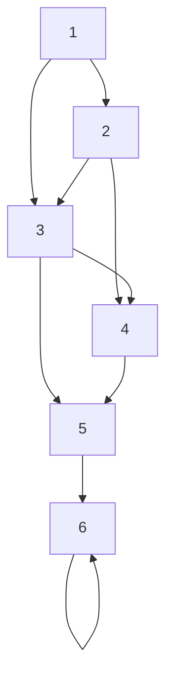
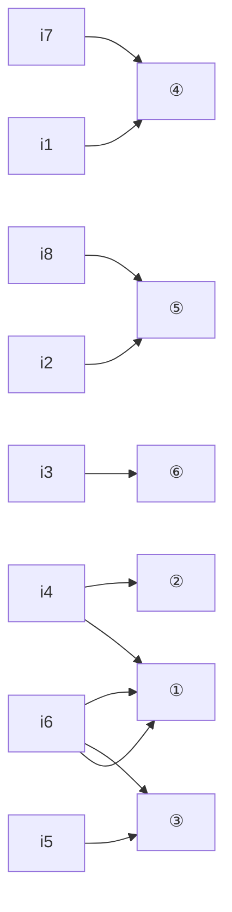

# 第1章 电路模型和电路定律

原始 PDF 第 34–57 页。

# 第一章

# 电路模型和电路定律

## 导读

电路理论以电路模型为研究对象,分析、计算电路模型中元件上的物理量。本章介绍电压电流的参考方向、电路元件的特性方程、基尔霍夫定律。在分析电路前,必须指定电路元件的电压和电流的参考方向。电路元件是通过端子上的电压、电流、电荷或磁通链这些物理量之间的关系来加以定义的,这种关系被称为元件的特性方程或组成关系。

电路中变量(物理量)受到两类约束:一类是元件的特性方程形成的变量的元件约束;另一类是因元件的相互连接而构成的变量的几何约束。变量的几何约束由基尔霍夫定律来表达,基尔霍夫定律是集总参数电路的基本定律。对于给定的电路,可凭借元件特性方程和基尔霍夫定律得到定解;反之,正确的电路解答也一定满足基尔霍夫定律。

## §1-1 电路和电路模型

人们在工作和生活中会遇到很多实际电路。实际电路是为完成某种预期目的而设计、制作、运行的(也可以是在非预期情况,例如短路、漏电等)。电路是由电路零件、器件经导线连接而成的电通路装置。这里,电路零件常称为电路部件(例如电阻器、开关、蓄电池等);电路器件则是指由电路部件组成且具有某种功能的产品,如晶体管、集成电路等。实际电路常借助于电压、电流等物理量完成传输电能或信号、处理信号、记忆信息、测量、控制、计算等功能。其中,电能或电信号的发生器称为电源,用电设备称为负载。由于电路中产生的电压、电流是在电源的作用下产生的,因此电源又称为激励源或激励;由激励在电路中产生的电压、电流等称为响应。有时,根据激励与响应之间的因果关系,把激励称为输入,响应称为输出。

有些实际电路十分复杂,例如,电能的产生、输送和分配是通过发电机、变压器、输电线等完成的,它们形成了一个庞大而复杂的电路或系统。当前,集成电路的应用已渗

---

§ 1-1 电路和电路模型

11

透到许多领域,集成电路芯片可能小到不大于指甲,但在上面有成千上万个晶体管等部件、器件相互连接成一个电路或系统以达到某种预期的目的。现在,集成电路的集成度越来越高,在同样大小的芯片上所容纳的部件、器件数目越来越多,可达数百万或更多。这些电路都是比较复杂的,但有些电路非常简单,例如手电筒就是一个十分简单的电路。

本书的主要内容是介绍电路理论的基础知识并为后续课程的学习准备必要的基础。电路理论研究电路中发生的电磁现象，并用电流、电压、电荷、磁通等物理量来描述其中的过程。电路理论主要是计算电路中各部件、器件的端子电流和端子间的电压等电路变量，一般不涉及内部发生的物理过程。本书讨论的对象不是实际电路而是实际电路的电路模型。实际电路的电路模型是由理想电路元件相互连接而成的。理想元件是组成电路模型的最小单元，是具有某种确定电磁性质并有精确数学定义的基本结构，这是一种数学模型。在一定的工作条件下，理想电路元件及它们的组合足以模拟实际电路中部件、器件中发生的物理过程。在电路模型中各理想元件的端子是用“理想导线”①连接起来的。根据元件对外端子的数目，理想电路元件可分为二端、三端、四端元件等。

图 1-1(a) 所示为一个简单的实际电路, 这是一个由于电池和小灯泡用两根连接导线组成的照明电路。其电路模型如图 1-1(b) 所示。图中的二端电阻元件 R 作为小灯泡的电路模型, 反映了将电能转换为热能和光能这一物理现象; 干电池用电压源  $U_{s}$  和电阻元件  $R_{s}$  的串联组合作为模型, 分别反映了电池内部化学储能转换为电能以及电池本身耗能的物理过程。连接导线用理想导线(其电阻设为零)表示。

图 1-1 实际电路与电路模型示例

用理想电路元件或它们的组合模拟实际器件就是建立其模型，简称建模。建模时必须考虑工作条件，并按不同准确度的要求把给定工作情况下的主要物理现象和功能反映出来。例如，一个线圈的建模:在恒定电流情况下它在电路中仅反映为导线内电流引起的能量消耗，因此，它的模型就是一个电阻元件；在电流变化的情况下（包括交变电流），线圈电流产生的磁场会引起感应电压而参与作用，故电路模型除电阻元件外还应包含一个与之串联的电感元件；当电流变化甚快时（包括高频交流），还应计及线圈导体表面的电荷作用，即电容效应。所以其模型中还需要包含电容元件。可见，在不同的工作条件下，同一实际部件、器件可能采用不同的模型。模型取得恰当，对电路进行分析计算的结果就与实际情况接近；模型取得不恰当，会造成很大误差甚至导致错误的结果。但如果模型取得过于复杂则会造成分析困难，取得太简单则可能无法反映真实的物理现象。建模问题需要专门进行研究，本书不做介绍。

<small>① 理想导线的电阻为零，且假设当导线中有电流时，导线内、外均无电场和磁场。</small>

---

12

第一章 电路模型和电路定律

今后本书所涉及电路均指由理想电路元件构成的电路模型,同时,把理想电路元件简称电路元件①。

通常,电路又称电网络或网络 $^{②}$ ,本书中将不加区分地引用。电路理论(或电网络理论)是一门研究网络分析和网络综合或设计 $^{③}$ 的基础工程学科,它与近代系统理论有着密切的关系。本书的主要内容是电路分析,从电路的基本定律和定理出发,讨论在各种电源和信号源的作用下电路的分析、计算方法,为学习电气工程技术、电子和信息工程技术等建立必要的理论基础。

电流和电压的参考方向

## §1-2 电流和电压的参考方向

电路理论中涉及的物理量主要有电流、电压、电荷和磁通，通常用 I、U、Q 和  $\Phi$  分别表示 $^{④}$ 。磁通链用  $\Psi$  表示。另外，电功率和电能量也是重要的物理量，它们的符号分别为 P 和 W。

在电路分析中,当涉及某个元件或部分电路的电流或电压时,必须指定电流或电压的参考方向(有时也称为正方向),才能开始进行分析和计算。在电路中,电流的实际流动方向或电压的实际方向可能是未知的,也可能是随时间变动的。参考方向的给定则有一定的任意性。图1-2表示一个电路的一部分,其中的矩形框表示一个二端元件。流过这个元件的电流为i,其实际方向可以是由A到B,或是由B到A。在该图中用实线箭头表示电流的参考方向,但它不一定就是电流的实际方向。指定参考方向的用意是在于把电流看成代数量。如果电流i的实际方向是由A到B,如图(a)中虚线箭头所示,它与参考方向一致,则电流为正值,即i>0;在图(b)中,指定的电流参考方向自B到A(见实线箭头),如果电流的实际方向还是由A到B(见虚线箭头),两者不一致,故电流为负值,即i<0。这样,在指定的电流参考方向下,电流值的正和负就可以反映出电流的实际方向。另一方面,只有规定了参考方向以后,才能写出随时间变化的电流

text_image

元件
i
A
B
i>0

(a)

text_image

元件
i
A
B
i<0

(b)

图 1-2 电流的参考方向

<small>① 有时把实际电路部件、器件也称为“电路元件”。但本书中凡涉及“电路元件”均指理想化模型。</small>

<small>② 网络(network)的含义较为广泛,可引申至非电情况。例如“神经网络”“计算机网络”等。</small>

<small>③ 网络分析(analysis)问题,指给定电路结构、元件参数求解电路性能;网络综合(synthesis)问题,指给定电路性能要求,求电路结构、参数,是网络分析的逆问题;如果在综合过程中还考虑其他诸如灵敏度、优化、成本、工艺等因素则称为电路设计。</small>

<small>④ 当电路中的电流、电压、电荷等变量随时间变化时，一般用小写字母 i、u、q 等表示，用大写字母 I、U、Q 时则表示对应的变量是恒定量。但也不排除小写字母表示恒定变量的情况；可根据上、下文判断。</small>

---

§ 1-2 电流和电压的参考方向

13

的函数式。电流的参考方向在电路图上一般用箭头表示，也可以用双下标表示，例如， $i_{AB}$  表示电流的参考方向是由 A 到 B。

同理,对电路两点之间的电压也要指定参考方向或参考极性。在表达两点之间的电压时,用正极性(+)表示高电位,负极性(-)表示低电位,而正极指向负极的方向就是电压的参考方向。指定电压的参考方向后,电压就是一个代数量,在图1-3中,电压u的参考方向是由A指向B,也就是假定A点的电位比B点的电位高;如果A点的电位

确实高于 B 点的电位, 即电压的实际方向是由 A 到 B, 两者的方向一致, 则 u > 0; 若实际电位是 B 点高于 A 点, 则 u < 0。有时为了图示方便, 也可用一个箭头表示电压的参考方向 (见图 1-3, 本书内一般不采用此种表示)。还可以用双下标来表示电压, 如  $u_{AB}$  表示 A 与 B 之间的电压, 其参考方向为 A 指向 B。

text_image

+
-
A
u
元件
B
u

图 1-3 电压的参考方向

一个元件的电流和电压的参考方向可以独立地任意指定。如果指定流过元件的电流的参考方向是从标以电压正极性的一端指向负极性的一端，即两者的参考方向一致，则把电流和电压的这种参考方向称为关联参考方向，如图1-4(a)所示；当两者不一致时，称为非关联参考方向。在图1-4(b)中，N表示电路的一个部分，它有两个端子与外电路连接，电流i的参考方向自电压u的正极性端流入电路，从负极性端流出，两者的参考方向一致，所以是关联参考方向；图1-4(c)所示电流和电压的参考方向是非关联的。（上述两种说法，是对网络N而言；对于外电路，结果相反。）

图1-4 关联方向

在国际单位制(SI)中,电流的单位为A(安培,简称安),电荷的单位为C(库仑,简称库),电压的单位为V(伏特,简称伏),磁通链的单位为Wb(韦伯,简称韦)。表1-1列出了SI单位中规定的用来构成十进倍数或分数的词头。例如: $1\mu A(\text{微安})=10^{-6}A$ ,2kV(千伏) $=2\times10^{3}V$ ,2GHz(吉赫) $=2000MHz=2\times10^{9}Hz$ ,1Tb(太比特) $=1000Gb=10^{12}b$ 等。

表 1-1 SI 倍数与分数词头

<table><tr><td>倍率</td><td colspan="2">词头名称词</td><td>词头符号</td><td>倍率</td><td colspan="2">词头名称词</td><td>词头符号</td></tr><tr><td> $10^{24}$ </td><td>尧[它]</td><td>yotta</td><td>Y</td><td> $10^{18}$ </td><td>艾[可萨]</td><td>exa</td><td>E</td></tr><tr><td> $10^{21}$ </td><td>泽[它]</td><td>zetta</td><td>Z</td><td> $10^{16}$ </td><td>拍[它]</td><td>peta</td><td>P</td></tr></table>

text_image

Technical diagram with labeled mechanical components and annotations, likely from a technical drawing or engineering manual.

---

14

第一章 电路模型和电路定律

续表

<table><tr><td>倍率</td><td colspan="2">词头名称词</td><td>词头符号</td><td>倍率</td><td colspan="2">词头名称词</td><td>词头符号</td></tr><tr><td> $10^{12}$ </td><td>太[拉]</td><td>tera</td><td>T</td><td> $10^{-3}$ </td><td>毫</td><td>milli</td><td>m</td></tr><tr><td> $10^9$ </td><td>吉[咖]</td><td>giga</td><td>G</td><td> $10^{-6}$ </td><td>微</td><td>micro</td><td>μ</td></tr><tr><td> $10^6$ </td><td>兆</td><td>mega</td><td>M</td><td> $10^{-9}$ </td><td>纳[诺]</td><td>nano</td><td>n</td></tr><tr><td> $10^3$ </td><td>千</td><td>kilo</td><td>k</td><td> $10^{-12}$ </td><td>皮[可]</td><td>pico.</td><td>p</td></tr><tr><td> $10^2$ </td><td>百</td><td>hecto</td><td>h</td><td> $10^{-16}$ </td><td>飞[母托]</td><td>femto</td><td>f</td></tr><tr><td>10</td><td>十</td><td>deca</td><td>da</td><td> $10^{-18}$ </td><td>阿[托]</td><td>atto</td><td>a</td></tr><tr><td> $10^{-1}$ </td><td>分</td><td>deci</td><td>d</td><td> $10^{-21}$ </td><td>仄[普托]</td><td>zepto</td><td>z</td></tr><tr><td> $10^{-2}$ </td><td>厘</td><td>centi</td><td>c</td><td> $10^{-24}$ </td><td>幺[科托]</td><td>yocto</td><td>y</td></tr></table>

## §1-3 电功率和能量

在电路的分析和计算中,能量和功率的计算是十分重要的。这是因为电路在工作状态下总伴随有电能的转移或与其他形式能量的相互交换;另一方面,电气设备、电路部件本身都有功率的限制,在使用时要注意其电流值或电压值是否超过额定值,过载会使设备或部件损坏,或是不能正常工作。

电功率与电压和电流密切相关。当正电荷从元件上电压的“+”极经元件运动到电压的“-”极时，与此电压相应的电场力要对电荷做功，这时，元件吸收能量；反之，正电荷从电压的“-”极经元件运动到电压的“+”极时，与此电压相应的电场力做负功，元件向外释放电能。

如果在 dt 时间内, 有 dq 电荷自元件上电压的“+”极经历电压  $u^{①}$  到达电压的“-”极。根据电压的定义 (A、B 两点的电压 u 等于电场力将单位正电荷自 A 点移动至 B 点时所做的功), 电场力所做功, 也即元件吸收的能量为

$$
\mathrm{d} W = u \mathrm{d} q
$$

现在假设 $i$ 在元件上与 $u$ 成关联方向，由 $i$ 的定义 $i = \mathrm{d}q / \mathrm{d}t$ ，有 $\mathrm{d}W = u\mathrm{d}t$ ，功率是能量对时间的导数，故元件的吸收功率为

$$
p = \frac {\mathrm{d} W}{\mathrm{d} t} = u i \tag {1-1}
$$

在  $t_{0}$  到 t 的时间内, 元件吸收的能量为

$$
W (t) = \int \mathrm{d} W = \int_ {q (t _ {0})} ^ {q (t)} u \mathrm{d} q = \int_ {t _ {0}} ^ {t} u (\xi) i (\xi) \mathrm{d} \xi \tag {1-2}
$$

由于 $u, i$ 都是代数量，因此，功率 $p$ 和吸收的能量 $W$ 也都是代数量。当 $p > 0, W > 0$ ，元件

<small>① 本书通常把  $u(t)$ 、 $i(t)$  等简写为 u、i 等。</small>

---

§ 1-4 电路元件

15

确实吸收功率与能量；当 $p < 0, W < 0$ 时，元件实际释放电能或发出功率。

当电流单位为 A, 电压的单位为 V 时, 能量的单位为 J(焦耳, 简称焦), 当时间的单位为 s(秒) 时, 功率的单位为 W(瓦特, 简称瓦)。

在指定电压和电流的参考方向后,应用式(1-1)求功率p时应当注意:当电压和电流的参考方向在元件上为关联参考方向时,乘积“ui”表示元件吸收的功率;当p为正值时,表示该元件确实吸收功率。如果电压和电流的参考方向为非关联参考方向时,乘积“ui”则表示元件发出的功率,此时,当p为正值时,该元件确实发出功率。一个元件若吸收功率100 W,也可以认为它发出功率-100 W。同理,一个元件若发出功率100 W,也可以认为它吸收功率-100 W。这两种说法是一致的。

在图 1-5 中, 已知某元件两端的电压为 5 V, A 点电位高于 B 点电位; 电流 i 的实际方向为自 A 点到 B 点, 其值为 2 A。根据图 1-5(a) 中指定的参考方向, u 和 i 为关联参考方向,  $u = 5 \, V, i = 2 \, A$ 。根据式

(a)

(b)

图 1-5 元件的功率

(1-1), $p = 10\mathrm{W}$, 为正值, 此元件吸收的功率为 $10\mathrm{W}$ 。如果指定的 $u$ 和 $i$ 的参考方向为非关联参考方向, 如图 1-5(b) 所示, 则此时 $u = -5\mathrm{V}, i = 2\mathrm{A}$ 。按式 (1-1), 元件发出的功率 $p = -10\mathrm{W}$, 为负值。所以, 此元件实际上还是吸收 $10\mathrm{W}$ 功率, 与按图 1-5(a) 求得的结果一致。

## §1-4 电路元件

电路元件是电路中最基本的组成单元。电路元件通过其端子与外部连接。元件的特性通过与端子有关的电路物理量描述。每种元件通过端子的两种物理量反映一种确定的电磁关系。元件的两个端子的电路物理量之间的代数函数关系称为元件的端子特性(亦称元件特性)。元件的端子特性又称为元件的组成关系(constituent relation,简称CR)。

集总(参数)元件 $^{①}$ 假定:在任何时刻,流入二端元件的一个端子的电流一定等于从另一端子流出的电流,且两个端子之间的电压为单值量。由集总元件构成的电路称为集总电路,或称具有集总参数的电路。用有限个集总元件及其组合模拟实际的部件和器件以及用集总电路作为实际电路的电路模型是有条件的,本书的第十八章将加以讨论。本书的其余各章只考虑集总电路。

电路物理量有电压 u、电流 i、电荷 q 以及磁通  $\Phi(\text{或磁通链 } \Psi)$  等。电阻元件的元件特性是电压与电流的代数关系  $f(u, i) = 0$ ; 电容元件的元件特性是电荷 q 与电压 u 的代数

<small>① 集总参数(lumped parameter)元件是指有关电、磁场物理现象都由元件来“集总”表征。在元件外部不存在任何电场与磁场。如果元件外部有电场，进、出端子的电流就有可能不同；如果元件外部有磁场，两个端子之间的电压就可能不是单值的。</small>

---

1. 用 $\mathrm{H}_{2}$ 气相反应, 用 $\mathrm{H}_{2}$ 气相反应, 用 $\mathrm{H}_{2}$ 气相反应, 用 $\mathrm{H}_{2}$ 气相反应, 用 $\mathrm{H}_{2}$ 气相反应

16

第一章 电路模型和电路定律

关系 $f(q,u)=0$ ;电感元件的元件特性是磁通链 $\Psi$ 与电流i的代数关系 $f(\Psi,i)=0$ 。这三种特性称之为元件的伏安特性、库伏特性和韦安特性。它们分别是电阻元件、电容元件和电感元件的组成关系。如果表征元件特性的代数关系是一个线性关系，则该元件称为线性元件。如果表征元件特性的代数关系是一个非线性关系，则该元件称为非线性元件。

前文已提及,电路元件按与外部连接的端子数目可分为二端、三端、四端元件等。电路元件除可分为线性元件和非线性元件外,还可分为时不变元件和时变元件,无源元件和有源元件等。

电路理论来自工程实践,电路理论又指导工程实践,学习电路理论必须理论联系工程实际。电路模型是否准确,就要看用电路理论分析电路模型的结果与实际测量的结果是否相近。如果分析结果与测量结果相差很大,说明采用的电路模型不恰当、不准确。

将实际电路通过建模得到电路模型的过程,关键要抓主要矛盾或矛盾的主要方面,具体问题具体分析。电路模型的精度和电路分析的复杂程度是一对矛盾,在电路建模时,往往会在满足电路分析精度要求的前提下,尽可能采用简单的电路模型。

同一个实际电路部件或器件,当施加的激励频率不同时,我们就会根据实际情况选择不同的电路模型。例如电子线路中的晶体管,随着信号频率的增大,晶体管的结电容和极间电容的作用不容忽视,此时晶体管工作在低频时的电路模型不再适用,而应该采用附加了多个电容的晶体管的高频模型。在这里,工作频率就是矛盾转化的条件,在低频时可以忽略的电容效应在高频时必须考虑,电容效应就上升到矛盾的主要方面之一了。

另一方面，线性和非线性也是一对矛盾，线性是相对的，非线性是绝对的，线性和非线性是辩证统一的。在满足电路分析精度要求的条件下，很多实际电路部件采用线性元件表征。对很多非线性不强的电路元件，当电路元件的电压和电流值较小时，可以看作线性元件，称之为非线性元件的线性化。然而在很多情况下，由于电路元件的非线性使得电路的系统行为不能用线性电路解释时，就必须采用非线性元件来表征。

关于如何选择合适的电路元件进行电路建模,限于篇幅,这里不再展开讨论,希望学习者在本书的学习过程中加以注意,在后续课程的学习和今后的工作中给予关注。

## §1-5 电阻元件

电阻器、灯泡、电炉等在一定条件下可以用二端线性电阻元件作为其模型（以后各章主要讨论二端元件，故将略去“二端”两字）。线性电阻元件是这样的理想元件:在电压和电流取关联参考方向时，在任何时刻它两端的电压和电流服从欧姆定律

$$
u = R i \tag {1-3}
$$

线性电阻元件的图形符号见图1-6(a)。上式中 $R$ 为电阻元件的参数，称为元件的电阻。$R$ 是一个正实常数。当电压单位为 $\mathrm{V}$，电流单位为A时，电阻的单位为 $\Omega$（欧姆，简称欧）。

令 $G = \frac{1}{R}$, 式(1-3)变成

---

§ 1-5 电阻元件

17

$$
i = G u \tag {1-4}
$$

式中 G 称为电阻元件的电导。电导的单位是 S(西门子,简称西)。R 和 G 都是电阻元件的参数。

如果电压、电流参考方向取非关联参考方向,则

$$
u = - R i \text {或} i = - G u
$$

式(1-3)和式(1-4)就是电阻元件的元件特性。由于电压和电流的单位是伏和安，因此电阻元件的特性称为伏安特性。图1-6(b)画出线性电阻元件的伏安特性曲线，它是通过原点的一条直线。直线的斜率与元件的电阻 $R$ 有关。如果在作图时，电压坐标的标尺为 $m_{u}(m_{u}$ 为坐标轴上每单位长度代表的电压值），电流坐标的标尺为

$m_{i}(m_{i}$  为坐标轴上每单位长度代表的电流值), 则有

$$
\begin{array}{l} R = \frac {u}{i} = \frac {m _ {u}}{m _ {i}} \frac {\overline {{O U}}}{\overline {{O I}}} = \frac {m _ {u}}{m _ {i}} \tan \theta^ {①} \\ G = \frac {i}{u} = \frac {m _ {i}}{m _ {u}} \frac {\overline {{O I}}}{\overline {{O U}}} = \frac {m _ {i}}{m _ {u}} \tan \alpha \\ \end{array}
$$

式中  $\overline{OU}$ 、 $\overline{OI}$  分别为电压 u 与电流 i 相应的 u 轴和 i 轴上的线段长度。

text_image

i
+
u
R
-

(a)

text_image

i
I
θ
α
O
O/U
U
ū

(b)

图 1-6 电阻元件及其伏安特性

当一个线性电阻元件的端电压不论为何值时,流过它的电流恒为零值,就把它称为“开路”。开路的伏安特性在 u-i 平面上与电压轴重合,它相当于  $R=\infty$  或 G=0,如图 1-7(a) 所示。当流过一个线性电阻元件的电流不论为何值时,它的端电压恒为零值,就把它称为“短路”。短路的伏安特性在 u-i 平面上与电流轴重合,它相当于 R=0 或  $G=\infty$ ,如图 1-7(b) 所示。如果电路中的一对端子  $1-1'$  之间呈断开状态,如图 1-7(c) 所示,这相当于端子  $1-1'$  之间接有  $R=\infty$  的电阻,此时称端子  $1-1'$  处于“开路”。如果把端子  $1-1'$  用理想导线(电阻为零)连接起来,称这对端子  $1-1'$  被短路,如图 1-7(d) 所示。

当电压 u 和电流 i 取关联参考方向时,电阻元件消耗的功率为

$$
p = u i = R i ^ {2} = \frac {u ^ {2}}{R} = G u ^ {2} = \frac {i ^ {2}}{G} \tag {1-5}
$$

R 和 G 是正实常数, 故功率 p 恒为非负值。所以线性电阻元件只能吸收能量而不能发出能量, 是一种无源元件。

电阻元件从  $t_{0}$  到 t 的时间内吸收的电能为

$$
W = \int_ {t _ {0}} ^ {t} R i ^ {2} (\xi)   \mathrm{d} \xi
$$

电阻元件一般把吸收的电能转换成热能或其他形式的能量。

<small>① 对于一个 $R = 1\Omega$ 的电阻，如果取 $m_{u} / m_{i} = 1$ ，则 $\theta = 45^{\circ}$ ；而当 $m_{u} / m_{i} = 2$ 时， $\theta = 26.6^{\circ}$ 。</small>

---

[No text]

18

第一章 电路模型和电路定律

text_image

i
开路
O
u

(a)

text_image

i
短路
O
u

(b)

(c)

(d)

图 1-7 开路和短路的伏安特性

由于制作材料的电阻率与温度有关，(实际)电阻器通过电流后因发热会使温度改变，因此，严格说，电阻器带有非线性因素①。但是在正常工作条件下，温度变化有限，许多实际部件如金属膜电阻器、线绕电阻器等，它们的伏安特性近似为一条直线。所以用线性电阻元件作为它们的理想模型是合适的。

非线性电阻元件的伏安特性不是一条通过原点的直线。非线性电阻元件的电压电流关系一般可写为

$$
u = f (i) \quad [ \text {或} i = h (u) ]
$$

如果一个电阻元件具有以下的电压电流关系:

$$
u (t) = R (t)   i (t) \quad [ \text {或}   i (t) = G (t)   u (t) ]
$$

这里 u 与 i 仍是比例关系,但比例系数 R 是随时间变化的,故称为时变电阻元件。

线性电阻元件的伏安特性位于第一、三象限。如果一个电阻元件的伏安特性位于第二、四象限，则此元件的电阻为负值，即 R<0。负电阻元件实际上是一个发出电能的元件。如果要获得这种元件，一般需要专门设计。

今后,为了叙述方便,把线性电阻元件简称为电阻,所以本书中“电阻”这个术语以及它的相应符号R一方面表示一个电阻元件,另一方面也表示此元件的参数。

## §1-6 电压源和电流源

实际电源有电池、发电机、信号源等。电压源和电流源是从实际电源抽象得到的电

<small>① 手电筒中的小电珠是一个典型的非线性热电阻。小电珠在室温时用欧姆表量得电阻小于 $1\Omega$，但在 $2.5\mathrm{V}, 0.3\mathrm{A}$ 额定工作情况下其电阻为 $2.5\mathrm{V} / 0.3\mathrm{A} = 8.33\Omega$。这是因为小电珠工作温度在 $3000^{\circ}\mathrm{C}$ 以上，以致小电珠电阻增加了近十倍。</small>

<small>家用电器中常使用的 PTC(positive temperature coefficient) 陶瓷为发热元件。这是一种具有正温度系数的半导体陶瓷，发热后，其电阻迅速增加而具有自动限制电流的能力。PTC 陶瓷通常由钛酸钡(BaTiO)等构成。</small>

---

§ 1-6 电压源和电流源

19

·路模型，它们是二端有源元件。

电压源是一个理想电路元件,它的端电压  $u(t)$  为

$$
u (t) = u _ {\mathrm{S}} (t) ^ {①}
$$

式中 $u_{\mathrm{s}}(t)$ 为给定的时间函数，称为电压源的激励电压。电压源电压 $u(t)$ 与通过元件的电流无关，总保持为给定的时间函数，而电流的大小则由外电路决定。电压源的图形符号如图1-8(a)所示。当 $u_{\mathrm{s}}(t)$ 为恒定值时，这种电压源称为恒定电压源或直流电压源，有时用图1-8(b)所示图形符号表示，其中长线表示电源的“+”端，恒定的激励电压值则用大写的印刷体 $U_{\mathrm{s}}$ 表示。

图 1-9(a) 示出电压源接外电路的情况。端子 1、2 之间的电压  $u(t)$  等于  $u_{s}(t)$ ，不受外电路的影响。图 1-9(b) 示出电压源在  $t_{1}$  时刻的伏安特性，它是一条不通过原点且与电流轴平行的直线。当  $u_{s}(t)$  随时间改变时，这条平行于电流轴的直线也将随时间上下平移其位置。图 1-9(c) 是直流电压源的伏安特性，它不随时间改变。

(a)

(b)

text_image

+
us
-
i
1
+
u
-
2
外电路

(a)

text_image

u
u_S(t_1)
O
i

(b)

text_image

u
Us
O
i

(c)

图 1-8 电压源

图1-9 电压源的伏安特性

在图 1-9(a) 中,电压源的电压和通过电压源的电流的参考方向取为非关联参考方向,此时,电压源发出的功率为

$$
p (t) = u _ {\mathrm{s}} (t) i (t)
$$

它也是与之连接的外电路所吸收的功率。

电压源不接外电路时,电流 i 为零值,这种情况称为“电压源处于开路”。如果一个电压源的电压  $u_{s}=0$ , 则此电压源的伏安特性为 u-i 平面上的电流轴, 它相当于短路。把激励电压值不为零的电压源短路是没有意义的, 因为短路时端电压 u=0, 这与电压源的特性不相容。

电流源是一个理想电路元件。它发出的电流 $i(t)$ 为

$$
i (t) = i _ {\mathrm{S}} (t)
$$

其中 $i_{\mathrm{s}}(t)$ 为给定时间函数，称为电流源的激励电流。因而电流源的电流 $i(t)$ 与元件的端电压无关，并总保持为给定的时间函数。电流源的端电压由外电路决定②。电流源

<small>① 这里  $u_{S}(t)$  或  $u(t)$  实际上是用来表示所考虑时间范围内的“波形曲线”或整个函数。 $u(t)$  或  $u_{S}(t)$  也表示某一瞬间的电压值，即所谓瞬时值。严格来说，这两者是有区别的。</small>

<small>② 用于静电起电的范德格拉夫(Vander Graaff)发电机的端电压就是电流源电压的例子。当起电盘以恒定转速转动时，金属刷以固定速率从起电盘的金属片上得到电荷，也就是供给的电流接近恒定值。当电极间绝缘良好即外电路电阻很高时，可以得到很高的电压。反之，在周围空气潮湿而绝缘电阻不高时，就得不到高电压。</small>

1. 工程图

---

20

第一章 电路模型和电路定律

的图形符号示于图1-10(a)，图1-10(b)示出了电流源接外电路的情况。图1-10(c)为电流源在 $t_1$ 时刻的伏安特性，它是一条不通过原点且与电压轴平行的直线。当 $i_{\mathrm{s}}(t)$ 随时间改变时，这条平行于电压轴的直线将随之左右平移其位置。图1-10(d)示出直流电流源的伏安特性，它不随时间改变。

图 1-10 电流源及其伏安特性

在图 1-10(b) 中,电流源电流和电压的参考方向为非关联参考方向,所以电流源发出的功率为

$$
p (t) = u (t) \cdot i _ {\mathrm{S}} (t)
$$

它也是所连外电路吸收的功率。

电流源两端短路时,其端电压 u=0,而  $i=i_{s}$ , 短路电流仍是激励电流。如果一个电流源的  $i_{s}=0$ , 则此电流源的伏安特性为 u-i 平面上的电压轴, 它相当于开路。将激励电流值不为零的电流源“开路”是没有意义的, 因为开路时的电流 i 必须为零, 这与电流源的特性不相容。

当电压源的电压  $u_{s}(t)$  或电流源的电流  $i_{s}(t)$  随时间作正弦规律变化时，则称为正弦电压源或正弦电流源。以正弦电压源为例，可写为

$$
\begin{array}{l} u _ {\mathrm{s}} (t) = U _ {\mathrm{m}} \cos \left(\frac {2 \pi}{T} t + \psi\right) \\ = U _ {\mathrm{m}} \cos (2 \pi f t + \psi) \\ = U _ {\mathrm{m}} \cos (\omega t + \psi) \\ \end{array}
$$

式中， $U_{m}$  为正弦电压的最大值，T 为正弦函数的周期， $f=\frac{1}{T}$  为其频率，单位为 Hz（赫兹，简称赫）， $\omega=2\pi f$  为角频率， $\psi$  为正弦函数的初相角。正弦电压也可以用 sine 函数表示（见第八章）。

常见实际电源(如发电机、蓄电池等)的工作机理比较接近电压源,其电路模型是电压源与电阻的串联组合。像光电池 $^{①}$ 及双极型晶体管等一类器件,工作时的特性比较接近电流源,其电路模型是电流源与电阻的并联组合。此外,专门设计的电子电路常作成具有电流源的性能而广泛应用于集成电路之中。

上述电压源和电流源常常被称为“独立”电源，“独立”二字是相对于下一节要介绍的“受控”电源来说的。

<small>① 光电池的采光极板接受一定的光通量时，在一定的电压范围内，其输出电流几乎不变。相当于一个电流源。</small>

---

§ 1-7 受控电源

21

## §1-7 受控电源

受控(电)源又称“非独立”电源。受控电压源的激励电压或受控电流源的激励电流与独立电压源的激励电压或独立电流源的激励电流有所不同,后者是独立量,前者则受到电路中某部分电压或电流的控制。

双极型晶体管的集电极电流受基极电流控制,运算放大器的输出电压受输入电压控制,所以这类器件的电路模型中要用到受控源。

受控电压源或受控电流源视控制量是电压或电流可分为电压控制电压源（VCVS）、电压控制电流源（VCCS）、电流控制电压源（CCVS）和电流控制电流源（CCCS） $^{①}$ 4种。这4种受控源的图形符号见图1-11。为了与独立电源区别，用菱形符号表示其电源部分。图中 $u_{1}$ 和 $i_{1}$ 分别表示控制电压和控制电流， $\mu$ 、r、g和 $\beta$ 分别是有关的控制系数，其中 $\mu$ 和 $\beta$ 是无量纲的量，r和g分别具有电阻和电导的量纲。这些系数为常数时，被控制量和控制量成正比，这种受控源为线性受控源。本书只考虑线性受控源，故一般将略去“线性”二字。

chemical

Circuit symbol for VCVS voltage reference with input u1 and output terminals

(a)

chemical

Circuit symbol for a voltage-controlled current source (VCCS) with input u1 and output gu1

(b)

chemical

CCVS circuit symbol with current i1 and voltage ri1

(c)

chemical

Circuit symbol for CCCS with current i1 and beta i1 component

(d)

图 1-11 受控电源

在图 1-11 中把受控源表示为具有 4 个端子的电路模型, 其中受控电压源或受控电流源具有一对端子, 另一对控制端子则或为开路, 或为短路, 分别对应于控制量是电路某处的开路电压或短路电流。这样处理有时会带来方便。所以可以把受控源看作是一

<small>① VCVS——voltage controlled voltage source。</small>

<small>VCCS——voltage controlled current source。</small>

<small>CCVS——current controlled voltage source。</small>

<small>CCCS——current controlled current source。</small>

---

22

第一章 电路模型和电路定律

种四端元件,但在一般情况下,不一定要在图中专门标出控制量所在处的端子。

独立电源是电路中的“输入”，它表示外界对电路的作用，电路中电压或电流是由于独立电源起的“激励”作用产生的。受控源则不同，它是用来反映电路中某处的电压或电流能控制另一处的电压或电流这一现象，或表示一处的电路变量与另一处电路变量之间的一种单方向的耦合关系。在求解具有受控源的电路时，可以把受控电压（电

流)源作为电压(电流)源处理,但必须注意其激励电压(电流)是取决于控制量的。

例 1-1 图 1-12 中  $i_{s}=2\ A$ , VCCS 的控制系数 g=2 S, 求  $u_{0}$ 。

解 由图1-12左部先求控制电压 $u_{1}, u_{1} = 5i_{\mathrm{s}} = 10\mathrm{V}$; 故 $u = 2gu_{1} = 2 \times 2 \times 10\mathrm{V} = 40\mathrm{V}$。

text_image

i_S
5 Ω u_1
+
-
i
g u_1 2 Ω u
+

图1-12 例1-1图

## §1-8 基尔霍夫定律

集总电路由集总元件相互连接而成。基尔霍夫定律是集总电路的基本定律。为了说明基尔霍夫定律，先介绍支路、节点和回路的概念。为了简化说明，在本节中把组成

电路的每一个二端元件称为一条支路，把支路的连接点称为节点。图1-13为一个具有六条支路、四个节点的电路，各支路和节点的编号如图所示。由支路所构成的闭合路径称为回路，如图中支路(1,3,4,6)。同理，支路(1,2,4,6)(1,2,5,6)(1,3,5,6)(2,3)(4,5)等也都分别构成回路。关于支路、节点和回路等概念的进一步介绍见§3-1。

如果将电路中各个支路的电流和支路的电压(简称支路电流与支路电压)作为变量来看,这些变

flowchart

图 1-13 支路与节点

量受到两类约束。一类是元件的特性造成的约束。例如，线性电阻元件的电压与电流必须满足 $u = Ri$ 的关系；电流源元件的电压与电流必须满足 $i = i_{\mathrm{s}}$ 。这种关系称为元件的电压电流关系（VCR）①，即VCR构成了变量的元件约束。另一类约束是由于元件的相互连接赋予支路电流之间或支路电压之间的约束关系，有时称为“几何”约束或“拓扑②”约束。这类约束由基尔霍夫定律来体现。

基尔霍夫定律包括电流定律和电压定律。

基尔霍夫电流定律(KCL) $^{③}$ 指出:“在集总电路中，任何时刻，对任一节点，所有流

基尔霍夫定律

<small>① VCR——voltage current relation。</small>

<small>② “拓扑”是一个数学名词。这里我们将它理解为“连接关系”。</small>

<small>③ KCL——Kirchhoff's current law。</small>

---

§ 1-8 基尔霍夫定律

23

出节点的支路电流的代数和恒等于零”。此处，电流的“代数和”是根据电流是流出节点还是流入节点来说的。若流出节点的电流前面取“+”号，则流入节点的电流前面取“-”号；电流是流出节点还是流入节点，均根据电流的参考方向判断。所以对任一节点，KCL表示为

$$
\sum i = 0
$$

上式取和是对连接于该节点的所有支路电流进行的。

例如,以图 1-14 所示电路为例,对节点①应用 KCL,有(各支路电流的参考方向见图)

$$
i _ {1} + i _ {4} - i _ {6} = 0
$$

上式可写为

$$
i _ {1} + i _ {4} = i _ {6}
$$

此式表明,流出节点①的支路电流等于流入该节点的支路电流。因此,KCL也可理解为,任何时刻,流出任一节点的支路电流等于流入该节点的支路电流。

flowchart

图1-14 KCL

KCL 通常用于节点,但对包围几个节点的闭合面也是适用的。对图 1-14 所示电路,用虚线表示的闭合面 S 内有 3 个节点,即节点①、②和③。对这些节点分别有:

$$
\begin{array}{l} i _ {1} + i _ {4} - i _ {6} = 0 \\ - i _ {2} - i _ {4} + i _ {5} = 0 \\ i _ {3} - i _ {5} + i _ {6} = 0 \\ \end{array}
$$

以上 3 式相加后, 得到流出闭合面 S 的电流代数和为

$$
i _ {1} - i _ {2} + i _ {3} = 0 ^ {\textcircled {1}}
$$

其中  $i_{1}$  和  $i_{3}$  流出闭合面， $i_{2}$  流入闭合面。

所以,流出一个闭合面的支路电流的代数和恒等于零;或者说,流出闭合面的支路电流等于流入同一闭合面的支路电流。这称为电流的连续性。KCL是电荷守恒的体现。

基尔霍夫电压定律(KVL) $^{②}$ 指出:“在集总电路中，任何时刻，沿任一回路，所有支路电压的代数和恒等于零。”

所以，沿任一回路有

$$
\sum u = 0
$$

上式取和时,需要任意指定一个回路的绕行方向,凡支路电压的参考方向与回路的绕行方向一致时,该电压前面取“+”号;支路电压的参考方向与回路绕行方向相反时,该电压前面取“-”号。

<small>① 这是因为仅在闭合面内流动的支路电流在各 KCL 式中各出现两次, 一次为正、一次为负, 其和必为零, 不会在闭合面的 KCL 中出现。</small>

<small>② KVL——Kirchhoff's voltage law。</small>

---

24

第一章 电路模型和电路定律

以图 1-15 所示电路为例, 对支路 (1,2,3,4) 构成的回路列写 KVL 方程时, 需要先指定各支路电压的参考方向和回路的绕行方向。绕行方向用虚线上的箭头表示, 有关支路电压为  $u_{1}$ 、 $u_{2}$ 、 $u_{3}$ 、 $u_{4}$ , 它们的参考方向如图 1-15 所示。

根据 KVL, 对指定的回路有

$$
u _ {1} + u _ {2} - u _ {3} + u _ {4} = 0
$$

由上式也可得

$$
u _ {3} = u _ {1} + u _ {2} + u _ {4}
$$

text_image

+ u₅ -
5
①
1
+ u₁ -
②
u₄ 4 + u₂ +
- u₃ -
3
④
2 6 + u₆ -

图1-15 KVL

该式表明，④、③两节点之间的电压是单值的，不论沿支路3或沿支路4、1、2构成的路径，此两节点间的电压值是相等的。KVL是电压与路径无关这一性质的反映①。

KCL 在支路电流之间施加线性约束关系; KVL 则对支路电压施加线性约束关系。这两个定律仅与元件的相互连接有关, 而与元件的性质无关。不论元件是线性的还是非线性的, 时变的还是时不变的, KCL 和 KVL 总是成立的。KCL 和 KVL 是集总电路的两个公设(公理)。

对一个电路应用 KCL 和 KVL 时,应对各节点和支路编号,并指定有关回路的绕行方向,同时指定各支路电流和支路电压的参考方向,一般两者取关联参考方向。

例1-2 图1-16所示电路中，已知 $u_{1} = u_{3} = 1\mathrm{V},u_{2} = 4\mathrm{V},u_{4} = u_{5} = 2\mathrm{V}$ ，求电压 $u_{x}$ 。

解 对回路I和Ⅱ分别列出 KVL 方程(支路的参考方向和回路的绕行方向如图 1-16 所示):

$$
\begin{array}{l} - u _ {1} + u _ {2} + u _ {6} - u _ {3} = 0 \\ - u _ {6} + u _ {4} + u _ {5} - u _ {x} = 0 \\ \end{array}
$$

$u_{6}$  在方程中出现二次,一次前面为“+”号(与回路Ⅰ绕行方向相同)、一次前面为“-”号(与回路Ⅱ绕行方向相反)。将两个方程相加消去 $u_{6}$ ,得

$$
u _ {\mathrm{x}} = - u _ {1} + u _ {2} - u _ {3} + u _ {4} + u _ {5} ^ {(2)} = 6 \mathrm{V}
$$

例 1-3 图 1-17 所示电路中, 电阻  $R_{1}=1\Omega, R_{2}=2\Omega, R_{3}=10\Omega, U_{S1}=3\mathrm{~V}, U_{S2}=1\mathrm{~V}$ 。求电阻  $R_{1}$  两端的电压  $U_{1}$ 。

解 这是一个复杂电路。求解本题时,须同时应用 KCL、KVL 以及元件的 VCR。给出各支路电压与电流的参考方向如图所示。可依下列步骤进行:

text_image

+ u2 -
+ u4 -
+ u1
-
+
I
u6
-
III
II
+
u5 -
-
+
u3 -
+ ux -
-

图.1-16 例 1-2 图

text_image

I₃ + U₃ - ① + U₂ - I₂
R₃ R₂
+       +
Uₛ₁     II     I     +
-       R₁
      I₁
      -
          ②
          Uₛ₂

图1-17 例1-3图

<small>① 实质上,是能量守恒和转换定律的反映。</small>

<small>② 若沿图中的回路Ⅲ列出 KVL 方程，可得  $-u_{1} + u_{2} - u_{3} + u_{4} + u_{5} - u_{x} = 0$ ，也可解出  $u_{x}$ 。</small>

---

§ 1-8 基尔霍夫定律

25

（1）先将支路电流 $I_{1}, I_{2}$ 与 $I_{3}$ 都以未知量 $U_{1}$ 来表示。有 $I_{1} = U_{1} / R_{1}$；对I、II回路由KVL可得 $U_{1} = U_{\mathrm{S1}} - R_{3}I_{3}$ 与 $U_{1} = R_{2}I_{2} + U_{\mathrm{S2}}$，从而得到

$$
I _ {3} = \frac {U _ {\mathrm{S1}} - U _ {1}}{R _ {3}} = \frac {3 - U _ {1} ^ {(1)}}{1 0}
$$

与

$$
I _ {2} = \frac {\dot {U} _ {1} - U _ {\mathrm{S2}}}{R _ {2}} = \frac {U _ {1} - 1}{2}
$$

(2) 在节点①使用 KCL, 有  $I_{3}=I_{1}+I_{2}$ , 即

$$
\frac {3 - U _ {1}}{1 0} = \frac {U _ {1}}{1} + \frac {U _ {1} - 1}{2}
$$

从而解得

$$
U _ {1} = 0. 5 \mathrm{V}
$$

例 1-4 图 1-18 电路中, 已知  $R_{1}=2\ k\Omega, R_{2}=500\ \Omega, R_{3}=200\ \Omega, u_{s}=12\ V$ , 电流控制电流源的激励电流  $i_{d}=5i_{1}$ 。求电阻  $R_{3}$  两端的电压  $u_{3}$ 。

text_image

i₁
R₁
①
i₂
R₂
u₂
i_d
+
-
②
u₃
R₃

图1-18 例1-4图

解 这是一个有受控源的电路,宜选择控制量  $i_{1}$  作为未知量先求解,解得  $i_{1}$  后再通过  $i_{d}$  求  $u_{3}$ 。可分以下步骤进行:

(1) 在节点①使用 KCL, 可知流过  $R_{2}$  的电流  $i_{2}=i_{1}+i_{d}=i_{1}+5i_{1}=6i_{1}$ 。
(2) 在回路 I 中使用 KVL, 得

$$
u _ {\mathrm{S}} = R _ {1} i _ {1} + R _ {2} i _ {2} = \left(R _ {1} + 6 R _ {2}\right) i _ {1}
$$

代入 $u_{\mathrm{s}}, R_{1}, R_{2}$ 的数值，可得

$$
i _ {1} = 2. 4 \mathrm{mA}
$$

(3) $R_{3}$ 两端的电压 $u_{3}$ 为

$$
u _ {3} = - R _ {3} i _ {\mathrm{d}} = - R _ {3} \times 5 i _ {1} = - 2. 4 \mathrm{V}
$$

<small>① 本书中为使方程或计算过程的表述更清晰易懂，部分算式将省略物理量的单位，仅描述其数值关系。例如本式的规范表述应为 $I_{3} = \frac{U_{\mathrm{S1}} - U_{1}}{R_{3}} = \frac{3\mathrm{V} - U_{1}}{10\Omega}$。</small>

---

26

第一章 电路模型和电路定律

以上例题主要是说明 KCL 与 KVL 在求解电路中的应用。如何根据这两个定律和元件的 VCR 列出电路方程并系统地求解,将在第三章中介绍。

## 思考题

1-1 实际电路和电路模型的区别和联系。
1-2 实际电路元器件和理想元件的关系。
1-3 建立一个实际电路的集总参数电路模型要做哪些假设？
1-4 如何根据电压、电流的参考方向以及功率的符号,判断一个电路元件是吸收功率还是发出功率?
1-5 为什么说电阻元件是耗能元件？
1-6 在实际工程中使用电阻元件时,除了元件要符合电阻值的要求外,还要考虑哪些因素?
1-7 电位、电压和电动势的概念的差异有哪些？请以电压源为例说明。
1-8 为什么电压源不能短路？
1-9 为什么电流源不能开路？
1-10 在应用 KCL 时, 各支路电流规定了参考方向, 在  $\Sigma i=0$  表达式中, 流出节点的电流 i 前加“+”号, 流入节点的电流 i 前加“-”号。如果电流方向采用实际方向, 是否满足 KCL?
1-11 在应用 KVL 时, 各支路电压规定了参考方向, 在  $\Sigma u=0$  表达式中, 与指定绕行方向相同的电压 u 前加“+”号, 与指定绕行方向相反的电压 u 前加“-”号。如果电压方向采用实际方向, 是否满足 KVL?
1-12 一个  $10 \Omega$  电阻器与一个  $40 \Omega$  的电阻器串联后加以电压 100 V。这两个电阻的标称功率如何选定？

## 习题

1-1 题 1-1 图中:

text_image

元件
+          u          -

(a)

text_image

元件
+
-
i
u

(b)

题1-1图

(1) u、i 的参考方向是否关联?

---

习题

27

(2) ui 乘积表示什么功率?
(3) 如果在图(a)中 u>0, i<0, 图(b)中 u>0, i>0, 元件实际发出功率还是吸收功率?

1-2 在题 1-2 图 (a) 与 (b) 中, 对于  $N_{A}$  与  $N_{B}, u, i$  的参考方向是否关联? 此时乘积 ui 对  $N_{A}$  与  $N_{B}$  分别意味着什么功率?

text_image

N_A
i
+
u
-
N_B

(a)

text_image

N_A
i
+
u
-
N_B

(b)

题 1-2 图

1-3 在题 1-3 图(a)中, 已知  $I_{1}=500\ mA, I_{S}=100\ mA, U=30\ V$ 。求  $N_{A}$  与  $N_{B}$  以及电流源所吸收的功率。在图(b)中, 已知  $U_{2}=10\ V, I_{1}=2\ A, U_{S}=30\ V$ 。求  $N_{A}$  与  $N_{B}$  以及电压源所吸收的功率。

text_image

I₁
+
U
-
Iₛ
Nₐ
Nₑ

(a)

text_image

N_A
I_1
-U_S +
U_2
-
N_B

(b)

题1-3图

1-4 求解电路以后,校核所得结果的方法之一是核对电路中所有元件的功率平衡,即一部分元件发出的总功率应等于其他元件吸收的总功率。试校核题1-4图中电路所得解答是否正确。

text_image

1.4 A
+
A 80 V B
-
C -20 V +
0.8 A
+ 130 V
-
D
-
-
30 V F
+
0.5 A
E
0.3 A
- 0.6 A

题 1-4 图

---

图 1

28

第一章 电路模型和电路定律

1-5 在指定的电压 u 和电流 i 的参考方向下, 写出题 1-5 图所示各元件的 u 和 i 的约束方程(即 VCR)。

(a)

(b)

(c)

(d)

(e)

(f)

题1-5图

1-6 试求题 1-6 图中各电路中电压源、电流源及电阻的功率(须说明是吸收还是发出)。

text_image

5 Ω
2 A
15 V
+ -

(a)

text_image

2 A
5 Ω
15 V
+ -
-

(b)

text_image

2 A
5 Ω
15 V
+

(c)

题1-6图

1-7 以电压 U 为纵轴, 电流 I 为横轴, 取适当的电压、电流标尺, 在同一坐标上, 画出以下元件及支路的电压、电流关系(仅画第一象限)。

(1)  $U_{s}=10\cdot V$  电压源, 如题 1-7 图(a)所示。
(2)  $R=5\ \Omega$  线性电阻, 如题 1-7 图 (b) 所示。
(3)  $U_{s}$ 、R 的串联组合, 如题 1-7 图(c) 所示。

(a)

(b)

text_image

+ I R
U + Us -
-

(c)

题1-7图

1-8 题 1-8 图中的电流 I 均为 2 A。

(1) 求各图中支路电压。
(2) 求各图中电源、电阻及支路的功率，并讨论功率平衡关系。

---

习题

29

1. 工程图

text_image

+
I
2 Ω
U
+
12 V
-

(a)

text_image

+
I
2 Ω
U
+
12 V
-

(b)

text_image

+
I
2 Ω
U
-
12 V
+
-

(c)

text_image

+
I
2 Ω
U
-
12 V
+
-

(d)

题 1-8 图

1-9 试求题1-9图中各电路的电压 $U$ ，并分别讨论其功率平衡。

text_image

2 A
+
U
6 A
2 Ω
-

(a)

text_image

2 A
+
U
6 A
2 Ω
-

(b)

text_image

+
2 A
U
4 A
3 Ω
-

(c)

text_image

+
5 A
U
3 A
4 Ω
-

(d)

题 1-9 图

1-10 题 1-10 图中各电路的受控源是否可看为电阻？求各图中 a、b 端钮的等效电阻。

text_image

a o +
U 20 Ω
b o -
0.2U

(a)

text_image

a
20 Ω
I
2I
b

(b)

text_image

- 5I +
a o
10 Ω
b o
I

(c)

text_image

10U₁
+
-
a o
20 Ω
+
U₁
-
b o
I

(d)

题1-10图

---

30

第一章 电路模型和电路定律

1-11 电路如题 1-11 图所示, 试求:

(1) 图(a)中, $i_{1}$ 与 $u_{ab}$ 。
(2) 图(b)中, $u_{ch}$ 。

text_image

i₁ 6 Ω a 5 Ω
+10 V - i
us 4 Ω 0.9i₁
b

(a)

text_image

2A
+
u₁ -
5 Ω
a
20 Ω
c
-
3 V
+
b
0.05u₁

(b)

题1-11图

1-12 我国自葛洲坝水电站至上海的高压直流输电线示意图如题 1-12 图所示。输电线每根对地耐压为 500 kV，导线额定电流为 1 kA。每根导线电阻为 27 Ω（全长 1088 km）。当首端线间电压  $U_{1}$  为 1000 kV 时，可传输多少功率到上海？传输效率是多少？

text_image

水电站
+
U₁
-
+
U₂
-
上海

题1-12图

1-13 对题 1-13 图所示电路, 若:

(1) $R_{1}$ 、 $R_{2}$ 、 $R_{3}$ 不定。
(2) $R_{1}=R_{2}=R_{3}$ 。

在以上两种情况下,尽可能多地确定各电阻中的未知电流。

text_image

R5 2A
-10A i4 R4
i5 i4 R1 3A
i1 i2 R2
R3 i3 4A
6A

题1-13图

1-14 在题 1-14 图所示电路中, 已知  $u_{12}=2\ V, u_{23}=3\ V, u_{25}=5\ V, u_{37}=3\ V, u_{67}=1\ V$ , 尽可能多地确定其他各元件的电压。

---

习题

31

flowchart

题1-14图

1-15 电路如题 1-15 图所示,试求每个元件发出或吸收的功率。

text_image

0.5 A
2 Ω
+
U
-
2U
+
-

(a)

text_image

I₁
+
2 V
-
2 Ω
1 Ω
2I₁

(b)

题 1-15 图

1-16 利用 KCL 与 KVL 求题 1-16 图中 I(提示: 利用 KVL 将 180 V 电源支路电流用 I 来表示, 然后在节点①写 KCL 方程求解)。

text_image

①
20 Ω
15 Ω
2 A
I
+
180 V
-

题1-16图

1-17 （1）已知题 1-17 图（a）中， $R=2\ \Omega, i_{1}=1\ A$ ，求电流  $i_{0}$

(2) 已知题 1-17 图 (b) 中, $u_{\mathrm{S}} = 10 \mathrm{~V}, i_{1} = 2 \mathrm{~A}, R_{1} = 4.5 \Omega, R_{2} = 1 \Omega$, 求 $i_{2} \circ$

text_image

i₁
+
us
-
+
10 V
-
5i₁
+
R
i

(a)

text_image

+ u₁ -
i₂ R₂
+ uₛ - i₁ R₁ 3u₁ +
- -

(b)

题 1-17 图

natural_image

Pure technical line drawing of a mechanical assembly without any text, numbers, or symbols

---

32

第一章 电路模型和电路定律

1-18 (1) 试求题 1-18 图(a)所示电路中控制量  $I_{1}$  及电压  $U_{0}$ 。
(2) 试求题 1-18 图(b) 所示电路中控制量  $u_{1}$  及电压  $u_{0}$

text_image

I₁
1 kΩ
6 kΩ
+
20 V
-
600I₁
+
-
5 kΩ
U₀
-

(a)

text_image

1 kΩ
10 kΩ
+
-
+
2 V
u₁
u
10u₁
-

(b)

题1-18图

1-19 某同学用电能监控计量插座(一种可测小功率、电能的数字仪表)测得他家中一些家用电器在待机及正常工作情况下的消耗功率,列表如下:

家用电器用电量表

<table><tr><td>家用电器</td><td colspan="2">小风扇</td><td colspan="2">台灯</td><td colspan="2">等离子TV46寸</td><td colspan="2">液晶TV42寸</td><td colspan="2">CRTTV20寸</td><td colspan="2">手提电脑</td><td colspan="2">台式电脑</td><td>Modem(猫)</td><td>数字机顶盒</td></tr><tr><td>状态</td><td colspan="2">工作</td><td colspan="2">工作</td><td>工作</td><td>待机</td><td>工作</td><td>待机</td><td>工作</td><td>待机</td><td>工作</td><td>充电</td><td>工作</td><td>待机</td><td>工作</td><td>工作</td></tr><tr><td>功率/W</td><td colspan="2">4.7</td><td colspan="2">15.4</td><td>300</td><td>12</td><td>197</td><td>0.7</td><td>60</td><td>3.4</td><td>68</td><td>45</td><td>96</td><td>45</td><td>3</td><td>5</td></tr><tr><td>家用电器</td><td colspan="2">智能机顶盒</td><td colspan="2">空调1.5 HP</td><td colspan="2">空调1 HP</td><td colspan="2">台式音响</td><td colspan="2">DVD播放器</td><td colspan="2">数字电子钟</td><td colspan="2">喷墨打印机</td><td>Mini-iPad</td><td>iPhone</td></tr><tr><td>状态</td><td>工作</td><td>待机</td><td>工作</td><td>待机</td><td>工作</td><td>待机</td><td colspan="2">工作</td><td>工作</td><td>待机</td><td colspan="2">工作</td><td>工作</td><td>充电</td><td>充电</td><td></td></tr><tr><td>功率/W</td><td>5.9</td><td>0.3</td><td>1000</td><td>3.4</td><td>770</td><td>4</td><td colspan="2">34</td><td>7.5</td><td>1.7</td><td colspan="2">22</td><td colspan="2">1.8</td><td>7.9</td><td>11</td></tr><tr><td>家用电器</td><td colspan="2">电冰箱</td><td colspan="2">电饭锅</td><td colspan="2">微波炉</td><td colspan="2">抽油烟机</td><td colspan="2">电开水壶</td><td colspan="2">电热水淋浴器</td><td colspan="2">无绳电话底座</td><td>传统手机</td><td>LED充电手电筒</td></tr><tr><td>状态</td><td colspan="2">工作</td><td colspan="2">工作</td><td colspan="2">工作(平均)</td><td colspan="2">工作</td><td colspan="2">工作</td><td colspan="2">工作</td><td colspan="2">充电</td><td>充电</td><td>充电</td></tr><tr><td>功率/W</td><td colspan="2">140</td><td colspan="2">1210</td><td colspan="2">1200</td><td colspan="2">26~170</td><td colspan="2">1570</td><td colspan="2">1650</td><td colspan="2">1</td><td>4.8</td><td>0.4</td></tr></table>

上表中功率均为交流功率,计算电流时,参见§9-4,可取平均功率因数 $\cos\varphi=0.85$ 。

(1) 在夏天白日,除厨房外,各家用大电器待机状态下,耗电功率为多少?
(2) 在夏天晚上, 厨房及各家用大电器均在使用时, 耗电功率为多少?
(3) 求在夏天, 所有电器都在待机状态时的耗电功率。由于待机, 月消耗电能多少度电?
(4) 入户导线、熔断器(或断路器)应如何选用?
(5) 估计一下夏天整户月消耗多少度电。

1-20 电解铝工业是耗电大户，每吨电解铝耗电10000度电以上。某电解铝工厂

---

习题

33

通过改革将电解铝的耗电率降低了接近 10%,该厂每年生产电解铝近 1 000 万吨。每年可节约电多少度？用电成本(以每度工业用电 0.53 元来计算)降低多少元？

1-21 某五号可充电电池的规格为: 1.2 V, 2000 mAh。

(1) 该电池充足电后,电池所含的电能为多少?
(2) 将这一能量能做的功形象化地表示。
(3) 如果充电效率为 50%, 当充电电流为 250 mA 时, 充电时间应为多少?

natural_image

Pure technical line drawing of intersecting lines and shapes without any text, numbers, or symbols

第一章部分习题答案
