# 第2章 电阻电路的等效变换

原始 PDF 第 58–77 页。

## 第二章

## 电阻电路的等效变换

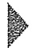

## 导读

等效变换是电路分析中的一个重要概念。对于一些结构比较简单的电路，例如电路中仅有少数独立电源的电阻电路，常常可以应用等效变换的方法，使得部分电路得到变形而简化求解过程。简单电阻电路的等效变换包括:电阻的串联、并联与混联的变换，Y形联结与 $\Delta$ 形联结的变换和电源的等效变换等。

本章为简单结构电阻电路的分析与计算,着重介绍等效变换的概念。

## §2-1 电路的等效变换

由时不变线性无源元件、线性受控源和独立电源组成的电路，称为时不变线性电路，本书简称线性电路。本书的大部分内容是线性电路的分析。

如果构成电路的无源元件均为线性电阻,则称该电路为线性电阻性电路(或简称电阻电路)。本书第二、三、四章介绍电阻电路的分析。电路中电压源的电压或电流源的电流,可以是恒定值,也可以随时间按某种规律而变化;当电路中的独立电源都是恒定电源时,这类电路简称为直流电路。

对电路进行分析和计算时,有时可以把电路中某一部分简化,即用一个较为简单或另一种结构形式的电路代替该部分电路,以使整个电路便于计算。在图2-1(a)中,右方虚线框中由几个电阻构成的电路可以用一个电阻 $R_{\mathrm{eq}}^{①}$ [见图2-1(b)]代替,使整个电路得以简化。进行代替的条件是使图2-1(a)(b)中,端子1-1'以右的部分有相同的伏安特性。电阻 $R_{\mathrm{eq}}$ 称为等效电阻,其值决定于被代替的原电路中各电阻的值以及它们的连接方式。

另一方面，当图2-1(a)中端子 $1 - 1^{\prime}$ 以右电路被 $R_{\mathrm{eq}}$ 代替后，$1 - 1^{\prime}$ 以左部分电路的任何电压和电流都将维持与原电路相同。这就是电路的“等效概念”。更一般地说，当

<small>① 下标 eq 为等效(equivalent)的简写。</small>

---

§ 2-2 电阻的串联和并联

35

电路中某一部分用其等效电路代替后，未被代替部分的电压和电流均应保持不变。也就是说，用等效电路的方法求解电路时，电压和电流保持不变的部分仅限于等效电路以外，这就是“对外等效”的概念。等效电路是被代替部分的简化或结构变形，因此，内部并不等效。例如，把图2-1(a)所示电路简化后，不难按图2-1(b)求得端子 $1 - 1^{\prime}$ 以左部分的电流 $i$ 和端子 $1 - 1^{\prime}$ 的电压 $u$ ，它们分别等于原电路中的电流 $i$ 和电压 $u$ 。但如果还要求图2-1(a)虚线框内部的各电阻的电流，就必须回到原电路，利用已求得的电流 $i$ 和电压 $u$ 来求解。可见，“对外等效”也就是其外部特性等效。

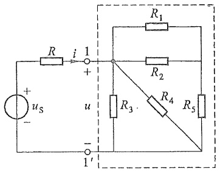

text_image

R
i 1
+
R1
R2
+
us
u
-
R3
R4
R5
1'
1'

(a)

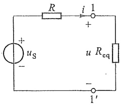

text_image

R
i 1
+
us
-
u Req
-
1'

(b)

图2-1 等效电阻

## §2-2 电阻的串联和并联

等效电路是电路结构的一种变形(或变换),本节先讨论最简单的电阻串联和并联的情况。

图 2-2(a) 所示电路为 n 个电阻  $R_{1}, R_{2}, \cdots, R_{k}, \cdots, R_{n}$  的串联组合。电阻串联时，每个电阻中的电流为同一电流。

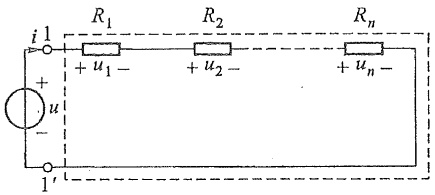

text_image

i 1
+ u₁ -
u
-
1'
R₁ R₂ Rₙ
+ u₂ -
+ uₙ -

(a)

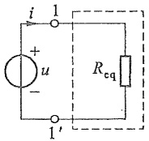

text_image

i
1
+
u
-
1'
Rcq

(b)

图2-2 电阻的串联

应用 KVL, 有

$$
u = u _ {1} + u _ {2} + \dots + u _ {k} + \dots + u _ {n}
$$

即总电压为各串联电阻分电压之和。

由于每个电阻的电流均为 i，有  $u_{1}=R_{1}i, u_{2}=R_{2}i, \cdots, u_{k}=R_{k}i, \cdots, u_{n}=R_{n}i$ ，代入上式得

$$
u = \left(R _ {1} + R _ {2} + \dots + R _ {k} + \dots + R _ {n}\right) i = R _ {\mathrm{eq}} i
$$

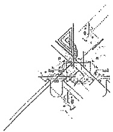

natural_image

Pure technical line drawing of intersecting lines and shapes without any text, numbers, or symbols

---

36

第二章 电阻电路的等效变换

其中

$$
R _ {\mathrm{eq}} \stackrel {\mathrm{def} ^ {(1)}} {=} \frac {u}{i} = R _ {1} + R _ {2} + \dots + R _ {k} + \dots + R _ {n} = \sum_ {k = 1} ^ {n} R _ {k} \tag {2-1}
$$

电阻  $R_{eq}$  是这些串联电阻的等效电阻。显然，当各电阻均为正值时，等效电阻必大于任一个参与串联的电阻。

电阻串联时,各电阻上的分电压为

$$
u _ {k} = R _ {k} i = \frac {R _ {k}}{R _ {\mathrm{eq}}} u \quad (k = 1, 2, \dots , n) \tag {2-2}
$$

可见,串联的每个电阻,其电压与电阻值成正比。或者说,总电压根据各个串联电阻的电阻值进行分配。式(2-2)称为电压分配公式,或称分压公式。

图 2-3(a) 示出 n 个电阻的并联组合。电阻并联时，各电阻的电压为同一电压。总电流 i 可根据 KCL 写作

$$
\begin{array}{l} i = i _ {1} + i _ {2} + \dots + i _ {k} + \dots + i _ {n} \\ = G _ {1} u + G _ {2} u + \dots + G _ {k} u + \dots + G _ {n} u \\ = \left(G _ {1} + G _ {2} + \dots + G _ {k} + \dots + G _ {n}\right) u = G _ {\mathrm{eq}} u \\ \end{array}
$$

即总电流为各并联电阻分电流之和，式中  $G_{1}$ 、 $G_{2}$ 、 $\cdots$ 、 $G_{k}$ 、 $\cdots$ 、 $G_{n}$  为电阻  $R_{1}$ 、 $R_{2}$ 、 $\cdots$ 、 $R_{k}$ 、 $\cdots$ 、 $R_{n}$  的电导，而

$$
G _ {\mathrm{eq}} \stackrel {\mathrm{def}} {=} \frac {i}{u} = G _ {1} + G _ {2} + \dots + G _ {k} + \dots + G _ {n} = \sum_ {k = 1} ^ {n} G _ {k} \tag {2-3}
$$

$G_{eq}$ 是 n 个电阻并联后的等效电导。并联后的等效电阻 $R_{eq}$ 为

$$
R _ {\mathrm{eq}} = \frac {1}{G _ {\mathrm{eq}}} = \frac {1}{\sum_ {k = 1} ^ {n} G _ {k}} = \frac {1}{\sum_ {k = 1} ^ {n} \frac {1}{R _ {k}}}
$$

或

$$
\frac {1}{R _ {\mathrm{eq}}} = \sum_ {k = 1} ^ {n} \frac {1}{R _ {k}}
$$

不难看出,当各电阻均为正值时,等效电阻小于任一个参与并联的电阻。

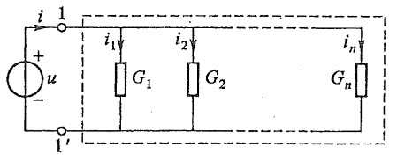

text_image

i
1
+
u
-
1'
i₁
G₁
i₂
G₂
iₙ
Gₙ

(a)

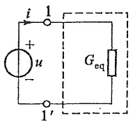

text_image

i
1
+
u
-
1'
G_eq

(b)

图2-3 电阻的并联

<small>① 符号“def”表示“按定义等于”。</small>

---

§ 2-2 电阻的串联和并联

37

电阻并联时,各电阻中的电流为

$$
i _ {k} = G _ {k} u = \frac {G _ {k}}{G _ {\mathrm{eq}}} i \quad (k = 1, 2, \dots , n) \tag {2-4}
$$

可见,每个并联电阻中的电流与它们各自的电导值成正比。上式称为电流分配公式,或称分流公式。

当 $n = 2$ 时，即2个电阻并联时，如图2-4(a)所示，等效电阻为

$$
R _ {\mathrm{eq}} = \frac {1}{\frac {1}{R _ {1}} + \frac {1}{R _ {2}}} = \frac {R _ {1} R _ {2}}{R _ {1} + R _ {2}}
$$

两并联电阻的电流分别为

$$
i _ {1} = \frac {G _ {1}}{G _ {\mathrm{eq}}} i = \frac {R _ {2}}{R _ {1} + R _ {2}} i
$$

$$
i _ {2} = \frac {G _ {2}}{G _ {\mathrm{eq}}} i = \frac {R _ {1}}{R _ {1} + R _ {2}} i
$$

例 2-1 图 2-5 所示电路中, $I_{s}=16.5\ mA$ ,  $R_{s}=2\ k\Omega$ ,  $R_{1}=40\ k\Omega$ ,  $R_{2}=10\ k\Omega$ ,  $R_{3}=25\ k\Omega$ , 求  $I_{1}$ 、 $I_{2}$  和  $I_{3}$ 。

解 $R_{\mathrm{S}}$ 不影响 $R_{1}, R_{2}, R_{3}$ 中电流的分配。现在 $G_{1} = \frac{1}{R_{1}} = 0.025 \mathrm{~mS}, G_{2} = \frac{1}{R_{2}} = 0.1 \mathrm{~mS}, G_{3} = \frac{1}{R_{3}} = 0.04 \mathrm{~mS}$ 。按电流分配公式，有

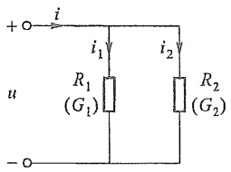

text_image

+i
i₁
i₂
u
R₁
(G₁)
R₂
(G₂)
-o

(a)

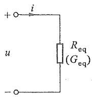

text_image

+
i
u
-
R_eq
(G_eq)

(b)

图2-4 2个电阻并联

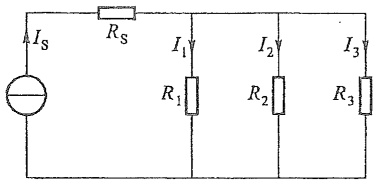

text_image

I_S
R_S
I_1
R_1
I_2
R_2
I_3
R_3

图2-5 例2-1图

$$
\begin{array}{l} I _ {1} = \frac {G _ {1}}{G _ {1} + G _ {2} + G _ {3}} I _ {\mathrm{s}} = \frac {0 . 0 2 5}{0 . 0 2 5 + 0 . 1 + 0 . 0 4} \times 1 6. 5 \mathrm{mA} \\ = 2. 5 \mathrm{mA} \\ \end{array}
$$

$$
\begin{array}{l} I _ {2} = \frac {G _ {2}}{G _ {1} + G _ {2} + G _ {3}} I _ {\mathrm{s}} = \frac {0 . 1}{0 . 0 2 5 + 0 . 1 + 0 . 0 4} \times 1 6. 5 \mathrm{mA} \\ = 1 0 \mathrm{mA} \\ \end{array}
$$

$$
\begin{array}{l} I _ {3} = \frac {G _ {3}}{G _ {1} + G _ {2} + G _ {3}} I _ {\mathrm{s}} = \frac {0 . 0 4}{0 . 0 2 5 + 0 . 1 + 0 . 0 4} \times 1 6. 5 \mathrm{mA} \\ = 4 \mathrm{mA} \\ \end{array}
$$

当电阻的连接中既有串联又有并联时,称为电阻的串、并联,或简称混联。图2-6(a)(b)所示电路均为混联电路。在图2-6(a)中, $R_{3}$ 与 $R_{4}$ 串联后与 $R_{2}$ 并联,再与 $R_{1}$ 串联。故有

$$
R _ {\mathrm{eq}} = R _ {1} + \frac {R _ {2} (  R _ {3} + R _ {4}  )}{R _ {2} + R _ {3} + R _ {4}}
$$

---

38

第二章 电阻电路的等效变换

对于图 2-6(b) 中电路,读者可自行求得  $R_{eq}=12\ \Omega$ 。

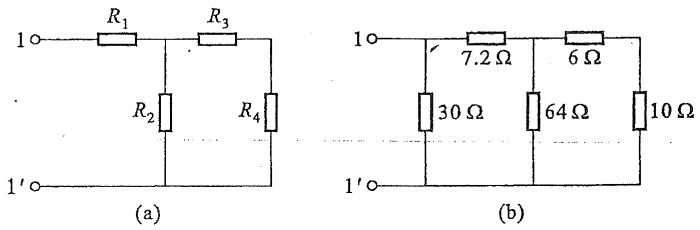

图 2-6 电阻的混联

除了串联、并联以外，还有一种特殊的连接形式是桥形连接。图2-7(a)所示桥形结构电路中各电阻既不是串联也不是并联，因此无法根据电阻的串联、并联变换规律将电路结构加以变动。如果在该电路的任一支路中加入一个电压源就可得到图2-7(b)所示电

路，该电路又称为惠斯通电桥。其中 $R_{1}, R_{2}, R_{3}, R_{4}$ 所在支路称为桥臂，$R_{5}$ 支路称为对角线支路。不难证明，当满足条件 $R_{1}R_{4} = R_{2}R_{3}$ 时，对角线支路中电流为零，二端电压也为零，此时认为电桥处于平衡状态①，这一条件也称为电桥的平衡条件。电桥平衡时对角线支路可看作开路（因 $i = 0$），或短路（因 $u = 0$），电路就可按串、并联规律计算②。但当电桥不满足平衡条件时，就无法应用串、并联变换，而要应用下一节中电阻的 $\mathrm{Y} - \Delta$ 等效变换。

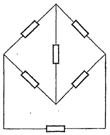

natural_image

Pure electrical circuit lines without any symbols

(a)

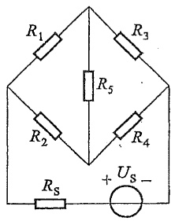

text_image

R₁
R₃
R₅
R₂
R₄
+ Uₛ -
Rₛ

(b)

图 2-7 桥形结构与惠斯通电桥

## §2-3 电阻的 Y 形联结和 Δ 形联结的等效变换

Y形联结也称为星形(star)联结，$\Delta$ (delta)形联结也称为三角形联结。它们都有3个端子与外部相连。在图2-7所示电桥电路中，$R_{1}, R_{3}, R_{5}$ 构成Y形联结（$R_{2}, R_{4}, R_{5}$ 也构成Y形联结）；$R_{1}, R_{2}, R_{5}$ 构成 $\Delta$ 形联结（$R_{3}, R_{4}, R_{5}$ 也构成 $\Delta$ 形联结）。图2-8(a)(b)分别表示接于端子1、2、3的Y形联结与 $\Delta$ 形联结的三个电阻。端子1、2、3与电路的其他部分相连，图中没有画出电路的其他部分。当两种电路的电阻之间满足一定关系时，它们在端子1、2、3上及端子以外的特性可以相同，就是说它们可以互相等效变换。如果在它们的对应端子之间具有相同的电压 $u_{12}, u_{23}$ 和 $u_{31}$，而流入对应端子的电流分别相等，即 $i_{1} = i_{1}^{\prime}, i_{2} = i_{2}^{\prime}, i_{3} = i_{3}^{\prime}$，在这种条件下，它们就彼此等效。这就是 $\dot{Y} - \Delta$ 等效

<small>① 电桥的这一特性常用于电气测量、控制电路之中。</small>

<small>② 由于 $R_{5}$ 中电流为零，两端电压亦为零（$R_{5}$ 为有限值），将该支路断开或短路均不会影响其他部分的电压、电流。</small>

---

§ 2-3 电阻的 Y 形联结和 Δ 形联结的等效变换

39

变换应满足的条件。

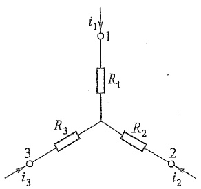

text_image

i₁
1
R₁
R₃
3
i₃
R₂
2
i₂

(a) Y形联结

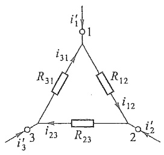

text_image

i'1
1
i31
R31
R12
i12
i'2
2
i23
R23
i'3
3

(b)  $\Delta$ 形联结

图 2-8 Y 形联结和  $\Delta$  形联结的等效变换

对于  $\Delta$  形联结电路, 各电阻中电流为

$$
i _ {1 2} = \frac {u _ {1 2}}{R _ {1 2}}, \quad i _ {2 3} = \frac {u _ {2 3}}{R _ {2 3}}, \quad i _ {3 1} = \frac {u _ {3 1}}{R _ {3 1}}
$$

根据 KCL, 端子电流分别为

$$
\left. \begin{array}{l} i _ {1} ^ {\prime} = \frac {u _ {1 2}}{R _ {1 2}} - \frac {u _ {3 1}}{R _ {3 1}} \\ i _ {2} ^ {\prime} = \frac {u _ {2 3}}{R _ {2 3}} - \frac {u _ {1 2}}{R _ {1 2}} \\ i _ {3} ^ {\prime} = \frac {u _ {3 1}}{R _ {3 1}} - \frac {u _ {2 3}}{R _ {2 3}} \end{array} \right\} \tag {2-5}
$$

对于 Y 形联结电路,应根据 KCL 和 KVL 联立求出端子电压与电流之间的关系,方程为

$$
\left. \begin{array}{l} i _ {1} + i _ {2} + i _ {3} = 0 \\ R _ {1} i _ {1} - R _ {2} i _ {2} = u _ {1 2} \\ R _ {2} i _ {2} - R _ {3} i _ {3} = u _ {2 3} \end{array} \right\}
$$

并计及 $u_{12} + u_{23} + u_{31} = 0$ ，可以解出电流

$$
\left. \begin{array}{l} i _ {1} = \frac {R _ {3} u _ {1 2}}{R _ {1} R _ {2} + R _ {2} R _ {3} + R _ {3} R _ {1}} - \frac {R _ {2} u _ {3 1}}{R _ {1} R _ {2} + R _ {2} R _ {3} + R _ {3} R _ {1}} \\ i _ {2} = \frac {R _ {1} u _ {2 3}}{R _ {1} R _ {2} + R _ {2} R _ {3} + R _ {3} R _ {1}} - \frac {R _ {3} u _ {1 2}}{R _ {1} R _ {2} + R _ {2} R _ {3} + R _ {3} R _ {1}} \\ i _ {3} = \frac {R _ {2} u _ {3 1}}{R _ {1} R _ {2} + R _ {2} R _ {3} + R _ {3} R _ {1}} - \frac {R _ {1} u _ {2 3}}{R _ {1} R _ {2} + R _ {2} R _ {3} + R _ {3} R _ {1}} \end{array} \right\} \tag {2-6}
$$

由于不论 $u_{12}, u_{23}, u_{31}$ 为何值，两个等效电路的对应的端子电流均相等，故式(2-5)与式(2-6)中电压 $u_{12}, u_{23}$ 和 $u_{31}$ 前面的系数应该对应地相等。于是得到

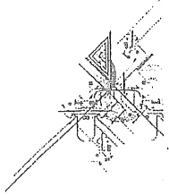

natural_image

Pure technical line drawing of a mechanical assembly or component without any text, numbers, or symbols

---

40

第二章 电阻电路的等效变换

$$
\left. \begin{array}{l} R _ {1 2} = \frac {R _ {1} R _ {2} + R _ {2} R _ {3} + R _ {3} R _ {1}}{R _ {3}} \\ R _ {2 3} = \frac {R _ {1} R _ {2} + R _ {2} R _ {3} + R _ {3} R _ {1}}{R _ {1}} \\ R _ {3 1} = \frac {R _ {1} R _ {2} + R _ {2} R _ {3} + R _ {3} R _ {1}}{R _ {2}} \end{array} \right\} \tag {2-7}
$$

式(2-7)就是根据 Y 形联结的电阻确定  $\Delta$  形联结的电阻的公式。

将式(2-7)中三式相加,并在右方通分可得

$$
R _ {1 2} + R _ {2 3} + R _ {3 1} = \frac {\left(R _ {1} R _ {2} + R _ {2} R _ {3} + R _ {3} R _ {1}\right) ^ {2}}{R _ {1} R _ {2} R _ {3}}
$$

代入 $R_{1}R_{2} + R_{2}R_{3} + R_{3}R_{1} = R_{12}R_{3} = R_{31}R_{2}$ 就可得到 $R_{1}$ 的表达式。同理可得 $R_{2}$ 和 $R_{3}$，公式分别为

$$
\left. \begin{array}{l} R _ {1} = \frac {R _ {1 2} R _ {3 1}}{R _ {1 2} + R _ {2 3} + R _ {3 1}} \\ R _ {2} = \frac {R _ {2 3} R _ {1 2}}{R _ {1 2} + R _ {2 3} + R _ {3 1}} \\ R _ {3} = \frac {R _ {3 1} R _ {2 3}}{R _ {1 2} + R _ {2 3} + R _ {3 1}} \end{array} \right\} \tag {2-8}
$$

式(2-8)就是根据  $\Delta$  形联结的电阻确定 Y 形联结的电阻的公式。

为了便于记忆,以上互换公式可归纳为

$$
\mathrm{Y} \text {形电阻} = \frac {\Delta \text {形相邻电阻的乘积}}\Delta \text {形电阻之和}
$$

$$
\Delta \text {形电阻} = \frac {\mathrm{Y} \text {形电阻两两乘积之和}}{\mathrm{Y} \text {形不相邻电阻}}
$$

注意这些公式的量纲和端子 1、2、3 的互换性有助于记忆。

若 Y 形联结中 3 个电阻相等, 即  $R_{1}=R_{2}=R_{3}=R_{Y}$ , 则等效  $\Delta$  形联结中 3 个电阻也相等, 它们等于

$$
R _ {\Delta} = R _ {1 2} = R _ {2 3} = R _ {3 1} = 3 R _ {\mathrm{Y}}
$$

或

$$
R _ {\mathrm{Y}} = \frac {1}{3} R _ {\Delta}
$$

式(2-7)和式(2-8)也可用电导表示,例如式(2-7)可写成

$$
G _ {1 2} = \frac {G _ {1} G _ {2}}{G _ {1} + G _ {2} + G _ {3}}
$$

---

§ 2-3 电阻的 Y 形联结和 Δ 形联结的等效变换

41

$$
G _ {2 3} = \frac {G _ {2} G _ {3}}{G _ {1} + G _ {2} + G _ {3}}
$$

$$
G _ {3 1} = \frac {G _ {3} G _ {1}}{G _ {1} + G _ {2} + G _ {3}}
$$

例 2-2 求图 2-9(a) 所示桥形电路的总电阻  $R_{12}$ 。

解 将节点①、③、④内的  $\Delta$  形电路用等效 Y 形电路替代, 得到图 2-9(b) 所示电路, 其中

$$
R _ {2} = \frac {1 4 \times 2 1}{1 4 + 1 4 + 2 1} \Omega = 6 \Omega
$$

$$
R _ {3} = \frac {1 4 \times 1 4}{1 4 + 1 4 + 2 1} \Omega = 4 \Omega
$$

$$
R _ {4} = \frac {1 4 \times 2 1}{1 4 + 1 4 + 2 1} \Omega = 6 \Omega
$$

然后用串、并联的方法,得到图 2-9(c)(d)(e)所示电路,从而求得

$$
R _ {1 2} = 1 5 \Omega
$$

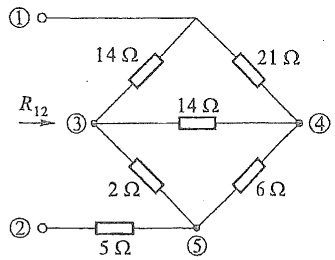

text_image

①
14 Ω
21 Ω
R₁₂
③
14 Ω
2 Ω
6 Ω
②
5 Ω
⑤

(a)

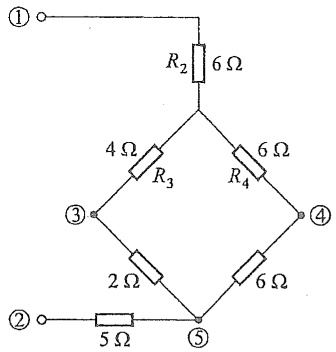

chemical

Electrical circuit diagram with resistors and nodes labeled R2, R3, R4, 2Ω, 5Ω, 6Ω

(b)

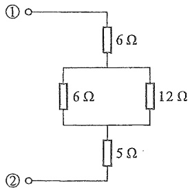

text_image

①
6 Ω
6 Ω
12 Ω
②
5 Ω

(c)

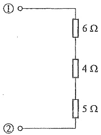

text_image

①
6 Ω
4 Ω
5 Ω
②

(d)

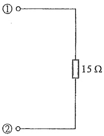

text_image

①
15 Ω
②

(e)

图2-9 例2-2图

另一种方法是用 $\Delta$ 形电路来替代节点①、④、⑤内的Y形电路（以节点③为Y形联结的内部公共节点），求解过程如图2-10所示。

---

42

第二章 电阻电路的等效变换

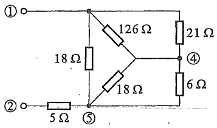

text_image

①
126 Ω
21 Ω
18 Ω
④
6 Ω
②
5 Ω
⑤

(a)

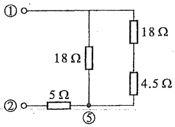

text_image

①
②
5 Ω
18 Ω
⑤
18 Ω
4.5 Ω

(b)

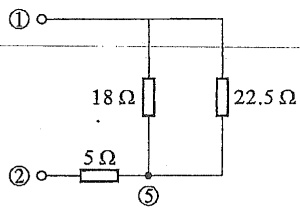

text_image

①
18 Ω
22.5 Ω
②
5 Ω
⑤

(c)

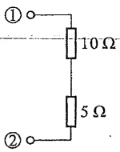

text_image

①
10 Ω
5 Ω
②

(d)

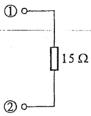

text_image

①
15 Ω
②

(e)

图2-10 求解例2-2的另一种方法

## §2-4 电压源、电流源的串联和并联

图 2-11(a) 为 n 个电压源的串联, 可以用一个电压源等效替代, 如图 2-11(b) 所示, 这个等效电压源的激励电压为

$$
u _ {\mathrm{S}} = u _ {\mathrm{S1}} + u _ {\mathrm{S2}} + \dots + u _ {\mathrm{S} n} = \sum_ {k = 1} ^ {n} u _ {\mathrm{S} k}
$$

如果  $u_{Sk}$  的参考方向与图 2-11(b) 中  $u_{S}$  的参考方向一致时，式中  $u_{Sk}$  的前面取“+”号，不一致时取“-”号。

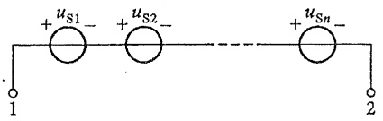

text_image

+u_{S1} -
+u_{S2} -
+u_{Sn} -
1
2

(a)

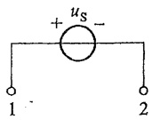

(b)

图 2-11 电压源的串联

图 2-12(a) 为 n 个电流源的并联, 可以用一个电流源等效替代, 如图 2-12(b) 所示。等效电流源的激励电流为

$$
i _ {\mathrm{S}} = i _ {\mathrm{S1}} + i _ {\mathrm{S2}} + \dots + i _ {\mathrm{Sn}} = \sum_ {k = 1} ^ {n} i _ {\mathrm{Sk}}
$$

如果  $i_{Sk}$  的参考方向与图 2-12(b) 中  $i_{S}$  的参考方向一致时，式中  $i_{Sk}$  的前面取“+”号，不一致时取“-”号。

---

§ 2-5 实际电源的两种模型及其等效变换

43

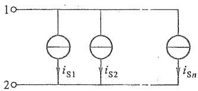

text_image

1
2
iS1
iS2
iSn

(a)

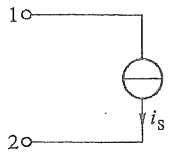

(b)

图2-12 电流源的并联

只有激励电压相等且极性一致的电压源才允许并联,否则违背KVL。并联后,其等效电路为其中任一电压源,但是这个并联组合向外部提供的电流在各个电压源之间如何分配则无法确定。

只有激励电流相等且方向一致的电流源才允许串联,否则违背 KCL。串联后,其等效电路为其任一电流源,但是这个串联组合的总电压如何在各个电流源之间分配则无法确定。

顺便指出:当一个电压源与电流源并联时,对外的作用如同该电压源,而电压源的电流要受所并电流源的影响;一个电流源与电压源串联时,对外的作用如同该电流源,而电流源的电压要受所串电压源的影响。

## §2-5 实际电源的两种模型及其等效变换

图 2-13(a) 所示为一个实际直流电源,例如一个干电池; 图 2-13(b) 是它的输出电压 u 与输出电流 i 的伏安特性曲线(虚线部分表示该电源已不能正常工作)。由于内部损耗, 输出电压 u 随电流 i 的增大而减少,且不呈线性关系。输出电流 i 不可超过一定的限值,否则会导致电源损坏。不过在一段范围内电压和电流的关系近似为直线。如果把这一段直线加以延长而作为该电源的外特性,如图 2-13(c) 所示,此时,它在 u 轴和 i 轴上各有一个交点,前者相当于 i=0 时的电压,即开路电压  $U_{oc}^{①}$ ; 后者相当于 u=0

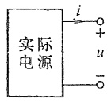

(a)

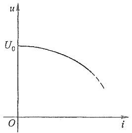

line

| i | u |
| --- | --- |
| 0 | \(U_{0}\) |

(b)

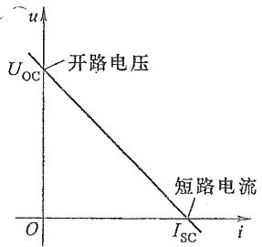

line

| i | u |
| --- | --- |
| 0 | Uoc |
| Isc | 0 |

(c)

图 2-13 实际电源的伏安特性曲线

电源的等效
变换

<small>① 下标 OC 是开路(open circuit)的简写。</small>

---

44

第二章 电阻电路的等效变换

时的电流，即短路电流 $I_{\mathrm{sc}}^{①}$ 。根据此伏安特性曲线，可以用电压源和电阻的串联组合或电流源和电导的并联组合作为使用在一定电流范围内的实际电源的电路模型。

图 2-14(a) 所示为电压源  $U_{s}$  和电阻 R 的串联组合, 在端子  $1-1'$  处的电压 u 与 (输出) 电流 i 的关系为

$$
u = U _ {\mathrm{S}} - R i \tag {2-9}
$$

图2-14(c)所示为电流源 $I_{s}$ 与电导G的并联组合，在端子 $1 - 1'$ 处的电压u与(输出)电流i的关系为

$$
i = I _ {\mathrm{s}} - G u \tag {2-10}
$$

如果令

$$
G = \frac {1}{R}, \quad I _ {\mathrm{s}} = G U _ {\mathrm{s}} \tag {2-11}
$$

式(2-9)和式(2-10)所示的两个方程将完全相同,也就是在端子 $1-1'$ 处的u和i的关系将完全相同。式(2-11)就是这两种组合彼此对外等效必须满足的条件(注意 $U_{s}$ 和 $I_{s}$ 的参考方向, $I_{s}$ 的参考方向由 $U_{s}$ 的负极指向正极)。

当 $i = 0$ 时，端子 $1 - 1'$ 处的电压为开路电压 $U_{\mathrm{oc}}$ ，而 $U_{\mathrm{oc}} = U_{\mathrm{s}}$ 。当 $u = 0$ 时，$i$ 为把端子 $1 - 1'$ 短路后的短路电流 $I_{\mathrm{sc}}$ ，而 $I_{\mathrm{sc}} = I_{\mathrm{s}}$ 。同时有 $U_{\mathrm{oc}} = RI_{\mathrm{sc}}$ ，或 $I_{\mathrm{sc}} = GU_{\mathrm{oc}}$ 。

图 2-14(b) 和 (d) 分别示出图 2-14(a) 和 (c) 所示电路在 i-u 平面上的伏安特性曲线, 它们都是一条直线。当式 (2-11) 的条件满足时, 它们将是同一条直线。

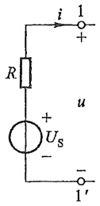

text_image

i
1
+
R
u
+
Us
-
1'
-

(a)

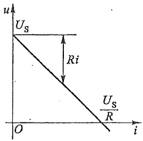

line

| Variable | Description |
| --- | --- |
| u | Voltage (Vertical Axis) |
| i | Current (Horizontal Axis) |
| Us | Surface Voltage (Horizontal Line) |
| Ri | Resistance (Vertical Distance) |
| Us/R | Voltage-to-Current Ratio (Vertical Line Segment) |

(b)

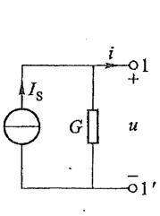

text_image

I_S
G
i
+
1
u
-1'

(c)

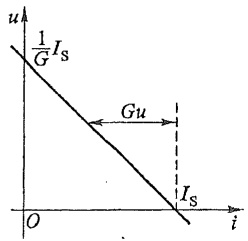

line

| i | u |
| --- | --- |
| 0 | 1/G Is |
| Gu | — |
| Is | 0 |

(d)

图2-14 实际电源的两种电路模型

这种等效变换仅保证端子 $1 - 1'$ 外部电路的电压、电流和功率相同（即只是对外部等效），对内部并无等效可言。例如，端子 $1 - 1'$ 开路时，两电路对外均不发出功率，但此时电压源发出的功率为零，电流源发出的功率为 $\frac{I_{\mathrm{s}}^2}{G}$ 。反之，短路时，电压源发出的功率为 $\frac{U_{\mathrm{s}}^2}{R}$，电流源发出的功率为零。

利用 §2-2、§2-4 和本节的等效变换, 就可以简化求解由电压源、电流源和电阻组

<small>① 下标 SC 是短路(short circuit)的简写。</small>

---

§ 2-5 实际电源的两种模型及其等效变换

45

成的串、并联电路。

例 2-3 求图 2-15(a) 所示电路中电流 i。

解 图 2-15(a) 所示电路可简化为图 2-15(e) 所示单回路电路。简化过程如图 2-15(b)(c)(d)(e) 所示。由化简后的电路可求得电流为

$$
i = \frac {5}{3 + 7} \mathrm{A} = 0. 5 \mathrm{A}
$$

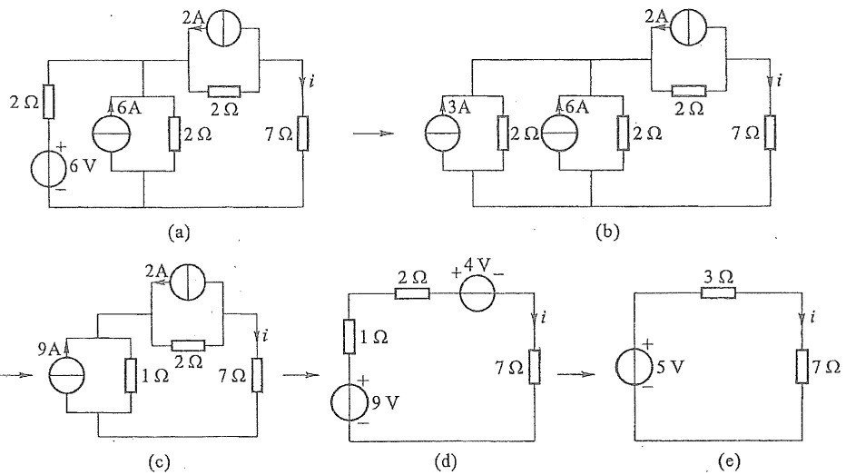

图2-15 例2-3图

受控电压源、电阻的串联组合和受控电流源、电导的并联组合也可以用上述方法进行变换。此时可把受控电源当作独立电源一样来处理，但要注意在变换过程中必须保存控制量所在支路，而不要在变换中把它消掉。

例 2-4 图 2-16(a) 所示电路中, 已知  $u_{s}=12\ V, R=2\ \Omega$ , VCCS 的电流  $i_{c}$  受电阻 R 上的电压  $u_{R}$  控制, 且  $i_{c}=gu_{R}, g=2\ S$ 。求  $u_{R}$ 。

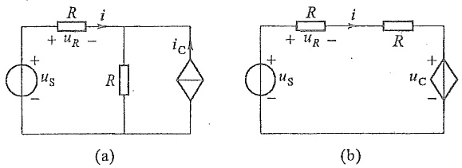

图2-16 例2-4图

解 利用等效变换,把电压控制电流源和电导的并联组合变换为电压控制电压源和电阻的串联组合,如图2-16(b)所示,其中 $u_{C}=Ri_{C}=2\times2\times u_{R}=4u_{R}$ ，而 $u_{R}=Ri$ 。按KVL,有

1. 工程图

---

1

46

第二章 电阻电路的等效变换

$$
R i + R i + u _ {\mathrm{c}} = u _ {\mathrm{s}}
$$

$$
2 u _ {R} + 4 u _ {R} = u _ {\mathrm{S}}
$$

$$
u _ {R} = \frac {u _ {\mathrm{s}}}{6} = 2 \mathrm{V}
$$

## §2-6 输入电阻

电路或网络的一个端口是它向外引出的一对端子,这对端子可以与外部电源或其他电路相连接。对一个端口来说,从它的一个端子流入的电流一定等于从另一个端子流出的电流。这种具有向外引出一对端子的电路或网络称为一端口(网络)或二端网络。图2-17(a)所示是一个一端口的图形表示。

如果一个一端口内部仅含电阻,则应用电阻的串、并联和 Y-Δ 变换等方法,可以求得它的等效电阻。如果一端口内部除线性电阻以外还含有线性受控源,但不含任何独立电源,可以证明(见 §4-3),不论内部如何复杂,端口电压与端口电流成正比[见图 2-17(a)],因此,定义此一端口的输入电阻 $R_{i}$ 为

$$
R _ {\mathrm{i}} \stackrel {\mathrm{def}} {=} \frac {u}{i} \tag {2-12}
$$

端口的输入电阻也就是端口的等效电阻，但两者的含意有区别。求端口输入电阻的一般方法称为电压、电流法，即在端口加以电压源 $u_{s}$ ，然后求出端口电流i；或在端口加以电流源 $i_{s}$ ，然后求出端口电压u。根据式(2-12)， $R_{i}=\frac{u_{s}}{i}=\frac{u}{i_{s}}$ 。测量一个电阻器的电阻就可以采用这种方法。

图 2-17(b) 中一端口的输入电阻可通过电阻串、并联化简求得, 图 2-17(c) 所示电路具有桥形结构, 应用 Y- $\Delta$ 变换后才能简化, 也可以用电压、电流法求此两图的输入电阻, 如图 2-17(b)(c) 所示。

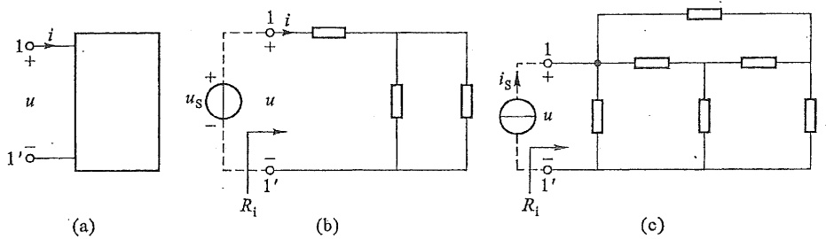

图2-17 一端口的输入电阻

例 2-5 求图 2-18(a) 所示一端口的输入电阻。

解 在端口 1-1' 处加电压  $u_{s}$ ，求出 i，再由式(2-12)求输入电阻  $R_{i}$ 。

将CCCS和电阻 $R_{2}$ 的并联组合等效变换为CCVS和电阻的串联组合，如图2-18(b)

---

思考题

47

所示。根据 KVL, 有

$$
u _ {\mathrm{S}} = - R _ {2} \alpha i + \left(R _ {2} + R _ {3}\right) i _ {1} \tag {1}
$$

$$
u _ {\mathrm{S}} = R _ {1} i _ {2} \tag {2}
$$

再由 KCL,  $i=i_{1}+i_{2}$ ，可得  $i_{1}=i-i_{2}=i-\frac{u_{s}}{R_{1}}$ ，代入式(1)，整理后，有

$$
R _ {\mathrm{i}} = \frac {u _ {\mathrm{s}}}{i} = \frac {R _ {1} R _ {3} + (1 - \alpha) R _ {1} R _ {2}}{R _ {1} + R _ {2} + R _ {3}}
$$

上式分子中有负号出现,因此,当存在受控源时,在一定的参数条件下, $R_{i}$ 有可能是零,也有可能是负值。例如,当 $R_{1}=R_{2}=1\Omega,R_{3}=2\Omega,\alpha=5$ 时, $R_{i}=-0.5\Omega$ 。§1-5中曾指出负电阻元件实际是一个发出功率的元件。本例中一端口向外发出功率是由于受控源发出功率。

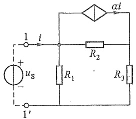

text_image

1
+
us
-
1'
i
R2
ai
R1
R3

(a)

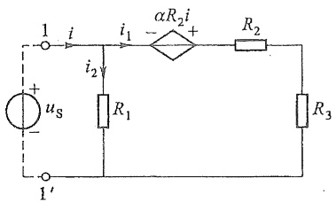

text_image

1
i
i₁
αR₂i
+
R₂
i₂
uₛ
R₁
R₃
1'
1'

(b)

图2-18 例2-5图

一个CCVS,如果控制电流就是该受控源本身的电流,那么这个CCVS的输入电阻就是 $R_{\alpha}$ [见图2-19(a)]或 $-R_{\beta}$ [见图2-19(b)];也就是说,可用电阻 $R_{\alpha}$ 来代替图2-19(a)中的CCVS,用 $-R_{\beta}$ 来代替图2-19(b)中的CCVS。同理,一个VCCS,如果控制电压就是受控源本身的电压,也可以用-G或G来代替这个VCCS[见图2-19(c)(d)]。

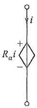

(a)

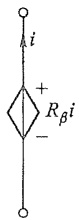

(b)

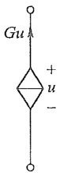

(c)

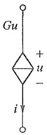

(d)

图2-19

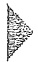

## 思考题

2-1 两个电压源并联,为什么两个电压源的电压必须相同?
2-2 两个电流源串联,为什么两个电流源的电流必须相同?
2-3 电压源并联一个电阻或电流源,对外等效电路是什么元件?为什么?
2-4 电流源串联一个电阻或电压源,对外等效电路是什么元件?为什么?
2-5 当满足什么条件,电压源串联电阻的支路可与电流源并联电阻的支路相互等效?当外接电路后,这两个电路的内部相互等效吗?为什么?
2-6 对于一个只含线性电阻的一端口,用串并联等效变换法和 Y-Δ 变换法求得

---

1. 用 $\mathrm{H}_2\mathrm{O}$ 气相分离的气体，用于气体交换反应。

48

第二章 电阻电路的等效变换

的等效电阻和外加电源法求得的输入电阻相等,为什么?

2-7 在求解习题 2-4 时, 应用了电路对称性的特点。你能论证这样做的根据吗?

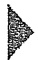

## 习题

2-1 电路如题 2-1 图所示, 已知  $u_{s}=100\ V, R_{1}=2\ k\Omega, R_{2}=8\ k\Omega$ 。试求以下 3 种情况下的电压  $u_{2}$  和电流  $i_{2}, i_{3}$ :

(1)  $R_{3}=8\ k\Omega$ 。
(2) $R_{3}=\infty(R_{3}$ 处开路)。
(3) $R_{3}=0(R_{3}$ 处短路)。

2-2 电路如题 2-2 图所示, 其中电阻、电压源和电流源均为已知, 且为正值。

(1) 求电压  $u_{2}$  和电流  $i_{2}$ 。
(2) 若电阻  $R_{1}$  增大, 对哪些元件的电压、电流有影响? 影响如何?

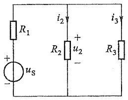

text_image

R₁
+
-
uₛ
i₂
R₂
+
-
u₂
i₃
R₃

题 2-1 图

text_image

iS
R1
i2
+
u2
-
R2
R3
+
us
-
R4

题2-2图

2-3 题 2-3 图中  $u_{s}=50\ V, R_{1}=2\ k\Omega, R_{2}=8\ k\Omega$ 。现欲测量电压  $u_{o}$ ，所用电压表量程为 50 V，灵敏度为  $1000\ \Omega/V$ （即每伏量程电压表相当于  $1000\ \Omega$  的电阻）。

(1) 测量得  $u_{0}$  为多少?
(2) $u_{0}$ 的真值 $u_{ot}$ 为多少?
(3) 如果测量误差以下式表示

$$
\delta (\%)
$$

此时测量误差是多少？

text_image

u_S
+
-
R_1
R_2
u_o
+
-
V

题2-3图

---

习题

49

2-4 求题 2-4 图所示各电路的等效电阻  $R_{ab}$ ，其中  $R_{1}=R_{2}=1\Omega, R_{3}=R_{4}=2\Omega, R_{5}=4\Omega, G_{1}=G_{2}=1\mathrm{~S}, R=2\Omega$ 。

text_image

R₁
a
R₂
R₃
R₄
b
R₅

(a)

(b)

text_image

a
R₁
R₂
S
R₃
R₄
b
R₅

(c)

text_image

a
R₁ R₁
R₂ R₂
R₂
b

(d)

text_image

R
R
R
R
R
R
R
R
a
b

(e)

text_image

a
R R R R
R R R
R R R
R R R
R R
b

(f)

题 2-4 图

2-5 用 $\Delta -\mathrm{Y}$ 等效变换法求题2-5图中a、b端的等效电阻。

（1）将节点①、②、③之间的三个9Ω电阻构成的Δ形电路变换为Y形电路。
（2）将节点①、③、④与作为内部公共节点的②之间的三个9Ω电阻构成的Y形电路变换为Δ形电路。

2-6 利用 Y- $\Delta$  等效变换求题 2-6 图中 a、b 端的等效电阻。

text_image

a o
9 Ω
①
9 Ω
②
9 Ω
③
9 Ω
④
3 Ω
b o

题 2-5 图

text_image

a○—10/11Ω
      1/2Ω ——1/3Ω
      1Ω ——
      8/11Ω ——9/11Ω
b○

题 2-6 图

2-7 在题 2-7 图(a)电路中, $u_{\mathrm{S1}} = 24 \mathrm{~V}, u_{\mathrm{S2}} = 6 \mathrm{~V}, R_1 = 12 \mathrm{k} \Omega, R_2 = 6 \mathrm{k} \Omega, R_3 = 2 \mathrm{k} \Omega$。题 2-7 图(b)为经电源变换后的等效电路。

(1) 求等效电路的  $i_{s}$  和  $R_{0}$
(2) 根据等效电路求  $R_{3}$  中的电流和消耗的功率。

---

50

第二章 电阻电路的等效变换

(3) 分别在题 2-7 图(a)(b)中求出  $R_{1}$ 、 $R_{2}$  及  $R_{3}$  消耗的功率。
(4) $u_{S1}, u_{S2}$ 发出的功率是否等于 $i_{S}$ 发出的功率？ $R_{1}, R_{2}$ 消耗的功率是否等于R消耗的功率？为什么？

text_image

R₁
+
-
uₛ₁
R₂
+
-
uₛ₂
R₃

(a)

text_image

i_S
R
R_3

(b)

题2-7图

2-8 求题 2-8 图所示电路中对角线电压 U 及总电压  $U_{ab}$ 。

text_image

4A
Uab
a
+
-
b
10 Ω
10 Ω
+
8 Ω
U
-
5 Ω
2 Ω

题 2-8 图

2-9 题 2-9 图所示电路为由桥 T 电路构成的衰减器。

(1) 试证明当 $R_{2} = R_{1} = R_{\mathrm{L}}$ 时, $R_{\mathrm{ab}} = R_{\mathrm{L}}$, 且有 $\frac{u_{\mathrm{o}}}{u_{\mathrm{i}}} = 0.5$。
(2) 试证明当 $R_{2} = \frac{2R_{\mathrm{I}}R_{\mathrm{L}}^{2}}{3R_{\mathrm{I}}^{2} - R_{\mathrm{L}}^{2}}$ 时, $R_{\mathrm{ab}} = R_{\mathrm{L}}$, 并求此时电压比 $\frac{u_{\mathrm{o}}}{u_{\mathrm{i}}}$。

text_image

a
+
R₁
ui
-
b
R₂
R₁
R₁
uo
RL
-

题2-9图

2-10 在题 2-10 图(a)中, $u_{\mathrm{S1}} = 45 \mathrm{~V}, u_{\mathrm{S2}} = 20 \mathrm{~V}, u_{\mathrm{S4}} = 20 \mathrm{~V}, u_{\mathrm{S5}} = 50 \mathrm{~V}; R_1 = R_3 = 15 \Omega$,

---

习题

51

$R_{2} = 20\Omega ,R_{4} = 50\Omega ,R_{5} = 8\Omega$ ;在题2-10图（b）中， $u_{\mathrm{S1}} = 20\mathrm{V},u_{\mathrm{S5}} = 30\mathrm{V},i_{\mathrm{S2}} = 8\mathrm{A},i_{\mathrm{S4}} = 17\mathrm{A}$ $R_{1} = 5\Omega ,R_{3} = 10\Omega ,R_{5} = 10\Omega$ 。利用电源的等效变换求题2-10图(a)(b)中电压 $u_{\mathrm{ab}}$ 。

text_image

R₁
+
uₛ₁
-
R₂
+
uₛ₂
-
R₃
a
R₄
-
uₛ₄
+
uₛ₅
-
R₅
+
b

(a)

text_image

R₁
+
uₛ₁
-
iₛ₂
a
R₃
R₅
+
uₛ₅
-
iₛ₄
b

(b)

题2-10图

2-11 利用电源的等效变换, 求题 2-11 图所示电路的电流 i。

text_image

1A
4Ω
4Ω
2Ω
6V
10V
+
-
4V
+
-
4Ω
i
10Ω
10Ω

题2-11图

2-12 利用电源的等效变换, 求题 2-12 图所示电路中的电压比  $\frac{u_{o}}{u_{S}}$ 。已知  $R_{1}=R_{2}=2\Omega, R_{3}=R_{4}=1\Omega$ 。
2-13 题 2-13 图所示电路中  $R_{1}=R_{3}=R_{4}, R_{2}=2R_{1}$ ，CCVS 的电压  $u_{c}=4R_{1}i_{1}$ ，利用电源的等效变换求电压  $u_{10}$ 。

text_image

R₁
+ u₃ -
R₃
2u₃
R₂
R₄
uₒ
+
-

题 2-12 图

text_image

i₁ R₁ ① R₃
+ +
R₂
uₛ u₁₀ + u꜀
- -
① R₄

题 2-13 图

2-14 试求题 2-14 图中的输入电阻。

1. 2. 3. 4. 5. 6. 7. 8. 9. 10. 11. 12. 13. 14. 15. 16. 17. 18. 19. 20. 21. 22. 23. 24. 25. 26. 27. 28. 29. 30. 31. 32. 33. 34. 35. 36. 37. 38. 39. 40. 41. 42. 43. 44. 45. 46. 47. 48. 49. 50. 51. 52. 53. 54. 55. 56. 57. 58. 59. 60. 61. 62. 63. 64. 65. 66. 67. 68. 69. 70. 71. 72. 73. 74. 75. 76. 77. 78. 79. 80. 81. 82. 83. 84. 85. 86. 87. 88. 89. 90.

---

52

第二章 电阻电路的等效变换

text_image

10 Ω
+
U
-
0.6U

(a)

text_image

10 Ω
+
U
+
-
2U
-

(b)

text_image

I
+
U
1S
0.5I
-

(c)

text_image

I
+
U
-
1S
0.5I

(d)

题2-14图

2-15 试求题 2-15 图的输入电阻  $R_{ab}$

text_image

a
R₂
μu₁
+
-
Rₐₑ
u₁
R₁
b

(a)

text_image

i₁
R₁
βi₁
a
Rₐₑ
R₂
b

(b)

题2-15图

2-16 试求题 2-16 图的输入电阻  $R_{i}$ 。

text_image

i₁
βi₁
R₁
R₂
1
Rᵢ
1′

(a)

text_image

+ u₁ -
R₂
μu₁
+
R₁
R₃
Rᵢ
1
1'

(b)

题 2-16 图

2-17 题 2-17 图所示电路中全部电阻均为  $1 \Omega$ ，求输入电阻  $R_{i}$ 。

text_image

3i
R₁ →

题 2-17 图

2-18 题 2-18 图为一个多量程电压表的电路图。表头灵敏度为  $50 \mu A$ ，内阻为  $2 k\Omega$ 。现将电压量程扩大为 5 V, 25 V, 50 V 与 100 V 四挡。试根据电压的分压公式求

---

习题

53

所需的附加电阻  $R_{1}$ 、 $R_{2}$ 、 $R_{3}$  与  $R_{4}$ 。

text_image

50 μA
R
2 kΩ
R₁
R₂
R₃
R₄
1○
5 V
2○
25 V
3○
50 V
4○
100 V

题2-18图

\*2-19 题 2-19 图为实际使用的万用表中多量程电流表的部分电路, $n_{1}$ 至 $n_{5}$ 为各挡电流量程对表头电流值的倍数。现在要求各挡电流为: $500 \mu \mathrm{A}, 1 \mathrm{~mA}, 5 \mathrm{~mA}, 50 \mathrm{~mA}$ 及 $500 \mathrm{~mA}$ 。即相应倍数为: $n_{1} = 10, n_{2} = 20, n_{3} = 100, n_{4} = 1000, n_{5} = 10000$ 。请计算 5 个分流电阻 $R_{1} \sim R_{5}$ 的阻值。（提示: 这是一个环形分流器。计算时, 先从第一挡 $n_{1} = 10$ 来算出五个分流电阻的总值, 再从第二挡算出后四个分流电阻的和, 直至最后一挡。）

text_image

50 μA
R
2 kΩ
R5 R4 R3 R2 R1
5 n5 4 n4 3 n3 2 n2 1 n1

题 2-19 图

\*2-20 题 2-20 图为倒 L 形电阻衰减器。如要求负载电阻 $R_{\mathrm{L}} = 50 \Omega$ 能与信号源内阻 $R_{\mathrm{s}} = 300 \Omega$ 匹配，求此时电阻 $R_{1}, R_{2}$ 的值，并求衰减量是多少分贝（有关分贝的概念见 §11-3）。

text_image

Us
+
-
RS
+
U1
R1
R2
RL
UL
+
-

题2-20图

第二章部分

习题答案
