# 第3章 电阻电路的一般分析

原始 PDF 第 78–106 页。

图

电路的图及KCL、KVL的独立方程数

## 第三章 电阻电路的一般分析

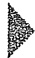

## 导读

第二章介绍的等效变换法适用于比较简单的电路的分析，而本章介绍的电阻电路的一般分析法适用于复杂电路或大规模电路的分析、计算。电阻电路的一般分析法是一类系统的分析方法，首先需要选取一组电路的独立变量，根据所选独立变量的不同，应用KCL、KVL和支路的电压电流关系（VCR），可列写不同的电路方程，例如:支路电流方程，网孔电流法方程，回路电流法方程以及节点电压法方程等。这些方程均为线性代数方程组，求解这些线性代数方程组可得到所选取的独立变量值，并根据独立变量与支路电压（或支路电流）的关系和支路的VCR可求得全部的支路电流和支路电压。借助网络图论，可方便地选取电路的独立变量，从而保证所列的电路方程为一组线性独立的代数方程。

本章介绍的电阻电路的一般分析法很容易推广到正弦稳态电路的分析，并为应用计算机对电路进行辅助分析奠定了基础。

## §3-1 电路的图

对于结构较为简单的电路，直接应用基尔霍夫定律及第二章介绍的等效变换的方法来求解通常是有效的。但对于结构较为复杂的电路（例如有多个独立电源），等效法的应用就不太有效，有时反而使问题复杂化。本章介绍电路的系统求解法。这种方法的特点是不改变电路的结构，而是选择一组合适的电路变量（电流和/或电压），根据KCL和KVL以及元件的VCR建立该组变量的独立方程组，通过求解该组电路方程，得到所需的响应。所建立的方程(组)称为电路方程，对于线性电阻电路，它是一组线性代数方程。在第十五章中将介绍利用计算机建立、求解各类方程的辅助方法。电路方程的建立及求解还将推广应用于交流电路、非线性电路，时域、频域分析等领域之中。

在电路分析中,将以图论 $^{①}$ 为数学工具来选择电路独立变量,列出与之相应的独立

<small><span class="docvortex-page-footnote" data-block-type="page_footnote" style="color:#6b7280">① 图论(graph theory)是研究离散对象二元关系结构的一个数学分支。图论中的元素是点和线。点用以表示不同的对象，两点间的线段表示该两对象间的某种关联关系。这种抽象提炼显然可适用于很多不同的领域。</span></small>

---

§ 3-1 电路的图

55

方程。图论在电路中的应用也称为“网络图论①”。网络图论为电路分析建立严密的数学基础并提供系统化的表达方法，更为利用计算机分析、计算、设计大规模电路问题奠定了基础。

在本节中,介绍一些图论的初步知识。图论的研究对象是“图②”。在数学中,图是由点和连接这些点的边共同构成的几何图形。如果对电路图中各支路的内容不予考虑,而代之以线段,就构成了电路图的“图”。因此,在电路分析中,用图论的研究方法来讨论电路的连接性质是十分有效的。

一个图 G 是具有给定连接关系的节点和支路的集合。支路的端点必须是节点，但节点可允许是孤立节点。这点和电路图中支路和节点的概念是有差别的，在电路图中，支路是实体，节点则是支路的连接点，节点是由支路形成的，没有了支路也不存在节点。但在图论中，孤立节点允许存在，它表示一个与外界不发生联系的“事物”。这种差别并不妨碍图论在电路中的应用。

图 3-1(a) 为一个具有 6 个电阻和 2 个独立电源的电路。如果认为每一个二端元件构成电路的一条支路，则图 3-1(b) 就是该电路的“图”，它共有 5 个节点和 8 条支路。有时为了简化，可以把元件的串联组合作为一条支路处理，并以此为根据画出电路的图。例如，图 3-1(a) 中电压源 $u_{s1}$ 和电阻 $R_1$ 的串联组合可以作为一条支路，这个电路的图将如图 3-1(c) 所示，它共有 4 个节点和 7 条支路。如果再把元件的并联组合也作为一条支路③，例如，电流源 $i_{s2}$ 和电阻 $R_2$ 的并联组合，这样，图 3-1(c) 将成为图 3-1(d)，它共有 4 个节点和 6 条支路。所以，当用不同的元件结构定义电路的一条支路时，该电路的图以及它的节点数和支路数将随之不同。

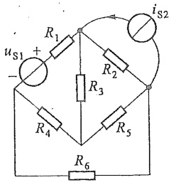

<details>
<summary>text_image</summary>

uS1 +
-
R1
iS2
R2
R3
R4
R5
R6
</details>

(a)

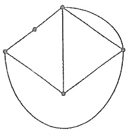

<details>
<summary>natural_image</summary>

Pure geometric diagram with a diamond shape and curved line, no text or symbols present
</details>

(b)

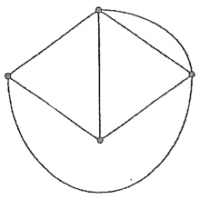

<details>
<summary>natural_image</summary>

Simple geometric diagram with a diamond shape and a semicircle, no text or symbols present.
</details>

(c)

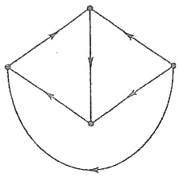

<details>
<summary>natural_image</summary>

Pure geometric diagram with arrows and circles, no text or symbols present
</details>

(d)

图3-1 电路的图

在电路中通常要指定每一条支路中的电流参考方向,电压一般常取为关联参考方向。电路的图的每一条支路也可以指定一个方向,此方向即该支路电流(和电压)的参

<small><span class="docvortex-page-footnote" data-block-type="page_footnote" style="color:#6b7280">① 网络图论的内容在20世纪60年代前常被称为网络拓扑(network topology)。</span></small>

<small><span class="docvortex-page-footnote" data-block-type="page_footnote" style="color:#6b7280">② 图(graph)是数学中的专门名词,与通常意义有所不同。图论中称点和线段为“顶点”和“边”。为避免引入过多术语,本书仍用“节点”和“支路”表示图中的点和线段。</span></small>

<small><span class="docvortex-page-footnote" data-block-type="page_footnote" style="color:#6b7280">③ 按照传统的讲法,支路是电路的一个分支,所以元件的并联组合一般不能作为一条支路。</span></small>

---

56

第三章 电阻电路的一般分析

考方向。赋予支路方向的图称为“有向图”，未赋予支路方向的图称为“无向图”。图3-1(b)(c)为无向图，图3-1(d)为有向图。

KCL 和 KVL 与支路的元件性质无关,因此可以利用电路的图来讨论如何列出 KCL 和 KVL 方程,并讨论它们的独立性。

## §3-2 KCL 和 KVL 的独立方程数

图 3-2 示出一个电路的图, 它的节点和支路都已分别编号, 并给出了支路的方向, 该方向也即支路电流和与之关联的支路电压的参考方向。

对节点①、②、③、④分别列出 KCL 方程，有

$$
\dot {\iota} _ {1} - \dot {\iota} _ {4} - \dot {\iota} _ {6} = 0
$$

$$
- i _ {1} - i _ {2} + i _ {3} = 0
$$

$$
i _ {2} + i _ {5} + i _ {6} = 0
$$

$$
- i _ {3} + i _ {4} - i _ {5} = 0
$$

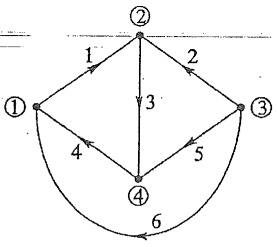

<details>
<summary>flowchart</summary>

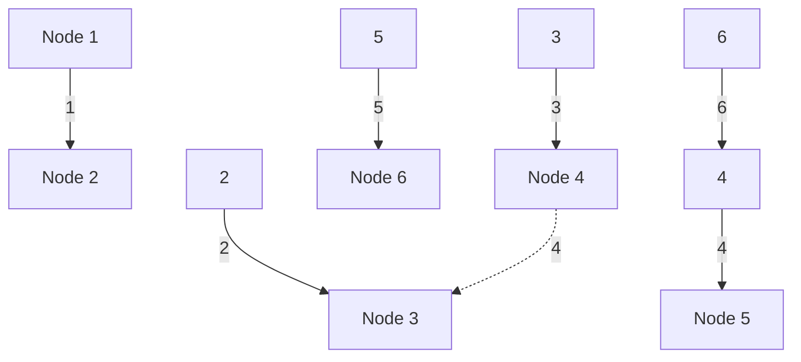
</details>

图3-2 KCL独立方程

由于对所有节点都列写了 KCL 方程, 而每一支路无例外地与 2 个节点相连, 且每个支路电流必然从其中一个节点流入, 从另一个节点流出。因此, 在所有 KCL 方程中, 每个支路电流必然出现 2 次, 一次为正, 另一次为负 (指每项前面的 “+” 或 “-”)。若把以上 4 个方程相加, 必然得出等号两边为零的结果。这就是说, 这 4 个方程不是相互独立的, 但上列 4 个方程中的任意 3 个是独立的。可以证明①, 对于具有 $n$ 个节点的电路, 在任意 $(n-1)$ 个节点上可以得出 $(n-1)$ 个独立的 KCL 方程。相应的 $(n-1)$ 个节点称为独立节点。

讨论关于 KVL 独立方程数时要用到独立回路的概念。回路和独立回路的概念与支路的方向无关，因此可以用无向图的概念叙述。

从一个图 G 的某一节点出发, 沿着一些支路移动而到达另一节点(或回到原出发

点),这样的一系列支路构成图 G 的一条路径。一条支路本身也算为路径。当图 G 的任意两个节点之间至少存在一条路径时,图 G 就称为连通图②。例如,图 3-2 所示是连通图。如果一条路径的起点和终点重合,且经过的其他节点不出现重复,这条闭合路径就构成图 G 的一个回路。例如,对图 3-3 所示图 G,支路(1,5,8)(2,5,6)(1,2,3,4)(1,2,6,8)都是回路;其他还有支路(4,7,8)(3,6,7)(1,5,7,4)(3,4,8,6)(2,3,7,5)(1,2,6,7,4)(1,2,3,7,8)(2,3,4,8,5)(1,5,6,3,4)构成9个

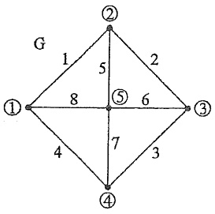

<details>
<summary>text_image</summary>

G
1
5
2
①
8
⑤
6
③
4
7
3
④
</details>

图3-3 回路

<small><span class="docvortex-page-footnote" data-block-type="page_footnote" style="color:#6b7280">① 应当指出,对于以下述及的连通图才有此结论。</span></small>

<small><span class="docvortex-page-footnote" data-block-type="page_footnote" style="color:#6b7280">② 本章所涉及的电路的图都是连通的,所有结论都是针对连通图来说的。</span></small>

---

§ 3-2 KCL 和 KVL 的独立方程数

57

不同的回路；总共有13个不同的回路。但是独立回路数远少于总的回路数。

对每个回路可以应用KVL列出有关支路电压的方程。例如，对图3-3所示图G，如果按支路(1,5,8)和支路(2,5,6)分别构成2个回路列出2个KVL方程，不论支路电压和绕行方向怎样指定，支路5的电压将在这2个方程中出现，因为该支路是这2个回路的共有支路。而把这2个方程相加或相减总可以把支路5的电压消去，而得到按支路(1,2,6,8)构成回路的KVL方程。可见这3个回路(方程)是相互不独立的，因为其中任何一个回路(方程)可以由其他2个回路(方程)导出。因此，这3个回路的KVL方程中只有2个是独立的。与之相应的回路就称为独立回路。

一个图的回路数很多,如何确定它的一组独立回路有时不太容易。利用“树”的概念有助于寻找一个图的独立回路组,从而得到独立的KVL方程组。

连通图 G 的树 T 定义为: 包含图 G 的全部节点且不包含任何回路的连通子图。

对于图3-3所示图G，符合上述定义的树有很多，图3-4(a)(b)(c)绘出其中的3个。图3-4(d)(e)不是该图的树，因为图3-4(d)中包含了回路；图3-4(e)则是非连通的。树中包含的支路称为该树的树支，而其他不属于树的支路则称为对应于该树的连支。例如图3-4(a)的树，它具有树支(5,6,7,8)；相应的连支为(1,2,3,4)。对图3-4(b)所示树，其树支为(1,3,5,6)；相应的连支为(2,4,7,8)。树支和连支一起构成图G的全部支路。

图3-3的图G有5个节点，图 $3 - 4(\mathrm{a})(\mathrm{b})(\mathrm{c})$ 所示图G的每一个树具有4条支路；图3-4(d)出现了回路，它不是树，图 $3 - 4(\mathrm{e})$ 未包含全部节点，它也不是树。这个图G有许多不同的树①，但不论是哪一个树，树支数总是4。可以证明，任一个具有 $n$ 个节点的连通图，它的任何一个树的树支数为 $(n - 1)^{②}$ 。

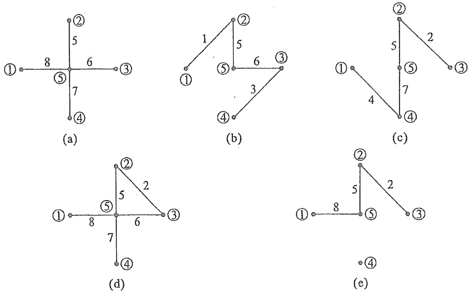

图3-4 树

<small><span class="docvortex-page-footnote" data-block-type="page_footnote" style="color:#6b7280">① 可以证明,该图 G 共有 45 个不同的树。</span></small>

<small><span class="docvortex-page-footnote" data-block-type="page_footnote" style="color:#6b7280">② 证明从略，可参考有关图论书籍。</span></small>

1. 2019年，公司与上海华谊（集团）股份有限公司（以下简称“公司”）签署《股权转让协议》，具体内容详见公司于2019年3月26日刊登在巨潮资讯网（www.cninfo.com.cn）上的《关于转让上海华谊（集团）股份有限公司部分股权的公告》。

---

58

第三章 电阻电路的一般分析

由于连通图 G 的树支连接所有节点又不形成回路, 因此, 对于图 G 的任意一个树, 加入一个连支后, 就会形成一个回路, 并且此回路除所加连支外均由树支组成, 这种回路称为单连支回路或基本回路。对于图 3-5(a) 所示图 G, 取支路 (1,4,5) 为树, 在图 3-5(b) 中以实线表示, 相应的连支为 (2,3,6)。分别将这三个连支加入就可得到对应于这一树的三个基本回路, 它们是 (1,3,5)(1,2,4,5) 和 (4,5,6)。每一个基本回路仅含一个连支, 且这一连支并不出现在其他基本回路中。由全部连支形成的基本回路构成基本回路组, 基本回路的个数显然等于连支数。如果对基本回路组列写 KVL 方程, 由于每个连支只在一个回路中出现, 因此这些 KVL 方程必构成独立方程组。换言之, 根据基本回路所列出的 KVL 方程组是独立方程。对一个具有 b 条支路和 n 个节点的电路, 连支数 $l = b - n + 1$, 这也就是一个图的独立回路的数目。选择不同的树, 就可以得到不同的基本回路组。图 3-5(c)(d)(e) 是以支路 (1,4,5) 为树相对应的基本回路组。

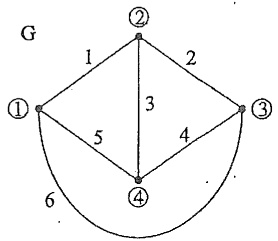

<details>
<summary>text_image</summary>

G
① 1 2
5 3 4 6
②
③
</details>

(a)

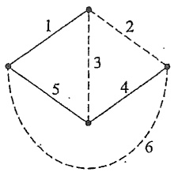

<details>
<summary>text_image</summary>

1
2
3
4
5
6
</details>

(b)

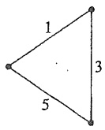

(c)

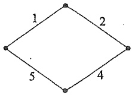

<details>
<summary>text_image</summary>

1
2
5
4
</details>

(d)

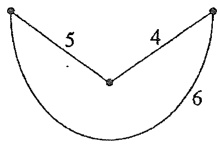

<details>
<summary>text_image</summary>

5
4
6
</details>

(e)

图 3-5 基本回路

如果能把一个图画在平面上,而使它的各条支路不产生交叉,这样的图称为平面图,否则称为非平面图。图3-6(a)是一个平面图,图3-6(b)则是一个典型的非平面图。对于一个平面图,可以引入网孔的概念。平面图的一个网孔是它的一个自然的“孔”,在其限定的区域内不再有支路。对图3-6(a)所示的平面图,支路(1,3,5)(2,3,7)(4,5,6)(4,7,8)(6,8,9)都构成网孔①;支路(1,2,8,6)(2,3,4,8)等不构成网孔。平面图的全部网孔是一组独立回路②,所以平面图的网孔数也就是独立回路数。图3-6(a)所示平面图有5个节点,9条支路,独立回路数 $l=(b-n+1)=5$,而它的网孔数正好也是5个。

<small><span class="docvortex-page-footnote" data-block-type="page_footnote" style="color:#6b7280">① 这些都是“内网孔”。平面图周界形成的回路有时称为“外网孔”。本书涉及的“网孔”不包括外网孔。</span></small>

<small><span class="docvortex-page-footnote" data-block-type="page_footnote" style="color:#6b7280">② 将图中 5 个内网孔的 KVL 方程相加减, 得到外网孔的 KVL 方程, 等号两边并不为零。</span></small>

---

§ 3-3 支路电流法

59

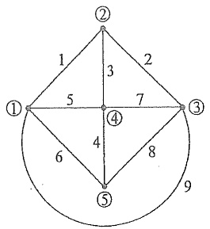

<details>
<summary>text_image</summary>

①
1
2
3
5
7
④
4
6
8
⑤
9
②
③
</details>

(a)

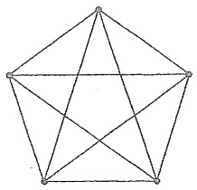

<details>
<summary>natural_image</summary>

Geometric diagram of a pentagon with internal diagonals (no text or labels)
</details>

(b)

图 3-6 平面图与非平面图

一个电路的KVL独立方程数等于它的独立回路数。以图3-7(a)所示电路的图为例，如果取支路(1,4,5)为树，则3个基本回路示于图3-7(b)。按图中的电压和电流的参考方向及回路绕行方向，计及支路及回路的编号，可以列出KVL方程如下:

回路1

$$
u _ {1} + u _ {3} + u _ {5} = 0
$$

回路 2

$$
u _ {1} - u _ {2} + u _ {4} + u _ {5} = 0
$$

回路 3

$$
- \dot {u} _ {4} - u _ {5} + u _ {6} = 0
$$

这是一组独立方程。

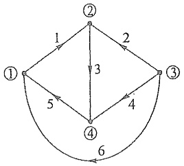

<details>
<summary>flowchart</summary>

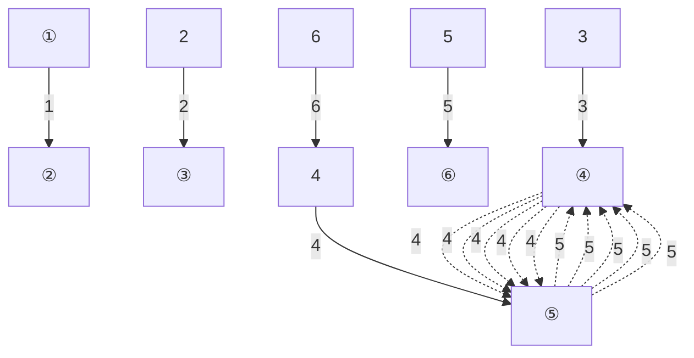
</details>

(a)

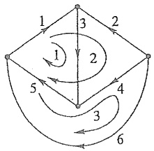

<details>
<summary>flowchart</summary>

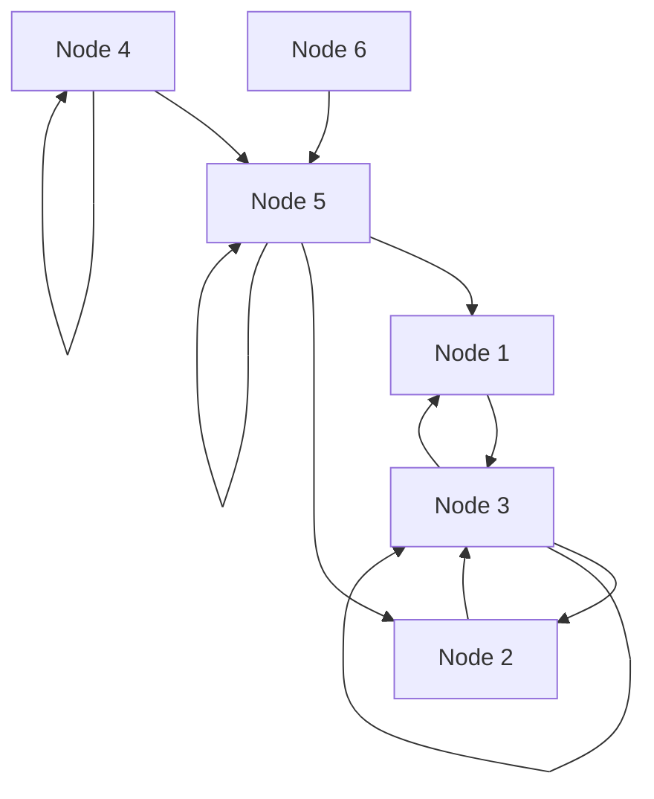
</details>

(b)

图 3-7 基本回路的 KVL 方程

## §3-3 支路电流法

对一个具有 b 条支路和 n 个节点的电路, 当以支路电压和支路电流为电路变量列写方程时, 总计有 2b 个未知量。根据 KCL 可以列出  $(n-1)$  个独立方程, 根据 KVL 可以列出  $(b-n+1)$  个独立方程, 根据元件的 VCR 又可列出 b 个方程。总计方程数为 2b, 与未知量数相等。因此, 可由 2b 个方程解出 2b 个支路电压和支路电流。这种方法称为 2b 法。

为了减少求解的方程数,可以利用元件的 VCR 先将每条支路的电压以支路电流来表示,然后代入 KVL 方程,这样,支路电压就不出现在 KVL 方程中,可得到以 b 个支路电流为未知量的 b 个 KCL 和 KVL 方程。变量数和方程数从 2b 个减少至 b 个。这种方

---

60

第三章 电阻电路的一般分析

法称为支路电流法。

现在以图 3-8(a) 所示电路为例说明支路电流法。把电压源 $u_{s1}$ 和电阻 $R_1$ 的串联组合作为一条支路；把电流源 $i_{s5}$ 和电阻 $R_5$ 的并联组合作为一条支路，这样电路的图就如图 3-8(b) 所示，其节点数 $n = 4$，支路数 $b = 6$，各支路的方向和编号也示于图中。求解变量为 $i_1, i_2, \cdots, i_6$。先利用元件的 VCR，将支路电压 $u_1, u_2, \cdots, u_6$ 以支路电流 $i_1, i_2, \cdots, i_6$ 表示。图 3-8(c)(d) 给出支路 1 和支路 5 的结构，有

$$
\left. \begin{array}{l} u _ {1} = - u _ {\mathrm{SI}} + R _ {1} i _ {1} \\ u _ {2} = R _ {2} i _ {2} \\ \hline u _ {3} = R _ {3} i _ {3} \\ u _ {4} = R _ {4} i _ {4} \\ u _ {5} = R _ {5} i _ {5} + R _ {5} i _ {\mathrm{SS}} \\ u _ {6} = R _ {6} i _ {6} \end{array} \right\} \tag {3-1}
$$

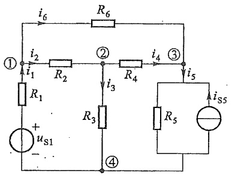

<details>
<summary>text_image</summary>

i6
R6
① i2 R2 ② i4 ③
i1 R1 i3 R4 i5
+ uS1 - ④ R3 R5 iS5
</details>

(a)

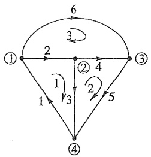

<details>
<summary>flowchart</summary>

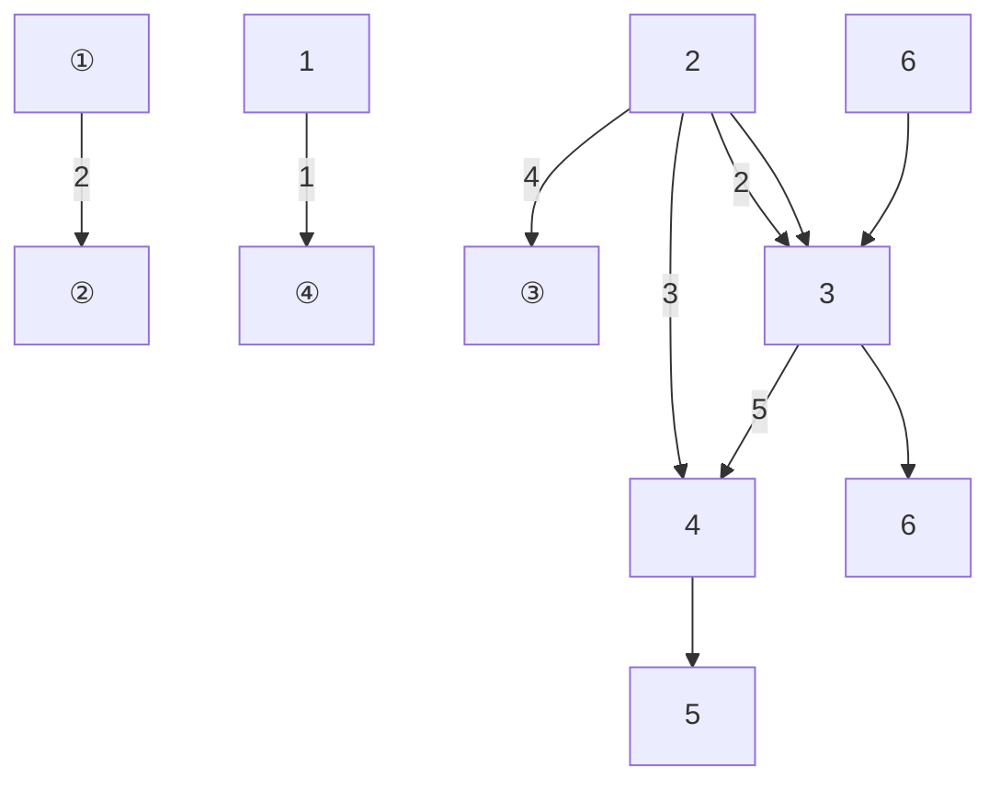
</details>

(b)

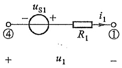

<details>
<summary>text_image</summary>

uS1
- +
④
R1
i1
+
u1
①
-
</details>

(c)

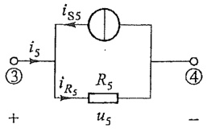

<details>
<summary>text_image</summary>

iS5
iS
③
iS
R5
iRs
uS
④
+ -
</details>

(d)

图 3-8 支路电流法

选择网孔作为独立回路,按图 3-8(b) 所示回路绕行方向列出 KVL 方程

$$
\left. \begin{array}{l} u _ {1} + u _ {2} + u _ {3} = 0 \\ - u _ {3} + u _ {4} + u _ {5} = 0 \\ - u _ {2} - u _ {4} + u _ {6} = 0 \end{array} \right\} \tag {3-2}
$$

将式(3-1)代入式(3-2)，得

$$
\left. \begin{array}{l} - u _ {\mathrm{S1}} + R _ {1} i _ {1} + R _ {2} i _ {2} + R _ {3} i _ {3} = 0 \\ - R _ {3} i _ {3} + R _ {4} i _ {4} + R _ {5} i _ {5} + R _ {5} i _ {\mathrm{S5}} = 0 \\ - R _ {2} i _ {2} - R _ {4} i _ {4} + R _ {6} i _ {6} = 0 \end{array} \right\} \tag {3-3}
$$

---

§ 3-4 网孔电流法

61

把上式中的 $u_{\mathrm{s1}}$ 和 $R_{5}i_{\mathrm{s5}}$ 项移到方程的右边后，与在独立节点①、②、③处列出的KCL方程联列，就组成了支路电流法的全部方程:

$$
\left. \begin{array}{l} - i _ {1} + i _ {2} + i _ {6} = 0 \\ - i _ {2} + i _ {3} + i _ {4} = 0 \\ - i _ {4} + i _ {5} - i _ {6} = 0 \\ R _ {1} i _ {1} + R _ {2} i _ {2} + R _ {3} i _ {3} = u _ {\mathrm{S1}} \\ - R _ {3} i _ {3} + R _ {4} i _ {4} + R _ {5} i _ {5} = - R _ {5} i _ {\mathrm{S5}} \\ - R _ {2} i _ {2} - R _ {4} i _ {4} + R _ {6} i _ {6} = 0 \end{array} \right\} \tag {3-4}
$$

式(3-4)中的 KVL 方程可归纳为

$$
\sum R _ {k} i _ {k} = \sum u _ {\mathrm{S} k} \tag {3-5}
$$

此式须对所有的独立回路写出。式中 $R_{k}i_{k}$ 是回路中第 $k$ 个支路中电阻上的电压，当 $i_{k}$ 的参考方向与回路的方向一致时，该项在和式中取“+”号；不一致时，则取“-”号；式中右方 $u_{\mathrm{Sk}}$ 是回路中第 $k$ 个支路的电源电压，电源电压包括电压源的激励电压，也包括由电流源引起的等效激励电压。例如在支路5中并无电压源，仅为电流源与电阻的并联组合，但可将其等效变换为电压源与电阻的串联组合，其等效电压源为 $u_{\mathrm{S5}} = R_{s}i_{\mathrm{S5}}$ ，在取代数和时，当 $u_{\mathrm{Sk}}$ 与回路方向一致时前面取“-”号（因移在等号右侧），$u_{\mathrm{Sk}}$ 与回路方向不一致时，前面取“+”号。式(3-5)实际上是KVL的另一种表达式，即任一回路中，电阻电压的代数和等于电压源电压的代数和（也可看作，任一回路中，电阻上电压降的代数和等于电压源上电压升的代数和）。

列出支路电流法的电路方程的步骤如下:

(1) 选定各支路电流的参考方向。
(2) 对 $(n-1)$ 个独立节点列出 KCL 方程。
(3) 选取 $(b-n+1)$ 个独立回路, 指定回路的绕行方向, 按照式(3-5)列出 KVL 方程。

支路电流法要求 b 个支路电压均能以支路电流表示, 即存在式(3-1)形式的关系。当一条支路仅含电流源而不存在与之并联的电阻时, 就无法将支路电压以支路电流表示。这种无并联电阻的电流源称为无伴电流源。当电路中存在这类支路时, 必须加以处理后才能应用支路电流法 $^{①}$ 。

如果将支路电流用支路电压表示,然后代入 KCL 方程,连同支路电压的 KVL 方程,可得到以支路电压为变量的 b 个方程。这就是支路电压法。

## §3-4 网孔电流法

在网孔电流法中,以网孔电流作为电路的独立变量,然后列出网孔 KVL 方程并求

<small><span class="docvortex-page-footnote" data-block-type="page_footnote" style="color:#6b7280">① 处理方法见 §3-5。</span></small>

1. 2. 3. 4. 5. 6. 7. 8. 9. 10. 11. 12. 13. 14. 15. 16. 17. 18. 19. 20. 21. 22. 23. 24. 25. 26. 27. 28. 29. 30. 31. 32. 33. 34. 35. 36. 37. 38. 39. 40. 41. 42. 43. 44. 45. 46. 47. 48. 49. 50. 51. 52. 53. 54. 55. 56. 57. 58. 59. 60. 61. 62. 63. 64. 65. 66. 67. 68. 69. 70. 71. 72. 73. 74. 75. 76. 77. 78. 79. 80. 81. 82. 83. 84. 85. 86. 87. 88. 89. 90.

---

62

第三章 电阻电路的一般分析

解。它仅适用于平面电路，以下通过图3-9(a)所示电路说明。图3-9(b)是此电路的图，该电路共有3条支路，给定的支路编号和参考方向如图所示。

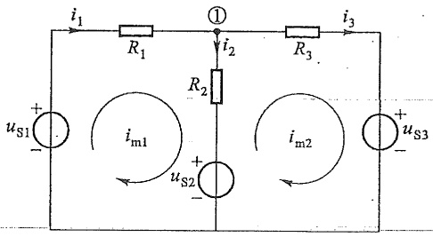

<details>
<summary>text_image</summary>

i₁
R₁
①
i₂
R₂
R₃
i₃
uₛ₁ +
-
iₘ₁
uₛ₂ +
-
iₘ₂
uₛ₃ + -
-
</details>

(a)

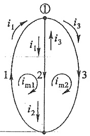

<details>
<summary>flowchart</summary>

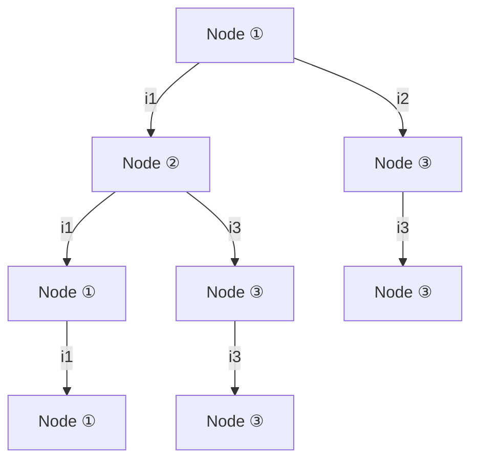
</details>

(b)

图 3-9 网孔电流法

在节点①应用 KCL, 有

$$
- i _ {1} + i _ {2} + i _ {3} = 0
$$

或

$$
i _ {2} = i _ {1} - i _ {3}
$$

可见，$i_{2}$ 不是独立的，它由 $i_{1}, i_{3}$ 决定。$i_{2}$ 分为两部分，即图 3-9(b) 中向下方向的 $i_{1}$ 以及向上方向的 $i_{3}$。这两个电流可以看成是支路 1 与支路 3 中的电流 $i_{1}$ 与 $i_{3}$ 各自经过节点①后的延续，也就是将图中所有的电流归结为由两个沿网孔连续流动的假想电流 $i_{1}$ 与 $i_{3}$ 产生，这两个假想的电流称之为网孔电流 $i_{\mathrm{m}1}$ 与 $i_{\mathrm{m}2}$①。根据给定的网孔电流和支路电流的参考方向，可以得出其间的关系:支路 1 只有电流 $i_{\mathrm{m}1}$ 流过，支路电流 $i_{1}=i_{\mathrm{m}1}$；支路 3 只有电流 $i_{\mathrm{m}2}$ 流过，支路电流 $i_{3}=i_{\mathrm{m}2}$；但是支路 2 有两个网孔电流同时流过，在给定的参考方向下[见图 3-9(a)]支路电流将是网孔电流的代数和，即 $i_{2}=i_{\mathrm{m}1}-i_{\mathrm{m}2}$。

由于网孔电流已经体现了电流连续即 KCL 的制约关系(换言之,根据网孔电流而计算的支路电流一定满足 KCL 方程,或称为自动满足 KCL),所以用网孔电流作为电路变量求解时只需列出 KVL 方程。全部网孔是一组独立回路,因而对应的 KVL 方程将是独立的,且独立方程个数与电路变量数均为全部网孔数,足以解出网孔电流,从而求得全部支路电流。这种方法称为网孔电流法。

现以图3-9(a)所示电路为例,对网孔1与2列出KVL方程。列方程时,以各自的网孔电流方向为绕行方向,逐段写出电阻以及电源上的电压。对于网孔1,从节点①出发直至回到出发节点,可得到

$$
R _ {2} (  i _ {\mathrm{m1}} - i _ {\mathrm{m2}}  ) + u _ {\mathrm{S2}} - u _ {\mathrm{S1}} + R _ {1} i _ {\mathrm{m1}} = 0
$$

对网孔 2, 则有

$$
R _ {3} i _ {\mathrm{m2}} + u _ {\mathrm{S3}} - u _ {\mathrm{S2}} + R _ {2} (i _ {\mathrm{m2}} - i _ {\mathrm{m1}}) = 0
$$

式中沿网孔1绕行方向列方程时， $R_{2}$ 上的电压为 $R_{2}(i_{\mathrm{m1}}-i_{\mathrm{m2}})$ ，其中 $i_{m2}$ 前的负号是因为

<small><span class="docvortex-page-footnote" data-block-type="page_footnote" style="color:#6b7280">① 网孔(mesh)，以下标 m 表示网孔。</span></small>

---

§ 3-4 网孔电流法

63

电流 $i_{\mathrm{m2}}$ 在 $R_{2}$ 上的流动方向与 $i_{\mathrm{m1}}$ 相反的结果；同理，在网孔2的方程中，沿着网孔2绕行方向，$R_{2}$ 上的电压则为 $R_{2}(i_{\mathrm{m2}} - i_{\mathrm{m1}})$，经整理后，有

$$
\left. \begin{array}{l} \left(R _ {1} + R _ {2}\right) i _ {\mathrm{m} 1} - R _ {2} i _ {\mathrm{m} 2} = u _ {\mathrm{S} 1} - u _ {\mathrm{S} 2} \\ - R _ {2} i _ {\mathrm{m} 1} + \left(R _ {2} + R _ {3}\right) i _ {\mathrm{m} 2} = u _ {\mathrm{S} 2} - u _ {\mathrm{S} 3} \end{array} \right\} \tag {3-6}
$$

式(3-6)即是以网孔电流为求解对象的网孔电流方程。

现在用  $R_{11}$  和  $R_{22}$  分别代表网孔 1 和网孔 2 的自阻，它们分别是网孔 1 和网孔 2 中所有电阻之和，即  $R_{11}=R_{1}+R_{2}, R_{22}=R_{2}+R_{3}$ ; 用  $R_{12}$  和  $R_{21}$  代表网孔 1 和网孔 2 的互阻，即两个网孔的共有电阻，本例中  $R_{12}=R_{21}=-R_{2}$ 。上式可改写为

$$
\left. \begin{array}{l} R _ {1 1} i _ {\mathrm{m1}} + R _ {1 2} i _ {\mathrm{m2}} = u _ {\mathrm{S1}} - u _ {\mathrm{S2}} \\ R _ {2 1} i _ {\mathrm{m1}} + R _ {2 2} i _ {\mathrm{m2}} = u _ {\mathrm{S2}} - u _ {\mathrm{S3}} \end{array} \right\} \tag {3-7}
$$

此方程可理解为: $R_{11}i_{m1}$  项代表网孔电流  $i_{m1}$  在网孔 1 内各电阻上引起的电压之和， $R_{22}i_{m2}$  项代表网孔电流  $i_{m2}$  在网孔 2 内各电阻上引起的电压之和。由于网孔绕行方向和网孔电流方向取为一致，故  $R_{11}$  和  $R_{22}$  总为正值。 $R_{12}i_{m2}$  项代表网孔电流  $i_{m2}$  在网孔 1 中引起的电压，而  $R_{21}i_{m1}$  项代表网孔电流  $i_{m1}$  在网孔 2 中引起的电压。当两个网孔电流在共有电阻上的参考方向相同时， $i_{m2}(i_{m1})$  引起的电压与网孔 1（网孔 2）的绕行方向一致，应当为正；反之为负。为了使方程形式整齐，把这类电压前的“+”号或“-”号包括在有关的互阻中。这样，当通过网孔 1 和网孔 2 的共有电阻上的两个网孔电流的参考方向相同时，互阻  $(R_{12}, R_{21})$  取正；反之则取负。故在本例中  $R_{12} = R_{21} = -R_{2}$ 。

对具有 $m$ 个网孔的平面电路, 网孔电流方程的一般形式可以由式(3-7)推广而得, 即有

$$
\left. \begin{array}{c} R _ {1 1} i _ {\mathrm{m} 1} + R _ {1 2} i _ {\mathrm{m} 2} + R _ {1 3} i _ {\mathrm{m} 3} + \dots + R _ {1 m} i _ {\mathrm{m} m} = u _ {\mathrm{S} 1 1} \\ R _ {2 1} i _ {\mathrm{m} 1} + R _ {2 2} i _ {\mathrm{m} 2} + R _ {2 3} i _ {\mathrm{m} 3} + \dots + R _ {2 m} i _ {\mathrm{m} m} = u _ {\mathrm{S} 2 2} \\ \dots \dots \\ R _ {m 1} i _ {\mathrm{m} 1} + R _ {m 2} i _ {\mathrm{m} 2} + R _ {m 3} i _ {\mathrm{m} 3} + \dots + R _ {m m} i _ {\mathrm{m} m} = u _ {\mathrm{S} m m} \end{array} \right\} \tag {3-8}
$$

式中具有相同双下标的电阻 $R_{11}$ 、 $R_{22}$ 、 $R_{33}$ 等是各网孔的自阻；有不同下标的电阻 $R_{12}$ 、 $R_{13}$ 、 $R_{23}$ 等是网孔间的互阻。自阻总是正的，互阻的正、负则视两网孔电流在共有支路上参考方向是否相同而定。方向相同时为正，方向相反时为负。显然，如果两个网孔之间没有共有支路，或者有共有支路但其电阻为零（例如共有支路上仅有电压源），则互阻为零。如果将所有网孔电流都取为顺（或逆）时钟方向，则所有互阻总是负的。在不含受控源的电阻电路的情况下， $R_{ik}=R_{ki}$ 。方程右方 $u_{S11}$ 、 $u_{S22}$ 、…分别为网孔1、网孔2、…中所有电压源电压的代数和，各电压源的电压方向与网孔电流一致时，前面取“-”号，反之取“+”号。

例 3-1 在图 3-10 所示直流电路中,电阻和电压源均为已知,试用网孔电流法求各支路电流。

解 电路为平面电路,共有3个网孔。

---

64

第三章 电阻电路的一般分析

(1) 设定网孔电流  $I_{1}$ 、 $I_{2}$ 、 $I_{3}$ ，如图 3-10 所示。
(2) 列网孔电流方程。
（a）方法一。沿网孔方向逐段写电压法:从底部节点出发，沿各网孔应用KVL，写出各段的电压直到回至出发点。这些电压之和应为零。

网孔  $m_{1}$   $-180+60I_{1}+20(I_{1}-I_{2})+70=0^{-}$

网孔  $m_{2}$   $-70+20(I_{2}-I_{1})+40(I_{2}-I_{3})=0$

网孔  $m_{3}$   $40(I_{3}-I_{2})+40I_{3}+20=0$

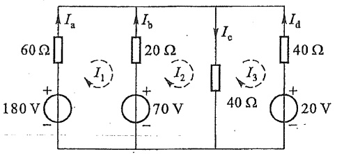

<details>
<summary>text_image</summary>

60 Ω
Ia
180 V
+
-
Ib
20 Ω
Ic
40 Ω
Id
70 V
+
-
I3
40 Ω
20 V
</details>

图3-10 例3-1图

再经整理就可得到网孔电流方程。

(b) 方法二。使用网孔电流方程的一般形式(3-8)，直接写出网孔的自阻、互阻及网孔电压源电压和等项而得到网孔电流方程。可求得

$$
R _ {1 1} = (6 0 + 2 0) \Omega = 8 0 \Omega
$$

$$
R _ {2 2} = (2 0 + 4 0) \Omega = 6 0 \Omega
$$

$$
R _ {3 3} = (4 0 + 4 0) \Omega = 8 0 \Omega
$$

$$
R _ {1 2} = R _ {2 1} = - 2 0 \Omega
$$

$$
R _ {1 3} = R _ {3 1} = 0
$$

$$
R _ {2 3} = R _ {3 2} = - 4 0 \Omega
$$

$$
U _ {\mathrm{S11}} = (1 8 0 - 7 0) \mathrm{V} = 1 1 0 \mathrm{V}
$$

$$
U _ {\mathrm{S22}} = 7 0 \mathrm{V}
$$

$$
U _ {\mathrm{S33}} = - 2 0 \mathrm{V}
$$

故网孔电流方程为

$$
\left. \begin{array}{l} 8 0 I _ {1} - 2 0 I _ {2} = 1 1 0 \\ - 2 0 I _ {1} + 6 0 I _ {2} - 4 0 I _ {3} = 7 0 \\ - 4 0 I _ {2} + 8 0 I _ {3} = - 2 0 \end{array} \right\}
$$

与方法一所得方程组相同。

(3) 用消去法或行列式法求解所得方程组, 可解得

$$
I _ {1} = 2 \mathrm{A}
$$

$$
I _ {2} = 2. 5 \mathrm{A}
$$

$$
I _ {3} = 1 \mathrm{A}
$$

(4) 指定各支路电流如图 3-10 所示, 有

$$
I _ {\mathrm{a}} = I _ {1} = 2 \mathrm{A}
$$

$$
I _ {\mathrm{b}} = - I _ {1} + I _ {2} = 0. 5 \mathrm{A}
$$

---

§ 3-5 回路电流法

65

$$
I _ {\mathrm{c}} = I _ {2} - I _ {3} = 1. 5 \mathrm{A}
$$

$$
I _ {\mathrm{d}} = - I _ {3} = - 1 \mathrm{A}
$$

(5) 校验。因网孔电流自动满足 KCL, 再用 KCL 来校验就毫无意义。应该使用 KVL 来校验, 可取一个未用过的回路, 例如取由 60 Ω、40 Ω 电阻及 180 V、20 V 电压源构成的外网孔, 沿顺时针绕行方向写 KVL 方程, 有

$$
6 0 I _ {\mathrm{a}} - 4 0 I _ {\mathrm{d}} = 1 8 0 - 2 0
$$

把  $I_{a}$ 、 $I_{d}$  值代入有 160=160，故答案正确。

当电路中存在电流源和电阻的并联组合时,可将它等效变换成电压源和电阻的串联组合,再按上述方法进行分析。对于存在无伴电流源或受控源的情况,请参见§3-5中相应的处理方法。

## §3-5 回路电流法

网孔电流法仅适用于平面电路,回路电流法则无此限制,它适用于平面或非平面电路。回路电流法是一种适用性较强并获得广泛应用的分析方法。

前已述及,对于一个具有 b 条支路和 n 个节点的电路,b 个支路电流受 $(n-1)$ 个 KCL 独立方程制约,因此,独立的支路电流只有 $(b-n+1)$ 个,等于网孔电流数。网孔电流是在网孔中连续流动的假想电流。而回路电流则是在回路中连续流动的假想电流,但是与网孔不同,回路的取法很多,选取的回路应是一组独立回路,且回路的个数(也即回路电流的个数)也应等于 $(b-n+1)$ 个。选定一个树以后形成的基本回路显然满足上述要求。这就是说,在基本回路中连续流动的假想电流可以作为电路的独立变量来求解。

以图3-11所示电路(的图)为例,如果选支路(4,5,6)为树(在图中用粗线画出),可以得到以支路(1,2,3)为单连支的3个基本回路,它们是独立回路。把连支电流 $i_{1}$ 、 $i_{2}$ 、 $i_{3}$ 分别作为在各自单连支回路中流动的假想回路电流 $i_{11}^{①},i_{12},i_{13}$ 。支路4为回路1和2所共有,而其方向与回路1的绕行方向相反,与回路2的绕行方向相同,所以有

$$
i _ {4} = - i _ {1 1} + i _ {1 2}
$$

同理,可以得出支路5和支路6的电流 $i_{5}$ 和 $i_{6}$ 为

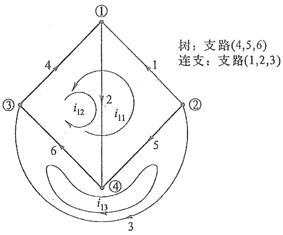

<details>
<summary>flowchart</summary>

```mermaid
graph TD
  ①["①"] -->|4| ③["③"]
  node["①"] -->|1| ②["②"]
  node -->|6| ④["④"]
  node2["②"] -->|5| node3["④"]
  node4["③"] -->|3| node3
  node3 -->|2| node2
  node3 -->|i12| node4
  node3 -->|i13| node3
```
</details>

图 3-11 回路电流


回路电流法

<small><span class="docvortex-page-footnote" data-block-type="page_footnote" style="color:#6b7280">① 回路电流  $i_{1}$  的下标“l”表示回路(loop)。</span></small>

---

66

第三章 电阻电路的一般分析

$$
i _ {5} = - i _ {1 1} - i _ {1 3}
$$

$$
i _ {6} = \dot {-} i _ {1 1} + i _ {1 2} - i _ {1 3}
$$

从以上 3 式可见,树支电流可以通过连支电流或回路电流表达,即全部支路电流可以通过回路电流表达。

列方程时,因回路电流已满足 KCL 方程,也只需按 KVL 列方程。对于 b 条支路、n 个节点的电路,回路电流数  $l=(b-n+1)$ 。以下,将以例 3-2 所示电路介绍列写回路电流方程的方法。

例 3-2 给定直流电路如图 3-12(a) 所示, 其中  $R_{1}=R_{2}=R_{3}=1\Omega, R_{4}=R_{5}=R_{6}=2\Omega, u_{S1}=4\mathrm{~V}, u_{S5}=2\mathrm{~V}$ 。试选择一组独立回路, 并列出回路电流方程。

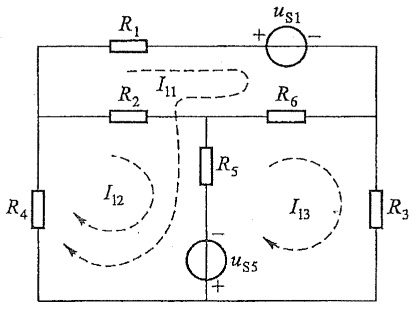

<details>
<summary>text_image</summary>

R1
uS1
+
-
R2
I11
R6
R4
I12
R5
I13
uS5
+
-
R3
</details>

(a)

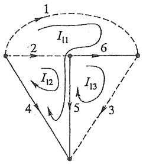

<details>
<summary>flowchart</summary>

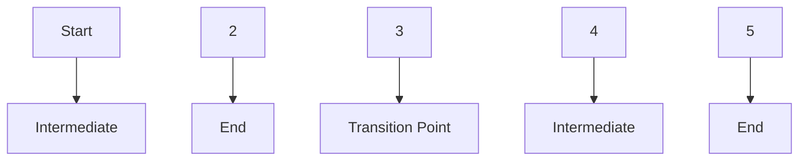
</details>

(b)

图3-12 例3-2图

解 电路的图如图3-12(b)所示,选择支路(4,5,6)为树,3个独立回路(基本回路)绘于图中。连支电流 $I_{1}$ 、 $I_{2}$ 、 $I_{3}$ 即为回路电流 $I_{11}$ 、 $I_{12}$ 、 $I_{13}$ 。应用例3-1的方法一,在三个基本回路列出以回路电流 $I_{11}$ 、 $I_{12}$ 、 $I_{13}$ 为变量的KVL方程为

$$
\left. \begin{array}{l} R _ {1} I _ {1 1} + u _ {\mathrm{S1}} + R _ {6} (I _ {1 1} - I _ {1 3}) + R _ {5} (I _ {1 1} + I _ {1 2} - I _ {1 3}) - u _ {\mathrm{S5}} + R _ {4} (I _ {1 1} + I _ {1 2}) = 0 \\ R _ {2} I _ {1 2} + R _ {5} (I _ {1 2} + I _ {1 1} - I _ {1 3}) - u _ {\mathrm{S5}} + R _ {4} (I _ {1 1} + I _ {1 2}) = 0 \\ R _ {6} (I _ {1 3} - I _ {1 1}) + R _ {3} I _ {1 3} + u _ {\mathrm{S5}} + R _ {5} (I _ {1 3} - I _ {1 1} - I _ {1 2}) = 0 \end{array} \right\} \tag {3-9}
$$

代入数值,并经整理后,可得

$$
\left. \begin{array}{l} 7 I _ {1 1} + 4 I _ {1 2} - 4 I _ {1 3} = - 2 \\ 4 I _ {1 1} + 5 I _ {1 2} - 2 I _ {1 3} = 2 \\ - 4 I _ {1 1} - 2 I _ {1 2} + 5 I _ {1 3} = - 2 \end{array} \right\} \tag {3-10}
$$

解出  $I_{11}$ 、 $I_{12}$ 、 $I_{13}$  后，可根据以下各式计算支路电流:

$$
I _ {1} = I _ {1 1}
$$

$$
I _ {2} = I _ {1 2}
$$

$$
I _ {3} = I _ {1 3}
$$

$$
I _ {4} = - I _ {1 1} - I _ {1 2}
$$

---

§ 3-5 回路电流法

67

$$
I _ {5} = I _ {1 1} + I _ {1 2} - I _ {1 3}
$$

$$
I _ {6} = - I _ {1 1} + I _ {1 3}
$$

回路电流方程(3-10)是KVL方程,其中左方各项是各个回路电流在回路中电阻上引起的电压。与网孔电流方程(3-8)相似,对具有l个独立回路的电路,可写出回路电流方程的一般形式

$$
\left. \begin{array}{c} R _ {1 1} i _ {1 1} + R _ {1 2} i _ {1 2} + R _ {1 3} i _ {1 3} + \dots + R _ {1 l} i _ {l l} = u _ {\mathrm{S} 1 1} \\ R _ {2 1} i _ {1 1} + R _ {2 2} i _ {1 2} + R _ {2 3} i _ {1 3} + \dots + R _ {2 l} i _ {l l} = u _ {\mathrm{S} 2 2} \\ \dots \dots \\ R _ {l 1} i _ {1 1} + R _ {l 2} i _ {1 2} + R _ {l 3} i _ {1 3} + \dots + R _ {l l} i _ {l l} = u _ {\mathrm{S} l l} \end{array} \right\} \tag {3-11}
$$

式中有相同下标的电阻 $R_{11}$ 、 $R_{22}$ 、 $R_{33}$ 等是各回路的自阻，有不同下标的电阻 $R_{12}$ 、 $R_{13}$ 、 $R_{23}$ 等是回路间的互阻。自阻总是正的，互阻取正还是取负，则由相关两个回路共有支路上两回路电流的方向是否相同而决定，相同时取正，相反时取负。显然，若两个回路间无共有电阻，则相应的互阻为零。方程右方的 $u_{S11}$ 、 $u_{S22}$ 、…分别为各回路1、2、…中所有电压源电压的代数和，取和时，与回路电流方向一致的电压源电压前应取“-”号，否则取“+”号。

如果电路中有电流源和电阻的并联组合,可经等效变换成为电压源和电阻的串联组合后再列回路电流方程。但当电路中存在无伴电流源时,就无法进行这种等效变换。此时可采用下述方法处理。除回路电流外,将无伴电流源两端的电压作为一个求解变量列入方程。这样,虽然多了一个变量,但是无伴电流源所在支路的电流为已知,故增加了一个回路电流与无伴电流源电流之间的约束方程,这样,独立方程数与独立变量数仍然相同。

例3-3 图3-13所示电路中 $U_{\mathrm{S1}} = 50 \mathrm{~V}, U_{\mathrm{S3}} = 20 \mathrm{~V}, I_{\mathrm{S2}} = 1 \mathrm{~A}$，此电流源为无伴电流源。试用回路法列出电路的方程。

解 把电流源两端的电压 $U$ 作为附加变量。该电路有3个独立回路，假设回路电流① $I_{11}, I_{12}, I_{13}$ 如图3-14所示。应用回路电流方程的一般公式(3-11)，沿各自回路的KVL方程为

$$
\left. \begin{array}{l} (2 0 + 1 5 + 1 0) I _ {1 1} - 1 0 I _ {1 2} - 1 5 I _ {1 3} = 0 \\ - 1 0 I _ {1 1} + (1 0 + 3 0) I _ {1 2} + U = 5 0 \\ - 1 5 I _ {1 1} + (4 0 + 1 5) I _ {1 3} - U = - 2 0 \end{array} \right\} \tag {3-12}
$$

无伴电流源所在支路有  $I_{12}$  和  $I_{13}$  通过, 故约束方程为

$$
- I _ {1 2} + I _ {1 3} = 1 \tag {3-13}
$$

方程数和未知变量数相等。

<small><span class="docvortex-page-footnote" data-block-type="page_footnote" style="color:#6b7280">① 为了简化讨论,实际上取的是网孔电流。</span></small>

---

68

第三章 电阻电路的一般分析

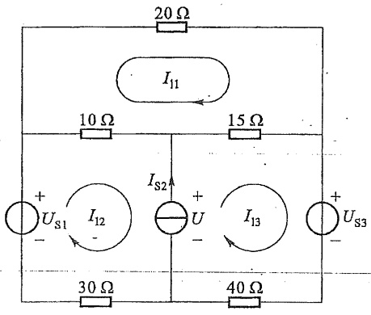

<details>
<summary>text_image</summary>

20 Ω
I₁₁
10 Ω
15 Ω
+
Uₛ₁ I₁₂ Iₛ₂ U +
-
30 Ω
40 Ω
I₁₃
+
Uₛ₃
</details>

图3-13 例3-3电路

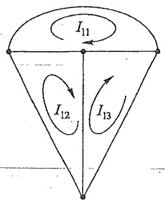

<details>
<summary>flowchart</summary>

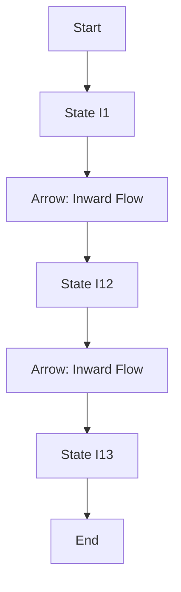
</details>

图3-14 例3-3图

将式(3-12)中后两式相加,可得 $-(10+15)I_{11}+(10+30)I_{12}+(15+40)I_{13}=50-20$ ,相当于在包含 $I_{12}$ 与 $I_{13}$ 的大回路中列出的KVL方程,绕过了无伴电流源,因此,附加变量U不再出现。

如果无伴电流源中仅有一个回路电流流过时,该回路的 KVL 方程就可不列。所以,每出现一个无伴电流源,就要少列一个 KVL 方程,但会多出现一个回路电流的约束方程,即无伴电流源电流与流经该电流源的回路电流之间的代数关系。独立方程数与电流变量数依然相等。

当电路中含有受控电压源时,把它作为电压源暂时列于KVL方程的右边,同时把控制量用回路电流表示,然后将用回路电流表示的受控源电压项移到方程的左边。当受控源是受控电流源时,可参照前面处理独立电流源的方法进行(见下例)。

\* 例3-4 图3-15所示电路中有无伴电流源 $i_{\mathrm{S1}}$ ，无伴电流控制电流源 $i_{\mathrm{c}} = \beta i_{2}$ ，电压控制电压源 $u_{\mathrm{c}} = \alpha u_{2}$ ，电压源 $u_{\mathrm{S2}}$ 和 $u_{\mathrm{S3}}$ 。列出回路电流方程。

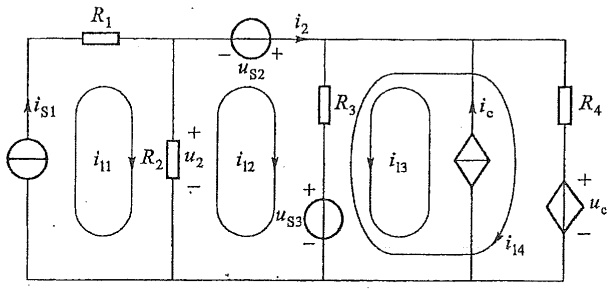

<details>
<summary>text_image</summary>

R1
iS1
i11
R2
+
u2
-
i12
us2
+
us3
-
R3
i3
ic
i14
R4
+
uc
-
</details>

图3-15 例3-4图

解 取独立回路如图 3-15 所示, 使无伴电流源和无伴受控电流源都只有一个回路电流流过, 前者为  $i_{11}$ 、后者为  $i_{13}$ , 这样就可不再列回路 1 和回路 3 的 KVL 方程。把控制量用有关回路电流表示, 有

$$
i _ {2} = i _ {1 2}
$$

---

§ 3-6 节点电压法

69

$$
u _ {2} = R _ {2} (  i _ {1 1} - i _ {1 2})
$$

这两个有关控制量的方程称为附加方程。

应用例 3-1 的方法列出回路 2 和回路 4 的 KVL 方程, 可以沿绕行方向逐段写出有关电压。可得

回路2 $-u_{2}-u_{\mathrm{S2}}+R_{3}(i_{12}+i_{13}-i_{14})+u_{\mathrm{S3}}=0$

回路4 $-u_{\mathrm{S3}} + R_3(i_{14} - i_{12} - i_{13}) + R_4i_{14} + u_c = 0$

代入附加方程 $u_{2} = R_{2}(i_{11} - i_{12}), u_{\mathrm{c}} = \alpha u_{2}$，有

$$
- R _ {2} (i _ {\mathrm{l1}} - i _ {\mathrm{l2}}) + R _ {3} (i _ {\mathrm{l2}} + i _ {\mathrm{l3}} - i _ {\mathrm{l4}}) = u _ {\mathrm{S2}} - u _ {\mathrm{S3}}
$$

$$
R _ {3} (  i _ {1 4} - i _ {1 2} - i _ {1 3}  ) + R _ {4}   i _ {1 4} + \alpha R _ {2} (  i _ {1 1} - i _ {1 2}  ) = u _ {\mathrm{S3}}
$$

经整理后,得

$$
- R _ {2} i _ {1 1} + (R _ {2} + R _ {3}) i _ {1 2} + R _ {3} i _ {1 3} - R _ {3} i _ {1 4} \doteq u _ {\mathrm{S2}} - u _ {\mathrm{S3}}
$$

$$
\alpha R _ {2} i _ {1 1} - \left(\alpha R _ {2} + R _ {3}\right) i _ {1 2} - R _ {3} i _ {1 3} + \left(R _ {3} + R _ {4}\right) i _ {1 4} = u _ {\mathrm{S3}}
$$

回路电流约束方程为

$$
i _ {\mathrm{II}} = i _ {\mathrm{SI}}
$$

$$
i _ {1 3} = \beta i _ {1 2} (\text {可写成} - \beta i _ {1 2} + i _ {1 3} = 0)
$$

如果把 $i_{11}, i_{13}$ 代入前2个方程，可得到仅含 $i_{12}, i_{14}$ 的两个方程。可以看出:当电路中有无伴电流源时，求解时所需的独立方程数目变少了。但例3-3所给出的方程更具一般性。

回路电流法的步骤可归纳如下:

（1）根据给定的电路，通过选择一个树确定一组基本回路，并指定各回路电流（即连支电流）的参考方向。
(2) 按一般公式(3-11)列出回路电流方程, 注意自阻总是正的, 互阻的正、负由相关的两个回路电流通过共有电阻时, 两者的参考方向是否相同而定。并注意该式右边项取代数和时各有关电压源电压前面的“+”“-”号。
(3) 当电路中有受控源或无伴电流源时,需另行处理。
(4) 对于平面电路可用网孔电流法。

## §3-6 节点电压法

在电路中任意选择一个节点作为参考节点，其他节点称为独立节点，这些节点与此参考节点之间的电压称为节点电压。节点电压的参考极性是以参考节点为负，其余独立节点为正。由于每一支路都连接在两个节点上，根据KVL，该支路电压就是这两个节点电压之差。如果每一个支路电流都可由支路电压来表示，那么它一定也可以用节点电压来表示。在具有 $n$ 个节点的电路中写出其中 $(n - 1)$ 个独立节点的KCL方程，而KCL方程中的各个支路电流都以节点电压来表示，这样，就能得到变量为 $(n - 1)$ 个节点电压的共 $(n - 1)$ 个独立方程，称之为节点电压方程。最后由这些方程解出节点电压，再求出所需的电压、电流。这就是节点电压法。

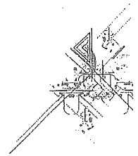

<details>
<summary>natural_image</summary>

Pure technical line drawing of intersecting lines and shapes without any text, numbers, or symbols
</details>


节点电压法

---

70

第三章 电阻电路的一般分析

例如，对于图3-16所示电路及其图，节点的编号、支路的编号及参考方向均示于图中。电路的节点数为4，支路数为6。以节点①为参考，并规定节点①、②、③的节点电压分别用 $u_{n1}$ 、 $u_{n2}$ 、 $u_{n3}$ ①表示。支路电压分别用 $u_{1}$ 、 $u_{2}$ 、 $u_{3}$ 、 $u_{4}$ 、 $u_{5}$ 与 $u_{6}$ 来表示。根据KVL，不难求出 $u_{1}=u_{n1},u_{2}=u_{n2};u_{3}=u_{n3},u_{4}=u_{n1}-u_{n2},u_{5}=u_{n2}-u_{n3}$ 以及 $u_{6}=u_{n1}-u_{n3}$ 。

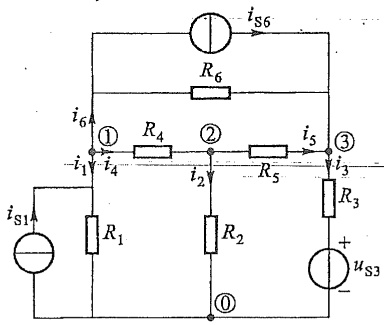

<details>
<summary>text_image</summary>

iS6
R6
i6
① R4 ② i5 ③
i1 i4 i2 R5 i3
iS1 R1 R2 R3 uS3
①
</details>

(a)

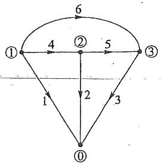

<details>
<summary>flowchart</summary>

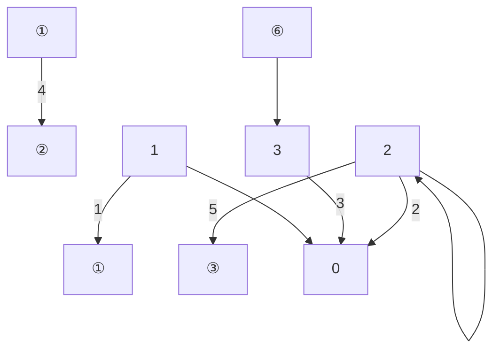
</details>

(b)

图 3-16 节点电压法

节点①、②与③的 KCL 方程为

$$
\left. \begin{array}{l} i _ {1} + i _ {4} + i _ {6} = 0 \\ i _ {2} - i _ {4} + i _ {5} = 0 \\ i _ {3} - i _ {5} - i _ {6} = 0 \end{array} \right\} \tag {3-14}
$$

根据各支路的 VCR 及支路电压与节点电压的关系,式(3-14)可写为

$$
\left. \begin{array}{l} \left(\frac {u _ {\mathrm{n1}}}{R _ {1}} - i _ {\mathrm{S1}}\right) + \left(\frac {u _ {\mathrm{n1}} - u _ {\mathrm{n2}}}{R _ {4}}\right) + \left(\frac {u _ {\mathrm{n1}} - u _ {\mathrm{n3}}}{R _ {6}} + i _ {\mathrm{S6}}\right) = 0 \\ \left(\frac {u _ {\mathrm{n2}}}{R _ {2}}\right) - \left(\frac {u _ {\mathrm{n1}} - u _ {\mathrm{n2}}}{R _ {4}}\right) + \left(\frac {u _ {\mathrm{n2}} - u _ {\mathrm{n3}}}{R _ {5}}\right) = 0 \\ \left(\frac {u _ {\mathrm{n3}} - u _ {\mathrm{S3}}}{R _ {3}}\right) - \left(\frac {u _ {\mathrm{n2}} - u _ {\mathrm{n3}}}{R _ {5}}\right) - \left(\frac {u _ {\mathrm{n1}} - u _ {\mathrm{n3}}}{R _ {6}} + i _ {\mathrm{S6}}\right) = 0 \end{array} \right\} \tag {3-15}
$$

经整理,就可得到以节点电压为独立变量的方程

$$
\left. \begin{array}{l} \left(\frac {1}{R _ {1}} + \frac {1}{R _ {4}} + \frac {1}{R _ {6}}\right) u _ {\mathrm{n1}} - \frac {1}{R _ {4}} u _ {\mathrm{n2}} - \frac {1}{R _ {6}} u _ {\mathrm{n3}} = i _ {\mathrm{S1}} - i _ {\mathrm{S6}} \\ - \frac {1}{R _ {4}} u _ {\mathrm{n1}} + \left(\frac {1}{R _ {2}} + \frac {1}{R _ {4}} + \frac {1}{R _ {5}}\right) u _ {\mathrm{n2}} - \frac {1}{R _ {5}} u _ {\mathrm{n3}} = 0 \\ - \frac {1}{R _ {6}} u _ {\mathrm{n1}} - \frac {1}{R _ {5}} u _ {\mathrm{n2}} + \left(\frac {1}{R _ {3}} + \frac {1}{R _ {5}} + \frac {1}{R _ {6}}\right) u _ {\mathrm{n3}} = i _ {\mathrm{S6}} + \frac {u _ {\mathrm{S3}}}{R _ {3}} \end{array} \right\} \tag {3-16}
$$

<small><span class="docvortex-page-footnote" data-block-type="page_footnote" style="color:#6b7280">① 下标 n 表示节点“node”（也有称为结点的）。</span></small>

---

§ 3-6 节点电压法

71

式(3-16)可写为

$$
\left. \begin{array}{l} (G _ {1} + G _ {4} + G _ {6}) u _ {\mathrm{n} 1} - G _ {4} u _ {\mathrm{n} 2} - G _ {6} u _ {\mathrm{n} 3} = i _ {\mathrm{S} 1} - i _ {\mathrm{S} 6} \\ - G _ {4} u _ {\mathrm{n} 1} + (G _ {2} + G _ {4} + G _ {5}) u _ {\mathrm{n} 2} - G _ {5} u _ {\mathrm{n} 3} = 0 \\ - G _ {6} u _ {\mathrm{n} 1} - G _ {5} u _ {\mathrm{n} 2} + (G _ {3} + G _ {5} + G _ {6}) u _ {\mathrm{n} 3} = i _ {\mathrm{S} 6} + G _ {3} u _ {\mathrm{S} 3} \end{array} \right\} \tag {3-17}
$$

式中 $G_{1}, G_{2}, \cdots, G_{6}$ 为支路 1、2、…、6 的电导。列节点电压方程时，可以根据观察按 KCL 直接写出式 (3-16) 或式 (3-17)，不必按照前述步骤进行。为归纳出更为一般的节点电压方程，可令 $G_{11} = G_{1} + G_{4} + G_{6}, G_{22} = G_{2} + G_{4} + G_{5}, G_{33} = G_{3} + G_{5} + G_{6}$ 分别为节点①、②、③的自导，自导总是正的，它等于连于各节点支路电导之和；令 $G_{12} = G_{21} = -G_{4}, G_{13} = G_{31} = -G_{6}, G_{23} = G_{32} = -G_{5}$ 分别为①、②，①、③和②、③这 3 对节点间的互导，互导总是负的，它们等于连接于两节点间支路电导的负值。方程右方写为 $i_{\mathrm{S11}}, i_{\mathrm{S22}}, i_{\mathrm{S33}}$ ，分别表示节点①、②、③的注入电流。注入电流等于流向节点的电流源电流的代数和，流入节点者前面取“+”号，流出节点者前面取“-”号。注入电流源还应包括电压源和电阻串联组合经等效变换形成的电流源。在上例中，节点③除了有 $i_{\mathrm{S6}}$ 流入外，还有电压源 $u_{\mathrm{S3}}$ 形成的等效电流源 $\frac{u_{\mathrm{S3}}}{R_3}$ 。3 个独立节点的节点电压方程可写为

$$
\left. \begin{array}{l} G _ {1 1} u _ {\mathrm{n1}} + G _ {1 2} u _ {\mathrm{n2}} + G _ {1 3} u _ {\mathrm{n3}} = i _ {\mathrm{S11}} \\ G _ {2 1} u _ {\mathrm{n1}} + G _ {2 2} u _ {\mathrm{n2}} + G _ {2 3} u _ {\mathrm{n3}} = i _ {\mathrm{S22}} \\ G _ {3 1} u _ {\mathrm{n1}} + G _ {3 2} u _ {\mathrm{n2}} + G _ {3 3} u _ {\mathrm{n3}} = i _ {\mathrm{S33}} \end{array} \right\} \tag {3-18}
$$

式(3-18)不难推广到具有 $(n-1)$ 个独立节点的电路,有

$$
\left. \begin{array}{c} G _ {1 1} u _ {\mathrm{n} 1} + G _ {1 2} u _ {\mathrm{n} 2} + G _ {1 3} u _ {\mathrm{n} 3} + \dots + G _ {1 (n - 1)} u _ {\mathrm{n(n-1)}} = i _ {\mathrm{S} 1 1} \\ G _ {2 1} u _ {\mathrm{n} 1} + G _ {2 2} u _ {\mathrm{n} 2} + G _ {2 3} u _ {\mathrm{n} 3} + \dots + G _ {2 (n - 1)} u _ {\mathrm{n(n-1)}} = i _ {\mathrm{S} 2 2} \\ \dots \dots \\ G _ {(n - 1) 1} u _ {\mathrm{n} 1} + G _ {(n - 1) 2} u _ {\mathrm{n} 2} + G _ {(n - 1) 3} u _ {\mathrm{n} 3} + \dots + G _ {(n - 1) (n - 1)} u _ {\mathrm{n(n-1)}} = i _ {\mathrm{S(n-1)(n-1)}} \end{array} \right\} \tag {3-19}
$$

求得各节点电压后,可根据 VCR 求出各支路电流。列节点电压方程时,不需要事先指定支路电流的参考方向。节点电压方程本身已包含了 KVL,而以 KCL 的形式写出,故如要检验答案,应对支路电流用 KCL 进行。

例3-5 列出图3-17所示电路的节点电压方程。

解 首先应指定参考节点,并对其他节点编号,设节点电压为  $u_{n1}$ 、 $u_{n2}$ 、 $u_{n3}$  与  $u_{n4}$ 。

图中各电阻以电阻值给出,因此,各支路电导为支路电阻的倒数。此处应注意: $G_{1}=\frac{1}{R_{1a}+R_{1b}}$ ,以及 $R_{9}$

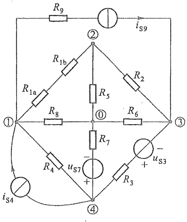

<details>
<summary>text_image</summary>

R9
iS9
②
R1b
R1a
R5
R2
①
R8
③
R6
R7
uS7
+
-
uS3
R4
R3
iS4
④
</details>

图3-17 例3-5图

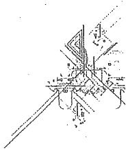

<details>
<summary>natural_image</summary>

Pure technical line drawing of intersecting lines and shapes without any text, numbers, or symbols
</details>

---

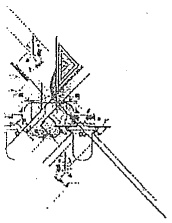

<details>
<summary>natural_image</summary>

Abstract line drawing of a stylized cityscape with geometric shapes and no text or symbols
</details>

72

第三章 电阻电路的一般分析

不会在方程中出现。节点电压方程为

$$
\left. \begin{array}{l} \left(\frac {1}{R _ {1 a} + R _ {1 b}} + \frac {1}{R _ {4}} + \frac {1}{R _ {8}}\right) u _ {\mathrm{n1}} - \frac {1}{R _ {1 a} + R _ {1 b}} u _ {\mathrm{n2}} - \frac {1}{R _ {4}} u _ {\mathrm{n4}} = i _ {\mathrm{S4}} - i _ {\mathrm{S9}} \\ - \frac {1}{R _ {1 a} + R _ {1 b}} u _ {\mathrm{n1}} + \left(\frac {1}{R _ {1 a} + R _ {1 b}} + \frac {1}{R _ {2}} + \frac {1}{R _ {5}}\right) u _ {\mathrm{n2}} - \frac {1}{R _ {2}} u _ {\mathrm{n3}} = 0 \\ - \frac {1}{R _ {2}} u _ {\mathrm{n2}} + \left(\frac {1}{R _ {2}} + \frac {1}{R _ {3}} + \frac {1}{R _ {6}}\right) u _ {\mathrm{n3}} - \frac {1}{R _ {3}} u _ {\mathrm{n4}} = i _ {\mathrm{S9}} - \frac {u _ {\mathrm{S3}}}{R _ {3}} \\ - \frac {1}{R _ {4}} u _ {\mathrm{n1}} - \frac {1}{R _ {3}} u _ {\mathrm{n3}} + \left(\frac {1}{R _ {3}} + \frac {1}{R _ {4}} + \frac {1}{R _ {7}}\right) u _ {\mathrm{n4}} = - i _ {\mathrm{S4}} + \frac {u _ {\mathrm{S7}}}{R _ {7}} + \frac {u _ {\mathrm{S3}}}{R _ {3}} \end{array} \right\} \tag {3-20}
$$

例 3-6 电路如图 3-18 所示, 用节点电压法求各支路电流及输出电压  $U_{0}$ 。

解 取参考节点如图 3-18 所示, 其他 3 个节点的节点电压分别为  $U_{n1}$ 、 $U_{n2}$ 、 $U_{n3}$ 。节点电压方程为

$$
\left. \begin{array}{l} \left(\frac {1}{1 0} + \frac {1}{1 0}\right) U _ {\mathrm{n1}} - \frac {1}{1 0} U _ {\mathrm{n2}} = 1 - \frac {3 0}{1 0} \\ - \frac {1}{1 0} U _ {\mathrm{n1}} + \left(\frac {1}{1 0} + \frac {1}{2 0}\right) U _ {\mathrm{n2}} - \frac {1}{2 0} U _ {\mathrm{n3}} = 7 + \frac {3 0}{1 0} \\ - \frac {1}{2 0} U _ {\mathrm{n2}} + \left(\frac {1}{1 0} + \frac {1}{2 0}\right) U _ {\mathrm{n3}} = - 2 \end{array} \right\} \tag {3-21}
$$

整理得

$$
\begin{array}{l} 0. 2 U _ {\mathrm{n1}} - 0. 1 U _ {\mathrm{n2}} = - 2 \\ \left. \begin{array}{l} - 0. 1 U _ {\mathrm{n} 1} + 0. 1 5 U _ {\mathrm{n} 2} - 0. 0 5 U _ {\mathrm{n} 3} = 1 0 \\ - 0. 0 5 U _ {\mathrm{n} 2} + 0. 1 5 U _ {\mathrm{n} 3} = - 2 \end{array} \right\} \\ \end{array}
$$

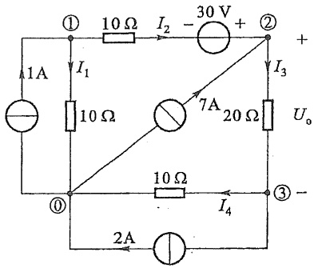

<details>
<summary>text_image</summary>

①
10 Ω I₂ - 30 V +
②
+
I₁
1A
10 Ω
7A
20 Ω
Uₒ
③ -
①
10 Ω
I₄
2A
</details>

图3-18 例3-6图

可解得

$$
U _ {\mathrm{n1}} = 4 0 \mathrm{V}
$$

$$
U _ {\mathrm{n2}} = 1 0 0 \mathrm{V}
$$

$$
U _ {\mathrm{n3}} = 2 0 \mathrm{V}
$$

假定各支路电流  $I_{1}$ 、 $I_{2}$ 、 $I_{3}$ 、 $I_{4}$  参考方向如图 3-18 所示，有

$$
\begin{array}{l} I _ {1} = \frac {U _ {\mathrm{n1}}}{1 0 \Omega} = 4 \mathrm{A} \\ I _ {2} = \frac {U _ {\mathrm{n1}} - U _ {\mathrm{n2}} + 3 0 \mathrm{V}}{1 0 \Omega} = - 3 \mathrm{A} \\ I _ {3} = \frac {U _ {\mathrm{n2}} - U _ {\mathrm{n3}}}{2 0 \Omega} = 4 \mathrm{A} \\ I _ {4} = \frac {U _ {\mathrm{n3}}}{1 0 \Omega} = 2 \mathrm{A} \\ \end{array}
$$

---

§ 3-6 节点电压法

73

输出电压  $U_{o}=U_{n2}-U_{n3}=80\ V$

各支路电流在参考点满足 KCL, 求解正确。

无电阻与之串联的电压源称为无伴电压源。当无伴电压源作为一条支路连接于两个节点之间时，该支路的电阻为零，即电导等于无限大，支路电流不能通过支路电压表示，按一般公式来列写节点电压方程就遇到困难。当电路中存在这类支路时，有几种方法可以处理。第一种方法是把无伴电压源的电流作为附加变量列入KCL方程，每引入这样的一个变量，同时也增加了一个节点电压与无伴电压源电压之间的一个约束关系，成为节点电压法中的约束方程。把这些约束方程和节点电压方程合并成一组联立方程，其方程数仍将与变量数相同。另一种方法是将连接无伴电压源的两个节点的节点电压方程合为一个①，即取一个包含这两节点的封闭面来写KCL方程，此时，整个电路的独立KCL方程就少了一个，同时还应添加节点电压与无伴电压源的约束方程。

例 3-7 图 3-19 所示电路中， $u_{S1}$  为无伴电压源的电压。试列出此电路的节点电压方程。

解 设无伴电压源支路的电流为 i, 电路的节点电压方程为

$$
\begin{array}{l} (G _ {1} + G _ {3}) u _ {\mathrm{n1}} - G _ {3} u _ {\mathrm{n2}} - i = 0 \\ - G _ {3} u _ {\mathrm{n1}} + (G _ {2} + G _ {3}) u _ {\mathrm{n2}} = i _ {\mathrm{S2}} \\ \end{array}
$$

补充的约束方程为

$$
u _ {\mathrm{n1}} = u _ {\mathrm{S1}}
$$

由上列 3 个方程, 可以联立解得  $u_{n1}$ 、 $u_{n2}$  和  $i_{0}$ 。


<details>
<summary>text_image</summary>

i
① G₃ ②
+ uₛ₁ G₁ G₂ iₛ₂
-
</details>

图3-19 例3-7图

这种方法实际上采用了混合变量,除了节点电压外,还把无伴电压源支路的电流作为变量[在回路电流法中,处理无伴电流源时也采用了混合变量(见例3-3)]。如果应用第二种处理方法,则舍弃上列3个方程中的第一个方程,而对第二、第三个方程联立求解 $u_{n2}$ 。

例 3-8 试用节点电压法求解图 3-20 所示电路。

解 该电路共有两个独立节点,但两个节点之间有一个无伴电压源,故仅有一个节点电压是独立的。如果不改变参考节点,无伴电压源仍在两个独立节点之间,也可不增加混合电路变量。此时可取一个包含节点①、②的封闭面,即所谓超节点来列写KCL方程。从图中可看出,有四条支路流经封闭面,因此得到KCL方程为


<details>
<summary>text_image</summary>

5 Ω
+
25 V
-
①
20 V
+
-
②
15 Ω
2 A
3 A
</details>

图3-20 例3-8图

<small><span class="docvortex-page-footnote" data-block-type="page_footnote" style="color:#6b7280">① 如果无伴电压源的一端是参考节点，除非要求无伴电压源的电流 i，否则该节点的 KCL 方程就是多余的，可不列，仅补充以约束方程。</span></small>

1. 2. 3. 4. 5. 6. 7. 8. 9. 10. 11. 12. 13. 14. 15. 16. 17. 18. 19. 20. 21. 22. 23. 24. 25. 26. 27. 28. 29. 30. 31. 32. 33. 34. 35. 36. 37. 38. 39. 40. 41. 42. 43. 44. 45. 46. 47. 48. 49. 50. 51. 52. 53. 54. 55. 56. 57. 58. 59. 60. 61. 62. 63. 64. 65. 66. 67. 68. 69. 70. 71. 72. 73. 74. 75. 76. 77. 78. 79. 80. 81. 82. 83. 84. 85. 86. 87. 88. 89. 90.

---

74

第三章 电阻电路的一般分析

$$
\frac {1}{5} U _ {\mathrm{n1}} + \frac {1}{1 5} U _ {\mathrm{n2}} = \frac {2 5}{5} - 2 - 3
$$

约束方程为

$$
U _ {\mathrm{n1}} - U _ {\mathrm{n2}} = 2 0
$$

这就是该电路的节点方程组。求解方程组，可得  $U_{n1}=5\ V, U_{n2}=-15\ V$ 。

若电路中存在受控电流源，在建立节点电压方程时，先把控制量用节点电压表示，并暂时把它当作独立电流源，按前述方法列出节点电压方程，然后把用节点电压表示的受控电流源电流项移到方程的左边，再进行求解。当电路中存在有伴受控电压源时，把控制量用有关节点电压表示后再变换为等效受控电流源来处理。如果存在无伴受控电压源，可参照无伴独立电压源的处理方法。

例3-9 图3-21所示电路中独立源与CCVS都是无伴电压源。试列出其节点电压方程。

解 选择参考节点及标明独立节点,节点电压分别为 $U_{n1}$、$U_{n2}$、$U_{n3}$。独立电压源一端为参考节点,节点电压已知,故对节点①不列方程;对CCVS两端作包含节点②与③的封闭面S,对S列KCL方程为

$$
\frac {U _ {\mathrm{n2}} - U _ {\mathrm{n1}}}{R _ {1}} + \frac {U _ {\mathrm{n2}}}{R _ {2}} - g _ {\mathrm{m}} U + \frac {U _ {\mathrm{n3}}}{R _ {3}} = 0
$$

附加约束方程

$$
U _ {\mathrm{n1}} = U _ {\mathrm{s}}
$$

$$
U _ {\mathrm{n2}} - U _ {\mathrm{n3}} = R _ {\mathrm{m}} I _ {1}
$$

其中控制量 U 与  $I_{1}$  可以节点电压来表示, 即

$$
U = U _ {n 2}
$$

$$
I _ {1} = \frac {U _ {\mathrm{n1}} - U _ {\mathrm{n2}}}{R _ {1}}
$$


<details>
<summary>text_image</summary>

gm U
① R1 I1 ② Rm I1 - ③
+ Us -
U R2 -
R3
①
</details>

图3-21 例3-9图

经整理可得 3 变量方程组为

$$
\left. \begin{array}{l} - \frac {1}{R _ {1}} U _ {\mathrm{n} 1} + \left(\frac {1}{R _ {1}} + \frac {1}{R _ {2}} - g _ {\mathrm{m}}\right) U _ {\mathrm{n} 2} + \frac {1}{R _ {3}} U _ {\mathrm{n} 3} = 0 \\ U _ {\mathrm{n} 1} = U _ {\mathrm{S}} \\ - \frac {R _ {\mathrm{m}}}{R _ {1}} U _ {\mathrm{n} 1} + \left(1 + \frac {R _ {\mathrm{m}}}{R _ {1}}\right) U _ {\mathrm{n} 2} - U _ {\mathrm{n} 3} = 0 \end{array} \right\}
$$

节点电压法的步骤可以归纳如下:

(1) 指定参考节点,其余节点对参考节点之间的电压就是节点电压。通常以参考节点为各节点电压的负极性。
(2) 用一般公式(3-19)列出节点电压方程, 注意自导总是正的, 互导总是负的; 并注意各节点注入电流前面的“+”“-”号。
(3) 当电路中有受控源或无伴电压源时,需另行处理。

---

§ 3-6 节点电压法

75

本章介绍了分析线性电阻电路的支路电流法、回路电流法（含网孔电流法）和节点电压法，并提到了2b法和支路电压法。就方程数目说，2b法为支路数b的2倍；支路电流（电压）法为支路数b；节点电压法为独立节点数 $(n-1)$ （n为节点数）；回路电流法为独立回路数 $(b-n+1)$ ；其中以2b法为最多。支路电流法要求每个支路电压都能以支路电流表示，这就使该方法的应用受到一定的限制，例如对于无伴电流源就需要另行处理。节点电压法也有类似问题存在，它要求每个支路电流都能以支路电压表示，对于无伴电压源就需要另行处理 $^{①}$ 。2b法的通用性最强，因为只要求写出每个支路的VCR，对任何元件都不难做到。回路电流法存在与支路电流法类似的限制。节点电压法的优点是节点电压容易选择，不存在选取独立回路的问题。用网孔电流法时，选取独立回路简便、直观，但仅适用于平面电路。

自电子计算机以及众多有效的应用软件普及后,高阶代数方程组的求解已不是难事,本书第十五章和附录 C 将简要介绍应用计算机辅助电路分析的基本知识。那时,考虑问题的出发点与手写列方程、求解方程时不同。

线性电阻电路方程是一组线性代数方程。无论用以上哪一种方法,均可获得未知数和方程数相等的一组代数方程。这组线性代数方程具有以下的普遍形式:

$$
\left. \begin{array}{c} a _ {1 1} x _ {1} + a _ {1 2} x _ {2} + \dots + a _ {1 N} x _ {N} = b _ {1 1} \\ a _ {2 1} x _ {1} + a _ {2 2} x _ {2} + \dots + a _ {2 N} x _ {N} = b _ {2 2} \\ \dots \dots \\ a _ {N 1} x _ {1} + a _ {N 2} x _ {2} + \dots + a _ {N N} x _ {N} = b _ {N N} \end{array} \right\}
$$

其中求解变量以 x 来表示,它可以是网孔电流、回路电流或节点电压;左方的系数为自阻、互阻,或是自导、互导,或是由于受控源而引入的系数;右方 b 则是电源激励,即电压源电压、电流源电流(或等效电压源电压、等效电流源电流)的线性组合。

从数学上说,只要方程的系数行列式不等于零,方程有解且是唯一解。线性电阻电路方程一般总是有解的,但是在某些特定条件以及特殊情况下,线性电阻电路方程可能无解,也可能存在多解。

在第二章和第三章,分别介绍了电阻电路分析的等效变换法和一般分析法,电阻电路的一般分析法更具普遍性。显然,当电路很简单时,采用第二章的等效变换法简单便捷,当电路复杂时,采用第三章的一般分析法更有效。

对于同一个电阻电路,在大多情况下,可以采用第三章介绍的任何一种分析方法。但对于一些特殊情况,可能采用一种方法比较方便,而采用另一种方法则比较烦琐。具体采用支路电流法、回路电流法还是节点电压法,要具体电路具体分析。学习者通过总结针对不同电路特点采用不同分析方法的规律,可以更加牢固地掌握本章介绍的电阻电路的一般分析法。

<small><span class="docvortex-page-footnote" data-block-type="page_footnote" style="color:#6b7280">① 一般而言，含有无伴电流源时采用变量为电流的方法（支路电流法、网孔电流法及回路电流法），含有无伴电压源时采用电压变量的方法（支路电压法、节点电压法等）。</span></small>

---

76

第三章 电阻电路的一般分析

## 思考题

3-1 列写电路方程时,根据哪些因素来考虑使用哪种方程,以使求解的工作量较少?

3-2 为什么回路电流法的解答要用 KVL 来校验, 节点电压法的解答要用 KCL 来校验?

3-3 支路电流法包含哪些方程？对于具有 $n$ 个节点、$b$ 条支路和 $l$ 个独立回路的电路，共有多少个方程？

3-4 网孔电流法和回路电流法为什么不用列出 KCL 方程？

3-5 回路电流方程的本质是什么？对于既不含受控源，也不含无伴电流源的电路，其回路电流方程的系数有什么特点？

3-6 当含有受控源时,回路电流方程的系数有什么特点?

3-7 当含有无伴电流源时,有几种列写回路电流方程的方法?哪种方法最简单?

3-8 节点电压法为什么不用列出 KVL 方程?

3-9 节点电压方程的本质是什么？对于既不含受控源，也不含无伴电压源的电路，节点电压方程的系数有什么特点？

3-10 当含有受控源时？节点电压方程的系数有什么特点？

3-11 当含有多个无伴电压源时,节点电压方程需改进,增加新的变量和新的方程。新增加的方程是什么方程?新增加的变量是什么?

3-12 对于电阻电路的电路方程,对方程右端的激励项有什么要求?电路变量的形式与激励形式有什么联系?

3-13 对于由线性电阻、线性受控源、独立源组成的电路,其电路方程在数学上称为何种方程?


## 习题

3-1 在以下两种情况下,画出题 3-1 图所示电路的图,并说明其节点数和支路数:


<details>
<summary>text_image</summary>

Electrical circuit diagram with resistors, voltage sources, and a meter labeled with polarity signs
</details>

(a)


<details>
<summary>text_image</summary>

Electrical circuit diagram with labeled components and polarity indicators
</details>

(b)

题3-1图

---

习题

77

(1) 每个元件作为一条支路处理。
(2) 电压源(独立或受控)和电阻的串联组合,电流源和电阻的并联组合作为一条支路处理。
3-2. 指出题 3-1 中两种情况下, KCL、KVL 独立方程各为多少?
3-3 对题 3-3 图(a)(b)所示图, 各画出 4 个不同的树, 树支数各为多少?


<details>
<summary>text_image</summary>

G₁
① 2 ② 5 ③
1 6 ⑥ 7
1 4 9 10
8 ④ ⑤
</details>

(a)


<details>
<summary>text_image</summary>

G₂
① 2 ② 9
1 5 4 6 3 10
1 8 7 11
③ 4 ⑤
</details>

(b)

题3-3图

3-4 题 3-4 图所示桥形电路共可画出 16 个不同的树,试一一列出(由于节点数为 4,故树支数为 3,可按支路号递增的穷举方法列出所有可能的组合,如 123,124,…,126,134,135,…,从中选出树)。
3-5 对题 3-3 图所示的  $G_{1}$  和  $G_{2}$ ，任选一树并确定其基本回路组，同时指出独立回路数和网孔数各为多少。

3-6 对题 3-6 图所示非平面图, 设:

(1) 选择支路 $(1,2,3,4)$ 为树。
(2) 选择支路 $(5,6,7,8)$ 为树。

独立回路各有多少？求其基本回路组。


<details>
<summary>flowchart</summary>

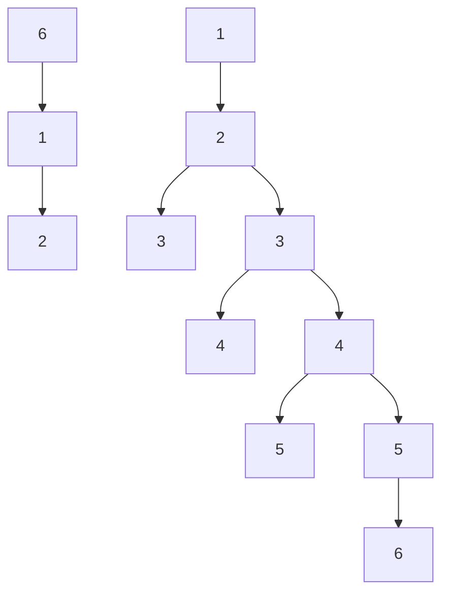
</details>

题3-4图


<details>
<summary>flowchart</summary>

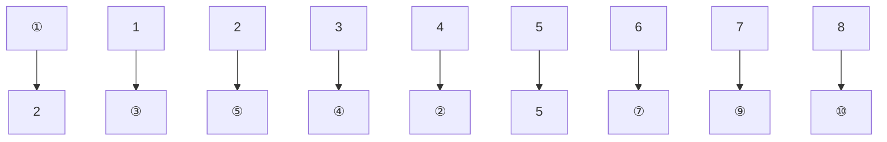
</details>

题 3-6 图

3-7 题 3-7 图所示电路中  $R_{1}=R_{2}=10\ \Omega, R_{3}=4\ \Omega, R_{4}=R_{5}=8\ \Omega, R_{6}=2\ \Omega, u_{S3}=20\ V, u_{S6}=40\ V$ ，用支路电流法求解电流  $i_{5}$ 。

3-8 用网孔电流法求解题 3-7 图中电流  $i_{s}$ 。
3-9 用回路电流法求解题 3-7 图中电流  $i_{3}$ 。

---

[1]

78

第三章 电阻电路的一般分析

3-10 用回路电流法求解题 3-10 图所示电路中  $5 \Omega$  电阻中的电流  $i_{0}$


<details>
<summary>text_image</summary>

R6
+
us6
-
R2
i3
R4
i5
R1
R3
+
us3
R5
</details>

题3-7图


<details>
<summary>text_image</summary>

4Ω
-32 V
+
2 Ω
6 Ω
i
5 Ω
8 Ω 3 Ω
+16 V
-
+48 V
</details>

题3-10图

3-11 用回路电流法求解题 3-11 图所示电路中电流 I。
3-12 用回路电流法求解题 3-12 图所示电路中电流  $I_{\alpha}$  及电压  $U_{0}$ 。


<details>
<summary>text_image</summary>

1A
5 Ω
20 Ω
5 Ω
+
30 V
-
30 Ω
I
+
5V
-
</details>

题3-11图


<details>
<summary>text_image</summary>

Ia
4 Ω
2.5 Ω
8 Ω
14 V
+
2 Ω
15 Ω
1.4Ia
Uo
</details>

题3-12图

3-13 用回路电流法求解:

(1) 题 3-13 图(a)中  $U_{x}$ 。
(2) 题 3-13 图 (b) 中 I。

(在本题中,应考虑如何选择独立回路,可使解题的工作量最少。)


<details>
<summary>text_image</summary>

0.15A
24Ω 8Ω
+ 20 V + Uₓ 32Ω 0.05Uₓ
- -
</details>

(a)


<details>
<summary>text_image</summary>

- Uₓ +
20 Ω
20 Ω
+ 0.5 Uₓ -
3.5A
4 Ω
2 Ω
35 Ω
I
</details>

(b)

题3-13图

---

习题

79

3-14 用回路电流法求解题3-14图所示电路中 $I_{x}$ 以及CCVS的功率。


<details>
<summary>text_image</summary>

5A
+10Iₓ-
20 Ω
50 V +
-
10 Ω
+
30 V
-
10 Ω
Iₓ
</details>

题3-14图

3-15 列出题 3-15 图(a)(b)所示电路的节点电压方程。


<details>
<summary>text_image</summary>

G3
G2
iS5
G4
G6
iS7
iS1
</details>

(a)


<details>
<summary>text_image</summary>

R1
iS1
R2
i
R3
iS5
R4
R6
βi
</details>

(b)

题 3-15 图

3-16 列出题 3-16 图(a)(b)所示电路的节点电压方程。


<details>
<summary>text_image</summary>

10A
2 Ω
2 Ω
2S
4A
3 Ω
3S
6S
2 Ω
</details>

(a)


<details>
<summary>text_image</summary>

1 Ω
5 Ω
- 20 V +
5 Ω
+ 10 V -
5 Ω
10 Ω
2 A
</details>

(b)

题3-16图

3-17 题 3-17 图所示为由电压源和电阻组成的一个独立节点的电路,用节点电压法证明其节点电压为

$$
u _ {n 1} = \frac {\sum G _ {k} u _ {S k}}{\sum G _ {k}}
$$

此式又称为弥尔曼定理。


<details>
<summary>text_image</summary>

Technical diagram with labeled geometric lines and annotations, likely from a technical drawing or engineering manual.
</details>

---

80

第三章 电阻电路的一般分析


<details>
<summary>text_image</summary>

R₁
uₛ₁ +
-
R₂
uₛ₂ +
-
① uₙ₁
R₃
uₛ₃ +
-
...
Rₙ
uₛₙ +
-
①
</details>

题3-17图

3-18 列出题 3-18 图(a)(b)所示电路的节点电压方程。


<details>
<summary>text_image</summary>

1Ω
2Ω
+
2V
-
3A
2A
1Ω
1Ω
×
4V
/
2Ω
2Ω
</details>

(a)


<details>
<summary>text_image</summary>

3u₂
0.5 Ω
1 Ω
- 1 V +
1 Ω
+ u₂ 0.2 Ω 0.5 Ω 1 Ω 3A
2 V -
1 Ω
</details>

(b)

题3-18图

3-19 用节点电压法求解题 3-19 图所示电路中各支路电流。


<details>
<summary>text_image</summary>

0.5 Ω
i₁ +
10 V
-
i₂
1 Ω
3 Ω
i₃
5 Ω
i₄
2 Ω
3A
-
</details>

(a)


<details>
<summary>text_image</summary>

i_a
4 Ω
1 Ω
i_c
2 Ω
i_e
+
15 V
-
6 Ω
3 Ω
10 V
+
-
i_b
i_d
</details>

(b)

题3-19图

3-20 题 3-20 图所示电路中电源为无伴电压源,用节点电压法求解电流  $I_{s}$  和  $I_{0}$ 。
3-21 用节点电压法求解题 3-21 图所示电路中电压 U。（请注意如何使待解的独立方程数为最少。）

3-22 用节点电压法求解题 3-13。

3-23 用节点电压法求解题 3-14。

3-24 用节点电压法求解题 3-24 图所示电路后, 求各元件的功率并检验功率是否平衡。

---

习题

81

3-25 用节点电压法求解题3-25图所示电路中 $u_{n1}$ 和 $u_{n2}$，你对此题的求解结果有什么看法？


<details>
<summary>text_image</summary>

I_S
+
48 V
-
5 Ω
3 Ω
9 Ω
2 Ω
I_O
6 Ω
1 Ω
1 Ω
</details>

题 3-20 图


<details>
<summary>text_image</summary>

10 Ω
5 Ω
+
I
4 Ω
+ 50 V U 20 Ω 15 I
- -
</details>

题3-21图


<details>
<summary>text_image</summary>

4 Ω
2 Ω 3 Ω
+ 6 V 1 Ω
- I₁
1/3 I₁
- 12 V +
+
</details>

题3-24图


<details>
<summary>text_image</summary>

2A
①
1 Ω
②
½ Ω
+
u₁
-
1 Ω
5u₁
</details>

题3-25图

3-26 列出题 3-26 图所示电路的节点电压方程。如果  $R_{s}=0$ ，则方程又如何？（提示:为避免引入过多附加电流变量，对连有无伴电压源的节点部分，可在包含无伴电压源的封闭面 S 上写出 KCL 方程。）


<details>
<summary>text_image</summary>

S
①
Us2
+
-
G1
RS
+
Us1
-
G6
②
G2
I
①
G4
④
G3
G5
Is
③
R3
I
</details>

题 3-26 图

---

82

第三章 电阻电路的一般分析

3-27 用回路电流法求解题 3-27 图所示电路。可将四个电流源支路都取为连支。对基本回路列出方程后求解出各支路的电压或电流，求各支路的功率并验证功率的平衡。


第三章部分习题答案


<details>
<summary>text_image</summary>

3Ω
+ 6V -
1A
+ 6V -
3A
+ 3V -
3A
- Iα
+ 1V -
1A
+ 4Iα -
+ 6V -
-
</details>

题3-27图
