# 第5章 含有运算放大器的电阻电路

原始 PDF 第 138–147 页。

The image contains no text or mathematical content to process. It is a graphical representation of a triangular shape.

# 第五章 含有运算放大器的 电阻电路

## 导读

运算放大器是电子电路中一种重要的多端器件,它的应用十分广泛。首先,应用§1-7受控电源的知识,建立运算放大器的电路模型(属于电压控制电压源VCVS),在电路模型基础上给出运算放大器在理想化条件下的外部特性,以及含有运算放大器的电阻电路的分析。另外介绍了一些典型电路。需要指出的是,本章给出的运算放大器的电路模型,是最简单的电路模型,适合于用在激励是直流或频率较低信号的场合。

附录 B 介绍的电流传输器和跨导放大器均为电子电路中的多端器件,也能应用受控电源的知识建立其电路模型。

## §5-1 运算放大器的电路模型

运算放大器(简称运放)是一种包含许多晶体管的集成电路,它是获得广泛应用的一种多端器件。一般放大器的作用是把输入电压放大一定倍数后再输送出去,其输出电压与输入电压的比值称为电压放大倍数或电压增益。运放是一种高增益(可达几万倍甚至更高)、高输入电阻、低输出电阻的放大器。由于它能完成加法、积分、微分等数学运算而被称为运算放大器,然而它的应用远远超出上述范围。

虽然运放有多种型号,其内部结构也各不相同,但从电路分析的角度出发,感兴趣的仅仅是运放的外部特性及其电路模型。图5-1(a)给出了运放的电路图形符号,其中“三角形”符号表示“放大器”(实际运放外部端子比图示的可能还要多)。运放有两个输入端a、b和一个输出端o。电源端子 $E^{+}$ 和 $E^{-}$ 连接直流偏置电压,以维持运放内部晶体管正常工作。 $E^{+}$ 端接正电压, $E^{-}$ 端接负电压,这里电压的正负是对“地”或公共端 $^{①}$ 而言的。在分析运放的放大作用时可以不考虑偏置电源,这时采用图5-1(b)所示电路符号,但应记得偏置电源是存在的。a端称为倒向输入端(也称反相输入端)。当输入电

<small>① 公共端或“地”的电压(位)是零,它相当于电路中的参考节点。事实上接地不一定要求与大地直接连接。有时仪器的底座或金属外壳都可以作为公共端。接地的符号见图5-1(a)。</small>

---

§ 5-1 运算放大器的电路模型

115

压 $u^{-}$ 加在 a 端与公共端之间，且其实际方向从 a 端指向公共端时，输出电压 $u_{0}$ 的实际方向则自公共端指向 o 端，即两者的方向正好相反。b 端称为非倒向输入端（也称为同相输入端）。当输入电压 $u^{+}$ 加在 b 端与公共端之间，$u_{0}$ 与 $u^{+}$ 两者的实际方向相对公共端恰好相同。为了区别起见，a 端和 b 端分别用“-”号和“+”号标出，如图 5-1 所示，但不要将它们误认为电压参考方向的正、负极性。电压的正、负极性应另外标出或用箭头表示。

如果在 a 端和 b 端分别同时加输入电压  $u^{-}$ 和  $u^{+}$ ，则有

$$
u _ {\mathrm{o}} = A (u ^ {+} - u ^ {-}) = A u _ {\mathrm{d}} \tag {5-1}
$$

其中  $u_{d}=u^{+}-u^{-}$ ，A 为运放的电压放大倍数（或电压增益的绝对值）。运放的这种输入情况称为差分输入，而  $u_{d}$  称为差分输入电压。在实际应用中经常把非倒向端与公共端连接起来（接地），而只在倒向端加输入电压，则有

$$
u _ {\mathrm{o}} = - A u ^ {-}
$$

上式右边的负号说明输出电压  $u_{0}$  与输入电压  $u^{-}$ 相对公共端是反向的。反之，若把倒向端与公共端连接起来，而在非倒向端加输入电压  $u^{+}$ ，这时有

$$
u _ {\mathrm{o}} = A u ^ {+}
$$

有时,为了简化起见,在画运放的电路符号时[见图5-1(b)],可将接地的连接线省略掉,而用图5-1(c)所示的电路符号表示①。但在进行电路分析时,应当注意到这个接地线的存在。运放可以看作是一种多端元件。

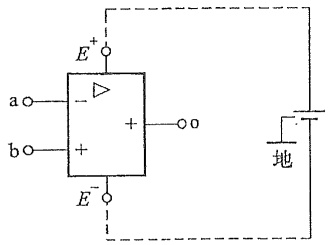

text_image

E+
a○─▶───○o
b○─+ ──○
E-○─●
地

(a)

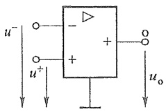

text_image

u⁻
-
+
u⁺
uₒ

(b)

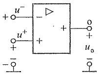

text_image

u⁻
+
-
u⁺
+
-
-
+
+
o
+
uₒ
-

(c)

图 5-1 运放的电路图形符号图

<small>① 目前不少运放产品的引出端中往往不存在公共端或接地端，而接地端是通过偏置（双）电源实现的，如图5-1(a)所示。</small>

1. 用 $x$ 和 $y$ 标记为 $x$ 和 $y$ 的两个方向，分别用三角形和正方形标记。

199

---

116

第五章 含有运算放大器的电阻电路

运放的输出电压 $u_{\mathrm{o}}$ 与差分输入电压 $u_{\mathrm{d}}$ 之间的关系可以用图5-2近似地描述。在 $-\varepsilon \leqslant u_{\mathrm{d}} \leqslant \varepsilon$ （$\varepsilon$ 是很小的）范围内，$u_{\mathrm{o}}$ 与 $u_{\mathrm{d}}$ 的关系用通过原点的一段直线描述，其斜率等于放大倍数 $A$ 。由于 $A$ 值很大，所以这段直线很陡。当 $|u_{\mathrm{d}}| > \varepsilon$ 时，输出电压 $u_{\mathrm{o}}$ 趋于饱和；图中用 $\pm U_{\mathrm{sat}}$ 表示，此饱和电压值略低于直流偏置电压值。这个关系曲线称为运放的外特性。

图 5-3 示出运放的电路模型, 其中电压控制电压源的电压为 $A(u^{+}-u^{-})$, $R_{1}$ 为运放的输入电阻, $R_{0}$ 为输出电阻。实际运放的 $R_{i}$ 都比较高, 而 $R_{0}$ 则较低。它们的具体值根据运放的制造工艺有所不同, 但可以认为 $R_{i} \gg R_{0}$。本章中把运放的工作范围限制在线性段, 即设 $-U_{\mathrm{sat}} < u_{0} < U_{\mathrm{sat}}$。由于放大倍数 $A$ 很大, 而 $U_{\mathrm{sat}}$ 一般为正、负十几伏或几伏, 这样输入电压就必须很小。运放的这种工作状态称为“开环运行”, $A$ 称为开环放大倍数。在运放的实际应用中, 通常通过一定的方式将输出的一部分接回 (反馈) 到输入中去, 这种工作状态称为“闭环运行”。

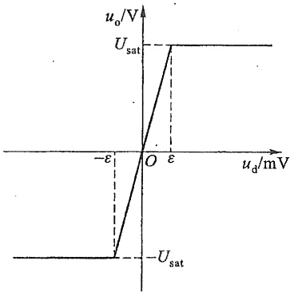

line

| ud/mV | usat/V |
| --- | --- |
| \(-\epsilon\) | Usat |
| 0 | 0 |
| \(\epsilon\) | Usat |

图 5-2 运放的  $u_{d}-u_{o}$  特性

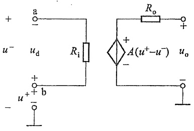

text_image

+
u⁻ u_d Ri
-
a
+
b
-
u⁺
R_o
A(u⁺-u⁻) u_o
+

图 5-3 运放的电路模型

在理想化情况下,设流入运放两个输入端的电流均为零,等于将输入电阻 $R_{1}$ 设为无限大;而将输出电阻 $R_{0}$ 设为零,将放大倍数A设为无限大。于是从式(5-1)可知, $u_{d}=u^{+}-u^{-}=0$ 。这是因为 $u_{0}$ 为有限值,所以差动输入电压 $u_{d}$ 被强制为零,或者说 $u^{+}$ 和 $u^{-}$ 将相等。如果不是差分输入的情况,而是把非倒向端(或倒向端)接地,即有 $u^{+}=0$ (或 $u^{-}=0$ ),则在倒向端的电压 $u^{-}$ (或非倒向端的电压 $u^{+}$ )就将强制为零值。

归纳以上论述，在 $-U_{sat}<u_{o}<U_{sat}$ 范围内，如果假设运放的电路模型中的 $R_{i}=\infty,R_{o}=0$ ，且认为 $A=\infty$ ，则称这种运放为理想运放。并且在表示运放的图形符号中加“∞”以资说明；否则用“A”表示。

实际运放的工作情况比以上介绍的要复杂一些。例如，放大倍数 A 不仅为有限值，而且随着频率的增高而下降。通常，图 5-3 所示运放电路模型在输入电压频率较低时是足够精确的。为了简化分析，一般将假设运放是在理想化条件下工作的，这样做在许多场合下不会造成很大的误差。

---

§ 5-2 比例电路的分析

117

## §5-2 比例电路的分析

图 5-4(a) 表示一个由运放和电阻构成的电路, 称为倒向比例器。运放的输出电压通过电阻  $R_{2}$  反馈到输入回路中。显然, 由于电阻  $R_{1}$  的存在, 电路的输入电压  $u_{i}$  与运放的倒向输入端电压  $u^{-}$ 不同。

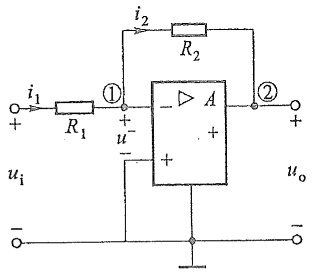

text_image

i₁
+
R₁
①
+
u⁻
-
i₂
R₂
A
+
+
②
+
uo
-

(a)

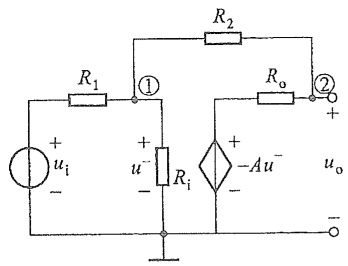

text_image

R1
①
R2
R0
②
+
ui
-
+
u-
-
Ri
+
-Au-
-
uo
-

(b)

图5-4 倒向比例器

参照图 5-3 所示运放电路模型, 图 5-4(a) 电路可用图 5-4(b) 表示。设输入电压用一个电压为  $u_{i}$  的电压源表示, 对节点①、②列出节点电压方程, 有

$$
\left(\frac {1}{R _ {1}} + \frac {1}{R _ {\mathrm{i}}} + \frac {1}{R _ {2}}\right) u _ {\mathrm{n1}} - \frac {1}{R _ {2}} u _ {\mathrm{n2}} = \frac {u _ {\mathrm{i}}}{R _ {1}}
$$

$$
- \frac {1}{R _ {2}} u _ {\mathrm{n1}} + \left(\frac {1}{R _ {\mathrm{o}}} + \frac {1}{R _ {2}}\right) u _ {\mathrm{n2}} = - \frac {A u ^ {-}}{R _ {\mathrm{o}}}
$$

由于  $u_{n1}=u^{-}, u_{n2}=u_{0}$ ，改写上列方程，得

$$
\left(\frac {1}{R _ {1}} + \frac {1}{R _ {\mathrm{i}}} + \frac {1}{R _ {2}}\right) u ^ {-} - \frac {1}{R _ {2}} u _ {\mathrm{o}} = \frac {u _ {\mathrm{i}}}{R _ {1}}
$$

$$
\left(- \frac {1}{R _ {2}} + \frac {A}{R _ {\mathrm{o}}}\right) u ^ {-} + \left(\frac {1}{R _ {\mathrm{o}}} + \frac {1}{R _ {2}}\right) u _ {\mathrm{o}} = 0
$$

联立求解上列方程,求得

$$
u _ {\mathrm{o}} = \frac {- \left(\frac {A}{R _ {\mathrm{o}}} - \frac {1}{R _ {2}}\right) \frac {u _ {\mathrm{i}}}{R _ {1}}}{\left(\frac {1}{R _ {\mathrm{o}}} + \frac {1}{R _ {2}}\right) \left(\frac {1}{R _ {1}} + \frac {1}{R _ {\mathrm{i}}} + \frac {1}{R _ {2}}\right) + \frac {1}{R _ {2}} \left(\frac {A}{R _ {\mathrm{o}}} - \frac {1}{R _ {2}}\right)}
$$

所以

$$
\frac {u _ {\mathrm{o}}}{u _ {\mathrm{i}}} = - \frac {R _ {2}}{R _ {1}} \frac {1}{1 + \frac {\left(1 + \frac {R _ {\mathrm{o}}}{R _ {2}}\right) \left(1 + \frac {R _ {2}}{R _ {1}} + \frac {R _ {2}}{R _ {\mathrm{i}}}\right)}{A - \frac {R _ {\mathrm{o}}}{R _ {2}}}} \tag {5-2}
$$

---

118

第五章 含有运算放大器的电阻电路

从上式可见,由于 A 很大, $R_{0}$  很小, $R_{i}$  很大,再选择适当的  $R_{1}$  和  $R_{2}$ ,则有

$$
\frac {u _ {\mathrm{o}}}{u _ {\mathrm{i}}} \approx - \frac {R _ {2}}{R _ {1}} \tag {5-3}
$$

例如，设 $A = 50000, R_{\mathrm{i}} = 1 \mathrm{M}\Omega, R_{\mathrm{o}} = 100 \Omega$ ，而 $R_{2} = 100 \mathrm{k}\Omega, R_{1} = 10 \mathrm{k}\Omega$ ，则

$$
\frac {u _ {\mathrm{o}}}{u _ {\mathrm{i}}} = - \frac {R _ {2}}{R _ {1}} \cdot \frac {1}{1 . 0 0 0 2 2}
$$

可见用式(5-3)计算 $\frac{u_{o}}{u_{i}}$ 足够精确。

上述结果是很有意义的。利用图5-4(a)所示电路可使输出电压与输入电压之比按 $\frac{R_{2}}{R_{1}}$ 确定，而不会由于运放的性能稍有改变就使 $\frac{u_{o}}{u_{i}}$ 的值受到影响。显然，选择不同的 $R_{2}$ 和 $R_{1}$ 值，就可获得不同的 $\frac{u_{o}}{u_{i}}$ 值，所以有比例器的作用。通常又把这个电路称为倒向放大器。

如果把图 5-4(a) 的运放当作理想运放, 则由于  $A=\infty, R_{i}=\infty, R_{o}=0$ , 从式(5-2) 可直接求得

$$
\frac {u _ {\mathrm{o}}}{u _ {\mathrm{i}}} = - \frac {R _ {2}}{R _ {1}}
$$

另外，也可以直接利用理想运放的性质，对图5-4(a)所示电路求解。由于 $R_{\mathrm{i}} = \infty$ ，$R_{\mathrm{o}} = 0$ 及 $A = \infty$ ，则 $i_{1} = i_{2}$，从而得

$$
\frac {u _ {\mathrm{i}} - u ^ {-}}{R _ {1}} = \frac {u ^ {-} - u _ {\mathrm{o}}}{R _ {2}}
$$

又由于 $\frac{u_0}{u^-} = -A$ ，故 $u^{-} = 0$ ，所以

$$
\frac {u _ {\mathrm{i}}}{R _ {1}} = - \frac {u _ {\mathrm{o}}}{R _ {2}}
$$

这样也可以求得

$$
\frac {u _ {\mathrm{o}}}{u _ {\mathrm{i}}} = - \frac {R _ {2}}{R _ {1}}
$$

与上述结果相同。

## §5-3 含有理想运算放大器的电路的分析

含有理想运放的电路的分析有一些特点,按§5-1介绍的有关理想运放的性质,可以得到以下两条规则:

(1) 倒向端和非倒向端的输入电流均为零[可称之为“虚断(路)”]。

---

§ 5-3 含有理想运算放大器的电路的分析

119

(2) 对于公共端(地), 倒向输入端的电压与非倒向输入端的电压相等 $^{①}$ [可称之为“虚短(路)”]。

合理地运用这两条规则,并与节点电压法相结合,将使这类电路的分析大为简化。下面举例加以说明。

例 5-1 图 5-5 所示电路称为非倒向放大器（比例器）。试求输出电压  $u_{o}$  与输入电压  $u_{i}$  之间的关系。

解 用上述两条规则。按规则(1)，有 $i_{1}=i_{2}=0$ ，故有

$$
u _ {2} = \frac {u _ {\mathrm{o}} R _ {1}}{R _ {1} + R _ {2}}
$$

按规则(2)，有 $u_{\mathrm{i}} = u^{+} = u^{-} = u_{2}$ ，所以

$$
u _ {i} = \frac {u _ {o} R _ {1}}{R _ {1} + R _ {2}}
$$

即

$$
\frac {u _ {\mathrm{o}}}{u _ {\mathrm{i}}} = 1 + \frac {R _ {2}}{R _ {1}}
$$

选择不同的 $R_{1}$ 和 $R_{2}$, 可以获得不同的 $\frac{u_{\mathrm{o}}}{u_{\mathrm{i}}}$ 值, 而比值一定大于 1 , 同时又是正的, 即输出是非倒向的。

将图5-5中电阻 $R_{1}$ 改为开路，把电阻 $R_{2}$ 改为短路，则得到图5-6所示电路。不难看出$u_{\mathrm{o}} = u_{\mathrm{i}}$ ，同时有 $i_{\mathrm{i}} = 0$ ，就是说输入电阻 $R_{\mathrm{i}}$ 为无限大。此电路的输出电压完全“重复”输入电压，故称为电压跟随器。由于 $R_{\mathrm{i}}$ 为无限大，所以它又起“隔离作用”。例如，图5-7(a)所示由电阻 $R_{1}$ 和 $R_{2}$ 构成的分压电路，其中电压 $u_{2} = \frac{R_{2}}{R_{1} + R_{2}} u_{1}$ 。如果把负载 $R_{\mathrm{L}}$ 直接接到此分压器上，则电阻 $R_{\mathrm{L}}$ 的接入将会影响电压 $u_{2}$ 的大小。但是如果通过图5-6所示电压跟随器把$R_{\mathrm{L}}$ 接入[见图5-7(b)]，则 $u_{2}$ 值仍将等于 $\frac{R_2}{R_1 + R_2} u_1$ 。所以，负载电阻的作用被“隔离”了。

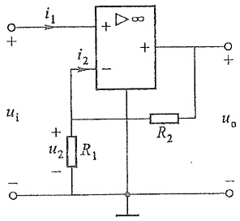

text_image

i₁
+
∞
+
-
i₂
uᵢ
R₁
R₂
uₒ
+
-
u₂

图5-5 例5-1图

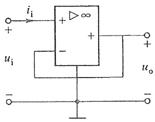

text_image

i_i
+
-
u_i
+
-
∞
+
-
u_o
+

图 5-6 电压跟随器

<small>① 显然,如果把这两个输入端直接与一个独立电压源或受控电压源连接,那将导致矛盾,因此是不允许的。另外,如果运放的一个输入端接地,则另一个没有接地的输入端的电压将等于零,故称之为“虚地”。</small>

---

120

第五章 含有运算放大器的电阻电路

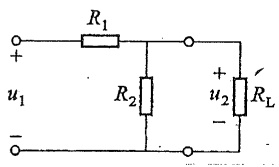

text_image

R₁
+
u₁
-
R₂
+
u₂
-
Rₗ

(a)

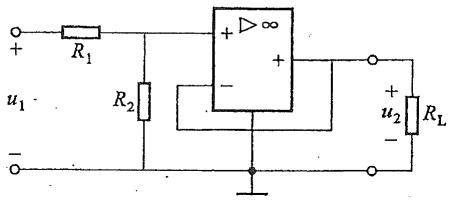

text_image

+
R₁
u₁ -
-
R₂
+\n-∞
+
RL
+ u₂ -
-

(b)

图5-7 电压跟随器的隔离作用

例 5-2 图 5-8 所示电路为加法器。试说明其工作原理。

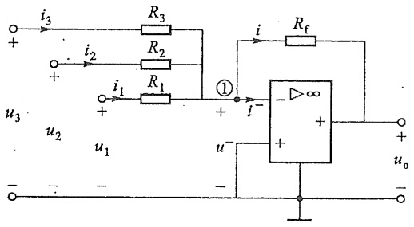

text_image

i3
R3
R2
i2
R1
i1
①
i
Rf
u3
u2
u1
+
-
+
-
+
-
+
-
uo
- - - -

图5-8 加法器

解 用规则(1), $i^{-}=0$ , 得  $i=i_{1}+i_{2}+i_{3}$ , 故

$$
- \frac {u _ {\mathrm{o}} - u ^ {-}}{R _ {\mathrm{f}}} = \frac {u _ {1} - u ^ {-}}{R _ {1}} + \frac {u _ {2} - u ^ {-}}{R _ {2}} + \frac {u _ {3} - u ^ {-}}{R _ {3}}
$$

用规则(2)，得 $u^{-}=0$ ，所以

$$
- \frac {u _ {\mathrm{o}}}{R _ {\mathrm{f}}} = \frac {u _ {1}}{R _ {1}} + \frac {u _ {2}}{R _ {2}} + \frac {u _ {3}}{R _ {3}}
$$

$$
u _ {\mathrm{o}} = - R _ {\mathrm{f}} \left(\frac {u _ {1}}{R _ {1}} + \frac {u _ {2}}{R _ {2}} + \frac {u _ {3}}{R _ {3}}\right)
$$

如令 $R_{1} = R_{2} = R_{3} = R_{\mathrm{f}}$ ，则

$$
u _ {\mathrm{o}} = - \left(u _ {1} + u _ {2} + u _ {3}\right)
$$

式中负号说明输出电压和输入电压反向。

如果直接对节点①列写节点电压方程(注意 $u_{n1}=0,i^{-}=0$ )，得

$$
- \frac {u _ {1}}{R _ {1}} - \frac {u _ {2}}{R _ {2}} - \frac {u _ {3}}{R _ {3}} - \frac {u _ {\mathrm{o}}}{R _ {\mathrm{f}}} = 0
$$

所得结果将与上面一致。

例 5-3 图 5-9 所示电路含有 2 个运放, 设  $R_{5}=R_{6}$ 。试求  $\frac{u_{o}}{u_{i}}$ 。

---

习题

121

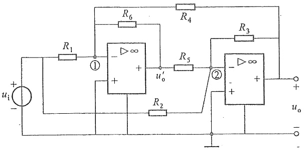

text_image

R1
①
R6
R4
R5
R3
u'0
②
R2
ui
+
-
+
-
uo
-

图5-9 例5-3图

解 对节点①和节点②列出节点电压方程,并注意到规则(1)和规则(2) $(u_{n1}=u_{n2}=0)$ ,可得

$$
\begin{array}{l} - \frac {u _ {\mathrm{i}}}{R _ {1}} - \frac {u _ {\mathrm{o}} ^ {\prime}}{R _ {6}} - \frac {u _ {\mathrm{o}}}{R _ {4}} = 0 \\ - \frac {u _ {\mathrm{i}}}{R _ {2}} - \frac {u _ {\mathrm{o}} ^ {\prime}}{R _ {5}} - \frac {u _ {\mathrm{o}}}{R _ {3}} = 0 \\ \end{array}
$$

从以上两个方程中消去 $u_{0}^{\prime}$ ，得

$$
\frac {u _ {\mathrm{i}}}{R _ {1}} - \frac {u _ {\mathrm{i}}}{R _ {2}} = \frac {u _ {\mathrm{o}}}{R _ {3}} - \frac {u _ {\mathrm{o}}}{R _ {4}}
$$

所以

$$
\frac {u _ {\mathrm{o}}}{u _ {\mathrm{i}}} = \frac {G _ {1} - G _ {2}}{G _ {3} - G _ {4}}
$$

在应用以上方法时,由于运放输出端的电流事先无法确定,因此不宜对该节点列方程,可以认为这是把运放理想化处理所具有的特点。

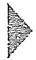

## 思考题

5-1 运算放大器为什么需要加直流偏置电源？
5-2 运算放大器的模型中为什么要考虑接地端,它起什么作用?
5-3 为什么可以用理想运放的模型分析电路？用理想运放分析电路要注意哪些问题？

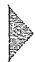

## 习题

5-1 设题 5-1 图所示电路的输出  $u_{0}$  为

---

122

第五章 含有运算放大器的电阻电路

$$
u _ {\mathrm{o}} = - 3 u _ {1} - 0. 2 u _ {2}
$$

已知  $R_{3}=10\ k\Omega$ ，求  $R_{1}$  和  $R_{2}$ 。

5-2 题 5-2 图所示电路起减法作用, 求输出电压  $u_{0}$  和输入电压  $u_{1}, u_{2}$  之间的关系。

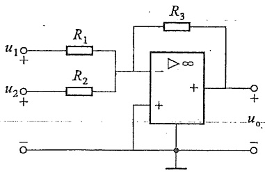

text_image

u₁○─R₁─R₃
      │
     ──┐
     │
     │
     │
     │
     │
     │
     │
     │
     │
     │
     │
     │
     │
     │
     │
     │
     │
     │
     │
     │
     │
     │
     │
     │
     │
     │
     │
     │
     │
     │
     │
     │
     │
     │

题5-1图

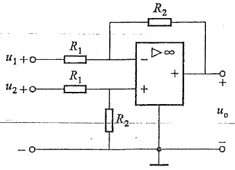

text_image

u₁ + ○─R₁─┐
          │     │
          │     │
          │     │
          │     │
          │     │
          │     │
          │     │
          │     │
          │     │
          │     │
          │     │
          │     │
          │     │
          │     │
          │     │
          │     │
          │     │
          │     │
          │     │
          │     │
          │     ○─+
          │     │
          │     │
          │     │
          │     │
          │     │
          │     │
          │     │
          │     │
          │     │
          │     │
          │     │
          │     │
          │     │
          │     │
          │     │
          │     │
          │     │
          │     │
          │     │
          │     │

题5-2图

5-3 求题 5-3 图所示电路的输出电压与输入电压之比  $\frac{u_{2}}{u_{1}}$ 。
5-4 求题 5-4 图所示电路的电压比值  $\frac{u_{0}}{u_{1}}$ 。

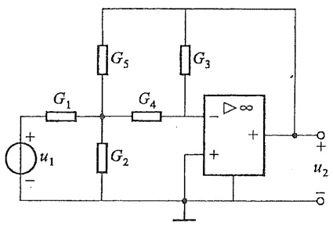

text_image

G1
+
u1
-
G2
G4
G5
G3
-
+
∞
+
u2
-

题5-3.图

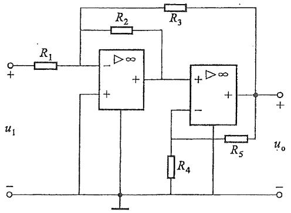

text_image

R1
+
u1
-
R2
-
∞
+
R3
+
∞
+
-
R4
R5
uo
-

题5-4图

5-5 求题 5-5 图所示电路的电压比  $\frac{u_{a}}{u_{s}}$ 。

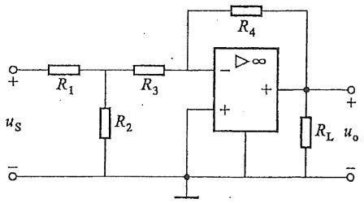

text_image

R1
R3
R4
uS
+
-
R2
+
-
+\n-∞
+
RL
uo
-

题5-5图

---

习题

123

5-6 试证明题 5-6 图所示电路若满足  $R_{1}R_{4}=R_{2}R_{3}$ ，则电流  $i_{L}$  仅决定于  $u_{1}$  而与负载电阻  $R_{L}$  无关。
5-7 求题 5-7 图所示电路的  $u_{0}$  与  $u_{S1}$ 、 $u_{S2}$  之间的关系。

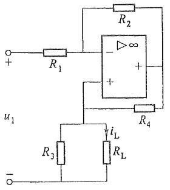

text_image

R2
+
-
∞
+
R1
u1
R4
iL
R3
RL
-

题 5-6 图

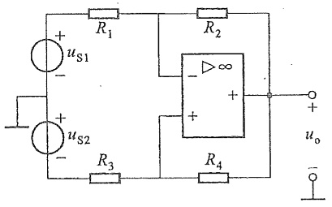

text_image

+
us1
-
+
us2
-
R1
R2
-
∞
+
+
R3
R4
uo
-

题 5-7 图

5-8 电路如题5-8图所示，设 $R_{\mathrm{f}} = 16R$ ，验证该电路的输出 $u_{\circ}$ 与输入 $u_{1} \sim u_{4}$ 之间的关系为 $u_{\circ} = -(8u_{1} + 4u_{2} + 2u_{3} + u_{4})$ 。[注:该电路为4位数字-模拟转换器，常用在信息处理、自动控制领域。该电路可将一个4位二进制数字信号转换成模拟信号。例如当数字信号为1101时，令 $u_{1} = u_{2} = u_{4} = 1, u_{3} = 0$ ，则由关系式 $u_{\circ} = -(8u_{1} + 4u_{2} + 2u_{3} + u_{4})$ 得模拟信号 $u_{\circ} = -(8 + 4 + 0 + 1) = -13$ 。]

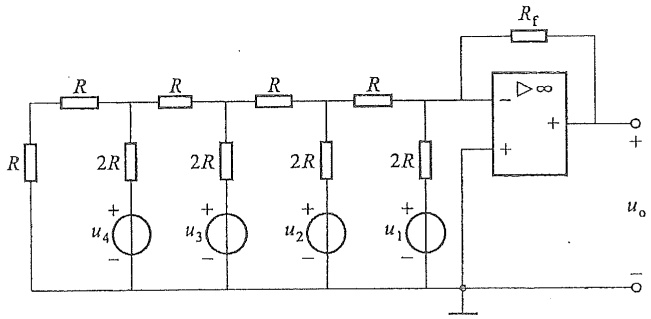

text_image

R
R
R
R
R
Rf
-
+
∞
+
uo
R
2R
2R
2R
2R
u4
+
-
u3
+
-
u2
+
-
u1
+

题 5-8 图

第五章部分习题答案
