# 第6章 储能元件

原始 PDF 第 148–157 页。

电容元件

# 第六章 储能元件

## 导读

本章介绍电容元件和电感元件,它们都是储能元件。电容元件储存电场能量,电感元件储存磁场能量。当这两种元件都是线性元件时,它们的电压电流关系为微分表达式或积分表达式,因而它们起到了电阻元件所起不到的特殊作用。当电路中包含电容元件和电感元件时,电路的方程将是微分方程或包含微分方程,电路的系统行为将与电阻电路有很大的不同。

## §6-1 电容元件

在工程技术中，电容器的应用极为广泛。电容器虽然品种、规格各异，但就其构成原理来说，它都是由间隔以不同介质（如云母、绝缘纸、空气等）的两块金属导体极板组成的。当在两极板间加上电压后，两极板上分别聚集起等量的正、负电荷，并在介质中建立电场而具有电场能量。将电源移去后，电荷可继续聚集在极板上，电场继续存在。所以电容器是一种能储存电荷或者说储存电场能量的部件。电容元件就是反映电容器所呈现的这种物理现象的电路模型。

电容元件的元件特性是电路物理量电荷 q 与电压 u 的代数关系。线性电容元件的图形符号如图 6-1(a) 所示，当电压参考极性与极板储存电荷的极性一致时，线性电容元件的元件特性方程为

$$
q = C u \tag {6-1}
$$

式中 C 是电容元件的参数,称为电容,它是一个正实常数。在国际单位制(SI)中,当电荷和电压的单位分别为 C(库)和 V(伏)时,电容的单位为 F(法拉,简称法)。图 6-1(b) 中,以 q 和 u 为坐标轴画出电容元件的库伏特性曲线。线性电容元件的库伏特性曲线是一条通过原点的直线。

如果线性电容元件的电流 i 和电压 u 取关联参考方向, 如图 6-1(a) 所示, 则得到电容元件的电压电流关系(VCR)为

---

§ 6-1 电容元件

125

$$
i = \frac {\mathrm{d} q}{\mathrm{d} t} = \frac {\mathrm{d} (C u)}{\mathrm{d} t} = C \frac {\mathrm{d} u}{\mathrm{d} t} \tag {6-2}
$$

表明电流和电压的变化率成正比。当电容元件上电压发生剧变 $\left(\text{即}\frac{\mathrm{d}u}{\mathrm{d}t}\text{很大}\right)$ 时，电流很大。当电压不随时间变化时，电流为零。故电容元件在直流情况下其两端电压恒定，相当于开路，或者说电容元件有隔断直流（简称隔直）的作用。

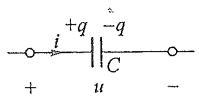

(a)

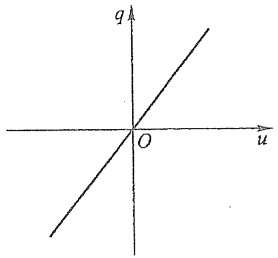

text_image

q
O
u

(b)

图 6-1 电容元件及其库伏特性

式(6-2)的逆关系为

$$
q = \int i \mathrm{d} t \tag {6-3}
$$

这是一个不定积分,可写成定积分的表达式:

$$
q = \int_ {- \infty} ^ {t} i \mathrm{d} \xi = \int_ {- \infty} ^ {t _ {0}} i \mathrm{d} \xi + \int_ {t _ {0}} ^ {t} i \mathrm{d} \xi = q (t _ {0}) + \int_ {t _ {0}} ^ {t} i \mathrm{d} \xi \tag {6-4}
$$

式中  $q(t_{0})$  为  $t_{0}$  时刻电容元件所带电荷量。上式的物理意义是:t 时刻具有的电荷量等于  $t_{0}$  时的电荷量加上  $t_{0}$  到 t 时间间隔内增加的电荷量。如果指定  $t_{0}$  为时间的起点并设为零，式(6-4)可写为

$$
q (t) = q (0) + \int_ {0} ^ {t} i \mathrm{d} \xi \tag {6-5}
$$

对于电压与电流的关系,由于  $u=\frac{q}{C}$ , 因此有

$$
u (t) = u (t _ {0}) + \frac {1}{C} \int_ {t _ {0}} ^ {t} i \mathrm{d} \xi \tag {6-6}
$$

或 $u(t) = u(0) + \frac{1}{C}\int_0^t id\xi$ (6-7)

将式(6-2)与式(1-3)比较可知,电容元件的电压u与电流i具有动态关系,因此,电容元件是一个动态元件。从式(6-7)还可见,电容电压除与0到t的电流值有关外,还与 $u(0)$ 值有关,因此,电容元件是一种有“记忆”的元件。与之相比,电阻元件的电压仅与该瞬间的电流值有关,是无记忆的元件。

当电压和电流取关联参考方向时,线性电容元件吸收的功率为

---

126

第六章 储能元件

$$
p = u i = C u \frac {\mathrm{d} u}{\mathrm{d} t}
$$

从  $t = -\infty$  到 t 时刻, 电容元件吸收的能量为

$$
\begin{array}{l} W _ {c} = \int_ {- \infty} ^ {t} u (\xi) i (\xi) \mathrm{d} \xi = \int_ {- \infty} ^ {t} C u (\xi) \frac {\mathrm{d} u (\xi)}{\mathrm{d} \xi} \mathrm{d} \xi \\ = C \int_ {u (- \infty)} ^ {u (t)} u (\xi) \mathrm{d} u (\xi) \\ = \frac {1}{2} C u ^ {2} (t) - \frac {1}{2} C u ^ {2} (- \infty) \\ \end{array}
$$

电容元件吸收的能量以电场能量的形式储存在元件的电场中。可以认为在 $t = -\infty$ 时，$u(-\infty) = 0$，其电场能量也为零。这样，电容元件在任何时刻 $t$ 储存的电场能量 $W_{c}(t)$ 将等于它吸收的能量，可写为

$$
W _ {c} (t) = \frac {1}{2} C u ^ {2} (t) \tag {6-8}
$$

从时间  $t_{1}$  到  $t_{2}$ ，电容元件吸收的能量为

$$
\begin{array}{l} W _ {c} = C \int_ {u (t _ {1})} ^ {u (t _ {2})} u \mathrm{d} u = \frac {1}{2} C u ^ {2} (t _ {2}) - \frac {1}{2} C u ^ {2} (t _ {1}) \\ = W _ {c} (t _ {2}) - W _ {c} (t _ {1}) \\ \end{array}
$$

电容元件充电时， $\left|u(t_{2})\right|>\left|u(t_{1})\right|$ ， $W_{C}(t_{2})>W_{C}(t_{1})$ ，故在此时间内元件吸收能量；电容元件放电时， $W_{C}(t_{2})<W_{C}(t_{1})$ ，元件释放能量。电容元件在充电时吸收并储存起来的能量一定在放电完毕时全部释放，它不消耗能量，所以电容元件是一种储能元件，同时，电容元件也不会释放出多于它以前吸收或储存的能量，所以它又是一种无源元件。

如果电容元件的库伏特性在 u-q 平面上不是通过原点的直线, 此元件称为非线性电容元件, 晶体二极管中的变容二极管就是一种非线性电容元件, 其电容随所加电压而变。

一般的电容器除有储能作用外,也会消耗一部分电能,这时,非理想电容器的模型就必须是电容元件和电阻元件的组合。由于电容器消耗的电功率与所加电压直接相关,因此其模型宜是两者的并联组合。

电容器是为了获得一定大小的电容特意制成的。但是，电容的效应在许多别的场合也存在，这就是分布电容和杂散电容。从理论上说，电位不相等的导体之间就会有电场，因此就有电荷聚集并有电场及电场能量，即有电容效应存在。例如，在两根架空输电线之间，每一根输电线与地之间都有分布电容。在晶体三极管或二极管的电极之间有结电容。甚至一个线圈的线匝之间也存在着杂散电容。至于是否要在模型中计入这些电容，必须视工作条件下它们所起的作用而定，当工作频率很高时，一般不应忽略其作用，而应以适当的方式在模型中反映出来。

为了叙述方便,本书中把线性电容元件简称为电容,所以本书中“电容”这个术语

---

§ 6-2 电感元件

127

以及与它相应的符号 C, 一方面表示一个电容元件, 另一方面也表示这个元件的参数。

## §6-2 电感元件

在工程技术中广泛应用导线绕制的线圈,例如,在电子电路中常用的空心或带有铁心的高频线圈,电磁铁或变压器中含有在铁心上绕制的线圈等。当一个线圈通以电流后产生的磁场随时间变化时,在线圈中就产生感应电压。

图6-2示出一个线圈，其中的电流 $i$ 产生的磁通 $\Phi_L$ 与 $N$ 匝线圈交链，则磁通链$\Psi_{L} = N\Phi_{L}$ 。由于磁通 $\Phi_L$ 和磁通链 $\Psi_L$ 都是由线圈本身的电流 $i$ 产生的，所以称为自感磁通和自感磁通链。 $\Phi_L$ 和 $\Psi_L$ 的方向①与 $i$ 的参考方向呈右手螺旋关系，如图6-2中所示。当磁通链 $\Psi_L$ 随时间变化时，在线圈的端子间产生感应电压。如果感应电压 $u$ 的参考方向与 $\Psi_L$ 呈右手螺旋关系（即从端子A沿导线到端子B的方向与 $\Psi_L$ 呈右手螺旋关系），则根据电磁感应定律，有

$$
u = \frac {\mathrm{d} \Psi_ {L}}{\mathrm{d} t} \tag {6-9}
$$

由该式确定感应电压的真实方向时,与楞次定律 $^{②}$ 的结果是一致的。

电感元件是实际线圈的一种理想化模型, 它反映了线圈中电流产生磁通和储存磁场能量这一物理现象, 其元件特性是磁通链  $\Psi_{L}$  与电流 i 的代数关系。线性电感元件的图形符号见图 6-3(a), 一般在图中不必画出  $\Psi_{L}(\Phi_{L})$  的参考方向, 但理论上规定  $\Psi_{L}$  与电流 i 的参考方向满足右手螺旋关系。对于线性电感元件, 其元件特性方程为

$$
\Psi = L i \tag {6-10}
$$

其中 L 为电感元件的参数,称为自感系数或电感,它是一个正实常数。

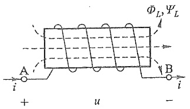

text_image

ΦL, ΨL
A
i
+
u
-
B
i

图 6-2 磁通链与感应电压

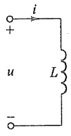

(a)

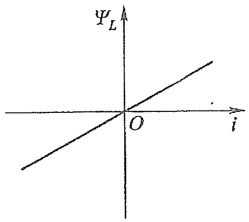

text_image

ΨL
O
i

(b)

图 6-3 电感元件及其韦安特性

<small>① 习惯上，将穿过某面积的磁力线的指向称为磁通  $\Phi$  或磁通链  $\Psi$  的方向。</small>

<small>② 楞次定律指出,线圈中磁通变化引起的感应电动势,其真实方向总是使其产生的感应电流试图阻止磁通的变化。图6-2中,当 $\frac{di}{dt}>0$ 时,因而 $\frac{d\Psi_{L}}{dt}>0$ 时,按式(6-9)可知u>0,即端子A的电位高于端子B的电位,此时如将A、B端子与外电路接通,则有感应电流自A通过外电路流回B,再经线圈回到A,显然这一电流产生的磁场阻止 $\Psi_{L}$ 的增长,与楞次定律相符。对于 $\frac{di}{dt}<0$ ,即 $\frac{d\Psi_{L}}{dt}<0$ 的情况,读者可自行证实两者相符。</small>

电感元件

---

128

第六章 储能元件

在国际单位制(SI)中,磁通和磁通链的单位是Wb(韦伯,简称韦),当电流单位为A时,电感的单位是H(亨利,简称亨)。

线性电感元件的韦安特性是  $\Psi_{L}-i$  平面上通过原点的一条直线, 见图 6-3(b)。

把  $\Psi_{L}=Li$  代入式(6-9)，可以得到线性电感元件的电压电流关系(VCR)。

$$
u = L \frac {\mathrm{d} i}{\mathrm{d} t} \tag {6-11}
$$

式中 u 和 i 为关联参考方向，且与  $\Psi_{L}$  呈右手螺旋关系。

上式的逆关系为

$$
i = \frac {1}{L} \int u \mathrm{d} t \tag {6-12}
$$

写成定积分形式为

$$
i = \frac {1}{L} \int_ {- \infty} ^ {t} u \mathrm{d} \xi = \frac {1}{L} \int_ {- \infty} ^ {t _ {0}} u \mathrm{d} \xi + \frac {1}{L} \int_ {t _ {0}} ^ {t} u \mathrm{d} \xi = i (t _ {0}) + \frac {1}{L} \int_ {t _ {0}} ^ {t} u \mathrm{d} \xi \tag {6-13}
$$

或

$$
\Psi_ {L} (t) = \Psi_ {L} (t _ {0}) + \int_ {t _ {0}} ^ {t} u \mathrm{d} \xi \tag {6-14}
$$

可以看出,电感元件是动态元件,也是记忆元件。

在电压和电流的关联参考方向下,线性电感元件吸收的功率为

$$
p = u i = L i \frac {\mathrm{d} i}{\mathrm{d} t} \tag {6-15}
$$

如果在 $t = -\infty$ 时，$i(-\infty) = 0$，电感元件无磁场能量。因此，从 $-\infty$ 到 $t$ 的时间段内电感元件吸收的磁场能量为

$$
\begin{array}{l} W _ {L} (t) = \int_ {- \infty} ^ {t} p \mathrm{d} \xi = \int_ {- \infty} ^ {t} L i \frac {\mathrm{d} i}{\mathrm{d} \xi} \mathrm{d} \xi = \int_ {0} ^ {i (t)} L i \mathrm{d} i \\ = \frac {1}{2} L i ^ {2} (t) = \frac {1}{2} \frac {\Psi_ {L} ^ {2} (t)}{L} \tag {6-16} \\ \end{array}
$$

这就是线性电感元件在任何时刻的磁场能量表达式。

从时间  $t_{1}$  到  $t_{2}$ ，线性电感元件吸收的磁场能量为

$$
\begin{array}{l} W _ {L} = L \int_ {i (t _ {1})} ^ {i (t _ {2})} i \mathrm{d} i = \frac {1}{2} L i ^ {2} (t _ {2}) - \frac {1}{2} L i ^ {2} (t _ {1}) \\ = W _ {L} (t _ {2}) - W _ {L} (t _ {1}) \\ \end{array}
$$

当电流 $|i|$ 增加时，$W_{L}>0$，元件吸收能量；当电流 $|i|$ 减小时，$W_{L}<0$，元件释放能量。可见电感元件没有将吸收的能量消耗掉，而是以磁场能量的形式储存在磁场中，所以电感元件是一种储能元件，同时，它也不会释放出多于它吸收或储存的能量，因此它又是一种无源元件。

空心线圈是以线性电感元件为模型的典型例子。当线圈导线电阻的损耗不可忽略时,就需要用线性电感元件和电阻元件的串联组合作为其模型。

---

§ 6-3 电容、电感元件的串联与并联

129

如果电感元件的韦安特性不是通过  $\Psi_{L}-i$  平面上原点的一条直线,那么它是非线性电感元件。非线性电感元件的韦安特性可以用下列公式表示:

$$
\Psi_ {L} = f (i)
$$

或

$$
i = h \left(\Psi_ {L}\right)
$$

带铁心的电感线圈是以非线性电感元件为模型的典型例子。若线圈在铁磁材料的非饱和状态下工作，那么  $\Psi_{L}$  与 i 仍近似于线性关系，在这种情况下，铁心线圈仍可以当作线性电感元件处理。

为了叙述方便,把线性电感元件简称为电感,所以本书中的“电感”这个术语以及与它相应的符号 L,一方面表示一个电感元件,另一方面也表示这个元件的参数。

当电感元件端钮短路时，就有 $\mathrm{d}\Psi_L / \mathrm{d}t = 0$ ，故 $\Psi_{L} =$ 常数，意味着磁通链不会发生变化。如果有外磁场企图使磁场变化，在电感所形成的超导回路中就会感应出电流，其产生的磁场足以抵消磁场的变化①。利用这一原理可制成磁悬浮列车。列车下方的磁极被铁轨上的超导线圈产生的磁场所推斥，悬浮于铁轨之上，使磁悬浮列车得以高速行驶。

## §6-3 电容、电感元件的串联与并联

当电容、电感元件为串联或并联组合时，它们也可用一个等效电容或等效电感来替代。先讨论电容串联的情况。图6-4(a)为 $n$ 个电容的串联，对于每一个电容，具有相同的电流，故VCR为

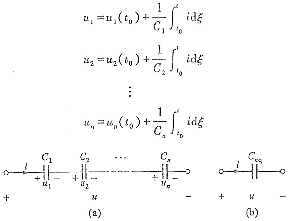

text_image

u₁ = u₁(t₀) + \frac{1}{C_1} \int_{t_0}^{t} i\mathrm{d}\xi\nd\xi\nd\nu₂ = u₂(t₀) + \frac{1}{C_2} \int_{t_0}^{t} i\mathrm{d}\xi\nd\xi\nd\n\vdots\nd\nuₙ = uₙ(t₀) + \frac{1}{Cₙ} \int_{t_0}^{t} i\mathrm{d}\xi\nd\xi\nd\n○→ C₁ C₂ ... Cₙ ○→ C_eq ○
+ + u₁ - + u₂ - + uₙ - + u - -
(a) (b)

图6-4 串联电容的等效电容

根据 KVL, 总电压为

<small>① 这一现象称为迈斯纳效应(Meissner effect)。</small>

---

130

第六章 储能元件

$$
\begin{array}{l} u = u _ {1} + u _ {2} + \dots + u _ {n} = u _ {1} (t _ {0}) + \frac {1}{C _ {1}} \int_ {t _ {0}} ^ {t} i \mathrm{d} \xi + \dots + u _ {n} (t _ {0}) + \frac {1}{C _ {n}} \int_ {t _ {0}} ^ {t} i \mathrm{d} \xi \\ = u _ {1} (t _ {0}) + u _ {2} (t _ {0}) + \dots + u _ {n} (t _ {0}) + \left(\frac {1}{C _ {1}} + \frac {1}{C _ {2}} + \dots + \frac {1}{C _ {n}}\right) \int_ {t _ {0}} ^ {t} i \mathrm{d} \xi \\ = u (t _ {0}) + \frac {1}{C _ {\mathrm{eq}}} \int_ {t _ {0}} ^ {t} i \mathrm{d} \xi \\ \end{array}
$$

式中  $C_{eq}$  为等效电容, 其值由下式决定, 即

$$
\frac {1}{C _ {\mathrm{eq}}} = \frac {1}{C _ {1}} + \frac {1}{C _ {2}} + \dots + \frac {1}{C _ {n}} \tag {6-17}
$$

$u(t_{0})$  为 n 个串联电容的等效初始条件。其值为

$$
u (t _ {0}) = u _ {1} (t _ {0}) + u _ {2} (t _ {0}) + \dots + u _ {n} (t _ {0}) \tag {6-18}
$$

如果将  $t_{0}$  取为  $-\infty$ ，则各初始电压均为零，此时  $u(t_{0})=0$ 。

图 6-5(a) 示出 n 个电容并联的情况, 并且  $u_{1}(t_{0}) = u_{2}(t_{0}) = \cdots = u_{n}(t_{0}) = u(t_{0})$ , 由于各电容电压相等, 根据 KCL, 有

$$
\begin{array}{l} i = i _ {1} + i _ {2} + \dots + i _ {n} = C _ {1} \frac {\mathrm{d} u}{\mathrm{d} t} + C _ {2} \frac {\mathrm{d} u}{\mathrm{d} t} + \dots + C _ {n} \frac {\mathrm{d} u}{\mathrm{d} t} \\ = C _ {\mathrm{eq}} \frac {\mathrm{d} u}{\mathrm{d} t} \\ \end{array}
$$

式中  $C_{eq}$  为并联的等效电容, 其值为

$$
\dot {C} _ {\mathrm{eq}} = C _ {1} + C _ {2} + \dots + C _ {n} \tag {6-19}
$$

且具有初始电压  $u(t_{0})$ 。

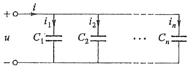

text_image

+i
i₁ i₂ iₙ
C₁ C₂ ... Cₙ
u
-o

(a)

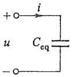

(b)

图 6-5 并联电容的等效电容

图 6-6(a) 为 n 个具有相同初始电流的电感的串联, 即有  $i_{1}(t_{0}) = i_{2}(t_{0}) = \cdots = i_{n}(t_{0}) = i(t_{0})$ 。由于各电感中电流相等, 根据 KVL, 总电压为

$$
\begin{array}{l} u = u _ {1} + u _ {2} + \dots + u _ {n} = L _ {1} \frac {\mathrm{d} i}{\mathrm{d} t} + L _ {2} \frac {\mathrm{d} i}{\mathrm{d} t} + \dots + L _ {n} \frac {\mathrm{d} i}{\mathrm{d} t} \\ = (L _ {1} + L _ {2} + \dots + L _ {n}) \frac {\mathrm{d} i}{\mathrm{d} t} = L _ {\mathrm{eq}} \frac {\mathrm{d} i}{\mathrm{d} t} \\ \end{array}
$$

式中  $L_{eq}$  为串联后的等效电感, 其值为

$$
L _ {\mathrm{eq}} = L _ {1} + L _ {2} + \dots + L _ {n} \tag {6-20}
$$

且具有初始电流  $i(t_{0})$ 。

---

习题

131

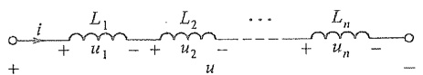

text_image

i
L₁
+ u₁ - + u₂ -
u
...
Lₙ
+ uₙ - -
-

(a)

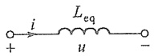

(b)

图 6-6 串联电感的等效电感

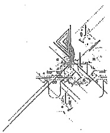

natural_image

Pure technical line drawing of a mechanical assembly without any text, numbers, or symbols

对于具有初始电流分别为  $i_{1}(t_{0})$ 、 $i_{2}(t_{0})$ 、 $\cdots$ 、 $i_{n}(t_{0})$  的 n 个电感  $L_{1}$ 、 $L_{2}$ 、 $\cdots$ 、 $L_{n}$  作并联组合时（见图 6-7），读者不难根据 KCL 自行证得并联后的等效电感和初始电流分别为

$$
\frac {1}{L _ {\mathrm{eq}}} = \frac {1}{L _ {1}} + \frac {1}{L _ {2}} + \dots + \frac {1}{L _ {n}} \tag {6-21}
$$

$$
i (t _ {0}) = i _ {1} (t _ {0}) + i _ {2} (t _ {0}) + \dots + i _ {n} (t _ {0}) \tag {6-22}
$$

电容和电感也是一对对偶元件。试自行比较之。

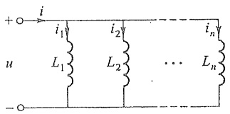

text_image

i
+
u
i₁
L₁
i₂
L₂
...
Lₙ
iₙ
- o

(a)

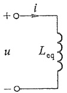

(b)

图 6-7 并联电感的等效电感

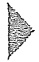

## 思考题

6-1 电容元件的元件特性为什么采用电荷和电压的代数关系来表示？
6-2 请从多方面来寻找有关电感与电容这两个对偶元素的对偶关系。
6-3 根据电容器构成原理,日常生活中遇到的电容现象有哪些?
6-4 为什么说电容元件是动态元件和记忆元件？
6-5 电容元件的储能特性和无源特性如何体现？
6-6 为什么说电感元件是动态元件和记忆元件？
6-7 电感元件的储能特性和无源特性如何体现？
6-8 可否推导出电容元件和电感元件的星形和三角形变换公式？

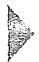

## 习题

6-1 电容元件与电感元件中电压、电流参考方向如题6-1图所示，且知 $u_{c}(0)=0$ ， $i_{L}(0)=0$ ，

(1) 写出电压用电流表示的约束方程。
(2) 写出电流用电压表示的约束方程。

---

132

第六章 储能元件

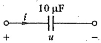

(a)

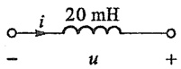

(b)

题6-1图

6-2  $2 \mu F$  的电容上所加电压 u 的波形如题 6-2 图所示。求:

(1) 电容电流  $i_{0}$
(2) 电容电荷 q。
(3) 电容吸收的功率 p。

6-3 题 6-3 图(a)所示电容中电流 i 的波形如题 6-3 图(b)所示, 现已知  $u(0)=0$ , 试求 t=1 s, t=2 s 和 t=4 s 时电容电压 u。

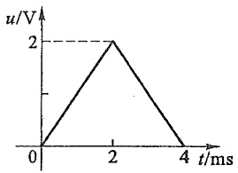

line

| t/ms | u/V |
| --- | --- |
| 0 | 0 |
| 2 | 2 |
| 4 | 0 |

题6-2图

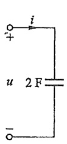

(a)

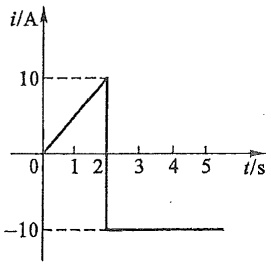

line

| t/s | i/A |
| --- | --- |
| 0 | 0 |
| 2.25 | 10 |
| 2.25 | -10 |

(b)

题6-3图

6-4 题 6-4 图(a)中 L=4H，且  $i(0)=0$ ，电压的波形如题 6-4 图(b)所示。试求当 t=1s, t=2s, t=3s 和 t=4s 时的电感电流 i。
6-5 若已知显像管行偏转线圈中的周期性行扫描电流如题 6-5 图所示, 现已知线圈电感为 0.01 H, 电阻忽略不计, 试求电感线圈所加电压的波形。

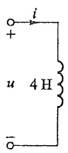

(a)

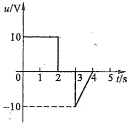

line

| t/s | u/V |
| --- | --- |
| 0 | 10 |
| 2 | 10 |
| 2 | 0 |
| 3 | -10 |
| 4 | 0 |

(b)

题6-4图

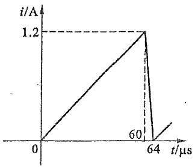

line

| \(t (\mu s)\) | i (A) |
| --- | --- |
| 0 | 0 |
| 60 | 1.2 |
| 64 | 0 |

题6-5图

6-6 电路如题 6-6 图所示, 其中  $R=2\Omega, L=1H, C=0.01F, u_{c}(0)=0$ 。若电路的输入电流为

(1)  $i = 2 \sin \left( 2t + \frac{\pi}{3} \right) A$ 。

---

习题

133

(2)  $i = e^{-t} A_{0}$

试求两种情况下, 当 t>0 时的  $u_{R}$ 、 $u_{L}$  和  $u_{C}$  值。

6-7 电路如题 6-7 图所示, 其中 $L = 1 \mathrm{H}, C_{2} = 1 \mathrm{~F}$ 。设 $u_{\mathrm{s}}(t) = U_{\mathrm{m}} \cos(\omega t), i_{\mathrm{s}}(t) = I \mathrm{e}^{-\alpha t}$, 试求 $u_{L}(t)$ 和 $i_{C_{2}}(t)$ 。

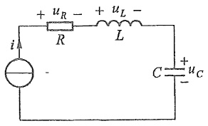

text_image

+ u_R -
R
+ u_L -
L
i
-
C + u_C
-

题6-6图

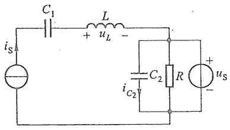

text_image

C₁
L
+
uₗ
-
iₛ
C₂
R
+
uₛ
-
i꜀₂

题6-7图

6-8 求题 6-8 图所示电路中 a、b 端的等效电容与等效电感。

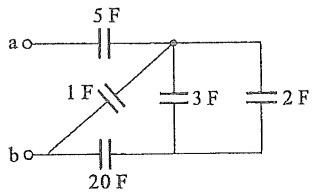

text_image

a o
5 F
1 F
b o
20 F
3 F
2 F

(a)

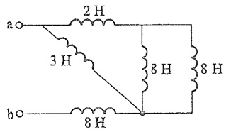

text_image

a○—2 H
3 H
8 H 8 H
b○—8 H

(b)

题6-8图

6-9 题 6-9 图中 $C_1 = 2\mu \mathrm{F}, C_2 = 8\mu \mathrm{F}; u_{C_1}(0) = u_{C_2}(0) = -5\mathrm{V}$ 。现已知 $i = 120\mathrm{e}^{-5t}\mu \mathrm{A}$，求:

(1) 等效电容 C 及  $u_{c}$  的表达式。
(2) $u_{c_{1}}$ 与 $u_{c_{2}}$ ，并核对KVL。

6-10 题 6-10 图中  $L_{1}=6\mathrm{H}, i_{1}(0)=2\mathrm{A}; L_{2}=1.5\mathrm{H}, i_{2}(0)=-2\mathrm{A}, u=6\mathrm{e}^{-2t}\mathrm{V}$ ，求:

(1) 等效电感 L 及 i 的表达式。
(2) 分别求出  $i_{1}$  与  $i_{2}$ ，并核对 KCL。

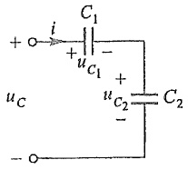

chemical

Simple electronic circuit diagram with capacitors and voltage labels

题6-9图

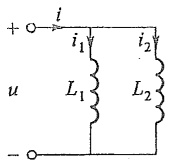

text_image

+ i
i₁ i₂
u L₁ L₂
-

题 6-10 图

第六章部分习题答案
