# 第10章 含有耦合电感的电路

原始 PDF 第 262–284 页。

互感

# 第十章

# 含有耦合电感的电路

## 导读

本章介绍的耦合电感、变压器都是应用法拉第电磁感应定律而发明的电气部件，也是阐明电磁感应现象的物理模型。本章将根据电路理论，系统列写含耦合电感的电路方程，说明电磁感应在电路中的表现，电磁信号和电磁能量在电路中的传播和相互转换的一些特征，是正弦稳态分析中的重要内容。

## §10-1 互感

载流线圈之间通过彼此的磁场相互联系的物理现象称为磁耦合。图10-1(a)为两个有耦合的载流线圈(即电感 $L_{1}$ 和 $L_{2}$ )，载流线圈中的电流 $i_{1}$ 和 $i_{2}$ 称为施感电流，线圈的匝数分别为 $N_{1}$ 和 $N_{2}$ 。根据两个线圈的绕向、施感电流的参考方向，按右手螺旋法则确定施感电流产生的磁通方向和彼此交链的情况。线圈1中的电流 $i_{1}$ 产生的磁通设为 $\Phi_{11}^{①}$，方向如图所示，在交链自身的线圈时产生的磁通链设为 $\Psi_{11}$，此磁通链称为自感磁通链； $\Phi_{11}$ 中的一部分或全部交链线圈2时产生的磁通链设为 $\Psi_{21}$，称为互感磁通链。同样，线圈2中的电流 $i_{2}$ 也产生自感磁通链 $\Psi_{22}$ 和互感磁通链 $\Psi_{12}$ （图中未画出），这就是彼此耦合的情况。工程上称这对耦合线圈为耦合电感(元件)。

当周围空间是各向同性的线性磁介质时,每一种磁通链都与产生它的施感电流成正比,即有自感磁通链

$$
\Psi_ {1 1} = L _ {1} i _ {1}, \quad \Psi_ {2 2} = L _ {2} i _ {2}
$$

互感磁通链

$$
\Psi_ {1 2} = M _ {1 2} i _ {2}, \quad \Psi_ {2 1} = M _ {2 1} i _ {1}
$$

上式中  $M_{12}$  和  $M_{21}$  称为互感系数，简称互感。单位为 H(亨)。可以证明， $M_{12}=M_{21}$ ，所以当只有两个线圈(电感)有耦合时，可以略去 M 的下标，即可令  $M=M_{12}=M_{21}$ 。耦合电

<small>① 磁通(链)符号中双下标的含义:第1个下标表示该磁通(链)所在线圈的编号,第2个下标表示产生该磁通(链)的施感电流所在线圈的编号。</small>

---

§ 10-1 互感

239

感中的磁通链等于自感磁通链和互感磁通链两部分的代数和，如线圈1和2中的磁通链分别设为 $\Psi_{1}$ （与 $\Psi_{11}$ 同向）和 $\Psi_{2}$ （与 $\Psi_{22}$ 同向）。

$$
\Psi_ {1} = \Psi_ {1 1} \pm \Psi_ {1 2} = L _ {1} i _ {1} \pm M i _ {2} \tag {10-1}
$$

$$
\Psi_ {2} = \pm \Psi_ {2 1} + \Psi_ {2 2} = \pm M i _ {1} + L _ {2} i _ {2}
$$

上式表明，耦合线圈中的磁通链与施感电流呈线性关系，是各施感电流独立产生的磁通链叠加的结果。M前的“±”号是说明磁耦合中，互感作用的两种可能性。“+”号表示互感磁通链与自感磁通链方向一致，自感方向的磁场得到加强（增磁），称为同向耦合。工程上将同向耦合状态下的一对施感电流 $(i_{1},i_{2})$ 的入端（或出端）定义为耦合电感的同名端，并用同一符号标出这对端子，例如图10-1(a)中用“·”号标出的一对端子(1,2)，即为耦合电感的同名端（未标记的端子1′,2′亦为同名端）。同名端可用实验的方法判断。式中“-”号表示施感电流 $(i_{1},i_{2})$ 的入端为异名端，互感磁通链总是与自感磁通链的方向相反，总有 $\Psi_{1}<\Psi_{11},\Psi_{2}<\Psi_{22}$ ，称为反向耦合，总是使自感方向的磁场削弱，有可能使耦合电感之一的合成磁场为零，甚至为负值，其绝对值有可能超过原自感磁场。耦合电感的耦合状态将随施感电流方向的变化而变化。引入同名端的概念后，可以用带有互感M和同名端标记的电感（元件） $L_{1}$ 和 $L_{2}$ 表示耦合电感，如图10-1(b)所示，其中M表示互感。这样有

$$
\Psi_ {1} = L _ {1} i _ {1} + M i _ {2}
$$

$$
\Psi_ {2} = M i _ {1} + L _ {2} i _ {2}
$$

式中含有 M 的项之前取“+”号, 表示同向耦合。耦合电感可以看作是一个具有 4 个端子的二端口电路元件。

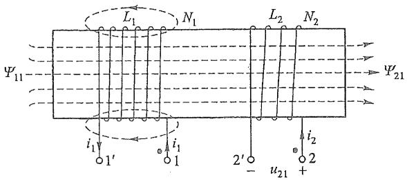

text_image

L₁
N₁
L₂
N₂
Ψ₁₁
ψ₂₁
i₁
1'
i₁
1
2'
-
u₂₁
+
i₂
2

(a)

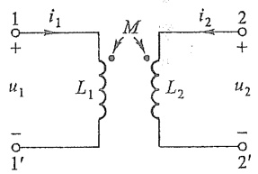

chemical

Electrical circuit diagram with mutual inductance and current labels

(b)

图 10-1 耦合电感

当有两个以上电感彼此之间存在耦合时，同名端应当一对一对地加以标记，每一对宜用不同符号标记。每一个电感中的磁通链将等于自感磁通链与所有互感磁通链的代数和。同向耦合时互感磁通链求和时取“+”号，反向耦合时，则取“-”号。

例 10-1 图 10-1(b) 中  $i_{1}=1\ A$  (直流),  $i_{2}=5\ \cos(10t)\ A$ ,  $L_{1}=2\ H$ ,  $L_{2}=3\ H$ , M=1 H。求耦合电感中的磁通链。

解 因为施感电流  $i_{1}$ 、 $i_{2}$  都是从标记的同名端流进线圈，为同向耦合，各磁通链计算如下:

---

240

第十章 含有耦合电感的电路

$$
\Psi_ {1 1} = L _ {1} i _ {1} = 2 \mathrm{Wb}
$$

$$
\Psi_ {2 2} = L _ {2} i _ {2} = 1 5 \cos (1 0 t) \mathrm{Wb}
$$

$$
\Psi_ {1 2} = M i _ {2} = 5 \cos (1 0 t) \mathrm{Wb}
$$

$$
\Psi_ {2 1} = M i _ {1} = 1 \mathrm{Wb}
$$

最后得(按右手螺旋法则指定磁通链的参考方向)

$$
\Psi_ {1} = L _ {1} i _ {1} + M i _ {2} = [ 2 + 5 \cos (1 0 t) ] \mathrm{Wb}
$$

$$
\Psi_ {2} = M i _ {1} + L _ {2} i _ {2} = \left[ 1 + 1 5 \cos (1 0 t) \right] \mathrm{Wb}
$$

由上式可知，在 $\left(\frac{\pi}{2}+2k\pi<10t<\frac{3\pi}{2}+2k\pi,k=0,1,\cdots\right)$ 区域内，耦合电感实际处于反向耦合状态，将会出现 $\Psi_{1}<0$ 和 $\left|\Psi_{1}\right|>\Psi_{11}$ 的情况。

耦合电感中的磁通链  $\Psi_{1}$ 、 $\Psi_{2}$ ，不仅与施感电流  $i_{1}$ 、 $i_{2}$  有关，还与由线圈的结构、相互位置和磁介质所决定的线圈耦合的紧疏程度有关，工程上通过耦合电感中互感磁通链与自感磁通链的比值来衡量耦合的紧疏程度，有

$$
\frac {\mid \Psi_ {1 2} \mid}{\Psi_ {1 1}} = \frac {M i _ {2}}{L _ {1} i _ {1}} \quad (\text {线圈} 1)
$$

$$
\frac {\mid \Psi_ {2 1} \mid}{\Psi_ {2 2}} = \frac {M i _ {1}}{L _ {2} i _ {2}} \quad (\text {线圈} 2)
$$

当 $i_1 = i_2 = 1$ （单位电流）时，上述比值越大，表示耦合越紧密。工程上取上述两比值的几何平均值（将消去比值中的电流）定义为耦合电感的耦合因数 $k$ ，即有

$$
k \stackrel {\mathrm{def}} {=} \frac {M}{\sqrt {L _ {1} L _ {2}}} \leqslant 1
$$

改变耦合线圈之间的位置, 就可能改变耦合电感的耦合因数的大小, 当  $L_{1}$  和  $L_{2}$  一定时, 也就相应地改变了互感 M 的大小。如图 10-2 所示, 图 (a) 为紧耦合,  $k \approx 1$  (称为全耦合), 图 (b) 为疏耦合 (轴线垂直), 可能使  $k \approx 0$  (无耦合)。耦合电感的互感系数 M 不会大于  $\sqrt{L_{1}L_{2}}$ 。

如果耦合电感  $L_{1}$  和  $L_{2}$  中有变动的

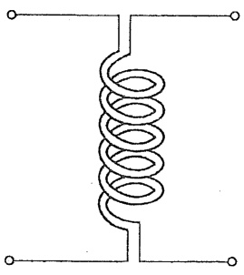

natural_image

Pure electrical circuit symbol for a coil (no text or labels)

(a)

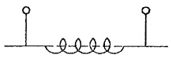

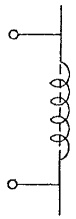

(b)

图 10-2 两种耦合状态

电流，耦合电感中的磁通链将跟随电流变动。根据法拉第电磁感应定律，耦合电感的两个端口将产生感应电压。设 $L_{1}$ 和 $L_{2}$ 端口的电压和电流分别为 $u_{1}, i_{1}$ 和 $u_{2}, i_{2}$，且都取关联参考方向，互感为 $M$，则式(10-1)微分后有

$$
u _ {1} = \frac {\mathrm{d} \Psi_ {1}}{\mathrm{d} t} = L _ {1} \frac {\mathrm{d} i _ {1}}{\mathrm{d} t} \pm M \frac {\mathrm{d} i _ {2}}{\mathrm{d} t} \tag {10-2}
$$

$$
u _ {2} = \frac {\mathrm{d} \Psi_ {2}}{\mathrm{d} t} = \pm M \frac {\mathrm{d} i _ {1}}{\mathrm{d} t} + L _ {2} \frac {\mathrm{d} i _ {2}}{\mathrm{d} t}
$$

---

§ 10-1 互感

241

上式表示耦合电感的电压电流关系。将 $u_{11} = L_1 \frac{\mathrm{d}i_1}{\mathrm{d}t}, u_{22} = L_2 \frac{\mathrm{d}i_2}{\mathrm{d}t}$ 称为自感电压，将 $u_{12} = M \frac{\mathrm{d}i_2}{\mathrm{d}t}, u_{21} = M \frac{\mathrm{d}i_1}{\mathrm{d}t}$ 称为互感电压，$u_{12}$ 是变动电流 $i_2$ 在 $L_1$ 中产生的互感电压，$u_{21}$ 是变动电流 $i_1$ 在 $L_2$ 中产生的互感电压。所以耦合电感的电压是自感电压和互感电压叠加的结果。互感电压前的“+”或“-”号的正确取舍是写出耦合电感电压电流关系的关键，取舍方法可简明地表述如下:一种方法是根据耦合电感的耦合状态，当耦合电感同向耦合时，互感电压在KVL方程中与自感电压同号；反向耦合时，与自感电压异号。另一种方法是约定互感电压的“+”极性端的设定规则:总是使施感电流的入端与其互感电压（在另一线圈中）的“+”极性端（设定）为耦合电感的同名端（即一对同标记端），即当施感电流从同名端的标记端流进线圈（入端）时，则其互感电压的“+”极性端就设在同名端的标记端，反之亦然。如图10-1(b)中的 $M \frac{\mathrm{d}i_1}{\mathrm{d}t}$ 和 $M \frac{\mathrm{d}i_2}{\mathrm{d}t}$ 的“+”极性端都设在有同名端标记的端子上。然后再根据编写KVL方程的取号方法，确定互感电压在方程中的取号，则上述互感电压 $u_{12}, u_{21}$ 在KVL方程中，应当取“+”号（上述设置方法都符合右手螺旋法则）。

例 10-2 求例 10-1 中耦合电感的端电压  $u_{1}$ 、 $u_{2}$ 。

解 按图 10-1(b) 和式(10-2)，得

$$
u _ {1} = L _ {1}   \frac {\mathrm{d} i _ {1}}{\mathrm{d} t} + M   \frac {\mathrm{d} i _ {2}}{\mathrm{d} t} = - 5 0 \sin (1 0 t) \mathrm{V}
$$

$$
u _ {2} = M \frac {\mathrm{d} i _ {1}}{\mathrm{d} t} + L _ {2} \frac {\mathrm{d} i _ {2}}{\mathrm{d} t} = - 1 5 0 \sin (1 0 t) \mathrm{V}
$$

电压  $u_{1}$  中只含有互感电压  $u_{12}$ ，电压  $u_{2}$  中只含有自感电压  $u_{22}$ ，这说明不变动的电流  $i_{1}$ （直流）虽产生自感和互感磁通链，但不产生自感电压和互感电压。

当施感电流为同频正弦量时,在正弦稳态情况下,电压、电流方程可用相量形式表示,以图 10-1(b) 所示电路为例,有

$$
\dot {U} _ {1} = \mathrm{j} \omega L _ {1} \dot {I} _ {1} + \mathrm{j} \omega M \dot {I} _ {2}
$$

$$
\dot {U} _ {2} = \mathrm{j} \omega M \dot {I} _ {1} + \mathrm{j} \omega L _ {2} \dot {I} _ {2}
$$

如令  $Z_{M}=j\omega M,\omega M$  称为互感抗。

还可以用电流控制电压源 CCVS 表示互感电压的作用。对图 10-1(b) 的耦合电感，用 CCVS 表示的等效电路(相量形式)如图 10-3 所示。

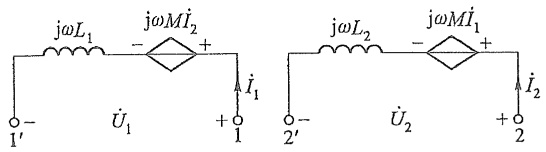

chemical

Electrical circuit diagrams showing coupled inductors with impedance and current labels

图 10-3 用 CCVS 表示互感电压

---

242

第十章 含有耦合电感的电路

## §10-2 含有耦合电感电路的计算

含有耦合电感电路的计算1

含有耦合电感电路(简称互感电路)的正弦稳态分析可采用相量法。但应注意耦合电感上的电压包含自感电压和互感电压两部分,在列 KVL 方程时,要正确使用同名端计入互感电压;必要时可引用 CCVS 表示互感电压的作用。耦合电感支路的电压不仅与本支路电流有关,还与其相耦合的其他支路电流有关,列节点电压方程时要另行处理。

图10-4(a)所示耦合电感电路是一种串联电路,由于是反向耦合,故称反向串联(另一种为同向串联,为同向耦合状态),按图示参考方向,KVL方程为

含有耦合电感电路的计算2

$$
u _ {1} = R _ {1} i + \left(L _ {1} \frac {\mathrm{d} i}{\mathrm{d} t} - M \frac {\mathrm{d} i}{\mathrm{d} t}\right) = R _ {1} i + (L _ {1} - M) \frac {\mathrm{d} i}{\mathrm{d} t}
$$

$$
u _ {2} = R _ {2} i + \left(L _ {2} \frac {\mathrm{d} i}{\mathrm{d} t} - M \frac {\mathrm{d} i}{\mathrm{d} t}\right) = R _ {2} i + (L _ {2} - M) \frac {\mathrm{d} i}{\mathrm{d} t}
$$

根据上述方程可以给出一个无耦合等效电路,如图 10-4(b) 所示。根据 KVL 有

$$
u = u _ {1} + u _ {2} = (R _ {1} + R _ {2}) i + (L _ {1} + L _ {2} - 2 M) \frac {\mathrm{d} i}{\mathrm{d} t}
$$

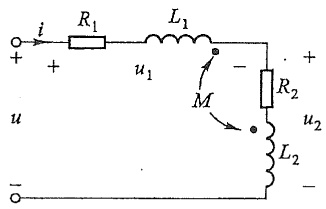

text_image

i
R1
L1
u1
M
R2
u2
L2
u

(a)

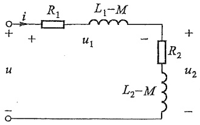

text_image

i
R₁
L₁-M
+
u₁
-
R₂
L₂-M
u₂
-
-

(b)

图 10-4 耦合电感的串联电路

等效电路为电阻  $R_{1}$ 、 $R_{2}$  和等效电感  $L(=L_{1}+L_{2}-2M)$  的串联电路。对正弦稳态电路，可采用相量形式表示为

$$
\dot {U} _ {1} = \left[ R _ {1} + \mathrm{j} \omega (L _ {1} - M) \right] \dot {I}
$$

$$
\dot {U} _ {2} = \left[ R _ {2} + \mathrm{j} \omega (L _ {2} - M) \right] \dot {I}
$$

$$
\dot {U} = \left[ R _ {1} + R _ {2} + \mathrm{j} \omega \left(L _ {1} + L _ {2} - 2 M\right) \right] \dot {I}
$$

电流 i 为

$$
\dot {I} = \frac {\dot {U}}{\left(R _ {1} + R _ {2}\right) + \mathrm{j} \omega \left(L _ {1} + L _ {2} - 2 M\right)}
$$

每一条耦合电感支路的阻抗和电路的输入阻抗分别为

$$
Z _ {1} = R _ {1} + \mathrm{j} \omega (L _ {1} - M)
$$

$$
Z _ {2} = R _ {2} + \mathrm{j} \omega (L _ {2} - M)
$$

---

§ 10-2 含有耦合电感电路的计算

243

$$
Z = Z _ {1} + Z _ {2} = (R _ {1} + R _ {2}) + \mathrm{j} \omega (L _ {1} + L _ {2} - 2 M)
$$

可以看出，反向串联时，每一条耦合电感支路阻抗和输入阻抗都比无互感时的阻抗小（电抗变小），这是由于互感的反向耦合作用，它类似于串联电容的作用，常称为互感的“容性”效应。每一耦合电感支路的等效电感分别为 $(L_{1}-M)$ 和 $(L_{2}-M)$ ，有可能其中之一为负值，但不可能都为负，整个电路仍呈感性 $^{①}$ 。

对同向串联电路,不难得出每一耦合电感支路的阻抗为

$$
Z _ {1} = R _ {1} + \mathrm{j} \omega (L _ {1} + M)
$$

$$
Z _ {2} = R _ {2} + \mathrm{j} \omega (L _ {2} + M)
$$

而

$$
Z = Z _ {1} + Z _ {2} = (R _ {1} + R _ {2}) + \mathrm{j} \omega (L _ {1} + L _ {2} + 2 M)
$$

例 10-3 图 10-4(a) 所示电路中, 正弦电压的 $U = 50 \mathrm{~V}, R_{1} = 3 \Omega, \omega L_{1} = 7.5 \Omega, R_{2} = 5 \Omega, \omega L_{2} = 12.5 \Omega, \omega M = 8 \Omega$。求该耦合电感的耦合因数和该电路中各支路吸收的复功率 $\bar{S}_{1}$ 和 $\bar{S}_{2}$。

解 耦合因数 $k$ 为

$$
k = \frac {M}{\sqrt {L _ {1} L _ {2}}} = \frac {\omega M}{\sqrt {(\omega L _ {1}) (\omega L _ {2})}} = \frac {8}{\sqrt {(7 . 5 \times 1 2 . 5)}} = 0. 8 2 6
$$

求得支路的电流和阻抗,就能求得支路的复功率。支路的等效阻抗分别为

$$
Z _ {1} = R _ {1} + \mathrm{j} \omega (L _ {1} - M) = (3 - \mathrm{j} 0. 5) \Omega = 3. 0 4 / - 9. 4 6 ^ {\circ} \Omega (\text {容性})
$$

$$
Z _ {2} = R _ {2} + \mathrm{j} \omega (L _ {2} - M) = (5 + \mathrm{j} 4. 5) \Omega = 6. 7 3 / 4 2 ^ {\circ} \Omega (\text {感性})
$$

输入阻抗 Z 为

$$
Z = Z _ {1} + Z _ {2} = (8 + \mathrm{j} 4) \Omega = 8. 9 4 / 2 6. 5 7 ^ {\circ} \Omega
$$

令  $\dot{U}=50\angle0^{\circ}V$  , 解得电流  $\dot{I}$  为

$$
\dot {I} = \frac {\dot {U}}{Z} = \frac {5 0 / 0 ^ {\circ}}{8 . 9 4 / 2 6 . 5 7 ^ {\circ}} \mathrm{A} = 5. 5 9 / - 2 6. 5 7 ^ {\circ} \mathrm{A}
$$

各支路吸收的复功率分别为

$$
\overline {{S}} _ {1} = I ^ {2} Z _ {1} = (9 3. 7 5 - \mathrm{j} 1 5. 6 3) \mathrm{V} \cdot \mathrm{A}
$$

$$
\overline {{S}} _ {2} = I ^ {2} Z _ {2} = (1 5 6. 2 5 + j 1 4 0. 6 3) \mathrm{V} \cdot \mathrm{A}
$$

电源发出的复功率  $\bar{S}$  为

$$
\overline {{S}} = \dot {U} \dot {I} ^ {*} = (2 5 0 + \mathrm{j} 1 2 5) \mathrm{V} \cdot \mathrm{A} = \overline {{S}} _ {1} + \overline {{S}} _ {2}
$$

图 10-5(a) 所示电路为耦合电感的一种并联电路, 由于同名端连接在同一个节点上, 称为同侧并联电路。当异名端连接在同一节点上时, 则称为异侧并联电路, 如图 10-5(b) 所示。正弦稳态情况下, 对同侧并联电路有

<small>① 根据 $\frac{M}{\sqrt{L_1L_2}} \leqslant 1$，可以证明 $L_1 + L_2 - 2M \geqslant 0$。</small>

---

244

第十章 含有耦合电感的电路

$$
\left. \begin{array}{l} \dot {U} = (R _ {1} + \mathrm{j} \omega L _ {1}) \dot {I} _ {1} + \mathrm{j} \omega M \dot {I} _ {2} \\ \dot {U} = \mathrm{j} \omega M \dot {I} _ {1} + (R _ {2} + \mathrm{j} \omega L _ {2}) \dot {I} _ {2} \\ \dot {I} _ {3} = \dot {I} _ {1} ^ {\prime} + \dot {I} _ {2} \end{array} \right\} \tag {10-3a}
$$

对异侧并联电路可类似地得出

$$
\left. \begin{array}{l} \dot {U} = (R _ {1} + \mathrm{j} \omega L _ {1}) \dot {I} _ {1} - \mathrm{j} \omega M \dot {I} _ {2} \\ \dot {U} = - \mathrm{j} \omega M \dot {I} _ {1} + (R _ {2} + \mathrm{j} \omega L _ {2}) \dot {I} _ {2} \\ \dot {I} _ {3} = \dot {I} _ {1} + \dot {I} _ {2} \end{array} \right\} \tag {10-3b}
$$

令 $Z_{1} = R_{1} + \mathrm{j}\omega L_{1}, Z_{2} = R_{2} + \mathrm{j}\omega L_{2}, Z_{M} = \mathrm{j}\omega M$ ，式(10-3a)和式(10-3b)改写为

$$
\left. \begin{array}{l} \dot {U} = Z _ {1} \dot {I} _ {1} \pm Z _ {M} \dot {I} _ {2} \\ \dot {U} = \pm Z _ {M} \dot {I} _ {1} + Z _ {2} \dot {I} _ {2} \\ \dot {I} _ {3} = \dot {I} _ {1} + \dot {I} _ {2} \end{array} \right\} \tag {10-3c}
$$

式中“+”号对应同侧并联电路。根据上述的电路方程就可以对耦合电感的并联电路进行分析求解。

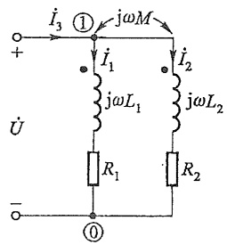

text_image

i₃ ① jωM
+ i₁ jωL₁ i₂ jωL₂
U R₁ R₂
- ①

(a)

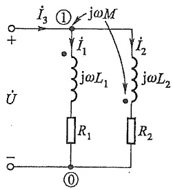

text_image

I₃ ① jωM
+ I₁ jωL₁ I₂ jωL₂
U
R₁ R₂
- ①

(b)

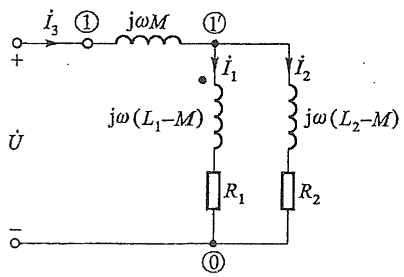

text_image

I₃ ① jωM ①'
+       i₁      i₂
U     jω(L₁-M)   jω(L₂-M)
-       R₁   R₂
      ①

(c)

图 10-5 耦合电感的并联电路

例 10-4 图 10-5(a) 中, 设正弦电压的 $U = 50 \mathrm{~V}, R_{1} = 3 \Omega, \omega L_{1} = 7.5 \Omega, R_{2} = 5 \Omega, \omega L_{2} = 12.5 \Omega, \omega M = 8 \Omega$ (与例 10-3 相同)。求电路的输入阻抗及支路 1、2 的电流。

解 令  $\dot{U}=50/0^{\circ}V$ ，根据式(10-3c)解得

$$
\dot {I} _ {1} = \frac {Z _ {2} - Z _ {M}}{Z _ {1} Z _ {2} - Z _ {M} ^ {2}} \dot {U} = \frac {5 + \mathrm{j} 4 . 5}{- 1 4 . 7 5 + \mathrm{j} 7 5} \dot {U} = 4. 4 0 / - 5 9. 1 4 ^ {\circ} \mathrm{A}
$$

$$
\dot {I} _ {2} = \frac {Z _ {1} - Z _ {M}}{Z _ {1} Z _ {2} - Z _ {M} ^ {2}} \dot {U} = \frac {3 - \mathrm{j} 0 . 5}{- 1 4 . 7 5 + \mathrm{j} 7 5} \dot {U} = 1. 9 9 / - 1 1 0. 5 9 ^ {\circ} \mathrm{A}
$$

求得输入阻抗 $Z_{\mathrm{i}}$ 为

$$
\begin{array}{l} Z _ {\mathrm{i}} = \frac {\dot {U}}{\dot {I} _ {1} + \dot {I} _ {2}} = \frac {Z _ {1} Z _ {2} - Z _ {M} ^ {2}}{Z _ {1} + Z _ {2} - 2 Z _ {M}} = \frac {- 1 4 . 7 5 + \mathrm{j} 7 5}{8 + \mathrm{j} 4} \Omega \\ = 8. 5 5 / 7 4. 5 6 ^ {\circ} \Omega = (2. 2 8 + j 8. 2 4) \Omega \\ \end{array}
$$

---

§ 10-2 含有耦合电感电路的计算

245

如  $R_{1}=R_{2}=0, Z_{i}$  为输入电抗，有

$$
\begin{array}{l} Z _ {\mathrm{i}} = \mathrm{j} X = \frac {\left(\mathrm{j} \omega L _ {1}\right) \left(\mathrm{j} \omega L _ {2}\right) - \left(\mathrm{j} \omega M\right) ^ {2}}{\left(\mathrm{j} \omega L _ {1}\right) + \left(\mathrm{j} \omega L _ {2}\right) - 2 \left(\mathrm{j} \omega M\right)} \\ = \mathrm{j} \omega \frac {L _ {1} L _ {2} - M ^ {2}}{L _ {1} + L _ {2} - 2 M} = \mathrm{j} \omega L _ {\mathrm{cq}} = \mathrm{j} 7. 4 4 \Omega \\ \end{array}
$$

根据同侧并联耦合电路方程式(10-3a)可推导出去耦等效电路。用  $\dot{I}_{2}=\dot{I}_{3}-\dot{I}_{1}$  消去支路1方程中的  $\dot{I}_{2}$ ，用  $\dot{I}_{1}=\dot{I}_{3}-\dot{I}_{2}$  消去支路2方程中的  $\dot{I}_{1}$ ，有

$$
\dot {U} = \mathrm{j} \omega M \dot {I} _ {3} + \left[ R _ {1} + \mathrm{j} \omega (L _ {1} - M) \right] \dot {I} _ {1}
$$

$$
\dot {U} = \mathrm{j} \omega M \dot {I} _ {3} + \left[ R _ {2} + \mathrm{j} \omega (L _ {2} - M) \right] \dot {I} _ {2}
$$

根据上述方程可获得无耦合的等效电路,如图10-5(c)所示。无耦合等效电路又称去耦等效电路。同理,按式(10-3b)可得出异侧并联的去耦等效电路,其差别仅在于互感M前的“+”“-”号。可以归纳出如下的去耦方法:如果耦合电感的两条支路各有一端与第3支路形成一个仅含3条支路的共同节点,则可用3条无耦合的电感支路等效替代,3条支路的等效电感分别为

(支路 3) $L_{3}=\pm M$  (同侧取“+”, 异侧取“-”)

(支路1) $L_{1}^{\prime}=L_{1}\mp M$ 
(支路2) $L_{2}^{\prime}=L_{2}\mp M$ 
M前所取符号与 $L_{3}$ 中的相反

等效电感与电流参考方向无关。这3条支路中的其他元件不变。注意去耦等效电路中的节点[如图10-5(c)中⑪所示]不是原电路的节点①，原节点①移至 $L_{3}$ 的前面。

例 10-5 图 10-6(a) 所示电路中  $\omega L_{1} = \omega L_{2} = 10\Omega, \omega M = 5\Omega, R_{1} = R_{2} = 6\Omega, U_{s} = 12V$ 。求  $Z_{L}$  最佳匹配时获得的功率 P。

解 求解本例的一般方法是用戴维南(诺顿)等效电路。当一端口电路中含有耦合电感时,求解方法与含有受控源的一端口电路相同。现用一步法解本例。在端口1-1'置电流源 $\dot{I}$ 替代 $Z_{L}$ ,求外特性 $\dot{U}_{11'} = f(\dot{I})$ 。列网孔(顺时针)方程及 $\dot{U}_{11'}$ 的表达式为

$$
(R _ {1} + R _ {2} + \mathrm{j} \omega L _ {1}) \dot {I} _ {1} - (R _ {2} + \mathrm{j} \omega M) \dot {I} = \dot {U} _ {\mathrm{s}} (\text {左网孔})
$$

$$
\dot {U} _ {1 1 ^ {\prime}} = - \left(R _ {2} + \mathrm{j} \omega L _ {2}\right) \dot {I} + \left(R _ {2} + \mathrm{j} \omega M\right) \dot {I} _ {1} (\text {右网孔})
$$

解得

$$
\dot {U} _ {1 1 ^ {\prime}} = \frac {1}{2} \dot {U} _ {\mathrm{s}} - (3 + \mathrm{j} 7. 5) \dot {I}
$$

戴维南等效电路参数为

$$
\dot {U} _ {\mathrm{oc}} = \frac {1}{2} \dot {U} _ {\mathrm{s}} = 6 / 0 ^ {\circ} \mathrm{V}
$$

$$
Z _ {\mathrm{eq}} = (3 + \mathrm{j} 7. 5) \Omega
$$

最佳匹配时 $Z_{\mathrm{L}} = Z_{\mathrm{eq}}^{*} = (3 - \mathrm{j}7.5)\Omega$ ，求得功率

---

246

第十章 含有耦合电感的电路

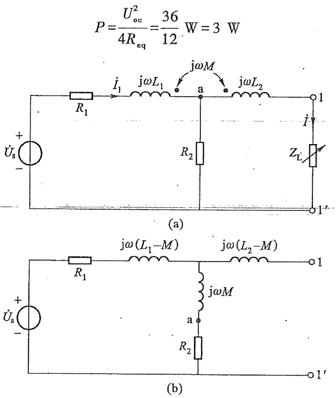

图10-6 例10-5图

本例的电路中,耦合电感的两条支路与  $R_{2}$  形成两个 3 支路节点 a 和 1', 所以可用去耦法求解。图 10-6(b) 所示为去耦等效电路, 求得开路电压和等效阻抗分别为

$$
\dot {U} _ {1 1 ^ {\prime} \mathrm{oc}} = \frac {\dot {U} _ {\mathrm{s}}}{2 (6 + \mathrm{j} 5)} (6 + \mathrm{j} 5) = \frac {1}{2} \dot {U} _ {\mathrm{s}}
$$

$$
Z _ {\mathrm{eq}} = \left[ \frac {1}{2} (6 + \mathrm{j} 5) + \mathrm{j} 5 \right] \Omega = (3 + \mathrm{j} 7. 5) \Omega
$$

本例用去耦法显得容易。应当注意,不是所有含耦合电感的电路都有去耦等效电路。

## §10-3 耦合电感的功率

当耦合电感中的施感电流变化时,将出现变化的磁场,从而产生电场(互感电压),

耦合电感通过变化的电磁场进行电磁能的转换和传输，电磁能从耦合电感一边传输到另一边。图10-7所示(开关S打开状态)为耦合电感同向串联电路。现将线圈2短接(图中开关S闭合)，讨论两个线圈中电磁能的传送。如无互感耦合，则达到稳态时电流 $i_{2}$ 必定为零。但在有耦合的情况下，只要 $\frac{di_{1}}{dt}$ 不为零，则电流 $i_{2}$ 就不会为零，电

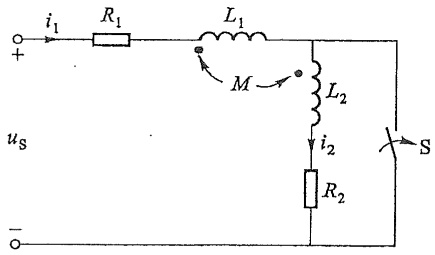

text_image

i₁ R₁ L₁ M L₂ i₂ R₂ S
uₛ

图 10-7 耦合电感电路

耦合电感的功率

---

§ 10-3 耦合电感的功率

247

磁能将从线圈 1 传送到线圈 2。根据图 10-7 所示参考方向,电路方程为

$$
R _ {1} i _ {1} + L _ {1} \frac {\mathrm{d} i _ {1}}{\mathrm{d} t} + M \frac {\mathrm{d} i _ {2}}{\mathrm{d} t} = u _ {\mathrm{s}}
$$

$$
M \frac {\mathrm{d} i _ {1}}{\mathrm{d} t} + R _ {2} i _ {2} + L _ {2} \frac {\mathrm{d} i _ {2}}{\mathrm{d} t} = 0
$$

第 1 式乘  $i_{1}$ ，第 2 式乘  $i_{2}$ ，得到耦合电感电路的瞬时功率方程为

$$
R _ {1} i _ {1} ^ {2} + i _ {1} L _ {1} \frac {\mathrm{d} i _ {1}}{\mathrm{d} t} + i _ {1} M \frac {\mathrm{d} i _ {2}}{\mathrm{d} t} = u _ {\mathrm{S}} i _ {1}
$$

$$
i _ {2} M \frac {\mathrm{d} i _ {1}}{\mathrm{d} t} + R _ {2} i _ {2} ^ {2} + i _ {2} L _ {2} \frac {\mathrm{d} i _ {2}}{\mathrm{d} t} = 0
$$

式中 $i_1M\frac{\mathrm{d}i_2}{\mathrm{d}t}$ （在线圈1中）和 $i_2M\frac{\mathrm{d}i_1}{\mathrm{d}t}$ （在线圈2中）为一对通过互感电压耦合的功率（吸收），通过它们与两个耦合的线圈实现电磁能的转换和传输。关于电磁能通过互感转换和传输的现象，暂不作一般性的理论论述，仅对正弦稳态下的电磁能通过互感转换和传输状态做简要的分析和说明。

当图10-7所示耦合电感电路中的电压、电流为同频正弦量时，则两个线圈的复功率 $\overline{S}_1$ 和 $\overline{S}_2$ 分别为

$$
\overline {{S}} _ {1} = \dot {U} _ {\mathrm{s}} \dot {I} _ {1} ^ {*} = (R _ {1} + \mathrm{j} \omega L _ {1}) I _ {1} ^ {2} + \mathrm{j} \omega M \dot {I} _ {2} \dot {I} _ {1} ^ {*}
$$

$$
\overline {{S}} _ {2} = 0 = \mathrm{j} \omega M \dot {I} _ {1} \dot {I} _ {2} ^ {*} + (R _ {2} + \mathrm{j} \omega L _ {2}) I _ {2} ^ {2}
$$

两个互感电压耦合的复功率分别为 $\mathrm{j}\omega M\dot{I}_2\dot{I}_1^*$ （线圈1中）和 $\mathrm{j}\omega M\dot{I}_1\dot{I}_2^*$ （线圈2中），由于（ $\dot{I}_2\dot{I}_1^*$ ）和（ $\dot{I}_1\dot{I}_2^*$ ）互为共轭复数，两者的实部同号，而虚部异号，但乘以j以后，则变为虚部同号，而实部异号。这一特点是由耦合电感本身的电磁特性所决定的。

互感 M 本身是一个非耗能的储能参数, 它兼有储能元件电感和电容两者的特性, 当 M 起同向耦合作用时, 它的储能特性与电感相同, 将使耦合电感中的磁能增加; 当 M 起反向耦合作用时, 它的储能特性与电容相同(容性效应), 与自感储存的磁能彼此互补。也就是说, 两个互感电压耦合功率中的无功功率对两个耦合线圈的影响、性质是相同的, 这就是耦合功率中虚部同号的原因。无功功率是通过互感 M 的储能特性与耦合电感进行转换的。耦合功率中的有功功率是相互异号的, 这表明有功功率从一个端口进入(吸收, 正号), 必须从另一端口输出(发出, 负号), 这是互感 M 非耗能特性的体现, 有功功率是通过耦合电感的电磁场传播的。

下面通过示例作具体说明。

例 10-6 求图 10-7 所示电路的复功率,并说明互感在功率转换和传输中的作用。图中  $U_{s}=50\ V, R_{1}=3\Omega, \omega L_{1}=7.5\Omega, R_{2}=5\Omega, \omega L_{2}=12.5\Omega, \omega M=8\Omega$  (与例 10-3 相同)。

解 电路的方程为(令  $\dot{U}_{s}=50/0^{\circ}V$ )

$$
(3 + \mathrm{j} 7. 5) \dot {I} _ {1} + \mathrm{j} 8 \dot {I} _ {2} = \dot {U} _ {\mathrm{s}}
$$

---

248

第十章 含有耦合电感的电路

$$
\mathrm{j} 8 \dot {I} _ {1} + (5 + \mathrm{j} 1 2. 5) \dot {I} _ {2} = 0
$$

解得

$$
\dot {I} _ {1} = \frac {5 + \mathrm{j} 1 2 . 5}{(3 + \mathrm{j} 7 . 5) (5 + \mathrm{j} 1 2 . 5) - (\mathrm{j} 8) ^ {2}} \dot {U} _ {\mathrm{s}} = 8. 8 1 / - 3 2. 9 3 ^ {\circ} \mathrm{A}
$$

$$
\dot {I} _ {2} = \frac {- \mathrm{j} 8 \dot {I} _ {1}}{5 + \mathrm{j} 1 2 . 5} = 5. 2 4 / 1 6 8. 8 7 ^ {\circ} \mathrm{A}
$$

复功率分别为

$$
\begin{array}{l} \overline {{S}} _ {\mathrm{s}} = \dot {U} _ {\mathrm{s}} \dot {I} _ {1} ^ {*} = (3 + \mathrm{j} 7. 5) I _ {1} ^ {2} + \mathrm{j} 8 \dot {I} _ {2} \dot {I} _ {1} ^ {*} \\ = [ (2 3 2. 8 5 + j 5 8 2. 1 2) + (1 3 7. 1 5 - j 3 4 2. 9 1) ] \mathrm{V} \cdot \mathrm{A} \\ \bar {S} _ {2} = \mathrm{j} 8 \dot {I} _ {1} \dot {I} _ {2} ^ {*} + (5 + \mathrm{j} 1 2. 5) I _ {2} ^ {2} \\ = [ (- 1 3 7. 1 5 - j 3 4 2. 9 1) + (1 3 7. 1 5 + j 3 4 2. 9 1) ] \mathrm{V} \cdot \mathrm{A} \\ = 0 \\ \end{array}
$$

$$
\begin{array}{l} \bar {S} _ {2} = \mathrm{j} 8 \dot {I} _ {1} \dot {I} _ {2} ^ {*} + (5 + \mathrm{j} 1 2. 5) I _ {2} ^ {2} \\ = [ (- 1 3 7. 1 5 - j 3 4 2. 9 1) + (1 3 7. 1 5 + j 3 4 2. 9 1) ] \mathrm{V} \cdot \mathrm{A} \\ = 0 \\ \end{array}
$$

从上式可以看出,互感电压发出无功功率,分别补偿 $L_{1}$ 和 $L_{2}$ 中的无功功率,其中, $L_{2}$ 和M处于完全补偿状态。线圈1中的互感电压吸收的137.15W有功功率,由线圈2中的互感电压发出,供给支路2中的电阻 $R_{2}$ 消耗。只要 $\arg(\dot{I}_{1}\dot{I}_{2}^{*})\neq0$ ,就会出现互感传递有功功率的现象。

例 10-7 对例 10-4 中的复功率的转换和传输做进一步分析。

解 复功率  $\bar{S}_{1}$  和  $\bar{S}_{2}$  分别为

$$
\bar {S} _ {1} = \dot {U} \dot {I} _ {1} ^ {*} = (3 + \mathrm{j} 7. 5) I _ {1} ^ {2} + \mathrm{j} 8 (1. 9 9 / - 1 1 0. 5 9 ^ {\circ} \times 4. 4 0 / 5 9. 1 4 ^ {\circ})
$$

$$
\bar {S} _ {2} = \dot {U} \dot {I} _ {2} ^ {*} = \mathrm{j} 8 (1. 9 9 / 1 1 0. 5 9 ^ {\circ} \times 4. 4 0 / - 5 9. 1 4 ^ {\circ}) + (5 + \mathrm{j} 1 2. 5) I _ {2} ^ {2}
$$

计算结果为

$$
\overline {{S}} _ {1} = [ (5 8. 0 8 + j 1 4 5. 2) + (5 4. 7 8 + j 4 3. 6 5) ] \mathrm{V} \cdot \mathrm{A}
$$

$$
\overline {{S}} _ {2} = \left[ (- 5 4. 7 8 + \mathrm{j} 4 3. 6 5) + (1 9. 8 0 + \mathrm{j} 4 9. 5 0) \right] \mathrm{V} \cdot \mathrm{A}
$$

从结果可以看出,互感 M 起同向耦合作用,耦合电感中的无功功率都增加了同一个值,而有功功率的传输情况是:线圈 1 多吸收的 54.78 W 传输给线圈 2,并由线圈 2 发出,扣除线圈 2 中电阻  $R_{2}$  的消耗后,尚有 34.98 W 多余功率,这部分有功功率又返回电源,表明系统对有功功率有过量吸收的情况,出现“过冲”现象。如果将图 10-4(a) 所

示电路改接成图10-8的形式，而其中的参数值与例10-4所述相同，而两边的电压源为 $\dot{U}_1 = \dot{U}_2 = \dot{U}$，这样计算结果完全相同，但可以看得更清楚。有功功率从左边的电压源发出，供给耦合电感中的电阻消耗后，又将多余部分传输给右边的电压源吸收。

最后应当指出, 当  $\arg(\dot{I}_{1}\dot{I}_{2}^{*})=0$  时, 耦合电感中将不会出现有功功率的传播。此外, 电路的

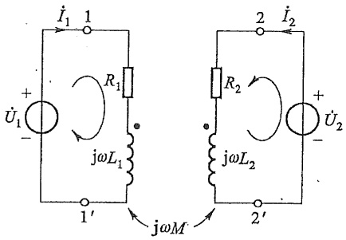

text_image

İ₁ 1
+ R₁
Û₁ - jωL₁
1' jωM
2 I₂
R₂
jωL₂
2' û₂
+ Û₂ -

图10-8 例10-7图

---

§ 10-4 变压器原理

249

状态是经过一段历史后的稳定状态,上述的分析不能反映耦合电感电路中电磁能的转换和传播的全过程,仅在正弦稳定的条件下反映耦合电感在电磁能的转换和传播中的作用和一些特点,当然,这也是耦合电感电磁性能的一种表现。

## §10-4 变压器原理

变压器是电工、电子技术中常用的电气设备，是耦合电感工程实际应用的典型例子，在其他课程有专门的论述，这里仅对电路原理作简要的介绍。它由两个耦合线圈绕在一个共同的芯上制成，其中，一个线圈作为输入端口，接入电源后形成一个回路，称为

一次回路(或一次侧,旧称原边回路、初级回路);另一线圈作为输出端口,接入负载后形成另一个回路,称为二次回路(或二次侧,旧称副边回路、次级回路)。变压器的芯是线性磁性(或工作在线性段)材料制成的,其电路模型如图10-9所示,图中的负载设为 $Z_{L}$ 。变压器通过耦合作用,将输入一次侧中的一部分能量传递到二次侧输出。在正弦稳态下,变压器电路的方程(双网孔方程)为

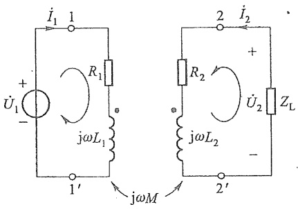

text_image

İ₁ 1
+   R₁
Û₁ - jωL₁
1' jωM
2 ï₂
R₂ +
Û₂ Zₗ
jωL₂
- 2'

图10-9 变压器电路模型

$$
\left. \begin{array}{l} (R _ {1} + \mathrm{j} \omega L _ {1}) \dot {I} _ {1} + \mathrm{j} \omega M \dot {I} _ {2} = \dot {U} _ {1} \\ \mathrm{j} \omega M \dot {I} _ {1} + (R _ {2} + \mathrm{j} \omega L _ {2} + Z _ {\mathrm{L}}) \dot {I} _ {2} = 0 \end{array} \right\}
$$

上述方程是由一次侧和二次侧两个独立回路方程组成的,它们通过互感的耦合联列在一起,是分析变压器性能的依据。令  $Z_{11}=R_{1}+j\omega L_{1}$ , 称为一次回路阻抗,  $Z_{22}=R_{2}+j\omega L_{2}+Z_{L}$ , 称为二次回路阻抗,  $Z_{M}=j\omega M$  为互感抗, 则上述方程式可简写为

$$
Z _ {1 1} \dot {I} _ {1} + Z _ {M} \dot {I} _ {2} = \dot {U} _ {1} \quad (\text {一次侧}) \tag {10-4}
$$

$$
Z _ {M} \dot {I} _ {1} + Z _ {2 2} \dot {I} _ {2} = 0 (\text {二次侧})
$$

工程上根据不同的需要,采用不同的等效电路来分析研究变压器的输入端口或输出端口的状态及相互影响。由式(10-4)解得变压器一次电路中的电流  $\dot{I}_{1}$  为

$$
\dot {I} _ {1} = \frac {\dot {U} _ {1}}{Z _ {1 1} - Z _ {M} ^ {2} Y _ {2 2}} = \frac {\dot {U} _ {1}}{Z _ {1 1} + (\omega M) ^ {2} Y _ {2 2}} = \frac {\dot {U} _ {1}}{Z _ {\mathrm{i}}}
$$

表明变压器一次等效电路的输入阻抗可由两个阻抗的串联组成，其中 $-Z_{M}^{2}Y_{22}=(\omega M)^{2}Y_{22}$ 称为引入阻抗，或反映阻抗，它是二次回路阻抗和互感抗通过互感反映到一次侧的等效阻抗。引入阻抗的性质与 $Z_{22}$ 相反，即感性(容性)变为容性(感性)。等效电路如图10-10(a)所示。

变压器输入端口的工作状态已隐含了二次端口(输出)的工作状态,根据式(10-4)可以将输出端口的电流  $\dot{I}_{2}$ 、 $\dot{U}_{2}$  用输入电流  $\dot{I}_{1}$  表示出来,即有

1

变压器原理

---

250

第十章 含有耦合电感的电路

$$
\dot {I} _ {2} = - \frac {Z _ {M}}{Z _ {2 2}} \dot {I} _ {1}
$$

$$
\dot {U} _ {2} = - Z _ {\mathrm{L}} \dot {I} _ {2} = \frac {Z _ {M} Z _ {\mathrm{L}}}{Z _ {2 2}} \dot {I} _ {1}
$$

也可以用二次等效电路从输出端来研究一、二次侧的关系。将上式电流  $\dot{I}_{2}$  的表达式改写为

$$
\dot {I} _ {2} = - \frac {Z _ {M}}{Z _ {2 2}} \frac {\dot {U} _ {1}}{Z _ {1 1} + (\omega M) ^ {2} Y _ {2 2}} = - \frac {Z _ {M} \dot {U} _ {1} / Z _ {1 1}}{Z _ {2 2} + (\omega M) ^ {2} Y _ {1 1}} = - \frac {\dot {U} _ {\mathrm{oc}}}{Z _ {\mathrm{eq}} + Z _ {\mathrm{L}}}
$$

上式电流 $\dot{I}_2$ 是戴维南等效回路的解答[也可直接从式(10-4)解得]。式中分子是戴维南等效电路的等效电压源，即端口 $2 - 2^{\prime}$ 的开路电压 $\dot{U}_{\mathrm{oc}}$ ，分母是等效电路的回路阻抗，它由3部分阻抗串联组成，即一次回路反映到二次回路的引入阻抗 $(\omega M)^{2}Y_{11}$ 、二次线圈的阻抗 $R_{2} + \mathrm{j}\omega L_{2}$ 以及负载阻抗 $Z_{\mathrm{L}}$ ，其中 $(R_{2} + \mathrm{j}\omega L_{2}) + Z_{\mathrm{L}} = Z_{22}$ 。而 $Z_{\mathrm{eq}} = (\omega M)^{2}Y_{11} + R_{2} + \mathrm{j}\omega L_{2}$ 是一端口 $2 - 2^{\prime}$ 的戴维南等效阻抗，其等效回路如图10-10(b)所示。

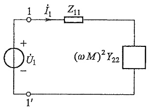

text_image

1
+
U̇₁
-
1′
İ₁
Z₁₁
(ωM)²Y₂₂

(a)

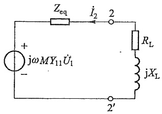

text_image

Z_{eq}
i_2
2
+
j\omega MY_{11}\dot{U}_1
-
R_L
jX_L
2'

(b)

图10-10 变压器的等效电路

根据变压器的电路方程可以获得各部分的复功率及相互转换情况,即有

$$
Z _ {1 1} \dot {I} _ {1} ^ {2} + Z _ {M} \dot {I} _ {2} \dot {I} _ {1} ^ {*} = \dot {U} _ {1} \dot {I} _ {1} ^ {*}
$$

$$
Z _ {M} \dot {I} _ {1} \dot {I} _ {2} ^ {*} + Z _ {2 2} I _ {2} ^ {2} = 0
$$

可得

$$
Z _ {2 2} \dot {I} _ {2} ^ {2} = - Z _ {M} \dot {I} _ {1} \dot {I} _ {2} ^ {*} = (Z _ {M} \dot {I} _ {2} \dot {I} _ {1} ^ {*}) ^ {*}
$$

$$
(\omega M) ^ {2} Y _ {2 2} I _ {1} ^ {2} = Z _ {M} \dot {I} _ {2} \dot {I} _ {1} ^ {*}
$$

例10-8 图10-9所示电路中， $R_{1} = R_{2} = 0, L_{1} = 5\mathrm{H}, L_{2} = 3.2\mathrm{H}, M = 4\mathrm{H}, u_{1} = 100\cos (10t)\mathrm{V}$，负载阻抗为 $Z_{\mathrm{L}} = R_{\mathrm{L}} + \mathrm{j}X_{\mathrm{L}} = 10\Omega$。求变压器的耦合因数 $k$ 和一、二次电流 $i_1, i_2$。

解 变压器的耦合因数 k 为

$$
k = \frac {M}{\sqrt {L _ {1} L _ {2}}} = 1
$$

表明变压器为全耦合电感。

---

§ 10-5 理想变压器

251

根据图 10-10(b) 所示二次等效电路求电流  $\dot{I}_{2}$ 。二次戴维南等效电路的参数开路电压  $\dot{U}_{oc}$  和等效阻抗  $Z_{eq}$  分别为

$$
\dot {U} _ {\mathrm{oe}} (= \dot {U} _ {2 2 ^ {\prime}}) = \mathrm{j} \omega M Y _ {1 1} \dot {U} _ {1} = \sqrt {\frac {L _ {2}}{L _ {1}}} \dot {U} _ {1} = 0. 8 \dot {U} _ {1}
$$

$$
Z _ {\mathrm{eq}} = \left(\omega M\right) ^ {2} Y _ {1 1} + \mathrm{j} \omega L _ {2} = 0
$$

表明二次输出端口 2-2' 的戴维南等效电路为理想电压源。二次电流  $\dot{I}_{2}$  为

$$
\dot {I} _ {2} = - \frac {\dot {U} _ {\mathrm{oc}}}{Z _ {\mathrm{eq}} + R _ {\mathrm{L}}} = - 0. 0 8 \dot {U} _ {1}
$$

将上述结果代入一次回路方程为

$$
\mathrm{j} \omega L _ {1} \dot {I} _ {1} - \mathrm{j} \omega M \frac {1}{R _ {\mathrm{L}} \sqrt {\frac {L _ {2}}{L _ {1}}}} \dot {U} _ {1} = \dot {U} _ {1}
$$

解得  $\dot{I}_{1}$  为

$$
\dot {I} _ {1} = \frac {\dot {U} _ {1}}{\mathrm{j} \omega L _ {1}} + \frac {\dot {U} _ {1}}{R _ {\mathrm{L}} \left(\frac {L _ {1}}{L _ {2}}\right)} = (0. 0 6 4 - \mathrm{j} 0. 0 2) \dot {U} _ {1} = 0. 0 6 7 \dot {U} _ {1} / - 1 7. 3 5 ^ {\circ} \mathrm{A}
$$

上式表明一次等效电路可用电感 $L_{1}$ 与15.625 $\Omega \left(= \frac{R_{\mathrm{L}}L_{1}}{L_{2}}\right)$ 的电阻并联电路表示。电流$\dot{I}_1,\dot{I}_2$ 的时域形式为

$$
i _ {1} = 6. 7 \cos (1 0 t - 1 7. 3 5 ^ {\circ}) \mathrm{A}
$$

$$
i _ {2} = - 8 \cos (1 0 t) \mathrm{A}
$$

读者可用一次等效电路求解。

## §10-5 理想变压器

本节将要介绍的理想变压器,是实际变压器理想化的模型。理想变压器不是偶然想象的产物,而是科学思维的必然结果,因为分析研究耦合电感时,总会促使人们进一步思考,如果耦合电感无限增大和更紧密耦合时,将会出现怎样的结果。读者对下面的分析,不仅仅要关注最终的结果,更为重要的是关注获得结果的过程。

图 10-11(a) 所示为无损耗(第 1 个理想化条件)变压器的电路模型, 根据图示的参考方向, 磁通链方程为

$$
\left. \begin{array}{l} \varPsi_ {1} = L _ {1} i _ {1} + M i _ {2} \\ \varPsi_ {2} = M i _ {1} + L _ {2} i _ {2} \end{array} \right\} \tag {10-5}
$$

这是分析研究耦合电感的基本方程。在无损耗的条件下，直接对方程求导就能获得表述耦合电感端口特性的电压-电流方程(电压、电流为关联方向)为

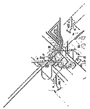

natural_image

Pure technical line drawing of a mechanical assembly without any text, numbers, or symbols

---

252

第十章 含有耦合电感的电路

$$
\left. \begin{array}{l} u _ {1} = \frac {\mathrm{d} \Psi_ {1}}{\mathrm{d} t} = L _ {1} \frac {\mathrm{d} i _ {1}}{\mathrm{d} t} + M \frac {\mathrm{d} i _ {2}}{\mathrm{d} t} \\ u _ {2} = \frac {\mathrm{d} \Psi_ {2}}{\mathrm{d} t} = M \frac {\mathrm{d} i _ {1}}{\mathrm{d} t} + L _ {2} \frac {\mathrm{d} i _ {2}}{\mathrm{d} t} \end{array} \right\} \tag {10-6}
$$

当耦合因数 $k \neq 1$ 时，只要给出耦合电感的初始状态，由上式联列求解就能获得耦合系统的唯一解。但当 $k = 1$ 时（全耦合，第2个理想化条件），有 $L_{1}L_{2} - M^{2} = 0$ ，即方程组右侧的系数行列式的值为零。由数学理论可知，在此情况下，求解上述方程组将毫无结果，表明方程组对全耦合电感的描述是不充分的，尽管其中每一个方程都符合电路理论的要求，但已失去联列的意义。这说明耦合电感在 $k = 1$ 时，一定存在尚未表述的新的约束关系。分别将式(10-5)和式(10-6)中的两个方程相比，就得到磁通链比、电压比方程为

$$
\frac {\Psi_ {1}}{\Psi_ {2}} = \frac {u _ {1}}{u _ {2}} = \frac {\sqrt {L _ {1}}}{\sqrt {L _ {2}}} (\text {常数})
$$

这一关系是符合实际的,可以直接证明。令耦合电感的绕组匝数分别为  $N_{1}, N_{2}, k = 1$  时的耦合磁通为  $\Phi$ , 则有

$$
\Psi_ {1} = N _ {1} \varPhi , \quad u _ {1} = N _ {1}   \frac {\mathrm{d} \varPhi}{\mathrm{d} t}
$$

$$
\Psi_ {2} = N _ {2} \varPhi , \quad u _ {2} = N _ {2}   \frac {\mathrm{d} \varPhi}{\mathrm{d} t}
$$

同样有

$$
\frac {\Psi_ {1}}{\Psi_ {2}} = \frac {u _ {1}}{u _ {2}} = \frac {N _ {1}}{N _ {2}}
$$

两种形式是相同的(因为电感与匝数的平方成正比)。上式表明,电压比方程与电流无关,而且 $u_{1}$ 、 $u_{2}$ 中只有一个为独立变量,当 $u_{2}=0$ (短路)时,必有 $u_{1}=0$ ,所以,当 $u_{1}$ 为独立的电压源时,二次侧不能短路。并要注意, $u_{1}$ 、 $u_{2}$ 的“+”极性都设在有标记的同名端。

由磁通链比和电压比方程可知,方程组式(10-5)和式(10-6)都是线性相关的方程组,方程组中只有一个独立方程,也就是说,无损耗全耦合电感不存在描述其端口性能的线性无关的方程组。下面将讨论进一步改变变压器的结构将出现的变化。将式(10-6)的第一式改写为如下形式:

$$
\begin{array}{l} i _ {1} = \frac {1}{L _ {1}} \int u _ {1} \mathrm{d} t - \frac {M}{L _ {1}} \int \frac {\mathrm{d} i _ {2}}{\mathrm{d} t} \mathrm{d} t \\ = \frac {1}{L _ {1}} \int u _ {1} \mathrm{d} t - \sqrt {\frac {L _ {2}}{L _ {1}}} \int \mathrm{d} i _ {2} \\ \end{array}
$$

使上式中的 $L_{1}, L_{2}$ 同比趋于无穷大（即保持 $\frac{\sqrt{L_1}}{\sqrt{L_2}}$ 为定值，这是第3个理想化条件），则有

---

§ 10-5 理想变压器

253

$$
\frac {i _ {1}}{i _ {2}} = - \frac {\sqrt {L _ {2}}}{\sqrt {L _ {1}}}
$$

这种理论上理想的变压器只有在理想化的条件下可能实现，一种方法是使磁性材料的磁导率 $\mu \rightarrow \infty$ ，才能有 $L_{1}(L_{2}$ 和 $M)\rightarrow \infty$ ，实际上不存在这种磁性材料；另一种方法是使绕组的匝数 $N_{1}(N_{2})\rightarrow \infty$ ，这需要无限大空间，也是不现实的。工程实际中只能在允许的条件下，尽可能采用磁导率 $\mu$ 较高的磁性材料作变压器的芯子，在 $\frac{N_1}{N_2}$ 保持不变的情况下，尽可能增加变压器绕组的匝数，接近于理想的极限状态，使电流比方程近似成立。

电流比方程与电压无关,而且  $i_{1}$ 、 $i_{2}$  中也只有一个为独立变量,当  $i_{2}=0$  时,必有  $i_{1}=0$ ,所以,当  $i_{1}$  为独立电流源时,二次侧不能开路。注意:  $i_{1}$ 、 $i_{2}$  都设定为从同名端流入。设

$$
n = \frac {N _ {1}}{N _ {2}} = \frac {\sqrt {L _ {1}}}{\sqrt {L _ {2}}}
$$

式中 $N_{1}, N_{2}$ 和 $L_{1}, L_{2}$ 都认为是无限大，但比值是任意设定的常数。$n$ 称为理想变压器的变比，现将电压比和电流比方程用变比 $n$ 改写如下:

$$
\left. \begin{array}{l} u _ {1} = n u _ {2} \\ i _ {1} = - \frac {1}{n} i _ {2} \end{array} \right\} \tag {10-7}
$$

上述两个方程是各自在不同条件下获得的独立关系,两者不是联列关系。

将上述两个方程相乘得

$$
u _ {1} i _ {1} + u _ {2} i _ {2} = 0
$$

上式是理想变压器从两个端口吸收的瞬时功率。表明理想变压器将一侧吸收的能量全部传输到另一侧输出，在传输过程中，仅仅将电压、电流按变比作数值的变换，它既不耗能也不储能，是一个非动态无损耗的磁耦合元件。它的电路模型仍用带同名端的耦合电感表示，如图10-11(b)所示，图中标出它的参数变比 $n$ ，而不能再标 $L_{1}, L_{2}$ 和 $M$ ，也不能用这些参数来描述理想变压器的电压电流关系。图10-11(c)是理想变压器用受控源表示的等效电路之一。

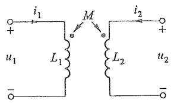

chemical

Electrical circuit diagram showing mutual inductance M with two coupled inductors L1 and L2, and voltage sources u1 and u2

(a)

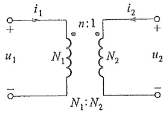

text_image

i₁
+
u₁ N₁ n:1 i₂ +
N₂ u₂
- N₁:N₂ -

(b)

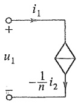

(c)

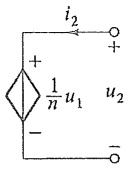

图 10-11 理想变压器电路

---

254

第十章 含有耦合电感的电路

例 10-9 图 10-12(a) 所示理想变压器, 变比为 1:10, 已知  $u_{\mathrm{S}} = 10 \cos(10t) \mathrm{~V}$ ,  $R_{1} = 1 \Omega, R_{2} = 100 \Omega$ 。求  $u_{2}$ 。

解 按图 10-12(a) 可以列出电路方程

$$
R _ {1} i _ {1} + u _ {1} = u _ {\mathrm{s}}
$$

$$
R _ {2} i _ {2} + u _ {2} = 0
$$

根据理想变压器的 VCR, 有

$$
u _ {1} = - \frac {1}{1 0} u _ {2}
$$

$$
i _ {1} = 1 0 i _ {2}
$$

代入数据,解得

$$
u _ {2} = - 5 u _ {\mathrm{s}} = - 5 0 \cos (1 0 t) \mathrm{V}
$$

另一种解法是先用一次等效电路求  $u_{1}$ ，再按电压比方程求  $u_{2}$ 。端子  $1-1'$  右侧电路的输入电阻  $R_{eq}$  为

$$
R _ {\mathrm{eq}} = \frac {u _ {1}}{i _ {1}} = \frac {- \frac {1}{1 0} u _ {2}}{1 0 i _ {2}} = (0. 1) ^ {2} \left(\frac {u _ {2}}{- i _ {2}}\right) = (0. 1) ^ {2} R _ {2} = 1 \Omega
$$

等效电路如图 10-12(b) 所示, 求得

$$
u _ {1} = \frac {u _ {\mathrm{s}}}{R _ {1} + R _ {\mathrm{eq}}} R _ {\mathrm{eq}} = \frac {1}{2} u _ {\mathrm{s}}
$$

$$
u _ {2} = - 1 0 u _ {1} = - 5 u _ {\mathrm{s}}
$$

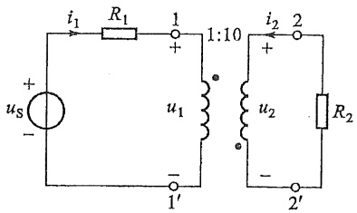

text_image

i₁ R₁ 1 1:10 i₂ 2
+       +
us     u₁     u₂     R₂
-       -
1'      2'

(a)

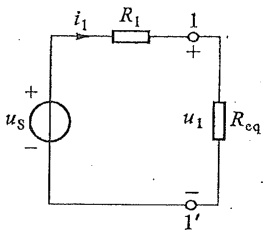

text_image

i₁ R₁ 1
+ uₛ - +
u₁ Rₑq
- 1'

(b)

图10-12 例10-9图

理想变压器对电压、电流按变比变换的作用,还反映在阻抗的变换上。在正弦稳态的情况下,当理想变压器二次侧终端2-2'接入阻抗 $Z_{L}$ 时,则变压器一次侧1-1'的输入阻抗 $Z_{11}$ 为

$$
Z _ {1 1 ^ {\prime}} = \frac {\dot {U} _ {1}}{\dot {I} _ {1}} = \frac {n \dot {U} _ {2}}{- \frac {1}{n} \dot {I} _ {2}} = n ^ {2} Z _ {\mathrm{L}}
$$

$n^2 Z_{\mathrm{L}}$ 即为二次侧折合至一次侧的等效阻抗，如二次侧分别接入 $R, L, C$ 时，折合至一次

---

习题

255

1

侧将为  $n^{2}R, n^{2}L, \frac{C}{n^{2}}$ ，也就是变换了元件的参数。

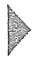

## 思考题

10-1 在什么情况下,耦合电感元件的自感磁通链和互感磁通链相互增强?在什么情况下,自感磁通链和互感磁通链相互削弱?
10-2 耦合电感的互感磁通链与哪些因素有关？如何提高互感的耦合系数？
10-3 耦合电感的互感电压的方向与大小与哪些因素有关？
10-4 在已经得知同名端和施感电流的参考方向时,耦合电感的互感电压的参考方向如何标定?
10-5 对含有耦合电感的电路,有哪几种分析方法?
10-6 在什么条件下,可以采用空心变压器模型来分析含有耦合电感的电路?
10-7 在实际工程中,当满足什么条件时,可以采用理想变压器模型?

## 习题

10-1 试确定题 10-1 图所示耦合线圈的同名端。

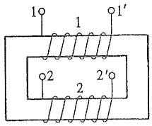

text_image

1
1'
1
2
2'
2

(a)

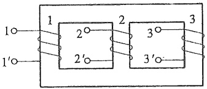

text_image

1
1'
1
2
2'
2
3
3
3'

(b)

题 10-1 图

10-2 两个耦合的线圈如题 10-2 图所示(黑盒子)。试根据图中开关 S 闭合时或闭合后再打开时,毫伏表的偏转方向确定同名端。

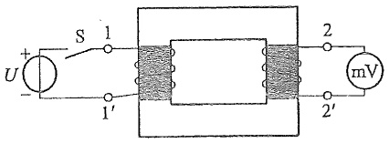

text_image

U
+
S 1
1'
2
mV
2'

题10-2图

10-3 若有电流  $i_{1}=2+5\cos(10t+30^{\circ})$  A,  $i_{2}=10e^{-5t}$  A, 各从图 10-1(a) 所示线圈的 1 端和 2 端流入, 并设线圈 1 的电感  $L_{1}=6H$ , 线圈 2 的电感  $L_{2}=3H$ , 互感为 M=4H。试求:

---

256

第十章 含有耦合电感的电路

(1) 各线圈的磁通链。
(2) 端电压  $u_{11}$  和  $u_{22}$ 。
(3) 耦合因数  $k_{0}$

10-4 题 10-4 图所示电路中，(1) $L_{1}=8\mathrm{H},L_{2}=2\mathrm{H},M=2\mathrm{H}$; (2) $L_{1}=8\mathrm{H},L_{2}=2\mathrm{H},M=4\mathrm{H}$; (3) $L_{1}=L_{2}=M=4\mathrm{H}$。试求以上三种情况从端子 1-1' 看进去的等效电感。

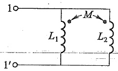

text_image

1○
L₁
M
L₂
1′○

(a)

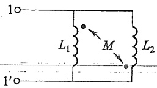

text_image

1o
L₁
M
L₂
1'o

(b)

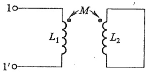

text_image

1○
L₁
M
L₂
1'○

(c)

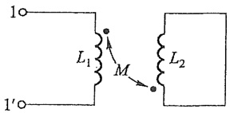

text_image

1○
L₁
M
L₂
1'○

(d)

题10-4图

10-5 求题 10-5 图所示电路的输入阻抗  $Z(\omega=1\ \mathrm{rad/s})$ 。

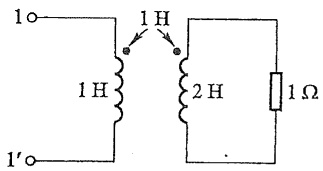

text_image

1o
1H
1H
2H
1Ω
1'o

(a)

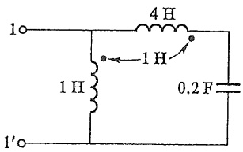

text_image

1o
4 H
← 1 H
1 H
0.2 F
1'o

(b)

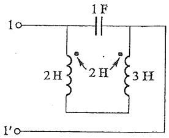

text_image

1o
1F
2H
2H
3H
1'o

(c)

题10-5图

10-6 题 10-6 图所示电路中, $R_{1}=R_{2}=1\ \Omega,\omega L_{1}=3\ \Omega,\omega L_{2}=2\ \Omega,\omega M=2\ \Omega,U_{1}=100\ V$ 。求:

(1) 开关 S 打开和闭合时的电流  $\dot{I}_{1}$ 。
(2) S 闭合时各部分的复功率。

---

习题

257

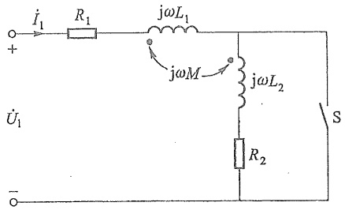

text_image

i₁
R₁
jωL₁
jωM
jωL₂
R₂
S
+   U̇₁
-

题 10-6 图

10-7 把两个线圈串联起来接到 $50\mathrm{Hz}, 220\mathrm{V}$ 的正弦电源上，同向串联时得电流 $I = 2.7\mathrm{A}$，吸收的功率为 $218.7\mathrm{W}$；反向串联时电流为 $7\mathrm{A}$。求互感 $M$。
10-8 电路如题10-8图所示，已知两个线圈的参数为: $R_{1}=R_{2}=100\Omega,L_{1}=3H$ ， $L_{2}=10H,M=5H$ ，正弦电源的电压U=220V, $\omega=100rad/s$ 。

(1) 试求两个线圈端电压,并作出电路的相量图。
(2) 证明两个耦合电感反向串联时不可能有  $L_{1} + L_{2} - 2M \leqslant 0$ 。
(3) 电路中串联多大的电容可使  $\dot{U}$ 、 $\dot{I}$  同相？
(4) 画出该电路的去耦等效电路。

10-9 题 10-9 图所示电路中， $L_{1}=0.2H, L_{2}=M=0.1H, u_{s}=10\sqrt{2}\cos(2t+30^{\circ})$ V。求图中表 W 的读数，并说明该读数有无实际意义。

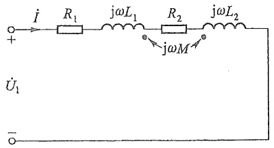

text_image

i
R₁
jωL₁
R₂
jωL₂
+ jωM
Û₁
-

题10-8图

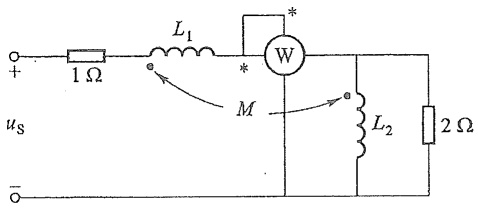

text_image

+
1 Ω
L₁
W
*
*
M
L₂
2 Ω
uₛ
-

题10-9图

10-10 当题 10-10 图所示电路中的电流  $\dot{I}_{1}$  与  $\dot{I}_{2}$  正交时，试证明: $R_{1}R_{2}=\frac{L_{2}}{C}$ ，并对此结果进行分析。

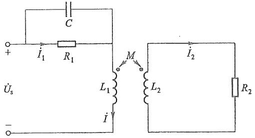

text_image

C
+
I₁ R₁
M
I₂
L₁ L₂
R₂
Üₛ
-

题10-10图

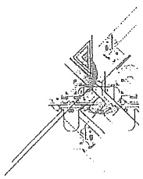

natural_image

Pure technical line drawing of a mechanical assembly without any text, numbers, or symbols

---

258

第十章 含有耦合电感的电路

10-11 试求题 10-11 图所示电路中电压源的角频率为何值时, 功率表 W 的读数为零(图中元件的参数已知)。
10-12 题 10-12 图所示电路中 $R = 1\Omega, \omega L_1 = 2\Omega, \omega L_2 = 32\Omega$，耦合因数 $k = 1, \frac{1}{\omega C} = 32\Omega$。求电流 $\dot{I}_1$ 和电压 $\dot{U}_2$。

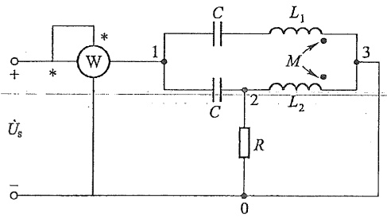

text_image

W
+
*
1
C
L₁
M
3
2
L₂
C
R
0
Ûs
-

题 10-11 图

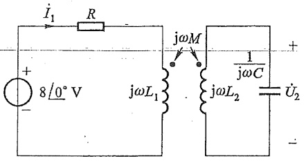

text_image

I₁ R
8/0° V jωL₁ jωM 1/jωC U₂
+ -

题10-12图

10-13 已知变压器如题 10-13 图(a)所示,一次侧的周期性电流源波形如题 10-13 图(b)所示(一个周期),二次侧的电压表读数(有效值)为 25 V。

(1) 画出一、二次电压的波形，并计算互感 M。
(2) 给出它的等效受控源 (CCVS) 电路。
(3) 如果同名端弄错, 对(1)和(2)的结果有无影响?

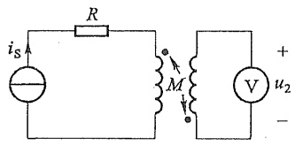

text_image

i_S
R
M
V
+
u_2
-

(a)

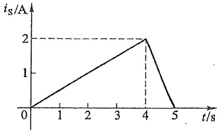

line

| t/s | is/A |
| --- | --- |
| 0 | 0 |
| 4 | 2 |
| 5 | 0 |

(b)

题 10-13 图

10-14 题 10-14 图所示电路中 $R = 50 \Omega, L_{1} = 70 \mathrm{~mH}, L_{2} = 25 \mathrm{~mH}, M = 25 \mathrm{~mH}, C = 1 \mu \mathrm{F}$, 正弦电源的电压 $\dot{U} = 500 / 0^{\circ} \mathrm{V}, \omega = 10^{4} \mathrm{rad/s}$。求各支路电流。

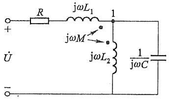

text_image

R
jωL₁
1
jωM
jωL₂
1
jωC
+ 
U
- .

题 10-14 图

---

习题

259

10-15 列出题 10-15 图所示电路的回路电流方程。
10-16 已知题 10-16 图中 $u_{\mathrm{s}} = 100\sqrt{2}\cos (\omega t)\mathrm{V}, \omega L_{2} = 120\Omega, \omega M = \frac{1}{\omega C} = 20\Omega$。负载 $Z_{\mathrm{L}}$ 为何值时获最大功率？求出最大功率。

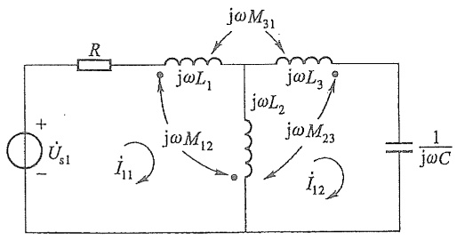

text_image

R
jωL₁
jωM₃₁
jωL₃
+
Uₛ₁
-
jωM₁₂
jωL₂
jωM₂₃
i₁₁
i₁₂
1
jωC

题10-15图

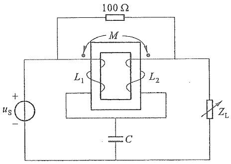

text_image

100 Ω
M
L₁ L₂
+
us -
C Zₗ

题 10-16 图

10-17 如果使 $10\Omega$ 电阻能获得最大功率,试确定题10-17图所示电路中理想变压器的变比 $n$。
10-18 求题 10-18 图所示电路中的阻抗 Z。已知电流表的读数为 10 A，正弦电压有效值 U=10 V。

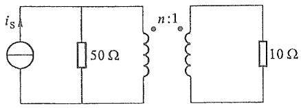

text_image

iS
50 Ω
n:1
10 Ω

题10-17图

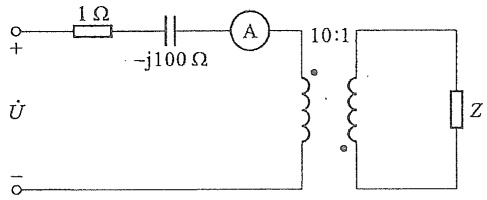

text_image

1 Ω
-j100 Ω
A
10:1
Z
+ 
- 
U

题10-18图

10-19 已知题 10-19 图所示电路的输入电阻  $R_{nb}=0.25\Omega$ 。求理想变压器的变比 n。

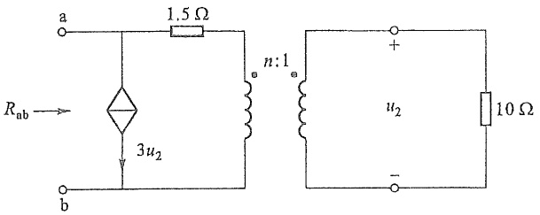

text_image

a
1.5 Ω
Rab →
3u2
n:1
b
+
u2
-
10 Ω

题 10-19 图

10-20 题 10-20 图所示电路中开关 S 闭合时  $u_{s}=10\sqrt{2}\cos t$  V，求电流  $i_{1}$  和  $i_{2}$ ，并根据结果给出含理想变压器的等效电路。

natural_image

Pure technical line drawing of a mechanical assembly without any text, numbers, or symbols

---

260

第十章 含有耦合电感的电路

text_image

S (t=0)
+
us
-
i1
4 H
2 H
i2
8 H
8 Ω

题10-20图

10-21 已知题 10-21 图所示电路中 $u_{\mathrm{S}} = 10\sqrt{2}\cos (\omega t) \mathrm{~V}, R_{1} = 10\Omega, L_{1} = L_{2} = 0.1 \mathrm{mH}$, $M = 0.02 \mathrm{mH}, C_{1} = C_{2} = 0.01 \mu \mathrm{F}, \omega = 10^{6} \mathrm{rad/s}$。$R_{2}$ 为何值时获最大功率？求出最大功率。

text_image

C₁
+
us
-
R₁
L₁
M
C₂
L₂
R₂

题 10-21 图

10-22 题 10-22 图所示电路中 $C_1 = 10^{-3}\mathrm{F}, L_1 = 0.3\mathrm{H}, L_2 = 0.6\mathrm{H}, M = 0.2\mathrm{H}, R = 10\Omega, u_1 = 100\sqrt{2}\cos (100t - 30^\circ)\mathrm{V}, C$ 可变动。$C$ 为何值时，$R$ 可获得最大功率？并求出最大功率。

第十章部分
习题答案

text_image

C₁
+
u₁
-
L₁
M
L₂
C
R

题.10-22 图
