# 第13章 非正弦周期电流电路和信号的频谱

原始 PDF 第 319–343 页。

# 第十三章

# 非正弦周期电流电路和信号的频谱

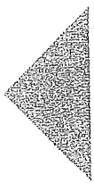

## 导读

在生产实践和科学实验中,通常会遇到按非正弦规律变化的电源和电信号。另外,如果电路存在非线性元件,即使在正弦电源的作用下,电路中也将产生非正弦周期的电压和电流。

非正弦电流、电压又可分为周期的和非周期的两种。本章主要讨论在非正弦周期电源或电信号的作用下，线性电路的稳态分析和计算方法，并简要地介绍信号频谱的初步概念。首先应用数学中的傅里叶级数（傅氏级数）展开方法，将非正弦周期电压、电流或电信号分解为一系列频率为周期函数频率的正整数倍的正弦量之和表示的无穷级数，再根据线性电路的叠加定理，分别计算每一频率的正弦量单独作用下在电路中产生的同频正弦电流分量和电压分量；把所得分量按时域形式叠加，就可以得到电路在非正弦周期激励下的稳态电流和电压。这种方法称为谐波分析法。最后，将谐波分析法推广用于非正弦非周期信号的分析，简单介绍傅里叶变换。

## §13-1 非正弦周期信号

在生产实践和科学实验中,通常会遇到按非正弦规律变化的电源和信号。例如,通信工程方面传输的各种信号,如收音机、电视机收到的信号电压或电流,它们的波形都是非正弦波。在自动控制、电子计算机等技术领域中用到的脉冲信号也都是非正弦波。本章表13-1所示非正弦周期波形都是工程中常见的例子。

另外,如果电路存在非线性元件,即使在正弦电源的作用下,电路中也将产生非正弦周期的电压和电流。

非正弦电流、电压又可分为周期的和非周期的两种。本章主要讨论在非正弦周期电源或信号的作用下，线性电路的稳态分析和计算方法，并简要地介绍信号频谱的初步概念。

非正弦周期
信号

---

296

第十三章 非正弦周期电流电路和信号的频谱

## §13-2 非正弦周期函数分解为傅里叶级数

非正弦周期电流、电压、信号等都可以用周期函数表示，即

$$
f (t) = f (t + n T)
$$

式中 T 为周期函数  $f(t)$  的周期, n 为自然数 0, 1, 2, …。

如果给定的周期函数 $f(t)$ 满足狄里赫利条件，即（1）周期函数的极值点的数目为有限个；(2）间断点的数目为有限个；(3）在一个周期内绝对可积，即有

$$
\int_ {0} ^ {T} \left| f (t) \right| \mathrm{d} t <   \infty (\text {有界})
$$

它就能展开成一个收敛的傅里叶级数,即

$$
\begin{array}{l} f (t) = \frac {a _ {0}}{2} + \left[ a _ {1} \cos (\omega_ {1} t) + b _ {1} \sin (\omega_ {1} t) \right] + \left[ a _ {2} \cos (2 \omega_ {1} t) + b _ {2} \sin (2 \omega_ {1} t) \right] + \dots + \\ \left[ a _ {k} \cos (k \omega_ {1} t) + b _ {k} \sin (k \omega_ {1} t) \right] + \dots \\ = \frac {a _ {0}}{2} + \sum_ {k = 1} ^ {\infty} \left[ a _ {k} \cos (k \omega_ {1} t) + b _ {k} \sin (k \omega_ {1} t) \right] \tag {13-1} \\ \end{array}
$$

式(13-1)中， $a_{k}$ 项为偶函数， $b_{k}$ 项为奇函数。还可合并成另一种形式（式中 $\omega_{1} = \frac{2\pi}{T}$

$$
\begin{array}{l} f (t) = \frac {A _ {0}}{2} + A _ {1 \mathrm{m}} \cos (\omega_ {1} t + \phi_ {1}) + A _ {2 \mathrm{m}} \cos (2 \omega_ {1} t + \phi_ {2}) + \dots + \\ A _ {k m} \cos (k \omega_ {1} t + \phi_ {k}) + \dots \\ = \frac {A _ {0}}{2} + \sum_ {k = 1} ^ {\infty} A _ {k m} \cos (k \omega_ {1} t + \phi_ {k}) \tag {13-2} \\ \end{array}
$$

不难得出上述两种形式系数之间有如下关系:

$$
a _ {0} = A _ {0}
$$

$$
a _ {k} = A _ {k m} \cos \phi_ {k}
$$

$$
b _ {k} = - A _ {k m} \sin \phi_ {k}
$$

$$
A _ {k m} = \sqrt {a _ {k} ^ {2} + b _ {k} ^ {2}}
$$

$$
\phi_ {k} = \arctan \left(\frac {- b _ {k}}{a _ {k}}\right)
$$

$$
A _ {k \mathrm{m}} \mathrm{e} ^ {\mathrm{j} \phi_ {k}} = a _ {k} - \mathrm{j} b _ {k}
$$

傅里叶级数是一个无穷三角级数。式(13-2)的第1项 $\frac{A_0}{2}$ 称为周期函数 $f(t)$ 的恒

---

§ 13-2 非正弦周期函数分解为傅里叶级数

297

定分量(或直流分量);第2项 $(k=1)A_{1m}\cos(\omega_{1}t+\phi_{1})$ 称为1次谐波(或基波分量),其周期或频率与原周期函数 $f(t)$ 相同,其他各项 $(k>1)$ 统称为高次谐波,即2次、3次、4次、…谐波。这种将一个周期函数展开或分解为一系列谐波之和的傅里叶级数称为谐波分析。

式(13-1)中的系数,可按下列积分获得:

$$
\begin{array}{l} \frac {1}{T} \int_ {0} ^ {T} f (t) \cos (n \omega_ {1} t) \mathrm{d} t = \frac {1}{T} \int_ {0} ^ {T} \left\{\frac {a _ {0}}{2} + \sum \left[ a _ {k} \cos (k \omega_ {1} t) + b _ {k} \sin (k \omega_ {1} t) \right] \right\} \cos (n \omega_ {1} t) \mathrm{d} t \\ \frac {1}{T} \int_ {0} ^ {T} f (t) \sin (n \omega_ {1} t) \mathrm{d} t = \frac {1}{T} \int_ {0} ^ {T} \left\{\frac {a _ {0}}{2} + \sum \left[ a _ {k} \cos (k \omega_ {1} t) + b _ {k} \sin (k \omega_ {1} t) \right] \right\} \sin (n \omega_ {1} t) \mathrm{d} t \\ \end{array}
$$

当 $n \neq k$ 时，上述积分全为零，当 $n = k$ 时，第1积分式中只有 $a_{k}$ 项（偶函数）积分不为零，第2积分式中只有 $b_{k}$ 项（奇函数）不为零，因此可获得求解 $a_{k}, b_{k}$ 的下列积分公式:

$$
\left. \begin{array}{l} a _ {k} = \frac {2}{T} \int_ {0} ^ {T} f (t) \cos (k \omega_ {1} t) \mathrm{d} t = \frac {2}{T} \int_ {- \frac {T}{2}} ^ {\frac {T}{2}} f (t) \cos (k \omega_ {1} t) \mathrm{d} t \\ = \frac {1}{\pi} \int_ {0} ^ {2 \pi} f (t) \cos (k \omega_ {1} t) \mathrm{d} (\omega_ {1} t) = \frac {1}{\pi} \int_ {- \pi} ^ {\pi} f (t) \cos (k \omega_ {1} t) \mathrm{d} (\omega_ {1} t) \\ b _ {k} = \frac {2}{T} \int_ {0} ^ {T} f (t) \sin (k \omega_ {1} t) \mathrm{d} t = \frac {2}{T} \int_ {- \frac {T}{2}} ^ {\frac {T}{2}} f (t) \sin (k \omega_ {1} t) \mathrm{d} t \\ = \frac {1}{\pi} \int_ {0} ^ {2 \pi} f (t) \sin (k \omega_ {1} t) \mathrm{d} (\omega_ {1} t) = \frac {1}{\pi} \int_ {- \pi} ^ {\pi} f (t) \sin (k \omega_ {1} t) \mathrm{d} (\omega_ {1} t) \\ A _ {k m} e ^ {j \phi_ {k}} = a _ {k} - j b _ {k} = \frac {2}{T} \int_ {0} ^ {T} f (t) e ^ {- j k \omega_ {1} t} d t \end{array} \right\} \tag {13-3}
$$

上述计算公式中  $k=0,1,2,\cdots$ 。

为了直观、形象地表示一个周期函数分解为傅氏级数后包含哪些频率分量以及各分量所占“比重”，用线段的高度表示各次谐波振幅，画出 $A_{km} - k\omega_1$ 的图形，如图13-1

所示。这种图形称为 $f(t)$ 的频谱（图）。这种频谱只表示各谐波分量的振幅，所以称为幅度频谱。如果用同样的方法画出 $\phi_k - k\omega_1$ 的图形就可以得到相位频谱。如无特别说明，一般所说频谱是专指幅度频谱而言。由于各谐波的角频率是 $\omega_{1}$ 的正整数倍，所以这种频谱是离散的，有时又称为线频谱。频谱图提供一种从谐波的幅度和谱线密度两个方面研究函数 $f(t)$ 的频率特性的图像方法。函数 $A_{km}\mathrm{e}^{\mathrm{j}\phi_k}$ 就称为频谱函数。

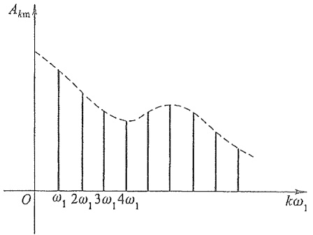

bar

| Frequency | Ak (Value) |
| --- | --- |
| \(\omega1\) | ~0.65 |
| \(2\omega1\) | ~0.45 |
| \(3\omega1\) | ~0.35 |
| \(4\omega1\) | ~0.30 |
| \(5\omega1\) | ~0.35 |
| \(6\omega1\) | ~0.45 |
| \(7\omega1\) | ~0.35 |
| \(8\omega1\) | ~0.25 |
| \(9\omega1\) | ~0.15 |

图 13-1 幅度频谱

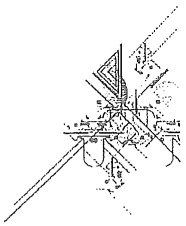

natural_image

Pure technical line drawing of a mechanical assembly or component without any text, numbers, or symbols

---

298

第十三章 非正弦周期电流电路和信号的频谱

例 13-1 求图 13-2(a) 所示周期性矩形信号  $f(t)$  的傅里叶级数展开式及其频谱。

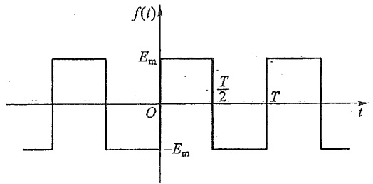

area

| Time (t) | Amplitude (f(t)) |
| --- | --- |
| 0 | -Em |
| ~0.15 | Em |
| ~0.35 | -Em |
| ~0.5 | -Em |
| ~0.65 | Em |
| T | -Em |
| 1 | -Em |

(a)

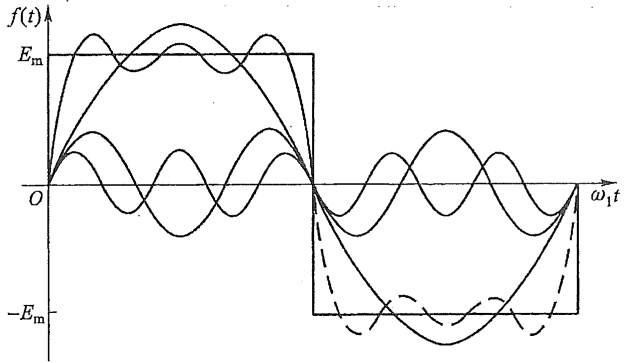

line

| \(\omega_{1}t\) | f(t) (Upper Curve) | f(t) (Lower Curve) |
| --- | --- | --- |
| 0 | 0 | 0 |
| ~0.25 | E_m | ~0.3E_m |
| ~0.5 | ~0.8E_m | ~-0.4E_m |
| ~0.75 | ~0.9E_m | ~-0.2E_m |
| 1 | 0 | 0 |
| ~1.25 | ~-0.8E_m | ~-0.6E_m |
| ~1.5 | ~-0.9E_m | ~-0.4E_m |
| ~1.75 | ~-0.8E_m | ~-0.2E_m |
| 2 | 0 | 0 |

(b)

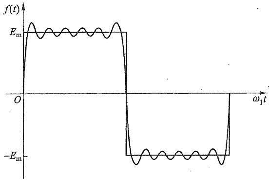

line

| \(\omega1t\) | f(t) |
| --- | --- |
| 0 | 0 |
| ~0.1 | ~Em |
| ~0.2 | ~Em |
| ~0.3 | ~Em |
| ~0.4 | ~Em |
| ~0.5 | ~Em |
| ~0.6 | ~Em |
| ~0.7 | ~Em |
| ~0.8 | ~Em |
| ~0.9 | ~Em |
| ~1.0 | 0 |
| ~1.1 | -Em |
| ~1.2 | -Em |
| ~1.3 | -Em |
| ~1.4 | -Em |
| ~1.5 | -Em |
| ~1.6 | -Em |
| ~1.7 | -Em |
| ~1.8 | -Em |
| ~1.9 | -Em |
| ~2.0 | -Em |
| ~2.1 | -Em |
| ~2.2 | -Em |
| ~2.3 | -Em |
| ~2.4 | -Em |
| ~2.5 | -Em |
| ~2.6 | -Em |
| ~2.7 | -Em |
| ~2.8 | -Em |
| ~2.9 | -Em |
| ~3.0 | 0 |

(c)

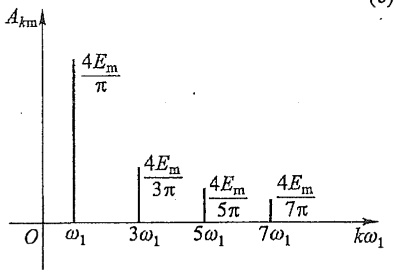

spectrogram

| Frequency | Amplitude (Akm) |
| --- | --- |
| \(\omega1\) | \(4Em/\pi\) |
| \(3\omega1\) | \(4Em/3\pi\) |
| \(5\omega1\) | \(4Em/5\pi\) |
| \(7\omega1\) | \(4Em/7\pi\) |

(d)

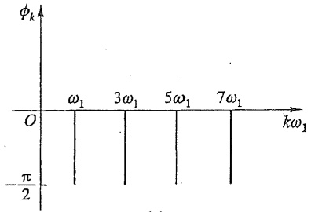

spectrogram

| Frequency | Value |
| --- | --- |
| \(\omega_{1}\) | 0 |
| \(3\omega_{1}\) | 0 |
| \(5\omega_{1}\) | 0 |
| \(7\omega_{1}\) | 0 |

(e)

图 13-2 矩形波及其频谱

---

§ 13-2 非正弦周期函数分解为傅里叶级数

299

解 $f(t)$ 在第一个周期内的表达式为

$$
\left\{ \begin{array}{l l} f (t) = E _ {\mathrm{m}} & 0 \leqslant t \leqslant \frac {T}{2} \\ f (t) = - E _ {\mathrm{m}} & \frac {T}{2} \leqslant t \leqslant T \end{array} \right.
$$

根据式(13-3)求得所需要的系数为

$$
\begin{array}{l} A _ {k \mathrm{m}} \mathrm{e} ^ {\mathrm{j} \phi_ {k}} = a _ {k} - \mathrm{j} b _ {k} = \frac {2}{T} \int_ {0} ^ {T} f (t) \mathrm{e} ^ {- \mathrm{j} k \omega_ {1} t} \mathrm{d} t \\ = \frac {2}{T} \left[ \int_ {0} ^ {\frac {T}{2}} E _ {\mathrm{m}} \mathrm{e} ^ {- \mathrm{j} k \omega_ {1} t} \mathrm{d} t - \int_ {\frac {T}{2}} ^ {T} E _ {\mathrm{m}} \mathrm{e} ^ {- \mathrm{j} k \omega_ {1} k} \mathrm{d} t \right] \\ = \frac {E _ {\mathrm{m}}}{- \mathrm{j} k \pi} [ \mathrm{e} ^ {- \mathrm{j} k \pi} - 1 - \mathrm{e} ^ {- \mathrm{j} 2 k \pi} + \mathrm{e} ^ {- \mathrm{j} k \pi} ] \\ = \frac {E _ {\mathrm{m}}}{\mathrm{j} k \pi} (1 - \mathrm{e} ^ {- \mathrm{j} k \pi}) ^ {2} \\ \end{array}
$$

当 k 为偶数时, 上述结果为零, 当 k 为奇数时, 上述结果为

$$
A _ {k m} \mathrm{e} ^ {\mathrm{j} \phi_ {k}} = \frac {4 E _ {\mathrm{m}}}{\mathrm{j} k \pi}
$$

即

$$
A _ {k \mathrm{m}} = \frac {4 E _ {\mathrm{m}}}{k \pi}, \quad \phi_ {k} = - 9 0 ^ {\circ}
$$

由此求得

$$
f (t) = \frac {4 E _ {\mathrm{m}}}{\pi} \left[ \sin (\omega_ {1} t) + \frac {1}{3} \sin (3 \omega_ {1} t) + \frac {1}{5} \sin (5 \omega_ {1} t) + \dots \right]
$$

图 13-2(b) 中虚线所示曲线是取展开式中前 3 项, 即取到 5 次谐波时画出的合成曲线。图 13-2(c) 是取到 11 次谐波时合成的曲线。比较两个图形可见, 谐波项数取得越多, 合成曲线就越接近于原来的波形。图 13-2(d)(e) 为  $f(t)$  的频谱。

表 13-1 是工程中常用到的几个典型的周期函数的傅里叶级数展开式。

表 13-1

<table><tr><td> $f(t)$ 的波形图</td><td> $f(t)$ 分解为傅里叶级数</td><td> $A_{\text{(有效值)}}$ </td><td> $A_{\text{m}}$ (平均值)</td></tr><tr><td>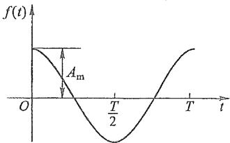</td><td> $f(t) = A_{\text{m}} \cos(\omega_1 t)$ </td><td> $\frac{A_{\text{m}}}{\sqrt{2}}$ </td><td> $\frac{2A_{\text{m}}}{\pi}$ </td></tr></table>

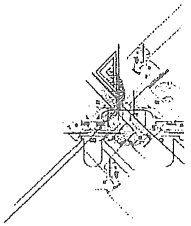

natural_image

Pure technical line drawing of a mechanical assembly without any text, numbers, or symbols

---

300

第十三章 非正弦周期电流电路和信号的频谱

续表

<table><tr><td> $f(t)$ 的波形图</td><td> $f(t)$ 分解为值里叶级数</td><td> $A_{\text{(有效值)}}$ </td><td> $A_{\text{(平均值)}}$ </td></tr><tr><td>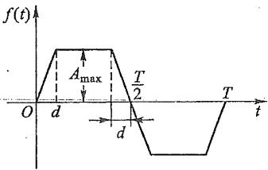</td><td> $f(t)=\frac{4A_{\max}}{a\pi}\left[\sin a\sin(\omega_1t)+\frac{1}{9}\sin(3a)\sin(3\omega_1t)+\frac{1}{25}\sin(5a)\sin(5\omega_1t)+\cdots+\frac{1}{k^2}\sin(ka)\sin(k\omega_1t)+\cdots\right]$ (式中 $a=\frac{2\pi d}{T}$ , $k$ 为奇数)</td><td> $A_{\max}\sqrt{1-\frac{4a}{3\pi}}$ </td><td> $A_{\max}\left(1-\frac{a}{\pi}\right)$ </td></tr><tr><td>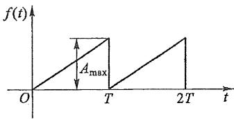</td><td> $f(t)=A_{\max}\left\{\frac{1}{2}-\frac{1}{\pi}\left[\sin(\omega_1t)+\frac{1}{2}\sin(2\omega_1t)+\frac{1}{3}\sin(3\omega_1t)+\cdots\right]\right\}$ </td><td> $\frac{A_{\max}}{\sqrt{3}}$ </td><td> $\frac{A_{\max}}{2}$ </td></tr><tr><td>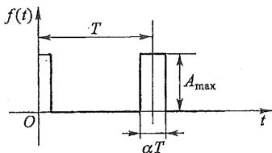</td><td> $f(t)=A_{\max}\left\{a+\frac{2}{\pi}\left[\sin(\alpha\pi)\cdot\cos(\omega_1t)+\frac{1}{2}\sin(2\alpha\pi)\cdot\cos(2\omega_1t)+\frac{1}{2}\sin(3\alpha\pi)\cdot\cos(3\omega_1t)+\cdots\right]\right\}$ </td><td> $\sqrt{\alpha}A_{\max}$ </td><td> $\alpha A_{\max}$ </td></tr><tr><td>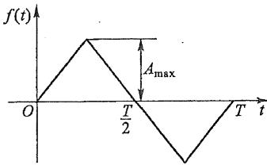</td><td> $f(t)=\frac{8A_{\max}}{\pi^2}\left[\sin(\omega_1t)-\frac{1}{9}\sin(3\omega_1t)+\frac{1}{25}\sin(5\omega_1t)-\cdots+\frac{(-1)^{\frac{k-1}{2}}}{k^2}\sin(k\omega_1t)+\cdots\right]$ ( $k$ 为奇数)</td><td> $\frac{A_{\max}}{\sqrt{3}}$ </td><td> $\frac{A_{\max}}{2}$ </td></tr></table>

---

§ 13-2 非正弦周期函数分解为傅里叶级数

301

续表

<table><tr><td> $f(t)$ 的波形图</td><td> $f(t)$ 分解为傅里叶级数</td><td> $A_{\text{(有效值)}}$ </td><td> $A_{\text{(平均值)}}$ </td></tr><tr><td>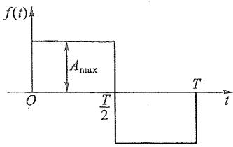</td><td> $f(t)=\frac{4A_{\max}}{\pi}\left[\sin(\omega_1t)+\frac{1}{3}\sin(3\omega_1t)+\frac{1}{5}\sin(5\omega_1t)+\cdots+\frac{1}{k}\sin(k\omega_1t)+\cdots\right]$ ( $k$ 为奇数)</td><td> $A_{\max}$ </td><td> $A_{\max}$ </td></tr><tr><td>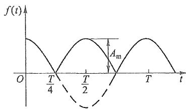</td><td> $f(t)=\frac{4A_{\max}}{\pi}\left[\frac{1}{2}+\frac{1}{1\times3}\cdot\cos(2\omega_1t)-\frac{1}{3\times5}\cos(4\omega_1t)+\frac{1}{5\times7}\cos(6\omega_1t)-\cdots\right]$ </td><td> $\frac{A_m}{\sqrt{2}}$ </td><td> $\frac{2A_m}{\pi}$ </td></tr></table>

电工技术中遇到的周期函数常具有某种对称性,利用函数的对称性可使系数  $a_{k}$ 、 $b_{k}$  的求解简化。

图 13-3 所示偶函数有纵轴对称的性质, 即

$$
f (t) = f (- t)
$$

故 $b_{k} = 0,\quad \phi_{k} = 0$

即级数展开式中不含 sine 项(奇函数)。

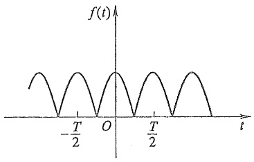

contour

| t | f(t) |
| --- | --- |
| -T/2 | 0 |
| 0 | 0 |
| T/2 | 0 |

(a)

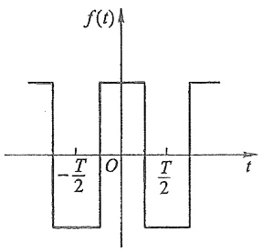

area

| Time (t) | Amplitude |
| --- | --- |
| 0 | Positive |
| -T/2 | Negative |
| O | Positive |
| T/2 | Negative |
| 0 | Positive |

(b)

图13-3 偶函数的例子

---

302

第十三章 非正弦周期电流电路和信号的频谱

图 13-4 所示奇函数有原点对称的性质, 即

$$
f (t) = - f (- t)
$$

故 $a_{k} = 0$

即级数展开式中不含 cosine 项(偶函数)。

图 13-5 所示奇谐波函数有镜像对称性质, 即该波形移动半周期后与横轴对称(如图 13-5 中虚线所示)。

$$
f (t) = - f \bigg (t + \frac {T}{2} \bigg)
$$

故 $a_{2k} = b_{2k} = 0$

即级数展开式中不含偶次谐波。

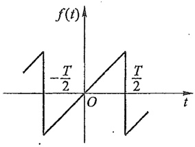

line

| t | f(t) |
| --- | --- |
| 0 | ~0.5 |
| T/2 | -T/2 |
| O | 0 |
| T/2 | T/2 |

(a)

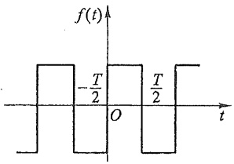

area

| Time (t) | Amplitude |
| --- | --- |
| 0 | 0 |
| ~0.15 | -T/2 |
| ~0.35 | 0 |
| ~0.5 | -T/2 |
| ~0.75 | 0 |
| ~1.0 | -T/2 |
| ~1.25 | 0 |

(b)

图13-4 奇函数的例子

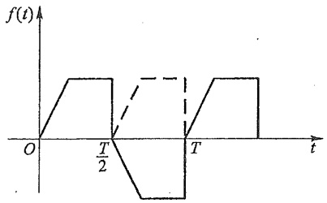

area

| Time (t) | Value (f(t)) |
| --- | --- |
| 0 | 0 |
| T/2 | 0 |
| T | 0 |

图13-5 奇谐波函数的例子

任意一个非正弦周期函数 $f(t)$，不管其奇偶性如何，都可以分解为一个偶函数$f_{\mathrm{e}}(t)$ （偶部）与一个奇函数 $f_{0}(t)$ （奇部）之和，即有

$$
f (t) = f _ {\mathrm{e}} (t) + f _ {\mathrm{o}} (t)
$$

并有

$$
f _ {\mathrm{e}} (t) = \frac {1}{2} [ f (t) + f (- t) ]
$$

$$
f _ {\mathrm{o}} (t) = \frac {1}{2} [ f (t) - f (- t) ]
$$

应当指出式(13-2)中的系数 $A_{km}$ 与计时起点无关，而 $\phi_{k}$ 与计时起点有关，这是因为构成非正弦周期函数的各谐波的振幅以及各次谐波对该函数波形的相对位置总是一定的，并不会因计时起点的变动而变动；因此，计时起点的变动只能使各次谐波的初相作相应地改变。由于系数 $a_{k}$ 和 $b_{k}$ 与初相 $\phi_{k}$ 有关，所以它们也随计时起点变动而改变。

由于 $a_{k}$ 和 $b_{k}$ 与计时起点的选择有关，所以函数的奇、偶性质与计时起点的选择有关，例如，图13-3(b)和图13-4(b)所示波形由于计时起点的选择不同，所以函数的奇、偶性质也不同。但是，函数是否为奇谐波函数与计时起点无关。因此适当选择计时起点有时会使函数的级数展开式简化。

傅里叶级数是一个无穷级数,因此把一个非正弦周期函数分解为傅里叶级数后,从理论上讲,必须取无穷多项方能准确地代表原有函数。从实际运算看,只能截取有限的

---

§ 13-3 有效值、平均值和平均功率

303

项数,因此就产生了误差问题。截取项数的多少,要根据级数的收敛速度和电路的频率特性两个方面的情况来定。级数收敛的快慢问题可定性地判断;通常,函数的波形越光滑和越接近于正弦形(相继项系数的比值越小),其展开级数就收敛得越快(可以分析表13-1所列各种函数)。而像例13-1(a)所示矩形波,其级数的收敛较慢。例如,如取 $\omega_{1}t=\frac{\pi}{2}$ ,或 $t=\frac{T}{4}$ ,则

$$
f \bigg (\frac {T}{4} \bigg) = \frac {4 E _ {\mathrm{m}}}{\pi} \bigg (1 - \frac {1}{3} + \frac {1}{5} - \frac {1}{7} + \frac {1}{9} - \frac {1}{1 1} + \dots \bigg)
$$

当取无穷多项时，将有 $f\left(\frac{T}{4}\right)=E_{\mathrm{m}}$ ，这是准确值。但是如取到11次谐波时，合成的结果约为 $0.95E_{m}$ ；取到13次谐波时约为 $1.05E_{m}$ ；取到35次谐波时，将得 $0.98E_{m}$ ，这时尚有2%的误差。在电路的频率特性方面，要注意某些频段内，响应的幅度特别大。例如，谐振点附近的频段，就要专门分析。综合上述两个方面的情况后，才能确定级数的截取项数。

## §13-3 有效值、平均值和平均功率

前已指出,任一周期电流 i 的有效值 I 已经定义为

$$
I \stackrel {\text {def}} {=} \sqrt {\frac {1}{T} \int_ {0} ^ {T} i ^ {2} \mathrm{d} t}
$$

当然可以用非正弦周期函数直接按上述定义的积分求有效值。这里主要是寻找有效值与各次谐波有效值之间的关系。

假设一非正弦周期电流 i 可以分解为傅里叶级数

$$
i = I _ {0} + \sum_ {k = 1} ^ {\infty} I _ {k m} \cos (k \omega_ {1} t + \phi_ {k})
$$

将 i 代入有效值公式, 则得此电流的有效值为

$$
I = \sqrt {\frac {1}{T} \int_ {0} ^ {T} \left[ I _ {0} + \sum_ {k = 1} ^ {\infty} I _ {k m} \cos \left(k \omega_ {1} t + \phi_ {k}\right) \right] ^ {2} \mathrm{d} t}
$$

设 $I_{k} = \frac{I_{km}}{\sqrt{2}}$ ，则上式中 $i$ 的展开式平方后将含有下列各项:

$$
\begin{array}{l} \frac {1}{T} \int_ {0} ^ {T} I _ {0} ^ {2} \mathrm{d} t = I _ {0} ^ {2}. \\ \frac {1}{T} \int_ {0} ^ {T} I _ {k \mathrm{m}} ^ {2} \cos^ {2} (k \omega_ {1} t + \phi_ {k}) \mathrm{d} t = I _ {k} ^ {2} \\ \frac {1}{T} \int_ {0} ^ {T} 2 I _ {0} \cos (k \omega_ {1} t + \phi_ {k}) \mathrm{d} t = 0 \\ \frac {1}{T} \int_ {0} ^ {T} 2 I _ {k \mathrm{m}} \cos (k \omega_ {1} t + \phi_ {k}) I _ {q \mathrm{m}} \cos (q \omega_ {1} t + \phi_ {q}) \mathrm{d} t = 0 \quad (k \neq q) \\ \end{array}
$$

The image provided is a QR code. It does not contain any text, mathematical formulas, tables, or figures that can be processed according to the given instructions. Therefore, no OCR output can be generated from this image.

有效值、平均值和平均功率

---

304

第十三章 非正弦周期电流电路和信号的频谱

这样可以求得 $i$ 的有效值为

$$
I = \sqrt {I _ {0} ^ {2} + I _ {1} ^ {2} + I _ {2} ^ {2} + I _ {3} ^ {2} + \cdots} = \sqrt {I _ {0} ^ {2} + \sum_ {k = 1} ^ {\infty} I _ {k} ^ {2}}
$$

即非正弦周期电流的有效值等于恒定分量的平方与各次谐波有效值的平方之和的平方根。此结论可推广用于其他非正弦周期量。

在实践中还用到平均值的概念,以电流 i 为例,其定义由下式表示:

$$
I _ {\mathrm{av}} \stackrel {\mathrm{def}} {=} \frac {1}{T} \int_ {0} ^ {T} | i | \mathrm{d} t
$$

即非正弦周期电流的平均值等于此电流绝对值的平均值。按上式可求得正弦电流的平均值为

$$
\begin{array}{l} I _ {\mathrm{av}} = \frac {1}{T} \int_ {0} ^ {T} | I _ {\mathrm{m}} \cos (\omega t) | \mathrm{d} t = \frac {4 I _ {\mathrm{m}}}{T} \int_ {0} ^ {\frac {T}{4}} \cos (\omega t) \mathrm{d} t \\ = \frac {4 I _ {\mathrm{m}}}{\omega T} [ \sin (\omega t) ] \Bigg | _ {0} ^ {\frac {T}{4}} = 0. 6 3 7 I _ {\mathrm{m}} = 0. 8 9 8 I \\ \end{array}
$$

它相当于正弦电流经全波整流后的平均值(如图 13-6 所示)，这是因为取电流的绝对值相当于把负半周的值变为对应的正值。

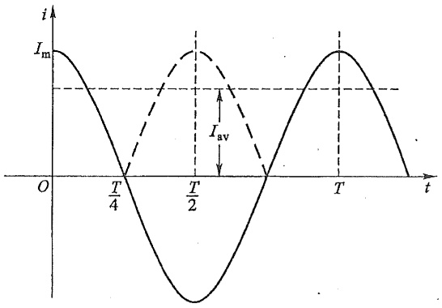

line

| Time | Current (Solid Line) | Current (Dashed Line) |
| --- | --- | --- |
| 0 | Im | 0 |
| T/4 | 0 | 0 |
| T/2 | 0 | Im |
| T | Im | 0 |

图13-6 正弦电流的平均值

对于同一非正弦周期电流,当用不同类型的仪表进行测量时,会得到不同的结果。例如用磁电系仪表(直流仪表)测量,所得结果将是电流的恒定分量,这是因为磁电系仪表的偏转角  $\alpha\propto\frac{1}{T}\int_{0}^{T}i dt$ 。用电磁系仪表测得的结果为电流的有效值,因为这种仪表的偏转角  $\alpha\propto\frac{1}{T}\int_{0}^{T}i^{2}dt$ 。如用全波整流仪表测量时,所得结果为电流的平均值,因为这种仪表的偏转角与电流的平均值成正比。由此可见,在测量非正弦周期电流和电压时,要注意选择合适的仪表,并注意不同类型仪表读数表示的含义(关于仪表的知识可参阅实验指导书)。

---

§ 13-4 非正弦周期电流电路的计算

305

现在讨论非正弦周期电流电路的功率问题。任意一端口的瞬时功率(吸收)为

$$
p = u i = \left[ U _ {0} + \sum_ {k = 1} ^ {\infty} U _ {k m} \cos \left(k \omega_ {1} t + \phi_ {u k}\right) \right] \times \left[ I _ {0} + \sum_ {k = 1} ^ {\infty} I _ {k m} \cos \left(k \omega_ {1} t + \phi_ {i k}\right) \right]
$$

式中 u、i 取关联参考方向。它的平均功率(有功功率)仍定义为

$$
P = \frac {1}{T} \int_ {0} ^ {T} p \mathrm{d} t
$$

不同频率的正弦电压与电流乘积的上述积分为零(即不产生平均功率);同频的正弦电压、电流乘积的上述积分不为零。这样不难证明

$$
P = U _ {0} I _ {0} + U _ {1} I _ {1} \cos \varphi_ {1} + U _ {2} I _ {2} \cos \varphi_ {2} + \dots + U _ {k} I _ {k} \cos \varphi_ {k} + \dots
$$

式中

$$
U _ {k} = \frac {U _ {k m}}{\sqrt {2}}, I _ {k} = \frac {I _ {k m}}{\sqrt {2}}, \varphi_ {k} = \phi_ {u k} - \phi_ {i k}, k = 1, 2, \dots
$$

即平均功率等于恒定分量构成的功率和各次谐波平均功率的代数和。

非正弦周期电流电路无功功率的情况较为复杂,本书不予讨论。有时候也定义非正弦周期电流电路的视在功率,即有

$$
S = U I
$$

## §13-4 非正弦周期电流电路的计算

在导读中已指出非正弦周期电流电路的谐波分析法的计算原则。

下面通过具体例子说明计算步骤。

例13-2 图13-7所示电路中， $R = 3\Omega, \frac{1}{\omega_1C} = 21\Omega, \omega_1L = 0.429\Omega$ ，输入电源为矩形波[参阅图13-3(b)]，其级数展开式为

$$
u _ {\mathrm{s}} = \left[ 2 8 0. 1 1 \cos \left(\omega_ {1} t\right) + 9 3. 3 7 \cos \left(3 \omega_ {1} t\right) + 5 6. 0 2 \cos \left(5 \omega_ {1} t\right) + \right.
$$

$$
4 0. 0 3 \cos (7 \omega_ {1} t) + 3 1. 1 2 \cos (9 \omega_ {1} t) + \dots ] \mathrm{V}
$$

求电流 i 和电阻吸收的平均功率 P。

解 电路中的非正弦周期电压已分解为傅里叶级数形式,现写出电流相量的一般表达式(振幅相量)为

$$
\dot {I} _ {\mathrm{m} (k)} = \frac {\dot {U} _ {\mathrm{sm} (k)}}{Z (k \omega_ {1})} = \frac {\dot {U} _ {\mathrm{sm} (k)}}{R + \mathrm{j} k \omega_ {1} L - \mathrm{j} \frac {1}{k \omega_ {1} C}}
$$

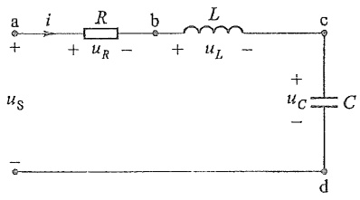

text_image

a i R b L c
+ + uR - + uL -
us uC C
- d

图13-7 例13-2图

式中  $I_{\mathrm{m}(k)}$  为 k 次谐波电流的振幅。根据叠加定理，按  $k=1,3,5,\cdots$  的顺序，逐一求解。现将计算式改写为

$$
Z (k \omega_ {1}) = 3 + \mathrm{j} \left(0. 4 2 9 k - \frac {2 1}{k}\right) = 3 \left[ 1 + \mathrm{j} \left(0. 1 4 3 k - \frac {7}{k}\right) \right]
$$

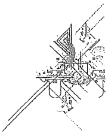

natural_image

Pure technical line drawing of intersecting lines and shapes without any text, numbers, or symbols

---

1. 2. 3. 4. 5. 6. 7. 8. 9. 10. 11. 12. 13. 14. 15. 16. 17. 18. 19. 20. 21. 22. 23. 24. 25. 26. 27. 28. 29. 30. 31. 32. 33. 34. 35. 36. 37. 38. 39. 40. 41. 42. 43. 44. 45. 46. 47. 48. 49. 50. 51. 52. 53. 54. 55. 56. 57. 58. 59. 60. 61. 62. 63. 64. 65. 66. 67. 68. 69. 70. 71. 72. 73. 74. 75. 76. 77. 78. 79. 80. 81. 82. 83. 84. 85. 86. 87. 88. 89. 90.

306

第十三章 非正弦周期电流电路和信号的频谱

则有

$$
\left\{ \begin{array}{l} \varphi_ {(k)} = \arctan \left(0. 1 4 3 k - \frac {7}{k}\right) \quad (\text {阻抗角}) \\ \dot {I} _ {\mathrm{m} (k)} = \frac {1}{3} \cos \varphi_ {(k)}   \dot {U} _ {\mathrm{sm} (k)} / - \varphi_ {(k)} \\ P _ {(k)} = \frac {1}{2} I _ {\mathrm{m} (k)} ^ {2} \cdot R = 1. 5 I _ {\mathrm{m} (k)} ^ {2} \end{array} \right.
$$

计算结果如下:

$$
k = 1 \quad \varphi_ {(1)} = - 8 1. 7 0 ^ {\circ} (\text {容性})
$$

$$
\dot {I} _ {\mathrm{m(1)}} = 1 3. 4 7 / 8 1. 7 0 ^ {\circ} \mathrm{A}
$$

$$
P _ {(1)} = 2 7 2. 3 3 \mathrm{W}
$$

$$
k = 3 \quad \varphi_ {(3)} = - 6 2. 3 0 ^ {\circ} (\text {容性})
$$

$$
\dot {I} _ {\mathrm{m(3)}} = 1 4. 4 7 / 6 2. 3 0 ^ {\circ} \mathrm{A}
$$

$$
P _ {(3)} = 3 1 4. 0 6 \mathrm{W}
$$

$$
k = 5 \quad \varphi_ {(5)} = - 3 4. 4 1 ^ {\circ} (\text {容性})
$$

$$
\dot {I} _ {\mathrm{m(5)}} = 1 5. 4 1 / 3 4. 4 1 ^ {\circ} \mathrm{A}
$$

$$
P _ {(5)} = 3 5 6. 0 0 \mathrm{W}
$$

$$
k = 7 \quad \varphi_ {(7)} = 0 ^ {\circ} (\text {谐振})
$$

$$
\dot {I} _ {\mathrm{m(7)}} = 1 3. 3 4 / 0 ^ {\circ} \mathrm{A}
$$

$$
P _ {(7)} = 2 6 7. 0 7 \mathrm{W}
$$

$$
k = 9 \quad \varphi_ {(9)} = 2 6. 9 9 ^ {\circ} (\text {感性})
$$

$$
\dot {I} _ {\mathrm{m(9)}} = 9. 2 4 / - 2 6. 9 9 ^ {\circ} \mathrm{A}
$$

$$
P _ {(9)} = 1 2 8. 1 7 \mathrm{W}
$$

叠加后为

$$
i = 1 3. 4 7 \cos (\omega_ {1} t + 8 1. 7 0 ^ {\circ}) + 1 4. 4 7 \cos (3 \omega_ {1} t + 6 2. 3 0 ^ {\circ}) +
$$

$$
1 5. 4 1 \cos (5 \omega_ {1} t + 3 4. 4 1 ^ {\circ}) + \dots
$$

$$
P = P _ {(1)} + P _ {(3)} + P _ {(5)} + \dots + P _ {(9)} = 1. 3 3 7. 6 3 \mathrm{W}
$$

通过本例可以看出,对于电路中  $u_{s}$  的各次谐波的振幅与 k 成反比衰减,电路的网络函数为带通函数,对 7 次谐波谐振,由于 Q 值较小 (Q=1),所以,总体看来各次谐波的电流振幅衰减非常缓慢。截取 k=9 是不够的。

例 13-3 图 13-8(a) 所示电路中  $L=5\ H, C=10\ \mu F$ ，负载电阻  $R=2\ k\Omega, u_{s}$  为正弦全波整流波形，如图 13-8(b) 所示。设  $\omega_{1}=314\ rad/s, U_{sm}=157\ V$ 。求负载两端电压的各谐波分量。

---

§ 13-5 对称三相电路中的高次谐波

307

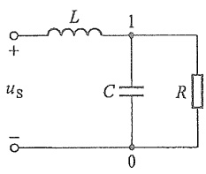

text_image

L
+
us
-
1
C
R
0

(a)

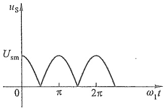

line

| \(\omega_1t\) | u_s |
| --- | --- |
| 0 | U_sm |
| ~\(0.5\pi\) | 0 |
| ~\(0.8\pi\) | U_sm |
| ~\(1.2\pi\) | 0 |
| ~\(1.6\pi\) | U_sm |
| ~\(2.0\pi\) | 0 |

(b)

图13-8 例13-3图

解 参阅表 13-1, 将给定的  $u_{s}$  分解为傅里叶级数, 得

$$
u _ {\mathrm{s}} = \frac {4}{\pi} \times 1 5 7 \left[ \frac {1}{2} + \frac {1}{3} \cos (2 \omega_ {1} t) - \frac {1}{1 5} \cos (4 \omega_ {1} t) + \dots \right]
$$

设负载两端电压的第 k 次谐波为  $\dot{U}_{1\mathrm{m}(k)}$  (采用复振幅相量)，用节点电压法有

$$
\left[ \frac {1}{\mathrm{j} k \dot {\omega} _ {1} L} + \frac {1}{R} + \mathrm{j} k \omega_ {1} C \right] \dot {U} _ {\mathrm{Im} (k)} = \frac {1}{\mathrm{j} k \omega_ {1} L} \dot {U} _ {\mathrm{sm} (k)}
$$

$$
\dot {U} _ {1 \mathrm{m} (k)} = \frac {\dot {U} _ {\mathrm{sm} (k)}}{\left(\frac {1}{R} + \mathrm{j} k \omega_ {1} C\right) \mathrm{j} k \omega_ {1} L + 1} = \frac {\dot {U} _ {\mathrm{sm} (k)}}{1 - k ^ {2} \omega_ {1} ^ {2} L C + \mathrm{j} k \frac {\omega_ {1} L}{R}}
$$

令  $k=0,2,4,\cdots$ ，并代入数据，可分别求得

$$
k = 0 \quad \varphi_ {(0)} = 0 \quad U _ {1 \mathrm{m} (0)} = 1 0 0 \mathrm{V} (\text {直流分量})
$$

$$
k = 2 \quad \varphi_ {(2)} = 1 7 5. 2 1 ^ {\circ} \quad U _ {1 \mathrm{m} (2)} = 3. 5 5 / - 1 7 5. 2 1 ^ {\circ} \mathrm{V}
$$

$$
k = 4 \quad \varphi_ {(4)} = 1 7 7. 6 9 ^ {\circ} \quad U _ {1 \mathrm{m} (4)} = - 0. 1 7 1 / - 1 7 7. 6 9 ^ {\circ} \mathrm{V}
$$

图 13-8(a) 所示电路为一全波整流电路的滤波电路。它利用了电感对高频电流的抑制作用，电容对高频电流的分流作用，使得输入电压中的 2 次和 4 次谐波分量大大削弱，而负载两端的电压接近直流电压，但尚有 3.5% 的 2 次谐波。

## \* §13-5 对称三相电路中的高次谐波

三相发电机磁极磁场的波形如表 13-1 中第 2 项所示, 其产生的电压波形或多或少与正弦波有些差别, 因此, 含有一定的谐波分量; 变压器的励磁电流是非正弦周期波, 含有高次谐波分量。所以, 一般在对称三相电路中, 电压、电流都可能含有高次谐波分量。

对于对称的三相制,3个对称的非正弦周期相电压在时间上依次滞后 $\frac{1}{3}$ 周期(正序),但其变化规律则相同;如果A相电压可表示为

$$
u _ {A} = u (t)
$$

则 B 相和 C 相电压为

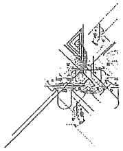

natural_image

Pure mechanical assembly diagram without any text, numbers, or symbols

---

308

第十三章 非正弦周期电流电路和信号的频谱

$$
u _ {\mathrm{B}} = u \bigg (t - \frac {T}{3} \bigg) , \quad u _ {\mathrm{C}} = u \bigg (t - \frac {2 T}{3} \bigg).
$$

如果把上述对称的相电压展开成傅里叶级数(发电机的每相电压为奇谐波函数)，则有

A 相 $u_{\mathrm{A}} = \sum U_{\mathrm{m}(k)}\cos (k\dot{\omega}_{1}t + \phi_{k})$

B相 $u_{\mathrm{B}} = \sum U_{\mathrm{m}(k)}\cos \left(k\omega_1t + \phi_k - \frac{2k\pi}{3}\right)$

C相 $u_{\mathrm{C}} = \sum U_{\mathrm{m}(k)}\cos \left(k\omega_1t + \phi_k + \frac{2k\pi}{3}\right)$

式中 k 取奇数, 即 1,3,5,…。下面分别对各次谐波电压, 通过比较电压的相位差来讨论各次谐波电压的对称性。

(1) 令 $k = 6n + 1, n = 0, 1, 2, \cdots$ (自然数), 即 $k = 1, 7, 13, \cdots$。各相中该系列谐波电压的初相分别为

A 相: $(\phi_k)$, B 相: $\left(\phi_k - 4n\pi - \frac{2}{3}\pi\right)$, C 相: $\left(\phi_k + 4n\pi + \frac{2}{3}\pi\right)$

显然,去掉式中的 $\pm4n\pi$ 整周期的因子后,这些谐波中的每一次谐波都构成正序对称的三相电压源。

(2) 令  $k=6n+3$ ，即  $k=3,9,15,\cdots$ 。各相中该系列谐波电压的初相分别为

A 相: $(\phi_k)$, B 相: $[\phi_k - (2n + 1)2\pi]$, C 相: $[\phi_k + (2n + 1)2\pi]$

这些谐波中的每一次谐波都是等幅同相的3相电压源，工程上称为零序对称的三相电压源。

(3) 令  $k=6n+5$ ，即  $k=5,11,17,\cdots$ 。各相中该系列谐波电压的初相分别为

A 相:  $(\phi_{k})$ ， B 相:  $\left[\phi_{k}-(2n+2)2\pi+\frac{2}{3}\pi\right]$

C相: $\left[\phi_k + (2n + 2)2\pi -\frac{2}{3}\pi \right]$

这些谐波中的每一次谐波都构成负序对称的三相电压源。

总之,三相对称的正序非正弦周期量(奇谐波)的级数展开式中的谐波组合为3类对称组,即正序对称组、负序对称组和零序对称组。

在上述对称的非正弦周期电压源作用下的对称三相电路的分析计算,按3类对称组分别进行。对于正序和负序对称组,可直接引用第十二章§12-3的方法和有关结论,零序组电源对对称三相电路的作用,与系统的连接方式有关,下面根据不同的情况单独对零序组 $(k=6n+3)$ 分量的响应进行分析。

(1) 对称的三角形电源

由于零序组电压源是等幅同相的电源，即有  $\dot{U}_{\mathrm{A}(k)} = \dot{U}_{\mathrm{B}(k)} = \dot{U}_{\mathrm{C}(k)} = \dot{U}_{\mathrm{s}(k)}$ ，所以在三角形电源的回路中将产生零序环流，设为  $\dot{I}_{0(k)}$  有

$\dot{I}_{0(k)}$ （零序） $= \frac{3\dot{U}_{\mathrm{s}(k)}}{3Z_0} = \frac{\dot{U}_{\mathrm{s}(k)}}{Z_0}$ （零序）

$$
\dot {U} _ {\mathrm{AB} (k)} = \dot {U} _ {\mathrm{BC} (k)} = \dot {U} _ {\mathrm{CA} (k)} = \dot {U} _ {\mathrm{s} (k)} - \dot {I} _ {0 (k)} Z _ {0} = 0
$$

---

\*§ 13-6 傅里叶级数的指数形式

309

式中 $Z_{0}$ 为电源的(一相)内阻抗。在环流的作用下零序线电压为零。所以，不论负载端的连接形式如何，整个系统中除电源中有零序组环流外，其余部分的电压、电流中均不含零序组分量。即电源的三角形接法将消除零序组电压源对系统的影响。

(2) 星形对称电源(无中性线对称系统)

电路总可以简化为 Y-Y 形式求解,如图 13-9 所示(S 打开时)。可求得零序组电压、电流为

$$
\dot {U} _ {\mathrm{N'N(k)}} (\text {零序}) = \dot {U} _ {\mathrm{s(k)}} (\text {零序})
$$

$$
\dot {I} _ {\mathrm{A} (k)} = \dot {I} _ {\mathrm{B} (k)} = \dot {I} _ {\mathrm{C} (k)} = \frac {\dot {U} _ {\mathrm{s} (k)} - \dot {U} _ {\mathrm{N} ^ {\prime} \mathrm{N}}}{Z} = 0
$$

$$
\dot {U} _ {\mathrm{AB} (k)} = \dot {U} _ {\mathrm{A} (k)} - \dot {U} _ {\mathrm{B} (k)} = 0
$$

$$
\dot {U} _ {\mathrm{BC} (k)} = \dot {U} _ {\mathrm{CA} (k)} = 0
$$

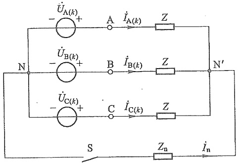

text_image

ÜA(k)
- A İA(k) Z
ÜB(k)
- B İB(k) Z
ÜC(k)
- C İC(k) Z
N N' S Zn İn

图 13-9 Y-Y 连接时的高次谐波

结果表明,在无中性线的 Y-Y 系统中,除了中性点电压和电源相电压中含有零序组电压分量外,系统的其余部分的电压、电流都不含零序组分量。

(3) 三相四线制对称系统(有中性线对称系统)

电路参阅图 13-9(S 闭合时)。可求得零序组电压、电流为

$$
\dot {U} _ {\mathrm{N'N}} = \frac {3 Z _ {\mathrm{n}} \dot {U} _ {\mathrm{s(k)}}}{Z + 3 Z _ {\mathrm{n}}}
$$

$$
\dot {I} _ {\mathrm{A} (k)} = \dot {I} _ {\mathrm{B} (k)} = \dot {I} _ {\mathrm{C} (k)} = \dot {I} _ {1 (k)} = \frac {\dot {U} _ {\mathrm{s} (k)} - \dot {U} _ {\mathrm{N} ^ {\prime} \mathrm{N}}}{Z} = \frac {\dot {U} _ {\mathrm{s} (k)}}{Z + 3 Z _ {\mathrm{n}}}
$$

$$
\dot {U} _ {\mathrm{AN} ^ {\prime} (k)} = \dot {U} _ {\mathrm{BN} ^ {\prime} (k)} = \dot {U} _ {\mathrm{CN} ^ {\prime} (k)} = \dot {I} _ {1 (k)} Z
$$

$$
\dot {I} _ {\mathrm{n} (k)} = - 3 \dot {I} _ {\mathrm{l} (k)}
$$

仍有 $\dot{U}_{\mathrm{AB}(k)} = \dot{U}_{\mathrm{BC}(k)} = \dot{U}_{\mathrm{CA}(k)} = 0$

当  $Z_{n}=\infty$  时(无中性线)，上述结果与(2)相同，结果表明，除线电压外，电路中其余部分的电压、电流中都含零序组分量。

上述 3 种情况中, 线电压都不含零序组分量, 所以有

$$
U _ {1} <   \sqrt {3} U _ {\mathrm{Ph}}
$$

式中  $U_{ph}$  为相电压。3 种情况中，只有三相四线制系统中的电流才含有零序组分量。

## \* §13-6 傅里叶级数的指数形式

傅里叶级数可以用指数形式表示。非正弦周期信号 $f(t)$ 的傅里叶级数的三角函数形式为

$$
f (t) = \frac {A _ {0}}{2} + \sum_ {k = 1} ^ {\infty} A _ {k m} \cos (k \omega_ {1} t + \phi_ {k})
$$

---

310

第十三章 非正弦周期电流电路和信号的频谱

利用欧拉公式有

$$
\begin{array}{l} A _ {k \mathrm{m}} \cos (k \omega_ {1} t + \phi_ {k}) = \frac {1}{2} [ A _ {k \mathrm{m}} (\mathrm{e} ^ {\mathrm{j} (k \omega_ {1} t + \phi_ {k})} + \mathrm{e} ^ {- \mathrm{j} (k \omega_ {1} t + \phi_ {k})}) ] \\ = \frac {1}{2} A _ {k m} \mathrm{e} ^ {\mathrm{j} \phi_ {k}} \mathrm{e} ^ {\mathrm{j} k \omega_ {1} t} + \frac {1}{2} A _ {k m} \mathrm{e} ^ {- \mathrm{j} \phi_ {k}} \mathrm{e} ^ {- \mathrm{j} k \omega_ {1} t} \\ = c _ {k} \mathrm{e} ^ {\mathrm{j} k \omega_ {1} t} + c _ {k} ^ {*} \mathrm{e} ^ {- \mathrm{j} k \omega_ {1} t} \\ \end{array}
$$

式中 $c_{k} = \frac{1}{2} A_{km}\mathrm{e}^{\mathrm{j}\phi_{k}},c_{k}^{*} = \frac{1}{2} A_{km}\mathrm{e}^{-\mathrm{j}\phi_{k}}$ 。于是有

$$
f (t) = \frac {A _ {0}}{2} + \sum_ {k = 1} ^ {\infty} c _ {k} \mathrm{e} ^ {\mathrm{j} k \omega_ {1} t} + \sum_ {k = 1} ^ {\infty} c _ {k} ^ {*} \mathrm{e} ^ {- \mathrm{j} k \omega_ {1} t} \tag {13-4}
$$

上式中  $c_{k}e^{jk\omega_{1}t}$  可以看作具有  $k\omega_{1}$  角速度的逆时针旋转向量， $c_{k}^{*}e^{-jk\omega_{1}t}$  为具有同样角速度的顺时针旋转向量，每一次谐波为两项之和。

由于 $a_{k} = A_{km}\cos \phi_{k},b_{k} = -A_{km}\sin \phi_{k}$ ，故 $A_{km}\mathrm{e}^{\mathrm{j}\phi_k} = a_k - \mathrm{j}b_k$ ，将根据式(13-3)得出的 $a_{k}$ 和$b_{k}$ 代入，有

$$
\begin{array}{l} c _ {k} = \frac {1}{T} \int_ {0} ^ {T} f (t) \cos (k \omega_ {1} t) \mathrm{d} t - \mathrm{j} \frac {1}{T} \int_ {0} ^ {T} f (t) \sin (k \omega_ {1} t) \mathrm{d} t \\ = \frac {1}{T} \int_ {0} ^ {T} f (t) [ \cos (k \omega_ {1} t) - \mathrm{j} \sin (k \omega_ {1} t) ] \mathrm{d} t \\ = \frac {1}{T} \int_ {0} ^ {T} f (t) \mathrm{e} ^ {- \mathrm{j} k \omega_ {1} t} \mathrm{d} t \\ \end{array}
$$

同理,可求得

$$
c _ {k} ^ {*} = \frac {1}{T} \int_ {0} ^ {T} f (t) \mathrm{e} ^ {\mathrm{j} k \omega_ {1} t} \mathrm{d} t
$$

可见,若令  $c_{k}$  中的“k”等于“-k”,则将等于  $c_{k}^{*}$ 。所以式(13-4)可改写为

$$
f (t) = \frac {A _ {0}}{2} + \sum_ {k = 1} ^ {\infty} c _ {k} \mathrm{e} ^ {\mathrm{j} k \omega_ {1} t} + \sum_ {k = - 1} ^ {- \infty} c _ {k} \mathrm{e} ^ {\mathrm{j} k \omega_ {1} t}
$$

当 $k = 0$ 时， $\frac{A_0}{2} = c_0$ ，最后可得出傅氏级数的指数形式的表达式(函数对)为

$$
\left. \begin{array}{l} c _ {k} = \frac {1}{T} \int_ {0} ^ {T} f (t) \mathrm{e} ^ {- \mathrm{j} k \omega_ {1} t} \mathrm{d} t \\ f (t) = \sum_ {k = - \infty} ^ {\infty} c _ {k} \mathrm{e} ^ {\mathrm{j} k \omega_ {1} t} \end{array} \right\} \tag {13-5}
$$

在画傅里叶级数指数形式的频谱时,要画出  $\left|c_{k}\right|$  与正、负 k 的关系。由于指数形式中的 k 的取值是正、负整数,所以画出的幅度频谱图对于纵轴对称。同样,画出  $c_{k}$  的辐角与 k 的关系,就能获得相位频谱。具体画法参阅下面的例题。

注意,指数形式表述的幅度频谱除了上述特点外,其谱线“高度”是傅氏频谱的一

---

\*§ 13-6 傅里叶级数的指数形式

311

半,另一方面由于正、负 k 完全对称,所以只要研究“半边”即可。

例13-4 试将例13-1的矩形波展开为指数形式的傅氏级数，并画出幅度频谱和相位频谱。

解 根据例 13-1 的结果, 可求得  $c_{k}$  为

$$
c _ {k} = \frac {1}{2} A _ {k m} \mathrm{e} ^ {\mathrm{j} \phi_ {k}} = \frac {E _ {\mathrm{m}}}{\mathrm{j} 2 k \pi} (1 - 2 \mathrm{e} ^ {- \mathrm{j} k \pi} + \mathrm{e} ^ {- \mathrm{j} 2 k \pi})
$$

所以

$$
c _ {k} = \left\{ \begin{array}{l l} \frac {E _ {\mathrm{m}}}{\mathrm{j} 2 k \pi} \times 4 = \frac {2 E _ {\mathrm{m}}}{\mathrm{j} k \pi} & \text {当} k \text {为奇数时} \\ 0 & \text {当} k \text {为偶数时} \end{array} \right.
$$

这样,可以得到指数形式的傅氏级数为

$$
\begin{array}{l} f (t) = \frac {2 E _ {\mathrm{m}}}{\pi} \left[ \mathrm{e} ^ {\mathrm{j} \left(\omega_ {1} t - \frac {\pi}{2}\right)} + \mathrm{e} ^ {- \mathrm{j} \left(\omega_ {1} t - \frac {\pi}{2}\right)} \right] + \frac {2 E _ {\mathrm{m}}}{3 \pi} \left[ \mathrm{e} ^ {\mathrm{j} \left(3 \omega_ {1} t - \frac {\pi}{2}\right)} + \mathrm{e} ^ {- \mathrm{j} \left(3 \omega_ {1} t - \frac {\pi}{2}\right)} \right] + \\ \frac {2 E _ {\mathrm{m}}}{5 \pi} \left[ \mathrm{e} ^ {\mathrm{j} \left(5 \omega_ {1} t - \frac {\pi}{2}\right)} + \mathrm{e} ^ {- \mathrm{j} \left(5 \omega_ {1} t - \frac {\pi}{2}\right)} \right] + \dots \\ \end{array}
$$

所得结果与例13-1相比完全一致。图13-10(a)所示为矩形波的傅氏级数的指数形式的幅度频谱[注意与图13-2(d)(e)比较]，其相位频谱如图13-10(b)所示。由于 $c_{k}, c_{k}^{*}$ 为一对共轭复数，所以，$\left|c_{k}\right| = \left|c_{k}^{*}\right|$，其线谱“高度”是傅氏频谱的一半，而 $\arg (c_k^*) = -\arg (c_k)$。

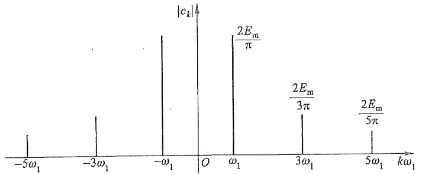

spectrogram

| \(-5\omega_1\) | ~0.2 |
| --- | --- |
| \(-3\omega_1\) | ~0.4 |
| \(-\omega_1\) | ~1.0 |
| \(\omega_1\) | 2E_m/π |
| \(3\omega_1\) | 2E_m/3π |
| \(5\omega_1\) | 2E_m/5π |

(a)

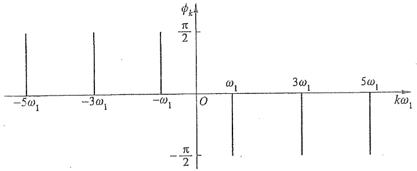

spectrogram

| \(k\omega1\) | \(\phi k\) |
| --- | --- |
| \(-5\omega1\) | \(\pi/2\) |
| \(-3\omega1\) | \(\pi/2\) |
| \(-\omega1\) | \(\pi/2\) |
| \(\omega1\) | \(-\pi/2\) |
| \(3\omega1\) | \(-\pi/2\) |
| \(5\omega1\) | \(-\pi/2\) |

(b)

图13-10 例13-4的频谱

---

312

第十三章 非正弦周期电流电路和信号的频谱

例 13-5 图 13-11(a) 所示为常用于电视、雷达、计算机等方面的一种重复性矩形脉冲波。试画出其频谱。

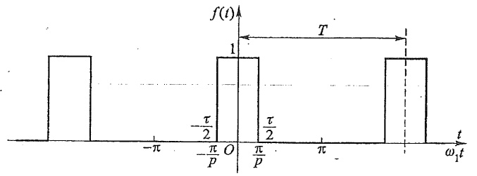

bar

| Interval | Value |
| --- | --- |
| 1 | 1 |
| \(-\tau/2\) to π/p | 0 |
| \(\pi/p\) to π | 0 |
| \(\pi\) to ω₁t | 0 |
| \(\omega_{1}t\) to T | 1 |

(a)

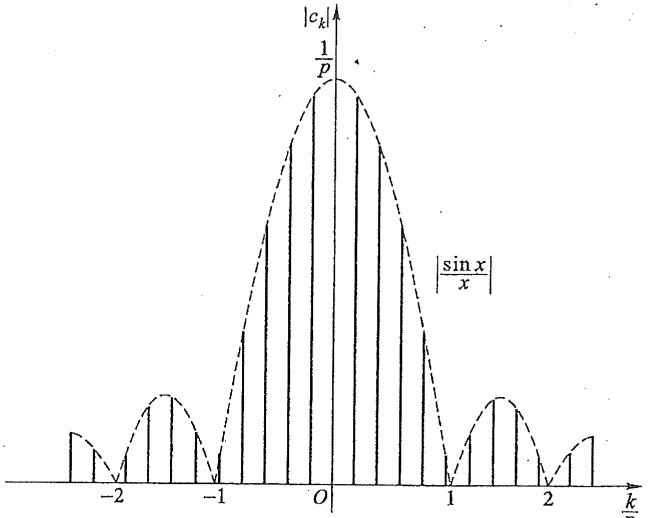

area

| -2.5 | ~0.1 |
| --- | --- |
| -2.0 | ~0.1 |
| -1.5 | ~0.3 |
| -1.0 | ~0.1 |
| -0.5 | ~0.8 |
| 0 | 1/p |
| 0.5 | ~0.8 |
| 1.0 | ~0.1 |
| 1.5 | ~0.3 |
| 2.0 | ~0.1 |
| 2.5 | ~0.1 |

(b)

图13-11 例13-5的周期性矩形脉冲及其频谱

$$
\begin{array}{l} = \frac {1}{T} \left(- \frac {1}{\mathrm{j} k \omega_ {1}}\right) \left(\mathrm{e} ^ {- \mathrm{j} k \omega_ {1} \frac {\tau}{2}} - \mathrm{e} ^ {\mathrm{j} k \omega_ {1} \frac {\tau}{2}}\right) \\ = \frac {\tau}{T} \frac {\sin \left(k \frac {\omega_ {1} \tau}{2}\right)}{k \frac {\omega_ {1} \tau}{2}} \\ \end{array}
$$

解 $c_{k} = \frac{1}{T}\int_{-\frac{T}{2}}^{\frac{T}{2}}f(t)\mathrm{e}^{-\mathrm{j}k\omega_{1}t}\mathrm{d}t = \frac{1}{T}\int_{-\frac{\tau}{2}}^{\frac{\tau}{2}}\mathrm{e}^{-\mathrm{j}k\omega_{1}t}\mathrm{d}t$

$\tau$ 为脉冲的宽度，并有 $\omega_{1} = \frac{2\pi}{T}$，令 $p = \frac{T}{\tau}$，则有

$$
c _ {k} = \frac {1}{p} \frac {\sin \left(\frac {k \pi}{p}\right)}{\frac {k \pi}{p}}
$$

---

\*§ 13-7 傅里叶积分简介

313

根据式(13-5)可写出重复性矩形脉冲的傅里叶级数为

$$
f (t) = \sum_ {k = - \infty} ^ {\infty} \frac {1}{p} \frac {\sin \left(\frac {k \pi}{p}\right)}{\frac {k \pi}{p}} \mathrm{e} ^ {\mathrm{j} k \omega_ {1} t}
$$

由 $c_{k}$ 式可知，$c_{0} = \frac{1}{p} = \frac{\tau}{T}$，当 $\frac{k}{p}$ 为整数时，$|c_k| = 0$。

图 13-11(b) 所示频谱是在 p=5 的情况下画出的。5 次谐波及所有 5k 次谐波的幅值都等于零。如令  $x=\frac{k\pi}{p}$ ，则谱线的包络线大体上具有函数  $\left|\frac{\sin x}{x}\right|$  的形式[如图 13-11(b) 中虚线所示]。

## \* §13-7 傅里叶积分简介

本章前面关于谐波分析法的论述,都是针对非正弦周期函数 $f(t)$ 展开的,理论上仅要求函数 $f(t)$ 满足狄里赫利条件,对函数 $f(t)$ 周期的长短并无限制。本节将在前面论述的基础上,对函数 $f(t)$ 的周期 T 无限增长,在 $T\to\infty$ 的极限情况下,从理论上说明 $f(t)$ 的傅里叶级数是如何展开的。根据式(13-5)

$$
f (t) = \sum_ {k = - \infty} ^ {\infty} c _ {k} \mathrm{e} ^ {\mathrm{j} k \omega_ {1} t}
$$

其中

$$
\begin{array}{l} c _ {k} = \frac {1}{T} \int_ {0} ^ {T} f (t) \mathrm{e} ^ {- \mathrm{j} k \omega_ {1} t} \mathrm{d} t \\ = \frac {1}{T} \int_ {- \frac {T}{2}} ^ {\frac {T}{2}} f (t) \mathrm{e} ^ {- \mathrm{j} k \omega_ {1} t} \mathrm{d} t \tag {13-6} \\ \end{array}
$$

在式(13-6)中,表述的频谱函数 $c_{k}$ 是离散的线状频谱,相邻谱线之间的频差 $\Delta\omega$ 为

$$
\Delta \omega = \omega_ {1} = \frac {2 \pi}{T} (\text {基波频率})
$$

当 $T \to \infty$ 时, $c_k$ 在此极限情况下将发生如下变化: 其一, 相邻谱线之间的频差 $\Delta \omega$ 将无限缩小, 谱线将无限密集, 最后 $\Delta \omega \to \mathrm{d}\omega \to 0$, 而 $k\omega_1 \to \omega$, 离散的线状频谱将变为连续的频谱, 即 $c_k$ 为 $\omega$ 的连续函数; 其二, 如果函数 $f(t)$ 在周期内的积分有界 (满足狄里赫利条件), 则由式 (13-5) 可知, $|c_k|_{T \to \infty} \to 0$ 。综上所述, 频谱函数 $c_k$ 在全频域内是一个无限小的连续函数, 这种极限形式, 仅能从理论上说明其极限存在, 并可定性地加以描述函数 $f(t)$ 的频域特性, 而失去了定量表述的意义 [如画不出频谱(图)]。但从式 (13-6) $c_k$ 的表达式可知, 式中的积分部分才是真正反映函数 $f(t)$ 频域特性的频域函数, 因此, 从式 (13-6) 可以定义一个新的函数

1

---

314

第十三章 非正弦周期电流电路和信号的频谱

$$
F (\mathrm{j} k \omega_ {1}) = T c _ {k} = \frac {2 \pi c _ {k}}{\Delta \omega} = \int_ {- \frac {T}{2}} ^ {\frac {T}{2}} f (t) \mathrm{e} ^ {- \mathrm{j} k \omega_ {1} t} \mathrm{d} t \tag {13-7}
$$

当 $T \to \infty$ 时, $\Delta \omega \to \mathrm{d}\omega, k\omega_1 \to \omega$ 。因此, 取极限时式(13-7)变为

$$
F (\mathrm{j} \omega) = \int_ {- \infty} ^ {\infty} f (t) \mathrm{e} ^ {- \mathrm{j} \omega t} \mathrm{d} t \tag {13-8}
$$

上式称为傅里叶积分或傅里叶正变换，工程上也常称为频谱密度函数，它把一个时间函数变换成一个频率函数。实际上，它是将无限小的连续的频谱函数 $c_{k}$ 放大了无穷倍，将函数 $f(t)$ 被掩盖的频域特性的真相揭示出来，以利于从频域分析研究。

另外，从式(13-7)有

$$
c _ {k} = \frac {F (\mathrm{j} k \omega_ {1})}{T} = \frac {\Delta \omega F (\mathrm{j} k \omega_ {1})}{2 \pi}
$$

把上式代入式(13-5)得

$$
f (t) = \sum_ {k = - \infty} ^ {\infty} \frac {\Delta \omega F (\mathrm{j} k \omega_ {1})}{2 \pi} \mathrm{e} ^ {- \mathrm{j} k \omega_ {1} t}
$$

当 $T \to \infty$ 时, $\Delta \omega \to \mathrm{d}\omega, k\omega_1 \to \omega$。上式的求和变成积分, 可以写为

$$
f (t) = \frac {1}{2 \pi} \int_ {- \infty} ^ {\infty} F (\mathrm{j} \omega) \mathrm{e} ^ {- \mathrm{j} \omega t} \mathrm{d} \omega \tag {13-9}
$$

上述积分式称为傅里叶逆变换,为了便于分析对照,将傅里叶正、逆变换重写如下:

$$
F (\mathrm{j} \omega) = \int_ {- \infty} ^ {\infty} f (t) \mathrm{e} ^ {- \mathrm{j} \omega t} \mathrm{d} t \quad (\text {正变换})
$$

$$
f (t) = \frac {1}{2 \pi} \int_ {- \infty} ^ {\infty} F (\mathrm{j} \omega) \mathrm{e} ^ {\mathrm{j} \omega t} \mathrm{d} \omega \quad (\text {逆变换})
$$

上述一对积分称为傅里叶变换对， $f(t)$ （时域）与 $F(\mathrm{j}\omega)$ （频域）通过上述积分在时域和频域之间建立了一一对应的关系。上述变换对表明，函数 $f(t)$ 在 $T\to\infty$ 的极限条件下，由离散形式频谱函数 $c_{k}$ ，变换为连续形式的频谱密度函数 $F(\mathrm{j}\omega)$ ， $f(t)$ 的傅里叶级数形式（离散形式）的展开式，变换为连续函数形式的展开式，以积分形式表示。这一变换在理论上和应用上都有十分重要的意义，因为任一非周期信号 $f(t)$ （任意信号），都可以看作周期为无限长的周期信号，所以傅里叶变换对为分析研究任意信号奠定了理论基础。在线性电路中，任一形式激励的零状态响应，都可以通过傅里叶变换对，用谐波分析法进行分析研究。

现在可以对例13-5做进一步的分析。当 $T \to \infty$ 时，图13-11(a)所示的周期函数$f(t)$，将变成图13-12(a)所示的单一的矩形脉冲，$f(t)$ 变成了非周期函数；而图13-11(b)所示的幅频特性，由于 $\Delta \omega_{1} \rightarrow \mathrm{d}\omega$ ，包络线内的谱线数随之增多，谱线好像从 $-\infty$ 和 $\infty$ 两个方向向 $\omega = 0$ 方向靠拢，无限密集，离散的频谱逐渐过渡为连续的频谱。与此同时，谱线的幅度逐渐降低，并随 $T \to \infty$ ，使 $|c_k| \to 0$ ，这就是函数 $f(t)$ 在 $T \to \infty$ 时趋向极限的一种情景。如果将这一无限小的量 $c_k$ 放大无穷 $(\infty)$ 倍，即有

---

§ 13-7 傅里叶积分简介

315

$$
F (\mathrm{j} \omega) = (  T c _ {k})   \big | _ {T \to \infty} = \tau   \frac {\sin \left(\frac {k \omega_ {1} \tau}{2}\right)}{\frac {k \omega_ {1} \tau}{2}} \Bigg | _ {k \omega_ {1} \to \omega} = \tau   \frac {\sin \left(\frac {\omega \tau}{2}\right)}{\frac {\omega \tau}{2}}
$$

由上式可知，在 $\frac{\omega\tau}{2} = n\pi, n = 1,2,3,\dots$ 的频率点上 $F(\mathrm{j}\omega) = 0,F(\mathrm{j}\omega)\big|_{\omega = 0} = \tau$ ，根据这些点和表达式，就可以画出幅频特性 $|F(\mathrm{j}\omega)|$ ，如图13-12(b)所示。它与图13-11(b)的包络线相似。现由读者思考如下问题:（1）如何画出 $F(\mathrm{j}\omega)$ 的相频特性？（2）当脉冲宽度 $\tau$ 变窄了，或者变宽了，幅频特性将如何变化？

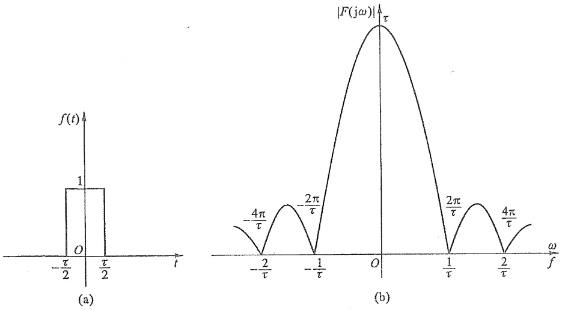

图13-12 矩形脉冲及其幅频特性

例13-6 求 $f(t) = 20\mathrm{e}^{-5t}(t\geqslant 0)$ 的傅里叶变换 $F(\mathrm{j}\omega)$，并画出其频谱图。

解

$$
\begin{array}{l} F (\mathrm{j} \omega) = \int_ {- \infty} ^ {\infty} 2 0 \mathrm{e} ^ {- S t} \mathrm{e} ^ {- \mathrm{j} \omega t} \mathrm{d} t = \int_ {0} ^ {\infty} 2 0 \mathrm{e} ^ {- (\mathrm{j} \omega + S) t} \mathrm{d} t \\ = \frac {2 0}{\mathrm{j} \omega + 5} \\ \end{array}
$$

频谱分别为

$$
\varphi (\mathrm{j} \omega) = - \arctan \left(\frac {\omega}{5}\right)
$$

$$
\mid F (\mathrm{j} \omega) \mid = \frac {2 0}{\sqrt {5 ^ {2} + \omega^ {2}}} = 4 \cos [ \varphi (\mathrm{j} \omega) ]
$$

幅频特性和相频特性如图 13-13 所示。

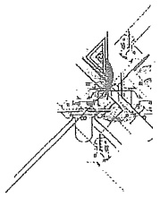

natural_image

Pure mechanical assembly diagram without any text, numbers, or symbols

---

316

第十三章 非正弦周期电流电路和信号的频谱

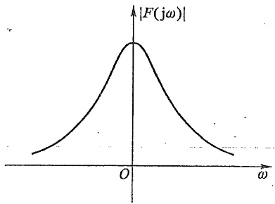

(a)

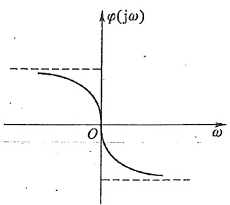

contour

| \(\omega\) | \(\phi(j\omega)\) |
| --- | --- |
| 0 | 0 |

(b)

图-13-13—例 13-6 图

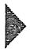

## 思考题

13-1 对于非正弦周期电流电路,各次谐波响应可以分别采用相量法求出,然后在时域将各次谐波响应叠加,为什么?
13-2 对于非正弦周期电流电路,任意一个元件上的响应都包含所有谐波吗?为什么?
13-3 在非正弦周期电流电路中,为什么只给出了有功功率的计算式,没有给出无功功率的计算式?
13-4 当一个非正弦周期电流通过线性电感元件时,它的电流振幅频谱和电压振幅频谱的特征是什么?如果通过线性电容元件又如何?

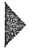

## 习题

13-1 求下列非正弦周期函数 $f(t)$ 的频谱函数(傅里叶级数系数)，并作频谱图。

(1)  $f(t) = \cos(4t) + \sin(6t)$ 。
(2)  $f(t)$  如题 13-1 图 (a) (b) (c) 所示。

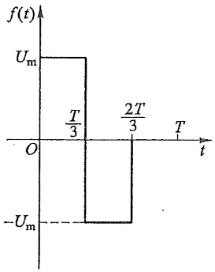

area

| Time Interval | Value |
| --- | --- |
| \(0 < T/3\) | Um |
| T/3 to 2T/3 | -Um |
| 2T/3 to T | Um |

(a)

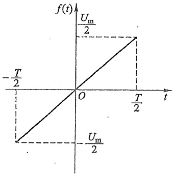

line

| t | f(t) |
| --- | --- |
| -T/2 | Um/2 |
| T/2 | Um/2 |

(b)

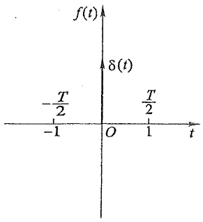

contour

| t | f(t) |
| --- | --- |
| -1 | — |
| -T/2 | \(\delta(t)\) |
| 0 | 0 |
| T/2 | \(\delta(t)\) |
| 1 | — |

(c)

题13-1图

---

习题

317

13-2 设非正弦周期函数  $f(t)$  的频谱函数为  $A_{km}e^{j\phi_{k}} = a_{k} - jb_{k}$ 。试表述下列与  $f(t)$  相关函数的频谱函数。

(1) $f(t - t_0)$ 。
(2)  $f(t)=f(-t)$ 。
(3)  $f(t) = -f(-t)$ 。
(4) $f(t) = -f(t + T / 2)$。
(5) $\frac{\mathrm{d}}{\mathrm{d}t} f(t)$。

13-3 已知某信号半周期的波形如题 13-3 图所示。试在下列各不同条件下画出整个周期的波形:

(1) $a_0 = 0$。
(2) 对所有  $k, b_{k}=0$ 。
(3) 对所有  $k, a_{k}=0$ 。
(4) 当 k 为偶数时,  $a_{k}$  和  $b_{k}$  为零。

13-4 一个 RLC 串联电路, 其 $R = 1 \Omega, \omega_1 L = 10 \Omega, \frac{1}{\omega_1 C} = 90 \Omega$, 外加电压为 $u_s(t) = f\left(t - \frac{T}{2}\right) + \frac{U_m}{2}, f(t)$ 的波形如题 13-1 图 (b) 所示。$U_m = 100 \mathrm{~V}, \omega_1 = 10 \mathrm{rad/s}$ 。试求电路中的电流 $i(t)$ 和电路消耗的功率。

13-5 电路如题 13-5 图所示(实线部分),为了在端口 1-0 获得关于  $u_{\mathrm{s}}(t)$  的最佳的传输信号,可在端口 1-0 并联 RC 串联支路(图中虚线所示),使输出电压  $u_{10}(t)$  为

$$
u _ {1 0} (t) = k u _ {\mathrm{S}} (t)
$$

式中  $u_{\mathrm{s}}(t)$  为任意频率的输入信号。求参数 R、C 和 k（实数）。

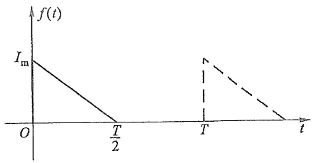

line

| Time (t) | f(t) |
| --- | --- |
| 0 | Im |
| T/2 | 0 |
| T | Im + 1 |
| T | 0 |

题13-3图

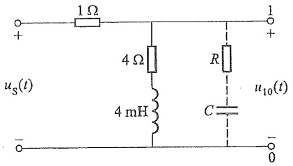

text_image

1 Ω
+
us(t)
-
4 Ω
4 mH
R
C
u10(t)
+
1
-
0

题13-5图

13-6 有效值为 $100\mathrm{V}$ 的正弦电压加在电感 $L$ 两端时，得电流 $I = 10\mathrm{A}$ 。当电压中有3次谐波分量，而有效值仍为 $100\mathrm{V}$ 时，得电流 $I = 8\mathrm{A}$ 。试求这一电压的基波和3次谐波的有效值。

13-7 已知一 RLC 串联电路的端口电压和电流为

$$
u (t) = \left[ 1 0 0 \cos (3 1 4 t) + 5 0 \cos (9 4 2 t - 3 0 ^ {\circ}) \right] \mathrm{V}
$$

---

318

第十三章 非正弦周期电流电路和信号的频谱

$$
i (t) = \left[ 1 0 \cos (3 1 4 t) + 1. 7 5 5 \cos (9 4 2 t + \theta_ {3}) \right] \mathrm{A}
$$

试求:(1) R、L、C 的值。

(2) $\theta_{3}$ 的值。
(3) 电路消耗的功率。

13-8 题 13-8 图所示为滤波电路, 要求负载中不含基波分量, 但  $4\omega_{1}$  的谐波分量能全部传送至负载。如  $\omega_{1}=1\ 000\ rad/s, C=1\ \mu F$ , 求  $L_{1}$  和  $L_{2}$ 。

13-9 题 13-9 图所示电路中  $u_{\mathrm{s}}(t)$  为非正弦周期电压，其中含有  $3\omega_{1}$  及  $7\omega_{1}$  的谐波分量。如果要求在输出电压  $u(t)$  中不含这两个谐波分量，那么 L、C 应为多少？

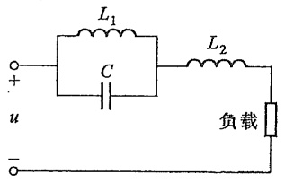

text_image

L₁
C
L₂
负载
u
-

题13-8图

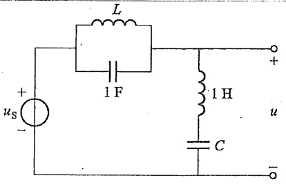

text_image

L
1 F
+
us
-
1 H
C
u
-

题13-9图

13-10 题 13-10 图所示电路中 $i_{\mathrm{S1}} = [5 + 10\cos (10t - 30^{\circ}) - 5\sin (30t + 60^{\circ})]$ A, $u_{\mathrm{S2}}(t) = 300\sin (10t) + 150\cos (30t - 30^{\circ}) \mathrm{~V}$, $L_1 = L_2 = 2\mathrm{H}$, $M = 0.5\mathrm{H}$。求图中交流电表的读数和电源发出的功率 $P$。

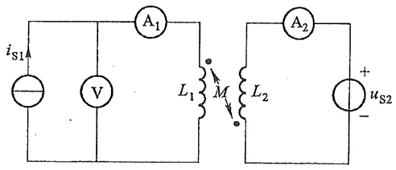

text_image

iS1
V
A1
L1
M
L2
A2
+
uS2
-

题13-10图

13-11 题 13-11 图所示电路中 $u_{\mathrm{s1}} = [1.5 + 5\sqrt{2}\sin (2t + 90^{\circ})]$ V, 电流源电流 $i_{\mathrm{s2}} = 2\sin (1.5t)$ A。求 $u_{R}$ 及 $u_{\mathrm{s1}}$ 发出的功率。

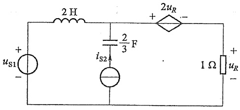

text_image

2 H
+
us1
-
iS2
2/3 F
+
2uR
-
1 Ω
+
ur
-

题13-11图

---

习题

319

13-12 对称三相星形联结的发电机如题 13-12 图所示, 其 A 相电压为 $u_{\mathrm{A}} = [215\sqrt{2}\cos(\omega_{1}t) - 30\sqrt{2}\cos(3\omega_{1}t) + 10\sqrt{2}\cos(5\omega_{1}t)] \mathrm{~V}$, 在基波频率下 $RL$ 串联负载阻抗为 $Z = (6 + \mathrm{j}3)\Omega$, 中性线阻抗 $Z_{\mathrm{N}} = (1 + \mathrm{j}2)\Omega$。试求各相电流、中性线电流以及负载消耗的功率。如不接中性线, 再求各相电流及负载消耗的功率; 这时中性点电压 $U_{\mathrm{N}^{\prime}\mathrm{N}}$ 为多少?

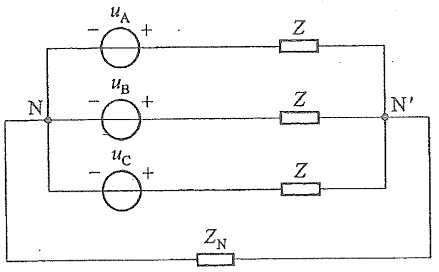

text_image

uA +
-
uB +
-
uC +
-
Z
Z
Z
ZN
N'
N'

题13-12图

13-13 如果将上题中三相电源改为三角形联结并计及每相电源的阻抗。

(1) 试求测相电压的电压表  $V_{1}$  的读数, 但三角形电源没有插入电压表  $V_{2}$ 。
(2) 打开三角形电源接入电压表  $V_{2}$ ，如题 13-13 图所示，试求此时两个电压表的读数。

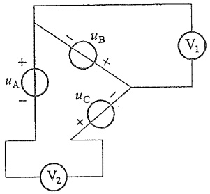

text_image

+
uA
-
-
uB
×
uC
×
V1
V2

题 13-13 图

The image provided is a QR code. It does not contain any text, mathematical formulas, tables, or figures that can be processed according to the given instructions. Therefore, no OCR output can be generated.

第十三章部分习题答案
