# 第15章 电路方程的矩阵形式

原始 PDF 第 385–416 页。

## 第十五章

## 电路方程的矩阵形式

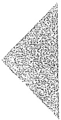

## 导读

随着电路规模的不断增加,特别是超大规模集成电路出现后,电路系统的规模增长十分迅速。采用人工列写电路方程和求解方程是根本不可能的。计算机的普及为分析大规模电路提供了有力的工具。本章介绍的电路方程的矩阵形式,就是适应了用计算机列写电路方程和求解方程的需要。首先,在图的基本概念的基础上,介绍了图论中割集的概念和几个重要的矩阵:关联矩阵、回路矩阵和割集矩阵,并推导出用这些矩阵表示的 KCL、KVL 方程。然后推导出回路电流(网孔电流)方程、节点电压方程、割集电压方程和列表方程的矩阵形式。最后,给出了用于分析动态电路的状态方程,这是适用于在时域分析高阶动态电路的重要方法。

## §15-1 割集

在第三章中曾介绍过几种有效的电路分析方法,如回路电流法和节点电压法等。当电路规模较小,结构较简单时,上述电路方程不难由人工用观察法列出。但在实际工程应用中,电路的规模日益增大,结构日趋复杂。为了便于利用计算机作为辅助手段进行电路分析,有必要研究系统化建立电路方程的方法,而且为了便于用计算机求解方程,还要求这些方程用矩阵形式表示。本章主要介绍电路方程的矩阵形式及其系统建立法,它是电路计算机辅助设计和分析所需的基本知识。

在第三章中已经介绍了图的定义及有关回路、树等的基本概念。这里补充介绍割集的概念，并介绍与树有关的基本割集组。

连通图 G 的一个割集是 G 的一个支路集合, 把这些支路移去将使 G 分离为两个部分, 但是如果少移去其中一条支路, 图仍将是连通的。如在图 15-1(a) 所示的连通图 G 中, 支路集合  $Q_{1}$  至  $Q_{7}$  (图中用虚线所示的支路) 都是 G 的割集, 即  $(a, d, f)(a, b, e)(b, c, f)(c, d, e)(b, d, e, f)(a, e, c, f)$  和  $(a, b, c, d)$ ; 而支路集合  $(a, d, e, f)$  和  $(a, b, c, d, e)$  则不是 G 的割集, 这是因为前者若少移去一条支路, G 仍被分离为两部

---

362

第十五章 电路方程的矩阵形式

分；而后者若移去这些支路，G将被分离成三部分。一般可以用在连通图G上作闭合面的方法确定一个割集。如果在G上作一个闭合面，使其包围G的某些节点，于是，若把与此闭合面相切割的所有支路全部移去，G将被分离为两个部分，则这样一组支路便构成一个割集。在图15-1中，示出了有关闭合面（图中用虚线示出）与割集支路相切割的情况。

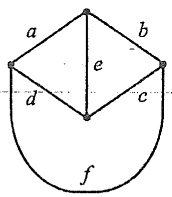

<details>
<summary>text_image</summary>

a
b
e
d
c
f
</details>

(a)

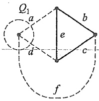

<details>
<summary>text_image</summary>

Q₁
a
b
e
c
d
f
</details>

(b)

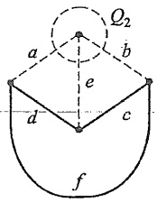

<details>
<summary>text_image</summary>

Q₂
a
b
e
d
c
f
</details>

(c)

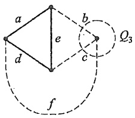

<details>
<summary>text_image</summary>

a
b
Q₃
e
c
d
f
</details>

(d)

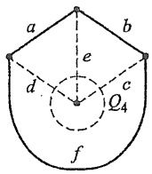

<details>
<summary>text_image</summary>

a
b
e
d
c
Q₄
f
</details>

(e)

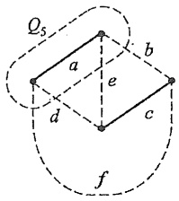

<details>
<summary>text_image</summary>

Q₅
a
b
e
d
c
f
</details>

(f)

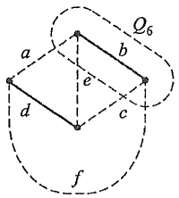

<details>
<summary>text_image</summary>

Q₆
a b
e
d c
f
</details>

(g)

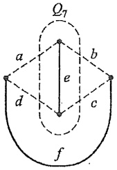

<details>
<summary>text_image</summary>

Q₁
a b
e
d c
f
</details>

(h)

图 15-1 割集的定义

由于 KCL 适用于任何一个闭合面, 因此属于同一割集的所有支路的电流应满足 KCL。当一个割集的所有支路都连接在同一个节点上, 如图 15-1 中的 $Q_{1}、Q_{2}、Q_{3}$ 和 $Q_{4}$, 则割集的 KCL 方程变为节点上的 KCL 方程。于是, 对于连通图, 总共可列出与割集数相等数目的 KCL 方程, 但这些方程并非都是线性独立的。对应于一组线性独立的 KCL 方程的割集称为独立割集。

在第三章中曾介绍了回路电流法，在应用回路电流法时，首先必须选择一组独立回路。应用割集电压法(§15-6)时，首先必须选择一组独立割集。与某一个树有关的单连支回路组是一组独立回路，即基本回路，这就是说，借助于“树”能方便地确定一组独立回路。现在介绍借助于“树”确定一组独立割集的方法。

对于一个连通图,如任选一个树,则与树对应的连支集合不能构成一个割集,而它

---

§ 15-2 关联矩阵、回路矩阵、割集矩阵

363

的每一个树支与一些相应的连支可以构成一个割集。例如，对图15-2所示连通图G，选一个树T，它的树支和连支分别用实线和虚线表示，如把全部连支移去，剩下的图（即为树）仍是连通的，所以任何连支集合不能构成一个割集。另外，由于树是连接全部节点所需最少支路的集合，所以移去任何一条树支，如 $b_{1}$ ，将把树分离成 $T_{1}$ 和 $T_{2}$ 两部

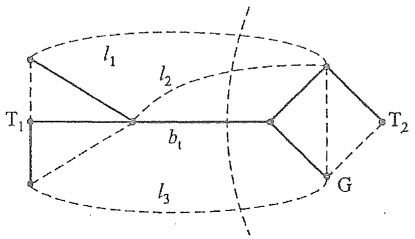

<details>
<summary>text_image</summary>

l₁
T₁
b₁
l₂
T₂
G
l₃
</details>

图 15-2 单树支割集

分。于是连接 $\mathrm{T}_{1}$ 和 $\mathrm{T}_{2}$ 的那些连支 $l_{1}, l_{2}$ 和 $l_{3}$ 与 $b_{1}$ 一起必构成一个割集，因为把它们移去后，G将被分离为两部分。同理，每一条树支都可以与相应的一些连支构成割集。这种由树的一条树支与相应的一些连支构成的割集称为单树支割集或基本割集。对于一个具有 $n$ 个节点和 $b$ 条支路的连通图，其树支数为 $(n - 1)$，因此将有 $(n - 1)$ 个单树支割集，称为基本割集组。基本割集组是独立割集组。对于 $n$ 个节点的连通图，独立割集数为 $(n - 1)$ 。顺便指出，独立割集不一定是单树支割集，如同独立回路不一定是单连支回路一样。

由于一个连通图 G 可以有许多不同的树，所以可选出许多基本割集组。如对图 15-3(a) 所示的连通图，若选支路(2、3、4、6)为树支，则基本割集组为: $Q_{1}(2,1,5,7,8)$ ， $Q_{2}(3,1,5,8)$ ， $Q_{3}(4,1,5)$ ， $Q_{4}(6,5,7,8)$ ，分别如图(b)(c)(d)(e)所示，其中实线和虚线分别表示树支和连支，点画线表示割集支路与相应闭合面相切割的情况。

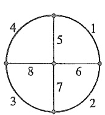

<details>
<summary>text_image</summary>

4
1
5
8
6
7
3
2
</details>

(a)

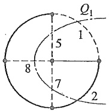

<details>
<summary>text_image</summary>

Q₁
1
5
8
7
2
</details>

(b)

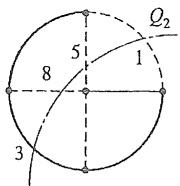

<details>
<summary>text_image</summary>

Q₂
5
8
1
3
</details>

(c)

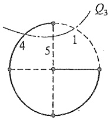

<details>
<summary>text_image</summary>

Q₃
4 5 1
</details>

(d)

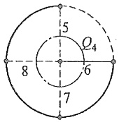

<details>
<summary>text_image</summary>

5
Q₄
8
6
7
</details>

(e)

图15-3 基本割集组

## §15-2 关联矩阵、回路矩阵、割集矩阵

电路的图是电路拓扑结构的抽象描述,若图中每一支路都赋予一个参考方向,它成为有向图。有向图的拓扑性质可以用关联矩阵、回路矩阵和割集矩阵描述。本节介绍

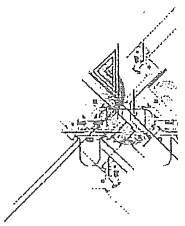

<details>
<summary>natural_image</summary>

Pure technical line drawing of a mechanical assembly without any text, numbers, or symbols
</details>

---

364

第十五章 电路方程的矩阵形式

这 3 个矩阵以及用它们表示的基尔霍夫定律的矩阵形式。

设一条支路连接于某两个节点,则称该支路与这两个节点相关联。支路与节点的关联性质可以用所谓关联矩阵描述。设有向图的节点数为 n, 支路数为 b, 且所有节点与支路均加以编号。于是, 该有向图的关联矩阵为一个  $(n \times b)$  的矩阵, 用  $A_{a}$  表示。它的行对应节点, 列对应支路, 它的任一元素  $a_{jk}$  定义如下:

$a_{jk}=+1$ , 表示支路 k 与节点 j 关联并且它的方向背离节点；

$a_{jk}=-1$ , 表示支路 k 与节点 j 关联并且它指向节点；

$a_{jk}=0$ , 表示支路 k 与节点 j 无关联。

例如对于图 15-4 所示的有向图, 它的关联矩阵是

$$
A _ {a} = \left[ \begin{array}{c c c c c c} 1 & 2 & 3 & 4 & 5 & 6 \\ 1 & - 1 & - 1 & + 1 & 0 & 0 & 0 \\ 2 & 0 & 0 & - 1 & - 1 & 0 & + 1 \\ 3 & + 1 & 0 & 0 & + 1 & + 1 & 0 \\ 4 & 0 & + 1 & 0 & 0 & - 1 & - 1 \end{array} \right] \tag {15-1}
$$

$A_{a}$  的每一列对应于一条支路。由于一条支路连接于两个节点，若离开一个节点，则必指向另一个节点，因此每一列中只有两个非零元素，即 +1 和 -1。当把所有行的元素按列

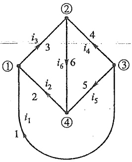

<details>
<summary>text_image</summary>

①
②
i₃ 3
4
i₄
i₆ 6
③
i₂ 2
5
i₅
i₁
④
1
</details>

图15-4 图的节点与支路的关联性质

相加就得一行全为零的元素，所以 $A_{a}$ 的行不是彼此独立的。或者说按 $A_{a}$ 的每一列只有 $+1$ 和 $-1$ 两个非零元素这一特点，$A_{a}$ 中的任一行必能从其他 $(n - 1)$ 行导出。

如果把 $A_{\alpha}$ 的任一行划去，剩下的 $[(n - 1)\times b]$ 矩阵用 $A$ 表示，并称为降阶关联矩阵（今后主要用这种降阶关联矩阵，所以往往略去“降阶”二字）。例如，若把式(15-1)中的第4行划去，得

$$
A = \left[ \begin{array}{c c c c c c} - 1 & - 1 & + 1 & 0 & 0 & 0 \\ 0 & 0 & - 1 & - 1 & 0 & + 1 \\ + 1 & 0 & 0 & + 1 & + 1 & 0 \end{array} \right]
$$

矩阵 A 的某些列将只具有一个 +1 或一个 -1, 每一个这样的列必对应于与划去节点相关联的一条支路。被划去的行对应的节点可以当作参考节点。

设支路电流的参考方向就是支路的方向,电路中的 b 个支路电流可以用一个 b 阶列向量表示,即

$$
i = \left[ \begin{array}{l l l l} i _ {1} & i _ {2} & \dots & i _ {b} \end{array} \right] ^ {\mathrm{T}}
$$

若用矩阵 A 左乘电流列向量, 则乘积是一个  $(n-1)$  阶列向量, 由矩阵相乘规则可知, 它的每一元素即为关联到对应节点上各支路电流的代数和, 即

$$
\boldsymbol {A} \boldsymbol {i} = \left[ \begin{array}{c} \text {节点} 1 \text {上的} \Sigma i \\ \text {节点} 2 \text {上的} \Sigma i \\ \vdots \\ \text {节点} (n - 1) \text {上的} \Sigma i \end{array} \right]
$$

---

§ 15-2 关联矩阵、回路矩阵、割集矩阵

365

1. 工程图

因此，有

$$
A i = 0 \tag {15-2}
$$

式(15-2)是用矩阵 A 表示的 KCL 的矩阵形式。例如对图 15-4 有

$$
A i = \left[ \begin{array}{c} - i _ {1} - i _ {2} ^ {\prime} + i _ {3} \\ - i _ {3} - i _ {4} + i _ {6} \\ i _ {1} + i _ {4} + i _ {5} \end{array} \right] = \left[ \begin{array}{c} 0 \\ 0 \\ 0 \end{array} \right]
$$

设支路电压的参考方向就是支路的方向,电路中 b 个支路电压可以用一个 b 阶列向量表示,即

$$
u = \left[ \begin{array}{c c c c} u _ {1} & u _ {2} & \dots & u _ {b} \end{array} \right] ^ {\mathrm{T}}
$$

$(n-1)$ 个节点电压可以用一个 $(n-1)$ 阶列向量表示, 即

$$
u _ {n} = \left[ \begin{array}{l l l l} u _ {n 1} & u _ {n 2} & \dots & u _ {n (n - 1)} \end{array} \right] ^ {\mathrm{T}}
$$

由于矩阵 $A$ 的每一列, 也就是矩阵 $\mathbf{A}^{\mathrm{T}}$ 的每一行, 表示每一对应支路与节点的关联情况, 所以有

$$
u = A ^ {\mathrm{T}} u _ {\mathrm{n}} \tag {15-3}
$$

例如,对图 15-4 有

$$
\left[ \begin{array}{l} u _ {1} \\ u _ {2} \\ u _ {3} \\ u _ {4} \\ u _ {5} \\ u _ {6} \end{array} \right] = \left[ \begin{array}{r r r} - 1 & 0 & 1 \\ - 1 & 0 & 0 \\ 1 & - 1 & 0 \\ 0 & - 1 & 1 \\ 0 & 0 & 1 \\ 0 & 1 & 0 \end{array} \right] \left[ \begin{array}{l} u _ {\mathrm{n} 1} \\ u _ {\mathrm{n} 2} \\ u _ {\mathrm{n} 3} \end{array} \right] = \left[ \begin{array}{c} - u _ {\mathrm{n} 1} + u _ {\mathrm{n} 3} \\ - u _ {\mathrm{n} 1} \\ u _ {\mathrm{n} 1} - u _ {\mathrm{n} 2} \\ - u _ {\mathrm{n} 2} + u _ {\mathrm{n} 3} \\ u _ {\mathrm{n} 3} \\ u _ {\mathrm{n} 2} \end{array} \right]
$$

可见式(15-3)表明电路中的各支路电压可以用与该支路关联的两个节点的节点电压(参考节点的节点电压为零)表示,这正是节点电压法的基本思想。同时,可以认为该式是用矩阵A表示的KVL的矩阵形式。

设一个回路由某些支路组成,则称这些支路与该回路关联。支路与回路的关联性质可以用所谓回路矩阵描述。下面仅介绍独立回路矩阵,简称为回路矩阵。设有向图的独立回路数为 l, 支路数为 b, 且所有独立回路和支路均加以编号, 于是, 该有向图的回路矩阵是一个  $(l \times b)$  的矩阵, 用 B 表示。B 的行对应回路, 列对应于支路, 它的任一元素, 如  $b_{jk}$ , 定义如下:

$b_{jk}=+1$ , 表示支路 k 与回路 j 关联, 且它们的方向一致;

$b_{jk}=-1$ , 表示支路 k 与回路 j 关联, 且它们的方向相反;

$b_{jk}=0$ , 表示支路 k 与回路 j 无关联。

例如,对于图 15-4 所示的有向图[重画于图 15-5(a)],独立回路数等于 3。若选一组独立回路如图 15-5(b) 所示,则对应的回路矩阵为

---

366

第十五章 电路方程的矩阵形式

$$
\begin{array}{c} 1 \quad 2 \quad 3 \quad 4 \quad 5 \quad 6 \\ 1 \left[ \begin{array}{c c c c c c} 1 & 0 & 1 & 0 & - 1 & 1 \\ 0 & 1 & 1 & 0 & 0 & 1 \\ 0 & 0 & 0 & 1 & - 1 & 1 \end{array} \right] \\ B = 2 \\ 3 \end{array}
$$

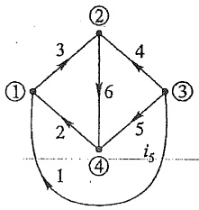

<details>
<summary>flowchart</summary>

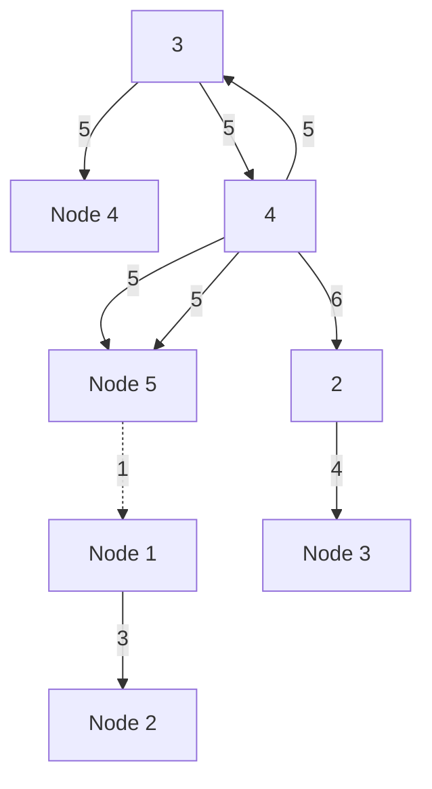
</details>

(a)

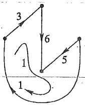

<details>
<summary>flowchart</summary>


</details>

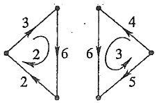

<details>
<summary>flowchart</summary>

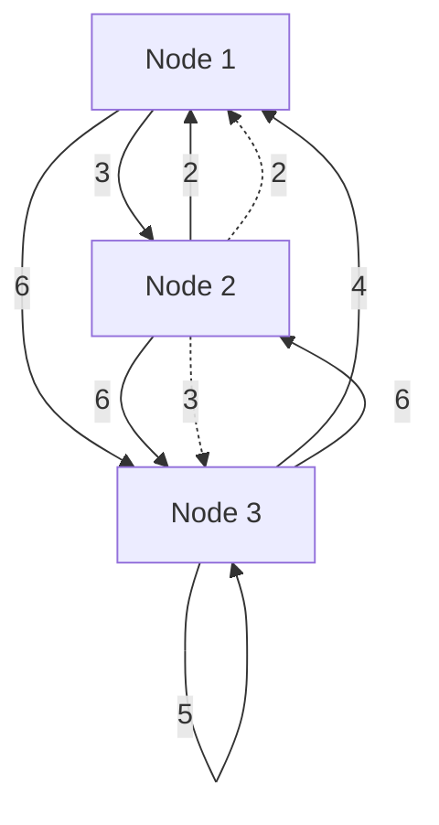
</details>

(b)

图 15-5 回路与支路的关联性质

如果所选独立回路组是对应于一个树的单连支回路组, 这种回路矩阵就称为基本回路矩阵, 用 $B_{\mathrm{f}}$ 表示。写 $B_{\mathrm{f}}$ 时, 注意安排其行、列次序如下: 把 $l$ 条连支依次排列在对应于 $B_{\mathrm{f}}$ 的第 1 至第 $l$ 列, 然后再排列树支; 取每一单连支回路的序号为对应连支所在列的序号, 且以该连支的方向为对应的回路的绕行方向, $B_{\mathrm{f}}$ 中将出现一个 $l$ 阶的单位子矩阵, 即有

$$
\boldsymbol {B} _ {\mathrm{f}} = \left[ \begin{array}{l l} \boldsymbol {1} _ {1} & \boldsymbol {B} _ {\mathrm{t}} \end{array} \right] \tag {15-4}
$$

式中下标1和t分别表示与连支和树支对应的部分。例如对图15-5(a)所示有向图，若选支路3、5、6为树支，则支路1、2、4即为连支，所以图15-5(b)所示一组独立回路即为一组单连支回路，可以将回路矩阵写成基本回路矩阵形式

$$
B _ {t} = 2 \left[ \begin{array}{c c c c c c} 1 & 0 & 0 & 1 & - 1 & 1 \\ 0 & 1 & 0 & 1 & 0 & 1 \\ 0 & 0 & 1 & 0 & - 1 & 1 \end{array} \right]
$$

今后,基本回路矩阵一般都写成如式(15-4)的形式。

回路矩阵左乘支路电压列向量,所得乘积是一个 l 阶的列向量。由于矩阵 B 的每一行表示每一对应回路与支路的关联情况,由矩阵的乘法规则可知乘积列向量中每一元素将等于每一对应回路中各支路电压的代数和,即

$$
\boldsymbol {B} \boldsymbol {u} = \left[ \begin{array}{c} \text {回路} 1 \text {中的} \sum u \\ \text {回路} 2 \text {中的} \sum u \\ \vdots \\ \text {回路} l \text {中的} \sum u \end{array} \right]
$$

故有

$$
B u = 0 \tag {15-5}
$$

---

§ 15-2 关联矩阵、回路矩阵、割集矩阵

367

式(15-5)是用矩阵 B 表示的 KVL 的矩阵形式。例如, 对图 15-5(a), 若选如图 15-5(b) 所示一组独立回路, 有

$$
\boldsymbol {B} \boldsymbol {u} = \left[ \begin{array}{c} u _ {1} + u _ {3} - u _ {5} + u _ {6} \\ u _ {2} + u _ {3} + u _ {6} \\ u _ {4} - u _ {5} + u _ {6} \end{array} \right] = \left[ \begin{array}{c} 0 \\ 0 \\ 0 \end{array} \right]
$$

l 个独立回路电流可用一个 l 阶列向量表示, 即  $i_{1}=\left[i_{11}\quad i_{12}\quad\cdots\quad i_{1l}\right]^{T}$ 。

由于矩阵 B 的每一列,也就是矩阵  $B^{T}$  的每一行,表示每一对应支路与回路的关联情况,所以按矩阵的乘法规则可知

$$
i = \dot {B} ^ {\mathrm{T}} i _ {1} \tag {15-6}
$$

例如,对图 15-5(a)有

$$
\left[ \begin{array}{c} i _ {1} \\ i _ {2} \\ i _ {3} \\ i _ {4} \\ i _ {5} \\ i _ {6} \end{array} \right] = \left[ \begin{array}{c c c} 1 & 0 & 0 \\ 0 & 1 & 0 \\ 1 & 1 & 0 \\ 0 & 0 & 1 \\ - 1 & 0 & - 1 \\ 1 & 1 & 1 \end{array} \right] \left[ \begin{array}{c} i _ {1 1} \\ i _ {1 2} \\ i _ {1 3} \end{array} \right] = \left[ \begin{array}{c} i _ {1 1} \\ i _ {1 2} \\ i _ {1 1} + i _ {1 2} \\ i _ {1 3} \\ - i _ {1 1} - i _ {1 3} \\ i _ {1 1} + i _ {1 2} + i _ {1 3} \end{array} \right]
$$

所以式(15-6)表明电路中各支路电流可以用与该支路关联的所有回路中的回路电流表示,这正是回路电流法的基本思想。可以认为该式是用矩阵 B 表示的 KCL 的矩阵形式。

设一个割集由某些支路构成,则称这些支路与该割集关联。支路与割集的关联性质可用所谓割集矩阵描述。下面仅介绍独立割集矩阵,简称割集矩阵。设有向图的节点数为 n, 支路数为 b, 则该图的独立割集数为  $(n-1)$ 。对每个割集编号, 并指定一个割集方向(移去割集的所有支路,G 被分离为两部分后,从其中一部分指向另一部分的方向,即为割集的方向,每一个割集只有两个可能的方向)。于是割集矩阵为一个  $[(n-1)\times b]$  的矩阵,用 Q 表示。Q 的行对应割集,列对应支路,它的任一元素  $q_{jk}$  定义如下:

$q_{jk}=+1$ , 表示支路 k 与割集 j 关联并且具有同一方向;

$q_{jk}=-1$ , 表示支路 k 与割集 j 关联但是它们的方向相反;

$q_{jk}=0$ ，表示支路k与割集j无关联。

例如,对图 15-4 所示有向图[重画于图 15-6(a)],独立割集数等于 3。若选一组独立割集如图 15-6(b)所示,对应的割集矩阵为

$$
Q = 2 \left[ \begin{array}{c c c c c c} 1 & 2 & 3 & 4 & 5 & 6 \\ 1 & - 1 & 1 & 0 & 0 & 0 \\ 1 & 0 & 0 & 1 & 1 & 0 \\ - 1 & - 1 & 0 & - 1 & 0 & 1 \end{array} \right]
$$

如果选一组单树支割集为一组独立割集,这种割集矩阵称为基本割集矩阵,用 $Q_{f}$

图2-1

---

368

第十五章 电路方程的矩阵形式

表示。在写 $Q_{\mathrm{f}}$ 时，注意安排其行、列次序如下:把 $(n - 1)$ 条树支依次排列在对应于 $Q_{\mathrm{f}}$ 的第1至第 $(n - 1)$ 列，然后排列连支，再取每一单树支割集的序号与相应树支所在列的序号相同，且选割集方向与相应树支方向一致，则 $Q_{\mathrm{f}}$ 有如下形式:

$$
Q _ {\mathrm{f}} = [ \mathbf {1} _ {\mathrm{t}} \mid Q _ {\mathrm{l}} ] \tag {15-7}
$$

式中下标 t 和 l 分别表示对应于树支和连支部分。例如, 对于图 15-6(a) 所示的有向图, 若选支路 3、5、6 为树支, 一组单树支割集如图 15-6(b) 所示, 可得

$$
Q _ {\mathrm{f}} = 2 \left[ \begin{array}{c c c c c c} 1 & 0 & 0 & - 1 & - 1 & 0 \\ 0 & 1 & 0 & - 1 & 0 & 1 \\ 0 & 0 & 1 & - 1 & - 1 & - 1 \end{array} \right] \tag {15-8}
$$

今后,基本割集矩阵一般都写成如式(15-7)的形式。

前面介绍割集概念时曾指出,属于一个割集所有支路电流的代数和等于零。根据割集矩阵的定义和矩阵的乘法规则不难得出

$$
Q i = 0. \tag {15-9}
$$

式(15-9)是用矩阵 $Q$ 表示的KCL的矩阵形式。例如，对图15-6(a)所示有向图，若选如图15-6(b)所示的一组独立割集，则有

$$
Q i = \left[ \begin{array}{c} {- i _ {1} - i _ {2} + i _ {3}} \\ {i _ {1} + i _ {4} + i _ {5}} \\ {- i _ {1} - i _ {2} - i _ {4} + i _ {6}} \end{array} \right] = \left[ \begin{array}{c} {0} \\ {0} \\ {0} \end{array} \right]
$$

电路中 $(n-1)$ 个树支电压可用 $(n-1)$ 阶列向量表示,即

$$
\boldsymbol {u} _ {\mathrm{t}} = \left[ \begin{array}{l l l l} u _ {\mathrm{t1}} & u _ {\mathrm{t2}} & \dots & u _ {\mathrm{t(n-1)}} \end{array} \right] ^ {\mathrm{T}}
$$

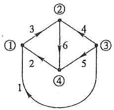

<details>
<summary>flowchart</summary>

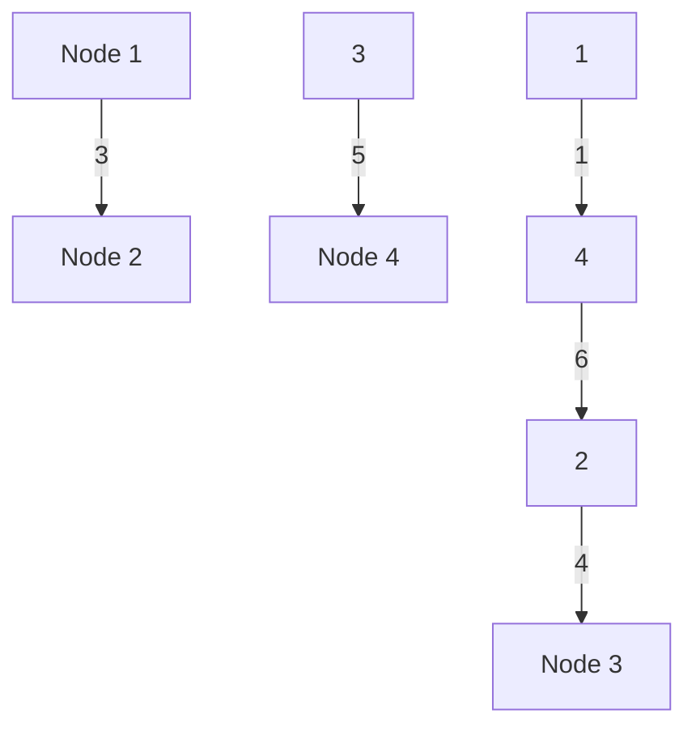
</details>

(a)

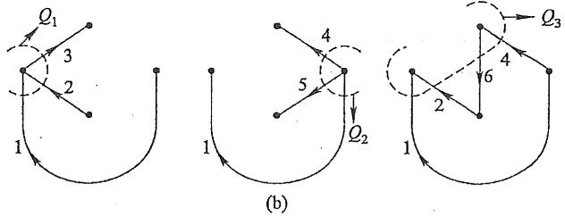

图 15-6 割集与支路的关联性质

---

§ 15-3 矩阵 $A, B_{\mathrm{f}}, Q_{\mathrm{f}}$ 之间的关系

369

由于通常选单树支割集为独立割集, 此时树支电压又可视为对应的割集电压, 所以  $u_{t}$  又是基本割集组的割集电压列向量。由于  $Q_{f}$  的每一列, 也就是  $Q_{f}^{T}$  的每一行, 表示一条支路与割集的关联情况, 按矩阵相乘的规则可得

$$
u = Q _ {\mathrm{f}} ^ {\mathrm{T}} u _ {\mathrm{t}} \tag {15-10}
$$

式(15-10)是用矩阵 $Q_{f}$ 表示的KVL的矩阵形式。例如对图15-6(a)所示有向图,若选支路3、5、6为树支, $Q_{f}$ 如式(15-8)所示,则有

$$
u = \left[ \begin{array}{c c c c c c} u _ {3} & u _ {5} & u _ {6} & u _ {1} & u _ {2} & u _ {4} \end{array} \right] ^ {\mathrm{T}}
$$

而

$$
u = Q _ {\mathrm{f}} ^ {\mathrm{T}} u _ {\mathrm{t}} = \left[ \begin{array}{c c c} 1 & 0 & 0 \\ 0 & 1 & 0 \\ 0 & 0 & 1 \\ - 1 & 1 & - 1 \\ - 1 & 0 & - 1 \\ 0 & 1 & - 1 \end{array} \right] \left[ \begin{array}{l} u _ {\mathrm{t} 1} \\ u _ {\mathrm{t} 2} \\ u _ {\mathrm{t} 3} \end{array} \right] = \left[ \begin{array}{c} u _ {\mathrm{t} 1} \\ u _ {\mathrm{t} 2} \\ u _ {\mathrm{t} 3} \\ - u _ {\mathrm{t} 1} + u _ {\mathrm{t} 2} - u _ {\mathrm{t} 3} \\ - u _ {\mathrm{t} 1} - u _ {\mathrm{t} 3} \\ u _ {\mathrm{t} 2} - u _ {\mathrm{t} 3} \end{array} \right]
$$

式(15-10)表明电路的支路电压可以用树支电压(割集电压)表示,这就是后面将介绍的割集电压法的基本思想。

式(15-2)和式(15-3)分别与式(15-9)和式(15-10)在形式上相似。有时，对某些图有

$$
\mathcal {Q} _ {\mathrm{f}} = A
$$

## \*§15-3 矩阵 $A$、$B_{\mathrm{f}}$、$Q_{\mathrm{f}}$ 之间的关系

对于任一个连通图 G, 在支路排列顺序相同时写出的矩阵 A 和 B 有如下关系:

$$
A B ^ {\mathrm{T}} = 0
$$

或

$$
B A ^ {\mathrm{T}} = 0
$$

这是因为 $u = A^{\mathrm{T}}u_{\mathrm{n}}$ 和 $Bu = 0$ ，当支路排列顺序相同时，两式中的 $\pmb{u}$ 完全相同，所以有

$$
B u = B A ^ {\mathrm{T}} u _ {\mathrm{n}} = 0
$$

可以证明(从略)

$$
\boldsymbol {B} \boldsymbol {A} ^ {\mathrm{T}} = \boldsymbol {0}
$$

或

$$
A \mathcal {B} ^ {\mathrm{T}} = 0
$$

用类似的方法可以证明:当支路排列顺序相同时写出的连通图的矩阵 Q 和 B 有如下关系:

---

370

第十五章 电路方程的矩阵形式

$$
Q B ^ {\mathrm{T}} = 0
$$

或

$$
B Q ^ {\mathrm{T}} = 0
$$

如果选择连通图 G 的一个树, 按先树支、后连支的相同支路顺序排列下写出 G 的  $A_{1}$ 、 $B_{f}$ 、 $Q_{f}$ , 使得  $A = [A_{t} : A_{1}]$ ,  $B_{f} = [B_{t} : 1_{1}]$ ,  $Q_{f} = [1_{t} : Q_{1}]$ , 由于

$$
A B _ {\mathrm{f}} ^ {\mathrm{T}} = \left[ A _ {1} \mid A _ {1} \right] \left[ \begin{array}{l} B _ {\mathrm{f}} ^ {\mathrm{T}} \\ - - - \\ 1 _ {1} \end{array} \right] = 0
$$

所以

$$
A _ {t} B _ {t} ^ {\mathrm{T}} + A _ {1} = 0
$$

或

$$
B _ {i} ^ {\mathrm{T}} = - A _ {i} ^ {- 1} A _ {1} ①
$$

同理,由于

$$
Q _ {\mathrm{f}} B _ {\mathrm{f}} ^ {\mathrm{T}} = \left[ \begin{array}{l l} 1 _ {\mathrm{t}} & Q _ {1} \end{array} \right] \left[ \begin{array}{c} B _ {\mathrm{t}} ^ {\mathrm{T}} \\ \dots \\ 1 _ {\mathrm{t}} \end{array} \right] = 0
$$

所以

$$
B _ {1} ^ {\mathrm{T}} + Q _ {1} = 0
$$

或

$$
Q _ {1} = - B _ {1} ^ {\mathrm{T}} = A _ {1} ^ {- 1} A _ {1}
$$

## §15-4 回路电流方程的矩阵形式

在第三章中曾介绍了网孔电流法和回路电流法。它们的特点是分别以网孔电流和回路电流作为电路的独立变量，并用 KVL 列出足够的电路方程。

由于描述支路与回路关联性质的是回路矩阵 B，所以适合用以 B 表示的 KCL 和 KVL 推导出回路电流方程的矩阵形式。首先设回路电流列向量为  $i_{1}$ ，有

$$
\begin{array}{l} \mathrm{KCL} \quad \boldsymbol {i} = \boldsymbol {B} ^ {\mathrm{T}} \boldsymbol {i} _ {1} \\ \mathrm{KVL} \quad B u = 0 \\ \end{array}
$$

在列矩阵形式电路方程时,还必须有一组支路约束方程。因此需要规定一条支路的结构和内容。目前在电路理论中还没有统一的规定,但可以采用所谓“复合支路”。对于回路电流法采用图15-7所示复合支路,其中下标k表示第k条支路, $\dot{U}_{sk}$ 和 $\dot{I}_{sk}$ 分别表示独立电压源和独立电流源, $Z_{k}$ (或 $Y_{k}$ )表示阻抗(或导纳),且规定②它只可能是

<small><span class="docvortex-page-footnote" data-block-type="page_footnote" style="color:#6b7280">① 可以证明子矩阵 $A_{t}$ 是非奇异的，它的逆阵一定存在。</span></small>

<small><span class="docvortex-page-footnote" data-block-type="page_footnote" style="color:#6b7280">② 这种规定主要是为了便于编制程序。</span></small>

---

§ 15-4 回路电流方程的矩阵形式

371

单一的电阻、电感或电容,而不能是它们的组合,即

$$
Z _ {k} = \left\{ \begin{array}{l} R _ {k} \\ \mathrm{j} \omega L _ {k} \\ \frac {1}{\mathrm{j} \omega C _ {k}} \end{array} \right.
$$

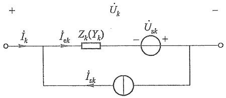

<details>
<summary>text_image</summary>

+
Ük
-
Üsk +
İk
İek
Zk(Yk)
-
İsk
</details>

图 15-7 复合支路

总之，复合支路的定义规定了一条支路最多可以包含的不同元件数及其连接方式，但不是说每条支路都必须包含这几种元件。所以可以允许一条支路缺少其中某些元件①。另外，还需指出，图15-7中的复合支路是在采用相量法条件下画出的。应用运算法时，可以采用相应的运算形式。为了写出复合支路的支路方程，还应规定电压和电流的参考方向。本章中采用的电压和电流的参考方向如图15-7所示。下面分两种不同情况推导整个电路的支路方程的矩阵形式。

(1) 当电路中电感之间无耦合时, 对于第 k 条支路有

$$
\dot {U} _ {k} = Z _ {k} (\dot {I} _ {k} + \dot {I} _ {\mathrm{sk}}) - \dot {U} _ {\mathrm{sk}} \tag {15-11}
$$

若设

$\dot{I} = [\dot{I}_1 \dot{I}_2 \dots \dot{I}_b]^{\mathrm{T}}$ 为支路电流列向量；

$\dot{U} = [\dot{U}_1 \quad \dot{U}_2 \quad \cdots \quad \dot{U}_b]^{\mathrm{T}}$ 为支路电压列向量；

$\dot{I}_{s} = [\dot{I}_{s1}\quad \dot{I}_{s2}\quad \dots \quad \dot{I}_{sb}]^{\mathrm{T}}$ 为支路电流源的电流列向量；

$\dot{U}_{s}=\left[\begin{array}{ccc}\dot{U}_{s1}&\dot{U}_{s2}&\cdots&\dot{U}_{sb}\end{array}\right]^{T}$ 为支路电压源的电压列向量。

对整个电路有

$$
\left[ \begin{array}{c} \dot {U} _ {1} \\ \dot {U} _ {2} \\ \vdots \\ \dot {U} _ {b} \end{array} \right] = \left[ \begin{array}{c c c c} Z _ {1} & & & 0 \\ & Z _ {2} & & \\ & & \ddots & \\ 0 & & & Z _ {b} \end{array} \right] \left[ \begin{array}{c} \dot {I} _ {1} + \dot {I} _ {\mathrm{s} 1} \\ \dot {I} _ {2} + \dot {I} _ {\mathrm{s} 2} \\ \vdots \\ \dot {I} _ {b} + \dot {I} _ {\mathrm{s} b} \end{array} \right] - \left[ \begin{array}{c} \dot {U} _ {\mathrm{s} 1} \\ \dot {U} _ {\mathrm{s} 2} \\ \vdots \\ \dot {U} _ {\mathrm{s} b} \end{array} \right]
$$

即

$$
\dot {U} = \mathbb {Z} (\dot {I} + \dot {I} _ {\mathrm{s}}) - \dot {U} _ {\mathrm{s}} \tag {15-12}
$$

式中 Z 称为支路阻抗矩阵, 它是一个对角阵。

（2）当电路中电感之间有耦合时，式(15-11)还应计及互感电压的作用。若设第1支路至第 $g$ 支路之间相互均有耦合，则有

$$
\dot {U} _ {1} = Z _ {1} \dot {I} _ {\mathrm{e} 1} \pm \mathrm{j} \omega M _ {1 2} \dot {I} _ {\mathrm{e} 2} \pm \mathrm{j} \omega M _ {1 3} \dot {I} _ {\mathrm{e} 3} \pm \dots \pm \mathrm{j} \omega M _ {1 g} \dot {I} _ {\mathrm{eg}} - \dot {U} _ {\mathrm{s} 1}
$$

$$
\dot {U} _ {2} = \pm \mathrm{j} \omega M _ {2 1} \dot {I} _ {\mathrm{e} 1} + Z _ {2} \dot {I} _ {\mathrm{e} 2} \pm \mathrm{j} \omega M _ {2 3} \dot {I} _ {\mathrm{e} 3} \pm \dots \pm \mathrm{j} \omega M _ {2 g} \dot {I} _ {\mathrm{eg}} - \dot {U} _ {\mathrm{s} 2}
$$

s a u v q o s a o b o

<small><span class="docvortex-page-footnote" data-block-type="page_footnote" style="color:#6b7280">① 对于回路电流法，不允许存在无伴电流源支路。</span></small>

1. 2. 3. 4. 5. 6. 7. 8. 9. 10. 11. 12. 13. 14. 15. 16. 17. 18. 19. 20. 21. 22. 23. 24. 25. 26. 27. 28. 29. 30. 31. 32. 33. 34. 35. 36. 37. 38. 39. 40. 41. 42. 43. 44. 45. 46. 47. 48. 49. 50. 51. 52. 53. 54. 55. 56. 57. 58. 59. 60. 61. 62. 63. 64. 65. 66. 67. 68. 69. 70. 71. 72. 73. 74. 75. 76. 77. 78. 79. 80. 81. 82. 83. 84. 85. 86. 87. 88. 89. 90.

---

372

第十五章 电路方程的矩阵形式

$$
\dot {U} _ {g} = \pm \mathrm{j} \omega M _ {g 1} \dot {I} _ {\mathrm{e} 1} \pm \mathrm{j} \omega \dot {M} _ {g 2} \dot {I} _ {\mathrm{e} 2} \pm \mathrm{j} \omega M _ {g 3} \dot {I} _ {\mathrm{e} 3} \pm \dots + Z _ {g} \dot {I} _ {\mathrm{eg}} - \dot {U} _ {\mathrm{sg}}
$$

式中所有互感电压前取“+”号或“-”号决定于各电感的同名端和电流、电压的参考方向。其次要注意  $\dot{I}_{e1} = \dot{I}_{1} + \dot{I}_{a1}, \dot{I}_{e2} = \dot{I}_{2} + \dot{I}_{a2}, \cdots, M_{12} = M_{21}, \cdots;$  其余支路之间由于无耦合，故得

$$
\begin{array}{l} \dot {U} _ {h} = Z _ {h} \dot {I} _ {\mathrm{eh}} - \dot {U} _ {s h} \\ \dots \\ \dot {U} _ {b.} = Z _ {b.} \dot {I} _ {e b} - \dot {U} _ {s b} \\ \end{array}
$$

上式中的下标  $h=g+1$ ，这样，支路电压与支路电流之间的关系可用下列矩阵形式表示:

$$
\left[ \begin{array}{c} \dot {U} _ {1} \\ \dot {U} _ {2} \\ \vdots \\ \dot {U} _ {g} \\ \dot {U} _ {h} \\ \vdots \\ \dot {U} _ {b} \end{array} \right] = \left[ \begin{array}{c c c c c c c} Z _ {1} & \pm \mathrm{j} \omega M _ {1 2} & \dots & \pm \mathrm{j} \omega M _ {1 g} & 0 & \dots & 0 \\ \pm \mathrm{j} \omega M _ {2 1} & Z _ {2} & \dots & \pm \mathrm{j} \omega M _ {2 g} & 0 & \dots & 0 \\ \vdots & \vdots & & \vdots & \vdots & & \vdots \\ \pm \mathrm{j} \omega M _ {g 1} & \pm \mathrm{j} \omega M _ {g 2} & \dots & \pm Z _ {g} & 0 & \dots & 0 \\ 0 & 0 & \dots & 0 & Z _ {h} & \dots & 0 \\ \vdots & \vdots & & \vdots & \vdots & & \vdots \\ 0 & 0 & \dots & 0 & 0 & \dots & Z _ {b} \end{array} \right] \times \left[ \begin{array}{c} \dot {I} _ {1} + \dot {I} _ {\mathrm{s} 1} \\ \dot {I} _ {2} + \dot {I} _ {\mathrm{s} 2} \\ \vdots \\ \dot {I} _ {g} + \dot {I} _ {\mathrm{s} g} \\ \dot {I} _ {h} + \dot {I} _ {\mathrm{s} h} \\ \vdots \\ \dot {I} _ {b} + \dot {I} _ {\mathrm{s} b} \end{array} \right] - \left[ \begin{array}{c} \dot {U} _ {\mathrm{s} 1} \\ \dot {U} _ {\mathrm{s} 2} \\ \vdots \\ \dot {U} _ {\mathrm{s} g} \\ \dot {U} _ {\mathrm{s} h} \\ \vdots \\ \dot {U} _ {\mathrm{s} b} \end{array} \right]
$$

或写成

$$
\dot {U} = Z (\dot {I} + \dot {I} _ {\mathrm{s}}) - \dot {U} _ {\mathrm{s}}
$$

式中 Z 为支路阻抗矩阵, 其主对角线元素为各支路阻抗, 而非对角线元素将是相应的支路之间的互感阻抗, 因此 Z 不再是对角阵。显然, 这个方程形式上完全与式(15-12)一样。为了导出回路电流方程的矩阵形式, 重写所需 3 组方程为

$$
\begin{array}{l} \mathrm{KCL} \quad \dot {\boldsymbol {I}} = \boldsymbol {B} ^ {\mathrm{T}} \dot {\boldsymbol {I}} _ {1} \\ \mathrm{KVL} \quad B \dot {U} = 0 \\ \text {支路方程} \quad \dot {\boldsymbol {U}} = \boldsymbol {Z} \left(\dot {\boldsymbol {I}} + \dot {\boldsymbol {I}} _ {\mathrm{s}}\right) - \dot {\boldsymbol {U}} _ {\mathrm{s}} \\ \end{array}
$$

把支路方程代入 KVL 可得

$$
B \left[ Z (\dot {I} + \dot {I} _ {\mathrm{s}}) - \dot {U} _ {\mathrm{s}} \right] = 0
$$

$$
B Z \dot {I} + B Z \dot {I} _ {\mathrm{s}} - B \dot {U} _ {\mathrm{s}} = 0
$$

再把 KCL 代入便得到

$$
B Z B ^ {\mathrm{T}} \dot {I} _ {1} = B \dot {U} _ {\mathrm{s}} - B Z \dot {I} _ {\mathrm{s}} \tag {15-13}
$$

式(15-13)即为回路电流方程的矩阵形式。由于乘积 $BZ$ 的行、列数分别为 $l$ 和 $b$, 乘积 $(BZ)B^{\mathrm{T}}$ 的行、列数均为 $l$, 所以 $BZB^{\mathrm{T}}$ 是一个 $l$ 阶方阵。同理乘积 $B\dot{U}_{s}$ 和 $BZ\dot{I}_{s}$ 都是 $l$ 阶列向量。

如设 $Z_{1} \stackrel{\mathrm{def}}{=} BZB^{\mathrm{T}}$，它是一个 $l$ 阶的方阵，称为回路阻抗矩阵，它的主对角元素即为自阻抗，非主对角元素即为互阻抗。

---

§ 15-4 回路电流方程的矩阵形式

373

当电路中含有与无源元件串联的受控电压源(控制量可以是另一支路上无源元件的电压或电流)时,复合支路将如图15-8所示。这样,支路方程的矩阵形式仍为式(15-12),只是其中支路阻抗矩阵的内容不同而已。此时Z的非主对角元素将可能是与受控电压源的控制系数有关的元素。

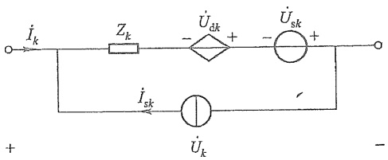

<details>
<summary>text_image</summary>

İk
Zk
- Üdk +
- Üsk +
İsk
Ük
+ -
-
</details>

图15-8 含受控电压源的复合支路

例 15-1 电路如图 15-9(a) 所示。用矩阵形式列出电路的回路电流方程。

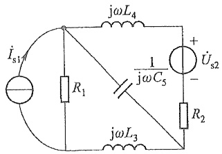

<details>
<summary>text_image</summary>

jωL₄
Iₛ₁
R₁
1
jωC₅
+ 
Uₛ₂
-
R₂
jωL₃
</details>

(a)

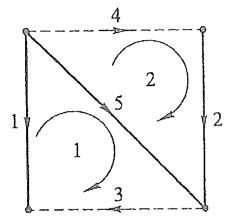

<details>
<summary>flowchart</summary>


</details>

(b)

图15-9 例15-1图

解 作出有向图,并选支路1、2、5为树支[如图15-9(b)中实线所示]。两个单连支回路1、2如图15-9(b)所示,有

$$
\begin{array}{l} B = \begin{array}{c} 1 \\ 2 \end{array} \left[ \begin{array}{c c c c c} - 1 & 0 & 1 & 0 & 1 \\ 0 & 1 & 0 & 1 & - 1 \end{array} \right] \\ Z = \mathrm{diag} \left[ R _ {1}, R _ {2}, \mathrm{j} \omega L _ {3}, \mathrm{j} \omega L _ {4}, \frac {1}{\mathrm{j} \omega C _ {5}} \right] \\ \dot {U} _ {\mathrm{s}} = \left[ \begin{array}{c c c c c} 0 & - \dot {U} _ {\mathrm{s2}} & 0 & 0 & 0 \end{array} \right] ^ {\mathrm{T}} \\ \dot {I} _ {\mathrm{s}} = \left[ \begin{array}{c c c c c} \dot {I} _ {\mathrm{s1}} & 0 & 0 & 0 & 0 \end{array} \right] ^ {\mathrm{T}} \\ \end{array}
$$

把上式各矩阵代入式(15-13)便得回路电流方程的矩阵形式

$$
\left[ \begin{array}{c c} R _ {1} + \mathrm{j} \omega L _ {3} + \frac {1}{\mathrm{j} \omega C _ {5}} & - \frac {1}{\mathrm{j} \omega C _ {5}} \\ - \frac {1}{\mathrm{j} \omega C _ {5}} & R _ {2} + \mathrm{j} \omega L _ {4} + \frac {1}{\mathrm{j} \omega C _ {5}} \end{array} \right] \left[ \begin{array}{c} \dot {I} _ {1 1} \\ \dot {I} _ {1 2} \end{array} \right] = \left[ \begin{array}{c} R _ {1} \dot {I} _ {\mathrm{s1}} \\ - \dot {U} _ {\mathrm{s2}} \end{array} \right]
$$

若选网孔为一组独立回路,则回路电流方程即为网孔电流方程。例 15-1 就属这种情况。

编写回路电流方程必须选择一组独立回路,一般用基本回路组,从而可以通过选择一个合适的树处理。树的选择固然可以在计算机上按编好的程序自动进行,但比之节点电压法,这就显得麻烦些。另外,由于实际的复杂电路中,独立节点数往往少于独立

---

374

第十五章 电路方程的矩阵形式

回路数,再加上其他一些原因,目前在计算机辅助分析的程序中(如电力系统的潮流计算,电子电路的分析等),广泛采用节点法,而不采用回路法。

## §15-5 节点电压方程的矩阵形式

节点电压法以节点电压为电路的独立变量，并用KCL列出足够的独立方程。由于描述支路与节点关联性质的是矩阵 $A$ ，因此宜用以 $A$ 表示的KCL和KVL推导节点电压方程的矩阵形式。设节点电压列向量为 $u_{n}$ ，按式(15-3)有

$$
\boldsymbol {u} = \boldsymbol {A} ^ {\mathrm{T}} \boldsymbol {u} _ {\mathrm{n}}
$$

上述 KVL 方程表示了  $u_{n}$  与支路电压列向量 u 的关系, 它提供了选用  $u_{n}$  作为独立电路变量的可能性。还需要用矩阵 A 表示的 KCL, 即

$$
A i = 0
$$

(式中 i 表示支路电流列向量)作为导出节点电压方程的依据。

对于节点电压法,可采用如图 15-10 所示复合支路 $^{①}$ ,与图 15-7 定义的复合支路相比,图 15-10 中的复合支路仅增加了受控电流源 $^{②}$ 。所有电压、电流的参考方向如图 15-10 所示。下面首先分 3 种情况推导出整个电路的支路方程的矩阵形式。

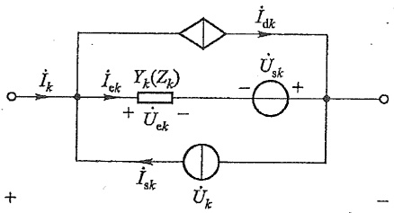

<details>
<summary>text_image</summary>

İk
İek
Yk(Zk)
+ 
Üek
-
İsk
Ük
İdk
- Üsk
+
-
</details>

图 15-10 复合支路

（1）当电路中无受控电流源（即  $\dot{I}_{dk}=0$ ），电感间无耦合时，对于第 k 条支路有

$$
\dot {I} _ {k} = Y _ {k} \dot {U} _ {\mathrm{e} k} - \dot {I} _ {\mathrm{s} k} = Y _ {k} (\dot {U} _ {k} + \dot {U} _ {\mathrm{s} k}) - \dot {I} _ {\mathrm{s} k} \tag {15-14}
$$

对整个电路有

$$
\dot {I} = Y (\dot {U} + \dot {U} _ {\mathrm{s}}) - \dot {I} _ {\mathrm{s}} \tag {15-15}
$$

式中 Y 称为支路导纳矩阵, 它是一个对角阵。

（2）当电路中无受控源，但电感之间有耦合时，式(15-14)还应计及互感电压的影响。根据前节的讨论，当电感之间有耦合时，电路的支路阻抗矩阵 $Z$ 不再是对角阵，其主对角线元素为各支路阻抗，而非对角线元素将是相应的支路之间的互感阻抗。如令$Y = Z^{-1}(Y$ 仍称为支路导纳矩阵），则由 $\dot{U} = Z(\dot{I} +\dot{I}_{s}) - \dot{U}_{s}$ 可得

$$
Y \dot {U} = \dot {I} + \dot {I} _ {\mathrm{s}} - Y \dot {U} _ {\mathrm{s}}
$$

或

$$
\dot {I} = Y (\dot {U} + \dot {U} _ {\mathrm{s}}) - \dot {I} _ {\mathrm{s}}
$$

<small><span class="docvortex-page-footnote" data-block-type="page_footnote" style="color:#6b7280">① 注意,按这种复合支路的规定,电路中不允许存在受控电压源。另外,对节点电压法,不允许存在无伴电压源支路。</span></small>

<small><span class="docvortex-page-footnote" data-block-type="page_footnote" style="color:#6b7280">② 它的控制量是另一支路中无源元件的电压或电流。</span></small>

---

§ 15-5 节点电压方程的矩阵形式

375

这个方程形式上完全与式(15-15)相同,唯一的差别是此时 Y 不再是对角阵。

（3）当电路中含有受控电流源时，设第 $k$ 支路中有受控电流源并受第 $j$ 支路中无源元件上的电压 $\dot{U}_{ej}$ 或电流 $\dot{I}_{ej}$ 控制，如图15-11所示，其中 $\dot{I}_{\mathrm{dk}} = g_{kj}\dot{U}_{ej}$ 或 $\dot{I}_{\mathrm{dk}} = \beta_{kj}\dot{I}_{ej}$。

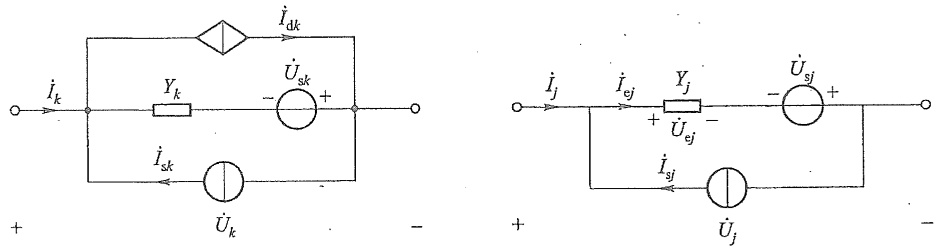

图 15-11 受控电流源的控制关系

此时,对第 k 支路有

$$
\dot {I} _ {k} = Y _ {k} (\dot {U} _ {k} + \dot {U} _ {s k}) + \dot {I} _ {\mathrm{d} k} - \dot {I} _ {\mathrm{s} k}
$$

在 VCCS 情况下, 上式中的  $\dot{I}_{dk}=g_{kj}(\dot{U}_{j}+\dot{U}_{sj})$  。而在 CCCS 的情况下,  $\dot{I}_{dk}=\beta_{kj}Y_{j}(\dot{U}_{j}+\dot{U}_{sj})$  。于是有

$$
\left[ \begin{array}{c} \dot {I} _ {1} \\ \dot {I} _ {2} \\ \vdots \\ \dot {I} _ {j} \\ \vdots \\ \dot {I} _ {k} \\ \vdots \\ \dot {I} _ {b} \end{array} \right] = \left[ \begin{array}{c c c c c c c c} Y _ {1} & & & & & & & \\ 0 & Y _ {2} & & & & & \\ \vdots & \vdots & \ddots & & & 0 & & \\ 0 & 0 & \dots & Y _ {j} & & & \\ \vdots & \vdots & & \vdots & \ddots & & \\ 0 & 0 & \dots & Y _ {k j} & \dots & Y _ {k} & & \\ \vdots & \vdots & & \vdots & & \vdots & \ddots & \\ 0 & 0 & \dots & 0 & \dots & 0 & \dots & Y _ {b} \end{array} \right] \left[ \begin{array}{c} \dot {U} _ {1} + \dot {U} _ {\mathrm{s} 1} \\ \dot {U} _ {2} + \dot {U} _ {\mathrm{s} 2} \\ \vdots \\ \dot {U} _ {j} + \dot {U} _ {\mathrm{s} j} \\ \vdots \\ \dot {U} _ {k} + \dot {U} _ {\mathrm{s} k} \\ \vdots \\ \dot {U} _ {b} + \dot {U} _ {\mathrm{s} b} \end{array} \right] - \left[ \begin{array}{c} \dot {I} _ {\mathrm{s} 1} \\ \dot {I} _ {\mathrm{s} 2} \\ \vdots \\ \dot {I} _ {\mathrm{s} j} \\ \vdots \\ \dot {I} _ {\mathrm{s} k} \\ \vdots \\ \dot {I} _ {\mathrm{s} b} \end{array} \right]
$$

式中

$$
Y _ {k j} = \left\{ \begin{array}{l l} g _ {k j} & (\text {当} \dot {I} _ {\mathrm{d} k} \text {为VCCS时}) \\ \beta_ {k j} Y _ {j} & (\text {当} \dot {I} _ {\mathrm{d} k} \text {为CCCS时}) \end{array} \right.
$$

即

$$
\dot {I} = Y (\dot {U} + \dot {U} _ {\mathrm{s}}) - \dot {I} _ {\mathrm{s}}
$$

可见此时支路方程在形式上仍与情况1时相同,只是矩阵Y的内容不同而已。注意此时Y也不再是对角阵。

为了导出节点电压方程的矩阵形式,重写所需3组方程为

KCL $A\dot{I} = 0$

KVL  $\dot{U}=A^{T}\dot{U}_{n}$

支路方程  $\dot{I}=Y(\dot{U}+\dot{U}_{5})-\dot{I}_{s}$

把支路方程代入 KCL 可得:

1

---

376

第十五章 电路方程的矩阵形式

$$
A \left[ Y (\dot {U} + \dot {U} _ {\mathrm{s}}) - \dot {I} _ {\mathrm{s}} \right] = 0
$$

$$
A Y \dot {U} + A Y \dot {U} _ {\mathrm{s}} - A I _ {\mathrm{s}} = 0
$$

再把 KVL 代入便得

$$
\boldsymbol {A} \boldsymbol {Y} \boldsymbol {A} ^ {\mathrm{T}} \dot {\boldsymbol {U}} _ {\mathrm{n}} = \boldsymbol {A} \dot {\boldsymbol {I}} _ {\mathrm{s}} - \boldsymbol {A} \boldsymbol {Y} \dot {\boldsymbol {U}} _ {\mathrm{s}} \tag {15-16}
$$

式(15-16)即节点电压方程的矩阵形式。由于乘积 $AY$ 的行和列数分别为 $(n - 1)$ 和 $b$，乘积 $(AY)A^{\mathrm{T}}$ 的行和列数都是 $(n - 1)$，所以乘积 $AYA^{\mathrm{T}}$ 是一个 $(n - 1)$ 阶方阵。同理，乘积 $A\dot{I}_{s}$ 和 $AY\dot{U}_{s}$ 都是 $(n - 1)$ 阶的列向量。

如设 $Y_{\mathrm{n}} \stackrel{\mathrm{def}}{=} A Y A^{\mathrm{T}}, \dot{J}_{\mathrm{n}} \stackrel{\mathrm{def}}{=} A \dot{I}_{\mathrm{s}} - A Y \dot{U}_{\mathrm{s}}$，则式(15-16)可写为

$$
Y _ {\mathrm{n}} \dot {U} _ {\mathrm{n}} = \dot {J} _ {\mathrm{n}}
$$

$Y_{n}$  称为节点导纳矩阵, 它的元素相当于第三章中节点电压方程等号左边的系数;  $\dot{J}_{n}$  为由独立电源引起的注入节点的电流列向量, 它的元素相当于第三章中节点电压方程等号右边的常数项。

例 15-2 电路如图 15-12(a) 所示, 图中元件的数字下标代表支路编号。列出电路的节点电压方程(矩阵形式)。

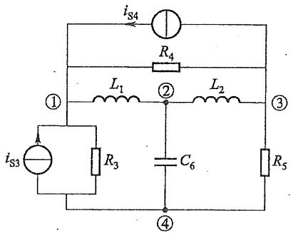

<details>
<summary>text_image</summary>

iS4
R4
L1
①
L2
②
③
iS3
R3
C6
④
R5
</details>

(a)

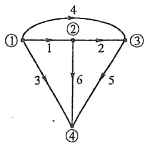

<details>
<summary>flowchart</summary>

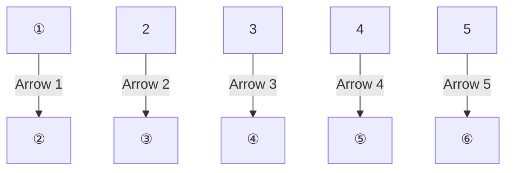
</details>

(b)

图15-12 例15-2图

解 作出图 15-12(a) 所示电路的有向图如图 15-12(b) 所示。若选节点④为参考节点, 则关联矩阵为

$$
A = \left[ \begin{array}{c c c c c c} 1 & 0 & 1 & 1 & 0 & 0 \\ - 1 & 1 & 0 & 0 & 0 & 1 \\ 0 & - 1 & 0 & - 1 & 1 & 0 \end{array} \right]
$$

电压源列向量  $\dot{U}_{s}=0$ ，电流源列向量为

$$
\dot {I} _ {\mathrm{s}} = \left[ \begin{array}{l l l l l l} 0 & 0 & \dot {I} _ {\mathrm{s3}} & \dot {I} _ {\mathrm{s4}} & 0 & 0 \end{array} \right] ^ {\mathrm{T}}
$$

支路导纳矩阵为

$$
Y = \mathrm{diag} \left[ \frac {1}{\mathrm{j} \omega L _ {1}}, \frac {1}{\mathrm{j} \omega L _ {2}}, \frac {1}{R _ {3}}, \frac {1}{R _ {4}}, \frac {1}{R _ {5}}, \mathrm{j} \omega C _ {6} \right]
$$

节点电压方程为

---

§ 15-5 节点电压方程的矩阵形式

377

$$
A Y A ^ {\mathrm{T}} \dot {U} _ {\mathrm{n}} = A \dot {I} _ {\mathrm{s}}
$$

即

$$
\left[ \begin{array}{c c c} \frac {1}{R _ {3}} + \frac {1}{R _ {4}} + \frac {1}{\mathrm{j} \omega L _ {1}} & - \frac {1}{\mathrm{j} \omega L _ {1}} & - \frac {1}{R _ {4}} \\ - \frac {\dot {1}}{\mathrm{j} \omega L _ {1}} & \frac {1}{\mathrm{j} \omega L _ {1}} + \frac {1}{\mathrm{j} \omega L _ {2}} + \mathrm{j} \omega C _ {6} & - \frac {1}{\mathrm{j} \omega L _ {2}} \\ - \frac {1}{R _ {4}} & - \frac {1}{\mathrm{j} \omega L _ {2}} & \frac {1}{R _ {4}} + \frac {1}{R _ {5}} + \frac {1}{\mathrm{j} \omega L _ {2}} \end{array} \right] \left[ \begin{array}{c} \dot {U} _ {\mathrm{n} 1} \\ \dot {U} _ {\mathrm{n} 2} \\ \dot {U} _ {\mathrm{n} 3} \end{array} \right] = \left[ \begin{array}{c} \dot {I} _ {\mathrm{s} 3} + \dot {I} _ {\mathrm{s} 4} \\ 0 \\ - \dot {I} _ {\mathrm{s} 4} \end{array} \right]
$$

例15-3 电路如图15-13(a)所示，图中元件的下标代表支路编号，图15-13(b)是它的有向图。设 $\dot{I}_{\mathrm{d2}} = g_{21}\dot{U}_1,\dot{I}_{\mathrm{d4}} = \beta_{46}\dot{I}_6$ 。写出支路方程的矩阵形式。

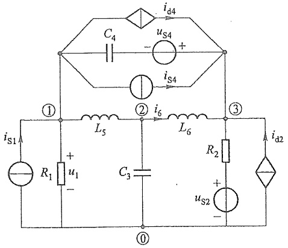

<details>
<summary>text_image</summary>

i_d4
C_4
u_S4
-
+
i_S4
①
L_5
② i_6
L_6
③
i_s1A
R_1 +
u_1
-
C_3
R_2
u_S2 +
-
①
i_d2
</details>

(a)

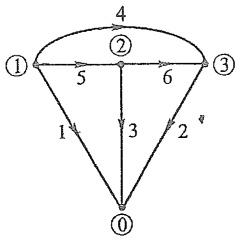

<details>
<summary>flowchart</summary>

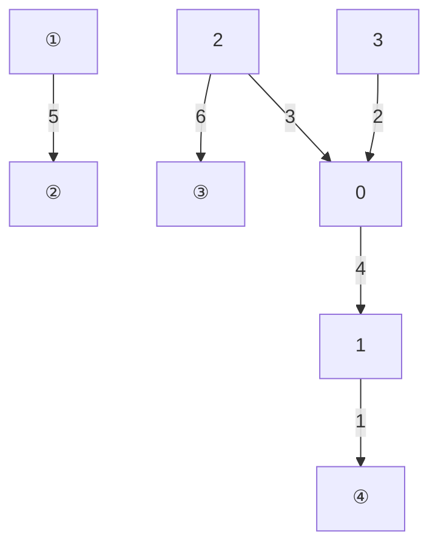
</details>

(b)

图15-13 例15-3图

解 支路导纳矩阵可写为(注意  $g_{21}$  和  $\beta_{46}$  出现的位置)

$$
Y = \left[ \begin{array}{c c c c c c} \frac {1}{R _ {1}} & 0 & 0 & 0 & 0 & 0 \\ - g _ {2 1} & \frac {1}{R _ {2}} & 0 & 0 & 0 & 0 \\ 0 & 0 & \mathrm{j} \omega C _ {3} & 0 & 0 & 0 \\ 0 & 0 & 0 & \mathrm{j} \omega C _ {4} & 0 & \frac {\beta_ {4 6}}{\mathrm{j} \omega L _ {6}} \\ 0 & 0 & 0 & 0 & \frac {1}{\mathrm{j} \omega L _ {5}} & 0 \\ 0 & 0 & 0 & 0 & 0 & \frac {1}{\mathrm{j} \omega L _ {6}} \end{array} \right]
$$

电流源向量与电压源向量为

---

378

第十五章 电路方程的矩阵形式

$$
\begin{array}{l} \dot {I} _ {\mathrm{s}} = [ \dot {I} _ {\mathrm{s1}} \quad 0 \quad 0 \quad - \dot {I} _ {\mathrm{s4}} \quad 0 \quad 0 ] ^ {\mathrm{T}} \\ \dot {U} _ {\mathrm{s}} = [ 0 \quad - \dot {U} _ {\mathrm{s2}} \quad 0 \quad \dot {U} _ {\mathrm{s4}} \quad 0 \quad 0 ] ^ {\mathrm{T}} \\ \end{array}
$$

支路方程的矩阵形式为

$$
\left[ \begin{array}{c} \dot {I} _ {1} \\ \dot {I} _ {2} \\ \dot {I} _ {3} \\ \dot {I} _ {4} \\ \dot {I} _ {5} \\ \dot {I} _ {6} \end{array} \right] = \left[ \begin{array}{c c c c c c} \frac {1}{R _ {1}} & 0 & 0 & 0 & 0 & 0 \\ - g _ {2 1} & \frac {1}{R _ {2}} & 0 & 0 & 0 & 0 \\ 0 & 0 & \mathrm{j} \omega C _ {3} & 0 & 0 & 0 \\ 0 & 0 & 0 & \mathrm{j} \omega C _ {4} & 0 & \frac {\beta_ {4 6}}{\mathrm{j} \omega L _ {6}} \\ 0 & 0 & 0 & 0 & \frac {1}{\mathrm{j} \omega L _ {5}} & 0 \\ 0 & 0 & 0 & 0 & 0 & \frac {1}{\mathrm{j} \omega L _ {6}} \end{array} \right] \left[ \begin{array}{c} \dot {U} _ {1} + 0 \\ \dot {U} _ {2} - \dot {U} _ {\mathrm{s2}} \\ \dot {U} _ {3} + 0 \\ \dot {U} _ {4} + \dot {U} _ {\mathrm{s4}} \\ \dot {U} _ {5} + 0 \\ \dot {U} _ {6} + 0 \end{array} \right] - \left[ \begin{array}{c} \dot {I} _ {\mathrm{s1}} \\ 0 \\ 0 \\ - \dot {I} _ {\mathrm{s4}} \\ 0 \\ 0 \end{array} \right]
$$

## \*§15-6 割集电压方程的矩阵形式

式(15-10)表明,电路中所有支路电压可以用树支电压表示,所以树支电压与独立节点电压一样可被选作电路的独立变量。当所选独立割集组不是基本割集组时,式(15-10)中的 $u_{t}$ 可理解为一组独立的割集电压。这时割集电压是指由割集划分的两组节点(或两分离部分)之间的一种假想电压,正如回路电流是沿着回路流动的一种假想电流一样。以割集电压为电路独立变量的分析法称为割集电压法。设复合支路的定义如图15-10所示,支路方程的形式将与式(15-15)相似,按以 $Q_{f}$ 表示的KCL和KVL就可以导出割集电压(树支电压)方程的矩阵形式。把这3组方程(相量形式)重新列出如下:

$$
\begin{array}{l} \mathrm{KCL} \quad Q _ {\mathrm{f}} \dot {I} = 0 \\ \dot {U} = Q _ {\mathrm{f}} ^ {\mathrm{T}} \dot {U} _ {\mathrm{t}} \tag {KVL} \\ \text {支路方程} \quad \dot {I} = Y \dot {U} + Y \dot {U} _ {\mathrm{a}} - \dot {I} _ {\mathrm{a}} \\ \end{array}
$$

先把支路方程代入 KCL, 可得

$$
Q _ {\mathrm{f}} Y \dot {U} + Q _ {\mathrm{f}} Y \dot {U} _ {\mathrm{s}} - Q _ {\mathrm{f}} \dot {I} _ {\mathrm{s}} = 0
$$

再把 KVL 代入上式,便可得割集电压方程如下:

$$
Q _ {\mathrm{f}} Y Q _ {\mathrm{f}} ^ {\mathrm{T}} \dot {U} _ {\mathrm{t}} = Q _ {\mathrm{f}} \dot {I} _ {\mathrm{s}} - Q _ {\mathrm{f}} Y \dot {U} _ {\mathrm{s}} \tag {15-17}
$$

不难看出，乘积 $Q_{\mathrm{f}}YQ_{\mathrm{f}}^{\mathrm{T}}$ 是一个 $(n - 1)$ 阶方阵，乘积 $Q_{\mathrm{f}}\dot{I}_{\mathrm{s}}$ 和 $Q_{\mathrm{f}}Y\dot{U}_{\mathrm{s}}$ 都是 $(n - 1)$ 阶列向量。若 $Y_{\mathrm{t}} \stackrel{\mathrm{def}}{=} Q_{\mathrm{f}}YQ_{\mathrm{f}}^{\mathrm{T}}, Y_{\mathrm{t}}$ 称为割集导纳矩阵。

---

$^{*}$ § 15-6 割集电压方程的矩阵形式

379

值得指出,割集电压法是节点电压法的推广,或者说节点电压法是割集电压法的一个特例。若选择一组独立割集,使每一割集都由汇集在一个节点上的支路构成时,割集电压法便成为节点电压法。

例 15-4 以运算形式写出图 15-14(a) 所示电路的割集电压方程的矩阵形式。设  $L_{3}$ 、 $L_{4}$ 、 $C_{5}$  的初始条件为零。

解 作出有向图如图15-14(b)所示,选支路1、2、3为树支,3个单树支割集如虚线所示,树支电压 $U_{\mathrm{t1}}(s)$ 、 $U_{\mathrm{t2}}(s)$ 和 $U_{\mathrm{t3}}(s)$ 也就是割集电压,它们的方向也是割集的方向。

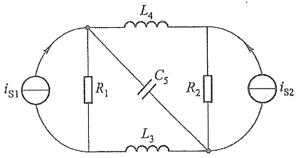

<details>
<summary>text_image</summary>

L4
iS1 R1 C5 R2 iS2
L3
</details>

(a)

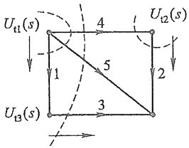

<details>
<summary>text_image</summary>

U_{t1}(s)
4
U_{t2}(s)
1
5
2
3
U_{t3}(s)
</details>

(b)

图15-14 例15-4图

基本割集矩阵 $Q_{\mathrm{f}}$ 为

$$
\begin{array}{l} \begin{array}{c c c c c} & 1 & 2 & 3 & 4 & 5 \end{array} \\ Q _ {\mathrm{f}} = 2 \left[ \begin{array}{c c c c c} 1 & 0 & 0 & 1 & 1 \\ 0 & 1 & 0 & - 1 & 0 \\ 0 & 0 & 1 & 1 & 1 \end{array} \right] \\ \end{array}
$$

用拉氏变换表示时,有

$$
U _ {_ B} (s) = 0
$$

$$
I _ {s} (s) = \left[ I _ {s 1} (s) \quad I _ {s 2} (s) \quad 0 \quad 0 \quad 0 \right] ^ {\mathrm{T}}
$$

$U_{s}(s)$  和  $I_{s}(s)$  分别为电压源和电流源列向量, 支路导纳矩阵为

$$
Y (s) = \mathrm{diag} \left[ \frac {1}{R _ {1}}, \frac {1}{R _ {2}}, \frac {1}{s L _ {3}}, \frac {1}{s L _ {4}}, s C _ {5} \right]
$$

把上述矩阵代入式(15-17)，便可得所求割集电压方程的矩阵形式为

$$
\left[ \begin{array}{c c c} \frac {1}{R _ {1}} + \frac {1}{s L _ {4}} + s C _ {5} & - \frac {1}{s L _ {4}} & \frac {1}{s L _ {4}} + s C _ {5} \\ - \frac {1}{s L _ {4}} & \frac {1}{R _ {2}} + \frac {1}{s L _ {4}} & - \frac {1}{s L _ {4}} \\ \frac {1}{s L _ {4}} + s C _ {5} & - \frac {1}{s L _ {4}} & \frac {1}{s L _ {3}} + \frac {1}{s L _ {4}} + s C _ {5} \end{array} \right] \left[ \begin{array}{l} U _ {\mathrm{t1}} (s) \\ U _ {\mathrm{t2}} (s) \\ U _ {\mathrm{t3}} (s) \end{array} \right] = \left[ \begin{array}{c} I _ {\mathrm{s1}} (s) \\ I _ {\mathrm{s2}} (s) \\ 0 \end{array} \right]
$$

1. 工程图

---

380

第十五章 电路方程的矩阵形式

## \*§15-7 列表法

从前面介绍的回路电流法、节点电压法、割集电压法的矩阵形式可知，回路电流法不允许存在无伴电流源支路，且规定的复合支路不允许存在受控电流源；节点电压法和割集电压法不允许存在无伴电压源支路，且规定的复合支路不允许存在受控电压源。这就使上述几种电路分析法有一定的局限性。本节介绍的列表法对支路类型无过多限制，适应性强，但方程数较多。下面推导列表方程的矩阵形式。

如前所述,式(15-12)和式(15-15)形式的支路方程都有各自的局限性,列表法采用一种新形式的支路方程。首先规定一个元件为一条支路①(注意,列表法不采用复合支路定义),且用阻抗描述电阻或电感支路,用导纳描述电导或电容支路,即

对于电阻或电感支路有: $\dot{U}_{k}=Z_{k}\dot{I}_{k},Z_{k}=R_{k}$  或  $Z_{k}=j\omega L_{k}$

对于电导或电容支路有: $\dot{I}_{k}=Y_{k}\dot{U}_{k},Y_{k}=G_{k}$  或  $Y_{k}=j\omega C_{k}$

对于 VCVS 支路有: $\dot{U}_{k}=\mu_{kj}\dot{U}_{j}$

对于 VCCS 支路有: $\dot{I}_{k}=g_{kj}\dot{U}_{j}$

对于 CCVS 支路有: $\dot{U}_{k}=r_{kj}\dot{I}_{j}$

对于CCCS支路有: $\dot{I}_k = \beta_{kj}\dot{I}_j$

另外，对于独立电压源支路，有  $\dot{U}_{k} = \dot{U}_{sk}$ 。对于独立电流源支路，有  $\dot{I}_{k} = \dot{I}_{sk}$ 。对整个电路可以写出如下形式的支路方程:

$$
F \dot {U} + H \dot {I} = \dot {U} _ {\mathrm{s}} + \dot {I} _ {\mathrm{s}} \tag {15-18}
$$

式中的  $\dot{U}=\left[\begin{matrix}\dot{U}_{1}&\dot{U}_{2}&\cdots&\dot{U}_{b}\end{matrix}\right]^{\mathrm{T}}$ 、 $\dot{I}=\left[\begin{matrix}\dot{I}_{1}&\dot{I}_{2}&\cdots&\dot{I}_{b}\end{matrix}\right]^{\mathrm{T}}$  分别为待求的支路电压和支路电流列向量，F 和 H 均为 b 阶方阵， $\dot{U}_{s}$  和  $\dot{I}_{s}$  分别为 b 阶电压源列向量和电流源列向量。下面分几种情况讨论。

(1) 当电路中无受控源, 电感间无耦合时, F、H 都是对角阵, 它们的元素为:

若支路 k 为电导或电容支路,有

$$
F _ {k k} = G _ {k} \text {或} \mathrm{j} \omega C _ {k}, \quad H _ {k k} = - 1
$$

若支路 k 为电阻或电感支路,有

$$
F _ {k k} = - 1, H _ {k k} = R _ {k} \text {或} \mathrm{j} \omega L _ {k}
$$

（2）当电路中有 VCVS 和 VCCS；电感间无耦合时，F 将是非对角阵，H 仍为对角阵，它们的元素为:

若支路 k 为  $\dot{U}_{j}$  控制的 VCVS 支路, 有

$$
F _ {k k} = + 1, \quad F _ {k j} = - \mu_ {k j}, \quad H _ {k k} = 0
$$

<small><span class="docvortex-page-footnote" data-block-type="page_footnote" style="color:#6b7280">① 支路电流和支路电压取关联参考方向；电压源支路电压方向规定为电源电压的正极指向负极；电流源支路电流方向规定与电流源的电流方向一致。</span></small>

---

\*§ 15-7 列表法

381

若支路 k 为  $\dot{U}_{j}$  控制的 VCCS 支路, 有

$$
F _ {k k} = 0, \quad F _ {k j} = - g _ {k j}, \quad H _ {k k} = + 1
$$

（3）当电路中有CCVS和CCCS，电感间无耦合时， $F$ 为对角阵， $\pmb{H}$ 将是非对角阵，它们的元素为:

若支路 k 为  $\dot{I}_{j}$  控制的 CCVS 支路, 有

$$
F _ {k k} = + 1, \quad H _ {k j} = - r _ {k j}, \quad H _ {k k} = 0
$$

若支路 k 为  $\dot{I}_{j}$  控制的 CCCS 支路, 有

$$
F _ {k k} = 0, \quad H _ {k j} = - \beta_ {k j}, \quad H _ {k k} = + 1
$$

（4）当电路中电感间有耦合时，设支路 $k$ 和支路 $j$ 之间有耦合，因 $\dot{U}_k = \mathrm{j}\omega L_k\dot{I}_k\pm$ $\mathrm{j}\omega M_{kj}\dot{I}_j,\dot{U}_j = \mathrm{j}\omega L_j\dot{I}_j\pm \mathrm{j}\omega M_{jk}\dot{I}_k$ ，所以有

$$
F _ {k k} = + 1, \quad H _ {k k} = - \mathrm{j} \omega L _ {k}, \quad H _ {k j} = \mp \mathrm{j} \omega M _ {k j}
$$

$$
F _ {j j} = + 1, \quad H _ {j j} = - \mathrm{j} \omega L _ {j}, \quad H _ {j k} = \mp \mathrm{j} \omega M _ {j k}
$$

（5）当电路中含有理想变压器时，设理想变压器及其图如图15-15所示，由于$\dot{U}_{k}=n\dot{U}_{j},\dot{I}_{j}=-n\dot{I}_{k}$ ，故有

$$
F _ {k k} = + 1 \quad , F _ {k j} = - n, \quad H _ {k k} = 0
$$

$$
F _ {j j} = 0, \quad H _ {j j} = + 1, \quad H _ {j k} = n
$$

另外,若支路 k 为独立电压源支路,有

$$
F _ {k k} = + 1, \quad H _ {k k} = 0
$$

若支路 k 为独立电流源支路,有

$$
F _ {k k} = 0, \quad H _ {k k} = + 1
$$

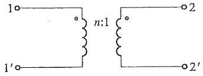

<details>
<summary>chemical</summary>

Electrical circuit diagram showing a transformer with primary and secondary windings labeled n:1 and 2
</details>

(a)

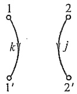

(b)

图 15-15 理想变压器

从上面的分析可见,式(15-18)表达的支路方程适应性非常强,可以方便地处理支路为上述单一元件的各种情况。

下面只给出列表方程之一——节点列表方程的矩阵形式的推导。设节点电压  $\dot{U}_{n}$  也为待求量，把用关联矩阵 A 表示的 KCL、KVL 以及式(15-18)重新列出如下:

KCL A  $\dot{I}=0$

KVL $\dot{U} - A^{\mathrm{T}}\dot{U}_{\mathrm{n}} = 0$

支路方程  $F\dot{U}+H\dot{I}=\dot{U}_{s}+\dot{I}_{s}$

将这 3 个方程合在一起,便得到节点列表方程的矩阵形式

$$
\left[ \begin{array}{c c c} 0 & 0 & A \\ - A ^ {\mathrm{T}} & 1 _ {b} & 0 \\ 0 & F & H \end{array} \right] \left[ \begin{array}{c} \dot {U} _ {\mathrm{n}} \\ \dot {U} \\ \dot {I} \end{array} \right] = \left[ \begin{array}{c} 0 \\ 0 \\ \dot {U} _ {\mathrm{s}} + \dot {I} _ {\mathrm{s}} \end{array} \right] \tag {15-19}
$$

上式中  $1_{b}$  为 b 阶的单位矩阵。由于 A 为  $[(n-1)\times b]$  矩阵，F 和 H 为 b 阶方阵，故方程总数为  $(2b+n-1)$ 。

例 15-5 写出图 15-16(a) 所示电路的节点列表方程的矩阵形式(相量形式)。

---

382

第十五章 电路方程的矩阵形式

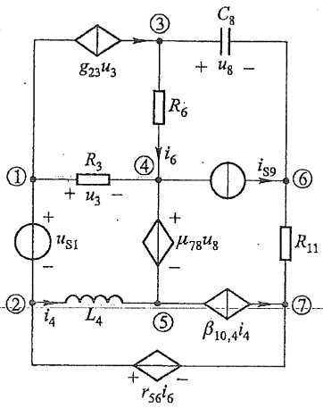

<details>
<summary>text_image</summary>

g23u3
C8
+
u8 -
R6
i6
①
R3
+
u3 -
④
iS9
⑥
+
us1
-
μ78u8
-
②
i4
L4
⑤
β10,4i4
R11
⑦
+
r56i6 -
</details>

(a)

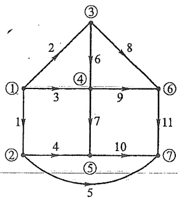

<details>
<summary>flowchart</summary>

```mermaid
graph TD
  1["①"] -->|3| 4["④"]
  2["②"] -->|4| 5["⑤"]
  3["③"] -->|6| n4["4"]
  4["④"] -->|9| 6["⑥"]
  5["⑤"] -->|10| 7["⑦"]
  6["⑥"] -->|11| n7["7"]
  7["①"] -->|1| n1["1"]
  8["⑧"] -->|8| n3["3"]
  9["⑨"] -->|9| n6["6"]
  10["⑩"] -->|10| n7
  11["⑪"] -->|11| n7
  12["⑫"] -->|12| n8["8"]
  13["⑬"] -->|13| n9["9"]
  14["⑭"] -->|14| n10["10"]
  15["⑮"] -->|15| n11["11"]
  16["⑯"] -->|16| n12["12"]
  17["⑰"] -->|17| n13["13"]
  18["⑱"] -->|18| n14["14"]
  19["⑲"] -->|19| n15["15"]
  20["⑳"] -->|20| n16["16"]
  21["⑴"] -->|21| n17["17"]
  22["⑵"] -->|22| n18["18"]
  23["⑶"] -->|23| n19["19"]
  24["⑷"] -->|24| n20["20"]
  25["⑧"] -->|25| n21["21"]
  26["⑨"] -->|26| n22["22"]
  27["⑩"] -->|27| n23["23"]
  28["⑪"] -->|28| n24["24"]
  29["⑫"] -->|29| n25["25"]
  30["⑬"] -->|30| n26["26"]
  31["⑭"] -->|31| n27["27"]
  32["⑮"] -->|32| n28["28"]
  33["⑯"] -->|33| n29["29"]
  34["⑰"] -->|34| n30["30"]
  35["⑱"] -->|35| n31["31"]
  36["⑲"] -->|36| n32["32"]
  37["⑳"] -->|37| n33["33"]
  38["⑴"] -->|38| n34["34"]
  39["⑵"] -->|39| n35["35"]
  40["⑳"] -->|40| n36["36"]
  41["⑱"] -->|41| n37["37"]
  42["⑲"] -->|42| n38["38"]
  43["⑳"] -->|43| n39["39"]
  44["⑵"] -->|44| n40["40"]
  45["⑶"] -->|45| n41["41"]
  46["⑷"] -->|46| n42["42"]
  47["⑧"] -->|47| n43["43"]
  48["⑨"] -->|48| n44["44"]
  49["⑩"] -->|49| n45["45"]
  50["⑪"] -->|50| n46["46"]
```
</details>

(b)

图15-16 例15-5图

解 该电路的图如图 15-16(b) 所示, 选节点⑦为参考节点, 则关联矩阵为

$$
\boldsymbol {A} = \left[ \begin{array}{c c c c c c c c c c c} 1 & 1 & 1 & 0 & 0 & 0 & 0 & 0 & 0 & 0 & 0 \\ 2 & - 1 & 0 & 0 & 1 & 1 & 0 & 0 & 0 & 0 & 0 \\ 3 & 0 & - 1 & 0 & 0 & 0 & 1 & 0 & 1 & 0 & 0 \\ 4 & 0 & 0 & - 1 & 0 & 0 & - 1 & 1 & 0 & 1 & 0 \\ 5 & 0 & 0 & 0 & - 1 & 0 & 0 & - 1 & 0 & 0 & 1 \\ 6 & 0 & 0 & 0 & 0 & 0 & 0 & 0 & - 1 & - 1 & 0 \end{array} \right]
$$

F 矩阵和 H 矩阵分别为

$$
F = \left[ \begin{array}{c c c c c c c c c c} & & 3 & & & & 8 & & \\ 1 & & \vdots & & & & \vdots & & \\ \dots & 0 & - g _ {2 3} & & & & \vdots & & \\ & & - 1 & & & & \vdots & . & \\ & & & - 1 & & & \vdots & . & \mathbf {0} \\ & & & & 1 & & \vdots \\ & & & & G _ {6} & & \vdots \\ & & . & & & 1 & - \mu_ {7 8} & \dots & \dots \\ & & & & & j \omega C _ {8} \\ & & \mathbf {0} & & & & 0 & . \\ & & . & & & . & . & 0 \\ & . & . & & & . & . & - 1 \end{array} \right] 7
$$

---

§ 15-8 状态方程

383

$$
\boldsymbol {H} = \left[ \begin{array}{c c c c c c c c c c c} 0 & & & & & 6 & & & & \\ & 1 & & & & \vdots & & & & \\ & & R _ {3} & & & \vdots & & & & \\ & & & \mathrm{j} \omega L _ {4} & & \vdots & & & 0 & & \\ & & & & 0 & - r _ {5 6} & \dots & \dots & \dots & \dots & \dots \\ & & & & & - 1 & & \\ & 0 & & & & - 0 & & \\ & & & & & & - 1 & \\ & & & & & & & 1 \\ 1 0 \dots \dots - \beta_ {1 0, 4} & \\ & & \vdots \\ & 4 \end{array} \right] \tag {5}
$$

另有

$$
\dot {U} _ {\mathrm{s}} = \left[ \begin{array}{c c c c c c c c c c c} \dot {U} _ {\mathrm{s1}} & 0 & 0 & 0 & 0 & 0 & 0 & 0 & 0 & 0 & 0 \end{array} \right] ^ {\mathrm{T}}
$$

$$
\dot {I} _ {\mathrm{s}} = \left[ \begin{array}{c c c c c c c c c c} 0 & 0 & 0 & 0 & 0 & 0 & 0 & \dot {I} _ {\mathrm{s9}} & 0 & 0 \end{array} \right] ^ {\mathrm{T}}
$$

把这些矩阵按式(15-19)所示位置填入,即可获得节点列表方程的矩阵形式。

由例 15-5 可以看出, 列表法的适应性很强, 而且方程易于建立, 如同填写表格一般, 故有列表之称。列表方程的缺点是规模大, 然而其系数矩阵中零元素所占比例也很大。稀疏矩阵技术的发展已使这一缺点变得微不足道了。

需要说明的是,列表法还有回路列表法和割集列表法。列写回路列表方程时,只需设  $\dot{I}_{1}$  为待求量,并把 KCL 和 KVL 用  $B_{f}$  表示,支路方程为式(15-18)形式;列割集列表方程,只需设  $\dot{U}_{1}$  为待求量,且用  $Q_{f}$  表示 KCL 和 KVL,支路方程仍为式(15-18)形式。

另一种适应性强的方法是改进节点电压法,这里不再介绍。

## §15-8 状态方程

在电路理论中还引用“状态变量”作为分析电路动态过程的独立变量。状态变量是根据“状态”的概念而来的。“状态”是系统理论中的一个专门术语，它表达一个比较抽象但又基本的概念。在电路理论中，当把“状态”作为上述专门术语引用时，是指在某给定时刻电路必须具备的最少量的信息，它们和从该时刻开始的任意输入一起就足以完全确定今后该电路在任何时刻的性状。状态变量就是电路的一组独立的动态变量，它们在任何时刻的值组成了该时刻的状态。从第六、七两章中对一阶、二阶电路的分析可知，电容上电压 $u_{c}$ （或电荷 $q_{c}$ ）和电感中的电流 $i_{L}$ （或磁通链 $\Psi_{L}$ ）就是电路的状态变量。对状态变量列出的一阶微分方程称为状态方程。因此如果已知状态变量在 $t_{0}$

---

384

第十五章 电路方程的矩阵形式

时的值,而且已知自 $t_{0}$ 开始的外施激励,就能唯一地确定 $t>t_{0}$ 后电路的全部性状。

下面通过一个简单的例子说明上面介绍的概念。在第七章 RLC 电路的时域分析中,列出了以电容电压为求解对象的微分方程(见图 15-17)

$$
L C \frac {\mathrm{d} ^ {2} u _ {c}}{\mathrm{d} t ^ {2}} + R C \frac {\mathrm{d} u _ {c}}{\mathrm{d} t} + u _ {c} = u _ {\mathrm{s}}
$$

这是一个二阶线性微分方程。用来确定积分常数的初始条件应是电容上的电压和电感中的电流在 $t=t_{0}$ 时的初始值(这里以 $t=t_{0}$ 作为过程的起始)。

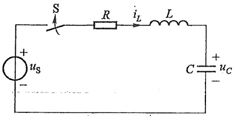

<details>
<summary>text_image</summary>

S
R
iL
L
+
us
-
C
+
uc
-
</details>

图 15-17 RLC 串联电路

如果以电容电压  $u_{c}$  和电感电流  $i_{L}$  作为变量列上述电路的方程, 则有

$$
C \frac {\mathrm{d} u _ {c}}{\mathrm{d} t} = i _ {_ L}
$$

$$
L \frac {\mathrm{d} i _ {L}}{\mathrm{d} t} = u _ {\mathrm{s}} - R i _ {L} - u _ {C}
$$

再把这两个方程的形式做些改变,可得

$$
\left. \begin{array}{l} \frac {\mathrm{d} u _ {c}}{\mathrm{d} t} = 0 + \frac {1}{C} i _ {L} + 0 \\ \frac {\mathrm{d} i _ {L}}{\mathrm{d} t} = - \frac {1}{L} u _ {c} - \frac {R}{L} i _ {L} + \frac {1}{L} u _ {\mathrm{s}} \end{array} \right\} \tag {15-20}
$$

这是一组以  $u_{c}$  和  $i_{L}$  为变量的一阶微分方程，而  $u_{c}(t_{0_{+}})$  和  $i_{L}(t_{0_{+}})$  提供了用来确定积分常数的初始值，因此方程(15-20)就是描写电路动态过程的状态方程。

如果用矩阵形式列写方程(15-20)，则有

$$
\left[ \begin{array}{c} {{\frac {\mathrm{d} u _ {C}}{\mathrm{d} t}}} \\ {{\frac {\mathrm{d} i _ {L}}{\mathrm{d} t}}} \end{array} \right] = \left[ \begin{array}{c c} {0} & {{\frac {1}{C ^ {\prime}}}} \\ {- {\frac {1}{L}}} & {- {\frac {R}{L}}} \end{array} \right] \left[ \begin{array}{c} {u _ {C}} \\ {i _ {L}} \end{array} \right] + \left[ \begin{array}{c} {0} \\ {{\frac {1}{L}}} \end{array} \right] \left[ \begin{array}{c} {u _ {S}} \end{array} \right]
$$

若令 $x_{1} = u_{C}, x_{2} = i_{L}, \dot{x}_{1} = \frac{\mathrm{d}u_{C}}{\mathrm{d}t}, \dot{x}_{2} = \frac{\mathrm{d}i_{L}}{\mathrm{d}t}$, 则有

$$
\left[ \begin{array}{c} \dot {x} _ {1} \\ \dot {x} _ {2} \end{array} \right] = A \left[ \begin{array}{c} x _ {1} \\ x _ {2} \end{array} \right] + B \left[   u _ {\mathrm{s}}   \right]
$$

式中

$$
A = \left[ \begin{array}{c c} 0 & \frac {1}{C} \\ - \frac {1}{L} & - \frac {R}{L} \end{array} \right], \quad B = \left[ \begin{array}{c} 0 \\ \frac {1}{L} \end{array} \right] ^ {\textcircled {1}}
$$

<small><span class="docvortex-page-footnote" data-block-type="page_footnote" style="color:#6b7280">① 注意这里的矩阵 A 和 B 不是前面用过的关联矩阵和回路矩阵。</span></small>

---

§ 15-8 状态方程

385

如果令 $\dot{x} \stackrel{\mathrm{def}}{=} [\dot{x}_1 \dot{x}_2]^{\mathrm{T}}, x = [x_1 x_2]^{\mathrm{T}}, v = [u_{\mathrm{S}}]$，则有

$$
\dot {x} = A x + B \nu \tag {15-21}
$$

式(15-21)称为状态方程的标准形式。x 称为状态向量，v 称为输入向量。在一般情况下，设电路具有 n 个状态变量，m 个独立电源，式(15-21)中的  $\dot{x}$  和 x 为 n 阶列向量，A 为  $n \times n$  方阵，v 为 m 阶列向量，B 为  $n \times m$  矩阵。上列方程有时称为向量微分方程。

从对上述二阶电路列写状态方程的过程不难看出,要列出包括 $\frac{du_{c}}{dt}$ 项的方程,必须对只接有一个电容的结点或割集写出KCL方程,而要列出包含 $\frac{di_{L}}{dt}$ 项的方程,必须对只

包含一个电感的回路列写 KVL 方程。对于不太复杂的电路，可以用直观法列写状态方程。例如，对图 15-18 所示电路，若以  $u_{C}$ 、 $i_{1}$  和  $i_{2}$  为状态变量，可按如下步骤列出状态方程。

对节点②列出 KCL 方程

$$
C \frac {\mathrm{d} u _ {c}}{\mathrm{d} t} = - i _ {1} - i _ {2}
$$

再分别对回路 1 和回路 2 列出 KVL 方程

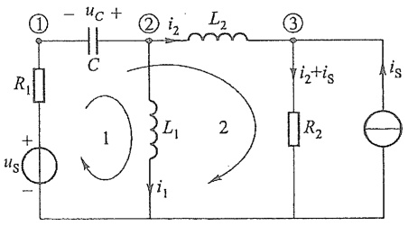

<details>
<summary>text_image</summary>

① - uC +
② i2 L2
R1 C
L1 2
i2+iS
R2
iS
us
-
③
</details>

图 15-18 用直观法列写状态方程

$$
L _ {1} \frac {\mathrm{d} i _ {1}}{\mathrm{d} t} = - u _ {R _ {1}} + u _ {c} + u _ {\mathrm{s}} = - R _ {1} (i _ {1} + i _ {2}) + u _ {c} + u _ {\mathrm{s}}
$$

$$
L _ {2} \frac {\mathrm{d} i _ {2}}{\mathrm{d} t} = - u _ {_ {R _ {1}}} + u _ {_ {C}} - u _ {_ {R _ {2}}} + u _ {_ {\mathrm{S}}} = - R _ {1} (  i _ {1} + i _ {2}  ) + u _ {_ {C}} - R _ {2} (  i _ {2} + i _ {\mathrm{S}}  ) + u _ {_ {\mathrm{S}}}
$$

整理以上方程并写成矩阵形式有

$$
\left[ \begin{array}{l} \frac {\mathrm{d} u _ {c}}{\mathrm{d} t} \\ \frac {\mathrm{d} i _ {1}}{\mathrm{d} t} \\ \frac {\mathrm{d} i _ {2}}{\mathrm{d} t} \end{array} \right] = \left[ \begin{array}{c c c} 0 & - \frac {1}{C} & - \frac {1}{C} \\ \frac {1}{L _ {1}} & - \frac {R _ {1}}{L _ {1}} & - \frac {R _ {1}}{L _ {1}} \\ \frac {1}{L _ {2}} & - \frac {R _ {1}}{L _ {2}} & - \frac {R _ {1} + R _ {2}}{L _ {2}} \end{array} \right] \left[ \begin{array}{l} u _ {c} \\ i _ {1} \\ i _ {2} \end{array} \right] + \left[ \begin{array}{c c} 0 & 0 \\ \frac {1}{L _ {1}} & 0 \\ \frac {1}{L _ {2}} & - \frac {R _ {2}}{L _ {2}} \end{array} \right] \left[ \begin{array}{l} u _ {\mathrm{s}} \\ i _ {\mathrm{s}} \end{array} \right]
$$

或

$$
\dot {x} = A x + B \nu
$$

式中 $\dot{x} = \left[ \begin{array}{ccc}\dot{x}_1 & \dot{x}_2 & \dot{x}_3 \end{array} \right]^{\mathrm{T}}, x = \left[ \begin{array}{ccc}x_1 & x_2 & x_3 \end{array} \right]^{\mathrm{T}}, v = \left[ \begin{array}{cc}u_{\mathrm{S}} & i_{\mathrm{S}} \end{array} \right]^{\mathrm{T}}$ 而 $x_{1} = u_{C}, x_{2} = i_{1}, x_{3} = i_{2}$。

值得注意,在列写包含 $\frac{du_{c}}{dt}$ 或 $\frac{di_{L}}{dt}$ 的方程时,有时可能出现非状态变量,如上例中的 $u_{R_{1}}$ 和 $u_{R_{2}}$ ,只有把它们表示为状态变量后,才能得到状态方程的标准形式。在建立状态方程过程中,通常包含这种消去非状态变量的过程。

1. 工程图

---

图 1-2

386

第十五章 电路方程的矩阵形式

对于复杂电路,利用树的概念建立状态方程较为方便。下面介绍一种借助特有树 $^{①}$ 建立状态方程的方法。特有树是这样一种树,它的树支包含了电路中所有电压源支路和电容支路,它的连支包含了电路中所有电流源支路和电感支路。当电路中不存在仅由电容和电压源支路构成的回路和仅由电流源和电感支路构成的割集时,特有树总是存在的。于是可以选一个特有树,对单电容树支割集列写 KCL 方程,对单电感连支回路列写 KVL 方程。然后消去非状态变量(如果有必要),最后整理并写成矩阵形式。下面举例说明这种借特有树概念建立状态方程的方法。

例 15-6 列出图 15-19(a) 所示电路的状态方程。

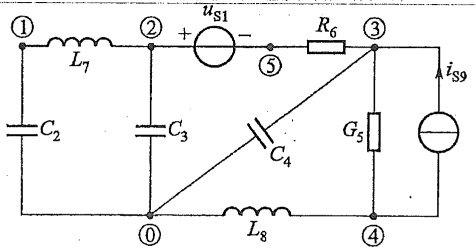

<details>
<summary>text_image</summary>

①
L7
C2
② +
us1
-
⑤
R6
③
iS9
C3
C4
G5
④
L8
</details>

(a)

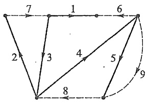

<details>
<summary>text_image</summary>

7
1
6
2
3
4
5
8
9
</details>

(b)

图15-19 例15-6图

解 选择图 15-19(b) 中实线所示树, 支路的编号与参考方向均在图中标出(注意一条支路只含一个元件)。对由树支 2、3、4 确定的基本割集列出 KCL 方程

$$
C _ {2} \frac {\mathrm{d} u _ {2}}{\mathrm{d} t} = i _ {7}
$$

$$
C _ {3} \frac {\mathrm{d} u _ {3}}{\mathrm{d} t} = i _ {6} + i _ {7}
$$

$$
C _ {4} \frac {\mathrm{d} u _ {4}}{\mathrm{d} t} = i _ {6} + i _ {8}
$$

对由连支 7、8 确定的基本回路列出 KVL 方程

$$
L _ {7} \frac {\mathrm{d} i _ {7}}{\mathrm{d} t} = - u _ {2} - u _ {3}
$$

$$
L _ {8} \frac {\mathrm{d} i _ {8}}{\mathrm{d} t} = - u _ {4} - u _ {5}
$$

消去非状态变量 $u_{5}$ 、 $i_{6}$ ，有

$$
u _ {s} = \frac {1}{G _ {s}} i _ {s} = \frac {1}{G _ {s}} (i _ {8} + i _ {\mathrm{S9}})
$$

$$
i _ {6} = \frac {1}{R _ {6}} u _ {6} = \frac {1}{R _ {6}} (  u _ {\mathrm{S1}} - u _ {3} - u _ {4}  )
$$

<small><span class="docvortex-page-footnote" data-block-type="page_footnote" style="color:#6b7280">① proper tree。</span></small>

---

§ 15-8 状态方程

387

经整理后得

$$
\begin{array}{l} \frac {\mathrm{d} u _ {2}}{\mathrm{d} t} = \frac {1}{C _ {2}} i _ {7} \\ \frac {\mathrm{d} u _ {3}}{\mathrm{d} t} = - \frac {1}{C _ {3} R _ {6}} u _ {3} - \frac {1}{C _ {3} R _ {6}} u _ {4} + \frac {1}{C _ {3}} i _ {7} + \frac {1}{C _ {3} R _ {6}} u _ {\mathrm{S1}} \\ \frac {\mathrm{d} u _ {4}}{\mathrm{d} t} = - \frac {1}{C _ {4} R _ {6}} u _ {3} - \frac {1}{C _ {4} R _ {6}} u _ {4} + \frac {1}{C _ {4}} i _ {8} + \frac {1}{C _ {4} R _ {6}} u _ {\mathrm{S} 1} \\ \frac {\mathrm{d} i _ {7}}{\mathrm{d} t} = - \frac {1}{L _ {7}} u _ {2} - \frac {1}{L _ {7}} u _ {3} \\ \frac {\mathrm{d} i _ {8}}{\mathrm{d} t} = - \frac {1}{L _ {8}} u _ {4} - \frac {1}{G _ {5} L _ {8}} i _ {8} - \frac {1}{G _ {5} L _ {8}} i _ {\mathrm{S9}} \\ \end{array}
$$

如 $x_{1} = u_{2}, x_{2} = u_{3}, x_{3} = u_{4}, x_{4} = i_{7}, x_{5} = i_{8}$, 则有

$$
\underbrace {\left[ \begin{array}{l} \dot {x} _ {1} \\ \dot {x} _ {2} \\ \dot {x} _ {3} \\ \dot {x} _ {4} \\ \dot {x} _ {5} \end{array} \right]} _ {\dot {x}} = \underbrace {\left[ \begin{array}{c c c c c} 0 & 0 & 0 & \frac {1}{C _ {2}} & 0 \\ 0 & - \frac {1}{C _ {3} R _ {6}} & - \frac {1}{C _ {3} R _ {6}} & \frac {1}{C _ {3}} & 0 \\ 0 & - \frac {1}{C _ {4} R _ {6}} & - \frac {1}{C _ {4} R _ {6}} & 0 & \frac {1}{C _ {4}} \\ - \frac {1}{L _ {7}} & - \frac {1}{L _ {7}} & 0 & 0 & 0 \\ 0 & 0 & - \frac {1}{L _ {8}} & 0 & - \frac {1}{G _ {5} L _ {8}} \end{array} \right] \left[ \begin{array}{l} x _ {1} \\ x _ {2} \\ x _ {3} \\ x _ {4} \\ x _ {5} \end{array} \right]} _ {\boldsymbol {A}} + \underbrace {\left[ \begin{array}{c c} 0 & 0 \\ \frac {1}{C _ {3} R _ {6}} & 0 \\ \frac {1}{C _ {4} R _ {6}} & 0 \\ 0 & 0 \\ 0 & \frac {1}{G _ {5} L _ {8}} \end{array} \right]} _ {\boldsymbol {B}} \underbrace {\left[ \begin{array}{l} u _ {\mathrm{SI}} \\ i _ {\mathrm{S9}} \end{array} \right]} _ {\nu}
$$

这就是所求状态方程。

在实际应用中,如果需要以节点电压为输出,这就要求导出节点电压与状态变量之间的关系。在线性电路中,节点电压可表示为状态变量与输入激励的线性组合。如上例中,若要求节点①、②、③、④的电压作为输出,则有 $u_{n1}=-u_{2},u_{n2}=u_{3},u_{n3}=-u_{4},u_{n4}=-u_{5}-u_{4}=\frac{-1}{G_{5}}(i_{8}+i_{S9})-u_{4}$ ,整理并写成矩阵形式有

$$
\left[ \begin{array}{l} u _ {\mathrm{n1}} \\ u _ {\mathrm{n2}} \\ u _ {\mathrm{n3}} \\ u _ {\mathrm{n4}} \end{array} \right] = \left[ \begin{array}{c c c c c} - 1 & 0 & 0 & 0 & 0 \\ 0 & 1 & 0 & 0 & 0 \\ 0 & 0 & - 1 & 0 & 0 \\ 0 & 0 & - 1 & 0 & - \frac {1}{G _ {5}} \end{array} \right] \left[ \begin{array}{l} u _ {2} \\ u _ {3} \\ u _ {4} \\ i _ {7} \\ i _ {8} \end{array} \right] + \left[ \begin{array}{c c} 0 & 0 \\ 0 & 0 \\ 0 & 0 \\ 0 & - \frac {1}{G _ {5}} \end{array} \right] \left[ \begin{array}{l} u _ {\mathrm{S1}} \\ i _ {\mathrm{S9}} \end{array} \right]
$$

这种联系电路中某些感兴趣的量(此处为4个节点电压)与状态变量和输入量之间的

---

388

第十五章 电路方程的矩阵形式

关系式称为电路的输出方程。输出方程的一般形式为

$$
y = C x + D v
$$

式中 y 为输出向量, x 为状态向量, v 为输入向量, C 和 D 为仅与电路结构和元件值有关的系数矩阵。

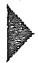

## 思考题

15-1 为什么割集电压是一组独立电压,节点电压也是一组独立电压?
15-2 在建立电路的矩阵方程时,是采用复合支路方便,还是用一个元件表示一条支路方便?为什么?
15-3 节点电压方程容易建立,还是割集电压方程容易建立?试说明理由。
15-4 根据本章所学内容,除了本章介绍的节点电压方程、回路电流方程、割集电压方程、列表方程外,还可以建立别的形式的电路矩阵方程吗?
15-5 状态方程是在时域求解动态电路过渡过程的方法,请与第七章介绍的经典法相比较,并与第十四章介绍的复频域分析法相比较。

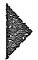

## 习题

15-1 以节点⑤为参考,写出题15-1图所示有向图的关联矩阵A。


<details>
<summary>flowchart</summary>


</details>

(a)


<details>
<summary>flowchart</summary>


</details>

(b)

题 15-1 图

15-2 对于题 15-2 图(a)和(b)，与用虚线画出的闭合面 S 相切割的支路集合是否构成割集？为什么？


<details>
<summary>text_image</summary>

S
</details>

(a)


<details>
<summary>text_image</summary>

S
</details>

(b)

题15-2图

---

习题

389

1. 用 $\mathrm{H}_2\mathrm{O}$ 气相分离的气体，用于气体交换和燃烧过程中的气体。

15-3 对于题 15-3 图所示有向图, 若选支路 1、2、3、7 为树支, 试写出基本割集矩阵和基本回路矩阵; 另外, 以网孔作为回路写出回路矩阵。
15-4 对于题 15-4 图所示有向图, 若选支路 1、2、3、5、8 为树支, 试写出基本割集矩阵和基本回路矩阵。


<details>
<summary>flowchart</summary>


</details>

题15-3图


<details>
<summary>flowchart</summary>

```mermaid
graph TD
  1["Node 1"] -->|Arrow 1| 2["Node 2"]
  n2["2"] -->|Arrow 2| 3["Node 3"]
  n3["3"] -->|Arrow 3| 4["Node 4"]
  n4["4"] -->|Arrow 4| 5["Node 5"]
  n5["5"] -->|Arrow 5| 6["Node 6"]
  n6["6"] -->|Arrow 6| 7["Node 7"]
  n7["7"] -->|Arrow 7| 8["Node 8"]
  n8["8"] -->|Arrow 8| 9["Node 9"]
  n9["9"] -->|Arrow 9| 10["Node 10"]
  10 -.->|Arrow 10| Node 5
```
</details>

题 15-4 图

15-5 对题 15-5 图所示有向图, 若选节点⑤为参考, 并选支路 1、2、4、5 为树。试写出关联矩阵、基本回路矩阵和基本割集矩阵; 并验证 $B_{t}^{T} = -A_{t}^{-1}A_{1}$ 和 $Q_{1} = -B_{t}^{T}$。


<details>
<summary>flowchart</summary>


</details>

题15-5图

15-6 对题 15-6 图所示电路, 选支路 1、2、4、7 为树, 用矩阵形式列出其回路电流方程。各支路电阻均为 $5 \Omega$, 各电压源电压均为 $3 \mathrm{~V}$, 各电流源电流均为 $2 \mathrm{~A}$ 。


<details>
<summary>text_image</summary>

R3
US1
+
-
R6
IS2
R2
R7
R5
IS5
+ -
US3
+
-
R8
US4
+ -
US5
</details>

(a)


<details>
<summary>text_image</summary>

3
1
6
2
8
4
7
5
</details>

(b)

题15-6图

15-7 对题 15-7 图所示电路, 用运算形式(设零值初始条件)在下列 2 种不同情

---

390

第十五章 电路方程的矩阵形式

况下列出网孔电流方程:(1) 电感  $L_{5}$  和  $L_{6}$  之间无互感。(2)  $L_{5}$  和  $L_{6}$  之间有互感 M。


<details>
<summary>text_image</summary>

C3
L5
C4
iS1
M
R1
L6
R2
+
us2
-
</details>

(a)


<details>
<summary>text_image</summary>

3
5 4
1 6 2
</details>

(b)

题15-7图

15-8 对题 15-8 图所示电路,选支路 1、2、3、4、5 为树,试写出此电路回路电流方程的矩阵形式。


<details>
<summary>text_image</summary>

M
L1
C8
R3
iS4
L2
R7
+
us7
-
R6
R4
R5
</details>

(a)


<details>
<summary>flowchart</summary>


</details>

(b)

题15-8图

15-9 写出题 15-9 图所示电路网孔电流方程的矩阵形式。

15-10 题 15-10 图所示电路中电源角频率为  $\omega$ ，试以节点④为参考节点，列写出该电路节点电压方程的矩阵形式。


<details>
<summary>text_image</summary>

R6
-
rI3 +
R4
R5
R1
Us1
+
R2
R3
I3
R7
IS7
</details>

题 15-9 图


<details>
<summary>text_image</summary>

gu5
① R3 - uS3 +
② + u5 -
R5
C1 R2 L4 ③
+ uS2
- iS6
④
</details>

题 15-10 图

---

习题

391

\* 15-11 试以节点⑥为参考节点,列出题15-11图所示电路矩阵形式的节点电压方程。


<details>
<summary>text_image</summary>

I9 R9 + US9 -
① R7 ② R8 ③
βI9 R1 + US1 - ④ IS5 gU6
R4 R5
⑤ R6 + US - + US6 - ⑥
</details>

题15-11图

15-12 电路如题 15-12 图(a)所示, 题 15-12 图(b)为其有向图。选支路 1、2、6、7 为树, 列出矩阵形式的割集电压方程。


<details>
<summary>text_image</summary>

R1
R8
×
US8
R5
R4
+
US4
-
R7
R6
R3
R2
IS2
</details>

(a)


<details>
<summary>flowchart</summary>


</details>

(b)

题 15-12 图

\*15-13 电路如题 15-13 图(a)所示,题 15-13 图(b)为其有向图。试写出节点列表法中支路方程的矩阵形式。


<details>
<summary>text_image</summary>

①
+ U6 -
R6
βI4
②
IS7
R8
US2
-
③
+ μU5
-
gU6
R9
④
+ rI4 -
R4
I4
⑤
+ U5 -
R5
</details>

(a)


<details>
<summary>flowchart</summary>


</details>

(b)

题15-13图

图 5-1

---

392

第十五章 电路方程的矩阵形式

15-14 电路如题 15-14 图(a)所示, 题 15-14 图(b)为其有向图。列出节点列表方程的矩阵形式。


<details>
<summary>text_image</summary>

R6
R5
+
uS1
-
n:1
R7
R4
</details>

(a)


<details>
<summary>flowchart</summary>


</details>

(b)

题15-14图

15-15 列出题 15-15 图所示电路的状态方程。若选节点①和②的节点电压为输出量, 写出输出方程。


<details>
<summary>text_image</summary>

R₁
① L₁
②
+ uₛ R₂ C L₂
-
</details>

题15-15图

15-16 列出题 15-16 图所示电路的状态方程。设 $C_1 = C_2 = 1\mathrm{F}, L_1 = 1\mathrm{H}, L_2 = 2\mathrm{H}, R_1 = R_2 = 1\Omega, R_3 = 2\Omega, u_s(t) = 2\sin t\mathrm{V}, i_\mathrm{S}(t) = 2\mathrm{e}^{-t}\mathrm{A}$。


<details>
<summary>text_image</summary>

L2
R3
C1
C2
iS
R1
L1
R2
+
us
-
</details>

题 15-16 图


第十五章部分习题答案
