# 第17章 非线性电路

原始 PDF 第 439–473 页。

# 第十七章

# 非线性电路

## 导读

在本书的前十六章,主要介绍线性电路的分析。由于无论是非线性电路的系统行为,还是非线性电路的分析方法,都与线性电路有很大的差异,对非线性电路的分析是电路理论的重要任务之一。

本章简要地介绍非线性元件，并举例说明非线性电路方程的建立方法。讨论了分析非线性电路的一些常用方法，如非线性电阻电路的小信号分析法，分段线性化方法；简要地介绍了工作在非线性范围的运算放大器，小扰动下的动态电路分析法，有关状态平面以及自激振荡的初步概念；最后初步介绍了“混沌”、人工神经元电路。

本章以掌握概念为主,不强调定量分析。

## §17-1 非线性电阻

在线性电路中,线性元件的特点是其参数不随电压或电流而变化。如果电路元件的参数随着电压或电流而变化,即电路元件的参数与电压或电流有关,就称为非线性元件,含有非线性元件的电路称为非线性电路。

实际电路元件的参数总是或多或少地随着电压或电流而变化。所以，严格说来，一切实际电路都是非线性电路。在工程计算中，将那些非线性程度比较微弱的电路元件作为线性元件来处理，不会带来本质上的差异，从而简化了电路分析。但是，许多非线性元件的非线性特征不容忽略，否则就将无法解释电路中发生的物理现象。如果将这些非线性元件作为线性元件处理，势必使计算结果与实际量值相差太大而无意义，甚至还会产生本质的差异。由于非线性电路本身具有的特殊性，分析研究非线性电路具有重要的意义。

线性电阻元件的伏安特性可用欧姆定律来表示, 即 u=Ri, 在 u-i 平面上它是通过坐标原点的一条直线。非线性电阻元件的电压电流关系不满足欧姆定律, 而是遵循某种特定的非线性函数关系。非线性电阻在电路中的符号如图 17-1(a) 所示(为了使问

---

416

第十七章 非线性电路

题简化,这里仅考虑 u>0 和 i>0 的情况)。

若非线性电阻元件两端的电压是其电流的单值函数,这种电阻就称为电流控制型电阻,它的伏安特性可用下列函数关系表示

$$
u = f (i) \tag {17-1}
$$

其典型的伏安特性曲线如图17-1(b)所示，从特性曲线上可以看到:对于每一个电流值 $i$ ，有且只有一个电压值 $u$ 与之相对应；而对于某一电压值，与之对应的电流可能是多值的。如 $u = u_{0}$ 时，就有 $i_{1}, i_{2}$ 和 $i_{3}3$ 个不同的值与之对应。某些充气二极管就具有这种伏安特性。

若通过非线性电阻元件中的电流是其两端电压的单值函数,这种电阻就称为电压控制型电阻,其伏安特性可用下列函数关系表示

$$
i = g (u) \tag {17-2}
$$

其典型的伏安特性曲线如图 17-1(c) 所示, 从特性曲线上可以看到: 对于某一电流值, 与之对应的电压可能是多值的。但是对于每一个电压值 u, 有且只有一个电流值 i 与之对应。隧道二极管就具有这样的伏安特性。

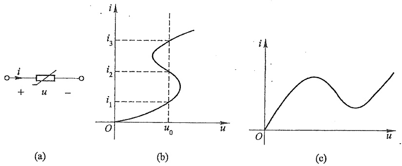

图 17-1 非线性电阻

从图 17-1(b)(c) 中还可以看出, 上述两种伏安特性曲线都具有一段下倾的线段。就是说在这一段范围内电流随着电压的增长反而下降。

另一种非线性电阻属于“单调型”，其伏安特性是单调增长或单调下降的，它同时是电流控制又是电压控制的。这一类非线性电阻以PN结二极管最为典型，其伏安特性可用下列函数式表示

$$
i = I _ {\mathrm{s}} (\mathrm{e} ^ {\frac {q u}{k T}} - 1) \tag {17-3}
$$

式中  $I_{s}$  为一常数, 称为反向饱和电流, q 是电子的电荷  $(1.6 \times 10^{-19} \mathrm{C})$ , k 是波尔兹曼常数  $(1.38 \times 10^{-23} \mathrm{J/K})$ , T 为热力学温度。在  $T = 300 \mathrm{K}$  (室温下) 时

$$
\frac {q}{k T} = 4 0 (\mathrm{J/C}) ^ {- 1} = 4 0 \mathrm{V} ^ {- 1}
$$

因此

---

§ 17-1 非线性电阻

417

$$
i = I _ {\mathrm{S}} (\mathrm{e} ^ {4 0 u} - 1)
$$

从式(17-3)可求得

$$
u = \frac {k T}{q} \mathrm{ln} \left(\frac {1}{I _ {\mathrm{s}}} i + 1\right)
$$

上式表明,电压可用电流的单值函数来表示。图 17-2 定性示出了 PN 结二极管的伏安特性曲线。

特别要指出的是线性电阻是双向性的，而许多非线性电阻具有单向性。当加在非线性电阻两端的电压方向不同时，流过它的电流完全不同，故其特性曲线不对称于原点。在工程中，非线性电阻的单向导电性可作为整流用。为了计算上的需要，对于非线性电阻元件有时引用静态电阻和动态电阻的概念。

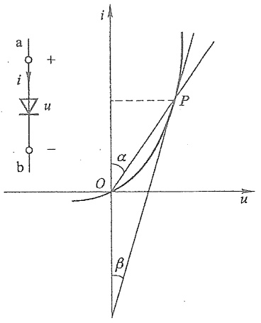

text_image

a +
i
u
-
b
O
α
β
P
u
i

图 17-2 PN 结二极管的伏安特性曲线

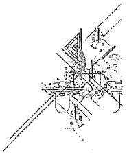

natural_image

Technical line drawing of a mechanical assembly or joint (no visible text or symbols)

非线性电阻元件在某一工作状态下(如图 17-2 中 P 点)的静态电阻 R 等于该点的电压值 u 与电流值 i 之比, 即

$$
R = \frac {u}{i}
$$

显然 P 点的静态电阻正比于  $\tan \alpha$ 。

非线性电阻元件在某一工作状态下(如图 17-2 中 P 点)的动态电阻  $R_{d}$  等于该点的电压 u 对电流 i 的导数值, 即

$$
R _ {\mathrm{d}} = \frac {\mathrm{d} u}{\mathrm{d} i}
$$

显然 P 点的动态电阻正比于  $\tan\beta$ 。

这里特别要说明的是,对于图 17-1(b)(c) 中所示伏安特性曲线的下倾段,其动态电阻为负值,因此具有“负电阻”的性质。

例 17-1 设有一个非线性电阻元件, 其伏安特性为  $u = f(i) = 100i + i^{3}$ 。

（1）试分别求出  $i_{1}=5\ A, i_{2}=10\ A, i_{3}=0.01\ A, i_{4}=0.001\ A$  时对应的电压  $u_{1}, u_{2}, u_{3}, u_{4}$  的值；
(2) 试求  $i=2\cos(314t)$  A 时对应的电压 u 的值；
(3) 设  $u_{12}=f(i_{1}+i_{2})$ ，试问  $u_{12}$  是否等于  $(u_{1}+u_{2})$ ?

解 (1) $i_1 = 5\mathrm{A}$ 时

$$
u _ {1} = (1 0 0 \times 5 + 5 ^ {3}) \mathrm{V} = 6 2 5 \mathrm{V}
$$

$i_{2}=10\ A$  时

$$
u _ {2} = (1 0 0 \times 1 0 + 1 0 ^ {3}) \mathrm{V} = 2 0 0 0 \mathrm{V}
$$

$i_{3}=0.01\ A$  时

$$
u _ {3} = \left[ 1 0 0 \times 0. 0 1 + (0. 0 1) ^ {3} \right] \mathrm{V} = (1 + 1 0 ^ {- 6}) \mathrm{V}
$$

---

1

418

第十七章 非线性电路

$i_{4}=0.001\ A$  时

$$
u _ {4} = \left[ 1 0 0 \times 0. 0 0 1 + (0. 0 0 1) ^ {3} \right] \mathrm{V} = (0. 1 + 1 0 ^ {- 9}) \mathrm{V}
$$

从上述计算可以看出,如果把这个电阻作为  $100 \Omega$  的线性电阻,当电流 i 不同时,引起的误差不同;当电流值较小时,引起的误差不大。

(2) 当  $i=2\cos(314t)$  A 时

$$
\begin{array}{l} u = [ 1 0 0 \times 2 \cos (3 1 4 t) + 8 \cos^ {3} (3 1 4 t) ] \mathrm{V} \\ = [ 2 0 6 \cos (3 1 4 t) + 2 \cos (9 4 2 t) ] \mathrm{V} \\ \end{array}
$$

电压 u 中含有 3 倍于电流频率的分量, 所以利用非线性电阻可以产生频率不同于输入频率的输出(这种作用称为“倍频”)。

(3) 现假设  $u_{12}=f(i_{1}+i_{2})$ ，则

$$
\begin{array}{l} u _ {1 2} = 1 0 0 (i _ {1} + i _ {2}) + (i _ {1} + i _ {2}) ^ {3} \\ = 1 0 0 \left(i _ {1} + i _ {2}\right) + \left(i _ {1} ^ {3} + i _ {2} ^ {3}\right) + \left(i _ {1} + i _ {2}\right) \times 3 i _ {1} i _ {2} \\ = u _ {1} + u _ {2} + 3 i _ {1} i _ {2} (i _ {1} + i _ {2}) \\ \end{array}
$$

可见,一般情况下, $i_{1}+i_{2}\neq0$ ,因此有

$$
u _ {1 2} \neq u _ {\mathrm{I}} + u _ {2}
$$

所以叠加定理不适用于非线性电路。

当非线性电阻元件串联或并联时，只有所有非线性电阻元件的控制类型相同，才有可能得出其等效电阻伏安特性的解析表达式。如果把非线性电阻元件串联或并联后对外当作一个一端口时，则端口的电压和电流关系或伏安特性称为此一端口的驱动点特性。对于图17-3(a)所示两个非线性电阻的串联，设它们的伏安特性分别为 $u_{1}=f_{1}(i_{1}),u_{2}=f_{2}(i_{2})$ ，用 $u=f(i)$ 表示此串联电路的一端口伏安特性。根据KCL和KVL，有

$$
i = i _ {1} = i _ {2}
$$

$$
u = u _ {1} + u _ {2}
$$

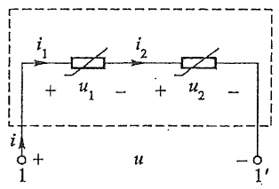

text_image

i₁ → i₂
+ u₁ - + u₂ -
i
1 + u - 1'

(a)

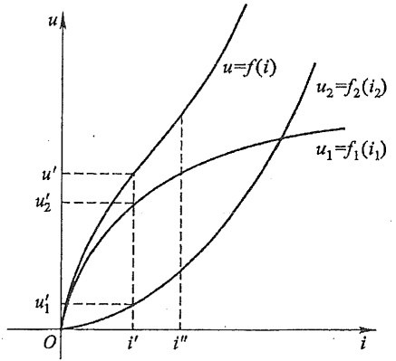

line

| Point | u=f(i) | u1=f1(i1) | u2=f2(i2) |
| --- | --- | --- | --- |
| Intersection (i') | u' | u1' | u2' |
| Intersection (i'') | — | — | u' |

(b)

图 17-3 非线性电阻的串联

---

§ 17-1 非线性电阻

419

将两个非线性电阻的伏安特性代入 KVL 有

$$
u = f _ {1} (i _ {1}) + f _ {2} (i _ {2})
$$

根据 KCL 对所有 i, 则有

$$
u = f (i) = f _ {1} (i) + f _ {2} (i)
$$

这表示,其驱动点特性为一个电流控制的非线性电阻,因此两个电流控制的非线性电阻串联组合的等效电阻还是一个电流控制的非线性电阻。

可以用图解的方法来分析非线性电阻的串联电路。图17-3(b)说明了这种分析方法，即在同一电流值下将 $u_{1}$ 和 $u_{2}$ 相加可得出u。例如，当 $i' = i_1' = i_2'$ 时，有 $u_{1} = u_{1}', u_{2} = u_{2}'$，而 $u' = u_1' + u_2'$ 。取不同的i值，可逐点求出其等效伏安特性 $u = f(i)$，如图17-3(b)所示。

如果这两个非线性电阻中有一个是电压控制型,在电流值的某范围内电压是多值的。很难写出一端口等效伏安特性  $u=f(i)$  的解析式。但是用图解方法不难获得等效非线性电阻的伏安特性。

图 17-4 所示为两个非线性电阻的并联电路。按 KCL 和 KVL 有

$$
u = u _ {1} = u _ {2}, \quad i = i _ {1} + i _ {2}
$$

设两个非线性电阻均为电压控制型的,其伏安特性分别表示为

$$
i _ {1} = f _ {1} (  u _ {1}  ) , \quad i _ {2} = f _ {2} (  u _ {2}  )
$$

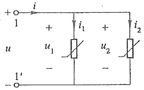

text_image

+ i
1 + i₁ + i₂
u u₁ u₂
- -
1' -

图 17-4 非线性电阻的并联

由并联电路组成的一端口的驱动点特性用 $i = f(u)$ 来表示。利用以上关系，可得

$$
i = f _ {1} (u) + f _ {2} (u)
$$

所以此一端口的驱动点特性是一个电压控制型的非线性电阻。如果并联的非线性电阻中之一不是电压控制的,就得不出以上的解析式,但可以用图解法来求解。

用图解法来分析非线性电阻的并联电路时,把在同一电压值下的各并联非线性电阻的电流值相加,即可得到所需要的驱动点特性。

图 17-5(a) 所示电路由线性电阻  $R_{0}$  和直流电压源  $U_{0}$  及一个非线性电阻 R 组成。线性电阻  $R_{0}$  和电压源  $U_{0}$  的串联组合可以是一个线性一端口的戴维南等效电路。设非线性电阻的伏安特性如图 17-5(b) 所示。这里介绍另一种图解法，称为“曲线相交法”。

对此电路应用 KVL, 可得下列方程

$$
U _ {0} = R _ {0} i + u
$$

$$
u = U _ {0} - R _ {0} i \tag {17-4}
$$

此方程可以看作是图 17-5(a) 虚线方框所示一端口的伏安特性。它在 u-i 平面上是一条如图 17-5(b) 中的直线  $\overline{AB}$ 。设非线性电阻 R 的伏安特性可表示为

$$
i = g (u) \tag {17-5}
$$

---

420

第十七章 非线性电路

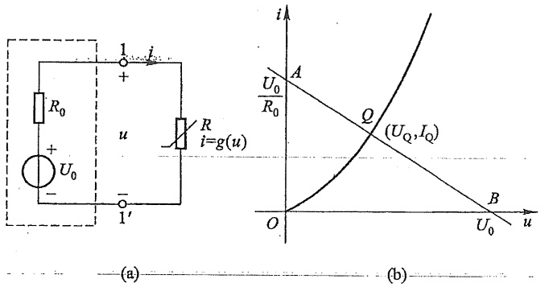

text_image

R₀
+
U₀
-
1
i
+
u
R
i=g(u)
1'
(a)
i
A
U₀/R₀
Q
(U_Q,I_Q)
O
B
U₀
u
(b)

图 17-5 静态工作点

直线 $\overline{AB}$ 与此伏安特性的交点 $(U_{\mathrm{Q}}, I_{\mathrm{Q}})$ 同时满足式(17-4)和式(17-5)，所以有

$$
U _ {0} = R _ {0} I _ {\mathrm{Q}} + U _ {\mathrm{Q}}
$$

$$
I _ {\mathrm{Q}} = g (U _ {\mathrm{Q}})
$$

交点  $Q(U_{Q}, I_{Q})$  称为电路的静态工作点，它就是图 17-5(a) 所示电路的解。在电子电路中直流电压源通常表示偏置电压， $R_{0}$  表示负载，故直线  $\overline{AB}$  有时称为负载线。

## §17-2 非线性电容和非线性电感

线性电容是一个二端储能元件,它两端电压与其电荷的关系是用函数或库伏特性表示的。如果一个电容元件的库伏特性不是一条通过坐标原点的直线,这种电容就是非线性电容。非线性电容的电路符号和 q-u 特性曲线如图 17-6 所示。

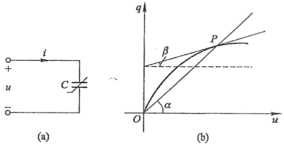

图 17-6 非线性电容及 q-u 特性曲线

如果一个非线性电容元件的电荷与电压关系可用下式表示:

$$
q = f (u)
$$

即电荷可用电压的单值函数来表示,则此电容称为电压控制的。如果电荷与电压关系可表示为

$$
u = h (q)
$$

---

§ 17-2 非线性电容和非线性电感

421

即电压可用电荷的单值函数来表示,则此电容称为电荷控制的电容。

非线性电容也可以是单调型的,即其库伏特性在 q-u 平面上是单调增长或单调下降的。

为了计算上的需要,有时引用静态电容 C 和动态电容  $C_{d}$  的概念,它们的定义分别如下:

$$
\begin{array}{l} C = \frac {q}{u} \\ C _ {\mathrm{d}} = \frac {\mathrm{d} q}{\mathrm{d} u} \\ \end{array}
$$

显然，在图17-6(b)中 $P$ 点的静态电容正比于 $\tan \alpha, P$ 点的动态电容正比于 $\tan \beta$。

电感也是一个二端储能元件,其特征是用磁通链与电流之间的函数关系或韦安特性表示的。如果电感元件的韦安特性不是一条通过坐标原点的直线,这种电感元件就是非线性电感元件。

如果非线性电感的电流与磁通链的关系表示为

$$
i = h (\psi)
$$

则称为磁通链控制的电感。如果电流与磁通链的关系表示为

$$
\psi = f (i)
$$

就称为电流控制的电感。非线性电感的  $\psi-i$  特性曲线如图 17-7 所示。

同样,为了计算上的方便,也引用静态电感 L 和动态电感  $L_{d}$  的概念,它们的定义分别如下:

$$
\begin{array}{l} L = \frac {\psi}{i} \\ L _ {\mathrm{d}} = \frac {\mathrm{d} \psi}{\mathrm{d} i} \\ \end{array}
$$

显然，在图17-7(b)中 $P$ 点的静态电感正比于 $\tan \alpha, P$ 点的动态电感正比于 $\tan \beta$。

非线性电感也可以是单调型的,即其韦安特性在  $\psi-i$  平面上是单调增长或单调下降的。不过大多数实际非线性电感元件包含铁磁材料制成的芯子,由于铁磁材料的磁滞现象的影响,它的  $\psi-i$  特性具有回线形状,如图 17-8 所示。

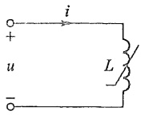

(a)

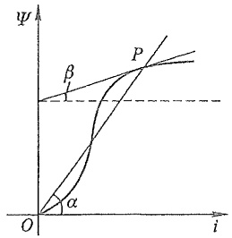

line

| Variable | Description |
| --- | --- |
| \(\psi\) | Y-axis variable (unlabeled) |
| i | X-axis variable (unlabeled) |
| \(\beta\) | Linear function representing the slope of the curve passing through point P |
| \(\alpha\) | Non-linear curve representing the slope of the curve passing through point O |

(b)

图 17-7 非线性电感及  $\psi-i$  特性

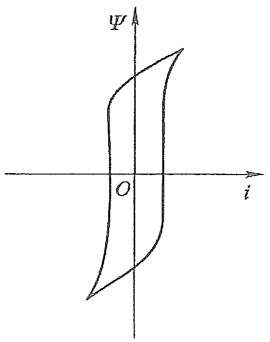

text_image

Ψ
O
i

图 17-8 铁磁材料的  $\psi-i$  特性

---

422

第十七章 非线性电路

## §17-3 非线性电路的方程

在电路的分析与计算中,由于基尔霍夫定律对于线性电路和非线性电路均适用,所以线性电路方程与非线性电路方程的差别仅由于元件特性的不同而引起。对于非线性电阻电路列出的方程是一组非线性代数方程,而对于含有非线性储能元件的动态电路列出的方程是一组非线性微分方程。下面通过两个实例说明上述概念。

例 17-2 电路如图 17-9 所示, 已知  $R_{1}=3\Omega, R_{2}=2\Omega, u_{S}=10V, i_{S}=1A$ , 非线性电阻的特性是电压控制型的,  $i=u^{2}+u$ , 试求 u。

解 应用 KCL 有

$$
i _ {1} = i _ {\mathrm{s}} + i
$$

对于回路 1 应用 KVL, 有

$$
R _ {1} i + R _ {2} i _ {1} + u = u _ {\mathrm{s}}
$$

将  $i_{1}=i+i_{S}, i=u^{2}+u$  代入上式, 得电路方程为

$$
5 u ^ {2} + 6 u - 8 = 0
$$

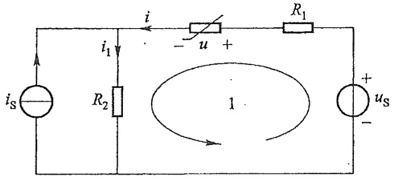

text_image

i
i₁
R₂
i
-
u +
R₁
1
+
us
-

图17-9 例17-2图

解得  $u' = 0.8 \, V, u'' = -2 \, V$ 。可见，非线性电路的解可能不是唯一的。

如果电路中既有电压控制的电阻,又有电流控制的电阻,建立方程的过程就比较复杂。

对于含有非线性动态元件的电路,通常选择非线性电感的磁通链和非线性电容的电荷为电路的状态变量,根据 KCL、KVL 列写的方程是一组非线性微分方程。

例 17-3 含非线性电容的电路如图 17-10 所示, 其中非线性电容的库伏特性为  $u = 0.5 k q^{2}$ , 试以 q 为电路变量写出微分方程。

解 以电容电荷 q 为电路变量,有

$$
i _ {c} = \frac {\mathrm{d} q}{\mathrm{d} t}
$$

$$
i _ {0} = \frac {u}{R _ {0}} = \frac {0 . 5 k q ^ {2}}{R _ {0}}
$$

应用 KCL, 有

$$
i _ {c} + i _ {0} = i _ {\mathrm{s}}
$$

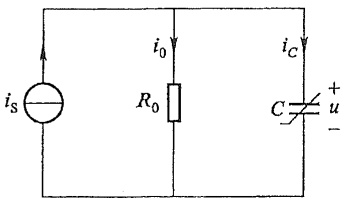

text_image

i_S
R_0
i_0
C
+
u
-

图17-10 例17-3图

因此,得一阶非线性微分方程为

$$
\frac {\mathrm{d} q}{\mathrm{d} t} = - \frac {0 . 5 k q ^ {2}}{R _ {0}} + i _ {\mathrm{s}}
$$

列写具有多个非线性储能元件电路的状态方程比线性电路更为复杂和困难。

对于非线性代数方程和非线性微分方程,其解析解一般都是难以求得的,但是可以利用计算机应用数值方法来求得数值解。

---

§ 17-4 小信号分析法

423

## §17-4 小信号分析法

1

小信号分析法是电子工程中分析非线性电路的一个重要方法。通常在电子电路中遇到的非线性电路，不仅有作为偏置电压的直流电源 $U_{0}$ 作用，同时还有随时间变动的输入电压 $u_{\mathrm{s}}(t)$ 作用。假设在任何时刻有 $|u_{\mathrm{s}}(t)| \ll U_{0}$，则把 $u_{\mathrm{s}}(t)$ 称为小信号电压。分析此类电路，就可采用小信号分析法。

在图 17-11(a) 所示电路中, 直流电压源  $U_{0}$  为偏置电压, 电阻  $R_{0}$  为线性电阻, 非线性电阻是电压控制型的, 其伏安特性  $i = g(u)$ , 图 17-11(b) 为其伏安特性曲线。小信号时变电压为  $u_{\mathrm{S}}(t)$ , 且  $\left|u_{\mathrm{S}}(t)\right| \ll U_{0}$  总成立。现在待求的是非线性电阻电压  $u(t)$  和电流  $i(t)$ 。

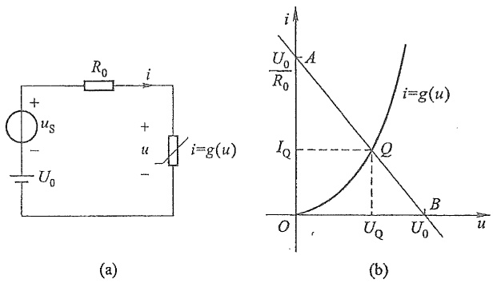

图 17-11 非线性电路的小信号分析

首先应用 KVL 列出电路方程

$$
U _ {0} + u _ {\mathrm{S}} (t) = R _ {0} i (t) + u (t) \tag {17-6}
$$

当 $u_{\mathrm{s}}(t) = 0$ 时，即电路中只有直流电压源作用时，负载线 $\overline{AB}$ 如图17-11(b)所示，它与非线性电阻伏安特性曲线的交点 $Q(U_{\mathrm{Q}}, I_{\mathrm{Q}})$ 即电路的静态工作点。在 $|u_{\mathrm{s}}(t)| < U_{0}$ 的条件下，电路的解 $u(t), i(t)$ 必在工作点 $(U_{\mathrm{Q}}, I_{\mathrm{Q}})$ 附近，所以可以近似地把 $u(t), i(t)$ 写为

$$
u (t) = U _ {\mathrm{Q}} + u _ {1} (t)
$$

$$
i (t) = I _ {\mathrm{Q}} + i _ {1} (t)
$$

式中  $u_{1}(t)$  和  $i_{1}(t)$  是由于信号  $u_{s}(t)$  在工作点  $(U_{\mathrm{Q}}, I_{\mathrm{Q}})$  附近引起的偏差。在任何时刻 t， $u_{1}(t)$  和  $i_{1}(t)$  相对于  $U_{Q}, I_{Q}$  都是很小的量。

考虑到给定非线性电阻的特性  $i=g(u)$ ，从以上两式得

$$
I _ {Q} + i _ {1} (t) = g \left[ U _ {Q} + u _ {1} (t) \right]
$$

由于  $u_{1}(t)$  很小, 可以将上式右方在 Q 点附近用泰勒级数展开, 取级数前面两项而略去一次项以上的高次项, 则上式可写为

---

424

第十七章 非线性电路

$$
I _ {\mathrm{Q}} + i _ {1} (t) \approx g (U _ {\mathrm{Q}}) + \frac {\mathrm{d} g}{\mathrm{d} u} \Bigg | _ {u _ {\mathrm{Q}}} u _ {1} (t)
$$

由于 $I_{\mathrm{Q}} = g(U_{\mathrm{Q}})$ ，故从上式得

$$
i _ {1} (t) \approx \frac {\mathrm{d} g}{\mathrm{d} u} \Bigg | _ {U _ {\mathrm{Q}}} u _ {1} (t)
$$

又因为

$$
\frac {\mathrm{d} g}{\mathrm{d} u} \Bigg | _ {U _ {\mathrm{Q}}} = G _ {\mathrm{d}} = \frac {1}{R _ {\mathrm{d}}}
$$

为非线性电阻在工作点 $(U_{0},I_{0})$ 处的动态电导,所以有

$$
i _ {1} (t) = G _ {\mathrm{d}} u _ {1} (t)
$$

$$
u _ {1} (t) = R _ {\mathrm{d}} i _ {1} (t)
$$

由于 $G_{\mathrm{d}} = \frac{1}{R_{\mathrm{d}}}$ 在工作点 $(U_{\mathrm{Q}}, I_{\mathrm{Q}})$ 处是一个常量，所以从上式可以看出，由小信号电压 $u_{\mathrm{s}}(t)$ 产生的电压 $u_{1}(t)$ 和电流 $i_{1}(t)$ 之间的关系是线性的。这样，式(17-6)可改写为

$$
U _ {0} + u _ {\mathrm{S}} (t) = R _ {0} \left[ I _ {\mathrm{Q}} + i _ {1} (t) \right] + U _ {\mathrm{Q}} + u _ {1} (t)
$$

但是 $U_{0} = R_{0}I_{\mathrm{Q}} + U_{\mathrm{Q}}$ ，故得

$$
u _ {\mathrm{S}} (t) = R _ {0} i _ {1} (t) + u _ {1} (t)
$$

又因为在工作点 $(U_{Q},I_{Q})$ 处，有 $u_{1}(t)=R_{d}i_{1}(t)$ ，代入上式，最后得

$$
u _ {\mathrm{S}} (t) = R _ {0} i _ {1} (t) + R _ {\mathrm{d}} i _ {1} (t)
$$

上式是一个线性代数方程,由此可以做出给定非线性电阻在静态工作点 $(U_{Q},I_{Q})$ 处的小信号等效电路如图17-12所示。于是求得

$$
i _ {1} (t) = \frac {u _ {\mathrm{S}} (t)}{R _ {0} + R _ {\mathrm{d}}}
$$

$$
u _ {1} (t) = R _ {\mathrm{d}} i _ {1} (t) = \frac {R _ {\mathrm{d}} u _ {\mathrm{S}} (t)}{R _ {0} + R _ {\mathrm{d}}}
$$

综上所述,小信号分析法的步骤为:

(1) 求解非线性电路的静态工作点。
(2) 求解非线性电路的动态电导或动态电阻。
(3) 作出给定的非线性电阻在静态工作点处的小信号等效电路。
(4) 根据小信号等效电路进行求解。

例 17-4 非线性电路如图 17-13(a) 所示, 非线性电阻为电压控制型, 用函数表示则为

$$
i = g (u) = \left\{ \begin{array}{l l} u ^ {2} & (u > 0) \\ 0 & (u <   0) \end{array} \right.
$$

而直流电压源  $U_{s}=6\ V, R=1\ \Omega$ ，信号源  $i_{s}(t)=0.5\cos(\omega t)\ A$ ，试求在静态工作点处由小信号所产生的电压  $u(t)$  和电流  $i(t)$ 。

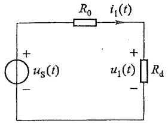

text_image

R₀
i₁(t)
+
uₛ(t)
-
+
u₁(t)
Rₐ
-

图17-12 小信号等效电路

---

§ 17-5 分段线性化方法

425

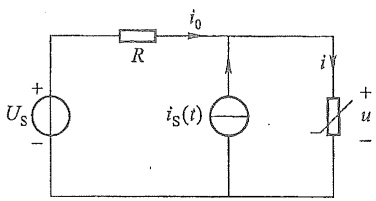

text_image

i₀
R
iₛ(t)
+
Us
-
i'
u
-

(a)

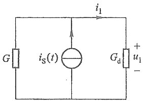

text_image

i₁
G
iₛ(t)
Gₐ
+
u₁
-

(b)

图17-13 例17-4图

解 对于图 17-13(a)，应用 KCL 和 KVL 有

$$
i = i _ {0} + i _ {\mathrm{s}}
$$

$$
u = U _ {\mathrm{s}} - R i _ {0}
$$

整理后即得

$$
\frac {u}{R} + g (u) = 6 + 0. 5 \cos \omega t
$$

(1) 先求电路的静态工作点, 令  $i_{\mathrm{S}}(t)=0$ , 则

$$
u ^ {2} + u - 6 = 0
$$

解得 u=2 和 u=-3，而 u=-3 不符合题意，故可得静态工作点  $U_{Q}=2\ V, I_{Q}=U_{Q}^{2}=4\ A$ 。

(2) 求解非线性电路的动态电导, 静态工作点处的动态电导为

$$
G _ {\mathrm{d}} = \frac {\mathrm{d} g (u)}{\mathrm{d} u} \Bigg | _ {U _ {\mathrm{Q}}} = 2 u \Bigg | _ {U _ {\mathrm{Q}}} = 4 \mathrm{S}
$$

（3）作出给定非线性电导在静态工作点处的小信号等效电路如图 17-13(b) 所示，则有

$$
u _ {1} (t) = \frac {i _ {\mathrm{S}}}{G + G _ {\mathrm{d}}} = \frac {0 . 5 \cos \omega t}{1 + 4} \mathrm{V} = 0. 1 \cos \omega t \mathrm{V}
$$

$$
i _ {1} (t) = u _ {1} (t) \times G _ {\mathrm{d}} = 4 \times 0. 1 \cos \omega t \mathrm{A} = 0. 4 \cos \omega t \mathrm{A}
$$

故得图 17-13(a) 中

$$
u (t) = U _ {\mathrm{Q}} + u _ {1} (t) = (2 + 0. 1 \cos \omega t) \mathrm{V}
$$

$$
i (t) = I _ {\mathrm{Q}} + i _ {1} (t) = (4 + 0. 4 \cos \omega t) \mathrm{A}
$$

## §17-5 分段线性化方法

分段线性化方法(又称折线法)是研究非线性电路的一种有效方法,它的特点在于能把非线性的求解过程分成几个线性区段,就每个线性区段来说,又可以应用线性电路的计算方法。

应用分段线性化方法时,为了画出一端口网络的驱动点特性曲线,常引用理想二极管模型。它的特点是,在电压为正向时,二极管完全导通,它相当于短路;在电压反向

---

426

第十七章 非线性电路

时，二极管不导通，电流为零，它相当于开路，其伏安特性如图17-14所示。一个实际二极管的模型可由理想二极管和线性电阻串联组成，其伏安特性可用图17-15的折线$\overline{BOA}$近似地逼近，当这个二极管加上正向电压时，它相当于一个线性电阻，其伏安特性用直线 $\overline{OA}$ 表示；当电压反向时，二极管完全不导通，其伏安特性用直线 $\overline{BO}$ 表示。

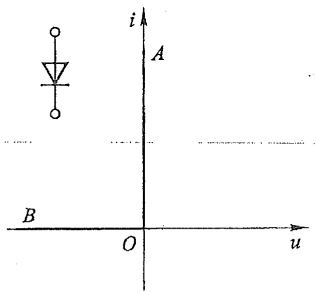

text_image

i
A
B
O
u

图17-14 理想二极管伏安特性

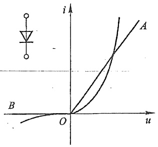

line

| u | i |
| --- | --- |
| 0 | 0 |
| ~0.2 | ~0.1 |
| ~0.4 | ~0.3 |
| ~0.6 | ~0.5 |
| ~0.8 | ~0.7 |
| ~1.0 | ~0.9 |

图 17-15 PN 结二极管伏安特性

例 17-5 （1）图 17-16(a) 所示电路由线性电阻 R、理想二极管和直流电压源串联组成。电阻 R 的伏安特性如图 17-16(b) 所示，画出此串联电路的伏安特性。（2）把图 17-16(a) 中的电阻 R 和二极管与直流电流源并联，如图 17-16(d) 所示，画出此并联电路的伏安特性。

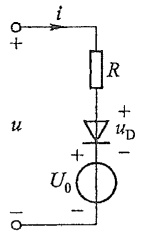

text_image

i
+
R
u
+
uD
-
+
U0
-
-

(a)

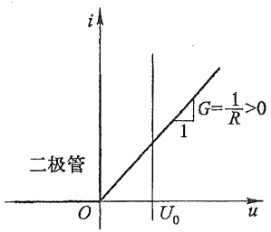

line

| u | i |
| --- | --- |
| 0 | 0 |
| U0 | 1 |

(b)

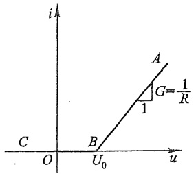

text_image

i
A
G=1/R
1
C
O
B
U₀
u

(c)

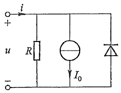

text_image

i
+
u
R
I₀
-

(d)

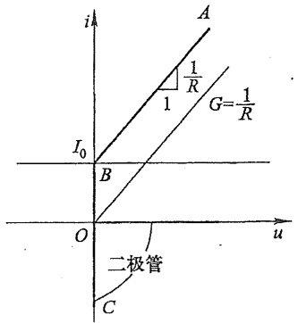

text_image

i
A
1/R
1
G=1/R
I₀
B
O
u
二极管
C

(e)

图17-16 例17-5图

---

§ 17-5 分段线性化方法

427

解 （1）各元件的伏安特性如图 17-16(b) 所示, 电路方程为

$$
u = R i + u _ {\mathrm{D}} + U _ {0} \quad (i > 0)
$$

串联电路的伏安特性可用图解法求得,如图 17-16(c) 的折线  $\overline{ABC}$  (当  $u<U_{0}$  时, i=0) 所示。

(2) 电路方程为

$$
i = \frac {u}{R} + I _ {0} \quad (u > 0)
$$

当 u<0 时，二极管完全导通，电路被短路。当 u>0 时，用图解法求得的伏安特性如图 17-16(e) 中的折线  $\overline{ABO}$  所示。

图 17-17(a) 中的虚线为隧道二极管的伏安特性, 此特性可用图示的三段直线来粗略地表示。假设这三段直线的斜率分别为

当 $u \leqslant U_{1}$ （区域1），$G = G_{\mathrm{a}}$

当 $U_{1} < u \leqslant U_{2}$ （区域2）， $G = G_{\mathrm{b}}$

当 $u > U_{2}$ （区域3）， $G = G_{\mathrm{c}}$

其中 $U_{1}, U_{2}$ 确定了这三个区域，而 $U_{1}$ 和 $U_{2}$ 为转折点的电压值。图17-17(a)所示的伏安特性可以分解为三个伏安特性，即图17-17(b)中的直线 $\overline{AOB}$、折线 $\overline{EU_1C}$ 和 $\overline{EU_2D}$，并设图17-17(b)中有关直线段的斜率分别为 $G_{1}, G_{2}$ 和 $G_{3}$，根据非线性电阻（或电导）并联的图解法原则，就可以确定 $G_{1}, G_{2}$ 和 $G_{3}$。

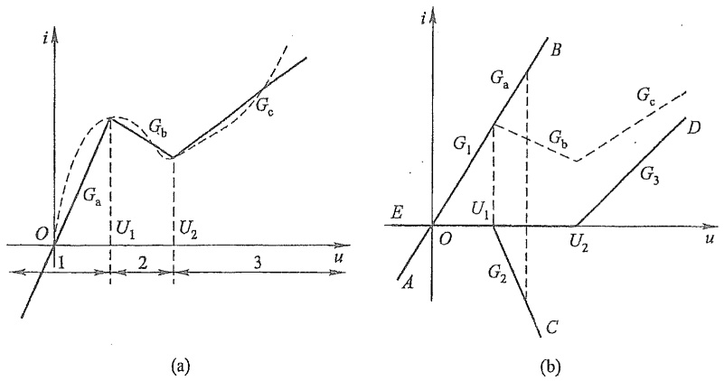

图 17-17 分段线性化特性的合成

在区域1应当有

$$
G _ {1} u = G _ {\mathrm{a}} u \quad \text {或} \quad G _ {1} = G _ {\mathrm{a}}
$$

在区域2有

$$
G _ {1} u + G _ {2} u = G _ {\mathrm{b}} u \quad \text {或} \quad G _ {1} + G _ {2} = G _ {\mathrm{b}}
$$

同理,在区域3有

---

428

第十七章 非线性电路

$$
G _ {1} u + G _ {2} u + G _ {3} u = G _ {\mathrm{c}} u \quad \text {或} \quad G _ {1} + G _ {2} + G _ {3} = G _ {\mathrm{c}}
$$

因此,可得

$$
G _ {1} = G _ {\mathrm{a}}, \quad G _ {2} = G _ {\mathrm{b}} - G _ {\mathrm{a}}, \quad G _ {3} = G _ {\mathrm{c}} - G _ {\mathrm{b}}
$$

而图17-17(a)所示的伏安特性则是 $G_{1}, G_{2}$ 和 $G_{3}$ 这三个电导并联后的等效电导的伏安特性。其静态工作点也可以用图解法来确定。不过应当注意，如果静态工作点位于图17-18(a)所示的位置，表示该点确实是工作点，如果负载线与分段线性的伏安特性曲线交点位于图17-18(b)所示位置，则只有 $Q_{3}$ 为实际的工作点，而 $Q_{1}, Q_{2}$ 并不代表实际的工作点，因为其交点并不位于对应的区段。

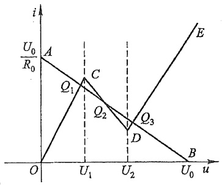

line

| Point | u | i |
| --- | --- | --- |
| A | 0 | \(U_{0}/R_{0}\) |
| C | \(U_{1}\) | \(Q_{1}\) |
| D | \(U_{2}\) | \(Q_{3}\) |

(a)

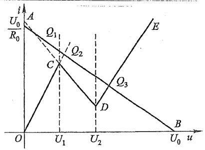

line

| Point | u | i |
| --- | --- | --- |
| E | 0 | 0 |
| E | U0 | 0 |
| E | U0 | A |
| Q3 | U1 | A |
| Q3 | U2 | D |
| C | U1 | A |
| C | U1 | B |

(b)

图 17-18 隧道二极管的静态工作点

图 17-19(a) 所示电路是一个分段线性 RC 电路, 其中虚线框部分为一端口 N, 它的驱动点特性如图 17-19(b) 所示, 在端口处电压电流关系为

$$
\frac {\mathrm{d} u}{\mathrm{d} t} = \frac {\mathrm{d} u _ {c}}{\mathrm{d} t} = - \frac {i}{C} \tag {17-7}
$$

设方程的解用 u-i 平面上的点  $(u,i)$  表示，并称之为动态点，动态点  $(u,i)$  随时间将沿着 N 的驱动点特性（端口伏安特性）移动，移动的方向由上式确定。动态点移动的路径（包括方向）称为动态路径。所以由式(17-7)可以看出，在任何时刻 t，当 i<0 时有  $\frac{du}{dt}>0$ ，因此，在 u-i 平面的下半平面，动态点应当从初始位置沿着动态路径向右移动。当 i>0 时有  $\frac{du}{dt}<0$ ，因此，在 u-i 平面的上半平面，动态点应当沿着动态路径向左移动，如图 17-19(b) 中箭头所示。

假设动态点 $(u, i)$ 的初始位置位于 $Q_{2}$, 随着时间的增长, 动态点应当向 $A$ 点移动, 但到达 $A$ 点后它不能再沿着 $\overline{AB}$ 线段继续移动, 因为方向不对。同样, 如果初始位置位于 $Q_{1}$, 则动态点到达 $A$ 点后也不能再继续前进, 对于转折点 $C$ 也有同样的情况, 因为表示动态路径方向的两个箭头都是指向 $C$ 点的。由于对应 $A$ 点和 $C$ 点的电流值均为非零值, 因此 $A$ 点和 $C$ 点均不对应最终的平衡点或稳态, 这是因为 $\frac{\mathrm{d}u}{\mathrm{d}t}$ 在此时不等于零。

---

§ 17-5 分段线性化方法

429

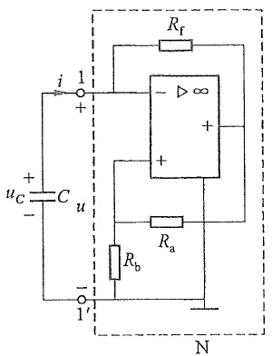

text_image

i
1
+
uc
+
-
C
u
-
1'
Rf
-
∞
+
Ra
Rb
N

(a)

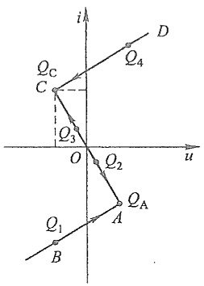

text_image

i
Q_C
C
Q_3
O
Q_2
u
Q_1
B
A
Q_A
D
Q_4

(b)

图 17-19 分段线性 RC 电路

为了解决这个问题,必须计及电路中存在的微小的串联电感,并按二阶电路分析。在这种情况下,动态路径将如图17-20(a)所示,图中假设 $P_{0}$ 表示动态点的初始点。当动态点到达 $P_{1}$ (对应转折点A)后,由于电感电流不能跃变,它将从 $P_{1}$ 前进到 $P_{2}$,当动态点到达 $P_{3}$ (对应转折点C)后,它将从 $P_{3}$ 前进到 $P_{4}$,如图17-20(a)中箭头所示。从 $P_{1}$ 前进到 $P_{2}$(或从 $P_{3}$ 前进到 $P_{4}$)所需时间随电感L值的减小而减小,当电感L的值趋近于零时,可以认为动态点从 $P_{1}$ 前进到 $P_{2}$(或从 $P_{3}$ 前进到 $P_{4}$)所需时间也趋近于零,或者说,动态点将瞬时从 $P_{1}(P_{3})$ “跳跃”到 $P_{2}(P_{4})$,此时,电路中发生跃变的是电流值。这个电路的动态路径将如图17-20(b)中箭头所示。这里除了从初始点 $P_{0}$ 到 $P_{1}$ 这个过渡过程阶段,动态路径是闭合的,这说明电路中的电压或电流从初始状态开始经短暂时间后,就将周期性变化。这个电路能产生周期性变化的电压和电流,所以它具有振荡器的作用。这种振荡称为张弛振荡,因为产生的电压或电流波形与正弦波相差甚大。振荡周期等于从 $P_{2}$ 到 $P_{3}$ 的时间和从 $P_{4}$ 到 $P_{1}$ 的时间之和。

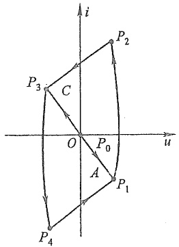

text_image

i
P₂
P₃ C
O P₀ u
A P₁
P₄

(a)

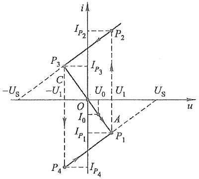

text_image

i
I_{P2}
P_2
P_3
I_{P3}
C
-U_S
-U_1
U_0
U_1
U_S
u
O
I_0
A
I_{P1}
P_1
P_4
I_{P4}

(b)

图 17-20 动态路径和跳跃现象

---

430

第十七章.非线性电路

## \*§17-6 工作在非线性范围的运算放大器

本书在前面章节中把运放的工作范围局限在线性区域,即认为输出电压  $u_{0}$  与  $u_{d}$  成正比,而且

$$
- U _ {\mathrm{sat}} <   u _ {\mathrm{o}} <   U _ {\mathrm{sat}}
$$

$\pm U_{sat}$  为运放输出电压的饱和值。

设运放的放大倍数 A 为无限大, 并考虑到输出电压达到饱和值, 则运放的输出电压  $\bar{u}_{0}$  与差分电压  $u_{d}$  之间的关系可用图 17-21 所示特性曲线来表示。这时可用以下表达式描述运放的工作:

$$
i ^ {-} = 0, \quad i ^ {+} = 0
$$

$$
u _ {\mathrm{o}} = U _ {\mathrm{sat}} \frac {| u _ {\mathrm{d}} |}{u _ {\mathrm{d}}}, \quad u _ {\mathrm{d}} \neq 0
$$

$$
u _ {\mathrm{d}} = 0, \quad - U _ {\mathrm{sat}} <   u _ {\mathrm{o}} <   U _ {\mathrm{sat}}
$$

这里把电压的关系分为 3 个区域来考虑:

线性区  $u_{d}=0,\quad-U_{sat}<u_{o}<U_{sat}$

正饱和区  $u_{o}=U_{sat},\quad u_{d}=(u^{+}-u^{-})>0$

负饱和区  $u_{o} = -U_{sat}, \quad u_{d} = (u^{+} - u^{-}) < 0$

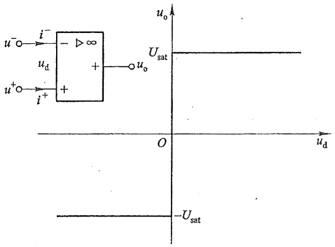

text_image

u⁻○ → i⁻ → - ∞
          u_d
          +
          +
          i⁺
          u⁺○ → i⁻ → + → u_o
          U_sat
          O
          u_d
          -U_sat

图 17-21 理想运放的饱和  $u_{d}-u_{0}$  特性

注意，在正、负饱和区， $u_{d}$  不再等于零，但  $u_{0}$  是定值。而在线性区  $u_{d}$  被强制为零，但  $u_{0}$  不是定值，它的大小取决于外电路。当运放在正饱和区和负饱和区工作时，它是在非线性区工作。

图 17-22 所示电路是一个实现分段线性电阻的电路, 其中运放通过  $R_{f}$  实现负反馈, 通过  $R_{a}$  和  $R_{b}$  实现正反馈。如果计及运放工作在饱和区的情况, 这个电路的输入电阻在一定范围内具有负电阻的性质。现分析这个电路的驱动点特性。

---

§ 17-6 工作在非线性范围的运算放大器

431

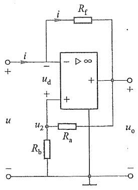

text_image

i
Rf
+
-
u_d
+
-
u
u_2
Ra
Rb
uo
-

(a)

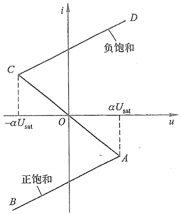

text_image

i
D
负饱和
C
-αUsat
O
αUsat
u
A
正饱和
B

(b)

图 17-22 负电阻的实现

在线性区,对于图 17-22(a),根据“虚短”,有  $u=u_{2}$ ,根据“虚断”,流过  $R_{a}$  中的电流等于流过  $R_{b}$  中的电流,因此可以得出

$$
u _ {2} = \frac {R _ {\mathrm{b}}}{R _ {\mathrm{a}} + R _ {\mathrm{b}}} u _ {\mathrm{o}} = \alpha u _ {\mathrm{o}}
$$

其中  $\alpha=\frac{R_{b}}{R_{a}+R_{b}}$ ，而  $u_{o}=\frac{1}{\alpha}u_{o}$

应用 KVL, 有

$$
u = R _ {\mathrm{f}} i + u _ {\mathrm{o}}
$$

把 $u_{\mathrm{o}} = \frac{u}{\alpha}$ 代入，则得

$$
i = - \left(\frac {R _ {\mathrm{a}}}{R _ {\mathrm{b}}}\right) \left(\frac {1}{R _ {\mathrm{f}}}\right) u
$$

上式可以用图 17-22(b) 的直线段 AOC 表示。对应此线段的两个端点 A 和 C 的电压值可以求得如下。

在线性区,由于  $u_{0}=\frac{1}{\alpha}u$ , 故

$$
- \alpha U _ {\mathrm{sat}} <   u <   \alpha U _ {\mathrm{sat}}
$$

直线段  $\overline{AOC}$  的斜率是负的,且正比于  $-\frac{R_{a}}{R_{b}}\cdot\frac{1}{R_{f}}$ 。

在正饱和区, $u_{o}=U_{sat}$ ,应用KVL,有

$$
u = R _ {\mathrm{f}} i + U _ {\mathrm{sat}}
$$

$$
i = \frac {1}{R _ {\mathrm{f}}} (u - U _ {\mathrm{sat}}) \tag {17-8}
$$

---

432

第十七章 非线性电路

为了确定电压 u 的范围,应用 KVL,得

$$
u _ {\mathrm{d}} = u _ {2} - u = \frac {R _ {\mathrm{b}}}{R _ {\mathrm{a}} + R _ {\mathrm{b}}} U _ {\mathrm{sut}} - u
$$

$$
u _ {\mathrm{d}} = \alpha U _ {\mathrm{sat}} - u
$$

由于 $u_{\mathrm{d}} > 0$ ，故 $u < \alpha U_{\mathrm{sat}}$ 。这与式(17-8)确定了图17-22(b)中的直线段 $\overline{AB}$ ，它表示在正饱和区的伏安特性，其斜率正比于 $\frac{1}{R_{\mathrm{f}}}$ 。

在负饱和区, $u_{0}=-U_{sat}$ ,有

$$
u = R _ {\mathrm{f}} i - U _ {\mathrm{sat}}
$$

由于  $u_{d}<0$ ，故  $u>-\alpha U_{sat}$ 。图 17-22(b) 中的直线段 CD 表示在负饱和区的伏安特性，其斜率正比于  $\frac{1}{R_{f}}$ 。

所以这个电路可以实现一个折线或分段线性电阻,此电阻在运放线性工作范围内具有负电阻性质,其值等于 $-\frac{R_{b}R_{f}}{R_{a}}$ 。

## \* §17-7 小扰动下的动态电路分析

非线性动态电路在直流源激励工作时，由于各种原因会受到外界的突然干扰，从而导致非线性动态电路的工作状态突然发生变化。例如含非线性动态元件的精密测量及精确控制电路受到雷电的突然影响，外界电磁脉冲的突然干扰，工作电源的突然波动等。外界的扰动可能是暂时的，其幅值可能是很小的，但这种由小扰动引起的暂态响应对测量及控制效果的影响是值得注意的，其暂态响应的分析对评价精密测量及精确控制的电路性能也是有用的。基于非线性电路的局部线性化思想，对于小扰动引起的非线性动态电路的暂态响应应用小信号分析法进行求解也是行之有效的。

例17-6 含有非线性电感的一阶动态电路如图17-23(a)所示，已知直流电压源$U_{\mathrm{s}} = 30~\mathrm{V}$，小扰动电压源 $u_{\mathrm{s}}(t) = 1.5\mathrm{e}^{-10t}\varepsilon (t)\mathrm{V}$，线性电阻 $R_{1} = 6\Omega ,R_{2} = 40\Omega ,R_{3} = 60\Omega$ 非线性电感 $\psi = 0.5i^3 (\psi$ 单位为Wb，i单位为A）。求 $t > 0$ 时的响应 $i_L(t),i_3(t),u_3(t)$。

解 （1）由题意可知,当直流电压源单独作用于电路时,根据等效电路图 17-23(b)求得

$$
R = R _ {1} + \frac {R _ {2} R _ {3}}{R _ {2} + R _ {3}} = (6 + 2 4) \Omega = 3 0 \Omega , \quad I _ {L 0} = \frac {U _ {\mathrm{s}}}{R} = \frac {3 0}{3 0} \mathrm{A} = 1 \mathrm{A}
$$

$$
I _ {3 0} = I _ {L 0} \times \frac {R _ {2}}{R _ {2} + R _ {3}} = \left(1 \times \frac {4 0}{1 0 0}\right) \mathrm{A} = 0. 4 \mathrm{A}, \quad U _ {3 0} = R _ {3} \times I _ {3 0} = (6 0 \times 0. 4) \mathrm{V} = 2 4 \mathrm{V}
$$

---

§ 17-7 小扰动下的动态电路分析

433

1

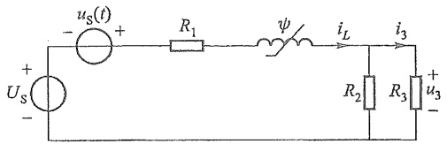

text_image

uS(t)
+
-
R1
ψ
iL
i3
+
Us
-
R2
R3
+
u3
-

(a)

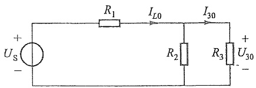

text_image

+
Us
-
R1
IL0
I30
R2
R3
+
U30
-

(b)

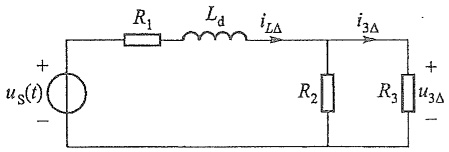

text_image

R₁
Lₐ
iₗΔ
i₃Δ
uₛ(t)
+
-
R₂
R₃
u₃Δ
-

(c)

图17-23 例17-6图

(2) 电路的动态电感为

$$
L _ {\mathrm{d}} = \frac {\mathrm{d} \psi}{\mathrm{d} i} \Bigg | _ {i _ {L} = I _ {L 0}} = 3 \times 0. 5 \times I _ {L 0} ^ {2} = 1. 5 \mathrm{H}
$$

（3）根据动态电感值建立的小参数一阶线性动态电路如图17-23(c)所示，且电路处于零状态，求小扰动电压源激励时的零状态响应 $i_{L\Delta}(t)$ 。其一阶电路的微分方程为

$$
L _ {\mathrm{d}} \frac {\mathrm{d} i _ {L \Delta}}{\mathrm{d} t} + R i _ {L \Delta} = u _ {\mathrm{S}} (t)
$$

代入参数得

$$
\frac {\mathrm{d} i _ {L \Delta}}{\mathrm{d} t} + 2 0 i _ {L \Delta} = \mathrm{e} ^ {- 1 0 t}
$$

(对于规范的一阶线性微分方程 $\frac{dy}{dt}+py=x(t)$ ，其解用积分表示，则有 $y(t)=\mathrm{e}^{-\int p\mathrm{d}t}\left[\int x(t)\mathrm{e}^{\int p\mathrm{d}t}\mathrm{d}t+A\right]$ ，式中A是取决于初始条件的积分常数。)

因此,对于电感电流进行积分可得

$$
\begin{array}{l} i _ {L \Delta} (  t  ) = \mathrm{e} ^ {- \int 2 0 \mathrm{d} t}   \left[   \int \mathrm{e} ^ {- 1 0 t} \mathrm{e} ^ {\int 2 0 \mathrm{d} t}   \mathrm{d} t + A   \right] \\ = \mathrm{e} ^ {- \int 2 0 \mathrm{d} t} \left[ \int \mathrm{e} ^ {- 1 0 t} \mathrm{e} ^ {2 0 t} \mathrm{d} t + A \right] \\ = 0. 1 \mathrm{e} ^ {- 1 0 t} + A \mathrm{e} ^ {- 2 0 t} \\ \end{array}
$$

当 $t = 0_{+}$ 时，$i_{L\Delta}(0_{+}) = i_{L\Delta}(0_{-}) = 0$ ，故 $A = -0.1$ ，因此小扰动电压源激励时的零状态响应为

$$
\begin{array}{l} i _ {L \Delta} (  t) = \left(0. 1 \mathrm{e} ^ {- 1 0 t} - 0. 1 \mathrm{e} ^ {- 2 0 t}\right) \varepsilon (  t)   \mathrm{A} \\ i _ {3 \Delta} (t) = \frac {i _ {L \Delta} \times R _ {2}}{R _ {2} + R _ {3}} \\ = (0. 0 4 \mathrm{e} ^ {- 1 0 t} - 0. 0 4 \mathrm{e} ^ {- 2 0 t}) \varepsilon (t) \mathrm{A} \\ \end{array}
$$

---

434

第十七章 非线性电路

$$
\begin{array}{l} u _ {3 \Delta} (t) = R _ {3} i _ {3 \Delta} \\ = (2. 4 \mathrm{e} ^ {- 1 0 t} - 2. 4 \mathrm{e} ^ {- 2 0 t}) \varepsilon (t) \mathrm{V} \\ \end{array}
$$

因此图 17-23(a) 所示电路的总响应为

$$
\begin{array}{l} i _ {L} (t) = I _ {L 0} + i _ {L \Delta} \\ = \left[ 1 + (0. 1 \mathrm{e} ^ {- 1 0 t} - 0. 1 \mathrm{e} ^ {- 2 0 t}) \varepsilon (t) \right] \mathrm{A} \\ i _ {3} (t) = I _ {3 0} + i _ {3 \Delta} \\ = \left[ 0. 4 + (0. 0 4 \mathrm{e} ^ {- 1 0 t} - 0. 0 4 \mathrm{e} ^ {- 2 0 t}) \varepsilon (t) \right] \mathrm{A} \\ u _ {3} (t) = U _ {3 0} + u _ {3 \Delta} \\ = \left[ 2 4 + (2. 4 \mathrm{e} ^ {- 1 0 t} - 2. 4 \mathrm{e} ^ {- 2 0 t}) \varepsilon (t) \right] \mathrm{V} \\ \end{array}
$$

$$
\begin{array}{l} i _ {3} (t) = I _ {3 0} + i _ {3 \Delta} \\ = \left[ 0. 4 + (0. 0 4 \mathrm{e} ^ {- 1 0 t} - 0. 0 4 \mathrm{e} ^ {- 2 0 t}) \varepsilon (t) \right] \mathrm{A} \\ \end{array}
$$

$$
\begin{array}{l} u _ {3} (t) = U _ {3 0} + u _ {3 \Delta} \\ = \left[ 2 4 + (2. 4 \mathrm{e} ^ {- 1 0 t} - 2. 4 \mathrm{e} ^ {- 2 0 t}) \varepsilon (t) \right] \mathrm{V} \\ \end{array}
$$

例 17-7 含有非线性电感和电容的二阶动态电路如图 17-24(a) 所示, 已知直流电压源 $U_{\mathrm{S}} = 2.25 \mathrm{~V}$, 小扰动电压源 $u_{\mathrm{S}}(t) = [0.45 \times 10^{-2} \varepsilon(t) - 0.45 \times 10^{-2} \varepsilon(t-1)] \mathrm{~V}$, 线性电阻 $R_{1} = 1 \Omega, R_{2} = 1.25 \Omega$, 非线性电感 $\psi = 0.1 i_{L} + 0.05 i_{L}^{3} (\psi$ 单位为 $\mathrm{Wb}, i_{L}$ 单位为 A), 非线性电容 $q = 0.8 u_{C}^{2} (q$ 单位为 C, $u_{C}$ 单位为 V)。求 $t > 0$ 时的响应 $i_{L}(t)$。

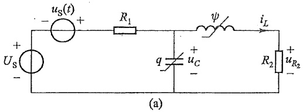

text_image

uS(t)
+
-
Us
+
-
R1
ψ
iL
q
uC
+
-
R2
+
uR2
(a)

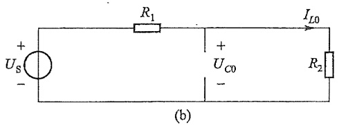

text_image

+
Us
-
R1
+
UC0
-
IL0
R2
(b)

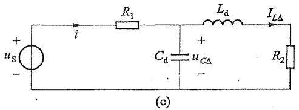

text_image

+
us
-
i
R1
Ld
ILΔ
+
Cd
uCΔ
-
R2
(c)

图17-24 例17-7图

解 （1）当直流电压源单独作用于电路时，在稳定状态下，电感处于短路，电容处于开路，其等效电路如图 17-24(b) 所示，故得

$$
I _ {L 0} = \frac {U _ {\mathrm{s}}}{R _ {1} + R _ {2}} = \frac {2 . 2 5}{2 . 2 5} \mathrm{A} = 1 \mathrm{A}, \quad U _ {c 0} = R _ {2} \times I _ {L 0} = (1. 2 5 \times 1) \mathrm{V} = 1. 2 5 \mathrm{V}
$$

(2) 电路的动态电感为

$$
L _ {\mathrm{d}} = \frac {\mathrm{d} \psi}{\mathrm{d} i _ {L}} \Bigg | _ {i _ {L} = I _ {L 0}} = 0. 1 + 3 \times 0. 0 5 \times I _ {L 0} ^ {2} = 0. 2 5 \mathrm{H}
$$

电路的动态电容为

$$
C _ {\mathrm{d}} = \frac {\mathrm{d} q}{\mathrm{d} u _ {c}} \Bigg | _ {u _ {c} = U _ {c 0}} = 2 \times 0. 8 \times U _ {c 0} = 2 \mathrm{F}
$$

(3) 根据动态电感值和动态电容值建立的小参数二阶线性动态电路如图 17-24

---

\*§ 17-7 小扰动下的动态电路分析

435

(c) 所示, 且电路处于零状态, 求小扰动电压源激励时的零状态响应  $i_{L\Delta}(t)$ 。根据支路电流法, 得

$$
\begin{array}{l} i = i _ {L \Delta} + C _ {\mathrm{d}} \frac {\mathrm{d} u _ {c \Delta}}{\mathrm{d} t} \\ L _ {\mathrm{d}} \frac {\mathrm{d} i _ {L \Delta}}{\mathrm{d} t} + R _ {2} i _ {L \Delta} - u _ {c} = 0 \\ R _ {1} \Bigg (i _ {_ {L \Delta}} + C _ {\mathrm{d}} \frac {\mathrm{d} u _ {_ {C \Delta}}}{\mathrm{d} t} \Bigg) + L _ {\mathrm{d}} \frac {\mathrm{d} i _ {_ {L \Delta}}}{\mathrm{d} t} + R _ {2} i _ {_ {L \Delta}} = u _ {\mathrm{S}} (t) \\ \end{array}
$$

以  $i_{L\Delta}(t)$  为电路变量, 整理得其二阶电路的微分方程为

$$
R _ {1} C _ {\mathrm{d}} L _ {\mathrm{d}} \frac {\mathrm{d} ^ {2} i _ {L \Delta}}{\mathrm{d} t ^ {2}} + (R _ {1} R _ {2} C _ {\mathrm{d}} + L _ {\mathrm{d}}) \frac {\mathrm{d} i _ {L \Delta}}{\mathrm{d} t} + (R _ {1} + R _ {2}) i _ {L \Delta} = u _ {\mathrm{S}} (t)
$$

代入电路参数, 当干扰信号  $u_{S1}=0.45\times10^{-2}\varepsilon(t)$  V 单独作用于电路时, 得

$$
0. 5 \frac {\mathrm{d} ^ {2} i _ {L \Delta}}{\mathrm{d} t ^ {2}} + 2. 7 5 \frac {\mathrm{d} i _ {L \Delta}}{\mathrm{d} t} + 2. 2 5 i _ {L \Delta} = 0. 4 5 \times 1 0 ^ {- 2} \varepsilon (t)
$$

其相应的齐次微分方程为

$$
0. 5 \frac {\mathrm{d} ^ {2} i _ {L \Delta}}{\mathrm{d} t ^ {2}} + 2. 7 5 \frac {\mathrm{d} i _ {L \Delta}}{\mathrm{d} t} + 2. 2 5 i _ {L \Delta} = 0
$$

齐次微分方程的特征方程为

$$
0. 5 p ^ {2} + 2. 7 5 p + 2. 2 5 = 0
$$

其特征根为

$$
p _ {1} = - 1, \quad p _ {2} = - 4. 5
$$

相应的齐次解为

$$
i _ {L \Delta} (t) = (k _ {1} \mathrm{e} ^ {- t} + k _ {2} \mathrm{e} ^ {- 4. 5 t}) \mathrm{A}
$$

相应的特解为

$$
I _ {0 \Delta} = \left(\frac {0 . 4 5}{2 . 2 5} \times 1 0 ^ {- 2}\right) \mathrm{A} = 0. 2 \times 1 0 ^ {- 2} \mathrm{A}
$$

全解为

$$
i _ {L \Delta} (t) = (k _ {1} \mathrm{e} ^ {- t} + k _ {2} \mathrm{e} ^ {- 4. 5 t}) + 0. 2 \times 1 0 ^ {- 2}
$$

根据初始条件确定积分常数  $k_{1}$  和  $k_{2}$ 。

当 $t = 0_{+}$ 时，已知 $i_{L\Delta}(0_{+}) = i_{L\Delta}(0_{-}) = 0$ ，则有

$$
i _ {L \Delta} (t) \mid_ {t = 0} = (k _ {1} \mathrm{e} ^ {- t} + k _ {2} \mathrm{e} ^ {- 4. 5 t}) + 0. 2 \times 1 0 ^ {- 2} \mid_ {t = 0} = 0
$$

当 $t = 0_{+}$ 时，已知 $u_{c\Delta}(0_{+}) = u_{c\Delta}(0_{-}) = 0$ ，则有

$$
\begin{array}{l} u _ {C \Delta} (t) \mid_ {t = 0} = \left(L _ {\mathrm{d}} \frac {\mathrm{d} i _ {L \Delta}}{\mathrm{d} t} + R _ {2} i _ {L \Delta}\right) \mid_ {t = 0} \\ = 0. 2 5 \left(- k _ {1} \mathrm{e} ^ {- t} - 4. 5 k _ {2} \mathrm{e} ^ {- 4. 5 t}\right) + 1. 2 5 \left(k _ {1} \mathrm{e} ^ {- t} + k _ {2} \mathrm{e} ^ {- 4. 5 t} + 0. 2 \times 1 0 ^ {- 2}\right) \mid_ {t = 0} = 0 \\ \end{array}
$$

3

---

436

第十七章 非线性电路

故得

$$
k _ {1} + k _ {2} + 0. 2 \times 1 0 ^ {- 2} = 0
$$

$$
0. 2 5 \times (- k _ {1} - 4. 5 k _ {2}) + 1. 2 5 \times (k _ {1} + k _ {2} + 0. 2 \times 1 0 ^ {- 2}) = 0
$$

联立求解以上两式,得

$$
k _ {1} = \frac {9}{3 5} \times 1 0 ^ {- 2}, \quad k _ {2} = - \frac {2}{3 5} \times 1 0 ^ {- 2}
$$

因此，得

$$
i _ {L \Delta 1} (t) = \left(- \frac {9}{3 5} \times 1 0 ^ {- 2} \mathrm{e} ^ {- t} + \frac {2}{3 5} \times 1 0 ^ {- 2} \mathrm{e} ^ {- 4. 5 t} + 0. 2 \times 1 0 ^ {- 2}\right) \varepsilon (t) \mathrm{A}
$$

当干扰信号  $u_{s2} = -0.45 \times 10^{-2} \varepsilon (t-1) \, V$  单独作用于电路时得

$$
i _ {L \Delta 2} (t) = - \left[ - \frac {9}{3 5} \times 1 0 ^ {- 2} \mathrm{e} ^ {- (t - 1)} + \frac {2}{3 5} \times 1 0 ^ {- 2} \mathrm{e} ^ {- 4. 5 (t - 1)} + 0. 2 \times 1 0 ^ {- 2} \right] \varepsilon (t - 1) \mathrm{A}
$$

直流电压源与干扰信号产生的响应之和为

$$
i _ {L} (t) = \left\{1 + \left(- \frac {9}{3 5} \times 1 0 ^ {- 2} \mathrm{e} ^ {- t} + \frac {2}{3 5} \times 1 0 ^ {- 2} \mathrm{e} ^ {- 4. 5 t} + 0. 2 \times 1 0 ^ {- 2}\right) \varepsilon (t) - \right.
$$

$$
\left[ - \frac {9}{3 5} \times 1 0 ^ {- 2} \mathrm{e} ^ {- (t - 1)} + \frac {2}{3 5} \times 1 0 ^ {- 2} \mathrm{e} ^ {- 4. 5 (t - 1)} + 0. 2 \times 1 0 ^ {- 2} \right] \varepsilon (t - 1) \Bigg \} \mathrm{A}
$$

## \*§17-8 二阶非线性电路的状态平面

二阶非线性电路方程的一般形式可写为

$$
\left. \begin{array}{l} \frac {\mathrm{d} x _ {1}}{\mathrm{d} t} = f _ {1} (x _ {1}, x _ {2}, t) \\ \frac {\mathrm{d} x _ {2}}{\mathrm{d} t} = f _ {2} (x _ {1}, x _ {2}, t) \end{array} \right\} \tag {17-9}
$$

其中  $x_{1}(t)$ ,  $x_{2}(t)$  为状态变量, 式(17-9)为状态方程。

如果式(17-9)右方的函数不随时间 $t$ 而变, 即自变量 $t$ 除了在 $\frac{\mathrm{d}x}{\mathrm{d}t}$ 中以隐含形式出现外, 不以任何显含形式出现, 既有

$$
\left. \begin{array}{l} \frac {\mathrm{d} x _ {1}}{\mathrm{d} t} = f _ {1} (x _ {1}, x _ {2}) \\ \frac {\mathrm{d} x _ {2}}{\mathrm{d} t} = f _ {2} (x _ {1}, x _ {2}) \end{array} \right\} \tag {17-10}
$$

这种自变量 $t$ 不以任何显含形式出现的方程(17-10)称为自治方程。若电路是时变的，或电路中包含随时间变化的外施激励，使得方程中自变量 $t$ 以显含形式出现，如式(17-9)所示，则称为非自治方程。在零输入或在直流激励下的非线性二阶电路的方程是自治

---

§ 17-8 二阶非线性电路的状态平面

437

方程,对应的电路就称为自治电路。

一般来说,求解非线性微分方程(17-9)或(17-10)是比较困难的。通常无闭式解。

把自治方程(17-10)中的状态变量 $x_{1}, x_{2}$ 看作是平面上的坐标点，这种平面就称为状态平面。状态平面上每一点的坐标 $(x_{1}, x_{2})$ 随着时间 $t$ 的变化将在平面上描绘出式(17-10)的某些曲线。设给定的初始状态（条件）为 $x_{1}(0), x_{2}(0)$，对所有 $t \geqslant 0$，方程(17-10)的解 $[x_{1}(t), x_{2}(t)]$ 在平面上描绘出的以 $[x_{1}(0), x_{2}(0)]$ 为起点的轨迹称为该状态方程的一条轨道或相轨道（又称轨迹）。对于不同的初始条件，可以在状态平面上描绘出一簇相轨道，这簇相轨道又称为该自治方程的相图。坐标点 $(x_{1}, x_{2})$ 称为相点。通常从相图可以定性地了解状态方程所描述的电路工作状态的整个变化情况，而不必直接求解非线性微分方程。可以利用数值法通过电子计算机把相轨道描绘出来。相轨道还可以通过实验的方法来观察，例如只要把 $x_{1}(t)$ 和 $x_{2}(t)$ 作为信号电压，把它们加到示波器的水平输入和垂直输入，就可以显示出相应的相轨道。

下面用状态平面讨论二阶 RLC 串联电路放电的动态过程, 其电路如图 17-25 所示。为了简化分析, 设电阻 R、电感 L 和电容 C 都是线性元件。

设电容电压的初始值为 $u_{c}(0_{-}) = U_{0}$，电感电流的初始值为 $i(0_{-}) = 0$，电路的方程为

$$
L \frac {\mathrm{d} ^ {2} i}{\mathrm{d} t ^ {2}} + R \frac {\mathrm{d} i}{\mathrm{d} t} + \frac {i}{C} = 0
$$

令 $x_{1} = i, x_{2} = \frac{\mathrm{d}i}{\mathrm{d}t} = \frac{\mathrm{d}x_{1}}{\mathrm{d}t}$, 上式可改写为

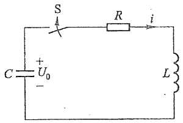

text_image

S
R
i
C + U₀ -
L

图17-25 研究相图用的电路

$$
\left. \begin{array}{l} \frac {\mathrm{d} x _ {1}}{\mathrm{d} t} = x _ {2} \\ \frac {\mathrm{d} x _ {2}}{\mathrm{d} t} = - \omega_ {0} ^ {2} x _ {1} - 2 \delta x _ {2} \end{array} \right\} \tag {17-11}
$$

式中  $\delta=\frac{R}{2L},\omega_{0}^{2}=\frac{1}{LC}$ 。

对式(17-11)直接积分,可以求得相轨道的方程,但需要一定的数学运算。这里主要用状态平面来讨论。

当 $\delta^2 < \omega_0^2$ 或 $R < 2\sqrt{\frac{L}{C}}$ 时，电路中的放电过程为衰减振荡性质，相应的相轨道将如图17-26(a)所示。对应不同的初始条件，相轨道将是一簇螺旋线，并以原点为其渐近点。该图中螺旋线的圈间距离表征了振荡的衰减率，而每一圈对应于振荡的一个周期，原点表示 $x_{1} = 0, x_{2} = 0$ ，是方程(17-11)的所谓“平衡点”。

方程(17-11)的解为

$$
x _ {1} = K \mathrm{e} ^ {- \delta t} \cos (\omega t + \varphi)
$$

---

438

第十七章 非线性电路

$$
x _ {2} = - K \omega_ {0} \mathrm{e} ^ {- \delta t} \sin (\omega t + \varphi + \beta^ {\prime})
$$

式中  $\omega^{2}=\omega_{0}^{2}-\delta^{2},\beta^{\prime}=\arctan\frac{\delta}{\omega}$ ，常数 K 和  $\varphi$  则由初始条件决定。

当 $\delta^2 >\omega_0^2$ 或 $R > 2\sqrt{\frac{L}{C}}$ 时，电路中的放电过程为非周期衰减性质，相应的相轨道将如图17-26(b)所示。对应不同的初始条件，相轨道将是一簇变形的抛物线，原点是它们的渐近点，相点的运动方向是趋近于原点的。

方程式(17-11)的解为

$$
x _ {1} = K _ {1} \mathrm{e} ^ {- m _ {1} t} + K _ {2} \mathrm{e} ^ {- m _ {2} t}
$$

$$
x _ {2} = - K _ {1} m _ {1} \mathrm{e} ^ {- m _ {1} t} - K _ {2} m _ {2} \mathrm{e} ^ {- m _ {2} t}
$$

其中 $-m_{1}=-\delta+\sqrt{\delta^{2}-\omega_{0}^{2}},-m_{2}=-\delta-\sqrt{\delta^{2}-\omega_{0}^{2}}$ ，常数 $K_{1}$ 和 $K_{2}$ 由初始条件确定。

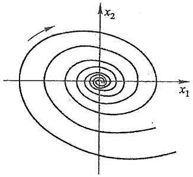

text_image

x₂
x₁

(a)

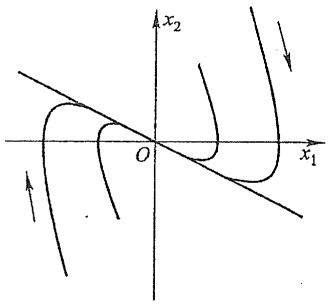

text_image

x₂
O
x₁

(b)

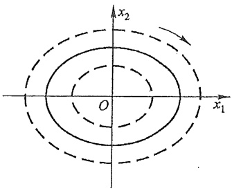

text_image

x₂
O
x₁

(c)

图 17-26 式(17-11)的相图

当  $\delta=0$  或 R=0 时, 式  $(17-11)$  变为

$$
\frac {\mathrm{d} x _ {2}}{\mathrm{d} x _ {1}} = - \omega_ {0} ^ {2} \frac {x _ {1}}{x _ {2}}
$$

经过积分后得

$$
\frac {x _ {1} ^ {2}}{K ^ {2}} + \frac {x _ {2} ^ {2}}{K ^ {2} \omega_ {0} ^ {2}} = 1
$$

---

\*§ 17-9 非线性振荡电路

439

式中 K 是与初始条件有关的积分常数。对应不同的初始条件，相轨道是具有水平轴为 K，垂直半轴为  $\omega_{0}K$  的一簇椭圆，如图 17-26(c) 所示，它对应于不衰减的正弦振荡。振荡的振幅与初始条件有关。

方程式(17-11)的解为

$$
x _ {1} = K \cos (\omega_ {0} t + \varphi)
$$

$$
x _ {2} = - K \omega_ {0} \sin (\omega_ {0} t + \varphi)
$$

这个例子说明相轨道形状的研究可以对定性了解电路全部解提供有用的信息。

另外，在某些非线性自治电路中，在一定的初始条件下会建立起不衰减的周期振荡过程，此时所对应的相轨道将是一条称为极限环的孤立闭合曲线。

## \* §17-9 非线性振荡电路

电子振荡电路一般至少含有两个储能元件和至少一个非线性元件。本节通过实例介绍一种典型的非线性振荡电路，即范德坡电路。它是由一个线性电感，一个线性电容和一个非线性电阻组成，如图17-27(a)所示，非线性电阻的伏安特性曲线有一段为负电阻性质，它的伏安特性可用下式表示(属电流控制型):

$$
u _ {R} = \frac {1}{3} i _ {R} ^ {3} - i _ {R}
$$

伏安特性曲线的大致形状如图 17-27(b) 所示。

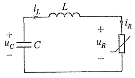

text_image

iL L
+ uC C + iR
- uR

(a)

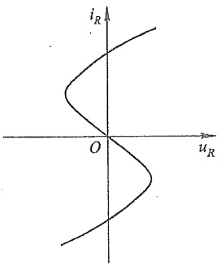

text_image

i_R
O
u_R

(b)

图 17-27 范德坡电路

电路的状态方程可写为(注意  $i_{L}=i_{R}$ )

$$
\left. \begin{array}{l} \frac {\mathrm{d} u _ {C}}{\mathrm{d} t} = - \frac {i _ {L}}{C} \\ \frac {\mathrm{d} i _ {L}}{\mathrm{d} t} = \frac {u _ {C} - \left(\frac {1}{3} i _ {L} ^ {3} - i _ {L}\right)}{L} \end{array} \right\} \tag {17-12}
$$

---

图2

440

第十七章 非线性电路

其中  $u_{C}$  和  $i_{L}$  为状态变量。为了使用量纲为一的量，令  $\tau=\frac{1}{\sqrt{LC}}t,\tau$  是量纲为一的量。这样有

$$
\frac {\mathrm{d} u _ {c}}{\mathrm{d} t} = \frac {\mathrm{d} u _ {c}}{\mathrm{d} \tau} \frac {\mathrm{d} \tau}{\mathrm{d} t} = \frac {1}{\sqrt {L C}} \frac {\mathrm{d} u _ {c}}{\mathrm{d} \tau}
$$

$$
\frac {\mathrm{d} i _ {L}}{\mathrm{d} t} = \frac {\mathrm{d} i _ {L}}{\mathrm{d} \tau} \frac {\mathrm{d} \tau}{\mathrm{d} t} = \frac {1}{\sqrt {L C}} \frac {\mathrm{d} i _ {L}}{\mathrm{d} \tau}
$$

令 $\varepsilon = \sqrt{\frac{C}{L}}$ ，则式(17-12)可改写为

$$
\left. \begin{array}{l} \frac {\mathrm{d} u _ {c}}{\mathrm{d} \tau} = - \frac {1}{\varepsilon} i _ {L} \\ \frac {\mathrm{d} i _ {L}}{\mathrm{d} \tau} = \varepsilon \left[ u _ {c} - \left(\frac {1}{3} i _ {L} ^ {3} - i _ {L}\right) \right] \end{array} \right\}
$$

若令 $x_{1} = i_{L}, x_{2} = \frac{\mathrm{d}i_{L}}{\mathrm{d}\tau}$, 则上式又可改写为

$$
\left. \begin{array}{l} \frac {\mathrm{d} x _ {1}}{\mathrm{d} \tau} = x _ {2} \\ \frac {\mathrm{d} x _ {2}}{\mathrm{d} \tau} = \varepsilon (1 - x _ {1} ^ {2}) x _ {2} - x _ {1} \end{array} \right\} \tag {17-13}
$$

方程(17-13)中仅有一个参数  $\varepsilon$ 。对不同的  $\varepsilon$  值, 可以画出该方程不同的相图, 就可以了解图 17-27(a) 所示电路的定性性质。图 17-28 画出了  $\varepsilon=0.1$  时的相图。从图中可

以看出有单一的闭合曲线存在。这种单一的或孤立的闭合曲线称为极限环，与其相邻的相轨道都是卷向它的。所以不管相点最初在极限环外或是在极限环内，最终都将沿着极限环运动。如果取 $u_{c}$ 的标度为 $i_{L}$ 标度的 $\frac{1}{\varepsilon}$ 倍，则极限环接近为一个圆。此时 $u_{c}$ 和 $i_{L}$ 的波形与正弦波形接近， $u_{c}$ 的振幅为 $i_{L}$ 的振幅的 $\frac{1}{\varepsilon}$ 倍。这说明不管初始条件如何，在所研究电路中最终将建立起周期性振荡。这种在非线性自治电路中产生的持续振荡是一种自激振荡，它与图17-26(c)在线性电路中产生的振荡过程

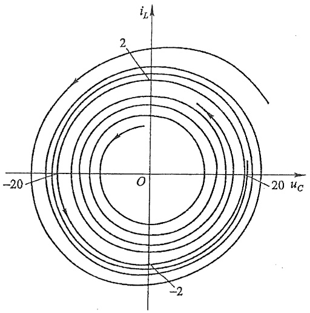

text_image

i_L
2
-20
O
20 u_C
-2

图 17-28 · 范德坡振荡电路的相图

---

\*§ 17-10 混沌电路简介

441

有所不同,后者的振荡振幅是与初始条件有关的。

如果令式(17-13)中的 $x_{1} = x$ ，该方程还可写为含有一个变量的二阶非线性微分方程

$$
\frac {\mathrm{d} ^ {2} x}{\mathrm{d} t ^ {2}} - \varepsilon (1 - x ^ {2}) \frac {\mathrm{d} x}{\mathrm{d} t} + x = 0
$$

上式就是范德坡方程。

## \* §17-10 混沌电路简介

混沌理论自20世纪70年代以来已成为许多不同学科领域的研究热点。粗略地说，混沌是发生在确定性系统中的一种不确定行为，或类似随机的行为，混沌运动是另一种非周期运动。混沌的一个最显著的特点是，状态变量的波形对状态变量的初始值极为敏感，或者说初始值对波形有重大影响。在有些二阶非线性非自治电路或三阶非线性自治电路中就存在着混沌现象。这类动态电路方程是二阶或三阶非线性常微分方程。根据经典理论，在初始态条件确定之后，它的解是确定的。但是发现在一定参数值的条件下，电路会出现很复杂的解，这种解不是周期解，又不是拟周期解 $^{①}$ ，在状态平面上它的相轨道始终不会重复，但是有界的，即在一定的有界范围内具有遍历性，它对初始态条件极为敏感。

图 17-29 所示是线性电阻 R、线性电感 L 和半导体变容二极管 D 组成的串联电路，外施电压为正弦电压。变容二极管可以用一个非线性电阻和一个非线性电容的并联组合作为其电路模型。

此电路的方程是一个二阶非自治非线性微分方程。在一定的参数条件下，该电路中当正弦激励的频率固定，振幅  $U_{m}$  自零逐步增长时，用实验观察或

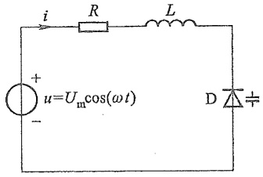

text_image

i
R
L
+
u=Um cos(ωt)
-
D

图 17-29 变容二极管混沌电路

用计算机求解电路中的电流 $i$，将会发现当 $U_{\mathrm{m}}$ 自零增长到 $U_{\mathrm{m1}}$ 之前，电流 $i$ 的稳态解是非正弦周期解，这时它的周期与外施正弦激励的周期相同。当达到 $U_{\mathrm{m1}}$ 时，电流 $i$ 仍为非正弦周期性的，但它的周期已变为外施正弦激励周期的2倍。所以电流的基波频率为正弦激励频率的 $\frac{1}{2}$②，即 $\frac{1}{2}\omega$。当 $U_{\mathrm{m}}$ 继续增大时，例如达到 $U_{\mathrm{m2}}$ 时，会出现稳定的周期为外施激励周期4倍的解。之后又会出现8倍周期解，16倍周期解。这种现象称为分叉。自16周期分叉后会出现一个混沌区，此时电流即非周期解又非拟周期解。在混

<small>① 拟周期解可以看作是一些具有不同频率的周期解之和，这些频率的相互比值是非有理数。总体看来，它似乎是具有“很长”的周期又接近周期解的一种解。</small>

<small>② 一个非正弦周期解,如果它的基波频率是外施频率的分数倍,这种“谐波”称为“子谐波”。线性电路的非正弦周期解,它的“谐波”是外施频率的整数倍,基波频率则与外施频率相同。</small>

---

442

第十七章 非线性电路

沌区后，随激励幅值的增加还发现有3周期、6周期等分叉。图17-30就是电流分叉的示意图，图中的数字2、4等表示2周期、4周期等分叉。

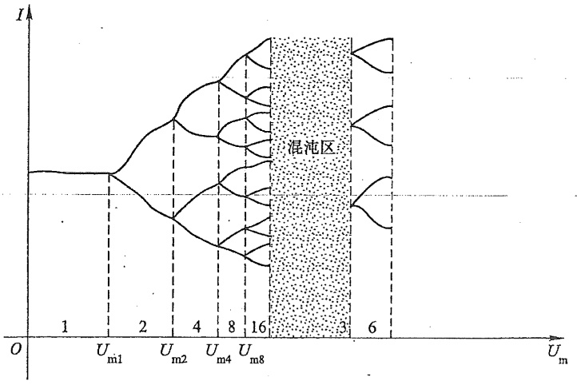

funnel

| Um | Current (State 1) | Current (State 2) | Current (State 3) | Current (State 4) |
| --- | --- | --- | --- | --- |
| Um1 | Stable | — | — | — |
| Um2 | Decreasing | Increasing | Increasing | Increasing |
| Um4 | Decreasing | Decreasing | Increasing | Increasing |
| Um8 | Decreasing | Decreasing | Decreasing | Increasing |
| Unlabeled Region | — | — | — | — |
| Unlabeled Region (subset) | — | — | — | — |
| Unlabeled Region (outer) | — | — | — | Increasing |
| Unlabeled Region (end) | — | — | — | Increasing |

图 17-30 电流的分叉

混沌现象广泛地存在于非线性电路中,其中比较典型并已得到深入研究的电路是二阶非自治铁磁谐振电路和称为蔡氏电路的三阶自治电路。

蔡氏电路 $^{①}$ 如图17-31(a)所示,它是由两个线性电容、一个线性电感、一个线性电阻和一个非线性电阻构成的三阶自治动态电路,非线性电阻的伏安特性为 $i_{R}=g(u_{R})$ ,是一个分段线性电阻,如图17-31(b)所示,其中 $m_{0},m_{1},m_{2}$ 分别表示相应折线的斜率。

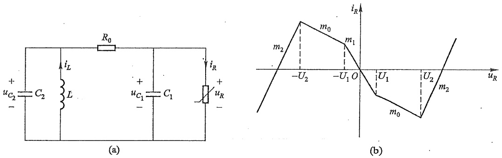

图 17-31 · 蔡氏电路

<small>① 此电路由 L. O. Chua(蔡少棠) 提出, 故称为蔡氏电路, 又称为“双涡卷(double scroll) 电路”。</small>

---

$^{*}$ § 17-10 混沌电路简介

443

设电容电压 $u_{C_1}, u_{C_2}$ 和电感电流 $i_L$ 为状态变量，得电路的状态方程如下:

$$
\left. \begin{array}{l} C _ {1} \frac {\mathrm{d} u _ {c _ {1}}}{\mathrm{d} t} = \frac {1}{R _ {0}} (u _ {c _ {2}} - u _ {c _ {1}}) - g (u _ {R}) \\ C _ {2} \frac {\mathrm{d} u _ {c _ {2}}}{\mathrm{d} t} = \frac {1}{R _ {0}} (u _ {c _ {1}} - u _ {c _ {2}}) + i _ {L} \\ L \frac {\mathrm{d} i _ {L}}{\mathrm{d} t} = - u _ {c _ {2}} \end{array} \right\} \tag {17-14}
$$

这是一个三阶非线性自治方程组。这个电路在不同的参数值条件下会发生丰富多样的自激振荡动态过程，并有混沌出现，同时方程的解对初始条件非常敏感。根据不同的 $C_1, C_2, L, R_0$ 及非线性电阻的 $U_1, U_2, m_0, m_1, m_2$ 等和不同的 $u_{c_1}(0), u_{c_2}(0), i_L(0)$ 初始条件，按式(17-14)，应用计算机可以计算出以 $u_{c_1}, u_{c_2}$ 和 $i_L$ 为坐标的状态空间的相轨道和它们的时域波形。

图 17-32 示出了在某一组参数值及初始条件下,电路出现混沌时投影在  $i_{L}-u_{C_{1}}$  状态平面上的相轨道,它具有“双涡卷”形状,故称此电路为“双涡卷”电路,其相轨道永不重复。图 17-33 示出了电容电压的时域波形,说明了混沌振荡的非周期性。

contour

| Series | iL (range) | uCi (range) |
| --- | --- | --- |
| Phase space | -2.5~2.7 | -3.1~3.2 |

图 17-32 双涡卷相轨道

由于非线性电路中混沌解的特殊性,分析研究混沌的方法主要有:(1) 使用计算机对非线性电路进行数值计算,从得到的相图和时域波形等来判别混沌特征的信息;(2) 对电路直接进行实验,在实验中对混沌现象进行观察和分析。

---

444

第十七章 非线性电路

line

| t | uC_i |
| --- | --- |
| 0 | ~0.1 |
| 0.2 | ~2.1 |
| 0.5 | ~-0.4 |
| 1.0 | ~-2.1 |
| 1.5 | ~-2.1 |
| 2.0 | ~-1.9 |
| 2.5 | ~-2.2 |
| 3.0 | ~1.4 |
| 4.0 | ~1.6 |
| 4.5 | ~2.1 |
| 5.0 | ~-1.7 |
| 6.0 | ~-2.2 |
| 6.5 | ~1.9 |
| 7.0 | ~-0.2 |
| 7.5 | ~2.1 |
| 8.0 | ~-1.5 |

图 17-33 电容电压的时域波形

## \*§17-11 人工神经元电路

人工神经网络(简称神经网络)试图部分模仿人脑神经系统的结构和功能,它与数字计算机迥然不同,它具有分布式存储和并行处理的特色。人工神经网络只是人脑功能的一种简化和抽象的模型。人的大脑含有数以亿万计的生物神经元,以特定的方式相互连接,从而使人具有理解、记忆、联想、识别和计算的能力。生物神经元可以当作是具有输入和输出的处理信息的单元,其输入和输出之间的关系可用具有饱和特性的一种S型非线性转移函数来描述。人工神经元模型就是根据这一设想构成的。

神经网络具有广泛的应用前景,可用来处理识别、分类、联想、优化等问题。目前有许多种神经网络模型。本书介绍人工神经网络的 Hopfield 电路模型,这是一种用电路实现的神经网络模型。

图 17-34 示出了这个电路模型的第 k 个人工神经元的构成, 图中的运放具有有限放大倍数并计及其饱和特性, 运放的输出电压与输入电压之间的转移函数关系  $u_{ok}=f_{k}(u_{ik})$  可用来描述神经元的相应转移函数关系。运放输入

text_image

u_{o1} u_{oj} u_{on}
R_{k1} ... R_{kj} ... R_{kn}
I_k +
R_k C_k
u_{jk}
- ▶
+ +
+ u_{ok}
-

图17-34 第 $k$ 个神经元电路

---

思考题

445

端的电容 $C_k$ 和电阻 $R_{k}$ 对于输出与输入信号之间产生延迟作用，以此模仿神经元的动态特性。另外在输入端连接的电阻 $R_{kj}$ 用来表示第 $j$ 个神经元的输出电压 $u_{oj}$ 与第 $k$ 个神经元产生的输入电流之间的相互联系。电流 $I_{k}$ 表示注入第 $k$ 个神经元的电流。

根据 KCL, 在第 k 个神经元的输入节点处有

$$
C _ {k} \frac {\mathrm{d} u _ {\mathrm{ik}}}{\mathrm{d} t} + \frac {u _ {\mathrm{ik}}}{R _ {k}} = \sum_ {j \neq k} ^ {n} \frac {1}{R _ {k j}} (u _ {\mathrm{o} j} - u _ {\mathrm{ik}}) + I _ {k}
$$

整理后,有

$$
C \frac {\mathrm{d} u _ {\mathrm{ik}}}{\mathrm{d} t} = \sum_ {j \neq k} ^ {n} \frac {1}{R _ {k j}} u _ {\mathrm{o} j} - \frac {1}{R _ {k} ^ {\prime}} u _ {\mathrm{ik}} + I _ {k}
$$

其中

$$
\frac {1}{R _ {k} ^ {\prime}} = \frac {1}{R _ {k}} + \sum_ {j \neq k} ^ {n} \frac {1}{R _ {k j}}
$$

另外有

$$
u _ {o k} = f _ {k} (  u _ {i k})
$$

上式中假设共有 n 个神经元相互连接，而  $k=1,2,\cdots,n$ 。

对于每个神经元都可以列出上述类似的方程,这样就构成了一个 n 阶非线性微分方程组。当给定一组初始值后,就可以求出此方程组的解。如果方程组的解为一组确定值,则表明电路最终将达到一个稳定状态。

以这种神经元模型为基础,可以设计出用来处理和求解多种不同类型问题的神经网络电路。这些问题包括“旅行商最优路径问题”、模-数转换问题、线性规划问题以及其他各种优化问题等。

## 思考题

17-1 动态电阻和静态电阻各用于什么场合？
17-2 非线性电阻电路的方程是什么方程？
17-3 包含非线性电阻元件和线性储能元件的电路方程是什么方程？包含线性电阻和非线性储能元件的电路方程是什么方程？
17-4 如果电路中含有电压控制电阻,请问电路适合列写节点电压方程还是回路电流方程?如果电路含有电流控制的非线性电阻,适合列写节点电压方程还是回路电流方程?如果电路既含有电压控制非线性电阻也含有电流控制非线性电阻,适合采用哪种电路方程?
17-5 如果采用分段线性法分析非线性电路,你认为主要的困难是什么?

---

446

第十七章 非线性电路

17-6 本章介绍的小扰动下的动态电路分析,有哪些限制条件?

## 习题

17-1 如果通过非线性电阻的电流为  $\cos(\omega t)A$ ，要使该电阻两端的电压中含有  $4\omega$  角频率的电压分量，试求该电阻的伏安特性，写出其解析表达式。
17-2 写出题 17-2 图所示电路的节点电压方程, 假设电路中各非线性电阻的伏安特性为  $i_{1}=u_{1}^{3}, i_{2}=u_{2}^{2}, i_{3}=u_{3}^{3/2}$ 。
17-3 一个非线性电容的库伏特性为 $u = 1 + 2q + 3q^2$，如果电容从 $q(t_0) = 0$ 充电至 $q(t) = 1\mathrm{C}$。试求此电容储存的能量。
17-4 非线性电感的韦安特性为  $\Psi=i^{3}$ ，当有 2 A 电流通过该电感时，试求此时的静态电感值。
17-5 已知题 17-5 图所示电路中， $U_{s}=84\ V, R_{1}=2\ k\Omega, R_{2}=10\ k\Omega$ ，非线性电阻  $R_{3}$  的伏安特性可表示为  $i_{3}=0.3u_{3}+0.04u_{3}^{2}$ 。试求电流  $i_{1}$  和  $i_{3}$ 。

text_image

12 A
i₁
+
u₁
-
①
i₂
+
u₂
-
②
i₃
+
u₃
-
4 A

题 17-2 图

text_image

R₁ i₁
+ Uₛ R₂ i₃
- +
u₃ R₃

题 17-5 图

17-6 题 17-6 图所示电路由一个线性电阻 R，一个理想二极管和一个直流电压源串联组成。已知  $R=2\Omega, U_{s}=1V$ ，在 u-i 平面上画出对应的伏安特性。
17-7. 题 17-7 图所示电路由一个线性电阻 R、一个理想二极管和一个直流电流源并联组成。已知  $R = 1 \Omega, I_{s} = 1 \, A$ ，在 u-i 平面上画出对应的伏安特性。

text_image

i
+
R
u
+
Us
-
-
-

题17-6图

text_image

i
+
u
R
I_S
-

题 17-7 图

---

习题

447

17-8 试设计一个由线性电阻、独立电源和理想二极管组成的一端口网络，要求它的伏安特性具有题17-8图所示特性。

17-9 设题 17-9 图所示电路中二极管的伏安特性可用下式表示:

$$
i _ {\mathrm{D}} = 1 0 ^ {- 6} (\mathrm{e} ^ {4 0 u _ {\mathrm{D}}} - 1) \mathrm{A}
$$

式中  $u_{D}$  为二极管的电压，其单位为 V，已知  $R_{1}=0.5\Omega, R_{2}=0.5\Omega, R_{3}=0.75\Omega, U_{S}=2V$ 。试用图解法求出静态工作点。

line

| u/V | i/A |
| --- | --- |
| -1 | 0 |
| 0 | 2 |

题 17-8 图

text_image

R₁
+
Uₛ
-
R₂
R₃
iₐ
+
uₐ
-

题 17-9 图

17-10 题 17-10 图所示非线性电阻电路中,非线性电阻的伏安特性为

$$
u = 2 i + i ^ {3}
$$

现已知当 $u_{\mathrm{s}}(t) = 0$ 时，回路中的电流为 $1\mathrm{A}$ 。如果 $u_{\mathrm{s}}(t) = \cos (\omega t)\mathrm{V}$ 时，试用小信号分析法求回路中的电流 $i$ 。

17-11 题 17-11 图所示电路中, $R=2\Omega$ 。直流电压源 $U_{s}=9V$ ,非线性电阻的伏安特性 $u=-2i+\frac{1}{3}i^{3}$ ,若 $u_{s}(t)=\cos tV$ ,试求电流i。

text_image

i
+
us
-
5 V
2 Ω
u=f(i)

题 17-10 图

text_image

+
Us
-
R
i
+
Us
-
+ u
-

题 17-11 图

17-12 题 17-12 图(a)所示电路中, 直流电压源  $U_{s}=3.5\ V, R=1\ \Omega$ , 非线性电阻的伏安特性曲线如题 17-12 图(b)所示。

(1) 试用图解法求静态工作点。
(2) 如将曲线分成 OC、CD 和 DE 三段, 试用分段线性化方法求静态工作点, 并与 (1) 的结果相比较。

水

---

448

第十七章 非线性电路

text_image

R
+
Us
-
+
u
-
i

(a)

line

| Point | i/A | u/V |
| --- | --- | --- |
| C | 1 | 1 |
| D | 2 | 3 |
| E | 3 | 6 |

(b)

题17-12图

17-13 题 17-13 图所示电路中, 非线性电阻的伏安特性为  $i=u^{2}$ , 试求电路的静态工作点及该点的动态电阻  $R_{d}$ 。
17-14 题 17-14 图所示电路中, 非线性电阻的伏安特性为  $u = i^{3}$ , 如将此电阻突然与一个充电的电容接通, 试求电容两端的电压  $u_{C}$ , 设  $u_{C}(0_{+}) = U_{0}$ 。

text_image

3 A
I₀
R 0.5 Ω
+
u
-
i=g(u)

题 17-13 图

text_image

+
U₀
-
C
+
uC
-
S
i
+
u=i³
-

题17-14图

\* 17-15 在题 17-15 图所示电路中, 线性电容通过非线性电阻放电, 非线性电阻伏安特性如题 17-15 图 (b) 所示。已知 $C = 1 \mathrm{~F}, u_{c}(0_{-}) = 3 \mathrm{~V}$, 试求 $u_{c}$。

text_image

+
U₀
-
+
uC
-
S
i
+
uᵣ
-

(a)

line

| uR (V) | i (A) |
| --- | --- |
| 0 | 0 |
| 1 | 2 |
| 2 | 1 |
| 3 | 2 |

(b)

题 17-15 图

\* 17-16 含有非线性电感的一阶动态电路如题 17-16 图所示, 已知直流电压源 $U_{\mathrm{S}} = 40 \mathrm{~V}$, 小扰动电压源 $u_{\mathrm{S}}(t) = 1.2 \mathrm{e}^{-10 t} \varepsilon(t) \mathrm{~V}$, 线性电阻 $R_{1} = 10 \Omega, R_{2} = 40 \Omega$, 非线性电感 $\psi = 0.5 i^{3} (\psi$ 单位为 $\mathrm{Wb}, i$ 单位为 A)。求 $t > 0$ 时的响应 $i_{L}(t), u_{2}(t)$。

---

习题

449

text_image

u_s(t)
+
-
R_1
ψ
i_L
+
U_S
-
R_2
u_2
-

题 17-16 图

\* 17-17 （综合设计题）已知 Lorenz 混沌系统为

$$
\frac {\mathrm{d} x}{\mathrm{d} t} = a (y - x)
$$

$$
\frac {\mathrm{d} y}{\mathrm{d} t} = b x - x z - y
$$

$$
\frac {\mathrm{d} z}{\mathrm{d} t} = x y - c x
$$

系统参数 a=10, b=28, c=8/3，试应用电路元件电阻、电容、运算放大器、乘法器来设计实现 Lorenz 混沌系统。

第十七章部

分习题答案
