# 附录A 磁路和铁心线圈

原始 PDF 第 503–517 页。

## 附录 A

## 磁路和铁心线圈

本附录介绍磁场、磁路和磁路定律，并对无分支磁路和有分支磁路的计算做简要介绍。另外还简要地介绍铁磁物质的磁化过程和铁心损耗以及磁饱和对电流和磁通波形的影响。最后介绍铁心线圈的电路模型和分析。

## §A-1 磁场和磁路

根据电磁场理论,磁场是由电流产生的,它与电流在空间的分布和周围空间磁介质的性质密切相关。在工程中,常把载流导体制成的线圈绕在由磁性材料制成的(闭合)铁心上。由于磁性材料的磁导率比周围空气的磁导率大很多,因此,铁心中的磁场比周围空气中的磁场强得多,磁场的磁感线大部分汇聚于铁心中,工程上把这种由磁性材料

组成的、能使磁感线集中通过的整体，称为磁路。磁路这种形式，可以用相对较小的电流，在其限定的区域内获得较强的磁场。在工程上，凡需要强磁场的场合，都广泛采用磁路实现，如各种型号的电机、变压器、继电器、电磁铁和电磁仪表等电气设备中，都有由磁性材料制成的磁路，图 A-1 是一种变压器的示意图。

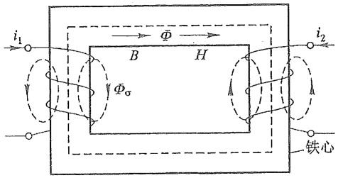

text_image

i₁
Φ
B H
Φσ
i₂
铁心

图 A-1 变压器的磁路

磁路在载流线圈的作用下(如图 A-1 中的电流  $i_{1}$  和  $i_{2}$ ), 在其内、外分布着电磁场, 因此, 磁路的分析计算实际上是电磁场的求解问题。描述磁场的两个基本物理量: 磁感应强度 B (向量), 磁场强度 H (向量) 以及它们的积分性质是分析计算磁路的基础。

磁感应强度用向量 B 表示, 是根据洛伦兹力定义的。在 SI 中, B 的单位是 T(特斯拉)。B 与电流的关系满足毕奥-沙伐定律。穿过某一截面 S 的磁感应强度 B 的通量称为磁通量, 简称磁通, 它定义为

$$
\varPhi = \int_ {S} \boldsymbol {B} \cdot \mathrm{d} S
$$

---

480

附录 A 磁路和铁心线圈

所以 B 在某截面 S 上的面积分就是通过该截面的磁通。磁通是一个标量，在 SI 中，它的单位是 Wb(韦伯)。磁通的参考方向与电流的方向满足右手螺旋定则。在磁场中，对 B 的任意闭合面积分为零，即有

$$
\oint_ {S} \boldsymbol {B} \cdot \mathrm{d} \boldsymbol {S} = 0 \tag {A-1}
$$

式中 dS 的方向规定为闭合面的外法线方向，同时又规定穿出闭合面的磁通为它的参考方向。所以在上式中穿进闭合面的磁通取“-”号，穿出闭合面的磁通取“+”号，两者的绝对值是相等的，这就是磁通连续性原理。

磁场强度用向量 H 表示, 在 SI 中它的单位是 A/m, 它是计及磁介质的作用后, 描述磁场的另一个物理量, 它与磁感应强度 B、磁介质的磁导率  $\mu$  之间有如下关系:

$$
B = \mu H
$$

由于磁性材料的  $\mu$  不是常量, 所以, 在磁路中上述关系为非线性关系。在磁场中, 对 H 的任意闭合路径(环路)的线积分, 等于穿过该闭合路径所界定面的电流的代数和, 即

$$
\oint_ {l} \boldsymbol {H} \cdot \mathrm{d} \boldsymbol {l} = \sum N i \tag {A-2}
$$

该积分称为安培环路定律。当电流的参考方向与环路的绕向符合右手螺旋定则时，该电流前取“+”号，反之，取“-”号。Ni又称为磁通势，可用 $F_{m}$ 表示，即 $F_{m}=Ni$ ，其单位为A，有时也用At(安匝)。

以上有关 B 和 H 的内容可参阅电磁场理论或物理学的有关部分。

现对图A-1所示磁路做进一步的说明。图中载流线圈的电流 $i_1$ 和 $i_2$ 共同产生的磁通分为两部分，其中只经铁心闭合的磁通 $\Phi$ 称为主磁通，另一部分是部分经铁心、部分经空气闭合的磁通 $\Phi_{\sigma}$，称为漏磁通①。要精确分析计算电流与这两部分磁通在空间分布的关系，是一个非线性磁场的求解问题。为简化磁路的分析，工程上根据实际情况假设如下的近似条件存在:

（1）由于铁心的磁性材料的磁导率  $\mu$  与空气的磁导率  $\mu_{0}$ （真空）之比约为  $10^{3} \sim 10^{4}$ ，在计算精度要求不高的情况下，可假设  $\Phi_{\sigma}=0$ （漏磁通）认为磁通全部集中在磁路内，即只考虑主磁通  $\Phi$  的计算。
(2) 磁路通常由同种类磁性材料或规则分段的不同种类的磁性材料组成, 可以根据磁通的走向, 按磁介质和截面都相同的原则分段计算。当每段磁路的截面较小时, 可以近似地认为磁场是均匀分布的, 即 B 和 H 在各磁路段内分别处处相等, 并假设它们的方向和磁通的方向相同, 均平行于磁路段的中心线, 如图 A-1 中所示。

在上述条件下,可按下述关系分段计算磁路:

① 第 $k$ 段磁路内的磁通

$$
\Phi_ {k} = \int_ {S _ {k}} \boldsymbol {B} _ {k} \cdot \mathrm{d} S _ {k} = B _ {k} S _ {k}, B _ {k} = \frac {\Phi_ {k}}{S _ {k}} \tag {A-3}
$$

<small>① 主磁通与两个线圈交链，漏磁通只穿过一个线圈的一部分。</small>

---

§ A-2 铁磁物质的磁化曲线

481

② 沿第 k 磁路段的中心线, 有

$$
\int_ {l _ {k}} \mathbb {H} \cdot \mathrm{d} l = H _ {k} l _ {k} = u _ {\mathrm{m} k} \tag {A-4}
$$

上述积分是安培环路定律在一段路径上的积分结果,称为 k 磁路段的端磁位差(与电路中的端电压类似)。

③ $B_{k}$ 与 $H_{k}$ 之间的关系仍为

$$
B _ {k} = \mu_ {k} H _ {k}
$$

这一非线性关系,在工程上将用  $B=f(H)$  函数关系画出的曲线表示,称为 B-H 曲线或磁化曲线,计算时可查阅。

真空的磁导率  $\mu_{0}=4\pi\times10^{-7}\ H/m,\mu_{0}$  是一个常数。非铁磁物质的磁导率  $\mu$  与  $\mu_{0}$  相差无几，所以一般可以当作  $\mu_{0}$  计算。

## §A-2 铁磁物质的磁化曲线

工程上常用的铁磁材料主要是指铁、钴、镍及其合金,它们的磁化特性常用 B-H 曲线的形式表示,称为磁化曲线,通常是通过实验的方法获得的。

图A-2(a)(b)所示就是实验测得的磁化曲线，它表现为回线的形式，分别称为磁滞回线[图(a)所示]和磁滞回线簇[图(b)所示]。回线表明: $B$ 和 $H$ 之间是多值的函数关系，而且回线的形状与磁场强度的最大值 $H_{\mathrm{m}}$ 和磁化状态的历史有关。回线的走向与 $\Delta H$ 的符号有关，在回线任一点上 $\Delta H > 0$ （上升）和 $\Delta H < 0$ （下降）时的曲线不在同一条曲线上，当 $\Delta H > 0$ 时，曲线是沿着右侧的曲线上升[图A-2(a)所示]， $\Delta H < 0$ 时，曲线是沿着左侧所示曲线下降，图(a)所示的回线是在相同的 $H_{\mathrm{m}}$ 和 $-H_{\mathrm{m}}$ 下，连续地来回反

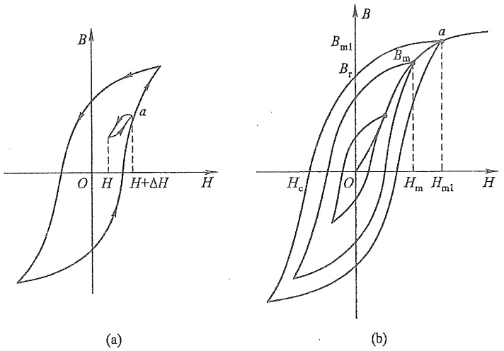

图 A-2 磁滞回线(簇)

---

482

附录 A 磁路和铁心线圈

复十多次获得的结果。如果在回线上的任一点上[如图A-2(a)中的a点]，小范围内来回反复变化一次或数次，可以生成一条小回线(称为局部回线)。图A-2(b)所示回线簇是在不同的最大值 $H_{\mathrm{m}}$ 下形成的磁滞回线。如果回线横向宽度较窄（回线所围成的面积较小），则铁磁材料称为软磁材料，电机、变压器等铁心是用软磁材料制成的。如果回线横向宽度较宽，则称为硬磁材料，工程上多用此材料制成永久磁铁。

计算软磁材料制成的磁路时,常采用一条基本磁化曲线近似替代磁滞回线,它是从B-H平面坐标的原点开始,到磁滞回线簇的顶点 $(H_{\mathrm{m}},B_{\mathrm{m}})$ 描成的一条曲线,如图A-2

(b)所示。工程上给出的磁化曲线都是基本磁化曲线，如图A-3所示。从曲线上可以看出，开始B随H增长较慢(Oa段)，然后迅速增长(ab段)，之后，增长速率减慢(bc段)，逐渐趋向于饱和(cd段)。c点称为曲线饱和点。图中还画出了磁导率 $\mu$ 随H的变化曲线。

磁化曲线还与温度有关,磁导率  $\mu$  一般随温度的升高而下降,高于某一温度时(居里点)可能完全失去磁性材料的磁性,使  $\mu=\mu_{0}$  (真空),如铁的居里点为  $760^{\circ}C$ 。

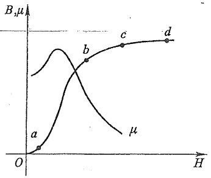

line

| Point | H | \(\mu\) |
| --- | --- | --- |
| a | ~0.1 | ~0.05 |
| b | ~0.3 | ~0.4 |
| c | ~0.6 | ~0.7 |
| d | ~0.9 | ~0.8 |

图A-3 基本磁化曲线

## §A-3 磁路的基本定律

由式(A-1)表示的磁感应强度 B 的闭合面积分在磁路中也处处适用, 当用于磁路中不同磁段的截面结合处时, 有

$$
\oint_ {S} \boldsymbol {B} \cdot \mathrm{d} S = \varPhi_ {1} + \varPhi_ {2} + \dots + \varPhi_ {k} + \dots = 0
$$

即有

$$
\sum \Phi = 0 \tag {A-5}
$$

积分式中的闭合面包括结合处所有磁段的截面。这是磁通连续性原理在磁路中的表示,式(A-5)称为磁路的基尔霍夫第一定律,可叙述为:穿过磁路中不同截面结合处的磁通的代数和等于零。式(A-5)也可表示为

$$
B _ {1} S _ {1} + B _ {2} S _ {2} + \dots + B _ {k} S _ {k} + \dots = 0
$$

$$
\sum B S = 0
$$

该定律形式上类似于电路中的 KCL。

在近似计算磁路时,取每一磁路段的中心线为计算长度的路径,当积分环路由磁路段的中心线组成时,应用式(A-2)表示的磁场强度闭合线积分有

$$
\oint_ {l} \boldsymbol {H} \cdot \mathrm{d} l = H _ {1} l _ {1} + H _ {2} l _ {2} + \dots + H _ {k} l _ {k} + \dots = \sum N i
$$

根据式(A-2), Ni 为磁通势  $F_{m}$ , 是磁路中的激励, 故

$$
\sum H l = \sum F _ {\mathrm{m}} \tag {A-6}
$$

---

§ A-3 磁路的基本定律

483

式(A-6)称为磁路的基尔霍夫第二定律,可叙述为:磁路中由磁路段的中心线组成的环路上各磁路段的 Hl 的代数和等于中心线(环路)交链的磁通势的代数和。此定律形式上类似于电路中的 KVL。

计算磁路时有时用到磁阻的概念。每一磁路段的磁阻 $R_{mk}^{\prime}$ 是该磁路段的磁位差 $U_{mk}=H_{k}l_{k}$ 与该磁路段中的磁通 $\Phi_{k}$ 之比，即有

$$
R _ {m k} = \frac {H _ {k} l _ {k}}{\Phi_ {k}} = \frac {H _ {k} l _ {k}}{\mu_ {k} H _ {k} S _ {k}} = \frac {l _ {k}}{\mu_ {k} S _ {k}}
$$

磁阻类似于电路中的非线性电阻。上式表示的磁阻是静态磁阻，由于  $\mu_{k}$  与 B-H 曲线有关，不是常数，直接计算磁阻不很方便。

现以图A-4的有分支磁路为例说明磁路定律的应用。绕组1和2的匝数分别为$N_{1}$ 和 $N_{2}$，其中电流为 $i_1$ 和 $i_2$。先把磁路分段，并画出各段的中心线，即图A-4中的虚线。为简化起见，设ab、fa、ef三段的材料和截面积相同，截面积设为 $S_{1}$；bc、cd、de三段也作为一磁路段，截面积设为 $S_{2}$。根据磁通连续性原理，在ab、fa、ef三磁路段内的磁通是相等的，设为 $\Phi_{1}$。由于这三段的截面又相等，故三段的 $B$ 和 $H$ 值分别是相等的，设为 $B_{1}$ 和 $H_{1}$，而 $\Phi_{1}$（或 $B_{1}$ 和 $H_{1}$）的方向取为与电流 $i_1$ 呈右手螺旋关系。同理，在bc、cd、de三磁路段内的磁通相等，设为 $\Phi_{2}, B$ 和 $H$ 设为 $B_{2}$ 和 $H_{2}$，其方向与电流 $i_2$ 呈右手螺旋关系。对be段内的磁通设为 $\Phi_{3}, B$ 和 $H$ 设为 $B_{3}$ 和 $H_{3}$，截面积设为 $S_{3}, \Phi_{3}$ 的方向可任意指定，如图A-4所示。

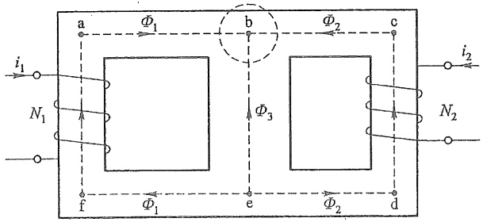

text_image

a
Φ₁
b
Φ₂
c
i₁
N₁
Φ₃
f
Φ₁
e
Φ₂
d
i₂
N₂

图A-4 分支磁路的例子

按式(A-5)，在b处有

$$
- \bar {\Phi} _ {1} - \bar {\Phi} _ {2} - \bar {\Phi} _ {3} = 0
$$

按式(A-6)，有

$$
H _ {1} (l _ {\mathrm{fa}} + l _ {\mathrm{ab}} + l _ {\mathrm{ef}}) - H _ {3} l _ {\mathrm{be}} = N _ {1} i _ {1}
$$

$$
H _ {2} (  l _ {\mathrm{bc}} + l _ {\mathrm{cd}} + l _ {\mathrm{de}}  ) - H _ {3} l _ {\mathrm{be}} = N _ {2} i _ {2}
$$

其他关系有

$$
B _ {1} = \frac {\Phi_ {1}}{S _ {1}}, \quad B _ {2} = \frac {\Phi_ {2}}{S _ {2}}, \quad B _ {3} = \frac {\Phi_ {3}}{S _ {3}}
$$

$$
B _ {1} = \mu_ {1} H _ {1}, \quad B _ {2} = \mu_ {2} H _ {2}, \quad B _ {3} = \mu_ {3} H _ {3}
$$

---

484

附录 A 磁路和铁心线圈

式中  $\mu_{1}, \mu_{2}, \mu_{3}$  分别为三磁路段的磁导率。

若磁路为同一铁磁材料构成,则有  $\mu_{1}=\mu_{2}=\mu_{3}$ 。

## §A-4 恒定磁通磁路的计算

通常在计算电机、电器的磁路时有两类问题,一类是预先给定磁通(或磁感应强度),然后按照给定的磁通和磁路的结构及材料去求所需磁通势 $F_{m}$ 。另一类问题是预先给定磁通势,要求求出磁路中的磁通。

恒定磁通磁路是指磁路中各励磁线圈的电流是直流,就是说磁路中的磁通和磁通势都是恒定的。

首先介绍无分支恒定磁通磁路的计算。无分支磁路的主要特点是在不计及漏磁通时,磁路中处处都有相等的(主)磁通 $\Phi$ ,其计算可按下述步骤进行:

（1）根据磁路中各部分的材料和截面积进行分段,要求每一段磁路具有相同的材料和截面积。
（2）根据各分段磁路的尺寸计算出各段的截面积和平均长度(一般沿中心线计算)。在计算截面积时,必须注意,计算出的截面积称为视在面积,要扣除硅钢片之间的绝缘层占去的截面积,才是磁感线通过的有效面积,一般可以用下式近似表示:

$$
\text {有效面积} = k \times \text {视在面积}
$$

式中 k 称为填充因数, 它随硅钢片厚度和绝缘层厚度而定, 一般约为 0.9 左右。

如磁路中存在空气隙,则磁通会向外扩张,造成边缘效应,如图 A-5 所示,增大了有效面积。当铁心为矩形截面时,其有效面积可按下式估算

(空气隙很短时):

$$
S _ {\mathrm{a}} \approx (a + \delta) (b + \delta) \approx a b + (a + b) \delta
$$

式中 a、b 分别为矩形截面的长和宽， $\delta$  为空气隙长度。对于半径为 r 的圆形截面，可按下式估算:

$$
S _ {\mathrm{a}} \approx \pi \left(r + \frac {\delta}{2}\right) ^ {2} \approx \pi r ^ {2} + \pi r \delta
$$

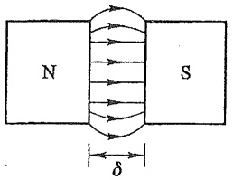

text_image

N
S
δ

图 A-5 空气隙中磁通的边缘效应

(3) 根据已知的磁通计算各磁路段的磁感应强度  $B=\frac{\Phi}{S}$ 。

(4) 根据每一磁路段的 B, 查阅对应的磁性材料的基本磁化曲线, 求得每一磁路段的磁场强度 H; 对于空气隙有  $H_{a} = \frac{B_{a}}{\mu_{0}}$ , 或采用下列近似公式:

$$
H _ {\mathrm{a}} = \frac {B _ {\mathrm{a}}}{4 \pi \times 1 0 ^ {- 7}} \approx 0. 8 \times 1 0 ^ {6} B _ {\mathrm{a}}
$$

(5) 求出每一磁段的 Hl 值。
(6) 按式(A-6)求出所需磁通势。

---

§ A-4 恒定磁通磁路的计算

485

例 A-1 某磁路的结构与尺寸(单位为 mm)如图 A-6(a)所示。已知  $\Phi = 15 \times 10^{-4} Wb, k = 0.90$  (填充因数)，励磁绕组的匝数为 120，所用硅钢片的基本磁化曲线如图 A-6(b) 所示。求励磁电流 I。

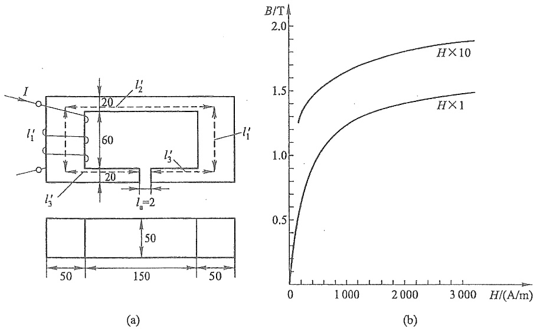

图A-6 例A-1图

解 （1）根据该磁路的结构和尺寸,硅钢片有两种截面积,所以,该磁路连同空气隙共分为三段计算。

(2) 每段的截面积和平均长度为

$$
\begin{array}{l} \left\{ \begin{array}{l} S _ {1} = 5 0 \times 5 0 \times 0. 9 \mathrm{mm} ^ {2} = 2 2. 5 \times 1 0 ^ {- 4} \mathrm{m} ^ {2} \\ l _ {1} = 2 l _ {1} ^ {\prime} = (1 0 0 - 2 0) \times 2 \mathrm{mm} = 0. 1 6 \mathrm{m} \end{array} \right. \\ \left\{ \begin{array}{l} S _ {2} = 5 0 \times 2 0 \times 0. 9 \mathrm{mm} ^ {2} = 9 \times 1 0 ^ {- 4} \mathrm{m} ^ {2} \\ l _ {2} = l _ {2} ^ {\prime} + 2 l _ {3} ^ {\prime} = [ (2 5 0 - 5 0) \times 2 - 2 ] \mathrm{mm} = 0. 3 9 8 \mathrm{m} \end{array} \right. \\ \left\{ \begin{array}{l} S _ {\mathrm{a}} = [ 2 0 \times 5 0 + (2 0 + 5 0) \times 2 ] \mathrm{mm} ^ {2} = 1 1. 4 \times 1 0 ^ {- 4} \mathrm{m} ^ {2} \\ l _ {\mathrm{a}} = 2 \mathrm{mm} = 0. 0 0 2 \mathrm{m} \end{array} \right. \\ \end{array}
$$

(3) 每磁路段的磁感应强度为

$$
\begin{array}{l} B _ {1} = \frac {\Phi}{S _ {1}} = \frac {1 5 \times 1 0 ^ {- 4}}{2 2 . 5 \times 1 0 ^ {- 4}} \mathrm{T} = 0. 6 6 7 \mathrm{T} \\ B _ {2} = \frac {\varPhi}{S _ {2}} = \frac {1 5 \times 1 0 ^ {- 4}}{9 \times 1 0 ^ {- 4}} \mathrm{T} = 1. 6 6 7 \mathrm{T} \\ B _ {\mathrm{a}} = \frac {\varPhi}{S _ {\mathrm{a}}} = \frac {1 5 \times 1 0 ^ {- 4}}{1 1 . 4 \times 1 0 ^ {- 4}} \mathrm{T} = 1. 3 1 6 \mathrm{T} \\ \end{array}
$$

---

486

附录 A 磁路和铁心线圈

## (4) 每磁路段的磁场强度。

由图 A-6(b) 所示曲线查得

$$
H _ {1} = 1 7 0 \mathrm{A/m}, H _ {2} = 4 5 0 0 \mathrm{A/m}
$$

根据公式可得

$$
H _ {\mathrm{a}} = 0. 8 \times 1 0 ^ {6} B _ {\mathrm{a}} = 1 0. 5 3 \times 1 0 ^ {5} \mathrm{A/m}
$$

(5) 每磁路段的 Hl 为

$$
\begin{array}{l} H _ {1} l _ {1} = 1 7 0 \times 0. 1 6 \mathrm{A} = 2 7. 2 \mathrm{A} \\ H _ {2} l _ {2} = 4 5 0 0 \times 0. 3 9 8 \mathrm{A} = 1 7 9 1 \mathrm{A} \\ H _ {\mathrm{a}} l _ {\mathrm{a}} = 1 0. 5 3 \times 1 0 ^ {5} \times 0. 0 0 2 \mathrm{A} = 2. 1 0 6 \mathrm{A} \\ \end{array}
$$

(6) 总磁通势为

$$
F _ {\mathrm{m}} = N I = H _ {1} l _ {1} + H _ {2} l _ {2} + H _ {\mathrm{a}} l _ {\mathrm{a}} = 3 9 2 4 \mathrm{At}
$$

$$
I = \frac {F _ {\mathrm{m}}}{N} = \frac {3 9 2 4}{1 2 0} \mathrm{A} = 3 2. 7 \mathrm{A}
$$

从以上计算可以看出,空气隙虽然很短,它只占磁路平均长度的0.35%,但空气隙的 $H_{a}l_{a}$ 却占总磁通势的53.4%。这是由于空气的磁导率比硅钢片的磁导率小很多的缘故。在本例中, $l_{2}$ 部分的截面积较小,在磁通 $\Phi=15\times10^{-4}Wb$ 的作用下已处于饱和状态,使这部分硅钢片的磁导率显著下降,所以这一段的磁阻较大,磁位差增大,否则空气隙的磁位差所占比例还要高。

如果给定无分支磁路的磁通势而要求出该磁通势在磁路中激发的磁通,则由于磁路各段的磁导率不是常数,因此需要采用试探法或图解法,其求解步骤见下例。

例 A-2 图 A-7(a) 所示磁路中, 空气隙的长度  $l_{a}=1\ mm$ , 磁路横截面面积  $S=16\ cm^{2}$ , 中心线长度  $l=50\ cm$ , 线圈的匝数 N=1250, 励磁电流  $I=800\ mA$ 。磁路的材料为铸钢, 其基本磁化曲线如图 A-7(b) 所示。求磁路中的磁通。

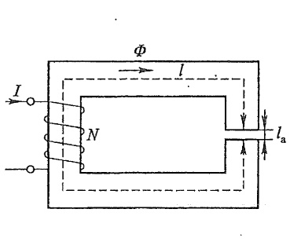

text_image

Φ
I
N
l
la

(a)

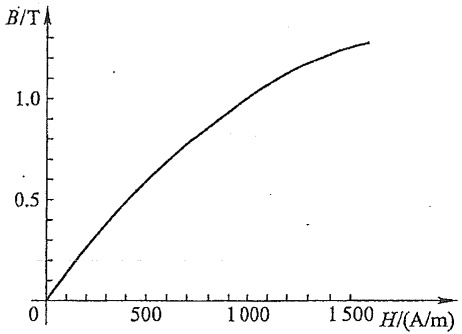

line

| H (A/m) | B (T) |
| --- | --- |
| 0 | 0 |
| ~250 | ~0.35 |
| ~500 | ~0.65 |
| ~750 | ~0.85 |
| ~1000 | ~1.05 |
| ~1250 | ~1.2 |
| ~1500 | ~1.3 |

(b)

图A-7 例A-2图

解 此磁路由两段构成,其平均长度和面积分别为(铸钢段)

---

§ A-4 恒定磁通磁路的计算

487

$$
l _ {1} \approx 5 0 \mathrm{cm} = 0. 5 \mathrm{m}
$$

$$
S _ {1} = 1 6 \mathrm{cm} ^ {2} = 1 6 \times 1 0 ^ {- 4} \mathrm{m} ^ {2}
$$

(空气隙段)为简化起见,忽略空气隙的边缘效应,设

$$
l _ {\mathrm{a}} = 0. 1 \mathrm{cm} = 1 0 ^ {- 3} \mathrm{m}, S _ {\mathrm{a}} \approx 1 6 \times 1 0 ^ {- 4} \mathrm{m} ^ {2}
$$

磁路中的磁通势为

$$
F _ {\mathrm{m}} = N I = 1 2 5 0 \times 8 0 0 \times 1 0 ^ {- 3} \mathrm{At} = 1 0 0 0 \mathrm{At}
$$

由于空气隙的磁阻较大,故可暂设整个磁路磁通势全部用于空气隙中,这样算出的磁通作为第1次试探值 $\Phi^{1}$ ,即

$$
\begin{array}{l} \Phi^ {1} = B _ {\mathrm{a}} ^ {1} S _ {\mathrm{a}} = \frac {N I \mu_ {0} S _ {\mathrm{a}}}{l _ {\mathrm{a}}} = \frac {1 0 0 0 \times 1 6 \times 1 0 ^ {- 4} \times 4 \pi \times 1 0 ^ {- 7}}{1 0 ^ {- 3}} \mathrm{Wb} \\ = 2 0. 1 1 \times 1 0 ^ {- 4} \mathrm{Wb} \\ \end{array}
$$

由于设  $S_{1}=S_{a}$ ，故算得磁感应强度为

$$
B _ {1} ^ {1} = B _ {\mathrm{a}} ^ {1} = \frac {\Phi^ {1}}{S _ {1}} = \frac {2 0 . 1 1 \times 1 0 ^ {- 4}}{1 6 \times 1 0 ^ {- 4}} \mathrm{T} = 1. 2 6 \mathrm{T}
$$

按图 A-7(b) 查得

$$
H ^ {1} = 1 4 1 0 \mathrm{A/m}
$$

空气隙中的磁场强度为

$$
H _ {a} ^ {1} = 0. 8 \times 1 0 ^ {6} B _ {a} ^ {1} = 1 0. 0 8 \times 1 0 ^ {5} \mathrm{A/m}
$$

磁通势为

$$
F _ {\mathrm{m}} ^ {1} = H _ {1} ^ {1} l _ {1} + H _ {\mathrm{a}} ^ {1} l _ {\mathrm{a}} = 1 7 1 3 \mathrm{At}
$$

由于  $F_{m}^{1} \neq F_{m}(= NI)$ ，所以要进行第2、3、…次试探，直至误差小于某一给定值为止。从第2次试探起，各次试探值与前1次试探值之间可按下式联系起来:

$$
\Phi^ {n + 1} = \Phi^ {n} \frac {F _ {\mathrm{m}}}{F _ {\mathrm{m}} ^ {n}}
$$

各次试探结果见表 A-1。

表 A-1

| $n$ | $\sigma^{\mathrm{a}} \times {10}^{-4}/\mathrm{{Wb}}$ | ${B}_{1} = {B}_{\mathrm{n}}/\mathrm{T}$ | ${H}_{1}/\left( {\mathrm{A}/\mathrm{m}}\right)$ | ${H}_{2}/\left( {\mathrm{A}/\mathrm{m}}\right)$ | ${F}_{\mathrm{a}}/\mathrm{{Ai}}$ | 误差/% |
| --- | --- | --- | --- | --- | --- | --- |
| 1 | 20.11 | 1.26 | 1 410 | ${10.10} \times {10}^{5}$ | 1 713 | +71.3 |
| 2 | 11.74 | 0.733 | 640 | ${5.87} \times {10}^{5}$ | 906 | -9.4 |
| 3 | 12.94 | 0.809 | 680 | ${6.47} \times {10}^{5}$ | 987 | -1.3 |
| 4 | 13.11 | 0.819 | 694 | ${6.55} \times {10}^{5}$ | 1 002 | +0.2 |

可见,第4次试探值可以作为最后的结果,即  $\Phi=\Phi^{4}=13.11\times10^{-4}$  Wb。求解这类问题的图解法与非线性电阻电路的图解法相似。以例 A-2 的无分支磁路为例说明,它可以看作是由两段磁路的磁阻串联组成,一是空气隙的磁阻  $R_{ma}$ ,它是线性的,另一是铁心(铸

---

488

附录 A 磁路和铁心线圈

钢)的磁阻 $R_{\mathrm{ml}}$ ，它是非线性的，可以用韦安特性即磁通 $\Phi$ 与磁位差 $U_{\mathrm{m1}}(= H_1l_1)$ 的关系曲线 $\Phi - U_{\mathrm{m1}}$ 表示，它可以根据该磁段的截面积和平均长度，按基本磁化曲线上的磁感应强度值和对应的磁场强度值逐点求出。而 $R_{\mathrm{ma}}$ 则可表示为 $R_{\mathrm{ma}} = \frac{l_{\mathrm{a}}}{\mu_0S_{\mathrm{a}}}$ 。这样就可以获得图A-8(a)所示计算磁路图，其中 $F_{\mathrm{m}} = NI$ 相当于电路中的电压源电压。于是可以用类似于非线性电阻电路中的“曲线相交法”得出图A-8(b)，从两条曲线的交点即可求得所需磁通。

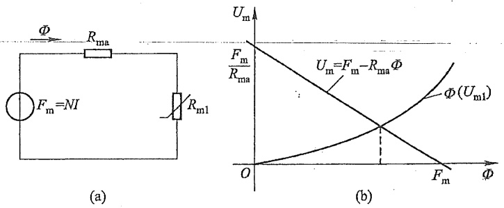

图 A-8 计算磁路图及图解法

如果给定的无分支磁路是由几段不同的磁段组成的,则其计算磁路图可以看作是由几个磁阻串联组成的,同样可以用图解法求解。

有分支的恒定磁通磁路的计算比较复杂。下面通过一个具体的示例介绍计算方法的思路。

图 A-9 是具有一个磁通势的分支磁路。按假设的各磁通参考方向和磁路定律式(A-5)、式(A-6)，有下列关系式:

$$
\begin{array}{l} \Phi_ {1} = \Phi_ {2} + \Phi_ {3} \\ H _ {2} l _ {2} + H _ {\mathrm{a}} l _ {\mathrm{a}} = H _ {3} l _ {3} \\ H _ {1} l _ {1} + H _ {3} l _ {3} = N I \\ \end{array}
$$

如果给定的为通过空气隙的磁通  $\Phi_{2}$ ，则可直接求出所需磁通势。主要步骤如下:

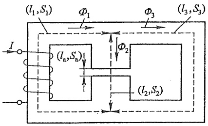

text_image

(l₁,S₁)
Φ₁
Φ₃
(l₃,S₃)
I
(lₐ,Sₐ)
Φ₂
(l₂,S₂)

图A-9 有分支磁路

(1) 从给定 $\Phi_{2}$ 可以求得 $B_{2} \left( = \frac{\Phi_{2}}{S_{2}}\right)$, 并从相应的基本磁化曲线查出 $H_{2}$, 这样就可以按下式求出 $H_{3}$.

$$
H _ {3} = \frac {H _ {2} l _ {2} + H _ {\mathrm{a}} l _ {\mathrm{a}}}{l _ {3}}
$$

(2) 由  $H_{3}$  和基本磁化曲线  $B_{3}-H_{3}$  查得  $B_{3}$ ，并可求得  $\Phi_{3}=B_{3}S_{3}$ 。
(3) 按  $\Phi_{1}=\Phi_{2}+\Phi_{3}$ ，求得  $\Phi_{1}$ 。

---

§ A-5 交变磁通磁路简介

489

（4）从 $\Phi_{1}$ 求得 $B_{1}\left(= \frac{\bar{\Phi}_{1}}{S_{1}}\right)$，查 $B_{1} - H_{1}$ 曲线得 $H_{1}$ 和求得 $H_{1}l_{1}$。
(5) 最后求得磁通势:  $NI = H_{1}l_{1} + H_{3}l_{3}$ 。

如果给定的是其他支路的磁通,则有一部分要采用试探法或图解法计算。如果是给定磁通势求各支路磁通,则必须用试探法或图解法求解。

## §A-5 交变磁通磁路简介

恒定磁通的磁路中没有功率损耗。如果磁通随时间变化,这时,铁磁物质的磁滞现象将会产生磁滞损耗,电磁感应现象将会在铁磁物质中产生涡流,引起涡流损耗。通常把磁滞损耗和涡流损耗的总和称为铁心损耗。

可以证明磁滞损耗功率与铁磁物质的磁滞回线的面积成正比。对于同一铁心，磁滞回线的形状与磁感应强度的最大值  $B_{m}$  有关。工程上采用下列经验公式计算磁滞损耗:

$$
P _ {\mathrm{h}} = \sigma_ {\mathrm{h}} f B _ {\mathrm{m}} ^ {n} V
$$

式中 $B_{\mathrm{m}}$ 为磁感应强度最大值；$n$ 由 $B_{\mathrm{m}}$ 值决定，当 $B_{\mathrm{m}} < 1 \mathrm{T}$ 时，取 $n = 1.6$ ，当 $B_{\mathrm{m}} > 1.6 \mathrm{T}$ 时，取为2；$f$ 为工作频率；$\sigma_{\mathrm{h}}$ 是与材料有关的系数，同时又取决于所用单位；$V$ 为铁心的体积。

铁心的涡流损耗功率的计算要用电磁场理论进行。涡流损耗功率与铁心的几何尺寸和材料有关。若铁心是由平行于磁感应强度的钢片叠成，涡流损耗与钢片厚度的平方成正比，还与交变磁通的频率、材料的电导率及磁感应强度最大值有关。所以为了减小涡流损耗，硅钢片越薄越好（电工钢片渗入硅，其电导率就减小）。受工艺条件的限制，硅钢片不可能做得很薄，工频下硅钢片的厚度约为0.35\~0.5 mm，音频下约为0.02\~0.05 mm，而高频下则采用磁介质，如铁淦氧。涡流损耗一般与工作频率f和磁感应强度的最大值 $B_{m}$ 有关。

铁磁物质的磁感应强度与磁场强度之间不呈线性关系,所以磁路中的磁通也就与励磁电流之间不呈线性关系。当磁通是正弦形时,励磁电流则为非正弦形;反之,当励磁电流是正弦形时,磁通为非正弦形。

设无分支磁路由铁磁物质构成,其平均长度为 l,截面积为 S[图 A-10(a)]。在交变电流作用下,铁磁物质的磁化状态将沿磁滞回线周而复始地改变。为了简化讨论起见,设磁化状态是沿着基本磁化曲线变化的。这样,磁通  $\Phi$  与电流 i 的关系就可以根据基本磁化曲线求得。按图 A-10(a),有  $\Phi=BS$ ,而励磁电流  $i=\frac{Hl}{N}$ ,所以只要把铁心的基本磁化曲线上 B 的坐标乘以 S,H 的坐标乘以  $\frac{l}{N}$ ,即可获得表示铁心特性的  $\Phi-i$  曲线,显然其形状与 B-H 曲线的形状是相似的。

---

490

附录 A 磁路和铁心线圈

图 A-10(b) 和 (c) 分别绘出了正弦磁通和正弦电流对应的电流和磁通的波形。当磁通作正弦变化时（至饱和区），电流曲线具有尖顶波形；而当电流作正弦变化且工作到饱和区域，则磁通具有平顶波形。如对非正弦形的电流和磁通波形进行谐波分析，则可以看出它们都是奇谐波函数，主要含有 3 次谐波，而且随铁心饱和程度的提高，3 次谐波分量就越显著。如果正弦电流和正弦磁通的最大值不太大，使铁心的工作状态在饱和点以下的近似直线段，则对应磁通和电流波形将比较接近于正弦形。以上讨论未计及磁滞回线的影响。如果考虑到这一因素，则在正弦磁通下的电流波形将与图 A-10(b) 所示不同。铁心中的涡流损耗也会影响电流的波形。

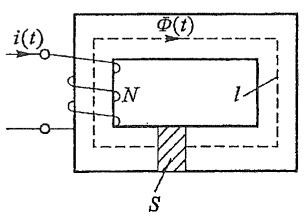

text_image

i(t)
Φ(t)
N
l
S

(a)

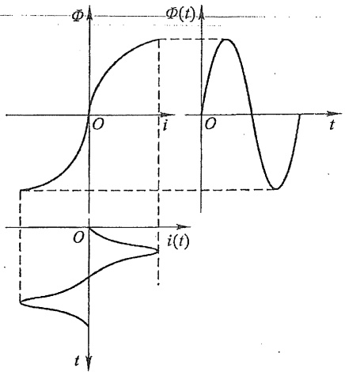

line

| Time (t) | \(\Phi(t)\) | i(t) |
| --- | --- | --- |
| 0 | 0 | 0 |
| O | 0 | 0 |
| i | — | — |
| O | 0 | — |
| i | — | — |

(b)

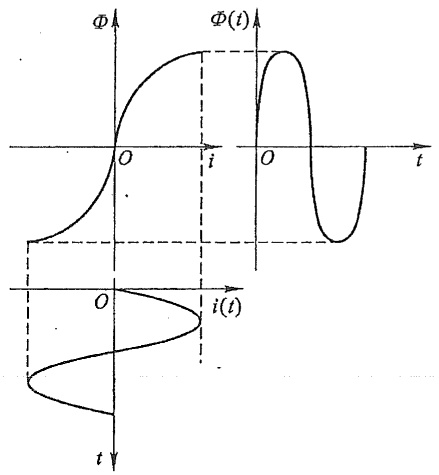

text_image

Φ
Φ(t)
O
i
O
t
O
i(t)
t

(c)

图 A-10 交变磁通电流和磁通的波形

交变磁通磁路的计算比较复杂,因为需要计及磁饱和、磁滞和涡流等影响。

---

§ A-6 铁心线圈

491

## §A-6 铁心线圈

1. 工程图

如图 A-11(a) 所示的铁心线圈中通以交变电流时, 其中便有交变磁通。 $\Phi$  是其主磁通,  $\Phi_{\sigma}$  是其漏磁通。

下面分析铁心线圈的电压和电流关系。主磁通和漏磁通分别在线圈中产生感应电压 u 和  $u_{\sigma}$ ，再加上线圈的电阻上的电压  $u_{R}$ ，线圈端电压  $u_{1}=u+u_{\sigma}+u_{R}$ 。通常  $u_{\sigma}$  和  $u_{R}$  都比 u 小很多，因而有  $u_{1}\approx u$ ，这样，当线圈两端的电压  $u_{1}$  是正弦形时，主磁通  $\Phi$  同样是正弦形（这是因为  $u=\frac{d\Phi}{dt}$ ），但是电流则是非正弦波。为了简化计算且利于应用相量法，常采用等效正弦电流替代实际的非正弦电流，其条件是两者的有效值相等，并保持有功功率不变。当然，这只有在高次谐波不显著时才相对准确。

如果暂不考虑线圈的电阻和漏磁通，图A-11(b)给出了主磁通、电压和电流的相量图。图中电流相量 $\dot{I}$ 具有两个分量，一个分量 $\dot{I}_{\mathrm{a}}$ 与电压相量 $\dot{U}$ 同相，它是用来计及铁心损耗的，它是电流 $\dot{I}$ 的有功分量；另一个分量 $\dot{I}_{\mathrm{r}}$ 与磁通相量 $\dot{\Phi}$ 同相，它滞后电压 $\dot{U}$ 的相位为 $\frac{\pi}{2}$，称为铁心线圈的磁化电流，是 $\dot{I}$ 的无功分量。通常 $I_{\mathrm{r}} > I_{\mathrm{a}}$ 。可以用图A-11(c)所示电路模型描述这部分的电压、磁通和电流的关系，它由两条并联支路组成，一条支路为电导 $G_0$ ，通过的电流为 $\dot{I}_{\mathrm{a}}$ ，另一条支路为电感，通过电流为 $\dot{I}_{\mathrm{r}}$ ，其中 $G_0 = \frac{I_{\mathrm{a}}}{U}$，而感纳 $|B_0| = \frac{I_{\mathrm{r}}}{U}$ 。

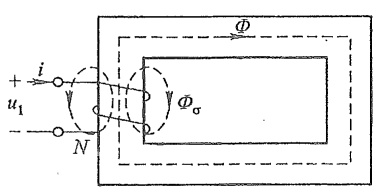

text_image

+
i
u₁
-
N
Φ
Φσ

(a)

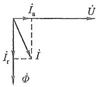

text_image

İₐ
Ü
İᵣ
İ
Φ

(b)

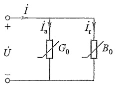

text_image

I
+   Iₐ   Iᵣ
U   G₀   B₀
-   -

(c)

图 A-11 铁心线圈的部分电压电流关系

设  $\Phi=\Phi_{m}\sin(\omega t)$ ，则

$$
u = N \frac {\mathrm{d} \Phi}{\mathrm{d} t} = N \omega \Phi_ {\mathrm{m}} \cos (\omega t) = 2 \pi f N \Phi_ {\mathrm{m}} \cos (\omega t)
$$

式中 N 为线圈的匝数,感应电压的有效值

$$
U = \frac {N \omega \varPhi_ {\mathrm{m}}}{\sqrt {2}} = 4. 4 4 f N B _ {\mathrm{m}} S
$$

式中  $B_{m}$  为磁感应强度最大值。设 P 和 Q 分别表示铁心的有功功率和无功功率，则有

---

492

附录 A 磁路和铁心线圈

$P=I_{a}U,Q=I_{r}U$ 。这样

$$
\begin{array}{l} G _ {0} = \frac {P}{U ^ {2}} = \frac {P}{(4 . 4 4 f N B _ {\mathrm{m}} S) ^ {2}} \\ \left| B _ {0} \right| = \frac {Q}{(4 . 4 4 f N B _ {\mathrm{m}} S) ^ {2}} \\ \end{array}
$$

P 和 Q 与  $B_{m}$  的关系是比较复杂的, 要严格计算必须按照交变磁通磁路的观点进行。一般说来,  $G_{0}$  和  $B_{0}$  都不是常数而随  $B_{m}$  或 U 而变, 因此在图中用非线性元件表示。

现在，计及线圈的电阻和漏磁通的作用。线圈电阻 $R$ 上的电压 $\dot{U}_R = R\dot{I}$，与电流同相。漏磁通链产生的感应电压 $\dot{U}_{\sigma} = \mathrm{j}\omega \dot{\Psi}_{\sigma} = \mathrm{j}\omega L_{\sigma}\dot{I}$，它超前电流 $\dot{I}$ 的相位为 $\frac{\pi}{2}$，式中 $\Psi_{\sigma}$ 表示漏磁通链的有效值，$L_{\sigma} = \Psi_{\sigma} / I$ 是漏电感。因为漏磁通主要经过空气闭合，漏磁通磁路的磁阻主要取决于空气段的磁阻，所以，可以认为漏磁通链与电流之间有线性关系，而 $L_{\sigma}$ 也就可以视为常数。于是，有

$$
\dot {U} _ {1} = \dot {U} _ {R} + \dot {U} _ {\sigma} + \dot {U} = R \dot {I} + \mathrm{j} \omega L _ {\sigma} \dot {I} + \dot {U}
$$

按照上式,并参照图 A-11(b)(c),铁心线圈的相量图和电路模型将如图 A-12(a)(b) 所示,图中  $U_{R}$  和  $U_{\sigma}$  一般仅为 U 的长度的百分之几,而图中画的是有意放大的。可见铁心线圈电路是一个含非线性电感的电路。

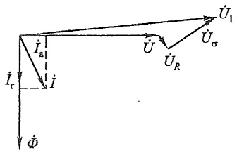

text_image

İ₁
İₐ₁
İ
İᵣ
Φ
Ü
Üᵣ
Ü₁
Üᵣσ

(a)

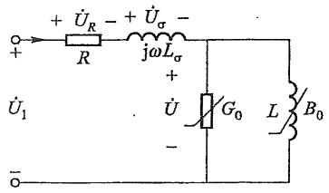

text_image

+ Û_R - + Û_σ -
R jωL_σ +
Û₁ Û G₀ L B₀
-

(b)

图 A-12 铁心线圈的电路模型及相量图

如果铁心线圈所用铁心带有较大的空气隙,或者铁心是不闭合的(如磁棒),则在这种情况下常把电感作为线性元件来处理,当然电感值比无铁心时仍要增大很多。

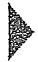

## 习题

A-1 题 A-1 图所示磁路中的磁通为  $3.2 \times 10^{-4}$  Wb，设填充因数 k=1，铸钢和电工钢片的基本磁化曲线用下列表格表示。求磁通势（磁路尺寸:mm）。

铸钢

| $H/\left( {\mathrm{A}/\mathrm{m}}\right)$ | 200 | 300 | 400 | 500 | 600 | 700 | 800 | 900 | 1 000 | 1 100 |
| --- | --- | --- | --- | --- | --- | --- | --- | --- | --- | --- |
| $B/\mathrm{T}$ | 0.27 | 0.39 | 0.50 | 0.61 | 0.72 | 0.82 | 0.90 | 0.98 | 1.05 | 1.11 |

---

习题

493

电工钢片

| $H/(A/m)$ | 40 | 60 | 80 | 100 | 120 | 140 | 160 | 180 | 200 |
| --- | --- | --- | --- | --- | --- | --- | --- | --- | --- |
| $B/T$ | 0.12 | 0.30 | 0.45 | 0.57 | 0.65 | 0.70 | 0.76 | 0.80 | 0.85 |

A-2 已知题 A-2 图所示磁路中尺寸单位为 mm，构成磁路的电工钢片的基本磁化曲线如图 A-6(b) 所示，设 k=0.91，计算时要考虑空气隙的扩散作用。设磁通势为 860 At。求空气隙中的磁通。

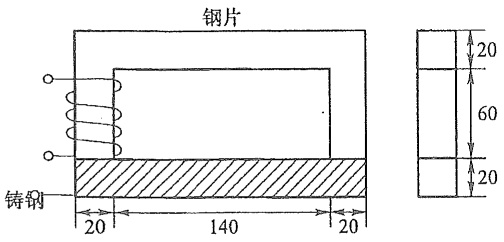

题A-1图

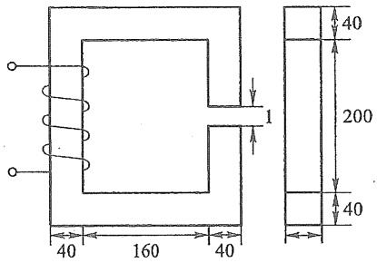

text_image

40
160
40
1
40
200
40

题 A-2 图

A-3 已知磁路如题 A-3 图所示, 其铁心材料的基本磁化曲线同题 A-2, 磁路中的磁通  $\Phi=3.6\times10^{-3}$  Wb, k=1, 计算时要计及空气隙的扩散作用。图中所示尺寸单位为 mm。求磁通势。
A-4 题 A-4 图所示为有分支磁路，由同一电工钢片叠成。各段磁路的平均长度和截面面积均示于图中， $l_{a} \ll l_{2}$ 。现在要求出在空气隙中产生磁通  $\Phi_{a}$  所需磁通势，试给出解题的步骤。

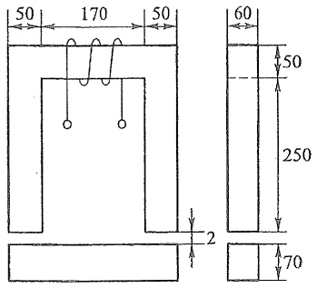

text_image

50
170
50
60
50
250
2
70

题 A-3 图

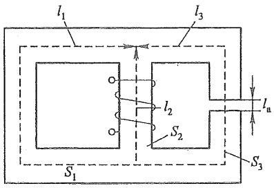

text_image

l₁
l₃
l₂
S₂
Iₐ
S₃
S₁

题A-4图
