# 附录C PSpice简介

原始 PDF 第 523–533 页。

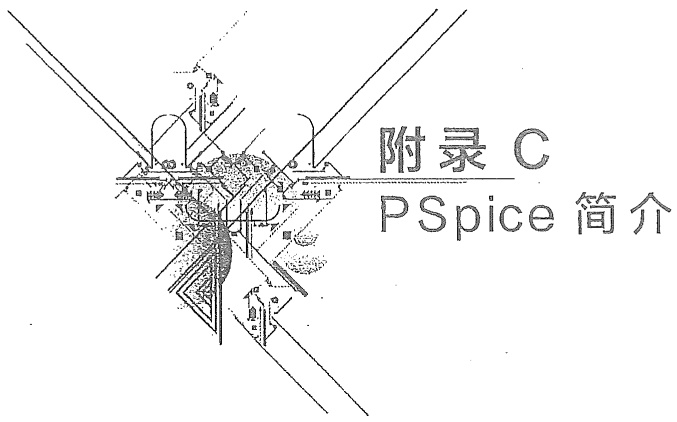

<details>
<summary>text_image</summary>

附录 C
PSpice 简介
</details>

本附录简要介绍电路计算机辅助分析的有关概念和常用的一种电路模拟程序, 即 PSpice 的初步知识。

## §C-1 电路的计算机辅助分析

电路的计算机辅助分析是利用计算机作为辅助手段对电路进行分析。电路分析包括许多内容，其中主要有电阻电路分析（或直流电路分析）、正弦电流电路分析、线性动态电路分析、非线性电路分析等。用计算机进行电路分析，一般需要针对要求解决问题的类型编制程序，让计算机执行。当进行电路分析时，首先需要把电路拓扑结构的信息、电路元件的类型及元件值作为数据送进计算机。然后，使计算机根据输入数据自动形成电路方程并进行求解。

下面主要介绍建立电路方程的一些有关问题,其目的是为了说明编制程序的一些思路。

现结合图 C-1(a) 所示电路说明如何应用计算机形成节点列表法方程。图 C-1(b) 所示为该电路的图，它共有 4 个节点和 8 条支路。特别需要注意的是:每条支路仅含一个元件。独立电压源和独立电流源为同频率正弦量，因此用向量法进行分析。为了简化起见，没有考虑受控源、耦合电感、理想变压器等。节点和支路的编号如图 C-1(b) 所

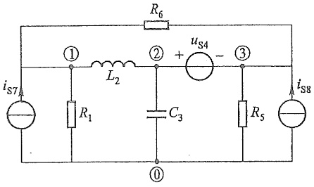

<details>
<summary>text_image</summary>

iS7
①
R1
L2
② + uS4 -
③
C3
R5
iS8
</details>

(a)

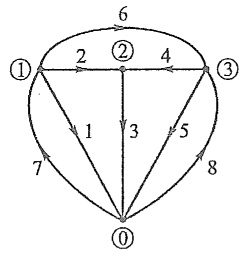

<details>
<summary>flowchart</summary>

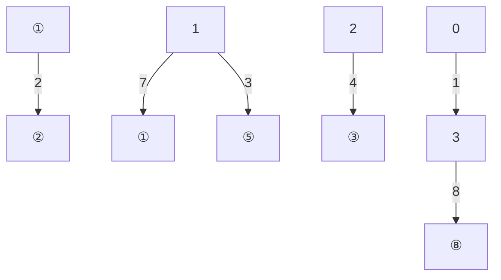
</details>

(b)

图 C-1 建立节点列表法的电路


---

500

附录 C PSpice 简介

示,其中每条支路有一个始节点和一个终节点,支路的参考方向自始节点指向终节点,因此依据始节点和终节点的编号顺序就明确了支路的方向。

这里设计一个5变量数组 $(k,i,j,g,h)$ ，其中k表示支路编号；i表示第k支路的始节点；j表示第k支路的终节点；g是一个数，用来表示元件的类型，例如可用“1”表示电阻，用“2”表示电容，用“3”表示电感，用“4”表示独立电压源，用“5”表示独立电流源；h表示元件的参数值。这个数组共5列和8行，即

| 支路号 | 始节点号 | 终节点号 | 元件类型 | 元件值 |
| --- | --- | --- | --- | --- |
| 1 | 1 | 0 | 1 | $R_{1}$ |
| 2 | 1 | 2 | 3 | $L_{2}$ |
| 3 | 2 | 0 | 2 | $C_{3}$ |
| 4 | 3 | 2 | 4 | $-U_{s4}$ |
| 5 | 3 | 0 | 1 | $R_{5}$ |
| 6 | 1 | 3 | 1 | $R_{6}$ |
| 7 | 0 | 1 | 5 | $I_{s7}$ |
| 8 | 0 | 3 | 5 | $I_{s8}$ |

节点列表法的方程如下:

$$
A \dot {I} = 0
$$

$$
- A ^ {\mathrm{T}} \dot {U} _ {\mathrm{n}} + \dot {U} = 0
$$

$$
F \dot {U} + H \dot {I} = \dot {U} _ {\mathrm{s}} + \dot {I} _ {\mathrm{s}}
$$

其中  $\dot{U}_{n}$  为节点电压列向量,  $\dot{U}$  和  $\dot{I}$  分别为支路电压列向量和支路电流列向量, 它们是方程中的未知量。

上列第一式可以按如下的步骤形成。按数组第2、3列，即从始节点编号到终节点编号，令 $i, j$ 自1到3依次寻找连接于相同编号节点的支路，凡支路与同号始节点连接的，这些支路电流分别乘以“+1”，凡支路与同号终节点连接的，这些支路电流则分别乘以“-1”；这样可得

$$
\dot {I} _ {1} + \dot {I} _ {2} + \dot {I} _ {6} - \dot {I} _ {7} = 0
$$

$$
- \dot {I} _ {2} + \dot {I} _ {3} - \dot {I} _ {4} = 0
$$

$$
\dot {I} _ {4} + \dot {I} _ {5} - \dot {I} _ {6} - \dot {I} _ {8} = 0
$$

第二式可以按如下的步骤直接形成。令数组第1列的k自1到8，依次检查第2、3列的i和j。当i>0，该节点电压 $\dot{U}_{ni}$ 乘以“-1”，当i=0，该节点电压 $\dot{U}_{ni}$ 乘以“0”；当j>0，该节点电压 $\dot{U}_{nj}$ 乘以“+1”，当j=0，则该节点电压 $\dot{U}_{nj}$ 乘以“0”；支路电压 $\dot{U}_{k}$ 则依次分别乘以“+1”。这样可得

$$
- \dot {U} _ {\mathrm{n1}} + \dot {U} _ {1} = 0
$$

---

§ C-1 电路的计算机辅助分析

501

$$
- \dot {U} _ {\mathrm{n1}} + \dot {U} _ {\mathrm{n2}} + \dot {U} _ {2} = 0
$$

$$
- \dot {U} _ {\mathrm{n2}} + \dot {U} _ {3} = 0
$$

$$
\begin{array}{l} \dots \\ \dot {U} _ {\mathrm{n3}} + \dot {U} _ {8} = 0 \end{array}
$$

第三式形成的步骤如下。按数组第1列，令 $k$ 从1到8，依次检查第4列和第5列。当第 $k$ 支路为电容 $C_k$ 时，该支路电压 $\dot{U}_k$ 乘以 $\mathrm{j}\omega C_k$ ，支路电流 $\dot{I}_k$ 乘以“-1”；当第 $k$ 支路为电阻 $R_{k}$ 或电感 $L_{k}$ 时，该支路电压 $\dot{U}_k$ 乘以“-1”，支路电流 $\dot{I}_k$ 乘以 $R_{k}$ 或 $\mathrm{j}\omega L_k$ 。当第 $k$ 支路为独立电压源时，该支路电压 $\dot{U}_k$ 乘以“+1”，右方 $\dot{U}_{sk}$ 赋予元件值；当第 $k$ 支路为独立电流源时，该支路电流 $\dot{I}_k$ 乘以“+1”，右方 $\dot{I}_{sk}$ 赋予元件值。这样可得

$$
- \dot {U} _ {1} + R _ {1} \dot {I} _ {1} = 0
$$

$$
- \dot {U} _ {2} + \mathrm{j} \omega L _ {2} \dot {I} _ {2} = 0
$$

$$
\mathrm{j} \omega \dot {C} _ {3} \dot {U} _ {3} - \dot {I} _ {3} = 0
$$

$$
\dot {U} _ {4} = - \dot {U} _ {\mathrm{s4}}
$$

$$
- \dot {U} _ {s} + R _ {s} \dot {I} _ {s} = 0
$$

$$
- \dot {U} _ {6} + R _ {6} \dot {I} _ {6} = 0
$$

$$
\dot {I} _ {7} = \dot {I} _ {\mathrm{s} 7}
$$

$$
\dot {I} _ {8} = \dot {I} _ {s 8}
$$

以上通过一个简单的实例说明了如何根据输入的数据直接形成节点列表法方程的思路。如果电路中有受控源、耦合电感、理想变压器等，只要相应地改变输入数据的结构，仍然可以直接建立节点列表法所需方程。显然，如果要建立其他形式的电路方程，形成的方法将随之改变。

动态电路方程的形成以及电路方程的数值求解法超出本书范围。在计算机辅助分析中，线性代数方程的求解一般采用的有高斯消去法、LU分解法、高斯-塞德尔迭代法、稀疏矩阵法等。对于动态电路的分析，则要求解微分方程，常用的计算方法有梯形法、龙格-库塔法、基尔法等，可参阅有关书籍。

目前国内外有很多电路的计算机辅助分析程序,为了便于使用者应用,这类程序往往只要求使用者将被分析电路的有关信息以及进行哪种分析和所需要的输出,按规定编写成一个输入文件,输入计算机中,让计算机执行。至于该程序是根据什么原理(包括使用的电路方程的形式、数值求解法等)编制的,其细节如何,使用者无须了解。

使用计算机对电路进行分析和计算具有许多优点,计算机能处理大规模电路,如具有成千节点的集成电路、大型电力系统电路等。并且计算速度迅速,结果精确可靠。依靠计算机辅助分析还可以验证电路设计的正确性,所以计算机辅助分析是计算机辅助设计的重要组成部分。

1. 工程图

---

502

附录 C PSpice 简介

## §C-2 PSpice

PSpice 是国际上广泛应用的通用电路模拟程序。主要是面向电子电路和集成电路的分析软件, 是 Spice (Simulation Program with Integrated Circuit Emphasis) 的一种 (PC) 微机版本, 而且版本不断地在完善、修改和更新。PSpice 电路数据的输入既可以为文本方式, 也可以为图形方式。供教学使用的 PSpice 通常只能分析规模较小的电路。

目前在 Windows 方式下的 PSpice 通常包括以下几个基本程序模块:电路原理图编辑程序 Capture, 激励源编辑程序 Stimulus Editor, 电路仿真程序 PSpice A/D, 曲线输出程序 Probe, 模型参数编辑程序 Model Editor, 元器件模型参数库 LIB。

PSpice 能够处理的电子元器件非常广泛,可直接输入的电路元器件有:线性电路元件(包括电阻、电容、电感、耦合电感、独立电源,线性受控源、传输线等);非线性受控源;电子元器件(包括二极管、双极型晶体管、结型场效应管和 MOS 场效应管、运算放大器等);功率电子器件(包括晶闸管、电力晶体管、功率 MOS 管、IGBT 等);用于电子测量、控制等常见的集成芯片等。

PSpice 的分析功能十分强大,它可以进行直流分析(电阻电路分析)、交流分析(正弦稳态分析)、瞬态分析(动态电路的时域分析)、傅里叶分析以及其他分析。

在 PSpice 中,电路结构和参数的输入有两种方式。一种是在 (File/New/Textfile) 的文本环境中,用电路描述语言编辑并保存符合语法规则的文本电路数据文件,用 (Simulation/Run) 命令直接执行 OrCAD/PSpiceA/D 程序进行仿真。另一种是调用 OrCAD/Captur 程序在图形方式下建立并编辑电路原理图,根据电路数据修改元器件的参数或型号。然后在主菜单 (PSpice) 中选取 (New Simulation Profile) 菜单设置或编辑分析类型,再进行仿真计算。无论采用何种输入方式,所有版本的 PSpice 最终都要通过电路文本格式文件确定元件间的连接关系,然后根据分析类型进行分析计算。

PSpice 的文本输入任务是构造一个文本格式的输入文件。在计算机中,有关电路信息可以通过元器件名称、连接节点、元件值等组成的语句来确定,文件名的后缀为“.cir”。在编写文本输入文件前,先要给电路节点编号,一般采用正整数,参考节点的编号必须为数字“0”,其他节点的编号可任意选取,序号可不连续。PSpice 要求文本输入文件中每一条语句必须独占一行。文件中星号“\*”或“;”后的内容,只起解释作用,不参与分析计算。首行为标题,“.END”语句表示结束,其中圆点“.”不能省略,文本中其余语句顺序任意。文本格式为:标题描述、元件描述、电路分析功能描述、输出结果和要求描述、说明语句和结束描述。

标题描述可以是任何类型的注释,对电路的分析和计算不起任何影响。元件描述用下列关键字母,电阻用 R、电感用 L、电容用 C、互感用 K、二极管用 D、VCVS 用 E、

---

§ C-2 PSpice

503

CCCS 用 F、VCCS 用 G、CCVS 用 H、独立电压源用 V、独立电流源用 I、压控开关用 S。

执行和输出功能描述用下列关键词:交流分析用.AC,直流分用.DC,瞬态分析用.TRAN,打印输出数据用.PRINT,打印输出曲线用.PLOT;另一种曲线输出语句为.PROBE,在执行.PROBE语句后,PSPICE将在屏幕上显示一个菜单界面,用户可根据需要随时使用菜单添加输出变量,随后在屏幕上就可显示根据输出数据处理后所描绘的图形曲线。

使用的数字可以用整数、浮点数和指数（如 $1.45\mathrm{E} - 12,1.25\mathrm{E} + 4$）。比例因子规定有10种，以下只列出8种:

$$
\mathrm{M} = 1 \mathrm{E} - 3, \mathrm{U} = 1 \mathrm{E} - 6, \mathrm{N} = 1 \mathrm{E} - 9, \mathrm{P} = 1 \mathrm{E} - 1 2, \mathrm{K} = 1 \mathrm{E} + 3, \mathrm{MEG} = 1 \mathrm{E} + 6, \mathrm{G} = 1 \mathrm{E} + 9, \mathrm{T} = 1 \mathrm{E} + 1 2 。
$$

此外，在数值后也可紧跟一些字母，如用 V、A、OHM 等表示电压、电流、电阻的单位。还需要注意的是:文件中不区分字母的大小写，当一行中数据没有写完时，续行的第一列必须用“+”号来表示；数据之间的分隔符，采用空格或逗号；电路中同类型的元件，元件名不能相同。为了确保电路在工作点处有唯一解，PSpice 要求电路中既不能含有电压源和电容构成的回路，也不能含有电流源和电感构成的割集。下面通过 3 个实例简要介绍文本输入，然后再通过例题简要介绍图形输入。

## 1. 文本输入

（1）直流分析:PSpice 的直流分析功能可以分析电路的静态工作点(.OP)、直流小信号传递特性(.TF)、直流扫描特性(.DC)、直流灵敏度(.SENS)。在直流分析中，电感直接按短路处理，电容直接按开路处理，PSpice 的基本输出量通常为节点电压、支路电压和支路电流。

例 C-1 图 C-2 所示的线性电路中, 已知  $R_{1}=R_{2}=R_{3}=10\ \Omega, U_{s}=1\ V, I_{s}=0.2\ A$ , VCCS 中的控制系数 g=0.2 S, 试按给定节点求出节点电压  $u_{n1}, u_{n2}, u_{n3}$ 。

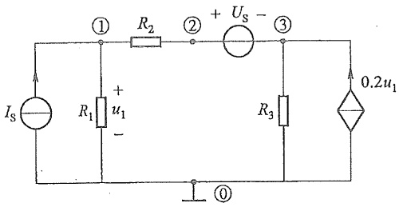

<details>
<summary>text_image</summary>

Is
R1 + u1 -
① R2
② + Us - ③
R3
0.2u1
①
</details>

图 C-2 例 C-1 电路

解 输入文件:

EX1

VS 2 3 DC 1

IS 0 1 DC 0.2

G 0 3 1 0 0.2

---

504

附录 C PSpice 简介

```txt
R1 1 0 10
R2 1 2 10
R3 3 0 10
. OP
. END
```

输入描述语言说明如下:

第 1 句是标题说明(可以由任意字符构成)。

第 2 句是独立电压源的说明, 指出电源的名称, “2”“3”表示其正极和负极连接的节点编号, “DC”表示直流, “1”表示电压的幅值为 1 V(对于正弦量, 其大小均用幅值, 而不用有效值)。

第3句是独立电流源的说明,指出电源的名称,“0”“1”表示电流从“0”节点流向“1”节点,“DC”表示直流,“0.2”表示电流的幅值为0.2A。

第 4 句是 VCCS 的说明, 受控电流源从一个节点流向另一个节点的 2 个节点的编号, 控制电压的正极和负极连接的 2 个节点的编号, 控制系数 g 值。

第 5\~7 句是电阻的说明,给出了电阻的名称,连接的始节点和终节点的编号和电阻值(单位为  $\Omega$ )。

第 8 句是直流工作点分析语句说明,该语句没有参数项,它能给出各节点电压、电压源电流及电路总的直流功率。

第 9 句是结束语句说明。

注意: 当需要计算某支路电流时, 通常采取在该支路中串接一个电压为零的电压源来实现。

为了对电路进行分析,确保电路方程不致奇异,PSpice规定,每一个节点必须要有一条到地的直流通路。如果电路不满足该要求,必须在该节点与地之间连接一个对电路没有影响的大电阻。

最后计算时, 调用 PSpice, 输入该数据, 在后缀为“.out”的文件中可得以下输出结果:

```txt
NODE     VOLTAGE   NODE    VOLTAGE   NODE    VOLTAGE
(1)      5.000 V      (2)      8.000 V      (3)      7.000 V
```

（2）瞬态分析:在电路进行瞬态分析时，需要给定输入信号和初始值。为了能够获得可靠的数值分析结果，时间步长的选取是很重要的，最大计算步长则限定 PSpice 的内部计算步长不得超过此值。瞬态分析可以计算动态电路的节点电压、支路电压和支路电流瞬时值，能够获得瞬时值随时间的变化曲线。

例 C-2 电路如图 C-3 所示, 已知 $R_{1} = 0.45 \mathrm{k} \Omega, R_{2} = 1 \mathrm{k} \Omega, R_{1} = 1 \mathrm{M} \Omega, R_{0} = 100 \Omega, R_{3} = 500 \Omega, R_{4} = 1 \mathrm{k} \Omega, C_{1} = C_{2} = 4 \mu \mathrm{F}, \mathrm{VCVS}$ 的增益 $A = 5 \times 10^{5}$ 。输入正弦电压 $u_{\mathrm{i}}$ 的幅值为 $2 \mathrm{~V}$, 频率可变。要求在频率 $1 \mathrm{~Hz} \sim 10 \mathrm{kHz}$ 范围内, 按每个数量级取 20 个频率点, 绘制输出电压 $u_{4}$ 的幅频特性。

---

§ C-2 PSpice

505

1. 工程图

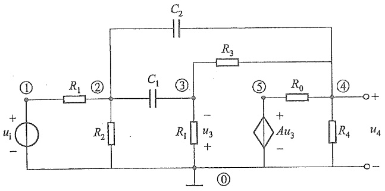

<details>
<summary>text_image</summary>

C2
① R1 ② C1 ③ R3
+ ui -
R2 - u3 +
⑤ R0 ④ +
Au3 +
- R4 u4
-
</details>

图 C-3 例 C-2 电路图

解 输入文件:

EX2

VIN 10 AC 2V

R1 1 2 0.45K

R2 2 0 1K

RI 3 0 1MEG

R0 5 4 100

R3 3 4 500

R4 4 0.1K

C1 2 3 4U

C2 2 4 4U

E1 5 0 0 3 500K

. AC DEC 20 1 10K

.PLOT AC VM(4)

.PROBE

.END

输入描述语言说明如下:

第 1 句是标题说明。

第 2 句是独立电压源的说明，“AC”表示交流，“2”表示电压的幅值为 2 V（正弦量的大小都用幅值，不用有效值）。

第 3\~8 句是电阻的说明。

第 9\~10 句是电容的说明,给出了电容的名称,连接的始节点和终节点的编号,电容值(单位为 F)。

第 11 句是 VCVS 的说明, 受控电压源的正极和负极连接的 2 个节点编号, 控制电压的正极和负极连接的 2 个节点编号, 控制系数 A 值。

第 12 句是 AC 频率范围的说明，“DEC”表示按数量级变化，“20”表示在每一数量

---

506

附录C PSpice简介

级内取 20 个点, 最后 2 个数字表示起始频率和终止频率。

第 13 句是曲线打印语句，“AC”表示分析类型，“VM”表示输出为电压幅值，括号内的“4”表示该电压是节点 4 的节点电压（输出电压）。

第 14 句是探针显示语句。“.PROBÉ”是 PSpice 的一个图形后处理程序, 可用来观察图形、曲线的局部细节。

图 C-4 给出了打印出的输出电压的幅频特性曲线。

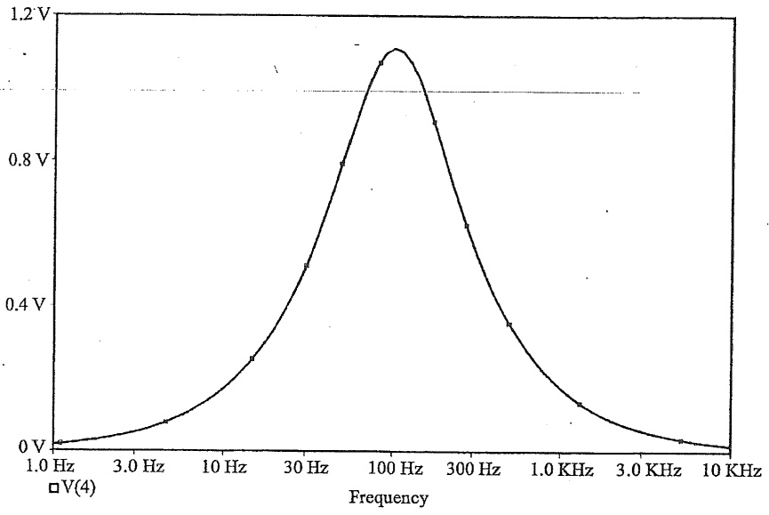

<details>
<summary>line</summary>

| Frequency | V(4) (V) |
| --- | --- |
| 1.0 Hz | ~0.02 |
| 3.0 Hz | ~0.08 |
| 10 Hz | ~0.25 |
| 30 Hz | ~0.55 |
| 100 Hz | ~1.1 |
| 300 Hz | ~0.65 |
| 1.0 KHz | ~0.35 |
| 3.0 KHz | ~0.15 |
| 10 KHz | ~0.02 |
</details>

图 C-4 输出电压的幅频特性曲线

例 C-3 电路如图 C-5 所示, 已知 $R_{1} = R_{2} = 20 \Omega, R_{3} = 4 \mathrm{k} \Omega, L = 0.2 \mathrm{H}, C = 0.5 \mu \mathrm{F}, u_{\mathrm{s}}(t) = 10 \varepsilon(t) \mathrm{V}$, 其中 $\varepsilon(t)$ 为单位阶跃函数, $u_{c}(0) = 2 \mathrm{~V}, i_{L}(0) = 0.2 \mathrm{~A}$, 求 $u_{c}(t)$, 并绘制 $u_{c}(t)$ 波形, 设时间区间为 $0 \sim 30 \mathrm{~ms}$, 打印时间间隔为 $0.1 \mathrm{~ms}$。

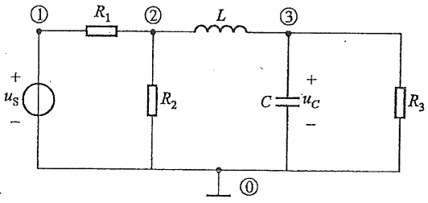

<details>
<summary>text_image</summary>

① R₁ ② L ③
+ uₛ - R₂ C u꜀ - R₃
①
</details>

图 C-5 例 C-3 电路图

解 输入文件:

EX3

VS 1 0 10

---

§ C-2 PSpice

507

R1 1 2 20

R2 2 0 20

R3 3 0 4K

L 2 3 0.2 IC = 0.2

C 300.5U IC=2

. TRAN 0.1M 30M UIC

.PLOT TRAN V(3,0)

.PROBE

.END

输入描述语言说明如下:

第 1 句是标题说明。

第 2 句是独立电压源的说明,指出电源的名称,它的正极和负极连接的节点编号和电压值。

第 3\~4 句是电阻的说明,指出电阻的名称,连接的始节点和终节点编号和电阻值。

第 5 句是电感的说明,指出电感的名称,连接的始节点和终节点编号和电感值。注意电感电流的初始值用“IC”表示。

第 6 句是电容的说明, 指出电容的名称, 连接的始节点和终节点编号和电容值。注意电容电压的初始值也用“IC”表示。

第 7 句“.TRAN”定义瞬态分析,打印的时间间隔(0.1 M 表示 0.1 ms),打印的终止时间(30 M 表示 30 ms),而“UIC”表示使用者自己规定初始条件来进行瞬态分析,同时也规定了节点电压的初始值。所以第 2 句本来是直流电压源的说明,不过此句用了“UIC”,它表示此电压为阶跃电压。

第 8 句是曲线打印语句，“TRAN”表示分析类型，“V(3,0)”表示节点“3”和“0”之间的电压，即题中要求的电容电压。

第 9 句是探针显示语句。

第 10 句是结束语句。

图 C-6 给出了打印出的电容电压  $u_{c}(t)$  的变化曲线。

## 2. 图形输入

为了简要说明图形输入的要点,按图形输入的命令次序来说明完成一个电路题目分析的操作过程。

（1）在 WIN98 或 WIN2000 下单击“程序”，选中“orCAD Demo”，进入“Capture CIS Demo”窗口，选择执行 Fil/New/Project 命令，新建电路分析题目（在 Name 框中，键入带后缀.cir 的题目名）。选中“Analog or Mixed Signal Circuit”单选框，并按“OK”按钮，即表示对设计的电路可进行 PSpice 的数模混合仿真。随后，在元器件库中对元器件库进行再配置，按“Add”按钮，将元器件库增添进选用框中，再按“完成”按钮，即可进入图形编辑状态。

---

508

附录 C PSpice 简介

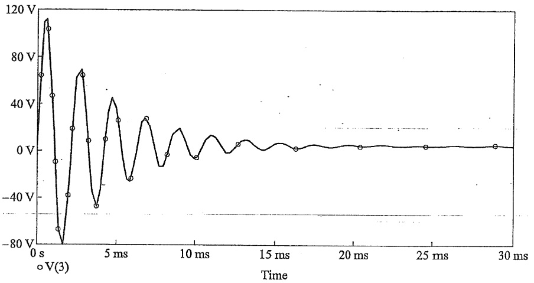

<details>
<summary>line</summary>

| Time (ms) | Voltage (V) |
| --- | --- |
| 0 | 0 |
| ~0.5 | ~65 |
| ~1 | ~110 |
| ~1.5 | ~45 |
| ~2 | ~-70 |
| ~2.5 | ~-38 |
| ~3 | ~20 |
| ~3.5 | ~65 |
| ~4 | ~8 |
| ~4.5 | ~-50 |
| ~5 | ~10 |
| ~5.5 | ~45 |
| ~6 | ~25 |
| ~6.5 | ~-25 |
| ~7 | ~28 |
| ~7.5 | ~-10 |
| ~8 | ~18 |
| ~8.5 | ~-5 |
| ~9 | ~12 |
| ~9.5 | ~-8 |
| ~10 | ~10 |
| ~10.5 | ~-5 |
| ~11 | ~8 |
| ~11.5 | ~-2 |
| ~12 | ~6 |
| ~12.5 | ~-1 |
| ~13 | ~4 |
| ~13.5 | ~-1 |
| ~14 | ~3 |
| ~14.5 | ~-1 |
| ~15 | ~2 |
| ~15.5 | ~-1 |
| ~16 | ~1 |
| ~16.5 | ~-1 |
| ~17 | ~1 |
| ~17.5 | ~-1 |
| ~18 | ~1 |
| ~18.5 | ~-1 |
| ~19 | ~1 |
| ~19.5 | ~-1 |
| ~20 | ~1 |
| ~20.5 | ~-1 |
| ~21 | ~1 |
| ~21.5 | ~-1 |
| ~22 | ~1 |
| ~22.5 | ~-1 |
| ~23 | ~1 |
| ~23.5 | ~-1 |
| ~24 | ~1 |
| ~24.5 | ~-1 |
| ~25 | ~1 |
| ~25.5 | ~-1 |
| ~26 | ~1 |
| ~26.5 | ~-1 |
| ~27 | ~1 |
| ~27.5 | ~-1 |
| ~28 | ~1 |
| ~28.5 | ~-1 |
| 30 | 0 |
</details>

图 C-6  $u_{c}(t)$  的变化曲线

（2）开始设计电路，放置元器件，用鼠标单击“Place”菜单下的“Part”选项（或点击窗口右侧的“与门”图形符号），键入元器件的特征字符，选定并拖放元器件到图中相应位置。单击“Place”菜单下的“Wire”选项（或点击窗口右侧的连线图形符号）进行连线，单击鼠标左键选择连线起始点进行连接。单击“Place”菜单下的“Ground”选项（或点击窗口右侧的接地图形符号）设置接地点，注意每一个电路图中都必须设置接地点。
（3）电路图编辑结束后，需定义和设置元器件的参数值。用鼠标双击元器件的图形符号或参数，弹出元器件对话框，键入修正值。
（4）单击“PSpice”菜单下的“New Simulation Profile”选项设置分析类型，PSpice9.0可供选择的四项基本分析功能为:Bias Point(直流工作点分析)；DC Sweep(直流分析)；AC Sweep/Noise(正弦小信号分析)；Time Domain/Transient(瞬态分析)。其他分析功能如Temperature(温度)、Parametric(参数)、Fourier(傅里叶)嵌套在此四项基本分析功能中。当屏幕上弹出New Simulation对话框，在Name文本栏内键入模拟类型分组名，按“Creat”按钮，当屏幕上弹出分析类型和参数设置对话框后，即可进行分析类型和参数的设置。分析类型和参数的设置选择执行“PSpice/Edit Simulation Settings”选项进行设置。
(5) 单击“PSpice”菜单下的“Run”选项进行仿真计算。
(6) 计算结束后,通过“Trace”菜单中的“Add”选项可得到分析结果的波形曲线。

例 C-4 设计一 RLC 串联谐振电路, $L=0.25\ H$ , $C=0.1\ \mu F$ , $R=500\ \Omega$ , 电源电压有效值  $U=10\ V$ 。当电源频率 f 从  $100\ Hz\sim10\ kHz$  变化时, 试求以电阻电压为输出的频率特性。

解 按 PSpice9.0 图形输入的规定次序命令进行操作, 设计电路, 在“PSpice”菜单下编辑的电路如图 C-7 所示。单击“PSpice”菜单下的“Run”选项进行仿真分析。计

---

§ C-2 PSpice

509

算结束后,通过“Trace”菜单中的“Add”选项得到分析结果的波形曲线如图 C-8 所示。

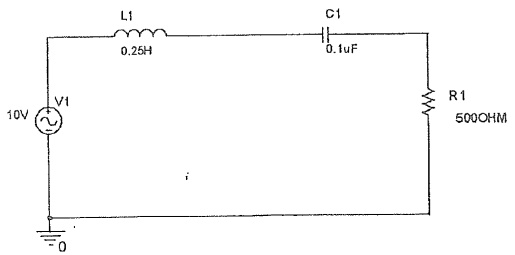

<details>
<summary>text_image</summary>

L1
0.25H
C1
0.1uF
R1
500OHM
10V
V1
i
-0
</details>

图 C-7 例 C-4 电路图

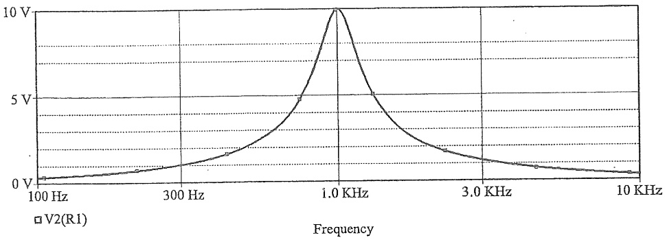

<details>
<summary>line</summary>

| Frequency (KHz) | Voltage (V) |
| --- | --- |
| 100 | ~0.2 |
| 300 | ~1.5 |
| 1.0 | 10 |
| 3.0 | ~2.0 |
| 10 | ~0.8 |
</details>

图 C-8 输出电压的幅频特性曲线

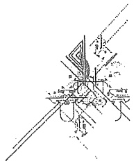

<details>
<summary>natural_image</summary>

Pure mechanical assembly diagram without any text, numbers, or symbols
</details>
