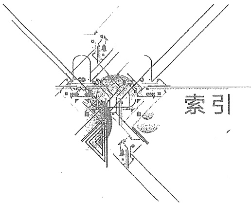
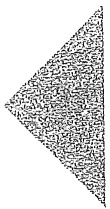

# 索引

原始 PDF 第 541–544 页。

text_image

索引

## 索引

## B

串联 11

电阻\~ 35

比例器 117 阻抗\~ 250

变压器 2 磁场强度 479

理想～ 251 磁感应强度 450

并联 20 磁化曲线 481

电阻\~ 36 磁路 3

波长 452 \~定律 479

波过程 471 恒定磁通\~ 484

波速 452 交变磁通\~ 489

波形 19 磁通 10

## C

磁通链 10

磁滞回线 481

CCCS 21

CCVS 21

参考方向 10 戴维南定理 83

关联\~ 13 导纳 193

冲激函数 134 复(数)\~ 193

单位\~ 134 运算\~ 332

冲激响应 134 等效变换 34

一阶电路～ 169 等效电路 35

二阶电路\~ 169 戴维南\~ 91

初始条件 130 诺顿\~ 91

独立\~ 136 等效电阻 29

非独立～ 138 电导 17

初始状态 144 电感(元件) 5

## D

---

518

索引

<table><tr><td>线性~</td><td>127</td><td>短路</td><td>10</td></tr><tr><td>非线性~</td><td>129</td><td>短路电流</td><td>20</td></tr><tr><td>电感的初始值</td><td>135</td><td>端线</td><td>16</td></tr><tr><td>电感的能量</td><td>128</td><td>对偶原理</td><td>83</td></tr><tr><td>电抗</td><td>4</td><td>对偶元素</td><td>105</td></tr><tr><td>电流控制电流源</td><td>21</td><td rowspan="2">E</td><td></td></tr><tr><td>电流控制电压源</td><td>21</td><td></td></tr><tr><td>电流源</td><td>4</td><td>二端口</td><td>83</td></tr><tr><td>电路</td><td>1</td><td>~参数</td><td>394</td></tr><tr><td>线性~</td><td>4</td><td>~参数互换表</td><td>401</td></tr><tr><td>非线性~</td><td>54</td><td>~连接</td><td>406</td></tr><tr><td>时不变~</td><td>320</td><td>二极管</td><td>126</td></tr><tr><td>电路模型</td><td>2</td><td>二阶电路</td><td>134</td></tr><tr><td>电纳</td><td>212</td><td>RLC~</td><td>154</td></tr><tr><td>电容(元件)</td><td>11</td><td>二瓦计法</td><td>289</td></tr><tr><td>线性~</td><td>124</td><td rowspan="2">F</td><td></td></tr><tr><td>非线性~</td><td>126</td><td></td></tr><tr><td>电容的初始值</td><td>437</td><td>反射波</td><td>460</td></tr><tr><td>电容的能量</td><td>185</td><td>反射系数</td><td>462</td></tr><tr><td>电压跟随器</td><td>119</td><td>方程</td><td>3</td></tr><tr><td>电压控制电流源</td><td>21</td><td>节点电压~</td><td>69</td></tr><tr><td>电压控制电压源</td><td>21</td><td>节点列表法~</td><td>499</td></tr><tr><td>电压源</td><td>4</td><td>回路电流~</td><td>66</td></tr><tr><td>电源</td><td>10</td><td>网孔电流~</td><td>63</td></tr><tr><td>独立~</td><td>21</td><td>割集电压~</td><td>361</td></tr><tr><td>受控~</td><td>21</td><td>状态~</td><td>340</td></tr><tr><td>电源的等效变换</td><td>34</td><td>自治~</td><td>436</td></tr><tr><td>电阻(元件)</td><td>11</td><td>非自治~</td><td>436</td></tr><tr><td>线性~</td><td>16</td><td>非振荡放电</td><td>156</td></tr><tr><td>非线性~</td><td>18</td><td>非正弦周期电流</td><td>295</td></tr><tr><td>压控~</td><td>416</td><td>~平均值</td><td>304</td></tr><tr><td>负~</td><td>18</td><td>非正弦周期电流电路</td><td>295</td></tr><tr><td>流控~</td><td>416</td><td>~平均功率</td><td>305</td></tr><tr><td>叠加定理</td><td>83</td><td>分贝</td><td>53</td></tr><tr><td>动态电路</td><td>134</td><td>分布(参数)电路</td><td>450</td></tr><tr><td>动态元件</td><td>125</td><td>分段线性化</td><td>415</td></tr></table>

---

索引 519

复功率 210

\~守恒 227

复合支路 370

复频率 320

\~平面 343

复数 3

\~运算 196

傅里叶变换(积分) 295

傅里叶级数 295

\~三角形式 193

\~指数形式 194

## G

感(性电)抗 211

感(性电)纳 212

高次谐波 297

三相电路\~ 307

割集 180

独立\~ 362

基本\~ 361

工作点(静态) 420

功率 12

三相电路\~ 288

无功\~ 210

有功(平均)\~ 210

视在～ 210

瞬时～ 222

功率守恒 100

功率因数 32

\~提高 227

固有频率 180

过渡过程 135

过阻尼 157

## H

互感 238

互感抗 241

互易定理 83

回路 2

独立\~ 56

基本\~ 58

回转常数 408

回转器 393

混沌电路 441

## J

基波 297

基尔霍夫电流定律 2

基尔霍夫电压定律 2

基尔霍夫定律 10

激励 10

集总(参数)电路 2

集总(参数)元件 450

阶跃函数 134

单位\~ 134

阶跃响应 134

一阶电路\~ 166

二阶电路\~ 166

节点 22

始～ 500

终\~ 500

矩阵 9

关联\~ 361

回路\~ 361

割集\~ 361

$H$ (混合)参数\~ 400

$T$ (一般)参数\~ 399

Y 参数 \~ 395

Z 参数 \~ 397

卷积 134

均匀传输线 9

\~方程 455

---

522

索引

星形负载 282

星形联结 284

行波 459

虚地 119

虚短 119

虚断 118

选择性 267

## Y

Y-Δ 等效变换 38

Y形联结(同星形联结) 34

一端口 46

含源～ 90

一阶电路 134

$RC\sim$ 138

$RL \sim$  141

一相计算电路 285

有效值(均方根值) 198

正弦量\~ 193

非正弦周期量\~ 303

语句 502

元件 4

二端\~ 4

三端\~ 11

四端～ 11

多端\~ 115

无源～ 16

有源～ 16

线性\~ 16

非线性\~ 16

时变\~ 16

运算电路 320

运算法 4

运算放大器(运放) 21

\~外特性 116

\~饱和特性 116

## Z

折线(分段线性)电阻 432

折线法 425

振荡 2

衰减\~ 159

自激\~ 415

张弛\~ 429

正弦电流电路 196

正弦量(波) 197

正弦稳态分析 199

正线稳态电路 54

支路 22

\~电流法 59

\~阻抗矩阵 371

\~导纳矩阵 374

驻波 467

状态 14

\~平面 415

\~变量 383

自感(系数) 2

中性点 282

\~位移 287

中性线 282

自由分量 145

阻抗 4

复(数)\~ 211

运算\~ 332

特性\~ 456

最大功率 83

## 其他

$\Delta$ 形联结(同三角形联结) 34

π形等效电路 393
