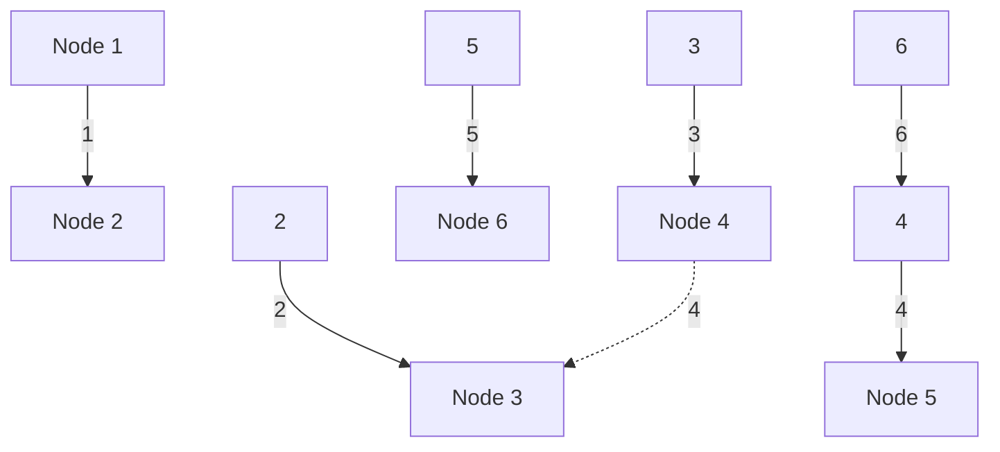
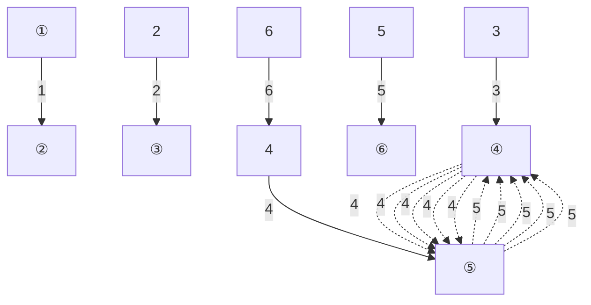
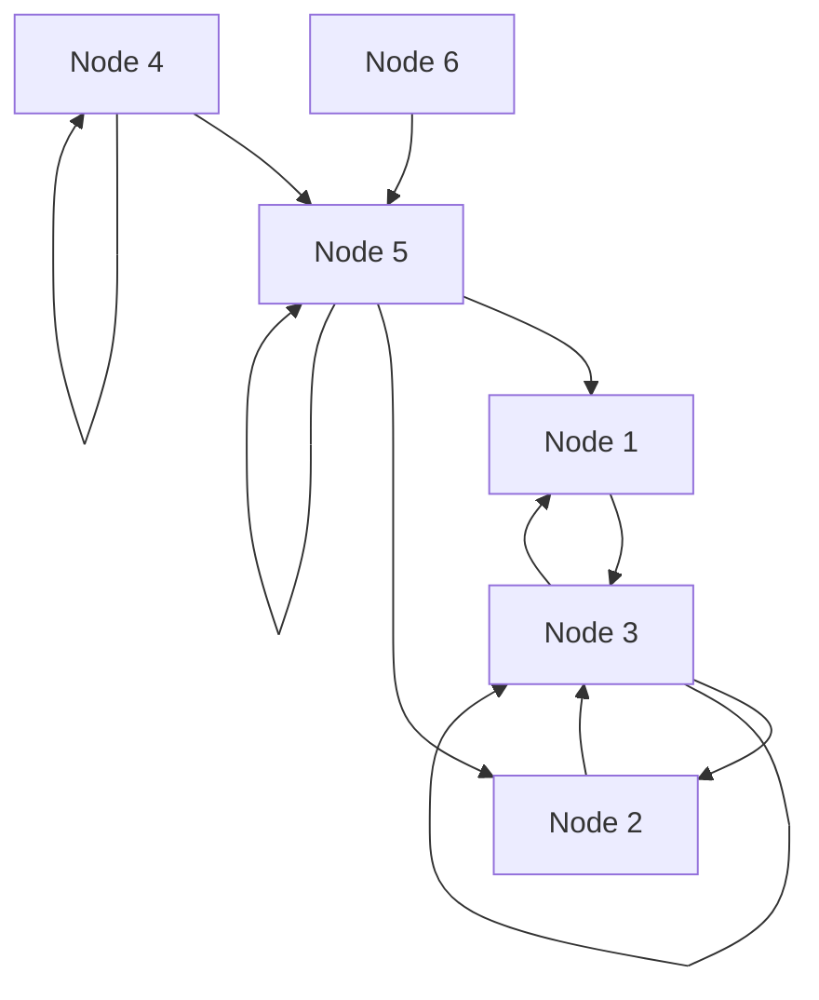
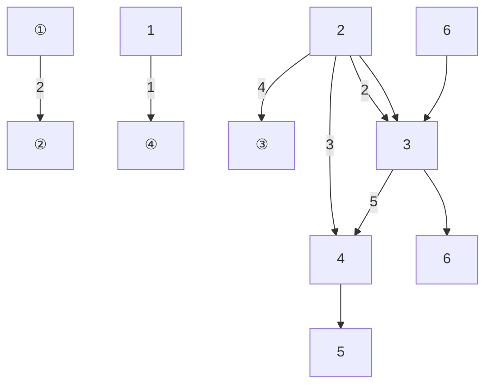
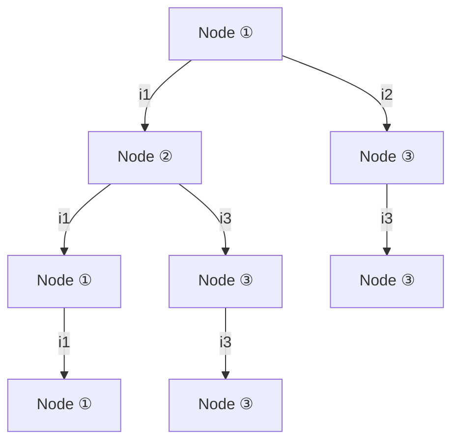
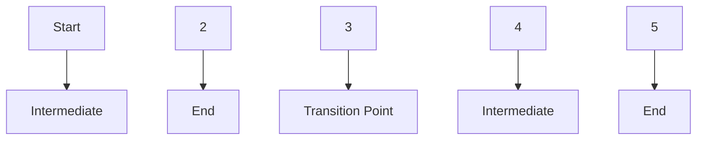
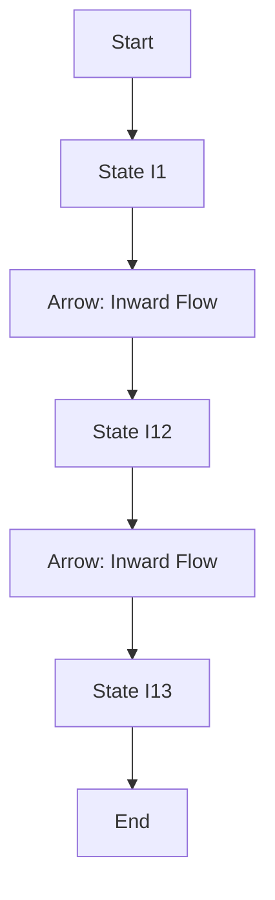
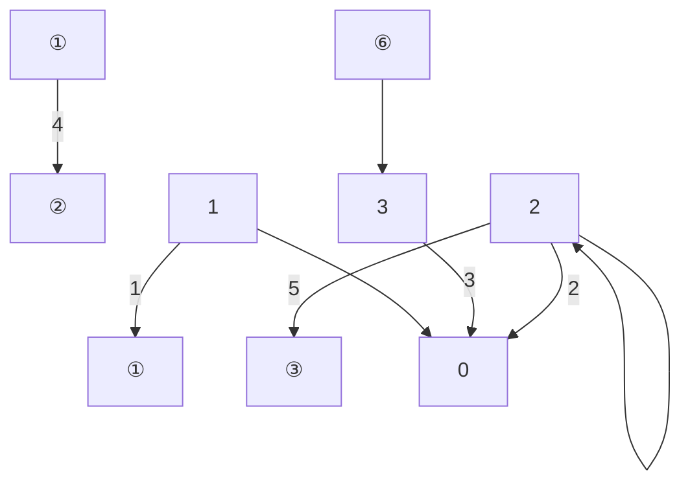

$$
G _ {2 3} = \frac {G _ {2} G _ {3}}{G _ {1} + G _ {2} + G _ {3}}
$$

$$
G _ {3 1} = \frac {G _ {3} G _ {1}}{G _ {1} + G _ {2} + G _ {3}}
$$

例 2-2 求图 2-9(a) 所示桥形电路的总电阻  $R_{12}$ 。

解 将节点①、③、④内的  $\Delta$  形电路用等效 Y 形电路替代, 得到图 2-9(b) 所示电路, 其中

$$
R _ {2} = \frac {1 4 \times 2 1}{1 4 + 1 4 + 2 1} \Omega = 6 \Omega
$$

$$
R _ {3} = \frac {1 4 \times 1 4}{1 4 + 1 4 + 2 1} \Omega = 4 \Omega
$$

$$
R _ {4} = \frac {1 4 \times 2 1}{1 4 + 1 4 + 2 1} \Omega = 6 \Omega
$$

然后用串、并联的方法,得到图 2-9(c)(d)(e)所示电路,从而求得

$$
R _ {1 2} = 1 5 \Omega
$$


<details>
<summary>text_image</summary>

①
14 Ω
21 Ω
R₁₂
③
14 Ω
2 Ω
6 Ω
②
5 Ω
⑤
</details>

(a)


<details>
<summary>chemical</summary>

Electrical circuit diagram with resistors and nodes labeled R2, R3, R4, 2Ω, 5Ω, 6Ω
</details>

(b)


<details>
<summary>text_image</summary>

①
6 Ω
6 Ω
12 Ω
②
5 Ω
</details>

(c)


<details>
<summary>text_image</summary>

①
6 Ω
4 Ω
5 Ω
②
</details>

(d)


<details>
<summary>text_image</summary>

①
15 Ω
②
</details>

(e)

图2-9 例2-2图

另一种方法是用 $\Delta$ 形电路来替代节点①、④、⑤内的Y形电路（以节点③为Y形联结的内部公共节点），求解过程如图2-10所示。


<details>
<summary>text_image</summary>

①
126 Ω
21 Ω
18 Ω
④
6 Ω
②
5 Ω
⑤
</details>

(a)


<details>
<summary>text_image</summary>

①
②
5 Ω
18 Ω
⑤
18 Ω
4.5 Ω
</details>

(b)


<details>
<summary>text_image</summary>

①
18 Ω
22.5 Ω
②
5 Ω
⑤
</details>

(c)


<details>
<summary>text_image</summary>

①
10 Ω
5 Ω
②
</details>

(d)


<details>
<summary>text_image</summary>

①
15 Ω
②
</details>

(e)

图2-10 求解例2-2的另一种方法

## §2-4 电压源、电流源的串联和并联

图 2-11(a) 为 n 个电压源的串联, 可以用一个电压源等效替代, 如图 2-11(b) 所示, 这个等效电压源的激励电压为

$$
u _ {\mathrm{S}} = u _ {\mathrm{S1}} + u _ {\mathrm{S2}} + \dots + u _ {\mathrm{S} n} = \sum_ {k = 1} ^ {n} u _ {\mathrm{S} k}
$$

如果  $u_{Sk}$  的参考方向与图 2-11(b) 中  $u_{S}$  的参考方向一致时，式中  $u_{Sk}$  的前面取“+”号，不一致时取“-”号。


<details>
<summary>text_image</summary>

+u_{S1} -
+u_{S2} -
+u_{Sn} -
1
2
</details>

(a)


(b)

图 2-11 电压源的串联

图 2-12(a) 为 n 个电流源的并联, 可以用一个电流源等效替代, 如图 2-12(b) 所示。等效电流源的激励电流为

$$
i _ {\mathrm{S}} = i _ {\mathrm{S1}} + i _ {\mathrm{S2}} + \dots + i _ {\mathrm{Sn}} = \sum_ {k = 1} ^ {n} i _ {\mathrm{Sk}}
$$

如果  $i_{Sk}$  的参考方向与图 2-12(b) 中  $i_{S}$  的参考方向一致时，式中  $i_{Sk}$  的前面取“+”号，不一致时取“-”号。


<details>
<summary>text_image</summary>

1
2
iS1
iS2
iSn
</details>

(a)


(b)

图2-12 电流源的并联

只有激励电压相等且极性一致的电压源才允许并联,否则违背KVL。并联后,其等效电路为其中任一电压源,但是这个并联组合向外部提供的电流在各个电压源之间如何分配则无法确定。

只有激励电流相等且方向一致的电流源才允许串联,否则违背 KCL。串联后,其等效电路为其任一电流源,但是这个串联组合的总电压如何在各个电流源之间分配则无法确定。

顺便指出:当一个电压源与电流源并联时,对外的作用如同该电压源,而电压源的电流要受所并电流源的影响;一个电流源与电压源串联时,对外的作用如同该电流源,而电流源的电压要受所串电压源的影响。

## §2-5 实际电源的两种模型及其等效变换

图 2-13(a) 所示为一个实际直流电源,例如一个干电池; 图 2-13(b) 是它的输出电压 u 与输出电流 i 的伏安特性曲线(虚线部分表示该电源已不能正常工作)。由于内部损耗, 输出电压 u 随电流 i 的增大而减少,且不呈线性关系。输出电流 i 不可超过一定的限值,否则会导致电源损坏。不过在一段范围内电压和电流的关系近似为直线。如果把这一段直线加以延长而作为该电源的外特性,如图 2-13(c) 所示,此时,它在 u 轴和 i 轴上各有一个交点,前者相当于 i=0 时的电压,即开路电压  $U_{oc}^{①}$ ; 后者相当于 u=0时的电流，即短路电流 $I_{\mathrm{sc}}^{①}$ 。根据此伏安特性曲线，可以用电压源和电阻的串联组合或电流源和电导的并联组合作为使用在一定电流范围内的实际电源的电路模型。


(a)


<details>
<summary>line</summary>

| i | u |
| --- | --- |
| 0 | \(U_{0}\) |
</details>

(b)


<details>
<summary>line</summary>

| i | u |
| --- | --- |
| 0 | Uoc |
| Isc | 0 |
</details>

(c)

图 2-13 实际电源的伏安特性曲线


电源的等效
变换

<small><span class="docvortex-page-footnote" data-block-type="page_footnote" style="color:#6b7280">① 下标 OC 是开路(open circuit)的简写。</span></small>

图 2-14(a) 所示为电压源  $U_{s}$  和电阻 R 的串联组合, 在端子  $1-1'$  处的电压 u 与 (输出) 电流 i 的关系为

$$
u = U _ {\mathrm{S}} - R i \tag {2-9}
$$

图2-14(c)所示为电流源 $I_{s}$ 与电导G的并联组合，在端子 $1 - 1'$ 处的电压u与(输出)电流i的关系为

$$
i = I _ {\mathrm{s}} - G u \tag {2-10}
$$

如果令

$$
G = \frac {1}{R}, \quad I _ {\mathrm{s}} = G U _ {\mathrm{s}} \tag {2-11}
$$

式(2-9)和式(2-10)所示的两个方程将完全相同,也就是在端子 $1-1'$ 处的u和i的关系将完全相同。式(2-11)就是这两种组合彼此对外等效必须满足的条件(注意 $U_{s}$ 和 $I_{s}$ 的参考方向, $I_{s}$ 的参考方向由 $U_{s}$ 的负极指向正极)。

当 $i = 0$ 时，端子 $1 - 1'$ 处的电压为开路电压 $U_{\mathrm{oc}}$ ，而 $U_{\mathrm{oc}} = U_{\mathrm{s}}$ 。当 $u = 0$ 时，$i$ 为把端子 $1 - 1'$ 短路后的短路电流 $I_{\mathrm{sc}}$ ，而 $I_{\mathrm{sc}} = I_{\mathrm{s}}$ 。同时有 $U_{\mathrm{oc}} = RI_{\mathrm{sc}}$ ，或 $I_{\mathrm{sc}} = GU_{\mathrm{oc}}$ 。

图 2-14(b) 和 (d) 分别示出图 2-14(a) 和 (c) 所示电路在 i-u 平面上的伏安特性曲线, 它们都是一条直线。当式 (2-11) 的条件满足时, 它们将是同一条直线。


<details>
<summary>text_image</summary>

i
1
+
R
u
+
Us
-
1'
-
</details>

(a)


<details>
<summary>line</summary>

| Variable | Description |
| --- | --- |
| u | Voltage (Vertical Axis) |
| i | Current (Horizontal Axis) |
| Us | Surface Voltage (Horizontal Line) |
| Ri | Resistance (Vertical Distance) |
| Us/R | Voltage-to-Current Ratio (Vertical Line Segment) |
</details>

(b)


<details>
<summary>text_image</summary>

I_S
G
i
+
1
u
-1'
</details>

(c)


<details>
<summary>line</summary>

| i | u |
| --- | --- |
| 0 | 1/G Is |
| Gu | — |
| Is | 0 |
</details>

(d)

图2-14 实际电源的两种电路模型

这种等效变换仅保证端子 $1 - 1'$ 外部电路的电压、电流和功率相同（即只是对外部等效），对内部并无等效可言。例如，端子 $1 - 1'$ 开路时，两电路对外均不发出功率，但此时电压源发出的功率为零，电流源发出的功率为 $\frac{I_{\mathrm{s}}^2}{G}$ 。反之，短路时，电压源发出的功率为 $\frac{U_{\mathrm{s}}^2}{R}$，电流源发出的功率为零。

利用 §2-2、§2-4 和本节的等效变换, 就可以简化求解由电压源、电流源和电阻组

<small><span class="docvortex-page-footnote" data-block-type="page_footnote" style="color:#6b7280">① 下标 SC 是短路(short circuit)的简写。</span></small>

成的串、并联电路。

例 2-3 求图 2-15(a) 所示电路中电流 i。

解 图 2-15(a) 所示电路可简化为图 2-15(e) 所示单回路电路。简化过程如图 2-15(b)(c)(d)(e) 所示。由化简后的电路可求得电流为

$$
i = \frac {5}{3 + 7} \mathrm{A} = 0. 5 \mathrm{A}
$$


图2-15 例2-3图

受控电压源、电阻的串联组合和受控电流源、电导的并联组合也可以用上述方法进行变换。此时可把受控电源当作独立电源一样来处理，但要注意在变换过程中必须保存控制量所在支路，而不要在变换中把它消掉。

例 2-4 图 2-16(a) 所示电路中, 已知  $u_{s}=12\ V, R=2\ \Omega$ , VCCS 的电流  $i_{c}$  受电阻 R 上的电压  $u_{R}$  控制, 且  $i_{c}=gu_{R}, g=2\ S$ 。求  $u_{R}$ 。


图2-16 例2-4图

解 利用等效变换,把电压控制电流源和电导的并联组合变换为电压控制电压源和电阻的串联组合,如图2-16(b)所示,其中 $u_{C}=Ri_{C}=2\times2\times u_{R}=4u_{R}$ ，而 $u_{R}=Ri$ 。按KVL,有

$$
R i + R i + u _ {\mathrm{c}} = u _ {\mathrm{s}}
$$

$$
2 u _ {R} + 4 u _ {R} = u _ {\mathrm{S}}
$$

$$
u _ {R} = \frac {u _ {\mathrm{s}}}{6} = 2 \mathrm{V}
$$

## §2-6 输入电阻

电路或网络的一个端口是它向外引出的一对端子,这对端子可以与外部电源或其他电路相连接。对一个端口来说,从它的一个端子流入的电流一定等于从另一个端子流出的电流。这种具有向外引出一对端子的电路或网络称为一端口(网络)或二端网络。图2-17(a)所示是一个一端口的图形表示。

如果一个一端口内部仅含电阻,则应用电阻的串、并联和 Y-Δ 变换等方法,可以求得它的等效电阻。如果一端口内部除线性电阻以外还含有线性受控源,但不含任何独立电源,可以证明(见 §4-3),不论内部如何复杂,端口电压与端口电流成正比[见图 2-17(a)],因此,定义此一端口的输入电阻 $R_{i}$ 为

$$
R _ {\mathrm{i}} \stackrel {\mathrm{def}} {=} \frac {u}{i} \tag {2-12}
$$

端口的输入电阻也就是端口的等效电阻，但两者的含意有区别。求端口输入电阻的一般方法称为电压、电流法，即在端口加以电压源 $u_{s}$ ，然后求出端口电流i；或在端口加以电流源 $i_{s}$ ，然后求出端口电压u。根据式(2-12)， $R_{i}=\frac{u_{s}}{i}=\frac{u}{i_{s}}$ 。测量一个电阻器的电阻就可以采用这种方法。

图 2-17(b) 中一端口的输入电阻可通过电阻串、并联化简求得, 图 2-17(c) 所示电路具有桥形结构, 应用 Y- $\Delta$ 变换后才能简化, 也可以用电压、电流法求此两图的输入电阻, 如图 2-17(b)(c) 所示。


图2-17 一端口的输入电阻

例 2-5 求图 2-18(a) 所示一端口的输入电阻。

解 在端口 1-1' 处加电压  $u_{s}$ ，求出 i，再由式(2-12)求输入电阻  $R_{i}$ 。

将CCCS和电阻 $R_{2}$ 的并联组合等效变换为CCVS和电阻的串联组合，如图2-18(b)

所示。根据 KVL, 有

$$
u _ {\mathrm{S}} = - R _ {2} \alpha i + \left(R _ {2} + R _ {3}\right) i _ {1} \tag {1}
$$

$$
u _ {\mathrm{S}} = R _ {1} i _ {2} \tag {2}
$$

再由 KCL,  $i=i_{1}+i_{2}$ ，可得  $i_{1}=i-i_{2}=i-\frac{u_{s}}{R_{1}}$ ，代入式(1)，整理后，有

$$
R _ {\mathrm{i}} = \frac {u _ {\mathrm{s}}}{i} = \frac {R _ {1} R _ {3} + (1 - \alpha) R _ {1} R _ {2}}{R _ {1} + R _ {2} + R _ {3}}
$$

上式分子中有负号出现,因此,当存在受控源时,在一定的参数条件下, $R_{i}$ 有可能是零,也有可能是负值。例如,当 $R_{1}=R_{2}=1\Omega,R_{3}=2\Omega,\alpha=5$ 时, $R_{i}=-0.5\Omega$ 。§1-5中曾指出负电阻元件实际是一个发出功率的元件。本例中一端口向外发出功率是由于受控源发出功率。


<details>
<summary>text_image</summary>

1
+
us
-
1'
i
R2
ai
R1
R3
</details>

(a)


<details>
<summary>text_image</summary>

1
i
i₁
αR₂i
+
R₂
i₂
uₛ
R₁
R₃
1'
1'
</details>

(b)

图2-18 例2-5图

一个CCVS,如果控制电流就是该受控源本身的电流,那么这个CCVS的输入电阻就是 $R_{\alpha}$ [见图2-19(a)]或 $-R_{\beta}$ [见图2-19(b)];也就是说,可用电阻 $R_{\alpha}$ 来代替图2-19(a)中的CCVS,用 $-R_{\beta}$ 来代替图2-19(b)中的CCVS。同理,一个VCCS,如果控制电压就是受控源本身的电压,也可以用-G或G来代替这个VCCS[见图2-19(c)(d)]。


(a)


(b)


(c)


(d)

图2-19


## 思考题

2-1 两个电压源并联,为什么两个电压源的电压必须相同?
2-2 两个电流源串联,为什么两个电流源的电流必须相同?
2-3 电压源并联一个电阻或电流源,对外等效电路是什么元件?为什么?
2-4 电流源串联一个电阻或电压源,对外等效电路是什么元件?为什么?
2-5 当满足什么条件,电压源串联电阻的支路可与电流源并联电阻的支路相互等效?当外接电路后,这两个电路的内部相互等效吗?为什么?
2-6 对于一个只含线性电阻的一端口,用串并联等效变换法和 Y-Δ 变换法求得

的等效电阻和外加电源法求得的输入电阻相等,为什么?

2-7 在求解习题 2-4 时, 应用了电路对称性的特点。你能论证这样做的根据吗?


## 习题

2-1 电路如题 2-1 图所示, 已知  $u_{s}=100\ V, R_{1}=2\ k\Omega, R_{2}=8\ k\Omega$ 。试求以下 3 种情况下的电压  $u_{2}$  和电流  $i_{2}, i_{3}$ :

(1)  $R_{3}=8\ k\Omega$ 。
(2) $R_{3}=\infty(R_{3}$ 处开路)。
(3) $R_{3}=0(R_{3}$ 处短路)。

2-2 电路如题 2-2 图所示, 其中电阻、电压源和电流源均为已知, 且为正值。

(1) 求电压  $u_{2}$  和电流  $i_{2}$ 。
(2) 若电阻  $R_{1}$  增大, 对哪些元件的电压、电流有影响? 影响如何?


<details>
<summary>text_image</summary>

R₁
+
-
uₛ
i₂
R₂
+
-
u₂
i₃
R₃
</details>

题 2-1 图


<details>
<summary>text_image</summary>

iS
R1
i2
+
u2
-
R2
R3
+
us
-
R4
</details>

题2-2图

2-3 题 2-3 图中  $u_{s}=50\ V, R_{1}=2\ k\Omega, R_{2}=8\ k\Omega$ 。现欲测量电压  $u_{o}$ ，所用电压表量程为 50 V，灵敏度为  $1000\ \Omega/V$ （即每伏量程电压表相当于  $1000\ \Omega$  的电阻）。

(1) 测量得  $u_{0}$  为多少?
(2) $u_{0}$ 的真值 $u_{ot}$ 为多少?
(3) 如果测量误差以下式表示

$$
\delta (\%)
$$

此时测量误差是多少？


<details>
<summary>text_image</summary>

u_S
+
-
R_1
R_2
u_o
+
-
V
</details>

题2-3图

2-4 求题 2-4 图所示各电路的等效电阻  $R_{ab}$ ，其中  $R_{1}=R_{2}=1\Omega, R_{3}=R_{4}=2\Omega, R_{5}=4\Omega, G_{1}=G_{2}=1\mathrm{~S}, R=2\Omega$ 。


<details>
<summary>text_image</summary>

R₁
a
R₂
R₃
R₄
b
R₅
</details>

(a)


(b)


<details>
<summary>text_image</summary>

a
R₁
R₂
S
R₃
R₄
b
R₅
</details>

(c)


<details>
<summary>text_image</summary>

a
R₁ R₁
R₂ R₂
R₂
b
</details>

(d)


<details>
<summary>text_image</summary>

R
R
R
R
R
R
R
R
a
b
</details>

(e)


<details>
<summary>text_image</summary>

a
R R R R
R R R
R R R
R R R
R R
b
</details>

(f)

题 2-4 图

2-5 用 $\Delta -\mathrm{Y}$ 等效变换法求题2-5图中a、b端的等效电阻。

（1）将节点①、②、③之间的三个9Ω电阻构成的Δ形电路变换为Y形电路。
（2）将节点①、③、④与作为内部公共节点的②之间的三个9Ω电阻构成的Y形电路变换为Δ形电路。

2-6 利用 Y- $\Delta$  等效变换求题 2-6 图中 a、b 端的等效电阻。


<details>
<summary>text_image</summary>

a o
9 Ω
①
9 Ω
②
9 Ω
③
9 Ω
④
3 Ω
b o
</details>

题 2-5 图


<details>
<summary>text_image</summary>

a○—10/11Ω
      1/2Ω ——1/3Ω
      1Ω ——
      8/11Ω ——9/11Ω
b○
</details>

题 2-6 图

2-7 在题 2-7 图(a)电路中, $u_{\mathrm{S1}} = 24 \mathrm{~V}, u_{\mathrm{S2}} = 6 \mathrm{~V}, R_1 = 12 \mathrm{k} \Omega, R_2 = 6 \mathrm{k} \Omega, R_3 = 2 \mathrm{k} \Omega$。题 2-7 图(b)为经电源变换后的等效电路。

(1) 求等效电路的  $i_{s}$  和  $R_{0}$
(2) 根据等效电路求  $R_{3}$  中的电流和消耗的功率。

(3) 分别在题 2-7 图(a)(b)中求出  $R_{1}$ 、 $R_{2}$  及  $R_{3}$  消耗的功率。
(4) $u_{S1}, u_{S2}$ 发出的功率是否等于 $i_{S}$ 发出的功率？ $R_{1}, R_{2}$ 消耗的功率是否等于R消耗的功率？为什么？


<details>
<summary>text_image</summary>

R₁
+
-
uₛ₁
R₂
+
-
uₛ₂
R₃
</details>

(a)


<details>
<summary>text_image</summary>

i_S
R
R_3
</details>

(b)

题2-7图

2-8 求题 2-8 图所示电路中对角线电压 U 及总电压  $U_{ab}$ 。


<details>
<summary>text_image</summary>

4A
Uab
a
+
-
b
10 Ω
10 Ω
+
8 Ω
U
-
5 Ω
2 Ω
</details>

题 2-8 图

2-9 题 2-9 图所示电路为由桥 T 电路构成的衰减器。

(1) 试证明当 $R_{2} = R_{1} = R_{\mathrm{L}}$ 时, $R_{\mathrm{ab}} = R_{\mathrm{L}}$, 且有 $\frac{u_{\mathrm{o}}}{u_{\mathrm{i}}} = 0.5$。
(2) 试证明当 $R_{2} = \frac{2R_{\mathrm{I}}R_{\mathrm{L}}^{2}}{3R_{\mathrm{I}}^{2} - R_{\mathrm{L}}^{2}}$ 时, $R_{\mathrm{ab}} = R_{\mathrm{L}}$, 并求此时电压比 $\frac{u_{\mathrm{o}}}{u_{\mathrm{i}}}$。


<details>
<summary>text_image</summary>

a
+
R₁
ui
-
b
R₂
R₁
R₁
uo
RL
-
</details>

题2-9图

2-10 在题 2-10 图(a)中, $u_{\mathrm{S1}} = 45 \mathrm{~V}, u_{\mathrm{S2}} = 20 \mathrm{~V}, u_{\mathrm{S4}} = 20 \mathrm{~V}, u_{\mathrm{S5}} = 50 \mathrm{~V}; R_1 = R_3 = 15 \Omega$,

$R_{2} = 20\Omega ,R_{4} = 50\Omega ,R_{5} = 8\Omega$ ;在题2-10图（b）中， $u_{\mathrm{S1}} = 20\mathrm{V},u_{\mathrm{S5}} = 30\mathrm{V},i_{\mathrm{S2}} = 8\mathrm{A},i_{\mathrm{S4}} = 17\mathrm{A}$ $R_{1} = 5\Omega ,R_{3} = 10\Omega ,R_{5} = 10\Omega$ 。利用电源的等效变换求题2-10图(a)(b)中电压 $u_{\mathrm{ab}}$ 。


<details>
<summary>text_image</summary>

R₁
+
uₛ₁
-
R₂
+
uₛ₂
-
R₃
a
R₄
-
uₛ₄
+
uₛ₅
-
R₅
+
b
</details>

(a)


<details>
<summary>text_image</summary>

R₁
+
uₛ₁
-
iₛ₂
a
R₃
R₅
+
uₛ₅
-
iₛ₄
b
</details>

(b)

题2-10图

2-11 利用电源的等效变换, 求题 2-11 图所示电路的电流 i。


<details>
<summary>text_image</summary>

1A
4Ω
4Ω
2Ω
6V
10V
+
-
4V
+
-
4Ω
i
10Ω
10Ω
</details>

题2-11图

2-12 利用电源的等效变换, 求题 2-12 图所示电路中的电压比  $\frac{u_{o}}{u_{S}}$ 。已知  $R_{1}=R_{2}=2\Omega, R_{3}=R_{4}=1\Omega$ 。
2-13 题 2-13 图所示电路中  $R_{1}=R_{3}=R_{4}, R_{2}=2R_{1}$ ，CCVS 的电压  $u_{c}=4R_{1}i_{1}$ ，利用电源的等效变换求电压  $u_{10}$ 。


<details>
<summary>text_image</summary>

R₁
+ u₃ -
R₃
2u₃
R₂
R₄
uₒ
+
-
</details>

题 2-12 图


<details>
<summary>text_image</summary>

i₁ R₁ ① R₃
+ +
R₂
uₛ u₁₀ + u꜀
- -
① R₄
</details>

题 2-13 图

2-14 试求题 2-14 图中的输入电阻。


<details>
<summary>text_image</summary>

10 Ω
+
U
-
0.6U
</details>

(a)


<details>
<summary>text_image</summary>

10 Ω
+
U
+
-
2U
-
</details>

(b)


<details>
<summary>text_image</summary>

I
+
U
1S
0.5I
-
</details>

(c)


<details>
<summary>text_image</summary>

I
+
U
-
1S
0.5I
</details>

(d)

题2-14图

2-15 试求题 2-15 图的输入电阻  $R_{ab}$


<details>
<summary>text_image</summary>

a
R₂
μu₁
+
-
Rₐₑ
u₁
R₁
b
</details>

(a)


<details>
<summary>text_image</summary>

i₁
R₁
βi₁
a
Rₐₑ
R₂
b
</details>

(b)

题2-15图

2-16 试求题 2-16 图的输入电阻  $R_{i}$ 。


<details>
<summary>text_image</summary>

i₁
βi₁
R₁
R₂
1
Rᵢ
1′
</details>

(a)


<details>
<summary>text_image</summary>

+ u₁ -
R₂
μu₁
+
R₁
R₃
Rᵢ
1
1'
</details>

(b)

题 2-16 图

2-17 题 2-17 图所示电路中全部电阻均为  $1 \Omega$ ，求输入电阻  $R_{i}$ 。


<details>
<summary>text_image</summary>

3i
R₁ →
</details>

题 2-17 图

2-18 题 2-18 图为一个多量程电压表的电路图。表头灵敏度为  $50 \mu A$ ，内阻为  $2 k\Omega$ 。现将电压量程扩大为 5 V, 25 V, 50 V 与 100 V 四挡。试根据电压的分压公式求所需的附加电阻  $R_{1}$ 、 $R_{2}$ 、 $R_{3}$  与  $R_{4}$ 。


<details>
<summary>text_image</summary>

50 μA
R
2 kΩ
R₁
R₂
R₃
R₄
1○
5 V
2○
25 V
3○
50 V
4○
100 V
</details>

题2-18图

\*2-19 题 2-19 图为实际使用的万用表中多量程电流表的部分电路, $n_{1}$ 至 $n_{5}$ 为各挡电流量程对表头电流值的倍数。现在要求各挡电流为: $500 \mu \mathrm{A}, 1 \mathrm{~mA}, 5 \mathrm{~mA}, 50 \mathrm{~mA}$ 及 $500 \mathrm{~mA}$ 。即相应倍数为: $n_{1} = 10, n_{2} = 20, n_{3} = 100, n_{4} = 1000, n_{5} = 10000$ 。请计算 5 个分流电阻 $R_{1} \sim R_{5}$ 的阻值。（提示: 这是一个环形分流器。计算时, 先从第一挡 $n_{1} = 10$ 来算出五个分流电阻的总值, 再从第二挡算出后四个分流电阻的和, 直至最后一挡。）


<details>
<summary>text_image</summary>

50 μA
R
2 kΩ
R5 R4 R3 R2 R1
5 n5 4 n4 3 n3 2 n2 1 n1
</details>

题 2-19 图

\*2-20 题 2-20 图为倒 L 形电阻衰减器。如要求负载电阻 $R_{\mathrm{L}} = 50 \Omega$ 能与信号源内阻 $R_{\mathrm{s}} = 300 \Omega$ 匹配，求此时电阻 $R_{1}, R_{2}$ 的值，并求衰减量是多少分贝（有关分贝的概念见 §11-3）。


<details>
<summary>text_image</summary>

Us
+
-
RS
+
U1
R1
R2
RL
UL
+
-
</details>

题2-20图


第二章部分

习题答案

## 第三章 电阻电路的一般分析


## 导读

第二章介绍的等效变换法适用于比较简单的电路的分析，而本章介绍的电阻电路的一般分析法适用于复杂电路或大规模电路的分析、计算。电阻电路的一般分析法是一类系统的分析方法，首先需要选取一组电路的独立变量，根据所选独立变量的不同，应用KCL、KVL和支路的电压电流关系（VCR），可列写不同的电路方程，例如:支路电流方程，网孔电流法方程，回路电流法方程以及节点电压法方程等。这些方程均为线性代数方程组，求解这些线性代数方程组可得到所选取的独立变量值，并根据独立变量与支路电压（或支路电流）的关系和支路的VCR可求得全部的支路电流和支路电压。借助网络图论，可方便地选取电路的独立变量，从而保证所列的电路方程为一组线性独立的代数方程。

本章介绍的电阻电路的一般分析法很容易推广到正弦稳态电路的分析，并为应用计算机对电路进行辅助分析奠定了基础。

## §3-1 电路的图

对于结构较为简单的电路，直接应用基尔霍夫定律及第二章介绍的等效变换的方法来求解通常是有效的。但对于结构较为复杂的电路（例如有多个独立电源），等效法的应用就不太有效，有时反而使问题复杂化。本章介绍电路的系统求解法。这种方法的特点是不改变电路的结构，而是选择一组合适的电路变量（电流和/或电压），根据KCL和KVL以及元件的VCR建立该组变量的独立方程组，通过求解该组电路方程，得到所需的响应。所建立的方程(组)称为电路方程，对于线性电阻电路，它是一组线性代数方程。在第十五章中将介绍利用计算机建立、求解各类方程的辅助方法。电路方程的建立及求解还将推广应用于交流电路、非线性电路，时域、频域分析等领域之中。

在电路分析中,将以图论 $^{①}$ 为数学工具来选择电路独立变量,列出与之相应的独立方程。图论在电路中的应用也称为“网络图论①”。网络图论为电路分析建立严密的数学基础并提供系统化的表达方法，更为利用计算机分析、计算、设计大规模电路问题奠定了基础。

<small><span class="docvortex-page-footnote" data-block-type="page_footnote" style="color:#6b7280">① 图论(graph theory)是研究离散对象二元关系结构的一个数学分支。图论中的元素是点和线。点用以表示不同的对象，两点间的线段表示该两对象间的某种关联关系。这种抽象提炼显然可适用于很多不同的领域。</span></small>

在本节中,介绍一些图论的初步知识。图论的研究对象是“图②”。在数学中,图是由点和连接这些点的边共同构成的几何图形。如果对电路图中各支路的内容不予考虑,而代之以线段,就构成了电路图的“图”。因此,在电路分析中,用图论的研究方法来讨论电路的连接性质是十分有效的。

一个图 G 是具有给定连接关系的节点和支路的集合。支路的端点必须是节点，但节点可允许是孤立节点。这点和电路图中支路和节点的概念是有差别的，在电路图中，支路是实体，节点则是支路的连接点，节点是由支路形成的，没有了支路也不存在节点。但在图论中，孤立节点允许存在，它表示一个与外界不发生联系的“事物”。这种差别并不妨碍图论在电路中的应用。

图 3-1(a) 为一个具有 6 个电阻和 2 个独立电源的电路。如果认为每一个二端元件构成电路的一条支路，则图 3-1(b) 就是该电路的“图”，它共有 5 个节点和 8 条支路。有时为了简化，可以把元件的串联组合作为一条支路处理，并以此为根据画出电路的图。例如，图 3-1(a) 中电压源 $u_{s1}$ 和电阻 $R_1$ 的串联组合可以作为一条支路，这个电路的图将如图 3-1(c) 所示，它共有 4 个节点和 7 条支路。如果再把元件的并联组合也作为一条支路③，例如，电流源 $i_{s2}$ 和电阻 $R_2$ 的并联组合，这样，图 3-1(c) 将成为图 3-1(d)，它共有 4 个节点和 6 条支路。所以，当用不同的元件结构定义电路的一条支路时，该电路的图以及它的节点数和支路数将随之不同。


<details>
<summary>text_image</summary>

uS1 +
-
R1
iS2
R2
R3
R4
R5
R6
</details>

(a)


<details>
<summary>natural_image</summary>

Pure geometric diagram with a diamond shape and curved line, no text or symbols present
</details>

(b)


<details>
<summary>natural_image</summary>

Simple geometric diagram with a diamond shape and a semicircle, no text or symbols present.
</details>

(c)


<details>
<summary>natural_image</summary>

Pure geometric diagram with arrows and circles, no text or symbols present
</details>

(d)

图3-1 电路的图

在电路中通常要指定每一条支路中的电流参考方向,电压一般常取为关联参考方向。电路的图的每一条支路也可以指定一个方向,此方向即该支路电流(和电压)的参考方向。赋予支路方向的图称为“有向图”，未赋予支路方向的图称为“无向图”。图3-1(b)(c)为无向图，图3-1(d)为有向图。

<small><span class="docvortex-page-footnote" data-block-type="page_footnote" style="color:#6b7280">① 网络图论的内容在20世纪60年代前常被称为网络拓扑(network topology)。</span></small>

<small><span class="docvortex-page-footnote" data-block-type="page_footnote" style="color:#6b7280">② 图(graph)是数学中的专门名词,与通常意义有所不同。图论中称点和线段为“顶点”和“边”。为避免引入过多术语,本书仍用“节点”和“支路”表示图中的点和线段。</span></small>

<small><span class="docvortex-page-footnote" data-block-type="page_footnote" style="color:#6b7280">③ 按照传统的讲法,支路是电路的一个分支,所以元件的并联组合一般不能作为一条支路。</span></small>

KCL 和 KVL 与支路的元件性质无关,因此可以利用电路的图来讨论如何列出 KCL 和 KVL 方程,并讨论它们的独立性。

## §3-2 KCL 和 KVL 的独立方程数

图 3-2 示出一个电路的图, 它的节点和支路都已分别编号, 并给出了支路的方向, 该方向也即支路电流和与之关联的支路电压的参考方向。

对节点①、②、③、④分别列出 KCL 方程，有

$$
\dot {\iota} _ {1} - \dot {\iota} _ {4} - \dot {\iota} _ {6} = 0
$$

$$
- i _ {1} - i _ {2} + i _ {3} = 0
$$

$$
i _ {2} + i _ {5} + i _ {6} = 0
$$

$$
- i _ {3} + i _ {4} - i _ {5} = 0
$$


<details>
<summary>flowchart</summary>


</details>

图3-2 KCL独立方程

由于对所有节点都列写了 KCL 方程, 而每一支路无例外地与 2 个节点相连, 且每个支路电流必然从其中一个节点流入, 从另一个节点流出。因此, 在所有 KCL 方程中, 每个支路电流必然出现 2 次, 一次为正, 另一次为负 (指每项前面的 “+” 或 “-”)。若把以上 4 个方程相加, 必然得出等号两边为零的结果。这就是说, 这 4 个方程不是相互独立的, 但上列 4 个方程中的任意 3 个是独立的。可以证明①, 对于具有 $n$ 个节点的电路, 在任意 $(n-1)$ 个节点上可以得出 $(n-1)$ 个独立的 KCL 方程。相应的 $(n-1)$ 个节点称为独立节点。

讨论关于 KVL 独立方程数时要用到独立回路的概念。回路和独立回路的概念与支路的方向无关，因此可以用无向图的概念叙述。

从一个图 G 的某一节点出发, 沿着一些支路移动而到达另一节点(或回到原出发

点),这样的一系列支路构成图 G 的一条路径。一条支路本身也算为路径。当图 G 的任意两个节点之间至少存在一条路径时,图 G 就称为连通图②。例如,图 3-2 所示是连通图。如果一条路径的起点和终点重合,且经过的其他节点不出现重复,这条闭合路径就构成图 G 的一个回路。例如,对图 3-3 所示图 G,支路(1,5,8)(2,5,6)(1,2,3,4)(1,2,6,8)都是回路;其他还有支路(4,7,8)(3,6,7)(1,5,7,4)(3,4,8,6)(2,3,7,5)(1,2,6,7,4)(1,2,3,7,8)(2,3,4,8,5)(1,5,6,3,4)构成9个不同的回路；总共有13个不同的回路。但是独立回路数远少于总的回路数。


<details>
<summary>text_image</summary>

G
1
5
2
①
8
⑤
6
③
4
7
3
④
</details>

图3-3 回路

<small><span class="docvortex-page-footnote" data-block-type="page_footnote" style="color:#6b7280">① 应当指出,对于以下述及的连通图才有此结论。</span></small>

<small><span class="docvortex-page-footnote" data-block-type="page_footnote" style="color:#6b7280">② 本章所涉及的电路的图都是连通的,所有结论都是针对连通图来说的。</span></small>

对每个回路可以应用KVL列出有关支路电压的方程。例如，对图3-3所示图G，如果按支路(1,5,8)和支路(2,5,6)分别构成2个回路列出2个KVL方程，不论支路电压和绕行方向怎样指定，支路5的电压将在这2个方程中出现，因为该支路是这2个回路的共有支路。而把这2个方程相加或相减总可以把支路5的电压消去，而得到按支路(1,2,6,8)构成回路的KVL方程。可见这3个回路(方程)是相互不独立的，因为其中任何一个回路(方程)可以由其他2个回路(方程)导出。因此，这3个回路的KVL方程中只有2个是独立的。与之相应的回路就称为独立回路。

一个图的回路数很多,如何确定它的一组独立回路有时不太容易。利用“树”的概念有助于寻找一个图的独立回路组,从而得到独立的KVL方程组。

连通图 G 的树 T 定义为: 包含图 G 的全部节点且不包含任何回路的连通子图。

对于图3-3所示图G，符合上述定义的树有很多，图3-4(a)(b)(c)绘出其中的3个。图3-4(d)(e)不是该图的树，因为图3-4(d)中包含了回路；图3-4(e)则是非连通的。树中包含的支路称为该树的树支，而其他不属于树的支路则称为对应于该树的连支。例如图3-4(a)的树，它具有树支(5,6,7,8)；相应的连支为(1,2,3,4)。对图3-4(b)所示树，其树支为(1,3,5,6)；相应的连支为(2,4,7,8)。树支和连支一起构成图G的全部支路。

图3-3的图G有5个节点，图 $3 - 4(\mathrm{a})(\mathrm{b})(\mathrm{c})$ 所示图G的每一个树具有4条支路；图3-4(d)出现了回路，它不是树，图 $3 - 4(\mathrm{e})$ 未包含全部节点，它也不是树。这个图G有许多不同的树①，但不论是哪一个树，树支数总是4。可以证明，任一个具有 $n$ 个节点的连通图，它的任何一个树的树支数为 $(n - 1)^{②}$ 。


图3-4 树

<small><span class="docvortex-page-footnote" data-block-type="page_footnote" style="color:#6b7280">① 可以证明,该图 G 共有 45 个不同的树。</span></small>

<small><span class="docvortex-page-footnote" data-block-type="page_footnote" style="color:#6b7280">② 证明从略，可参考有关图论书籍。</span></small>

由于连通图 G 的树支连接所有节点又不形成回路, 因此, 对于图 G 的任意一个树, 加入一个连支后, 就会形成一个回路, 并且此回路除所加连支外均由树支组成, 这种回路称为单连支回路或基本回路。对于图 3-5(a) 所示图 G, 取支路 (1,4,5) 为树, 在图 3-5(b) 中以实线表示, 相应的连支为 (2,3,6)。分别将这三个连支加入就可得到对应于这一树的三个基本回路, 它们是 (1,3,5)(1,2,4,5) 和 (4,5,6)。每一个基本回路仅含一个连支, 且这一连支并不出现在其他基本回路中。由全部连支形成的基本回路构成基本回路组, 基本回路的个数显然等于连支数。如果对基本回路组列写 KVL 方程, 由于每个连支只在一个回路中出现, 因此这些 KVL 方程必构成独立方程组。换言之, 根据基本回路所列出的 KVL 方程组是独立方程。对一个具有 b 条支路和 n 个节点的电路, 连支数 $l = b - n + 1$, 这也就是一个图的独立回路的数目。选择不同的树, 就可以得到不同的基本回路组。图 3-5(c)(d)(e) 是以支路 (1,4,5) 为树相对应的基本回路组。


<details>
<summary>text_image</summary>

G
① 1 2
5 3 4 6
②
③
</details>

(a)


<details>
<summary>text_image</summary>

1
2
3
4
5
6
</details>

(b)


(c)


<details>
<summary>text_image</summary>

1
2
5
4
</details>

(d)


<details>
<summary>text_image</summary>

5
4
6
</details>

(e)

图 3-5 基本回路

如果能把一个图画在平面上,而使它的各条支路不产生交叉,这样的图称为平面图,否则称为非平面图。图3-6(a)是一个平面图,图3-6(b)则是一个典型的非平面图。对于一个平面图,可以引入网孔的概念。平面图的一个网孔是它的一个自然的“孔”,在其限定的区域内不再有支路。对图3-6(a)所示的平面图,支路(1,3,5)(2,3,7)(4,5,6)(4,7,8)(6,8,9)都构成网孔①;支路(1,2,8,6)(2,3,4,8)等不构成网孔。平面图的全部网孔是一组独立回路②,所以平面图的网孔数也就是独立回路数。图3-6(a)所示平面图有5个节点,9条支路,独立回路数 $l=(b-n+1)=5$,而它的网孔数正好也是5个。

<small><span class="docvortex-page-footnote" data-block-type="page_footnote" style="color:#6b7280">① 这些都是“内网孔”。平面图周界形成的回路有时称为“外网孔”。本书涉及的“网孔”不包括外网孔。</span></small>

<small><span class="docvortex-page-footnote" data-block-type="page_footnote" style="color:#6b7280">② 将图中 5 个内网孔的 KVL 方程相加减, 得到外网孔的 KVL 方程, 等号两边并不为零。</span></small>


<details>
<summary>text_image</summary>

①
1
2
3
5
7
④
4
6
8
⑤
9
②
③
</details>

(a)


<details>
<summary>natural_image</summary>

Geometric diagram of a pentagon with internal diagonals (no text or labels)
</details>

(b)

图 3-6 平面图与非平面图

一个电路的KVL独立方程数等于它的独立回路数。以图3-7(a)所示电路的图为例，如果取支路(1,4,5)为树，则3个基本回路示于图3-7(b)。按图中的电压和电流的参考方向及回路绕行方向，计及支路及回路的编号，可以列出KVL方程如下:

回路1

$$
u _ {1} + u _ {3} + u _ {5} = 0
$$

回路 2

$$
u _ {1} - u _ {2} + u _ {4} + u _ {5} = 0
$$

回路 3

$$
- \dot {u} _ {4} - u _ {5} + u _ {6} = 0
$$

这是一组独立方程。


<details>
<summary>flowchart</summary>


</details>

(a)


<details>
<summary>flowchart</summary>


</details>

(b)

图 3-7 基本回路的 KVL 方程

## §3-3 支路电流法

对一个具有 b 条支路和 n 个节点的电路, 当以支路电压和支路电流为电路变量列写方程时, 总计有 2b 个未知量。根据 KCL 可以列出  $(n-1)$  个独立方程, 根据 KVL 可以列出  $(b-n+1)$  个独立方程, 根据元件的 VCR 又可列出 b 个方程。总计方程数为 2b, 与未知量数相等。因此, 可由 2b 个方程解出 2b 个支路电压和支路电流。这种方法称为 2b 法。

为了减少求解的方程数,可以利用元件的 VCR 先将每条支路的电压以支路电流来表示,然后代入 KVL 方程,这样,支路电压就不出现在 KVL 方程中,可得到以 b 个支路电流为未知量的 b 个 KCL 和 KVL 方程。变量数和方程数从 2b 个减少至 b 个。这种方法称为支路电流法。

现在以图 3-8(a) 所示电路为例说明支路电流法。把电压源 $u_{s1}$ 和电阻 $R_1$ 的串联组合作为一条支路；把电流源 $i_{s5}$ 和电阻 $R_5$ 的并联组合作为一条支路，这样电路的图就如图 3-8(b) 所示，其节点数 $n = 4$，支路数 $b = 6$，各支路的方向和编号也示于图中。求解变量为 $i_1, i_2, \cdots, i_6$。先利用元件的 VCR，将支路电压 $u_1, u_2, \cdots, u_6$ 以支路电流 $i_1, i_2, \cdots, i_6$ 表示。图 3-8(c)(d) 给出支路 1 和支路 5 的结构，有

$$
\left. \begin{array}{l} u _ {1} = - u _ {\mathrm{SI}} + R _ {1} i _ {1} \\ u _ {2} = R _ {2} i _ {2} \\ \hline u _ {3} = R _ {3} i _ {3} \\ u _ {4} = R _ {4} i _ {4} \\ u _ {5} = R _ {5} i _ {5} + R _ {5} i _ {\mathrm{SS}} \\ u _ {6} = R _ {6} i _ {6} \end{array} \right\} \tag {3-1}
$$


<details>
<summary>text_image</summary>

i6
R6
① i2 R2 ② i4 ③
i1 R1 i3 R4 i5
+ uS1 - ④ R3 R5 iS5
</details>

(a)


<details>
<summary>flowchart</summary>


</details>

(b)


<details>
<summary>text_image</summary>

uS1
- +
④
R1
i1
+
u1
①
-
</details>

(c)


<details>
<summary>text_image</summary>

iS5
iS
③
iS
R5
iRs
uS
④
+ -
</details>

(d)

图 3-8 支路电流法

选择网孔作为独立回路,按图 3-8(b) 所示回路绕行方向列出 KVL 方程

$$
\left. \begin{array}{l} u _ {1} + u _ {2} + u _ {3} = 0 \\ - u _ {3} + u _ {4} + u _ {5} = 0 \\ - u _ {2} - u _ {4} + u _ {6} = 0 \end{array} \right\} \tag {3-2}
$$

将式(3-1)代入式(3-2)，得

$$
\left. \begin{array}{l} - u _ {\mathrm{S1}} + R _ {1} i _ {1} + R _ {2} i _ {2} + R _ {3} i _ {3} = 0 \\ - R _ {3} i _ {3} + R _ {4} i _ {4} + R _ {5} i _ {5} + R _ {5} i _ {\mathrm{S5}} = 0 \\ - R _ {2} i _ {2} - R _ {4} i _ {4} + R _ {6} i _ {6} = 0 \end{array} \right\} \tag {3-3}
$$

把上式中的 $u_{\mathrm{s1}}$ 和 $R_{5}i_{\mathrm{s5}}$ 项移到方程的右边后，与在独立节点①、②、③处列出的KCL方程联列，就组成了支路电流法的全部方程:

$$
\left. \begin{array}{l} - i _ {1} + i _ {2} + i _ {6} = 0 \\ - i _ {2} + i _ {3} + i _ {4} = 0 \\ - i _ {4} + i _ {5} - i _ {6} = 0 \\ R _ {1} i _ {1} + R _ {2} i _ {2} + R _ {3} i _ {3} = u _ {\mathrm{S1}} \\ - R _ {3} i _ {3} + R _ {4} i _ {4} + R _ {5} i _ {5} = - R _ {5} i _ {\mathrm{S5}} \\ - R _ {2} i _ {2} - R _ {4} i _ {4} + R _ {6} i _ {6} = 0 \end{array} \right\} \tag {3-4}
$$

式(3-4)中的 KVL 方程可归纳为

$$
\sum R _ {k} i _ {k} = \sum u _ {\mathrm{S} k} \tag {3-5}
$$

此式须对所有的独立回路写出。式中 $R_{k}i_{k}$ 是回路中第 $k$ 个支路中电阻上的电压，当 $i_{k}$ 的参考方向与回路的方向一致时，该项在和式中取“+”号；不一致时，则取“-”号；式中右方 $u_{\mathrm{Sk}}$ 是回路中第 $k$ 个支路的电源电压，电源电压包括电压源的激励电压，也包括由电流源引起的等效激励电压。例如在支路5中并无电压源，仅为电流源与电阻的并联组合，但可将其等效变换为电压源与电阻的串联组合，其等效电压源为 $u_{\mathrm{S5}} = R_{s}i_{\mathrm{S5}}$ ，在取代数和时，当 $u_{\mathrm{Sk}}$ 与回路方向一致时前面取“-”号（因移在等号右侧），$u_{\mathrm{Sk}}$ 与回路方向不一致时，前面取“+”号。式(3-5)实际上是KVL的另一种表达式，即任一回路中，电阻电压的代数和等于电压源电压的代数和（也可看作，任一回路中，电阻上电压降的代数和等于电压源上电压升的代数和）。

列出支路电流法的电路方程的步骤如下:

(1) 选定各支路电流的参考方向。
(2) 对 $(n-1)$ 个独立节点列出 KCL 方程。
(3) 选取 $(b-n+1)$ 个独立回路, 指定回路的绕行方向, 按照式(3-5)列出 KVL 方程。

支路电流法要求 b 个支路电压均能以支路电流表示, 即存在式(3-1)形式的关系。当一条支路仅含电流源而不存在与之并联的电阻时, 就无法将支路电压以支路电流表示。这种无并联电阻的电流源称为无伴电流源。当电路中存在这类支路时, 必须加以处理后才能应用支路电流法 $^{①}$ 。

如果将支路电流用支路电压表示,然后代入 KCL 方程,连同支路电压的 KVL 方程,可得到以支路电压为变量的 b 个方程。这就是支路电压法。

## §3-4 网孔电流法

在网孔电流法中,以网孔电流作为电路的独立变量,然后列出网孔 KVL 方程并求解。它仅适用于平面电路，以下通过图3-9(a)所示电路说明。图3-9(b)是此电路的图，该电路共有3条支路，给定的支路编号和参考方向如图所示。

<small><span class="docvortex-page-footnote" data-block-type="page_footnote" style="color:#6b7280">① 处理方法见 §3-5。</span></small>


<details>
<summary>text_image</summary>

i₁
R₁
①
i₂
R₂
R₃
i₃
uₛ₁ +
-
iₘ₁
uₛ₂ +
-
iₘ₂
uₛ₃ + -
-
</details>

(a)


<details>
<summary>flowchart</summary>


</details>

(b)

图 3-9 网孔电流法

在节点①应用 KCL, 有

$$
- i _ {1} + i _ {2} + i _ {3} = 0
$$

或

$$
i _ {2} = i _ {1} - i _ {3}
$$

可见，$i_{2}$ 不是独立的，它由 $i_{1}, i_{3}$ 决定。$i_{2}$ 分为两部分，即图 3-9(b) 中向下方向的 $i_{1}$ 以及向上方向的 $i_{3}$。这两个电流可以看成是支路 1 与支路 3 中的电流 $i_{1}$ 与 $i_{3}$ 各自经过节点①后的延续，也就是将图中所有的电流归结为由两个沿网孔连续流动的假想电流 $i_{1}$ 与 $i_{3}$ 产生，这两个假想的电流称之为网孔电流 $i_{\mathrm{m}1}$ 与 $i_{\mathrm{m}2}$①。根据给定的网孔电流和支路电流的参考方向，可以得出其间的关系:支路 1 只有电流 $i_{\mathrm{m}1}$ 流过，支路电流 $i_{1}=i_{\mathrm{m}1}$；支路 3 只有电流 $i_{\mathrm{m}2}$ 流过，支路电流 $i_{3}=i_{\mathrm{m}2}$；但是支路 2 有两个网孔电流同时流过，在给定的参考方向下[见图 3-9(a)]支路电流将是网孔电流的代数和，即 $i_{2}=i_{\mathrm{m}1}-i_{\mathrm{m}2}$。

由于网孔电流已经体现了电流连续即 KCL 的制约关系(换言之,根据网孔电流而计算的支路电流一定满足 KCL 方程,或称为自动满足 KCL),所以用网孔电流作为电路变量求解时只需列出 KVL 方程。全部网孔是一组独立回路,因而对应的 KVL 方程将是独立的,且独立方程个数与电路变量数均为全部网孔数,足以解出网孔电流,从而求得全部支路电流。这种方法称为网孔电流法。

现以图3-9(a)所示电路为例,对网孔1与2列出KVL方程。列方程时,以各自的网孔电流方向为绕行方向,逐段写出电阻以及电源上的电压。对于网孔1,从节点①出发直至回到出发节点,可得到

$$
R _ {2} (  i _ {\mathrm{m1}} - i _ {\mathrm{m2}}  ) + u _ {\mathrm{S2}} - u _ {\mathrm{S1}} + R _ {1} i _ {\mathrm{m1}} = 0
$$

对网孔 2, 则有

$$
R _ {3} i _ {\mathrm{m2}} + u _ {\mathrm{S3}} - u _ {\mathrm{S2}} + R _ {2} (i _ {\mathrm{m2}} - i _ {\mathrm{m1}}) = 0
$$

式中沿网孔1绕行方向列方程时， $R_{2}$ 上的电压为 $R_{2}(i_{\mathrm{m1}}-i_{\mathrm{m2}})$ ，其中 $i_{m2}$ 前的负号是因为电流 $i_{\mathrm{m2}}$ 在 $R_{2}$ 上的流动方向与 $i_{\mathrm{m1}}$ 相反的结果；同理，在网孔2的方程中，沿着网孔2绕行方向，$R_{2}$ 上的电压则为 $R_{2}(i_{\mathrm{m2}} - i_{\mathrm{m1}})$，经整理后，有

<small><span class="docvortex-page-footnote" data-block-type="page_footnote" style="color:#6b7280">① 网孔(mesh)，以下标 m 表示网孔。</span></small>

$$
\left. \begin{array}{l} \left(R _ {1} + R _ {2}\right) i _ {\mathrm{m} 1} - R _ {2} i _ {\mathrm{m} 2} = u _ {\mathrm{S} 1} - u _ {\mathrm{S} 2} \\ - R _ {2} i _ {\mathrm{m} 1} + \left(R _ {2} + R _ {3}\right) i _ {\mathrm{m} 2} = u _ {\mathrm{S} 2} - u _ {\mathrm{S} 3} \end{array} \right\} \tag {3-6}
$$

式(3-6)即是以网孔电流为求解对象的网孔电流方程。

现在用  $R_{11}$  和  $R_{22}$  分别代表网孔 1 和网孔 2 的自阻，它们分别是网孔 1 和网孔 2 中所有电阻之和，即  $R_{11}=R_{1}+R_{2}, R_{22}=R_{2}+R_{3}$ ; 用  $R_{12}$  和  $R_{21}$  代表网孔 1 和网孔 2 的互阻，即两个网孔的共有电阻，本例中  $R_{12}=R_{21}=-R_{2}$ 。上式可改写为

$$
\left. \begin{array}{l} R _ {1 1} i _ {\mathrm{m1}} + R _ {1 2} i _ {\mathrm{m2}} = u _ {\mathrm{S1}} - u _ {\mathrm{S2}} \\ R _ {2 1} i _ {\mathrm{m1}} + R _ {2 2} i _ {\mathrm{m2}} = u _ {\mathrm{S2}} - u _ {\mathrm{S3}} \end{array} \right\} \tag {3-7}
$$

此方程可理解为: $R_{11}i_{m1}$  项代表网孔电流  $i_{m1}$  在网孔 1 内各电阻上引起的电压之和， $R_{22}i_{m2}$  项代表网孔电流  $i_{m2}$  在网孔 2 内各电阻上引起的电压之和。由于网孔绕行方向和网孔电流方向取为一致，故  $R_{11}$  和  $R_{22}$  总为正值。 $R_{12}i_{m2}$  项代表网孔电流  $i_{m2}$  在网孔 1 中引起的电压，而  $R_{21}i_{m1}$  项代表网孔电流  $i_{m1}$  在网孔 2 中引起的电压。当两个网孔电流在共有电阻上的参考方向相同时， $i_{m2}(i_{m1})$  引起的电压与网孔 1（网孔 2）的绕行方向一致，应当为正；反之为负。为了使方程形式整齐，把这类电压前的“+”号或“-”号包括在有关的互阻中。这样，当通过网孔 1 和网孔 2 的共有电阻上的两个网孔电流的参考方向相同时，互阻  $(R_{12}, R_{21})$  取正；反之则取负。故在本例中  $R_{12} = R_{21} = -R_{2}$ 。

对具有 $m$ 个网孔的平面电路, 网孔电流方程的一般形式可以由式(3-7)推广而得, 即有

$$
\left. \begin{array}{c} R _ {1 1} i _ {\mathrm{m} 1} + R _ {1 2} i _ {\mathrm{m} 2} + R _ {1 3} i _ {\mathrm{m} 3} + \dots + R _ {1 m} i _ {\mathrm{m} m} = u _ {\mathrm{S} 1 1} \\ R _ {2 1} i _ {\mathrm{m} 1} + R _ {2 2} i _ {\mathrm{m} 2} + R _ {2 3} i _ {\mathrm{m} 3} + \dots + R _ {2 m} i _ {\mathrm{m} m} = u _ {\mathrm{S} 2 2} \\ \dots \dots \\ R _ {m 1} i _ {\mathrm{m} 1} + R _ {m 2} i _ {\mathrm{m} 2} + R _ {m 3} i _ {\mathrm{m} 3} + \dots + R _ {m m} i _ {\mathrm{m} m} = u _ {\mathrm{S} m m} \end{array} \right\} \tag {3-8}
$$

式中具有相同双下标的电阻 $R_{11}$ 、 $R_{22}$ 、 $R_{33}$ 等是各网孔的自阻；有不同下标的电阻 $R_{12}$ 、 $R_{13}$ 、 $R_{23}$ 等是网孔间的互阻。自阻总是正的，互阻的正、负则视两网孔电流在共有支路上参考方向是否相同而定。方向相同时为正，方向相反时为负。显然，如果两个网孔之间没有共有支路，或者有共有支路但其电阻为零（例如共有支路上仅有电压源），则互阻为零。如果将所有网孔电流都取为顺（或逆）时钟方向，则所有互阻总是负的。在不含受控源的电阻电路的情况下， $R_{ik}=R_{ki}$ 。方程右方 $u_{S11}$ 、 $u_{S22}$ 、…分别为网孔1、网孔2、…中所有电压源电压的代数和，各电压源的电压方向与网孔电流一致时，前面取“-”号，反之取“+”号。

例 3-1 在图 3-10 所示直流电路中,电阻和电压源均为已知,试用网孔电流法求各支路电流。

解 电路为平面电路,共有3个网孔。

(1) 设定网孔电流  $I_{1}$ 、 $I_{2}$ 、 $I_{3}$ ，如图 3-10 所示。
(2) 列网孔电流方程。
（a）方法一。沿网孔方向逐段写电压法:从底部节点出发，沿各网孔应用KVL，写出各段的电压直到回至出发点。这些电压之和应为零。

网孔  $m_{1}$   $-180+60I_{1}+20(I_{1}-I_{2})+70=0^{-}$

网孔  $m_{2}$   $-70+20(I_{2}-I_{1})+40(I_{2}-I_{3})=0$

网孔  $m_{3}$   $40(I_{3}-I_{2})+40I_{3}+20=0$


<details>
<summary>text_image</summary>

60 Ω
Ia
180 V
+
-
Ib
20 Ω
Ic
40 Ω
Id
70 V
+
-
I3
40 Ω
20 V
</details>

图3-10 例3-1图

再经整理就可得到网孔电流方程。

(b) 方法二。使用网孔电流方程的一般形式(3-8)，直接写出网孔的自阻、互阻及网孔电压源电压和等项而得到网孔电流方程。可求得

$$
R _ {1 1} = (6 0 + 2 0) \Omega = 8 0 \Omega
$$

$$
R _ {2 2} = (2 0 + 4 0) \Omega = 6 0 \Omega
$$

$$
R _ {3 3} = (4 0 + 4 0) \Omega = 8 0 \Omega
$$

$$
R _ {1 2} = R _ {2 1} = - 2 0 \Omega
$$

$$
R _ {1 3} = R _ {3 1} = 0
$$

$$
R _ {2 3} = R _ {3 2} = - 4 0 \Omega
$$

$$
U _ {\mathrm{S11}} = (1 8 0 - 7 0) \mathrm{V} = 1 1 0 \mathrm{V}
$$

$$
U _ {\mathrm{S22}} = 7 0 \mathrm{V}
$$

$$
U _ {\mathrm{S33}} = - 2 0 \mathrm{V}
$$

故网孔电流方程为

$$
\left. \begin{array}{l} 8 0 I _ {1} - 2 0 I _ {2} = 1 1 0 \\ - 2 0 I _ {1} + 6 0 I _ {2} - 4 0 I _ {3} = 7 0 \\ - 4 0 I _ {2} + 8 0 I _ {3} = - 2 0 \end{array} \right\}
$$

与方法一所得方程组相同。

(3) 用消去法或行列式法求解所得方程组, 可解得

$$
I _ {1} = 2 \mathrm{A}
$$

$$
I _ {2} = 2. 5 \mathrm{A}
$$

$$
I _ {3} = 1 \mathrm{A}
$$

(4) 指定各支路电流如图 3-10 所示, 有

$$
I _ {\mathrm{a}} = I _ {1} = 2 \mathrm{A}
$$

$$
I _ {\mathrm{b}} = - I _ {1} + I _ {2} = 0. 5 \mathrm{A}
$$

$$
I _ {\mathrm{c}} = I _ {2} - I _ {3} = 1. 5 \mathrm{A}
$$

$$
I _ {\mathrm{d}} = - I _ {3} = - 1 \mathrm{A}
$$

(5) 校验。因网孔电流自动满足 KCL, 再用 KCL 来校验就毫无意义。应该使用 KVL 来校验, 可取一个未用过的回路, 例如取由 60 Ω、40 Ω 电阻及 180 V、20 V 电压源构成的外网孔, 沿顺时针绕行方向写 KVL 方程, 有

$$
6 0 I _ {\mathrm{a}} - 4 0 I _ {\mathrm{d}} = 1 8 0 - 2 0
$$

把  $I_{a}$ 、 $I_{d}$  值代入有 160=160，故答案正确。

当电路中存在电流源和电阻的并联组合时,可将它等效变换成电压源和电阻的串联组合,再按上述方法进行分析。对于存在无伴电流源或受控源的情况,请参见§3-5中相应的处理方法。

## §3-5 回路电流法

网孔电流法仅适用于平面电路,回路电流法则无此限制,它适用于平面或非平面电路。回路电流法是一种适用性较强并获得广泛应用的分析方法。

前已述及,对于一个具有 b 条支路和 n 个节点的电路,b 个支路电流受 $(n-1)$ 个 KCL 独立方程制约,因此,独立的支路电流只有 $(b-n+1)$ 个,等于网孔电流数。网孔电流是在网孔中连续流动的假想电流。而回路电流则是在回路中连续流动的假想电流,但是与网孔不同,回路的取法很多,选取的回路应是一组独立回路,且回路的个数(也即回路电流的个数)也应等于 $(b-n+1)$ 个。选定一个树以后形成的基本回路显然满足上述要求。这就是说,在基本回路中连续流动的假想电流可以作为电路的独立变量来求解。

以图3-11所示电路(的图)为例,如果选支路(4,5,6)为树(在图中用粗线画出),可以得到以支路(1,2,3)为单连支的3个基本回路,它们是独立回路。把连支电流 $i_{1}$ 、 $i_{2}$ 、 $i_{3}$ 分别作为在各自单连支回路中流动的假想回路电流 $i_{11}^{①},i_{12},i_{13}$ 。支路4为回路1和2所共有,而其方向与回路1的绕行方向相反,与回路2的绕行方向相同,所以有

$$
i _ {4} = - i _ {1 1} + i _ {1 2}
$$

同理,可以得出支路5和支路6的电流 $i_{5}$ 和 $i_{6}$ 为


<details>
<summary>flowchart</summary>

```mermaid
graph TD
  ①["①"] -->|4| ③["③"]
  node["①"] -->|1| ②["②"]
  node -->|6| ④["④"]
  node2["②"] -->|5| node3["④"]
  node4["③"] -->|3| node3
  node3 -->|2| node2
  node3 -->|i12| node4
  node3 -->|i13| node3
```
</details>

图 3-11 回路电流


回路电流法

<small><span class="docvortex-page-footnote" data-block-type="page_footnote" style="color:#6b7280">① 回路电流  $i_{1}$  的下标“l”表示回路(loop)。</span></small>

$$
i _ {5} = - i _ {1 1} - i _ {1 3}
$$

$$
i _ {6} = \dot {-} i _ {1 1} + i _ {1 2} - i _ {1 3}
$$

从以上 3 式可见,树支电流可以通过连支电流或回路电流表达,即全部支路电流可以通过回路电流表达。

列方程时,因回路电流已满足 KCL 方程,也只需按 KVL 列方程。对于 b 条支路、n 个节点的电路,回路电流数  $l=(b-n+1)$ 。以下,将以例 3-2 所示电路介绍列写回路电流方程的方法。

例 3-2 给定直流电路如图 3-12(a) 所示, 其中  $R_{1}=R_{2}=R_{3}=1\Omega, R_{4}=R_{5}=R_{6}=2\Omega, u_{S1}=4\mathrm{~V}, u_{S5}=2\mathrm{~V}$ 。试选择一组独立回路, 并列出回路电流方程。


<details>
<summary>text_image</summary>

R1
uS1
+
-
R2
I11
R6
R4
I12
R5
I13
uS5
+
-
R3
</details>

(a)


<details>
<summary>flowchart</summary>


</details>

(b)

图3-12 例3-2图

解 电路的图如图3-12(b)所示,选择支路(4,5,6)为树,3个独立回路(基本回路)绘于图中。连支电流 $I_{1}$ 、 $I_{2}$ 、 $I_{3}$ 即为回路电流 $I_{11}$ 、 $I_{12}$ 、 $I_{13}$ 。应用例3-1的方法一,在三个基本回路列出以回路电流 $I_{11}$ 、 $I_{12}$ 、 $I_{13}$ 为变量的KVL方程为

$$
\left. \begin{array}{l} R _ {1} I _ {1 1} + u _ {\mathrm{S1}} + R _ {6} (I _ {1 1} - I _ {1 3}) + R _ {5} (I _ {1 1} + I _ {1 2} - I _ {1 3}) - u _ {\mathrm{S5}} + R _ {4} (I _ {1 1} + I _ {1 2}) = 0 \\ R _ {2} I _ {1 2} + R _ {5} (I _ {1 2} + I _ {1 1} - I _ {1 3}) - u _ {\mathrm{S5}} + R _ {4} (I _ {1 1} + I _ {1 2}) = 0 \\ R _ {6} (I _ {1 3} - I _ {1 1}) + R _ {3} I _ {1 3} + u _ {\mathrm{S5}} + R _ {5} (I _ {1 3} - I _ {1 1} - I _ {1 2}) = 0 \end{array} \right\} \tag {3-9}
$$

代入数值,并经整理后,可得

$$
\left. \begin{array}{l} 7 I _ {1 1} + 4 I _ {1 2} - 4 I _ {1 3} = - 2 \\ 4 I _ {1 1} + 5 I _ {1 2} - 2 I _ {1 3} = 2 \\ - 4 I _ {1 1} - 2 I _ {1 2} + 5 I _ {1 3} = - 2 \end{array} \right\} \tag {3-10}
$$

解出  $I_{11}$ 、 $I_{12}$ 、 $I_{13}$  后，可根据以下各式计算支路电流:

$$
I _ {1} = I _ {1 1}
$$

$$
I _ {2} = I _ {1 2}
$$

$$
I _ {3} = I _ {1 3}
$$

$$
I _ {4} = - I _ {1 1} - I _ {1 2}
$$

$$
I _ {5} = I _ {1 1} + I _ {1 2} - I _ {1 3}
$$

$$
I _ {6} = - I _ {1 1} + I _ {1 3}
$$

回路电流方程(3-10)是KVL方程,其中左方各项是各个回路电流在回路中电阻上引起的电压。与网孔电流方程(3-8)相似,对具有l个独立回路的电路,可写出回路电流方程的一般形式

$$
\left. \begin{array}{c} R _ {1 1} i _ {1 1} + R _ {1 2} i _ {1 2} + R _ {1 3} i _ {1 3} + \dots + R _ {1 l} i _ {l l} = u _ {\mathrm{S} 1 1} \\ R _ {2 1} i _ {1 1} + R _ {2 2} i _ {1 2} + R _ {2 3} i _ {1 3} + \dots + R _ {2 l} i _ {l l} = u _ {\mathrm{S} 2 2} \\ \dots \dots \\ R _ {l 1} i _ {1 1} + R _ {l 2} i _ {1 2} + R _ {l 3} i _ {1 3} + \dots + R _ {l l} i _ {l l} = u _ {\mathrm{S} l l} \end{array} \right\} \tag {3-11}
$$

式中有相同下标的电阻 $R_{11}$ 、 $R_{22}$ 、 $R_{33}$ 等是各回路的自阻，有不同下标的电阻 $R_{12}$ 、 $R_{13}$ 、 $R_{23}$ 等是回路间的互阻。自阻总是正的，互阻取正还是取负，则由相关两个回路共有支路上两回路电流的方向是否相同而决定，相同时取正，相反时取负。显然，若两个回路间无共有电阻，则相应的互阻为零。方程右方的 $u_{S11}$ 、 $u_{S22}$ 、…分别为各回路1、2、…中所有电压源电压的代数和，取和时，与回路电流方向一致的电压源电压前应取“-”号，否则取“+”号。

如果电路中有电流源和电阻的并联组合,可经等效变换成为电压源和电阻的串联组合后再列回路电流方程。但当电路中存在无伴电流源时,就无法进行这种等效变换。此时可采用下述方法处理。除回路电流外,将无伴电流源两端的电压作为一个求解变量列入方程。这样,虽然多了一个变量,但是无伴电流源所在支路的电流为已知,故增加了一个回路电流与无伴电流源电流之间的约束方程,这样,独立方程数与独立变量数仍然相同。

例3-3 图3-13所示电路中 $U_{\mathrm{S1}} = 50 \mathrm{~V}, U_{\mathrm{S3}} = 20 \mathrm{~V}, I_{\mathrm{S2}} = 1 \mathrm{~A}$，此电流源为无伴电流源。试用回路法列出电路的方程。

解 把电流源两端的电压 $U$ 作为附加变量。该电路有3个独立回路，假设回路电流① $I_{11}, I_{12}, I_{13}$ 如图3-14所示。应用回路电流方程的一般公式(3-11)，沿各自回路的KVL方程为

$$
\left. \begin{array}{l} (2 0 + 1 5 + 1 0) I _ {1 1} - 1 0 I _ {1 2} - 1 5 I _ {1 3} = 0 \\ - 1 0 I _ {1 1} + (1 0 + 3 0) I _ {1 2} + U = 5 0 \\ - 1 5 I _ {1 1} + (4 0 + 1 5) I _ {1 3} - U = - 2 0 \end{array} \right\} \tag {3-12}
$$

无伴电流源所在支路有  $I_{12}$  和  $I_{13}$  通过, 故约束方程为

$$
- I _ {1 2} + I _ {1 3} = 1 \tag {3-13}
$$

方程数和未知变量数相等。

<small><span class="docvortex-page-footnote" data-block-type="page_footnote" style="color:#6b7280">① 为了简化讨论,实际上取的是网孔电流。</span></small>


<details>
<summary>text_image</summary>

20 Ω
I₁₁
10 Ω
15 Ω
+
Uₛ₁ I₁₂ Iₛ₂ U +
-
30 Ω
40 Ω
I₁₃
+
Uₛ₃
</details>

图3-13 例3-3电路


<details>
<summary>flowchart</summary>


</details>

图3-14 例3-3图

将式(3-12)中后两式相加,可得 $-(10+15)I_{11}+(10+30)I_{12}+(15+40)I_{13}=50-20$ ,相当于在包含 $I_{12}$ 与 $I_{13}$ 的大回路中列出的KVL方程,绕过了无伴电流源,因此,附加变量U不再出现。

如果无伴电流源中仅有一个回路电流流过时,该回路的 KVL 方程就可不列。所以,每出现一个无伴电流源,就要少列一个 KVL 方程,但会多出现一个回路电流的约束方程,即无伴电流源电流与流经该电流源的回路电流之间的代数关系。独立方程数与电流变量数依然相等。

当电路中含有受控电压源时,把它作为电压源暂时列于KVL方程的右边,同时把控制量用回路电流表示,然后将用回路电流表示的受控源电压项移到方程的左边。当受控源是受控电流源时,可参照前面处理独立电流源的方法进行(见下例)。

\* 例3-4 图3-15所示电路中有无伴电流源 $i_{\mathrm{S1}}$ ，无伴电流控制电流源 $i_{\mathrm{c}} = \beta i_{2}$ ，电压控制电压源 $u_{\mathrm{c}} = \alpha u_{2}$ ，电压源 $u_{\mathrm{S2}}$ 和 $u_{\mathrm{S3}}$ 。列出回路电流方程。


<details>
<summary>text_image</summary>

R1
iS1
i11
R2
+
u2
-
i12
us2
+
us3
-
R3
i3
ic
i14
R4
+
uc
-
</details>

图3-15 例3-4图

解 取独立回路如图 3-15 所示, 使无伴电流源和无伴受控电流源都只有一个回路电流流过, 前者为  $i_{11}$ 、后者为  $i_{13}$ , 这样就可不再列回路 1 和回路 3 的 KVL 方程。把控制量用有关回路电流表示, 有

$$
i _ {2} = i _ {1 2}
$$

$$
u _ {2} = R _ {2} (  i _ {1 1} - i _ {1 2})
$$

这两个有关控制量的方程称为附加方程。

应用例 3-1 的方法列出回路 2 和回路 4 的 KVL 方程, 可以沿绕行方向逐段写出有关电压。可得

回路2 $-u_{2}-u_{\mathrm{S2}}+R_{3}(i_{12}+i_{13}-i_{14})+u_{\mathrm{S3}}=0$

回路4 $-u_{\mathrm{S3}} + R_3(i_{14} - i_{12} - i_{13}) + R_4i_{14} + u_c = 0$

代入附加方程 $u_{2} = R_{2}(i_{11} - i_{12}), u_{\mathrm{c}} = \alpha u_{2}$，有

$$
- R _ {2} (i _ {\mathrm{l1}} - i _ {\mathrm{l2}}) + R _ {3} (i _ {\mathrm{l2}} + i _ {\mathrm{l3}} - i _ {\mathrm{l4}}) = u _ {\mathrm{S2}} - u _ {\mathrm{S3}}
$$

$$
R _ {3} (  i _ {1 4} - i _ {1 2} - i _ {1 3}  ) + R _ {4}   i _ {1 4} + \alpha R _ {2} (  i _ {1 1} - i _ {1 2}  ) = u _ {\mathrm{S3}}
$$

经整理后,得

$$
- R _ {2} i _ {1 1} + (R _ {2} + R _ {3}) i _ {1 2} + R _ {3} i _ {1 3} - R _ {3} i _ {1 4} \doteq u _ {\mathrm{S2}} - u _ {\mathrm{S3}}
$$

$$
\alpha R _ {2} i _ {1 1} - \left(\alpha R _ {2} + R _ {3}\right) i _ {1 2} - R _ {3} i _ {1 3} + \left(R _ {3} + R _ {4}\right) i _ {1 4} = u _ {\mathrm{S3}}
$$

回路电流约束方程为

$$
i _ {\mathrm{II}} = i _ {\mathrm{SI}}
$$

$$
i _ {1 3} = \beta i _ {1 2} (\text {可写成} - \beta i _ {1 2} + i _ {1 3} = 0)
$$

如果把 $i_{11}, i_{13}$ 代入前2个方程，可得到仅含 $i_{12}, i_{14}$ 的两个方程。可以看出:当电路中有无伴电流源时，求解时所需的独立方程数目变少了。但例3-3所给出的方程更具一般性。

回路电流法的步骤可归纳如下:

（1）根据给定的电路，通过选择一个树确定一组基本回路，并指定各回路电流（即连支电流）的参考方向。
(2) 按一般公式(3-11)列出回路电流方程, 注意自阻总是正的, 互阻的正、负由相关的两个回路电流通过共有电阻时, 两者的参考方向是否相同而定。并注意该式右边项取代数和时各有关电压源电压前面的“+”“-”号。
(3) 当电路中有受控源或无伴电流源时,需另行处理。
(4) 对于平面电路可用网孔电流法。

## §3-6 节点电压法

在电路中任意选择一个节点作为参考节点，其他节点称为独立节点，这些节点与此参考节点之间的电压称为节点电压。节点电压的参考极性是以参考节点为负，其余独立节点为正。由于每一支路都连接在两个节点上，根据KVL，该支路电压就是这两个节点电压之差。如果每一个支路电流都可由支路电压来表示，那么它一定也可以用节点电压来表示。在具有 $n$ 个节点的电路中写出其中 $(n - 1)$ 个独立节点的KCL方程，而KCL方程中的各个支路电流都以节点电压来表示，这样，就能得到变量为 $(n - 1)$ 个节点电压的共 $(n - 1)$ 个独立方程，称之为节点电压方程。最后由这些方程解出节点电压，再求出所需的电压、电流。这就是节点电压法。


<details>
<summary>natural_image</summary>

Pure technical line drawing of intersecting lines and shapes without any text, numbers, or symbols
</details>


节点电压法

例如，对于图3-16所示电路及其图，节点的编号、支路的编号及参考方向均示于图中。电路的节点数为4，支路数为6。以节点①为参考，并规定节点①、②、③的节点电压分别用 $u_{n1}$ 、 $u_{n2}$ 、 $u_{n3}$ ①表示。支路电压分别用 $u_{1}$ 、 $u_{2}$ 、 $u_{3}$ 、 $u_{4}$ 、 $u_{5}$ 与 $u_{6}$ 来表示。根据KVL，不难求出 $u_{1}=u_{n1},u_{2}=u_{n2};u_{3}=u_{n3},u_{4}=u_{n1}-u_{n2},u_{5}=u_{n2}-u_{n3}$ 以及 $u_{6}=u_{n1}-u_{n3}$ 。


<details>
<summary>text_image</summary>

iS6
R6
i6
① R4 ② i5 ③
i1 i4 i2 R5 i3
iS1 R1 R2 R3 uS3
①
</details>

(a)


<details>
<summary>flowchart</summary>


</details>

(b)

图 3-16 节点电压法

节点①、②与③的 KCL 方程为

$$
\left. \begin{array}{l} i _ {1} + i _ {4} + i _ {6} = 0 \\ i _ {2} - i _ {4} + i _ {5} = 0 \\ i _ {3} - i _ {5} - i _ {6} = 0 \end{array} \right\} \tag {3-14}
$$

根据各支路的 VCR 及支路电压与节点电压的关系,式(3-14)可写为

$$
\left. \begin{array}{l} \left(\frac {u _ {\mathrm{n1}}}{R _ {1}} - i _ {\mathrm{S1}}\right) + \left(\frac {u _ {\mathrm{n1}} - u _ {\mathrm{n2}}}{R _ {4}}\right) + \left(\frac {u _ {\mathrm{n1}} - u _ {\mathrm{n3}}}{R _ {6}} + i _ {\mathrm{S6}}\right) = 0 \\ \left(\frac {u _ {\mathrm{n2}}}{R _ {2}}\right) - \left(\frac {u _ {\mathrm{n1}} - u _ {\mathrm{n2}}}{R _ {4}}\right) + \left(\frac {u _ {\mathrm{n2}} - u _ {\mathrm{n3}}}{R _ {5}}\right) = 0 \\ \left(\frac {u _ {\mathrm{n3}} - u _ {\mathrm{S3}}}{R _ {3}}\right) - \left(\frac {u _ {\mathrm{n2}} - u _ {\mathrm{n3}}}{R _ {5}}\right) - \left(\frac {u _ {\mathrm{n1}} - u _ {\mathrm{n3}}}{R _ {6}} + i _ {\mathrm{S6}}\right) = 0 \end{array} \right\} \tag {3-15}
$$

经整理,就可得到以节点电压为独立变量的方程

$$
\left. \begin{array}{l} \left(\frac {1}{R _ {1}} + \frac {1}{R _ {4}} + \frac {1}{R _ {6}}\right) u _ {\mathrm{n1}} - \frac {1}{R _ {4}} u _ {\mathrm{n2}} - \frac {1}{R _ {6}} u _ {\mathrm{n3}} = i _ {\mathrm{S1}} - i _ {\mathrm{S6}} \\ - \frac {1}{R _ {4}} u _ {\mathrm{n1}} + \left(\frac {1}{R _ {2}} + \frac {1}{R _ {4}} + \frac {1}{R _ {5}}\right) u _ {\mathrm{n2}} - \frac {1}{R _ {5}} u _ {\mathrm{n3}} = 0 \\ - \frac {1}{R _ {6}} u _ {\mathrm{n1}} - \frac {1}{R _ {5}} u _ {\mathrm{n2}} + \left(\frac {1}{R _ {3}} + \frac {1}{R _ {5}} + \frac {1}{R _ {6}}\right) u _ {\mathrm{n3}} = i _ {\mathrm{S6}} + \frac {u _ {\mathrm{S3}}}{R _ {3}} \end{array} \right\} \tag {3-16}
$$

<small><span class="docvortex-page-footnote" data-block-type="page_footnote" style="color:#6b7280">① 下标 n 表示节点“node”（也有称为结点的）。</span></small>

式(3-16)可写为

$$
\left. \begin{array}{l} (G _ {1} + G _ {4} + G _ {6}) u _ {\mathrm{n} 1} - G _ {4} u _ {\mathrm{n} 2} - G _ {6} u _ {\mathrm{n} 3} = i _ {\mathrm{S} 1} - i _ {\mathrm{S} 6} \\ - G _ {4} u _ {\mathrm{n} 1} + (G _ {2} + G _ {4} + G _ {5}) u _ {\mathrm{n} 2} - G _ {5} u _ {\mathrm{n} 3} = 0 \\ - G _ {6} u _ {\mathrm{n} 1} - G _ {5} u _ {\mathrm{n} 2} + (G _ {3} + G _ {5} + G _ {6}) u _ {\mathrm{n} 3} = i _ {\mathrm{S} 6} + G _ {3} u _ {\mathrm{S} 3} \end{array} \right\} \tag {3-17}
$$

式中 $G_{1}, G_{2}, \cdots, G_{6}$ 为支路 1、2、…、6 的电导。列节点电压方程时，可以根据观察按 KCL 直接写出式 (3-16) 或式 (3-17)，不必按照前述步骤进行。为归纳出更为一般的节点电压方程，可令 $G_{11} = G_{1} + G_{4} + G_{6}, G_{22} = G_{2} + G_{4} + G_{5}, G_{33} = G_{3} + G_{5} + G_{6}$ 分别为节点①、②、③的自导，自导总是正的，它等于连于各节点支路电导之和；令 $G_{12} = G_{21} = -G_{4}, G_{13} = G_{31} = -G_{6}, G_{23} = G_{32} = -G_{5}$ 分别为①、②，①、③和②、③这 3 对节点间的互导，互导总是负的，它们等于连接于两节点间支路电导的负值。方程右方写为 $i_{\mathrm{S11}}, i_{\mathrm{S22}}, i_{\mathrm{S33}}$ ，分别表示节点①、②、③的注入电流。注入电流等于流向节点的电流源电流的代数和，流入节点者前面取“+”号，流出节点者前面取“-”号。注入电流源还应包括电压源和电阻串联组合经等效变换形成的电流源。在上例中，节点③除了有 $i_{\mathrm{S6}}$ 流入外，还有电压源 $u_{\mathrm{S3}}$ 形成的等效电流源 $\frac{u_{\mathrm{S3}}}{R_3}$ 。3 个独立节点的节点电压方程可写为

$$
\left. \begin{array}{l} G _ {1 1} u _ {\mathrm{n1}} + G _ {1 2} u _ {\mathrm{n2}} + G _ {1 3} u _ {\mathrm{n3}} = i _ {\mathrm{S11}} \\ G _ {2 1} u _ {\mathrm{n1}} + G _ {2 2} u _ {\mathrm{n2}} + G _ {2 3} u _ {\mathrm{n3}} = i _ {\mathrm{S22}} \\ G _ {3 1} u _ {\mathrm{n1}} + G _ {3 2} u _ {\mathrm{n2}} + G _ {3 3} u _ {\mathrm{n3}} = i _ {\mathrm{S33}} \end{array} \right\} \tag {3-18}
$$

式(3-18)不难推广到具有 $(n-1)$ 个独立节点的电路,有

$$
\left. \begin{array}{c} G _ {1 1} u _ {\mathrm{n} 1} + G _ {1 2} u _ {\mathrm{n} 2} + G _ {1 3} u _ {\mathrm{n} 3} + \dots + G _ {1 (n - 1)} u _ {\mathrm{n(n-1)}} = i _ {\mathrm{S} 1 1} \\ G _ {2 1} u _ {\mathrm{n} 1} + G _ {2 2} u _ {\mathrm{n} 2} + G _ {2 3} u _ {\mathrm{n} 3} + \dots + G _ {2 (n - 1)} u _ {\mathrm{n(n-1)}} = i _ {\mathrm{S} 2 2} \\ \dots \dots \\ G _ {(n - 1) 1} u _ {\mathrm{n} 1} + G _ {(n - 1) 2} u _ {\mathrm{n} 2} + G _ {(n - 1) 3} u _ {\mathrm{n} 3} + \dots + G _ {(n - 1) (n - 1)} u _ {\mathrm{n(n-1)}} = i _ {\mathrm{S(n-1)(n-1)}} \end{array} \right\} \tag {3-19}
$$

求得各节点电压后,可根据 VCR 求出各支路电流。列节点电压方程时,不需要事先指定支路电流的参考方向。节点电压方程本身已包含了 KVL,而以 KCL 的形式写出,故如要检验答案,应对支路电流用 KCL 进行。

例3-5 列出图3-17所示电路的节点电压方程。

解 首先应指定参考节点,并对其他节点编号,设节点电压为  $u_{n1}$ 、 $u_{n2}$ 、 $u_{n3}$  与  $u_{n4}$ 。

图中各电阻以电阻值给出,因此,各支路电导为支路电阻的倒数。此处应注意: $G_{1}=\frac{1}{R_{1a}+R_{1b}}$ ,以及 $R_{9}$不会在方程中出现。节点电压方程为


<details>
<summary>text_image</summary>

R9
iS9
②
R1b
R1a
R5
R2
①
R8
③
R6
R7
uS7
+
-
uS3
R4
R3
iS4
④
</details>

图3-17 例3-5图


<details>
<summary>natural_image</summary>

Pure technical line drawing of intersecting lines and shapes without any text, numbers, or symbols
</details>


<details>
<summary>natural_image</summary>

Abstract line drawing of a stylized cityscape with geometric shapes and no text or symbols
</details>

$$
\left. \begin{array}{l} \left(\frac {1}{R _ {1 a} + R _ {1 b}} + \frac {1}{R _ {4}} + \frac {1}{R _ {8}}\right) u _ {\mathrm{n1}} - \frac {1}{R _ {1 a} + R _ {1 b}} u _ {\mathrm{n2}} - \frac {1}{R _ {4}} u _ {\mathrm{n4}} = i _ {\mathrm{S4}} - i _ {\mathrm{S9}} \\ - \frac {1}{R _ {1 a} + R _ {1 b}} u _ {\mathrm{n1}} + \left(\frac {1}{R _ {1 a} + R _ {1 b}} + \frac {1}{R _ {2}} + \frac {1}{R _ {5}}\right) u _ {\mathrm{n2}} - \frac {1}{R _ {2}} u _ {\mathrm{n3}} = 0 \\ - \frac {1}{R _ {2}} u _ {\mathrm{n2}} + \left(\frac {1}{R _ {2}} + \frac {1}{R _ {3}} + \frac {1}{R _ {6}}\right) u _ {\mathrm{n3}} - \frac {1}{R _ {3}} u _ {\mathrm{n4}} = i _ {\mathrm{S9}} - \frac {u _ {\mathrm{S3}}}{R _ {3}} \\ - \frac {1}{R _ {4}} u _ {\mathrm{n1}} - \frac {1}{R _ {3}} u _ {\mathrm{n3}} + \left(\frac {1}{R _ {3}} + \frac {1}{R _ {4}} + \frac {1}{R _ {7}}\right) u _ {\mathrm{n4}} = - i _ {\mathrm{S4}} + \frac {u _ {\mathrm{S7}}}{R _ {7}} + \frac {u _ {\mathrm{S3}}}{R _ {3}} \end{array} \right\} \tag {3-20}
$$

例 3-6 电路如图 3-18 所示, 用节点电压法求各支路电流及输出电压  $U_{0}$ 。

解 取参考节点如图 3-18 所示, 其他 3 个节点的节点电压分别为  $U_{n1}$ 、 $U_{n2}$ 、 $U_{n3}$ 。节点电压方程为

$$
\left. \begin{array}{l} \left(\frac {1}{1 0} + \frac {1}{1 0}\right) U _ {\mathrm{n1}} - \frac {1}{1 0} U _ {\mathrm{n2}} = 1 - \frac {3 0}{1 0} \\ - \frac {1}{1 0} U _ {\mathrm{n1}} + \left(\frac {1}{1 0} + \frac {1}{2 0}\right) U _ {\mathrm{n2}} - \frac {1}{2 0} U _ {\mathrm{n3}} = 7 + \frac {3 0}{1 0} \\ - \frac {1}{2 0} U _ {\mathrm{n2}} + \left(\frac {1}{1 0} + \frac {1}{2 0}\right) U _ {\mathrm{n3}} = - 2 \end{array} \right\} \tag {3-21}
$$

整理得

$$
\begin{array}{l} 0. 2 U _ {\mathrm{n1}} - 0. 1 U _ {\mathrm{n2}} = - 2 \\ \left. \begin{array}{l} - 0. 1 U _ {\mathrm{n} 1} + 0. 1 5 U _ {\mathrm{n} 2} - 0. 0 5 U _ {\mathrm{n} 3} = 1 0 \\ - 0. 0 5 U _ {\mathrm{n} 2} + 0. 1 5 U _ {\mathrm{n} 3} = - 2 \end{array} \right\} \\ \end{array}
$$


<details>
<summary>text_image</summary>

①
10 Ω I₂ - 30 V +
②
+
I₁
1A
10 Ω
7A
20 Ω
Uₒ
③ -
①
10 Ω
I₄
2A
</details>

图3-18 例3-6图

可解得

$$
U _ {\mathrm{n1}} = 4 0 \mathrm{V}
$$

$$
U _ {\mathrm{n2}} = 1 0 0 \mathrm{V}
$$

$$
U _ {\mathrm{n3}} = 2 0 \mathrm{V}
$$

假定各支路电流  $I_{1}$ 、 $I_{2}$ 、 $I_{3}$ 、 $I_{4}$  参考方向如图 3-18 所示，有

$$
\begin{array}{l} I _ {1} = \frac {U _ {\mathrm{n1}}}{1 0 \Omega} = 4 \mathrm{A} \\ I _ {2} = \frac {U _ {\mathrm{n1}} - U _ {\mathrm{n2}} + 3 0 \mathrm{V}}{1 0 \Omega} = - 3 \mathrm{A} \\ I _ {3} = \frac {U _ {\mathrm{n2}} - U _ {\mathrm{n3}}}{2 0 \Omega} = 4 \mathrm{A} \\ I _ {4} = \frac {U _ {\mathrm{n3}}}{1 0 \Omega} = 2 \mathrm{A} \\ \end{array}
$$