输出电压  $U_{o}=U_{n2}-U_{n3}=80\ V$

各支路电流在参考点满足 KCL, 求解正确。

无电阻与之串联的电压源称为无伴电压源。当无伴电压源作为一条支路连接于两个节点之间时，该支路的电阻为零，即电导等于无限大，支路电流不能通过支路电压表示，按一般公式来列写节点电压方程就遇到困难。当电路中存在这类支路时，有几种方法可以处理。第一种方法是把无伴电压源的电流作为附加变量列入KCL方程，每引入这样的一个变量，同时也增加了一个节点电压与无伴电压源电压之间的一个约束关系，成为节点电压法中的约束方程。把这些约束方程和节点电压方程合并成一组联立方程，其方程数仍将与变量数相同。另一种方法是将连接无伴电压源的两个节点的节点电压方程合为一个①，即取一个包含这两节点的封闭面来写KCL方程，此时，整个电路的独立KCL方程就少了一个，同时还应添加节点电压与无伴电压源的约束方程。

例 3-7 图 3-19 所示电路中， $u_{S1}$  为无伴电压源的电压。试列出此电路的节点电压方程。

解 设无伴电压源支路的电流为 i, 电路的节点电压方程为

$$
\begin{array}{l} (G _ {1} + G _ {3}) u _ {\mathrm{n1}} - G _ {3} u _ {\mathrm{n2}} - i = 0 \\ - G _ {3} u _ {\mathrm{n1}} + (G _ {2} + G _ {3}) u _ {\mathrm{n2}} = i _ {\mathrm{S2}} \\ \end{array}
$$

补充的约束方程为

$$
u _ {\mathrm{n1}} = u _ {\mathrm{S1}}
$$

由上列 3 个方程, 可以联立解得  $u_{n1}$ 、 $u_{n2}$  和  $i_{0}$ 。

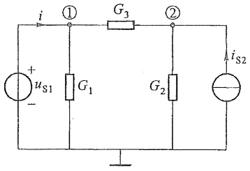

text_image

i
① G₃ ②
+ uₛ₁ G₁ G₂ iₛ₂
-

图3-19 例3-7图

这种方法实际上采用了混合变量,除了节点电压外,还把无伴电压源支路的电流作为变量[在回路电流法中,处理无伴电流源时也采用了混合变量(见例3-3)]。如果应用第二种处理方法,则舍弃上列3个方程中的第一个方程,而对第二、第三个方程联立求解 $u_{n2}$ 。

例 3-8 试用节点电压法求解图 3-20 所示电路。

解 该电路共有两个独立节点,但两个节点之间有一个无伴电压源,故仅有一个节点电压是独立的。如果不改变参考节点,无伴电压源仍在两个独立节点之间,也可不增加混合电路变量。此时可取一个包含节点①、②的封闭面,即所谓超节点来列写KCL方程。从图中可看出,有四条支路流经封闭面,因此得到KCL方程为

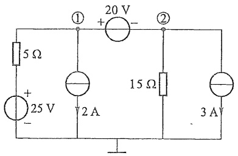

text_image

5 Ω
+
25 V
-
①
20 V
+
-
②
15 Ω
2 A
3 A

图3-20 例3-8图

<small>① 如果无伴电压源的一端是参考节点，除非要求无伴电压源的电流 i，否则该节点的 KCL 方程就是多余的，可不列，仅补充以约束方程。</small>

$$
\frac {1}{5} U _ {\mathrm{n1}} + \frac {1}{1 5} U _ {\mathrm{n2}} = \frac {2 5}{5} - 2 - 3
$$

约束方程为

$$
U _ {\mathrm{n1}} - U _ {\mathrm{n2}} = 2 0
$$

这就是该电路的节点方程组。求解方程组，可得  $U_{n1}=5\ V, U_{n2}=-15\ V$ 。

若电路中存在受控电流源，在建立节点电压方程时，先把控制量用节点电压表示，并暂时把它当作独立电流源，按前述方法列出节点电压方程，然后把用节点电压表示的受控电流源电流项移到方程的左边，再进行求解。当电路中存在有伴受控电压源时，把控制量用有关节点电压表示后再变换为等效受控电流源来处理。如果存在无伴受控电压源，可参照无伴独立电压源的处理方法。

例3-9 图3-21所示电路中独立源与CCVS都是无伴电压源。试列出其节点电压方程。

解 选择参考节点及标明独立节点,节点电压分别为 $U_{n1}$、$U_{n2}$、$U_{n3}$。独立电压源一端为参考节点,节点电压已知,故对节点①不列方程;对CCVS两端作包含节点②与③的封闭面S,对S列KCL方程为

$$
\frac {U _ {\mathrm{n2}} - U _ {\mathrm{n1}}}{R _ {1}} + \frac {U _ {\mathrm{n2}}}{R _ {2}} - g _ {\mathrm{m}} U + \frac {U _ {\mathrm{n3}}}{R _ {3}} = 0
$$

附加约束方程

$$
U _ {\mathrm{n1}} = U _ {\mathrm{s}}
$$

$$
U _ {\mathrm{n2}} - U _ {\mathrm{n3}} = R _ {\mathrm{m}} I _ {1}
$$

其中控制量 U 与  $I_{1}$  可以节点电压来表示, 即

$$
U = U _ {n 2}
$$

$$
I _ {1} = \frac {U _ {\mathrm{n1}} - U _ {\mathrm{n2}}}{R _ {1}}
$$

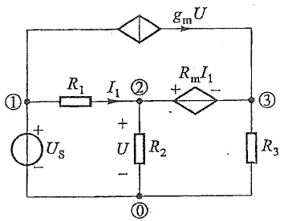

text_image

gm U
① R1 I1 ② Rm I1 - ③
+ Us -
U R2 -
R3
①

图3-21 例3-9图

经整理可得 3 变量方程组为

$$
\left. \begin{array}{l} - \frac {1}{R _ {1}} U _ {\mathrm{n} 1} + \left(\frac {1}{R _ {1}} + \frac {1}{R _ {2}} - g _ {\mathrm{m}}\right) U _ {\mathrm{n} 2} + \frac {1}{R _ {3}} U _ {\mathrm{n} 3} = 0 \\ U _ {\mathrm{n} 1} = U _ {\mathrm{S}} \\ - \frac {R _ {\mathrm{m}}}{R _ {1}} U _ {\mathrm{n} 1} + \left(1 + \frac {R _ {\mathrm{m}}}{R _ {1}}\right) U _ {\mathrm{n} 2} - U _ {\mathrm{n} 3} = 0 \end{array} \right\}
$$

节点电压法的步骤可以归纳如下:

(1) 指定参考节点,其余节点对参考节点之间的电压就是节点电压。通常以参考节点为各节点电压的负极性。
(2) 用一般公式(3-19)列出节点电压方程, 注意自导总是正的, 互导总是负的; 并注意各节点注入电流前面的“+”“-”号。
(3) 当电路中有受控源或无伴电压源时,需另行处理。

本章介绍了分析线性电阻电路的支路电流法、回路电流法（含网孔电流法）和节点电压法，并提到了2b法和支路电压法。就方程数目说，2b法为支路数b的2倍；支路电流（电压）法为支路数b；节点电压法为独立节点数 $(n-1)$ （n为节点数）；回路电流法为独立回路数 $(b-n+1)$ ；其中以2b法为最多。支路电流法要求每个支路电压都能以支路电流表示，这就使该方法的应用受到一定的限制，例如对于无伴电流源就需要另行处理。节点电压法也有类似问题存在，它要求每个支路电流都能以支路电压表示，对于无伴电压源就需要另行处理 $^{①}$ 。2b法的通用性最强，因为只要求写出每个支路的VCR，对任何元件都不难做到。回路电流法存在与支路电流法类似的限制。节点电压法的优点是节点电压容易选择，不存在选取独立回路的问题。用网孔电流法时，选取独立回路简便、直观，但仅适用于平面电路。

自电子计算机以及众多有效的应用软件普及后,高阶代数方程组的求解已不是难事,本书第十五章和附录 C 将简要介绍应用计算机辅助电路分析的基本知识。那时,考虑问题的出发点与手写列方程、求解方程时不同。

线性电阻电路方程是一组线性代数方程。无论用以上哪一种方法,均可获得未知数和方程数相等的一组代数方程。这组线性代数方程具有以下的普遍形式:

$$
\left. \begin{array}{c} a _ {1 1} x _ {1} + a _ {1 2} x _ {2} + \dots + a _ {1 N} x _ {N} = b _ {1 1} \\ a _ {2 1} x _ {1} + a _ {2 2} x _ {2} + \dots + a _ {2 N} x _ {N} = b _ {2 2} \\ \dots \dots \\ a _ {N 1} x _ {1} + a _ {N 2} x _ {2} + \dots + a _ {N N} x _ {N} = b _ {N N} \end{array} \right\}
$$

其中求解变量以 x 来表示,它可以是网孔电流、回路电流或节点电压;左方的系数为自阻、互阻,或是自导、互导,或是由于受控源而引入的系数;右方 b 则是电源激励,即电压源电压、电流源电流(或等效电压源电压、等效电流源电流)的线性组合。

从数学上说,只要方程的系数行列式不等于零,方程有解且是唯一解。线性电阻电路方程一般总是有解的,但是在某些特定条件以及特殊情况下,线性电阻电路方程可能无解,也可能存在多解。

在第二章和第三章,分别介绍了电阻电路分析的等效变换法和一般分析法,电阻电路的一般分析法更具普遍性。显然,当电路很简单时,采用第二章的等效变换法简单便捷,当电路复杂时,采用第三章的一般分析法更有效。

对于同一个电阻电路,在大多情况下,可以采用第三章介绍的任何一种分析方法。但对于一些特殊情况,可能采用一种方法比较方便,而采用另一种方法则比较烦琐。具体采用支路电流法、回路电流法还是节点电压法,要具体电路具体分析。学习者通过总结针对不同电路特点采用不同分析方法的规律,可以更加牢固地掌握本章介绍的电阻电路的一般分析法。

<small>① 一般而言，含有无伴电流源时采用变量为电流的方法（支路电流法、网孔电流法及回路电流法），含有无伴电压源时采用电压变量的方法（支路电压法、节点电压法等）。</small>

## 思考题

3-1 列写电路方程时,根据哪些因素来考虑使用哪种方程,以使求解的工作量较少?

3-2 为什么回路电流法的解答要用 KVL 来校验, 节点电压法的解答要用 KCL 来校验?

3-3 支路电流法包含哪些方程？对于具有 $n$ 个节点、$b$ 条支路和 $l$ 个独立回路的电路，共有多少个方程？

3-4 网孔电流法和回路电流法为什么不用列出 KCL 方程？

3-5 回路电流方程的本质是什么？对于既不含受控源，也不含无伴电流源的电路，其回路电流方程的系数有什么特点？

3-6 当含有受控源时,回路电流方程的系数有什么特点?

3-7 当含有无伴电流源时,有几种列写回路电流方程的方法?哪种方法最简单?

3-8 节点电压法为什么不用列出 KVL 方程?

3-9 节点电压方程的本质是什么？对于既不含受控源，也不含无伴电压源的电路，节点电压方程的系数有什么特点？

3-10 当含有受控源时？节点电压方程的系数有什么特点？

3-11 当含有多个无伴电压源时,节点电压方程需改进,增加新的变量和新的方程。新增加的方程是什么方程?新增加的变量是什么?

3-12 对于电阻电路的电路方程,对方程右端的激励项有什么要求?电路变量的形式与激励形式有什么联系?

3-13 对于由线性电阻、线性受控源、独立源组成的电路,其电路方程在数学上称为何种方程?

## 习题

3-1 在以下两种情况下,画出题 3-1 图所示电路的图,并说明其节点数和支路数:

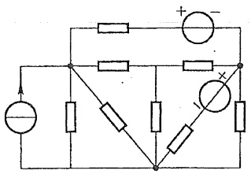

text_image

Electrical circuit diagram with resistors, voltage sources, and a meter labeled with polarity signs

(a)

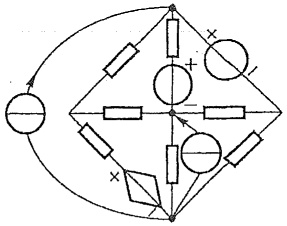

text_image

Electrical circuit diagram with labeled components and polarity indicators

(b)

题3-1图

(1) 每个元件作为一条支路处理。
(2) 电压源(独立或受控)和电阻的串联组合,电流源和电阻的并联组合作为一条支路处理。
3-2. 指出题 3-1 中两种情况下, KCL、KVL 独立方程各为多少?
3-3 对题 3-3 图(a)(b)所示图, 各画出 4 个不同的树, 树支数各为多少?

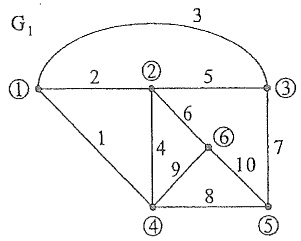

text_image

G₁
① 2 ② 5 ③
1 6 ⑥ 7
1 4 9 10
8 ④ ⑤

(a)

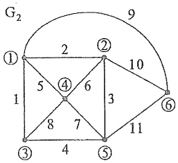

text_image

G₂
① 2 ② 9
1 5 4 6 3 10
1 8 7 11
③ 4 ⑤

(b)

题3-3图

3-4 题 3-4 图所示桥形电路共可画出 16 个不同的树,试一一列出(由于节点数为 4,故树支数为 3,可按支路号递增的穷举方法列出所有可能的组合,如 123,124,…,126,134,135,…,从中选出树)。
3-5 对题 3-3 图所示的  $G_{1}$  和  $G_{2}$ ，任选一树并确定其基本回路组，同时指出独立回路数和网孔数各为多少。

3-6 对题 3-6 图所示非平面图, 设:

(1) 选择支路 $(1,2,3,4)$ 为树。
(2) 选择支路 $(5,6,7,8)$ 为树。

独立回路各有多少？求其基本回路组。

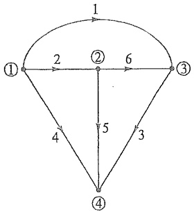

flowchart

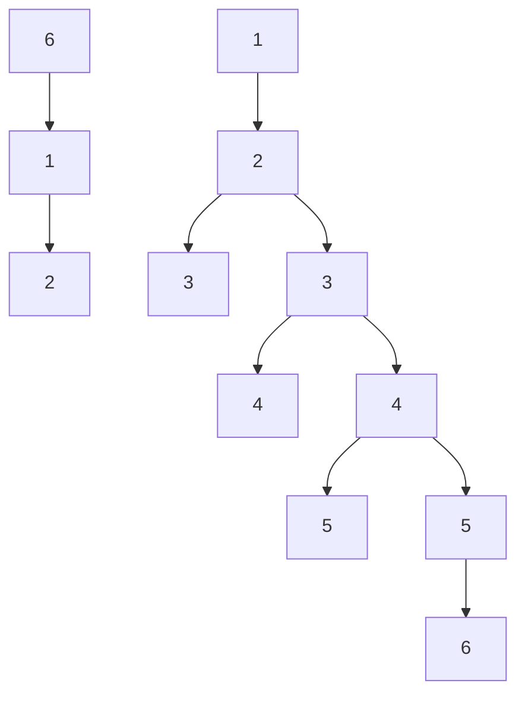

题3-4图

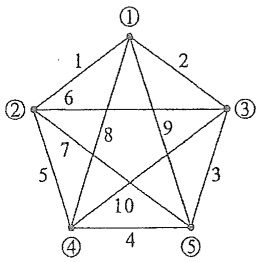

flowchart

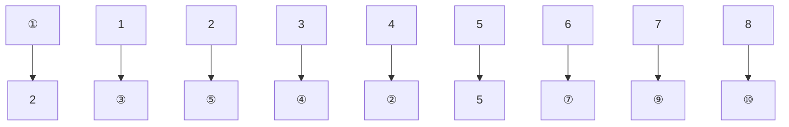

题 3-6 图

3-7 题 3-7 图所示电路中  $R_{1}=R_{2}=10\ \Omega, R_{3}=4\ \Omega, R_{4}=R_{5}=8\ \Omega, R_{6}=2\ \Omega, u_{S3}=20\ V, u_{S6}=40\ V$ ，用支路电流法求解电流  $i_{5}$ 。

3-8 用网孔电流法求解题 3-7 图中电流  $i_{s}$ 。
3-9 用回路电流法求解题 3-7 图中电流  $i_{3}$ 。

3-10 用回路电流法求解题 3-10 图所示电路中  $5 \Omega$  电阻中的电流  $i_{0}$

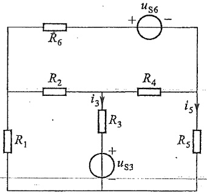

text_image

R6
+
us6
-
R2
i3
R4
i5
R1
R3
+
us3
R5

题3-7图

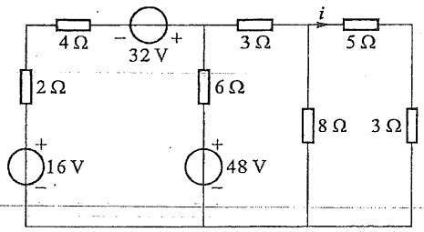

text_image

4Ω
-32 V
+
2 Ω
6 Ω
i
5 Ω
8 Ω 3 Ω
+16 V
-
+48 V

题3-10图

3-11 用回路电流法求解题 3-11 图所示电路中电流 I。
3-12 用回路电流法求解题 3-12 图所示电路中电流  $I_{\alpha}$  及电压  $U_{0}$ 。

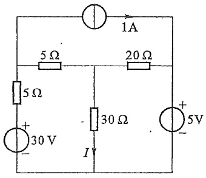

text_image

1A
5 Ω
20 Ω
5 Ω
+
30 V
-
30 Ω
I
+
5V
-

题3-11图

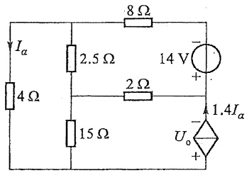

text_image

Ia
4 Ω
2.5 Ω
8 Ω
14 V
+
2 Ω
15 Ω
1.4Ia
Uo

题3-12图

3-13 用回路电流法求解:

(1) 题 3-13 图(a)中  $U_{x}$ 。
(2) 题 3-13 图 (b) 中 I。

(在本题中,应考虑如何选择独立回路,可使解题的工作量最少。)

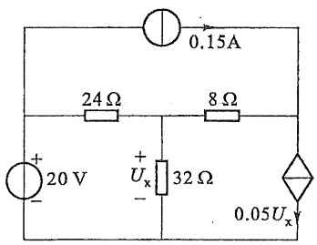

text_image

0.15A
24Ω 8Ω
+ 20 V + Uₓ 32Ω 0.05Uₓ
- -

(a)

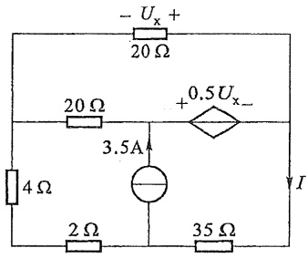

text_image

- Uₓ +
20 Ω
20 Ω
+ 0.5 Uₓ -
3.5A
4 Ω
2 Ω
35 Ω
I

(b)

题3-13图

3-14 用回路电流法求解题3-14图所示电路中 $I_{x}$ 以及CCVS的功率。

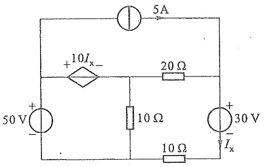

text_image

5A
+10Iₓ-
20 Ω
50 V +
-
10 Ω
+
30 V
-
10 Ω
Iₓ

题3-14图

3-15 列出题 3-15 图(a)(b)所示电路的节点电压方程。

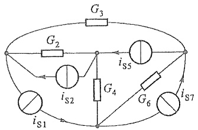

text_image

G3
G2
iS5
G4
G6
iS7
iS1

(a)

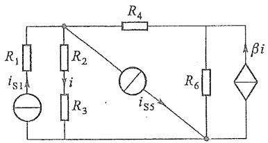

text_image

R1
iS1
R2
i
R3
iS5
R4
R6
βi

(b)

题 3-15 图

3-16 列出题 3-16 图(a)(b)所示电路的节点电压方程。

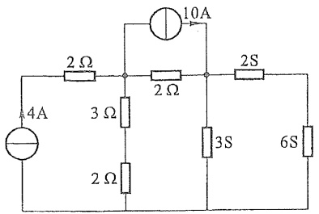

text_image

10A
2 Ω
2 Ω
2S
4A
3 Ω
3S
6S
2 Ω

(a)

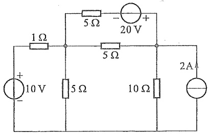

text_image

1 Ω
5 Ω
- 20 V +
5 Ω
+ 10 V -
5 Ω
10 Ω
2 A

(b)

题3-16图

3-17 题 3-17 图所示为由电压源和电阻组成的一个独立节点的电路,用节点电压法证明其节点电压为

$$
u _ {n 1} = \frac {\sum G _ {k} u _ {S k}}{\sum G _ {k}}
$$

此式又称为弥尔曼定理。

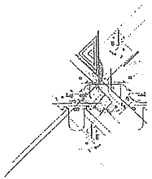

text_image

Technical diagram with labeled geometric lines and annotations, likely from a technical drawing or engineering manual.

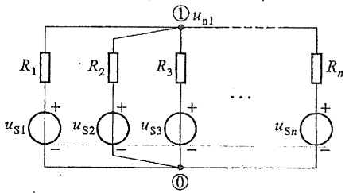

text_image

R₁
uₛ₁ +
-
R₂
uₛ₂ +
-
① uₙ₁
R₃
uₛ₃ +
-
...
Rₙ
uₛₙ +
-
①

题3-17图

3-18 列出题 3-18 图(a)(b)所示电路的节点电压方程。

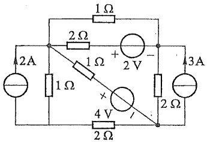

text_image

1Ω
2Ω
+
2V
-
3A
2A
1Ω
1Ω
×
4V
/
2Ω
2Ω

(a)

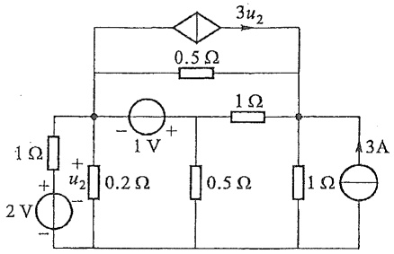

text_image

3u₂
0.5 Ω
1 Ω
- 1 V +
1 Ω
+ u₂ 0.2 Ω 0.5 Ω 1 Ω 3A
2 V -
1 Ω

(b)

题3-18图

3-19 用节点电压法求解题 3-19 图所示电路中各支路电流。

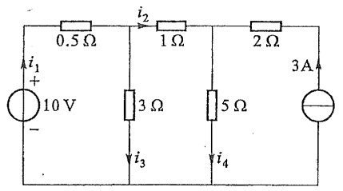

text_image

0.5 Ω
i₁ +
10 V
-
i₂
1 Ω
3 Ω
i₃
5 Ω
i₄
2 Ω
3A
-

(a)

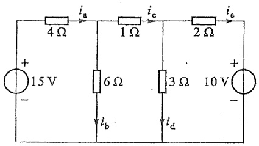

text_image

i_a
4 Ω
1 Ω
i_c
2 Ω
i_e
+
15 V
-
6 Ω
3 Ω
10 V
+
-
i_b
i_d

(b)

题3-19图

3-20 题 3-20 图所示电路中电源为无伴电压源,用节点电压法求解电流  $I_{s}$  和  $I_{0}$ 。
3-21 用节点电压法求解题 3-21 图所示电路中电压 U。（请注意如何使待解的独立方程数为最少。）

3-22 用节点电压法求解题 3-13。

3-23 用节点电压法求解题 3-14。

3-24 用节点电压法求解题 3-24 图所示电路后, 求各元件的功率并检验功率是否平衡。

3-25 用节点电压法求解题3-25图所示电路中 $u_{n1}$ 和 $u_{n2}$，你对此题的求解结果有什么看法？

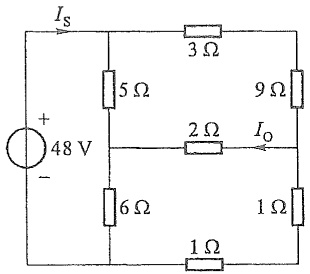

text_image

I_S
+
48 V
-
5 Ω
3 Ω
9 Ω
2 Ω
I_O
6 Ω
1 Ω
1 Ω

题 3-20 图

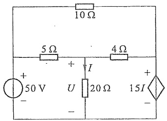

text_image

10 Ω
5 Ω
+
I
4 Ω
+ 50 V U 20 Ω 15 I
- -

题3-21图

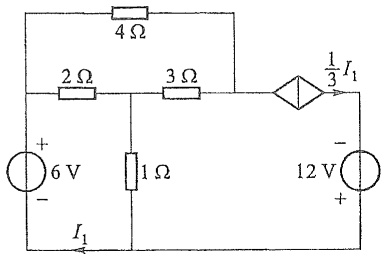

text_image

4 Ω
2 Ω 3 Ω
+ 6 V 1 Ω
- I₁
1/3 I₁
- 12 V +
+

题3-24图

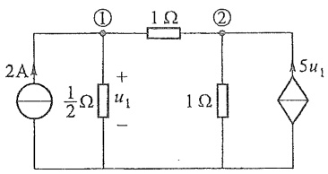

text_image

2A
①
1 Ω
②
½ Ω
+
u₁
-
1 Ω
5u₁

题3-25图

3-26 列出题 3-26 图所示电路的节点电压方程。如果  $R_{s}=0$ ，则方程又如何？（提示:为避免引入过多附加电流变量，对连有无伴电压源的节点部分，可在包含无伴电压源的封闭面 S 上写出 KCL 方程。）

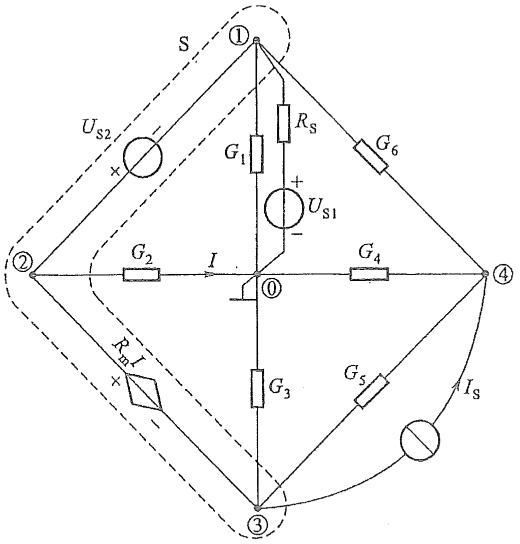

text_image

S
①
Us2
+
-
G1
RS
+
Us1
-
G6
②
G2
I
①
G4
④
G3
G5
Is
③
R3
I

题 3-26 图

3-27 用回路电流法求解题 3-27 图所示电路。可将四个电流源支路都取为连支。对基本回路列出方程后求解出各支路的电压或电流，求各支路的功率并验证功率的平衡。

第三章部分习题答案

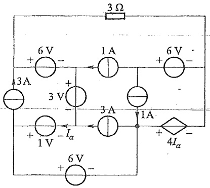

text_image

3Ω
+ 6V -
1A
+ 6V -
3A
+ 3V -
3A
- Iα
+ 1V -
1A
+ 4Iα -
+ 6V -
-

题3-27图

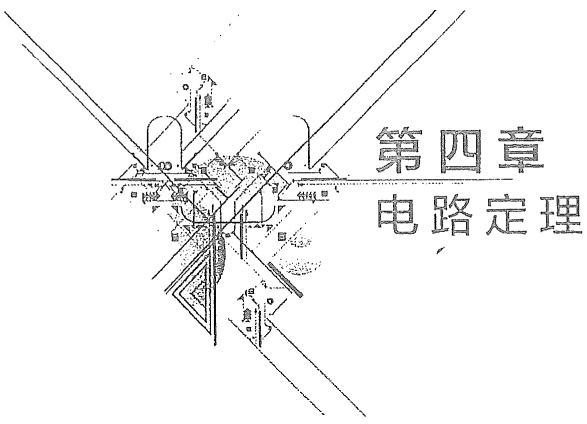

text_image

第四章
电路定理

## 导读

第三章介绍的列写电路方程的系统方法奠定了电路分析的基础。在电路公理系统（基尔霍夫两定律以及集总参数的假定）的前提下，本章推导出的电路定理有助于灵活高效地解决一些特殊的电路问题。其中，叠加定理给出了把电路激励“分而治之”的方法，它是反映线性电路性质的重要定理，是线性方程的齐次性和可加性在电路中的体现；替代定理是一种特殊的等效变换，有时可将电路大大化简；戴维南定理、诺顿定理则是在电路结构上的一种“分而治之”的方法（实际上也是一种等效变换方法），它提供了化简线性一端口的有效方法；在戴维南定理基础上推导的最大功率传输定理在实际工程中有广泛的应用；特勒根定理出现虽晚（1940年后），但它揭示了基尔霍夫两个定律在互连性质上的一个天然联系，提供了研究网络有变化时新的构思①；互易定理体现了一类不含独立源和受控源的线性二端口所具有的互易性质；对偶原理看似图形、文字游戏，但有助于理解由定义及使用倒数关系参数 $R, G$ 后而引起一系列的电路、公式方程之间的联系。

本章介绍的叠加定理、替代定理、戴维南定理、诺顿定理、最大功率传输定理、特勒根定理等在本书后续内容中会经常用到。

## §4-1 叠加定理

作为线性系统(包含线性电路)最基本的性质——线性性质,它包含可加性与齐次性两方面。叠加定理就是可加性的反映,它是线性电路的一个重要定理。可加性的概念可以说是贯穿于电路分析之中,并在叠加定理中直接得到应用。

图 4-1(a) 所示电路中有两个独立电源, 它们是电路中的激励, 现在要求解作为电路响应的电流  $i_{2}$  与电压  $u_{1}$ 。

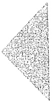

叠加定理

<small>① 研究网络灵敏度的伴随网络法得益于特勒根定理。</small>

根据 KCL、KVL 与 VCR 可列出以  $i_{2}$  为未知量的方程:  $u_{\mathrm{S}} = R_{1}(i_{2} - i_{\mathrm{S}}) + R_{2}i_{2}$ ，从而解得

$$
\left. \begin{array}{l} i _ {2} = \frac {u _ {\mathrm{S}}}{R _ {1} + R _ {2}} + \frac {R _ {1} i _ {\mathrm{S}}}{R _ {1} + R _ {2}} \\ u _ {1} = \frac {R _ {1} u _ {\mathrm{S}}}{R _ {1} + R _ {2}} - \frac {R _ {1} R _ {2} i _ {\mathrm{S}}}{R _ {1} + R _ {2}} \end{array} \right\} \tag {4-1}
$$

式(4-1)中，两个响应 $i_{2}$ 、 $u_{1}$ 分别是激励 $u_{s}$ 和 $i_{s}$ 的线性组合。可将其改写为

$$
\left. \begin{array}{l} i _ {2} = i _ {2} ^ {\prime} + i _ {2} ^ {\prime \prime} \\ u _ {1} = u _ {1} ^ {\prime} + u _ {1} ^ {\prime \prime} \end{array} \right\} \tag {4-2}
$$

其中

$$
i _ {2} ^ {\prime} = \frac {u _ {\mathrm{S}}}{R _ {1} + R _ {2}} = i _ {2} \Bigg | _ {i _ {\mathrm{S}} = 0}, \quad i _ {2} ^ {\prime \prime} = \frac {R _ {1} i _ {\mathrm{S}}}{R _ {1} + R _ {2}} = i _ {2} \Bigg | _ {u _ {\mathrm{S}} = 0}
$$

$$
u _ {1} ^ {\prime} = \frac {R _ {1} u _ {\mathrm{S}}}{R _ {1} + R _ {2}} = u _ {1} \Bigg | _ {i _ {\mathrm{S}} = 0}, \quad u _ {1} ^ {\prime \prime} = - \frac {R _ {1} R _ {2} i _ {\mathrm{S}}}{R _ {1} + R _ {2}} = u _ {1} \Bigg | _ {u _ {\mathrm{S}} = 0}
$$

式中  $i_{2}^{\prime}$  与  $u_{1}^{\prime}$  为将原电路中电流源  $i_{s}$  置零时的响应，即由  $u_{s}$  单独作用的分电路中所产生的电流、电压分响应，如图 4-1(b) 所示； $i_{2}^{\prime\prime}$  与  $u_{1}^{\prime\prime}$  为将原电路中电压源  $u_{s}$  置零后由  $i_{s}$  单独作用的分电路中所产生的电流、电压分响应，如图 4-1(c) 所示。

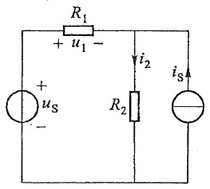

text_image

R₁
+ u₁ -
i₂
+
uₛ
-
R₂
iₛ

(a)

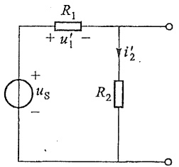

text_image

R₁
+ u₁' -
+ uₛ -
i₂'

(b)

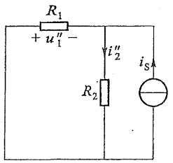

text_image

R₁
+ u₁'' -
i₂''
R₂
iₛ

(c)

图 4-1 叠加定理

原电路的响应则为相应分电路中分响应的和(代数和)，可写出  $u_{1}=k_{1}u_{S}+k_{2}i_{S}$ ，以及  $i_{2}=k_{1}^{\prime}u_{S}+k_{2}^{\prime}i_{S}$  的形式。这就是叠加定理。

叠加定理可以证明如下:

在第三章已经指出:对于一个具有 b 条支路、n 个节点的电路,如果用回路电流或节点电压作为变量列出电路方程,此种方程具有以下形式:

$$
\left. \begin{array}{c} a _ {1 1} x _ {1} + a _ {1 2} x _ {2} + \dots + a _ {1 N} x _ {N} = b _ {1 1} \\ a _ {2 1} x _ {1} + a _ {2 2} x _ {2} + \dots + a _ {2 N} x _ {N} = b _ {2 2} \\ \dots \dots \\ a _ {N 1} x _ {1} + a _ {N 2} x _ {2} + \dots + a _ {N N} x _ {N} = b _ {N N} \end{array} \right\} \tag {4-3}
$$

式中求解变量以  $x_{k}(k=1,2,\cdots,N)$  表示，右方系数  $b_{kk}(k=1,2,\cdots,N)$  是电路中激励的线性组合。当此方程是回路电流方程时， $x_{k}$ 是回路电流 $i_{lk}$，系数 $a_{kj}(k=1,2,\cdots,N;j=1,2,\cdots,N)$ 是自阻或互阻， $b_{kk}$ 则是回路中独立电压源电压和由独立电流源等效变换后所得电压源电压的线性组合。当此方程是节点电压方程时， $x_{k}$ 是节点电压 $u_{nk}$，系数 $a_{kj}$ 是自导或互导， $b_{kk}$ 是节点上的独立电流源的注入电流和独立电压源等效变换后所得电流源的注入电流的线性组合。式(4-3)的解的一般形式为

$$
x _ {k} = \frac {\Delta_ {1 k}}{\Delta} b _ {1 1} + \frac {\Delta_ {2 k}}{\Delta} b _ {2 2} + \dots + \frac {\Delta_ {N k}}{\Delta} b _ {N N}
$$

式中  $\Delta$  为  $a_{kj}$  系数构成的行列式， $\Delta_{jk}$  是  $\Delta$  的第 j 行第 k 列的余子式。由于  $b_{11}$ 、 $b_{22}$ 、…都是电路中激励的线性组合，而每个解答  $x_{k}$  又是  $b_{11}$ 、 $b_{22}$ 、…的线性组合，故任意一个解（电压或电流）都是电路中所有激励的线性组合。当电路中有 g 个电压源和 h 个电流源时，任意一处电压  $u_{f}$  或电流  $i_{f}$  都可以写为以下形式:

$$
\left. \begin{array}{l} u _ {\mathrm{f}} = k _ {\mathrm{f1}} u _ {\mathrm{S1}} + k _ {\mathrm{f2}} u _ {\mathrm{S2}} + \dots + k _ {\mathrm{fg}} u _ {\mathrm{Sg}} + K _ {\mathrm{f1}} i _ {\mathrm{S1}} + K _ {\mathrm{f2}} i _ {\mathrm{S2}} + \dots + K _ {\mathrm{fh}} i _ {\mathrm{Sh}} \\ = \sum_ {m = 1} ^ {g} k _ {\mathrm{fm}} u _ {\mathrm{Sm}} + \sum_ {m = 1} ^ {h} K _ {\mathrm{fm}} i _ {\mathrm{Sm}} \\ \dots \dots \\ i _ {\mathrm{f}} = k _ {\mathrm{f1}} ^ {\prime} u _ {\mathrm{S1}} + k _ {\mathrm{f2}} ^ {\prime} u _ {\mathrm{S2}} + \dots + k _ {\mathrm{fg}} ^ {\prime} u _ {\mathrm{Sg}} + K _ {\mathrm{f1}} ^ {\prime} i _ {\mathrm{S1}} + K _ {\mathrm{f2}} ^ {\prime} i _ {\mathrm{S2}} + \dots + K _ {\mathrm{fh}} ^ {\prime} i _ {\mathrm{Sh}} \\ = \sum_ {m = 1} ^ {g} k _ {\mathrm{fm}} ^ {\prime} u _ {\mathrm{Sm}} + \sum_ {m = 1} ^ {h} K _ {\mathrm{fm}} ^ {\prime} i _ {\mathrm{Sm}} \end{array} \right\} \tag {4-4}
$$

式中各激励的系数取决于电路结构与相关电阻值。叠加定理于是得证。

叠加定理可表述为:在线性电阻电路中,某处电压或电流都是电路中各个独立电源单独作用时,在该处分别产生的电压或电流的叠加。线性电路中很多定理都与叠加定理有关,它是分析线性电路的基础。在直接应用叠加定理计算和分析电路时,也可将电源分成几组,按组计算以后再叠加,有时可简化计算。

当电路中存在受控源时,由于受控源的作用反映在回路电流方程或节点电压方程中的自阻和互阻或自导和互导中,所以任一处的电流或电压仍可按照各独立电源分别作用时在该处产生的电流或电压的叠加计算。所以对含有受控源的电路,叠加定理仍然适用,但是在进行各分电路计算时,应把受控源保留在各分电路之中①。

使用叠加定理时应注意以下几点:

(1) 叠加定理适用于线性电路, 不适用于非线性电路。
(2) 在叠加的各分电路中, 如将不作用的电压源置零, 则在该电压源处用短路线代替；如将不作用的电流源置零，则在该电流源处用开路代替。电路中所有电阻都不予更动，受控源则保留在各分电路中。

<small>① 受控源不同于独立电源，它不直接起“激励”作用，但是又带有“电源”性质。在列电路方程时，往往把受控源的电流或电压“暂时”列于方程的右边，如同独立电源。如果在应用叠加定理时，把受控源当作独立电源处理，不把受控源保留在各分电路中，而另外设仅含受控源的分电路也是可行的，但是受控源的控制量不是该分电路中的控制量，而应是原电路中的控制量。在最终进行叠加时，也要包含受控源分电路的分量。这种处理方法的不足之处是原电路的控制量是未知的，需要按各分电路叠加才能求得。具体做法可参见本章习题。严格地说，叠加性质是针对各独立电源而言的。</small>

(3) 叠加时各分电路中的电压和电流的参考方向可以取为与原电路中的相同。取代数和时，应注意各分量前的“+”“-”号。
(4) 原电路的功率不等于从各分电路计算所得功率的叠加, 这是因为功率是电压和电流的乘积, 与激励不呈线性关系, 可在求出总响应后再进行功率计算。

例 4-1 试用叠加定理计算图 4-2(a) 所示电路中的  $U_{1}$  与  $I_{2}$ 。

解 画出电压源与电流源分别作用时的分电路如图4-2(b)与图4-2(c)所示。对图4-2(b)有

$$
U _ {1} ^ {\prime} = \left(\frac {2 0}{2 0 + 2 0} \times 2 0 - \frac {3 0}{2 0 + 3 0} \times 2 0\right) \mathrm{V} = - 2 \mathrm{V}
$$

$$
I _ {2} ^ {\prime} = \frac {2 0}{2 0 + 2 0} \mathrm{A=0.5A}
$$

对图 4-2(c) 有

$$
U _ {1} ^ {\prime \prime} = \left(\frac {2 0 \times 2 0}{2 0 + 2 0} + \frac {2 0 \times 3 0}{2 0 + 3 0}\right) \times 0. 5 \mathrm{V} = 1 1 \mathrm{V}
$$

$$
I _ {2} ^ {\prime \prime} = \frac {2 0}{2 0 + 2 0} \times 0. 5 \mathrm{A} = 0. 2 5 \mathrm{A}
$$

原电路的总响应为

$$
U _ {1} = U _ {1} ^ {\prime} + U _ {1} ^ {\prime \prime} = (- 2 + 1 1) \mathrm{V} = 9 \mathrm{V}
$$

$$
I _ {2} = I _ {2} ^ {\prime} + I _ {2} ^ {\prime \prime} = (0. 5 + 0. 2 5) \mathrm{A} = 0. 7 5 \mathrm{A}
$$

显然,由于使用了叠加定理,本题的求解得以简化。

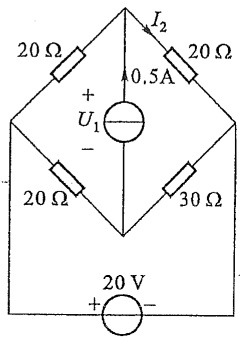

text_image

20 Ω
+
U₁
-
20 Ω
I₂
0.5A
20 Ω
30 Ω
20 V
+

(a)

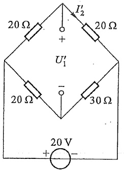

text_image

20 Ω
+
I'₂
20 Ω
U'₁
-
20 Ω
30 Ω
20 V
+ -

(b)

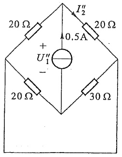

text_image

20 Ω
+
U₁"
-
20 Ω
30 Ω
0.5A
I₂"
20 Ω

(c)

图4-2 例4-1图

例 4-2 电路如图 4-3(a) 所示, 其中 CCVS 的电压受流过 6.Ω 电阻的电流  $i_{1}$  控制。求电压  $u_{3}$ 。

解 按叠加定理,作出 10 V 电压源和 4 A 电流源分别作用的分电路,如图 4-3(b)

和图 4-3(c) 所示。受控源均保留在分电路中，并受其中的分电流控制。在图 4-3(b) 中有

$$
i _ {1} ^ {\prime} = i _ {2} ^ {\prime} = \frac {1 0}{6 + 4} \mathrm{A} = 1 \mathrm{A}
$$

$$
u _ {3} ^ {\prime} = - 1 0 i _ {1} ^ {\prime} + 4 i _ {2} ^ {\prime} = (- 1 0 + 4) \mathrm{V} = - 6 \mathrm{V}
$$

在图 4-3(c) 中有

$$
i _ {1} ^ {\prime \prime} = - \frac {4}{6 + 4} \times 4 \mathrm{A} = - 1. 6 \mathrm{A}
$$

$$
i _ {2} ^ {\prime \prime} = 4 \mathrm{A} + i _ {1} ^ {\prime \prime} = 2. 4 \mathrm{A}
$$

$$
u _ {3} ^ {\prime \prime} = - 1 0 i _ {1} ^ {\prime \prime} + 4 i _ {2} ^ {\prime \prime} = 2 5. 6 \mathrm{V}
$$

所以

$$
u _ {3} = u _ {3} ^ {\prime} + u _ {3} ^ {\prime \prime} = 1 9. 6 \mathrm{V}
$$

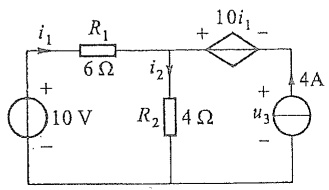

text_image

i₁
R₁
6 Ω
+ 10i₁ -
+
10 V
-
i₂
R₂
4 Ω
+
u₃
-
4A

(a)

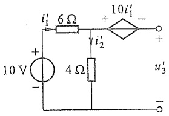

text_image

10 V
+
-
i'₁ 6 Ω
4 Ω
i'₂
+ 10i'₁ -
u'₃
-

(b)

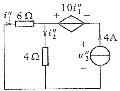

text_image

i''₁ 6 Ω + 10i''₁ -
4 Ω i''₂ + u''₃ 4A
-

(c)

图4-3 例4-2图

例 4-3 在图 4-3(a) 所示电路中的电阻  $R_{2}$  处再串接一个 6 V 电压源, 如图 4-4(a) 所示, 重求  $u_{3}$ 。

解 应用叠加定理,把 10 V 电压源和 4 A 电流源合为一组激励,其分响应在例 4-2 中已求得;所加 6 V 电压源看为另一组激励。分电路分别如图 4-4(b)与图 4-4(c)所示。利用上例结果,图 4-4(b)的分响应为

$$
u _ {3} ^ {\prime} = 1 9. 6 \mathrm{V}
$$

而在图 4-4(c) 中，

$$
i _ {1} ^ {\prime \prime} = i _ {2} ^ {\prime \prime} = \frac {- 6}{6 + 4} \mathrm{A} = - 0. 6 \mathrm{A}
$$

$$
u _ {3} ^ {\prime \prime} = - 1 0 i _ {1} ^ {\prime \prime} + 4 i _ {2} ^ {\prime \prime} + 6 \mathrm{V} = 9. 6 \mathrm{V}
$$

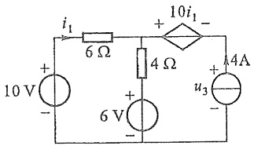

text_image

i₁
6 Ω
+
10i₁
-
4 Ω
4A
+
10 V
-
+
6 V
-
u₃
-

(a)

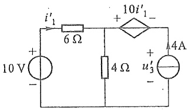

text_image

i'₁
6 Ω
10i'₁
+
-
4Ω
4A
+
u'₃'
10 V
-

(b)

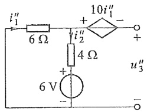

text_image

i''₁
6 Ω
+
10i''₁
-
+
i''₂
4 Ω
+
6 V
-
u''₃
-

(c)

图4-4 例4-3图

所以

$$
u _ {3} = u _ {3} ^ {\prime} + u _ {3} ^ {\prime \prime} = 2 9. 2 \mathrm{V}
$$

在线性电路中, 当所有激励(独立电压源和独立电流源)都同时增大或缩小 K 倍(K 为实常数)时, 响应(电压和电流)也将同样增大或缩小 K 倍。这就是线性电路的齐性定理, 它不难从叠加定理推得。应注意, 这里的激励是指独立电源, 并且必须全部激励同时增大或缩小 K 倍, 否则将导致错误的结果。显然, 当电路中只有一个激励时, 所有响应必与该激励成正比。

如果例 4-3 中电压源由 6 V 增至 8 V, 则根据齐性定理, 8 V 电压源单独作用产生的  $u_{3}^{m}$  为

$$
u _ {3} ^ {\prime \prime \prime} = \frac {9 . 6 \times 8}{6} \mathrm{V} = 1 2. 8 \mathrm{V}
$$

故此时应有  $u_{3}=u_{3}^{\prime}+u_{3}^{\prime\prime\prime}=(19.6+12.8)\mathrm{V}=32.4\mathrm{~V}$

用齐性定理分析梯形电路特别有效。

例 4-4 求图 4-5 所示梯形电路中各支路电流。

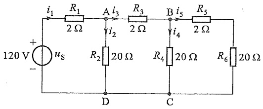

text_image

120 V
+
-
us
i1
R1
2 Ω
A i3
i2
R3
2 Ω
B i5
i4
R5
2 Ω
R2
20 Ω
R4
20 Ω
C
D
R6
20 Ω

图4-5 例4-4图

解 设  $i_{5}=i_{5}^{\prime}=1\ A$ ，则

$$
u _ {\mathrm{BC}} ^ {\prime} = (R _ {5} + \dot {R} _ {6}) i _ {5} ^ {\prime} = 2 2 \mathrm{V}
$$

$$
i _ {4} ^ {\prime} = \frac {u _ {\mathrm{BC}} ^ {\prime}}{R _ {4}} = 1. 1 \mathrm{A}
$$

$$
i _ {3} ^ {\prime} = i _ {4} ^ {\prime} + i _ {5} ^ {\prime} = 2. 1 \mathrm{A}
$$

$$
u _ {\mathrm{AD}} ^ {\prime} = R _ {3} i _ {3} ^ {\prime} + u _ {\mathrm{BC}} ^ {\prime} = 2 6. 2 \mathrm{V}
$$

$$
i _ {2} ^ {\prime} = \frac {u _ {\mathrm{AD}} ^ {\prime}}{R _ {2}} = 1. 3 1 \mathrm{A}
$$

$$
i _ {1} ^ {\prime} = i _ {2} ^ {\prime} + i _ {3} ^ {\prime} = 3. 4 1 \mathrm{A}
$$

$$
u _ {\mathrm{S}} ^ {\prime} = R _ {1} i _ {1} ^ {\prime} + u _ {\mathrm{AD}} ^ {\prime} = 3 3. 0 2 \mathrm{V}
$$

现给定  $u_{s}=120\ V$ ，相当于将以上激励  $u_{s}^{\prime}$  增至  $\frac{120}{33.02}$  倍，即增大的倍数  $K=\frac{120}{33.02}=3.63$ ，故每个支路电流应同时乘以 3.63 倍，即

$$
\begin{array}{l} i _ {1} = K i _ {1} ^ {\prime} = 1 2. 3 8 \mathrm{A} \\ i _ {2} = K i _ {2} ^ {\prime} = 4. 7 6 \mathrm{A} \\ i _ {3} = K i _ {3} ^ {\prime} = 7. 6 2 \mathrm{A} \\ i _ {4} = K i _ {4} ^ {\prime} = 3. 9 9 \mathrm{A} \\ i _ {s} = K i _ {s} ^ {\prime} = 3. 6 3 \mathrm{A} \\ \end{array}
$$

本例计算是先从梯形电路最远离电源的一端开始,倒退至激励处。故这种计算方法称为“倒退法”。先对某个电压或电流设一便于计算的值,如本例设  $i_{5}^{\prime}=1\ A$ , 最后再按齐性定理予以修正。

## §4-2 替代定理

替代定理是一个应用范围颇为广泛的定理,它不仅适用于线性电路,也适用于非线性电路。它时常用来对局部电路进行简化,从而使电路易于分析或计算。

替代定理的内容可叙述如下:在电路中如已求得  $N_{A}$  与  $N_{B}$  两个一端口网络连接端口的电压  $u_{p}$  与电流  $i_{p}$ ，那么就可用一个  $u_{S}=u_{P}$  的电压源或一个  $i_{S}=i_{P}$  的电流源来替代其中的一个网络，而使另一个网络的内部电压、电流均维持不变。图 4-6(a) 是原电路，图 4-6(b) 是将  $N_{B}$  替代为一个电压源  $u_{S}$ ; 图 4-6(c) 是将  $N_{B}$  替代为一个电流源  $i_{S}$ ，而图 4-6(a)(b)(c) 三图中， $N_{A}$  中的电压、电流都是相同的。

图 4-6(d) 示出替代定理的证明过程 [它仅给出图 4-6(b) 所示的电压源替代  $N_{B}$  的证明]。先在  $N_{B}$  的端子 a、c 间串接两个电压方向相反，但激励电压均为  $u_{s}$  的电压源，这不会影响  $N_{A}$  及  $N_{B}$  内的各电压、电流。令  $u_{s}=u_{p}$ ，由于 b、d 之间的电压  $u_{bd}=0$ ，用一条短路线将 b、d 两点短接后， $N_{A}$  中的电压、电流也不会发生变化。这就得到图 4-6(b)。也即证明了把  $N_{B}$  替代为一个  $u_{s}=u_{p}$  的电压源后， $N_{A}$  不会发生变化。图 4-6(c) 所示的电流源替代  $N_{B}$  的证明, 可在 a、d 端子间并接两个电流方向相反, 但激励电流值相同的电流源而得到。

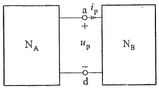

text_image

N_A
a i_p
+
u_p
-
d
N_B

(a)

text_image

N_A
+
u_p
-
+
u_S
-

(b)

text_image

N_A
i_p
i_S

(c)

text_image

N_A
u_p
+
-
a
+
-
b
u_S
+
-
c
u_S
N_B
d

(d)

图 4-6 替代定理及证明

替代定理

如果在  $N_{B}$  中有  $N_{A}$  中受控源的控制量， $N_{B}$  被替代后将无法表达这种控制关系，这时， $N_{B}$  就不可以被替代。替代定理常在简化电路或电路定理的证明时得到应用。

图 4-7 示出替代定理应用的实例。图 4-7(a) 中，可求得  $u_{3}=8\ V, i_{3}=1\ A$ 。现将支路 3 分别以  $u_{s}=u_{3}=8\ V$  的电压源或  $i_{s}=i_{3}=1\ A$  的电流源替代，如图 4-7(b) 或图 4-7(c) 所示，不难看出，在图 4-7(a)(b)(c) 中，其他部分的电压和电流均保持不变，即  $i_{1}=2\ A, i_{2}=1\ A$ 。

text_image

i₁
6 Ω
+
20 V
-
i₂
8 Ω
+
u₃
4 Ω
+
4 V
-

(a)

text_image

i₁
6 Ω
+
20 V
-
i₂
8 Ω
i₃
uₛ=u₃=8 V
+
-

(b)

text_image

i₁
6 Ω
+
20 V
-
i₂
8 Ω
iₛ=i₃=1A

(c)

图 4-7 替代定理示例

顺便指出,支路3也可用一个电阻来替代,其值为 $R_{s}=\frac{u_{s}}{i_{s}}=\frac{8}{1}\Omega=8\Omega$ ,此时,其他部分的电压和电流亦保持不变。

## §4-3 戴维南定理和诺顿定理$^{①}$

根据齐性定理,一个不含独立电源、仅含线性电阻和受控源的一端口网络,其端口输入电压与端口输入电流必呈比例关系,这个比值就定义为该一端口的输入电阻(见§2-6)或等效电阻。所以这类一端口可以用一个电阻等效置换加以简化。对于一个既含线性电阻、受控源又含独立电源的一端口网络,应如何对其简化,或者说它的等效电路是什么?本节介绍的戴维南定理和诺顿定理将回答这个问题。为了叙述方便,将上述这类一端口网络简称为“含源一端口”,这里“含源”是指含独立电源。

从等效的简化电路与原来的一端口必须具有相同的端口外特性出发,图 4-8(a) 中左方框是一个含源一端口,为了求其端口的伏安特性,可以设想在端口 1-1' 处加一个电压源 $U^{①}$,然后求解端口电流 $I$,从而得出 $U$ 和 $I$ 的函数关系。利用节点电压法,可以得到节点电压方程为

戴维南定理

诺顿定理

<small>① Thevenin's theorem, Norton's theorem。</small>

$$
U _ {\mathrm{ao}} \left(\frac {1}{5} + \frac {1}{4} + \frac {1}{2 0}\right) = \frac {2 5}{5} + 3 + \frac {U}{4}
$$

可解得 $U_{\mathrm{ao}} = 16 + \frac{U}{2}$，由 $I = \frac{U_{\mathrm{ao}} - U}{4}$ 就得到含源一端口的外特性为

$$
U = 3 2 - 8 I
$$

或

$$
I = 4 - \frac {U}{8}
$$

与此两方程相应的等效含源支路如图4-8(b)(c)所示。这一结果是具有普遍性的，即任意含源线性一端口，其端口的电压 $U$ 和电流 $I$ 呈现线性函数关系，可以等效变换（简化）为带内阻的电压源或电流源，前者称为戴维南等效电路；后者称为诺顿等效电路。

text_image

25 V 20 Ω
5 Ω
3A
a
4 Ω
I 1
+
-
U
1'
o

(a)

text_image

+
32 V
-
8 Ω
I
+
1
U
-
1'

(b)

text_image

4A
8 Ω
I
+
1
U
-
1'

(c)

图 4-8 等效含源支路

图 4-9 示出含源一端口 [图 4-9(a)] 的两种等效电路 $^{②}$ ，其中图 4-9(b) 为戴维南等效电路；图 4-9(c) 为诺顿等效电路。由于图 4-9(b)(c) 电路与图 4-9(a) 电路在一切情况下对外等效，所以图 4-9(b) 中  $u_{oc}$  即为图 4-9(a) 中 1-1' 开路时端口的开路电压；同理图 4-9(c) 中  $i_{sc}$  即为图 4-9(a) 中 1-1' 短路时端口的短路电流。将图 4-9(b) 中 1-1' 短路或将图 4-9(c) 中 1-1' 开路，均可得到  $u_{oc}$ 、 $i_{sc}$  与  $R_{eq}$  之间的一个重要关系，即

$$
u _ {\mathrm{oc}} = R _ {\mathrm{eq}} i _ {\mathrm{sc}} \tag {4-5}
$$

$R_{eq}$  称为等效电路的等效电阻, $R_{cq}$  也可直接从图 4-9(a) 来求得。将 N 中所有独立电源置零，即电压源处用短路代替，电流源处用开路代替。置零后的N以 $N_{p}$ 表示。 $N_{p}$ 的戴维南等效电路和诺顿等效电路中，由于 $N_{p}$ 中无独立电源，故必然 $u_{oc}=0,i_{sc}=0$ ，从图4-9(b)或图4-9(c)的端口1-1'看入的输入电阻均为 $R_{eq}$ ，它就等于图4-9(d)中 $N_{p}$ 在端口1-1'的输入电阻。

<small>① 也可以在端口加电流源 I 后求 U。使用这种一步到位的方法仅对于结构简单的电路可行。</small>

<small>② 通常将这两种等效电路称为原含源一端口的等效发电机。</small>

(a)

(b)

text_image

i_sc
R_eq
1
1'

(c)

text_image

Nₚ
O₁
Rₑₑq
O₁'

(d)

图 4-9 等效参数

戴维南定理指出:一个含独立电源、线性电阻和受控源 $^{①}$ 的一端口,对外电路来说,可以用一个电压源和电阻的串联组合来等效替换,此电压源的激励电压等于一端口的开路电压,电阻等于一端口内全部独立电源置零后的输入电阻。

诺顿定理指出:一个含独立电源、线性电阻和受控源的一端口,对外电路来说,可以用一个电流源和电阻的并联组合来等效替换,电流源的激励电流等于一端口的短路电流,电阻等于一端口中全部独立源置零后的输入电阻。

开路电压  $u_{oc}$ 、短路电流  $i_{sc}$  以及等效电阻  $R_{eq}$  称为该含源一端口的等效电路的等效参数。

戴维南定理可以完整地证明如下:图4-10(a)中N为含源一端口,设外电路仅为电阻 $R_{o}$ (主要为了简化讨论)。根据替代定理,用 $i_{s}=i$ 的电流源替代电阻 $R_{o}$ ,替代后的电路如图4-10(b)所示。应用叠加定理来求此图中的端口电压u,所得分电路如图4-10(c)和图4-10(d)所示。在图4-10(c)中,当电流源不作用而N中全部电源作用时, $u^{\prime}=u_{oc}$ ;在图4-10(d)中,当i作用而N中全部独立电源置零时,N成为 $N_{p}$ (受控源仍保留在 $N_{p}$ 中)。此时,有 $u^{\prime\prime}=-R_{eq}i$ ,其中 $R_{eq}$ 为从 $N_{p}$ 端口看入的等效电阻。按叠加定理,端口1-1'间的电压u应为

$$
u = u ^ {\prime} + u ^ {\prime \prime} = u _ {\mathrm{oc}} - R _ {\mathrm{eq}} i
$$

故一端口的等效电路如图 4-10(e) 所示, 戴维南定理得证 $^{②}$ 。

当一端口用戴维南等效电路或诺顿等效电路替换后，端口以外的电路（称为外电路）中的电压、电流均保持不变。这种等效也是对外等效。

应用戴维南定理或诺顿定理来等效含源线性一端口时,可先求出该一端口的开路电压、短路电流和等效电阻三个参数中的任意两个(可视给定电路的具体情况,选择容易求得的参数先求解),如果需要求出第三个参数,再根据式(4-5)计算。

<small>① 这些受控源只能受端口内部的电压、电流的控制；同时，端口内的电压、电流也不能是外电路中受控源的控制量。</small>

<small>② 如在  $1-1'$  以电压源 u 替代  $R_{0}$ ，用类似方法可证明诺顿定理。</small>

text_image

N
i 1
+ 
u R₀
- 
1'

(a)

text_image

N
i 1
+ u
- i'S=i
1'

(b)

text_image

i'=0 1
+
N
u'=uoc
-
1'

(c)

text_image

Nₚ
i''=i 1
+
u''
iₛ=i
-
1'

(d)

text_image

i
1
R_eq
+
u
-
u_S=u_oc
-
1'

(e)

图4-10 戴维南定理的证明过程

戴维南定理和诺顿定理指出:一个含源一端口网络按照其端口的伏安特性 $(u-i$ 坐标图上的一条直线 $)$ 等效为电压源与电阻的串联组合或电流源与电阻的并联组合。这是整个端口外特性的等效。当此一端口网络与外电路连接后,其端口处就有确定的电压 $u_{p}$ 与电流 $i_{p}$,也就是一端口网络工作于伏安特性曲线上的一点 $p(u_{p},i_{p})$ 。替代定理说明了在这种情况下可将一端口网络用一个电压源或电流源替换的替代关系,也可以说是在伏安特性曲线上特定的一点上的等效替换。这和戴维南定理及诺顿定理中整个伏安特性曲线上的等效替换是不同的。

例 4-5 图 4-11 所示电路中, 已知  $u_{S1}=40\ V, u_{S2}=40\ V, R_{1}=4\ \Omega, R_{2}=2\ \Omega, R_{3}=5\ \Omega, R_{4}=10\ \Omega, R_{5}=8\ \Omega, R_{6}=2\ \Omega$ , 求通过  $R_{3}$  的电流  $i_{3}$ 。

解 将  $R_{3}$  的左、右两部分的电路都看作一端口而加以简化。左侧是一个含源一端口 [见图 4-12(a)]，求开路电压及等效电阻较为方便。它的等效电路如图 4-12(b) 所示，其中

$$
R = R _ {\mathrm{eq}} = \frac {R _ {1} R _ {2}}{R _ {1} + R _ {2}} = 1. 3 3 \Omega
$$

$$
u _ {\mathrm{S}} = u _ {\mathrm{oc}} = R _ {2} i + u _ {\mathrm{S2}} = \frac {u _ {\mathrm{S1}} - u _ {\mathrm{S2}}}{R _ {1} + R _ {2}} R _ {2} + u _ {\mathrm{S2}} = 4 0 \mathrm{V}
$$

再求右侧无源一端口的等效电阻

$$
R _ {\mathrm{cd}} = \frac {R _ {4} (R _ {5} + R _ {6})}{R _ {4} + R _ {5} + R _ {6}} = 5 \Omega
$$

text_image

i₃
R₁
R₂
R₃
R₄
R₅
R₆
uₛ₁
uₛ₂

图4-11 例4-5图

图 4-11 可以简化为图 4-12(c) 所示电路。通过  $R_{3}$  的电流为

$$
i _ {3} = \frac {u _ {\mathrm{S}}}{R + R _ {3} + R _ {\mathrm{cd}}} = 3. 5 3 \mathrm{A}
$$

text_image

i
R₁
+
us₁
-
R₂
+
us₂
-
a
b

(a)

(b)

text_image

a i₃ R₃ c
R
+
uₛ
-
b d
Rcd

(c)

图4-12 例4-5图

例 4-6 求图 4-13(a) 所示一端口电路的诺顿等效电路。

解 由图 4-13(a) 可知, 求  $i_{sc}$  和  $R_{eq}$  比较容易。当 1-1' 短路时有

$$
i _ {\mathrm{so}} = \left(3 - \frac {6 0}{2 0} + \frac {4 0}{4 0} - \frac {4 0}{2 0}\right) \mathrm{A} = - 1 \mathrm{A}
$$

把一端口内部的独立电源置零后,可以求得  $R_{eq}$ , 它等于 3 个电阻的并联电阻, 即有

$$
R _ {\mathrm{eq}} = \frac {1}{\frac {1}{2 0} + \frac {1}{4 0} + \frac {1}{2 0}} \Omega = 8 \Omega
$$

诺顿等效电路将如图 4-13(b) 所示。

text_image

20 Ω
40 Ω
20 Ω
3 A
i_sc
1
40 V
40 V
60 V
1'
- + -
+ - +
- +

(a)

text_image

-1A
8 Ω
1
1'

(b)

图 4-13 例 4-6 图

例 4-7 求图 4-14(a) 所示含源一端口的戴维南等效电路和诺顿等效电路。一端口内部有电流控制电流源, $i_{e}=0.75i_{1}$ 。

解 先求开路电压  $u_{oo}$ 。在图 4-14(a) 中，当端口 1-1' 开路时，有

$$
i _ {2} = i _ {1} + i _ {\mathrm{c}} = 1. 7 5 i _ {1}
$$

对网孔 1 列 KVL 方程, 得

$$
5 \times 10 ^ {3} \times i _ {1} + 2 0 \times 1 0 ^ {3} \times i _ {2} = 4 0
$$

代入  $i_{2}=1.75i_{1}$ ，可以求得  $i_{1}=1\ mA$ 。而开路电压为

$$
u _ {\mathrm{oc}} = 2 0 \times 1 0 ^ {3} \Omega \times i _ {2} = 3 5 \mathrm{V}
$$

当  $1-1'$  短路时, 可求得短路电流  $i_{sc}$  [见图 4-14(b)]。此时

$$
i _ {1} = \frac {4 0}{5 \times 1 0 ^ {3}} \mathrm{A=8mA}
$$

$$
i _ {\mathrm{sc}} = i _ {1} + i _ {\mathrm{c}} = 1. 7 5 i _ {1} = 1 4 \mathrm{mA}
$$

故得

$$
R _ {\mathrm{eq}} = \frac {u _ {\mathrm{oc}}}{i _ {\mathrm{sc}}} = 2. 5 \mathrm{k} \Omega
$$

对应的戴维南等效电路和诺顿等效电路分别如图 4-14(c) 和图 4-14(d) 所示。

text_image

i₁
5 kΩ
40 V
+
-
1
i₂
20 kΩ
i_c
uₒc
1
+
-
1'

(a)

text_image

i₁
5 kΩ
+
40 V 20 kΩ
i₂
i_c
i_sc
1
1'

(b)

(c)

text_image

14 mA
2.5 kΩ
1
1'

(d)

图4-14 例4-7图

当含源一端口内部含受控源时，在它的内部独立电源置零后，输入电阻有可能为零或无限大。如果 $R_{\mathrm{eq}} = 0$ 而开路电压 $u_{\mathrm{oc}}$ 为有限值，此时含源一端口存在戴维南等效电路且仅为一个无伴电压源（即 $u_{\mathrm{oc}}$），而无电阻与之串联，但因 $G_{\mathrm{eq}}$ 与 $i_{\mathrm{SC}}$ 均趋向无限大，故不存在诺顿等效电路。如果求得 $R_{\mathrm{eq}}$ 为无限大（或 $G_{\mathrm{eq}} = 0$）而短路电流 $i_{\mathrm{SC}}$ 为有限值，此时含源一端口存在诺顿等效电路且仅为一个无伴电流源（即 $i_{\mathrm{SC}}$），而无电导（或 $R_{\mathrm{eq}}$）与之并联，但因 $R_{\mathrm{eq}}$ 与 $u_{\mathrm{oc}}$ 均趋于无限大，故不存在戴维南等效电路。通常情况下，两种等效电路是都存在的。

戴维南定理和诺顿定理在电路分析中应用广泛。在一个复杂的电路中，如果对某些一端口，其内部的电压、电流无求解需要，就可应用这两个定理将这些一端口简化 $^{①}$ 。特别是仅对电路的某一元件感兴趣时，这两个定理尤为适用。

例 4-8 图 4-15 是一个惠斯通电桥, 其中 G 为检流计, 其电阻为  $R_{G}$ 。当  $R_{3}$  为 500 Ω时，电桥平衡，G中无电流①。当 $R_{3}=501\Omega$ ，即电桥不平衡时，求 $R_{G}$ 为50Ω、100Ω、200Ω与500Ω时，G中的电流 $I_{G}$ 。

<small>① 简化的条件是一端口内部是线性电路，且与端口外部无受控关系。</small>

text_image

5 V
+
-
100 Ω
1 kΩ
G
1
1'
R₃
5 kΩ

(a)

text_image

916.7 Ω 1
+ 1.386 mV R_G
- 1'

(b)

图 4-15 惠斯通电桥

解 由于要求电路中  $R_{G}$  发生变化, 而其他部分不变情况下的多个解, 可将 G 以外的 1-1' 看为一个含源一端口。1-1' 的开路电压

$$
u _ {\mathrm{oc}} = \left(\frac {5 0 1}{1 0 0 + 5 0 1} - \frac {5 0 0 0}{1 0 0 0 + 5 0 0 0}\right) \times 5 \mathrm{V} = 1. 3 8 6 \mathrm{mV}
$$

从 1-1' 看入的等效电阻

$$
R _ {\mathrm{eq}} = \left(\frac {5 0 1 \times 1 0 0}{5 0 1 + 1 0 0} + \frac {5 0 0 0 \times 1 0 0 0}{5 0 0 0 + 1 0 0 0}\right) \Omega = 9 1 6. 7 \Omega
$$

戴维南等效电路如图 4-15(b) 所示, 从而

$$
I _ {\mathrm{G}} = \frac {1 . 3 8 6 \times 1 0 ^ {- 3} \mathrm{V}}{9 1 6 . 7 \Omega + R _ {\mathrm{G}}}
$$

可求得当 $R_{\mathrm{G}}$ 为 $50\Omega, 100\Omega, 200\Omega$ 与 $500\Omega$ 时，$I_{\mathrm{G}}$ 分别为 $1.434\mu \mathrm{A}, 1.363\mu \mathrm{A}, 1.241\mu \mathrm{A}$ 与 $0.978\mu \mathrm{A}$.

例 4-9 对图 4-16 所示电路, 如果用具有内电阻  $R_{v}$  的直流电压表分别在端子 a、b 和 b、c 处测量电压, 试分析电压表内电阻引起的测量误差。

text_image

+
Us
-
R1
a
b
R2
c
RV
V

(a)

text_image

R_eq
+
U_OC
-
b
+
U
-
c
R_V

(b)

图 4-16 例 4-9 图

<small>① 参见图 2-7, 当  $R_{1}/R_{2}=R_{3}/R_{4}$  时, 对角线  $(1-1')$  的开路电压  $u_{0C}=0$ , 故对角线中并无电流。</small>

解 本题宜应用戴维南等效电路来进行分析。当用电压表测量端子 b、c 的电压时，电压的真值是图 4-16(a) 中该处的开路电压。为了求得由于电压表内电阻  $R_{v}$  引起的误差，需要求得实际的测量值。把图 4-16(a) 中 b、c 左边的电路用戴维南等效电路置换，设  $U_{oc}$  为 b、c 端子的开路电压， $R_{eq}$  为从 b、c 端看的输入电阻 [见图 4-16(b)]。令 U 为实际测量所得的电压，它等于电阻  $R_{v}$  两端的电压，即

$$
U = \frac {R _ {\mathrm{v}}}{R _ {\mathrm{v}} + R _ {\mathrm{eq}}} U _ {\mathrm{oc}}
$$

相对测量误差

$$
\begin{array}{l} \delta (\%) \\ = - \frac {R _ {\mathrm{eq}}}{R _ {\mathrm{v}} + R _ {\mathrm{eq}}} \times 100\% \\ \end{array}
$$

例如，当  $R_{1}=20\ k\Omega, R_{2}=30\ k\Omega, R_{v}=500\ k\Omega$  时， $\delta=-2.34\%$ 。

不难看出,如果在 a、b 端测量电压,则由于  $R_{eq}$  相同,故相对测量误差不变。当测量某支路电流,对接入内阻  $R_{A}$  不为零的电流表所引起的测量误差,读者可利用诺顿定理自行分析。

## §4-4 最大功率传输定理

在分析计算从电源向负载传输功率时,会遇到两种不同类型的问题。第一类型的问题着重于传输功率的效率问题。典型的例子就是交、直流电力传输网络,传输的电功率巨大使得传输引起的损耗、传输效率问题成为首要考虑的问题。另一类型的问题中则着重于传输功率的大小问题,例如在通信系统和测量系统中,重要问题是如何从给定的信号源(产生通信信号或测量信号的“源”)取得尽可能大的信号功率。由于此时传输的功率不大,因此效率问题并不是第一位考虑的问题。

下面从图4-17所示电路来讨论最大功率传输问题。图4-17(a)中 $U_{s}$ 为电压源的电压、 $R_{s}$ 为电源的内阻， $R_{L}$ 是负载。该电路可代表电源通过两条传输线向负载传输功率，此时， $R_{s}$ 就是两根传输线的电阻。

负载  $R_{L}$  所获得的功率  $P_{L}$  为

$$
\begin{array}{l} P _ {\mathrm{L}} = I _ {\mathrm{L}} ^ {2} R _ {\mathrm{L}} = \left(\frac {U _ {\mathrm{s}}}{R _ {\mathrm{s}} + R _ {\mathrm{L}}}\right) ^ {2} R _ {\mathrm{L}} = \frac {U _ {\mathrm{s}} ^ {2}}{R _ {\mathrm{s}} + R _ {\mathrm{L}}} \frac {R _ {\mathrm{L}}}{R _ {\mathrm{s}} + R _ {\mathrm{L}}} \\ = P _ {\mathrm{s}} \eta \\ \end{array}
$$

式中 $P_{\mathrm{s}} = \frac{U_{\mathrm{s}}^{2}}{R_{\mathrm{s}} + R_{\mathrm{L}}}$ 为电源发出的功率， $\eta = \frac{R_{\mathrm{L}}}{R_{\mathrm{s}} + R_{\mathrm{L}}}$ 为传输效率。将 $R_{\mathrm{L}}$ 看为变量， $P_{\mathrm{L}}$ 将随 $R_{\mathrm{L}}$ 而变， $R_{\mathrm{L}}$ 越小电源发出功率越大，但传输效率则越低。

(a)

text_image

含一网
源端口络

(b).

图 4-17 最大功率的传输

$R_{\mathrm{L}}$ 取得最大功率的情况发生在 $\frac{\mathrm{d}P_{\mathrm{L}}}{\mathrm{d}R_{\mathrm{L}}} = 0$ 的条件下，即

$$
\frac {\mathrm{d} P _ {_ L}}{\mathrm{d} R _ {_ L}} = U _ {_ S} ^ {2} \Bigg [ \frac {\left(R _ {_ S} + R _ {_ L}\right) ^ {2} - R _ {_ L} \times 2 \left(R _ {_ S} + R _ {_ L}\right)}{\left(R _ {_ S} + R _ {_ L}\right) ^ {4}} \Bigg ] = 0
$$

求解上式得

$$
R _ {\mathrm{L}} = R _ {\mathrm{S}}
$$

$R_{L}$  所获得的最大功率

$$
P _ {\mathrm{Lmax}} = \frac {U _ {\mathrm{s}} ^ {2} R _ {\mathrm{s}}}{\left(2 R _ {\mathrm{s}}\right) ^ {2}} = \frac {U _ {\mathrm{s}} ^ {2}}{4 R _ {\mathrm{s}}}
$$

可见,当负载电阻  $R_{L}=R_{S}$  时,负载可以获得最大功率,此种情况称为  $R_{L}$  与  $R_{S}$  匹配。此时,传输效率为 50%。

最大功率问题可推广至可变化的负载  $R_{L}$  从含源一端口获得功率的情况。将含源一端口[如图4-17(b)所示]用戴维南等效电路来代替，其参数为  $U_{oc}$  与  $R_{eq}$ ，当满足  $R_{L}=R_{eq}$  时， $R_{L}$  将获得最大功率

$$
P _ {\mathrm{Lmax}} = \frac {U _ {\mathrm{oc}} ^ {2}}{4 R _ {\mathrm{eq}}}
$$

此时,称负载  $R_{i}$  与含源一端口的输入电阻匹配,并取得最大功率。

例 4-10 在图 4-18(a) 所示电路中, 问  $R_{L}$  为何值时, 它可取得最大功率? 求此最大功率。由电源发出的功率有多少百分比传输给  $R_{L}$ ?

解 先求出 $R_{\mathrm{L}}$ 左边含源一端口的戴维南等效电路, 可得 $U_{0\mathrm{C}} = 10 \mathrm{~V}, R_{\mathrm{eq}} = 2.5 \Omega$, 其等效电路如图4-18(b)所示。故知当 $R_{\mathrm{L}} = R_{\mathrm{eq}} = 2.5 \Omega$ 时, 可得最大功率 $P_{\mathrm{Lmax}} = \frac{10^2}{4 \times 2.5} \mathrm{~W} = 10 \mathrm{~W}$ 。为求 $20 \mathrm{~V}$ 电源所发出的功率, 必须返回至原电路图4-18(a)来求, 由于 $R_{\mathrm{L}}$ 中电流为 $\frac{10}{2.5 + 2.5} \mathrm{~A} = 2 \mathrm{~A}$, 故与之并联的 $5 \Omega$ 电阻中电流为 $1 \mathrm{~A}$, 而 $20 \mathrm{~V}$ 电源中电流为 $3 \mathrm{~A}$, $20 \mathrm{~V}$ 电压源发出功率为 $P_{\mathrm{s}} = 20 \times 3 \mathrm{~W} = 60 \mathrm{~W}$ 。此时, 仅有 $1/6$ 的功率, 即 $16.67 \%$ 的电源功率传输至 $R_{\mathrm{L}}$ 中。该例说明, 从图4-18(b)的戴维南等效电路看, 传输效率为 $50 \%$ 。但从原电路看, $20 \mathrm{~V}$ 电压源发出的功率只有 $16.67 \%$ 传输给 $R_{\mathrm{L}}$ 。这进一步说明了对内不等效问题。

text_image

5 Ω
+
20 V 5 Ω
-
Rₗ

(a)

text_image

2.5 Ω
+
10 V
-
R_L

(b)

图4-18 例4-10图

## \*§4-5 特勒根定理①

特勒根定理是电路理论中对集总电路普遍适用的基本定理；就这个意义上，它与基尔霍夫定律等价。

特勒根定理有两种形式。

特勒根定理1 对于一个具有 $n$ 个节点和 $b$ 条支路的电路，假设各支路电流和支路电压取关联参考方向并为指定的支路方向。现令 $(i_1, i_2, \dots, i_b)$ 和 $(u_1, u_2, \dots, u_b)$ 分别为 $b$ 条支路的电流和电压，则对任何时间 $t$ ，有

$$
\sum_ {k = 1} ^ {b} u _ {k} i _ {k} = 0 \tag {4-6}
$$

此定理可通过图 4-19 所示电路的图证明如下: 令  $u_{n1}$ 、 $u_{n2}$ 、 $u_{n3}$  分别表示节点①、②、③的节点电压, 按 KVL 可得出各支路电压与节点

电压之间的关系为

$$
\left. \begin{array}{l} u _ {1} = u _ {\mathrm{n} 1} \\ u _ {2} = u _ {\mathrm{n} 1} - u _ {\mathrm{n} 2} \\ u _ {3} = u _ {\mathrm{n} 2} - u _ {\mathrm{n} 3} \\ u _ {4} = - u _ {\mathrm{n} 1} + u _ {\mathrm{n} 3} \\ u _ {5} = u _ {\mathrm{n} 2} \\ u _ {6} = u _ {\mathrm{n} 3} \end{array} \right\}. \tag {4-7}
$$

flowchart

图 4-19 特勒根定理 1 的证明

对节点①、②、③应用 KCL, 得

$$
\left. \begin{array}{l} i _ {1} + i _ {2} - i _ {4} = 0 \\ - i _ {2} + i _ {3} + i _ {5} = 0 \\ - i _ {3} + i _ {4} + i _ {6} = 0 \end{array} \right\} \tag {4-8}
$$

而

$$
\sum_ {k = 1} ^ {6} u _ {k} i _ {k} = u _ {1} i _ {1} + u _ {2} i _ {2} + u _ {3} i _ {3} + u _ {4} i _ {4} + u _ {5} i _ {5} + u _ {6} i _ {6}
$$

把支路电压用节点电压表示后,代入此式可得

$$
\sum_ {k = 1} ^ {6} u _ {k} i _ {k} = u _ {\mathrm{n} 1} i _ {1} + \left(u _ {\mathrm{n} 1} - u _ {\mathrm{n} 2}\right) i _ {2} + \left(u _ {\mathrm{n} 2} - u _ {\mathrm{n} 3}\right) i _ {3} + \left(- u _ {\mathrm{n} 1} + u _ {\mathrm{n} 3}\right) i _ {4} + u _ {\mathrm{n} 2} i _ {5} + u _ {\mathrm{n} 3} i _ {6}
$$

上式经整理得

$$
\sum_ {k = 1} ^ {6} u _ {k} i _ {k} = u _ {\mathrm{n1}} \left(i _ {1} + i _ {2} - i _ {4}\right) + u _ {\mathrm{n2}} \left(- i _ {2} + i _ {3} + i _ {5}\right) + u _ {\mathrm{n3}} \left(- i _ {3} + i _ {4} + i _ {6}\right)
$$

<small>① Tellegen's theorem。</small>

特勒根定理

及互易定理

式中括号内的电流分别为节点①、②、③上电流的代数和，故引用式(4-8)，即有

$$
\sum_ {k = 1} ^ {6} u _ {k} i _ {k} = 0
$$

上述证明可推广至任何具有 n 个节点和 b 条支路的电路, 即有

$$
\sum_ {k = 1} ^ {b} u _ {k} \dot {i} _ {k} = 0 \tag {4-9}
$$

注意:在证明过程中,只根据电路的拓扑性质应用了基尔霍夫两定律,并不涉及支路的内容,因此特勒根定理对任何具有线性、非线性、时不变、时变元件的集总电路都适用。这个定理实质上是功率守恒的数学表达式,它表明任何一个电路的全部支路吸收的功率之和恒等于零。

特勒根定理 2 如果有两个具有 n 个节点和 b 条支路的电路, 它们具有相同的图及支路编号, 但由内容不同的支路构成。假设各支路电流和电压都取关联参考方向, 并分别用  $(i_{1}, i_{2}, \cdots, i_{b})$  和  $(u_{1}, u_{2}, \cdots, u_{b})$  及  $(\hat{i}_{1}, \hat{i}_{2}, \cdots, \hat{i}_{b})$  和  $(\hat{u}_{1}, \hat{u}_{2}, \cdots, \hat{u}_{b})$  表示两电路中 b 条支路的电流和电压, 则在任何时间 t, 有

$$
\sum_ {k = 1} ^ {b} u _ {k} \hat {i} _ {k} = 0 \tag {4-10}
$$

$$
\sum_ {k = 1} ^ {b} \hat {u} _ {k} i _ {k} = 0 \tag {4-11}
$$

对式(4-10)的证明如下:设两个电路的图如图4-19所示。对电路1,用KVL可写出式(4-7);对电路2应用KCL,有

$$
\left. \begin{array}{l} \hat {i} _ {1} + \hat {i} _ {2} - \hat {i} _ {4} = 0 \\ - \hat {i} _ {2} + \hat {i} _ {3} + \hat {i} _ {5} = 0 \\ - \hat {i} _ {3} + \hat {i} _ {4} + \hat {i} _ {6} = 0 \end{array} \right\} \tag {4-12}
$$

利用式(4-7)可得出

$$
\sum_ {k = 1} ^ {6} u _ {k} \hat {i} _ {k} = u _ {\mathrm{n} 1} \left(\hat {i} _ {1} + \hat {i} _ {2} - \hat {i} _ {4}\right) + u _ {\mathrm{n} 2} \left(- \hat {i} _ {2} + \hat {i} _ {3} + \hat {i} _ {5}\right) + u _ {\mathrm{n} 3} \left(- \hat {i} _ {3} + \hat {i} _ {4} + \hat {i} _ {6}\right)
$$

再引用式(4-12)，即可得出

$$
\sum_ {k = 1} ^ {6} u _ {k} \hat {i} _ {k} = 0
$$

此证明可推广到任何具有 $n$ 个节点和 $b$ 条支路的两个电路，只要它们具有相同的图。

定理的第二部分,即式(4-11),可用类似方法证明。

值得注意的是,定理2不能用功率守恒解释,它仅仅是两个具有相同拓扑的电路中,一个电路的支路电压和另一个电路的支路电流,或者是同一电路在不同时刻的相应支路电压和支路电流必然遵循的数学关系。由于它仍具有功率之和的形式,所以有时又称为“拟功率定理”。应当强调，定理2同样对支路内容没有任何限制，这也是此定理普遍适用的特点。

例如,对图 4-20 所示两个不同的电路,其支路内容可以完全不同。表 4-1 列出了两个电路在某一瞬间的支路电流和电压值,这些电流和电压分别满足各电路本身的 KCL 和 KVL。不难验证

$$
\begin{array}{l} \sum_ {k = 1} ^ {6} u _ {k} i _ {k} = \left(- 1 5 + 3 + 4 - 4 - 2 + 1 4\right) \mathrm{W} = 0 \\ \sum_ {k = 1} ^ {6} \hat {u} _ {k} i _ {k} = (- 2 1 + 2 + 1 0 - 6 - 1 + 1 6) \mathrm{W} = 0 \\ \sum_ {k = 1} ^ {6} u _ {k} \hat {i} _ {k} = (1 0 + 6 + 2 + 4 + 6 - 2 8) \mathrm{W} = 0 \\ \sum_ {k = 1} ^ {6} \hat {u} _ {k} \hat {i} _ {k} = (1 4 + 4 + 5 + 6 + 3 - 3 2) \mathrm{W} = 0 \\ \end{array}
$$

flowchart

(a)

flowchart

(b)

图 4-20 特勒根定理 2

表 4-1

| 支路$u_{y}t$ | 1 | 2 | 3 | 4 | 5 | 6 |
| --- | --- | --- | --- | --- | --- | --- |
| $u_{k}/V$ | 5 | 3 | 2 | 4 | -2 | 7 |
| $i_{k}/A$ | -3 | 1 | 2 | -1 | 1 | 2 |
| $\hat{u}_{k}/V$ | 7 | 2 | 5 | 6 | -1 | 8 |
| $\hat{i}_{k}/A$ | 2 | 2 | 1 | 1 | -3. | -4 |

## \*§4-6 互易定理

互易定理指出,对于一个仅含线性电阻且只有一个激励的电路,在保持电路将独立电源置零后拓扑结构不变的条件下,激励和响应互换位置前后,响应与激励的比值保持不变。上述互换前后拓扑结构保持不变有三种可能,这就构成了互易定理的三种形式。

natural_image

Pure technical line drawing of a mechanical assembly without any text, numbers, or symbols

先来看互易定理的第一种形式。图4-21(a)(b)示出激励与响应互换位置前后的电路，图4-21(c)为把图4-21(a)与图4-21(b)中的独立源置零后的拓扑结构。这就是互易定理的第一种形式。在图4-21(b)中，互换位置后的网络及变量均冠以“^”号，根据互易定理，应有

$$
\frac {\dot {i} _ {2}}{u _ {\mathrm{s}}} = \frac {\hat {\dot {i}} _ {1}}{\hat {u} _ {\mathrm{s}}}
$$

当  $\hat{u}_{s}=u_{s}$  时，就有  $\hat{i}_{1}=i_{2}$ 。

text_image

i₁
+
us
-
1
1'
2
2'
i₂

(a) N

text_image

1
i₁
1'
2
i₂
+
ûₛ
-
2'

(b) $\hat{\mathbf{N}}$

text_image

1
N
1'
2
2'

(c)

图4-21 互易定理的第一形式

现在利用特勒根定理来证明上述结果。对于图4-21(a)和(b)，据特勒根定理2，有

$$
u _ {1} \hat {i} _ {1} + u _ {2} \hat {i} _ {2} + \sum_ {k = 3} ^ {b} u _ {k} \hat {i} _ {k} = 0
$$

$$
\hat {u} _ {1} i _ {1} + \hat {u} _ {2} i _ {2} + \sum_ {k = 3} ^ {b} \hat {u} _ {k} i _ {k} = 0
$$

式中 b 为电路的所有支路数,取和号遍及方框内的所有支路。并规定所有支路中电流和电压都取关联参考方向。

由于方框内各支路均由线性电阻构成,应有  $u_{k}=R_{k}\hat{i}_{k},\hat{u}_{k}=R_{k}\hat{i}_{k},k=3,4,\cdots,b$ 。将它们分别代入两式后有

$$
u _ {1} \hat {\dot {i}} _ {1} + u _ {2} \hat {\dot {i}} _ {2} + \sum_ {k = 3} ^ {b} R _ {k} i _ {k} \hat {\dot {i}} _ {k} = 0
$$

$$
\hat {u} _ {1} i _ {1} + \hat {u} _ {2} i _ {2} + \sum_ {k = 3} ^ {b} R _ {k} \hat {i} _ {k} i _ {k} = 0
$$

比较两式,得到

$$
u _ {1} \hat {i} _ {1} + u _ {2} \hat {i} _ {2} = \hat {u} _ {1} i _ {1} + \hat {u} _ {2} i _ {2}
$$

对图 4-21(a) 来说, $u_{1}=u_{S}, u_{2}=0$ ; 对图 4-21(b) 来说, $\hat{u}_{1}=0, \hat{u}_{2}=\hat{u}_{S}$ , 代入上式便得

$$
u _ {\mathrm{s}} \hat {i} _ {1} = \hat {u} _ {\mathrm{s}} i _ {2}
$$

于是得证。

激励和响应互换位置的第二种形式如图 4-22(a)(b) 所示, 图 4-22(c) 为将其独立源置零后的拓扑结构。其中激励是电流源, 响应是开路电压, 激励和响应互换位置前后激励、响应所在支路在将独立源置零后都是开路。根据特勒根定理, 对图 4-22(a)

(b)来说有

$$
u _ {1} \hat {i} _ {1} + u _ {2} \hat {i} _ {2} = \hat {u} _ {1} i _ {1} + \hat {u} _ {2} i _ {2}
$$

代入 $i_1 = -i_{\mathrm{S}}, i_2 = 0, \hat{i}_1 = 0, \hat{i}_2 = -\hat{i}_{\mathrm{S}}$ ，有

$$
u _ {2} \hat {i} _ {\mathrm{S}} = \hat {u} _ {1} i _ {\mathrm{S}}
$$

即

$$
\frac {u _ {2}}{\dot {i} _ {\mathrm{S}}} = \frac {\hat {u} _ {1}}{\hat {\dot {i}} _ {\mathrm{S}}}
$$

可见,响应与激励的比值不变,如果  $\hat{i}_{S}=i_{S}$ , 则  $\hat{u}_{1}=u_{2}$ 。

text_image

i₁
iₛ
1
1'
2
+
u₂
-
2'

(a) N

text_image

1
+
û₁
-
1'
2
î₂
îₛ
2'
2'

(b)  $\hat{N}$

text_image

1○—N—○2
1'○—○2'

(c)

图 4-22 互易定理的第二种形式

激励与响应互换位置的第三种形式是激励由电流源换为电压源，响应由短路电流换为开路电压。这样，在激励与响应互换位置前后，独立电源置零后的电路的拓扑结构维持不变，即 $1 - 1'$ 支路始终为开路而 $2 - 2'$ 支路始终为短路[见图4-23(c)]。图4-23(a)和(b)即为互易定理的第三种形式。

text_image

i_S
i_1
1'
1
2
2'
i_2

(a) N

text_image

1
+
û₁
-
1'
2
i₂
+
ûₛ
-
2'

(b)  $\hat{N}$

text_image

1○—N—○2
1'○—○2'

(c)

图 4-23 互易定理的第三种形式

对图 4-23(a)(b) 应用特勒根定理, 可以得到

$$
u _ {1} \hat {\dot {i}} _ {1} + u _ {2} \hat {\dot {i}} _ {2} = \hat {u} _ {1} \dot {i} _ {1} + \hat {u} _ {2} \dot {i} _ {2}
$$

代入 $i_1 = -i_{\mathrm{S}}, u_2 = 0, \hat{i}_1 = 0, \hat{u}_2 = \hat{u}_{\mathrm{S}}$ ，便可得

$$
- \hat {u} _ {1} i _ {\mathrm{S}} + \hat {u} _ {\mathrm{S}} i _ {2} = 0
$$

移项后可得到

$$
\frac {i _ {2}}{i _ {\mathrm{S}}} = \frac {\hat {u} _ {1}}{\hat {u} _ {\mathrm{S}}}
$$

可见响应与激励的比值不变。如果在数值上  $\hat{u}_{s}=i_{s}$ ，则  $\hat{u}_{1}=i_{2}(i_{1}$  与  $i_{s},\hat{u}_{1}$  与  $\hat{u}_{s}$  均分别取同一单位）。

最后要强调指出,为使互易定理得以应用,方框内部 N 的  $(b-2)$  条支路的电压、电

流必须满足下列关系:

$$
\sum_ {k = 3} ^ {b} u _ {k} \hat {i} _ {k} = \sum_ {k = 3} ^ {b} \hat {u} _ {k} i _ {k}
$$

这一关系是判断网络是否可互易的条件。凡能满足此关系的网络称为可互易网络，其元件称为可互易元件，反之称为非互易网络和非互易元件。方框内部不可有独立电源，也不可有受控电源，这是因为受控源的控制是有方向性的，所以受控源就不是可互易元件，具有受控源的电路也不是可互易网络。

## \* §4-7 对偶原理

对偶原理是电路分析中出现的大量相似性的归纳和总结。现以示例来说明这种相似联系。

图 4-24(a) 为 n 个电阻的串联电路, 图 4-24(b) 为 n 个电导的并联电路, 分别以 N 与  $\overline{N}$  表示。在 N 与  $\overline{N}$  的若干公式之间, 存在着以下相似:

text_image

i 1 R₁ R₂ Rₙ
+ u₁ - + u₂ - + uₙ -
+ uₛ -
1' -

(a)

text_image

i
1
+
iS
u
-
1'
i1
G1
i2
G2
Gn
in

(b)

图4-24 串联和并联的对偶

在N中

$$
\begin{array}{l l} {\mathrm{总电阻}} & {R =  \sum_ {k = 1} ^ {n} R _ {k}} \\ {\mathrm{电流}} & {i =  \frac {u}{R}} \\ {\mathrm{分压公式}} & {u _ {k} =  \frac {R _ {k}}{R} u} \end{array} \Biggr \} \tag {4-13}
$$

对 $\overline{\mathbf{N}}$ ，有

$$
\begin{array}{r l} {\mathrm{总电导}} & {G =  \sum_ {k = 1} ^ {n} G _ {k}} \\ {\mathrm{电压}} & {u =  \frac {i}{G}} \\ {\mathrm{分流公式}} & {i _ {k} =  \frac {G _ {k}}{G} i} \end{array} \tag {4-14}
$$