独立初始条件,即电阻的电压和电流、电容电流、电感电压等则需通过已知的独立初始条件求得。

例 7-1 图 7-2(a) 所示电路中直流电压源的电压为  $U_{0}$ 。当电路中的电压和电流恒定不变时打开开关 S。试求  $u_{C}(0_{+})$ 、 $i_{L}(0_{+})$ 、 $\frac{\mathrm{d}u_{C}}{\mathrm{d}t}\bigg|_{0_{+}}$ 、 $\frac{\mathrm{d}i_{L}}{\mathrm{d}t}\bigg|_{0_{+}}$  和  $u_{R_{2}}(0_{+})$ 。

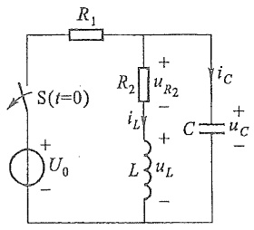

text_image

R₁
S(t=0)
+
U₀
-
R₂
iL
uR₂
+
C
iC
uC
+
-
uL
-

(a)

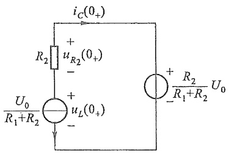

text_image

i_C(0_+)
R_2
+
u_{R_2}(0_+)
-
U_0
R_1+R_2
+
u_L(0_+)
-
+
R_2
-
R_1+R_2
U_0

(b)

图7-2 例7-1图

解 可以根据  $t=0_{-}$  时刻的电路状态计算  $u_{C}(0_{-})$  和  $i_{L}(0_{-})$ 。由于开关打开前，电路中的电压和电流已恒定不变，故有

$$
\left(\frac {\mathrm{d} u _ {c}}{\mathrm{d} t}\right) _ {0} = 0, \quad \left(\frac {\mathrm{d} i _ {L}}{\mathrm{d} t}\right) _ {0} = 0
$$

所以电容电流和电感电压均为零 $\left(i_{c}=C\frac{du_{c}}{dt},u_{L}=L\frac{di_{L}}{dt}\right)$ ，即此时刻的电容相当于开路，电感相当于短路。所以

$$
u _ {c} (0 _ {-}) = \frac {U _ {0} R _ {2}}{R _ {1} + R _ {2}}
$$

$$
i _ {L} (0 _ {-}) = \frac {U _ {0}}{R _ {1} + R _ {2}}
$$

该电路在换路时， $i_{L}$  和  $u_{C}$  都不会跃变，所以有  $u_{C}(0_{+}) = u_{C}(0_{-})$ ， $i_{L}(0_{+}) = i_{L}(0_{-})$ 。为了求得  $t = 0_{+}$  时刻的其他初始值，可以把已知的  $u_{C}(0_{+})$  和  $i_{L}(0_{+})$  分别以电压源和电流源替代，得到  $t = 0_{+}$  时的等效电路如图 7-2(b) 所示。可以求出

$$
C \left. \frac {\mathrm{d} u _ {c}}{\mathrm{d} t} \right| _ {0 _ {+}} = i _ {c} (0 _ {+}) = - \frac {U _ {0}}{R _ {1} + R _ {2}} = - i _ {L} (0 _ {+})
$$

所以 $\left.\frac{\mathrm{d}u_c}{\mathrm{d}t}\right|_{0_+} = \frac{i_c(0_+)}{C} = -\frac{U_0}{C(R_1 + R_2)}$

$$
\begin{array}{l} L \frac {\mathrm{d} i _ {L}}{\mathrm{d} t} \Bigg | _ {0 _ {+}} = u _ {L} (0 _ {+}) = - i _ {L} (0 _ {+}) \cdot R _ {2} + u _ {C} (0 _ {+}) \\ = - \frac {U _ {0}}{R _ {1} + R _ {2}} \cdot R _ {2} + \frac {U _ {0}}{R _ {1} + R _ {2}} \cdot R _ {2} = 0 \\ \end{array}
$$

所以

$$
\frac {\mathrm{d} i _ {L}}{\mathrm{d} t} \bigg | _ {0 _ {+}} = 0
$$

$$
u _ {R _ {2}} (0 _ {+}) = R _ {2} \cdot i _ {L} (0 _ {+}) = \frac {U _ {0} R _ {2}}{R _ {1} + R _ {2}}
$$

由上例可以看出,确定初始条件的步骤为:

(1) 根据换路前的电路, 确定  $u_{C}(0_{-})$ 、 $i_{L}(0_{-})$ 。
(2) 依据换路定则确定  $u_{C}(0_{+})$ 、 $i_{L}(0_{+})$ 。
(3) 根据已求得的 $u_{C}(0_{+})$ 和 $i_{L}(0_{+})$, 画出 $t = 0_{+}$时的等效电路 (亦称为初始值等效电路), 即根据替代定理将电容所在处用电压等于 $u_{C}(0_{+})$ 的电压源替代, 电感所在处用电流等于 $i_{L}(0_{+})$ 的电流源替代。若 $u_{C}(0_{+}) = 0, i_{L}(0_{+}) = 0$, 则电容所在处用短路替代, 电感所在处用开路替代。激励源则用 $u_{S}(0_{+})$ 与 $i_{S}(0_{+})$ 的直流电源替代, 这样处理后的 $0_{+}$等效电路是一个直流电阻网络, 可以确定其他非独立初始条件。

## §7-2 一阶电路的零输入响应

零输入响应是指电路在没有外施激励,而仅由电路中动态元件的初始储能所引起的响应。

可用一阶常微分方程描述的电路是一阶电路。现研究一阶电路的零输入响应。

首先讨论 RC 电路的零输入响应。在图 7-3 所示 RC 电路中，开关 S 闭合前，电容 C 已充电，其电压  $u_{c}=U_{0}$ 。开关闭合后，电容储存的能量将通过电阻以热能形式释放出来。现把开关动作时刻取为计时起点  $(t=0)$ 。开关闭合后，即  $t\geqslant0_{+}$  时，根据 KVL 可得

$$
u _ {R} - u _ {C} = 0
$$

将  $u_{R}=Ri, i=-C\frac{du_{c}}{dt}$  代入上述方程，有

$$
R C \frac {\mathrm{d} u _ {c}}{\mathrm{d} t} + u _ {c} = 0
$$

这是一阶齐次微分方程, 初始条件  $u_{c}(0_{+}) = u_{c}(0_{-}) = U_{0}$ , 令此方程的通解  $u_{c} = A e^{pt}$ , 代入上式后有

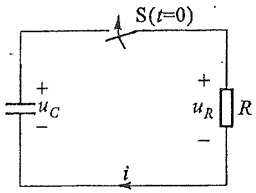

text_image

S(t=0)
+
uC
-
+
uR
R
-
i

图 7-3 RC 电路的零输入响应

$$
(R C p + 1) A \mathrm{e} ^ {p t} = 0
$$

相应的特征方程为

$$
R C p + 1 = 0
$$

特征根为

$$
p = - \frac {1}{R C}
$$

根据 $u_{C}(0_{+}) = u_{C}(0_{-}) = U_{0}$，以此代入 $u_{C} = A\mathrm{e}^{pt}$，则可求得积分常数 $A = u_{C}(0_{+}) = U_{0}$。

这样,求得满足初始值的微分方程的解为

一阶电路的零输入响应

$$
u _ {C} = u _ {C} (0 _ {+}) \mathrm{e} ^ {- \frac {1}{R C} t} = U _ {0} \mathrm{e} ^ {- \frac {1}{R C} t}
$$

这就是放电过程中电容电压  $u_{c}$  的表达式。

电路中的电流为

$$
\begin{array}{l} i = - C \frac {\mathrm{d} u _ {c}}{\mathrm{d} t} = - C \frac {\mathrm{d}}{\mathrm{d} t} (U _ {0} \mathrm{e} ^ {- \frac {1}{R C} t}) \\ = - C \left(- \frac {1}{R C}\right). U _ {0} \mathrm{e} ^ {- \frac {1}{R C} t} = \frac {U _ {0}}{R} \mathrm{e} ^ {- \frac {1}{R C} t} \\ \end{array}
$$

电阻上的电压为

$$
u _ {R} = u _ {C} = U _ {0} \mathrm{e} ^ {- \frac {1}{R C} t}
$$

从以上表达式可以看出，电压 $u_{C}$ 、 $u_{R}$ 及电流i都是按照同样的指数规律衰减的。它们衰减的快慢取决于指数中 $\frac{1}{RC}$ 的大小。由于电路特征方程的特征根 $p=-\frac{1}{RC}$，它仅取决于电路的结构和元件的参数。当电阻的单位为 $\Omega$，电容的单位为F时，乘积RC的单位为s，它称为RC电路的时间常数，用 $\tau$ 表示。引入 $\tau$ 后，电容电压 $u_{C}$ 和电流i可以分别表示为

$$
\begin{array}{l} u _ {C} = U _ {0} \mathrm{e} ^ {- \frac {t}{\tau}} \\ i = \frac {U _ {0}}{R} \mathrm{e} ^ {- \frac {t}{\tau}} \\ \end{array}
$$

$\tau$  的大小反映了一阶电路过渡过程的进展速度, 它是反映过渡过程特性的一个重要的量。可以计算得

$$
t = 0 _ {+} \text {时}, \quad u _ {c} (  0 _ {+}) = U _ {0} \mathrm{e} ^ {0} = U _ {0}
$$

$$
t = \tau \text {时}, \quad u _ {c} (\tau) = U _ {0} \mathrm{e} ^ {- 1} = 0. 3 6 8 U _ {0}
$$

零输入响应在任一时刻  $t_{0}$  的值, 经过一个时间常数  $\tau$  可以表示为

$$
\begin{array}{l} u _ {c} (  t _ {0} + \tau) = U _ {0} \mathrm{e} ^ {- (  t _ {0} + \tau) / \tau} \\ = U _ {0} \mathrm{e} ^ {- 1} \mathrm{e} ^ {- t _ {0} / \tau} \\ = \mathrm{e} ^ {- 1} u _ {c} (t _ {0}) \\ = 0. 3 6 8 u _ {c} (t _ {0}) \\ \end{array}
$$

即经过一个时间常数  $\tau$  后，衰减了 63.2%，或为原值的 36.8%。 $t=2\tau, t=3\tau, t=4\tau,\cdots$  时刻的电容电压值列于表 7-1 中。

表 7-1

| t | 0 | $\tau$ | $2\tau$ | $3\tau$ | $4\tau$ | $5\tau$ | ... | $\infty$ |
| --- | --- | --- | --- | --- | --- | --- | --- | --- |
| $u_{c}(t)$ | $U_{0}$ | $0.368U_{0}$ | $0.135U_{0}$ | $0.05U_{0}$ | $0.018U_{0}$ | $0.0067U_{0}$ | ... | 0 |

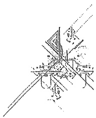

natural_image

Pure technical line drawing of a mechanical or architectural component without any text, numbers, or symbols

从上表可见,在理论上要经过无限长的时间  $u_{c}$  才能衰减为零值。但工程上一般认为换路后,经过  $3\tau \sim 5\tau$  时间,过渡过程即告结束。

图 7-4(a)(b) 所示曲线为  $u_{C}$ 、 $u_{R}$  和 i 随时间变化的曲线。时间常数  $\tau$  的大小，还可以从  $u_{C}$  或  $i_{C}$  的曲线上用几何方法求得。在图 7-5 中，取电容电压  $u_{C}$  的曲线上任意一点 A，通过 A 点作切线 AC，则图中的次切距为

$$
BC = \frac{AB}{\tan \alpha} = \frac{u_c(t)}{-\frac{\mathrm{d}u_c}{\mathrm{d}t}}\Bigg|_{t = t_0} = \frac{U_0\mathrm{e}^{-\frac{t_0}{\tau}}}{\frac{1}{\tau}U_0\mathrm{e}^{-\frac{t_0}{\tau}}} = \tau
$$

即在时间坐标上次切距的长度等于时间常数  $\tau$ 。这说明曲线上任意一点，如果以该点的斜率为固定变化率衰减，经过  $\tau$  时间衰减为零值。

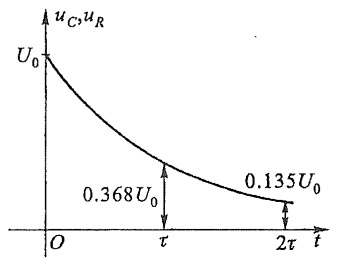

line

| Time (t) | Value (uC, uR) |
| --- | --- |
| 0 | U0 |
| \(\tau\) | 0.368U0 |
| \(2\tau\) | 0.135U0 |

(a)

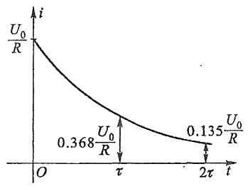

line

| Time (t) | Current (i) |
| --- | --- |
| 0 | \(U_{0}/R\) |
| \(\tau\) | \(0.368 U_{0}/R\) |
| \(2\pi\) | \(0.135 U_{0}/R\) |

(b)

图 7-4  $u_{C}$ 、 $u_{R}$  和 i 随时间变化的曲线

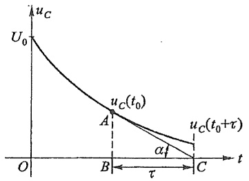

line

| Point | Time (t) | Value (uC) |
| --- | --- | --- |
| Start | 0 | U0 |
| A | t0 | uC(t0) |
| B | t0 | uC(t0) |
| C | \(t0+\tau\) | uC(t0+τ) |

图 7-5 时间常数  $\tau$  的几何意义

在放电过程中,电容不断放出能量并为电阻所消耗;最后,原来储存在电容中的电场能量全部为电阻吸收而转换成热能。即

$$
\begin{array}{l} W _ {R} = \int_ {0} ^ {\infty} i ^ {2} (t) R \mathrm{d} t = \int_ {0} ^ {\infty} \left(\frac {U _ {0}}{R} \mathrm{e} ^ {- \frac {1}{R G} t}\right) ^ {2} R \mathrm{d} t \\ = \frac {U _ {0} ^ {2}}{R} \int_ {0} ^ {\infty} \mathrm{e} ^ {- \frac {2 t}{R C}} \mathrm{d} t = - \frac {1}{2} C U _ {0} ^ {2} \left(\mathrm{e} ^ {- \frac {2}{R C} t}\right) \Bigg | _ {0} ^ {\infty} \\ = \frac {1}{2} C U _ {0} ^ {2} \\ \end{array}
$$

现在讨论 $RL$ 电路的零输入响应。图7-6(a)所示电路在开关S动作之前电压和电流已恒定不变，电感中有电流 $I_0 = \frac{U_0}{R_0} = i(0_-)$ 。在 $t = 0$ 时开关由1合到2，具有初始电流$I_{0}$ 的电感 $L$ 和电阻 $R$ 相连接，构成一个闭合回路，如图7-6(b)所示。在 $t\geqslant 0_{+}$ 时，根据KVL，有

$$
u _ {R} + u _ {L} = 0
$$

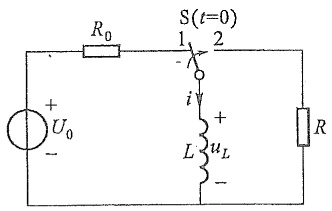

text_image

R₀
S(t=0)
1 2
i
+
L uₗ
-
U₀
+
- R

(a)

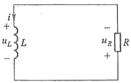

text_image

i
+
uL L
-
-
uR R
+

(b)

图 7-6 RL 电路的零输入响应

而 $u_{R} = Ri, u_{L} = L\frac{\mathrm{d}i}{\mathrm{d}t}$, 电路的微分方程为

$$
L \frac {\mathrm{d} i}{\mathrm{d} t} + R i = 0
$$

这也是一个一阶齐次微分方程。令方程的通解 $i = Ae^{pt}$，可以得到相应的特征方程为

$$
L p + R = 0
$$

其特征根为

$$
p = - \frac {R}{L}
$$

故电流为

$$
\dot {\iota} = \dot {A} \mathrm{e} ^ {- \frac {R}{L} \iota}
$$

根据 $i(0_{+}) = i(0_{-}) = I_{0}$，代入上式可求得 $A = i(0_{+}) = I_{0}$，从而

$$
i = i (0 _ {+}) \mathrm{e} ^ {- \frac {R}{L} t} = I _ {0} \mathrm{e} ^ {- \frac {R}{L} t}
$$

电阻和电感上的电压分别为

$$
\begin{array}{l} u _ {R} = R i = R I _ {0} \mathrm{e} ^ {- \frac {R}{L} t} \\ u _ {L} = L \frac {\mathrm{d} i}{\mathrm{d} t} = - R I _ {0} \mathrm{e} ^ {- \frac {R}{L} t} \\ \end{array}
$$

与 RC 电路类似, 令  $\tau=\frac{L}{R}$ , 称为 RL 电路的时间常数, 则上述各式可写为

$$
\begin{array}{l} i = I _ {0} \mathrm{e} ^ {- \frac {t}{\tau}} \\ u _ {R} = R I _ {0} \mathrm{e} ^ {- \frac {t}{\tau}} \\ \end{array}
$$

$$
u _ {L} = - R I _ {0} \mathrm{e} ^ {- \frac {\iota}{\tau}}
$$

图 7-7 所示曲线分别为  $i_{1}$ 、 $u_{L}$  和  $u_{R}$  随时间变化的曲线。

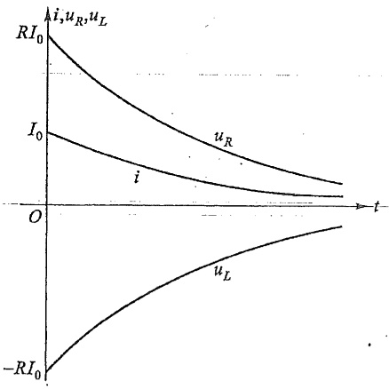

line

| Variable | Trend Description |
| --- | --- |
| i | Starts at 0, increases towards -RI0, then increases toward zero. |
| uR | Starts at RI0, decreases towards zero, remains positive throughout the interval. |
| iL | Starts at 0, increases towards -RI0, then increases towards zero. |

图 7-7 RL 电路的零输入响应曲线

例 7-2 图 7-8(a) 所示电路中, R、L 分别表示一电磁铁线圈的电阻和电感, 已知  $R=4\Omega, L=2H$ , 直流电压  $U=220V$ 。电压表的量程为 300 V, 内阻  $R_{v}=30k\Omega$ 。开关 S 未断开时电路中电流已恒定不变。在 t=0 时断开开关 S, 试求开关刚断开时, 电压表处的电压  $u_{v}$ 。

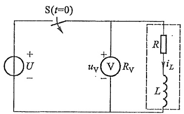

text_image

S(t=0)
+
U
-
+
uV
V
Rv
R
iL
L

(a)

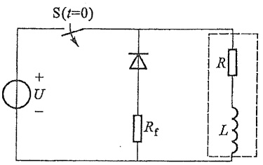

text_image

S(t=0)
+
U
-
Rf
R
L

(b)

图 7-8 例 7-2 图

解 已知开关断开前,电路中电流已恒定不变,电感两端电压为零,可求得

$$
i _ {L} (0 _ {-}) = \frac {2 2 0}{4} \mathrm{A} = 5 5 \mathrm{A}
$$

开关断开后

$$
i _ {L} (0 _ {+}) = i _ {L} (0 _ {-}) = 5 5 \mathrm{A}
$$

电路为零输入响应,时间常数  $\tau$  和电流  $i_{L}$  分别为

$$
\tau = \frac {L}{R + R _ {\mathrm{v}}} = \frac {2}{4 + 3 0 \times 1 0 ^ {3}} \mathrm{s} \approx \frac {1}{1 5 \times 1 0 ^ {3}} \mathrm{s}
$$

$$
i _ {L} = i _ {L} (0 _ {+}) \mathrm{e} ^ {- \frac {t}{\tau}} = 5 5 \mathrm{e} ^ {- 1 5 \times 1 0 ^ {3} t} \mathrm{A}
$$

电压表处的电压为

$$
\begin{array}{l} u _ {\mathrm{V}} = - R _ {\mathrm{V}} i _ {L} (t) \\ = - 3 0 \times 1 0 ^ {3} \times 5 5 \mathrm{e} ^ {- 1 5 \times 1 0 ^ {3} t} \mathrm{V} \\ = - 1 6 5 0 \times 1 0 ^ {3} \mathrm{e} ^ {- 1 5 0 0 0 t} \mathrm{V} \\ \end{array}
$$

所以，开关刚断开时，电压表处的电压为

$$
u _ {\mathrm{v}} (0 _ {+}) = - 1 6 5 0 \mathrm{kV}
$$

由上述计算结果可知,开关断开时刻,电压表处有很大且方向与开断前相反的电压。因此开断含有较大电感的电路时应注意先拆除并联在电路中的电压表。值得注意的是拆除电压表后,原电压表所在处相当于电阻无穷大,电磁铁线圈两端依然存在着很高的电压,仍有可能造成其他设备的损坏或引起开关处出现电弧,为此应采取一些必要的措施,使得电感线圈储存的磁场能量得以释放。图7-8(b)所示为其中的一种方法。即在电磁铁线圈两端并联二极管和电阻的串联支路,其中二极管称为“续流二极管”,电阻 $R_{f}$ 称为放电电阻。当正常工作时(S闭合时)二极管工作在反向,它的反向电流很小,对电路工作没有影响。当开关断开时,二极管导通,电感线圈可通过二极管正向放电,由于二极管正向电阻很小,可避免电感线圈两端出现高电压,适当选择放电电阻 $R_{f}$ 的阻值,就可以控制过渡过程时间的长短。

例如若要求图 7-8(b) 中开关断开时电磁铁线圈两端的电压不超过正常工作时电压的 2.5 倍，且整个放电过程要在 1 s 内基本结束，可按下面方法选择放电电阻  $R_{f}$  的值。

前已计算得  $i(0_{+})=55\ A$ ，则

$$
u (0 _ {+}) = - i (0 _ {+}) R _ {\mathrm{f}} = - 5 5 R _ {\mathrm{f}}
$$

根据  $u(0_{+})$  不超过正常工作电压的 2.5 倍, 得

$$
\mid u (0 _ {+}) \mid \leqslant (2 2 0 \times 2. 5) \mathrm{V}
$$

即

$$
5 5 R _ {\mathrm{f}} \leqslant 2 2 0 \times 2. 5
$$

从而求得

$$
R _ {\mathrm{f}} \leqslant 1 0 \Omega
$$

放电回路的时间常数为

$$
\tau = \frac {L}{R + R _ {\mathrm{f}}}
$$

又因要求整个放电过程在 $1\mathrm{s}$ 内基本结束，可以认为经过 $5\tau$ 时间放电过程基本结束，即

$$
5 \times \frac {L}{R + R _ {\mathrm{f}}} \leqslant 1
$$

可求得

$$
R _ {\mathrm{f}} \geqslant 6 \Omega
$$

综合上述两个要求,放电电阻应选为

$$
6 \Omega \leqslant R _ {\mathrm{f}} \leqslant 1 0 \Omega
$$

例 7-3 变电站检修电力设备,需将电容量  $C=40\ \mu F$  的电容器从高压电路断开,断开时电容器的电压  $U_{0}=1\ kV$ 。断开后,电容器经它本身的漏电阻放电。如电容器的漏电阻  $R=100\ M\Omega$ ,试问断开后经过多长时间,电容器上的电压可达到人体安全电压 36 V?

解 电容器从电路断开, 具有初始电压  $u_{C}(0_{+}) = U_{0} = 1 \, \text{kV} = 1000 \, \text{V}$ , 断开后经本身漏电阻放电, 这是 RC 电路的零输入响应。即

$$
\begin{array}{l} u _ {c} = U _ {0} \mathrm{e} ^ {- \frac {t}{\tau}} \\ \tau = R C = 1 0 0 \times 1 0 ^ {6} \times 4 0 \times 1 0 ^ {- 6} \mathrm{s} \\ = 4 0 0 0 \mathrm{s} \\ \end{array}
$$

所以

$$
\begin{array}{l} u _ {c} = U _ {0} \mathrm{e} ^ {- \frac {1}{4 0 0 0} t} \mathrm{V} \\ = 1 0 0 0 \mathrm{e} ^ {- \frac {1}{4 0 0 0} t} \mathrm{V} \\ \end{array}
$$

设  $u_{c}$  达到 36 V 的时间为  $t_{1}$ ，则

$$
3 6 = 1 0 0 0 \mathrm{e} ^ {- \frac {1}{4 0 0 0} t _ {1}}
$$

求得

$$
\begin{array}{l} t _ {1.} = \left(4 0 0 0 \ln \frac {1 0 0 0}{3 6}\right) \mathrm{s} \\ \approx 1 3 2 9 7 \mathrm{s} \approx 3. 7 \mathrm{h} \\ \end{array}
$$

由上述计算可知,由于 R 及 C 都较大,所以放电持续时间长,要达到安全电压需 3.7 h。因此,在检修具有大电容的设备时,必须采取相应措施使其充分放电后再进行工作,以确保检修人员的人身安全。

## §7-3 一阶电路的零状态响应

零状态响应是指电路在零初始状态下(动态元件初始储能为零)由外施激励引起的响应。

图 7-9 所示 RC 串联电路, 开关 S 闭合前电路处于零初始状态, 即  $u_{c}(0_{-}) = 0$ 。在 t = 0 时刻, 开关 S 闭合, 电路接入直流电压源  $U_{s}$ 。在  $t \geqslant 0_{+}$  时, 根据 KVL, 有

$$
u _ {R} + u _ {C} = U _ {\mathrm{s}}
$$

将 $u_{R} = Ri, i = C\frac{\mathrm{d}u_{C}}{\mathrm{d}t}$ 代入，得电路的微分方程为

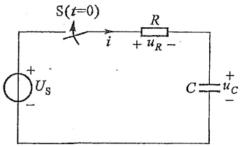

text_image

S(t=0)
i
R
+ u_R -
C = u_C
+
- Us

图 7-9 RC 电路的零状态响应

一阶电路的零状态响应

$$
R G \frac {\mathrm{d} u _ {c}}{\mathrm{d} t} + u _ {c} = U _ {\mathrm{s}}
$$

此方程为一阶线性非齐次方程。方程的解由非齐次方程的特解 $u_{c}^{\prime}$ 和对应的齐次方程的通解 $u_{c}^{\prime\prime}$ 两个分量组成，即

$$
u _ {c} = u _ {c} ^ {\prime} + u _ {c} ^ {\prime \prime}
$$

不难求得特解为

$$
u _ {c} ^ {\prime} = U _ {\mathrm{s}}
$$

而齐次方程 $RC\frac{\mathrm{d}u_c}{\mathrm{d}t} + u_c = 0$ 的通解为

$$
u _ {c} ^ {\prime \prime} = A \mathrm{e} ^ {- \frac {t}{\tau}}
$$

其中  $\tau = RC$ 。因此

$$
u _ {c} = U _ {\mathrm{s}} + A \mathrm{e} ^ {- \frac {t}{\tau}}
$$

代入初始值,可求得

$$
A = - U _ {\mathrm{s}}
$$

而

$$
u _ {c} = U _ {\mathrm{s}} - U _ {\mathrm{s}} \mathrm{e} ^ {- \frac {t}{\tau}} = U _ {\mathrm{s}} (1 - \mathrm{e} ^ {- \frac {t}{\tau}})
$$

$$
i = C \frac {\mathrm{d} u _ {c}}{\mathrm{d} t} = \frac {U _ {\mathrm{s}}}{R} \mathrm{e} ^ {- \frac {t}{\tau}}
$$

$u_{c}$  和 i 的波形如图 7-10 所示。电压  $u_{c}$  的两个分量  $u_{c}^{\prime}$  和  $u_{c}^{\prime\prime}$  也示于该图中。

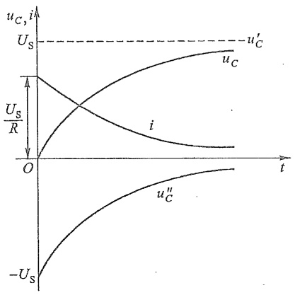

line

| Time (t) | uc (V) | i (A) |
| --- | --- | --- |
| 0 | 0 | Us/R |
| >0 | Increasing | Decreasing |

图 7-10 RC 电路的零状态响应的
 $u_{c}, i$  的波形

$u_{c}$  以指数形式趋近于它的最终恒定值  $U_{s}$ ，到达该值后，电压和电流不再变化，电容相当于开路，电流为零。此时电路达到稳定状态（简称稳态），所以在这种情况下，特解  $u_{c}^{\prime}(=U_{s})$  称为稳态分量。同时可以看出  $u_{c}^{\prime}$  与外施激励的变化规律有关，所以又称为强制分量。齐次方程的通解  $u_{c}^{\prime\prime}$  则由于其变化规律取决于特征根而与外施激励无关，所以称为自由分量。自由分量按指数规律衰减，最终趋于零，所以又称为瞬态分量。对电流 i 可作类似解释。

RC 电路接通直流电压源后的过程也是电源通过电阻对电容充电的过程。在充电过程中,电源供给的能量一部分转换成电场能量储存于电容中,一部分被电阻转变为热能消耗,电阻消耗的电能为

$$
\begin{array}{l} W _ {R} = \int_ {0} ^ {\infty} i ^ {2} R \mathrm{d} t = \int_ {0} ^ {\infty} \left(\frac {U _ {\mathrm{s}}}{R} \mathrm{e} ^ {- \frac {t}{\tau}}\right) ^ {2} R \mathrm{d} t \\ = \frac {U _ {\mathrm{s}} ^ {2}}{R} \left(- \frac {R C}{2}\right) \mathrm{e} ^ {- \frac {2}{R C} t} \Bigg | _ {0} ^ {\infty} \\ = \frac {1}{2} C U _ {\mathrm{s}} ^ {2} \\ \end{array}
$$

从上式可见,不论电路中电容 C 和电阻 R 的数值为多少,在充电过程中,电源提供的能量只有一半转变成电场能量储存于电容中,另一半则为电阻所消耗,也就是说,充电效率只有 50%。

图 7-11 所示为 RL 电路, 直流电流源的电流为  $I_{s}$ , 在开关打开前电感中的电流为零。开关打开后  $i_{L}(0_{+}) = i_{L}(0_{-}) = 0$ , 电路的响应为零状态响应。注意到换路后  $R_{s}$  与  $I_{s}$  串联的等效电路中的电流仍为  $I_{s}$ , 则电路的微分方程为

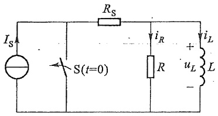

text_image

IS
S(t=0)
RS
iR
R
+
uL
-
iL
L

图7-11 RL电路的零状态响应

$$
\frac {L}{R} \frac {\mathrm{d} i _ {L}}{\mathrm{d} t} + i _ {L} = I _ {\mathrm{s}}
$$

这是一阶非齐次方程,相应的齐次方程与§7-2中RL电路零输入响应时的方程相同,因此,该电路特征根 $p=-\frac{R}{L}$ 。初始条件为 $i_{L}(0_{+})=0$ 。电流 $i_{L}$ 的通解为

$$
i _ {L} = i _ {L} ^ {\prime} + A \mathrm{e} ^ {- \frac {R}{L} t}
$$

$$
= i _ {L} ^ {\prime} + A \mathrm{e} ^ {- \frac {t}{\tau}}
$$

式中 $\tau = \frac{L}{R}$ 为时间常数，特解 $i_L' = I_{\mathrm{s}}$ ，积分常数 $A = -i_L'(0_+) = -I_{\mathrm{s}}$ 。所以

$$
i _ {L} = I _ {\mathrm{s}} (1 - \mathrm{e} ^ {- \frac {t}{\tau}})
$$

下面以 RL 电路为例, 讨论在正弦电压激励下的零状态响应。

图 7-12(a) 所示为 RL 串联电路, 开关 S 闭合将电路接通电源。外施激励为正弦电压  $u_{s}=U_{m}\cos(\omega t+\phi_{u})$ ，其中  $\phi_{u}$  为接通电路时外施电压的初相角，它决定于电路的接通时刻，所以又称为接入相位角或合闸角。接通后电路方程为

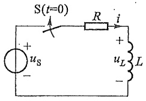

text_image

S(t=0)
+
us
-
R
i
+
uL
L
-

(a)

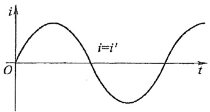

line

| t | i |
| --- | --- |
| 0 | 0 |
| ~0.5 | ~1 |
| 1 | 0 |
| ~1.5 | ~-1 |
| 2 | 0 |

(b)

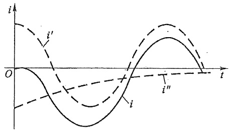

line

| Time (t) | Signal i (i) | Signal i' (i') |
| --- | --- | --- |
| 0 | 0 | ~1.5 |
| ~0.25 | ~-0.8 | ~0.5 |
| ~0.5 | ~-1.5 | ~-0.5 |
| ~0.75 | ~-0.8 | ~-1.2 |
| 1 | 0 | 0 |

(c)

图 7-12 正弦激励下的 RL 电路

$$
L \frac {\mathrm{d} i}{\mathrm{d} t} + R i = U _ {\mathrm{m}} \cos \left(\omega t + \phi_ {u}\right)
$$

其通解 $i = i' + i''$，其中自由分量 $i'' = A\mathrm{e}^{-\frac{i}{\tau}}$，$\tau = \frac{L}{R}$ 为时间常数。$i'$ 为上述微分方程的特解①。

为了求得此特解,设特解为

$$
i ^ {\prime} = I _ {m} \cos (\omega t + \theta)
$$

把它代入上述微分方程,有

$$
R I _ {\mathrm{m}} \cos (\omega t + \theta) - \omega L I _ {\mathrm{m}} \sin (\omega t + \theta) = U _ {\mathrm{m}} \cos (\omega t + \phi_ {u})
$$

可以用待定系数法确定 $I_{\mathrm{m}}$ 和 $\theta$ 。引入 $\tan \varphi = \frac{\omega L}{R}$，有

$$
\sin \varphi = \frac {\omega L}{\sqrt {R ^ {2} + (\omega L) ^ {2}}}
$$

$$
\cos \varphi = \frac {R}{\sqrt {R ^ {2} + (\omega L) ^ {2}}}
$$

再令 $|Z| = \sqrt{R^2 + (\omega L)^2}$, 上式左方可写为

$$
\begin{array}{l} I _ {\mathrm{m}} \left[ R \cos (\omega t + \theta) - \omega L \sin (\omega t + \theta) \right] \\ = I _ {\mathrm{m}} | Z | \left[ \cos (\omega t + \theta) \frac {R}{| Z |} - \sin (\omega t + \theta) \frac {\omega L}{| Z |} \right] \\ = I _ {\mathrm{m}} \left| Z \right| \left[ \cos (\omega t + \theta) \cos \varphi - \sin (\omega t + \theta) \sin \varphi \right] \\ = I _ {\mathrm{m}} \mid Z \mid \cos (\omega t + \theta + \varphi) \\ \end{array}
$$

于是，得

$$
I _ {\mathrm{m}} \mid Z \mid \cos (\omega t + \theta + \varphi) = U _ {\mathrm{m}} \cos (\omega t + \phi_ {u})
$$

因此可求得待定常数

$$
I _ {\mathrm{m}} \mid Z \mid = U _ {\mathrm{m}}
$$

$$
\theta + \phi = \phi_ {u}
$$

或

$$
I _ {\mathrm{m}} = \frac {U _ {\mathrm{m}}}{| Z |} = \frac {U _ {\mathrm{m}}}{\sqrt {R ^ {2} + (\omega L) ^ {2}}}
$$

$$
\theta = \phi_ {u} - \phi
$$

所以,特解  $i'$  为

$$
i ^ {\prime} = \frac {U _ {\mathrm{m}}}{| Z |} \cos \left(\omega t + \phi_ {u} - \varphi\right)
$$

<small>① 在正弦时间函数激励下，特解  $i'$  更简洁的求解方法将在第九章详细介绍。</small>

方程的通解为

$$
i = \frac {U _ {\mathrm{m}}}{| Z |} \cos (\omega t + \phi_ {u} - \varphi) + A \mathrm{e} ^ {- \frac {t}{\tau}}
$$

代入初始条件,由于  $i(0_{+})=i(0_{-})=0$ ,有

$$
0 = \frac {U _ {\mathrm{m}}}{| Z |} \cos (\phi_ {u} - \varphi) + A
$$

于是

$$
A = - \frac {U _ {\mathrm{m}}}{| Z |} \cos (\phi_ {u} - \varphi)
$$

因而电流 $i$ 为

$$
i = \frac {U _ {\mathrm{m}}}{| Z |} \cos (\omega t + \phi_ {u} - \varphi) - \frac {U _ {\mathrm{m}}}{| Z |} \cos (\phi_ {u} - \varphi) \mathrm{e} ^ {- \frac {t}{\tau}}
$$

电阻上的电压为

$$
u _ {R} = R i = \frac {R U _ {\mathrm{m}}}{| Z |} \cos (\omega t + \phi_ {u} - \varphi) - \frac {R U _ {\mathrm{m}}}{| Z |} \cos (\phi_ {u} - \varphi) \mathrm{e} ^ {- \frac {t}{\tau}}
$$

电感上的电压为

$$
u _ {L} = L \frac {\mathrm{d} i}{\mathrm{d} t} = U _ {\mathrm{m}} \frac {\omega L}{| Z |} \cos \left(\omega t + \phi_ {u} - \varphi + \frac {\pi}{2}\right) + U _ {\mathrm{m}} \frac {R}{| Z |} \cos (\phi_ {u} - \varphi) \mathrm{e} ^ {- \frac {t}{\tau}}
$$

由以上可见,方程的特解或强制分量与外施正弦激励按同频率的正弦规律变化,自由分量则随时间增长趋于零。最终只剩下强制分量。所以说这种电路需经历一个过渡过程,然后达到稳定状态。自由分量与开关闭合的时刻有关。

当开关闭合时,若有  $\phi_{u}=\varphi-\frac{\pi}{2}$ ,则

$$
A = - \frac {U _ {\mathrm{m}}}{| Z |} \cos (\phi_ {u} - \varphi) = 0
$$

所以

$$
i = i ^ {\prime} = \frac {U _ {\mathrm{m}}}{| Z |} \cos \left(\omega t - \frac {\pi}{2}\right)
$$

故开关闭合后,电路中不发生过渡过程而立即进入稳定状态,i的波形如图7-12(b)所示。

如果开关闭合时,有  $\phi_{u}=\phi$ , 则有

$$
\begin{array}{l} A = - \frac {U _ {\mathrm{m}}}{| Z |} \cos (\phi_ {u} - \varphi) \\ = - \frac {U _ {\mathrm{m}}}{| Z |} \\ \end{array}
$$

即

$$
\begin{array}{l} i ^ {\prime \prime} = - \frac {U _ {\mathrm{m}}}{| Z |} \mathrm{e} ^ {- \frac {t}{\tau}} \\ i = \frac {U _ {\mathrm{m}}}{| Z |} \cos (\omega t) - \frac {U _ {\mathrm{m}}}{| Z |} \mathrm{e} ^ {- \frac {t}{\tau}} \\ \end{array}
$$

电流 i 的波形如图 7-12(c) 所示。从上式和波形图中可以看出, 若电路的时间常数很大, 则  $i''$  衰减极其缓慢。这种情况下接通电路后, 大约经过半个周期的时间, 电流的最大瞬时值的绝对值将接近稳态电流振幅的两倍, 这是正弦电路在过渡过程中的一种过电流现象。

RC 串联电路与正弦电源接通,用相同的分析方法分析可得到相对偶的结果,即当  $\phi_{u}=\phi$  时换路后不发生过渡过程立即进入稳定状态,当  $\phi_{u}=\varphi\pm\frac{\pi}{2}$  时,在电路时间常数很大的情况下,电路换路后大约经过半个周期的时间,电容电压的最大瞬时值的绝对值接近稳态电压振幅的两倍(过电压)。可见,RC 串联电路或 RL 串联电路与正弦电源接通后,在初始值一定的条件下,电路的过渡过程与开关的动作时刻有关。

上述过电流或过电压现象在工程实际中是需要重视和考虑的。

## §7-4 一阶电路的全响应

当一个非零初始状态的一阶电路受到激励时,电路的响应称为一阶电路的全响应。

图7-13所示电路为已充电的电容经过电阻接到直流电压源 $U_{\mathrm{s}}$ 。设电容原有电压 $u_{c} = U_{0}$，开关S闭合后，根据KVL有

$$
R C \frac {\mathrm{d} u _ {c}}{\mathrm{d} t} + u _ {c} = U _ {\mathrm{s}}
$$

初始条件为

$$
u _ {c} (0 _ {+}) = u _ {c} (0 _ {-}) = U _ {0}
$$

方程的通解为

$$
u _ {c} = u _ {c} ^ {\prime} + u _ {c} ^ {\prime \prime}
$$

取换路后达到稳定状态的电容电压为特解,则

$$
u _ {c} ^ {\prime} = U _ {\mathrm{s}}
$$

$u_{c}^{\prime\prime}$  为上述微分方程对应的齐次方程的通解，

$$
u _ {c} ^ {\prime \prime} = A \mathrm{e} ^ {- \frac {t}{\tau}}
$$

其中  $\tau=RC$  为电路的时间常数,所以有

$$
u _ {c} = U _ {\mathrm{s}} + A \mathrm{e} ^ {- \frac {t}{\tau}}
$$

根据初始条件  $u_{c}(0_{+})=u_{c}(0_{-})=U_{0}$ ，得积分常数为

$$
A = U _ {0} - U _ {\mathrm{s}}
$$

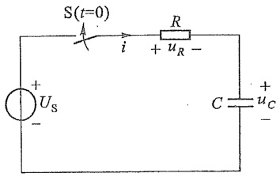

text_image

S(t=0)
+
Us
-
i
R
+ uR -
C
+
uC
-

图 7-13 一阶电路的全响应

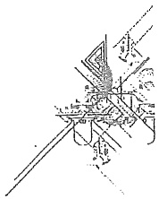

natural_image

Pure mechanical assembly diagram without any text, numbers, or symbols

一阶电路的
全响应

所以电容电压

$$
u _ {c} = U _ {\mathrm{s}} + (U _ {0} - U _ {\mathrm{s}}) \mathrm{e} ^ {- \frac {t}{\tau}} \tag {7-5}
$$

这就是电容电压在  $t \geqslant 0_{+}$  时的全响应。

把式(7-5)改写成

$$
u _ {c} = U _ {0} \mathrm{e} ^ {- \frac {t}{\tau}} + U _ {\mathrm{s}} (1 - \mathrm{e} ^ {- \frac {t}{\tau}})
$$

可以看出,上式右边的第一项是电路的零输入响应,右边的第二项则是电路的零状态响应,这说明全响应是零输入响应和零状态响应的叠加,即

全响应=(零输入响应)+(零状态响应)

从式(7-5)还可以看出,右边的第一项是电路微分方程相应非齐次方程的特解,其变化规律与电路施加的激励相同,所以称为强制分量;式(7-5)右边第二项对应的是微分方程相应齐次方程的通解,它的变化规律取决于电路参数而与外施激励无关,所以称之为自由分量。因此,全响应可以看作是强制分量和自由分量的叠加,即

$$
\text {全响应} = (\text {强制分量}) + (\text {自由分量})
$$

在直流或正弦激励的一阶电路中,常取换路后达到新的稳态的解作为特解,而自由分量随着时间的增长按指数规律逐渐衰减为零,所以又常将全响应看作是稳态分量和暂态分量的叠加,即

$$
\text {全响应} = (\text {稳态分量}) + (\text {暂态分量})
$$

无论是把全响应分解为零状态响应和零输入响应,还是分解为暂态分量和稳态分量,都不过是从不同角度去分析全响应的。而全响应总是由初始值、特解和时间常数三个要素决定。在直流电源激励下,若初始值为 $f(0_{+})$ ,特解为稳态解 $f(\infty)$ ,时间常数为 $\tau$ ,则全响应 $f(t)$ 可写为

$$
f (t) = f (\infty) + [ f (0 _ {+}) - f (\infty) ] \mathrm{e} ^ {- \frac {t}{\tau}} \tag {7-6}
$$

只要知道 $f(0_{+})$ 、 $f(\infty)$ 和 $\tau$ 这三个要素，就可以根据式(7-6)直接写出直流激励下一阶电路的全响应，这种方法称为三要素法。

一阶电路在正弦电源激励下,由于电路的特解 $f'(t)$ 是时间的正弦函数,则上述公式可写为

$$
f (t) = f ^ {\prime} (t) + \left[ f (0 _ {+}) - f ^ {\prime} (0 _ {+}) \right] \mathrm{e} ^ {- \frac {t}{\tau}} \tag {7-7}
$$

其中 $f^{\prime}(t)$ 是特解，为稳态响应，$f^{\prime}(0_{+})$ 是 $t = 0_{+}$ 时稳态响应的初始值，$f(0_{+})$ 与 $\tau$ 的含义与前述相同。

如果电路中仅含一个储能元件(L或C)，电路的其他部分由电阻和独立电源或受控源连接而成，这种电路仍是一阶电路。在求解这类电路时，可以把储能元件以外的部分，应用戴维南定理或诺顿定理进行等效变换，然后求得储能元件上的电压和电流。如果还要求解的是其他元件或支路上的电压和电流，一种方法是在求得了储能元件上的电压和电流后再按照变换前的原电路求解；另一种方法是在求得电容元件上的 $u_{c}(0_{+})$

或电感元件上的  $i_{L}(0_{+})$  后, 进一步求待求元件或支路上的电压或电流初始值, 由于同一电路时间常数  $\tau$  相同, 只需再求得待求元件或支路上的电压或电流的稳态值, 就可以直接应用三要素公式求得结果。

例7-4 图7-14(a)所示电路中 $U_{\mathrm{s}} = 10 \mathrm{~V}, I_{\mathrm{s}} = 2 \mathrm{~A}, R = 2 \Omega, L = 4 \mathrm{H}$ 。试求S闭合后电路中的电流 $i_{L}$ 和 $i$。

解 戴维南等效电路如图 7-14(b) 所示, 其中

$$
U _ {\mathrm{oc}} = U _ {\mathrm{s}} - R I _ {\mathrm{s}} = (1 0 - 2 \times 2) \mathrm{V} = 6 \mathrm{V}
$$

$$
R _ {\mathrm{cq}} = R = 2 \Omega
$$

$$
i _ {L} (0 _ {+}) = i _ {L} (0 _ {-}) = - 2 \mathrm{A}
$$

特解和时间常数分别为

$$
i _ {L} ^ {\prime} = \frac {6}{2} \mathrm{A} = 3 \mathrm{A}
$$

$$
\tau = \frac {L}{R _ {\mathrm{eq}}} = 2 \mathrm{s}
$$

按式(7-6)解得

$$
i _ {L} = \left[ 3 + (- 2 - 3) \mathrm{e} ^ {- \frac {1}{2} t} \right] \mathrm{A} = (3 - 5 \mathrm{e} ^ {- 0. 5 t}) \mathrm{A}
$$

$i_{L}$  随时间变化的曲线如图 7-14(c) 所示。电流 i 可以根据 KCL 求得为

$$
i = I _ {\mathrm{S}} + i _ {L} = \left(5 - 5 \mathrm{e} ^ {- 0. 5 t}\right) \mathrm{A}
$$

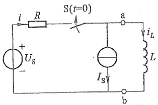

text_image

i R S(t=0) a iL L
+ Us - Is b

(a)

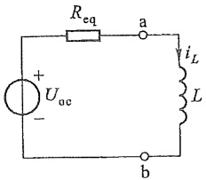

text_image

R_eq
+
U_oc
-
a
i_L
L
b

(b)

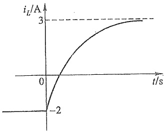

line

| t/s | iL/A |
| --- | --- |
| 0 | -2 |
| ~1.5 | 0 |
| ~3 | 3 |

(c)

图7-14 例7-4图

还可以按如下方法求电流 i，即

$$
i _ {L} (0 _ {+}) = i _ {L} (0 _ {-}) = - 2 \mathrm{A}
$$

可求得

$$
i (0 _ {+}) = 0
$$

$$
i (\infty) = \frac {1 0}{2} \mathrm{A} = 5 \mathrm{A}
$$

$$
\tau = 2 \mathrm{s}
$$

所以

$$
i (t) = 5 (1 - \mathrm{e} ^ {- 0. 5 t}) \mathrm{A}
$$

与前已求得的结果相同。

例7-5 图7-15所示电路中，已知 $u_{C}(0_{-}) = 0$ 。在 $t = 0$ 时闭合开关 $S_{1}$，在 $t = 3\mathrm{s}$ 时闭合开关 $S_{2}$，求 $t > 0$ 后的 $u_{C}(t)$ 和 $i_{C}(t)$。

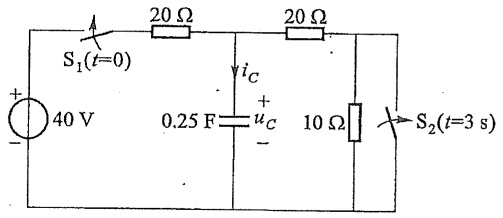

text_image

S₁(t=0)
40 V
20 Ω
i_C
0.25 F u_C +
10 Ω
S₂(t=3 s)

图7-15 例7-5的图

解 已知 $u_{c}(0_{-}) = 0$ ，则 $u_{c}(0_{+}) = 0, 0 < t < 3.\mathrm{s}$ 时，有

$$
\tau = \left(\frac {2 0 \times 3 0}{2 0 + 3 0} \times 0. 2 5\right) \mathrm{s} = 3 \mathrm{s}
$$

$$
u _ {c} (\infty) = \left(\frac {4 0}{2 0 + 3 0} \times 3 0\right) \mathrm{V} = 2 4 \mathrm{V}
$$

$$
u _ {c} (t) = 2 4 (1 - \mathrm{e} ^ {- \frac {1}{3} t}) \mathrm{V}
$$

$$
i _ {c} (  \dot {t}) = C   \frac {\mathrm{d} u _ {c}}{\mathrm{d} t} = 2 \mathrm{e} ^ {- \frac {1}{3} t}   \mathrm{A}
$$

$t = 3 \mathrm{~s}$ 时

$$
u _ {c} (3 \mathrm{s}) = 2 4 (1 - \mathrm{e} ^ {- 1}) \mathrm{V} = 1 5. 1 7 \mathrm{V}
$$

$t>3$  s 时,有

$$
\tau = \left(\frac {2 0 \times 2 0}{2 0 + 2 0} \times 0. 2 5\right) \mathrm{s} = 2. 5 \mathrm{s}
$$

$$
u _ {c} (\infty) = \left(\frac {4 0}{2 0 + 2 0} \times 2 0\right) \mathrm{V} = 2 0 \mathrm{V}
$$

$$
u _ {C} (t) = \left[ 2 0 + (1 5. 1 7 - 2 0) \mathrm{e} ^ {- \frac {1}{2 . 5} (t - 3)} \right] \mathrm{V}
$$

$$
= [ 2 0 - 4. 8 3 \mathrm{e} ^ {- 0. 4 (t - 3)} ] \mathrm{V}
$$

$$
i _ {c} (t) = C \frac {\mathrm{d} u _ {c}}{\mathrm{d} t} = 0. 4 8 3 \mathrm{e} ^ {- 0. 4 (t - 3)} \mathrm{A}
$$

求得的  $i_{c}(t)$  表达式中, 时间用  $(t-3)$  s 表示是因为已假定在 t=0 时闭合开关  $S_{1}$ , 在 t=3 s 时闭合开关  $S_{2}$ , 过渡过程的计时起点为 t=0。

例 7-6 图 7-16(a) 所示电路中, 开关 S 原合在位置 1, 电路已达稳定状态。t=0 时开关 S 由位置 1 合至位置 2, 求开关动作后电容电压的零输入响应、零状态响应和全响应, 并定性画出波形图。

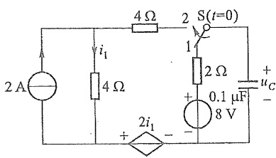

text_image

2 A
4 Ω
i₁
4 Ω
+
2i₁
-
+
1
2 Ω
S(t=0)
-
2 Ω
0.1 μF
8 V
+
uc
-

(a)

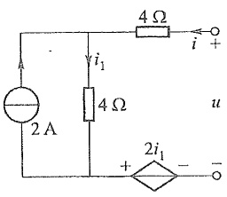

text_image

4 Ω
i +
2 A
vi₁
4 Ω
u
+
2i₁
-

(b)

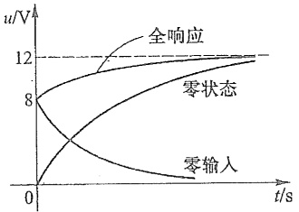

line

| Time (s) | Full Response (V) | Zero State (V) | Zero Input (V) |
| --- | --- | --- | --- |
| 0 | 8 | 0 | 0 |
| ~1 | ~10 | ~6 | ~4 |
| ~2 | 12 | ~9 | ~3 |
| ~3 | 12 | 12 | ~1 |

(c)

图7-16 例7-6.图

解 由开关未动作前电路已达稳态,可求得

$$
u _ {c} (0 _ {-}) = 8 \mathrm{V}
$$

开关动作后有

$$
u _ {c} (0 _ {+}) = u _ {c} (0 _ {-}) = 8 \mathrm{V}
$$

开关动作后的电路中含有受控电源,可应用戴维南定理将电容支路以外的电路用电压源和电阻串联的支路来等效替代。求该等效电路的图如图7-16(b)所示,其中 $i_{1}=2\ A+i$ 。

$$
u = 4 i + (2 + i) 4 + 2 (2 + i)
$$

整理后得

$$
u = 1 0 i + 1 2
$$

所以等效电路中  $R_{eq}=10\ \Omega, u_{oc}=12\ V$ 。

将电容支路与等效支路联接,可求得

$$
\tau = R _ {\mathrm{eq}} C = 1 0 \times 0. 1 \times 1 0 ^ {- 6} \mathrm{s} = 1 0 ^ {- 6} \mathrm{s}
$$

$$
u _ {c} (\infty) = 1 2 \mathrm{V}
$$

所以  $u_{c}$  的零输入响应为

$$
u _ {c (1)} = 8 \mathrm{e} ^ {- 1 0 ^ {6} t} \mathrm{V}
$$

$u_{C}$  的零状态响应为

$$
u _ {C (2)} = 1 2 \left(1 - \mathrm{e} ^ {- 1 0 ^ {6} t}\right) \mathrm{V}
$$

$u_{c}$  的全响应为

$$
\begin{array}{l} u _ {C} = u _ {C (1)} + u _ {C (2)} \\ = \left[ 8 \mathrm{e} ^ {- 1 0 ^ {6} t} + 1 2 \left(1 - \mathrm{e} ^ {- 1 0 ^ {6} t}\right) \right] \mathrm{V} \\ = [ 1 2 - 4 \mathrm{e} ^ {- 1 0 ^ {6} t} ] \mathrm{V} \\ \end{array}
$$

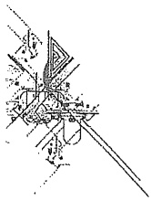

natural_image

Abstract geometric line drawing with intersecting lines and shapes (no text or symbols)

$u_{c}$  的全响应还可以用三要素直接写出:

$$
\begin{array}{l} u _ {c} = u _ {c} (\infty) + \left[ u _ {c} (0 _ {+}) - u _ {c} (\infty) \right] \mathrm{e} ^ {- \frac {t}{\tau}} \\ = [ 1 2 + (8 - 1 2) \mathrm{e} ^ {- 1 0 ^ {6} t} ] \mathrm{V} \\ = \left[ 1 2 - 4 \mathrm{e} ^ {- 1 0 ^ {6} t} \right] \mathrm{V} \\ \end{array}
$$

图 7-16(c) 给出了零输入响应、零状态响应和全响应随时间变化的曲线。

## §7-5 二阶电路的零输入响应

用二阶微分方程描述的电路称为二阶电路。

二阶电路换路后,电路中无外施激励,仅由动态元件的初始储能引起的响应,称为二阶电路的零输入响应。

图 7-17 所示电路, 开关 S 原闭合电路已达到稳定状态。t=0 时开关 S 打开, 对开关 S 打开后的电路列写微分方程, 有

$$
u _ {L} + u _ {C} + u _ {\dot {R} _ {1}} = 0 \tag {7-8}
$$

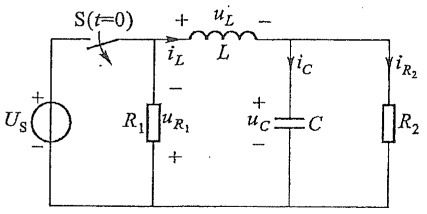

text_image

S(t=0)
+
iL
uL
-
L
iC
iR2
Us
+
R1
uR1
+
uC
C
-
R2

图 7-17 二阶电路

由于 $i_{C} = C\frac{\mathrm{d}u_{C}}{\mathrm{d}t}$

$$
\begin{array}{l} i _ {R _ {2}} = \frac {u _ {c}}{R _ {2}} \\ i _ {L} = i _ {C} + i _ {R _ {2}} = C \frac {\mathrm{d} u _ {C}}{\mathrm{d} t} + \frac {u _ {C}}{R _ {2}} \\ u _ {L} = L \frac {\mathrm{d} i _ {L}}{\mathrm{d} t} = L C \frac {\mathrm{d} ^ {2} u _ {C}}{\mathrm{d} t ^ {2}} + \frac {L}{R _ {2}} \frac {\mathrm{d} u _ {C}}{\mathrm{d} t} \\ u _ {R _ {1}} = R _ {1} i _ {L} = \frac {R _ {1}}{R _ {2}} u _ {c} + R _ {1} C \frac {\mathrm{d} u _ {c}}{\mathrm{d} t} \\ \end{array}
$$

把 $u_{L}$ 和 $u_{R_1}$ 代入式(7-8)并整理，得

$$
\frac {\mathrm{d} ^ {2} u _ {c}}{\mathrm{d} t ^ {2}} + \left(\frac {1}{R _ {2} C} + \frac {R _ {1}}{L}\right) \frac {\mathrm{d} u _ {c}}{\mathrm{d} t} + \frac {1}{L C} \left(1 + \frac {R _ {1}}{R _ {2}}\right) u _ {c} = 0
$$

所得到的微分方程是线性常系数二阶齐次微分方程,初始条件为  $u_{c}(0_{+})=u_{c}(0_{-})=U_{s}$ ,  $i_{L}(0_{+})=i_{L}(0_{-})=\frac{U_{s}}{R_{2}}$ 。求解上述方程后,便可得到该电路的零输入响应。

RLC 串联电路和 GLC 并联电路是最简单的二阶电路,下面就以 RLC 串联电路为例分析二阶电路零输入响应的物理过程。

二阶电路的零输入响应

图 7-18 所示为 RLC 串联电路, 假设电容原已充电, 其电压  $u_{c}=U_{0}$ , 电感中的初始电流为  $I_{0}$ 。t=0 时, 开关 S 闭合, 此电路的放电过程即是二阶电路的零输入响应。在指定的电压、电流参考方向下, 根据 KVL 可得

$$
- u _ {c} + u _ {R} + u _ {L} = 0
$$

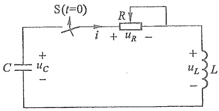

text_image

S(t=0)
C + uC -
i + uR -
R
+ uL L -

图 7-18 RLC 放电电路

$i = -C\frac{\mathrm{d}u_{c}}{\mathrm{d}t}$, 电压 $u_{R} = Ri = -RC\frac{\mathrm{d}u_{c}}{\mathrm{d}t}, u_{L} = L\frac{\mathrm{d}i}{\mathrm{d}t} = -LC\frac{\mathrm{d}^{2}u_{c}}{\mathrm{d}t^{2}}$。把它们代入上式，得

$$
L C \frac {\mathrm{d} ^ {2} u _ {c}}{\mathrm{d} t ^ {2}} + R C \frac {\mathrm{d} u _ {c}}{\mathrm{d} t} + u _ {c} = 0 \tag {7-9}
$$

式(7-9)是以  $u_{c}$  为未知量的 RLC 串联电路放电过程的微分方程。这是一个线性常系数二阶齐次常微分方程。求解这类方程时，仍然先设  $u_{c}=Ae^{pt}$ ，然后再确定其中的 p 和 A。

将  $u_{c}=Ae^{pt}$  代入式(7-9)，得特征方程

$$
L C p ^ {2} + R C p + 1 = 0
$$

解出特征根为

$$
p = - \frac {R}{2 L} \pm \sqrt {\left(\frac {R}{2 L}\right) ^ {2} - \frac {1}{L C}}
$$

根号前有正、负两个符号，所以 $p$ 有两个值。为了兼顾这两个值，电压 $u_{c}$ 可写成

$$
u _ {C} = A _ {1} \mathrm{e} ^ {p _ {1} t} + A _ {2} \mathrm{e} ^ {p _ {2} t} \tag {7-10}
$$

其中

$$
\left. \begin{array}{l} p _ {1} = - \frac {R}{2 L} + \sqrt {\left(\frac {R}{2 L}\right) ^ {2} - \frac {1}{L C}} \\ p _ {2} = - \frac {R}{2 L} - \sqrt {\left(\frac {R}{2 L}\right) ^ {2} - \frac {1}{L C}} \end{array} \right\} \tag {7-11}
$$

从式(7-11)可见,特征根 $p_{1}$ 和 $p_{2}$ 仅与电路的结构和参数有关,而与激励和初始储能无关。

当式(7-11)中 $\left(\frac{R}{2L}\right)^{2}-\frac{1}{LC}<0$ 时,若令

$$
\delta = \frac {R}{2 L}, \quad \omega^ {2} = \frac {1}{L C} - \left(\frac {R}{2 L}\right) ^ {2}
$$

则

$$
\sqrt {\left(\frac {R}{2 L}\right) ^ {2} - \frac {1}{L C}} = \sqrt {- \omega^ {2}} = \mathrm{j} \omega \quad (\mathrm{j} = \sqrt {- 1})
$$

由于电路中 R、L、C 的参数不同, 特征根亦不同, 针对不同情况的特征根, 二阶线性常系数齐次常微分方程的通解(亦即二阶电路的零输入解)有如下表达式。

(1) $p_{1},p_{2}$ 为两个不等的负实根

$$
\text {通解} = A _ {1} \mathrm{e} ^ {p _ {1} t} + A _ {2} \mathrm{e} ^ {p _ {2} t}
$$

(2) $p_{1},p_{2}$ 为两个相等的负实根

$$
p _ {1} = p _ {2} = - \delta
$$

通解 $= (A_{1} + A_{2}t)\mathrm{e}^{-\delta t}$

(3) $p_{1},p_{2}$ 为一对共轭复根

$$
p _ {1} = - \delta + \mathrm{j} \omega
$$

$$
p _ {2} = - \delta - \mathrm{j} \omega
$$

通解 $= A\mathrm{e}^{-\delta t}\sin (\omega t + \theta)$

(4) $p_{1},p_{2}$ 为一对共轭虚数

$$
\dot {p} _ {1} = \mathrm{j} \omega
$$

$$
p _ {2} = - \mathrm{j} \omega
$$

通解 $= A\sin (\omega t + \theta)$

根据给定的初始条件  $u_{C}(0_{+})$  和  $i_{L}(0_{+})$  就可以求得上述表达式中的常数  $A_{1}, A_{2}, A$  和  $\theta$ 。

现在给定的初始条件为 $u_{c}(0_{+}) = u_{c}(0_{-}) = U_{0}, i_{L}(0_{+}) = i_{L}(0_{-}) = I_{0}$, 由于 $i = -C\frac{\mathrm{d}u_{c}}{\mathrm{d}t}$, 因此有 $\frac{\mathrm{d}u_{c}}{\mathrm{d}t} = -\frac{I_{0}}{C}$, 根据这两个初始条件和式(7-10), 有

$$
\left. \begin{array}{l} A _ {1} + A _ {2} = U _ {0} \\ p _ {1} A _ {1} + p _ {2} A _ {2} = - \frac {I _ {0}}{C} \end{array} \right\}
$$

联立求解上式就可求得常数  $A_{1}$  和  $A_{2}$ 。下面讨论  $U_{0} \neq 0$  而  $I_{0} = 0$  的情况，即已充电的电容通过 R、L 放电的情况。此时，可解得

$$
A _ {1} = \frac {p _ {2} ^ {\prime \prime} U _ {0}}{p _ {2} - p _ {1}}
$$

$$
A _ {2} = - \frac {p _ {1} U _ {0}}{p _ {2} - p _ {1}}
$$

将解得的  $A_{1}, A_{2}$  代入式(7-10)就可以得到 RLC 串联电路零输入响应的表达式。

下面将对特征根的不同情况详细讨论上述电路过渡过程的物理特性。

1. $R > 2\sqrt{\frac{L}{C}}$ ，非振荡放电过程

在这种情况下,特征根  $p_{1}$  和  $p_{2}$  是两个不等的负实数,电容上的电压为

$$
u _ {c} = \frac {U _ {0}}{p _ {2} - p _ {1}} (p _ {2} \mathrm{e} ^ {p _ {1} t} - p _ {1} \mathrm{e} ^ {p _ {2} t}) \tag {7-12}
$$

电流为

$$
i = - C \frac {\mathrm{d} u _ {C}}{\mathrm{d} t} = - \frac {C U _ {0} p _ {1} p _ {2}}{p _ {2} - p _ {1}} (\mathrm{e} ^ {p _ {1} t} - \mathrm{e} ^ {p _ {2} t}) = - \frac {U _ {0}}{L (p _ {2} - p _ {1})} (\mathrm{e} ^ {p _ {1} t} - \mathrm{e} ^ {p _ {2} t}) \tag {7-13}
$$

，上式中利用了  $p_{1}p_{2}=\frac{1}{LC}$  的关系。

电感电压为

$$
u _ {L} = L \frac {\mathrm{d} i}{\mathrm{d} t} = - \frac {U _ {0}}{p _ {2} - p _ {1}} (p _ {1} \mathrm{e} ^ {p _ {1} t} - p _ {2} \mathrm{e} ^ {p _ {2} t}) \tag {7-14}
$$

图 7-19 画出了  $u_{C}$ 、 $i$ 、 $u_{L}$  随时间变化的曲线。从图中可以看出， $u_{C}$ 、i 始终不改变方向，而且有  $u_{C}>0, i\geqslant0$ ，表明电容在整个过程中一直释放储存的电能，因此称为非振荡放电，又称为过阻尼放电。当  $t=0_{+}$  时， $i(0_{+})=0$ ，当  $t\to\infty$  时放电过程结束， $i(\infty)=0$ ，所以在放电过程中电流必然要经历从小到大再趋于零的变化。电流达最大值的时刻  $t_{m}$  可由  $\frac{di}{dt}=0$  决定。

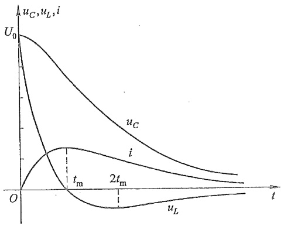

line

| Time | uC | i | uL |
| --- | --- | --- | --- |
| 0 | U0 | 0 | 0 |
| tm | ~0.6 | ~0.3 | ~-0.1 |
| 2tm | ~0.4 | ~0.2 | ~-0.2 |

图7-19 非振荡放电过程中 $u_{C}, u_{L}$ 和 $i$ 随时间变化的曲线

$$
t _ {\mathrm{m}} = \frac {\ln \left(\frac {p _ {2}}{p _ {1}}\right)}{p _ {1} - p _ {2}}
$$

$t<t_{m}$  时,电感吸收能量,建立磁场; $t>t_{m}$  时,电感释放能量,磁场逐渐衰减,趋向消失。 $t=t_{m}$  时,正是电感电压过零点。

例 7-7 在图 7-20 所示的电路中, 已知 $U_{s} = 10 \mathrm{~V}$, $C = 1 \mu \mathrm{F}, R = 4 \mathrm{k}\Omega, L = 1 \mathrm{H}$, 开关 S 原来闭合在位置 1 处, 在 $t = 0$ 时, 开关 S 由位置 1 接至位置 2 处。求: (1) $u_{c}$、$u_{R}$、$i$ 和 $u_{L}$; (2) $i_{\max}$。

解 开关 S 由位置 1 接至位置 2 后列得的电路方程为

$$
L C \frac {\mathrm{d} ^ {2} u _ {c}}{\mathrm{d} t ^ {2}} + R C \frac {\mathrm{d} u _ {c}}{\mathrm{d} t} + u _ {c} = 0
$$

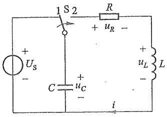

text_image

1 S 2
+ uR -
C uC -
i
+ uL -
L

图7-20 例7-7图

这是二阶电路的零输入响应。

(1) 今已知 $R = 4\mathrm{k}\Omega$，而 $2\sqrt{\frac{L}{C}} = 2\sqrt{\frac{1}{10^{-6}}}\Omega = 2\mathrm{k}\Omega$，所以 $R > 2\sqrt{\frac{L}{C}}$，放电过程是非振荡的。且 $u_{C}(0_{+}) = U_{0} = U_{\mathrm{s}}$。

特征根为

$$
p _ {1} = - \frac {R}{2 L} + \sqrt {\left(\frac {R}{2 L}\right) ^ {2} - \frac {1}{L C}} = - 2 6 8
$$

$$
p _ {2} = - \frac {R}{2 L} - \sqrt {\left(\frac {R}{2 L}\right) ^ {2} - \frac {1}{L C}} = - 3 7 3 2
$$

这是两个不相等的实根,所以零输入响应形式为

$$
u _ {c} = A _ {1} \mathrm{e} ^ {p _ {1} t} + A _ {2} \mathrm{e} ^ {p _ {2} t}
$$

根据初始条件  $u_{c}(0_{+})=U_{s}=10\ V, i_{L}(0_{+})=0$  ,有

$$
\left\{ \begin{array}{l} A _ {1} + A _ {2} = 1 0 \\ A _ {1} p _ {1} + A _ {2} p _ {2} = 0 \end{array} \right.
$$

解得

$$
\left\{ \begin{array}{l} A _ {1} = 1 0. 7 7 \\ A _ {2} = - 0. 7 7 3 \end{array} \right.
$$

则电容电压、电流、电阻电压、电感电压为

$$
u _ {C} = (1 0. 7 7 \mathrm{e} ^ {- 2 6 8 t} - 0. 7 7 3 \mathrm{e} ^ {- 3 7 3 2 t}) \mathrm{V}
$$

$$
i = - C \frac {\mathrm{d} u _ {c}}{\mathrm{d} t} = 2. 8 9 (\mathrm{e} ^ {- 2 6 8 t} - \mathrm{e} ^ {- 3 7 3 2 t}) \mathrm{mA}
$$

$$
u _ {R} = R i = 1 1. 5 6 (\mathrm{e} ^ {- 2 6 8 t} - \mathrm{e} ^ {- 3 7 3 2 t}) \mathrm{V}
$$

$$
u _ {L} = L \frac {\mathrm{d} i}{\mathrm{d} t} = (1 0. 7 7 \mathrm{e} ^ {- 3 7 3 2 t} - 0. 7 7 3 \mathrm{e} ^ {- 2 6 8 t}) \mathrm{V}
$$

(2) 电流最大值发生在  $t_{m}$  时刻, 即

$$
t _ {m} = \frac {\ln \left(\frac {p _ {2}}{p _ {1}}\right)}{p _ {1} - p _ {2}} = 7. 6 0 \times 1 0 ^ {- 4} \mathrm{s} = 7 6 0 \mu \mathrm{s}
$$

$$
\begin{array}{l} i _ {\max} = 2. 8 9 (\mathrm{e} ^ {- 2 6 8 \times 7. 6 0 \times 1 0 ^ {- 4}} - \mathrm{e} ^ {- 3 7 3 2 \times 7. 6 0 \times 1 0 ^ {- 4}}) \\ = 2 1. 9 \times 1 0 ^ {- 4} \mathrm{A} \\ = 2. 1 9 \mathrm{mA} \\ \end{array}
$$

因本题中的初始状态为  $u_{C}(0_{+})=U_{0}=10\ V, i_{L}(0_{+})=0$ ，所以也可以直接应用式(7-12)、式(7-13)、式(7-14)求得  $u_{C}$ 、 $i_{L}$  和  $u_{L}$ 。如果初始条件是电感具有初值或电容和电感都具有初始储能，则不能直接应用上述诸式。

2. $R < 2\sqrt{\frac{L}{C}}$ ，振荡放电过程

在这种情况下,特征根是一对共轭复数,即

$$
p _ {1} = - \delta + \mathrm{j} \omega , \quad p _ {2} = - \delta - \mathrm{j} \omega
$$

令 $\omega_0 = \sqrt{\delta^2 + \omega^2}, \beta = \arctan\left(\frac{\omega}{\delta}\right)$ （如图7-21所示），则有 $\delta = \omega_0 \cos \beta, \omega = \omega_0 \sin \beta$，根据 $e^{j\beta} = \cos \beta + j\sin \beta, e^{-j\beta} = \cos \beta - j\sin \beta$，可求得

$$
p _ {1} = - \omega_ {0} \mathrm{e} ^ {- \mathrm{j} \beta}, \quad p _ {2} = - \omega_ {0} \mathrm{e} ^ {\mathrm{j} \beta}
$$

这样

$$
\begin{array}{l} u _ {c} = \frac {U _ {0}}{p _ {2} - p _ {1}} (p _ {2} \mathrm{e} ^ {p _ {1} t} - p _ {1} \mathrm{e} ^ {p _ {2} t}) \\ = \frac {U _ {0}}{- \mathrm{j} 2 \omega} \left[ - \omega_ {0} \mathrm{e} ^ {\mathrm{j} \beta} \mathrm{e} ^ {(- \delta + \mathrm{j} \omega) t} + \omega_ {0} \mathrm{e} ^ {- \mathrm{j} \beta} \mathrm{e} ^ {(- \delta - \mathrm{j} \omega) t} \right] \\ = \frac {U _ {0} \omega_ {0}}{\omega} \mathrm{e} ^ {- \delta t} \left[ \frac {\mathrm{e} ^ {\mathrm{j} (\omega t + \beta)} - \mathrm{e} ^ {- \mathrm{j} (\omega t + \beta)}}{\mathrm{j} 2} \right] \\ = \frac {U _ {0} \omega_ {0}}{\omega} \mathrm{e} ^ {- \delta t} \sin (\omega t + \beta) \\ \end{array}
$$

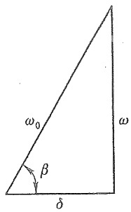

text_image

ω₀
β
δ
ω

图7-21 表示 $\omega_0, \omega$ 和 $\delta$ 相互关系的三角形

根据  $i=-C\frac{du_{c}}{dt}$ ，或者利用式(7-13)可求得 i 为

$$
i = \frac {U _ {0}}{\omega L} \mathrm{e} ^ {- \delta t} \sin (\omega t)
$$

而电感电压

$$
u _ {L} = - \frac {U _ {0} \omega_ {0}}{\omega} \mathrm{e} ^ {- \delta t} \sin (\omega t - \beta)
$$

从上述 $u_{C}, i$ 和 $u_{L}$ 的表达式可以看出，它们的波形将呈现衰减振荡的状态，又称为欠阻尼放电。在整个过程中，它们将周期性地改变方向，储能元件也将周期性地交换能量。$u_{C}, i$ 和 $u_{L}$ 的波形如图7-22所示，根据上述各式，还可以得出:

(1)  $\omega t = k\pi, k = 0, 1, 2, 3, \cdots$  为电流 i 的过零点，即  $u_{c}$  的极值点；
(2)  $\omega t = k\pi + \beta, k = 0, 1, 2, 3, \cdots$  为电感电压  $u_{L}$  的过零点，也即电流 i 的极值点；
(3)  $\omega t = k\pi - \beta, k = 0, 1, 2, 3, \cdots$  为电容电压  $u_{c}$  的过零点。

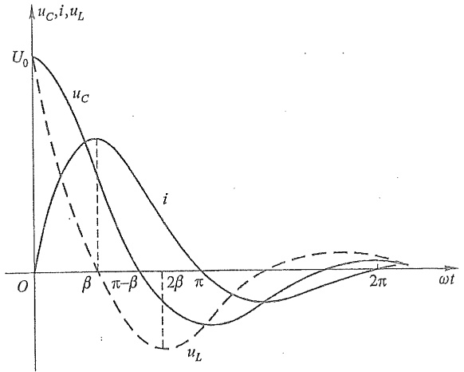

line

| \(\omega t\) | uC | i | uL |
| --- | --- | --- | --- |
| 0 | \(U_{0}\) | 0 | \(U_{0}\) |
| \(\beta\) | ~0.6 | ~0.4 | 0 |
| \(\pi-\beta\) | ~0.3 | ~0.5 | ~-0.3 |
| \(2\beta\) | 0 | ~0.1 | ~-0.5 |
| \(\pi\) | ~-0.3 | 0 | ~-0.2 |
| \(2\pi\) | ~-0.1 | ~-0.1 | 0 |

图 7-22 振荡放电过程中  $u_{C}$ 、 $u_{L}$  和 i 的波形

根据上述零点划分的时域可以看出元件之间能量转换、吸收的概况,见表7-2。

表 7-2

| 元件 | $0 < \omega t < \beta$ | $\beta < \omega t < \pi - \beta$ | $\pi - \beta < \omega t < \pi$ |
| --- | --- | --- | --- |
| 电感 | 吸收 | 释放 | 释放 |
| 电容 | 释放 | 释放 | 吸收 |
| 电阻 | 消耗 | 消耗 | 消耗 |

例 7-8 在受控热核研究中,需要强大的脉冲磁场,它是靠强大的脉冲电流产生的。这种强大的脉冲电流可以由 RLC 放电电路产生。若已知  $U_{0}=15\ kV, C=1\ 700\ \mu F, R=6\times10^{-4}\ \Omega, L=6\times10^{-9}\ H$ 。

(1) 试求放电电流  $i(t)$ 。
(2) $i(t)$ 在何时达到极大值？求出 $i_{\mathrm{max}}$。

解 根据已知参数有

$$
\delta = \frac {R}{2 L} = 5 \times 1 0 ^ {4} \mathrm{s} ^ {- 1}
$$

$$
\mathrm{j} \omega = \sqrt {\left(\frac {R}{2 L}\right) ^ {2} - \frac {1}{L C}} = \mathrm{j} 3. 0 9 \times 1 0 ^ {5} \mathrm{rad/s}
$$

$$
\beta = \arctan \left(\frac {\omega}{\delta}\right) = 1. 4 1 \mathrm{rad}
$$

即特征根为共轭复数,属于振荡放电情况。所以有

(1) 电流  $i(t)$  为

$$
\begin{array}{l} i (t) = \frac {U _ {0}}{\omega L} \mathrm{e} ^ {- \delta t} \sin (\omega t) \\ = 8. 0 9 \times 1 0 ^ {6} \mathrm{e} ^ {- 5 \times 1 0 ^ {4} t} \sin (3. 0 9 \times 1 0 ^ {5} t) \mathrm{A} \\ \end{array}
$$

(2) 当  $\omega t = \beta$ ，即当  $t = \frac{\beta}{\omega} = 4.56 \mu s$  时，电流  $i(t)$  达到极大值

$$
\begin{array}{l} i _ {\max} = 8. 0 9 \times 1 0 ^ {6} \mathrm{e} ^ {- 5 \times 1 0 ^ {4} \times 4. 5 6 \times 1 0 ^ {- 6}} \sin (3. 0 9 \times 1 0 ^ {5} \times 4. 5 6 \times 1 0 ^ {- 6}) \mathrm{A} \\ = 6. 3 6 \times 1 0 ^ {6} \mathrm{A} \\ \end{array}
$$

可见,最大放电电流可达  $6.36 \times 10^{6}$  A, 这是一个比较可观的数值。

在 R=0 时,  $\delta=0$ , 则  $\omega=\omega_{0}=\frac{1}{\sqrt{LC}},\beta=\frac{\pi}{2}$ , 所以这时  $u_{c}(t)$ 、 $i(t)$ 、 $u_{L}(t)$  的表达式为

$$
\begin{array}{l} u _ {c} (t) = U _ {0} \sin \left(\omega_ {0} t + \frac {\pi}{2}\right) \\ i (t) = \frac {U _ {0}}{\omega_ {0} L} \sin (\omega_ {0} t) = \frac {U _ {0}}{\sqrt {\frac {L}{C}}} \sin (\omega_ {0} t) \\ \end{array}
$$

$$
u _ {L} (  t  ) = - U _ {0} \mathrm{sin} \bigg (\omega_ {0} t - \frac {\pi}{2} \bigg)   = U _ {0} \mathrm{sin} \bigg (\omega_ {0} t + \frac {\pi}{2} \bigg)   = u _ {c} (  t  )
$$

这时  $u_{c}(t)$ 、 $i(t)$ 、 $u_{L}(t)$  各量都是正弦函数，它们的振幅并不衰减，是一种等幅振荡的放电过程。

尽管实际的振荡电路都是有损耗的,但若仅关心在很短的时间间隔内发生的过程时,则按等幅振荡处理不会带来显著的误差。

例 7-9 为了试验油开关熄灭电弧的能力,需要在开关中通以数十千安,频率为  $50 \cdot Hz$  的正弦电流。工程中往往采用 LC 放电电路作为试验电源,如图 7-23 所示。其

工作情况大致如下:首先打开开关  $S_{2}$ ，接通开关  $S_{1}$ ，使电容器充电至所需电压  $U_{0}$ ；然后打开开关  $S_{1}$ ，接通开关  $S_{2}$ ，于是电容器就开始对电感线圈放电。选择电路参数 L 和 C 的大小以及充电电压  $U_{0}$  的数值，就可得到试验所需正弦电流。在开关闭合后的适当时间，借助于自动装置把被试开关的触头 A 拉开，便可以试验高压开关的灭弧能力。

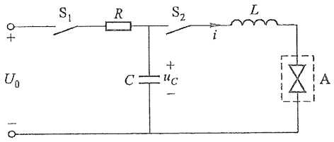

text_image

S₁ R S₂ L
+ i
U₀ C u_C A
-

图 7-23 试验高压开关灭弧能力的振荡电路

在本例题中,已知  $C=3\ 800\ \mu F$ ,  $U_{0}=14.14\ kV$ , 若线圈用很粗的导线绕制, 则在近似估算中可以把它的电阻忽略不计。

(1) 为了产生试验所需 50 Hz 电流, 线圈电感 L 等于多少?
(2) 试求振荡电路的电流  $i(t)$  以及电容电压  $u_{c}(t)$ 。

解（1）试验所需电流的频率为 $50\mathrm{Hz}$，即 $\omega_0 = 2\pi f = 314\mathrm{rad / s}$，根据 $\omega_0 = \frac{1}{\sqrt{LC}}$，可以求出电感 $L$ 为

$$
L = \frac {1}{\omega_ {0} ^ {2} C} = 2. 6 7 \times 1 0 ^ {- 3} \mathrm{H} = 2. 6 7 \mathrm{mH}
$$

(2) 根据

$$
i = \frac {U _ {0}}{\sqrt {\frac {L}{C}}} \sin \left(\frac {t}{\sqrt {L C}}\right)
$$

可以得出电流  $i(t)$  为

$$
i (t) = 1 6. 9 \times 1 0 ^ {3} \sin (3 1 4 t) \mathrm{A}
$$

可见,放电电流的峰值可达16.9 kA。

电容电压为

$$
u _ {c} (t) = u _ {L} (t) = U _ {0} \sin \left(\omega_ {0} t + \frac {\pi}{2}\right) = 1 0 \sqrt {2} \times 1 0 ^ {3} \sin \left(3 1 4 t + \frac {\pi}{2}\right) \mathrm{V}
$$

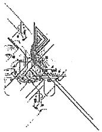

natural_image

Abstract geometric line drawing with intersecting lines and shapes (no text or symbols)

3. $R = 2\sqrt{\frac{L}{C}}$ ，临界情况

在  $R=2\sqrt{\frac{L}{C}}$  的条件下,这时特征方程具有重根

$$
p _ {1} = p _ {2} = - \frac {R}{2 L} = - \delta
$$

微分方程(7-9)的通解为

$$
u _ {c} = (A _ {1} + A _ {2} t) \mathrm{e} ^ {- \delta t}
$$

根据初始条件可得

$$
A _ {1} = U _ {0}
$$

$$
A _ {2} = \delta U _ {0}
$$

所以

$$
u _ {c} (t) = U _ {0} (1 + \delta t)   \mathrm{e} ^ {- \delta t}
$$

$$
i (t) = - C \frac {\mathrm{d} u _ {c}}{\mathrm{d} t} = \frac {U _ {0}}{L} t \mathrm{e} ^ {- \delta t}
$$

$$
u _ {L} (t) = L \frac {\mathrm{d} i}{\mathrm{d} t} = U _ {0} \mathrm{e} ^ {- \delta t} (1 - \delta t)
$$

从以上诸式可以看出  $u_{C}(t)$ 、 $i(t)$ 、 $u_{L}(t)$  不做振荡变化，即具有非振荡的性质，其波形与图 7-19 所示相似。然而，这种过程是振荡与非振荡过程的分界线，所以  $R=2\sqrt{\frac{L}{C}}$  时的过渡过程称为临界非振荡过程，这时的电阻称为临界电阻，并称电阻大于临界电阻的电路为过阻尼电路，小于临界电阻的电路为欠阻尼电路。

还可指出,临界情况下过渡过程的计算公式,可通过前两种非临界情况下的公式取极限导出。

## §7-6 二阶电路的零状态响应和全响应

二阶电路的初始储能为零(即电容两端的电压和电感中的电流都为零),仅由外施激励引起的响应称为二阶电路的零状态响应。

图 7-24 所示为 GCL 并联电路, $u_{C}(0_{-})=0$ , $i_{L}(0_{-})=0$ , t=0 时, 开关 S 打开。根据 KVL 有

$$
i _ {C} + i _ {G} + i _ {L} = i _ {\mathrm{S}}
$$

以  $i_{L}$  为待求变量, 可得

$$
L C \frac {\mathrm{d} ^ {2} i _ {L}}{\mathrm{d} t ^ {2}} + G L \frac {\mathrm{d} i _ {L}}{\mathrm{d} t} + i _ {L} = i _ {\mathrm{s}}
$$

这是二阶线性非齐次方程,它的解答由特解和对应的齐次方程的通解组成。如果 $i_{\mathrm{s}}$ 为直流激励或正弦激励，则取稳态解 $i'$ 为特解，而通解 $i''$ 与零输入响应形式相同，再根据初始条件确定积分常数，从而得到全解。

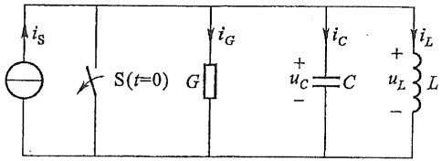

text_image

iS
S(t=0) G iG
+ uC C iC +
- uL L
-

图 7-24 二阶电路的零状态响应

二阶电路的零状态响应和全响应

如果二阶电路具有初始储能,又接入外施激励,则电路的响应称为全响应。全响应是零输入响应和零状态响应的叠加,可以通过求解二阶非齐次方程的方法求得全响应。

例 7-10 图 7-24 所示电路中， $u_{C}(0_{-})=0, i_{L}(0_{-})=0, G=2\times10^{-3}$ S, $C=1\mu F, L=1H, i_{S}=1A$，当 t=0 时把开关 S 打开。试求响应 $i_{L}, u_{C}$ 和 $i_{C}$。

解 列出开关 S 打开后的电路微分方程为

$$
L C \frac {\mathrm{d} ^ {2} i _ {L}}{\mathrm{d} t ^ {2}} + G L \frac {\mathrm{d} i _ {L}}{\mathrm{d} t} + i _ {L} = i _ {\mathrm{S}}
$$

特征方程为

$$
p ^ {2} + \frac {G}{C} p + \frac {1}{L C} = 0
$$

代入数据后可求得特征根为

$$
p _ {1} = p _ {2} = p = - 1 0 ^ {3}
$$

由于 $p_{1},p_{2}$ 是重根,为临界阻尼情况,其解答为

$$
i _ {L} = i _ {L} ^ {\prime} + i _ {L} ^ {\prime \prime}
$$

式中  $i_{L}^{\prime}$  为特解(强制分量)

$$
i _ {L} ^ {\prime} = 1 \mathrm{A}
$$

$i_{L}^{\prime\prime}$  为对应的齐次方程的解

$$
i _ {L} ^ {\prime \prime} = \left(A _ {1} + A _ {2} t\right) \mathrm{e} ^ {p t}
$$

所以通解为

$$
i _ {L} = \left[ 1 + (A _ {1} + A _ {2} t) \mathrm{e} ^ {- 1 0 ^ {3} t} \right]
$$

$t=0_{+}$ 时的初始值为

$$
\begin{array}{l} i _ {L} (  0 _ {+}) = i _ {L} (  0 _ {-}) = 0 \\ \left(\frac {\mathrm{d} i _ {L}}{\mathrm{d} t}\right) _ {0 _ {+}} = \frac {1}{L} u _ {L} (0 _ {+}) = \frac {1}{L} u _ {c} (0 _ {+}) \\ = \frac {1}{L} u _ {c} (0 _ {-}) = 0 \\ \end{array}
$$

代入初始条件可求得

$$
\begin{array}{l} 1 + A _ {1} + 0 = 0 \\ - 1 0 ^ {3} A _ {1} + A _ {2} = 0 \\ \end{array}
$$

解得

$$
\begin{array}{l} A _ {1} = - 1 \\ A _ {2} = - 1 0 ^ {3} \\ \end{array}
$$

所以求得的零状态响应为

$$
i _ {L} = \left[ 1 - (1 + 1 0 ^ {3} t) \mathrm{e} ^ {- 1 0 ^ {3} t} \right] \mathrm{A}
$$

$$
u _ {G} = u _ {L} = L \frac {\mathrm{d} i _ {L}}{\mathrm{d} t} = 1 0 ^ {6} t \mathrm{e} ^ {- 1 0 ^ {3} t} \mathrm{V}
$$

$$
i _ {C} = C \frac {\mathrm{d} u _ {C}}{\mathrm{d} t} = (1 - 1 0 ^ {3} t) \mathrm{e} ^ {- 1 0 ^ {3} t} \mathrm{A}
$$

过渡过程是临界阻尼情况,属非振荡性质, $i_{L}$ 、 $i_{C}$ 、 $u_{C}$ 随时间变化的波形如图7-25所示。

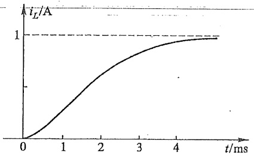

line

| t (ms) | iL (A) |
| --- | --- |
| 0 | 0 |
| ~1 | ~0.3 |
| ~2 | ~0.6 |
| ~3 | ~0.8 |
| ~4 | ~0.95 |
| ~5 | 1 |

(a)

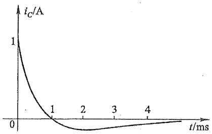

line

| t/ms | iC/A |
| --- | --- |
| 0 | 1 |
| 1 | 0 |
| 2 | ~-0.1 |
| 3 | ~-0.05 |
| 4 | ~0 |

(b)

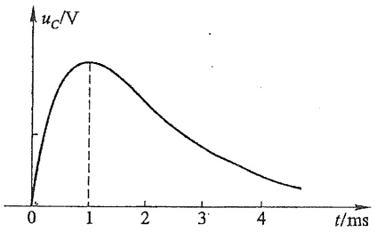

line

| t (ms) | uC (V) |
| --- | --- |
| 0 | 0 |
| 1 | Peak Value |

(c)

图 7-25  $i_{L}$ 、 $i_{C}$ 、 $u_{G}$  的波形

例 7-11 图 7-26 所示电路中, 若给定  $R=50\ \Omega, L=0.5\ H, C=100\ \mu F$ , 直流电源  $U_{S}=50\ V$ , 已知  $u_{C}(0_{-})=0, i_{L}(0_{-})=2\ A$ 。开关 S 在 t=0 时闭合, 求开关闭合后电感中的电流  $i_{L}(t)$ 。

解 从题目所给条件可以看出,电路原有初始电流  $i_{L}(0_{-})=2\ A$ , 开关闭合后又接入了电压源, 所以开关闭合后的响应为全响应。

(1) 列出开关闭合后电路的微分方程为

$$
R L C \frac {\mathrm{d} ^ {2} i _ {L}}{\mathrm{d} t ^ {2}} + L \frac {\mathrm{d} i _ {L}}{\mathrm{d} t} + R i _ {L} = U _ {\mathrm{s}}
$$

代入已知参数并整理得

$$
\frac {\mathrm{d} ^ {2} i _ {L}}{\mathrm{d} t ^ {2}} + 2 0 0 \frac {\mathrm{d} i _ {L}}{\mathrm{d} t} + 2 0 0 0 0 i _ {L} = 2 0 0 0 0
$$

设全响应为  $i_{L}(t)=i_{L}^{\prime}+i_{L}^{\prime\prime}$ 。

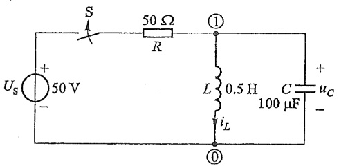

text_image

S
50 Ω
R
①
Us +
50 V
-
L
0.5 H
iL
①
C
100 μF
uC
+
-

图 7-26 例 7-11 图

(2) 特解为

$$
i _ {L} ^ {\prime} = \frac {5 0}{5 0} \mathrm{A=1A}
$$

(3) 求通解, 二阶微分方程的特征方程为

$$
p ^ {2} + 2 0 0 p + 2 0 0 0 0 = 0
$$

特征根为

$$
p = - 1 0 0 \pm j 1 0 0
$$

由于特征根为共轭复根,所以换路后过渡过程的性质为欠阻尼性质,即

$$
i _ {L} ^ {\prime \prime} = A \mathrm{e} ^ {- 1 0 0 t} \sin (1 0 0 t + \beta)
$$

(4) 全响应为

$$
\begin{array}{l} i _ {L} (t) = i _ {L} ^ {\prime} + i _ {L} ^ {\prime \prime} \\ = 1 + A \mathrm{e} ^ {- 1 0 0 t} \sin (1 0 0 t + \beta) \\ \end{array}
$$

已知初始条件为

$$
\begin{array}{l} i _ {L} (0 _ {+}) = i _ {L} (0 _ {-}) = 2 \mathrm{A} \\ \frac {\mathrm{d} i _ {L}}{\mathrm{d} t} \bigg | _ {0 _ {+}} = \frac {u _ {c} (0 _ {+})}{L} = 0 \\ \end{array}
$$

所以有

$$
\left\{ \begin{array}{l} 1 + A \sin \beta = 2 \\ 1 0 0 A \cos \beta - 1 0 0 A \sin \beta = 0 \end{array} \right.
$$

解得

$$
A = \sqrt {2}
$$

$$
\beta = 4 5 ^ {\circ}
$$

所以电流  $i_{L}$  的全响应为

$$
i _ {L} (t) = \left[ 1 + \sqrt {2}   \mathrm{e} ^ {- 1 0 0 t} \sin (1 0 0 t + 4 5 ^ {\circ}) \right] \mathrm{A}
$$

通过对一阶电路和二阶电路的时域分析可知，动态电路发生换路后，如果激励是直流电源，则电路响应中含有随时间指数衰减的暂态分量。在换路后达到稳态以后，电路响应中的指数项衰减到零，此时电容电压不再变化，电容可用开路替代；电感电流不再变化，电感可用短路替代。这时动态电路虽然含有储能元件，却相当于直流激励的电阻电路。与激励是直流情形类似，动态电路施加正弦激励。动态电路发生换路后，当达到稳态以后，电路响应中的指数项衰减到零，所有元件上的电压和电流都是正弦时间函数。动态电路就成为正弦函数激励的正弦稳态电路，用相量法分析（见第八章）。可见，同一个动态电路，在施加不同性质的激励时，达到稳态的电路模型是不同的。动态电路施加直流激励，达到稳态时是电阻电路；动态电路施加正弦激励，达到稳态时是正弦稳态电路。换句话说，电路模型分析和实际电路测量是一对矛盾，矛盾在一定条件下可以转化，转化条件就是施加的激励。解决矛盾的方法就是采用不同的电路模型和分析方法,就是一把钥匙开一把锁,具体问题具体分析。

## §7-7 一阶电路和二阶电路的阶跃响应

一阶电路的
阶跃响应

电路对于单位阶跃函数激励的零状态响应称为单位阶跃响应。

单位阶跃函数是一种奇异函数,见图 7-27(a),可定义为

$$
\varepsilon (t) = \left\{ \begin{array}{l l} 0 & t <   0 \\ 1 & t > 0 \end{array} \right.
$$

值得注意的是,单位阶跃函数在t=0这一点是不连续的,它可以用来描述图7-27(b)所示开关动作,它表示在t=0时把电路接到单位直流电压源上。阶跃函数可以作为开关的数

学模型,所以有时也称为开关函数。

定义任一时刻  $t_{0}$  起始的阶跃函数为

$$
\varepsilon \left(t - t _ {0}\right) = \left\{ \begin{array}{l l} 0 & t <   t _ {0} \\ 1 & t > t _ {0} \end{array} \right.
$$

$\varepsilon(t-t_{0})$  可看作是  $\varepsilon(t)$  在时间轴上移动  $t_{0}$  后的结果, 如图 7-28 所示, 所以它是延迟的单位阶跃函数。

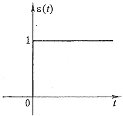

line

| t | \(\epsilon(t)\) |
| --- | --- |
| 0 | 1 |
| >0 | 1 |

(a)

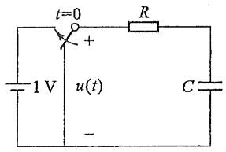

text_image

t=0
+
1 V u(t)
-
R
C

(b)

图7-27 单位阶跃函数

假设把电路在  $t=t_{0}$  时接通一个电流为 2 A 的直流电流源，则此外施电流就可写为  $2\varepsilon(t-t_{0})$  A。

单位阶跃函数还可用来“起始”任意一个 $f(t)$ 。设 $f(t)$ 是对所有 $t$ 都有定义的一个任意函数，则

$$
f (t) \varepsilon (t - t _ {0}) = \left\{ \begin{array}{l l} f (t) & t > t _ {0} \\ 0 & t <   t _ {0} \end{array} \right.
$$

它的波形如图 7-29 所示。

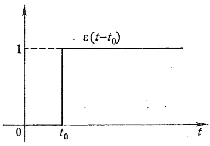

line

| Time (t) | Value \((\epsilon(t-t_{0}))\) |
| --- | --- |
| \(< t_{0}\) | 0 |
| \(t_{0}\) | 0 |
| \(> t_{0}\) | 1 |

图 7-28 延迟的单位阶跃函数

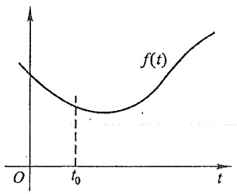

line

| t | f(t) |
| --- | --- |
| 0 | ~High |
| t0 | ~Low |
| >t0 | Increasing trend |

图 7-29 单位阶跃函数的起始作用

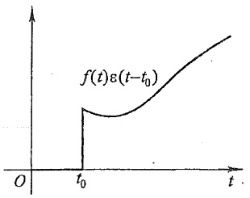

line

| Time (t) | Value |
| --- | --- |
| 0 | 0 |
| t0 | ~Initial Value |
| >t0 | Increasing Trend |

对于一个如图 7-30(a) 所示幅度为 1 的矩形脉冲, 可以把它看作由两个阶跃函数组成, 如图 7-30(b) 所示, 即

$$
f (t) = \varepsilon (t) - \varepsilon (t - t _ {0})
$$

同理,对于一个如图 7-30(c) 所示矩形脉冲,则可写为

$$
f (t) = \varepsilon (t - \tau_ {1}) - \varepsilon (t - \tau_ {2})
$$

当电路的激励为单位阶跃  $\varepsilon(t)\mathrm{V}$  或  $\varepsilon(t)\mathrm{A}$  时，相当于将电路在 t=0 时接通电压值为 1 V 的直流电压源或电流值为 1 A 的直流电流源。因此单位阶跃响应与直流激励响应相同。用  $s(t)$  表示单位阶跃响应。已知电路的  $s(t)$ ，如果该电路的恒定激励为  $u_{\mathrm{S}}(t)=U_{0}\varepsilon(t)$  [或  $i_{\mathrm{S}}(t)=I_{0}\varepsilon(t)$ ]，则电路的零状态响应为  $U_{0}s(t)$  [或  $I_{0}s(t)$ ]。

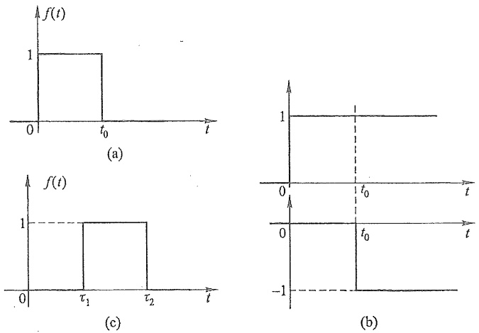

图 7-30 矩形脉冲的组成

例 7-12 图 7-31 所示电路, 开关 S 合在位置 1 时电路已达稳定状态。t=0 时, 开关由位置 1 合向位置 2, 在  $t=\tau=RC$  时又由位置 2 合向位置 1, 求 t>0 时的电容电压  $u_{C}(t)$ 。

解 此题可用两种方法求解。

(1) 将电路的工作过程分段求解

在  $0 < t < \tau$  区间为 RC 电路的零状态响应, 有

$$
u _ {c} (0 _ {+}) = u _ {c} (0 _ {-}) = 0
$$

$$
u _ {c} (t) = U _ {\mathrm{s}} (1 - \mathrm{e} ^ {- \frac {t}{\tau}}), \quad \tau = R C
$$

在  $\tau<t<\infty$  区间为 RC 电路的零输入响应,有

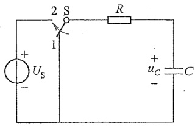

text_image

2 S
1
+
Us
-
R
+
uc
-
C

图7-31 例7-12图

$$
\begin{array}{l} u (\tau) = U _ {\mathrm{s}} (1 - \mathrm{e} ^ {- \frac {\tau}{\tau}}) = 0. 6 3 2 U _ {\mathrm{s}} \\ u _ {c} (t) = 0. 6 3 2 U _ {\mathrm{s}} \mathrm{e} ^ {- \frac {t - \tau}{\tau}} \\ \end{array}
$$

(2) 用阶跃函数表示激励, 求阶跃响应

根据开关的动作,电路的激励  $u_{\mathrm{s}}(t)$  可以用图 7-32(a) 所示的矩形脉冲表示,按图 7-32(b) 可写为

$$
u _ {\mathrm{s}} (  t  ) = U _ {\mathrm{s}} \varepsilon (  t  ) - U _ {\mathrm{s}} \varepsilon (  t   -   \tau  )
$$

RC 电路的单位阶跃响应为

$$
s (t) = \left(1 - \mathrm{e} ^ {- \frac {t}{\tau}}\right) \varepsilon (t)
$$

故

$$
u _ {c} (t) = U _ {\mathrm{s}} (1 - \mathrm{e} ^ {- \frac {t}{\tau}})   \varepsilon (t) - U _ {\mathrm{s}} [ 1 - \mathrm{e} ^ {\frac {- (t - \tau)}{\tau}} ]   \varepsilon (t - \tau)
$$

其中第一项为阶跃响应,第二项为延迟的阶跃响应。 $u_{c}(t)$ 的波形如图7-32(c)所示。

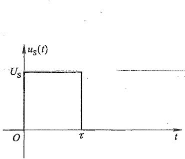

area

| Time (t) | u_S(t) |
| --- | --- |
| 0 | U_S |
| \(\tau\) | U_S |
| >\(\tau\) | 0 |

(a)

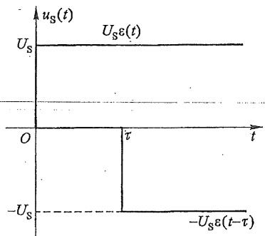

line

| Time (t) | Voltage (u_s(t)) |
| --- | --- |
| 0 | U_s |
| \(\tau\) | U_s |
| \(\tau\) | -U_s |
| \(>\tau\) | -U_s |

(b)

line

| Time (t) | uC(t) |
| --- | --- |
| 0 | 0 |
| \(\tau\) | 0.632 Us |

(c)

图7-32 $u_{c}$ 的波形

例 7-13 图 7-33 所示电路中, 已知  $u_{C}(0_{-}) = 0$ ,  $i_{L}(0_{-}) = 0$ , G = 1.5 S,  $C = \frac{1}{4} F$ , L =  $\frac{1}{2} H$ ,  $i_{S}(t) = \varepsilon(t) A$ , 试求单位阶跃响应  $i_{L}(t)$ 。

解 对电路应用 KCL 列方程有

$$
i _ {C} + i _ {G} + i _ {L} = \varepsilon (t)
$$

其中

$$
i _ {c} = C \frac {\mathrm{d} u _ {c}}{\mathrm{d} t} = L C \frac {\mathrm{d} ^ {2} i _ {L}}{\mathrm{d} t ^ {2}}
$$

$$
i _ {G} = G L \frac {\mathrm{d} i _ {L}}{\mathrm{d} t}
$$

text_image

i_S(t) ε(t) A
i_G i_C i_L
G C L

图7-33 例7-13图

代入已知参数并整理得

$$
\frac {\mathrm{d} ^ {2} i _ {L}}{\mathrm{d} t ^ {2}} + 6 \frac {\mathrm{d} i _ {L}}{\mathrm{d} t} + 8 i _ {L} = 8 \varepsilon (t)
$$