这是一个二阶线性非齐次方程,其解为

$$
i _ {L} = i ^ {\prime} + i ^ {\prime \prime}
$$

其中特解为

$$
i ^ {\prime} = 1 \mathrm{A}
$$

对应齐次方程的通解为

$$
i ^ {\prime \prime} = A _ {1} \mathrm{e} ^ {p _ {1} t} + A _ {2} \mathrm{e} ^ {p _ {2} t}
$$

特征方程为

$$
p ^ {2} + 6 p + 8 = 0
$$

解得特征根为

$$
p _ {1} = - 2, \quad p _ {2} = - 4
$$

所以

$$
i _ {L} = i ^ {\prime} + i ^ {\prime \prime} = 1 + A _ {1} \mathrm{e} ^ {- 2 t} + A _ {2} \mathrm{e} ^ {- 4 t}
$$

将初始条件 $u_{C}(0_{+}) = u_{C}(0_{-}) = 0, i_{L}(0_{+}) = i_{L}(0_{-}) = 0$ 代入上式有

$$
\left\{ \begin{array}{l} 1 + A _ {1} + A _ {2} = 0 \\ - 2 A _ {1} - 4 A _ {2} = 0 \end{array} \right.
$$

解得

$$
\left\{ \begin{array}{l} A _ {1} = - 2 \\ A _ {2} = 1 \end{array} \right.
$$

所以电感电流的单位阶跃响应为

$$
s (t) = i _ {L} (t) = \left(1 - 2 \mathrm{e} ^ {- 2 t} + \mathrm{e} ^ {- 4 t}\right) \varepsilon (t) \mathrm{A}
$$

电路的过渡过程是过阻尼性质的。

## §7-8 一阶电路和二阶电路的冲激响应

电路对于单位冲激函数激励的零状态响应称为单位冲激响应。

单位冲激函数也是一种奇异函数,可定义为

$$
\left\{ \begin{array}{l l}  \int_ {- \infty} ^ {\infty} \delta (t)   \mathrm{d} t = 1 \\ \delta (t) = 0 \qquad (\text {当} t \neq 0) \end{array} \right.
$$

单位冲激函数又称为  $\delta$  函数。它在  $t \neq 0$  处为零，但在 t = 0 处为奇异的。

单位冲激函数 $\delta(t)$ 可以看作是单位脉冲函数的极限情况。图7-34(a)为一个单位矩形脉冲函数 $p(t)$ 的波形。它的高为 $\frac{1}{\Delta}$，宽为 $\Delta$，在保持矩形面积 $\Delta \cdot \frac{1}{\Delta} = 1$ 不变的情况下，它的宽度越来越窄时，它的高度越来越大。当脉冲宽度 $\Delta \to 0$ 时，脉冲高度 $\frac{1}{\Delta} \to \infty$，在此极限情况下，可以得到一个宽度趋于零，幅度趋于无限大的面积仍为1的脉冲，这就是单位冲激函数 $\delta(t)$，可记为

$$
\lim _ {\Delta \to 0} p (t) = \delta (t)
$$

单位冲激函数的波形如图7-34(b)所示,有时在箭头旁边注明“1”。强度为K的冲激函数可用图7-34(c)表示,此时箭头旁边应注明“K”。

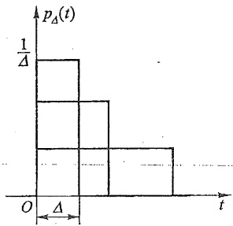

bar

| Interval (t) | \(p\Delta(t)\) |
| --- | --- |
| 0~1 | \(1/\Delta\) |
| 1~2 | ~\(0.6\Delta\) |
| 2~3 | ~\(0.3\Delta\) |
| 3~4 | 0 |

(a)

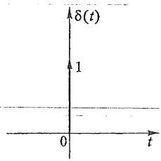

contour

| t | \(\delta(t)\) |
| --- | --- |
| < 0 | 1 |
| > 0 | 0 |

(b)

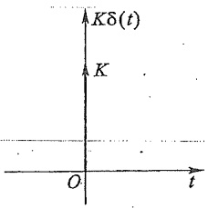

text_image

Kδ(t)
K
O
t

(c)

图 7-34 冲激函数

同在时间上延迟出现的单位阶跃函数一样,可以把发生在  $t=t_{0}$  时的单位冲激函数写为  $\delta(t-t_{0})$ , 还可以用  $K\delta(t-t_{0})$  表示一个强度为 K, 发生在  $t_{0}$  时刻的冲激函数。

冲激函数有如下两个主要性质:

(1) 单位冲激函数  $\delta(t)$  对时间的积分等于单位阶跃函数  $\varepsilon(t)$ ，即

$$
\int_ {- \infty} ^ {t} \delta (\xi) \mathrm{d} \xi = \varepsilon (t)
$$

反之，单位阶跃函数 $\varepsilon(t)$ 对时间的一阶导数等于单位冲激函数 $\delta(t)$，即

$$
\frac {\mathrm{d} \varepsilon (t)}{\mathrm{d} t} = \delta (t) \tag {7-15}
$$

(2) 单位冲激函数的“筛分”性质

由于当  $t \neq 0$  时,  $\delta(t) = 0$ , 所以对任意在 t = 0 时连续的函数  $f(t)$ , 将有

$$
f (t) \delta (t) = f (0) \delta (t)
$$

因此

$$
\int_ {- \infty} ^ {\infty} f (t)   \delta (t)   \mathrm{d} t = f (0) \int_ {- \infty} ^ {\infty} \delta (t)   \mathrm{d} t = f (0)
$$

同理,对于任意一个在  $t=t_{0}$  时连续的函数  $f(t)$ ,有

$$
\int_ {- \infty} ^ {\infty} f (t) \delta (t - t _ {0}) \mathrm{d} t = f (t _ {0})
$$

这就是说,冲激函数有把一个函数在某一时刻的值“筛”出来的本领,所以称为“筛分”性质,又称取样性质。

当把一个单位冲激电流  $\delta_{i}(t)$  (其单位为 A) 加到初始电压为零且 C=1 F 的电容上时, 电容电压  $u_{c}$  为

$$
u _ {c} = \frac {1}{C} \int_ {0 _ {-}} ^ {0 _ {+}} \delta_ {i} (t)   \mathrm{d} t = \frac {1}{C} = 1 \mathrm{V}
$$

这相当于单位冲激电流瞬时把电荷转移到电容上,使电容电压从零跃变到1 V。

同理,如果把1个单位冲激电压  $\delta_{u}(t)$  (其单位为 V) 加到初始电流为零且 L=1 H 的电感上,则电感电流为

$$
i _ {L} = \frac {1}{L} \int_ {0 _ {-}} ^ {0 _ {+}} \delta_ {u} (t) \mathrm{d} t = \frac {1}{L} = 1 \mathrm{A}
$$

所以单位冲激电压瞬时在电感内建立了1 A的电流,即电感电流从零值跃变到1 A。

当冲激函数作用于零状态的一阶 RC 或 RL 电路，在  $t=0_{-}$  到  $0_{+}$  的区间内它使电容电压或电感电流发生跃变。 $t\geqslant0_{+}$  时，冲激函数为零，但  $u_{C}(0_{+})$  或  $i_{L}(0_{+})$  不为零，电路中将产生相当于初始状态引起的零输入响应。所以，一阶电路冲激响应的求解，关键在于计算在冲激函数作用下的  $u_{C}(0_{+})$  或  $i_{L}(0_{+})$  的值。

图 7-35(a) 为一个在单位冲激电流  $\delta_{i}(t)$  激励下的 RC 电路。可以用下述方法求得该电路的零状态响应。根据 KCL 有

$$
C \frac {\mathrm{d} u _ {c}}{\mathrm{d} t} + \frac {u _ {c}}{R} = \delta_ {i} (t), \quad t \geqslant 0 _ {-}
$$

而 $u_{c}(0_{-}) = 0$。

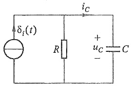

text_image

δᵢ(t)
R
iC
+
uC
-
C

(a)

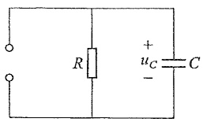

text_image

R
+
uc
-
C

(b)

图 7-35 RC 电路的冲激响应

为了求 $u_{c}(0_{+})$ 的值，把上式在 $0_{-}$ 与 $0_{+}$ 时间间隔内积分，得

$$
\int_ {0 _ {-}} ^ {0 _ {+}} C \frac {\mathrm{d} u _ {c}}{\mathrm{d} t} \mathrm{d} t + \int_ {0 _ {-}} ^ {0 _ {+}} \frac {u _ {c}}{R} \mathrm{d} t = \int_ {0 _ {-}} ^ {0 _ {+}} \delta_ {i} (t) \mathrm{d} t
$$

上式左方第二个积分仅在 $u_{C}$ 为冲激函数时才不为零。但是如果 $u_{C}$ 是冲激函数，则 $i_{R}$ 亦为冲激函数 $\left(i_{R} = \frac{u_{C}}{R}\right)$，而 $i_{C} = C\frac{\mathrm{d}u_{C}}{\mathrm{d}t}$ 将为冲激函数的一阶导数；这样就不能满足KCL，即上式将不能成立，因此 $u_{C}$ 不可能是冲激函数。于是方程左方的第二个积分应为零，从而得

$$
C \big [ u _ {c} (0 _ {+}) - u _ {c} (0 _ {-}) \big ] = 1
$$

或

$$
u _ {c} (0 _ {+}) = \frac {1}{C}
$$

当  $t \geqslant 0_{+}$  时，冲激电流源处相当于开路，所以可以用图 7-35(b) 求得  $t \geqslant 0_{+}$  时的电容电压为

$$
u _ {c} = u _ {c} (  0 _ {+}  )   \mathrm{e} ^ {- \frac {t}{\tau}} = \frac {1}{C} \mathrm{e} ^ {- \frac {t}{\tau}}
$$

式中  $\tau=RC$ ，为电路的时间常数。考虑到分析是从 0 开始，所以电路中电容电压的冲激响应为

$$
u _ {c} = u _ {c} (0 _ {+}) \mathrm{e} ^ {- \frac {t}{\tau}} \varepsilon (t) = \frac {1}{C} \mathrm{e} ^ {- \frac {t}{\tau}} \varepsilon (t)
$$

用相同的分析方法,可求得图7-36所示RL电路在单位冲激电压源 $\delta_{u}(t)$ 激励下的零状态响应 $i_{L}$ 为

$$
i _ {L} = \frac {1}{L} \mathrm{e} ^ {- \frac {t}{\tau}} \varepsilon (t)
$$

式中  $\tau=\frac{L}{R}$  为电路的时间常数。

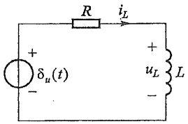

text_image

R
iL
+
δu(t)
-
+
uL
L
-

(a)

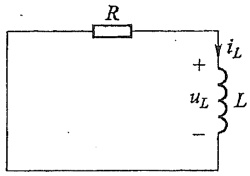

text_image

R
+
uL L
-

(b)

图 7-36 RL 电路的冲激响应

由于电感电流在 t=0 时发生了跃变, 所以电感电压  $u_{L}$  为

$$
u _ {L} = \delta_ {u} (t) - \frac {R}{L} \mathrm{e} ^ {- \frac {t}{\tau}} \varepsilon (t).
$$

$i_{L}, u_{L}$  的波形见图 7-37(a)(b)，注意  $t=0_{-}$  到  $0_{+}$  的冲激和跃变情况。

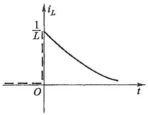

line

| Time (t) | Current (iL) |
| --- | --- |
| 0 | 1/L |
| >0 | Decreasing trend |

(a)

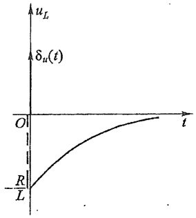

line

| t | uL |
| --- | --- |
| 0 | -R/L |
| ~1.5 | ~-0.2 |
| ~3.0 | ~-0.1 |
| ~4.5 | ~0 |

(b)

图 7-37  $i_{L}$  和  $u_{L}$  的波形

图 7-38 是一个零状态的 RLC 串联电路, 在 t=0 时与冲激电压  $\delta(t)$  接通。若以  $u_{c}$  为变量, 根据 KVL 可得电路方程

$$
\left. \begin{array}{l} L C \frac {\mathrm{d} ^ {2} u _ {c}}{\mathrm{d} t ^ {2}} + R C \frac {\mathrm{d} u _ {c}}{\mathrm{d} t} + u _ {c} = \delta (t) \\ u _ {c} (0 _ {-}) = 0, i _ {L} (0 _ {-}) = 0 \end{array} \right\} \quad t \geqslant 0 _ {-} \tag {7-16}
$$

由于  $\delta(t)$  在  $t \neq 0$  时为零，而在 t = 0 时电路受冲激电压激励而获得了一定能量，在  $t \geqslant 0_{+}$  时放电，即在  $t \geqslant 0_{+}$  时，有

$$
L C \frac {\mathrm{d} ^ {2} u _ {c}}{\mathrm{d} t ^ {2}} + R C \frac {\mathrm{d} u _ {c}}{\mathrm{d} t} + u _ {c} = 0 \tag {7-17}
$$

关键在于求出与初始能量对应的初始条件 $u_{c}(0_{+})$ 和$i(0_{+})$ 。把式(7-16)在 $t = 0_{-}$ 到 $0_{+}$ 时间间隔内积分，得

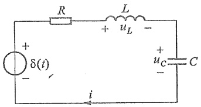

text_image

R
L
+
uL
-
δ(t)
+
uC
C
i

图 7-38 二阶电路的冲激响应

$$
L C \left[ \frac {\mathrm{d} u _ {c}}{\mathrm{d} t} \Bigg | _ {t = 0 _ {+}} - \frac {\mathrm{d} u _ {c}}{\mathrm{d} t} \Bigg | _ {t = 0 _ {-}} \right] + R C \left[ u _ {c} \left(0 _ {+}\right) - u _ {c} \left(0 _ {-}\right) \right] + \int_ {0 _ {-}} ^ {0 _ {+}} u _ {c} \mathrm{d} t = 1
$$

根据零状态条件,有  $u_{c}(0_{-})=0, i(0_{-})=0$ , 故  $\frac{du_{c}}{dt}\bigg|_{t=0_{-}}=0$ 。由于  $u_{c}$  不可能是阶跃函数或冲激函数, 否则式 (7-16) 不能成立, 就是说  $u_{c}$  不可能跃变; 仅  $\frac{du_{c}}{dt}$  才可能发生跃变。这样就有

$$
L C \frac {\mathrm{d} u _ {c}}{\mathrm{d} t} \Bigg | _ {t = 0 _ {+}} = 1
$$

即

$$
\frac {\mathrm{d} u _ {c}}{\mathrm{d} t} \bigg | _ {t = 0 _ {+}} = \frac {1}{L C}
$$

该式表明冲激电压源在 $t = 0_{-}$ 到 $0_{+}$ 作用期间使电感电流跃变，跃变后 $i(0_{+}) = C\frac{\mathrm{d}u_{c}}{\mathrm{d}t}\Bigg|_{t = 0_{+}} = \frac{1}{L}$，电感中储存一定的磁场能量，而冲激响应就是由此磁场能量引起的变化过程。

$t \geqslant 0_{+}$ 时为零输入解, 其过渡过程的分析和解答与 §7-5 相同, 即

$$
u _ {c} = A _ {1} \mathrm{e} ^ {p _ {1} t} + A _ {2} \mathrm{e} ^ {p _ {2} t}
$$

初始条件为

$$
u _ {c} (0 _ {+}) = A _ {1} + A _ {2} = 0
$$

$$
\frac {\mathrm{d} u _ {c}}{\mathrm{d} t} \Bigg | _ {t = 0 _ {+}} = p _ {1} A _ {1} + p _ {2} A _ {2} = \frac {1}{L C}
$$

有

$$
\begin{array}{l} A _ {1} = - A _ {2} = \frac {- \frac {1}{L C}}{p _ {2} - p _ {1}} \\ u _ {c} = - \frac {1}{L C (p _ {2} - p _ {1})} (\mathrm{e} ^ {p _ {1} t} - \mathrm{e} ^ {p _ {2} t}) \\ \end{array}
$$

冲激响应在上式左端乘以  $\varepsilon(t)$ ，即

$$
u _ {c} = - \frac {1}{L C (p _ {2} - p _ {1})} (\mathrm{e} ^ {p _ {1} t} - \mathrm{e} ^ {p _ {2} t})   \varepsilon (t)
$$

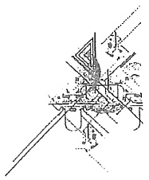

natural_image

Pure mechanical assembly diagram without any text, numbers, or symbols

如果 $R < 2\sqrt{\frac{L}{C}}$ ，即振荡放电情况，冲激响应为

$$
u _ {c} = \frac {1}{\omega L C} \mathrm{e} ^ {- \delta t} \sin (\omega t)   \varepsilon (t)
$$

由于阶跃函数和冲激函数之间满足式(7-15)的关系,因此,线性电路中阶跃响应与冲激响应之间也具有一个重要关系。如果以 $s(t)$ 表示某一电路的阶跃响应,而 $h(t)$ 为同一电路的冲激响应,则两者之间存在下列数学关系:

$$
h (t) = \frac {\mathrm{d} s (t)}{\mathrm{d} t}
$$

$$
s (t) = \int h (t) \mathrm{d} t
$$

下面证明这一般关系。

按冲激函数的定义,有

$$
\int_ {- \infty} ^ {t} \delta (\xi) \mathrm{d} \xi = \varepsilon (t)
$$

$$
\delta (t) = \frac {\mathrm{d} \varepsilon (t)}{\mathrm{d} t}
$$

对于一个线性电路, 描述电路性状的微分方程为线性常系数方程。对于这种电路, 如设激励  $e(t)$  时的响应为  $r(t)$ , 则当所加激励换为  $e(t)$  的导数或积分时, 所得响应必相应地为  $r(t)$  的导数或积分。冲激激励是阶跃激励的一阶导数, 因此冲激响应可以按阶跃响应的一阶导数求得。

对于图 7-35(a)、图 7-36(a) 所示电路, 如按阶跃响应的一阶导数求冲激响应, 可得到与上述相同的结果。

例 7-14 图 7-39(a) 所示电路中, 已知  $u_{\mathrm{s}}(t)=3\delta(t)$ ,  $u_{c}(0_{-})=0$ ,  $R_{1}=3k\Omega$ ,  $R_{2}=6k\Omega$ ,  $C=2.5\mu F$ , 试求电路的冲激响应  $u_{c}$  和  $i_{c}$ 。

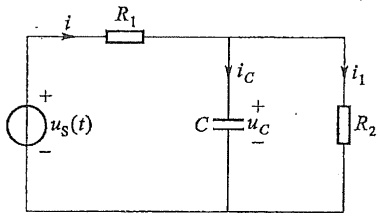

text_image

i
R₁
+
uₛ(t)
-
i_C
C
+
u_C
-
i₁
R₂

(a)

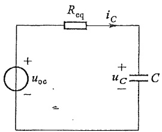

text_image

R_eq
i_C
+
u_oc
-
+
u_C
C
-

(b)

图7-39 例7-14图

解 应用戴维南定理把原电路等效为图 7-39(b) 所示的电路。其中

$$
u _ {\mathrm{oc}} = \frac {R _ {2}}{R _ {1} + R _ {2}} 3 \delta (t) = 2 \delta (t)
$$

$$
R _ {\mathrm{eq}} = \frac {R _ {1} R _ {2}}{R _ {1} + R _ {2}} = 2 \mathrm{k} \Omega
$$

电路方程为

$$
R _ {\mathrm{eq}} C \frac {\mathrm{d} u _ {c}}{\mathrm{d} t} + u _ {c} = 2 \delta (t) \quad (t \geqslant 0 _ {-})
$$

将上式从  $0_{-}$  至  $0_{+}$  区间积分有

$$
\int_ {0 _ {-}} ^ {0 _ {+}} R _ {\mathrm{eq}} C \frac {\mathrm{d} u _ {c}}{\mathrm{d} t} \mathrm{d} t + \int_ {0 _ {-}} ^ {0 _ {+}} u _ {c} \mathrm{d} t = \int_ {0 _ {-}} ^ {0 _ {+}} 2 \delta (t)
$$

由于 $u_{c}(t)$ 不是冲激函数，有 $\int_0^{0_+}u_c\mathrm{d}t = 0$ ，上式积分结果为

$$
R _ {\mathrm{eq}} C \left[ u _ {C} (0 _ {+}) - u _ {C} (0 _ {-}) \right] = 2
$$

所以

$$
u _ {C} (0 _ {+}) = \frac {2}{R _ {\mathrm{eq}} C} = 4 0 0 \mathrm{V}
$$

当  $t \geqslant 0_{+}$  时， $\delta(t) = 0$ ，即  $u_{oc}$  所在处相当于短路，电容通过电阻  $R_{eq}$  放电。注意到  $\tau = R_{eq} C = 5 \times 10^{-3} s$ ，电容电压为

$$
\begin{array}{l} u _ {c} (t) = u _ {c} (0 _ {+}) \mathrm{e} ^ {- \frac {t}{\tau}} = 4 0 0 \mathrm{e} ^ {- 2 0 0 t} \mathrm{V} \\ i _ {c} (t) = C \frac {\mathrm{d} u _ {c}}{\mathrm{d} t} = 2. 5 \times 1 0 ^ {- 6} \frac {\mathrm{d}}{\mathrm{d} t} [ 4 0 0 \mathrm{e} ^ {- 2 0 0 t} ] \\ = - 2 0 0 \mathrm{e} ^ {- 2 0 0 t} \mathrm{mA} \\ \end{array}
$$

上述冲激响应也可以通过阶跃响应求得。设图7-39(b)所示电路的电压源电压 $u_{\mathrm{oc}} = 2\varepsilon (t)$，可以很方便求得电路的阶跃响应为

$$
s _ {u _ {C}} (t) = u _ {C} (t) = 2 \left(1 - \mathrm{e} ^ {- 2 0 0 t}\right) \varepsilon (t) \mathrm{V}
$$

则冲激响应为

$$
\begin{array}{l} h (t) = u _ {c} (t) = \frac {\mathrm{d}}{\mathrm{d} t} s _ {u _ {c}} (t) = \frac {\mathrm{d}}{\mathrm{d} t} 2 (1 - \mathrm{e} ^ {- 2 0 0 t}) \varepsilon (t) \\ = 4 0 0 \mathrm{e} ^ {- 2 0 0 t} \varepsilon (t) \mathrm{V} \\ i _ {c} (t) = C \frac {\mathrm{d} u _ {c}}{\mathrm{d} t} = \left[ - 2 0 0 \mathrm{e} ^ {- 2 0 0 t} \varepsilon (t) + \delta (t) \right] \mathrm{mA} \\ \end{array}
$$

例 7-15 若例 7-13 中电流源为冲激电流源, 即  $i_{\mathrm{S}}(t)=\delta(t)\mathrm{A}$ , 试求单位冲激响应  $i_{L}(t)$ 。

解 根据 KCL 列出的电路方程为

$$
\begin{array}{l} L C \frac {\mathrm{d} ^ {2} i _ {L}}{\mathrm{d} t ^ {2}} + G L \frac {\mathrm{d} i _ {L}}{\mathrm{d} t} + i _ {L} = \delta (t) \\ \frac {\mathrm{d} ^ {2} i _ {L}}{\mathrm{d} t ^ {2}} + 6 \frac {\mathrm{d} i _ {L}}{\mathrm{d} t} + 8 i = 8 \delta (t) \\ \end{array}
$$

由于电路受冲激电流源的作用而获得了能

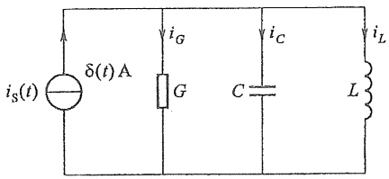

text_image

i_S(t) δ(t) A i_G i_C i_L
G C L

图7-40 例7-15图

量,为求出与初始能量对应的初始条件  $u_{C}(0_{+})$ ,  $i_{L}(0_{+})$ , 将上式从  $t=0_{-}$  到  $0_{+}$  区间积分, 有

$$
\int_ {0 _ {-}} ^ {0 _ {+}} \frac {\mathrm{d} ^ {2} i _ {L}}{\mathrm{d} t ^ {2}} \mathrm{d} t + 6 \int_ {0 _ {-}} ^ {0 _ {+}} \frac {\mathrm{d} i _ {L}}{\mathrm{d} t} \mathrm{d} t + 8 \int_ {0 _ {-}} ^ {0 _ {+}} i _ {L} \mathrm{d} t = 8 \int_ {0 _ {-}} ^ {0 _ {+}} \delta (t)
$$

由于 $i_{L}$ 不可能是阶跃函数或冲激函数，否则电路方程不成立，所以 $i_{L}$ 不可能跃变，仅 $\frac{\mathrm{d}i_L}{\mathrm{d}t}$ 才可能发生跃变。这样有

$$
\frac {\mathrm{d} i _ {L}}{\mathrm{d} t} \bigg | _ {0 _ {+}} - \frac {\mathrm{d} i _ {L}}{\mathrm{d} t} \bigg | _ {0 _ {-}} = 8
$$

而 $\frac{\mathrm{d}i_L}{\mathrm{d}t}\Bigg|_{0_ -} = \frac{u_c(0_-)}{L} = 0$ ，所以

$$
\left. \frac {\mathrm{d} i _ {L}}{\mathrm{d} t} \right| _ {0 _ {+}} = 8
$$

而  $L\frac{di_{L}}{dt}\bigg|_{0_{+}}=u_{G}(0_{+})$  说明冲激电流源在  $0_{-}$  至  $0_{+}$  区间使电容电压发生了跃变，有

$$
u _ {c} (0 _ {+}) = 4 \mathrm{V}
$$

$t \geqslant 0_{+}$ 后电路为零输入解。

由于特征根仍是  $p_{1} = -2, p_{2} = -4$ ，所以电感电流为  $i_{L}(t) = A_{1} e^{-2t} + A_{2} e^{-4t}$ 。由初始条件

$$
i _ {L} (0 _ {+}) = 0
$$

$$
L \frac {\mathrm{d} i _ {L}}{\mathrm{d} t} \Bigg | _ {0 _ {+}} = 4 \mathrm{V}
$$

有 $\left\{ \begin{array}{l}A_{1} + A_{2} = 0\\ -2A_{1} - 4A_{2} = 8 \end{array} \right.$

解得

$$
A _ {1} = 4, \quad A _ {2} = - 4
$$

所以冲激响应为

$$
h (t) = i _ {L} (t) = \left(4 \mathrm{e} ^ {- 2 t} - 4 \mathrm{e} ^ {- 4 t}\right) \varepsilon (t) \mathrm{A}
$$

如对例 7-13 所得到的阶跃响应求导, 可得到相同的结果。

上面介绍的求电路的阶跃响应和冲激响应的方法比较直观,物理概念明确,但如果电路复杂,则应用拉普拉斯变换法(第十四章)求冲激响应及阶跃响应更为简捷方便。

## \*§7-9 卷积积分

用经典法分析和求解过渡过程是在时域分析动态电路的重要方法之一。这一节介

绍时域分析中的另一重要概念——卷积积分。

设有两个时间函数 $f_{1}(t)$ 和 $f_{2}(t)$ （在 $t < 0$ 时均为零），则 $f_{1}(t)$ 和 $f_{2}(t)$ 的卷积通常用$f_{1}(t)*f_{2}(t)$ 表示，并由下列积分式来定义:

$$
f _ {1} (  t  )   * f _ {2} (  t  ) =   \int_ {0} ^ {t} f _ {1} (  t - \xi  ) f _ {2} (  \xi  )   \mathrm{d} \xi^ {\textcircled {1}}
$$

如果令 $\tau = t - \xi$ ，则 $\mathrm{d}\tau = -\mathrm{d}\xi$ ，于是

$$
\begin{array}{l} \int_ {0} ^ {t} f _ {1} (  t - \xi) f _ {2} (  \xi)   \mathrm{d} \xi = - \int_ {t} ^ {0} f _ {1} (  \tau) f _ {2} (  t - \tau)   \mathrm{d} \tau \\ = \int_ {0} ^ {t} f _ {2} (t - \tau) f _ {1} (\tau) \mathrm{d} \tau = f _ {2} (t) * f _ {1} (t) \\ \end{array}
$$

所以 $f_{1}(t)*f_{2}(t) = f_{2}(t)*f_{1}(t)$

若 $f_{1}(t)$ 为电路的冲激响应 $h(t), f_{2}(t)$ 为电路的任意输入激励 $e(t)$，则该电路对任意激励的零状态响应 $r(t)$，就可以通过 $h(t)$ 与 $e(t)$ 的卷积积分求得，这就是研究卷积积分的重要意义之所在。

设电路激励  $e(t)$  的波形如图 7-41 所示，并定义于时间区间  $(t_{0}, t)$ ，而  $\xi$  表示在  $t_{0}$  和 t 之间的任意时刻。现在用一系列具有相同宽度的矩形脉冲来近似地表示  $e(\xi)$ 。把时间区间  $(t_{0}, t)$  分成相等的 n 段，如图 7-41 所示，每一段的宽度为  $\Delta$ ，即  $t_{1} - t_{0} = t_{2} - t_{1} = \cdots = t_{k+1} - t_{k} = \cdots = \Delta$ 。于是  $e(\xi)$  可以用图示的阶梯曲线来逼近，而后者又可以看作是一系列矩形脉冲之合成。这一系列矩形脉冲可以通过单位脉冲函数和延迟的单位脉冲函数，即  $p_{\Delta}(\xi)$  和  $p_{\Delta}(\xi - t_{k})$  来表示。这样，当把激励  $e(\xi)$  用上述矩形脉冲表示时，得

$$
\begin{array}{l} e _ {\Delta} (\xi) = e (t _ {0}) p _ {\Delta} (\xi - t _ {0}) \Delta + e (t _ {1}) p _ {\Delta} (\xi - t _ {1}) \Delta + \\ e (t _ {2}) p _ {\Delta} (\xi - t _ {2}) \Delta + \dots + e (t _ {k}) p _ {\Delta} (\xi - t _ {k}) \Delta + \dots + \\ e (t _ {n - 1}) p _ {\Delta} (\xi - t _ {n - 1}) \Delta \\ = \sum_ {k = 0} ^ {n - 1} e (t _ {k}) p _ {\Delta} (\xi - t _ {k}) \Delta \tag {7-18} \\ \end{array}
$$

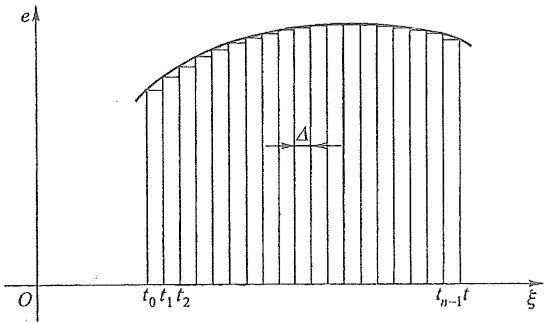

text_image

e
O
t₀ t₁ t₂
Δ
t_{n-1} t
ξ

图 7-41 用具有相同宽度的矩形脉冲系列逼近  $e(\xi)$

<small>① 这里积分下限的“0”取“0-”，而上限的 t 最好取  $t_{+}$ ，这样就便于把在原点的冲激函数考虑在内。此处为了记法上的方便，并与常用的定义、公式一致起见，故写为“0”及“t”。</small>

设电路在单位矩形脉冲 $p_{\Delta}(\xi)$ 激励下的零状态响应为 $h_{\Delta}(\xi)$，对每一延迟的矩形脉冲 $p_{\Delta}(\xi - t_k)$，在时刻 $t$ 观察到的相应的响应将为 $h_{\Delta}(t - t_k)$。根据线性电路的齐性定理，对 $e(t_k)p_{\Delta}(\xi - t_k)\Delta$ 的响应将是 $e(t_k)h(t - t_k)\Delta$。因此按照叠加定理，式(7-18)的激励所产生的响应为

$$
r _ {\Delta} (t) = \sum_ {k = 0} ^ {n - 1} e _ {\Delta} (t _ {k}) h _ {\Delta} (t - t _ {k}) \Delta
$$

现在令 $t_0$ 到 $t$ 区间内的脉冲数 $n$ 不断地增加，由于 $t - t_0 = n\Delta$ ，所以 $\Delta$ 将越来越小。当 $n\to \infty$ 时， $\Delta \rightarrow 0$ ，每一单位矩形脉冲变成了冲激函数， $h_{\Delta}$ 变成了冲激响应 $h,e_{\Delta}$ 变成了原来的激励 $e(t)$ ，响应 $r_{\Delta}(t)$ 则将变成电路对原激励的零状态响应 $r(t)$ ，同时上式的求和也变成了积分，而 $t_k$ 变成了连续变量 $\xi ,\Delta$ 则变成了 $\mathrm{d}\xi$ 。这样就有

$$
r (t) = \int_ {t _ {0}} ^ {t} e (\xi) h (t - \xi) \mathrm{d} \xi \quad (t \geqslant t _ {0})
$$

式中  $t_{0}$  为激励施加的时刻, t 为待求响应所对应的时刻。如  $t_{0}=0$ , 则有

$$
r (t) = \int_ {t _ {0}} ^ {t} e (\xi) h (t - \xi) \mathrm{d} \xi \quad (t \geqslant 0) \tag {7-19}
$$

上式还可以改写为

$$
r (t) = \int_ {t _ {0}} ^ {t} e (t - \xi) h (\xi) \mathrm{d} \xi \tag {7-20}
$$

式(7-19)或式(7-20)所示积分称为卷积积分。只要知道电路的冲激响应，给定任何激励函数 $e(t)$ ，根据卷积积分就可以求出该电路的零状态响应。如果电路是非零状态，只要在上述积分的结果上按叠加定理加上相应的零输入响应即可。

例 7-16 图 7-42 所示 RC 并联电路, 其中  $R = 500 \, k\Omega$ ,  $C = 1 \, \mu F$ , 电流源电流  $i_{\mathrm{s}} = 2 \mathrm{e}^{-t} \varepsilon(t) \, \mu \mathrm{A}$ 。设电容 C 上原来没有电压, 试求  $u_{c}(t)$ 。

解 电路的冲激响应[这里指 $u_{c}(t)$]参阅 §7-8 图 7-35, 已求得为

$$
h (t) = \frac {1}{C} \mathrm{e} ^ {- \frac {1}{R C} t} = \frac {1}{1 \times 1 0 ^ {- 6}} \mathrm{e} ^ {- 2 t} \mathrm{V} = 1 0 ^ {6} \mathrm{e} ^ {- 2 t} \varepsilon (t) \mathrm{V}
$$

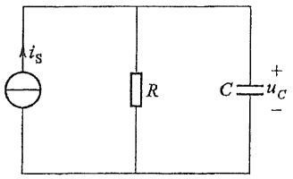

text_image

i_S
R
C = u_C
+

图7-42 例7-16图

应用式(7-20)可求得

$$
\begin{array}{l} u _ {c} (t) = \int_ {0} ^ {t} i _ {\mathrm{S}} (t - \xi) h (\xi) \mathrm{d} \xi \\ = \int_ {0} ^ {t} 2 \times 1 0 ^ {- 6} \mathrm{e} ^ {- (t - \xi)} \times \dot {1} 0 ^ {6} \mathrm{e} ^ {- 2 \xi} \mathrm{d} \xi \\ = 2 \int_ {0} ^ {t} \mathrm{e} ^ {- (t + \xi)} \mathrm{d} \xi = 2 \mathrm{e} ^ {- t} \int_ {0} ^ {t} \mathrm{e} ^ {- \xi} \mathrm{d} \xi \\ = 2 \left(\mathrm{e} ^ {- t} - \mathrm{e} ^ {- 2 t}\right) \varepsilon (t) \mathrm{V} \\ \end{array}
$$

例 7-17 设上题中的  $i_{s}$  为图 7-43 所示的矩形脉冲，即  $i_{s}=\left[\varepsilon(t)-\varepsilon(t-1)\right]\mu A$ ，试求  $u_{c}(t)$ 。

解 应用式(7-19), 有

$$
u _ {c} (  t) = \int_ {0} ^ {t} h (  t   -   \xi  )   i _ {\mathrm{S}} (  \acute {\xi}  )   \mathrm{d} \xi
$$

由于  $i_{\mathrm{s}}(t)$  在 t>1 时为零, 所以分两种情况来取积分限。

对 0<t<1，由于  $i_{\mathrm{S}}(t)=10^{-6}\mathrm{~A}$ ，因此有

$$
\begin{array}{l} u _ {c} (t) = \int_ {0} ^ {t} 1 0 ^ {- 6} \times 1 0 ^ {6} \mathrm{e} ^ {- 2 (t - \xi)} \mathrm{d} \xi = \int_ {0} ^ {t} 1 \times \mathrm{e} ^ {- 2 (t - \xi)} \mathrm{d} \xi \\ = \frac {1}{2} (1 - \mathrm{e} ^ {- 2 t}) \mathrm{V} \\ \end{array}
$$

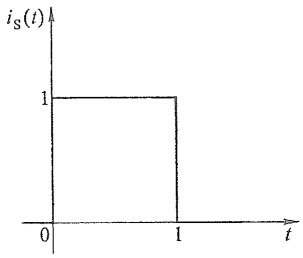

area

| t | i_S(t) |
| --- | --- |
| 0 | 1 |
| 1 | 1 |
| 1 | 0 |

图7-43 例7-17图

对 t>1，由于  $i_{\mathrm{s}}(t)=0$ ，只需要积分到 t=1 为止。于是

$$
\begin{array}{l} u _ {c} (t) = \int_ {0} ^ {1} 1 \times \mathrm{e} ^ {- 2 (t - \xi)}   \mathrm{d} \xi = \frac {1}{2} (\mathrm{e} ^ {2} - 1)   \mathrm{e} ^ {- 2 t} \mathrm{V} \\ = 3. 1 9 \mathrm{e} ^ {- 2 t} \mathrm{V} = 0. 4 3 2 \mathrm{e} ^ {- 2 (t - 1)} \mathrm{V} \\ \end{array}
$$

所以 $u_{c}(t)$ 可写为

$$
u _ {c} (t) = \left\{\frac {1}{2} (1 - \mathrm{e} ^ {- 2 t}) [ \varepsilon (t) - \varepsilon (t - 1) ] + 0. 4 3 2 \mathrm{e} ^ {- 2 (t - 1)} \varepsilon (t - 1) \right\} \mathrm{V}
$$

## \* §7-10 动态电路时域分析中的几个问题

## 1. 动态电路微分方程的阶数与电路结构的关系

在 §7-1 中曾提到, 在一般情况下, 电路微分方程的阶数与电路动态元件的个数相等, 严格讲应是电路微分方程的阶数与该电路中所包含的独立动态元件的个数相等。所谓独立动态元件, 就是指各电容电压不能根据 KVL 用其他电容电压和电压源电压表示出来; 各电感的电流不能根据 KCL 用其他电感的电流和电流源电流表示出来。如图 7-44(a) 中电容 C 与电压源构成了回路, $u_{C}=u_{S}(t)$, 图 7-44(b) 中电感与电流源串联, $i_{L}=i_{S}(t)$。同样, 图 7-45(a) 中有由 $C_{1}, C_{2}, C_{3}$ 与电压源 $u_{S}$ 构成的回路, 图 7-45(b) 中有由 $L_{1}, L_{2}$ 与电流源构成的节点。因此, 相应的动态元件中必有非独立动态元件。

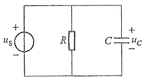

text_image

+
us
-
R
C
+
uc
-

(a)

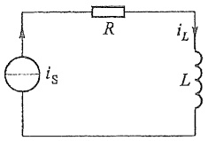

text_image

i_S
R
i_L
L

(b)

图 7-44 零阶电路

一般来说,把由纯电容元件或电容与电压源构成的回路称为纯电容回路,每个纯电容回路必有一个非独立电容；把由纯电感元件或电感与电流源构成的节点（或第十五章中的割集），称为纯电感节点（或割集），每个纯电感节点（或割集）中必有一个非独立电感。正因为如此，图7-44(a)(b)所示电路并非一阶电路而是零阶电路，图7-45(a)所示电路是三阶电路，图7-45(b)所示电路为一阶电路。

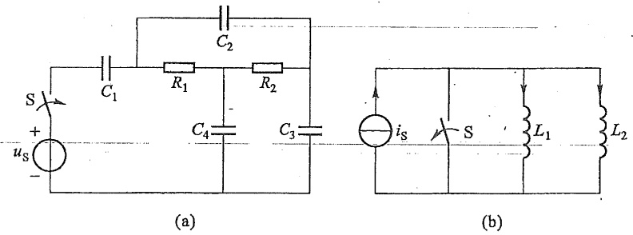

图7-45 具有非独立动态元件的电路

如果电路参数间有一定关系时,电路微分方程的阶数也可以比参数间没有一定关系时要低。

从对微分方程阶数与动态元件个数之间关系的分析中还可以进一步理解微分方程特征根(电路固有频率)与动态元件个数及参数之间的关系。

## 2. 动态电路中初始值的计算

§ 7-1 中已介绍过,对于通常遇到的电路,初始值由下面两个简单关系确定:

$$
u _ {c} (0 _ {+}) = u _ {c} (0 _ {-})
$$

$$
i _ {L} (0 _ {+}) = i _ {L} (0 _ {-})
$$

但在某些情况下，$u_{C}(0_{+}) \neq u_{C}(0_{-}), i_{L}(0_{+}) \neq i_{L}(0_{-})$，例如 §7-8 叙述的电路中有冲激激励时，电容电压或电感电流会发生跃变。另外，把未充过电的电容与独立电压源骤然接通，电容上电压必然要跃变；把原先未具有磁场能量的电感与独立电流源骤然接通，电感中电流也必然要跃变。这时电容中电场能量和电感中磁场能量也将跃变，电容和电感所吸收的功率都将无限大，而独立电压源和独立电流源都是理想元件，设想它们可以发出无限大的功率，因此并不矛盾。可以证明，仅当电容上电压值 $u_{C}(0_{-})$ 和电感中电流值 $i_{L}(0_{-})$ 不满足换路后的电路方程时，才有 $u_{C}(0_{+}) \neq u_{C}(0_{-}), i_{L}(0_{+}) \neq i_{L}(0_{-})$。有两种不相容的情况:① 换路后的电路有纯电容构成的回路，或有由电容和独立电压源构成的回路，且回路中各电容上电压值 $u_{Ck}(0_{-})$ 与各电压源电压的初始值的代数和不等于零，即电容上的电压如不跃变，在 $t=0_{+}$时刻，该回路的电压将不能满足 KVL；② 换路后的电路有纯电感构成的节点（或割集）或有由电感和独立电流源构成的节点（或割集），且节点处各电感的电流值 $i_{Lk}(0_{-})$ 与电流源电流的初始值的代数和不等于零，即电感中的电流如不跃变，在 $t=0_{+}$时刻，该节点（或割集）处的电流将不能满足 KCL。在上述两种情况下，要想求得初始值，必须遵循换路前后电路中电荷守恒和磁通链守恒的约束关系，即

$$
\sum q _ {k} (0 _ {+}) = \sum q _ {k} (0 _ {-}) \tag {7-21a}
$$

或 $\sum C_k u_{Ck}(0_+) = \sum C_k u_{Ck}(0_-)$ (7-21b)

$$
\sum \dot {\psi} _ {k} (0 _ {+}) = \sum \psi_ {k} (0 _ {-}) \tag {7-22a}
$$

或 $\sum L_{k}i_{Lk}(0_{+}) = \sum L_{k}i_{Lk}(0_{-})$ (7-22b)

例 7-18 （1）计算图 7-46(a) 所示电路中各电容在开关闭合后电压的初始值。
(2) 计算图 7-46(b) 所示的电路中各电感在开关断开后电流的初始值。

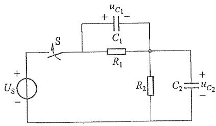

text_image

+
Us
-
S
+
uC1
-
C1
R1
R2
C2
+
uC2
-

(a)

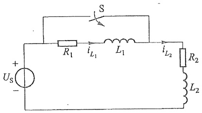

text_image

+
Us
-
R1
iL1
L1
iL2
R2
L2

(b)

图 7-46 例 7-18 图

解 (1) 开关闭合前

$$
u _ {c _ {1}} (0 _ {-}) = u _ {c _ {2}} (0 _ {-}) = 0
$$

开关闭合后, $t=0_{+}$ 时,根据KVL应有

$$
u _ {c _ {1}} (0 _ {+}) + u _ {c _ {2}} (0 _ {+}) = U _ {s}
$$

故 $t = 0$ 时电容上电压值不满足换路后的电路方程，因而电容上电压应跃变。由于式(7-21b)相应于KCL，电容上电荷重新分配引起的电流应遵循KCL方程中关于正、负号的规定。所以，在图7-46(a)所示电容电压参考方向下，根据换路前后瞬间电容上电荷守恒有

$$
C _ {1} u _ {c _ {1}} (0 _ {+}) - C _ {2} u _ {c _ {2}} (0 _ {+}) = C _ {1} u _ {c _ {1}} (0 _ {-}) - C _ {2} u _ {c _ {2}} (0 _ {-})
$$

与上述的 $u_{C_1}(0_+) + u_{C_2}(0_) = U_S$ 联立，则可解得

$$
u _ {C _ {1}} (0 _ {+}) = \frac {C _ {2}}{C _ {1} + C _ {2}} U _ {\mathrm{s}}
$$

$$
u _ {C _ {2}} (0 _ {+}) = \frac {C _ {1}}{C _ {1} + C _ {2}} U _ {\mathrm{s}}
$$

(2) 在开关断开前

$$
i _ {L _ {1}} (0 _ {-}) = 0, \quad i _ {L _ {2}} (0 _ {-}) = \frac {U _ {s}}{R _ {2}}
$$

换路后应有 $i_{L_1}(0_+) = i_{L_2}(0_+)$，故电感中电流应跃变。由于式(7-22b)相应于KVL，电感中电流变化引起的电压应遵循KVL方程中关于正、负号的规定。所以，在图7-46(b)

所示电感电流参考方向下,根据换路前后瞬间电感中磁通链守恒有

$$
L _ {1} i _ {L _ {1}} (0 _ {+}) + L _ {2} i _ {L _ {2}} (0 _ {+}) = L _ {1} i _ {L _ {1}} (0 _ {-}) + L _ {2} i _ {L _ {2}} (0 _ {-}) = L _ {2} \cdot \frac {U _ {\mathrm{s}}}{R _ {2}}
$$

与上述  $i_{L_{1}}(0_{+})=i_{L_{2}}(0_{+})$  联立，解得

$$
\overline {{i _ {L _ {1}} (0 _ {+}) = i _ {L _ {2}} (0 _ {+}) = \frac {L _ {2}}{L _ {1} + L _ {2}} \cdot \frac {U _ {\mathrm{s}}}{R _ {2}}}}
$$

## 3. 非齐次微分方程特解的计算

在本章中已重点研究了直流激励的一阶电路和二阶电路,其特解取  $t \to \infty$  时的稳态解。在一般情况下,如何计算特解呢?

由于特解具有任意性,它只要满足电路对应的非齐次方程即可。因此,从数学角度看,可根据激励函数的特点,假定一个形式与激励函数形式相同的特解,将其代入方程,经过比较方程两边的对应项系数,即可得到所需特解。例如,激励为阶跃函数,特解可假定为一常数;若激励为指数函数,特解可假定为一个指数函数;若激励为正弦函数,特解可假定为一个与激励同频率的正弦函数(用第九章介绍的相量法求正弦稳态解做特解更为简单方便);若激励是一个关于t的多项式形式,则特解可假定为一个同阶的t的多项式,等等。

以上是关于动态电路用经典法求解时通常会遇到的几个问题。而当电路结构复杂，激励形式不仅是直流时，采用经典法从数学计算角度看就有些繁难。因此，采用第十四章的拉普拉斯变换法求解线性动态电路将是一个重要而有效的方法。学习时将这两章内容有机地结合起来，会进一步加深对问题的理解。

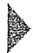

## 思考题

7-1 动态电路的过渡过程与暂态过程的含义相同吗？
7-2 如果换路发生在 $t = 0$ 时刻, 对应动态电路的微分方程的时间区间应该如何表示? 动态过程从何时开始?
7-3 试分析在正弦电压激励下 $RC$ 电路的零状态响应，并讨论在何种情况下换路后不发生过渡过程立即进入稳定状态，何种情况下电容电压的最大瞬时值的绝对值接近稳态幅值的两倍。
7-4 对于一阶电路,采用先列微分方程,然后通过求解微分方程得到电路响应的方法,与三要素法有何不同?试比较两者求解一阶电路的步骤。
7-5 试分析在工程中,在什么条件下,可能出现过电压和过电流。如何避免或减小过电压和过电流?
7-6 请推导出 RLC 并联电路零输入响应分别为过阻尼、临界阻尼和欠阻尼时参数之间应满足的关系，并与 RLC 串联零输入响应的三种情形作比较。
7-7 对于三阶电路,零状态响应和全响应的求解过程有何异同?对于串联的 RLC

电路,全响应将会有哪几种情形?

7-8 当激励为阶跃函数时,电路响应的表达式与通过开关换路的响应表达式有什么不同?

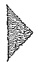

## 习题

7-1 列写题 7-1 图所示电路的微分方程。

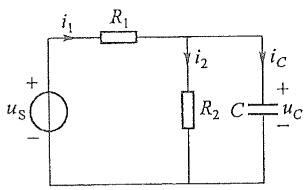

text_image

i₁ R₁
+ uₛ -
i₂ i_C
R₂ C u꜀ -

(a)

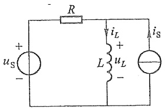

text_image

R
+
us
-
iL
+
L
uL
-
is

(b)

题7-1图

7-2 列写题 7-2 图所示电路在开关 S 闭合后的微分方程。

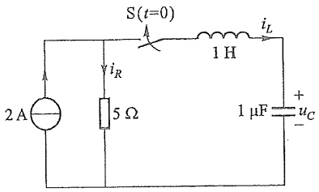

text_image

2 A
iR
5 Ω
S(t=0)
1 H
iL
1 μF uC
+

题 7-2 图

7-3 题 7-3 图所示各电路中开关 S 在 t=0 时动作, 试求电路在  $t=0_{+}$  时刻的电压、电流值。

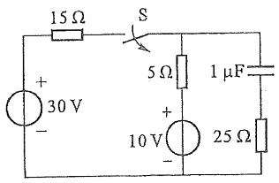

text_image

15 Ω
+
30 V
-
S
5 Ω
+
10 V
-
25 Ω
1 μF

(a)

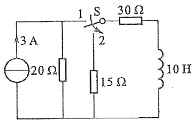

text_image

3 A
20 Ω
1 S
2
30 Ω
15 Ω
10 H

(b)

题7-3图

7-4 电路如题 7-4 图所示, 开关未动作前电路已达稳态, t=0 时开关 S 打开。求  $u_{C}(0_{+})$ 、 $i_{L}(0_{+})$ 、 $\frac{du_{C}}{dt}\bigg|_{0_{+}}$ 、 $\frac{di_{L}}{dt}\bigg|_{0_{+}}$ 、 $\frac{di_{R}}{dt}\bigg|_{0_{+}}$ 。

7-5 电路如题 7-5 图所示, 开关 S 原在位置 1 已久, t=0 时合向位置 2, 求  $u_{c}(t)$  和  $i(t)$ 。

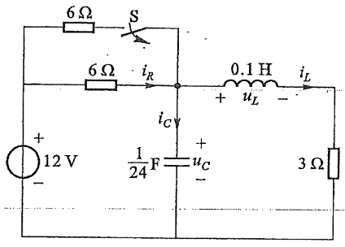

text_image

6Ω
S
6Ω
iR
0.1 H
iL
+
uL
-
iC
12 V
-
1/24 F
uC
-
3 Ω

题7-4图

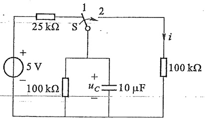

text_image

25 kΩ
1
2
S
+
5 V
-
100 kΩ
+
uC
10 μF
i
100 kΩ

题7-5图

7-6 题 7-6 图中开关 S 在位置 1 已久, t=0 时合向位置 2, 求换路后的  $i(t)$  和  $u_{L}(t)$ 。
7-7 题 7-7 图所示电路中, 若 t=0 时开关 S 闭合, 求电流 i。

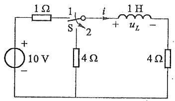

text_image

1 Ω
+
10 V
-
S
2
i
+
1 H
uL
-
4 Ω
4 Ω

题7-6图

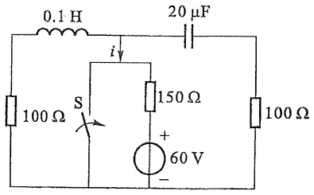

text_image

0.1 H
20 μF
i
150 Ω
100 Ω
S
+
60 V
-

题7-7图

7-8 题 7-8 图所示电路中, 已知电容电压  $u_{c}(0_{-}) = 10 \, \text{V}, t = 0$  时开关 S 闭合, 求 t > 0 时的电流  $i(t)$ 。
7-9 电路如题7-9图所示,开关S闭合时电路已达稳态。若t=0时将开关S打开,求开关打开后的电流i。

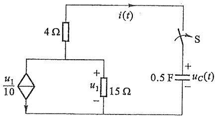

text_image

4 Ω
i(t)
S
u₁/10
+
u₁ 15 Ω
-
0.5 F u_C(t)
-

题7-8图

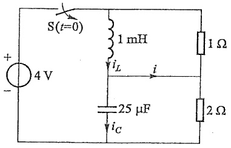

text_image

S(t=0)
4 V
+
-
1 mH
iL
i
25 μF
iC
1 Ω
2 Ω

题 7-9 图

7-10 题 7-10 图所示电路中, 若 t=0 时开关 S 打开, 求  $u_{c}$  和电流源发出的功率。
7-11 题 7-11 图所示电路中开关 S 打开前已处稳定状态。t=0 时开关 S 打开，求 t>0 时的  $u_{L}(t)$  和电压源发出的功率。

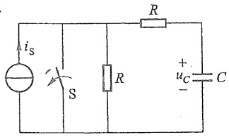

text_image

i_S
S
R
+
-
u_C
C

题 7-10 图

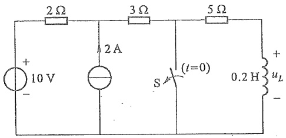

text_image

2 Ω
3 Ω
5 Ω
+
10 V
-
2 A
S
(t=0)
0.2 H
+
uL
-

题 7-11 图

7-12 题 7-12 图所示电路中开关闭合前电容无初始储能, t=0 时开关 S 闭合, 求 t>0 时的电容电压  $u_{c}(t)$ 。
7-13 题 7-13 图所示电路, 已知  $i_{L}(0_{-}) = 0, t = 0$  时开关 S 闭合, 求 t > 0 时的电流  $i_{L}(t)$  和电压  $u_{L}(t)$ 。

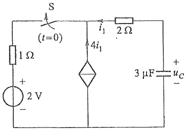

text_image

S
(t=0)
1 Ω
+
2 V
-
4i₁
i₁
2 Ω
3 μF
+
u_C
-

题 7-12 图

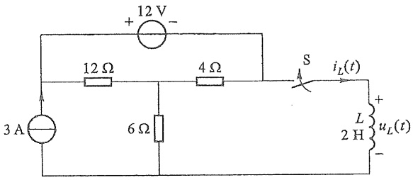

text_image

+ 12 V -
12 Ω 4 Ω S iL(t) +
3 A 6 Ω L uL(t)
2 H -

题 7-13 图

7-14 题 7-14 图所示电路, 开关 S 原打开, 已达稳定状态。t=0 时闭合 S, 求开关闭合后的电流  $i(t)$ 。
7-15 题 7-15 图所示电路中开关打开以前电路已达稳态, t=0 时开关 S 打开。求 t>0 时的  $i_{c}(t)$ ，并求 t=2 ms 时电容的能量。

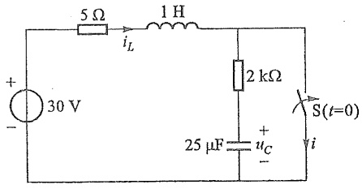

text_image

5 Ω
1 H
iL
+
30 V
-
2 kΩ
S(t=0)
25 μF
uC
-
i

题7-14图

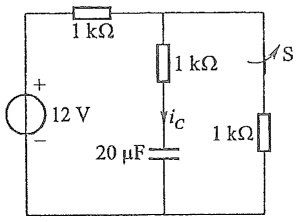

text_image

1 kΩ
+
12 V
-
20 μF
iC
1 kΩ
A S
1 kΩ

题7-15图

7-16 题 7-16 图所示电路中直流电压源的电压为 24 V，且电路已达稳态。t=0 时闭合开关 S，求开关闭合后电感电流  $i_{L}$  和直流电压源发出的功率。
7-17 题 7-17 图所示电路中, 已知 $e(t) = 220\sqrt{2} \cos(314t + 30^{\circ}), u_{c}(0_{-}) = U_{0}, t = 0$ 时合上开关 S。

(1) 求  $u_{c}(t)$ 。
(2) $u_{c}(0_{-})$ 为何值时,瞬态分量为零?

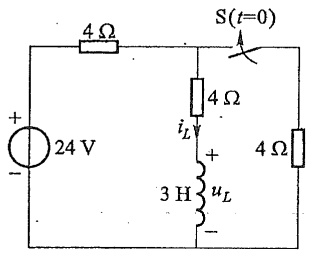

text_image

+
24 V
-
4 Ω
S(t=0)
4 Ω
iL
+
3 H
uL
-
4 Ω

题7-16图

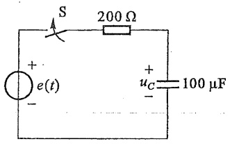

text_image

S
200 Ω
+
e(t)
-
+
uc
100 μF
-

题7-17图

7-18 题 7-18 图所示电路中各参数已给定, 开关 S 打开前电路为稳态。t=0 时开关 S 打开, 求开关打开后电压  $u(t)$ 。

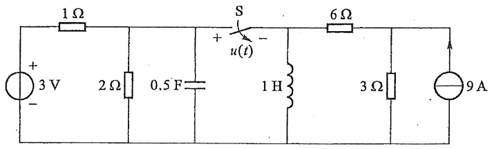

text_image

1 Ω
+
3 V
-
2 Ω
0.5 F
S
+
u(t)
-
1 H
6 Ω
3 Ω
9 A

题7-18图

7-19 电路如题7-19图所示，开关 $\mathrm{S}_1$ 原闭合在位置a，开关 $\mathrm{S}_2$ 闭合，电路已达稳定状态。 $t = 0$ 时开关 $\mathrm{S}_1$ 由位置a合至位置b，在 $t = t_{1} = 4\mathrm{s}$ 时将开关 $\mathrm{S}_2$ 打开，求 $t > 0$ 时的电容电压 $u_{C_2}$ 。

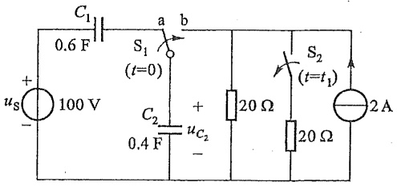

text_image

C₁
0.6 F
a b
S₁
(t=0)
+
us
-
100 V
C₂
0.4 F
+
uc₂
-
20 Ω
S₂
(t=t₁)
20 Ω
2 A

题 7-19 图

7-20 题 7-20 图所示电路, 开关合在位置 1 时已达稳定状态, t=0 时开关由位置 1 合向位置 2, 求 t>0 时的电压  $u_{L}$ 。

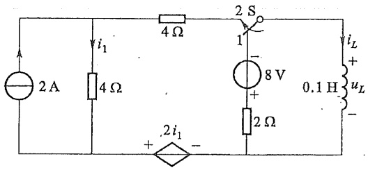

text_image

2 A
4 Ω
i₁
4 Ω
2 S
1
-
8 V
+
2 Ω
0.1 H
iL
+
uL
-
+ 2i₁ -

题7-20图

7-21 题 7-21 图所示电路中, 电容原先已充电, $u_{C}(0_{-}) = 6 \mathrm{~V}, i_{L}(0_{-}) = 0, R = 2.5 \Omega, L = 0.25 \mathrm{H}, C = 0.25 \mathrm{~F}$。

(1) 试求开关闭合后的  $u_{c}(t)$ 、 $i(t)$ 。
(2) 使电路在临界阻尼下放电, 当 L 和 C 不变时, 电阻 R 应为何值?

7-22 题 7-22 图所示电路中开关 S 闭合已久, t=0 时 S 打开。求  $u_{c}$ 、 $i_{L}$ 。

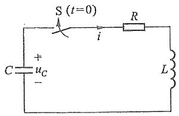

text_image

S (t=0)
C u_C
+
-
i
R
L

题 7-21 图

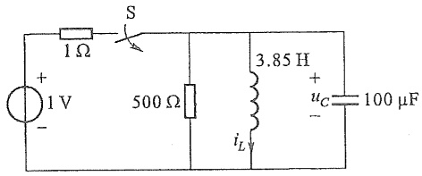

text_image

1 V
+
-
1 Ω
S
500 Ω
3.85 H
iL
+
-
uC
100 μF

题 7-22 图

7-23 题 7-23 图所示电路在开关 S 打开之前已达稳态；t=0 时，开关 S 打开，求 t>0 时的  $u_{c}$ 。

7-24 电路如题 7-24 图所示, t=0 时开关 S 闭合, 设  $u_{c}(0_{-})=0, i(0_{-})=0, L=1\mathrm{H}, C=1\mu\mathrm{F}, U=100\mathrm{V}$ 。若 (1) 电阻  $R=3\ k\Omega; (2) R=2\ k\Omega; (3) R=200\ k\Omega$ , 试分别求在上述电阻值时电路中的电流 i 和电压  $u_{c}$ 。

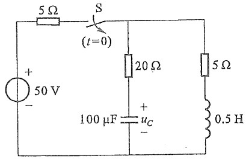

text_image

5 Ω
S
(t=0)
+
50 V
-
20 Ω
100 μF
+
uC
-
5 Ω
0.5 H

题 7-23 图

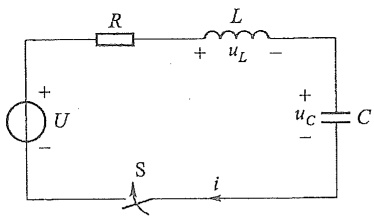

text_image

R
L
+
uL
-
+
uC
C
+
U
-
S
i

题 7-24 图

7-25 试求题 7-25 图所示电路的零状态响应  $i_{L}, u_{C}$ 。（设开关 S 在 t=0 时闭合）

text_image

S(t=0)
2 A
R1 2 Ω
iR1
1 H
iL
R2 3 Ω
iR2
1/6 F
+
uC
-
iC

题7-25图

7-26 题 7-26 图所示电路在开关 S 动作前已达稳态；t=0 时 S 由位置 1 接至位置 2，求 t>0 时的  $i_{L}$ 。

7-27 题 7-27 图所示电路中直流电压源  $U_{s}=6\ V$ ，开关动作前电路已达稳定状

态。t=0 时开关 S 闭合，求换路后的电流  $i_{1}$ 。

text_image

2 S
(t=0)
1
2 Ω
+ 6 V
+
4 V
-
-
0.2 F
iL
1 H

题 7-26 图

text_image

1 H
i₁
6 V 1
2 Ω
S(t=0)
6 Ω
2
4 H
i₂

题7-27图

7-28 电路如题7-28图所示，已知电压源 $U_{\mathrm{s}}$ 为直流，且 $U_{\mathrm{s}} = 10\mathrm{V}, u_{c}(0_{-}) = -2\mathrm{V}$，$i_{L}(0_{-}) = 1\mathrm{A}, t = 0$ 时开关S闭合，求开关S闭合后电容电压 $u_{c}(t)$。

text_image

S(t=0)
+
Us
-
L 1 H iL
R1 2 Ω
R2
2 Ω
C +
0.2 F uC
-

题7-28图

7-29 题 7-29 图所示电路中  $R=3\Omega, L=6\ mH, C=1\mu F, U_{0}=12\ V$ ，电路已处稳态。设开关 S 在 t=0 时打开，试求  $u_{L}(t)$ 。

text_image

i
R
+
uL
-
L
+
U0
-
S
C

题7-29图

7-30 试用阶跃函数分别表示题 7-30 图所示的电流、电压的波形。

area

| t (s) | i(t) (A) |
| --- | --- |
| 0~1 | 0 |
| 1~2 | 2 |
| 2~3 | 0 |

(a)

line

| t/s | u(t)/V |
| --- | --- |
| 0 | 0 |
| 1 | 1 |
| 2 | 0 |

(b)

题 7-30 图

7-31 题 7-31 图(a)所示电路中的电压  $u(t)$  的波形如题 7-31 图(b)所示。试求电流  $i(t)$ 。

text_image

+
2 Ω
u
3 Ω
i
1 H
-

(a)

line

| t/s | u/V |
| --- | --- |
| 0~1 | 2 |
| 1 | 0 |

(b)

题7-31图

7-32 $RC$ 电路中电容 $C$ 原未充电，所加 $u(t)$ 的波形如题7-32图所示，其中 $R = 1000\Omega, C = 10\mu \mathrm{F}$ 。求电容电压 $u_{c}$，并把 $u_{c}$:

(1) 用分段形式写出。
(2) 用一个表达式写出。

题 7-32 图

7-33 题 7-33 图所示电路中， $u_{\mathrm{S1}} = \varepsilon(t)\mathrm{V}, u_{\mathrm{S2}} = 5\varepsilon(t)\mathrm{V}$ ，试求电路响应  $i_{L}(t)$ 。
7-34 题 7-34 图所示电路中，已知 $i_{\mathrm{S}} = 10\varepsilon(t) \mathrm{~A}, R_{1} = 1 \Omega, R_{2} = 2 \Omega, C = 1 \mu \mathrm{F}, u_{C}(0_{-}) = 2 \mathrm{~V}, g = 0.25 \mathrm{~S}$。求全响应 $i_{1}(t), i_{C}(t), u_{C}(t)$。

text_image

1 Ω
2 Ω
iL
+
uS1
-
+
uS2
-
3 Ω
4 H

题7-33图

text_image

iS
R1
+
u1
-
i1
R2
C
+
uc
-
gu1
iC

题7-34图

\*7-35 题 7-35 图(a)所示电路中，N 为无源线性电阻网络。已知激励为单位阶跃电压源时电容电压的全响应为 $u_{c} = (2 + 6\mathrm{e}^{-2t})\mathrm{V}(t > 0)$，求输入电压的波形如题 7-35 图(b)所示时；电容电压的零状态响应。

题 7-35 图

7-36 题 7-36(a) 电路中, $u_{\mathrm{s}}(t)=\varepsilon(t)\mathrm{V}, C=0.2\mathrm{F}$, 其零状态响应为

$$
u _ {2} (t) = \left(\frac {1}{2} + \frac {1}{8} \mathrm{e} ^ {- 2. 5 t}\right) \varepsilon (t) \mathrm{V}
$$

如果用  $L=2\ H$  的电感代替电容 C，如题 7-36 图 (b) 所示，求零状态响应  $u_{2}(t)$ 。

题 7-36 图

7-37 题 7-37 图所示电路中含有理想运算放大器, 试求零状态响应  $u_{c}(t)$ , 已知  $u_{1}=5\varepsilon(t)\mathrm{V}$ 。
7-38 题 7-38 图所示电路中  $i_{L}(0_{-})=0, R_{1}=6\Omega, R_{2}=4\Omega, L=100\mathrm{mH}$ 。求冲激响应  $i_{L}$  和  $u_{L}$ 。

text_image

2 kΩ
1 kΩ
-
∞
+
3 kΩ
0,4 F uC
+
ui
-

题 7-37 图

text_image

R₁
δ(t) V
+
-
iₗ
L
+
uₗ
-
R₂

题 7-38 图

7-39 电路如题 7-39 图所示, 当 (1) $i_{\mathrm{s}} = \delta(t) \mathrm{~A}, u_{c}(0_{-}) = 0$; (2) $i_{\mathrm{s}} = \delta(t) \mathrm{~A}, u_{c}(0_{-}) = 1 \mathrm{~V}$; (3) $i_{\mathrm{s}} = 3\delta(t - 2) \mathrm{~A}, u_{c}(0_{-}) = 2 \mathrm{~V}$ 时, 试求响应 $u_{c}(t)$。
7-40 题 7-40 图所示电路中电容原未充电, 求当  $i_{s}$  给定为下列情况时的  $u_{c}$  和  $i_{c}$ :

(1)  $i_{s}=25\varepsilon(t)\mathrm{mA}$
(2)  $i_{s}=\delta(t)\mathrm{mA}$

text_image

i_S
1 kΩ
2 kΩ
3 μF u_C
+ -

题 7-39 图

text_image

i_C
+ u_C -
20 kΩ
8 kΩ
12 kΩ
A i_S

题 7-40 图

7-41 题 7-41 图所示电路中, 电源  $u_{\mathrm{s}} = [50\varepsilon(t) + 2\delta(t)] \mathrm{~V}$ , 求 t > 0 时电感支路的电流  $i(t)$ 。
7-42 题 7-42 图所示电路中含理想运算放大器,且电容的初始电压为零,试分别求:

(1)  $u_{i}=U\varepsilon(t)V$ 。
(2) $u_{i}=\delta_{u}(t)$ 时电路的输出电压 $u_{o}$ 。

text_image

10 Ω
+
us
-
10 Ω 0,1 H
i y

题 7-41 图

text_image

+ u_C -
C_2
R_2
i_1
R_1
i_2
- >∞
+
+
ui
-
+
uo
-

题 7-42 图

7-43 题 7-43 图所示电路中, G=5 S, L=0.25 H, C=1 F。

求:(1) $i_{\mathrm{s}}(t)=\varepsilon(t)\mathrm{A}$ 时，电路的阶跃响应 $i_{L}(t)$ 。

(2) $i_{\mathrm{S}}(t)=\delta(t)\mathrm{A}$ 时，电路的冲激响应 $u_{C}(t)$ 。

text_image

i_S
G
C = u_C
+
-
i_L
L

题 7-43 图

7-44 当  $u_{s}(t)$  为下列情况时, 求题 7-44 图所示电路的响应  $u_{c}$ :

(1)  $u_{s}(t)=10\varepsilon(t)\mathrm{V}_{\circ}$
(2)  $u_{\mathrm{s}}(t)=10\delta(t)\mathrm{V}$ 。

7-45 题 7-45 图所示电路中电感的初始电流为零, 设  $u_{\mathrm{S}}(t)=U_{0}\mathrm{e}^{-at}\varepsilon(t)$ , 试用卷积积分求  $u_{\mathrm{L}}(t)$ 。

text_image

1 H
+
uS(t)
1 Ω
1 F
+
uC
-

题7-44图

text_image

+
-
uS(t)
R
L
+
uL(t)
-

题 7-45 图

7-46 题 7-46 图(a)所示电路的激励波形如题 7-46 图(b)所示,试用卷积积分求零状态响应  $i(t)$ 。

第七章部分
习题答案

text_image

i_S
0.5 Ω
i
0.5 H

(a)

line

| t/s | iS/A |
| --- | --- |
| 0 | 1 |
| 1 | 0 |

(b)

题 7-46 图

text_image

第八章
相量法

## 第八章 相量法

## 导读

对线性电路施加激励(独立电源)均为同频率的正弦时间函数,在电路达到稳态时,线性电路的所有响应(电压和电流)均为与激励具有相同频率的正弦时间函数,称电路为正弦稳态电路。

由第七章获知,含有储能元件的线性电路用线性常微分方程描述。施加正弦激励的线性电路的稳态响应,是线性常微分方程的特解,它是与激励具有相同频率的正弦时间函数。显然,对正弦稳态电路,采用微分方程求特解将非常困难。

1893年,工程师 C.P. 施泰因梅茨率先用约定的“符号”将正弦稳态电路的微(积)分方程的特解问题变换为复代数方程的求解问题,这种方法就是本章介绍的相量法。相量法将正弦稳态电路中的电压和电流(正弦时间函数)变换为用复数表示的电压相量和电流相量,将电路元件用复阻抗或复导纳表示,从而将时域的微分方程变换为复代数方程。显然,用相量法分析正弦稳态电路比用微分方程要容易得多。

本章简单介绍复数及其运算、正弦量、基尔霍夫定律的相量形式以及元件电压电流关系的相量形式，为后续各章正弦稳态电路的分析奠定基础。

相量法也是分析研究非正弦周期信号、任意信号和许多相关学科的理论基础之一。

本书第八章至第十三章都是分析研究正弦稳态电路的相关内容。

## §8-1 复数

复数及其运算是应用相量法的数学基础。本节仅作简要的介绍。

一个复数有多种表示形式。复数 F 的代数形式为

$$
F = a + j b
$$

式中  $j=\sqrt{-1}$  为虚单位。a 称为复数 F 的实部，b 称为复数 F 的虚部。复数 F 在复平面上是一个坐标点，常用原点至该点的向量表示，如图 8-1 所示。

根据图 8-1, 可得复数 F 的三角形式

$$
F = \mid F \mid (\cos \theta + \mathrm{j} \sin \theta)
$$

而复数 $F$ 的指数形式或极坐标形式为

$$
F = | F | \mathrm{e} ^ {\mathrm{j} \theta}, \quad F = | F | / \theta
$$

式中  $\left|F\right|$  为复数的模(值)， $\theta$  为复数的辐角，即  $\theta=\arg F$ 。 $\theta$  可以用弧度或度表示。 $\left|F\right|$  和  $\theta$  与 a 和 b 之间的关系为

$$
\mid F \mid = \sqrt {a ^ {2} + b ^ {2}}
$$

$$
\theta = \arctan \left(\frac {b}{a}\right)
$$

$$
a = | F | \cos \theta , \quad b = | F | \sin \theta
$$

text_image

+j
b
F
θ
O
a
+1

图8-1 复数的表示

本书还常用到如下一些复数的概念, $\mathrm{Re}[F]$ 表示取复数F的实部,即

$$
\mathrm{Re} [ F ] = a
$$

Im[F]表示取复数F的虚部,即

$$
\operatorname{Im} [ F ] = b
$$

$F^{*}$  表示复数 F 的共轭复数, 即

$$
F ^ {*} = a - \mathrm{j} b \quad \text {或} \quad F ^ {*} = | F | / - \theta
$$

下面介绍复数的运算。复数的相加和相减必须用代数形式进行。例如，设

$$
F _ {1} = a _ {1} + \mathrm{j} b _ {1}, \quad F _ {2} = a _ {2} + \mathrm{j} b _ {2}
$$

则

$$
F _ {1} \pm F _ {2} = (a _ {1} + \mathrm{j} b _ {1}) \pm (a _ {2} + \mathrm{j} b _ {2})
$$

$$
= (a _ {1} \pm a _ {2}) + \mathrm{j} (b _ {1} \pm b _ {2})
$$

复数的相加和相减的运算也可以按平行四边形法在复平面上用向量的相加和相减求得,如图 8-2 所示。

text_image

+j
F₁+F₂
F₂
O
+1
F₁

(a) $F_{1} + F_{2}$

text_image

+j
F₁
F₂
F₁-F₂
O
+1

(b) $F_{1} - F_{2}$

图8-2 复数代数和的图解法

复数相乘用指数形式比较方便,即

$$
\begin{array}{l} F _ {1} F _ {2} = \left| F _ {1} \right| \mathrm{e} ^ {\mathrm{j} \theta_ {1}} \left| F _ {2} \right| \mathrm{e} ^ {\mathrm{j} \theta_ {2}} \\ = \mid F _ {1} \mid \mid F _ {2} \mid \mathrm{e} ^ {\mathrm{j} (\theta_ {1} + \theta_ {2})} \\ \end{array}
$$

所以

$$
\mid F _ {1} F _ {2} \mid = \mid F _ {1} \mid \mid F _ {2} \mid
$$

$$
\arg (F _ {1} F _ {2}) = \arg (F _ {1}) + \arg (F _ {2})
$$

两个复数的相乘,用代数形式有

$$
F _ {1} F _ {2} = (a _ {1} + \mathrm{j} b _ {1}) (a _ {2} + \mathrm{j} b _ {2})
$$

$$
= (a _ {1} a _ {2} - b _ {1} b _ {2}) + \mathrm{j} (a _ {1} b _ {2} + a _ {2} b _ {1})
$$

复数相除的运算为

$$
\frac {F _ {1}}{F _ {2}} = \frac {\left| F _ {1} \right| / \theta_ {1}}{\left| F _ {2} \right| / \theta_ {2}} = \frac {\left| F _ {1} \right|}{\left| F _ {2} \right|} / \left(\theta_ {1} - \theta_ {2}\right)
$$

所以

$$
\left| \frac {F _ {1}}{F _ {2}} \right| = \frac {\mid F _ {1} \mid}{\mid F _ {2} \mid}
$$

$$
\arg \left(\frac {F _ {1}}{F _ {2}}\right) = \arg (F _ {1}) - \arg (F _ {2})
$$

如用代数形式有

$$
\frac {F _ {1}}{F _ {2}} = \frac {a _ {1} + \mathrm{j} b _ {1}}{a _ {2} + \mathrm{j} b _ {2}} = \frac {(a _ {1} + \mathrm{j} b _ {1}) (a _ {2} - \mathrm{j} b _ {2})}{(a _ {2} + \mathrm{j} b _ {2}) (a _ {2} - \mathrm{j} b _ {2})}
$$

$$
= \frac {a _ {1} a _ {2} + b _ {1} b _ {2}}{\left(a _ {2}\right) ^ {2} + \left(b _ {2}\right) ^ {2}} + \mathrm{j} \frac {a _ {2} b _ {1} - a _ {1} b _ {2}}{\left(a _ {2}\right) ^ {2} + \left(b _ {2}\right) ^ {2}}
$$

式中 $a_2 - \mathrm{j}b_2$ 为 $F_{2}$ 的共轭复数 $F_{2}^{*}$ 。 $F_{2}F_{2}^{*}$ 的结果为实数，称为有理化运算。

图 8-3(a)(b)为复数乘、除的图解表示,从图上可以看出:复数乘、除表示为模的放大或缩小,辐角表示为逆时针旋转或顺时针旋转。

text_image

+j
F₁F₂
θ₂
|F₂|F₁
F₁
θ₁
θ₂
O
+1

(a) $F_{1}F_{2}$

text_image

+j
F₁
F₁/|F₂|
θ₂
F₁/F₂
θ₁
F₂
θ₂
O
+1

(b) $F_{1} / F_{2}$

图8-3 复数乘、除的图解示意

复数  $e^{j\theta}=1/\theta$  是一个模等于 1，辐角为  $\theta$  的复数。任意复数  $A=|A|e^{j\theta_{n}}$  乘以  $e^{j\theta}$  等于把复数 A 逆时针旋转一个角度  $\theta$ ，而 A 的模值不变，所以  $e^{j\theta}$  称为旋转因子。

根据欧拉公式,不难得出  $e^{j\frac{\pi}{2}}=j,e^{-j\frac{\pi}{2}}=-j,e^{j\pi}=-1$ 。因此“±j”和“-1”都可以看成旋转因子。例如一个复数乘以 j，等于把该复数在复平面上逆时针旋转  $\frac{\pi}{2}$ ；一个复数除以 j，等于该复数乘以 -j，因此等于把它顺时针旋转  $\frac{\pi}{2}$ 。

natural_image

Pure technical line drawing of mechanical components without any text or symbols

在复数运算中常有两个复数相等的运算。两个复数相等必须满足两个条件，如 $F_{1}=F_{2}$ 必须有

$$
\mathrm{Re} \left[ F _ {1} \right] = \mathrm{Re} \left[ F _ {2} \right], \quad \mathrm{Im} \left[ F _ {1} \right] = \mathrm{Im} \left[ F _ {2} \right]
$$

或者有

$$
\left| F _ {1} \right| = \left| F _ {2} \right|, \quad \arg (F _ {1}) = \arg (F _ {2})
$$

一个复数方程可以分解为两个实数方程。

例8-1 设 $F_{1} = 3 - \mathrm{j}4, F_{2} = 10 / 135^{\circ}$。求 $F_{1} + F_{2}$ 和 $\frac{F_1}{F_2}$。

解 用代数形式求复数的代数和,有

$$
F _ {2} = 1 0 \angle 1 3 5 ^ {\circ} = 1 0 (\cos 1 3 5 ^ {\circ} + j \sin 1 3 5 ^ {\circ})
$$

$$
= - 7. 0 7 + \mathrm{j} 7. 0 7
$$

$$
F _ {1} + F _ {2} = (3 - \mathrm{j} 4) + (- 7. 0 7 + \mathrm{j} 7. 0 7) = - 4. 0 7 + \mathrm{j} 3. 0 7
$$

转换为指数形式有

$$
\arg (F _ {1} + F _ {2}) = \arctan \left(\frac {3 . 0 7}{- 4 . 0 7}\right) = 1 4 3 ^ {\circ}
$$

$$
\mid F _ {1} + F _ {2} \mid = \frac {- 4 . 0 7}{\cos 1 4 3 ^ {\circ}} = \frac {3 . 0 7}{\sin 1 4 3 ^ {\circ}} = 5. 1
$$

即有

$$
F _ {1} + F _ {2} = 5. 1 / 1 4 3 ^ {\circ}
$$

$$
\frac {F _ {1}}{F _ {2}} = \frac {3 - \mathrm{j} 4}{- 7 . 0 7 + \mathrm{j} 7 . 0 7} = \frac {(3 - \mathrm{j} 4) (- 7 . 0 7 - \mathrm{j} 7 . 0 7)}{(- 7 . 0 7 + \mathrm{j} 7 . 0 7) (- 7 . 0 7 - \mathrm{j} 7 . 0 7)} = - 0. 4 9 5 + \mathrm{j} 0. 0 7 1
$$

或者

$$
\frac {F _ {1}}{F _ {2}} = \frac {3 - \mathrm{j} 4}{1 0 / 1 3 5 ^ {\circ}} = \frac {5 / - 5 3 . 1 ^ {\circ}}{1 0 / 1 3 5 ^ {\circ}} = 0. 5 / - 1 8 8. 1 ^ {\circ} = 0. 5 / 1 7 1. 9 ^ {\circ}
$$

## §8-2 正弦量

电路中按正弦规律变化的电压或电流,统称为正弦量。对正弦量的数学描述,可以采用 sine 函数,也可以用 cosine 函数。本书采用 cosine 函数。

图 8-4 表示一段电路中有正弦电流 i，在图示参考方向下，其数学表达式定义如下:

$$
i = I _ {\mathrm{m}} \cos (\omega t + \phi_ {i}) \tag {8-1}
$$

图8-4 一段正弦电流电路

正弦量

式中的 3 个常数  $I_{m}$ 、 $\omega$  和  $\phi_{i}$  称为正弦量的三要素。

$I_{m}$  称为正弦量的振幅, 它是正弦量在整个振荡过程中达到的最大值, 即  $\cos(\omega t + \phi_{i}) = 1$  时, 有

$$
i _ {\mathrm{max}} = I _ {\mathrm{m}}
$$

这也是正弦量的极大值。当  $\cos\left(\omega t+\phi_{i}\right)=-1$  时，将有最小值（也是极小值） $i_{\min}=-I_{m}$ 。 $i_{\max}-i_{\min}=2I_{m}$  称为正弦量的峰-峰值。

随时间变化的角度 $(\omega t+\phi_{i})$ 称为正弦量的相位,或称相角。 $\omega$ 称为正弦量的角频率,它是正弦量的相位随时间变化的角速度,即

$$
\omega = \frac {\mathrm{d}}{\mathrm{d} t} (\omega t + \phi_ {i})
$$

单位为 rad/s(弧度/秒)。它与正弦量的周期 T 和频率 f 之间的关系为

$$
\omega T = 2 \pi , \quad \omega = 2 \pi f, \quad f = \frac {1}{T}
$$

频率f的单位为1/s(1/秒)，称为Hz(赫兹，简称赫)。我国工业化生产的电能为正弦电压源，其频率为50 Hz，该频率称为工频。工程中还常以频率区分电路，如音频电路、高频电路、甚高频电路等。

$\phi_{i}$  是正弦量在 t=0 时刻的相位, 称为正弦量的初相位(角), 简称初相, 即

$$
\left(\dot {\omega} t + \phi_ {i}\right) \mid_ {t = 0} = \phi_ {i}
$$

初相的单位用弧度或度表示,通常在主值范围内取值,即  $\left|\phi_{i}\right| \leqslant 180^{\circ}$ 。初相与计时零点的选择有关。对任一正弦量,初相是允许任意指定的,但对于同一电路系统中的许多相关的正弦量,只能相对于一个共同的计时零点确定各自的相位。

正弦量的三要素是正弦量之间进行比较和区分的依据。

正弦量随时间变化的图形称为正弦波。图8-5是正弦电流 $i$ 的波形图 $(\phi_{i} > 0)$ 。横轴可以用时间 $t$ ，也可以用 $\omega t(\mathrm{rad})$ 表示。

line

| Parameter | Value |
| --- | --- |
| Peak Current (Im) | Im |
| Half-Value Interval (T/2) | \(2\pi\) |
| Phase Shift \((\phi i)\) | \(\phi i\) |
| Period (T) | T/2 |
| Half-Value Interval (T/2) | \(2\pi\) |

图 8-5 正弦量 i 的波形 ( $\phi_{i}>0$ )

正弦量乘以常数,正弦量的微分、积分,同频正弦量的代数和等运算,其结果仍为一个同频率的正弦量。正弦量的这个性质十分重要。

工程中常将周期电流或电压在一个周期内产生的平均效应换算为等效的直流量，以衡量和比较周期电流或电压的效应,这一等效的直流量就称为周期量的有效值,用相对应的大写字母表示。如周期量i的有效值I定义如下:

$$
I \stackrel {\mathrm{def}} {=} \sqrt {\frac {1}{T} \int_ {0} ^ {T} i ^ {2} \mathrm{d} t} \tag {8-2}
$$

上式表示:周期量的有效值等于其瞬时值的平方在一个周期内积分的平均值的平方根,因此有效值又称为均方根值 $^{①}$ 。上式的定义是周期量有效值普遍适用的公式。当电流i是正弦量时,可以推出正弦量的有效值与正弦量的振幅之间的特殊关系。此时有

$$
\bar {I} = \sqrt {\frac {1}{T} \int_ {0} ^ {T} I _ {\mathrm{m}} ^ {2} \cos^ {2} (\omega t + \phi_ {i}) \mathrm{d} t}
$$

由于  $\cos^{2}(\omega t+\phi_{i})=\frac{1+\cos\left[2(\omega t+\phi_{i})\right]}{2}$ ，代入上式后得

$$
I = \frac {I _ {\mathrm{m}}}{\sqrt {2}} = 0. 7 0 7 I _ {\mathrm{m}}
$$

所以正弦量的有效值与其最大值之间有 $\sqrt{2}$ 关系，根据这一关系常将正弦量 $i$ 改写成如下的形式:

$$
i = \sqrt {2} I \cos \left(\omega t + \phi_ {i}\right)
$$

上式中  $I, \omega, \phi_{i}$  也可用来表示正弦量的三要素。正弦量的有效值与正弦量的频率和初相无关。工程中使用的交流电气设备铭牌上标出的额定电流、电压的数值，交流电压表、电流表显示的数字都是有效值。

电路中常引用“相位差”的概念描述两个同频正弦量之间的相位关系。例如，设两个同频正弦量电流 $i_{1}$ 、电压 $u_{2}$ 分别为

$$
i _ {1} = \sqrt {2} I _ {1} \cos (\omega t + \phi_ {i 1})
$$

$$
u _ {2} = \sqrt {2} U _ {2} \cos (\omega t + \phi_ {u 2})
$$

两个同频正弦量的相位差等于它们相位相减的结果。如设  $\varphi_{12}$  表示电流  $i_{1}$  与电压  $u_{2}$  之间的相位差，则有

$$
\varphi_ {1 2} = (\omega t + \phi_ {i 1}) - (\omega t + \phi_ {u 2}) = \phi_ {i 1} - \phi_ {u 2}
$$

相位差也是在主值范围内取值。上述结果表明:同频正弦量的相位差等于它们的初相之差，为一个与时间无关的常数。电路常采用“超（越）前”和“滞（落）后”等概念来说明两个同频正弦量相位比较的结果。

当 $\varphi_{12} > 0$ 时，称为 $i_1$ 超前 $u_{2}$；当 $\varphi_{12} < 0$ 时，称为 $i_1$ 滞后 $u_{2}$；当 $\varphi_{12} = 0$ 时，称为 $i_1$ 和 $u_{2}$ 同相；当 $|\varphi_{12}| = \frac{\pi}{2}$ 时，称为 $i_1$ 与 $u_{2}$ 正交；当 $|\varphi_{12}| = \pi$ 时，称为 $i_1, u_2$ 彼此反相。

<small>① root-mean-square value(r. m. s. v)。</small>

相位差可以通过观察波形来确定,如图8-6所示。在同一个周期内两个波形与横坐标轴的两个交点(正斜率过零点或负斜率过零点)之间的坐标值即为两者的相位差,先到达零点的为超前波。图中所示为 $i_{1}$ 滞后 $u_{2}$ 。相位差与计时零点的选取、改变无关。

由于正弦量的初相与设定的参考方向有关,当改设某一正弦量的参考方向时,则该正弦量的初相将改变  $\pi$ ,它与其他正弦量的相位差也将相应地改变  $\pi$ 。

line

| \(\omega t\) | u1 | u2 |
| --- | --- | --- |
| 0 | 0 | 0 |
| ~\(\pi/4\) | ~0.5 | ~0.8 |
| \(\pi/4\) | ~0.3 | ~0.6 |
| \(\pi/2\) | 0 | 0 |
| \(3\pi/4\) | ~-0.5 | ~-0.3 |
| \(\pi\) | ~-0.8 | ~-0.9 |
| \(5\pi/4\) | ~-0.3 | ~-0.5 |
| \(\pi\) | 0 | 0 |

图 8-6 同频正弦量的相位差

## §8-3 相量法的基础

相量法是分析研究正弦电流电路稳定状态的一种简单易行的方法。它是在数学理论和电路理论的基础上建立起来的一种系统方法。

根据电路的基本定律 VCR、KCL 和 KVL, 编写含有储能元件的线性非时变电路的电路方程时, 将获得一组常微(积)分方程。现以图 8-7 所示的 RLC 串联电路为例, 电路的 KVL 方程为

$$
u _ {R} + u _ {L} + u _ {C} = u _ {S}
$$

其中

$$
u _ {R} = R i, \quad u _ {L} = L \frac {\mathrm{d} i}{\mathrm{d} t}, \quad u _ {C} = \frac {1}{C} \int i \mathrm{d} t
$$

将上述元件的 VCR 代入 KVL 方程有

text_image

i
R
L
+
uR
-
+
uL
-
C
+
uC
-
us
-

图8-7 RLC串联电路

$$
R i + L \frac {\mathrm{d} i}{\mathrm{d} t} + \frac {1}{C} \int i \mathrm{d} t = u _ {\mathrm{s}} \tag {8-3}
$$

由数学理论可知，当 $u_{\mathrm{s}}$ （激励）为正弦量时，上述微分方程中的电流变量 $i$ 的特解（响应的强制分量）也一定是与 $u_{\mathrm{s}}$ 同一频率的正弦量，反之亦然。这一重要结论具有普遍意义，即线性非时变电路在正弦电源激励下，各支路电压、电流的特解都是与激励同频率的正弦量，当电路中存在多个同频率的正弦激励时，该结论也成立。工程上将电路的这一特解状态称为正弦电流电路的稳定状态，简称正弦稳态。电路处于正弦稳态时，同频率的各正弦量之间，仅在有效值（或振幅）、初相上存在“差异和联系”，这种“差异和联系”正是正弦稳态分析求解中的关键问题。现以式(8-3)的求解为例，从理论上说明相量法的基础。

若已知式(8-3)中的正弦电源  $u_{s}$  为

$$
u _ {\mathrm{s}} = \sqrt {2} U _ {\mathrm{s}} \cos (\omega t + \phi_ {u})
$$

则电流 i 的特解将是与  $u_{s}$  同一频率的正弦量, 因此, 可设为

natural_image

Technical line drawing of a mechanical assembly or joint (no visible text or symbols)

相量法的基础

$$
i = \sqrt {2} I \cos (\omega t + \phi_ {i})
$$

式中  $I_{i}\phi_{i}$  为待求量。将上述正弦量代入式(8-3)后，则可将微分方程式(8-3)变换为

$$
R \sqrt {2} I \cos (\omega t + \phi_ {i}) - \omega L \sqrt {2} I \sin (\omega t + \phi_ {i}) + \frac {1}{\omega C} \sqrt {2} I \sin (\omega t + \phi_ {i}) = \sqrt {2} U _ {\mathrm{s}} \cos (\omega t + \phi_ {u}) (8 - 4)
$$

上述方程说明，正弦稳态电路方程是一组同频正弦函数描述的代数方程，电路基本定律所涉及的正弦电流、电压的运算，不会改变电压、电流同频正弦量的性质，即正弦量乘常数 $(Ri)$ 、正弦量的微分 $(u_{L})$ 、正弦量的积分 $(u_{C})$ 和同频正弦量的代数和（KCL、KVL）等运算，其结果仍是同频的正弦量，这就验证了前述的结论。可以看出，各同频正弦电压、电流之间，在有效值(振幅)、初相上的“差异和联系”寓于正弦函数描述的电压、电流表达式及电路方程中。无疑，求解和分析同频正弦函数所描述的电路方程，将能获得正确的结果或结论，但这一方法对于复杂电路将显得非常繁琐，使分析求解相当困难。根据欧拉公式，可将正弦函数用复指数函数表示，如前所述的正弦量 $u_{\mathrm{s}}$ 和 $i$ 可表示为

$$
u _ {\mathrm{s}} = \frac {1}{2} \left[ U _ {\mathrm{sm}} \mathrm{e} ^ {\mathrm{j} (\omega t + \phi_ {u})} + U _ {\mathrm{sm}} \mathrm{e} ^ {- \mathrm{j} (\omega t + \phi_ {u})} \right]
$$

$$
i = \frac {1}{2} \left[ I _ {\mathrm{m}} \mathrm{e} ^ {\mathrm{j} (\omega t + \phi_ {i})} + I _ {\mathrm{m}} \mathrm{e} ^ {- \mathrm{j} (\omega t + \phi_ {i})} \right]
$$

上述变换表明，一个正弦量可以分解为一对共轭的复指数函数。根据叠加定理和数学理论，只要对其中一个分量进行分析求解，就能写出全部结果。如取分量 $U_{\mathrm{sm}} \mathrm{e}^{\mathrm{j}(\omega t + \phi_u)}$ （激励），则对应的响应分量为 $I_{\mathrm{m}} \mathrm{e}^{\mathrm{j}(\omega t + \phi_i)}$，代入式(8-3)，注意到 $I_{\mathrm{m}} = \sqrt{2} I$ 和 $U_{\mathrm{sm}} = \sqrt{2} U_{\mathrm{s}}$，经整理后有

$$
R I \mathrm{e} ^ {\mathrm{j} \phi_ {i}} + \mathrm{j} \omega L I \mathrm{e} ^ {\mathrm{j} \phi_ {i}} - \mathrm{j} \frac {1}{\omega C} I \mathrm{e} ^ {\mathrm{j} \phi_ {i}} = U _ {\mathrm{s}} \mathrm{e} ^ {\mathrm{j} \phi_ {u}} \tag {8-5}
$$

由上述代数方程求得

$$
I \mathrm{e} ^ {\mathrm{j} \phi_ {i}} = \frac {U _ {\mathrm{s}} \mathrm{e} ^ {\mathrm{j} \phi_ {u}}}{R + \mathrm{j} \omega L - \mathrm{j} \frac {1}{\omega C}}
$$

该结果用复数形式表述了正弦量 $i$ 除频率 $\omega$ 外的另两个要素 $I$ (有效值) 和 $\phi_i$ (初相), 因此, 根据正弦量的 3 个要素就可以直接写出正弦量 $i$ 的表达式。这表明方程式(8-5)在理论上和实际上已足以满足正弦稳态分析的需要, 不需要再求解另一分量的结果按欧拉公式写出正弦量 $i$。

上述变换只是数学形式的变换,与式(8-4)相比,并无实质性的区别,但在形式上实现了非常有益的转换,它将与时间有关的同频的正弦函数的电路方程转换为与时间无关的复代数形式的电路方程。更重要的是,它将正弦稳态中全部同频的正弦电压、电流转换为由各正弦量的有效值和初相组合成的复数表示,如 $Ie^{j\phi_{i}}$ 、 $U_{s}e^{j\phi_{u}}$ ,使同频的各正弦量在有效值、初相上的“差异和联系”,在电路方程中表述得更清晰、更直观和更简