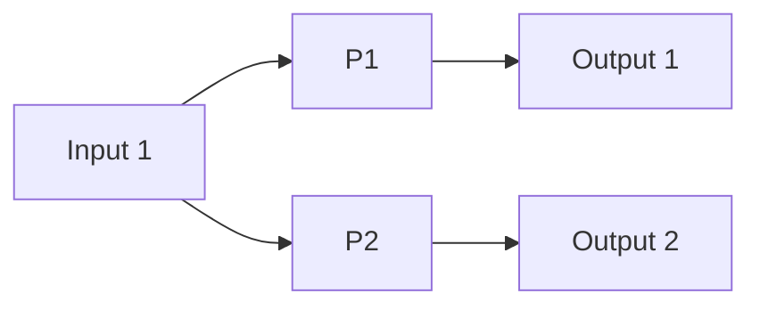
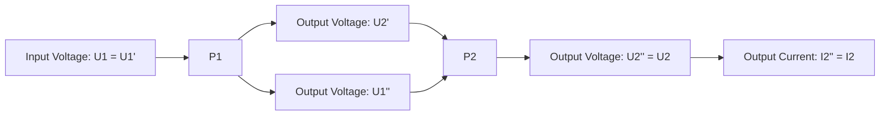
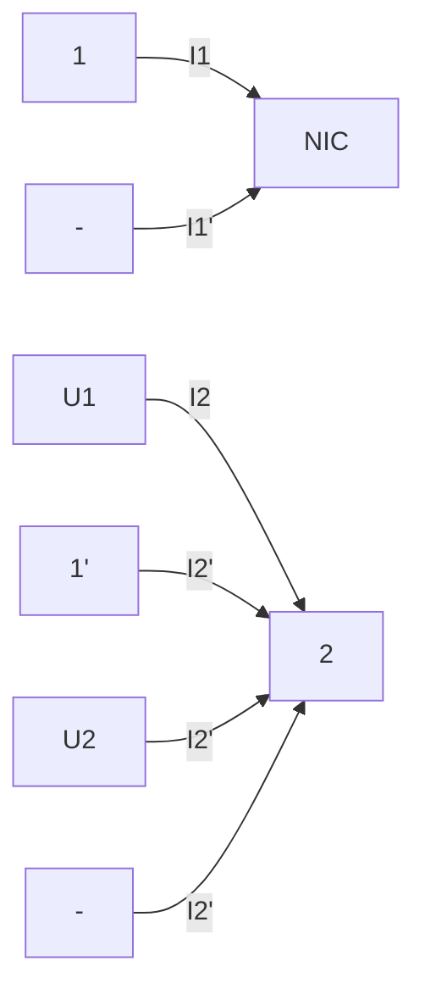

text_image

第十六章
二端口网络

## 导读

在工程实际中经常会遇到二端口和多端口问题，在有些情况下，用二端口或多端口分析电路会给人们带来方便。例如利用二端口方程和参数描述电路，使电路模型更简洁。本章介绍二端口（网络）及其方程，二端口的 $Y, Z, T(A), H$ 等参数矩阵以及它们之间的相互关系，还介绍转移函数，T形和 $\pi$ 形等效电路及二端口的连接。最后介绍两种可用二端口描述的电路元件——回转器和负阻抗变换器。

## §16-1 二端口网络

前面讨论的电路分析主要属于这样一类问题:在一个电路及其输入已经给定的情况下,如何去计算一条或多条支路的电压和电流。如果一个复杂的电路只有两个端子向外连接,且仅对外接电路中的情况感兴趣,则该电路可视为一个一端口,并用戴维南或诺顿等效电路替代,然后再计算感兴趣的电压和电流。在工程实际中遇到的问题还常常涉及两对端子之间的关系,如变压器、滤波器、放大器、反馈网络等,如图16-1(a)(b)(c)所示。对于这些电路,都可以把两对端子之间的电路概括在一个方框中,如图16-1(d)所示。一对端子1-1'通常是输入端子,另一对端子2-2'为输出端子。

如果这两对端子满足端口条件,即对于所有时间t,从端子1流入方框的电流等于从端子1'流出的电流;同时,从端子2流入方框的电流等于从端子2'流出的电流,这种电路称为二端口网络,简称二端口。若向外伸出的4个端子上的电流无上述限制,称为四端网络。本章仅讨论二端口。

用二端口概念分析电路时,仅对二端口处的电流、电压之间的关系感兴趣,这种相互关系可以通过一些参数表示,而这些参数只决定于构成二端口本身的元件及它们的连接方式。一旦确定表征这个二端口的参数后,当一个端口的电压、电流发生变化,要找出另外一个端口上的电压、电流就比较容易了。同时,还可以利用这些参数比较不同的二端口在传递电能和信号方面的性能,从而评价它们的质量。一个任意复杂的二端口,还可以看作由若干简单的二端口组成。如果已知这些简单的二端口的参数,那么,根据它们与复杂二端口的关系就可以直接求出后者的参数,从而找出后者在两个端口处的电压与电流关系,而不再涉及原来复杂电路内部的任何计算。总之,这种分析方法有它的特点,与前面介绍的一端口有类似的地方。

图16-1 二端口

本章介绍的二端口是由线性的电阻、电感（包括耦合电感）、电容和线性受控源组成，并规定不包含任何独立电源（如用运算法分析时，还规定独立的初始条件均为零，即不存在附加电源）。

## §16-2 二端口的方程和参数

图 16-2 所示为一线性二端口。在分析中将按正弦稳态情况考虑，并应用相量法。

当然，也可以用运算法讨论。在端口1-1'和2-2'处的电流相量和电压相量的参考方向如图所示。假设两个端口电压 $\dot{U}_{1}$ 和 $\dot{U}_{2}$ 已知，可以利用替代定理把两个端口电压 $\dot{U}_{1}$ 和 $\dot{U}_{2}$ 都看作是外施的独立电压源。这样，根据叠加定理， $\dot{I}_{1}$ 和 $\dot{I}_{2}$ 应分别等于各个独立电压源单独作用时产生的电流之和，即

text_image

1○+ 
Ü₁
1'○-
İ₁
.
İ₂
2○+
Ü₂
-2'
-

图 16-2 线性二端口的电流电压关系

$$
\left. \begin{array}{l} \dot {I} _ {1} = Y _ {1 1} \dot {U} _ {1} + Y _ {1 2} \dot {U} _ {2} \\ \dot {I} _ {2} = Y _ {2 1} \dot {U} _ {1} + Y _ {2 2} \dot {U} _ {2} \end{array} \right\} \tag {16-1}
$$

式(16-1)还可以写成如下的矩阵形式

$$
\left[ \begin{array}{c} \dot {I} _ {1} \\ \dot {I} _ {2} \end{array} \right] = \left[ \begin{array}{c c} Y _ {1 1} & Y _ {1 2} \\ Y _ {2 1} & Y _ {2 2} \end{array} \right] \left[ \begin{array}{c} \dot {U} _ {1} \\ \dot {U} _ {2} \end{array} \right] = \boldsymbol {Y} \left[ \begin{array}{c} \dot {U} _ {1} \\ \dot {U} _ {2} \end{array} \right]
$$

其中

$$
Y \stackrel {\mathrm{def}} {=} \left[ \begin{array}{l l} Y _ {1 1} & Y _ {1 2} \\ Y _ {2 1} & Y _ {2 2} \end{array} \right]
$$

称为二端口的 Y 参数矩阵，而  $Y_{11}$ 、 $Y_{12}$ 、 $Y_{21}$ 、 $Y_{22}$  称为二端口的 Y 参数。不难看出 Y 参数属于导纳性质，可以按下述方法计算或试验测量求得:如果在端口 1-1' 上外施电压  $\dot{U}_{1}$ ，而把端口 2-2' 短路，即  $\dot{U}_{2}=0$ ，工作情况如图 16-3(a) 所示。由式(16-1) 可得

$$
Y _ {1 1} = \frac {\dot {I} _ {1}}{\dot {U} _ {1}} \Bigg | _ {\dot {U} _ {2} = 0}
$$

$$
Y _ {2 1} = \frac {\dot {I} _ {2}}{\dot {U} _ {1}} \Bigg | _ {\dot {U} _ {2} = 0}
$$

$Y_{11}$  表示端口  $2-2'$  短路时，端口  $1-1'$  处的输入导纳或驱动点导纳； $Y_{21}$  表示端口  $2-2'$  短路时，端口  $2-2'$  与端口  $1-1'$  之间的转移导纳，这是因为  $Y_{21}$  是  $\dot{I}_{2}$  与  $\dot{U}_{1}$  的比值，它表示一个端口的电流与另一个端口的电压之间的关系。

同理,在端口 2-2'外施电压  $\dot{U}_{2}$ , 而把端口 1-1'短路, 即  $\dot{U}_{1}=0$ , 工作情况如图 16-3(b) 所示, 由式(16-1)得到

$$
Y _ {1 2} = \frac {\dot {I} _ {1}}{\dot {U} _ {2}} \Bigg | _ {\dot {U} _ {1} = 0}
$$

$$
Y _ {2 2} = \frac {\dot {I} _ {2}}{\dot {U} _ {2}} \Bigg | _ {\dot {U} _ {1} = 0}
$$

$Y_{12}$ 是端口 $1-1'$ 与端口 $2-2'$ 之间的转移导纳， $Y_{22}$ 是端口 $2-2'$ 的输入导纳。由于Y参数都是在一个端口短路情况下通过计算或测试求得的，所以又称为短路导纳参数，例如 $Y_{11}$ 就称为端口 $1-1'$ 的短路输入导纳。以上说明了Y参数表示的具体含义。

text_image

1
+   Ê₁
-       1'
+       Ê₁
+       2
+       Ê₂=0
-       2'

(a)

text_image

1
+
U₁=0
-
1'
I₁
I₂
2
+
U₂
-
2'
+U₂
-

(b)

图 16-3 短路导纳参数的测定

例 16-1 求图 16-4(a) 所示二端口的 Y 参数。

解 这个端口的结构比较简单, 它是一个  $\pi$  形电路。求它的  $Y_{11}$  和  $Y_{12}$  时, 把端口  $2-2'$  短路, 在端口  $1-1'$  上外施电压  $\dot{U}_{1}$  [如图 16-4(b) 所示], 这时可求得

$$
\begin{array}{l} \dot {I} _ {1} = \dot {U} _ {1} (Y _ {\mathrm{a}} + Y _ {\mathrm{b}}) \\ - \dot {I} _ {2} = \dot {U} _ {1} Y _ {\mathrm{b}} \\ \end{array}
$$

式中  $\dot{I}_{2}$  前有负号是由指定的电流和电压参考方向造成的。根据定义可求得

$$
Y _ {1 1} = \frac {\dot {I} _ {1}}{\dot {U} _ {1}} \Bigg | _ {\dot {U} _ {2} = 0} = Y _ {\mathrm{a}} + Y _ {\mathrm{b}},
$$

$$
Y _ {2 1} = \frac {\dot {I} _ {2}}{\dot {U} _ {1}} \Bigg | _ {\dot {U} _ {2} = 0} = - Y _ {\mathrm{b}}
$$

同样,如果把端口 1-1'短路,并在端口 2-2'上外施电压  $\dot{U}_{2}$ ,则可求得

$$
Y _ {1 2} = - Y _ {\mathrm{b}}
$$

$$
Y _ {2 2} = Y _ {\mathrm{b}} + Y _ {\mathrm{c}}
$$

text_image

1
Yb
2
Ya
Yc
1'
2'

(a)

text_image

1
+
I₁
Yb
I₂
2
U̇₁
Ya
Yc
1'
2'

(b)

text_image

1
I₁
Yb
I₂
2
+
Ya
\ Yc
U₂
-
1'
2'

(c)

图16-4 例16-1图

由此可见， $Y_{12}=Y_{21}$ 。此结果虽然是根据这个特例得到的，但是根据互易定理不难证明，对于由线性R、L(M)、C元件构成的任何无源二端口， $Y_{12}=Y_{21}$ 总是成立的。所以对任何一个无源线性二端口，只要3个独立的参数就足以表征它的性能。

如果一个二端口的 $Y$ 参数, 除了 $Y_{12} = Y_{21}$ 外, 还有 $Y_{11} = Y_{22}$, 则此二端口的两个端口 $1 - 1'$ 和 $2 - 2'$ 互换位置后与外电路连接, 其外部特性将不会有任何变化。也就是说, 这种二端口从任一端口看进去, 它的电气特性是一样的, 因而称为电气上对称的, 或简称为对称二端口。结构上对称①的二端口显然一定是对称二端口。例如在例 16-1 中的 $\pi$ 形电路, 如果 $Y_{\mathrm{a}} = Y_{\mathrm{c}}$, 它在结构上就是对称的, 这时就有 $Y_{11} = Y_{22}$ 。但是电气上对称并不一定意味着结构上对称。显然, 对于对称二端口的 $Y$ 参数, 只有 2 个是独立的。

假设图 16-2 所示二端口的  $\dot{I}_{1}$  和  $\dot{I}_{2}$  是已知的，可以利用替代定理把  $\dot{I}_{1}$  和  $\dot{I}_{2}$  看作是外施电流源的电流。根据叠加定理， $\dot{U}_{1}$ 、 $\dot{U}_{2}$  应等于各个电流源单独作用时产生的电压之和，即

<small>① “结构上对称”是指连接方式和元件性质及其参数的大小均具对称性。</small>

$$
\left. \begin{array}{l} \dot {U} _ {1} = Z _ {1 1} \dot {I} _ {1} + Z _ {1 2} \dot {I} _ {2} \\ \dot {U} _ {2} = Z _ {2 1} \dot {I} _ {1} + Z _ {2 2} \dot {I} _ {2} \end{array} \right\} \tag {16-2}
$$

式中 $Z_{11}, Z_{12}, Z_{21}, Z_{22}$ 称为 $Z$ 参数，它们具有阻抗性质。$Z$ 参数可按下述方法计算或试验测量求得:设端口 $2 - 2'$ 开路，即 $\dot{I}_2 = 0$ ，只在端口 $1 - 1'$ 施加一个电流源 $\dot{I}_1$ ，如图16-5(a)所示。由式(16-2)可得

$$
\begin{array}{l} Z _ {1 1} = \frac {\dot {U} _ {1}}{\dot {I} _ {1}} \Bigg | _ {-} \dot {I} _ {2} = 0 \\ Z _ {2 1} = \frac {\dot {U} _ {2}}{\dot {I} _ {1}} \Bigg | _ {\dot {I} _ {2} = 0} \\ \end{array}
$$

所以 $Z_{11}$ 称为端口 $2 - 2^{\prime}$ 开路时端口 $1 - 1^{\prime}$ 的开路输入阻抗，$Z_{21}$ 称为端口 $2 - 2^{\prime}$ 开路时端口 $2 - 2^{\prime}$ 与端口 $1 - 1^{\prime}$ 之间的开路转移阻抗。同理，将端口 $1 - 1^{\prime}$ 开路，即 $\dot{I}_1 = 0$ ，并在端口 $2 - 2^{\prime}$ 施加电流源 $\dot{I}_2$ ，如图16-5(b)所示，由式(16-2)得

$$
\begin{array}{l} Z _ {1 2} = \frac {\dot {U} _ {1}}{\dot {I} _ {2}} \Bigg | _ {\dot {I} _ {1} = 0} \\ Z _ {2 2} = \frac {\dot {U} _ {2}}{\dot {I} _ {2}} \Bigg | _ {\dot {I} _ {1} = 0} \\ \end{array}
$$

即 $Z_{12}$ 是端口 $1 - 1'$ 开路时端口 $1 - 1'$ 与端口 $2 - 2'$ 之间的开路转移阻抗，$Z_{22}$ 是端口 $1 - 1'$ 开路时端口 $2 - 2'$ 的开路输入阻抗。

图16-5 开路阻抗参数的测定

把式(16-2)改写成矩阵形式,有

$$
\left[ \begin{array}{c} \dot {U} _ {1} \\ \dot {U} _ {2} \end{array} \right] = \left[ \begin{array}{c c} Z _ {1 1} & Z _ {1 2} \\ Z _ {2 1} & Z _ {2 2} \end{array} \right] \left[ \begin{array}{c} \dot {I} _ {1} \\ \dot {I} _ {2} \end{array} \right] = \mathbb {Z} \left[ \begin{array}{c} \dot {I} _ {1} \\ \dot {I} _ {2} \end{array} \right]
$$

其中

$$
\mathbb {Z} \stackrel {\mathrm{def}} {=} \left[ \begin{array}{l l} Z _ {1 1} & Z _ {1 2} \\ Z _ {2 1} & Z _ {2 2} \end{array} \right]
$$

称为二端口的 Z 参数矩阵,也称开路阻抗矩阵。

同理,根据互易定理不难证明,对于线性 R、L(M)、C 元件构成的任何无源二端口,

text_image

Technical diagram with labeled mechanical components and annotations, likely from a technical drawing or engineering manual.

$Z_{12}=Z_{21}$  总是成立的。所以在这种情况下，Z 参数只有 3 个是独立的。对于对称的二端口，则还有  $Z_{11}=Z_{22}$  的关系，故只有 2 个参数是独立的。

比较式(16-1)与式(16-2)可以看出开路阻抗矩阵 $Z$ 与短路导纳矩阵 $Y$ 之间存在着互为逆阵的关系, 即

$$
\mathbf {Z} = \mathbf {Y} ^ {- 1} \text {或} \mathbf {Y} = \mathbf {Z} ^ {- 1}
$$

即

$$
\left[ \begin{array}{l l} Z _ {1 1} & Z _ {1 2} \\ Z _ {2 1} & Z _ {2 2} \end{array} \right] = \frac {1}{\Delta_ {Y}} \left[ \begin{array}{c c} Y _ {2 2} & - Y _ {1 2} \\ - Y _ {2 1} & Y _ {1 1} \end{array} \right] \tag {16-3}
$$

式中  $\Delta_{Y}=Y_{11}Y_{22}-Y_{12}Y_{21}$ 。

对于含有受控源的线性 $R, L(M), C$ 二端口，利用特勒根定理可以证明互易定理一般不再成立，因此 $Y_{12} \neq Y_{21}, Z_{12} \neq Z_{21}$ 。下面的例子将说明这一点。

例 16-2 求图 16-6 所示二端口的 Y 参数。

解 把端口 2-2' 短路, 在端口 1-1' 外施电压  $\dot{U}_{1}$ , 得

$$
\dot {I} _ {1} = \dot {U} _ {1} (Y _ {\mathrm{a}} + Y _ {\mathrm{b}})
$$

$$
\dot {I} _ {2} = - \dot {U} _ {1} Y _ {\mathrm{b}} - g \dot {U} _ {1}
$$

于是,可求得

$$
Y _ {1 1} = \frac {\dot {I} _ {1}}{\dot {U} _ {1}} = Y _ {\mathrm{a}} + Y _ {\mathrm{b}}
$$

$$
Y _ {2 1} = \frac {\dot {I} _ {2}}{\dot {U} _ {1}} = - Y _ {\mathrm{b}} - g
$$

text_image

1
+
I₁
Yb
I₂
2
+
U̇₁
Ya
Yc
gÛ₁
U̇₂
-
1'
-

图16-6 例16-2图

同理,为了求  $Y_{12}$ 、 $Y_{22}$ , 把端口  $1-1'$  短路, 即令  $\dot{U}_{1}=0$ , 这时受控源的电流也等于零, 故得

$$
Y _ {1 2} = \frac {\dot {I} _ {1}}{\dot {U} _ {2}} = - Y _ {\mathrm{b}}
$$

$$
Y _ {2 2} = \frac {\dot {I} _ {2}}{\dot {U} _ {2}} = Y _ {\mathrm{b}} + Y _ {\mathrm{c}}
$$

可见,在这种情况下, $Y_{12}\neq Y_{21}$ 。

Y 参数和 Z 参数都可用来描述一个二端口的端口外特性。如果一个二端口的 Y 参数已经确定,一般就可以用式(16-3)求出它的 Z 参数。反之亦然(参阅后面的表 16-1)。

在许多工程实际问题中,往往希望找到一个端口的电流、电压与另一端口的电流、电压之间的直接关系。例如,放大器、滤波器的输入和输出之间的关系;传输线的始端和终端之间的关系。另外,有些二端口并不同时存在阻抗矩阵和导纳矩阵表达式;或者既无阻抗矩阵表达式,又无导纳矩阵表达式。例如理想变压器就属这类二端口。这意味着某些二端口宜用除 Z 参数和 Y 参数以外的其他形式的参数描述其端口外特性。

为此,可把式(16-1)的第二式化为

$$
\dot {U} _ {1} = - \frac {Y _ {2 2}}{Y _ {2 1}} \dot {U} _ {2} + \frac {1}{Y _ {2 1}} \dot {I} _ {2}
$$

然后把它代入该式中的第一式,经整理后有

$$
\dot {I} _ {1} = \left(Y _ {1 2} - \frac {Y _ {1 1} Y _ {2 2}}{Y _ {2 1}}\right) \dot {U} _ {2} + \frac {Y _ {1 1}}{Y _ {2 1}} \dot {I} _ {2}
$$

把以上两式写成如下形式:

$$
\left. \begin{array}{l} \dot {U} _ {1} = A \dot {U} _ {2} - B \dot {I} _ {2} \\ \dot {I} _ {1} = C \dot {U} _ {2} - D \dot {I} _ {2} \end{array} \right\} ^ {(1)} \tag {16-4}
$$

式中(注意,右方第二项前面用的是负号)

$$
\begin{array}{l l} A = - \frac {Y _ {2 2}}{Y _ {2 1}}, & B = - \frac {1}{Y _ {2 1}} \\ C = Y _ {1 2} - \frac {Y _ {1 1} Y _ {2 2}}{Y _ {2 1}}, & D = - \frac {Y _ {1 1}}{Y _ {2 1}} \end{array} \tag {16-5}
$$

这样，就把端口 $1 - 1^{\prime}$ 的电流 $\dot{I}_1$ 、电压 $\dot{U}_1$ 用端口 $2 - 2^{\prime}$ 的电流 $\dot{I}_2$ 、电压 $\dot{U}_2$ 通过 $A, B, C, D$ 4个参数表示出来了。$A, B, C, D$ 称为二端口的一般参数、传输参数、$T$ 参数或 $A$ 参数。它们表示的具体含义可分别用以下各式说明:

$$
\begin{array}{l} A = \frac {\dot {U} _ {1}}{\dot {U} _ {2}} \Bigg | _ {\dot {I} _ {2} = 0} \\ \mathcal {B} = \frac {\stackrel {\circ} {U} _ {1}}{- \stackrel {\circ} {I} _ {2}} \Bigg | _ {\stackrel {\circ} {U} _ {2} = 0} \\ C = \frac {\dot {I} _ {1}}{\dot {U} _ {2}} \Bigg | _ {\dot {I} _ {2} = 0} \\ D = \frac {\dot {I} _ {1}}{- \dot {I} _ {2}} \Bigg | _ {\dot {U} _ {2} = 0} \\ \end{array}
$$

可见，A 是两个电压的比值，是一个量纲一的量；B 是短路转移阻抗；C 是开路转移导纳；D 是两个电流的比值，也是量纲一的量。A、B、C、D 都具有转移参数性质。

对于不含受控源的无源线性二端口，A、B、C、D 4 个参数中将只有 3 个是独立的，这是因为按式(16-5)并注意到  $Y_{12}=Y_{21}$ ，得

$$
A D - B C = \frac {Y _ {1 1} Y _ {2 2}}{Y _ {2 1} ^ {2}} + \frac {1}{Y _ {2 1}} \frac {Y _ {1 2} Y _ {2 1} - Y _ {1 1} Y _ {2 2}}{Y _ {2 1}} = \frac {Y _ {1 2}}{Y _ {2 1}} = 1
$$

<small>① 有时用 $A_{11}, A_{12}, A_{21}, A_{22}$ 分别表示 $A, B, C, D$。</small>

对于对称的二端口，由于  $Y_{11}=Y_{22}$ ，故由式(16-5)，还将有 A=D。

式(16-4)写成矩阵形式时,有

$$
\left[ \begin{array}{c} \dot {U} _ {1} \\ \dot {I} _ {1} \end{array} \right] = \left[ \begin{array}{c c} A & B \\ C & D \end{array} \right] \left[ \begin{array}{c} \dot {U} _ {2} \\ - \dot {I} _ {2} \end{array} \right] = T \left[ \begin{array}{c} \dot {U} _ {2} \\ - \dot {I} _ {2} \end{array} \right]
$$

其中

$$
T \stackrel {\mathrm{def}} {=} \left[ \begin{array}{c c} A & B \\ C & D \end{array} \right]
$$

T 称为 T 参数矩阵, 引用上式时, 要注意式中电流  $\dot{I}_{2}$  前面的负号。

还有一套常用的参数,称为混合参数或 H 参数,用下面一组方程表示:

$$
\left. \begin{array}{l} \dot {U} _ {1} = H _ {1 1} \dot {I} _ {1} + H _ {1 2} \dot {U} _ {2} \\ \dot {I} _ {2} = H _ {2 1} \dot {I} _ {1} + H _ {2 2} \dot {U} _ {2} \end{array} \right\} \tag {16-6}
$$

在晶体管电路中，H 参数获得了广泛的应用。H 参数的具体意义可以分别用下列各式说明:

$$
H _ {1 1} = \frac {\dot {U} _ {1}}{\dot {I} _ {1}} \Bigg | _ {\dot {U} _ {2} = 0}
$$

$$
H _ {1 2} = \frac {\dot {U} _ {1}}{\dot {U} _ {2}} \Bigg | _ {\dot {I} _ {1} = 0}
$$

$$
H _ {2 1} = \frac {\dot {I} _ {2}}{\dot {I} _ {1}} \Bigg | _ {\dot {U} _ {2} = 0}
$$

$$
H _ {2 2} = \frac {\dot {I} _ {2}}{\dot {U} _ {2}} \Bigg | _ {\dot {I} _ {1} = 0}
$$

可见 $H_{11}$ 和 $H_{21}$ 有短路参数的性质，$H_{12}$ 和 $H_{22}$ 有开路参数的性质。不难看出，$H_{11} = \frac{1}{Y_{11}}$，$H_{22} = \frac{1}{Z_{22}}$，$H_{21}$ 为两个电流之间的比值，$H_{12}$ 为两个电压之间的比值。

用矩阵形式表示时,有

$$
\left[ \begin{array}{c} \dot {U} _ {1} \\ \dot {I} _ {2} \end{array} \right] = \left[ \begin{array}{l l} H _ {1 1} & H _ {1 2} \\ H _ {2 1} & H _ {2 2} \end{array} \right] \left[ \begin{array}{c} \dot {I} _ {1} \\ \dot {U} _ {2} \end{array} \right] = \boldsymbol {H} \left[ \begin{array}{c} \dot {I} _ {1} \\ \dot {U} _ {2} \end{array} \right]
$$

其中 H 称为 H 参数矩阵

$$
H \stackrel {\mathrm{def}} {=} \left[ \begin{array}{l l} H _ {1 1} & H _ {1 2} \\ H _ {2 1} & H _ {2 2} \end{array} \right]
$$

对于不含受控源的无源线性二端口，H 参数中只有 3 个是独立的。例如，将前面求得的 Y 参数代入，就可得出图 16-4(a) 所示二端口的 H 参数

$$
H _ {1 1} = \frac {1}{Y _ {\mathrm{a}} + Y _ {\mathrm{b}}}, \quad H _ {1 2} = \frac {Y _ {\mathrm{b}}}{Y _ {\mathrm{a}} + Y _ {\mathrm{b}}}
$$

$$
H _ {2 1} = \frac {- Y _ {\mathrm{b}}}{Y _ {\mathrm{a}} + Y _ {\mathrm{b}}}, \quad H _ {2 2} = Y _ {\mathrm{c}} + \frac {Y _ {\mathrm{a}} Y _ {\mathrm{b}}}{Y _ {\mathrm{a}} + Y _ {\mathrm{b}}}
$$

可见 $H_{21} = -H_{12}$ 。对于对称的二端口，由于 $Y_{11} = Y_{22}$ 或 $Z_{11} = Z_{22}$，则有

$$
H _ {1 1} H _ {2 2} - H _ {1 2} H _ {2 1} = 1
$$

图 16-7 所示为一只晶体管的小信号工作条件下的简化等效电路, 不难根据 H 参数的定义, 求得

$$
H _ {1 1} = \frac {\dot {U} _ {1}}{\dot {I} _ {1}} \Bigg | _ {\dot {U} _ {2} = 0} = R _ {1}, \quad H _ {1 2} = \frac {\dot {U} _ {1}}{\dot {U} _ {2}} \Bigg | _ {\dot {I} _ {1} = 0} = 0
$$

$$
H _ {2 1} = \frac {\dot {I} _ {2}}{\dot {I} _ {1}} \Bigg | _ {\dot {U} _ {2} = 0} = \beta , \quad H _ {2 2} = \frac {\dot {I} _ {2}}{\dot {U} _ {2}} \Bigg | _ {i _ {1} = 0} = \frac {1}{R _ {2}}
$$

text_image

1
+
î₁
Û₁
R₁
βî₁
R₂
2
+
î₂
Û₂
1'
2'

图 16-7 晶体管的等效电路

Y 参数、Z 参数、T 参数、H 参数之间的相互转换关系不难根据以上的基本方程推导出来, 表 16-1 总结了这些关系。

表 16-1

<table><tr><td></td><td colspan="2"> $Z$ 参数</td><td colspan="2"> $Y$ 参数</td><td colspan="2"> $H$ 参数</td><td colspan="2"> $T(A)$ 参数</td></tr><tr><td rowspan="3"> $Z$ 参数</td><td colspan="2"></td><td rowspan="2"> $\frac{Y_{22}}{\Delta_Y}$ </td><td rowspan="2"> $-\frac{Y_{12}}{\Delta_Y}$ </td><td rowspan="2"> $\frac{\Delta_H}{H_{22}}$ </td><td rowspan="2"> $\frac{H_{12}}{H_{22}}$ </td><td rowspan="2"> $\frac{A}{C}$ </td><td rowspan="2"> $\frac{\Delta_T}{C}$ </td></tr><tr><td> $Z_{11}$ </td><td> $Z_{12}$ </td></tr><tr><td> $Z_{21}$ </td><td> $Z_{22}$ </td><td> $-\frac{Y_{21}}{\Delta_Y}$ </td><td> $\frac{Y_{11}}{\Delta_Y}$ </td><td> $-\frac{H_{21}}{H_{22}}$ </td><td> $\frac{1}{H_{22}}$ </td><td> $\frac{1}{C}$ </td><td> $\frac{D}{C}$ </td></tr><tr><td rowspan="2"> $Y$ 参数</td><td> $\frac{Z_{22}}{\Delta_Z}$ </td><td> $-\frac{Z_{12}}{\Delta_Z}$ </td><td> $Y_{11}$ </td><td> $Y_{12}$ </td><td> $\frac{1}{H_{11}}$ </td><td> $-\frac{H_{12}}{H_{11}}$ </td><td> $\frac{D}{B}$ </td><td> $-\frac{\Delta_T}{B}$ </td></tr><tr><td> $-\frac{Z_{21}}{\Delta_Z}$ </td><td> $\frac{Z_{11}}{\Delta_Z}$ </td><td> $Y_{21}$ </td><td> $Y_{22}$ </td><td> $\frac{H_{21}}{H_{11}}$ </td><td> $\frac{\Delta_H}{H_{11}}$ </td><td> $-\frac{1}{B}$ </td><td> $\frac{A}{B}$ </td></tr><tr><td rowspan="2"> $H$ 参数</td><td> $\frac{\Delta_Z}{Z_{22}}$ </td><td> $\frac{Z_{12}}{Z_{22}}$ </td><td> $\frac{1}{Y_{11}}$ </td><td> $-\frac{Y_{12}}{Y_{11}}$ </td><td> $H_{11}$ </td><td> $H_{12}$ </td><td> $\frac{B}{D}$ </td><td> $\frac{\Delta_T}{D}$ </td></tr><tr><td> $-\frac{Z_{21}}{Z_{22}}$ </td><td> $\frac{1}{Z_{22}}$ </td><td> $\frac{Y_{21}}{Y_{11}}$ </td><td> $\frac{\Delta_Y}{Y_{11}}$ </td><td> $H_{21}$ </td><td> $H_{22}$ </td><td> $-\frac{1}{D}$ </td><td> $\frac{C}{D}$ </td></tr><tr><td rowspan="2"> $T(A)$ 参数</td><td> $\frac{Z_{11}}{Z_{21}}$ </td><td> $\frac{\Delta_Z}{Z_{21}}$ </td><td> $-\frac{Y_{22}}{Y_{21}}$ </td><td> $-\frac{1}{Y_{21}}$ </td><td> $-\frac{\Delta_H}{H_{21}}$ </td><td> $-\frac{H_{11}}{H_{21}}$ </td><td> $A$ </td><td> $B$ </td></tr><tr><td> $\frac{1}{Z_{21}}$ </td><td> $\frac{Z_{22}}{Z_{21}}$ </td><td> $-\frac{\Delta_Y}{Y_{21}}$ </td><td> $-\frac{Y_{11}}{Y_{21}}$ </td><td> $-\frac{H_{22}}{H_{21}}$ </td><td> $-\frac{1}{H_{21}}$ </td><td> $C$ </td><td> $D$ </td></tr></table>

表中

$$
\begin{array}{l} \Delta_ {Z} = \left| \begin{array}{c c} Z _ {1 1} & Z _ {1 2} \\ Z _ {2 1} & Z _ {2 2} \end{array} \right|, \quad \Delta_ {Y} = \left| \begin{array}{c c} Y _ {1 1} & Y _ {1 2} \\ Y _ {2 1} & Y _ {2 2} \end{array} \right| \\ \Delta_ {H} = \left| \begin{array}{c c} H _ {1 1} & H _ {1 2} \\ H _ {2 1} & H _ {2 2} \end{array} \right|, \quad \Delta_ {T} = \left| \begin{array}{c c} A & B \\ C & D \end{array} \right| \\ \end{array}
$$

二端口一共有6组不同的参数,其余2组分别与H参数和T参数相似,只是把电路方程等号两边的端口变量互换而已,此处不再列举。

## §16-3 二端口的等效电路

任何复杂的由线性 $R, L(M), C$ 元件构成的无源一端口可以用一个等效阻抗表征它的外部特性。同理，任何给定的由线性 $R, L(M), C$ 元件构成的无源二端口的外部性能既然可以用3个参数确定，那么只要找到一个由具有3个阻抗（或导纳）组成的简单二端口，如果这个二端口与给定的二端口的参数分别相等，则这两个二端口的外部特性也就完全相同，即它们是等效的。由3个阻抗（或导纳）组成的二端口只有两种形式，即T形电路和 $\pi$ 形电路，分别如图16-8(a)(b)所示。

text_image

1
+
i₁
Z₁
i₁
Z₂
i₂
Z₃
i₂
2
+
U₁
-
1'
2'

(a)

text_image

1
+
I₁
Y₂
2
+
U̇₁
Y₁
Y₃
U̇₂
1'
-
2'

(b)

图 16-8 二端口的等效电路

如果给定二端口的 Z 参数,要确定此二端口的等效 T 形电路 [图 16-8(a)] 中的  $Z_{1}$ 、 $Z_{2}$ 、 $Z_{3}$  的值,可先按图中所示回路电流的方向,写出 T 形电路的回路电流方程

$$
\left. \begin{array}{l} \dot {U} _ {1} = Z _ {1} \dot {I} _ {1} + Z _ {2} (\dot {I} _ {1} + \dot {I} _ {2}) \\ \dot {U} _ {2} = Z _ {2} (\dot {I} _ {1} + \dot {I} _ {2}) + Z _ {3} \dot {I} _ {2} \end{array} \right\} \tag {16-7}
$$

而由 Z 参数表示的二端口方程(16-2)中,由于  $Z_{12}=Z_{21}$ ,可以将式(16-2)改写为

$$
\left. \begin{array}{l} \dot {U} _ {1} = (Z _ {1 1} - Z _ {1 2}) \dot {I} _ {1} + Z _ {1 2} (\dot {I} _ {1} + \dot {I} _ {2}) \\ \dot {U} _ {2} = Z _ {1 2} (\dot {I} _ {1} + \dot {I} _ {2}) + (Z _ {2 2} - Z _ {1 2}) \dot {I} _ {2} \end{array} \right\} \tag {16-8}
$$

比较式(16-7)与式(16-8)可知

$$
Z _ {1} = Z _ {1 1} - Z _ {1 2}, Z _ {2} = Z _ {1 2}, Z _ {3} = Z _ {2 2} - Z _ {1 2} \tag {16-9}
$$

如果二端口给定的是 Y 参数, 宜先求出其等效  $\pi$  形电路 [图 16-8(b)] 中的  $Y_{1}$ 、 $Y_{2}$

$Y_{3}$  的值。为此针对图 16-8(b) 所示电路, 按求 T 形电路相似的方法可得

$$
Y _ {1} = Y _ {1 1} + Y _ {1 2}, Y _ {2} = - Y _ {1 2} = - Y _ {2 1}, Y _ {3} = Y _ {2 2} + Y _ {2 1} \tag {16-10}
$$

如果给定二端口的其他参数,则可查表16-1,把其他参数变换成Z参数或Y参数,然后再由式(16-9)或式(16-10)求得T形等效电路或 $\pi$ 形等效电路的参数值。例如T形等效电路的 $Z_{1}$ 、 $Z_{2}$ 、 $Z_{3}$ 与T参数之间的关系为

$$
Z _ {1} = \frac {A - 1}{C}, Z _ {2} = \frac {1}{C}, Z _ {3} = \frac {D - 1}{C}
$$

$\pi$  形等效电路的  $Y_{1}$ 、 $Y_{2}$ 、 $Y_{3}$  与 T 参数之间的关系为

$$
Y _ {1} = \frac {D - 1}{B}, Y _ {2} = \frac {1}{B}, Y _ {3} = \frac {A - 1}{B}
$$

对于对称二端口，由于  $Z_{11}=Z_{22}, Y_{11}=Y_{22}, A=D$ ，故它的等效 T 形或  $\pi$  形电路也一定是对称的，这时应有  $Y_{1}=Y_{3}, Z_{1}=Z_{3}$ 。

如果二端口内部含有受控源,那么,二端口的4个参数将是相互独立的。若给定二端口的Z参数,则式(16-2)可写成

$$
\dot {U} _ {1} = Z _ {1 1} \dot {I} _ {1} + Z _ {1 2} \dot {I} _ {2}
$$

$$
\dot {U} _ {2} = Z _ {1 2} \dot {I} _ {1} + Z _ {2 2} \dot {I} _ {2} + (Z _ {2 1} - Z _ {1 2}) \dot {I} _ {1}
$$

这样第 2 个方程右端的最后一项是一个 CCVS, 其等效电路如图 16-9(a) 所示。同理，用 Y 参数表示的含受控电源的二端口可用图 16-9(b) 所示等效电路代替。

text_image

1
+ 
Ü₁
-
Z₁₁-Z₁₂
Z₁₂-Z₁₂
(Z₂₁-Z₁₂)İ₁
- +
2
+
Ü₂
-
2'
-

(a)

text_image

1
+ 
Ü₁
Y₁₁+Y₁₂
- Y₁₂
Y₂₂+Y₁₂
Ü₂
2
+
-
(Y₂₁-Y₁₂)Ü₁
2'
- 
1'

(b)

图 16-9 含受控电源的二端口的等效电路

## §16-4 二端口的转移函数

以上对二端口的讨论都是按正弦稳态情况考虑的，故用相量法。如果用运算法分析二端口，则上述这些参数都是复变量 $s$ 的函数。二端口的转移函数（传递函数），就是用拉氏变换形式表示的输出电压或电流与输入电压或电流之比（注意，二端口内部必须没有独立电源，也没有由动态元件的非零初值引起的附加电源）。当二端口没有外接负载及输入激励无内阻抗时，二端口称为无端接的。下面分别推导无端接的二端口的电压转移函数 $\frac{U_2(s)}{U_1(s)}$ ，电流转移函数 $\frac{I_2(s)}{I_1(s)}$ ，转移导纳（函数） $\frac{I_2(s)}{U_1(s)}$ 和转移阻抗（函数） $\frac{U_2(s)}{I_1(s)}$ 。

令式(16-2)中的电流 $I_{2}(s)=0$ ,有

$$
U _ {1} (s) = Z _ {1 1} (s) I _ {1} (s)
$$

$$
U _ {2} (s) = Z _ {2 1} (s) I _ {1} (s)
$$

因此电压转移函数为

$$
\frac {U _ {2} (s)}{U _ {1} (s)} = \frac {Z _ {2 1} (s)}{Z _ {1 1} (s)}
$$

或者令式(16-1)中的 $I_{2}=0$ ，有

$$
0 = Y _ {2 1} (s) U _ {1} (s) + Y _ {2 2} (s) U _ {2} (s)
$$

所以电压转移函数为

$$
\frac {U _ {2} (s)}{U _ {1} (s)} = - \frac {Y _ {2 1} (s)}{Y _ {2 2} (s)}
$$

同理,可求得二端口的其余转移函数为

电流转移函数 $\frac{I_2(s)}{I_1(s)} = \frac{Y_{21}(s)}{Y_{11}(s)} = -\frac{Z_{21}(s)}{Z_{22}(s)}\quad [U_2(s) = 0]$

转移导纳 $\frac{I_2(s)}{U_1(s)} = Y_{21}(s)\quad [U_2(s) = 0]$

转移阻抗. $\frac{U_2(s)}{I_1(s)} = Z_{21}(s)\quad [I_2(s) = 0]$

这些转移函数可纯粹用 Y 参数或 Z 参数表示。当然,也可纯粹用  $T(A)$  参数或 H 参数表示。

在实际应用中，二端口的输出端口往往接有负载阻抗 $Z_{\mathrm{L}}$ ，输入端口接有电压源和阻抗 $Z_{\mathrm{s}}$ 的串联组合或电流源和阻抗 $Z_{\mathrm{s}}$ 的并联组合。这种情况下该二端口称为具有“双端接”的二端口。如果只计及 $Z_{\mathrm{L}}$ 或只计及 $Z_{\mathrm{s}}$ ，则称为具有“单端接”的二端口。具有单端接或双端接的二端口的转移函数与端接阻抗有关。

图 16-10 所示为一个输出端接有电阻 R 的二端口。对此二端口，有

$$
I _ {2} (s) = Y _ {2 1} (s) U _ {1} (s) + Y _ {2 2} (s) U _ {2} (s)
$$

$$
U _ {2} (s) = - R I _ {2} (s)
$$

消去  $U_{2}(s)$  后, 得转移导纳

$$
\frac {I _ {2} (s)}{U _ {1} (s)} = \frac {\frac {Y _ {2 1} (s)}{R}}{Y _ {2 2} (s) + \frac {1}{R}}
$$

对此二端口还有

text_image

1
+
I₁(s)
U₁(s)
-
1'
I₂(s)
2
+
U₂(s)
R
2'

图16-10 具有端接电阻的二端口

$$
U _ {2} (s) = Z _ {2 1} (s) I _ {1} (s) + Z _ {2 2} (s) I _ {2} (s)
$$

$$
U _ {2} (s) = - R I _ {2} (s)
$$

消去  $I_{2}(s)$  后, 得转移阻抗

$$
\frac {U _ {2} (s)}{I _ {1} (s)} = \frac {R Z _ {2 1} (s)}{R + Z _ {2 2} (s)}
$$

如果对此二端口写出如下方程:

$$
\begin{array}{l} I _ {2} (s) = Y _ {2 1} (s) U _ {1} (s) + Y _ {2 2} (s) U _ {2} (s) \\ U _ {1} (s) = Z _ {i 1} (s) I _ {1} (s) + Z _ {1 2} (s) I _ {2} (s) \\ U _ {2} (s) = - R I _ {2} (s) \\ \end{array}
$$

消去  $U_{2}(s)$  和  $U_{1}(s)$  后, 得电流转移函数

$$
\begin{array}{l} \frac {I _ {2} (s)}{I _ {1} (s)} = \frac {Y _ {2 1} (s) Z _ {1 1} (s)}{1 + Y _ {2 2} (s) R - Z _ {1 2} (s) Y _ {2 1} (s)} \\ = \frac {\frac {Y _ {2 1} (s)}{R}}{Y _ {1 1} (s) \left[ \frac {1}{R} + Y _ {2 2} (s) \right] - Y _ {1 2} (s) Y _ {2 1} (s)} \\ \end{array}
$$

如果对此二端口写出如下方程:

$$
U _ {2} (s) = Z _ {2 1} (s) I _ {1} (s) + Z _ {2 2} (s) I _ {2} (s)
$$

$$
I _ {1} (s) = Y _ {1 1} (s) U _ {1} (s) + Y _ {1 2} (s) U _ {2} (s)
$$

$$
U _ {2} (s) = - R I _ {2} (s)
$$

消去  $I_{1}(s)$  和  $I_{2}(s)$  后，得电压转移函数

$$
\begin{array}{l} \frac {U _ {2} (s)}{U _ {1} (s)} = \frac {Z _ {2 1} (s) Y _ {1 1} (s)}{1 + Z _ {2 2} (s) \frac {1}{R} - Z _ {2 1} (s) Y _ {1 2} (s)} \\ = \frac {Z _ {2 1} (s) R}{Z _ {1 1} (s) [ R + Z _ {2 2} (s) ] - Z _ {1 2} (s) Z _ {2 1} (s)} \\ \end{array}
$$

对于双端接二端口,转移函数将与两个端接阻抗有关。图 16-11 所示为这种情况,

其中  $R_{1}$  为输入端的电阻,  $R_{2}$  为输出端的电阻。假定要求的是  $\frac{U_{2}(s)}{U_{\mathrm{a}}(s)}$  [这里应当把  $U_{\mathrm{a}}(s)$  作为输入], 这时有

$$
U _ {1} (s) = U _ {\mathrm{s}} (s) - R _ {1} I _ {1} (s)
$$

$$
U _ {2} (s) = - R _ {2} I _ {2} (s)
$$

把它们代入式(16-2)，得

text_image

1 I₁(s)
+
R₁
U₁(s)
+
Us(s)
-
1'
I₂(s) 2
+
U₂(s)
R₂
-
2'

图 16-11 两个端口都有端接电阻影响的情况

$$
\begin{array}{l} U _ {s} (s) - R _ {1} I _ {1} (s) = Z _ {1 1} (s) I _ {1} (s) + Z _ {1 2} (s) I _ {2} (s) \\ - R _ {2} I _ {2} (s) = Z _ {2 1} (s) I _ {1} (s) + Z _ {2 2} (s) I _ {2} (s) \\ \end{array}
$$

解得

$$
I _ {2} (s) = - \frac {U _ {\mathrm{s}} (s) Z _ {2 1} (s)}{\left[ R _ {1} + Z _ {1 1} (s) \right] \left[ R _ {2} + Z _ {2 2} (s) \right] - Z _ {1 2} (s) Z _ {2 1} (s)}
$$

这样有

$$
\frac {U _ {2} (s)}{U _ {\mathrm{s}} (s)} = \frac {- R _ {2} I _ {2} (s)}{U _ {\mathrm{s}} (s)} = \frac {Z _ {2 1} (s) R _ {2}}{\left[ R _ {1} + Z _ {1 1} (s) \right] \left[ R _ {2} + Z _ {2 2} (s) \right] - Z _ {1 2} (s) Z _ {2 1} (s)}
$$

以上介绍了一些转移函数的计算方法。如前所述，二端口常为完成某种功能起着耦合两部分电路的作用。例如，滤波器能让具有某些频率的信号通过，而对另一些频率的信号则加以抑制。这种功能往往是通过转移函数描述或指定的。另一方面，转移函数的极、零点的分布与二端口内部的元件及连接方式等密切相关，而极、零点的分布又决定了电路的特性。所以可以根据转移函数确定二端口内部元件的连接方式及元件值，即所谓电路设计或网络综合。可见二端口的转移函数是一个很重要的概念。

## §16-5 二端口的连接

如果把一个复杂的二端口看成是由若干个简单的二端口按某种方式连接而成，这将使电路分析得到简化。另一方面，在设计和实现一个复杂的二端口时，也可以用简单的二端口作为“积木块”，把它们按一定方式连接成具有所需特性的二端口。一般说来，设计简单的部分电路并加以连接要比直接设计一个复杂的整体电路容易些。因此讨论二端口的连接问题具有重要意义。

二端口可按多种不同方式相互连接,这里主要介绍3种方式:级联(链联)、串联和并联,分别如图16-12(a)(b)(c)所示。在二端口的连接问题上,感兴趣的是复合二端口的参数与部分二端口的参数之间的关系。

text_image

P₁
P₂

(a)

text_image

P₁
P₂

(b)

flowchart

(c)

图16-12 二端口的连接

当两个无源二端口  $P_{1}$  和  $P_{2}$  按级联方式连接后, 它们构成了一个复合二端口, 如图

16-13 所示。设二端口  $P_{1}$  和  $P_{2}$  的 T 参数分别为

$$
\mathbb {T} ^ {\prime} = \left[ \begin{array}{c c} A ^ {\prime} & B ^ {\prime} \\ C ^ {\prime} & D ^ {\prime} \end{array} \right], \quad \mathbb {T} ^ {\prime \prime} = \left[ \begin{array}{c c} A ^ {\prime \prime} & B ^ {\prime \prime} \\ C ^ {\prime \prime} & D ^ {\prime \prime} \end{array} \right]
$$

则应有

$$
\left[ \begin{array}{c} \dot {U} _ {1} ^ {\prime} \\ \dot {I} _ {1} ^ {\prime} \end{array} \right] = \mathbb {T} ^ {\prime} \left[ \begin{array}{c} \dot {U} _ {2} ^ {\prime} \\ - \dot {I} _ {2} ^ {\prime} \end{array} \right], \quad \left[ \begin{array}{c} \dot {U} _ {1} ^ {\prime \prime} \\ \dot {I} _ {1} ^ {\prime \prime} \end{array} \right] = \mathbb {T} ^ {\prime \prime} \left[ \begin{array}{c} \dot {U} _ {2} ^ {\prime \prime} \\ - \dot {I} _ {2} ^ {\prime \prime} \end{array} \right]
$$

但由于 $\dot{U}_1 = \dot{U}_1'$, $\dot{U}_2' = \dot{U}_1''$, $\dot{U}_2'' = \dot{U}_2$, $\dot{I}_1 = \dot{I}_1'$, $\dot{I}_2' = -\dot{I}_1''$ 及 $\dot{I}_2'' = \dot{I}_2$, 所以有

$$
\left[ \begin{array}{c} \dot {U} _ {1} \\ \dot {I} _ {1} \end{array} \right] = \left[ \begin{array}{c} \dot {U} _ {1} ^ {\prime} \\ \dot {I} _ {1} ^ {\prime} \end{array} \right] = \mathbb {T} ^ {\prime} \left[ \begin{array}{c} \dot {U} _ {2} ^ {\prime} \\ - \dot {I} _ {2} ^ {\prime} \end{array} \right] = \mathbb {T} ^ {\prime} \left[ \begin{array}{c} \dot {U} _ {1} ^ {\prime \prime} \\ \dot {I} _ {1} ^ {\prime \prime} \end{array} \right] = \mathbb {T} ^ {\prime} \mathbb {T} ^ {\prime \prime} \left[ \begin{array}{c} \dot {U} _ {2} ^ {\prime \prime} \\ - \dot {I} _ {2} ^ {\prime \prime} \end{array} \right] = \mathbb {T} ^ {\prime} \mathbb {T} ^ {\prime \prime} \left[ \begin{array}{c} \dot {U} _ {2} \\ - \dot {I} _ {2} \end{array} \right] = \mathbb {T} \left[ \begin{array}{c} \dot {U} _ {2} \\ - \dot {I} _ {2} \end{array} \right]
$$

其中 T 为复合二端口的 T 参数矩阵, 它与二端口  $P_{1}$  和  $P_{2}$  的 T 参数矩阵的关系为

$$
T = T ^ {\prime} T ^ {\prime \prime}
$$

即

$$
\boldsymbol {T} = \left[ \begin{array}{c c} A ^ {\prime} A ^ {\prime \prime} + B ^ {\prime} C ^ {\prime \prime} & A ^ {\prime} B ^ {\prime \prime} + B ^ {\prime} D ^ {\prime \prime} \\ C ^ {\prime} A ^ {\prime \prime} + D ^ {\prime} C ^ {\prime \prime} & C ^ {\prime} B ^ {\prime \prime} + D ^ {\prime} D ^ {\prime \prime} \end{array} \right]
$$

flowchart

图16-13 二端口的级联

当两个二端口  $P_{1}$  和  $P_{2}$  按并联方式连接时，如图 16-14 所示，两个二端口的输入电压和输出电压被分别强制为相同，即  $\dot{U}_{1}^{\prime} = \dot{U}_{1}^{\prime\prime} = \dot{U}_{1}, \dot{U}_{2}^{\prime} = \dot{U}_{2}^{\prime\prime} = \dot{U}_{2}$ 。如果每个二端口的端口条件（即端口上流入一个端子的电流等于流出另一端子的电流）不因并联连接而被破坏，则复合二端口的总端口的电流应为

$$
\dot {I} _ {1} = \dot {I} _ {1} ^ {\prime} + \dot {I} _ {1} ^ {\prime \prime}, \quad \dot {I} _ {2} = \dot {I} _ {2} ^ {\prime} + \dot {I} _ {2} ^ {\prime \prime}
$$

text_image

I₁
+ 
U̇₁
- 
I₁'
+ 
U̇₁"
- 
I₁'
+ 
I₁''
+ 
I₁''
+ 
P₁
P₂
I₂'
+ 
U̇₂'
- 
I₂'
+ 
U̇₂"
- 
I₂''
+ 
I₂''
- 
U̇₂''
- 
İ₂'

图16-14 二端口的并联

若设 $\mathbf{P}_1$ 和 $\mathrm{P}_2$ 的 $Y$ 参数分别为

$$
\boldsymbol {Y} ^ {\prime} = \left[ \begin{array}{c c} Y _ {1 1} ^ {\prime} & Y _ {1 2} ^ {\prime} \\ Y _ {2 1} ^ {\prime} & Y _ {2 2} ^ {\prime} \end{array} \right], \quad \boldsymbol {Y} ^ {\prime \prime} = \left[ \begin{array}{c c} Y _ {1 1} ^ {\prime \prime} & Y _ {1 2} ^ {\prime \prime} \\ Y _ {2 1} ^ {\prime \prime} & Y _ {2 2} ^ {\prime \prime} \end{array} \right]
$$

则应有

$$
\left[ \begin{array}{l} \dot {I} _ {1} \\ \dot {I} _ {2} \end{array} \right] = \left[ \begin{array}{l} \dot {I} _ {1} ^ {\prime} \\ \dot {I} _ {2} ^ {\prime} \end{array} \right] + \left[ \begin{array}{l} \dot {I} _ {1} ^ {\prime \prime} \\ \dot {I} _ {2} ^ {\prime \prime} \end{array} \right] = Y ^ {\prime} \left[ \begin{array}{l} \dot {U} _ {1} ^ {\prime} \\ \dot {U} _ {2} ^ {\prime} \end{array} \right] + Y ^ {\prime \prime} \left[ \begin{array}{l} \dot {U} _ {1} ^ {\prime \prime} \\ \dot {U} _ {2} ^ {\prime \prime} \end{array} \right] = (Y ^ {\prime} + Y ^ {\prime \prime}) \left[ \begin{array}{l} \dot {U} _ {1} \\ \dot {U} _ {2} \end{array} \right] = Y \left[ \begin{array}{l} \dot {U} _ {1} \\ \dot {U} _ {2} \end{array} \right]
$$

其中 Y 为复合二端口的 Y 参数矩阵, 它与二端口  $P_{1}$  和  $P_{2}$  的 Y-参数矩阵的关系为

$$
Y = Y ^ {\prime} + Y ^ {\prime \prime}
$$

当两个二端口按串联方式连接时, 只要端口条件仍然成立, 用类似方法, 不难导得复合二端口的 Z 参数矩阵与串联连接的两个二端口的 Z 参数矩阵有如下关系:

$$
\mathbb {Z} = \mathbb {Z} ^ {\prime} + \mathbb {Z} ^ {\prime \prime}
$$

## §16-6 回转器和负阻抗变换器

回转器是一种线性非互易的多端元件, 图 16-15 为它的电路图形符号。理想回转器可视为一个二端口, 它的端口电压、电流关系可用下列方程表示:

$$
\left. \begin{array}{l} u _ {1} = - r i _ {. 2} \\ u _ {2} = r i _ {1} \end{array} \right\}
$$

或写为

$$
\left. \begin{array}{l} i _ {1} = g u _ {2} \\ i _ {2} = - g u _ {1} \end{array} \right\} ^ {(1)}
$$

(16-11)

(16-12)

图 16-15 回转器

式中的 r 和 g 分别具有电阻和电导的量纲。它们分别称为回转电阻和回转电导，简称回转常数。把上式与理想变压器的关系式对比，就可以明确两者的差别所在。

用矩阵形式表示时,式(16-11)和式(16-12)可分别写为

$$
\left[ \begin{array}{c} u _ {1} \\ u _ {2} \end{array} \right] = \left[ \begin{array}{c c} 0 & - r \\ r & 0 \end{array} \right] \left[ \begin{array}{c} i _ {1} \\ i _ {2} \end{array} \right]
$$

① 式(16-11)和式(16-12)的另一种形式为

$$
\left. \begin{array}{l} u _ {1} = r i _ {2} \\ u _ {2} = - r i _ {1} \end{array} \right\} \tag {$16-11^{\prime$}}
$$

$$
\left. \begin{array}{l} i _ {1} = - g u _ {2} \\ i _ {2} = g u _ {1} \end{array} \right\} \tag {$16-12^{\prime$}}
$$

为了区别这两种情况，习惯上在图16-15所示电路符号图上方加一个箭头。当箭头自左指向右时，它对应式(16-11)或式(16-12)，而自右指向左时则对应式(16-11')或式(16-12')。本书的有关图中略去了这个箭头。

$$
\left[ \begin{array}{c} i _ {1} \\ i _ {2} \end{array} \right] = \left[ \begin{array}{c c} 0 & g \\ - g & 0 \end{array} \right] \left[ \begin{array}{c} u _ {1} \\ u _ {2} \end{array} \right]
$$

可见,回转器的 Z 参数矩阵和 Y 参数矩阵分别为

$$
\mathbb {Z} = \left[ \begin{array}{c c} 0 & - r \\ r & 0 \end{array} \right], \quad \mathbb {Y} = \left[ \begin{array}{c c} 0 & g \\ - g & 0 \end{array} \right]
$$

根据理想回转器的端口方程,即式(16-11),有

$$
u _ {1} i _ {1} + u _ {2} i _ {2} = - r i _ {1} i _ {2} + r i _ {1} i _ {2} = 0
$$

由于图 16-15 中回转器的两个端口的电压电流均取关联参考方向,因此上式表示理想回转器既不消耗功率又不发出功率,它是一个无源线性元件。另外,按式(16-11)或式(16-12),不难证明互易定理不适用于回转器。

从式(16-11)或式(16-12)可以看出,回转器有把一个端口上的电流“回转”为另一端口上的电压或相反过程的性质。正是这一性质,使回转器具有把一个电容回转为一个电感的本领,这在微电子器件中为用易于集成的电容实现难以集成的电感提供了可能性。下面说明回转器的这一功能。

对图 16-16 所示电路, 有  $I_{2}(s) = -s CU_{2}(s)$  (这里采用运算形式), 故按式 (16-11) 或式 (16-12) 可得

$$
U _ {1} (s) = - r I _ {2} (s) = r s C U _ {2} (s) = r ^ {2} s C I _ {1} (s)
$$

或

$$
I _ {1} (s) = g U _ {2} (s) = - g \frac {1}{s C} I _ {2} (s) = g ^ {2} \frac {1}{s C} U _ {1} (s)
$$

于是,输入阻抗为

$$
Z _ {\mathrm{in}} = \frac {U _ {1} (s)}{I _ {1} (s)} = s r ^ {2} C = s \frac {C}{g ^ {2}}
$$

text_image

I₁(s)
+
U₁(s)
-
I₂(s)
1/sC
+
U₂(s)
-

图16-16 电感的实现

可见,对于图16-16所示电路,从输入端看,相当于一个电感元件,它的电感值 $L=r^{2}C=\frac{C}{g^{2}}$ 。如果设 $C=1\mu F,r=50k\Omega$ ,则 $L=2500H$ 。换言之,回转器可把 $1\mu F$ 的电容回转成2500H的电感。

负阻抗变换器(简称NIC①)也是一个二端口,它的符号如图16-17(a)所示。它的端口特性可以用下列 $T$ 参数描述[采用运算形式,但为简化起见,略去 $U,I$ 后的“(s)”]

$$
\left[ \begin{array}{l} U _ {1} \\ I _ {1} \end{array} \right] = \left[ \begin{array}{c c} 1 & 0 \\ 0 & - k \end{array} \right] \left[ \begin{array}{l} U _ {2} \\ - I _ {2} \end{array} \right] \tag {16-13a}
$$

或

<small>① negative impedance converter 的缩写。</small>

$$
\left[ \begin{array}{l} U _ {1} \\ I _ {1} \end{array} \right] = \left[ \begin{array}{l l} - k & 0 \\ 0 & 1 \end{array} \right] \left[ \begin{array}{l} U _ {2} \\ - I _ {2} \end{array} \right] \tag {16-13b}
$$

式中 k 为正实常数。

flowchart

(a)

text_image

1
+
I₁
U₁
-
1'
NIC
I₂ 2
+
U₂
Z₂
-
2'

(b)

图 16-17 负阻抗变换器

从式(16-13a)可以看出,输入电压 $U_{1}$ 经过传输后成为 $U_{2}$,但 $U_{1}$ 等于 $U_{2}$,因此电压的大小和方向均没有改变;但是电流 $I_{1}$ 经传输后变为 $kI_{2}$,换句话说,电流经传输后改变了方向,所以该式定义的NIC称为电流反向型的NIC。

从式(16-13b)可以看出,经传输后电压变为 $-kU_{2}$ ,改变了方向,电流却不改变方向。这种NIC称为电压反向型的NIC。下面说明NIC把正阻抗变为负阻抗的性质。

在端口 2-2' 接上阻抗  $Z_{2}$ ，如图 16-17(b) 所示。从端口 1-1' 看进去的输入阻抗  $Z_{1}$  可计算如下:

设 NIC 为电流反向型, 利用式(16-13a), 得 $^{①}$

$$
Z _ {1} = \frac {U _ {1}}{I _ {1}} = \frac {U _ {2}}{k I _ {2}}
$$

但是  $U_{2}=-Z_{2}I_{2}$  (根据指定的参考方向)，因此

$$
Z _ {1} = - \frac {Z _ {2}}{k}
$$

换句话说, 输入阻抗 $Z_{1}$ 是负载阻抗 $Z_{2}\left(\text{乘以}\frac{1}{k}\right)$ 的负值。所以这个二端口有把一个正阻抗变为负阻抗的本领, 也即当端口 $2-2'$ 接上电阻 $R$、电感 $L$ 或电容 $C$ 时, 则在端口 $1-1'$ 将变为 $-\frac{1}{k} R$、$-\frac{1}{k} L$ 或 $-kC$。

负阻抗变换器为电路设计中实现负 R、L、C 提供了可能性。

## 思考题

16-1 采用二端口的方程和参数的分析方法可以推广到多端口网络吗？如果可以，哪些方程可以直接推广到多端口网络，哪些方程需要改进后可以推广到多端口网络？
16-2 研究二端口网络,为什么要求二端口内不含独立源,但却可以包含受控源?

<small>① 如 NIC 为电压反向型, 利用式(16-13b) 可得  $Z_{1}=kU_{2}/I_{2}$ 。</small>

16-3 如果二端口网络完全由 $LC$ 元件组成, 它的开路阻抗参数矩阵有何特点?
16-4 为什么用 $Z$ 参数表示的二端口,采用 $\mathrm{T}$ 形等效电路?而用 $Y$ 参数表示的二端口,采用 $\pi$ 形等效电路?
16-5 二端口的连接需符合什么条件？

## 习题

16-1 求题 16-1 图所示二端口的 Y 参数、Z 参数和 T 参数矩阵。

chemical

Electrical circuit diagram with inductor L and capacitor C

(a)

chemical

Electrical circuit diagram with inductor L and capacitor C

(b)

题 16-1 图

16-2 求题 16-2 图所示二端口的 Y 参数和 Z 参数矩阵。

text_image

1 Ω
1 Ω 1 Ω 2
1 Ω
1 Ω
1' 2'

(a)

text_image

1
1 Ω
2
2 Ω
2
1'
1 Ω
2'

(b)

题 16-2 图

16-3 求题 16-3 图所示二端口的 T 参数矩阵。

(a)

(b)

text_image

M
L₁ L₂

(c)

(d)

(e)

题 16-3 图

16-4 求题 16-4 图所示二端口的 Y 参数矩阵。

题16-4图

16-5—求题 16-5 图所示二端口的混合(H)参数矩阵。

题16-5图

16-6 已知题 16-6 图所示二端口的 Z 参数矩阵为

$$
\mathbf {Z} = \left[ \begin{array}{c c} 1 0 & 8 \\ 5 & 1 0 \end{array} \right] \Omega
$$

求  $R_{1}$ 、 $R_{2}$ 、 $R_{3}$  和 r 的值。

16-7 已知二端口的 $Y$ 参数矩阵为

$$
\mathbf {Y} = \left[ \begin{array}{c c} 1. 5 & - 1. 2 \\ - 1. 2 & 1. 8 \end{array} \right] \mathrm{S}
$$

求 H 参数矩阵, 并说明该二端口中是否有受控源。

16-8 求题 16-8 图所示二端口的 Z 参数、T 参数矩阵。

text_image

I₁ + rI₂ - R₁ R₂ I₂
R₃

题16-6图

题 16-8 图

16-9 电路如题 16-9 图所示, 已知二端口的 H 参数矩阵为

$$
H = \left[ \begin{array}{l l} 4 0 & 0. 4 \\ 1 0 & 0. 1 \end{array} \right]
$$

求电压转移函数 $\frac{U_{2}(s)}{U_{1}(s)}$ 。

text_image

5 Ω
+
Us(s)
-
1
I₁(s)
+
U₁(s)
-
1'
I₂(s)
2
+
U₂(s)
-
2'
10 Ω

题16-9图

16-10 已知二端口参数矩阵为

(a)  $Z = \begin{bmatrix} \frac{60}{9} & \frac{40}{9} \\ \frac{40}{9} & \frac{100}{9} \end{bmatrix} \Omega;$

(b)  $Y=\begin{bmatrix}5 & -2 \\ 0 & 3\end{bmatrix}$   $S_{o}$

试问二端口是否有受控源,并求它们的等效  $\pi$  形电路。

16-11 求题 16-11 图所示双 T 电路的 Y 参数矩阵。

text_image

C
R
R
C
R
C

题 16-11 图

16-12 求题 16-12 图所示二端口的 T 参数矩阵, 设内部二端口  $P_{1}$  的 T 参数矩阵为

$$
\mathcal {T} _ {1} = \left[ \begin{array}{c c} A & B \\ C & D \end{array} \right]
$$

text_image

1
Y
P₁
1'
2
2'

(a)

text_image

1
P₁
Z
2
1'
2'

(b)

题 16-12 图

16-13 利用题 16-1、题 16-3 的结果, 求出题 16-13 图所示二端口的 T 参数矩阵。设已知  $\omega L_{1}=10\Omega,\frac{1}{\omega C}=20\Omega,\omega L_{2}=\omega L_{3}=8\Omega,\omega M_{23}=4\Omega$ 。

text_image

1
L₁ L₁
C C L₂ M₂₃ L₃
1'
2
2'

题-16-13图

16-14 试证明两个回转器级联后[如题16-14图(a)所示], 可等效为一个理想变压器[如题16-14图(b)所示], 并求出变比 $n$ 与两个回转器的回转电导 $g_{1}$ 和 $g_{2}$ 的关系。

text_image

1
g₁
g₂
2
1'
(a)
2'
→
1
n:1
2
1'
(b)
2'
1'

题 16-14 图

16-15 试求题 16-15 图所示电路的输入阻抗 $Z_{\mathrm{i}}$ 。已知 $C_{1} = C_{2} = 1 \mathrm{~F}, G_{1} = G_{2} = 1 \mathrm{~S}, g = 2 \mathrm{~S}$ 。

第十六章部

分习题答案

text_image

1
G₁
Z₁
C₁'
g
C₂
G₂
2
1'
2'

题 16-15 图

# 第十七章

# 非线性电路

## 导读

在本书的前十六章,主要介绍线性电路的分析。由于无论是非线性电路的系统行为,还是非线性电路的分析方法,都与线性电路有很大的差异,对非线性电路的分析是电路理论的重要任务之一。

本章简要地介绍非线性元件，并举例说明非线性电路方程的建立方法。讨论了分析非线性电路的一些常用方法，如非线性电阻电路的小信号分析法，分段线性化方法；简要地介绍了工作在非线性范围的运算放大器，小扰动下的动态电路分析法，有关状态平面以及自激振荡的初步概念；最后初步介绍了“混沌”、人工神经元电路。

本章以掌握概念为主,不强调定量分析。

## §17-1 非线性电阻

在线性电路中,线性元件的特点是其参数不随电压或电流而变化。如果电路元件的参数随着电压或电流而变化,即电路元件的参数与电压或电流有关,就称为非线性元件,含有非线性元件的电路称为非线性电路。

实际电路元件的参数总是或多或少地随着电压或电流而变化。所以，严格说来，一切实际电路都是非线性电路。在工程计算中，将那些非线性程度比较微弱的电路元件作为线性元件来处理，不会带来本质上的差异，从而简化了电路分析。但是，许多非线性元件的非线性特征不容忽略，否则就将无法解释电路中发生的物理现象。如果将这些非线性元件作为线性元件处理，势必使计算结果与实际量值相差太大而无意义，甚至还会产生本质的差异。由于非线性电路本身具有的特殊性，分析研究非线性电路具有重要的意义。

线性电阻元件的伏安特性可用欧姆定律来表示, 即 u=Ri, 在 u-i 平面上它是通过坐标原点的一条直线。非线性电阻元件的电压电流关系不满足欧姆定律, 而是遵循某种特定的非线性函数关系。非线性电阻在电路中的符号如图 17-1(a) 所示(为了使问

题简化,这里仅考虑 u>0 和 i>0 的情况)。

若非线性电阻元件两端的电压是其电流的单值函数,这种电阻就称为电流控制型电阻,它的伏安特性可用下列函数关系表示

$$
u = f (i) \tag {17-1}
$$

其典型的伏安特性曲线如图17-1(b)所示，从特性曲线上可以看到:对于每一个电流值 $i$ ，有且只有一个电压值 $u$ 与之相对应；而对于某一电压值，与之对应的电流可能是多值的。如 $u = u_{0}$ 时，就有 $i_{1}, i_{2}$ 和 $i_{3}3$ 个不同的值与之对应。某些充气二极管就具有这种伏安特性。

若通过非线性电阻元件中的电流是其两端电压的单值函数,这种电阻就称为电压控制型电阻,其伏安特性可用下列函数关系表示

$$
i = g (u) \tag {17-2}
$$

其典型的伏安特性曲线如图 17-1(c) 所示, 从特性曲线上可以看到: 对于某一电流值, 与之对应的电压可能是多值的。但是对于每一个电压值 u, 有且只有一个电流值 i 与之对应。隧道二极管就具有这样的伏安特性。

图 17-1 非线性电阻

从图 17-1(b)(c) 中还可以看出, 上述两种伏安特性曲线都具有一段下倾的线段。就是说在这一段范围内电流随着电压的增长反而下降。

另一种非线性电阻属于“单调型”，其伏安特性是单调增长或单调下降的，它同时是电流控制又是电压控制的。这一类非线性电阻以PN结二极管最为典型，其伏安特性可用下列函数式表示

$$
i = I _ {\mathrm{s}} (\mathrm{e} ^ {\frac {q u}{k T}} - 1) \tag {17-3}
$$

式中  $I_{s}$  为一常数, 称为反向饱和电流, q 是电子的电荷  $(1.6 \times 10^{-19} \mathrm{C})$ , k 是波尔兹曼常数  $(1.38 \times 10^{-23} \mathrm{J/K})$ , T 为热力学温度。在  $T = 300 \mathrm{K}$  (室温下) 时

$$
\frac {q}{k T} = 4 0 (\mathrm{J/C}) ^ {- 1} = 4 0 \mathrm{V} ^ {- 1}
$$

因此

$$
i = I _ {\mathrm{S}} (\mathrm{e} ^ {4 0 u} - 1)
$$

从式(17-3)可求得

$$
u = \frac {k T}{q} \mathrm{ln} \left(\frac {1}{I _ {\mathrm{s}}} i + 1\right)
$$

上式表明,电压可用电流的单值函数来表示。图 17-2 定性示出了 PN 结二极管的伏安特性曲线。

特别要指出的是线性电阻是双向性的，而许多非线性电阻具有单向性。当加在非线性电阻两端的电压方向不同时，流过它的电流完全不同，故其特性曲线不对称于原点。在工程中，非线性电阻的单向导电性可作为整流用。为了计算上的需要，对于非线性电阻元件有时引用静态电阻和动态电阻的概念。

text_image

a +
i
u
-
b
O
α
β
P
u
i

图 17-2 PN 结二极管的伏安特性曲线

natural_image

Technical line drawing of a mechanical assembly or joint (no visible text or symbols)

非线性电阻元件在某一工作状态下(如图 17-2 中 P 点)的静态电阻 R 等于该点的电压值 u 与电流值 i 之比, 即

$$
R = \frac {u}{i}
$$

显然 P 点的静态电阻正比于  $\tan \alpha$ 。

非线性电阻元件在某一工作状态下(如图 17-2 中 P 点)的动态电阻  $R_{d}$  等于该点的电压 u 对电流 i 的导数值, 即

$$
R _ {\mathrm{d}} = \frac {\mathrm{d} u}{\mathrm{d} i}
$$

显然 P 点的动态电阻正比于  $\tan\beta$ 。

这里特别要说明的是,对于图 17-1(b)(c) 中所示伏安特性曲线的下倾段,其动态电阻为负值,因此具有“负电阻”的性质。

例 17-1 设有一个非线性电阻元件, 其伏安特性为  $u = f(i) = 100i + i^{3}$ 。

（1）试分别求出  $i_{1}=5\ A, i_{2}=10\ A, i_{3}=0.01\ A, i_{4}=0.001\ A$  时对应的电压  $u_{1}, u_{2}, u_{3}, u_{4}$  的值；
(2) 试求  $i=2\cos(314t)$  A 时对应的电压 u 的值；
(3) 设  $u_{12}=f(i_{1}+i_{2})$ ，试问  $u_{12}$  是否等于  $(u_{1}+u_{2})$ ?

解 (1) $i_1 = 5\mathrm{A}$ 时

$$
u _ {1} = (1 0 0 \times 5 + 5 ^ {3}) \mathrm{V} = 6 2 5 \mathrm{V}
$$

$i_{2}=10\ A$  时

$$
u _ {2} = (1 0 0 \times 1 0 + 1 0 ^ {3}) \mathrm{V} = 2 0 0 0 \mathrm{V}
$$

$i_{3}=0.01\ A$  时

$$
u _ {3} = \left[ 1 0 0 \times 0. 0 1 + (0. 0 1) ^ {3} \right] \mathrm{V} = (1 + 1 0 ^ {- 6}) \mathrm{V}
$$

$i_{4}=0.001\ A$  时

$$
u _ {4} = \left[ 1 0 0 \times 0. 0 0 1 + (0. 0 0 1) ^ {3} \right] \mathrm{V} = (0. 1 + 1 0 ^ {- 9}) \mathrm{V}
$$

从上述计算可以看出,如果把这个电阻作为  $100 \Omega$  的线性电阻,当电流 i 不同时,引起的误差不同;当电流值较小时,引起的误差不大。

(2) 当  $i=2\cos(314t)$  A 时

$$
\begin{array}{l} u = [ 1 0 0 \times 2 \cos (3 1 4 t) + 8 \cos^ {3} (3 1 4 t) ] \mathrm{V} \\ = [ 2 0 6 \cos (3 1 4 t) + 2 \cos (9 4 2 t) ] \mathrm{V} \\ \end{array}
$$

电压 u 中含有 3 倍于电流频率的分量, 所以利用非线性电阻可以产生频率不同于输入频率的输出(这种作用称为“倍频”)。

(3) 现假设  $u_{12}=f(i_{1}+i_{2})$ ，则

$$
\begin{array}{l} u _ {1 2} = 1 0 0 (i _ {1} + i _ {2}) + (i _ {1} + i _ {2}) ^ {3} \\ = 1 0 0 \left(i _ {1} + i _ {2}\right) + \left(i _ {1} ^ {3} + i _ {2} ^ {3}\right) + \left(i _ {1} + i _ {2}\right) \times 3 i _ {1} i _ {2} \\ = u _ {1} + u _ {2} + 3 i _ {1} i _ {2} (i _ {1} + i _ {2}) \\ \end{array}
$$

可见,一般情况下, $i_{1}+i_{2}\neq0$ ,因此有

$$
u _ {1 2} \neq u _ {\mathrm{I}} + u _ {2}
$$

所以叠加定理不适用于非线性电路。

当非线性电阻元件串联或并联时，只有所有非线性电阻元件的控制类型相同，才有可能得出其等效电阻伏安特性的解析表达式。如果把非线性电阻元件串联或并联后对外当作一个一端口时，则端口的电压和电流关系或伏安特性称为此一端口的驱动点特性。对于图17-3(a)所示两个非线性电阻的串联，设它们的伏安特性分别为 $u_{1}=f_{1}(i_{1}),u_{2}=f_{2}(i_{2})$ ，用 $u=f(i)$ 表示此串联电路的一端口伏安特性。根据KCL和KVL，有

$$
i = i _ {1} = i _ {2}
$$

$$
u = u _ {1} + u _ {2}
$$

text_image

i₁ → i₂
+ u₁ - + u₂ -
i
1 + u - 1'

(a)

line

| Point | u=f(i) | u1=f1(i1) | u2=f2(i2) |
| --- | --- | --- | --- |
| Intersection (i') | u' | u1' | u2' |
| Intersection (i'') | — | — | u' |

(b)

图 17-3 非线性电阻的串联

将两个非线性电阻的伏安特性代入 KVL 有

$$
u = f _ {1} (i _ {1}) + f _ {2} (i _ {2})
$$

根据 KCL 对所有 i, 则有

$$
u = f (i) = f _ {1} (i) + f _ {2} (i)
$$

这表示,其驱动点特性为一个电流控制的非线性电阻,因此两个电流控制的非线性电阻串联组合的等效电阻还是一个电流控制的非线性电阻。

可以用图解的方法来分析非线性电阻的串联电路。图17-3(b)说明了这种分析方法，即在同一电流值下将 $u_{1}$ 和 $u_{2}$ 相加可得出u。例如，当 $i' = i_1' = i_2'$ 时，有 $u_{1} = u_{1}', u_{2} = u_{2}'$，而 $u' = u_1' + u_2'$ 。取不同的i值，可逐点求出其等效伏安特性 $u = f(i)$，如图17-3(b)所示。

如果这两个非线性电阻中有一个是电压控制型,在电流值的某范围内电压是多值的。很难写出一端口等效伏安特性  $u=f(i)$  的解析式。但是用图解方法不难获得等效非线性电阻的伏安特性。

图 17-4 所示为两个非线性电阻的并联电路。按 KCL 和 KVL 有

$$
u = u _ {1} = u _ {2}, \quad i = i _ {1} + i _ {2}
$$

设两个非线性电阻均为电压控制型的,其伏安特性分别表示为

$$
i _ {1} = f _ {1} (  u _ {1}  ) , \quad i _ {2} = f _ {2} (  u _ {2}  )
$$

text_image

+ i
1 + i₁ + i₂
u u₁ u₂
- -
1' -

图 17-4 非线性电阻的并联

由并联电路组成的一端口的驱动点特性用 $i = f(u)$ 来表示。利用以上关系，可得

$$
i = f _ {1} (u) + f _ {2} (u)
$$

所以此一端口的驱动点特性是一个电压控制型的非线性电阻。如果并联的非线性电阻中之一不是电压控制的,就得不出以上的解析式,但可以用图解法来求解。

用图解法来分析非线性电阻的并联电路时,把在同一电压值下的各并联非线性电阻的电流值相加,即可得到所需要的驱动点特性。

图 17-5(a) 所示电路由线性电阻  $R_{0}$  和直流电压源  $U_{0}$  及一个非线性电阻 R 组成。线性电阻  $R_{0}$  和电压源  $U_{0}$  的串联组合可以是一个线性一端口的戴维南等效电路。设非线性电阻的伏安特性如图 17-5(b) 所示。这里介绍另一种图解法，称为“曲线相交法”。

对此电路应用 KVL, 可得下列方程

$$
U _ {0} = R _ {0} i + u
$$

$$
u = U _ {0} - R _ {0} i \tag {17-4}
$$

此方程可以看作是图 17-5(a) 虚线方框所示一端口的伏安特性。它在 u-i 平面上是一条如图 17-5(b) 中的直线  $\overline{AB}$ 。设非线性电阻 R 的伏安特性可表示为

$$
i = g (u) \tag {17-5}
$$

text_image

R₀
+
U₀
-
1
i
+
u
R
i=g(u)
1'
(a)
i
A
U₀/R₀
Q
(U_Q,I_Q)
O
B
U₀
u
(b)

图 17-5 静态工作点

直线 $\overline{AB}$ 与此伏安特性的交点 $(U_{\mathrm{Q}}, I_{\mathrm{Q}})$ 同时满足式(17-4)和式(17-5)，所以有

$$
U _ {0} = R _ {0} I _ {\mathrm{Q}} + U _ {\mathrm{Q}}
$$

$$
I _ {\mathrm{Q}} = g (U _ {\mathrm{Q}})
$$

交点  $Q(U_{Q}, I_{Q})$  称为电路的静态工作点，它就是图 17-5(a) 所示电路的解。在电子电路中直流电压源通常表示偏置电压， $R_{0}$  表示负载，故直线  $\overline{AB}$  有时称为负载线。

## §17-2 非线性电容和非线性电感

线性电容是一个二端储能元件,它两端电压与其电荷的关系是用函数或库伏特性表示的。如果一个电容元件的库伏特性不是一条通过坐标原点的直线,这种电容就是非线性电容。非线性电容的电路符号和 q-u 特性曲线如图 17-6 所示。

图 17-6 非线性电容及 q-u 特性曲线

如果一个非线性电容元件的电荷与电压关系可用下式表示:

$$
q = f (u)
$$

即电荷可用电压的单值函数来表示,则此电容称为电压控制的。如果电荷与电压关系可表示为

$$
u = h (q)
$$

即电压可用电荷的单值函数来表示,则此电容称为电荷控制的电容。

非线性电容也可以是单调型的,即其库伏特性在 q-u 平面上是单调增长或单调下降的。

为了计算上的需要,有时引用静态电容 C 和动态电容  $C_{d}$  的概念,它们的定义分别如下:

$$
\begin{array}{l} C = \frac {q}{u} \\ C _ {\mathrm{d}} = \frac {\mathrm{d} q}{\mathrm{d} u} \\ \end{array}
$$

显然，在图17-6(b)中 $P$ 点的静态电容正比于 $\tan \alpha, P$ 点的动态电容正比于 $\tan \beta$。

电感也是一个二端储能元件,其特征是用磁通链与电流之间的函数关系或韦安特性表示的。如果电感元件的韦安特性不是一条通过坐标原点的直线,这种电感元件就是非线性电感元件。

如果非线性电感的电流与磁通链的关系表示为

$$
i = h (\psi)
$$

则称为磁通链控制的电感。如果电流与磁通链的关系表示为

$$
\psi = f (i)
$$

就称为电流控制的电感。非线性电感的  $\psi-i$  特性曲线如图 17-7 所示。

同样,为了计算上的方便,也引用静态电感 L 和动态电感  $L_{d}$  的概念,它们的定义分别如下:

$$
\begin{array}{l} L = \frac {\psi}{i} \\ L _ {\mathrm{d}} = \frac {\mathrm{d} \psi}{\mathrm{d} i} \\ \end{array}
$$

显然，在图17-7(b)中 $P$ 点的静态电感正比于 $\tan \alpha, P$ 点的动态电感正比于 $\tan \beta$。

非线性电感也可以是单调型的,即其韦安特性在  $\psi-i$  平面上是单调增长或单调下降的。不过大多数实际非线性电感元件包含铁磁材料制成的芯子,由于铁磁材料的磁滞现象的影响,它的  $\psi-i$  特性具有回线形状,如图 17-8 所示。

(a)

line

| Variable | Description |
| --- | --- |
| \(\psi\) | Y-axis variable (unlabeled) |
| i | X-axis variable (unlabeled) |
| \(\beta\) | Linear function representing the slope of the curve passing through point P |
| \(\alpha\) | Non-linear curve representing the slope of the curve passing through point O |

(b)

图 17-7 非线性电感及  $\psi-i$  特性

text_image

Ψ
O
i

图 17-8 铁磁材料的  $\psi-i$  特性

## §17-3 非线性电路的方程

在电路的分析与计算中,由于基尔霍夫定律对于线性电路和非线性电路均适用,所以线性电路方程与非线性电路方程的差别仅由于元件特性的不同而引起。对于非线性电阻电路列出的方程是一组非线性代数方程,而对于含有非线性储能元件的动态电路列出的方程是一组非线性微分方程。下面通过两个实例说明上述概念。

例 17-2 电路如图 17-9 所示, 已知  $R_{1}=3\Omega, R_{2}=2\Omega, u_{S}=10V, i_{S}=1A$ , 非线性电阻的特性是电压控制型的,  $i=u^{2}+u$ , 试求 u。

解 应用 KCL 有

$$
i _ {1} = i _ {\mathrm{s}} + i
$$

对于回路 1 应用 KVL, 有

$$
R _ {1} i + R _ {2} i _ {1} + u = u _ {\mathrm{s}}
$$

将  $i_{1}=i+i_{S}, i=u^{2}+u$  代入上式, 得电路方程为

$$
5 u ^ {2} + 6 u - 8 = 0
$$

text_image

i
i₁
R₂
i
-
u +
R₁
1
+
us
-

图17-9 例17-2图

解得  $u' = 0.8 \, V, u'' = -2 \, V$ 。可见，非线性电路的解可能不是唯一的。

如果电路中既有电压控制的电阻,又有电流控制的电阻,建立方程的过程就比较复杂。

对于含有非线性动态元件的电路,通常选择非线性电感的磁通链和非线性电容的电荷为电路的状态变量,根据 KCL、KVL 列写的方程是一组非线性微分方程。

例 17-3 含非线性电容的电路如图 17-10 所示, 其中非线性电容的库伏特性为  $u = 0.5 k q^{2}$ , 试以 q 为电路变量写出微分方程。

解 以电容电荷 q 为电路变量,有

$$
i _ {c} = \frac {\mathrm{d} q}{\mathrm{d} t}
$$

$$
i _ {0} = \frac {u}{R _ {0}} = \frac {0 . 5 k q ^ {2}}{R _ {0}}
$$

应用 KCL, 有

$$
i _ {c} + i _ {0} = i _ {\mathrm{s}}
$$

text_image

i_S
R_0
i_0
C
+
u
-

图17-10 例17-3图

因此,得一阶非线性微分方程为

$$
\frac {\mathrm{d} q}{\mathrm{d} t} = - \frac {0 . 5 k q ^ {2}}{R _ {0}} + i _ {\mathrm{s}}
$$

列写具有多个非线性储能元件电路的状态方程比线性电路更为复杂和困难。

对于非线性代数方程和非线性微分方程,其解析解一般都是难以求得的,但是可以利用计算机应用数值方法来求得数值解。

## §17-4 小信号分析法

小信号分析法是电子工程中分析非线性电路的一个重要方法。通常在电子电路中遇到的非线性电路，不仅有作为偏置电压的直流电源 $U_{0}$ 作用，同时还有随时间变动的输入电压 $u_{\mathrm{s}}(t)$ 作用。假设在任何时刻有 $|u_{\mathrm{s}}(t)| \ll U_{0}$，则把 $u_{\mathrm{s}}(t)$ 称为小信号电压。分析此类电路，就可采用小信号分析法。

在图 17-11(a) 所示电路中, 直流电压源  $U_{0}$  为偏置电压, 电阻  $R_{0}$  为线性电阻, 非线性电阻是电压控制型的, 其伏安特性  $i = g(u)$ , 图 17-11(b) 为其伏安特性曲线。小信号时变电压为  $u_{\mathrm{S}}(t)$ , 且  $\left|u_{\mathrm{S}}(t)\right| \ll U_{0}$  总成立。现在待求的是非线性电阻电压  $u(t)$  和电流  $i(t)$ 。

图 17-11 非线性电路的小信号分析

首先应用 KVL 列出电路方程

$$
U _ {0} + u _ {\mathrm{S}} (t) = R _ {0} i (t) + u (t) \tag {17-6}
$$

当 $u_{\mathrm{s}}(t) = 0$ 时，即电路中只有直流电压源作用时，负载线 $\overline{AB}$ 如图17-11(b)所示，它与非线性电阻伏安特性曲线的交点 $Q(U_{\mathrm{Q}}, I_{\mathrm{Q}})$ 即电路的静态工作点。在 $|u_{\mathrm{s}}(t)| < U_{0}$ 的条件下，电路的解 $u(t), i(t)$ 必在工作点 $(U_{\mathrm{Q}}, I_{\mathrm{Q}})$ 附近，所以可以近似地把 $u(t), i(t)$ 写为

$$
u (t) = U _ {\mathrm{Q}} + u _ {1} (t)
$$

$$
i (t) = I _ {\mathrm{Q}} + i _ {1} (t)
$$

式中  $u_{1}(t)$  和  $i_{1}(t)$  是由于信号  $u_{s}(t)$  在工作点  $(U_{\mathrm{Q}}, I_{\mathrm{Q}})$  附近引起的偏差。在任何时刻 t， $u_{1}(t)$  和  $i_{1}(t)$  相对于  $U_{Q}, I_{Q}$  都是很小的量。

考虑到给定非线性电阻的特性  $i=g(u)$ ，从以上两式得

$$
I _ {Q} + i _ {1} (t) = g \left[ U _ {Q} + u _ {1} (t) \right]
$$

由于  $u_{1}(t)$  很小, 可以将上式右方在 Q 点附近用泰勒级数展开, 取级数前面两项而略去一次项以上的高次项, 则上式可写为

$$
I _ {\mathrm{Q}} + i _ {1} (t) \approx g (U _ {\mathrm{Q}}) + \frac {\mathrm{d} g}{\mathrm{d} u} \Bigg | _ {u _ {\mathrm{Q}}} u _ {1} (t)
$$

由于 $I_{\mathrm{Q}} = g(U_{\mathrm{Q}})$ ，故从上式得

$$
i _ {1} (t) \approx \frac {\mathrm{d} g}{\mathrm{d} u} \Bigg | _ {U _ {\mathrm{Q}}} u _ {1} (t)
$$

又因为

$$
\frac {\mathrm{d} g}{\mathrm{d} u} \Bigg | _ {U _ {\mathrm{Q}}} = G _ {\mathrm{d}} = \frac {1}{R _ {\mathrm{d}}}
$$

为非线性电阻在工作点 $(U_{0},I_{0})$ 处的动态电导,所以有

$$
i _ {1} (t) = G _ {\mathrm{d}} u _ {1} (t)
$$

$$
u _ {1} (t) = R _ {\mathrm{d}} i _ {1} (t)
$$

由于 $G_{\mathrm{d}} = \frac{1}{R_{\mathrm{d}}}$ 在工作点 $(U_{\mathrm{Q}}, I_{\mathrm{Q}})$ 处是一个常量，所以从上式可以看出，由小信号电压 $u_{\mathrm{s}}(t)$ 产生的电压 $u_{1}(t)$ 和电流 $i_{1}(t)$ 之间的关系是线性的。这样，式(17-6)可改写为

$$
U _ {0} + u _ {\mathrm{S}} (t) = R _ {0} \left[ I _ {\mathrm{Q}} + i _ {1} (t) \right] + U _ {\mathrm{Q}} + u _ {1} (t)
$$

但是 $U_{0} = R_{0}I_{\mathrm{Q}} + U_{\mathrm{Q}}$ ，故得

$$
u _ {\mathrm{S}} (t) = R _ {0} i _ {1} (t) + u _ {1} (t)
$$

又因为在工作点 $(U_{Q},I_{Q})$ 处，有 $u_{1}(t)=R_{d}i_{1}(t)$ ，代入上式，最后得

$$
u _ {\mathrm{S}} (t) = R _ {0} i _ {1} (t) + R _ {\mathrm{d}} i _ {1} (t)
$$

上式是一个线性代数方程,由此可以做出给定非线性电阻在静态工作点 $(U_{Q},I_{Q})$ 处的小信号等效电路如图17-12所示。于是求得

$$
i _ {1} (t) = \frac {u _ {\mathrm{S}} (t)}{R _ {0} + R _ {\mathrm{d}}}
$$

$$
u _ {1} (t) = R _ {\mathrm{d}} i _ {1} (t) = \frac {R _ {\mathrm{d}} u _ {\mathrm{S}} (t)}{R _ {0} + R _ {\mathrm{d}}}
$$

综上所述,小信号分析法的步骤为:

(1) 求解非线性电路的静态工作点。
(2) 求解非线性电路的动态电导或动态电阻。
(3) 作出给定的非线性电阻在静态工作点处的小信号等效电路。
(4) 根据小信号等效电路进行求解。

例 17-4 非线性电路如图 17-13(a) 所示, 非线性电阻为电压控制型, 用函数表示则为

$$
i = g (u) = \left\{ \begin{array}{l l} u ^ {2} & (u > 0) \\ 0 & (u <   0) \end{array} \right.
$$

而直流电压源  $U_{s}=6\ V, R=1\ \Omega$ ，信号源  $i_{s}(t)=0.5\cos(\omega t)\ A$ ，试求在静态工作点处由小信号所产生的电压  $u(t)$  和电流  $i(t)$ 。

text_image

R₀
i₁(t)
+
uₛ(t)
-
+
u₁(t)
Rₐ
-

图17-12 小信号等效电路