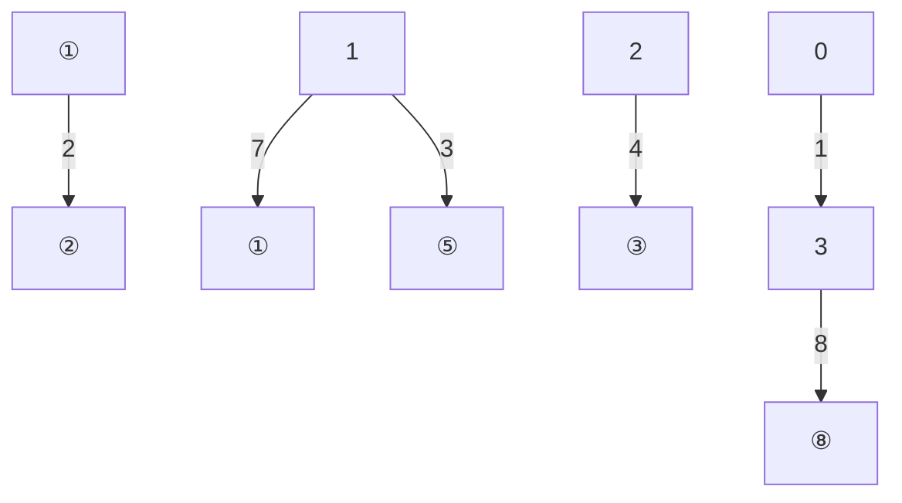

（4）从 $\Phi_{1}$ 求得 $B_{1}\left(= \frac{\bar{\Phi}_{1}}{S_{1}}\right)$，查 $B_{1} - H_{1}$ 曲线得 $H_{1}$ 和求得 $H_{1}l_{1}$。
(5) 最后求得磁通势:  $NI = H_{1}l_{1} + H_{3}l_{3}$ 。

如果给定的是其他支路的磁通,则有一部分要采用试探法或图解法计算。如果是给定磁通势求各支路磁通,则必须用试探法或图解法求解。

## §A-5 交变磁通磁路简介

恒定磁通的磁路中没有功率损耗。如果磁通随时间变化,这时,铁磁物质的磁滞现象将会产生磁滞损耗,电磁感应现象将会在铁磁物质中产生涡流,引起涡流损耗。通常把磁滞损耗和涡流损耗的总和称为铁心损耗。

可以证明磁滞损耗功率与铁磁物质的磁滞回线的面积成正比。对于同一铁心，磁滞回线的形状与磁感应强度的最大值  $B_{m}$  有关。工程上采用下列经验公式计算磁滞损耗:

$$
P _ {\mathrm{h}} = \sigma_ {\mathrm{h}} f B _ {\mathrm{m}} ^ {n} V
$$

式中 $B_{\mathrm{m}}$ 为磁感应强度最大值；$n$ 由 $B_{\mathrm{m}}$ 值决定，当 $B_{\mathrm{m}} < 1 \mathrm{T}$ 时，取 $n = 1.6$ ，当 $B_{\mathrm{m}} > 1.6 \mathrm{T}$ 时，取为2；$f$ 为工作频率；$\sigma_{\mathrm{h}}$ 是与材料有关的系数，同时又取决于所用单位；$V$ 为铁心的体积。

铁心的涡流损耗功率的计算要用电磁场理论进行。涡流损耗功率与铁心的几何尺寸和材料有关。若铁心是由平行于磁感应强度的钢片叠成，涡流损耗与钢片厚度的平方成正比，还与交变磁通的频率、材料的电导率及磁感应强度最大值有关。所以为了减小涡流损耗，硅钢片越薄越好（电工钢片渗入硅，其电导率就减小）。受工艺条件的限制，硅钢片不可能做得很薄，工频下硅钢片的厚度约为0.35\~0.5 mm，音频下约为0.02\~0.05 mm，而高频下则采用磁介质，如铁淦氧。涡流损耗一般与工作频率f和磁感应强度的最大值 $B_{m}$ 有关。

铁磁物质的磁感应强度与磁场强度之间不呈线性关系,所以磁路中的磁通也就与励磁电流之间不呈线性关系。当磁通是正弦形时,励磁电流则为非正弦形;反之,当励磁电流是正弦形时,磁通为非正弦形。

设无分支磁路由铁磁物质构成,其平均长度为 l,截面积为 S[图 A-10(a)]。在交变电流作用下,铁磁物质的磁化状态将沿磁滞回线周而复始地改变。为了简化讨论起见,设磁化状态是沿着基本磁化曲线变化的。这样,磁通  $\Phi$  与电流 i 的关系就可以根据基本磁化曲线求得。按图 A-10(a),有  $\Phi=BS$ ,而励磁电流  $i=\frac{Hl}{N}$ ,所以只要把铁心的基本磁化曲线上 B 的坐标乘以 S,H 的坐标乘以  $\frac{l}{N}$ ,即可获得表示铁心特性的  $\Phi-i$  曲线,显然其形状与 B-H 曲线的形状是相似的。

图 A-10(b) 和 (c) 分别绘出了正弦磁通和正弦电流对应的电流和磁通的波形。当磁通作正弦变化时（至饱和区），电流曲线具有尖顶波形；而当电流作正弦变化且工作到饱和区域，则磁通具有平顶波形。如对非正弦形的电流和磁通波形进行谐波分析，则可以看出它们都是奇谐波函数，主要含有 3 次谐波，而且随铁心饱和程度的提高，3 次谐波分量就越显著。如果正弦电流和正弦磁通的最大值不太大，使铁心的工作状态在饱和点以下的近似直线段，则对应磁通和电流波形将比较接近于正弦形。以上讨论未计及磁滞回线的影响。如果考虑到这一因素，则在正弦磁通下的电流波形将与图 A-10(b) 所示不同。铁心中的涡流损耗也会影响电流的波形。


<details>
<summary>text_image</summary>

i(t)
Φ(t)
N
l
S
</details>

(a)


<details>
<summary>line</summary>

| Time (t) | \(\Phi(t)\) | i(t) |
| --- | --- | --- |
| 0 | 0 | 0 |
| O | 0 | 0 |
| i | — | — |
| O | 0 | — |
| i | — | — |
</details>

(b)


<details>
<summary>text_image</summary>

Φ
Φ(t)
O
i
O
t
O
i(t)
t
</details>

(c)

图 A-10 交变磁通电流和磁通的波形

交变磁通磁路的计算比较复杂,因为需要计及磁饱和、磁滞和涡流等影响。

## §A-6 铁心线圈

如图 A-11(a) 所示的铁心线圈中通以交变电流时, 其中便有交变磁通。 $\Phi$  是其主磁通,  $\Phi_{\sigma}$  是其漏磁通。

下面分析铁心线圈的电压和电流关系。主磁通和漏磁通分别在线圈中产生感应电压 u 和  $u_{\sigma}$ ，再加上线圈的电阻上的电压  $u_{R}$ ，线圈端电压  $u_{1}=u+u_{\sigma}+u_{R}$ 。通常  $u_{\sigma}$  和  $u_{R}$  都比 u 小很多，因而有  $u_{1}\approx u$ ，这样，当线圈两端的电压  $u_{1}$  是正弦形时，主磁通  $\Phi$  同样是正弦形（这是因为  $u=\frac{d\Phi}{dt}$ ），但是电流则是非正弦波。为了简化计算且利于应用相量法，常采用等效正弦电流替代实际的非正弦电流，其条件是两者的有效值相等，并保持有功功率不变。当然，这只有在高次谐波不显著时才相对准确。

如果暂不考虑线圈的电阻和漏磁通，图A-11(b)给出了主磁通、电压和电流的相量图。图中电流相量 $\dot{I}$ 具有两个分量，一个分量 $\dot{I}_{\mathrm{a}}$ 与电压相量 $\dot{U}$ 同相，它是用来计及铁心损耗的，它是电流 $\dot{I}$ 的有功分量；另一个分量 $\dot{I}_{\mathrm{r}}$ 与磁通相量 $\dot{\Phi}$ 同相，它滞后电压 $\dot{U}$ 的相位为 $\frac{\pi}{2}$，称为铁心线圈的磁化电流，是 $\dot{I}$ 的无功分量。通常 $I_{\mathrm{r}} > I_{\mathrm{a}}$ 。可以用图A-11(c)所示电路模型描述这部分的电压、磁通和电流的关系，它由两条并联支路组成，一条支路为电导 $G_0$ ，通过的电流为 $\dot{I}_{\mathrm{a}}$ ，另一条支路为电感，通过电流为 $\dot{I}_{\mathrm{r}}$ ，其中 $G_0 = \frac{I_{\mathrm{a}}}{U}$，而感纳 $|B_0| = \frac{I_{\mathrm{r}}}{U}$ 。


<details>
<summary>text_image</summary>

+
i
u₁
-
N
Φ
Φσ
</details>

(a)


<details>
<summary>text_image</summary>

İₐ
Ü
İᵣ
İ
Φ
</details>

(b)


<details>
<summary>text_image</summary>

I
+   Iₐ   Iᵣ
U   G₀   B₀
-   -
</details>

(c)

图 A-11 铁心线圈的部分电压电流关系

设  $\Phi=\Phi_{m}\sin(\omega t)$ ，则

$$
u = N \frac {\mathrm{d} \Phi}{\mathrm{d} t} = N \omega \Phi_ {\mathrm{m}} \cos (\omega t) = 2 \pi f N \Phi_ {\mathrm{m}} \cos (\omega t)
$$

式中 N 为线圈的匝数,感应电压的有效值

$$
U = \frac {N \omega \varPhi_ {\mathrm{m}}}{\sqrt {2}} = 4. 4 4 f N B _ {\mathrm{m}} S
$$

式中  $B_{m}$  为磁感应强度最大值。设 P 和 Q 分别表示铁心的有功功率和无功功率，则有

$P=I_{a}U,Q=I_{r}U$ 。这样

$$
\begin{array}{l} G _ {0} = \frac {P}{U ^ {2}} = \frac {P}{(4 . 4 4 f N B _ {\mathrm{m}} S) ^ {2}} \\ \left| B _ {0} \right| = \frac {Q}{(4 . 4 4 f N B _ {\mathrm{m}} S) ^ {2}} \\ \end{array}
$$

P 和 Q 与  $B_{m}$  的关系是比较复杂的, 要严格计算必须按照交变磁通磁路的观点进行。一般说来,  $G_{0}$  和  $B_{0}$  都不是常数而随  $B_{m}$  或 U 而变, 因此在图中用非线性元件表示。

现在，计及线圈的电阻和漏磁通的作用。线圈电阻 $R$ 上的电压 $\dot{U}_R = R\dot{I}$，与电流同相。漏磁通链产生的感应电压 $\dot{U}_{\sigma} = \mathrm{j}\omega \dot{\Psi}_{\sigma} = \mathrm{j}\omega L_{\sigma}\dot{I}$，它超前电流 $\dot{I}$ 的相位为 $\frac{\pi}{2}$，式中 $\Psi_{\sigma}$ 表示漏磁通链的有效值，$L_{\sigma} = \Psi_{\sigma} / I$ 是漏电感。因为漏磁通主要经过空气闭合，漏磁通磁路的磁阻主要取决于空气段的磁阻，所以，可以认为漏磁通链与电流之间有线性关系，而 $L_{\sigma}$ 也就可以视为常数。于是，有

$$
\dot {U} _ {1} = \dot {U} _ {R} + \dot {U} _ {\sigma} + \dot {U} = R \dot {I} + \mathrm{j} \omega L _ {\sigma} \dot {I} + \dot {U}
$$

按照上式,并参照图 A-11(b)(c),铁心线圈的相量图和电路模型将如图 A-12(a)(b) 所示,图中  $U_{R}$  和  $U_{\sigma}$  一般仅为 U 的长度的百分之几,而图中画的是有意放大的。可见铁心线圈电路是一个含非线性电感的电路。


<details>
<summary>text_image</summary>

İ₁
İₐ₁
İ
İᵣ
Φ
Ü
Üᵣ
Ü₁
Üᵣσ
</details>

(a)


<details>
<summary>text_image</summary>

+ Û_R - + Û_σ -
R jωL_σ +
Û₁ Û G₀ L B₀
-
</details>

(b)

图 A-12 铁心线圈的电路模型及相量图

如果铁心线圈所用铁心带有较大的空气隙,或者铁心是不闭合的(如磁棒),则在这种情况下常把电感作为线性元件来处理,当然电感值比无铁心时仍要增大很多。


## 习题

A-1 题 A-1 图所示磁路中的磁通为  $3.2 \times 10^{-4}$  Wb，设填充因数 k=1，铸钢和电工钢片的基本磁化曲线用下列表格表示。求磁通势（磁路尺寸:mm）。

铸钢

| $H/\left( {\mathrm{A}/\mathrm{m}}\right)$ | 200 | 300 | 400 | 500 | 600 | 700 | 800 | 900 | 1 000 | 1 100 |
| --- | --- | --- | --- | --- | --- | --- | --- | --- | --- | --- |
| $B/\mathrm{T}$ | 0.27 | 0.39 | 0.50 | 0.61 | 0.72 | 0.82 | 0.90 | 0.98 | 1.05 | 1.11 |

电工钢片

| $H/(A/m)$ | 40 | 60 | 80 | 100 | 120 | 140 | 160 | 180 | 200 |
| --- | --- | --- | --- | --- | --- | --- | --- | --- | --- |
| $B/T$ | 0.12 | 0.30 | 0.45 | 0.57 | 0.65 | 0.70 | 0.76 | 0.80 | 0.85 |

A-2 已知题 A-2 图所示磁路中尺寸单位为 mm，构成磁路的电工钢片的基本磁化曲线如图 A-6(b) 所示，设 k=0.91，计算时要考虑空气隙的扩散作用。设磁通势为 860 At。求空气隙中的磁通。


题A-1图


<details>
<summary>text_image</summary>

40
160
40
1
40
200
40
</details>

题 A-2 图

A-3 已知磁路如题 A-3 图所示, 其铁心材料的基本磁化曲线同题 A-2, 磁路中的磁通  $\Phi=3.6\times10^{-3}$  Wb, k=1, 计算时要计及空气隙的扩散作用。图中所示尺寸单位为 mm。求磁通势。
A-4 题 A-4 图所示为有分支磁路，由同一电工钢片叠成。各段磁路的平均长度和截面面积均示于图中， $l_{a} \ll l_{2}$ 。现在要求出在空气隙中产生磁通  $\Phi_{a}$  所需磁通势，试给出解题的步骤。


<details>
<summary>text_image</summary>

50
170
50
60
50
250
2
70
</details>

题 A-3 图


<details>
<summary>text_image</summary>

l₁
l₃
l₂
S₂
Iₐ
S₃
S₁
</details>

题A-4图

# 附录 B

# 电流传输器和跨导放大器简介

本附录简要介绍电流传输器(current conveyor, CC)和跨导放大器(operational transconductance amplifier, OTC)的基本特性、基本功能及其简单应用。

## §B-1 电流传输器

电流传输器(CC)是 Smith 和 Sedra 于 1968 年提出的一种具有多功能且与运算放大器相似的基本电路器件。随着集成电路的发展,电流传输器作为一种集成电路器件在振荡器、滤波器及放大器等电路构造中获得了广泛的应用。电流传输器在控制、测量、通信等领域具有重要用途。

电流传输器从第一代已经发展到第三代。第一代电流传输器简称 CC I，用晶体管实现，其图形符号如图 B-1 所示。

它对外有三个端子(接地端除外), X、Y、Z 端, 其中 X 端对地电压与 Y 端对地电压相等。若各端子的电流参考方向如图 B-1 中所示, 则流入 X 端的电流等于流入 Y 端的电流, 流入 X 端的电流等于流


<details>
<summary>text_image</summary>

uY ○ → iY
CC I
Y
K Z
iZ
uZ
uX ○ → iX
X
</details>

图 B-1 CCI

入 Z 端电流的 K 倍, K 为一常数, 其典型值取 K=1 。电流传输器通常分为两种, 即正向电流传输器和反向电流传输器, 对于正向电流传输器  $K=+1$ , 而反向电流传输器则取 K=-1, 故电流传输器的外特性关系式定义为

$$
\left[ \begin{array}{c} i _ {\mathrm{Y}} \\ u _ {\mathrm{X}} \\ i _ {\mathrm{Z}} \end{array} \right] = \left[ \begin{array}{c c c} 0 & 1 & 0 \\ 1 & 0 & 0 \\ 0 & \pm K & 0 \end{array} \right] = \left[ \begin{array}{c} u _ {\mathrm{Y}} \\ i _ {\mathrm{X}} \\ u _ {\mathrm{Z}} \end{array} \right]
$$

第二代电流传输器(CCⅡ)的外特性与第一代电流传输器不同,在其Y端不取电流,因此第二代电流传输器在实际使用中具有更大的灵活性。其外特性关系式定义为

$$
\left[ \begin{array}{c} i _ {\mathrm{Y}} \\ u _ {\mathrm{X}} \\ i _ {\mathrm{Z}} \end{array} \right] = \left[ \begin{array}{c c c} 0 & 0 & . 0 \\ 1 & 0 & 0 \\ 0 & \pm K & 0 \end{array} \right] = \left[ \begin{array}{c} u _ {\mathrm{Y}} \\ i _ {\mathrm{X}} \\ u _ {\mathrm{Z}} \end{array} \right]
$$

第二代电流传输器其 Y 端的输入阻抗为无限大, 为电压输入端, 而 X 端的电压总是跟随 Y 端的输入电压, 因此 X 端的输入阻抗等于零, 故 X 端的输入电流被传输到高阻抗 Z 输出端并得到了放大, 即  $i_{Z} = \pm K i_{X}$ 。

第二代电流传输器比第一代电流传输器具有更广泛的用途。CCⅡ不但能直接处理电压信号，而且能直接处理电流信号。通常采用电流型有源器件设计的电路称为电流模式电路，这种电路的特点是其输入、输出均为电流，由于电流传输器具有能够将X端的输入电流放大传输到高阻抗Z输出端的功能，因此，由电流传输器构成的电路就被称为电流模式电路。电流模式电路频带较宽，因而在电路设计中受到重视。

由电流传输器既可以构成电压模式基本单元电路,也可以构成电流模式基本单元电路,构成的电压模式基本单元电路有电压放大器、电压积分器、电压微分器。

以电流传输器构成的电压放大器如图 B-2 所示,由于

$$
U _ {\mathrm{o}} (s) = R _ {2} I _ {\mathrm{o}} (s)
$$

则有

$$
I _ {\mathrm{o}} (s) = \pm K I _ {\mathrm{X}} (s) = \pm K \frac {U _ {\mathrm{X}} (s)}{R _ {1}}
$$

故其传输函数为

$$
H (s) = \frac {U _ {\mathrm{o}} (s)}{U _ {\mathrm{i}} (s)} = \pm \frac {R _ {2} K}{R _ {1}}
$$

以电流传输器构成的电压积分器如图 B-3 所示, 其传输函数为

$$
H (s) = \frac {U _ {\mathrm{o}} (s)}{U _ {\mathrm{i}} (s)} = \pm \frac {K}{s C R _ {1}}
$$


<details>
<summary>text_image</summary>

ui
Y
CC II
K
Z
X
R1
uo
R2
</details>

图 B-2 电压放大器


<details>
<summary>text_image</summary>

u_i
Y
CC II
K Z
X
R
u_o
C
</details>

图 B-3 电压积分器

以电流传输器构成的电压微分器如图 B-4 所示, 其传输函数为

$$
H (s) = \frac {U _ {\mathrm{o}} (s)}{U _ {\mathrm{i}} (s)} = \pm s C R K
$$

由电流传输器构成的电流模式基本单元电路有电流放大器、电流积分器、电流微分器。

以电流传输器构成的电流放大器如图 B-5 所示, 其传输函数为

$$
H (s) = \frac {I _ {\mathrm{o}} (s)}{I _ {\mathrm{i}} (s)} = \pm \frac {R _ {2} K}{R _ {1}}
$$


<details>
<summary>text_image</summary>

ui
Y
CC II
K Z
X
C
uo
R
</details>

图 B-4 电压微分器


<details>
<summary>text_image</summary>

i₁
Y
CC II
K
Z
iₒ
X
R₂
R₁
</details>

图 B-5 电流放大器

以电流传输器构成的电流积分器如图 B-6 所示, 其传输函数为

$$
H (s) = \frac {I _ {\mathrm{o}} (s)}{I _ {\mathrm{i}} (s)} = \pm \frac {K}{s C R}
$$

以电流传输器构成的电流微分器如图 B-7 所示, 其传输函数为

$$
H (s) = \frac {I _ {\mathrm{o}} (s)}{I _ {\mathrm{i}} (s)} = \pm s C R K
$$


<details>
<summary>text_image</summary>

i_i
Y
CC II
K
Z
i_o
X
C
R
</details>

图 B-6 电流积分器


<details>
<summary>text_image</summary>

i_i
Y
CCII
K Z
X
R
C
i_o
</details>

图 B-7 电流微分器

电流模式基本单元电路在通信、测量、控制等电流模式电路设计中获得了广泛的应用，特别是在电流模式滤波器设计中具有重要应用。

## §B-2 跨导放大器

这里主要介绍(运算)跨导放大器(operationnal transconductance amplifier, OTA)，其图形符号和它的理想电路模型如图 B-8 所示，它有两个输入端，一个输出端，一个控制端。跨导运算放大器的输入信号为电压信号，图中“+”表示同相输入端，“-”表示反相输入端, 输出信号为电流信号, 其开环增益称为跨导, 用  $g_{m}$  表示, 它具有电导的性质, 受控制端的偏置电流  $I_{B}$  或偏置电压  $U_{B}$  控制。跨导运算放大器的输出电流近似为

$$
i _ {\mathrm{m}} = g _ {\mathrm{m}} (  u _ {\mathrm{P}} - u _ {\mathrm{N}}  )
$$

对于理想电路模型,由于两个电压输入端开路,故其差模输入阻抗无穷大,而输出电流类似于一个受差模输入电压控制的电流源,因此其输出阻抗为无穷大。


<details>
<summary>text_image</summary>

(a) 图形符号
(b) 理想电路模型
</details>

图 B-8 跨导放大器

与常规的运算放大器(电压输入/电压输出)相比较,跨导运算放大器特点为:(1)输入差模电压控制输出电流;(2)增加了一个控制端,调节控制电流 $I_{B}$ 可以改变跨导 $g_{m}$ 值;(3)具有电流模式电路的特点。

跨导运算放大器的作用是将电压信号变换为电流信号,可对电流模式电路输入信号进行预处理,通常在电压模式与电流模式电路之间作为接口电路使用,其次它可以构成各种基本单元电路用于滤波器设计及各种电子测量、控制、通信电路。

以跨导运算放大器构成的差模电压积分器如图 B-9 所示, 其输出电流为

$$
I _ {\mathrm{o}} (s) = g _ {\mathrm{m}} \left[ U _ {\mathrm{P}} (s) - U _ {\mathrm{N}} (s) \right]
$$

输出电压为

$$
U _ {\mathrm{o}} (s) = \frac {1}{s C} I _ {\mathrm{o}} (s) = \frac {1}{s C} g _ {\mathrm{m}} U _ {\mathrm{i}} (s)
$$

故传输函数为

$$
H (s) = \frac {U _ {\mathrm{o}} (s)}{U _ {\mathrm{i}} (s)} = \frac {g _ {\mathrm{m}}}{s C}
$$


<details>
<summary>text_image</summary>

uP
+
ui
-
uN
+
gm
-
C
+
uo
-
</details>

图 B-9 差模电压积分器

以跨导运算放大器构成的有损电压积分器如图 B-10 所示, 其跨导运算放大器 1 输出电流  $I_{o1}(s)$  为

$$
I _ {\mathrm{o1}} (s) = g _ {\mathrm{m1}} \left[ U _ {\mathrm{P}} (s) - U _ {\mathrm{N}} (s) \right] = g _ {\mathrm{m1}} U _ {\mathrm{i}} (s)
$$

跨导运算放大器 2 的同相输入端接地, 其输出电流  $I_{o2}(s)$  为

$$
I _ {\mathrm{o2}} (s) = g _ {\mathrm{m2}} [ 0 - U _ {c} (s) ] = - g _ {\mathrm{m2}} U _ {c} (s)
$$

由于跨导运算放大器 2 输出电流  $I_{o2}(s)$  反馈到它的反相输入端, 因此电容 C 的电流  $I_{C}(s)$  为

$$
I _ {C} (s) = I _ {\mathrm{o1}} (s) + I _ {\mathrm{o2}} (s) = g _ {\mathrm{m1}} U _ {\mathrm{i}} (s) - g _ {\mathrm{m2}} U _ {C} (s)
$$

而电容 $C$ 的电压 $U_{c}(s)$ 为

$$
U _ {c} (s) = \frac {1}{s C} I _ {c} (s) = \frac {1}{s C} g _ {\mathrm{m1}} U _ {\mathrm{i}} (s) - \frac {1}{s C} g _ {\mathrm{m2}} U _ {c} (s)
$$

由于电压  $U_{0}(s)=U_{C}(s)$ ，故有损电压积分器传输函数为

$$
H (s) = \frac {U _ {\mathrm{o}} (s)}{U _ {\mathrm{i}} (s)} = \frac {g _ {\mathrm{m1}}}{s C + g _ {\mathrm{m2}}}
$$


<details>
<summary>text_image</summary>

u_p
+
-
u_i
-
u_N
+
-
gm1
-
C
gm2
+
-
u_o
-
</details>

图 B-10 有损电压积分器


<details>
<summary>text_image</summary>

附录 C
PSpice 简介
</details>

本附录简要介绍电路计算机辅助分析的有关概念和常用的一种电路模拟程序, 即 PSpice 的初步知识。

## §C-1 电路的计算机辅助分析

电路的计算机辅助分析是利用计算机作为辅助手段对电路进行分析。电路分析包括许多内容，其中主要有电阻电路分析（或直流电路分析）、正弦电流电路分析、线性动态电路分析、非线性电路分析等。用计算机进行电路分析，一般需要针对要求解决问题的类型编制程序，让计算机执行。当进行电路分析时，首先需要把电路拓扑结构的信息、电路元件的类型及元件值作为数据送进计算机。然后，使计算机根据输入数据自动形成电路方程并进行求解。

下面主要介绍建立电路方程的一些有关问题,其目的是为了说明编制程序的一些思路。

现结合图 C-1(a) 所示电路说明如何应用计算机形成节点列表法方程。图 C-1(b) 所示为该电路的图，它共有 4 个节点和 8 条支路。特别需要注意的是:每条支路仅含一个元件。独立电压源和独立电流源为同频率正弦量，因此用向量法进行分析。为了简化起见，没有考虑受控源、耦合电感、理想变压器等。节点和支路的编号如图 C-1(b) 所示,其中每条支路有一个始节点和一个终节点,支路的参考方向自始节点指向终节点,因此依据始节点和终节点的编号顺序就明确了支路的方向。


<details>
<summary>text_image</summary>

iS7
①
R1
L2
② + uS4 -
③
C3
R5
iS8
</details>

(a)


<details>
<summary>flowchart</summary>


</details>

(b)

图 C-1 建立节点列表法的电路


这里设计一个5变量数组 $(k,i,j,g,h)$ ，其中k表示支路编号；i表示第k支路的始节点；j表示第k支路的终节点；g是一个数，用来表示元件的类型，例如可用“1”表示电阻，用“2”表示电容，用“3”表示电感，用“4”表示独立电压源，用“5”表示独立电流源；h表示元件的参数值。这个数组共5列和8行，即

| 支路号 | 始节点号 | 终节点号 | 元件类型 | 元件值 |
| --- | --- | --- | --- | --- |
| 1 | 1 | 0 | 1 | $R_{1}$ |
| 2 | 1 | 2 | 3 | $L_{2}$ |
| 3 | 2 | 0 | 2 | $C_{3}$ |
| 4 | 3 | 2 | 4 | $-U_{s4}$ |
| 5 | 3 | 0 | 1 | $R_{5}$ |
| 6 | 1 | 3 | 1 | $R_{6}$ |
| 7 | 0 | 1 | 5 | $I_{s7}$ |
| 8 | 0 | 3 | 5 | $I_{s8}$ |

节点列表法的方程如下:

$$
A \dot {I} = 0
$$

$$
- A ^ {\mathrm{T}} \dot {U} _ {\mathrm{n}} + \dot {U} = 0
$$

$$
F \dot {U} + H \dot {I} = \dot {U} _ {\mathrm{s}} + \dot {I} _ {\mathrm{s}}
$$

其中  $\dot{U}_{n}$  为节点电压列向量,  $\dot{U}$  和  $\dot{I}$  分别为支路电压列向量和支路电流列向量, 它们是方程中的未知量。

上列第一式可以按如下的步骤形成。按数组第2、3列，即从始节点编号到终节点编号，令 $i, j$ 自1到3依次寻找连接于相同编号节点的支路，凡支路与同号始节点连接的，这些支路电流分别乘以“+1”，凡支路与同号终节点连接的，这些支路电流则分别乘以“-1”；这样可得

$$
\dot {I} _ {1} + \dot {I} _ {2} + \dot {I} _ {6} - \dot {I} _ {7} = 0
$$

$$
- \dot {I} _ {2} + \dot {I} _ {3} - \dot {I} _ {4} = 0
$$

$$
\dot {I} _ {4} + \dot {I} _ {5} - \dot {I} _ {6} - \dot {I} _ {8} = 0
$$

第二式可以按如下的步骤直接形成。令数组第1列的k自1到8，依次检查第2、3列的i和j。当i>0，该节点电压 $\dot{U}_{ni}$ 乘以“-1”，当i=0，该节点电压 $\dot{U}_{ni}$ 乘以“0”；当j>0，该节点电压 $\dot{U}_{nj}$ 乘以“+1”，当j=0，则该节点电压 $\dot{U}_{nj}$ 乘以“0”；支路电压 $\dot{U}_{k}$ 则依次分别乘以“+1”。这样可得

$$
- \dot {U} _ {\mathrm{n1}} + \dot {U} _ {1} = 0
$$

$$
- \dot {U} _ {\mathrm{n1}} + \dot {U} _ {\mathrm{n2}} + \dot {U} _ {2} = 0
$$

$$
- \dot {U} _ {\mathrm{n2}} + \dot {U} _ {3} = 0
$$

$$
\begin{array}{l} \dots \\ \dot {U} _ {\mathrm{n3}} + \dot {U} _ {8} = 0 \end{array}
$$

第三式形成的步骤如下。按数组第1列，令 $k$ 从1到8，依次检查第4列和第5列。当第 $k$ 支路为电容 $C_k$ 时，该支路电压 $\dot{U}_k$ 乘以 $\mathrm{j}\omega C_k$ ，支路电流 $\dot{I}_k$ 乘以“-1”；当第 $k$ 支路为电阻 $R_{k}$ 或电感 $L_{k}$ 时，该支路电压 $\dot{U}_k$ 乘以“-1”，支路电流 $\dot{I}_k$ 乘以 $R_{k}$ 或 $\mathrm{j}\omega L_k$ 。当第 $k$ 支路为独立电压源时，该支路电压 $\dot{U}_k$ 乘以“+1”，右方 $\dot{U}_{sk}$ 赋予元件值；当第 $k$ 支路为独立电流源时，该支路电流 $\dot{I}_k$ 乘以“+1”，右方 $\dot{I}_{sk}$ 赋予元件值。这样可得

$$
- \dot {U} _ {1} + R _ {1} \dot {I} _ {1} = 0
$$

$$
- \dot {U} _ {2} + \mathrm{j} \omega L _ {2} \dot {I} _ {2} = 0
$$

$$
\mathrm{j} \omega \dot {C} _ {3} \dot {U} _ {3} - \dot {I} _ {3} = 0
$$

$$
\dot {U} _ {4} = - \dot {U} _ {\mathrm{s4}}
$$

$$
- \dot {U} _ {s} + R _ {s} \dot {I} _ {s} = 0
$$

$$
- \dot {U} _ {6} + R _ {6} \dot {I} _ {6} = 0
$$

$$
\dot {I} _ {7} = \dot {I} _ {\mathrm{s} 7}
$$

$$
\dot {I} _ {8} = \dot {I} _ {s 8}
$$

以上通过一个简单的实例说明了如何根据输入的数据直接形成节点列表法方程的思路。如果电路中有受控源、耦合电感、理想变压器等，只要相应地改变输入数据的结构，仍然可以直接建立节点列表法所需方程。显然，如果要建立其他形式的电路方程，形成的方法将随之改变。

动态电路方程的形成以及电路方程的数值求解法超出本书范围。在计算机辅助分析中，线性代数方程的求解一般采用的有高斯消去法、LU分解法、高斯-塞德尔迭代法、稀疏矩阵法等。对于动态电路的分析，则要求解微分方程，常用的计算方法有梯形法、龙格-库塔法、基尔法等，可参阅有关书籍。

目前国内外有很多电路的计算机辅助分析程序,为了便于使用者应用,这类程序往往只要求使用者将被分析电路的有关信息以及进行哪种分析和所需要的输出,按规定编写成一个输入文件,输入计算机中,让计算机执行。至于该程序是根据什么原理(包括使用的电路方程的形式、数值求解法等)编制的,其细节如何,使用者无须了解。

使用计算机对电路进行分析和计算具有许多优点,计算机能处理大规模电路,如具有成千节点的集成电路、大型电力系统电路等。并且计算速度迅速,结果精确可靠。依靠计算机辅助分析还可以验证电路设计的正确性,所以计算机辅助分析是计算机辅助设计的重要组成部分。

## §C-2 PSpice

PSpice 是国际上广泛应用的通用电路模拟程序。主要是面向电子电路和集成电路的分析软件, 是 Spice (Simulation Program with Integrated Circuit Emphasis) 的一种 (PC) 微机版本, 而且版本不断地在完善、修改和更新。PSpice 电路数据的输入既可以为文本方式, 也可以为图形方式。供教学使用的 PSpice 通常只能分析规模较小的电路。

目前在 Windows 方式下的 PSpice 通常包括以下几个基本程序模块:电路原理图编辑程序 Capture, 激励源编辑程序 Stimulus Editor, 电路仿真程序 PSpice A/D, 曲线输出程序 Probe, 模型参数编辑程序 Model Editor, 元器件模型参数库 LIB。

PSpice 能够处理的电子元器件非常广泛,可直接输入的电路元器件有:线性电路元件(包括电阻、电容、电感、耦合电感、独立电源,线性受控源、传输线等);非线性受控源;电子元器件(包括二极管、双极型晶体管、结型场效应管和 MOS 场效应管、运算放大器等);功率电子器件(包括晶闸管、电力晶体管、功率 MOS 管、IGBT 等);用于电子测量、控制等常见的集成芯片等。

PSpice 的分析功能十分强大,它可以进行直流分析(电阻电路分析)、交流分析(正弦稳态分析)、瞬态分析(动态电路的时域分析)、傅里叶分析以及其他分析。

在 PSpice 中,电路结构和参数的输入有两种方式。一种是在 (File/New/Textfile) 的文本环境中,用电路描述语言编辑并保存符合语法规则的文本电路数据文件,用 (Simulation/Run) 命令直接执行 OrCAD/PSpiceA/D 程序进行仿真。另一种是调用 OrCAD/Captur 程序在图形方式下建立并编辑电路原理图,根据电路数据修改元器件的参数或型号。然后在主菜单 (PSpice) 中选取 (New Simulation Profile) 菜单设置或编辑分析类型,再进行仿真计算。无论采用何种输入方式,所有版本的 PSpice 最终都要通过电路文本格式文件确定元件间的连接关系,然后根据分析类型进行分析计算。

PSpice 的文本输入任务是构造一个文本格式的输入文件。在计算机中,有关电路信息可以通过元器件名称、连接节点、元件值等组成的语句来确定,文件名的后缀为“.cir”。在编写文本输入文件前,先要给电路节点编号,一般采用正整数,参考节点的编号必须为数字“0”,其他节点的编号可任意选取,序号可不连续。PSpice 要求文本输入文件中每一条语句必须独占一行。文件中星号“\*”或“;”后的内容,只起解释作用,不参与分析计算。首行为标题,“.END”语句表示结束,其中圆点“.”不能省略,文本中其余语句顺序任意。文本格式为:标题描述、元件描述、电路分析功能描述、输出结果和要求描述、说明语句和结束描述。

标题描述可以是任何类型的注释,对电路的分析和计算不起任何影响。元件描述用下列关键字母,电阻用 R、电感用 L、电容用 C、互感用 K、二极管用 D、VCVS 用 E、

CCCS 用 F、VCCS 用 G、CCVS 用 H、独立电压源用 V、独立电流源用 I、压控开关用 S。

执行和输出功能描述用下列关键词:交流分析用.AC,直流分用.DC,瞬态分析用.TRAN,打印输出数据用.PRINT,打印输出曲线用.PLOT;另一种曲线输出语句为.PROBE,在执行.PROBE语句后,PSPICE将在屏幕上显示一个菜单界面,用户可根据需要随时使用菜单添加输出变量,随后在屏幕上就可显示根据输出数据处理后所描绘的图形曲线。

使用的数字可以用整数、浮点数和指数（如 $1.45\mathrm{E} - 12,1.25\mathrm{E} + 4$）。比例因子规定有10种，以下只列出8种:

$$
\mathrm{M} = 1 \mathrm{E} - 3, \mathrm{U} = 1 \mathrm{E} - 6, \mathrm{N} = 1 \mathrm{E} - 9, \mathrm{P} = 1 \mathrm{E} - 1 2, \mathrm{K} = 1 \mathrm{E} + 3, \mathrm{MEG} = 1 \mathrm{E} + 6, \mathrm{G} = 1 \mathrm{E} + 9, \mathrm{T} = 1 \mathrm{E} + 1 2 。
$$

此外，在数值后也可紧跟一些字母，如用 V、A、OHM 等表示电压、电流、电阻的单位。还需要注意的是:文件中不区分字母的大小写，当一行中数据没有写完时，续行的第一列必须用“+”号来表示；数据之间的分隔符，采用空格或逗号；电路中同类型的元件，元件名不能相同。为了确保电路在工作点处有唯一解，PSpice 要求电路中既不能含有电压源和电容构成的回路，也不能含有电流源和电感构成的割集。下面通过 3 个实例简要介绍文本输入，然后再通过例题简要介绍图形输入。

## 1. 文本输入

（1）直流分析:PSpice 的直流分析功能可以分析电路的静态工作点(.OP)、直流小信号传递特性(.TF)、直流扫描特性(.DC)、直流灵敏度(.SENS)。在直流分析中，电感直接按短路处理，电容直接按开路处理，PSpice 的基本输出量通常为节点电压、支路电压和支路电流。

例 C-1 图 C-2 所示的线性电路中, 已知  $R_{1}=R_{2}=R_{3}=10\ \Omega, U_{s}=1\ V, I_{s}=0.2\ A$ , VCCS 中的控制系数 g=0.2 S, 试按给定节点求出节点电压  $u_{n1}, u_{n2}, u_{n3}$ 。


<details>
<summary>text_image</summary>

Is
R1 + u1 -
① R2
② + Us - ③
R3
0.2u1
①
</details>

图 C-2 例 C-1 电路

解 输入文件:

EX1

VS 2 3 DC 1

IS 0 1 DC 0.2

G 0 3 1 0 0.2

```txt
R1 1 0 10
R2 1 2 10
R3 3 0 10
. OP
. END
```

输入描述语言说明如下:

第 1 句是标题说明(可以由任意字符构成)。

第 2 句是独立电压源的说明, 指出电源的名称, “2”“3”表示其正极和负极连接的节点编号, “DC”表示直流, “1”表示电压的幅值为 1 V(对于正弦量, 其大小均用幅值, 而不用有效值)。

第3句是独立电流源的说明,指出电源的名称,“0”“1”表示电流从“0”节点流向“1”节点,“DC”表示直流,“0.2”表示电流的幅值为0.2A。

第 4 句是 VCCS 的说明, 受控电流源从一个节点流向另一个节点的 2 个节点的编号, 控制电压的正极和负极连接的 2 个节点的编号, 控制系数 g 值。

第 5\~7 句是电阻的说明,给出了电阻的名称,连接的始节点和终节点的编号和电阻值(单位为  $\Omega$ )。

第 8 句是直流工作点分析语句说明,该语句没有参数项,它能给出各节点电压、电压源电流及电路总的直流功率。

第 9 句是结束语句说明。

注意: 当需要计算某支路电流时, 通常采取在该支路中串接一个电压为零的电压源来实现。

为了对电路进行分析,确保电路方程不致奇异,PSpice规定,每一个节点必须要有一条到地的直流通路。如果电路不满足该要求,必须在该节点与地之间连接一个对电路没有影响的大电阻。

最后计算时, 调用 PSpice, 输入该数据, 在后缀为“.out”的文件中可得以下输出结果:

```txt
NODE     VOLTAGE   NODE    VOLTAGE   NODE    VOLTAGE
(1)      5.000 V      (2)      8.000 V      (3)      7.000 V
```

（2）瞬态分析:在电路进行瞬态分析时，需要给定输入信号和初始值。为了能够获得可靠的数值分析结果，时间步长的选取是很重要的，最大计算步长则限定 PSpice 的内部计算步长不得超过此值。瞬态分析可以计算动态电路的节点电压、支路电压和支路电流瞬时值，能够获得瞬时值随时间的变化曲线。

例 C-2 电路如图 C-3 所示, 已知 $R_{1} = 0.45 \mathrm{k} \Omega, R_{2} = 1 \mathrm{k} \Omega, R_{1} = 1 \mathrm{M} \Omega, R_{0} = 100 \Omega, R_{3} = 500 \Omega, R_{4} = 1 \mathrm{k} \Omega, C_{1} = C_{2} = 4 \mu \mathrm{F}, \mathrm{VCVS}$ 的增益 $A = 5 \times 10^{5}$ 。输入正弦电压 $u_{\mathrm{i}}$ 的幅值为 $2 \mathrm{~V}$, 频率可变。要求在频率 $1 \mathrm{~Hz} \sim 10 \mathrm{kHz}$ 范围内, 按每个数量级取 20 个频率点, 绘制输出电压 $u_{4}$ 的幅频特性。


<details>
<summary>text_image</summary>

C2
① R1 ② C1 ③ R3
+ ui -
R2 - u3 +
⑤ R0 ④ +
Au3 +
- R4 u4
-
</details>

图 C-3 例 C-2 电路图

解 输入文件:

EX2

VIN 10 AC 2V

R1 1 2 0.45K

R2 2 0 1K

RI 3 0 1MEG

R0 5 4 100

R3 3 4 500

R4 4 0.1K

C1 2 3 4U

C2 2 4 4U

E1 5 0 0 3 500K

. AC DEC 20 1 10K

.PLOT AC VM(4)

.PROBE

.END

输入描述语言说明如下:

第 1 句是标题说明。

第 2 句是独立电压源的说明，“AC”表示交流，“2”表示电压的幅值为 2 V（正弦量的大小都用幅值，不用有效值）。

第 3\~8 句是电阻的说明。

第 9\~10 句是电容的说明,给出了电容的名称,连接的始节点和终节点的编号,电容值(单位为 F)。

第 11 句是 VCVS 的说明, 受控电压源的正极和负极连接的 2 个节点编号, 控制电压的正极和负极连接的 2 个节点编号, 控制系数 A 值。

第 12 句是 AC 频率范围的说明，“DEC”表示按数量级变化，“20”表示在每一数量

级内取 20 个点, 最后 2 个数字表示起始频率和终止频率。

第 13 句是曲线打印语句，“AC”表示分析类型，“VM”表示输出为电压幅值，括号内的“4”表示该电压是节点 4 的节点电压（输出电压）。

第 14 句是探针显示语句。“.PROBÉ”是 PSpice 的一个图形后处理程序, 可用来观察图形、曲线的局部细节。

图 C-4 给出了打印出的输出电压的幅频特性曲线。


<details>
<summary>line</summary>

| Frequency | V(4) (V) |
| --- | --- |
| 1.0 Hz | ~0.02 |
| 3.0 Hz | ~0.08 |
| 10 Hz | ~0.25 |
| 30 Hz | ~0.55 |
| 100 Hz | ~1.1 |
| 300 Hz | ~0.65 |
| 1.0 KHz | ~0.35 |
| 3.0 KHz | ~0.15 |
| 10 KHz | ~0.02 |
</details>

图 C-4 输出电压的幅频特性曲线

例 C-3 电路如图 C-5 所示, 已知 $R_{1} = R_{2} = 20 \Omega, R_{3} = 4 \mathrm{k} \Omega, L = 0.2 \mathrm{H}, C = 0.5 \mu \mathrm{F}, u_{\mathrm{s}}(t) = 10 \varepsilon(t) \mathrm{V}$, 其中 $\varepsilon(t)$ 为单位阶跃函数, $u_{c}(0) = 2 \mathrm{~V}, i_{L}(0) = 0.2 \mathrm{~A}$, 求 $u_{c}(t)$, 并绘制 $u_{c}(t)$ 波形, 设时间区间为 $0 \sim 30 \mathrm{~ms}$, 打印时间间隔为 $0.1 \mathrm{~ms}$。


<details>
<summary>text_image</summary>

① R₁ ② L ③
+ uₛ - R₂ C u꜀ - R₃
①
</details>

图 C-5 例 C-3 电路图

解 输入文件:

EX3

VS 1 0 10

R1 1 2 20

R2 2 0 20

R3 3 0 4K

L 2 3 0.2 IC = 0.2

C 300.5U IC=2

. TRAN 0.1M 30M UIC

.PLOT TRAN V(3,0)

.PROBE

.END

输入描述语言说明如下:

第 1 句是标题说明。

第 2 句是独立电压源的说明,指出电源的名称,它的正极和负极连接的节点编号和电压值。

第 3\~4 句是电阻的说明,指出电阻的名称,连接的始节点和终节点编号和电阻值。

第 5 句是电感的说明,指出电感的名称,连接的始节点和终节点编号和电感值。注意电感电流的初始值用“IC”表示。

第 6 句是电容的说明, 指出电容的名称, 连接的始节点和终节点编号和电容值。注意电容电压的初始值也用“IC”表示。

第 7 句“.TRAN”定义瞬态分析,打印的时间间隔(0.1 M 表示 0.1 ms),打印的终止时间(30 M 表示 30 ms),而“UIC”表示使用者自己规定初始条件来进行瞬态分析,同时也规定了节点电压的初始值。所以第 2 句本来是直流电压源的说明,不过此句用了“UIC”,它表示此电压为阶跃电压。

第 8 句是曲线打印语句，“TRAN”表示分析类型，“V(3,0)”表示节点“3”和“0”之间的电压，即题中要求的电容电压。

第 9 句是探针显示语句。

第 10 句是结束语句。

图 C-6 给出了打印出的电容电压  $u_{c}(t)$  的变化曲线。

## 2. 图形输入

为了简要说明图形输入的要点,按图形输入的命令次序来说明完成一个电路题目分析的操作过程。

（1）在 WIN98 或 WIN2000 下单击“程序”，选中“orCAD Demo”，进入“Capture CIS Demo”窗口，选择执行 Fil/New/Project 命令，新建电路分析题目（在 Name 框中，键入带后缀.cir 的题目名）。选中“Analog or Mixed Signal Circuit”单选框，并按“OK”按钮，即表示对设计的电路可进行 PSpice 的数模混合仿真。随后，在元器件库中对元器件库进行再配置，按“Add”按钮，将元器件库增添进选用框中，再按“完成”按钮，即可进入图形编辑状态。


<details>
<summary>line</summary>

| Time (ms) | Voltage (V) |
| --- | --- |
| 0 | 0 |
| ~0.5 | ~65 |
| ~1 | ~110 |
| ~1.5 | ~45 |
| ~2 | ~-70 |
| ~2.5 | ~-38 |
| ~3 | ~20 |
| ~3.5 | ~65 |
| ~4 | ~8 |
| ~4.5 | ~-50 |
| ~5 | ~10 |
| ~5.5 | ~45 |
| ~6 | ~25 |
| ~6.5 | ~-25 |
| ~7 | ~28 |
| ~7.5 | ~-10 |
| ~8 | ~18 |
| ~8.5 | ~-5 |
| ~9 | ~12 |
| ~9.5 | ~-8 |
| ~10 | ~10 |
| ~10.5 | ~-5 |
| ~11 | ~8 |
| ~11.5 | ~-2 |
| ~12 | ~6 |
| ~12.5 | ~-1 |
| ~13 | ~4 |
| ~13.5 | ~-1 |
| ~14 | ~3 |
| ~14.5 | ~-1 |
| ~15 | ~2 |
| ~15.5 | ~-1 |
| ~16 | ~1 |
| ~16.5 | ~-1 |
| ~17 | ~1 |
| ~17.5 | ~-1 |
| ~18 | ~1 |
| ~18.5 | ~-1 |
| ~19 | ~1 |
| ~19.5 | ~-1 |
| ~20 | ~1 |
| ~20.5 | ~-1 |
| ~21 | ~1 |
| ~21.5 | ~-1 |
| ~22 | ~1 |
| ~22.5 | ~-1 |
| ~23 | ~1 |
| ~23.5 | ~-1 |
| ~24 | ~1 |
| ~24.5 | ~-1 |
| ~25 | ~1 |
| ~25.5 | ~-1 |
| ~26 | ~1 |
| ~26.5 | ~-1 |
| ~27 | ~1 |
| ~27.5 | ~-1 |
| ~28 | ~1 |
| ~28.5 | ~-1 |
| 30 | 0 |
</details>

图 C-6  $u_{c}(t)$  的变化曲线

（2）开始设计电路，放置元器件，用鼠标单击“Place”菜单下的“Part”选项（或点击窗口右侧的“与门”图形符号），键入元器件的特征字符，选定并拖放元器件到图中相应位置。单击“Place”菜单下的“Wire”选项（或点击窗口右侧的连线图形符号）进行连线，单击鼠标左键选择连线起始点进行连接。单击“Place”菜单下的“Ground”选项（或点击窗口右侧的接地图形符号）设置接地点，注意每一个电路图中都必须设置接地点。
（3）电路图编辑结束后，需定义和设置元器件的参数值。用鼠标双击元器件的图形符号或参数，弹出元器件对话框，键入修正值。
（4）单击“PSpice”菜单下的“New Simulation Profile”选项设置分析类型，PSpice9.0可供选择的四项基本分析功能为:Bias Point(直流工作点分析)；DC Sweep(直流分析)；AC Sweep/Noise(正弦小信号分析)；Time Domain/Transient(瞬态分析)。其他分析功能如Temperature(温度)、Parametric(参数)、Fourier(傅里叶)嵌套在此四项基本分析功能中。当屏幕上弹出New Simulation对话框，在Name文本栏内键入模拟类型分组名，按“Creat”按钮，当屏幕上弹出分析类型和参数设置对话框后，即可进行分析类型和参数的设置。分析类型和参数的设置选择执行“PSpice/Edit Simulation Settings”选项进行设置。
(5) 单击“PSpice”菜单下的“Run”选项进行仿真计算。
(6) 计算结束后,通过“Trace”菜单中的“Add”选项可得到分析结果的波形曲线。

例 C-4 设计一 RLC 串联谐振电路, $L=0.25\ H$ , $C=0.1\ \mu F$ , $R=500\ \Omega$ , 电源电压有效值  $U=10\ V$ 。当电源频率 f 从  $100\ Hz\sim10\ kHz$  变化时, 试求以电阻电压为输出的频率特性。

解 按 PSpice9.0 图形输入的规定次序命令进行操作, 设计电路, 在“PSpice”菜单下编辑的电路如图 C-7 所示。单击“PSpice”菜单下的“Run”选项进行仿真分析。计算结束后,通过“Trace”菜单中的“Add”选项得到分析结果的波形曲线如图 C-8 所示。


<details>
<summary>text_image</summary>

L1
0.25H
C1
0.1uF
R1
500OHM
10V
V1
i
-0
</details>

图 C-7 例 C-4 电路图


<details>
<summary>line</summary>

| Frequency (KHz) | Voltage (V) |
| --- | --- |
| 100 | ~0.2 |
| 300 | ~1.5 |
| 1.0 | 10 |
| 3.0 | ~2.0 |
| 10 | ~0.8 |
</details>

图 C-8 输出电压的幅频特性曲线


<details>
<summary>natural_image</summary>

Pure mechanical assembly diagram without any text, numbers, or symbols
</details>

## 附录 D

## MATLAB 简介

附录 D 首先简要地介绍 MATLAB 的初步知识,然后,结合本书涉及的内容,简要介绍如何应用 MATLAB 求解电路问题。

## §D-1 MATLAB 概述

MATLAB 是美国 MathWorks 公司开发的大型数学计算软件, 它具有强大的矩阵处理功能和绘图功能, 已经广泛地应用于科学研究和工程技术的各个领域, MATLAB 以矩阵和向量为基本数据单元, 提供了丰富的矩阵操作和矩阵运算功能, 并在这些基本运算的基础上提供了可供各种科学研究和工程技术门类使用的工具箱, 极大地方便了科学计算和工程问题的求解, 使得科技人员从复杂的编程工作中解放出来, 专注于数学模型的建立。

例 D-1，求解以下线性代数方程组。

$$
\left[ \begin{array}{c c c} 1 & - 1 & - 1 \\ 1 0 & 1 0 & 0 \\ 1 0 & - 1 0 & 1 0 \end{array} \right] \left[ \begin{array}{c} i _ {1} \\ i _ {2} \\ i _ {3} \end{array} \right] = \left[ \begin{array}{c} 0 \\ 1 0 \\ 0 \end{array} \right]
$$

解 下列语句实现矩阵相乘和线性代数方程组的求解运算功能。

```matlab
A = [ 1 -1 -1; 10 10 0; 10 -10 10 ];
B = [ 0 10 0 ]';
i = inv(A) * B;
i
```

其中 A 是三阶方阵, B 是一阶转置矩阵, inv(A) 表示 A 的逆阵。运算结果如下:

```txt
i=
    0.6000
    0.4000
    0.2000
```

在 MATLAB 函数库中,除了基本初等函数外,还有初等矩阵和矩阵变换、线性代数方程组和矩阵特征值的求解、多项式运算和求根、函数的插值和数据的多项式拟合、数值积分和常微分方程数值解、函数求极值、单变量非线性方程求根、数据分析和傅里叶变换，以及某些特殊的矩阵函数和数学函数，这些函数都可以直接调用。用户还可以根据自己的需要任意扩充函数库。

MATLAB 中常用的数学函数有:

三角函数和双曲函数类:正弦函数 sin、余弦函数 cos、正切函数 tan、余切函数 cot、反正弦函数 asin、反余弦函数 acos、反正切函数 atan、反余切函数 acot、双曲正弦函数 sinh、双曲余弦函数 cosh、双曲正切函数 tanh，双曲余切函数 coth、反双曲正弦函数 asinh、反双曲余弦函数 acosh、反双曲正切函数 atanh，反双曲余切函数 acoth 等。

指数对数函数类: 指数函数 exp、自然对数函数 log、常用对数 log 10、以 2 为底的对数 log 2、平方根函数 sqrt 等。

圆整函数和求余函数类:向正无穷圆整函数ceil、向负无穷圆整函数floor、向0圆整函数fix、模除求余函数mod、四舍五入函数round、符号函数sign等。

MATLAB 规定了一些内置变量, 其中常用的有: eps 表示误差容限, i 和 j 表示虚数单位; inf 表示正无穷大量, 而 -inf 表示负无穷大量; 用 NaN 表示不定值, 如 inf/inf 或 0/0; pi 表示圆周率  $\pi$ 。

MATLAB 的基本算数运算符主要有: 加法运算符+, 减法运算符-, 数组乘法运算符. \*, 数组除法运算符./, 数组乘幂运算符.^, 非共轭转置运算符.', 共轭转置运算符', 矩阵乘法运算符 \*, 矩阵右除运算符/, 矩阵左除运算符\ (注意: MATLAB 中的除法中有右除和左除之分, 如矩阵 A、B, 则 $AB^{-1}$ 可表示成 A/B, 而 $A^{-1}B$ 表示为 A\B), 矩阵乘幂运算符^等。

MATLAB 绘图功能使用方法也非常简便。可以绘制二维或三维图形,用户可以根据需要在坐标图上加标题、坐标轴标记、文本注释及栅格等,还可以指定图线形式(如实线、虚线等)和颜色,也可以在同一张图上画出不同函数的曲线,对于曲面图还能画出等高线。

MATLAB 常用绘图命令有: plot 表示线性 x-y 坐标图; plot3 表示线性 x-y-z 三维坐标图; mesh 表示三维消隐图。

MATLAB 常用图形注释命令有: title 表示题头标注, xlabel 表示 x 轴标注, ylabel 表示 y 轴标注。

## §D-2 MATLAB 在电路分析中的应用举例

现以下述电路为例,简要介绍如何使用 MATLAB 进行电路分析问题的求解。

## 1. 直流电路分析

例 D-2 电路如图 D-1 所示, 已知 $R_{1} = 10 \Omega, R_{2} = 20 \Omega, R_{3} = R_{4} = 10 \Omega, u_{\mathrm{S}} = 40 \mathrm{~V}, i_{\mathrm{S}} = 1 \mathrm{~A}$, 求节点电压 $u_{\mathrm{n1}}, u_{\mathrm{n2}}$。

解 以节点①为参考节点,电路的节点电压方程为

$$
\left(G _ {1} + G _ {2} + G _ {3}\right) u _ {\mathrm{n1}} - G _ {3} u _ {\mathrm{n2}} = G _ {1} u _ {\mathrm{S}} + i _ {\mathrm{S}}
$$

$$
- \left(G _ {3} + 2 G _ {4}\right) u _ {\mathrm{n1}} + \left(G _ {3} + G _ {4}\right) u _ {\mathrm{n2}} = - i _ {\mathrm{S}}
$$

将节点电压方程写成矩阵形式,在 MATLAB 命令菜单中输入 edit 命令进入程序编辑器,编辑文件。运行下述程序:

$$
\mathrm{G} 1 = 1 / 1 0; \mathrm{G} 2 = 1 / 2 0; \mathrm{G} 3 = 1 / 1 0; \mathrm{G} 4 = 1 / 1 0;
$$

$$
\mathrm{us} = 4 0; \mathrm{is} = 1;
$$

$$
\mathrm{Gn} = \left[ \mathrm{G1} + \mathrm{G2} + \mathrm{G3} - \mathrm{G3}; - (\mathrm{G3} + 2 * \mathrm{G4}) \mathrm{G3} + \mathrm{G4} \right]
$$

$$
\mathrm{In} = \left[ \mathrm{G1} * \mathrm{us} + \mathrm{is}; - \mathrm{is} \right];
$$

$$
\mathrm{Un} = \mathrm{inv} (\mathrm{Gn}) * \mathrm{In}.
$$

得出以下运算结果。

$$
\begin{array}{l} \mathrm{Gn} = \quad \cap \\ 0. 2 5 0 0 \quad - 0. 1 0 0 0 \\ - 0. 3 0 0 0 \quad 0. 2 0 0 0 \\ \mathrm{Un} = \\ 4 5. 0 0 0 0 \\ 6 2. 5 0 0 0 \\ \end{array}
$$

## 2. 交流电路分析


<details>
<summary>text_image</summary>

iS
①
+
us
-
R1
+
u1
R2
-
①
R3
②
R4
+
2u1
-
</details>

图D-1 例D-2电路

应用 MATLAB 进行复数和相量运算也是很方便的,下面用例题予以说明。

例 D-3 正弦稳态电路如图 D-2 所示, 已知  $R_{1}=R_{2}=5\Omega$ ,  $j\omega L_{1}=j\omega L_{2}=j5\Omega$ ,  $-j\frac{1}{\omega C}=-j5\Omega$ ,  $\dot{U}_{s}=10/0^{\circ}V$ , 试求电流  $\dot{I}_{11}$  和  $\dot{I}_{12}$ 。


<details>
<summary>text_image</summary>

a \dot{I}_a R_1 L_1 c R_2 L_2 b
\dot{U}_s +
- \dot{I}_{11} C \dot{I}_{12} \dot{I}_b
</details>

图 D-2 例 D-3 电路

解 其回路电流方程为

$$
(5 + \mathrm{j} 5 - \mathrm{j} 5) \dot {I} _ {1 1} + \mathrm{j} 5 \dot {I} _ {1 2} = 1 0 / 0 ^ {\circ}
$$

$$
\mathrm{j} 5 \dot {I} _ {1 1} + (5 + \mathrm{j} 5 - \mathrm{j} 5) \dot {I} _ {1 2} = 0
$$

将回路电流方程写成矩阵形式,在 MATLAB 命令菜单中输入 edit 命令进入程序编辑器,编辑文件。注意: MATLAB 一般用“i”表示虚数,这里为了不重复,我们用“x”表示回路电流,运行下述程序:

```matlab
A = [ 5 + 5 * i - 5 * i 5 * i ; 5 * i 5 + 5 * i - 5 * i ] ;
B = [ 10 0 ]';
x = inv( A ) * B ;
x
```

计算结果为

<div class="docvortex-algorithm" style="white-space: pre-wrap; font-family:monospace;">
$\mathrm{x} =$
</div>

1.0000

```txt
0 - 1.0000i
```

即  $\dot{I}_{a} = \dot{I}_{11} = 1 A, \dot{I}_{b} = \dot{I}_{12} = -j1 A。$

这里若采用 MATLAB 中一般代数方程组的求解方式, 求解指令是 solve, 该指令的使用格式如下:

$$
\mathrm{S} = \text {solve} \left(^ {\prime} \mathrm{eq} 1 ^ {\prime}, ^ {\prime} \mathrm{eq} 2 ^ {\prime}, \dots , ^ {\prime} \mathrm{eqn} ^ {\prime}, ^ {\prime} \mathrm{v} 1 ^ {\prime}, ^ {\prime} \mathrm{v} 2 ^ {\prime}, \dots , ^ {\prime} \mathrm{vn} ^ {\prime}\right)
$$

其中'eq1', 'eq2', ..., 'eqn', 是字符串表达的方程; 而 'v1', 'v2', ..., 'vn' 是字符串表达的求解变量名。S 是一个构架数组。如要显示求解结果, 必须采用 S.v1, S.v2, ..., S.vn 的援引方式。

将电路方程编写为如下程序文件:

```javascript
S = solve('(5+5*i-5*i)*x+5*i*y=10','5*i*x+(5+5*i-5*i)*y=0','x','y');
disp('S,x'),disp(S.x),disp('S,y'),disp(S.y)
```

这里 x 表示回路电流  $\dot{I}_{11}$ , y 表示回路电流  $\dot{I}_{12}$ , 运行程序后得

```txt
S,x
1
```

```txt
S, y
-i
```

可见采用 MATLAB 中的两种算法所得电路方程结果完全一致。

例 D-4 含理想运算放大器的低通滤波电路如图 D-3 所示, 已知  $G_{1}=G_{2}=G_{3}=10^{-3}$  S,  $C_{1}=1.414\times10^{-3}$  F,  $C_{2}=0.707\times10^{-4}$  F。试绘制传递函数  $H(s)=\frac{U_{2}(s)}{U_{i}(s)}$  的幅频特性。

解 应用节点法得到传递函数  $H(s)$  如下:

$$
\begin{array}{l} H (s) = \frac {U _ {2} (s)}{U _ {i} (s)} = - \frac {G _ {1} G _ {2} / C _ {1} C _ {2}}{s ^ {2} + \frac {(G _ {1} + G _ {2} + G _ {3})}{C _ {1}} s + \frac {G _ {2} G _ {3}}{C _ {1} C _ {2}}} \\ = - \frac {1 0}{s ^ {2} + 2 . 1 2 s + 1 0} \\ \end{array}
$$


<details>
<summary>text_image</summary>

G1
①
G2
a
G3
sC2
U1(s)
-
G1
②
+
-
U2(s)
+
-
sC1
b
+
①
</details>

图D-3 例D-4电路

应用 MATLAB, 在命令菜单中输入 edit 命令进入程序编辑器, 编辑并输入文件。有

```matlab
num = 10;
den = [ 1 2.12 10 ];
w = 0 : 0.01 : 10;
g = freqs( num, den, w );
mag = abs( g );
plot( w, mag )
xlabel( 'Frequency-rad/s' );
ylabel( 'Magnitude' );
```

在程序中:

第 1 行，“num”表示传递函数的分子多项式，“10”是分子。

第 2 行，“den”指传递函数的分母多项式，“1”是分母多项式中二次函数的系数，“2.12”是分母多项式中一次函数的系数，“10”是常数项。

第 3 行，“w”表示角频率，“0”表示起始频率，“0.01”表示间隔，“10”表示终止频率。

第 4 行，“g”表示传递函数，“freqs()”表示频率特性。

第 5 行，“mag=abs(g)”表示传递函数幅频特性的幅值。

第 6 行，“plot(w, mag)”表示绘出传递函数幅频特性图。

第 7 行，“xlabel”表示幅频特性图的横坐标。

第 8 行，“ylabel”表示幅频特性图的纵坐标。

运行上述程序得到的幅频特性如图 D-4 所示。

## 3. 动态电路计算

MATLAB 为求解常微分方程提供了一组配套齐全,结构完整的指令。包括: 常微分方程解算指令 (Solver), 调用的 ODE 文件格式指令 (MATLAB 中计算导数的 M 函数文件称为 ODE 文件)。“ode23” 是采用二、三阶龙格-库塔法求解常微分方程调用的 ODE 文件, “ode45” 是采用四、五阶龙格-库塔法求解常微分方程调用的 ODE 文件。


<details>
<summary>line</summary>

| Frequency-rad/s | Magnitude |
| --- | --- |
| 0 | 1.0 |
| 1 | ~1.1 |
| 2 | ~1.35 |
| 2.8 | ~1.6 |
| 4 | ~0.9 |
| 5 | ~0.55 |
| 6 | ~0.35 |
| 7 | ~0.25 |
| 8 | ~0.18 |
| 9 | ~0.14 |
| 10 | ~0.12 |
</details>

图 D-4 例 D-4 电路的幅频特性

利用 MATLAB 指令具体求解动态电路的步骤是:

（1）应用支路法或回路法等写出电路的一阶微分方程组和相应的初始条件，这里变量指定用 y 表示。
(2) 编写能计算导数的 M 函数文件, 最简易的编写方法是把 y, t 作为输入宗量。
（3）将编写好能计算导数的 M 函数文件(ODE 函数文件)和初始值供微分方程解算指令(solver)调用,运行程序后就可得到变量 y 及其导数在指定时间上的数值解。

solver 解算指令的使用格式为

$$
[ t, \mathrm{YY} ] = \text {solver} (^ {\prime} \mathrm{F} ^ {\prime}, \text {tspan}, \mathrm{Y0})
$$

这是用 MATLAB 求解微分方程的最简单的格式。实际计算时, solver 应是具体指令名（如 ode45），这里输入宗量“F”是 ODE 函数文件名；当 tspan 被赋予二元向量 [t0, tf] 时，“tspan”用来定义求数值解的时间区间。输入宗量“Y0”表示初始值的列向量。

例 D-5 二阶动态电路如图 D-5 所示, 已知电压源  $u_{s}=10\ V, R_{1}=4\ \Omega, R_{2}=0.2\ \Omega, C_{1}=1\ F, L=1\ H, u_{c}(0_{-})=0, i_{L}(0_{-})=0, t=0$  时开关 S 闭合, 试绘出电容电压  $u_{c}$  的波形。

解 电路的状态方程表示如下:

$$
\frac {\mathrm{d} u _ {c}}{\mathrm{d} t} = - \frac {1}{R _ {1} C} u _ {c} - \frac {1}{C} i _ {L} + \frac {u _ {\mathrm{s}}}{R _ {1} C}
$$

$$
\frac {\mathrm{d} i _ {L}}{\mathrm{d} t} = \frac {1}{L} u _ {c} - \frac {R _ {2}}{L} i _ {L}
$$

应用 MATLAB, 在命令菜单中输入 edit 命令进入程序编辑器, 编辑文件。电路的一阶微分方程组编写的 MATLAB 文件为

$$
\text {function} \mathrm{yd} = \mathrm{DYDt50(t,y)}
$$


<details>
<summary>text_image</summary>

S(t=0)
+
us
-
R1
+
uc
C
-
R2
iL
+
uL
L
-
</details>

图 D-5 例 D-5 电路

```matlab
U = 10;
R1 = 4;
R2 = 0.2;
C = 1;
L = 1;
yd = [-(1/(R1 * C))*y(1)-(1/C)*y(2)+(1/(R1 * C))*U;
(1/L)*y(1)-(R2/L)*y(2)];
```

solver 解算指令的使用格式程序为

```matlab
tspan≡[0,40];
y0=[0;0];
[t,YY]=ode45('DYDt50',tspan,y0);
plot(t,YY(:,1));
xlabel('t'),ylabel('uc');
```

在程序中:

第 1 行，“tspan”用来定义求数值解的时间区间，“0”表示起始时间，“40”表示终止时间。

第 2 行，“y0”表示电路变量的初始时值。

第 3 行, solver 解算指令的使用格式。

第 4 行，“plot(t,YY(:,1))”表示绘制变量  $y(1)$  [即  $u_{c}(t)$ ] 的时域波形图。

第 5 行, 表示横坐标是 t, 纵坐标是  $u_{C}$ 。

调用 solver 解算指令的使用格式程序, 运行程序得  $u_{c}(t)$  的时域波形如图 D-6 所示。


<details>
<summary>line</summary>

| t | uC |
| --- | --- |
| 0 | 0 |
| ~2 | ~2.15 |
| 5 | ~-0.35 |
| ~8 | ~0.9 |
| ~11 | ~0.3 |
| ~14 | ~0.6 |
| ~17 | ~0.45 |
| ~20 | ~0.5 |
| 25~40 | ~0.45 |
</details>

图 D-6  $u_{c}(t)$  的时域波形


<details>
<summary>text_image</summary>

索引
</details>

## 索引


## B

串联 11

电阻\~ 35

比例器 117 阻抗\~ 250

变压器 2 磁场强度 479

理想～ 251 磁感应强度 450

并联 20 磁化曲线 481

电阻\~ 36 磁路 3

波长 452 \~定律 479

波过程 471 恒定磁通\~ 484

波速 452 交变磁通\~ 489

波形 19 磁通 10

## C

磁通链 10

磁滞回线 481

CCCS 21

CCVS 21

参考方向 10 戴维南定理 83

关联\~ 13 导纳 193

冲激函数 134 复(数)\~ 193

单位\~ 134 运算\~ 332

冲激响应 134 等效变换 34

一阶电路～ 169 等效电路 35

二阶电路\~ 169 戴维南\~ 91

初始条件 130 诺顿\~ 91

独立\~ 136 等效电阻 29

非独立～ 138 电导 17

初始状态 144 电感(元件) 5

## D

<table><tr><td>线性~</td><td>127</td><td>短路</td><td>10</td></tr><tr><td>非线性~</td><td>129</td><td>短路电流</td><td>20</td></tr><tr><td>电感的初始值</td><td>135</td><td>端线</td><td>16</td></tr><tr><td>电感的能量</td><td>128</td><td>对偶原理</td><td>83</td></tr><tr><td>电抗</td><td>4</td><td>对偶元素</td><td>105</td></tr><tr><td>电流控制电流源</td><td>21</td><td rowspan="2">E</td><td></td></tr><tr><td>电流控制电压源</td><td>21</td><td></td></tr><tr><td>电流源</td><td>4</td><td>二端口</td><td>83</td></tr><tr><td>电路</td><td>1</td><td>~参数</td><td>394</td></tr><tr><td>线性~</td><td>4</td><td>~参数互换表</td><td>401</td></tr><tr><td>非线性~</td><td>54</td><td>~连接</td><td>406</td></tr><tr><td>时不变~</td><td>320</td><td>二极管</td><td>126</td></tr><tr><td>电路模型</td><td>2</td><td>二阶电路</td><td>134</td></tr><tr><td>电纳</td><td>212</td><td>RLC~</td><td>154</td></tr><tr><td>电容(元件)</td><td>11</td><td>二瓦计法</td><td>289</td></tr><tr><td>线性~</td><td>124</td><td rowspan="2">F</td><td></td></tr><tr><td>非线性~</td><td>126</td><td></td></tr><tr><td>电容的初始值</td><td>437</td><td>反射波</td><td>460</td></tr><tr><td>电容的能量</td><td>185</td><td>反射系数</td><td>462</td></tr><tr><td>电压跟随器</td><td>119</td><td>方程</td><td>3</td></tr><tr><td>电压控制电流源</td><td>21</td><td>节点电压~</td><td>69</td></tr><tr><td>电压控制电压源</td><td>21</td><td>节点列表法~</td><td>499</td></tr><tr><td>电压源</td><td>4</td><td>回路电流~</td><td>66</td></tr><tr><td>电源</td><td>10</td><td>网孔电流~</td><td>63</td></tr><tr><td>独立~</td><td>21</td><td>割集电压~</td><td>361</td></tr><tr><td>受控~</td><td>21</td><td>状态~</td><td>340</td></tr><tr><td>电源的等效变换</td><td>34</td><td>自治~</td><td>436</td></tr><tr><td>电阻(元件)</td><td>11</td><td>非自治~</td><td>436</td></tr><tr><td>线性~</td><td>16</td><td>非振荡放电</td><td>156</td></tr><tr><td>非线性~</td><td>18</td><td>非正弦周期电流</td><td>295</td></tr><tr><td>压控~</td><td>416</td><td>~平均值</td><td>304</td></tr><tr><td>负~</td><td>18</td><td>非正弦周期电流电路</td><td>295</td></tr><tr><td>流控~</td><td>416</td><td>~平均功率</td><td>305</td></tr><tr><td>叠加定理</td><td>83</td><td>分贝</td><td>53</td></tr><tr><td>动态电路</td><td>134</td><td>分布(参数)电路</td><td>450</td></tr><tr><td>动态元件</td><td>125</td><td>分段线性化</td><td>415</td></tr></table>

复功率 210

\~守恒 227

复合支路 370

复频率 320

\~平面 343

复数 3

\~运算 196

傅里叶变换(积分) 295

傅里叶级数 295

\~三角形式 193

\~指数形式 194

## G

感(性电)抗 211

感(性电)纳 212

高次谐波 297

三相电路\~ 307

割集 180

独立\~ 362

基本\~ 361

工作点(静态) 420

功率 12

三相电路\~ 288

无功\~ 210

有功(平均)\~ 210

视在～ 210

瞬时～ 222

功率守恒 100

功率因数 32

\~提高 227

固有频率 180

过渡过程 135

过阻尼 157

## H

互感 238

互感抗 241

互易定理 83

回路 2

独立\~ 56

基本\~ 58

回转常数 408

回转器 393

混沌电路 441

## J

基波 297

基尔霍夫电流定律 2

基尔霍夫电压定律 2

基尔霍夫定律 10

激励 10

集总(参数)电路 2

集总(参数)元件 450

阶跃函数 134

单位\~ 134

阶跃响应 134

一阶电路\~ 166

二阶电路\~ 166

节点 22

始～ 500

终\~ 500

矩阵 9

关联\~ 361

回路\~ 361

割集\~ 361

$H$ (混合)参数\~ 400

$T$ (一般)参数\~ 399

Y 参数 \~ 395

Z 参数 \~ 397

卷积 134

均匀传输线 9

\~方程 455

星形负载 282

星形联结 284

行波 459

虚地 119

虚短 119

虚断 118

选择性 267

## Y

Y-Δ 等效变换 38

Y形联结(同星形联结) 34

一端口 46

含源～ 90

一阶电路 134

$RC\sim$ 138

$RL \sim$  141

一相计算电路 285

有效值(均方根值) 198

正弦量\~ 193

非正弦周期量\~ 303

语句 502

元件 4

二端\~ 4

三端\~ 11

四端～ 11

多端\~ 115

无源～ 16

有源～ 16

线性\~ 16

非线性\~ 16

时变\~ 16

运算电路 320

运算法 4

运算放大器(运放) 21

\~外特性 116

\~饱和特性 116

## Z

折线(分段线性)电阻 432

折线法 425

振荡 2

衰减\~ 159

自激\~ 415

张弛\~ 429

正弦电流电路 196

正弦量(波) 197

正弦稳态分析 199

正线稳态电路 54

支路 22

\~电流法 59

\~阻抗矩阵 371

\~导纳矩阵 374

驻波 467

状态 14

\~平面 415

\~变量 383

自感(系数) 2

中性点 282

\~位移 287

中性线 282

自由分量 145

阻抗 4

复(数)\~ 211

运算\~ 332

特性\~ 456

最大功率 83

## 其他

$\Delta$ 形联结(同三角形联结) 34

π形等效电路 393