# Grundgebiete der Elektrotechnik

MinerU 4.0.12 Advanced；FULL 视图保留页眉、页脚、页码和边栏。

Oliver Haas, Ludwig Brabetz, Christian Koppe

**Grundgebiete der Elektrotechnik**

De Gruyter Studium

---

## Weitere Titel der Autoren


Grundgebiete der Elektrotechnik

Ludwig Brabetz, Christian Koppe, Oliver Haas, 2022

Begründet von: Horst Clausert, Gunther Wiesemann

Band 2: Wechselströme, Drehstrom, Leitungen, Anwendungen der

Fourier-, der Laplace- und der Z-Transformation

ISBN 978-3-11-063160-9, e-ISBN 978-3-11-063164-7


<details>
<summary>text_image</summary>

Christian Spielez, Oliver Hans
ARBEITSBUCH
ELEKTROTECHNIK 1
ARTISTIAN ZUCHESTEN, J. K. H. R. L. M. B. S.
VANNARIUS, J. K. H. R. L. M. B. S.
SANDRAZ, J. K. H. R. L. M. B.
ARTISTIAN ZUCHESTEN, J. K. H. R. L. M. B.
SANDRAZ, J. K. H. R. L. M. B.
ARTISTIAN ZUCHESTEN, J. K. H. R. L. M. B.
SANDRAZ, J. K. H. R. L. M. B.
ARTISTIAN ZUCHESTEN, J. K. H. R. L. M. B.
SANDRAZ, J. K. H. R. L.
ARTISTIAN ZUCHESTEN, J. K. H. R. L.
SANDRAZ, J. K. H.
ARTISTIAN ZUCHESTEN, J. K. H.
SANDRAZ, J. K.
ARTISTIAN ZUCHESTEN, J. K.
SANDRAZ, J. K.
ARTISTIAN ZUCHESTEN, J. K.
SANDRAZ, J. K.
ARTISTIAN ZUCHESTEN, J. K.
SANDRAZ, J. K.
ARTISTIAN ZUCHESTEN, J. K.
SANDRAZ, J. K.
ARTISTIAN ZUCHESTEN, J. K.
SANDRAZ, J. K.
ARTISBURGER, J. K.
ARTISBURGER, J. K.
ARTISBURGER, J. K.
ARTISBURGER, J. K.
ARTISBURGER, J. K.
ARTISBURGER, J. K.
ARTISBURGER, J. K.
ARTISBURGER, J. K.
ARTISBURGER, J. K.
ARTISBURGER, J. K.
ARTISBURGER, J. K.
ARTISBURGER,
JANANA
ARTISBURGER,
JANANA
ARTISBURGER,
JANANA
ARTISBURGER,
JANANA
ARTISBURGER,
JANANA
ARTISBURGER,
JANANA
ARTISBURGER,
JANANA
ARTISBURGER,
JANANA
ARTISBURGER,
JANANA
ARTISBURGER,
JANANA
ARTISBURGER,
JANANA
ARTISBURGER,
JANANA
ARTHURGER,
JANANA
ARTHURGER,
JANANA
ARTHURGER,
JANANA
ARTHURGER,
JANANA
ARTHURGER,
JANANA
ARTHURGER,
JANANA
ARTHURGER,
JANANA
ARTHURGER,
JANANA
ARTHURGER,
JANANA
ARTHURGER,
JANANA
ARTHURGER,
JANANA
ARTHURGER,
JANANA
ARTHURGER,
JASIKANDER,
JASIKANDER,
JASIKANDER,
JASIKANDER,
JASIKANDER,
JASIKANDER,
JASIKANDER,
JASIKANDER,
JASIKANDER,
JASIKANDER,
JASIKANDER,
JASIKANDER,
JASIKANDER,
JASIKANDER,
JASIKANDER,
JASIKANDER,
JASIKANDER,
JASIAKANDER,
JASIAKANDER,
JASIAKANDER,
JASIAKANDER,
JASIAKANDER,
JASIAKANDER,
JASIAKANDER,
JASIAKANDER,
JASIAKANDER,
JASIAKANDER,
JASIAKANDER,
JASIAKANDER,
JASIAKANDER,
JASIAKANDER,
JASIAKANDR
JASIAKANDER,
JASIAKANDER,
JASIAKANDER,
JASIAKANDER,
JASIAKANDER,
JASIAKANDER,
JASIAKANDER,
JASIAKANDER,
JASIAKANDER,
JASIAKANDER,
JASIAKANDER,
JASIAKANDER,
JASIAKANDER,
JASIAKANDER,
JADIMIRGAR
JADIMIRGAR
JADIMIRGAR
JADIMIRGAR
JADIMIRGAR
JADIMIRGAR
JADIMIRGAR
JADIMIRGAR
JADIMIRGAR
JADIMIRGAR
JADIMIRGAR
JADIMIRGAR
JADIMIRGAR
JADIMIRGAR
JADIMIRGAR
JAMINIGAR
JAMINIGAR
JAMINIGAR
JAMINIGAR
JAMINIGAR
JAMINIGAR
JAMINIGAR
JAMINIGAR
JAMINIGAR
JAMINIGAR
JAMINIGAR
JAMINIGAR
JAMINIGAR
JEHMAN
JEHMAN
JEHMAN
JEHMAN
JEHMAN
JEHMAN
JEHMAN
JEHMAN
JEHMAN
JEHMAN
JEHMAN
JEHMAN
JEHMAN
JEHMAN
JEHMAN
JEHMAN
JEHMAN
JEHMAN
JEHMAN
JEHMAN
JEHMAN
JEHMAN
JEHMAN
JEHMAN
JEHMAN
JEHMAOYI
JEHMAN
JEHMAN
JEHMAN
JEHMAN
JEHMAN
JEHMAN
JEHMAN
JEHMAN
JEHMAN
JEHMAN
JEHMAN
JEHMAN
JEHMAN
JEHMAN
JEHMAN
JEHMAN
JEHMAN
JEHMAN
JEHMAN
JEHMAN
JEHMAN
JEHMAN
JEHMAN
JEHMAN
JEHMEYI YUOYI YUOYI YUOYI YUOYI YUOYI YUOYI YUOYI YUOYI YUOYI YUOYI YUOYI YUOYI YUOYI YUOYI YUOYI YUOYI YUOYI YUOYI YUOYI YUOYI YUOOYI YUOOYI YUOOYI YUOOYI YUOOYI YUOOYI YUOOYI YUOOYI YUOOYI YUOOYI YUOOYI YUOOYI YUOOYI YUOOYI YUOOYI YUOOYI YUOOYI YUOOYI YUOOYI YUOOYI YUUUOYI YUUUOYI YUUUOYI YUUUOYI YUUUOYI YUUUOYI YUUUOYI YUUUOYI YUUUOYI YUUUOYI YUUUOYI YUUUOYI YUUUOYI YUUOOYI YUUOOYI YUUOOYI YUUOOYI YUUOOYI YUUOOYI YUUOOYI YUUOOYI YUUOOYI YUUOOYI YUUOOYI YUUOOYI YUUOOYI YUUOOYI YUUOOYI YUUOOYI YUUOOYI YUUOOYI YUUOOYI YUUOOYI YUUOUYOY I UUUOOYOY I UUUOOYOY I UUUOOYOY I UUUOOYOY I UUUOOYOY I UUUOOYOY I UUUOOYOY I UUUOOYOY I UUUOOYOY I UUUOOYOY I UUUOOYOY I UUUOOYOY I UUUOOYOY I UUUOOYOY I UUUOOYOY I UUUOOYOY I UUUOOYOY I SUSSUEYEYEYEYEYEYEYEYEYEYEYEYEYEYEYEYEYEYEYEYEYEYEYEYEYEYEYEYEYEYEYEYEYEYEYEYEYEYEYEYEYEYEYEYEYEYEYEYEYEYEYEYEYEYEYEYEYEYEYEYEYEYEYEYEYEYEYEYEYEYEYEYEYEYEYEYEYEYEYEYEYEYEYEYEYEYEYEYEYEYEYEYEYEYEYEYEYEYEYEYEVEEYEYEYEYEYEYEYEYEYEYEYEYEYEYEYEYEYEYEYEYEYEYEYEYEYEYEYEYEYEYEYEYEYEYEYEYEYEYEYEYEYEYEYEYEYEYEYEYEYEYEYEYEYEYEYEYEYEYEYE YESENEEYLEE YESENEEYLEE YESENEEYLEE YESENEEYLEE YESENEEYLEE YESENEEYLEE YESENEEYLEE YESENEEYLEE YESENEEYLEE YESENEEYLEE YESENEEYLEE YESENEEYLEE YESENEEYLEE YESENEEYLEE YESENEEYLEE YESENEEYLEE YESENEEYLEE YESENEOELEE YESENEEYLEE YESENEEYLEE YESENEEYLEE YESENEEYLEE YESENEEYLEE YESENEEYLEE YESENEEYLEE YESENEEYLEE YESENEEYLEE YESENEEYLEE YESENEEYLEE YESENEEYLEE YESENEEYLEE YESENEEYLEE YESENEEYLEE YESENEEYLEE YESENIELEE YESENEEYLEE YESENEEYLEE YESENEEYLEE YESENEEYLEE YESENEEYLEE YESENEEYLEE YESENEEYLEE YESENEEYLEE YESENEEYLEE YESENEEYLEE YESENEEYLEE YESENEEYLEE YESENEEYLEE YESENEEYLEE YESENEEYLEE YESENEEYLEE YESENIELEE YESENEEYLEE YESENEEYLEE YESENEEYLEE YESENEEYLEE YESENEEYLEE YESENEEYLEE YESENEEYLEE YESENEEYLEE YESENEEYLEE YESENEEYLEE YESENEEYLEE YESENEEYLEE YESENEEYLEE YESENEEYLEE YESENEEYLEE YESENEEYLEE YAEEZELE EAELEDE EAELEDE EAELEDE EAELEDE EAELEDE EAELEDE EAELEDE EAELEDE EAELEDE EAELEDE EAELEDE EAELEDE EAELEDE EAELEDE EAELEDE EAELEDE EAELEDE EAELEDE EAELEDE EAELEDE EAELEDE EAELEDE EAELEDE EAELEDE EAELEDE EAELEDO EAELEDE EAELEDE EAELEDE EAELEDE EAELEDE EAELEDE EAELEDE EAELEDE EAELEDE EAELEDE EAELEDE EAELEDE EAELEDE EAELEDE EAELEDE EAELEDE EAELEDE EAELEDE EAELEDE EAELEDE EAELEDE EAELEDE EAELEDE EAELEDE EAELEDRE EAELEDE EAELEDE EAELEDE EAELEDE EAELEDE EAELEDE EAELEDE EAELEDE EAELEDE EAELEDE EAELEDE EAELEDE EAELEDE EAELEDE EAELEDE EAELEDE EAELEDE EAELEDE EAELEDE EAELEDE EAELEDE EAELEDE EAELEDE EAELEDE EAELEDA EEAEEVEEA EEAEEVEEA EEAEEVEEA EEAEEVEEA EEAEEVEEA EEAEEVEEA EEAEEVEEA EEAEEVEEA EEAEEVEEA EEAEEVEEA EEAEEVEEA EEAEEVEEA EEAEEVEEA EEAEEVEEA EEAEEVEEA EEAEEVEEA EEAEEVEEA EEAEEVEEA EEAEEVEEA EEAEEVEEA EEAEEVELA EEAEEVEEA EEAEEVEEA EEAEEVEEA EEAEEVEEA EEAEEVEEA EEAEEVEEA EEAEEVEEA EEAEEVEEA EEAEEVEEA EEAEEVEEA EEAEEVEEA EEAEEVEEA EEAEEVEEA EEAEEVEEA EEAEEVEEA EEAEEVEEA EEAEEVEEA EEAEEVEEA EEAEEVEEA EEAEEVECA EEAEEVEEA EEAEEVEEA EEAEEVEEA EEAEEVEEA EEAEEVEEA EEAEEVEEA EEAEEVEEA EEAEEVEEA EEAEEVEEA EEAEEVEEA EEAEEVEEA EEAEEVEEA EEAEEVEEA EEAEEVEEA EEAEEVEEA EEAEEVEEA EEAEEVEEA EEAEEVEEA EEAEEVEEA EEAEEVEBA EE AEEVIEEA EE AEEVIEEA EE AEEVIEEA EE AEEVIEEA EE AEEVIEEA EE AEEVIEEA EE AEEVIEEA EE AEEVIEEA EE AEEVIEEA EE AEEVIEEA EE AEEVIEEA EE AEEVIEEA EE AEEVIEEA EE AEEVIEEA EE AEEVIEEA EE AEEVIEEA EE AEEVIEEA EE AEEVAES EA AEEVIEEA EE AEEVIEEA EE AEEVIEEA EE AEEVIEEA EE AEEVIEEA EE AEEVIEEA EE AEEVIEEA EE AEEVIEEA EE AEEVIEEA EE AEEVIEEA EE AEEVIEEA EE AEEVIEEA EE AEEVIEEA EE AEEVIEEA EE AEEVIEEA EE AEEVIEEA EE AEEVUEBA EE AEEVIEEA EE AEEVIEEA EE AEEVIEEA EE AEEVIEEA EE AEEVIEEA EE AEEVIEEA EE AEEVIEEA EE AEEVIEEA EE AEEVIEEA EE AEEVIEEA EE AEEVIEEA EE AEEVIEEA EE AEEVIEEA EE AEEVIEEA EE AEEVIEEA EE AEEVIEEA EE ASEEVAES EA AEEVIEEA EE ASEEVAES EA ASEEVAES EA ASEEVAES EA ASEEVAES EA ASEEVAES EA ASEEVAES EA ASEEVAES EA ASEEVAES EA ASEEVAES EA ASEEVAES EA ASEEVAES EA ASEEVAES EA ASEEVAES EA ASEEVAES EA ASEEVAES EA ASEEVAES EA ASEEVAES EA ASEEVAES EA ASEEVAES EA ASEEVAES EA ASEEVAES EN AE VIEELTEN SAALTA DE LA LEICAO DE LA LEICAO DE LA LEICAO DE LA LEICAO DE LA LEICAO DE LA LEICAO DE LA LEICAO DE LA LEICAO DE LA LEICAO DE LA LEICAO DE LA LEICAO DE LA LEICAO DE LA LEICAO DE LA LEICAO DE LA LEICAO DE LA LEICAO DE LA LEICAO DE LA LEICAO DE LA LEICAO DE LA LEICAO DE LA LEICAI TELOTE DE LA LEICAO DE LA LEICAO DE LA LEICAO DE LA LEICAO DE LA LEICAO DE LA LEICAO DE LA LEICAO DE LA LEICAO DE LA LEICAO DE LA LEICAO DE LA LEICAO DE LA LEICAO DE LA LEICAO DE LA LEICAO DE LA LEICAO DE LA LEICAO DE LA LEICAO DE LA LEICAO DE LA LEICAO DE LA LEICAU TELOTE DE LA LEICAO DE LA LEICAO DE LA LEICAO DE LA LEICAO DE LA LEICAO DE LA LEICAO DE LA LEICAO DE LA LEICAO DE LA LEICAO DE LA LEICAO DE LA LEICAO DE LA LEICAO DE LA LEICAO DE LA LEICAO DE LA LEICAO DE LA LEICAO DE LA LEICAO DE LA LEICAO DE LA LEICAO DE LAVETTE DE LA LEICAO DE LA LEICAO DE LA LEICAO DE LA LEICAO DE LA LEICAO DE LA LEICAO DE LA LEICAO DE LA LEICAO DE LA LEICAO DE LA LEICAO DE LA LEICAO DE LA LEICAO DE LA LEICAO DE LA LEICAO DE LA LEICAO DE LA LEICAO DE LA LEICAO DE LA LEICAO DE LA LEICAO DE LA LEIDTE DE LA LEIDTE DE LA LEIDTE DE LA LEIDTE DE LA LEIDTE DE LA LEIDTE DE LA LEIDTE DE LA LEIDTE DE LA LEIDTE DE LA LEIDTE DE LA LEIDTE DE LA LEIDTE DE LA LEIDTE DE LA LEIDTE DE LA LEIDTE DE LA LEIDTE DE LA LEIDTE DE LA LEIDTE DE LA LEIDTE DE LA LEIDTE DE LA LEIDTTE DE LA LEIDTE DE LA LEIDTE DE LA LEIDTE DE LA LEIDTE DE LA LEIDTE DE LA LEIDTE DE LA LEIDTE DE LA LEIDTE DE LA LEIDTE DE LA LEIDTE DE LA LEIDTE DE LA LEIDTE DE LA LEIDTE DE LA LEIDTE DE LA LEIDTE DE LA LEIDTE DE LA LEIDTE DE LA LEIDTE DE LA LEIDTE DE LA LEIDLTE DE LA LEIDTE DE LA LEIDTE DE LA LEIDTE DE LA LEIDTE DE LA LEIDTE DE LA LEIDTE DE LA LEIDTE DE LA LEIDTE DE LA LEIDTE DE LA LEIDTE DE LA LEIDTE DE LA LEIDTE DE LA LEIDTE DE LA LEIDTE DE LA LEIDTE DELA LETTATE DESLA LETTATE DESLA LETTATE DESLA LETTATE DESLA LETTATE DESLA LETTATE DESLA LETTATE DESLA LETTATE DESLA LETTATE DESLA LETTATE DESLA LETTATE DESLA LETTATE DESLA LETTATE DESLA LETTATE DESLA LETTATE DESLA LETTATE DESLA LETTATE DESLA LETTATE DESLA LETTATE DESLA LETTATE DESLA LETTATE D'UEVA ETUEVA ETUEVA ETUEVA ETUEVA ETUEVA ETUEVA ETUEVA ETUEVA ETUEVA ETUEVA ETUEVA ETUEVA ETUEVA ETUEVA ETUEVA ETUEVA ETUEVA ETUEVA ETUEVA ETUEVA ETUEVA ETUEVA ETUEVA ETUEVA ETUEVA ETUEVA ETUEVA ETUEVA ETUEVA ETUEVA ETUEVA ETUEVA ETUEVA ETUIVA ETUEVA ETUEVA ETUEVA ETUEVA ETUEVA ETUEVA ETUEVA ETUEVA ETUEVA ETUEVA ETUEVA ETUEVA ETUEVA ETUEVA ETUEVA ETUEVA ETUEVA ETUEVA ETUEVA ETUEVA ETUEVA ETUEVA ETUEVA ETUEVA ETUEVA ETUEVA ETUEVA ETUEVA ETUEVA ETUEVA ETUEVA ETUEVA ETUEBA ETUEVA ETUEVA ETUEVA ETUEVA ETUEVA ETUEVA ETUEVA ETUEVA ETUEVA ETUEVA ETUEVA ETUEVA ETUEVA ETUEVA ETUEVA ETUEVA ETUEVA ETUEVA ETUEVA ETUEVA ETUEVA ETUEVA ETUEVA ETUEVA ETUEVA ETUEVA ETUEVA ETUEVA ETUEVA ETUEVA ETUEVA ETUEBA ETUEVA ELISETTE ELISETTE ELISETTE ELISETTE ELISETTE ELISETTE ELISETTE ELISETTE ELISETTE ELISETTE ELISETTE ELISETTE ELISETTE ELISETTE ELISETTE ELISETTE ELISETTE ELISETTE ELISETTE ELISETTE ELISETTE ELISETTE ELISETTE ELISETTE ELISETTE ELISETFE ELISETTE ELISETTE ELISETTE ELISETTE ELISETTE ELISETTE ELISETTE ELISETTE ELISETTE ELISETTE ELISETTE ELISETTE ELISETTE ELISETTE ELISETTE ELISETTE ELISETTE ELISETTE ELISETTE ELISETTE ELISETTE ELISETTE ELISETTE ELISETTE ELISETTO ELISETTE ELISETTO ELISETTO ELISETTO ELISETTO ELISETTO ELISETTO ELISETTO ELISETTO ELISETTO ELISETTO ELISETTO ELISETTO ELISETTO ELISETTO ELISETTO ELISETTO ELISETTO ELISETTO ELISETTO ELISETTO ELISETTO ELISETTO ELISETTO ELISETTO ELISETTO ELISETFO ELISETTO ELISETTO ELISETTO ELISETTO ELISETTO ELISETTO ELISETTO ELISETTO ELISETTO ELISETTO ELISETTO ELISETTO ELISETTO ELISETTO ELISETTO ELISETTO ELISETTO ELISETTO ELISETTO ELISETTO ELISETTO ELISETTO ELISETTO ELISETTO ELISETPO ELISETTO ELISETTO ELISETTO ELISETTO ELISETTO ELISETTO ELISETTO ELISETTO ELISETTO ELISETTO ELISETTO ELISETTO ELISESTPO ELISETTO ELISESTPO ELISESTPO ELISESTPO ELISESTPO ELISESTPO ELISESTPO ELISESTPO ELISESTPO ELISESTPO ELISESTPO<nl>
</details>

Arbeitsbuch Elektrotechnik

Band 1: Gleichstromnetze, Operationsverstärkerschaltungen, elektrische und magnetische Felder

Christian Spieker, Oliver Haas, 2022

ISBN 978-3-11-067248-0, e-ISBN 978-3-11-067251-0

Band 2: Wechselströme, Drehstrom, Leitungen, Anwendungen der

Fourier-, der Laplace- und der Z-Transformation

Christian Spieker, Oliver Haas, Karsten Golde, Christian Gierl, Sujoy Paul, 2022

ISBN 978-3-11-067252-7, e-ISBN 978-3-11-067253-4


<details>
<summary>text_image</summary>

Horn Chouret, Gunker Wiesensme,
Ludwig Beberet et al.
SET
ELEKTROTECHNIK 1
GELKTRONNEFIEZ & ZERENSTROM
LUDIGIEZ & ZERENSTROM
SET
ELEKTROTECHNIK 2
LEUK-UNO
ABRETSCH
</details>

Jeweils auch als Set erhältlich:

Set Grundgebiete der Elektrotechnik 1, 13. Aufl.+Arbeitsbuch Elektrotechnik 1, 2. Aufl.

ISBN 978-3-11-067673-0

Set Grundgebiete der Elektrotechnik 2, 13. Aufl.+Arbeitsbuch Elektrotechnik 2, 2. Aufl.

ISBN 978-3-11-067674-7

## Weitere empfehlenswerte Titel


Elektronik für Informatiker

Von den Grundlagen bis zur Mikrocontroller-Applikation

Manfred Rost, Sandro Wefel, 2021

ISBN 978-3-11-060882-3, e-ISBN 978-3-11-040388-6


Power Electronics Circuit Analysis with PSIM®

Farzin Asadi, Kei Eguchi, 2021

ISBN 978-3-11-074063-9, e-ISBN 978-3-11-064357-2

---

Oliver Haas, Ludwig Brabetz, Christian Koppe

# Grundgebiete der Elektrotechnik

Band 1 Gleichstromnetze,

Operationsverstärkerschaltungen, elektrische und magnetische Felder

13. korrigierte Auflage

DE GRUYTER

OLDENBOURG

---

## Autoren

Prof. Dr. Ludwig Brabetz

Universität Kassel

FB 16 Elektrotechnik und Informatik

Wilhelmshöher Allee 73

34121 Kassel

brabetz@uni-kassel.de

Dr.-Ing. Oliver Haas

Wilhelmshöher Allee 73

34121 Kassel

oliver.haas@uni-kassel.de

Christian Koppe

Rheinstahlring 48

34246 Vellmar

c-koppe@web.de

Begründet von

Horst Clausert

Gunther Wiesemann

ISBN 978-3-11-063154-8

e-ISBN (PDF) 978-3-11-063158-6

e-ISBN (EPUB) 978-3-11-063177-7

**Library of Congress Control Number: 2022932559**

## Bibliografische Information der Deutschen Nationalbibliothek

Die Deutsche Nationalbibliothek verzeichnet diese Publikation in der Deutschen

Nationalbibliografie; detaillierte bibliografische Daten sind im Internet über

http://dnb.dnb.de abrufbar.

© 2022 Walter de Gruyter GmbH, Berlin/Boston

Coverabbildung: Girolamo Sferrazza Papa / iStock / Getty Images Plus

Druck und Bindung: CPI books GmbH, Leck

www.degruyter.com

---

## Vorwort zur 13. Auflage

Die Grundlagen der Elektrotechnik gehören für die Studierenden der Elektrotechnik, Mechatronik, Maschinenbau und der Informatik zu der Grundausbildung ihres Studi ums. Ein Grund für die neue Auflage des Bandes Grundgebiete der Elektrotechnik 1 der Autoren Clausert und Wiesemann ist, dass das Einheitensystem im Jahr 2019 reformiert wurde. Weiterhin gab es bereits im Jahr 2018 neue Messwerte wichtiger physikalischer Konstanten, die ebenfalls einige Anpassungen erforderlich machten.

Die Neuauflage berücksichtigt konsequent alle Empfehlungen des wissenschaftlichen Formelsatzes; also die Festlegung, wie Indizes, Variablen und Funktionen sowie mathematische Konstanten gesetzt werden sollen.

In dieser Auflage wurden Fehler korrigiert, Tabellen, Grafiken und Beispiele erweitert, sodass die Inhalte für den Leser deutlicher werden. So wurde z. B. der Abschnitt zu den Maxwell’schen-Gleichungen ausführlich erweitert und mit einem Beispiel ver sehen, mit dem Ziel, dem Leser das Verständnis dieser fundamentalen Formeln der Elektrotechnik zu erleichtern.

Viele Änderungen waren notwendig, damit auch diese Auflage weiterhin den Anspruch erfüllen kann, den Studierenden ein aktuelles Standardwerk zu bieten.

Wir möchten uns selbstverständlich bei De Gruyter Oldenbourg für die gute und freundliche Zusammenarbeit bedanken.

Kassel im Februar 2022

Ludwig Brabetz

Oliver Haas

Christian Koppe

https://doi.org/10.1515/9783110631586-202

---

VI

Vorwort zur dreizehnten Auflage

## Aus dem Vorwort zur ersten Auflage

In dem vorliegenden ersten Band behandeln wir die elektrischen Netze bei Gleichstrom und elektrische und magnetische Felder. Ein folgender zweiter Band wird der Wech selstromlehre und den Ausgleichsvorgängen gewidmet sein. Dem Lehrbuchcharakter entsprechend enthält jeder wichtige Abschnitt einige Beispiele. Diese sind fast alle als Aufgaben formuliert (mit den zugehörigen, oft recht ausführlichen Lösungen) und früheren Klausuren entnommen worden. Einige Beispiele stellen Ergänzungen des Vorlesungsstoffes dar und können beim ersten Durcharbeiten des Buches übersprungen werden.

Das Buch wendet sich in erster Linie an Studierende der Elektrotechnik, aber auch in der Praxis stehende Ingenieure werden aus dem Buch Nutzen ziehen – vielleicht gerade wegen der vielen Beispiele. Die Leser sollten mit den Grundbegriffen der Differenzial- und Integralrechnung vertraut sein. Die anspruchsvolleren Hilfsmittel der Feldtheorie dagegen werden nicht vorausgesetzt, sondern – soweit sie hier schon erforderlich sind – im Text erläutert.

Zum Schluss sprechen wir all denen unseren Dank aus, die zum Gelingen des Buches beigetragen haben. Der erstgenannte Verfasser dankt besonders Frau Bauks, die die Reinschrift seines Beitrags zu diesem Buch angefertigt hat, sowie Herrn cand. ing. Butscher für das Entwerfen und Zeichnen eines großen Teils der Bilder. Schließlich möchte er nicht versäumen, an dieser Stelle seines Lehrers Herbert Buchholz (1895–1971) zu gedenken, dessen Darmstädter Vorlesungen die Abschnitte über Felder in mancher Hinsicht beeinflusst haben. Der zweitgenannte Verfasser dankt seiner Frau für das sorgfältige Schreiben seines Manuskripts. Dem Verlag gebührt unser Dank für die gute Zusammenarbeit.

Wuppertal, Braunschweig im Juli 1978

H. Clausert G. Wiesemann

---

## Inhalt

## Vorwort zur 13. Auflage | V

Aus dem Vorwort zur ersten Auflage | **VI**

## 1 Einheiten, Gleichungen und grundlegende Begriffe | 1

1.1 Einheitensysteme | 1
1.1.1 Maßsysteme | 1
1.1.2 Die Grundgrößen des SI | 2
1.1.3 Einige abgeleitete Einheiten | 3
1.2 Schreibweise von Gleichungen | 4
1.2.1 Größengleichungen | 4
1.2.2 Der Begriff Dimension | 5
1.3 Die elektrische Ladung | 5
1.4 Der elektrische Strom | 6
1.5 Die elektrische Spannung | 9
1.6 Der elektrische Widerstand | **11**
1.7 Energie und Leistung | **13**

## 2 Berechnung von Strömen und Spannungen in elektrischen Netzen | 15

2.1 Die Grundgesetze | **15**
2.1.1 Das Ohm’sche Gesetz | **15**
2.1.2 Die Knotengleichung (1. Kirchhoff’sche Gleichung) | **19**
2.1.3 Die Umlaufgleichung (2. Kirchhoff’sche Gleichung) | **21**
2.2 Parallel- und Reihenschaltung | **23**
2.2.1 Reihenschaltung von Widerständen | **23**
2.2.2 Spannungsteiler | **24**
2.2.3 Parallelschaltung von Widerständen | **25**
2.2.4 Stromteiler | **27**
2.2.5 Gruppenschaltung von Widerständen | **27**
2.2.6 Brücken-Abgleich | **28**
2.2.7 Schaltungssymmetrie | **30**
2.3 Strom- und Spannungsmessung | **31**
2.3.1 Anforderungen an Strom- und Spannungsmesser | **31**
2.3.2 Analoges Messinstrument | **32**
2.3.3 Klassengenauigkeit | **33**
2.3.4 Digitales Messinstrument | **34**
2.3.5 Messbereichserweiterung | **35**
2.3.6 Vielfachmessinstrument (Multimeter) | **40**
2.3.7 Messwertkorrektur | **41**
2.4 Lineare Zweipole | **44**

---

VIII

Inhalt

2.4.1 Erzeuger- und Verbraucher-Zählpfeilsystem | **45**
2.4.2 Spannungsquellen | **46**
2.4.3 Linearität | **49**
2.4.4 Quellen-Ersatzzweipole | **51**
2.4.5 Leistung an Zweipolen | **56**
2.5 Nichtlineare Zweipole | **62**
2.5.1 Kennlinien nichtlinearer Zweipole | **62**
2.5.2 Grafische Bestimmung des Stromes in Netzen mit einem nichtlinearen Zweipol | **64**
2.6 Der Überlagerungssatz (Superpositionsprinzip nach Helmholtz) | **70**
2.7 Stern-Dreieck-Transformation | **73**
2.7.1 Umwandlung eines Dreiecks in einen Stern | **74**
2.7.2 Umwandlung eines Sterns in ein Dreieck | **75**
2.7.3 Vor- und Nachteile der Netzumwandlung | **76**
2.8 Umlauf- und Knotenanalyse linearer Netze | **78**
2.8.1 Die Bestimmungsgleichungen für die Ströme und Spannungen in einem Netz; lineare Abhängigkeit | **78**
2.8.2 Topologische Grundbegriffe beliebiger Netze | **83**
2.8.3 Umlaufanalyse | **85**
2.8.4 Knotenanalyse | **96**
2.8.5 Vergleich zwischen Umlauf- und Knotenanalyse | **103**
2.8.6 Gesteuerte Quellen | **106**
2.9 Operationsverstärkerschaltungen | **113**
2.9.1 Der ideale Operationsverstärker | **113**
2.9.2 Komparatoren | **115**
2.9.3 Rückkopplungsprinzipien | **116**
2.9.4 Spannungsübertragungsfunktion uA = f(u<sub>E</sub>) | **120**
2.9.5 Kombination von invertierender mit nichtinvertierender Gegenkopplung | **133**
2.9.6 Kombination von invertierender mit nichtinvertierender Mitkopplung | **137**
2.9.7 Kombination von Gegenkopplung und Mitkopplung | **142**

## 3 Elektrostatische Felder | 151

3.1 Skalare und vektorielle Feldgrößen | **151**

3.2 Die elektrische Feldstärke und die Potenzialfunktion | **152**

3.2.1 Das Coulomb’sche Gesetz | **152**

3.2.2 Die elektrische Feldstärke | **153**

3.2.3 Die Potenzialfunktion | **156**

3.3 Die Erregung des elektrischen Feldes | **161**

3.3.1 Die elektrische Flussdichte | **161**

3.3.2 Der Gauß’sche Satz der Elektrostatik | **162**

---

Inh l

IX

3.4 Die Potenzialfunktion spezieller Ladungsverteilungen | **165**

3.4.1 Die Punktladung | **165**

3.4.2 Der Dipol | **166**

3.4.3 Die Linienladung | **167**

3.5 Influenzwirkungen | **170**

3.6 Die Kapazität | **171**

3.6.1 Die Definition der Kapazität | **171**

3.6.2 Parallel- und Reihenschaltung von Kapazitäten | **172**

3.6.3 Die Kapazität spezieller Anordnungen | **173**

3.7 Spezielle Methoden der Feldberechnung | **179**

3.7.1 Das Prinzip der Materialisierung | **179**

3.7.2 Die Kästchenmethode | **184**

3.8 Energie und Kräfte | **185**

3.8.1 Elektrische Energie und Energiedichte | **185**

3.8.2 Kräfte im elektrostatischen Feld | **187**

3.9 Bedingungen an Grenzflächen | **191**

3.10 Kondensatorschaltungen | **194**

3.10.1 Aufladung ungeladener Kondensatorschaltungen | **194**

3.10.2 Ladungsausgleich zwischen Kondensatoren | **198**

## 4 Stationäre elektrische Strömungsfelder | 203

4.1 Die Grundgesetze und ihre Entsprechungen im elektrostatischen Feld | **203**

4.2 Methoden zur Berechnung von Widerständen | **206**

4.3 Anwendung auf Erdungsprobleme | **209**

4.4 Bedingungen an Grenzflächen | **212**

## 5 Stationäre Magnetfelder | 214

5.1 Magnetismus | **214**

5.2 Kräfte im magnetischen Feld und die magnetische Flussdichte | **215**

5.2.1 Die Kraft zwischen zwei stromdurchflossenen Leitern | **215**

5.2.2 Die magnetische Flussdichte | **216**

5.2.3 Die Kraft auf stromdurchflossene Leiter im Magnetfeld | **217**

5.3 Die Erregung des Magnetfeldes | **220**

5.3.1 Die magnetische Feldstärke | **220**

5.3.2 Das Durchflutungsgesetz | **223**

5.3.3 Das Gesetz von Biot-Savart | **226**

5.4 Der magnetische Fluss | **228**

5.5 Bedingungen an Grenzflächen | **230**

5.6 Magnetische Kreise | **231**

5.6.1 Grundlagen und Analogien | **231**

5.6.2 Der magnetische Kreis ohne Verzweigung | **232**

---

X | Inhalt

5.6.3 Der magnetische Kreis mit Verzweigung | **233**

5.6.4 Nichtlineare magnetische Kreise | **234**

## 6 Zeitlich veränderliche magnetische Felder | 240

6.1 Induktionswirkungen | **240**

6.1.1 Das Induktionsgesetz in einfacher Form | **240**

6.1.2 Die Lenzsche Regel | **241**

6.1.3 Faraday-Maxwell’sches-Induktionsgesetz | **242**

6.1.4 Weitere Formen des Induktionsgesetzes | **247**

6.1.5 Eine Folgerung aus dem Induktionsgesetz | **247**

6.2 Die magnetische Feldenergie | **249**

6.2.1 Die zum Aufbau des Feldes erforderliche Energie | **249**

6.2.2 Die Hystereseverluste | **251**

6.3 Induktivitäten | **252**

6.3.1 Die Selbstinduktivität | **252**

6.3.2 Die Gegeninduktivität | **253**

6.3.3 Die magnetische Energie eines Systems stromdurchflossener Leiterschleifen | **255**

6.3.4 Methoden zur Berechnung von Selbst- und Gegeninduktivitäten | **258**

6.4 Magnetische Feldkräfte | **261**

6.4.1 Die Berechnung von Kräften über die Energie | **261**

6.4.2 Kräfte bei Elektromagneten | **263**

6.5 Ampère-Maxwell’sches-Durchflutungsgesetz | **264**

6.6 Das System der Maxwell’schen Gleichungen | **266**

## Weiterführende Literatur | 269

**Stichwortverzeichnis** | **272**

---

## 1 Einheiten, Gleichungen und grundlegende Begriffe

## 1.1 Einheitensysteme

## 1.1.1 Maßsysteme

Um eine physikalische Größe messen zu können, muss der Größe eine Einheit zuge ordnet werden. Messen bedeutet dann, dass ein Zahlenwert bestimmt wird, welcher angibt, wie oft die zugeordnete Einheit in der zu messenden Größe enthalten ist.

Durch die physikalischen Gesetzmäßigkeiten, die einen Zusammenhang zwischen den physikalischen Größen herstellen, lässt sich die Anzahl der zugeordneten Einheiten auf wenige Grundeinheiten beschränken. Die Grundeinheiten sind Bestandteil des internationalen Einheitensystems **SI** (Système International). Durch den Beschluss der 26. Generalkonferenz für Maß und Gewicht erfolgte eine grundlegende Veränderung des SI, welche am 20. Mai 2019 in Kraft trat. Seitdem ist keine SI-Einheit mehr von veränderlichen Größen oder Objekten bestimmt. Jede Einheit lässt sich jetzt aus einer Kombination von sieben fest definierten Konstanten herleiten. Diese sieben physikalischen Konstanten sind seit der Messkampagne 2018 des **CODATA** (Committee on Data for Science and Technology) als exakt definiert. Ihre Werte sind mit den zugehörigen SI-Einheiten in der Tabelle 1.1 wiedergegeben.

Tab. 1.1: Die sieben physikalischen Konstanten des SI mit ihren seit der Messkampagne 2018 des CODATA als exakt definierten Werten, veröffentlicht am 20. Mai 2019, dem Tag des Messens.

<table><tr><td colspan="2">Konstante</td><td>exakter Wert</td></tr><tr><td> $\Delta v_{Cs}$ </td><td>Frequenz des Hyperfeinstrukturübergangs des Grundzustands im Caesium-133-Atom  $^{133}Cs$ </td><td>9 192 631 770  $s^{-1}$ </td></tr><tr><td> $c$ </td><td>Lichtgeschwindigkeit</td><td>299 792 458 m  $s^{-1}$ </td></tr><tr><td> $h$ </td><td>Planksches Wirkungsquantum</td><td>6,626 070 15  $\cdot$   $10^{-34}$  kg  $m^{2}$   $s^{-1}$ </td></tr><tr><td> $e$ </td><td>Elementarladung</td><td>1,602 176 634  $\cdot$   $10^{-19}$  A s</td></tr><tr><td> $k_{B}$ </td><td>Boltzmann-Konstante</td><td>1,380 649  $\cdot$   $10^{-23}$  kg  $m^{2}$   $s^{-2}$   $K^{-1}$ </td></tr><tr><td> $N_{A}$ </td><td>Avogadro-Konstante</td><td>6,022 140 76  $\cdot$   $10^{23}$  mol $^{-1}$ </td></tr><tr><td> $K_{cd}$ </td><td>Photometrisches Strahlungsäquivalent für die monochromatische Strahlung der Frequenz 540 THz (grünes Licht)</td><td>683 cd sr  $s^{3}$   $kg^{-1}$   $m^{-2}$ </td></tr></table>

In der Elektrotechnik hat sich das **MKSA-System** (Meter, Kilogramm, Sekunde, Ampere) weitgehend durchgesetzt, das von den Grundgrößen Länge, Masse, Zeit und Stromstärke ausgeht. Außerdem wird zur Beschreibung thermischer Vorgänge die Temperatur als fünfte Grundgröße benötigt. Das MKSA-System ist Teil des SI.

https://doi.org/10.1515/9783110631586-001

---

2

1 Einheiten, Gleichungen und grundlegende Begriffe

## 1.1.2 Die Grundgrößen des SI

Die für die Elektrotechnik fünf wichtigen Grundgrößen des SI sind wie folgt definiert:

1. **Die Zeit**: Die SI-Einheit für die Zeit ist die Sekunde mit dem Einheitenzeichen s. Die Sekunde ist das 9 192 631 770-fache der Periodendauer der Strahlung beim Übergang zwischen zwei bestimmten Energieniveaus des Atoms von Cäsium 133

$$
1 \mathrm{s} = \frac {9 1 9 2 6 3 1 7 7 0}{\Delta v _ {\mathrm{Cs}}}.
$$

2. **Die Länge**: Die SI-Einheit für die Länge ist der Meter mit dem Einheitenzeichen m. Der Meter ist über den festen Zahlenwert der Lichtgeschwindigkeit definiert. Ein Meter ist die Strecke, die das Licht im Vakuum während 1/299 792 458 s durchläuft. Dabei ist die Einheit der Sekunde mit Hilfe der Konstanten $\Delta \nu _ { C s }$ definiert

$$
1 \mathrm{m} = 1 \frac {c}{2 9 9 7 9 2 4 5 8} \mathrm{s} = 1 \frac {9 1 9 2 6 3 1 7 7 0}{2 9 9 7 9 2 4 5 8} \frac {c}{\Delta v _ {\mathrm{Cs}}}.
$$

3. **Die Masse**: Die SI-Einheit für die Masse ist das Kilogramm mit dem Einheitenzeichen kg. Die Masse wird durch den festen Zahlenwert des Plank’schen Wirkungsquantums h bestimmmt, wobei die Einheiten für den Meter und die Sekunde über die Konstanten c und $\Delta \nu _ { C s }$ definiert sind

$$
\begin{array}{l} 1 \mathrm{kg} = 1 \frac {h}{6 , 6 2 6 0 7 0 1 5 \cdot 1 0 ^ {- 3 4}} \frac {\mathrm{s}}{\mathrm{m} ^ {2}} \\ = 1 \frac {(2 9 9 7 9 2 4 5 8) ^ {2}}{6 , 6 2 6 0 7 0 1 5 \cdot 1 0 ^ {- 3 4} \cdot 9 1 9 2 6 3 1 7 7 0} \frac {h \cdot \Delta v _ {\mathrm{Cs}}}{c ^ {2}}. \\ \end{array}
$$

Die bis 2019 gültige Definition nach der DIN 1301 lautet: 1 Kilogramm (= 1 kg) ist bestimmt durch die Masse des in Sèvres aufbewahrten »Urkilogramms«.

4. **Die elektrische Stromstärke**: Die SI-Einheit für die Stromstärke ist das Ampere mit dem Einheitenzeichen A. Die Stromstärke ist durch den festen Zahlenwert der Elementarladung e bestimmt, wobei hier die Einheit Sekunde durch die Konstante $\Delta \nu _ { \mathrm { C s } }$ definiert ist

$$
\begin{array}{l} 1 \mathrm{A} = 1 \frac {e}{1 , 6 0 2 1 7 6 6 3 4 \cdot 1 0 ^ {- 1 9}} \frac {1}{\mathrm{s}} \\ = 1 \frac {e \cdot \Delta v _ {\mathrm{Cs}}}{1 , 6 0 2 1 7 6 6 3 4 \cdot 1 0 ^ {- 1 9} \cdot 9 1 9 2 6 3 1 7 7 0}. \\ \end{array}
$$

Die bis 2019 gültige Definition nach der DIN 1301 lautet: 1 Ampere (= 1 A) ist definiert durch die Stärke eines zeitlich konstanten Stromes durch zwei geradlinige, parallele, unendlich lange Leiter von vernachlässigbar kleinem Querschnitt, die einen Abstand von 1 m haben und zwischen denen die durch den Strom hervorgerufene Kraft im leeren Raum pro 1 m Leitungslänge $2 \cdot 1 0 ^ { - 7 }$ kg m $s ^ { - 2 }$ beträgt.

5. **Die Temperatur**: Die SI-Einheit für die Temperatur ist das Kelvin mit dem Einheitenzeichen K. Das Kelvin wird durch den festen Zahlenwert der Boltzmann-Konstante $k _ { \mathrm { B } }$ bestimmt. Wobei die Einheiten für das Kilogramm, den Meter und

---

1.1 Einheitensysteme

3

die Sekunde jeweils über die Konstanten h, c und $\Delta \nu _ { C s }$ definiert werden

$$
\begin{array}{l} 1 \mathrm{K} = 1 \frac {1 , 3 8 0 6 4 9 \cdot 1 0 ^ {- 2 3}}{k _ {\mathrm{B}}} \frac {\mathrm{kgm} ^ {2}}{\mathrm{s} ^ {2}} \\ = 1 \frac {1 , 3 8 0 6 4 9 \cdot 1 0 ^ {- 2 3}}{6 , 6 2 6 0 7 0 1 5 \cdot 1 0 ^ {- 3 4} \cdot 9 1 9 2 6 3 1 7 7 0} \frac {\Delta v _ {\mathrm{Cs}} \cdot h}{k _ {\mathrm{B}}}. \\ \end{array}
$$

Die bis 2019 gültige Definition nach der DIN 1301 lautet: 1 Kelvin (= 1 K) ist der 273,15te Teil der Differenz zwischen der Temperatur des absoluten Nullpunkts und der Temperatur, bei der die drei Zustandsformen des Wassers gleichzeitig auftreten (Tripelpunkt).

Der Zusammenhang zwischen der Kelvintemperatur T und der Celsiustemperatur ϑ ist gegeben durch

$$
\vartheta = T - 2 7 3, 1 5 \mathrm{K}.
$$

## 1.1.3 Einige abgeleitete Einheiten

1. **Die Kraft:** Wegen des Zusammenhangs Kraft = Masse × Beschleunigung definiert man:

$$
1 \mathrm{kg} \cdot 1 \frac {\mathrm{m}}{\mathrm{s} ^ {2}} = 1 \text {Newton} = 1 \mathrm{N}.
$$

Die Kraft 1 Newton erteilt also der Masse 1 kg die Beschleunigung von $1   \mathrm { { m }   s } ^ { - 2 }$

2. **Arbeit, Energie, Leistung:** Für die Einheit der Arbeit = Kraft × Weg schreibt man:

$$
1 \mathrm{N} \cdot 1 \mathrm{m} = 1 \text {Joule} = 1 \mathrm{J}.
$$

Demnach muss eine Arbeit von 1 J aufgewendet werden, wenn ein Körper mit der Kraft 1 N um 1 m verschoben wird.

**Die Leistung** = Arbeit pro Zeit erhält die Einheit

$$
\frac {1 \mathrm{Nm}}{1 \mathrm{s}} = \frac {1 \mathrm{J}}{1 \mathrm{s}} = 1 \mathrm{Watt} = 1 \mathrm{W}.
$$

3. **Wärmemenge:** Da es sich bei der Wärmemenge um eine Energie handelt, braucht keine neue Einheit definiert zu werden. Häufig begegnet man noch der älteren Einheit Kalorie ( cal). Mit einer Kalorie ist diejenige Energie gemeint, die man braucht, um 1 g Wasser von $^ { 1 4 ,   5   ^ { \circ } \mathrm { C } }$ auf $^ { 1 5 , 5 } ^ { \circ } \mathrm { C }$ zu erwärmen. Experimentell ergibt sich der Zusammenhang

$$
1 \mathrm{cal} \approx 4, 1 8 6 \mathrm{Ws}.
$$

In vielen praktischen Fällen sind die bis jetzt eingeführten Einheiten unhandlich. Sie können entweder zu groß oder zu klein sein. Dann kann vor die Einheit eines der in Tabelle 1.2 angegebenen Vorsatzzeichen gesetzt werden.

---

4

1 Einheiten, Gleichungen und grundlegende Begriffe

Tab. 1.2: Gebräuchliche Vorsatzzeichen und ihre Zehnerpotenzen.

<table><tr><td colspan="2">Vorsatzzeichen</td><td>Zehnerpotenz</td><td colspan="2">Vorsatzzeichen</td><td>Zehnerpotenz</td></tr><tr><td>Y</td><td>Yotta</td><td> $10^{24}$ </td><td>d</td><td>Dezi</td><td> $10^{-1}$ </td></tr><tr><td>Z</td><td>Zetta</td><td> $10^{21}$ </td><td>c</td><td>Zenti</td><td> $10^{-2}$ </td></tr><tr><td>E</td><td>Exa</td><td> $10^{18}$ </td><td>m</td><td>Milli</td><td> $10^{-3}$ </td></tr><tr><td>P</td><td>Peta</td><td> $10^{15}$ </td><td>μ</td><td>Mikro</td><td> $10^{-6}$ </td></tr><tr><td>T</td><td>Tera</td><td> $10^{12}$ </td><td>n</td><td>Nano</td><td> $10^{-9}$ </td></tr><tr><td>G</td><td>Giga</td><td> $10^{9}$ </td><td>p</td><td>Piko</td><td> $10^{-12}$ </td></tr><tr><td>M</td><td>Mega</td><td> $10^{6}$ </td><td>f</td><td>Femto</td><td> $10^{-15}$ </td></tr><tr><td>k</td><td>Kilo</td><td> $10^{3}$ </td><td>a</td><td>Atto</td><td> $10^{-18}$ </td></tr><tr><td>h</td><td>Hekto</td><td> $10^{2}$ </td><td>z</td><td>Zepto</td><td> $10^{-21}$ </td></tr><tr><td>da</td><td>Deka</td><td> $10^{1}$ </td><td>y</td><td>Yocto</td><td> $10^{-24}$ </td></tr></table>

## 1.2 Schreibweise von Gleichungen

## 1.2.1 Größengleichungen

Gleichungen werden in der Elektrotechnik im Allgemeinen als Größengleichungen geschrieben. Gleichungen dieser Form haben den Vorteil, dass sie für beliebige Einheiten richtig sind. Man hat dabei die physikalische Größe als Produkt aus Zahlenwert und Einheit in die Gleichung einzusetzen. Man schreibt z. B. für das Formelzeichen a:

$$
a = \{a \} \cdot [ a ]
$$

wobei $\{ a \}$ den Zahlenwert der Größe a bedeutet und [a] ihre Einheit. Zahlenwert und Einheit sind wie algebraische Größen zu behandeln.

Als Beispiel sei hier der Ausdruck für die Energie angegeben, die aufzuwenden ist, um einen Körper der Masse m und der spezifischen Wärmekapazität c um die Temperaturdifferenz $\Delta \vartheta$ zu erwärmen:

$$
W = c \cdot m \cdot \Delta \vartheta .
$$

Die Anwendung dieser Gleichung führt immer zu richtigen Ergebnissen, wenn man nur jede der Größen $W , c , m , \Delta \theta$ als Produkt aus Zahlenwert und Einheit auffasst. Beim Zusammenfassen der Einheiten auf der rechten Seite der Gleichung muss sich eine Energieeinheit ergeben

$$
[ W ] = [ c ] \cdot [ m ] \cdot [ \Delta \vartheta ] = \frac {\mathrm{J}}{\mathrm{kg} \cdot \mathrm{K}} \cdot \mathrm{kg} \cdot \mathrm{K} = \mathrm{J}.
$$

Das Rechnen mit Größengleichungen hat demnach auch den Vorteil, dass mögliche Fehler durch Einheitenkontrolle gefunden werden können. Diese einfache Methode zur Kontrolle von Gleichungen wird wärmstens empfohlen.

---

1.3 Die elektrische Ladung

5

## 1.2.2 Der Begriff Dimension

Will man deutlich machen, in welcher Form die Grundgrößen in die abgeleiteten Größen eingehen, so verwendet man den Begriff Dimension (dim) und schreibt z. B. für die Geschwindigkeit v als Quotient aus dem Weg l und der Zeit t:

$$
\dim (v) = \frac {\dim (l)}{\dim (t)}.
$$

Im SI heißen die Dimensionen wie ihre Grundgrößen, sie werden gekennzeichnet durch aufrechte, serifenlose Großbuchstaben, wie hier z. B. für das MKSA-System:

Länge: dim(l) = L, Masse: dim(m) = M, Zeit: dim(t) = T, Stromstärke: dim(I) = I.

Allgemein ergibt sich die Dimension einer aus diesen vier Grundgrößen abgeleiteten beliebigen Größe Q durch

$$
\dim (Q) = \mathsf {L} ^ {\alpha} \cdot \mathsf {M} ^ {\beta} \cdot \mathsf {T} ^ {\gamma} \cdot \mathsf {I} ^ {\delta} \qquad \text {mit} \quad \alpha , \beta , \gamma , \delta \in \mathbb {Z}
$$

mit der abgeleiteten Einheit

$$
[ Q ] = \mathrm{m} ^ {\alpha} \cdot \mathrm{kg} ^ {\beta} \cdot \mathrm{s} ^ {\gamma} \cdot \mathrm{A} ^ {\delta}.
$$

Für die Geschwindigkeit v ergibt sich zum Beispiel

$$
\dim (\nu) = \mathsf {L} ^ {1} \cdot \mathsf {M} ^ {0} \cdot \mathsf {T} ^ {- 1} \cdot \mathsf {I} ^ {0} \quad \text {und} \quad [ \nu ] = \mathsf {m} ^ {1} \cdot \mathsf {k g} ^ {0} \cdot \mathsf {s} ^ {- 1} \cdot \mathsf {A} ^ {0}.
$$

## 1.3 Die elektrische Ladung

Bestimmte elektrische Phänomene, die man mit einem geriebenen Bernsteinstab vorführen kann, sind schon seit dem Altertum bekannt. Das griechische Wort für Bernstein (= Elektron) hat der Elektrizität ihren Namen gegeben. Elektrizität kann nicht direkt be griffen werden. Sie ist nur durch ihre Erscheinungen erkennbar. Von einem geriebenen Bernsteinstab berührte Holundermarkkügelchen stoßen sich untereinander ab. Werden sie anschließend in die Nähe eines geriebenen Glasstabes gebracht, so zieht er sie zunächst an, stößt sie nach der Berührung jedoch ab. Diese Beobachtungen lassen sich nicht mit den aus der Mechanik bekannten Gravitationskräften erklären. Vielmehr han delt es sich hier um die Wirkungen einer neuen Größe, die man die **elektrische Ladung** nennt. Da zwischen Ladungen anziehende und abstoßende Kräfte auftreten können, muss es zwei verschiedene Ladungsarten bzw. Ladungen mit unterschiedlichen Vorzeichen geben. Willkürlich ordnet man den Ladungen eines geriebenen Glasstabes das positive Vorzeichen zu, den Ladungen eines geriebenen Bernsteinstabes das negative Vorzeichen. Damit lässt sich die oben beschriebene Erfahrungstatsache so formulieren: Gleichnamige Ladungen stoßen sich ab, ungleichnamige ziehen sich an.

---

6

1 Einheiten, Gleichungen und grundlegende Begriffe

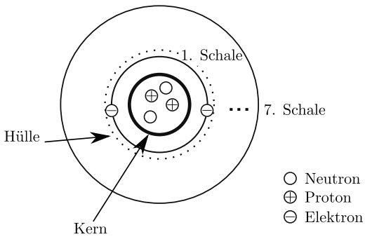

<details>
<summary>text_image</summary>

1. Schale
7. Schale
Hülle
Kern
○ Neutron
⊕ Proton
⊖ Elektron
</details>

Abb. 1.1: Das Bohr’sche Atommodell.

Ladungen lassen sich nicht in beliebig kleine Teilladungen aufteilen. Es gibt vielmehr eine kleinste Ladungsmenge, die so genannte **Elementarladung** e. Eine beliebige Ladung ist immer ein ganzzahliges Vielfaches $(n = 1,2,\cdots \infty)$ dieser Elementarladung:

$$
Q = n \cdot e \quad \text {mit} \quad n \in \mathbb {N}. \tag {1.1}
$$

Das Atom besteht aus einem Kern und einer Hülle. Den Kern bilden **Protonen**, die jeweils die Ladung +e tragen, und **Neutronen**, die ungeladen sind. Die den Kern auf bis zu sieben Schalen umkreisenden **Elektronen**, die alle die Ladung −e haben, stellen die Atomhülle dar. Die Ladungen von Kern und Hülle sind gleich groß, jedoch von entgegengesetztem Vorzeichen, so dass das Atom insgesamt elektrisch neutral ist. Als Träger der Masse des Atoms ist im Wesentlichen der Kern anzusehen, da die Elektro nen eine etwa 1840-mal kleinere Masse als die Protonen und die Neutronen besitzen. Das hier skizzierte Atommodell in Bild 1.1 geht auf die Vorstellungen von Nils Bohr zurück und wird wegen der nahe liegenden Analogie als Bohr’sches Planetenmodell des Atoms bezeichnet. Die Elektronen eines Atoms sind umso stärker an den Kern»gebunden«, je geringer der Abstand zwischen Kern und Elektron ist. Bei manchen Stoffen lassen sich Elektronen der äußersten Schale wegen der geringeren Bindekräfte aus dem Atomverband herauslösen. Es entsteht ein positives **Ion** (= Kation). Nimmt dagegen die äußerste Schale Elektronen auf, so erhält man ein negatives Ion (= Anion).

## 1.4 Der elektrische Strom

Der Strom kann mit einer Flüssigkeitsmenge verglichen werden, die innerhalb einer bestimmten Zeit einen gegebenen Querschnitt durchströmt. Die Stärke der Strömung charakterisiert man durch den Quotienten aus Menge und Zeit und nennt ihn die Stromstärke oder einfach den Strom. Zusätzlich ist der Strom durch seine Richtung gekennzeichnet. Entsprechend definiert man den **elektrischen Strom**:

$$
I _ {\mathrm{m}} = \frac {\Delta Q}{\Delta t}. \tag {1.2}
$$

---

1.4 Der elektrische Strom

7

Dabei bedeuten ∆Q die innerhalb des Zeitraums ∆t durch den betrachteten Querschnitt hindurchtretende Ladung und $I _ { \mathbf { m } }$ die mittlere Stromstärke während des Zeitraums ∆t. Wenn zu gleichen Zeitintervallen $\Delta t$ unterschiedliche Ladungen gehören, gibt man den Augenblickswert des Stromes an:

$$
i (t) = \lim _ {\Delta t \to 0} \frac {\Delta Q}{\Delta t} = \frac {\mathrm{d} Q}{\mathrm{d} t}. \tag {1.3}
$$

Löst man die Gl. (1.2) nach der Ladung auf, erhält man die während des Zeitraums ∆t transportierte Ladung:

$$
\Delta Q = I _ {\mathrm{m}} \Delta t. \tag {1.4}
$$

Ist die Stromstärke während des Zeitraums $\Delta t$ konstant, so schreibt man an Stelle des Mittelwertes $I _ { \mathbf { m } }$ einfach I:

$$
\Delta Q = I \Delta t. \tag {1.5}
$$

Bei beliebigem zeitlichen Verlauf des Stromes kann die Ladung, die zwischen den Zeitpunkten $t _ { 1 }$ und $t _ { 2 }$ durch den betrachteten Querschnitt hindurchtritt, wegen Gl. (1.3) durch folgende Integration bestimmt werden:

$$
Q = \int_ {t _ {1}} ^ {t _ {2}} i (t) \mathrm{d} t. \tag {1.6}
$$

Zeitlich konstante Größen werden durch große Buchstaben gekennzeichnet (z. B. Strom I), zeitlich veränderliche Größen dagegen durch kleine Buchstaben (z. B. Strom i). Die durch die Gln. (1.2) bis (1.6) beschriebenen Zusammenhänge werden in Bild 1.2 veranschaulicht, und zwar einmal für einen zeitlich konstanten Strom, man spricht hier von einem **reinen Gleichstrom**. Im anderen Fall ist der Strom eine periodische Funktion mit der Periode T, wobei innerhalb dieser Periode genau so viel Ladung in der einen wie in der anderen Richtung, im Mittel also gar keine Ladung transportiert wird. Einen solchen Strom nennt man einen **reinen Wechselstrom**. Da die Ladung nach Gleichung (1.1) ein Vielfaches der Elementarladung e, bzw. nach Gleichung (1.6) die zeitliche Integration des Stromes ist, ist die Einheit Ladung gleich der Einheit der Elementarladung

$$
[ \Delta Q ] = [ n ] [ e ] = [ I ] [ \Delta t ] = 1 \mathrm{A} \cdot 1 \mathrm{s}.
$$

Damit ist die Einheit der Ladung 1 Amperesekunde. Da diese Einheit häufig vorkommt, hat sie einen speziellen Namen erhalten:

$$
1 \mathrm{As} = 1 \text {Coulomb} = 1 \mathrm{C}.
$$

Dem elektrischen Strom ist willkürlich eine Richtung zugeordnet worden: Man be trachtet die Bewegungsrichtung positiver Ladungsträger als die positive Stromrichtung und spricht auch von der **konventionellen** oder **technischen Stromrichtung**. Die Bewegungsrichtung der negativen Elektronen wie z. B. in einer Elektronenröhre stimmt

---

8

1 Einheiten, Gleichungen und grundlegende Begriffe

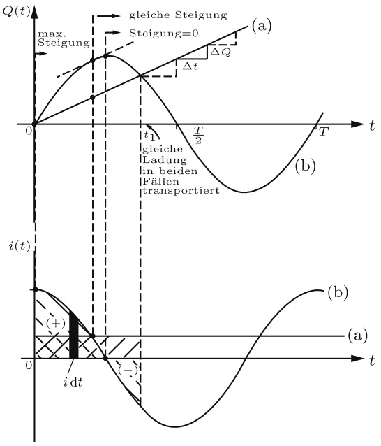

<details>
<summary>line</summary>

| Time (t) | Q(t) | i(t) |
| --- | --- | --- |
| 0 | 0 | Positive Peak |
| t1 | Steigung | Negative Trough |
| T/2 | Steigung | Zero Crossing |
| T | Steigung | Positive Peak |
</details>

Abb. 1.2: Zusammenhang zwischen transportierter Ladung und Stromstärke. (a) reiner Gleichstrom (b) reiner Wechselstrom.

dann also nicht mit der konventionellen Stromrichtung überein (Bild 1.3). Man teilt die Stoffe nach ihrer Fähigkeit, den Strom zu leiten, in **Leiter**, **Nichtleiter** und **Halbleiter** ein. Zu den Leitern gehören die Metalle und die Elektrolyte (Säuren und Salzlösungen). Bei diesen Stoffen sind die Ladungsträger frei beweglich. Halbleiter unterscheiden sich in dieser Hinsicht nicht von den Leitern, nur ist die Dichte der frei beweglichen Ladungsträger um Zehnerpotenzen geringer. Beispiele für Halbleiter sind Silizium, Germanium, Selen. Nichtleiter besitzen dagegen keine frei beweglichen Ladungsträger. Hier sind nur geringe Ladungsverschiebungen oder Drehungen (bei Dipolen) möglich. Als Beispiele für Nichtleiter seien genannt: Porzellan, Gummi, Hartpapier.

Die frei beweglichen Ladungsträger in Metallen bewegen sich ungeordnet auf Zickzackbahnen (»Elektronengas«, »Elektronenwolke«). Ein Strom durch den Leiter kommt erst zustande, wenn sich dieser statistisch verteilten Bewegung eine Bewegung in einer Vorzugsrichtung überlagert (Driftbewegung).

Der elektrische Strom ist im Wesentlichen durch drei Wirkungen gekennzeichnet:

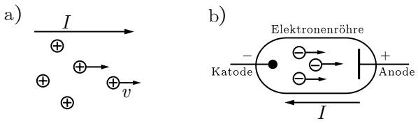

Abb. 1.3: a) Konventionelle Stromrichtung; b) Bewegungsrichtung der Elektronen in einer Elektronenröhre.

---

1.5 Die elektrische Spannung

9

1. Jeder Strom ist von einem Magnetfeld begleitet (Bild 1.4). Seine Wirkung lässt sich z. B. zur Messung durch ein Drehspulinstrument auswerten.
2. Der Stromfluss ist vor allem bei den Elektrolyten mit einem Stofftransport verbunden. Früher wurde die Einheit der Stromstärke durch das sog. »Silberampere«definiert, d. h. durch die bei Stromfluss innerhalb einer gewissen Zeit aus einer Silbersalzlösung ausgeschiedene Menge Silber.
3. Ein von einem Strom durchflossener Leiter erwärmt sich. Diese Wirkung wird bei der Strommessung durch Hitzdrahtamperemeter ausgenutzt.

## Beispiel 1.1: Geschwindigkeit freier Elektronen im Leiter.

Durch einen Kupferdraht mit dem Querschnitt $A = 50    mm ^2$ fließt der Strom $I = 2 0 0   \mathrm { A }$ Wie groß ist die mittlere Geschwindigkeit (Driftgeschwindigkeit) der freien Elektronen, wenn deren Dichte $N = 8 , 5 \cdot 1 0 ^ { 1 9 }   \mathrm { m m } ^ { - 3 }$ beträgt?

## Lösung:

Der Weg ∆x wird in der Zeit ∆t zurückgelegt. Während dieser Zeit wird die Ladung

$$
\Delta Q = I \Delta t \quad \text { mit } \quad \Delta Q = e N \Delta x A
$$

transportiert (Bild 1.5). Damit folgt

$$
\frac {\Delta x}{\Delta t} = \nu = \frac {I}{e N A} \approx 0, 3 \frac {\mathrm{mm}}{\mathrm{s}}.
$$

## 1.5 Die elektrische Spannung

Im letzten Abschnitt wurde die Frage nach der Ursache für den elektrischen Strom offengelassen. Es liegt nahe, dass eine Kraft erforderlich ist, um die Ladungen im Leiter zu bewegen, und dass mit der Bewegung ein Energieumsatz verbunden ist. Das wird verdeutlicht an Hand von Bild 1.6, in dem zwei Ladungen $Q$ und $q$ dargestellt sind. Haben beide Ladungen gleiches Vorzeichen, so stoßen sie sich nach Abschnitt 1.3 ab. Bei einer Bewegung der Ladung q von A nach B nimmt die potentielle Energie dieser Ladung ab, etwa von $W _ { A }$ auf $W _ { B }$ . Die Energiedifferenz wird in kinetische Energie umgewandelt. Damit ist der Vorgang analog zur Bewegung einer Masse im Schwerefeld der Erde: Ein von A nach B fallender Stein gewinnt eine kinetische Energie, die gleich

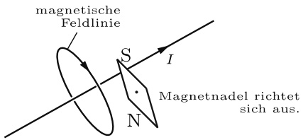

<details>
<summary>text_image</summary>

magnetische
Feldlinie
S
I
Magnetnadel richtet
sich aus.
N
</details>

Abb. 1.4: Magnetische Wirkung des elektrischen Stromes.

---

10

1 Einheiten, Gleichungen und grundlegende Begriffe

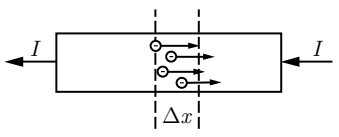

<details>
<summary>text_image</summary>

I
Δx
I
</details>

Abb. 1.5: Zur Berechnung der Driftgeschwindigkeit.

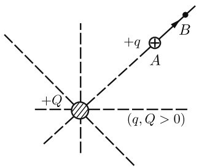

<details>
<summary>text_image</summary>

+q
A
B
+Q
(q, Q > 0)
</details>

Abb. 1.6: Zur Änderung der potentiellen Energie beim Verschieben der Ladung q von A nach B.

der Abnahme seiner potentiellen Energie ist. So wie diese potentielle Energie der Masse proportional ist, so erweist sich die potentielle Energie des Ladungsträgers als der Ladung proportional:

$$
W _ {A} - W _ {B} \sim q.
$$

Man führt als Proportionalitätsfaktor auf der rechten Seite die **elektrische Spannung** ein, die mit U bezeichnet wird. Damit haben wir

$$
\frac {W _ {A} - W _ {B}}{q} = \frac {W _ {A B}}{q} = U _ {A B}, \tag {1.7}
$$

wobei der Index bei U ausdrückt, dass die Spannung zwischen den Punkten A und B gemeint ist.

Ganz allgemein nennt man eine Einrichtung, in der die bewegten Ladungen potentielle Energie abgeben, einen **Verbraucher** und den Quotienten nach Gl. (1.7) den **Spannungsabfall** U (oder einfach die Spannung U an dem Verbraucher). Einrichtungen, die die potentielle Energie der Ladungen erhöhen, bezeichnet man als **Erzeuger** , Spannungsquellen oder Generatoren und die gemäß Gl. (1.7) definierte Spannung als **Quellenspannung** $U _ { \mathrm { q } }$ oder U.

Die Ausdrücke Verbraucher und Erzeuger haben sich eingebürgert, obwohl in ihnen Energie weder verbraucht noch erzeugt, sondern nur in andere Energieformen umgesetzt wird, z. B. elektrische Energie in Wärme im stromdurchflossenen Leiter oder mechanische in elektrische Energie in der Dynamomaschine.

Die Richtung der Spannung wählt man bei einem Verbraucher im Allgemeinen genauso wie die des Stromes. (Die möglichen Zuordnungen kommen in Abschnitt 2.4.1 zur Sprache.) Damit gibt der Spannungspfeil die Bewegungsrichtung der positiven Ladungsträger bei Abgabe potentieller Energie an. Bei Zunahme der potentiellen Energie – also bei Generatoren – ist konsequenterweise der Spannungspfeil entgegengesetzt zum Strompfeil einzutragen (Bild 1.7). Den Anschlussklemmen von Verbrauchern und Generatoren ordnet man Vorzeichen zu, und zwar so, dass außerhalb des Generators der Strom vom positiven zum negativen Pol oder Anschluss fließt, somit innerhalb des

---

1.6 Der elektrische Widerstand

11

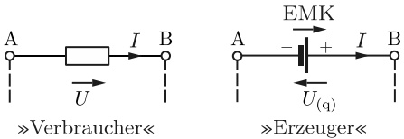

Abb. 1.7: Richtung von Strom und Spannung bei Verbrauchern und Erzeugern.

Generators vom negativen zum positiven Anschluss (Bild 1.7). Die Spannung ist bei Verbrauchern und Generatoren stets vom Pluspol zum Minuspol gerichtet. Aus Gl. (1.7) ergibt sich eine mögliche Einheit der Spannung zu

$$
[ U ] = \frac {[ W ]}{[ q ]} = \frac {1 \mathrm{J}}{1 \mathrm{As}} = \frac {1 \mathrm{W}}{1 \mathrm{A}},
$$

wofür man abkürzend schreibt:

$$
\frac {1 \mathrm{W}}{1 \mathrm{A}} = 1 \mathrm{Volt} = 1 \mathrm{V}.
$$

## 1.6 Der elektrische Widerstand

Um einen elektrischen Strom durch einen Leiter zu treiben, ist Energie erforderlich, da der Leiter der freien Bewegung der Ladungen einen Widerstand entgegensetzt. Je größer der Strom durch den Leiter (Bild 1.8) werden soll, desto größer muss im allgemeinen die Spannung zwischen den Leiterenden A und B sein. Man definiert als **Widerstand** $R _ { \mathrm { A B } }$ des Leiters den Quotienten aus Spannung $U _ { \mathrm { A B } }$ und Strom I:

$$
R _ {\mathrm{AB}} = \frac {U _ {\mathrm{AB}}}{I}. \tag {1.8}
$$

Dieser Quotient kann vom Strom abhängen, aber auch konstant sein (s. Abschnitt 2.1.1). In manchen Fällen, z. B. zur Charakterisierung nichtlinearer Zweipole (Abschnitt 2.5.1), ist es zweckmäßig, mit einem **differenziellen Widerstand** $r _ { \mathrm { A B } }$ zu arbeiten, der so definiert ist:

$$
r _ {\mathrm{AB}} = \frac {\mathrm{d} U _ {\mathrm{AB}}}{\mathrm{d} I}. \tag {1.9}
$$

Eine Einheit des Widerstandes kann aus Gl. (1.8) hergeleitet werden:

$$
[ R ] = \frac {[ U ]}{[ I ]} = \frac {1 \mathrm{V}}{1 \mathrm{A}}.
$$

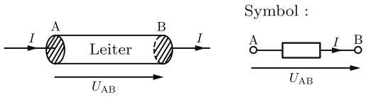

Abb. 1.8: Zur Definition des Widerstandes $R _ { \mathsf { A B } }$

---

12

1 Einheiten, Gleichungen und grundlegende Begriffe

Für den Quotienten schreibt man abkürzend

$$
1 \frac {\mathrm{V}}{\mathrm{A}} = 1 \mathrm{Ohm} = 1 \Omega .
$$

Den Kehrwert des Widerstandes R nennt man den **Leitwert** G

$$
G = \frac {1}{R} \tag {1.10}
$$

mit der möglichen Einheit $\Omega ^ { - 1 }$ , die einen speziellen Namen erhalten hat:

$$
\frac {1}{\Omega} = 1 \text {Siemens} = 1 \mathrm{S}.
$$

Bei einem homogenen Leiter von gleichbleibendem Querschnitt A und der Länge l ist der Widerstand erfahrungsgemäß der Länge proportional und dem Querschnitt umgekehrt proportional:

$$
R \sim \frac {l}{A}.
$$

Den Proportionalitätsfaktor auf der rechten Seite nennt man den **spezifischen Widerstand** $\varrho$ des Leitermaterials, seinen Kehrwert bezeichnet man als die **elektrische Leitfähigkeit** $\gamma .$ Damit hat man

$$
R = \varrho \frac {l}{A} = \frac {l}{\gamma A}. \tag {1.11}
$$

Für die Leitfähigkeit werden vielfach auch die Bezeichnungen $\sigma$ und κ verwendet. Wir halten uns jedoch hier wie an anderen Stellen an die Empfehlungen von DIN 1304 und ziehen die Bezeichnung γ vor.

Als Einheiten für die Größen ϱ und γ lassen sich mit (1.11) herleiten:

$$
[ \varrho ] = \frac {[ R ] [ A ]}{[ l ]} = \frac {\Omega \mathrm{m} ^ {2}}{\mathrm{m}} = \Omega \mathrm{m}
$$

$$
[ \gamma ] = \frac {[ l ]}{[ R ] [ A ]} = \frac {\mathrm{m}}{\Omega \mathrm{m} ^ {2}} = \frac {\mathrm{S}}{\mathrm{m}}.
$$

## Beispiel 1.2: »Widerstandsnormal«.

Ein Quecksilberfaden von 1 mm<sup>2</sup> Querschnitt soll als »Widerstandsnormal« dienen und den Widerstand 1 Ω haben. Wie lang muss der Faden sein, wenn der spezifische Widerstand von Quecksilber 0,958 $\Omega \frac { \mathrm { m m } ^ { 2 } } { \mathrm { m } }$ beträgt?

## Lösung:

Gl. (1.11) wird nach l aufgelöst:

$$
l = \frac {R A}{\varrho} = \frac {1 \Omega \cdot 1 \mathrm{mm} ^ {2}}{0 , 9 5 8 \Omega \frac {\mathrm{mm} ^ {2}}{\mathrm{m}}} \approx 1, 0 4 \mathrm{m}.
$$

---

1.7 Energie und Leistung

13

## 1.7 Energie und Leistung

Wird eine elektrische Ladung von einem Punkt zu einem anderen bewegt und besteht zwischen diesen beiden Punkten die zeitlich konstante Spannung U, so ist diese Bewegung nach Gl. (1.7) mit einem Energieumsatz von

$$
W = Q U \tag {1.12}
$$

verbunden. Ist nun die Spannung nicht mehr zeitlich konstant, so dass während eines ersten Zeitintervalls $\Delta t _ { 1 }$ die von der Ladung $\Delta Q _ { 1 }$ durchlaufene Spannung $U _ { 1 }$ beträgt und im nächsten Zeitintervall $\Delta t _ { 2 }$ dann zu der Ladung $\Delta Q _ { 2 }$ die Spannung $U _ { 2 }$ gehört usw., so erhält man an Stelle von Gl. (1.12):

$$
W = U _ {1} \Delta Q _ {1} + U _ {2} \Delta Q _ {2} + \dots \tag {1.13}
$$

Durchläuft z. B. die Ladung $\Delta Q _ { 1 }$ die Spannung $U _ { 1 }$ in der Zeit $\Delta t _ { 1 }$ , so kann man für $\Delta Q _ { 1 }$ wegen Gl. (1.5) auch schreiben:

$$
\Delta Q _ {1} = I _ {1} \Delta t _ {1}.
$$

Entsprechendes gilt für die anderen Summanden in Gl. (1.13), so dass folgt:

$$
W = U _ {1} I _ {1} \Delta t _ {1} + U _ {2} I _ {2} \Delta t _ {2} + \dots = \sum_ {k} U _ {k} I _ {k} \Delta t _ {k}.
$$

Hierbei werden $U _ { k }$ und $I _ { k }$ während der Zeitintervalle $\Delta t _ { k }$ als konstant angesehen (daher große Buchstaben). Geht man zum Grenzwert der Summe $( \Delta t _ { k } \rightarrow 0 )$ und damit zum Integral über, so erhält man die zwischen den Zeitpunkten $t _ { 1 }$ und $t _ { 2 }$ umgesetzte elektrische Energie:

$$
W = \int_ {t _ {1}} ^ {t _ {2}} u (t) i (t) \mathrm{d} t. \tag {1.14}
$$

Für den Sonderfall eines reinen Gleichstroms (u und i sind konstant) wird die im Zeitraum t umgesetzte Energie

$$
W = U I t. \tag {1.15}
$$

Eine mögliche Einheit der Energie ergibt sich wegen Gl. (1.15) zu

$$
[ W ] = [ U ] [ I ] [ t ] = 1 \mathrm{V} \cdot 1 \mathrm{A} \cdot 1 \mathrm{s} = 1 \mathrm{Ws} = 1 \mathrm{J},
$$

womit wir uns in Übereinstimmung mit Abschnitt 1.1.3 befinden. Für viele Zwecke, z. B. bei einem Energieversorger, ist die Maßeinheit Ws zu klein, dann verwendet man oft die Einheit Kilowattstunde:

$$
1 \mathrm{kWh} = 3, 6 \cdot 1 0 ^ {6} \mathrm{Ws}.
$$

---

14

1 Einheiten, Gleichungen und grundlegende Begriffe

Gelegentlich braucht man die folgenden Umrechnungen:

$$
1 \mathrm{Ws} = 0, 1 0 2 \mathrm{kp} \mathrm{m} = 0, 2 3 9 \mathrm{cal},
$$

$$
1 \mathrm{kWh} = 8 6 0 \mathrm{kcal}.
$$

In Abschnitt 1.1.3 wurde die Leistung als Arbeit pro Zeit definiert, also

$$
P = \frac {W}{t},
$$

womit nach Gl. (1.15) für Gleichstrom herauskommt

$$
P = U I. \tag {1.16}
$$

Ist die Leistung eine zeitlich veränderliche Größe, so wird der zeitliche Mittelwert der im Zeitraum ∆t umgesetzten Leistung

$$
P _ {\mathrm{m}} = \frac {\Delta W}{\Delta t}
$$

und der Augenblickswert

$$
p (t) = \lim _ {\Delta t \to 0} \frac {\Delta W}{\Delta t} = \frac {\mathrm{d} W}{\mathrm{d} t}. \tag {1.17}
$$

---

# 2 Berechnung von Strömen und Spannungen in elektrischen Netzen

## 2.1 Die Grundgesetze

## 2.1.1 Das Ohm’sche Gesetz

Wenn auf die Leitungselektronen des Widerstandes R eine Kraft wirkt (Bild 2.1), so fließt im Widerstand ein Strom I. Dieser Strom wächst, wenn U größer wird; der Strom wächst aber auch, wenn der Wert R des Widerstandes abnimmt. Speziell in einem metallischen Leiter von konstanter Form und Größe ist der Strom der Spannung **streng proportional** (Bild 2.2), solange auch die **Temperatur konstant** gehalten wird:

$$
I \sim U. \tag {2.1}
$$

Diese Proportionalität zwischen Spannung und Strom in metallischen Leitern nennt man **Ohm’sches Gesetz**. Normalerweise schreibt man statt der Proportionalität eine Gleichung mit dem Proportionalitätsfaktor R, dem sogenannten ohmschen Widerstand:

$$
U = R I \quad (\text {mit} R = k o n s t) . \tag {2.2a}
$$

Umgeformt ergibt dies

$$
I = \frac {U}{R} \tag {2.2b}
$$

oder

$$
R = \frac {U}{I}. \tag {2.2c}
$$

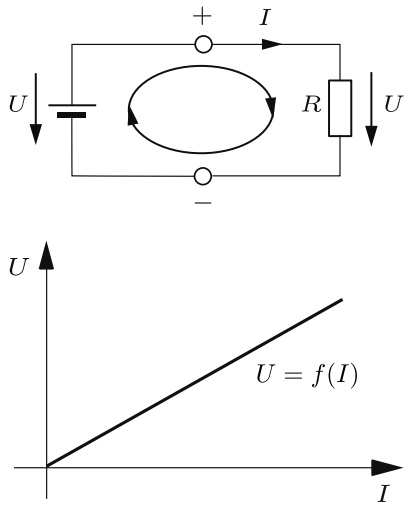

Abb. 2.1: Stromkreis aus Batterie und Widerstand.

Abb. 2.2: Kennlinie $U = f ( I )$ eines ohmschen Widerstandes.

https://doi.org/10.1515/9783110631586-002

---

16

2 Berechnung von Strömen und Spannungen in elektrischen Netzen

Das Bild 2.2 stellt dar, dass der Zusammenhang zwischen U und I eine Gerade ist. Man spricht deshalb auch davon, dass U und I **linear** zusammenhängen (Linearität der Strom-Spannungs-Kennlinie $U = f ( I ) )$ . Den Kehrwert des Widerstandes R nennt man **Leitwert**

$$
G = \frac {1}{R}. \tag {2.3}
$$

Damit wird aus den Gln. (2.2)

$$
U = \frac {I}{G}; \quad I = G U; \quad G = \frac {I}{U}. \tag {2.4a,b,c}
$$

Bemerkenswert ist, dass in der deutschen Sprache zwischen dem Bauelement »Widerstand« und seinem Widerstandswert nicht unterschieden wird. (Im Englischen heißt das Bauelement **resistor** und sein Widerstandswert **resistance** .)

**Anmerkung** Temperaturabhängigkeit von Widerständen: In einem metallischen Leiter gilt das Ohm’sche Gesetz $I \sim U$ nur, solange die Temperatur konstant ist. Der Widerstand solcher Leiter ist also stromunabhängig, aber temperaturabhängig; er nimmt im Allgemeinen mit der Temperatur zu. Bei reinen Metallen (außer den ferromagnetischen) ist der spezifische Widerstand ϱ oberhalb einer bestimmten Temperatur eine nahezu lineare Funktion der Temperatur ϑ (Bild 2.3).

Völlig anders als reine Metalle verhalten sich bestimmte Legierungen, bei denen der spezifische Widerstand innerhalb eines größeren Temperatur-Bereiches sogar abnimmt, wenn die Temperatur zunimmt. So nimmt beispielsweise der spezifische Widerstand von Manganin (86 % Cu, 12 % Mn, 2 % Ni) im Bereich von $3 5   ^ { \circ } \mathrm { C }$ bis $2 0 0   ^ { \circ } \mathrm { C }$ mit steigender Temperatur geringfügig ab (Bild 2.3).

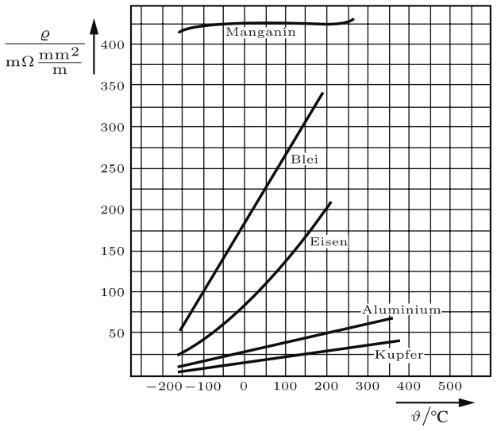

<details>
<summary>line</summary>

| \(\vartheta/{}^{\circ}C\) | Manganin (mΩ \(mm^{2}/m)\) | Blei (mΩ \(mm^{2}/m)\) | Eisen (mΩ \(mm^{2}/m)\) | Aluminium (mΩ \(mm^{2}/m)\) | Kupfer (mΩ \(mm^{2}/m)\) |
| --- | --- | --- | --- | --- | --- |
| -150 | ~415 | ~55 | ~25 | ~10 | ~5 |
| 0 | ~430 | ~180 | ~75 | ~25 | ~15 |
| 100 | ~430 | ~260 | ~130 | ~40 | ~25 |
| 200 | ~430 | ~340 | ~210 | ~50 | ~30 |
| 350 | — | — | — | ~65 | ~40 |
</details>

Abb. 2.3: Temperaturabhängigkeit spezifischer Widerstände.

---

2.1 Die Grundgesetze

17

Bei Temperaturen um $\vartheta = 2 0   ^ { \circ } \mathrm { C }$ beschreibt man das Verhalten von Widerstands-Materialien gern durch folgende Annäherung der Funktion $R = f ( \vartheta )$ an eine Geraden-Gleichung:

$$
R \approx R _ {2 0} \left[ 1 + \alpha_ {2 0} \left(\frac {\vartheta}{^ {\circ} \mathrm{C}} - 2 0\right) \mathrm{K} \right].
$$

Hierbei ist $R _ { 2 0 }$ der Wert, den ein ohmscher Widerstand bei $2 0   ^ { \circ } \mathrm { C }$ hat. $\alpha _ { 2 0 }$ ist der materialspezifische **Temperaturbeiwert** (Temperatur-Koeffizient); er ist ein Maß für die relative Zunahme des Widerstandswertes bei Erhöhung der Temperatur um 1 K. Je weniger linear die Funktion $R   =   f ( \vartheta )$ in Wirklichkeit ist, desto kleiner ist der Temperaturbereich, in dem die Annäherung durch eine Gerade brauchbar ist. Eine genauere Beschreibung der Temperatur-Abhängigkeit erreicht man folgendermaßen :

$$
R = R _ {2 0} \left[ 1 + \alpha_ {2 0} \left(\frac {\vartheta}{^ {\circ} \mathrm{C}} - 2 0\right) \mathrm{K} + \beta_ {2 0} \left(\frac {\vartheta}{^ {\circ} \mathrm{C}} - 2 0\right) ^ {2} \mathrm{K} ^ {2} + \dots \right].
$$

Hierbei treten zum linearen Term mit dem Koeffizienten α der quadratische Term mit dem Koeffizienten $\beta$ und eventuell noch mehr Terme hinzu.

In den folgenden Tabellen sind die spezifischen Widerstände $\varrho ,$ die spezifischen Leitwerte $\gamma = 1 / \varrho$ und die Temperaturbeiwerte α und $\beta$ für einige wichtige Stoffe zusammengestellt (alle Werte gelten für $\vartheta = 2 0   ^ { \circ } \mathsf { C } )$

In diesen Tabellen gibt $\varrho _ { 2 0 }$ den spezifischen Widerstand bei $2 0   ^ { \circ } \mathrm { C }$ an. Da $\varrho _ { 2 0 }$ in $\mathtt { \Omega m m } ^ { 2 } ,$ /m angegeben wird, geben die Zahlenwerte in der ersten Spalte der Tabellen unmittelbar an, wie viel Ohm ein Widerstand (Draht) von 1 m Länge und $1   \mathrm { m m } ^ { 2 }$ Querschnitt hat. So ist z. B. der Widerstandswert eines Konstantandrahtes von 1 m Länge und $1   \mathrm { { m m } ^ { 2 } }$ Querschnitt: $R = 0 , 5 \Omega$

Tab. 2.1: Spezifischer Widerstand, Leitwert und Temperaturbeiwerte von Reinmetallen.

| Material | $\frac{\varrho_{20}}{\Omega\frac{mm^2}{m}}$ | $\frac{\gamma_{20}}{S\frac{m}{mm^2}}$ | $\frac{\alpha_{20}}{1/K}$ | $\frac{\beta}{1/K^2}$ |
| --- | --- | --- | --- | --- |
| Aluminium | 0,027 | 37 | $4,3 \cdot 10^{-3}$ | $1,3 \cdot 10^{-6}$ |
| Blei | 0,21 | 4,75 | $3,9 \cdot 10^{-3}$ | $2,0 \cdot 10^{-6}$ |
| Eisen | 0,1 | 10 | $6,5 \cdot 10^{-3}$ | $6,0 \cdot 10^{-6}$ |
| Gold | 0,022 | 45,2 | $3,8 \cdot 10^{-3}$ | $0,5 \cdot 10^{-6}$ |
| Kupfer | 0,017 | 58 | $4,3 \cdot 10^{-3}$ | $0,6 \cdot 10^{-6}$ |
| Nickel | 0,07 | 14,3 | $6,0 \cdot 10^{-3}$ | $9,0 \cdot 10^{-6}$ |
| Platin | 0,098 | 10,5 | $3,5 \cdot 10^{-3}$ | $0,6 \cdot 10^{-6}$ |
| Quecksilber | 0,96 | 1,04 | $0,8 \cdot 10^{-3}$ | $1,2 \cdot 10^{-6}$ |
| Silber | 0,016 | 62,5 | $3,6 \cdot 10^{-3}$ | $0,7 \cdot 10^{-6}$ |
| Zinn | 0,12 | 8,33 | $4,3 \cdot 10^{-3}$ | $6,0 \cdot 10^{-6}$ |

---

18

2 Berechnung von Strömen und Spannungen in elektrischen Netzen

Tab. 2.2: Spezifischer Widerstand, Leitwert und Temperaturbeiwert von Legierungen.

| Material | $\frac{\varrho_{20}}{\Omega \frac{mm^2}{m}}$ | $\frac{\gamma_{20}}{S \frac{m}{mm^2}}$ | $\frac{\alpha_{20}}{1/K}$ |
| --- | --- | --- | --- |
| Konstantan (55 % Cu, 44 % Ni, 1 % Mn) | 0,5 | 2 | $-4,0 \cdot 10^{-5}$ |
| Manganin (86 % Cu, 2 % Ni, 12 % Mn) | 0,43 | 2,27 | $\pm 10^{-5}$ |
| Messing | 0,066 | 15 | $1,5 \cdot 10^{-3}$ |

Tab. 2.3: Spezifischer Widerstand, Leitwert und Temperaturbeiwert von Kohle und Halbleitern.

| Material | $\frac{\varrho_{20}}{\Omega \frac{mm^2}{m}}$ | $\frac{\gamma_{20}}{S \frac{m}{mm^2}}$ | $\frac{\alpha_{20}}{1/K}$ |
| --- | --- | --- | --- |
| Germanium (rein) | $4,6 \cdot 10^{5}$ | $2,2 \cdot 10^{-6}$ |  |
| Graphit | 8,7 | 0,115 |  |
| Kohle (Bürstenkohle) | 40...100 | 0,01...0,025 | $-2 \cdot 10^{-4} \cdots -8 \cdot 10^{-4}$ |
| Silizium (rein) | $2,3 \cdot 10^{9}$ | $0,43 \cdot 10^{-9}$ |  |

Tab. 2.4: Spezifischer Widerstand und Leitwert von Elektrolyten.

| Material | $\frac{\varrho_{20}}{\Omega \frac{mm^{2}}{m}}$ | $\frac{\gamma_{20}}{S \frac{m}{mm^{2}}}$ |
| --- | --- | --- |
| Kochsalzlösung (10 %) | $79 \cdot 10^{3}$ | $12,7 \cdot 10^{-6}$ |
| Schwefelsäure (10 %) | $25 \cdot 10^{3}$ | $40,0 \cdot 10^{-6}$ |
| Kupfersulfatlösung (10 %) | $300 \cdot 10^{3}$ | $3,3 \cdot 10^{-6}$ |
| Wasser (rein) | $2,5 \cdot 10^{11}$ | $4,0 \cdot 10^{-10}$ |
| Wasser (destilliert) | $4 \cdot 10^{10}$ | $2,5 \cdot 10^{-9}$ |
| Meerwasser | $300 \cdot 10^{3}$ | $3,3 \cdot 10^{-6}$ |

Tab. 2.5: Spezifischer Widerstand von Isolierstoffen.

| Material | $\frac{\varrho_{20}}{\Omega \frac{mm^2}{m}}$ |
| --- | --- |
| Bernstein | $10^{22}$ |
| Glas | $10^{17} \dots 10^{18}$ |
| Glimmer | $10^{19} \dots 10^{21}$ |
| Holz (trocken) | $10^{15} \dots 10^{19}$ |
| Papier | $10^{21} \dots 10^{22}$ |
| Porzellan | bis $5 \cdot 10^{18}$ |
| Transformer-Öl | $10^{16} \dots 10^{19}$ |

---

2.1 Die Grundgesetze

19

## Beispiel 2.1: Temperaturabhängigkeit eines Widerstandes.

Eine Spule aus Kupferdraht hat bei $1 5   ^ { \circ } \mathrm { C }$ den Widerstandswert 20 Ω und betriebswarm den Wert 28 Ω. Welche Temperatur hat die betriebswarme Spule?

## Lösung:

Zwischen dem Wert $R _ { \mathrm { k } } = 2 0   \Omega$ des Spulenwiderstandes bei $\vartheta _ { \mathrm { k } } = 1 5   ^ { \circ } \mathrm { C }$ und dem Wert $R _ { 2 0 }$ (Widerstand bei $2 0 ^ { \circ } \mathrm { C } )$ gilt die Beziehung

$$
R _ {\mathrm{k}} = R _ {2 0} \left[ 1 + \alpha_ {2 0} \left(\frac {\vartheta_ {\mathrm{k}}}{\mathrm{oC}} - 2 0\right) \mathrm{K} \right],
$$

und für $R _ { \mathrm { W } } = 2 8   \Omega$ gilt

$$
R _ {\mathrm{w}} = R _ {2 0} \left[ 1 + \alpha_ {2 0} \left(\frac {\vartheta_ {\mathrm{w}}}{\mathrm{oC}} - 2 0\right) \mathrm{K} \right].
$$

In diesen beiden Gleichungen sind $R _ { 2 0 }$ und $\vartheta _ { w }$ unbekannt. $R _ { 2 0 }$ kann sofort eliminiert werden:

$$
\frac {R _ {\mathrm{k}}}{R _ {\mathrm{w}}} = \frac {1 + \alpha_ {2 0} \left(\frac {\vartheta_ {\mathrm{k}}}{^ \circ \mathrm{C}} - 2 0\right) \mathrm{K}}{1 + \alpha_ {2 0} \left(\frac {\vartheta_ {\mathrm{w}}}{^ \circ \mathrm{C}} - 2 0\right) \mathrm{K}}.
$$

Daraus folgt mit $\alpha _ { 2 0 } \approx 4 \cdot 1 0 ^ { - 3 } / \mathrm { K }$

$$
\vartheta_ {\mathrm{w}} = 2 0 ^ {\circ} \mathrm{C} + \frac {R _ {\mathrm{w}}}{R _ {\mathrm{k}}} \left[ \frac {{} ^ {\circ} \mathrm{C} / \mathrm{K}}{\alpha_ {2 0}} + \vartheta_ {\mathrm{k}} - 2 0 ^ {\circ} \mathrm{C} \right] - \frac {{} ^ {\circ} \mathrm{C} / \mathrm{K}}{\alpha_ {2 0}}
$$

$$
\vartheta_ {\mathrm{w}} = 2 0 ^ {\circ} \mathrm{C} + 1, 4 \left[ \frac {1 0 ^ {3}}{4} ^ {\circ} \mathrm{C} - 5 ^ {\circ} \mathrm{C} \right] - \frac {1 0 ^ {3}}{4} ^ {\circ} \mathrm{C} = \underline {{\underline {{1 1 3 ^ {\circ} \mathrm{C}}}}}.
$$

## 2.1.2 Die Knotengleichung (1. Kirchhoff’sche Gleichung)

Wenn mehrere Leitungen (Zweige) in einem Knoten leitend miteinander verbunden sind (Bild 2.4a), ist die Summe der zufließenden Ströme $( I _ { 1 } , I _ { 2 } , I _ { 3 } )$ gleich der Summe der abfließenden Ströme $( I _ { 4 } , I _ { 5 } )$

$$
I _ {1} + I _ {2} + I _ {3} = I _ {4} + I _ {5}.
$$

Allgemein gilt

$$
\sum I _ {\mathrm{zu}} = \sum I _ {\mathrm{ab}}.
$$

In einem Knoten können keine Ladungen und damit auch keine Ströme verschwinden oder entstehen (ähnlich wie beim Zusammenfließen mehrerer Ströme einer inkompressiblen Flüssigkeit).

Wenn man für jeden Strom den Zählpfeil vom Knoten weg orientiert, also alle Ströme als abfließend definiert, so muss die Summe aller dieser Ströme Null werden; es ist daher (Bild 2.4b):

$$
I _ {1} + I _ {2} + I _ {3} + I _ {4} + I _ {5} = 0.
$$

---

20

2 Berechnung von Strömen und Spannungen in elektrischen Netzen

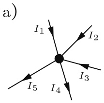

<details>
<summary>text_image</summary>

a)
I₁
I₂
I₃
I₄
I₅
</details>

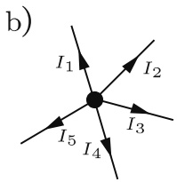

<details>
<summary>text_image</summary>

b)
I₁
I₂
I₃
I₄
I₅
</details>

Abb. 2.4: a) Knoten mit 3 zufließenden und 2 abfließenden Strömen; b) Knoten mit 5 abfließenden Strömen.

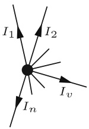

<details>
<summary>text_image</summary>

I₁
I₂
Iₙ
Iᵥ
</details>

Abb. 2.5: Knoten mit n abfließenden Strömen.

Allgemein gilt für einen Knoten, aus dem n Ströme abfließen (Bild 2.5):

$$
\sum_ {\nu = 1} ^ {n} I _ {\nu} = 0. \tag {2.5}
$$

Diese Gleichung bezeichnet man als 1. Kirchhoff’sche Gleichung oder als 1. Kirchhoff’sches Gesetz.

Die Gl. (2.5) gilt nicht nur für die Summe aller Ströme, die aus einem einzelnen Knoten abfließen, sondern sie gilt auch für die Summe der Ströme, die aus einem ganzen Netz abfließen. Das betrachtete Netz muss allerdings (wie zuvor der Knoten) der Bedingung genügen, dass in jedem einzelnen seiner Knoten und Schaltelemente die Gl. (2.5) gilt.

## Beispiel 2.2: Zweimaschiges Netz als Großknoten.

Ein Beispiel hierzu ist das in Bild 2.6 dargestellte Netz aus ohmschen Widerständen. Man kann das ganze Netz von außen als einen Großknoten mit den abfließenden Strömen $I _ { \mathrm { A } }$ $I _ { \mathrm { B } } ,$ , $I _ { \mathrm { C } }$ betrachten.

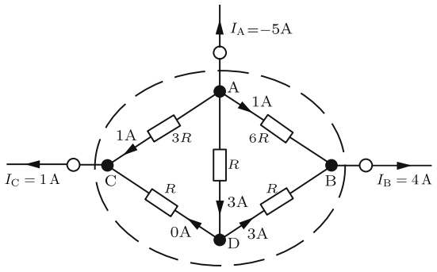

<details>
<summary>text_image</summary>

I_A = -5A
1A
3R
6R
1A
R
B
R
3A
0A
3A
D
C
I_C = 1 A
I_B = 4 A
</details>

Abb. 2.6: Zusammenfassung von vier Knoten zu einem Großknoten.

---

2.1 Die Grundgesetze

21

Für die abfließenden Ströme gilt auch hier:

$$
\sum I _ {\nu} = I _ {\mathrm{A}} + I _ {\mathrm{B}} + I _ {\mathrm{C}} = 0.
$$

Auch in den Knoten A, B, C, D ist hierbei die Bedingung (2.5) erfüllt.

## 2.1.3 Die Umlaufgleichung (2. Kirchhoff’sche Gleichung)

Bei der Darstellung des Ohm’schen Gesetzes in Bild 2.1 wird vorausgesetzt, dass an der Batterie dieselbe Spannung U anliegt wie am Widerstand. U tritt an der Batterie als Erzeugerspannung (Quellenspannung), im Widerstand als Verbraucherspannung (Spannungsabfall) auf.

Für den in Bild 2.1 dargestellten geschlossenen Stromkreis gilt

$$
\sum U _ {\nu} = 0. \tag {2.6}
$$

Hierbei ist $\sum U _ { \nu }$ die Summe aller Spannungen, die entlang eines geschlossenen Umlaufs im Uhrzeigersinn (oder im Gegenuhrzeigersinn) auftreten.

Wählt man, wie in Bild 2.1 eingezeichnet, einen geschlossenen Umlauf im Uhrzeigersinn und beginnt mit der Summenbildung an der Minusklemme, so liefert zunächst die Batterie den Beitrag −U (Minuszeichen, weil an der Batterie Spannungszählpfeil und gewählte Umlaufrichtung entgegengerichtet sind) und dann der Widerstand den Beitrag +U:

$$
\sum U _ {\nu} = - U + U = 0.
$$

## Beispiel 2.3: Umlaufgleichungen in einem zweimaschigen Netz.

Anstatt der einfachen Schaltung in Bild 2.1 soll nun eine verzweigte Schaltung nach Bild 2.7 betrachtet werden. Auch hier gilt Gl. (2.6) für jeden der drei möglichen geschlossenen Umläufe:

$$
\begin{array}{l} - U _ {\mathrm{q}} + U _ {1} \quad = 0 \quad (\text {linker Umlauf}) \\ - U _ {1} + U _ {2} + U _ {3} = 0 \quad \text {(rechter Umlauf)} \\ - U _ {\mathrm{q}} + U _ {2} + U _ {3} = 0 \quad \text {(großer Umlauf)}. \\ \end{array}
$$

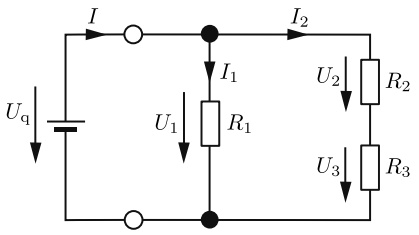

<details>
<summary>text_image</summary>

I
Uq
I1
R1
U1
I2
U2
R2
U3
R3
</details>

Abb. 2.7: Netz mit drei Zweigen.

---

22

2 Berechnung von Strömen und Spannungen in elektrischen Netzen

Die Gl. (2.6) lässt sich aus einer Leistungsbetrachtung begründen. Wir tun dies am Beispiel der Schaltung in Bild 2.7. Die Batterie gibt gemäß Gl. (1.16) die Leistung

$$
P _ {\mathrm{ab}} = I U _ {\mathrm{q}}
$$

$a b ,$ die Widerstände nehmen die Leistung

$$
P _ {\mathrm{auf}} = I _ {1} U _ {1} + I _ {2} U _ {2} + I _ {2} U _ {3}
$$

auf. Abgegebene und aufgenommene Leistung müssen gleich sein, also gilt

$$
I U _ {\mathrm{q}} = I _ {1} U _ {1} + I _ {2} (U _ {2} + U _ {3}).
$$

Wegen Gl. (2.5) ist $I = I _ { 1 } + I _ { 2 }$ ; damit wird

$$
I _ {1} U _ {\mathrm{q}} + I _ {2} U _ {\mathrm{q}} = I _ {1} U _ {1} + I _ {2} (U _ {2} + U _ {3}).
$$

Diese Gleichung muss auch erfüllt sein, wenn der Zweig mit $R _ { 2 }$ und $R _ { 3 }$ unterbrochen (d. h. $I _ { 2 } = 0 )$ wird; dann gilt

$$
I _ {1} U _ {\mathrm{q}} = I _ {1} U _ {1}
$$

$$
U _ {\mathrm{q}} = U _ {1}. \tag {2.6a}
$$

Sie muss aber auch erfüllt sein für $I_{1} = 0;$ ; dann ist

$$
I _ {2} U _ {\mathrm{q}} = I _ {2} (U _ {2} + U _ {3})
$$

$$
U _ {\mathrm{q}} = U _ {2} + U _ {3}. \tag {2.6b}
$$

Der Vergleich der Gln. (2.6a) und (2.6b) liefert

$$
U _ {1} = U _ {2} + U _ {3}. \tag {2.6c}
$$

Allgemein gilt auch in beliebig komplizierten Netzen auf jedem möglichen Umlauf, der n Spannungen umfasst:

$$
\sum_ {\nu = 1} ^ {n} U _ {\nu} = 0. \tag {2.7}
$$

Diese allgemein gültige Umlaufgleichung wird als 2. Kirchhoff’sche Gleichung oder als 2. Kirchhoff’sches Gesetz bezeichnet.

## Elektromotorische Kraft

Die Gl. (2.7) sagt aus, dass in einem geschlossenen Umlauf die Summe aller Spannungen gleich Null ist. Diese Aussage kann man auch so formulieren: in einem geschlossenen Umlauf ist die Summe der erzeugten Spannungen gleich der Summe der verbrauchten

---

2.2 Parallel- und Reihenschaltung

23

Spannungen. Früher versuchte man dieser Betrachtungsweise dadurch gerecht zu werden, dass man zwischen erzeugten und verbrauchten Spannungen stärker unterschied. Man bezeichnete eine Erzeuger(Generator)-Spannung gern als elektromotorische Kraft (EMK) mit dem Buchstaben E. Bild 2.8 zeigt, dass die Zählpfeile für U und E einander entgegengerichtet sind. Die 2. Kirchhoff’sche Gleichung lautet in dieser (veralteten) Darstellung

$$
\sum_ {\nu = 1} ^ {m} E _ {\nu} = \sum_ {\nu = 1} ^ {n} U _ {\nu}, \tag {2.8}
$$

d. h.: die Summe der m bei einem Umlauf durchlaufenen Erzeugerspannungen ist gleich der Summe der n bei diesem Umlauf durchlaufenen Verbraucherspannungen.

## 2.2 Parallel- und Reihenschaltung

## 2.2.1 Reihenschaltung von Widerständen

Bild 2.9 zeigt drei hintereinander geschaltete (in Reihe geschaltete) Widerstände. Nach dem Ohm’schen Gesetz, Gl. (2.2a) gilt

$$
U _ {1} = R _ {1} I _ {1} \tag {2.9a}
$$

$$
U _ {2} = R _ {2} I _ {2} \tag {2.9b}
$$

$$
U _ {3} = R _ {3} I _ {3}. \tag {2.9c}
$$

Die Addition dieser drei Gleichungen liefert

$$
U _ {1} + U _ {2} + U _ {3} = R _ {1} I _ {1} + R _ {2} I _ {2} + R _ {3} I _ {3}. \tag {2.10}
$$

Wegen des 1. Kirchhoff’schen Gesetzes, Gl. (2.5), gilt hier

$$
I _ {1} = I _ {2} = I _ {3} = I \tag {2.11}
$$

und wegen des 2. Kirchhoff’schen Gesetzes, Gl. (2.7),

$$
U _ {1} + U _ {2} + U _ {3} = U. \tag {2.12}
$$

Setzt man die Gln. (2.11) und (2.12) in (2.10) ein, so ergibt sich

$$
U = (R _ {1} + R _ {2} + R _ {3}) I. \tag {2.13}
$$

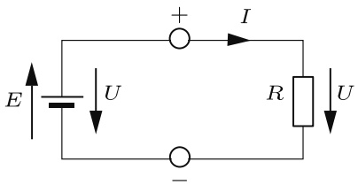

<details>
<summary>text_image</summary>

E
U
+
I
R
U
-
</details>

Abb. 2.8: EMK und Spannung einer Batterie.

---

24

2 Berechnung von Strömen und Spannungen in elektrischen Netzen

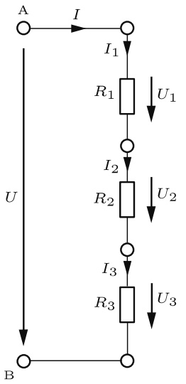

<details>
<summary>flowchart</summary>

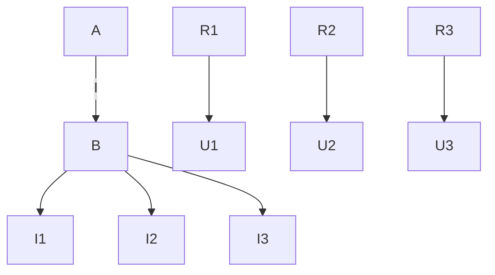
</details>

Abb. 2.9: Reihenschaltung dreier Widerstände.

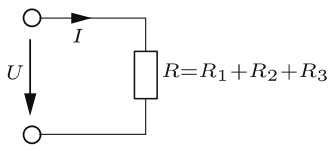

<details>
<summary>text_image</summary>

I
U
R=R₁+R₂+R₃
</details>

Abb. 2.10: Ergebnis einer Reihenschaltung.

Dies ist das Ohm’sche Gesetz für einen Widerstand von der Größe

$$
R = R _ {1} + R _ {2} + R _ {3}. \tag {2.14}
$$

Die drei in Reihe geschalteten Widerstände $R _ { 1 } , R _ { 2 } , R _ { 3 }$ (Bild 2.9) verhalten sich wie ein einziger Widerstand mit dem Wert $R = R _ { 1 } + R _ { 2 } + R _ { 3 }$ (Bild 2.10).

Den resultierenden Widerstand einer Reihenschaltung von n Widerständen erhält man also aus der Addition der Teilwiderstände:

$$
R = \sum_ {\nu = 1} ^ {n} R _ {\nu} \quad (\text {Reihenschaltung}). \tag {2.15}
$$

## 2.2.2 Spannungsteiler

Aus den Gln. (2.9a) und (2.11) folgt

$$
U _ {1} = R _ {1} I,
$$

und mit Gl. (2.13) gilt dann

$$
\frac {U _ {1}}{U} = \frac {R _ {1} I}{(R _ {1} + R _ {2} + R _ {3}) I} = \frac {R _ {1}}{R _ {1} + R _ {2} + R _ {3}}.
$$

Allgemein gilt für die Teilspannung $U _ { \nu }$ am ν-ten Teilwiderstand $R _ { \nu }$ einer Reihenschaltung aus n Widerständen:

$$
U _ {\nu} = \frac {R _ {\nu}}{\sum_ {\nu = 1} ^ {n} R _ {\nu}} U. \tag {2.16}
$$

---

2.2 Parallel- und Reihenschaltung

25

Speziell an einer Reihenschaltung aus zwei Teilwiderständen (Bild 2.11) gilt also

$$
U _ {2} = \frac {R _ {2}}{R _ {1} + R _ {2}} U \tag {2.17}
$$

und

$$
\frac {U _ {1}}{U _ {2}} = \frac {R _ {1}}{R _ {2}}. \tag {2.18}
$$

Die Schaltung in Bild 2.11 nennt man deswegen auch einen **Spannungsteiler**.

## 2.2.3 Parallelschaltung von Widerständen

Das Bild 2.12 zeigt drei parallelgeschaltete Widerstände mit den Leitwerten

$$
G _ {1} = \frac {1}{R _ {1}}, \quad G _ {2} = \frac {1}{R _ {2}}, \quad G _ {3} = \frac {1}{R _ {3}}.
$$

Wendet man die Darstellung (2.4b) des Ohm’schen Gesetzes auf die drei Zweige der Parallelschaltung an, so wird

$$
I _ {1} = G _ {1} U _ {1} \tag {2.19a}
$$

$$
I _ {2} = G _ {2} U _ {2} \tag {2.19b}
$$

$$
I _ {3} = G _ {3} U _ {3}. \tag {2.19c}
$$

Die Addition dieser drei Gleichungen liefert

$$
I _ {1} + I _ {2} + I _ {3} = G _ {1} U _ {1} + G _ {2} U _ {2} + G _ {3} U _ {3}. \tag {2.20}
$$

Wegen des 2. Kirchhoff’schen Gesetzes, Gl. (2.7), gilt hier

$$
U _ {1} = U _ {2} = U _ {3} = U \tag {2.21}
$$

und wegen des 1. Kirchhoff’schen Gesetzes, Gl. (2.5),

$$
I _ {1} + I _ {2} + I _ {3} = I. \tag {2.22}
$$

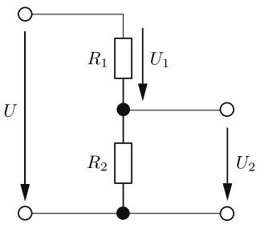

<details>
<summary>text_image</summary>

R₁
U₁
R₂
U₂
</details>

Abb. 2.11: Unbelasteter Spannungsteiler aus zwei ohmschen Widerständen.

---

26

2 Berechnung von Strömen und Spannungen in elektrischen Netzen

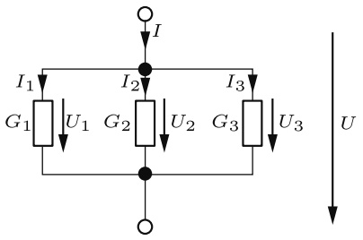

<details>
<summary>flowchart</summary>

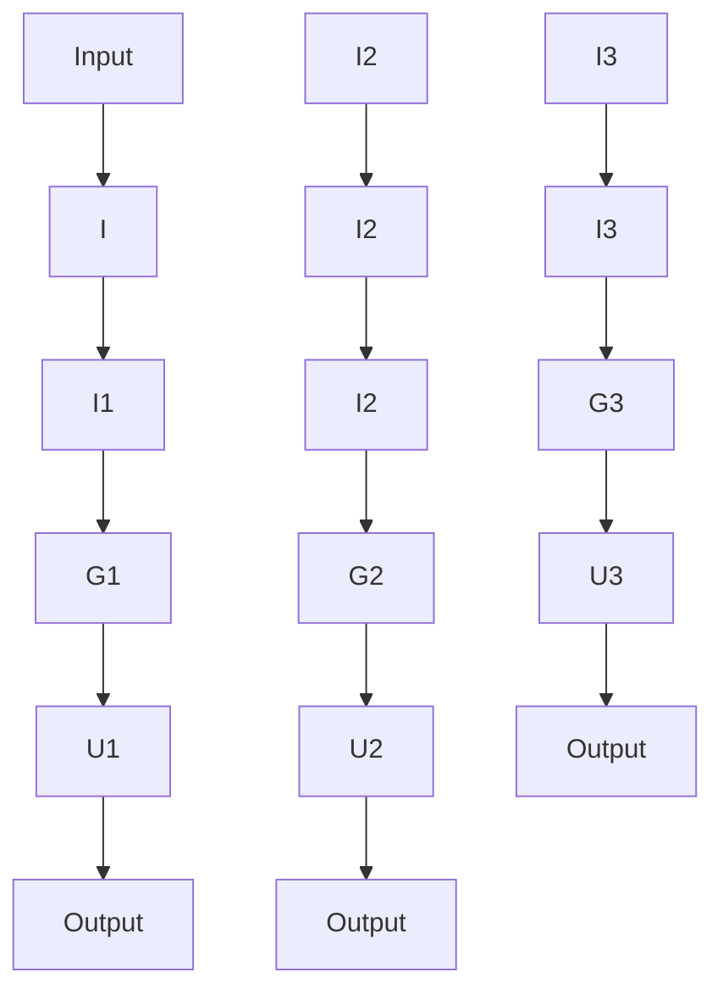
</details>

Abb. 2.12: Parallelschaltung dreier Widerstände.

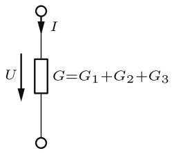

<details>
<summary>text_image</summary>

I
U
G=G₁+G₂+G₃
</details>

Abb. 2.13: Ergebnis einer Parallelschaltung.

Setzt man die Gln. (2.21) und (2.22) in Gl. (2.20) ein, so ergibt sich

$$
I = (G _ {1} + G _ {2} + G _ {3}) U. \tag {2.23}
$$

Dies ist das Ohm’sche Gesetz (2.4b) für einen Leitwert von der Größe

$$
G = G _ {1} + G _ {2} + G _ {3}, \tag {2.24}
$$

(Bild 2.13). D. h. die drei parallelgeschalteten Leitwerte $G _ { 1 } , G _ { 2 } , G _ { 3 }$ verhalten sich wie ein einziger Leitwert von der Größe $G = G _ { 1 } + G _ { 2 } + G _ { 3 }$

Den resultierenden Leitwert einer Parallelschaltung von n Leitwerten erhält man aus der Addition der Teilleitwerte:

$$
G = \sum_ {\nu = 1} ^ {n} G _ {\nu} \quad (\text {Parallelschaltung}). \tag {2.25}
$$

Der Gesamtwiderstand R einer Parallelschaltung von n Teilleitwerten ist demnach

$$
R = \frac {1}{G} = \frac {1}{G _ {1} + G _ {2} + \cdots + G _ {\nu} + \cdots + G _ {n}} = \frac {1}{\frac {1}{R _ {1}} + \frac {1}{R _ {2}} + \cdots + \frac {1}{R _ {\nu}} + \cdots + \frac {1}{R _ {n}}}
$$

$$
R = \frac {1}{\sum_ {\nu = 1} ^ {n} \frac {1}{R _ {\nu}}} . \tag {2.26}
$$

Vergleicht man die Darstellungen in Gl. (2.25) und Gl. (2.26) miteinander, so zeigt sich deutlich, dass bei Parallelschaltung bequemer mit Leitwerten als mit Widerständen zu rechnen ist.

Speziell für zwei parallelgeschaltete Widerstände (Bild 2.14) gilt

$$
R = \frac {1}{G} = \frac {1}{G _ {1} + G _ {2}} = \frac {1}{\frac {1}{R _ {1}} + \frac {1}{R _ {2}}} = \frac {R _ {1} R _ {2}}{R _ {1} + R _ {2}}. \tag {2.27}
$$

---

2.2 Parallel- und Reihenschaltung

27

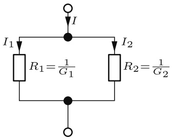

<details>
<summary>flowchart</summary>

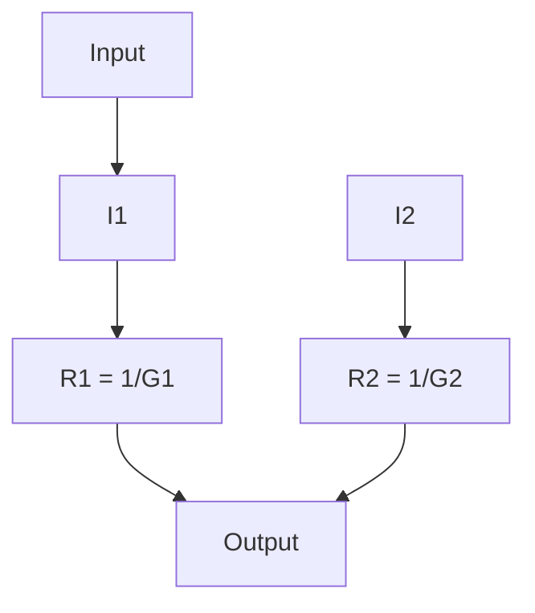
</details>

Abb. 2.14: Parallelschaltung zweier Widerstände.

## 2.2.4 Stromteiler

Aus den Gln. (2.19a) und (2.21) folgt

$$
I _ {1} = G _ {1} U
$$

und mit Gl. (2.23) gilt dann

$$
\frac {I _ {1}}{I} = \frac {G _ {1} U}{(G _ {1} + G _ {2} + G _ {3}) U} = \frac {G _ {1}}{G _ {1} + G _ {2} + G _ {3}}.
$$

Allgemein gilt für den Teilstrom $I _ { \nu }$ im ν-ten Teilleitwert $G _ { \nu }$ einer Parallelschaltung aus n Leitwerten:

$$
I _ {v} = \frac {G _ {v}}{\sum_ {v = 1} ^ {n} G _ {v}} I. \tag {2.28}
$$

Speziell an einer Parallelschaltung aus zwei Teilleitwerten (Bild 2.14) gilt also

$$
I _ {2} = \frac {G _ {2}}{G _ {1} + G _ {2}} I \tag {2.29a}
$$

$$
I _ {2} = \frac {\frac {1}{R _ {2}}}{\frac {1}{R _ {1}} + \frac {1}{R _ {2}}} I
$$

$$
I _ {2} = \frac {R _ {1}}{R _ {1} + R _ {2}} I \tag {2.29b}
$$

und

$$
\frac {I _ {1}}{I _ {2}} = \frac {G _ {1}}{G _ {2}}; \quad \frac {I _ {1}}{I _ {2}} = \frac {R _ {2}}{R _ {1}}. \tag {2.30a,b}
$$

## 2.2.5 Gruppenschaltung von Widerständen

In bestimmten Schaltungen lassen sich Gruppen von Widerständen zusammenfassen, die vom selben Strom durchflossen werden oder die an derselben Spannung liegen. Eine Schaltung, die sich ganz aus solchen Gruppen zusammensetzt, nennt man **Gruppenschaltung**.

---

28

2 Berechnung von Strömen und Spannungen in elektrischen Netzen

**Beispiel 2.4: Berechnung des resultierenden Widerstandes einer Gruppenschaltung.** In Bild 2.15 wird eine Schaltung dargestellt, deren Gesamtwiderstand

$$
R _ {\mathrm{CD}} = \frac {U}{I}
$$

sich leicht mit den Gln. (2.15) und (2.25) berechnen lässt :

$$
R _ {1, 2} = R _ {1} + R _ {2},
$$

$$
R _ {3, 4} = R _ {3} + R _ {4};
$$

$$
R _ {\mathrm{CD}} = \frac {1}{G _ {\mathrm{CD}}} = \frac {1}{\frac {1}{R _ {1 , 2}} + \frac {1}{R _ {3 , 4}}} = \frac {1}{\frac {1}{R _ {1} + R _ {2}} + \frac {1}{R _ {3} + R _ {4}}}
$$

$$
R _ {\mathrm{CD}} = \frac {(R _ {1} + R _ {2}) (R _ {3} + R _ {4})}{R _ {1} + R _ {2} + R _ {3} + R _ {4}}. \tag {2.31}
$$

Dagegen lässt sich eine Brückenschaltung (Bild 2.16) nicht einfach als Kombination von Reihen- und Parallelschaltungen auffassen, weil im Allgemeinen hier auch in $R _ { 5 }$ ein Strom fließen wird. Dann fließen durch $R _ { 1 }$ und $R _ { 2 }$ unterschiedliche Ströme: $R _ { 1 }$ und $R _ { 2 }$ bilden jetzt also keine Reihenschaltung. Das gleiche gilt für $R _ { 3 }$ und $R _ { 4 }$ . Ebenso treten in der Brückenschaltung keine parallelgeschalteten Widerstände auf; der Gesamtwiderstand $R _ { \mathrm { C D } } = U / _ { I }$ kann daher für diese Schaltung nicht aus den Formeln für Reihenschaltung Gl. (2.15) und Parallelschaltung Gl. (2.25) berechnet werden.

## 2.2.6 Brücken-Abgleich

Für die Spannungen $U _ { 1 }$ und $U _ { 3 }$ in Bild 2.15 gilt nach der Spannungsteiler-Formel Gl. (2.17):

$$
U _ {1} = \frac {R _ {1}}{R _ {1} + R _ {2}} U; \quad U _ {3} = \frac {R _ {3}}{R _ {3} + R _ {4}} U.
$$

Falls nun

$$
\frac {R _ {1}}{R _ {1} + R _ {2}} = \frac {R _ {3}}{R _ {3} + R _ {4}} \tag {2.32a}
$$

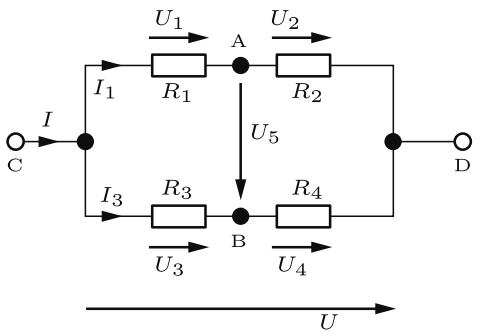

<details>
<summary>flowchart</summary>

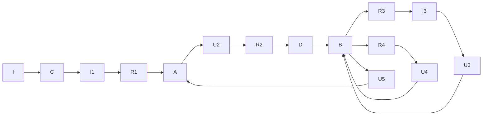
</details>

Abb. 2.15: Gruppenschaltung ohmscher Widerstände.

---

2.2 Parallel- und Reihenschaltung

29

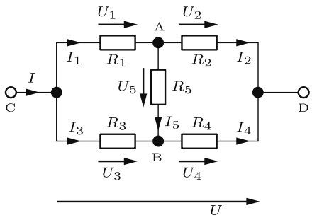

<details>
<summary>flowchart</summary>

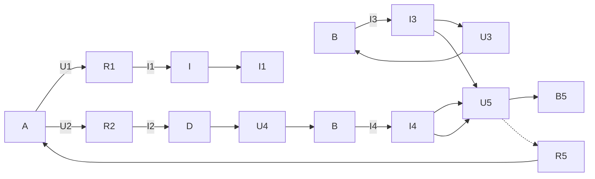
</details>

Abb. 2.16: Brückenschaltung.

wird, gilt $U _ { 1 } = U _ { 3 } ;$ man spricht in diesem Fall vom Abgleich der Schaltung in Bild 2.15, und die Anwendung der 2. Kirchhoff’schen Gleichung auf den linken Teil der Schaltung ergibt:

$$
U _ {5} = 0.
$$

Formt man die Gl. (2.32a) um, so entstehen u. a. die folgenden Formulierungen der **Abgleichbedingung** für eine Brückenschaltung (Bild 2.16):

$$
R _ {1} R _ {4} = R _ {2} R _ {3}; \quad \frac {R _ {1}}{R _ {2}} = \frac {R _ {3}}{R _ {4}}; \quad R _ {1} = \frac {R _ {2} R _ {3}}{R _ {4}}. \tag {2.32b,c,d}
$$

Ist die Abgleichbedingung erfüllt, so kann zwischen die Punkte A und B der Schaltung in Bild 2.15 ein beliebiger Widerstand $R _ { 5 }$ eingefügt werden. Weil zwischen diesen Knoten von vornherein keine Spannung anliegt, fließt durch diesen Widerstand auch kein Strom, und die Spannungen $U _ { 1 } \ldots U _ { 4 }$ bleiben ebenso wie die Ströme $I _ { 1 } \ldots I _ { 4 }$ unverändert.

Wenn die Schaltung in Bild 2.16 abgeglichen ist, kann demnach der Widerstand $R _ { 5 }$ einfach entfernt werden, ohne dass Spannungen und Ströme in der Schaltung hierdurch beeinflusst werden. Im Abgleichfall lässt sich die Schaltung in Bild 2.16 also durch die einfachere Gruppenschaltung 2.15 ersetzen. Aus Gl. (2.31) und der Abgleichbedingung Gl. (2.32d) ergibt sich für den Widerstand $R _ { \mathrm { C D } }$ dieser Schaltung

$$
\begin{array}{l} R _ {\mathrm{CD}} \big | _ {R _ {5} = \infty} \equiv R _ {\mathrm{L}} = \frac {\left(\frac {R _ {2} R _ {3}}{R _ {4}} + R _ {2}\right) (R _ {3} + R _ {4})}{\frac {R _ {2} R _ {3}}{R _ {4}} + R _ {2} + R _ {3} + R _ {4}} \\ R _ {\mathrm{L}} = R _ {2} \frac {R _ {3} + R _ {4}}{R _ {2} + R _ {4}}. \tag {2.33a} \\ \end{array}
$$

Wenn zwischen den Punkten A und B der Schaltung in Bild 2.16 keine Spannung besteht, so kann man diese beiden Punkte auch einfach kurzschließen, wie es in Bild 2.17 dargestellt ist. Diese Schaltung hat den Gesamtwiderstand

$$
R _ {\mathrm{CD}} \big | _ {R _ {5} = 0} \equiv R _ {\mathrm{k}} = \frac {R _ {1} R _ {3}}{R _ {1} + R _ {3}} + \frac {R _ {2} R _ {4}}{R _ {2} + R _ {4}}. \tag {2.34}
$$

---

30

2 Berechnung von Strömen und Spannungen in elektrischen Netzen

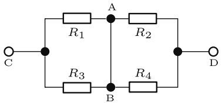

<details>
<summary>text_image</summary>

R₁
A
R₂
C
R₃
B
R₄
D
</details>

Abb. 2.17: Gruppenschaltung ohmscher Widerstände.

Mit der Abgleichbedingung Gl. (2.32d) ergibt sich hieraus

$$
R _ {\mathrm{k}} = \frac {\frac {R _ {2} R _ {3}}{R _ {4}} R _ {3}}{\frac {R _ {2} R _ {3}}{R _ {4}} + R _ {3}} + \frac {R _ {2} R _ {4}}{R _ {2} + R _ {4}}
$$

$$
R _ {\mathrm{k}} = R _ {2} \frac {R _ {3} + R _ {4}}{R _ {2} + R _ {4}}. \tag {2.33b}
$$

Die Ergebnisse der Gln. (2.33a) und (2.33b) bestätigen, dass der Gesamtwiderstand $R _ { \mathrm { L } }$ der Schaltung in Bild 2.15 mit dem Gesamtwiderstand $R _ { \mathrm { k } }$ der Schaltung in Bild 2.17 übereinstimmt, falls die Abgleichbedingung erfüllt ist.

## 2.2.7 Schaltungssymmetrie

Speziell bei symmetrischen Schaltungen aber auch bei anderen Schaltungen, kann man leicht Paare (oder größere Gruppen) von Punkten erkennen, zwischen denen keine Spannung auftritt. Solche Punkte (man nennt sie Punkte gleichen Potenzials) dürfen einfach kurzgeschlossen werden, ohne dass hierdurch Ströme und Spannungen in der Schaltung verändert werden. Ebenfalls dürfen die stromlosen Verbindungen zwischen solchen Punkten einfach aufgetrennt werden.

## Beispiel 2.5: Vereinfachung einer symmetrischen Schaltung.

Aufgrund der Symmetrie der Schaltung in Bild 2.18a ist leicht einzusehen, dass zwischen den Punkten A und B keine Spannung besteht (beide Punkte liegen auf der gestrichelten Symmetrieachse). Man darf also zwischen die Punkte A und B einen beliebigen Wider

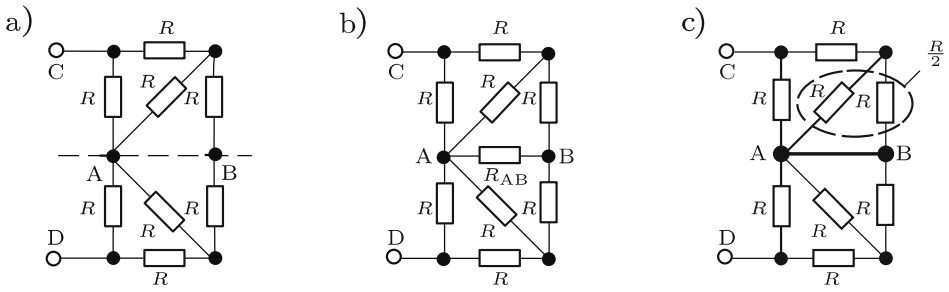

Abb. 2.18: Drei gleichwertige symmetrische Schaltungen. a) Schaltung aus acht Widerständen; b) Schaltung aus neun Widerständen; c) Gruppenschaltung aus acht Widerständen.

---

2.3 Strom- und Spannungsmessung

31

stand $R _ { \mathrm { A B } }$ einfügen, ohne dass die ursprünglichen Ströme und Spannungen hierdurch verändert werden (Schaltung in Bild 2.18b). Wählt man $R _ { \mathrm { A B } } = 0 ,$ , so entsteht die Gruppenschaltung in Bild 2.18c. Damit ist gezeigt, dass die Schaltung in Bild 2.18b einfach durch die Schaltung in Bild 2.18c ersetzt werden kann, deren Gesamtwiderstand $R _ { \mathrm { C D } }$ zwischen den Klemmen C und D leicht berechenbar ist:

$$
R _ {\mathrm{CD}} = 2 \frac {R \cdot \frac {3}{2} R}{R + \frac {3}{2} R} = 1, 2 R.
$$

Dieser Wert gilt also für alle drei Schaltungen in Bild 2.18.

## 2.3 Strom- und Spannungsmessung

## 2.3.1 Anforderungen an Strom- und Spannungsmesser

Ein Strommessgerät (Amperemeter) muss in Reihe zu dem Bauelement eingefügt werden, in dem der Strom gemessen werden soll (Bild 2.19), damit es den selben Strom messen kann. Da das reale Strommessgerät einen ohmschen Widerstand hat, verändert es grundsätzlich den Messkreis und damit den zu messenden Strom (Bild 2.20). Der innere Widerstand $R _ { \mathrm { M , A } }$ des Strommessgerätes sollte also möglichst gering sein, damit der Spannungsabfall $U _ { \mathrm { M , A } }$ über dem Strommessgerät gering bleibt.

Ein Spannungsmessgerät (Voltmeter) muss parallel zu dem Bauelement geschaltet werden, an dem die Spannung gemessen werden soll (Bild 2.21), damit es die selbe Spannung messen kann. Auch hierbei wird bei einem realen Messgerät die Schaltung und damit die zu messende Spannung verändert. Der Strom I teilt sich auf in den Strom $I _ { R }$ durch den Widerstand R und in den Strom $I _ { \mathrm { M , V } }$ durch das Spannungsmessgerät. Der innere Widerstand des Spannungsmessers $R _ { \mathrm { M , V } }$ sollte deshalb möglichst hoch sein, damit der Strom $I _ { \mathrm { M , V } }$ gering bleibt (Bild 2.22).

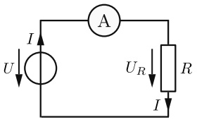

<details>
<summary>text_image</summary>

I
U
A
UR
R
I
</details>

Abb. 2.19: Einfache Schaltung zur Strommessung mit dem Amperemeter.

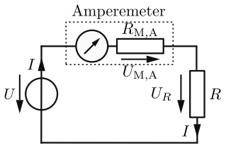

<details>
<summary>flowchart</summary>

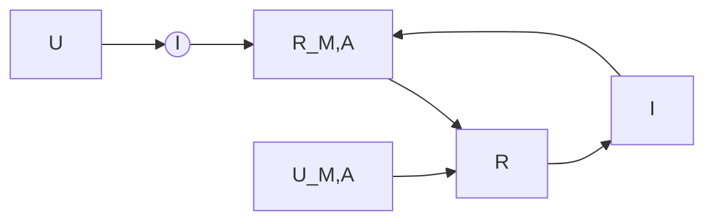
</details>

Abb. 2.20: Strommessung mit realem Amperemeter und Messgerätewiderstand $R _ { M , \mathsf { A } }$

---

32

2 Berechnung von Strömen und Spannungen in elektrischen Netzen

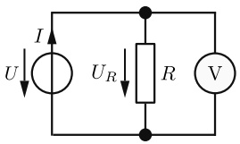

<details>
<summary>text_image</summary>

I
U
UR
R
V
</details>

Abb. 2.21: Einfache Schaltung zur Spannungsmessung mit dem Voltmeter.

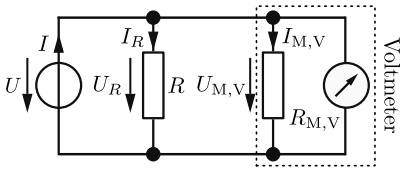

<details>
<summary>text_image</summary>

I
U
IR
UR
R
UM,V
IM,V
RM,V
Voltmeter
</details>

Abb. 2.22: Spannungsmessung mit realem Voltmeter und Messgerätewiderstand $R _ { M , N }$ .

## 2.3.2 Analoges Messinstrument

Als wichtigster Vertreter der analogen Messinstrumente soll hier das Drehspulmessinstrument betrachtet werden.

Im Drehspulmessinstrument fließt der Messstrom durch eine drehbar gelagerte Spule (vgl. Beispiel 5.1). Die Spulenachse ist mit zwei Spiralfedern verbunden, die einer Spulendrehung entgegenwirken. Die Spule befindet sich in dem konstanten Magnetfeld eines Dauermagneten. Dadurch wirkt auf sie ein Drehmoment, das dem Messstrom proportional ist. Das Messergebnis lässt sich über eine **lineare Skala** ablesen (Bild 2.23). Der Zeiger ist fest mit der Spule verbunden und erreicht seine Ruhelage, wenn das Gegenmoment der Spiralfedern und das Drehmoment auf Grund der Kräfte im Magnetfeld im Gleichgewicht sind.

Schnellen Schwingungen kann die Drehspule mit ihrem Zeiger wegen ihrer mechanischen Trägheit praktisch nicht folgen. Das Messwerk zeigt daher immer nur den zeitlichen Mittelwert des gemessenen Stromes an, ist also vor allem zur Messung von **Gleichstrom** geeignet. Bei einem reinen **Wechselstrom** ergibt sich nur eine Anzeige, wenn er zuvor gleichgerichtet wird. Ein Vorteil des Drehspulmesswerks ist sein (im Vergleich zu anderen analogen Messwerken) **geringer Leistungsbedarf**. Es kann daher sehr kleine Ströme anzeigen. Außerdem hat das Drehspulmesswerk eine besonders hohe **Messgenauigkeit**.

Als **Vollausschlagsstrom** $I _ { \mathrm { M V } }$ bezeichnet man den Strom, der gerade fließen muss, damit der Zeiger sich auf den Skalenendwert einstellt. Den ohmschen Widerstand der Drehspule bezeichnet man als **Messwerkwiderstand** $R _ { M }$

Beispiel 2.6: Eigenverbrauch eines Drehspulmesswerks mit $I _ { \mathsf { M V } } = 5 0 \; \mu \mathsf { A } , R _ { \mathsf { M } } = 1 \; \mathsf { k } \Omega .$ Der Eigenverbrauch dieses Messwerks bei Vollausschlag ist

$$
P _ {\mathrm{MV}} = I _ {\mathrm{MV}} ^ {2} \cdot R _ {\mathrm{M}} = \left(5 0 \cdot 1 0 ^ {- 6}\right) ^ {2} \mathrm{A} ^ {2} \cdot 1 0 ^ {3} \Omega = 2, 5 \cdot 1 0 ^ {- 6} \mathrm{W}.
$$

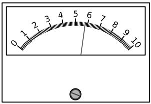

<details>
<summary>text_image</summary>

0 1 2 3 4 5 6 7 8 9 10
</details>

Abb. 2.23: Beispiel für die lineare Skala eines Zeigerinstruments.

---

2.3 Strom- und Spannungsmessung

33

## 2.3.3 Klassengenauigkeit

Der vom Messinstrument angezeigte Strom kann vom wahren Wert des Stromes abweichen. Der Fehler, der höchstens zu erwarten ist, wird normalerweise in Prozent vom Skalenendwert angegeben: Das sogenannte **Klassenzeichen** gibt den zulässigen **Anzeigefehler** direkt in Prozent an. So hat ein Instrument der Klasse 0,1 einen zulässigen Anzeigefehler von ±0,1 %. Präzisionsinstrumente gehören zu den Klassen 0,1; 0,2 oder 0,5. Betriebsinstrumente gehören zu den Klassen 1; 1,5; 2,5 oder 5.

## Beispiel 2.7: Messgenauigkeit eines Drehspulmessgerätes der Klasse 1,5 im Messbereich 300 mA.

Der wahre Wert kann höchstens um 1,5 % von 300 mA, also

$$
3 0 0 \mathrm{mA} \cdot 0, 0 1 5 = 4, 5 \mathrm{mA}
$$

vom abgelesenen Wert abweichen. Liest man im Messbereich 300 mA z. B. den Wert 150 mA ab, so gilt für den wahren Wert:

$$
I = 1 5 0 \mathrm{mA} \pm 4, 5 \mathrm{mA};
$$

es ergibt sich also in diesem Fall eine Abweichung von

$$
\pm 3 \% \text { vom Messwert.}
$$

Liest man im Messbereich 300 mA z. B. den Strom 50 mA ab, so gilt für den wahren Wert:

$$
I = 5 0 \mathrm{mA} \pm 4, 5 \mathrm{mA};
$$

nun ist also sogar eine Abweichung von

$$
\pm 9 \%
$$

möglich. Würde man im 300-mA-Messbereich nur den Wert 4,5 mA ablesen, so ergäbe sich für den wahren Wert

$$
I = 4, 5 \mathrm{mA} \pm 4, 5 \mathrm{mA},
$$

d. h. der wahre Wert kann im Bereich von 0 mA bis 9 mA liegen, und die Abweichung des wahren Wertes vom gemessenen Wert kann

$$
\pm 100 \%
$$

erreichen. Der prozentuale Messfehler nimmt also zu, je kleiner der Zeigerausschlag ist. Daher ist es nötig, für jede Messung einen Messbereich zu haben, bei dem der Zeiger mög lichst dicht an das Skalenende herankommt. Daraus ergibt sich die Notwendigkeit, das Messwerk eines Instrumentes für verschiedene Messbereiche (z. B. 50 μA, 300 μA, 1 mA, 3 mA, 10 mA u. a.) verwendbar zu machen: Messbereichserweiterung. Außerdem können

---

34

2 Berechnung von Strömen und Spannungen in elektrischen Netzen

Drehspulinstrumente auch zur Anzeige von Spannungen verwendet werden. Fließt z. B. durch das Instrument nach Beispiel 2.6 der Vollausschlagsstrom, so liegt am Instrument die **Vollausschlagsspannung**

$$
U _ {\mathrm{MV}} = I _ {\mathrm{MV}} \cdot R _ {\mathrm{M}} \tag {2.35}
$$

$$
U _ {\mathrm{MV}} = 5 0 \cdot 1 0 ^ {- 6} \mathrm{A} \cdot 1 0 ^ {3} \Omega = 5 0 \mathrm{mV}.
$$

## 2.3.4 Digitales Messinstrument

Der Messwert wird bei einem digitalen Messinstrument über eine digitale Anzeige (z. B. Siebensegment-LCD-Anzeige oder – quasi analog – als Balkenanzeige (Bild 2.24)) wiedergegeben. Dafür müssen die analogen physikalischen Messgrößen in digitale Signale umgewandelt werden. Dies übernimmt ein sogenannter Analog-Digital-Wandler (A/D-Wandler, ADC = engl. analog to digital converter).

Die Auflösung ist von der Bit-Anzahl des $\mathrm { A / D }$ -Wandlers abhängig. Zum Beispiel besitzt ein 8-Bit-Wandler 255 Stufen, mit der das Messsignal digitalisiert werden kann. Was damit gemeint ist, zeigt Bild 2.25. Hier wurden aus Gründen der Veranschaulichung nur 3 bit – also 7 Stufen – für die Digitalisierung verwendet. Dieser Digitalisierungsprozess wird auch als **Quantisierung** bezeichnet. Die Messgröße muss jeweils einen Schwellenwert überschreiten, damit der A/D-Wandler diesen Wert erkennt. Der kleinste darstellbare Wert wird durch die Quantisierungsstufe bestimmt.

Dem Vollausschlag bei einem Drehspulmessgerät entspricht bei einem digitalen Messinstrument die maximal erlaubte Eingangsspannung des A/D-Wandlers. Sie wird durch die zum Vergleich verwendete Spannungsreferenz bestimmt. Wie beim analogen Instrument ergibt sich deshalb die Notwendigkeit der Messbereichserweiterung. Der maximalen Eingangsspannung wird dann der **Messbereichsendwert** zugeordnet.

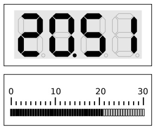

Abb. 2.24: Digitale Anzeigen: Siebensegment-Anzeige und Balkenanzeige mit dem Wert 20,51.

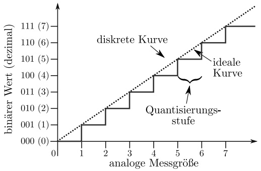

<details>
<summary>line</summary>

| analoge Messgröße | diskrete Kurve (binärer Wert) | ideale Kurve (binärer Wert) |
| --- | --- | --- |
| 0 | 000 (0) | — |
| 1 | 001 (1) | 001 (1) |
| 2 | 010 (2) | 010 (2) |
| 3 | 011 (3) | 011 (3) |
| 4 | 100 (4) | 100 (4) |
| 5 | 101 (5) | 101 (5) |
| 6 | 110 (6) | 110 (6) |
| 7 | 111 (7) | 111 (7) |
</details>

Abb. 2.25: Beispiel für die Digitalisierung von analogen Messwerten, aus Gründen der Veranschaulichung hier nur mit 3 bit.

---

2.3 Strom- und Spannungsmessung

35

Die Genauigkeit ist für jeden einzelnen Messbereich im Datenblatt des Messgerätes angegeben. Zusätzlich zur Klassengenauigkeit müssen bei einem digitalen Messgerät noch die Fehler, die bei der Quantisierung auftreten, berücksichtigt werden.

Im Gegensatz zu einfachen analogen Anzeigen wird die benötigte elektrische Energie eines digital anzeigenden Messinstruments nicht über den zu messenden Stromkreis, sondern immer über eine eigene Energiequelle (oft eine 9-V-Primärzelle) bereitgestellt.

## Beispiel 2.8: Quantisierung einer analogen Spannung mit einem 8-Bit-Wandler.

Ein Spannungsbereich von 0 . . . 5 V soll mit einem $8 - Bit - A/D$ -Wandler digitalisiert werden. Wie viele Stufen stehen für die Quantisierung zur Verfügung und wie groß ist der kleinste darstellbare Wert ∆U?

## Lösung:

Bei einem 8-Bit-Wandler stehen $N = 2 ^ { 8 } - 1 = 2 5 5$ Stufen zur Verfügung. Der kleinste darstellbare Wert ist dann

$$
\Delta U = \frac {5 \mathrm{V} - 0 \mathrm{V}}{2 5 5} = \frac {1}{5 1} \mathrm{V} \approx 0, 0 1 9 6 \mathrm{V}.
$$

## 2.3.5 Messbereichserweiterung

## 2.3.5.1 Strom-Messbereichserweiterung

Falls mit einem Drehspulmessgerät ein Strom gemessen werden soll, der größer als der Vollausschlagsstrom $I _ { \mathrm { M V } }$ ist, so lässt sich der Messbereich durch einen Parallelwiderstand $R _ { \mathrm { p } }$ entsprechend erweitern (Bild 2.26). Wenn durch das Messwerk z. B. gerade der Vollausschlagsstrom $I _ { \mathrm { M V } }$ fließt, dann erreicht der Gesamtstrom I gemäß der Stromteilerformel Gl. (2.29a) den Wert

$$
I = I _ {\mathrm{V}} = \frac {G _ {\mathrm{M}} + G _ {\mathrm{P}}}{G _ {\mathrm{M}}} I _ {\mathrm{MV}}. \tag {2.36a}
$$

Diesen Strom $I _ { \mathrm { V } }$ kann man nun also dem Skalenendwert anstelle des Stromes $I _ { \mathrm { M V } }$ zuordnen, denn der Gesamtstrom I ist es ja, der von der Klemme a zur Klemme b fließt und der gemessen werden soll.

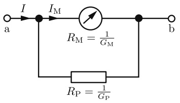

<details>
<summary>text_image</summary>

I
a → I_M → R_M = 1/G_M
R_P = 1/G_P
b
</details>

Abb. 2.26: Parallelschaltung eines ohmschen Widerstandes zum Messwerk zur Erweiterung des Strom-Messbereichs.

---

36

2 Berechnung von Strömen und Spannungen in elektrischen Netzen

## Beispiel 2.9: Berechnung eines Parallelwiderstandes zur Strom-Messbereichserweiterung.

Ein Drehspulinstrument mit dem Vollausschlagsstrom $I _ { \mathrm { M V } } = 5 0   \mu \mathrm { A }$ und dem Messwerkswiderstand $R _ { \mathbb { M } } = 1$ kΩ soll Ströme bis zum Wert $I = 1$ mA messen. Wie groß muss $R _ { \mathrm { p } }$ sein?

## Lösung:

Die Gl. (2.36a) lässt sich nach $G _ { \mathrm { p } }$ auflösen:

$$
G _ {\mathrm{P}} = G _ {\mathrm{M}} \left(\frac {I _ {\mathrm{V}}}{I _ {\mathrm{MV}}} - 1\right) \tag {2.36b}
$$

$$
G _ {\mathrm{P}} = \frac {1}{1 0 ^ {3} \Omega} \left(\frac {1 0 ^ {- 3} \mathrm{A}}{5 0 \cdot 1 0 ^ {- 6} \mathrm{A}} - 1\right) = \frac {1 9}{1 0 ^ {3} \Omega} = \frac {1}{R _ {\mathrm{P}}}
$$

$$
R _ {\mathrm{P}} = 5 2, 6 \Omega .
$$

Schaltet man diesen Widerstand zum Messwerk parallel, dann bedeutet – wie gefordert – Vollausschlag des Messinstruments, dass der Gesamtstrom I den Wert $I _ { \mathrm { V } } = 1   \mathrm { m A }$ erreicht.

Normalerweise wird in sogenannten **Vielfach-Instrumenten** ein einziges Messwerk für mehrere Messbereiche verwendet, z. B. sechs Strom- und sechs Spannungs-Messbereiche.

## Beispiel 2.10: Dimensionierung der Widerstände eines Vielfach-Messgeräts (Strommessung).

Ein Drehspulmesswerk hat den Vollausschlagsstrom $I _ { \mathrm { M V } } = 5 0   \mu \mathrm { A }$ und den Messwerkswiderstand $R _ { M }$

Das Messgerät soll drei Messbereiche haben: $1 0 0   \mu \mathrm { A } , 3 0 0   \mu \mathrm { A } ,$ , 1 mA. Zwischen den Schalterstellungen A, B, C in Bild 2.27 und den drei Strombereichen soll die Zuordnung aus Tabelle 2.6 gelten.

Die Widerstände $R _ { 1 } , R _ { 2 }$ und $R _ { 3 }$ sollen allgemein und für den Sonderfall $R _ { \mathrm { M } } = 9 0 0   \Omega$ berechnet werden.

## Lösung:

Bei Anschluss an Klemme A und Vollausschlag des Messwerks muss entsprechend der

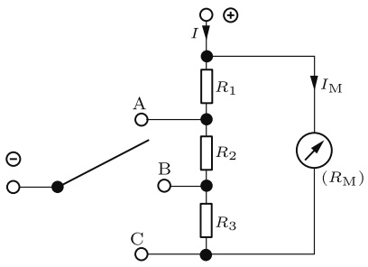

<details>
<summary>text_image</summary>

I
R1
A
R2
B
C
R3
IM
(RM)
</details>

Abb. 2.27: Drehspulmesswerk mit drei Strom-Messbereichen.

---

2.3 Strom- und Spannungsmessung

37

Tab. 2.6: Drei Strommessbereiche in Abhängigkeit der Schalterstellung.

| Schalterstellung | Messbereich |
| --- | --- |
| A | 0 ... 1 mA |
| B | 0 ... 300 μA |
| C | 0 ... 100 μA |

Stromteilerformel Gl. (2.29b) gelten:

$$
\frac {R _ {1}}{R _ {1} + R _ {2} + R _ {3} + R _ {\mathrm{M}}} = \frac {I _ {\mathrm{MV}}}{I _ {(\mathrm{A})}} = \frac {5 0 \mu \mathrm{A}}{1 \mathrm{mA}} = \frac {1}{2 0}; \tag {2.37a}
$$

bei Anschluss an Klemme B:

$$
\frac {R _ {1} + R _ {2}}{R _ {1} + R _ {2} + R _ {3} + R _ {\mathrm{M}}} = \frac {I _ {\mathrm{MV}}}{I _ {\mathrm{(B)}}} = \frac {5 0 \mu \mathrm{A}}{3 0 0 \mu \mathrm{A}} = \frac {1}{6}; \tag {2.37b}
$$

bei Anschluss an Klemme C:

$$
\frac {R _ {1} + R _ {2} + R _ {3}}{R _ {1} + R _ {2} + R _ {3} + R _ {\mathrm{M}}} = \frac {I _ {\mathrm{MV}}}{I _ {(\mathrm{C})}} = \frac {5 0 \mu \mathrm{A}}{1 0 0 \mu \mathrm{A}} = \frac {1}{2}. \tag {2.37c}
$$

Durch einfache Umformung ergibt sich aus den Gln. (2.37):

$$
1 9 R _ {1} - R _ {2} - R _ {3} = R _ {\mathrm{M}} \tag {2.38a}
$$

$$
5 R _ {1} + 5 R _ {2} - R _ {3} = R _ {\mathrm{M}} \tag {2.38b}
$$

$$
R _ {1} + R _ {2} + R _ {3} = R _ {\mathrm{M}}. \tag {2.38c}
$$

Aus der Addition der Gln. (2.38a) und (2.38c) erhält man nun

$$
2 0 R _ {1} = 2 R _ {\mathrm{M}}; \quad R _ {1} = \frac {1}{1 0} R _ {\mathrm{M}}.
$$

Addition der Gl. (2.38b) und der mit (−5) multiplizierten Gl. (2.38c) liefert

$$
- 6 R _ {3} = - 4 R _ {\mathrm{M}}; \quad R _ {3} = \frac {2}{3} R _ {\mathrm{M}}.
$$

Aus Gl. (2.38c) folgt dann

$$
R _ {2} = R _ {\mathrm{M}} - R _ {1} - R _ {3} = R _ {\mathrm{M}} - \frac {1}{1 0} R _ {\mathrm{M}} - \frac {2}{3} R _ {\mathrm{M}}; \quad R _ {2} = \frac {7}{3 0} R _ {\mathrm{M}}.
$$

Mit $R _ { \mathrm { M } } = 9 0 0   \Omega$ wird also

$$
R _ {1} = 9 0 \Omega , \quad R _ {2} = 2 1 0 \Omega , \quad R _ {3} = 6 0 0 \Omega .
$$

---

38

2 Berechnung von Strömen und Spannungen in elektrischen Netzen

## 2.3.5.2 Spannungs-Messbereichserweiterung

Falls eine Spannung gemessen werden soll, die größer ist als $U _ { \mathrm { M V } }$ , vgl. Gl. (2.35), so lässt sich der Messbereich durch einen Vorwiderstand $R _ { \mathbf { r } }$ entsprechend erweitern (Bild 2.28).

Wenn am Messwerk z. B. gerade die Vollausschlagsspannung $U _ { \mathrm { M V } }$ liegt, dann erreicht die Spannung U an der Reihenschaltung gemäß der Spannungsteilerformel Gl. (2.17) den Wert

$$
U _ {\mathrm{V}} = \frac {R _ {\mathrm{r}} + R _ {\mathrm{M}}}{R _ {\mathrm{M}}} U _ {\mathrm{MV}}. \tag {2.39a}
$$

Diese Spannung $U _ { \mathrm { V } }$ kann man nun also dem Skalenendwert anstelle der Spannung $U _ { \mathrm { M V } }$ zuordnen, denn die Gesamtspannung U ist es $\mathbf { j a } ,$ die zwischen den Klemmen a und b liegt und die gemessen werden soll.

## Beispiel 2.11: Berechnung eines Vorwiderstandes zur Spannungs-Messbereichserweiterung.

Ein Drehspulmessgerät mit dem Vollausschlagsstrom $I _ { \mathrm { M V } } = 5 0   \mu \mathrm { A }$ und dem Messwerkswiderstand $R _ { \mathrm { M } } = 1$ kΩ soll Spannungen bis zum Wert $U = 1 0 0   \mathrm { V }$ messen. Wie groß muss $R _ { \mathbf { r } }$ sein?

## Lösung:

Das Messwerk hat die Vollausschlagsspannung

$$
U _ {\mathrm{MV}} = I _ {\mathrm{MV}} \cdot R _ {\mathrm{M}} = 5 0 \cdot 1 0 ^ {- 6} \mathrm{A} \cdot 1 0 ^ {3} \Omega = 5 0 \mathrm{mV}.
$$

Die Gl. (2.39a) lässt sich nach $R _ { \mathrm { r } }$ auflösen:

$$
R _ {\mathrm{r}} = R _ {\mathrm{M}} \left(\frac {U _ {\mathrm{V}}}{U _ {\mathrm{MV}}} - 1\right)
$$

$$
R _ {\mathrm{r}} = 1 0 ^ {3} \Omega \left(\frac {1 0 0 \mathrm{V}}{5 0 \mathrm{mV}} - 1\right) = 1 0 ^ {3} \Omega (2 0 0 0 - 1) = 1, 9 9 9 \mathrm{M} \Omega . \tag {2.39b}
$$

Schaltet man diesen Widerstand in Reihe zum Messwerk, dann bedeutet – wie gefordert – Vollausschlag des Messinstrumentes, dass die Gesamtspannung U den Wert $U _ { \mathrm { V } } = 1 0 0   \mathrm { V }$ erreicht.

## Beispiel 2.12: Dimensionierung der Widerstände eines Vielfach-Messgeräts (Spannungsmessung).

Ein Drehspulmessgerät hat den Spulenwiderstand $R _ { \mathrm { M } } = 1   \Omega$ . Wenn es von dem Strom $I _ { \mathrm { M V } } = 1 0 0$ mA durchflossen wird, dann schlägt es voll aus. Es soll als Spannungsmesser

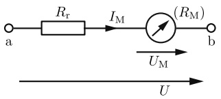

<details>
<summary>flowchart</summary>

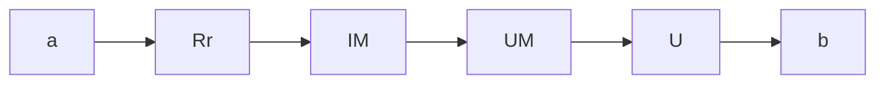
</details>

Abb. 2.28: Reihenschaltung eines ohmschen Widerstandes zum Messwerk zur Erweiterung des Spannungs-Messbereiches.

---

2.3 Strom- und Spannungsmessung

39

eingesetzt werden und vier Messbereiche haben (Bild 2.29). Zwischen den Schalterstellungen A, B, C, D und den vier Spannungs-Messbereichen soll die Zuordnung aus der Tabelle 2.7 gelten.

Tab. 2.7: Spannungsmessbereich in Abhängigkeit der Schalterstellung.

| Schalterstellung | Messbereich |
| --- | --- |
| A | 0 ... 300 mV |
| B | 0 ... 1 V |
| C | 0 ... 3 V |
| D | 0 ... 10 V |

Die Widerstände $R _ { 1 } \ldots R _ { 4 }$ sollen berechnet werden. Welchen Widerstand $R _ { \mathbf { i } }$ hat das Messgerät in den verschiedenen Messbereichen?

## Lösung:

In Schalterstellung A gilt: $I _ { \mathrm { M V } } ( R _ { \mathrm { m } } + R _ { 1 } ) = 3 0 0$ mV

$$
R _ {1} = \frac {3 0 0 \mathrm{mV}}{1 0 0 \mathrm{mA}} - R _ {\mathrm{M}} = 3 \Omega - 1 \Omega = 2 \Omega .
$$

Der Widerstand $R _ { \mathbf { i } }$ des Messgerätes ist in diesem Messbereich

$$
R _ {\mathrm{iA}} = R _ {\mathrm{M}} + R _ {1} = 3 \Omega .
$$

In Schalterstellung B gilt: $I _ { \mathrm { M V } } ( R _ { \mathrm { M } } + R _ { 1 } + R _ { 2 } ) = 1$ V

$$
R _ {2} = \frac {1 \mathrm{V}}{1 0 0 \mathrm{mA}} - R _ {\mathrm{M}} - R _ {1} = 1 0 \Omega - 3 \Omega = 7 \Omega .
$$

Der Widerstand $R _ { \mathbf { i } }$ des Messgerätes ist in diesem Messbereich

$$
R _ {\mathrm{iB}} = R _ {\mathrm{M}} + R _ {1} + R _ {2} = 1 0 \Omega .
$$

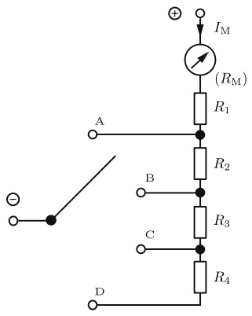

<details>
<summary>text_image</summary>

I_M
(R_M)
R_1
A
B
R_2
C
R_3
R_4
D
</details>

Abb. 2.29: Drehspulmessgerät mit vier Spannungs-Messbereichen.

---

40

2 Berechnung von Strömen und Spannungen in elektrischen Netzen

In Schalterstellung C gilt: $I _ { \mathrm { M V } } ( R _ { \mathrm { M } } + R _ { 1 } + R _ { 2 } + R _ { 3 } ) = 3   \mathrm { V }$

$$
R _ {3} = \frac {3 \mathrm{V}}{1 0 0 \mathrm{mA}} - R _ {\mathrm{M}} - R _ {1} - R _ {2} = 3 0 \Omega - 1 0 \Omega = 2 0 \Omega .
$$

Der Widerstand $R _ { \mathbf { i } }$ des Messgerätes ist in diesem Messbereich

$$
R _ {\mathrm{iC}} = R _ {\mathrm{M}} + R _ {1} + R _ {2} + R _ {3} = 3 0 \Omega .
$$

In Schalterstellung D gilt: $I _ { \mathrm { M V } } ( R _ { \mathrm { M } } + R _ { 1 } + R _ { 2 } + R _ { 3 } + R _ { 4 } ) = 1 0   \mathrm { V }$

$$
R _ {4} = \frac {1 0 \mathrm{V}}{1 0 0 \mathrm{mA}} - R _ {\mathrm{M}} - R _ {1} - R _ {2} - R _ {3} = 1 0 0 \Omega - 3 0 \Omega = 7 0 \Omega .
$$

Der Widerstand $R _ { \mathbf { i } }$ des Messgerätes ist in diesem Messbereich

$$
R _ {\mathrm{iD}} = R _ {\mathrm{M}} + R _ {1} + R _ {2} + R _ {3} + R _ {4} = 1 0 0 \Omega .
$$

**Anmerkung** Das betrachtete Messwerk $( R _ { \mathrm { M } } = 1   \Omega ,   I _ { \mathrm { M V } } = 1 0 0   \mathrm { m A } )$ hat die Vollausschlagsspannung

$$
U _ {\mathrm{MV}} = 1 \Omega \cdot 1 0 0 \mathrm{mA} = 1 0 0 \mathrm{mV}.
$$

Das Gerät (Messwerk + Vorwiderstände) hat daher in allen Messbereichen den auf die jeweilige Vollausschlagsspannung bezogenen (niedrigen) Innenwiderstand

$$
r _ {\mathrm{i}} ^ {*} = 1 \Omega / 1 0 0 \mathrm{mV} = 1 0 \Omega / \mathrm{V}.
$$

Zur Spannungsmessung wäre daher ein Messwerk geeigneter, dessen Spule einen hö- heren Widerstand $R _ { M }$ hat: würde z. B. die Anzahl der Windungen erhöht und dadurch $R _ { \mathrm { M } } = 1   \mathrm { k } \Omega ,   I _ { \mathrm { M V } } = 1 0 0   \mu \mathrm { A } ,$ so bliebe zwar $U_{\mathrm{MV}} = 100   \mathrm{mV}$ aber es ergäbe sich

$$
r _ {\mathrm{i}} ^ {*} = 1 \mathrm{k} \Omega / 1 0 0 \mathrm{mV} = 1 0 \mathrm{k} \Omega / \mathrm{V}.
$$

Von Vorteil wäre ein Gerät mit $R _ { \mathrm { M } } = 1   \Omega$ wegen der geringeren Spulengröße bei Strommessungen in den Messbereichen von 100 mA an aufwärts (es fehlen ihm aber Messbereiche unter 100 mA).

## 2.3.6 Vielfachmessinstrument (Multimeter)

Viele einfache Messaufgaben lassen sich heute mit einem digitalen oder analogen (Hand-)Multimeter bewerkstelligen. Solche Multimeter (Vielfachmessgeräte) können verschiedene physikalische Messgrößen wie z. B. Strom, Spannung, Widerstand und Temperatur erfassen. Bei den Multimetern existiert eine Vielzahl von Ausstattungs varianten sowie Genauigkeitsklassen. Einfache Multimeter lassen sich oft über einen Drehschalter bedienen, mit dem die zu messende physikalische Größe und ggf. der Messbereich eingestellt werden. Manche Multimeter schalten selbst in den am besten

---

2.3 Strom- und Spannungsmessung

41

geeigneten Messbereich um und erkennen außerdem, ob es sich um eine Gleich- bzw. Wechselspannung handelt. Schaltungen zur Messbereichserweiterung, wie sie die Bilder 2.27 und 2.29 zeigen, kommen dabei zur Anwendung.

Bei einfachen Formen der Messbereichserweiterungen verfügt ein Multimeter meistens über mehrere Eingänge für die Messleitungen (Bild 2.30). Dabei wird in der Regel unterschieden, ob eine Spannung, ein kleiner Strom ( mA, μA ) oder ein großer Strom (mehrere Ampere) gemessen werden soll. Der Bediener steckt je nach Messaufgabe (Spannungs- oder Strommessung) eine der beiden Messleitungen in den zugehörigen Eingang. Die zweite Messleitung wird mit dem COM-Anschluss (engl. common = gemeinsam) verbunden.

## 2.3.7 Messwertkorrektur

## 2.3.7.1 Spannungsrichtige Messung

Soll an einem Widerstand $R _ { 1 }$ (Bild 2.31) die Spannung gemessen werden, so schaltet man den Spannungsmesser parallel zu $R _ { 1 }$ . Will man gleichzeitig auch den Strom messen, der durch $R _ { 1 }$ fließt, so kann man die Schaltung 2.31 wählen. Diese Schaltung hat aber den Nachteil, dass der Strommesser nicht $I _ { 1 }$ , sondern I misst. Der Strom $I _ { M }$ durch den Spannungsmesser verfälscht die Anzeige des Strommessers. Hierbei gilt

$$
I _ {1} = I - I _ {\mathrm{M}}
$$

$$
I _ {1} = I - \frac {U _ {1}}{R _ {\mathrm{i}}} . \tag {2.40}
$$

Wenn der Widerstand $R _ { \mathbf { i } }$ des Spannungsmessers bekannt ist, kann aus dem gemessenen Wert I der Wert $I _ { 1 }$ des tatsächlich durch $R _ { 1 }$ fließenden Stromes berechnet werden. Man bezeichnet dies als **Stromkorrektur**. Da die gemessene Spannung $U _ { 1 }$ bei der Schaltung 2.31 mit der Spannung an $R _ { 1 }$ identisch ist, nennt man eine Messung nach der Schaltung in Bild 2.31 eine spannungsrichtige Messung.

## 2.3.7.2 Stromrichtige Messung

Soll in einem Widerstand $R _ { 1 }$ (Bild 2.32) der Strom gemessen werden, so schaltet man den Strommesser in Reihe zu $R _ { 1 }$ . Will man gleichzeitig auch die Spannung messen,

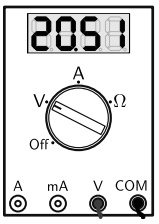

<details>
<summary>text_image</summary>

20.51
A
V
Ω
Off
A mA V COM
</details>

Abb. 2.30: Schema eines Multimeters.

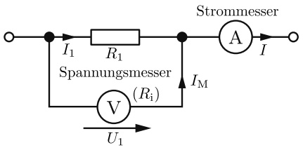

<details>
<summary>flowchart</summary>

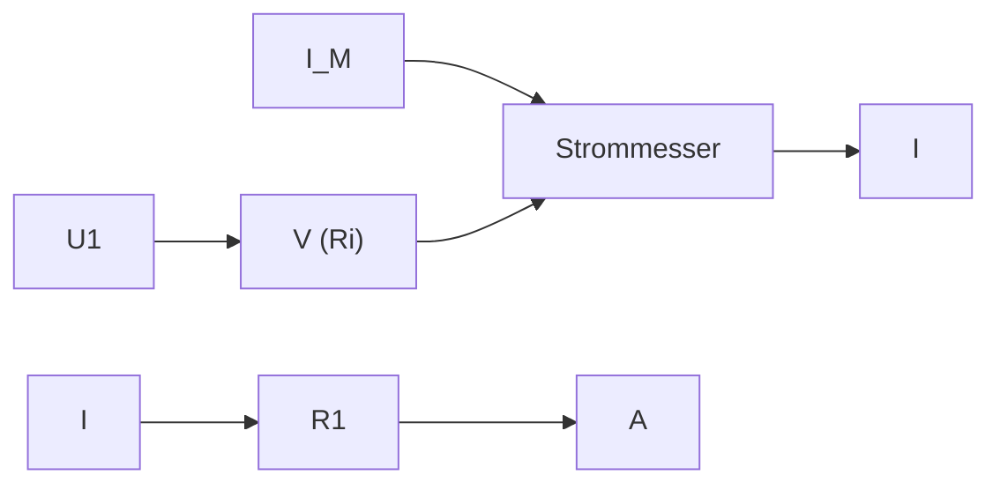
</details>

Abb. 2.31: Spannungsrichtige Messung.

---

42

2 Berechnung von Strömen und Spannungen in elektrischen Netzen

die an $R _ { 1 }$ liegt, so kann man die Schaltung 2.32 wählen. Diese Schaltung hat aber den Nachteil, dass der Spannungsmesser nicht $U _ { 1 }$ , sondern U misst. Die Spannung $U _ { M }$ am Strommesser verfälscht also die Anzeige des Spannungsmessers. Hierbei gilt:

$$
U _ {1} = U - U _ {\mathrm{M}}
$$

$$
U _ {1} = U - I _ {1} R _ {\mathrm{i}}. \tag {2.41}
$$

Wenn der Widerstand $R _ { \mathbf { i } }$ des Strommessgerätes bekannt ist, kann mit Hilfe dieser Gleichung aus dem gemessenen Wert U der Wert $U _ { 1 }$ der tatsächlich an $R _ { 1 }$ liegenden Spannung berechnet werden. Man bezeichnet dies als **Spannungskorrektur**. Da der gemessene Strom $I _ { 1 }$ bei der Schaltung 2.32 mit dem Strom in $R _ { 1 }$ identisch ist, nennt man eine Messung mit Schaltung 2.32 eine stromrichtige Messung.

## Beispiel 2.13: Genauigkeit einer Widerstandsmessung.

Gegeben ist eine Schaltung zur spannungsrichtigen Messung (Bild 2.31). An dem Widerstand $R _ { 1 }$ werden die Spannung $U _ { 1 } = 1 0   \mathrm { V }$ und der Strom $I = 1$ mA gemessen. Der Spannungsmesser hat den Widerstand $R _ { \mathrm { i } } = 5 0   \mathrm { k } \Omega$

a) Aus der Strom- und Spannungsmessung soll $R _ { 1 }$ bestimmt werden.
b) Der benutzte Spannungsmessbereich ist 0 . . . 30 V, der benutzte Strommessbereich $0 \ldots 3$ mA. Die beiden Messinstrumente haben das Klassenzeichen 5. Es sollen die Bereiche angegeben werden, in denen die wahren Werte des Stromes I und der Spannung $U _ { 1 }$ liegen können.
c) In welchem Bereich kann infolgedessen der wahre Wert R liegen?

## Lösung:

**a)** In der Schaltung 2.31 gilt mit $G _ { 1 } = 1 \big / _ { R _ { 1 } }$ und $G _ { \mathrm { i } } = 1 \big / _ { R _ { \mathrm { i } } }$

$$
I = U _ {1} (G _ {1} + G _ {\mathrm{i}})  . \tag {2.42}
$$

Löst man dies nach $G _ { 1 }$ auf, so wird

$$
G _ {1} = \frac {I}{U _ {1}} - G _ {i} \tag {2.43}
$$

$$
G _ {1} = \frac {1 \mathrm{mA}}{1 0 \mathrm{V}} - \frac {1}{5 0 \mathrm{k} \Omega} = \frac {1}{1 0 \mathrm{k} \Omega} - \frac {1}{5 0 \mathrm{k} \Omega} = \frac {4}{5 0 \mathrm{k} \Omega};
$$

$$
R _ {1} = \frac {5 0 \mathrm{k} \Omega}{4} = 1 2, 5 \mathrm{k} \Omega .
$$

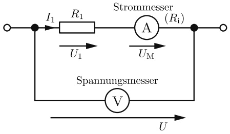

<details>
<summary>flowchart</summary>

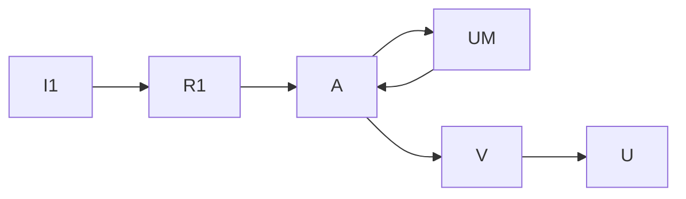
</details>

Abb. 2.32: Stromrichtige Messung.

---

2.3 Strom- und Spannungsmessung

43

**b)** Im Messbereich 3 mA ist bei einem Instrument der Klasse 5 die Abweichung $3\mathrm{mA} \cdot 0,05 = 0,15$ mA möglich. Wird der Wert $I = 1$ mA angezeigt, so liegt also der wahre Wert mit Sicherheit im Bereich

$$
0, 8 5 \mathrm{mA} \leq I \leq 1, 1 5 \mathrm{mA}.
$$

Im Spannungsmessbereich 30 V ist bei einem Instrument der Klasse 5 die Abweichung 30 $\mathrm{V} \cdot 0,05 = 1,5\mathrm{V}$ möglich. Wird der Wert 10 V angezeigt, so liegt der wahre Wert mit Sicherheit im Bereich

$$
8, 5 \mathrm{V} \leq U _ {1} \leq 1 1, 5 \mathrm{V}.
$$

**c)** Der maximal mögliche Leitwert $\hat { G } _ { 1 }$ ergibt sich, falls der wahre Strom den Wert $\hat { I } = 1$ ,15 mA und die wahre Spannung den Wert $\check { U } _ { 1 } = 8 ,   5   \mathrm { V }$ hat. Aus Gl. (2.43) folgt dann

$$
\begin{array}{l} \hat {G} _ {1} = \frac {\hat {I}}{\check {U} _ {1}} - G _ {\mathrm{i}} = \frac {1 , 1 5 \mathrm{mA}}{8 , 5 \mathrm{V}} - \frac {1}{5 0 \mathrm{k} \Omega} \\ \check {R} _ {1} = \frac {1}{\hat {G} _ {1}} \approx 8, 7 \mathrm{k} \Omega . \\ \end{array}
$$

Umgekehrt ergibt sich der minimal mögliche Leitwert $\check { G } _ { 1 }$ aus den Werten $\check{I} = 0,85    mA$ und $\hat { U } _ { 1 } = 1 1 ,   5   \mathrm { V } ;$

$$
\begin{array}{l} \check {G} _ {1} = \frac {\check {I}}{\hat {U} _ {1}} - G _ {\mathrm{i}} = \frac {0 , 8 5 \mathrm{mA}}{1 1 , 5 \mathrm{V}} - \frac {1}{5 0 \mathrm{k} \Omega} \\ \hat {R} _ {1} = \frac {1}{\check {G} _ {1}} \approx 1 8, 5 \mathrm{k} \Omega . \\ \end{array}
$$

Die Ungenauigkeit der verwendeten Messgeräte $( \pm 5   \%$ vom Skalenendwert) führt hier also zu einer noch viel größeren Ungenauigkeit bei der Widerstandsmessung:

$$
8, 7 \mathrm{k} \Omega \leq R _ {1} \leq 1 8, 5 \mathrm{k} \Omega
$$

$$
R _ {1} = 1 3, 6 \mathrm{k} \Omega \pm 4, 9 \mathrm{k} \Omega = 1 3, 6 \mathrm{k} \Omega \pm \frac {3 6}{1 0 0} 1 3, 6 \mathrm{k} \Omega.
$$

Bei der Widerstandsmessung ist also eine Abweichung von ±36 % möglich.

**Anmerkung** $Z   u   \boldsymbol { a } ) .$ : Ohne Stromkorrektur (und ohne Berücksichtigung der Ungenauigkeit des Messgerätes) hätte sich ergeben

$$
R _ {1 I} = \frac {U _ {1}}{I} = \frac {1 0 \mathrm{V}}{1 \mathrm{mA}} = 1 0 \mathrm{k} \Omega ;
$$

die Stromkorrektur (d. h. die Berücksichtigung des Innenwiderstandes des Spannungsmessers) darf hier also nicht unterbleiben.

Bei der Messung des Widerstandes $R _ { 1 } = 1 2 , 5$ kΩ hätte die stromrichtige Messung (bei idealer Messgenauigkeit) für $R _ { \mathrm { i } } = 1 0   \Omega   z .   B .$ zu folgenden Messwerten geführt (Bild 2.32):

$$
I _ {1} = 1 \mathrm{mA}, \quad U = 1 2, 5 1 \mathrm{V}.
$$

---

44

2 Berechnung von Strömen und Spannungen in elektrischen Netzen

Ohne Spannungskorrektur ergibt das

$$
R _ {1 U} = \frac {U}{I _ {1}} = \frac {1 2 , 5 1 \mathrm{V}}{1 \mathrm{mA}} = 1 2, 5 1 \mathrm{k} \Omega .
$$

Mit Spannungskorrektur hätte sich für $R _ { \mathrm { i } } = 1 0   \Omega$ ergeben:

$$
R _ {1} = \frac {U}{I _ {1}} - R _ {\mathrm{i}} = 1 2, 5 \mathrm{k} \Omega .
$$

Bei stromrichtiger Messung hätte also in diesem Fall der Spannungsabfall am Strommesser vernachlässigt werden können. Die Spannungskorrektur ist hier überflüssig, weil ihr Einfluss wesentlich geringer ist als der mögliche Fehler eines Präzisions-Messgerätes.

Allgemein gilt: Wenn der zu messende Widerstand klein ist (im Vergleich zum Innenwiderstand R<sub>i</sub> des Spannungsmessers), ist spannungsrichtige Messung zweckmäßig. Ist dagegen der zu messende Widerstand groß, so ist die stromrichtige Messung geeigneter.

## 2.4 Lineare Zweipole

Beliebige elektrische Schaltungen mit zwei Anschlüssen bezeichnet man als Zweipole. Auch Schaltungen mit mehr Anschlüssen können als Zweipole aufgefasst werden, wenn nur zwei Anschlüsse benutzt werden. Zweipole haben schon in den vorangehenden Abschnitten eine Rolle gespielt: ein einzelner ohmscher Widerstand mit seinen zwei Anschlüssen ist ein Zweipol, die Reihenschaltung mehrerer Widerstände (Bild 2.9) kann als Zweipol mit den Anschlussklemmen A und B angesehen werden. Ein solcher Zweipol kann im Übrigen außer ohmschen Widerständen auch alle möglichen anderen Verbraucher (z. B. Spulen, Dioden, Glühlampen) und Spannungsquellen enthalten.

In Bild 2.33 wird ein Zweipol dargestellt, der drei Spannungsquellen und drei Widerstände enthält; dieser Zweipol ist an den Klemmen A und B zugänglich. Messbar sind nur die Klemmenspannung U und der Klemmenstrom I.

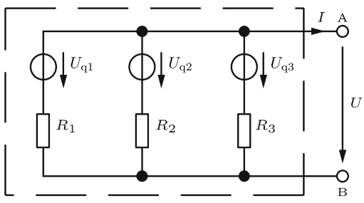

<details>
<summary>text_image</summary>

Uq1
R1
Uq2
R2
Uq3
R3
I A
U
B
</details>

Abb. 2.33: Aktiver Zweipol mit drei Spannungsquellen und drei Widerständen.

---

2.4 Lineare Zweipole

45


<details>
<summary>flowchart</summary>


</details>

Abb. 2.34: Zuordnung der Zählpfeilrichtungen von Spannung, Strom und Leistung an einem Zweipol bei abgegebener Leistung (Erzeuger-Zählpfeilsystem).


<details>
<summary>text_image</summary>

I
φₐ
P
U
φb
φb
P
U
φₐ > φb
</details>

Abb. 2.35: Zuordnung der Zählpfeilrichtungen von Spannung, Strom und Leistung an einem Zweipol bei aufgenommener Leistung (Verbraucher-Zählpfeilsystem).

## 2.4.1 Erzeuger- und Verbraucher-Zählpfeilsystem

Ein Akkumulator kann sowohl elektrische Leistung abgeben als auch aufnehmen. Wenn ein Akkumulator Leistung abgibt, fließt aus dessen Plusklemme ein Strom heraus. Nur beim Aufladen (d. h. wenn der Akkumulator Leistung aufnimmt) fließt in dessen Plusklemme ein Strom hinein.

Bei der Wahl der Zählpfeile, für den Fall, dass der Akkumulator Leistung abgibt, zeigen sowohl der Strompfeil als auch der Leistungspfeil nach außen (Bild 2.34). Man spricht von einem **Erzeuger-Zählpfeilsystem** (Generator-Zählpfeilsystem) (EZS), wenn aus dem Anschlusspunkt mit dem höchsten Potential der Strom herausfließt.

Nimmt dagegen der Akkumulator Leistung auf, so zeigen in dem Zählpfeilsystem der Strompfeil und der Leistungspfeil nach innen (Bild 2.35). In diesem Fall spricht man von einem **Verbraucher-Zählpfeilsystem** (VZS).

Im Erzeuger-Zählpfeilsystem zeigen die Spannungs- und die Stromzählpfeile am Zweipol in die entgegengesetzte Richtung. Die positive Leistung entspricht dann der abgegebenen Leistung (Bild 2.34). Dagegen zeigen im Verbraucher-Zählpfeilsystem am Zweipol die Spannungs- und Stromzählpfeile in die selbe Richtung. Positive Leistung entspricht dann der aufgenommenen Leistung (Bild 2.35). Beide Zählpfeilsysteme werden, wie in Bild 2.36 dargestellt, üblicherweise in einem Stromkreis gemeinsam verwendet.

Das Ohm’sche Gesetz lautet

$$
R = \frac {U}{I} \quad \text {im Verbraucher - Zählpfeilsystem,} \tag {2.44}
$$

$$
R = - \frac {U}{I} \quad \text {im Erzeuger - Zählpfeilsystem.} \tag {2.45}
$$

---

46

2 Berechnung von Strömen und Spannungen in elektrischen Netzen


<details>
<summary>flowchart</summary>


</details>

Abb. 2.36: Zählpfeile am Erzeuger- und Verbraucher-Zweipol.

In beiden Zählpfeilsystemen gilt für die Berechnung der Leistung

$$
P = U \cdot I. \tag {2.46}
$$

Dabei wird folgendes festgelegt:

$P > 0$ , wenn im VZS Leistung vom Zweipol aufgenommen wird.

$P < 0$ , wenn im VZS Leistung vom Zweipol abgegeben wird.

$P > 0$ , wenn im EZS Leistung vom Zweipol abgegeben wird.

$P < 0$ , wenn im EZS Leistung vom Zweipol aufgenommen wird.

Die Leistungsbilanz bei der gemeinsamen Verwendung beider Zählpfeilsysteme ist dann

$$
\sum P _ {\text {Erzeuger}} = \sum P _ {\text {Verbraucher}}. \tag {2.47}
$$

## 2.4.2 Spannungsquellen

Die wichtigsten Spannungsquellen sind die Drehstrom-Generatoren, die den technischen Wechselstrom erzeugen; Gleichspannung können sie nicht unmittelbar, sondern erst nach Gleichrichtung liefern. Alle Arten von chemischen Spannungsquellen, wie Trockenbatterien und Blei-Sammler (-Akkumulatoren) erzeugen Gleichspannung.

Die Spannung U, die an den Klemmen a, b einer Gleichspannungsquelle (Bild 2.37) auftritt, nimmt mit wachsendem Belastungsstrom I ab. Dies kann durch die Gleichung

$$
U = U _ {\mathrm{q}} - R _ {\mathrm{i}} I \tag {2.48}
$$


<details>
<summary>text_image</summary>

R_i
U_i
U_q
a
I
U
b
R
</details>

Spannungsquelle

Abb. 2.37: Belastung einer Spannungsquelle mit dem Widerstand R.

---

2.4 Lineare Zweipole

47

beschrieben werden. Hierbei sind die **Quellenspannung** $U _ { \mathrm { q } }$ Ua und der innere Wider**stand** $R _ { \mathbf { i } }$ fiktive Größen; d. h. Größen, die nicht unmittelbar messbar sind, sondern nur den messbaren Zusammenhang $U = f ( I )$ richtig beschreiben. In vielen wichtigen Fällen ist dieser Zusammenhang nahezu **linear**, die Funktion $U = f ( I )$ ergibt dann eine Gerade (Bild 2.38).

Die Gl. (2.48) beschreibt im Übrigen nur dann eine Gerade, wenn

$$
U _ {\mathrm{q}} = k o n s t \tag {2.49}
$$

und

$$
R _ {\mathrm{i}} = k o n s t \tag {2.50}
$$

sind. Man spricht in diesem Fall von einer **linearen** Spannungsquelle. In den folgenden Abschnitten soll der Einfachheit halber stets mit linearen Spannungsquellen gerechnet werden.

Dass die Gl. (2.48) und die in Bild 2.37 gestrichelte Schaltung eine angemessene Darstellung für das Verhalten einer Spannungsquelle sind, kann man sich für viele Fälle leicht plausibel machen:

Im Inneren der Quelle wird eine Spannung erzeugt, deren Größe (nahezu) belas tungsunabhängig ist. Durch metallische und elektrolytische Leitung im Innern der Quelle entsteht ein Spannungsabfall, der mit dem Strom zunimmt.


<details>
<summary>line</summary>

| Point | Description |
| --- | --- |
| Ui | Ri I |
| U | f(I) |
| Ri | Ri I |
</details>

Abb. 2.38: Abhängigkeit der Klemmenspannung vom Belastungsstrom bei einer linearen Spannungsquelle.


<details>
<summary>line</summary>

| I/A | \(K.Z. (Ri/\Omega)\) | \(A.M. (Ri/\Omega)\) | \(N.C. (Ri/\Omega)\) |
| --- | --- | --- | --- |
| ~0.15 | ~1.35 | ~0.58 | ~0.24 |
| 0.5 | ~0.90 | ~0.40 | ~0.18 |
| 1.0 | ~0.75 | ~0.35 | ~0.16 |
</details>


<details>
<summary>line</summary>

| I/A | Ri \((m\Omega)\)::g' | Ri \((m\Omega)\)::n' |
| --- | --- | --- |
| 10 | ~68 | 40 |
| 20 | ~57 | ~25 |
| 30 | ~51 | ~16 |
| 40 | ~50 | ~11 |
| 50 | ~51 | ~10 |
| 55 | ~53 | ~11 |
</details>

K.Z. = Kohle-Zink-Element

A.M. = Alkali-Mangan-Element

N.C. = wieder aufladbares Nickel-Cadmium-Element

Abb. 2.39: Innenwiderstand $R _ { \mathrm { i } } = f ( I )$ bei verschiedenen neuwertigen 1,5-V-Trockenbatterien.

g. = gebrauchter Akku

n. = neuwertiger Akku

Abb. 2.40: Innenwiderstand zweier 12-V-Blei-Akkumulatoren (Auto-Batterien).

---

48

2 Berechnung von Strömen und Spannungen in elektrischen Netzen

In den Bildern 2.39 und 2.40 werden Beispiele für den Innenwiderstand $R _ { \mathbf { i } }$ von Spannungsquellen gegeben $( R _ { \mathrm { i } }$ als Funktion des Belastungsstromes $I )$ , bei denen die Linearitätsbedingung nach Gl. (2.50) nicht ganz erfüllt ist.

Für den **Kurzschlussstrom** $I _ { \mathrm { k } }$ einer Spannungsquelle (Bild 2.41) gilt:

$$
I _ {\mathrm{k}} = \frac {U _ {\mathrm{q}}}{R _ {\mathrm{i}}}  . \tag {2.51}
$$

Dieser Wert kann unmittelbar gemessen werden, falls kein Teil der Schaltung hierdurch überlastet wird. Die **Leerlaufspannung** kann ebenfalls unmittelbar gemessen werden (Bild 2.42).

Aus der Messung des Kurzschlussstromes (Kurzschlussversuch) und der Leerlaufspannung (Leerlaufversuch) ergeben sich $I _ { \mathrm { k } }$ und $U _ { \mathrm { q } }$ unmittelbar. Mit Hilfe der Gl. (2.51) kann dann aus diesen beiden Größen $R _ { \mathbf { i } }$ bestimmt werden:

$$
R _ {\mathrm{i}} = \frac {U _ {\mathrm{q}}}{I _ {\mathrm{k}}} . \tag {2.52}
$$

Diese Gleichung gilt bei Kurzschluss. Bei geringerer Belastung kann sich in einer nichtlinearen Spannungsquelle z. B. ein höherer Wert für $R _ { \mathbf { i } }$ ergeben, wie aus den Bildern 2.39 und 2.40 zu erkennen ist. Die Bestimmung von $U _ { \mathrm { q } }$ und $R _ { \mathbf { i } }$ aus nur zwei Messungen ist also nur dann ausreichend, wenn die Linearitätsbedingungen nach Gln. (2.49) und (2.50) erfüllt sind.

Falls der Kurzschlussversuch zu einem unzulässig hohen Kurzschlussstrom führt und auch der Leerlaufversuch nicht möglich ist, kann man zur Bestimmung von $R _ { \mathbf { i } }$ und $U _ { \mathrm { q } }$ zwei beliebige Belastungsfälle heranziehen. In der Schaltung in Bild 2.37 können für R zwei verschiedene Werte eingestellt und die zugehörigen Werte der Klemmenspannung $( U _ { ( 1 ) }$ und $U _ { ( 2 ) } )$ und des Stromes $( I _ { ( 1 ) }$ und $I _ { ( 2 ) } )$ gemessen werden. Wendet man die Gl. (2.48) auf die beiden Belastungsfälle

$$
U _ {(1)} = U _ {\mathrm{q}} - R _ {\mathrm{i}} I _ {(1)}, \tag {2.53a}
$$

$$
U _ {(2)} = U _ {\mathrm{q}} - R _ {\mathrm{i}} I _ {(2)} \tag {2.53b}
$$

an, so stellen sie zwei Bestimmungsgleichungen für $R _ { \mathbf { i } }$ und $U _ { \mathrm { q } }$ dar.

## Beispiel 2.14: Bestimmung von $R _ { \mathbf { i } }$ und $u _ { \mathbf { q } }$ aus zwei Belastungsfällen.

Eine Spannungsquelle wird mit dem Widerstand R belastet (Bild 2.37). Zunächst wird


<details>
<summary>text_image</summary>

Uq
Ri
a
Ik
Ub=0
A
b
</details>

Abb. 2.41: Messung des Kurzschlussstromes $I _ { \mathrm { k } } .$


<details>
<summary>text_image</summary>

Uq
Ri
a
I = 0
Uq
b
V
</details>

Abb. 2.42: Messung der Leerlaufspannung $U _ { \mathbf { q } }$

---

2.4 Lineare Zweipole

49

$R = R _ { ( 1 ) }$ eingestellt und der zugehörige Strom $I = I _ { ( 1 ) }$ gemessen. Danach wird $R = R _ { ( 2 ) }$ eingestellt und der zugehörige Strom $I = I _ { ( 2 ) }$ gemessen.

Aus den Größen $R _ { ( 1 ) } , R _ { ( 2 ) } , I _ { ( 1 ) } , I _ { ( 2 ) }$ sollen $U _ { \mathrm { q } }$ und $R _ { \mathbf { i } }$ berechnet werden.

## Lösung:

Im ersten Fall gilt

$$
I _ {(1)} = \frac {U _ {\mathrm{q}}}{R _ {\mathrm{i}} + R _ {(1)}}, \tag {2.54a}
$$

im zweiten Fall

$$
I _ {(2)} = \frac {U _ {\mathrm{q}}}{R _ {\mathrm{i}} + R _ {(2)}}. \tag {2.54b}
$$

Division von Gl. (2.54a) durch (2.54b) ergibt

$$
\frac {I _ {(1)}}{I _ {(2)}} = \frac {R _ {\mathrm{i}} + R _ {(2)}}{R _ {\mathrm{i}} + R _ {(1)}}
$$

$$
R _ {\mathrm{i}} = \frac {R _ {(2)} I _ {(2)} - R _ {(1)} I _ {(1)}}{I _ {(1)} - I _ {(2)}}. \tag {2.55}
$$

Setzt man dies in Gl. (2.54a) ein, so wird

$$
U _ {\mathrm{q}} = I _ {(1)} (R _ {\mathrm{i}} + R _ {(1)}) \tag {2.56}
$$

$$
U _ {\mathrm{q}} = \frac {R _ {(2)} - R _ {(1)}}{\frac {I _ {(1)}}{I _ {(2)}} - 1} I _ {(1)}. \tag {2.57}
$$

## 2.4.3 Linearität

Im Abschnitt 2.1.1 (Ohm’sches Gesetz) wurde betont, dass das Ohm’sche Gesetz

$$
U = R I \tag {2.2a}
$$

eine lineare Gleichung ist, wenn die Bedingung R = konst erfüllt ist. Im Abschnitt 2.4.2 (Spannungsquellen) wurde dargestellt, dass bei Spannungsquellen ein Zusammenhang zwischen Strom und Spannung besteht,

$$
U = U _ {\mathrm{q}} - R _ {\mathrm{i}} I, \tag {2.48}
$$

der ebenfalls linear ist, falls $U _ { \mathrm { q } }$ und $R _ { \mathbf { i } }$ konstant sind. Außerdem sind offensichtlich auch die beiden Kirchhoff’schen Gln. (2.5) und (2.7) lineare Beziehungen (d. h. Gleichungen, in denen alle Variablen nur in der ersten Potenz auftreten):

$$
I _ {1} + I _ {2} + I _ {3} + \dots = 0,
$$

$$
U _ {1} + U _ {2} + U _ {3} + \dots = 0.
$$

Ein Netz, das nur ohmsche Widerstände und lineare Quellen enthält, nennt man ein **lineares Netz**. In ihm können mit Hilfe der Kirchhoff’schen Gleichungen und den

---

50

2 Berechnung von Strömen und Spannungen in elektrischen Netzen

Gln. (2.2a) und (2.48) jede beliebige Spannung und jeder beliebige Strom berechnet werden, und zwar als lineare Funktion jedes beliebigen anderen Stromes oder jeder beliebigen anderen Spannung. Einfache Beispiele hierfür sind die Spannungsteilerregel (2.17), bei der $U _ { 2 } = f ( U )$ angegeben wird, oder die Stromteilerregel, bei der $I _ { 2 } = f ( I )$ angegeben wird.

Dass in linearen Netzen grundsätzlich alle Ströme und Spannungen lineare Funktionen anderer Ströme und Spannungen sind, liegt daran, dass bei der Umformung und Auflösung linearer Gleichungssysteme ebenfalls immer nur lineare Gleichungen entstehen können.

## Beispiel 2.15: Lineare Zusammenhänge an einem belasteten Spannungsteiler.

Bei einem einfachen Spannungsteiler nach Bild 2.43, an den ein Belastungswiderstand $R _ { 3 }$ angeschlossen ist, gilt:

$$
I _ {1} = f (U _ {\mathrm{q}}) = \frac {U _ {\mathrm{q}}}{R _ {1} + \frac {R _ {2} R _ {3}}{R _ {2} + R _ {3}}}
$$

$$
I _ {1} = f (U _ {2}) = \frac {R _ {2} + R _ {3}}{R _ {2} R _ {3}} U _ {2}
$$

$$
I _ {3} = f (U _ {2}) = \frac {U _ {2}}{R _ {3}}
$$

$$
U _ {1} = f (U _ {\mathrm{q}}) = \frac {R _ {1} (R _ {2} + R _ {3})}{R _ {1} R _ {2} + R _ {2} R _ {3} + R _ {3} R _ {1}} U _ {\mathrm{q}}
$$

$$
U _ {1} = f (I _ {1}) = R _ {1} I _ {1}
$$

$$
U _ {2} = f (U _ {\mathrm{q}}) = \frac {R _ {2} R _ {3}}{R _ {1} R _ {2} + R _ {2} R _ {3} + R _ {3} R _ {1}} U _ {\mathrm{q}}
$$

$$
U _ {2} = f (U _ {1}) = \frac {R _ {2} R _ {3}}{R _ {1} (R _ {2} + R _ {3})} U _ {1}
$$

$$
U _ {2} = f (I _ {1}) = \frac {R _ {2} R _ {3}}{R _ {2} + R _ {3}} I _ {1} \quad u. a.
$$

Diese Ergebnis-Beispiele zeigen, wie bei einer einfachen Schaltung jede Strom- oder Spannungsgröße als lineare Funktion jeder anderen Strom- oder Spannungsgröße dargestellt


<details>
<summary>text_image</summary>

I₁
R₁
U₁
Uq
I₃
R₂
I₂
U₂
R₃
</details>

Abb. 2.43: Belasteter Spannungsteiler.

---

2.4 Lineare Zweipole

51

werden kann. Auch lineare Gleichungen folgenden Typs können angegeben werden:

$$
I _ {1} = f (U _ {2}, I _ {3}) = \frac {U _ {2}}{R _ {2}} + I _ {3}
$$

$$
U _ {1} = f (U _ {2}, I _ {3}) = \frac {R _ {1}}{R _ {2}} U _ {2} + R _ {1} I _ {3} \quad u. a.
$$

## 2.4.4 Quellen-Ersatzzweipole

## 2.4.4.1 Die Ersatzspannungsquelle

Trennt man ein beliebiges lineares Netz aus ohmschen Widerständen und Spannungs quellen an irgendeiner Stelle auf, so entstehen zwei freie Enden, die als Anschlussklemmen zugänglich sein sollen. Wenn alle anderen Knoten des Netzes unzugänglich sind, so ist also das Netz ein Quellen-Zweipol. Der Zusammenhang $U = f ( I )$ an den Klemmen muss linear sein, wenn das im Zweipol enthaltene Netz linear ist (vgl. Abschnitt 2.4.3):

$$
U = K _ {1} - K _ {2} I. \tag {2.58}
$$

Dieser Zusammenhang stellt in einem U-I-Koordinatensystem eine Gerade dar. Hierbei ist $K _ { 1 }$ der Achsenabschnitt auf der U-Achse und $K _ { 1 } / K _ { 2 }$ der Achsenabschnitt auf der I-Achse (Bild 2.45). Sind von einer Geraden die beiden Achsenabschnitte bekannt, so ist sie dadurch eindeutig bestimmt. Zur Bestimmung des Klemmenverhaltens eines linearen Quellen-Zweipols genügt also die Berechnung der beiden Konstanten $K _ { 1 }$ und $K _ { 2 }$ . Die beiden Bestimmungsgleichungen für sie können besonders gut aus dem Kurzschluss- und Leerlaufversuch gewonnen werden.

Bei einem Leerlaufversuch $( I = 0 )$ wird die Leerlaufspannung $U | _ { I = 0 } = U _ { \mathrm { l } }$ gemessen, und mit Gl. (2.58) gilt

$$
U | _ {I = 0} = U _ {1} = K _ {1}, \tag {2.59}
$$

d. h. $K _ { 1 }$ ist identisch mit der bei Leerlauf messbaren Klemmenspannung.


<details>
<summary>text_image</summary>

I
a
U
b
</details>

Abb. 2.44: Linearer Quellen-Zweipol.


<details>
<summary>line</summary>

| Variable | Value |
| --- | --- |
| Equation | Uq = K1 |
| Ratio | K1 / K2 = Ik |
</details>

Abb. 2.45: Kennlinie der Klemmenspannung eines linearen Quellen-Zweipols.

---

52

2 Berechnung von Strömen und Spannungen in elektrischen Netzen


<details>
<summary>text_image</summary>

Uq = U1
Ri = (Ul / Ik)
I
a
U
b
</details>

Abb. 2.46: Ersatzspannungsquelle für einen beliebigen aktiven linearen Zweipol mit der Leerlaufspannung $U _ { \mathrm { l } }$ und dem Kurzschlussstrom Ik. $I _ { \mathrm { k } }$

Bei einem Kurzschlussversuch $\left( U = 0 \right)$ wird der Kurzschlussstrom $I \big | _ { U = 0 } = I _ { \mathrm { k } }$ gemessen, und mit Gl. (2.58) gilt

$$
0 = K _ {1} - K _ {2} \left. I \right| _ {U = 0}
$$

$$
I | _ {U = 0} = I _ {\mathrm{k}} = \frac {K _ {1}}{K _ {2}}
$$

$$
K _ {2} = \frac {K _ {1}}{I _ {\mathrm{k}}} = \frac {U _ {\mathrm{l}}}{I _ {\mathrm{k}}} . \tag {2.60}
$$

Setzt man die Ergebnisse der Gln. (2.59) und (2.60) in Gl. (2.58) ein, so ergibt sich

$$
U = U _ {\mathrm{l}} - \frac {U _ {\mathrm{l}}}{I _ {\mathrm{k}}} I. \tag {2.61}
$$

Vergleicht man dies mit der Gl. (2.48), so zeigt sich, dass der betrachtete Zweipol (Bild 2.44) sich an den Klemmen a, b ebenso verhält wie eine Spannungsquelle mit der Quellenspannung $U _ { \mathrm { l } } ,$ , und dem Innenwiderstand $R _ { \mathrm { i } } = U _ { \mathrm { l } } \big / _ { I _ { \mathrm { k } } }$ (Bild 2.46). Demnach kann ein beliebiger linearer Zweipol durch eine einfache Spannungsquelle ersetzt werden, die man deshalb als Ersatzspannungsquelle bezeichnet. Der beliebige Zweipol und seine Ersatzspannungsquelle verhalten sich an ihren Klemmen gleich. Die Funktionen

$$
U = f (I)
$$

stimmen bei beiden überein. Im Innern (d. h. links von den Klemmen) kann der ursprüngliche Zweipol natürlich gänzlich anders aufgebaut sein und sich anders verhalten als seine Ersatzspannungsquelle. Grundsätzlich lässt sich eine Ersatzspannungsquelle nicht nur durch Kurzschluss- und Leerlauf-Messung bestimmen, sondern auch aus dem Aufbau des zu ersetzenden Zweipols berechnen.

## Beispiel 2.16: Berechnung der Leerlaufspannung $u _ { \mathbf { q } }$ und des Innenwiderstandes $R _ { \mathbf { i } }$ einer Ersatzspannungsquelle.

Werden die Klemmen $a ,$ b der Schaltung in Bild 2.47 kurzgeschlossen, so ergibt sich

$$
I _ {\mathrm{k}} = \frac {U _ {\mathrm{q1}}}{R _ {1}}. \tag {2.62}
$$

Bei Leerlauf gilt

$$
U _ {\mathrm{q}} = U _ {1} = \frac {R _ {2}}{R _ {1} + R _ {2}} U _ {\mathrm{q1}}. \tag {2.63}
$$

---

2.4 Lineare Zweipole

53


<details>
<summary>text_image</summary>

Uq1
R1
R2
I
a
U
b
</details>

Abb. 2.47: Aktiver linearer Zweipol (Quelle mit Spannungsteiler).


<details>
<summary>text_image</summary>

R₂/R₁+R₂ Uq1
R₁R₂/R₁+R₂
I
a
U
b
</details>

Abb. 2.48: Ersatzspannungsquelle für eine Quelle mit Spannungsteiler.

Der Innenwiderstand ist

$$
R _ {\mathrm{i}} = \frac {U _ {\mathrm{l}}}{I _ {\mathrm{k}}} = \frac {R _ {1} R _ {2}}{R _ {1} + R _ {2}}, \tag {2.64}
$$

$R _ { \mathbf { i } }$ lässt sich als Parallelschaltung der beiden Widerstände $R _ { 1 }$ und $R _ { 2 }$ auffassen. Zu diesem Ergebnis kommt man auch, wenn man in der Schaltung in Bild 2.47 die Quelle $U _ { \mathrm { q 1 } }$ kurzschließt und dann den Widerstand bestimmt, der sich von den Klemmen a, b aus ergibt.

## 2.4.4.2 Die Ersatzstromquelle

Wegen Gl. (2.51) gilt

$$
U _ {\mathrm{q}} = R _ {\mathrm{i}} I _ {\mathrm{k}}.
$$

und die Gl. (2.48) lässt sich folgendermaßen darstellen:

$$
U = R _ {\mathrm{i}} I _ {\mathrm{k}} - R _ {\mathrm{i}} I \tag {2.65}
$$

$$
I = I _ {\mathrm{k}} - \frac {U}{R _ {\mathrm{i}}} \tag {2.66}
$$

$$
I = I _ {\mathrm{k}} - I _ {\mathrm{i}}.
$$

Die Gl. (2.66) beschreibt das Verhalten der Schaltung 2.49a. In dieser Schaltung tritt keine konstante Quellenspannung, sondern eine Konstantstromquelle auf, deren Strom $I _ { \mathrm { k } }$ bei Leerlauf ganz durch $R _ { \mathbf { i } }$ fließen muss, so dass dann gilt

$$
U _ {\mathrm{q}} = R _ {\mathrm{i}} I _ {\mathrm{k}};
$$

im Kurzschlussfall fließt kein Strom durch den Innenwiderstand $R _ { \mathbf { i } }$ der Stromquelle; dann ist

$$
U = R _ {\mathrm{i}} I _ {\mathrm{i}} = 0.
$$

Sofern der Quellenstrom $I _ { \mathrm { k } }$ und die Quellenspannung $U _ { \mathrm { q } }$ der Gl. $U _ { \mathrm { q } } = R _ { \mathrm { i } } I _ { \mathrm { k } }$ genügen und die Innenwiderstände beider Schaltungen gleich sind, stimmt die Gl. (2.48), die das Klemmenverhalten einer Spannungsquelle beschreibt, mit der Gl. (2.65) überein, die das Klemmenverhalten einer Ersatzstromquelle beschreibt. Spannungs- und Stromquelle sind dann gleichwertig.

---

54

2 Berechnung von Strömen und Spannungen in elektrischen Netzen

a)


<details>
<summary>text_image</summary>

I_k
I_i
R_i = 1/G_i
I
a
U
R = 1/G
b
</details>

b)


<details>
<summary>line</summary>

| Variable | Description |
| --- | --- |
| I | Current (Y-axis) |
| U | Voltage (X-axis) |
| I_k | Initial Current Level |
| I_i | Intermediate Current Level |
| I = G_iU | Constant Current Level |
| I = GU | Lower Current Level |
| I = f(U) | Intermediate Current Level |
| U_q | Final Voltage Level |
</details>

Abb. 2.49: a) Ersatzstromquelle; b) Abhängigkeit des Klemmenstromes I von der Klemmenspannung U bei einer linearen Stromquelle.


<details>
<summary>flowchart</summary>


</details>

Abb. 2.50: Ersatzstromquelle für einen Spannungsteiler (Bild 2.47).

## Beispiel 2.17: Berechnung des Quellenstromes $I _ { \mathbf { k } }$ und des Innenwiderstandes $R _ { \mathbf { i } }$ einer Ersatzstromquelle.

Das Klemmenverhalten der Schaltung 2.47 lässt sich nicht nur durch eine Ersatzspannungsquelle (Beispiel 2.16), sondern auch durch eine Ersatzstromquelle (Bild 2.49a) beschreiben.

Im Kurzschlussfall gilt für den Klemmenstrom I in Schaltung 2.47:

$$
I _ {\mathrm{k}} = \frac {U _ {\mathrm{q} 1}}{R _ {1}}. \tag {2.62}
$$

Die Leerlaufspannung ist

$$
U _ {1} = \frac {R _ {2}}{R _ {1} + R _ {2}} U _ {\mathrm{q} 1} \tag {2.63}
$$

und der Innenwiderstand

$$
R _ {\mathrm{i}} = \frac {U _ {1}}{I _ {\mathrm{k}}} = \frac {R _ {1} R _ {2}}{R _ {1} + R _ {2}}, \tag {2.64}
$$

vgl. Bild 2.50.

## Beispiel 2.18: Parallelschaltung dreier Spannungsquellen.

Die Widerstände $R _ { \mathrm { R } } , R _ { \mathrm { S } } , R _ { \mathrm { T } } , R _ { \mathrm { M } }$ und die Quellenspannungen $U _ { \mathrm { R } } , U _ { \mathrm { S } } , U _ { \mathrm { T } }$ sind gegeben. Gesucht ist die Spannung $U _ { \mathrm { N M } }$ (Bild 2.51).

## Lösung:

Diese Aufgabe ist mit der Methode der Ersatzstromquelle besonders gut lösbar. Schließt

---

2.4 Lineare Zweipole

55


<details>
<summary>text_image</summary>

UR
RR
IR
US
RS
IS
UT
RT
IT
M
UNM
IN
RM
</details>

Abb. 2.51: Parallelschaltung dreier Spannungsquellen.


<details>
<summary>text_image</summary>

Ik
Ri
M← UNM → I
N
RM
</details>

Abb. 2.52: Ersatzstromquelle zum Zweipol in Bild 2.51.


<details>
<summary>text_image</summary>

R_R
R_S
R_T
M
N
R_i
</details>

Abb. 2.53: Zur Bestimmung des Innenwiderstandes eines Zweipols.

man die Klemmen M und N kurz, so erhält man den Quellenstrom $I _ { \mathrm { k } }$ der gesuchten Ersatzstromquelle (Bild 2.52):

$$
I _ {\mathrm{k}} = \frac {U _ {\mathrm{R}}}{R _ {\mathrm{R}}} + \frac {U _ {\mathrm{S}}}{R _ {\mathrm{S}}} + \frac {U _ {\mathrm{T}}}{R _ {\mathrm{T}}}. \tag {2.67}
$$

Der Innenwiderstand $R _ { \mathbf { i } }$ der Ersatzquelle ergibt sich wie folgt: Die Quellen mit den Spannungen $U _ { \mathrm { R } } ,   U _ { \mathrm { S } } ,   U _ { \mathrm { T } }$ werden kurzgeschlossen, und dann wird der Widerstand ermittelt, den der Zweipol an den Klemmen M, N hat.

In diesem Fall entsteht der Innenwiderstand einfach aus der Parallelschaltung von $R _ { \mathrm { R } } , R _ { \mathrm { S } }$ und $R _ { \mathrm { T } }$ (Bild 2.53):

$$
\frac {1}{R _ {\mathrm{i}}} = G _ {\mathrm{i}} = \frac {1}{R _ {\mathrm{R}}} + \frac {1}{R _ {\mathrm{S}}} + \frac {1}{R _ {\mathrm{T}}} . \tag {2.68}
$$

Falls die Ersatzstromquelle mit dem Quellenstrom $I _ { \mathrm { k } }$ und dem Innenwiderstand $R _ { \mathbf { i } }$ an den Widerstand $R _ { M }$ angeschlossen wird, fließt der Strom $I _ { \mathbf { k } }$ durch die Parallelschaltung von $R _ { \mathbf { i } }$ und $R _ { M }$ (Bild 2.52), es gilt demnach mit $\begin{array} { r } { G _ { \mathbb { M } } = \frac { 1 } { R _ { \mathbb { M } } } } \end{array}$

$$
U _ {\mathrm{NM}} = \frac {I _ {\mathrm{k}}}{G _ {\mathrm{i}} + G _ {\mathrm{M}}} = \frac {I _ {\mathrm{k}}}{\frac {1}{R _ {\mathrm{R}}} + \frac {1}{R _ {\mathrm{S}}} + \frac {1}{R _ {\mathrm{T}}} + \frac {1}{R _ {\mathrm{M}}}}
$$

$$
U _ {\mathrm{NM}} = \frac {\frac {U _ {\mathrm{R}}}{R _ {\mathrm{R}}} + \frac {U _ {\mathrm{S}}}{R _ {\mathrm{S}}} + \frac {U _ {\mathrm{T}}}{R _ {\mathrm{T}}}}{\frac {1}{R _ {\mathrm{R}}} + \frac {1}{R _ {\mathrm{S}}} + \frac {1}{R _ {\mathrm{T}}} + \frac {1}{R _ {\mathrm{M}}}}. \tag {2.69}
$$

## 2.4.4.3 Äquivalenz von Zweipolen

In Abschnitt 2.4.4 wurde gezeigt, dass ein beliebiger Zweipol in Bezug auf seine Klemmen durch seine Ersatzspannungs- oder Ersatzstromquelle **ersetzt** werden kann. Zweipole, die sich an ihren Klemmen gleich verhalten, sind äquivalent, d. h. sie verhalten

---

56

2 Berechnung von Strömen und Spannungen in elektrischen Netzen

sich nach außen hin gleich. Es ist messtechnisch unmöglich, sie von außen (d. h. von ihrem Klemmenpaar aus) zu unterscheiden. Im Inneren können sie aber sehr voneinander abweichen. Der Leistungsumsatz im Inneren von Quellen-Zweipolen (d. h. Zweipolen, die eine oder mehrere Quellen enthalten) kann sehr unterschiedlich sein. Zum Beispiel wird im Inneren des Zweipols, der in Bild 2.47 dargestellt ist, auch dann Leistung verbraucht, wenn die Klemmen a und b leerlaufen. Im Innern der äquiva lenten Ersatzspannungsquelle (Bild 2.48) dagegen wird im Leerlauf keine Leistung verbraucht. Die äquivalente Ersatzstromquelle (Bild 2.50) wiederum muss im Innern gerade bei Leerlauf ihre maximale Leistung aufbringen.

## Beispiel 2.19: Vergleich mehrerer äquivalenter Zweipole.

In Bild 2.54 werden vier äquivalente Zweipole miteinander verglichen, und zwar bei Leerlauf und Kurzschluss. Im Leerlauf stimmen die Klemmenspannungen und im Kurzschluss die Klemmenströme überein. Die Gesamtleistung $P _ { \mathrm { g e s } }$ ist in allen vier leerlaufenden Zweipolen unterschiedlich; auch im Kurzschlussfall stimmt sie in allen vier Zweipolen nicht überein.

Alle vier Zweipole sind äquivalent. Das heißt: die Schaltung A kann nicht nur durch ihre Ersatzspannungsquelle C oder ihre Ersatzstromquelle D ersetzt werden, sondern beispielsweise auch durch die Schaltung B.

## 2.4.5 Leistung an Zweipolen

## 2.4.5.1 Wirkungsgrad

Man definiert als Energie-Wirkungsgrad

$$
\eta_ {W} = \frac {\text {genutzte Energie}}{\text {gesamte aufgewendete Energie}} = \frac {W _ {\mathrm{n}}}{W _ {\mathrm{g}}}.\tag {2.70}
$$

Als Leistungs-Wirkungsgrad definiert man

$$
\eta_ {P} = \frac {\text {genutzte Leistung}}{\text {gesamte aufgewendete Leistung}} = \frac {P _ {\mathrm{n}}}{P _ {\mathrm{g}}}.\tag {2.71}
$$

Falls $\eta _ { P }$ zeitlich konstant ist, gilt $\eta _ { P } = \eta _ { W }$ . Speziell an einer belasteten Spannungsquelle (Bild 2.37) gilt wegen der Spannungsteilerformel Gl. (2.17):

$$
U = \frac {R}{R + R _ {\mathrm{i}}} U _ {\mathrm{q}}. \tag {2.72}
$$

Die Nutzleistung ist

$$
P _ {\mathrm{n}} = I U, \tag {2.73}
$$

die Gesamtleistung

$$
P _ {\mathrm{g}} = I U _ {\mathrm{q}}. \tag {2.74}
$$

---

2.4 Lineare Zweipole

57

<table><tr><td>AZwei parallel geschaltete Spannungsquellen</td><td>BSpannungsteiler</td><td>CErsatz-Spannungsquelle</td><td>DErsatz-Stromquelle</td></tr><tr><td></td><td></td><td></td><td></td></tr><tr><td> $P_{ges}=10W$ </td><td> $P_{ges}=90W$ </td><td> $P_{ges}=0$ </td><td> $P_{ges}=90W$ </td></tr><tr><td colspan="4">Leerlauf</td></tr><tr><td></td><td></td><td></td><td></td></tr><tr><td> $P_{ges}=100W$ </td><td> $P_{ges}=180W$ </td><td> $P_{ges}=90W$ </td><td> $P_{ges}=0$ </td></tr><tr><td colspan="4">Kurzschluss</td></tr></table>

Abb. 2.54: Leerlauf- und Kurzschlussbetrachtungen an vier äquivalenten Quellen-Zweipolen.

Daraus folgt mit den Gln. (2.71) bis (2.74):

$$
\eta_ {P} = \frac {I U}{I U _ {\mathrm{q}}} = \frac {U}{U _ {\mathrm{q}}} = \frac {\frac {R}{R + R _ {\mathrm{i}}} U _ {\mathrm{q}}}{U _ {\mathrm{q}}}
$$

$$
\eta_ {P} = \frac {R}{R + R _ {\mathrm{i}}} . \tag {2.75}
$$

## Beispiel 2.20: Wirkungsgrade bei Belastung einer Autobatterie.

Eine Autobatterie hat die Spannung $U _ { \mathrm { q } } = 1 2   \mathrm { V }$ und den inneren Widerstand (einschließ- lich Widerstand der Zuleitungen) $R_{\mathrm{i}} = 20   \mathrm{m}\Omega$ . Während des Anlassens wird die Batterie 30 s lang mit dem Widerstand $R _ { ( 1 ) } \; = \; 4 0$ mΩ belastet. Danach betreibt die Batterie 10 min lang die Lichtanlage $( R _ { ( 2 ) } = 2   \Omega )$

a) Wie groß ist der Leistungs-Wirkungsgrad während des Anlassens?
b) Wie groß ist er danach?
c) Mit welchem Energie-Wirkungsgrad hat die Batterie während der gesamten Betriebszeit gearbeitet?

---

58

2 Berechnung von Strömen und Spannungen in elektrischen Netzen

## Lösung:

**a)** Gl. (2.75) ergibt hier (Bild 2.37):

$$
\eta_ {P 1} = \frac {4 0 \mathrm{m} \Omega}{4 0 \mathrm{m} \Omega + 2 0 \mathrm{m} \Omega} = \underline {{\underline {{0 , 6 6 6}}}}.
$$

**b)** In diesem Fall folgt aus Gl. (2.75)

$$
\eta_ {P 2} = \frac {2 \Omega}{2 \Omega + 0 , 0 2 \Omega} = \underline {{\underline {{0 , 9 9}}}}.
$$

**c)** Die Gesamtleistung während des Anlassens ist

$$
P _ {1 \mathrm{g}} = \frac {U _ {\mathrm{q}} ^ {2}}{R _ {(1)} + R _ {\mathrm{i}}} = \frac {1 2 ^ {2} \mathrm{V} ^ {2}}{6 0 \mathrm{m} \Omega} = \frac {1 4 4 \mathrm{V} ^ {2}}{6 \cdot 1 0 ^ {- 2} \Omega} = \underline {{\underline {{2 , 4 \mathrm{kW}}}}}
$$

und die Nutzleistung

$$
P _ {1 \mathrm{n}} = \eta_ {P 1} P _ {1 \mathrm{g}} = \frac {2}{3} \cdot 2, 4 \mathrm{kW} = \underline {{\underline {{1 , 6 \mathrm{kW}}}}}.
$$

Die Batterie gibt beim Anlassen die Gesamtenergie

$$
W _ {1 \mathrm{g}} = P _ {1 \mathrm{g}} \cdot t _ {1} = 2, 4 \mathrm{kW} \cdot 3 0 \mathrm{s} = \underline {{7 2 \mathrm{kWs}}}
$$

ab bei einem Nutzanteil von

$$
W _ {\mathrm{1n}} = P _ {\mathrm{1n}} \cdot t _ {1} = \underline {{\underline {{4 8 \mathrm{kWs}}}}}.
$$

Während die Lichtanlage gespeist wird, liefert die Batterie die Gesamtleistung

$$
P _ {2 \mathrm{g}} = \frac {U _ {\mathrm{q}} ^ {2}}{R _ {(2)} + R _ {\mathrm{i}}} = \frac {1 2 ^ {2} \mathrm{V} ^ {2}}{2 , 0 2 \Omega} = \underline {{7 1 , 3 \mathrm{W}}};
$$

die Nutzleistung ist

$$
P _ {2 \mathrm{n}} = \eta_ {P 2} P _ {2 \mathrm{g}} = 0, 9 9 \cdot 7 1, 3 \mathrm{W} = \underline {{7 0 , 5 \mathrm{W}}}.
$$

Die Batterie gibt für den Betrieb der Lichtanlage die Gesamtenergie

$$
W _ {2 \mathrm{g}} = P _ {2 \mathrm{g}} \cdot t _ {2} = 7 1, 3 \mathrm{W} \cdot 1 0 \cdot 6 0 \mathrm{s} = \underline {{4 2 , 7 8 \mathrm{kWs}}}
$$

ab; der Nutzanteil ist dabei

$$
W _ {2 \mathrm{n}} = P _ {2 \mathrm{n}} \cdot t _ {2} = \underline {{4 2 , 3 \mathrm{kWs}}}.
$$

Als Energie-Wirkungsgrad ergibt sich mit diesen Werten aus der Definition (2.70)

$$
\eta_ {W} = \frac {W _ {\mathrm{n}}}{W _ {\mathrm{g}}} = \frac {W _ {1 \mathrm{n}} + W _ {2 \mathrm{n}}}{W _ {1 \mathrm{g}} + W _ {2 \mathrm{g}}} = \frac {4 8 + 4 2 , 3}{7 2 + 4 2 , 7 8} = \underline {{0 , 7 8 6}}.
$$

---

2.4 Lineare Zweipole

59

## Beispiel 2.21: Leistungs-Wirkungsgrad einer Taschenlampe.

Eine Glühlampe (Nenndaten: 2,5 V; 0,5 W) wird in einer Taschenlampe mit zwei hintereinander geschalteten Kohle-Zink-Batterien (je 1,5 V und 1,25 Ω) betrieben.

a) Welchen Leistungs-Wirkungsgrad hat die Schaltung?
b) Es stehen vier Batterien (mit ebenfalls je 1,5 V und 1,25 Ω) zur Verfügung.

Welche Betriebsspannung U und welchen Betriebswiderstand R müsste eine Glühlampe haben, die bei Anschluss an die vier hintereinander geschalteten Batterien ebenfalls 0,5 W aufnehmen soll? Welcher Leistungs-Wirkungsgrad ergibt sich nun?

## Lösung:

**a)** Aus den Nenndaten der Glühlampe ergibt sich deren Widerstand

$$
R = \frac {U ^ {2}}{P} = \frac {2 , 5 ^ {2} \mathrm{V} ^ {2}}{0 , 5 \mathrm{W}} = \underline {{\underline {{1 2 , 5 \Omega}}}},
$$

und mit Gl. (2.75) folgt

$$
\eta_ {\mathrm{a}} = \frac {R}{R + R _ {\mathrm{i}}} = \frac {1 2 , 5}{1 2 , 5 + 2 \cdot 1 , 2 5} = \frac {5}{6} = \underline {{0 , 8 3 3}}.
$$

**b)** Wenn vier Batterien verwendet werden, gilt

$$
R _ {\mathrm{i}} = 4 \cdot 1, 2 5 \Omega = 5 \Omega ; \quad U _ {\mathrm{q}} = 4 \cdot 1, 5 \mathrm{V} = 6 \mathrm{V}.
$$

Die Leistung der Glühlampe soll weiterhin $P = 0 , 5 \mathrm { ~ W ~ }$ sein. Für diese Leistung gilt außerdem (Bild 2.37)

$$
P = R I ^ {2} = \frac {U _ {\mathrm{q}} ^ {2}}{(R _ {\mathrm{i}} + R) ^ {2}} R
$$

$$
(R _ {\mathrm{i}} + R) ^ {2} = \frac {U _ {\mathrm{q}} ^ {2}}{P} R  .
$$

Mit der Abkürzung

$$
\alpha = \frac {U _ {\mathrm{q}} ^ {2}}{P} = \frac {3 6 \mathrm{V} ^ {2}}{0 , 5 \mathrm{W}} = 7 2 \Omega
$$

wird

$$
(R _ {\mathrm{i}} + R) ^ {2} = \alpha R  .
$$

Dies kann als Bestimmungsgleichung für den Lampenwiderstand R verwendet werden:

$$
R ^ {2} + 2 R \left(R _ {\mathrm{i}} - \frac {\alpha}{2}\right) + R _ {\mathrm{i}} ^ {2} = 0.
$$

Die Auflösung dieser quadratischen Gleichung liefert

$$
R = \frac {\alpha}{2} - R _ {\mathrm{i}} \pm \sqrt {\alpha \left(\frac {\alpha}{4} - R _ {\mathrm{i}}\right)}.
$$

---

60

2 Berechnung von Strömen und Spannungen in elektrischen Netzen

Mit den gegebenen Zahlenwerten wird daraus

$$
\begin{array}{l} R = 3 1 \Omega \pm \sqrt {7 2 (1 8 - 5)} \Omega = 3 1 \Omega \pm 6 \sqrt {2 6} \Omega \\ R _ {(1)} = \underline {{\underline {{6 1 , 6 \Omega}}}} \\ R _ {(2)} = 0, 4 0 6 \Omega . \\ \end{array}
$$

Die erste Lösung ergibt

$$
\eta_ {\mathrm{b} 1} = \frac {R}{R + R _ {\mathrm{i}}} = \frac {6 1 , 6}{6 6 , 6} = \underline {{0 , 9 2 5}},
$$

also eine Verbesserung des Wirkungsgrades durch Verwendung von mehr Batterien.

Die zweite Lösung würde praktisch den Kurzschluss der Batterien bedeuten; sie hätte den schlechten Wirkungsgrad

$$
\eta_ {\mathrm{b} 2} = \frac {0 , 4 0 6}{5 + 0 , 4 0 6} = 0, 0 7 5
$$

und kommt natürlich nicht in Betracht.

## 2.4.5.2 Anpassung

Wenn ein Verbraucher-Widerstand R (Bild 2.37) sehr groß wird im Vergleich zum In nenwiderstand $R _ { \mathbf { i } } ,$ dann kann er einer Spannungsquelle schließlich immer weniger Leistung entnehmen. Wird $R \rightarrow$ ∞ (Leerlauf), so gilt

$$
P = \frac {U ^ {2}}{R} = \lim _ {R \to \infty} \frac {U _ {\mathrm{q}} ^ {2}}{R} = 0.
$$

Aber auch wenn R sehr klein ist, wird schließlich die an den Verbraucher abgegebene Leistung sehr klein. Im Kurzschluss gibt die Batterie ihre gesamte Leistung an den inneren Widerstand $R _ { \mathbf { i } }$ ab und für die Verbraucher-Leistung folgt

$$
P = I ^ {2} R = I _ {\mathrm{k}} ^ {2} \cdot 0 = 0.
$$

Wenn in den beiden Extremfällen Leerlauf und Kurzschluss keine Leistung nach außen abgegeben wird, so muss mindestens ein Belastungsfall (d. h. ein Wert R) möglich sein, bei dem P maximal wird.

Für die Leistung P am Belastungswiderstand R gilt:

$$
\begin{array}{l} P = I ^ {2} R = \frac {U _ {\mathrm{q}} ^ {2}}{(R + R _ {\mathrm{i}}) ^ {2}} R \\ P = \frac {U _ {\mathrm{q}} ^ {2}}{R _ {\mathrm{i}}} \frac {R / R _ {\mathrm{i}}}{(1 + R / R _ {\mathrm{i}}) ^ {2}}. \tag {2.76} \\ \end{array}
$$

Mit der Abkürzung

$$
\alpha = \frac {R}{R _ {\mathrm{i}}} \tag {2.77}
$$

---

2.4 Lineare Zweipole

61

für das Widerstandsverhältnis lautet Gl. (2.76):

$$
P = \frac {U _ {\mathrm{q}} ^ {2}}{R _ {\mathrm{i}}} \frac {\alpha}{(1 + \alpha) ^ {2}}. \tag {2.78}
$$

Hierbei ist

$$
\frac {U _ {\mathrm{q}} ^ {2}}{R _ {\mathrm{i}}} = P _ {\mathrm{qk}}
$$

die Leistung, die die Quelle bei Kurzschluss aufbringen muss. Die genaue Untersuchung der in Gl. (2.78) beschriebenen Funktion $P = f ( \alpha )$ zeigt, dass P maximal wird, wenn $\alpha = 1$ ist (Bild 2.55). Mit Hilfe der Differenzialrechnung lässt sich das Maximum der Funktion

$$
P = P _ {\mathrm{qk}} \frac {\alpha}{(1 + \alpha) ^ {2}}
$$

leicht auffinden. Nach der Quotientenregel ergibt sich als erste Ableitung:

$$
\frac {\mathrm{d} P}{\mathrm{d} \alpha} = P _ {\mathrm{qk}} \frac {(1 + \alpha) ^ {2} - \alpha \cdot 2 (1 + \alpha)}{(1 + \alpha) ^ {4}} = P _ {\mathrm{qk}} \frac {1 - \alpha}{(1 + \alpha) ^ {3}}. \tag {2.79}
$$

Ein Extremwert der Funktion $P = f ( \alpha )$ folgt aus der Bedingung

$$
\frac {\mathrm{d} P}{\mathrm{d} \alpha} = 0,
$$

mit Gl. (2.79) also aus

$$
P _ {\mathrm{qk}} \frac {1 - \alpha}{(1 + \alpha) ^ {3}} = 0.
$$

Diese Bedingung wird erfüllt für

$$
\alpha_ {\mathrm{opt}} = 1,
$$

vgl. Bild 2.55. Der Extremwert der Funktion $P = f ( \alpha )$ tritt also auf, wenn

$$
R = R _ {\mathrm{i}} \tag {2.80}
$$


<details>
<summary>line</summary>

| \(\alpha = R/\)Ri | P/Pqk |
| --- | --- |
| 0 | 0 |
| 1 | 0,25 |
| 5 | ~0,13 |
</details>

Abb. 2.55: Normierte Verbraucherleistung in Abhängigkeit vom Widerstandsverhältnis α.

---

62

2 Berechnung von Strömen und Spannungen in elektrischen Netzen

wird; d. h. ein Verbraucher-Widerstand R kann einer Spannungsquelle dann eine maximale Leistung entnehmen, wenn er gerade so groß wie der Innenwiderstand $R _ { \mathbf { i } }$ der Quelle ist. Man spricht in diesem Fall von **Leistungsanpassung**.

Insgesamt unterscheidet man bei der Anpassung des Lastwiderstands an die Quelle die drei Fälle

$$
R <   R _ {\mathrm{i}} \quad \text {Stromanpassung (Unteranpassung)},
$$

$$
R = R _ {\mathrm{i}} \quad \text { Leistungsanpassung },
$$

$$
R > R _ {\mathrm{i}} \quad \text {Spannungsanpassung   (Überanpassung)}.
$$

Der Wirkungsgrad beträgt bei Leistungsanpassung gemäß Gl. (2.75)

$$
\eta = \frac {R}{R + R _ {\mathrm{i}}} = 0, 5.
$$

## 2.5 Nichtlineare Zweipole

## 2.5.1 Kennlinien nichtlinearer Zweipole

Viele der bisher behandelten Gesetzmäßigkeiten und Lösungsmethoden setzen voraus, dass nur lineare Zweipole vorkommen; vgl. Gl. (2.2a) und Bild 2.2. Bei einer Reihe technisch wichtiger Bauelemente hängen jedoch U und I nicht linear zusammen. Bei der Berechnung von Schaltungen, die solche nichtlinearen Zweipole enthalten, geht man immer von der **Strom-Spannungs-Kennlinie** $I = f ( U )$ aus. Deshalb werden hier zunächst einige Beispiele wichtiger nichtlinearer Kennlinien dargestellt.

Germanium- und Silizium-Dioden sollen in einem bestimmten Spannungsbereich möglichst nicht leiten und außerhalb dieses Bereiches möglichst gut leiten. Die Kennlinie der Dioden muss also stark von einer Geraden abweichen (Bilder 2.56 bis 2.58).

Bild 2.59 zeigt das Verhalten einer Glühlampe: bei ihr nimmt – im Gegensatz zur Diode – der Wert $U / _ { I } = R$ mit wachsender Spannung U zu.

Bei den Kennlinien der Bilder 2.56 bis 2.59 ist die Zuordnung zwischen U und I eindeutig: zu jedem Wert I gehört nur ein Wert U (und umgekehrt). Beispiele nicht eindeutiger Kennlinien liefern Tunneldiode, Glimmlampe, Kaltleiter und Heißleiter (Bilder 2.60 bis 2.63).

Bild 2.59 zeigt das Verhalten einer Glühlampe: bei ihr nimmt – im Gegensatz zur Diode – der Wert $U / _ { I } = R$ mit wachsender Spannung $U   \mathbf { z u }$

Bei den Kennlinien der Bilder 2.56 bis 2.59 ist die Zuordnung zwischen U und I eindeutig: zu jedem Wert I gehört nur ein Wert U (und umgekehrt). Beispiele nicht eindeutiger Kennlinien liefern Tunneldiode, Glimmlampe, Kaltleiter und Heißleiter (Bilder 2.60 bis 2.63).

Bildet man zu den einzelnen Punkten der Funktion $I = f ( U )$ jeweils den Quotienten $R   =   U \big / _ { I } ,$ so zeigt sich, dass Bauelemente mit nichtlinearer Kennlinie $I = f ( U )$ auch

---

2.5 Nichtlineare Zweipole

63


<details>
<summary>line</summary>

| Voltage (V) | Current (mA) |
| --- | --- |
| -40 | ~-500 |
| -20 | ~-150 |
| 0 | 0 |
| 1 | ~300 |
| 2 | ~1000 |
</details>

Abb. 2.56: Kennlinie einer Germaniumdiode.


<details>
<summary>line</summary>

| U (V) | I (mA) |
| --- | --- |
| -40 | ~-250 |
| -20 | ~-150 |
| 0 | 0 |
| 1 | ~100 |
| 2 | >100 |
</details>

Abb. 2.57: Kennlinie einer Siliziumdiode.


<details>
<summary>line</summary>

| U/V | I/mA |
| --- | --- |
| -6 | ~-20 |
| -5 | ~-10 |
| -4 | 0 |
| -3 | 0 |
| -2 | 0 |
| -1 | 0 |
| 0 | 0 |
| 1 | ~10 |
| 1.1 | ~20 |
</details>

Abb. 2.58: Kennlinie einer Z-Diode.


<details>
<summary>line</summary>

| U/V | I/mA |
| --- | --- |
| 0 | 0 |
| ~25 | ~100 |
| ~50 | ~150 |
| 100 | 200 |
| ~150 | ~230 |
| 200 | ~250 |
</details>

Abb. 2.59: Kennlinie einer Glühlampe.


<details>
<summary>line</summary>

| U/mV | I/mA |
| --- | --- |
| ~50 | ~2.5 |
| ~80 | 5 |
| ~150 | ~2.5 |
| ~300 | ~0.9 |
| ~450 | ~2.5 |
| ~520 | >5 |
</details>

Abb. 2.60: Kennlinie einer Tunneldiode.


<details>
<summary>line</summary>

| U/V | I/mA |
| --- | --- |
| 80 | ~2 |
| 85 | ~1.5 |
| 90 | ~1.2 |
| 100 | ~1.1 |
</details>

Abb. 2.61: Kennlinie einer Glimmlampe.

---

64

2 Berechnung von Strömen und Spannungen in elektrischen Netzen


<details>
<summary>line</summary>

| U/V | I/mA |
| --- | --- |
| ~1.6 | >20 |
| ~1.8 | 16 |
| ~2.0 | 12 |
| ~2.3 | 8 |
| ~2.7 | 5 |
| ~3.2 | 3 |
| ~4.0 | 1.5 |
| ~4.1 | 1.8 |
| ~2.3 | 0.5 |
| ~4.1 | 1.8 |
</details>

Abb. 2.62: Kennlinie eines Heißleiters.


<details>
<summary>line</summary>

| U (V) | I (mA) |
| --- | --- |
| ~5 | ~10 |
| ~8 | 100 |
| ~15 | ~60 |
| ~20 | 50 |
| ~30 | ~35 |
| ~40 | ~28 |
</details>

Abb. 2.63: Kennlinie eines Kaltleiters.


<details>
<summary>line</summary>

| U/V | \(R/\Omega\) |
| --- | --- |
| ~0.35 | ~140 |
| 0.4 | 80 |
| 0.6 | ~50 |
| 0.8 | ~35 |
| 1.0 | ~25 |
| 1.2 | ~20 |
| 1.4 | ~18 |
</details>

Abb. 2.64: Widerstand einer Germaniumdiode als Funktion der Spannung.


<details>
<summary>line</summary>

| U/V | \(R/\Omega\) |
| --- | --- |
| ~20 | ~180 |
| ~50 | ~300 |
| 100 | ~480 |
| ~150 | ~620 |
| 200 | ~780 |
</details>

Abb. 2.65: Widerstand einer Glühlampe als Funktion der Spannung.

durch die Funktion $R = f ( U )$ beschrieben werden können (R ist hier nicht konstant, im Gegensatz zum ohmschen Widerstand). Das Bild 2.64 zeigt den Verlauf $R = f ( U )$ für die in Bild 2.56 dargestellte Kennlinie, und Bild 2.65 gehört zu Bild 2.59.

## 2.5.2 Grafische Bestimmung des Stromes in Netzen mit einem nichtlinearen Zweipol

Netze, die nur Konstant-Spannungsquellen und ohmsche Widerstände enthalten, sind leicht zu berechnen. Alle einfachen Rechenverfahren setzen die Kenntnis des Widerstandswertes

$$
R = \frac {U}{I}
$$

für die im Netz vorhandenen passiven Zweipole voraus. Gerade dieser Wert R ist aber bei den nichtlinearen Zweipolen vom Strom abhängig und kann daher nicht als bekannte Größe in die Gleichungen eingeführt werden.

Für Netze, die außer linearen Elementen ein nichtlineares Element enthalten, gibt es ein einfaches grafisches Lösungsverfahren.

Als Beispiel betrachten wir die Ermittlung des Stromes I (Bild 2.66) aus den gegebenen Werten $U _ { \mathrm { q } } , R _ { \mathrm { i } }$ und der ebenfalls gegebenen Kennlinie $I = f ( U )$ (Bild 2.67). Das 2. Kirchhoff’sche Gesetz liefert für die betrachtete Schaltung

---

2.5 Nichtlineare Zweipole

65


<details>
<summary>text_image</summary>

Uq
Ui
Ri
I
U
U
</details>

Abb. 2.66: Reihenschaltung eines ohmschen Widerstandes und einer Diode.


<details>
<summary>line</summary>

| U | I (mA) |
| --- | --- |
| 0 | 100 |
| ~0.3V | 50 |
| U(S) | I(S) |
</details>

Abb. 2.67: Bestimmung des Schnittpunktes der Dioden-Kennlinie mit der Arbeitsgeraden.

$$
U _ {\mathrm{q}} = U _ {\mathrm{i}} + U \tag {2.81}
$$

$$
U _ {\mathrm{q}} = R _ {\mathrm{i}} I + U \tag {2.82}
$$

$$
I = \frac {U _ {\mathrm{q}} - U}{R _ {\mathrm{i}}} . \tag {2.83}
$$

Diese Gleichung stellt I als Funktion von U dar und beschreibt die in Bild 2.67 dargestellte Gerade. Der Schnittpunkt dieser Geraden mit der Kennlinie

$$
I = f (U) \tag {2.84}
$$

befriedigt sowohl die Gl. (2.83) als auch die Funktion (2.84). Die Koordinaten $I _ { ( S ) } , U _ { ( S ) }$ des Schnittpunkts können also als Lösung der beiden Gln. (2.83) und (2.84) mit den Unbekannten I und U angesehen werden. Allerdings liegt hierbei die Funktion (2.84) nur als Kurve in einem U-I-Koordinatensystem vor.

Die Gerade nach Gl. (2.83) nennt man **Quellengerade (Arbeitsgerade)**, weil ihre Lage allein vom inneren Widerstand $R _ { \mathbf { i } }$ und der Spannung $U _ { \mathrm { q } }$ der Quelle abhängt. Die Achsenabschnitte der Geraden sind leicht zu berechnen. Der U-Achsenabschnitt $U ^ { * }$ ergibt sich, wenn man in Gl. (2.83) $I = 0$ setzt (Leerlauf):

$$
0 = \frac {U _ {\mathrm{q}} - U ^ {*}}{R _ {\mathrm{i}}}
$$

$$
U ^ {*} = U _ {\mathrm{q}}. \tag {2.85}
$$

Der I-Achsenabschnitt $I ^ { * }$ ergibt sich, wenn in Gl. (2.83) $U = 0$ gesetzt wird (Kurzschluss):

$$
I ^ {*} = \frac {U _ {\mathrm{q}}}{R _ {\mathrm{i}}} . \tag {2.86}
$$

Wird bei konstanter Quellenspannung $U _ { \mathrm { q } }$ nur der Widerstand $R _ { \mathbf { i } }$ verändert, so bleibt der U-Achsenabschnitt $U ^ { * }$ erhalten und nur der I-Achsenabschnitt $I ^ { * }$ nimmt gemäß Gl. (2.86) mit wachsendem $R _ { \mathbf { i } }$ ab; das ergibt eine Drehung um den Punkt $U ^ { * }$ (Bild 2.68a).

Wird bei konstantem $R _ { \mathbf { i } }$ nur $U _ { \mathrm { q } }$ verändert, so ändern sich gemäß den Gln. (2.85) und (2.86) beide Achsenabschnitte in gleichem Maße; das ergibt eine Parallelverschiebung der Arbeitsgeraden (Bild 2.68b).

---

66

2 Berechnung von Strömen und Spannungen in elektrischen Netzen


Abb. 2.68: a) Drehung der Arbeitsgeraden durch Verändern des Reihenwiderstandes $R _ { \mathrm { i } } ;$ b) Parallelverschiebung der Arbeitsgeraden durch Verändern der Quellenspannung $U _ { \tt Q }$

Schaltet man zu der in Bild 2.66 dargestellten Diode einen Widerstand $( R _ { \mathrm { N } } )$ parallel (Bild 2.69), so gilt

$$
U _ {\mathrm{q}} = (I + I _ {\mathrm{N}}) R _ {\mathrm{i}} + U \quad \text {und} \quad I _ {\mathrm{N}} = \frac {U}{R _ {\mathrm{N}}},
$$

also

$$
U _ {\mathrm{q}} = \left(I + \frac {U}{R _ {\mathrm{N}}}\right) R _ {\mathrm{i}} + U = U \left(1 + \frac {R _ {\mathrm{i}}}{R _ {\mathrm{N}}}\right) + I R _ {\mathrm{i}}.
$$

Dies ist die Gleichung für eine Gerade mit den Achsenabschnitten

$$
U ^ {*} = \frac {U _ {\mathrm{q}}}{1 + \frac {R _ {\mathrm{i}}}{R _ {\mathrm{N}}}}; \quad I ^ {*} = \frac {U _ {\mathrm{q}}}{R _ {\mathrm{i}}}.
$$

Wird $R _ { \mathrm { N } }$ verändert, so bleibt $I ^ { * }$ konstant, aber der U-Achsenabschnitt nimmt mit $R _ { \mathrm { N } }$ zu (Bild 2.70).


<details>
<summary>text_image</summary>

I + IN
Ri
IN
Uq
RN
I
U
</details>

Abb. 2.69: Zweimaschiges Netz mit einer Diode.


<details>
<summary>contour</summary>

| Point | U | I |
| --- | --- | --- |
| R_N = x | U_q/4 | I* |
| R_N = Ri | U_q/2 | 0 |
| R_N = Ri | U_q | 0 |
| R_N = Ri/3 | U_q/4 | 0 |
</details>

Abb. 2.70: Drehung der Widerstandsgeraden durch Verändern des Parallel-Widerstandes $R _ { \mathrm { N } }$

---

2.5 Nichtlineare Zweipole

67

## Beispiel 2.22: Bestimmung des Diodenstromes aus Dioden-Kennlinie und Arbeitsgerade.

In Bild 2.66 sind für die Quellenspannung $U _ { \mathrm { q } }$ und den Widerstand $R _ { \mathbf { i } }$ folgende Zahlenwerte gegeben:

$$
U _ {\mathrm{q}} = 1 \mathrm{V}; \quad R _ {\mathrm{i}} = 1 2, 5 \Omega .
$$

Die Diode hat die in Bild $2 . 6 7$ dargestellte Kennlinie. Welcher Wert U und welcher Wert I ergeben sich für die Diode?

## Lösung:

Wegen Gl. (2.85) wird der U-Achsenabschnitt der Arbeitsgeraden

$$
U ^ {*} = U _ {\mathrm{q}} = 1 \mathrm{V};
$$

und der I-Achsenabschnitt wird wegen Gl. (2.86)

$$
I ^ {*} = \frac {U _ {\mathrm{q}}}{R _ {\mathrm{i}}} = \frac {1 \mathrm{V}}{1 2 , 5 \Omega} = 8 0 \mathrm{mA}.
$$

Diese Werte sind in Bild 2.67 eingezeichnet. Die Arbeitsgerade schneidet die Kennlinie im Punkt S. Die Koordinaten dieses Schnittpunktes stellen die gesuchte Lösung dar:

$$
I = I _ {\mathrm{(S)}} = \underline {{\underline {{3 2 \mathrm{mA}}}}}  , \qquad U = U _ {\mathrm{(S)}} = \underline {{\underline {{0 , 6 1 \mathrm{V}}}}}  .
$$

## Beispiel 2.23: Spannungs-Stabilisierung mit zwei Dioden.

Die Spannung an dem Widerstand $R _ { \mathrm { N } }$ soll auf ungefähr 1,2 V stabilisiert werden. Zu diesem Zweck werden zwei Siliziumdioden des gleichen Typs parallel zu $R _ { \mathrm { N } }$ geschaltet (Bild 2.71a). Die Dioden haben die in Bild 2.72 dargestellte Kennlinie $I = f ( U )$

a) Zwischen welchen Werten schwankt $U _ { \mathrm { N } }$ , wenn sich die Quellenspannung

$$
U _ {\mathrm{q1}} = 4 \mathrm{V}
$$

um ±1 V verändert?

b) Wie groß ist der Wirkungsgrad η im Fall $U _ { \mathrm { q 1 } } = 4   \mathrm { V }$ ohne die Dioden?
c) Welchen Wert hat η, wenn die Dioden hinzukommen?

a)


<details>
<summary>text_image</summary>

a)
U1
R1 = 50 Ω
RN = 50 Ω
Uq1
a I
UN
b
</details>

b)


<details>
<summary>text_image</summary>

Uq = Uq1/2
Ri = 50 Ω
a
U
b
</details>

Abb. 2.71: a) Schaltung zur Spannungs-Stabilisierung mit Dioden; b) Vereinfachung durch eine Ersatzspannungsquelle.

---

68

2 Berechnung von Strömen und Spannungen in elektrischen Netzen


<details>
<summary>line</summary>

| U/V | Curve A (I/mA) | Curve B (I/mA) | Curve C (I/mA) |
| --- | --- | --- | --- |
| 0.55 | — | — | ~18 |
| 0.60 | ~34 | — | — |
| 0.62 | — | ~50 | — |
| 1.00 | — | — | 0 |
</details>

Abb. 2.72: Spannungs-Stabilisierung mit Dioden.

## Lösung:

**a)** Für den Zweipol links von den Klemmen a, b (Bild 2.71a) wird zunächst die Ersatzspannungsquelle bestimmt (Bild 2.71b). Die Leerlaufspannung an den Klemmen a, b ist gemäß Gl. (2.63)

$$
U _ {\mathrm{q}} = U _ {\mathrm{l}} = \frac {5 0 \Omega}{5 0 \Omega + 5 0 \Omega} U _ {\mathrm{q1}} = \underline {{\frac {1}{2} U _ {\mathrm{q1}}}}
$$

und der innere Widerstand

$$
R _ {\mathrm{i}} = \frac {R _ {1} R _ {\mathrm{N}}}{R _ {1} + R _ {\mathrm{N}}} = 2 5 \Omega .
$$

Der Kurzschlussstrom ist

$$
I _ {\mathrm{k}} = \frac {U _ {\mathrm{q1}}}{R _ {1}} = \frac {U _ {\mathrm{q1}}}{5 0 \Omega}.
$$

Von der Kennlinie $I = f ( U )$ einer einzelnen Diode kann man leicht auf die Kennlinie

$$
I = f (U _ {\mathrm{N}})
$$

der Diodenreihenschaltung schließen. Zu jedem Stromwert der in Bild 2.72 dargestellten Kennlinie gehört der doppelte Spannungswert:

$$
U _ {\mathrm{N}} = 2 U.
$$

Das ist in Bild 2.72 dadurch berücksichtigt, dass unter die U-Achse eine zweite Achse eingezeichnet ist, auf der die zugehörigen Werte $U _ { \mathrm { N } }$ aufgetragen sind. Die Arbeitsgerade A,

$$
I = \frac {U _ {\mathrm{q}} - U _ {\mathrm{N}}}{R _ {\mathrm{i}}},
$$

---

2.5 Nichtlineare Zweipole

69

hat mit $\begin{array} { r } { U _ { \mathtt { q } } = \frac { 1 } { 2 } U _ { \mathtt { q } 1 } = \frac { 1 } { 2 } \cdot 4   \mathrm { V } = 2   \mathrm { V } } \end{array}$ folgende Achsenabschnitte:

$$
U _ {\mathrm{N}} ^ {*} = U _ {\mathrm{q}} = 2 \mathrm{V}; \quad I ^ {*} = I _ {\mathrm{k}} = \frac {4 \mathrm{V}}{5 0 \Omega} = 8 0 \mathrm{mA}.
$$

Für den Wert $\hat { U } _ { \mathsf { q } 1 } \; = \; 5   \mathrm { V }$ wird $\hat { U } _ { \mathrm { N } } ^ { * }   =   2 , 5   \mathrm { V }$ und für $\check { U } _ { \mathrm { q 1 } }   =   3   \mathrm { V }$ wird $\check { U } _ { \mathrm { N } } ^ { * }   =   1 { , } 5   \mathrm { V } .$ Zu den Stellen $\hat { U } _ { \mathrm { N } } ^ { * }$ und $\check { U } _ { \mathrm { N } } ^ { * }$ auf der UN-Achse gehören die entsprechenden Arbeitsgeraden B und C, die gegenüber der Geraden A parallel verschoben sind (in Bild 2.72 dünn eingezeichnet). Aus den Schnittpunkten der Geraden B und C mit der Kennlinie ergeben sich die zugehörigen Spannungen $U _ { \mathrm { N } }$ :

$$
\begin{array}{l} \hat{U}_{\mathrm{N}} = \underline{\underline{1,25\mathrm{V}}} \\ \check {U} _ {\mathrm{N}} = \underline {{\underline {{1 , 1 \mathrm{V}}}}}. \\ \end{array}
$$

Durch die Dioden wird also erreicht, dass bei einer Schwankung der Quellenspannung um $\pm 2 5   \%$ an $R _ { \mathrm { N } }$ nur noch eine Spannungs-Schwankung von knapp ±6 % auftritt.

**b)** Ohne die Dioden gilt gemäß Gl. (2.75)

$$
\eta = \frac {R _ {\mathrm{N}}}{R _ {1} + R _ {\mathrm{N}}} = \underline {{\underline {{0 , 5}}}}.
$$

**c)** Die Ersatzspannungsquelle (Bild 2.71b) diente in dieser Aufgabe dazu, die Klemmenspannung U und den Klemmenstrom I zu berechnen. Zur Berechnung der Gesamtleistung müssen wir allerdings wieder auf die ursprüngliche Schaltung (Bild 2.71a) zurückgreifen. Die Leistung im Nutzwiderstand $R _ { \mathrm { N } }$ ist

$$
P _ {\mathrm{N}} = \frac {U _ {\mathrm{N}} ^ {2}}{R _ {\mathrm{N}}}.
$$

Die Verlustleistung in den Dioden ist

$$
P _ {\mathrm{D}} = U _ {\mathrm{N}} I;
$$

im Widerstand $R _ { 1 }$ ist sie

$$
P _ {1} = \frac {U _ {1} ^ {2}}{R _ {1}} = \frac {(U _ {\mathrm{q1}} - U _ {\mathrm{N}}) ^ {2}}{R _ {1}},
$$

und speziell wegen $R _ { 1 } = R _ { \mathrm { N } }$ wird

$$
P _ {1} = \frac {(U _ {\mathrm{q1}} - U _ {\mathrm{N}}) ^ {2}}{R _ {\mathrm{N}}}.
$$

Der Wirkungsgrad ist nun (vgl. Gl. (2.71))

$$
\begin{array}{l} \eta = \frac {P _ {\mathrm{N}}}{P _ {\mathrm{N}} + P _ {\mathrm{D}} + P _ {1}} = \frac {U _ {\mathrm{N}} ^ {2}}{U _ {\mathrm{N}} ^ {2} + U _ {\mathrm{N}} I R _ {\mathrm{N}} + (U _ {\mathrm{q1}} - U _ {\mathrm{N}}) ^ {2}} \\ \eta = \frac {1 , 2 2 ^ {2}}{1 , 2 2 ^ {2} + 1 , 2 2 \cdot 3 , 2 \cdot 1 0 ^ {- 2} \cdot 5 0 + 2 , 7 8 ^ {2}} = \underline {{\underline {{0 , 1 3 3}}}}. \\ \end{array}
$$

---

70

2 Berechnung von Strömen und Spannungen in elektrischen Netzen

## 2.6 Der Überlagerungssatz (Superpositionsprinzip nach Helmholtz)

In Abschnitt 2.4.3 (Linearität) wurde gezeigt, dass zwischen einem beliebigen Strom und einer beliebigen Spannung in einem Netz aus Widerständen und konstanten Quellenspannungen ein linearer Zusammenhang besteht. So muss beispielsweise der Strom $I _ { 5 }$ (Bild 2.73) linear von den im Netz vorhandenen Quellenspannungen $( U _ { \mathtt { q 1 } }$ $U _ { \mathtt { q } 4 } )$ abhängen:

$$
I _ {5} = k _ {5} ^ {(1)} U _ {\mathrm{q} 1} + k _ {5} ^ {(4)} U _ {\mathrm{q} 4}. \tag {2.87}
$$

Daraus folgt, dass der Strom $I _ { 5 }$ auch auf folgende Weise bestimmt werden kann: Man berechnet zunächst den Strom $I _ { 5 }$ , der sich gemäß Gl. (2.87) ergeben würde, wenn alle Quellenspannungen bis auf $U _ { \mathrm { q 1 } }$ zu Null gemacht (d. h. kurzgeschlossen) werden:

$$
I _ {5} ^ {(1)} = k _ {5} ^ {(1)} U _ {\mathrm{q} 1}. \tag {2.88}
$$

Danach berechnet man den Strom $I _ { 5 } ^ { ( 4 ) }$ , der allein durch $U _ { \mathbf { q } 4 }$ verursacht würde:

$$
I _ {5} ^ {(4)} = k _ {5} ^ {(4)} U _ {\mathrm{q4}}. \tag {2.89}
$$

Der tatsächlich im Zweig 5 fließende Strom $I _ { 5 }$ ergibt sich also, wie die Gln. (2.87) bis (2.89) zeigen, als Summe der beiden Stromanteile:

$$
I _ {5} = I _ {5} ^ {(1)} + I _ {5} ^ {(4)}. \tag {2.90}
$$

Allgemein gilt: Wenn ein lineares Netz n Spannungsquellen $( U _ { \mathtt { q } 1 } , U _ { \mathtt { q } 2 } , \ldots , U _ { \mathtt { q } n } )$ enthält, dann verursacht die Quelle 1 den Stromanteil

$$
I _ {m} ^ {(1)} = k _ {m} ^ {(1)} U _ {\mathrm{q1}}
$$

im Zweig $m ;$ die Quelle 2 verursacht den Stromanteil

$$
I _ {m} ^ {(2)} = k _ {m} ^ {(2)} U _ {\mathrm{q2}}
$$

usw. Damit gilt für den Strom $I _ { m }$ im Zweig m:

$$
I _ {m} = k _ {m} ^ {(1)} U _ {\mathrm{q} 1} + k _ {m} ^ {(2)} U _ {\mathrm{q} 2} + \dots + k _ {m} ^ {(n)} U _ {\mathrm{q} n} = I _ {m} ^ {(1)} + I _ {m} ^ {(2)} + \dots + I _ {m} ^ {(n)}. \tag {2.91}
$$


<details>
<summary>text_image</summary>

R9
I5
R5
R2
R6
R3
R7
R8
Uq1
Uq4
</details>

Abb. 2.73: Netz mit zwei Spannungsquellen.

---

2.6 Der Überlagerungssatz (Superpositionsprinzip nach Helmholtz)

71

Die hier beschriebene Gesetzmäßigkeit folgt zwangsläufig aus der Linearität des Netzes. Man nennt sie den Überlagerungssatz (Superpositionsprinzip), weil jeder Zweigstrom (jede Zweigspannung) als Summe von Anteilen der Ströme (Spannungen) aufgefasst werden kann, die jeweils von nur einer Quelle verursacht werden.

Mit Hilfe des Überlagerungssatzes lässt sich auch zeigen, dass für einen linearen Quellen-Zweipol mit der Leerlaufspannung $U _ { 1 }$ und dem Kurzschlussstrom $I _ { \mathrm { k } }$ immer gilt $U _ { \mathrm { l } } \big / _ { I _ { \mathrm { k } } } = R _ { \mathrm { i } }$ , wobei $R _ { \mathbf { i } }$ der Widerstand des Zweipols ist, wenn man ihn von den Klemmen a, b aus betrachtet (Bild 2.74); Abschnitt 2.4.4.

Wenn man zunächst die Klemmen b und d miteinander kurzschließt (gemeinsames Massepotential), kann noch kein Strom fließen. Die zunächst noch unverbundenen Klemmen a, c haben dann (wegen $U _ { \mathfrak { q } 2 } = U _ { \mathrm { l } } )$ gleiches Potential und können nun kurzgeschlossen werden, ohne dass ein Strom entsteht. I kann als Überlagerung des vom Quellenzweipol hervorgerufenen Stromes $I _ { \mathrm { k } }$ und des durch die ideale Quelle $U _ { \mathbf { q } 2 }$ hervorgerufenen Stromes $I _ { \mathbf { q } 2 }$ aufgefasst werden:

$$
I = I _ {\mathrm{k}} + I _ {\mathrm{q2}} = 0.
$$

Es gilt $I _ { \mathtt { q } 2 } = - U _ { \mathtt { q } 2 } \big / _ { R _ { \mathtt { a b } } }$ . Somit wird $I _ { \mathbf { k } } = - I _ { \mathtt { q } 2 } = U _ { \mathtt { q } 2 } \big / _ { R _ { \mathtt { a b } } } = U _ { \mathtt { l } } \big / _ { R _ { \mathtt { a b } } }$ , d. h. es ist $U _ { \mathrm { l } } \big / _ { I _ { \mathrm { k } } } = R _ { \mathrm { a b } }$

## Beispiel 2.24: Parallelschaltung dreier Spannungsquellen.

Aufgabenstellung wie in Beispiel 2.18.

## Lösung:

Zur Lösung dieser Aufgabe kann der Überlagerungssatz herangezogen werden. Wenn nur die Quelle mit der Spannung $U _ { \mathrm { R } }$ wirksam ist, fließt durch sie der Strom (Bild 2.51)

$$
I _ {\mathrm{R}} ^ {(\mathrm{R})} = \frac {U _ {\mathrm{R}}}{\frac {1}{G _ {\mathrm{R}}} + \frac {1}{G _ {\mathrm{S}} + G _ {\mathrm{T}} + G _ {\mathrm{M}}}}.
$$

Nach der Stromteilerformel (2.28) gilt dann für den Strom in $R _ { M }$

$$
I _ {\mathrm{M}} ^ {(\mathrm{R})} = \frac {G _ {\mathrm{M}}}{G _ {\mathrm{S}} + G _ {\mathrm{T}} + G _ {\mathrm{M}}} I _ {\mathrm{R}} ^ {(\mathrm{R})} = \frac {G _ {\mathrm{M}}}{G _ {\mathrm{S}} + G _ {\mathrm{T}} + G _ {\mathrm{M}}} \frac {U _ {\mathrm{R}}}{\frac {1}{G _ {\mathrm{R}}} + \frac {1}{G _ {\mathrm{S}} + G _ {\mathrm{T}} + G _ {\mathrm{M}}}} = U _ {\mathrm{R}} \frac {G _ {\mathrm{M}} G _ {\mathrm{R}}}{G _ {\mathrm{R}} + G _ {\mathrm{S}} + G _ {\mathrm{T}} + G _ {\mathrm{M}}}.
$$


Abb. 2.74: Zur Begründung der Aussage $U _ { \mathrm { l } } / I _ { \mathrm { k } } = R _ { \mathrm { a b } }$ mit Hilfe des Überlagerungssatzes.

---

72

2 Berechnung von Strömen und Spannungen in elektrischen Netzen

Auf die gleiche Weise ergeben sich die Stromanteile, die von den Quellenspannungen $U _ { S }$ und $U _ { \mathrm { T } }$ bewirkt werden:

$$
I _ {\mathrm{M}} ^ {(\mathrm{S})} = U _ {\mathrm{S}} \frac {G _ {\mathrm{M}} G _ {\mathrm{S}}}{G _ {\mathrm{R}} + G _ {\mathrm{S}} + G _ {\mathrm{T}} + G _ {\mathrm{M}}} \quad \text {und} \quad I _ {\mathrm{M}} ^ {(\mathrm{T})} = U _ {\mathrm{T}} \frac {G _ {\mathrm{M}} G _ {\mathrm{T}}}{G _ {\mathrm{R}} + G _ {\mathrm{S}} + G _ {\mathrm{T}} + G _ {\mathrm{M}}}.
$$

Aus der Überlagerung der Stromanteile ergibt sich der Strom $I _ { M }$ :

$$
I _ {\mathrm{M}} = I _ {\mathrm{M}} ^ {(\mathrm{R})} + I _ {\mathrm{M}} ^ {(\mathrm{S})} + I _ {\mathrm{M}} ^ {(\mathrm{T})} = \frac {G _ {\mathrm{M}}}{G _ {\mathrm{R}} + G _ {\mathrm{S}} + G _ {\mathrm{T}} + G _ {\mathrm{M}}} (U _ {\mathrm{R}} G _ {\mathrm{R}} + U _ {\mathrm{S}} G _ {\mathrm{S}} + U _ {\mathrm{T}} G _ {\mathrm{T}}).
$$

Die Spannung an $R _ { M }$ ist

$$
U _ {\mathrm{NM}} = \frac {I _ {\mathrm{M}}}{G _ {\mathrm{M}}} = \frac {U _ {\mathrm{R}} G _ {\mathrm{R}} + U _ {\mathrm{S}} G _ {\mathrm{S}} + U _ {\mathrm{T}} G _ {\mathrm{T}}}{G _ {\mathrm{R}} + G _ {\mathrm{S}} + G _ {\mathrm{T}} + G _ {\mathrm{M}}} = \frac {\frac {U _ {\mathrm{R}}}{R _ {\mathrm{R}}} + \frac {U _ {\mathrm{S}}}{R _ {\mathrm{S}}} + \frac {U _ {\mathrm{T}}}{R _ {\mathrm{T}}}}{\frac {1}{R _ {\mathrm{R}}} + \frac {1}{R _ {\mathrm{S}}} + \frac {1}{R _ {\mathrm{T}}} + \frac {1}{R _ {\mathrm{M}}}}. \tag {2.65}
$$

Dieses Ergebnis stimmt mit dem aus Beispiel 2.18 überein. Der Rechengang zeigt, dass die Methode der Ersatzstromquelle in diesem Fall schneller zum Ziel führt.

## Beispiel 2.25: Berechnung eines Stromes in einem Netz mit zwei Stromquellen (mit Hilfe des Überlagerungssatzes).

In einem Netz (Bild 2.75) sind sämtliche Widerstände und die beiden Quellenströme $I _ { \mathrm { B } ; }$ IC gegeben. Der Strom $I _ { 1 }$ ist allgemein und für die Werte

$$
I _ {\mathrm{B}} = 4 \mathrm{A} \quad I _ {\mathrm{C}} = 1 \mathrm{A}
$$

zu berechnen.

## Lösung:

Falls nur die linke Stromquelle $( I _ { \mathrm { C } } )$ in Bild 2.76a wirkt, so folgt durch zweimaliges Anwenden der Stromteiler-Regel

$$
I _ {1} ^ {\mathrm{(C)}} = \frac {3 R}{3 R + \frac {R \cdot 7 R}{R + 7 R} + R} \cdot \frac {R}{R + 7 R} I _ {\mathrm{C}} = \frac {1}{1 3} I _ {\mathrm{C}}.
$$

Wirkt nur die rechte Quelle $( I _ { \mathrm { B } } )$ (Bild 2.76b), so gilt nach der Stromteiler-Regel

$$
I _ {1} ^ {\mathrm{(B)}} = \frac {R + \frac {R \cdot 4 R}{R + 4 R}}{R + \frac {R \cdot 4 R}{R + 4 R} + 6 R} I _ {\mathrm{B}} = \frac {3}{1 3} I _ {\mathrm{B}}.
$$


<details>
<summary>text_image</summary>

U_C
U_B
I_C
3 R
I_3
I_1
6 R
I_B
R
3
R
1
I_2
R
I_B
</details>

Abb. 2.75: Lineares Netz mit zwei Stromquellen.

---

2.7 Stern-Dreieck-Transformation

73


Abb. 2.76: Zur Anwendung des Überlagerungssatzes bei der Berechnung von $I _ { 1 }$ .

Aus den beiden Stromanteilen $I _ { 1 } ^ { ( \mathsf { C } ) }$ und $I _ { 1 } ^ { \mathrm { ( B ) } }$ ergibt sich schließlich $I _ { 1 }$ :

$$
I _ {1} = I _ {1} ^ {\mathrm{(C)}} + I _ {1} ^ {\mathrm{(B)}} = \frac {1}{\underline {{1 3}}} (I _ {\mathrm{C}} + 3 I _ {\mathrm{B}})
$$

$$
I _ {1} = \frac {1}{1 3} (1 \mathrm{A} + 3 \cdot 4 \mathrm{A}) = \underline {{\underline {{1 \mathrm{A}}}}}.
$$

## 2.7 Stern-Dreieck-Transformation

Nicht nur Zweipole können durch äquivalente Schaltungen ersetzt werden, sondern auch Dreipole, Vierpole usw. Ein wichtiger Sonderfall solcher Methoden der Netzum wandlung ist die Umrechnung passiver Sternschaltungen in äquivalente Vieleckschaltungen, z. B. die Umwandlung eines Vierer-Sterns in ein Viereck (Bild 2.77). Grundsätzlich lässt sich jede Sternschaltung in eine Vieleckschaltung umwandeln; d. h. es lässt sich zu jeder Sternschaltung eine Vieleckschaltung finden, die sich nach außen hin ebenso verhält.

Von besonderer praktischer Bedeutung ist die Umwandlung von Dreier-Sternen in Dreiecke oder umgekehrt von Dreiecken in Dreier-Sterne (Bild 2.78). Wenn sich beide


Abb. 2.77: Vierer-Stern und Viereck aus ohmschen Widerständen.

---

74

2 Berechnung von Strömen und Spannungen in elektrischen Netzen


Abb. 2.78: (Dreier-)Stern- und Dreieck-Schaltung.

Schaltungen dieses Bildes nach außen hin gleich verhalten sollen, so muss gelten

$$
R _ {1 0} + R _ {2 0} = R _ {1 2} \| \left(R _ {2 3} + R _ {3 1}\right)
$$

$$
R _ {1 0} + R _ {2 0} = \frac {R _ {1 2} (R _ {2 3} + R _ {3 1})}{R} \tag {2.92a}
$$

$$
R _ {2 0} + R _ {3 0} = \frac {R _ {2 3} (R _ {3 1} + R _ {1 2})}{R} \tag {2.92b}
$$

$$
R _ {3 0} + R _ {1 0} = \frac {R _ {3 1} (R _ {1 2} + R _ {2 3})}{R}. \tag {2.92c}
$$

Hierbei wurde als Abkürzung verwendet:

$$
R = R _ {1 2} + R _ {2 3} + R _ {3 1}. \tag {2.93}
$$

## 2.7.1 Umwandlung eines Dreiecks in einen Stern

Addiert man die Gln. (2.92a) und (2.92c) und subtrahiert Gl. (2.92b), so erhält man

$$
\begin{array}{l} R (R _ {1 0} + R _ {2 0} - R _ {2 0} - R _ {3 0} + R _ {3 0} + R _ {1 0}) = R _ {1 2} R _ {2 3} + R _ {1 2} R _ {3 1} - R _ {2 3} R _ {3 1} - \\ - R _ {2 3} R _ {1 2} + R _ {3 1} R _ {1 2} + R _ {3 1} R _ {2 3} \\ \end{array}
$$

$$
2 R R _ {1 0} = 2 R _ {1 2} R _ {3 1}
$$

$$
R _ {1 0} = \frac {R _ {1 2} R _ {3 1}}{R _ {1 2} + R _ {2 3} + R _ {3 1}}. \tag {2.94a}
$$

Setzt man dies in Gl. (2.92a) ein, so ergibt sich

$$
R _ {2 0} = \frac {R _ {1 2} (R _ {2 3} + R _ {3 1})}{R} - R _ {1 0} = \frac {R _ {1 2} (R _ {2 3} + R _ {3 1})}{R} - \frac {R _ {1 2} R _ {3 1}}{R}
$$

$$
R _ {2 0} = \frac {R _ {1 2} R _ {2 3}}{R _ {1 2} + R _ {2 3} + R _ {3 1}}. \tag {2.94b}
$$

---

2.7 Stern-Dreieck-Transformation

75

Setzt man Gl. (2.94a) in Gl. (2.92c) ein, so wird schließlich

$$
R _ {3 0} = \frac {R _ {3 1} (R _ {1 2} + R _ {2 3})}{R} - R _ {1 0} = \frac {R _ {3 1} (R _ {1 2} + R _ {2 3})}{R} - \frac {R _ {1 2} R _ {3 1}}{R}
$$

$$
R _ {3 0} = \frac {R _ {2 3} R _ {3 1}}{R _ {1 2} + R _ {2 3} + R _ {3 1}}. \tag {2.94c}
$$

Die Ergebnisse (2.94a, b, c) bedeuten folgendes. Wenn die Dreieckswiderstände gegeben sind, gilt für die Berechnung der Sternwiderstände:

$$
\text {Sternwiderstand} = \frac {\text {Produkt der Anliegerwiderstände}}{\text {Umfangswiderstand}}.
$$

## 2.7.2 Umwandlung eines Sterns in ein Dreieck

Es lassen sich nicht nur die Sternwiderstände aus den Dreieckswiderständen berechnen, sondern umgekehrt auch die Dreieckswiderstände $R _ { 1 2 } , R _ { 2 3 } , R _ { 3 1 }$ aus vorgegebenen Sternwiderständen $R _ { 1 0 } , R _ { 2 0 } , R _ { 3 0 }$ . Hierzu müssten die Gln. (2.92a, b, c) nach $R _ { 1 2 } , R _ { 2 3 }$ $R _ { 3 1 }$ aufgelöst werden. Einfacher ist es von den Gln. (2.94a, b, c) auszugehen. Aus ihnen folgt

$$
\frac {R _ {1 2} R _ {3 1}}{R _ {1 0}} = R _ {1 2} + R _ {2 3} + R _ {3 1} \tag {2.95a}
$$

$$
\frac {R _ {1 2} R _ {2 3}}{R _ {2 0}} = R _ {1 2} + R _ {2 3} + R _ {3 1} \tag {2.95b}
$$

$$
\frac {R _ {2 3} R _ {3 1}}{R _ {3 0}} = R _ {1 2} + R _ {2 3} + R _ {3 1}. \tag {2.95c}
$$

Ein Vergleich der Gl. (2.95a) mit (2.95b) ergibt

$$
R _ {2 3} = R _ {3 1} \frac {R _ {2 0}}{R _ {1 0}} \tag {2.96}
$$

und ein Vergleich der Gl. (2.95b) mit (2.95c):

$$
R _ {1 2} = R _ {3 1} \frac {R _ {2 0}}{R _ {3 0}}. \tag {2.97}
$$

Auf der rechten Seite der Gl. (2.95a) ersetzt man $R _ { 2 3 }$ und $R _ { 1 2 }$ mit Hilfe der Gln. (2.96) und (2.97):

$$
\frac {R _ {1 2} R _ {3 1}}{R _ {1 0}} = R _ {3 1} \frac {R _ {2 0}}{R _ {3 0}} + R _ {3 1} \frac {R _ {2 0}}{R _ {1 0}} + R _ {3 1} \tag {2.98}
$$

$$
\frac {R _ {1 2}}{R _ {1 0}} = \frac {R _ {2 0}}{R _ {3 0}} + \frac {R _ {2 0}}{R _ {1 0}} + 1
$$

$$
R _ {1 2} = \frac {R _ {1 0} R _ {2 0}}{R _ {3 0}} + R _ {2 0} + R _ {1 0} \tag {2.99}
$$

$$
R _ {1 2} = \frac {R _ {1 0} R _ {2 0} + R _ {2 0} R _ {3 0} + R _ {3 0} R _ {1 0}}{R _ {3 0}}. \tag {2.100}
$$

---

76

2 Berechnung von Strömen und Spannungen in elektrischen Netzen

Wenn also die Sternwiderstände gegeben sind, gilt für die Berechnung der Dreieckswiderstände:

$$
\begin{array}{l} \text {Dreieckswiderstand} = \frac {\text {Produkt der Anliegerwiderstände}}{\text {gegenüberliegender Widerstand}} \\ + \text {Summe der Anliegerwiderstände}. \\ \end{array}
$$

Verwendet man in Gl. (2.100) statt der Widerstandswerte die Leitwerte, so wird

$$
\frac {1}{G _ {1 2}} = G _ {3 0} \left[ \frac {1}{G _ {1 0} G _ {2 0}} + \frac {1}{G _ {2 0} G _ {3 0}} + \frac {1}{G _ {3 0} G _ {1 0}} \right] = \frac {G _ {1 0} + G _ {2 0} + G _ {3 0}}{G _ {1 0} G _ {2 0}}
$$

$$
G _ {1 2} = \frac {G _ {1 0} G _ {2 0}}{G _ {1 0} + G _ {2 0} + G _ {3 0}}. \tag {2.101a}
$$

In entsprechender Weise erhält man

$$
G _ {2 3} = \frac {G _ {2 0} G _ {3 0}}{G _ {1 0} + G _ {2 0} + G _ {3 0}} \tag {2.101b}
$$

und

$$
G _ {3 1} = \frac {G _ {1 0} G _ {3 0}}{G _ {1 0} + G _ {2 0} + G _ {3 0}}. \tag {2.101c}
$$

Die Gln. (2.101b) und (2.101c) lassen sich auch direkt aus Gl. (2.101a) durch zyklische Vertauschung der Indizes 1, 2, 3 herleiten. Dies ist wegen der Struktur-Symmetrie des Widerstandsdreiecks und -sterns zulässig. (Struktur-Symmetrie: bei Drehung des Dreiecks oder des Sterns in Bild 2.78 um $2 / _ { 3 } \pi$ kommt wieder jeweils die gleiche Schaltungsstruktur zustande.)

Ein Vergleich der Gln. (2.94) für die Sternwiderstände mit den Gln. (2.101) für die Dreiecksleitwerte zeigt, dass die Transformationen

$$
\curlywedge \rightarrow \triangle \quad \text {und} \quad \triangle \rightarrow \curlywedge
$$

analogen Gesetzen unterliegen. Die Ergebnisse (2.101) bedeuten folgendes. Wenn die Sternleitwerte gegeben sind, gilt für die Berechnung der Dreiecksleitwerte:

$$
\text {Dreiecksleitwert} = \frac {\text {Produkt der Anliegerleitwerte}}{\text {Knotenleitwert}}.
$$

## 2.7.3 Vor- und Nachteile der Netzumwandlung

Ersetzt man einen Stern durch ein Dreieck (oder umgekehrt), so ergeben sich in speziellen Fällen einfachere Netze. Wie sich grundsätzlich eine Netzumwandlung auswirkt, zeigt Bild 2.79.

Das linke Teilnetz geht in das rechte über, wenn man den (dick eingezeichneten) Innenstern in ein Dreieck umwandelt. Das linke Teilnetz hat drei Maschen und sieben

---

2.7 Stern-Dreieck-Transformation

77


<details>
<summary>chemical</summary>

Chemical structure transformation diagram showing a triangular lattice with solid and dashed bonds
</details>

Abb. 2.79: Netzumwandlung.


Abb. 2.80: Dreieck-Stern-Transformation eines einfachen Netzes (Reduktion von drei auf zwei Maschen).

Knoten. Durch Umwandlung des Sternes in ein Dreieck wird die Zahl der Maschen auf vier vergrößert, die Zahl der Knoten auf sechs vermindert. Die Verwandlung eines Dreiecks in einen Stern ist vor allem dann zweckmäßig, wenn das Netz nach Verminde rung der Maschenzahl leichter untersucht werden kann (Bild 2.80). Einen Nachteil der Umwandlung muss man allerdings in Kauf nehmen: im transformierten Netz treten die Ströme $I _ { 1 } , I _ { 2 }$ und $I _ { 4 }$ nicht mehr auf. Insofern würde also eine vollständige Analyse des Netzes A auf dem Umweg über das Netz B nicht unmittelbar möglich sein.

## Beispiel 2.26: Berechnung des Eingangswiderstandes einer Brückenschaltung.

In Bild 2.81 wird eine Brücke dargestellt, deren Eingangs-Widerstand $R _ { \mathrm { a b } }$ berechnet werden soll.

## Lösung:

$R _ { \mathrm { a b } }$ lässt sich nicht einfach auf Parallel- und Reihenschaltungen von Widerständen oder Widerstandsgruppen zurückführen (Abschnitt 2.2.5). Man kann aber eines der beiden in der Schaltung enthaltenen Widerstands-Dreiecke (1; 2; 3) in einen Stern umwandeln (Bild 2.82) und erhält so eine reine Gruppenschaltung. Die Sternwiderstände können


<details>
<summary>text_image</summary>

a
1
4Ω
20Ω
3
20Ω
2
20Ω
4Ω
b
</details>

Abb. 2.81: Unabgeglichene Brücke.


<details>
<summary>text_image</summary>

a
1
R10
0
R30
R20
3
2
20Ω
4Ω
b
</details>

Abb. 2.82: Brückenschaltung nach Dreieck-Stern-Transformation.

---

78

2 Berechnung von Strömen und Spannungen in elektrischen Netzen

mit den Gln. (2.94) berechnet werden:

$$
\begin{array}{l} R _ {1 0} = \frac {2 0 \cdot 4}{2 0 + 2 0 + 4} \Omega = \frac {8 0}{4 4} \Omega = \frac {2 0}{1 1} \Omega \\ R _ {2 0} = \frac {2 0 \cdot 2 0}{4 4} \Omega = \frac {1 0 0}{1 1} \Omega \\ R _ {3 0} = \frac {2 0 \cdot 4}{4 4} \Omega = \frac {2 0}{1 1} \Omega . \\ \end{array}
$$

Die vier unteren Widerstände in Bild 2.82 lassen sich wie folgt zusammenfassen:

$$
R _ {\mathrm{b} 0} = \frac {\left(\frac {2 0}{1 1} + 2 0\right) \left(\frac {1 0 0}{1 1} + 4\right)}{\frac {2 0}{1 1} + 2 0 + \frac {1 0 0}{1 1} + 4} \Omega = \frac {2 4 0 \cdot 1 4 4}{1 1 \cdot 3 8 4} \Omega = \frac {9 0}{1 1} \Omega.
$$

Als Gesamtwiderstand zwischen den Klemmen a, b ergibt sich damit

$$
R _ {\mathrm{ab}} = R _ {\mathrm{b0}} + R _ {1 0}
$$

$$
R _ {\mathrm{ab}} = \frac {9 0}{1 1} \Omega + \frac {2 0}{1 1} \Omega = \underline {{\underline {{1 0 \Omega}}}}. \tag {2.102}
$$

## 2.8 Umlauf- und Knotenanalyse linearer Netze

## 2.8.1 Die Bestimmungsgleichungen für die Ströme und Spannungen in einem Netz; lineare Abhängigkeit

Wenn in einem linearen Netz sämtliche Widerstände und Quellenspannungen bekannt sind, so können der Strom in jedem Zweig und die Spannung an jedem Zweig berechnet werden. Hierzu genügen das Ohm’sche Gesetz und die beiden Kirchhoff’schen Gleichungen. Das Ohm’sche Gesetz lässt sich auf jeden Widerstand anwenden, die 1. Kirchhoff’sche Gleichung auf jeden Knoten und die 2. Kirchhoff’sche Gleichung auf jeden Umlauf. Umläufe, die im Innern keine Zweige enthalten, nennt man **Maschen**. Die Schaltung in Bild 2.83 hat drei Maschen (4; 5; 6). Am Beispiel dieses dreimaschigen Netzes sollen alle möglichen Gleichungen untersucht werden, die aus der Anwendung


<details>
<summary>flowchart</summary>


</details>

Abb. 2.83: Netz mit drei Maschen und einer Spannungsquelle.

---

2.8 Umlauf- und Knotenanalyse linearer Netze

79

des Ohm’schen Gesetzes und der Kirchhoff’schen Regeln folgen. Das Ohm’sche Gesetz kann für alle sechs Widerstände angegeben werden. Es liefert sechs Gleichungen:

$$
U _ {R 1} = R _ {1} I _ {1} \tag {2.100a}
$$

$$
\begin{array}{c c} \bullet & \bullet \\ \bullet & \bullet \\ \bullet & \bullet \end{array}
$$

$$
U _ {R 6} = R _ {6} I _ {6}. \tag {2.100f}
$$

Die 1. Kirchhoff’sche Gleichung (Knotengleichung) kann auf die Knoten A, B, C und D angewendet werden:

(2.101a)

(2.101b)

(2.101c)

(2.101d)

Die 1. Kirchhoff’sche Gleichung kann aber auch für größere Teile des Netzes (Groß- knoten) aufgestellt werden. Beispielsweise ergibt sich für den Großknoten, der die Knoten A und B enthält (Bild 2.84):

(2.101e)

Entsprechend folgt:

(2.101f)

(2.101g)

(2.101g)

(2.101f)

(2.101e)

(2.101d)

usw.


<details>
<summary>text_image</summary>

I6
A
I1
R4
B
I2
I5
</details>

Abb. 2.84: Großknoten in dem Netz aus Bild 2.83.

---

80

2 Berechnung von Strömen und Spannungen in elektrischen Netzen

Beim Aufstellen dieser Gleichungen zeigt sich, dass aus den drei Gln. (2.101a, b, c) alle folgenden hergeleitet werden können. Gl. (2.101d) entsteht z. B. aus der Addition der drei ersten Gleichungen. Gl. (2.101e) entsteht aus der Addition der beiden ersten Gleichungen, usw.

Gleichungen, die sich auf andere (lineare) Gleichungen zurückführen lassen, nennt man **linear abhängig**; sie sind beim Aufstellen der Bestimmungsgleichungen für die Spannungen und Ströme überflüssig. Daher muss bei der Auswahl der Gleichungen auf lineare Unabhängigkeit geachtet werden.

Es lässt sich zeigen, dass ganz allgemein gilt:

In einem Netz mit k Knoten können (k − 1) linear unabhängige Knotengleichungen aufgestellt werden.

Die 2. Kirchhoff’sche Gleichung (Umlaufgleichung) kann auf die Umläufe (Maschen) 4, 5 und 6 (Bild 2.83) angewendet werden:

$$
\text {Masche} 4: \quad - U _ {R 1} + U _ {R 2} + U _ {R 4} = 0 \tag {2.102a}
$$

$$
\text {Masche} 5: \quad - U _ {R 2} + U _ {R 3} + U _ {R 5} = 0 \tag {2.102b}
$$

$$
\text {Masche} 6: \quad U _ {R 1} - U _ {R 3} + U _ {R 6} = U _ {\mathrm{q} 6}. \tag {2.102c}
$$

Die 2. Kirchhoff’sche Gleichung kann aber auch für weitere Umläufe angegeben werden, z. B. für den Umlauf A–B–C–D–A in Bild 2.83:

$$
- U _ {\mathrm{R} 1} + U _ {\mathrm{R} 3} + U _ {\mathrm{R} 4} + U _ {\mathrm{R} 5} = 0. \tag {2.102d}
$$

Diese Gleichung und die drei übrigen Umlaufgleichungen (für A–B–D–C–A, A–D–B– C–A, A–B–C–A) können aber durch Addition aus den Gln. (2.102a, b, c) gewonnen werden, sind von diesen also linear abhängig; z. B. entsteht Gl. (2.102d) einfach aus der Addition der beiden Gln. (2.102a, b).

Diese Überlegungen lassen sich verallgemeinern:

In einem Netz mit m Maschen können m linear unabhängige Umlaufgleichungen aufgestellt werden.

Für die sechs unbekannten Ströme und sechs unbekannten Spannungen des betrachteten dreimaschigen Netzes existieren tatsächlich 12 linear unabhängige Gleichungen, nämlich

Gl. (2.100a) bis (2.100f)

Gl. (2.101a) bis (2.101c)

Gl. (2.102a) bis (2.102c)

aus denen die 12 Unbekannten bestimmt werden können. Wenn sämtliche Zweigströme berechnet werden sollen, drücken wir zunächst in den Gln. (2.102a) bis (2.102c) mit Hilfe der Gln. (2.100a) bis (2.100f) die Spannungen $U _ { R 1 } \dots U _ { R 6 }$ durch die Ströme $I _ { 1 } \ldots I _ { 6 }$

---

2.8 Umlauf- und Knotenanalyse linearer Netze

81

aus:

$$
- R _ {1} I _ {1} + R _ {2} I _ {2} + R _ {4} I _ {4} = 0 \tag {2.103a}
$$

$$
- R _ {2} I _ {2} + R _ {3} I _ {3} + R _ {5} I _ {5} = 0 \tag {2.103b}
$$

$$
R _ {1} I _ {1} - R _ {3} I _ {3} + R _ {6} I _ {6} = U _ {\mathrm{q6}}. \tag {2.103c}
$$

In diesen drei Gleichungen kann man die Ströme $I _ { 1 } , I _ { 2 } , I _ { 3 }$ mit Hilfe der drei Knotengleichungen (2.101a, b, c) eliminieren:

$$
- R _ {1} (- I _ {4} + I _ {6}) + R _ {2} (I _ {4} - I _ {5}) + R _ {4} I _ {4} = 0
$$

$$
- R _ {2} (I _ {4} - I _ {5}) + R _ {3} (I _ {5} - I _ {6}) + R _ {5} I _ {5} = 0
$$

$$
R _ {1} (- I _ {4} + I _ {6}) - R _ {3} (I _ {5} - I _ {6}) + R _ {6} I _ {6} = U _ {\mathrm{q6}}.
$$

Ordnet man diese drei Gleichungen nach den drei Unbekannten $I _ { 4 } , I _ { 5 } , I _ { 6 }$ , so entsteht folgendes Gleichungssystem:

4 (2.104a)
5 (2.104b)
6 (2.104c)

Die Untersuchung eines linearen Netzes mit drei Maschen führt also zu dem linearen Gleichungssystem (2.104) für drei unbekannte Ströme, das nun nur noch aufgelöst werden muss.

## Beispiel 2.27: Berechnung der Ströme in einem dreimaschigen Netz mit einer Spannungsquelle.

In Bild 2.83 ist ein lineares Netz mit sechs ohmschen Widerständen und einer konstanten Quellenspannung dargestellt. Es gelten folgende Zahlenwerte:

$$
R _ {1} = 3 \Omega ; \quad R _ {2} = 1 \Omega ; \quad R _ {3} = 2 \Omega ; \quad R _ {4} = 1 \Omega ; \quad R _ {5} = 5 \Omega ; \quad R _ {6} = 1 \Omega
$$

$$
U _ {\mathrm{q6}} = 1 0 \mathrm{V}.
$$

Gesucht sind sämtliche Ströme.

## Lösung:

Mit den gegebenen Zahlenwerten lautet das Gleichungssystem (2.104a, b, c):

$$
\begin{array}{l} 5 \Omega \cdot I _ {4} - 1 \Omega \cdot I _ {5} - 3 \Omega \cdot I _ {6} = 0 \\ - 1 \Omega \cdot I _ {4} + 8 \Omega \cdot I _ {5} - 2 \Omega \cdot I _ {6} = 0 \\ - 3 \Omega \cdot I _ {4} - 2 \Omega \cdot I _ {5} + 6 \Omega \cdot I _ {6} = 1 0 \mathrm{V}. \\ \end{array}
$$

Kürzt man alle drei Gleichungen durch die Einheit Ω, so entsteht

$$
\begin{array}{l} 5 I _ {4} - I _ {5} - 3 I _ {6} = 0 (2.105a) \\ - I _ {4} + 8 I _ {5} - 2 I _ {6} = 0 (2.105b) \\ - 3 I _ {4} - 2 I _ {5} + 6 I _ {6} = 1 0 \mathrm{A}. (2.105c) \\ \end{array}
$$

---

82

2 Berechnung von Strömen und Spannungen in elektrischen Netzen

Zunächst eliminieren wir $I _ { 5 }$ . Dazu wird die Gl. (2.105a) mit 8 multipliziert und zur Gl. (2.105b) addiert:

$$
\begin{array}{l} 4 0 I _ {4} - 8 I _ {5} - 2 4 I _ {6} = 0 \\ \frac {- I _ {4} + 8 I _ {5} - 2 I _ {6} = 0}{3 9 I _ {4} - 2 6 I _ {6} = 0}. \tag {2.106a} \\ \end{array}
$$

Dann wird die Gl. (2.105c) mit 4 multipliziert und zur Gl. (2.105b) addiert:

$$
\begin{array}{l} - 1 2 I _ {4} - 8 I _ {5} + 2 4 I _ {6} = 4 0 \mathrm{A} \\ \frac {- I _ {4} + 8 I _ {5} - 2 I _ {6} = 0}{- 1 3 I _ {4} + 2 2 I _ {6} = 4 0 \mathrm{A}.} \tag {2.106b} \\ \end{array}
$$

Die beiden Gln. (2.106) bilden nun ein Gleichungssystem mit den beiden Unbekannten $I _ { 4 }$ und $I _ { 6 } .$ . Um in diesem System $I _ { 4 }$ zu eliminieren, multiplizieren wir Gl. (2.106b) mit 3 und addieren Gl. (2.106a):

$$
\begin{array}{l} - 3 9 I _ {4} + 6 6 I _ {6} = 1 2 0 \mathrm{A} \\ \frac {3 9 I _ {4} - 2 6 I _ {6} = 0}{4 0 I _ {6} = 1 2 0 \mathrm{A}}; \quad \underline {{\underline {{I _ {6} = 3 \mathrm{A}}}}}. \left. \right. \\ \end{array}
$$

Setzt man dieses Ergebnis in Gl. (2.106a) ein, so folgt

$$
3 9 I _ {4} = 2 6 \cdot 3 \mathrm{A}; \quad \underline {{\underline {{I _ {4} = 2 \mathrm{A}}}}}.
$$

Mit den Werten von $I _ { 4 }$ und $I _ { 6 }$ erhält man aus Gl. (2.105a):

$$
I _ {5} = 5 I _ {4} - 3 I _ {6} = 1 0 \mathrm{A} - 9 \mathrm{A} = \underline {{\underline {{1 \mathrm{A}}}}}.
$$

Die übrigen drei Ströme ergeben sich durch Einsetzen dieser drei Ergebnisse in die Knotengleichungen (2.101a, b, c):

$$
\begin{array}{l} I _ {1} = - I _ {4} + I _ {6} = - 2 \mathrm{A} + 3 \mathrm{A} = \underline {{\underline {{1 \mathrm{A}}}}} \\ I _ {2} = I _ {4} - I _ {5} = 2 \mathrm{A} - 1 \mathrm{A} = \underline {{\underline {{1 \mathrm{A}}}}} \quad \\ I _ {3} = I _ {5} - I _ {6} = 1 \mathrm{A} - 3 \mathrm{A} = \underline {{- 2 \mathrm{A}}}. \\ \end{array}
$$

Der hier gewählte Weg zur Auflösung des linearen Gleichungssystems (2.105) ist selbstverständlich nur einer von mehreren möglichen.

An der Herleitung des Gleichungssystems (2.104) wird deutlich, welcher Aufwand getrieben werden muss, um mit Hilfe der Kirchhoff’schen Gleichungen und des Ohm’schen Gesetzes die Ströme und Spannungen in einem Netz zu berechnen. Dieser Aufwand lässt sich wesentlich reduzieren durch zwei Verfahren, bei denen die Probleme der Gleichungsauswahl und zweckmäßigen Elimination vermindert werden und die Anzahl der Unbekannten von vornherein minimiert wird. Diese Verfahren werden in den folgenden Abschnitten dargestellt.

---

2.8 Umlauf- und Knotenanalyse linearer Netze

83

## 2.8.2 Topologische Grundbegriffe beliebiger Netze

Wir betrachten als Beispiel eines Netzes die in Bild 2.83 dargestellte Schaltung. Stellt man die sechs Zweige dieses Netzes nur durch einfache Linien dar, so entsteht ein Graph (Bild 2.85). Man nennt das Netz wegen seiner vier Knoten ein Viereck; da alle möglichen


<details>
<summary>flowchart</summary>


</details>

Abb. 2.85: Struktur eines Netzes (Graph) mit 4 Knoten und 3 Maschen.


Abb. 2.86: Festlegung der U- und I-Zählpfeile durch die in Bild 2.85 gewählten Zweigrichtungen.

Verbindungen zwischen den Knoten vorhanden sind, ist es ein **vollständiges Viereck**. (Entsprechend spricht man auch von Fünfecken, vollständigem Fünfeck usw.) Jeder Zweig trägt einen Richtungspfeil, durch den die Zählpfeile der **Zweigspannung** und des **Zweigstromes** (willkürlich) festgelegt werden (Bild 2.86).

Jede Zweigspannung kann sich aus einem ohmschen Spannungsabfall und einer Quellenspannung zusammensetzen, wie z. B. in Zweig 6 in Bild 2.83:

$$
U _ {6} = - U _ {\mathrm{q6}} + U _ {R 6}. \tag {2.107}
$$

Einen Linienkomplex, in dem kein geschlossener Umlauf enthalten ist, nennt man **Baum**. Beispiele für Bäume in dem Netz aus Bild 2.85 zeigt Bild 2.87. Als **vollständig** bezeichnet man einen Baum, der alle Knoten miteinander verbindet (z. B. die Zweige 1, 2, 3 in Bild 2.85).


<details>
<summary>flowchart</summary>


</details>

Abb. 2.87: Beispiele für Bäume im vollständigen Viereck.

---

84

2 Berechnung von Strömen und Spannungen in elektrischen Netzen

<table><tr><td></td><td></td><td></td><td></td><td></td></tr><tr><td></td><td></td><td></td><td></td><td></td></tr><tr><td></td><td></td><td></td><td></td><td></td></tr><tr><td></td><td colspan="4">Anzahl der vollständigen Bäume eines Netzes mit k Knoten: $n_b = k^{(k-2)}$ .</td></tr></table>

Anzahl der vollständigen Bäume eines Netzes mit k Knoten:

Abb. 2.88: Die möglichen vollständigen Bäume des vollständigen Vierecks (Bild 2.85).

In einem Netz mit k Knoten hat also ein vollständiger Baum

$$
b = (k - 1)
$$

Zweige. Die Zweige eines vollständigen Baumes nennt man auch die **Baumzweige**, die übrigen Zweige die **Verbindungszweige** (z. B. 4, 5, 6 in Bild 2.85). Ein Netz mit k Knoten und z Zweigen hat allgemein

$$
v = z - b = z + 1 - k
$$

Verbindungszweige. Die möglichen vollständigen Bäume des vollständigen Vierecks (Bild 2.85) sind in Bild 2.88 zusammengestellt. Ein Netz, dessen Zweige sich in einer Ebene kreuzungsfrei darstellen lassen, nennt man **eben**. Das vollständige Viereck ist ein ebenes Netz. Ein vollständiges Fünfeck dagegen ist schon kein ebenes Netz mehr (Bild 2.89).

---

2.8 Umlauf- und Knotenanalyse linearer Netze

85


<details>
<summary>natural_image</summary>

Geometric diagram with interconnected nodes and lines, no text or symbols present
</details>

Abb. 2.89: Vollständiges Fünfeck.


<details>
<summary>flowchart</summary>


</details>

Abb. 2.90: Unabhängige Ströme in den Verbindungszweigen.

## 2.8.3 Umlaufanalyse

## 2.8.3.1 Unabhängige und abhängige Ströme; Maschenströme

Betrachtet wird das Netz in Bild 2.85. Die Zweige 1, 2, 3 sollen den vollständigen Baum bilden. Man kann nun in jedem Verbindungszweig (4, 5, 6) einen beliebigen Stromwert vorschreiben. Dies ist in Bild 2.90 durch ideale Stromquellen (d. h. Ersatzstromquellen ohne inneren Leitwert) dargestellt. Unmöglich ist es dagegen, zugleich in vier Zweigen Ströme beliebig vorzugeben, weil sonst in einem Knoten die Knotengleichung nicht erfüllt werden kann. Es ist auch unmöglich, die Ströme in den drei Zweigen 1, 2, 3 zugleich vorzuschreiben, denn in der Gleichung

$$
I _ {1} + I _ {2} + I _ {3} = 0 \tag {2.101d}
$$

können höchstens zwei der drei Ströme unabhängig voneinander vorgegeben werden. Da man in jedem Verbindungszweig einen Strom willkürlich festsetzen kann, sieht man die Ströme in Verbindungszweigen als voneinander unabhängig an und bezeichnet sie deshalb als **unabhängige Ströme**. Im Gegensatz dazu sind die Ströme in den Baumzweigen die **abhängigen Ströme**.

Die unabhängigen Ströme kann man auch **Umlaufströme** nennen oder – wenn die Umläufe mit den Maschen des Netzes identisch sind – Maschenströme. Wir stellen uns z. B. vor, dass die unabhängigen Ströme $I _ { 4 } , I _ { 5 }$ und $I _ { 6 }$ (Bilder 2.85 und 2.86) als Maschenströme nur jeweils die zugehörige Masche durchfließen, wie es in Bild 2.91 dargestellt ist. Die Ströme in den Baumzweigen entstehen dann aus einer Überlagerung der Maschenströme (Kreisströme), die durch den betreffenden Baumzweig fließen. Zum


Umlauf 4

a

Umlauf 5


<details>
<summary>flowchart</summary>


</details>

Umlauf 6

Abb. 2.91: Maschen und Maschenströme des Netzes 2.85.

---

86

2 Berechnung von Strömen und Spannungen in elektrischen Netzen

Beispiel fließen durch Baumzweig 1 der Maschenstrom $I _ { 4 }$ (entgegen der Zählrichtung dieses Zweiges, vgl. Bild 2.85) und der Maschenstrom $I _ { 6 }$ (in der Zählrichtung dieses Zweiges), es gilt also

$$
I _ {1} = - I _ {4} + I _ {6}; \tag {2.101a}
$$

dies ist nichts anderes als die Stromgleichung für den Knoten A.

## 2.8.3.2 Das Schema zur Aufstellung der Umlaufgleichungen

Drückt man in dem System der Umlaufgleichungen (2.102a, b, c) zunächst die ohmschen Spannungsabfälle $U _ { R 1 } ,   U _ { R 2 }$ usw. durch die Ströme $I _ { 1 } , I _ { 2 }$ usw. aus, so erhält man ein Gleichungssystem mit drei Gleichungen für die sechs Ströme $I _ { 1 } \ldots I _ { 6 }$ . In diesem System lassen sich die abhängigen Ströme $( I _ { 1 } , I _ { 2 } , I _ { 3 } )$ durch die unabhängigen ersetzen $( I _ { 4 } , I _ { 5 }$ $I _ { 6 } )$ , und zwar mit Hilfe der Knotengleichungen (2.101a, b, c). Hierbei entstehen – wie in Abschnitt 2.8.1 dargestellt – die Gln. (2.104a, b, c). Zu ihrer Deutung betrachten wir als Beispiel die Gl. (2.104c):

$$
- R _ {1} I _ {4} - R _ {3} I _ {5} + (R _ {1} + R _ {3} + R _ {6}) I _ {6} = U _ {\mathrm{q6}}. \tag {2.104c}
$$

Wenn der Umlaufstrom $I _ { 6 }$ nur durch den Umlauf 6 fließt (Bild 2.91c), verursacht er dort den Spannungsabfall

$$
(R _ {1} + R _ {3} + R _ {6}) I _ {6}  .
$$

In dem Baumzweig 1 des Umlaufs 6 überlagert sich dem Strom $I _ { 6 }$ aber noch der Strom $I _ { 4 }$ (Bild 2.91a) in entgegengesetzter Richtung. Dadurch kommt im Umlauf 6 der Spannungsabfall

$$
- R _ {1} I _ {4}
$$

hinzu. Im Baumzweig 3 des Umlaufs 6 überlagert sich dem Strom $I _ { 6 }$ der Strom $I _ { 5 }$ (Bild 2.91b) ebenfalls in entgegengesetzter Richtung. Damit kommt dort noch der Spannungsabfall

$$
- R _ {3} I _ {5}
$$

hinzu. Da im Zweig 6 die Quellenspannung $U _ { \mathrm { q 6 } }$ enthalten ist, tritt diese Spannung ebenfalls in der Spannungsgleichung auf, und zwar auf der rechten Seite mit positivem Vorzeichen, weil sie dem Umlaufsinn des Umlaufstromes $I _ { 6 }$ entgegen gerichtet ist. Der Umlaufstrom $I _ { 6 }$ findet in seinem Umlauf den Widerstand $R _ { 1 } + R _ { 3 } + R _ { 6 }$ vor; man bezeichnet diesen Widerstand

$$
R _ {1} + R _ {3} + R _ {6} \quad \text {als Umlaufwiderstand}
$$

des Umlaufs $6$ (der Umlaufwiderstand kann als Reihenschaltung sämtlicher im Umlauf enthaltenen Widerstände aufgefasst werden). Der Umlaufstrom $I _ { 4 }$ überlagert sich dem Umlaufstrom $I _ { 6 }$ nur im Baumwiderstand $R _ { 1 }$ , daher bezeichnet man

$$
R _ {1} \quad \text {als Kopplungswiderstand}
$$

---

2.8 Umlauf- und Knotenanalyse linearer Netze

87

der beiden Umläufe 4 und 6. Entsprechend ist der Baumwiderstand

## $R _ { 3 }$ der Kopplungswiderstand

der beiden Umläufe 5 und $6 .$

Die Gl. (2.104c) kann direkt folgendermaßen aufgestellt werden:

1. Es wird für die gegebene Schaltung (Bild 2.83) ein vollständiger Baum ausgewählt (z. B. die Zweige 1, 2 und 3). In den Verbindungszweigen werden Zählpfeile für die unabhängigen Ströme $( I _ { 4 } , I _ { 5 } , I _ { 6 } )$ eingetragen.
2. Die Gleichung enthält auf der linken Seite als Unbekannte alle unabhängigen Ströme $( I _ { 4 } , I _ { 5 } , I _ { 6 } )$
3. Hierbei tritt der Umlaufwiderstand $( R _ { 1 } + R _ { 3 } + R _ { 6 } )$ als Koeffizient beim Umlaufstrom $( I _ { 6 } )$ des betrachteten Umlaufs (6) auf.
4. Die Koeffizienten für die anderen Umlaufströme $( I _ { 4 } ,   I _ { 5 } )$ sind die Kopplungswi derstände $( R _ { 1 } ,   R _ { 3 } )$ . Ihr Vorzeichen ist positiv, wenn die Umlaufströme, die der Kopplungswiderstand miteinander verknüpft, im Kopplungswiderstand gleiche Zählrichtung haben, und andernfalls negativ.
5. Auf der rechten Seite erscheint die Summe aller Quellenspannungen des Umlaufs $( U _ { \mathrm { q 6 } } )$ . Jede Quellenspannung erhält hierbei ein negatives Vorzeichen, wenn ihr Zählpfeil mit der Umlaufrichtung des Umlaufstromes übereinstimmt, andernfalls ein positives.

Nach diesen Regeln erhält man leicht das ganze Gleichungssystem (2.104) für die drei Umlaufströme unmittelbar, ohne zuvor die Gln. (2.100), (2.101), (2.102) und (2.103) aufstellen und bearbeiten zu müssen. Das System (2.104) stellen wir noch übersichtlicher dar:

| $I_{4}$ | $I_{5}$ | $I_{6}$ |  |
| --- | --- | --- | --- |
| $R_{1} + R_{2} + R_{4}$ | $-R_{2}$ | $-R_{1}$ | 0 |
| $-R_{2}$ | $R_{2} + R_{3} + R_{5}$ | $-R_{3}$ | 0 |
| $-R_{1}$ | $-R_{3}$ | $R_{1} + R_{3} + R_{6}$ | $U_{\text{q6}}$ |

Das aus den drei Umlauf- und sechs Kopplungswiderständen gebildete Koeffizientenschema nennt man **Widerstandsmatrix**. Bei ihr fällt auf, dass die Hauptdiagonale die drei Umlaufwiderstände enthält und dass die Kopplungswiderstände symmetrisch zur Hauptdiagonalen liegen. Hierbei wird vorausgesetzt, dass die Reihenfolge der Umlaufgleichungen (2.104) für die Umläufe 4, 5 und 6 (vgl. Bild 2.85) der Reihenfolge der drei Unbekannten $( I _ { 4 } , I _ { 5 } , I _ { 6 } )$ entspricht. Das Verfahren zur unmittelbaren Aufstellung der Widerstandsmatrix nennt man **Umlaufanalyse**.

## Beispiel 2.28: Analyse eines zweimaschigen Netzes mit einer Spannungsquelle.

Gegeben sind die Quellenspannung $U _ { \mathrm { q } }$ und die vier ohmschen Widerstände in einem Netz mit zwei Maschen (Bild 2.92). Gesucht ist die Spannung $U _ { 4 }$ für folgenden Sonderfall: $R _ { 1 } = R _ { 3 }$ und $R _ { 2 } = R _ { 4 }$

---

88

2 Berechnung von Strömen und Spannungen in elektrischen Netzen


<details>
<summary>text_image</summary>

R₁ I₁ I₃ R₃
Uq R₂ R₄ U₄
</details>

Abb. 2.92: Zweimaschiges Netz mit einer Spannungsquelle.

## Lösung:

Wenn der Zweig mit $R _ { 2 }$ zum vollständigen Baum gemacht wird, werden $I _ { 1 }$ und $I _ { 3 }$ zu unabhängigen Strömen, für die sich nach den Regeln der Umlaufanalyse folgendes Gleichungssystem ergibt:

| $I_{1}$ | $I_{3}$ |  |
| --- | --- | --- |
| $R_{1} + R_{2}$ | $-R_{2}$ | $U_{\text{q}}$ |
| $-R_{2}$ | $R_{2} + R_{3} + R_{4}$ | 0 |

Wegen $R _ { 1 } = R _ { 3 }$ und $R _ { 2 } = R _ { 4 }$ folgt hieraus:

| $I_{1}$ | $I_{3}$ |  |
| --- | --- | --- |
| $R_{1} + R_{2}$ | $-R_{2}$ | $U_{\text{q}}$ |
| $-R_{2}$ | $R_{1} + 2R_{2}$ | 0 |

Zur Elimination von $I _ { 1 }$ wird die obere Gleichung mit $R _ { 2 }$ , die untere mit $( R _ { 1 } + R _ { 2 } )$ multipliziert, und dann werden beide Gleichungen addiert. Damit wird

$$
I _ {3} (R _ {1} ^ {2} + 3 R _ {1} R _ {2} + R _ {2} ^ {2}) = R _ {2} U _ {\mathrm{q}}
$$

und

$$
U _ {4} = I _ {3} R _ {4} = I _ {3} R _ {2} = \frac {R _ {2} ^ {2}}{R _ {1} ^ {2} + 3 R _ {1} R _ {2} + R _ {2} ^ {2}} U _ {\mathrm{q}}.
$$

## Beispiel 2.29: Berechnung eines Stromes in einem Netz mit zwei Stromquellen.

Aufgabenstellung wie in Beispiel 2.25.

## Lösung:

Wenn man diese Aufgabe mit Hilfe der Umlaufanalyse zu lösen sucht, so fällt zunächst auf, dass in dem Schema zur Aufstellung der Widerstandsmatrix von Stromquellen keine Rede ist. Um dem Schema gerecht zu werden, kann man die Stromquellen durch äquivalente Spannungsquellen ersetzen. Man kann aber auch die Stromquellen einfach in die Verbindungszweige legen. Bei der Aufstellung des Gleichungssystems für die unabhängigen Ströme werden die Quellenströme $( I _ { \mathrm { B } } , I _ { \mathrm { C } } )$ dann ebenso behandelt wie andere unabhängige Ströme auch. Wir wählen die in Bild 2.75 dick eingezeichneten Zweige als vollständigen Baum und erhalten nach den Regeln der Umlaufanalyse ein

---

2.8 Umlauf- und Knotenanalyse linearer Netze

89

Gleichungssystem für die vier unabhängigen Ströme $I _ { 1 } , I _ { 3 } , I _ { \mathrm { B } } , I _ { \mathrm { C } } ;$

| $I_{1}$ | $I_{3}$ | $I_{B}$ | $I_{C}$ |  |  |  |
| --- | --- | --- | --- | --- | --- | --- |
| 8R | R | -2R | -R | 0 | (Masche 1) | (2.108a) |
| R | 5R | -R | -2R | 0 | (Masche 3) | (2.108b) |
| -2R | -R | 2R | R | $U_{B}$ |  | (2.108c) |
| -R | -2R | R | 2R | $U_{C}$ |  | (2.108d) |

Dieses Gleichungssystem enthält die Unbekannten

$$
I _ {1}, \quad I _ {3}; \quad U _ {\mathrm{B}}, \quad U _ {\mathrm{C}}.
$$

Um $I _ { 1 }$ und $I _ { 3 }$ zu berechnen, brauchen wir nur die Gln. (2.108a) und (2.108b) zu nehmen. Sie bilden ein System zweier Gleichungen für nur zwei Unbekannte $( I _ { 1 } , I _ { 3 } )$ . Weil die Quellenströme $I _ { \mathrm { B } }$ und $I _ { \mathrm { C } }$ keine Unbekannten sind, ziehen wir sie auf die rechten Seiten der Gleichungen:

| $I_1$ | $I_3$ |  |
| --- | --- | --- |
| 8R | R | $R(2I_{\text{B}} + I_{\text{C}})$ |
| R | 5R | $R(I_{\text{B}} + 2I_{\text{C}})$ |

Diese Gleichungen werden durch R dividiert:

$$
8 I _ {1} + \quad I _ {3} = 2 I _ {\mathrm{B}} + \quad I _ {\mathrm{C}}
$$

$$
I _ {1} + 5 I _ {3} = I _ {\mathrm{B}} + 2 I _ {\mathrm{C}}.
$$

Zur Elimination von $I _ { 3 }$ wird die obere Gleichung mit (−5) multipliziert und zur unteren addiert:

$$
- 4 0 I _ {1} - 5 I _ {3} = - 1 0 I _ {\mathrm{B}} - 5 I _ {\mathrm{C}}
$$

$$
I _ {1} - 5 I _ {3} = \quad I _ {\mathrm{B}} + 2 I _ {\mathrm{C}}
$$

$$
- 3 9 I _ {1} \quad = - 9 I _ {\mathrm{B}} - 3 I _ {\mathrm{C}}
$$

$$
1 3 I _ {1} = 3 I _ {\mathrm{B}} + I _ {\mathrm{C}}
$$

$$
I _ {1} = \frac {3 I _ {\mathrm{B}} + I _ {\mathrm{C}}}{1 3} = \frac {3 \cdot 4 \mathrm{A} + 1 \mathrm{A}}{1 3} = 1 \mathrm{A}.
$$

## Beispiel 2.30: Analyse eines symmetrischen dreimaschigen Netzes.

Für den Klemmenwiderstand

$$
R _ {\mathrm{ab}} = \frac {U _ {\mathrm{q}}}{I}
$$

einer Brückenschaltung (Bild 2.93) soll gelten

$$
R _ {\mathrm{ab}} = 1 0 \Omega .
$$

Wie groß muss $R _ { 5 }$ sein, damit diese Forderung erfüllt wird?

---

90

2 Berechnung von Strömen und Spannungen in elektrischen Netzen


<details>
<summary>text_image</summary>

I
a
Uq
4Ω
20Ω
R5
20Ω
I3
4Ω
b
I2
</details>

Abb. 2.93: Unabgeglichene Brücke.

## Lösung:

Wenn der mittlere Zweig (mit $R _ { 5 } )$ aufgetrennt wird, ist $R _ { \mathrm { a b } } = 1 2   \Omega$ . Wenn $R _ { 5 } = 0$ wird, dann ist $R _ { \mathrm { a b } }   =   2 0 / _ { 3 }   \Omega$ . Es muss also möglich sein, durch richtige Wahl von $R _ { 5 }$ die Bedingung $R _ { \mathrm { a b } } = 1 0   \Omega$ zu erfüllen. Zur Analyse des Netzes wird der vollständige Baum so gelegt, dass $I , I _ { 2 }$ und $I _ { 3 }$ zu unabhängigen Strömen werden:

| I | $I_{2}$ | $I_{3}$ |  |
| --- | --- | --- | --- |
| $8\,\Omega + R_{5}$ | $-(4\,\Omega + R_{5})$ | $-(4\,\Omega + R_{5})$ | $U_{\text{q}}$ |
| $-(4\,\Omega + R_{5})$ | $24\,\Omega + R_{5}$ | $R_{5}$ | 0 |
| $-(4\,\Omega + R_{5})$ | $R_{5}$ | $24\,\Omega + R_{5}$ | 0 |

Subtrahiert man die dritte von der zweiten Gleichung, so entsteht

$$
2 4 \Omega I _ {2} - 2 4 \Omega I _ {3} = 0, \quad \text { also }
$$

$$
I _ {2} = I _ {3}.
$$

Damit vereinfacht sich das Gleichungssystem wie folgt:

| I | $I_{2}$ | $I_{2} = I_{3}$ |  |
| --- | --- | --- | --- |
| $8\Omega + R_{5}$ | $-(4\Omega + R_{5})$ | $-(4\Omega + R_{5})$ | $U_{\text{q}}$ |
| $-(4\Omega + R_{5})$ | $24\Omega + R_{5}$ | $R_{5}$ | 0 |

<table><tr><td>I</td><td colspan="2"> $I_{2}$ </td></tr><tr><td> $8\Omega + R_{5}$ </td><td> $-2(4\Omega + R_{5})$ </td><td> $U_{\text{q}}$ </td></tr><tr><td> $-(4\Omega + R_{5})$ </td><td> $2(12\Omega + R_{5})$ </td><td>0</td></tr></table>

Durch Elimination von $I _ { 2 }$ ergibt sich:

$$
(8 0 \Omega^ {2} + 1 2 \Omega \cdot R _ {5}) \cdot I = (1 2 \Omega + R _ {5}) \cdot U _ {\mathrm{q}}.
$$

Mit $R _ { \mathsf { a b } } = U _ { \mathsf { q } } / _ { I }$ wird

$$
8 0 \Omega^ {2} + 1 2 \Omega \cdot R _ {5} = R _ {\mathrm{ab}} \cdot (1 2 \Omega + R _ {5})
$$

$$
R _ {5} = \frac {4 \Omega \cdot (3 R _ {\mathrm{ab}} - 2 0 \Omega)}{1 2 \Omega - R _ {\mathrm{ab}}} = \frac {4 \Omega \cdot (3 0 - 2 0) \Omega}{1 2 \Omega - 1 0 \Omega} = \underline {{\underline {{2 0 \Omega}}}}.
$$

---

2.8 Umlauf- und Knotenanalyse linearer Netze

91

Hierdurch wird das Ergebnis aus Beispiel 2.26 bestätigt (dort ergibt sich mit der gegebenen Größe $R _ { 5 } = 2 0   \Omega$ der Wert $R _ { \mathrm { a b } } = 1 0   \Omega )$

## Beispiel 2.31: Digital-Analog-Umsetzer (DAU).

Für die Kettenschaltung mit n Spannungsquellen in Bild 2.94a soll die Spannung $U _ { \mathrm { A } }$ berechnet werden.

## Lösung:

Vorbemerkung: Durch Maschenanalyse der Kettenschaltung entsteht ein Gleichungssystem für $n   +   1$ unbekannte Ströme. Eine wesentlich einfachere Lösung ergibt sich hier mit Hilfe der Methode der Ersatzspannungsquelle, da alle Kettenglieder in Bezug auf die Widerstände (R, 2R) übereinstimmen und sich der Innenwiderstand $R _ { \mathbf { i } }$ bei einer Verlängerung der Kette nicht ändert (Bild 2.94b).

Zunächst soll der DAU für den Sonderfall $n = 3$ (Bild 2.94b) betrachtet werden. Der Zweipol links von den Klemmen $\mathrm { A } _ { 2 }$ , B (DAU mit $n = 2 )$ hat den Innenwiderstand $R _ { \mathrm { i } } = R$ und seine Leerlaufspannung nennen wir $U _ { \mathrm { A } ( 2 ) }$ . Der DAU mit $n = 3$ entsteht dadurch, dass an $\mathrm { A } _ { 2 }$ , B die Reihenschaltung R, 2R, $U _ { \mathtt { q } 3 }$ angeschlossen wird. Aus Bild 2.94c geht der Zusammenhang zwischen $U _ { \mathrm { A } ( 2 ) }$ und $U _ { \mathrm { A } ( 3 ) }$ hervor:

$$
U _ {\mathrm{A(3)}} = U _ {\mathrm{q3}} + 2 R I _ {3} = U _ {\mathrm{q3}} + \frac {U _ {\mathrm{A(2)}} - U _ {\mathrm{q3}}}{4 R} 2 R = \frac {1}{2} (U _ {\mathrm{q3}} + U _ {\mathrm{A(2)}}) .
$$

Allgemein gilt offenbar

$$
U _ {\mathrm{A} (n)} = \frac {1}{2} (U _ {\mathrm{A} (n - 1)} + U _ {\mathrm{q} n}) \quad m i t \quad n = 1, 2, 3, \dots . \tag {2.109a}
$$


Abb. 2.94: Binärer Digital-Analog-Umsetzer (DAU). a) DAU mit n Kettengliedern b) Entstehung eines DAU mit $n = 3$ aus der Verlängerung des DAU mit $n = 2$ um ein Kettenglied $c )$ Zusammenfassung des linken Teiles der Schaltung b) (Zweipol mit den Klemmen $\mathsf { A } _ { 2 }$ , B) zu einer Ersatzspannungsquelle.

---

92

2 Berechnung von Strömen und Spannungen in elektrischen Netzen

bzw.

$$
U _ {\mathrm{A} (n + 1)} = \frac {1}{2} (U _ {\mathrm{A} (n)} + U _ {\mathrm{q} (n + 1)}) . \tag {2.109b}
$$

Es ist für $n = 0$

$$
U _ {\mathrm{A(0)}} = \frac {1}{2} U _ {\mathrm{q0}}.
$$

Die Rekursionsformel (2.109b) ergibt dann für

$$
\begin{array}{l} n = 1: \quad U _ {\mathrm{A} (1)} = \frac {1}{2} U _ {\mathrm{A} (0)} + \frac {1}{2} U _ {\mathrm{q} 1} = \frac {1}{4} U _ {\mathrm{q} 0} + \frac {1}{2} U _ {\mathrm{q} 1}; \\ n = 2: \quad U _ {\mathrm{A} (2)} = \frac {1}{2} U _ {\mathrm{A} (1)} + \frac {1}{2} U _ {\mathrm{q} 2} = \frac {1}{8} U _ {\mathrm{q} 0} + \frac {1}{4} U _ {\mathrm{q} 1} + \frac {1}{2} U _ {\mathrm{q} 2}; \\ \end{array}
$$

usw. Hieraus ist zu vermuten, dass für beliebiges n gilt

$$
U _ {\mathrm{A} (n)} = \frac {1}{2 \cdot 2 ^ {n}} \sum_ {\nu = 0} ^ {n} 2 ^ {\nu} U _ {\mathrm{q} \nu}. \tag {2.109c}
$$

Ersetzt man nämlich n durch (n + 1), so wird

$$
U _ {\mathrm{A} (n + 1)} = \frac {1}{2 \cdot 2 ^ {n + 1}} \sum_ {\nu = 0} ^ {n + 1} 2 ^ {\nu} U _ {\mathrm{q} \nu} = \frac {1}{2} \left[ \underbrace {\frac {1}{2 \cdot 2 ^ {n}} \sum_ {\nu = 0} ^ {n} 2 ^ {\nu} U _ {\mathrm{q} \nu}} _ {= U _ {\mathrm{A} (n)}} + U _ {\mathrm{q} (n + 1)} \right],
$$

wodurch die Rekursionsformel (2.109b) bestätigt wird. Die Reihendarstellung (2.109b) gilt also für beliebiges n.

## Anmerkung (Realisierung mit Schaltern)

Die vierstellige Dualzahl

$$
y = x _ {3} 2 ^ {3} + x _ {2} 2 ^ {2} + x _ {1} 2 ^ {1} + x _ {0} 2 ^ {0} \tag {2.109d}
$$

kann durch vier Schalter $( S _ { 0 } \ldots S _ { 3 }$ , siehe Bild 2.95) eingestellt werden. So kann mit $U _ { \mathrm { B } } = 1 6   \mathrm { V }$ jede der Quellenspannungen (in Bild 2.94b: $U _ { \mathfrak { q } 0 } \dots U _ { \mathfrak { q } 3 } )$ entweder den Wert


<details>
<summary>text_image</summary>

2 R
R
2 R
R
2 R
R
2 R
y
x0=1 x0=0 x1=1 x1=0 x2=1 x2=0 x3=1 x3=0
S0 S1 S2 S3
UB
UA(3)
</details>

Abb. 2.95: Einstellung einer vierstelligen Dualzahl mit Hilfe von vier Schaltern, Umsetzung in den Analogwert (in der dargestellten Schalterstellung ist y = 13).

---

2.8 Umlauf- und Knotenanalyse linearer Netze

93

Tab. 2.8: Analogspannung in Abhängigkeit der Schalterstellungen.

| $x_{3}$ | $x_{2}$ | $x_{1}$ | $x_{0}$ | $y = U_{\mathrm{A(3)}}/\mathrm{V}$ |
| --- | --- | --- | --- | --- |
| 0 | 0 | 0 | 0 | 0 |
| 0 | 0 | 0 | 1 | 1 |
| 0 | 0 | 1 | 0 | 2 |
| 0 | 0 | 1 | 1 | 3 |
| 0 | 1 | 0 | 0 | 4 |
| 0 | 1 | 0 | 1 | 5 |
| 0 | 1 | 1 | 0 | 6 |
| 0 | 1 | 1 | 1 | 7 |
| 1 | 0 | 0 | 0 | 8 |
| 1 | 0 | 0 | 1 | 9 |
| 1 | 0 | 1 | 0 | 10 |
| 1 | 0 | 1 | 1 | 11 |
| 1 | 1 | 0 | 0 | 12 |
| 1 | 1 | 0 | 1 | 13 |
| 1 | 1 | 1 | 0 | 14 |
| 1 | 1 | 1 | 1 | 15 |

0 V (mit $x _ { \nu } = 0$ wird $U _ { \mathtt { q } \nu } = x _ { \nu } U _ { \mathtt { B } } = 0   \mathrm { V } )$ oder 16 V (mit $x _ { \nu } = 1$ wird $U _ { \mathrm { q } \nu } = x _ { \nu } U _ { \mathrm { B } } = 1 6   \mathrm { V } )$ annehmen. Aus (2.109c) folgt dann:

$$
U _ {\mathrm{A(3)}} = \frac {1}{2 \cdot 2 ^ {3}} \sum_ {\nu = 0} ^ {3} 2 ^ {\nu} x _ {\nu} U _ {\mathrm{B}} = 1 \mathrm{V} \left[ x _ {3} 2 ^ {3} + x _ {2} 2 ^ {2} + x _ {1} 2 ^ {1} + x _ {0} 2 ^ {0} \right].
$$

Die $2 ^ { 4 } = 1 6$ verschiedenen Kombinationen der Schalterstellungen $x _ { 0 } \ldots x _ { 3 }$ und die sich daraus ergebende (stufige) Analogspannung $U _ { \mathrm { A } ( 3 ) }$ sind in der Tabelle 2.8 zusammengefasst.

## Anmerkung (Verallgemeinerung des binären DAU)

Ist eine mehrstellige Zahl in einem beliebigen Stellenwertsystem (Basis b) gegeben (z. B. Dezimalsystem: $b = 1 0 )$ und soll sie durch einen DAU mit einer Struktur wie in Bild 2.94 in ein Analogsignal umgesetzt werden, so ergeben sich andere Widerstandsverhältnisse (Bild 2.96a). Für die Dimensionierung der Widerstände gelten nun die folgenden drei Bedingungen:

1. Beim Anschluss des $( n + 1 )$ ten Kettengliedes (Bild 2.96a) an die Klemmen $A _ { n } ,$ , B muss der Innenwiderstand $R _ { \mathbf { i } }$ unverändert bleiben:

$$
\frac {1}{R _ {\mathrm{i}} + R _ {1}} + \frac {1}{R _ {\mathrm{q}}} = \frac {1}{R _ {\mathrm{i}}} . \tag {2.109e}
$$

2. Soll das (n + 1)te Kettenglied den Beitrag aller vorangehenden Quellenspannungen $( U _ { \mathtt { q } 0 } \dots U _ { \mathtt { q } n } )$ durch die Basis b eines beliebigen Stellenwertsystems (im Beispiel von Schaltung 2.96 ist $b = 3 )$ dividieren, so muss für den Spannungsteiler $R _ { \mathrm { q } } , ( R _ { 1 } + R _ { \mathrm { i } } )$

---

94

2 Berechnung von Strömen und Spannungen in elektrischen Netzen

gelten:

$$
\frac {R _ {\mathrm{q}}}{R _ {\mathrm{q}} + R _ {1} + R _ {\mathrm{i}}} = \frac {1}{b}; \quad R _ {\mathrm{q}} (b - 1) = R _ {\mathrm{i}} + R _ {1}. \tag {2.109f,g}
$$

3. Auch der Zweipol mit den Klemmen $A _ { 0 }$ , B muss den Innenwiderstand $R _ { \mathbf { i } }$ haben:

$$
\frac {1}{R _ {\mathrm{A}}} + \frac {1}{R _ {\mathrm{q}}} = \frac {1}{R _ {\mathrm{i}}} . \tag {2.109h}
$$

Setzt man (2.109g) in (e) ein, so wird

$$
\frac {1}{R _ {\mathrm{q}} (b - 1)} + \frac {1}{R _ {\mathrm{q}}} = \frac {1}{R _ {\mathrm{i}}}; \quad R _ {\mathrm{i}} = R _ {\mathrm{q}} \frac {b - 1}{b}. \tag {2.109i,j}
$$

Ersetzt man $R _ { \mathbf { i } }$ mit Hilfe von $( j ) ,$ so entsteht aus (g)

$$
R _ {1} = R _ {\mathrm{q}} \frac {(b - 1) ^ {2}}{b} \tag {2.109k}
$$

und aus (h)

$$
R _ {\mathrm{A}} = R _ {\mathrm{q}} (b - 1). \tag {2.109l}
$$

Eine der vier Widerstandsgrößen $R _ { \mathrm { q } } , R _ { 1 } , R _ { \mathrm { i } } , R _ { \mathrm { A } }$ kann willkürlich gewählt werden, die übrigen drei ergeben sich dann aus den Beziehungen (2.109j, k, l). Wählt man $R _ { \mathrm { q } } = b R ,$ so wird

$$
R _ {\mathrm{q}} = b R; \quad R _ {\mathrm{i}} = (b - 1) R; \quad R _ {1} = (b - 1) ^ {2} R; \quad R _ {\mathrm{A}} = b (b - 1) R; (2. 1 0 9 \mathrm{m}, \mathrm{n}, \mathrm{o}, \mathrm{p})
$$

vgl. die Tabelle 2.9, in der die erste Spalte den Fall der Schaltung 2.96a darstellt.

Für einen DAU mit beliebiger Basis b gilt

$$
U _ {\mathrm{A} (n)} = \frac {b - 1}{b ^ {n + 1}} \sum_ {\nu = 0} ^ {n} b ^ {\nu} U _ {\mathrm{q} \nu}.
$$

Bild 2.96b zeigt einen DAU mit $b = 3$ und $n = 3$

a)


b)

Abb. 2.96: DAU für ein beliebiges Stellenwertsystem. a) Zur Dimensionierung des DAU b) DAU mit b = 3 und $n = 3$

---

2.8 Umlauf- und Knotenanalyse linearer Netze

95

Tab. 2.9: Widerstandsverhältnis für die Schaltung 2.96a.

| $R_{\text{q}}/R$ | 2 | 3 | 4 | 5 | 6 | 7 | 8 | 9 | 10 | 11 | 12 | 13 | 14 | 15 | 16 |
| --- | --- | --- | --- | --- | --- | --- | --- | --- | --- | --- | --- | --- | --- | --- | --- |
| $R_{\text{i}}/R$ | 1 | 2 | 3 | 4 | 5 | 6 | 7 | 8 | 9 | 10 | 11 | 12 | 13 | 14 | 15 |
| $R_{1}/R$ | 1 | 4 | 9 | 16 | 25 | 36 | 49 | 64 | 81 | 100 | 121 | 144 | 169 | 196 | 225 |
| $R_{\text{A}}/R$ | 2 | 6 | 12 | 20 | 30 | 42 | 56 | 72 | 90 | 110 | 132 | 156 | 182 | 210 | 240 |

## 2.8.3.3 Die Auswahl des vollständigen Baumes

Grundsätzlich kann ein vollständiger Baum für eine Umlaufanalyse beliebig ausgewählt werden. Zum Beispiel kann man für das dreimaschige Netz, das in Bild 2.83 dargestellt ist, beliebig einen von den 16 möglichen vollständigen Bäumen nehmen. Trotzdem gibt es Gesichtspunkte, die zur Bevorzugung eines bestimmten Baumes führen können:

1. Der vollständige Baum sollte so liegen, dass die entstehenden Umläufe möglichst einfach werden. Z. B. führt der Baum a aus Bild 2.88 zu Umläufen, die mit den Maschen des Netzes identisch sind. Der Baum c dagegen – in Beispiel 2.30 verwendet – führt zu einem unübersichtlicheren Umlauf für den Umlaufstrom $I _ { 6 } .$
Wenn möglichst einfache Umläufe ausgewählt werden, treten zwischen den einzelnen Umläufen im Allgemeinen auch wenige Kopplungen auf. D. h. es entstehen Paare von Umläufen, die nicht miteinander gekoppelt sind (Kopplungswiderstand gleich Null). Wählt man in einer Kettenschaltung den Baum sternförmig (Bild 2.97a), so treten im Gleichungssystem nur drei Kopplungswiderstände auf, nämlich zwischen den jeweils benachbarten Maschen. Nimmt man dagegen den Baum, der in Bild 2.97b dargestellt ist, so sind über den Zweig 1 offensichtlich **alle** unabhängigen Ströme miteinander gekoppelt. In der Widerstandsmatrix ergeben sich nun keine Nullen.
2. Vorgegebene Ströme (Quellenströme) sollten als unabhängige Ströme von vornherein in Verbindungszweigen bleiben (Beispiel 2.29).
3. Wenn nicht alle Ströme gesucht sind, sollte man den vollständigen Baum so legen, dass die gesuchten Ströme in Verbindungszweigen fließen (Beispiele 2.28; 2.29).
4. Spannungsquellen sollten in Verbindungszweige gelegt werden. Sie treten dann im Gleichungssystem nur einmal auf (Beispiele 2.28; 2.30).
5. Der Baum sollte einer möglicherweise vorhandenen Schaltungssymmetrie gerecht werden (Beispiel 2.30).

Im Allgemeinen können diese Gesichtspunkte nicht alle gleichzeitig berücksichtigt werden.

a)


<details>
<summary>flowchart</summary>


</details>

b)


<details>
<summary>flowchart</summary>


</details>

Abb. 2.97: Zwei vollständige Bäume für eine viermaschige Kettenschaltung.

---

96

2 Berechnung von Strömen und Spannungen in elektrischen Netzen

## 2.8.4 Knotenanalyse

## 2.8.4.1 Abhängige und unabhängige Spannungen

Wir betrachten wieder das in Bild 2.83 dargestellte Netz und bilden den vollständigen Baum aus den Zweigen 1, 2 und 3. Man könnte nun in jedem Baumzweig eine beliebige Spannung vorschreiben. Dies ist in Bild 2.98 durch ideale Spannungsquellen (d. h. Spannungsquellen ohne inneren Widerstand) dargestellt. Unmöglich wäre es dagegen, zugleich in vier Zweigen Spannungen beliebig vorzuschreiben, weil sonst in einem Umlauf die Umlaufgleichung nicht erfüllt werden könnte. Es wäre auch unmöglich, die Spannungen an den drei Zweigen 4, 5, 6 zugleich vorzuschreiben, denn in der Gleichung

$$
U _ {4} + U _ {5} + U _ {6} = 0
$$

können höchstens zwei der drei Spannungen unabhängig voneinander vorgegeben werden. Da man in jedem Baumzweig eine Spannung willkürlich festsetzen kann, sieht man die Spannungen an Baumzweigen als voneinander unabhängig an und bezeichnet sie deshalb als unabhängige Spannungen. Im Gegensatz dazu sind die Spannungen an den Verbindungszweigen die abhängigen Spannungen.

## 2.8.4.2 Das Schema zur Aufstellung der Knotengleichungen

Man kann in dem Netz, dessen Struktur in Bild 2.85 dargestellt wird, alle vorhandenen Spannungsquellen durch ihre Ersatzstromquellen ersetzen. Zum Beispiel wird dann das in Bild 2.83 dargestellte Netz in ein Netz verwandelt, dessen Zweig 6 eine Stromquelle

$$
I _ {\mathrm{q6}} = U _ {\mathrm{q6}} / R _ {6}
$$

mit dem Innenleitwert $\begin{array} { r } { G _ { 6 }   =   \frac { 1 } { R _ { 6 } } } \end{array}$ (anstatt der Spannungsquelle mit $U _ { \mathrm { q 6 } }$ und dem Innenwiderstand $R _ { 6 } )$ enthält. Dies zeigt Bild 2.99, wobei anstatt der Widerstandswerte jeweils die Leitwerte angegeben sind:

$$
G _ {1} = \frac {1}{R _ {1}} \quad \text { usw. }
$$


<details>
<summary>flowchart</summary>


</details>

Abb. 2.98: Unabhängige Spannungen in den Baumzweigen.

---

2.8 Umlauf- und Knotenanalyse linearer Netze

97

Für die sechs Widerstände kann das Ohm’sche Gesetz in folgender Form geschrieben werden:

$$
I _ {\mathrm{G} 1} = G _ {1} U _ {1} \tag {2.110a}
$$

$$
\begin{array}{c c} \bullet & \bullet \\ \bullet & \bullet \\ \bullet & \bullet \end{array}
$$

$$
I _ {\mathrm{G6}} = G _ {6} U _ {6}. \tag {2.110f}
$$

Als System der Knotengleichungen ergibt sich nun

(2.111a)

(2.111b)

Knoten C : (2.111c)

und als System der Umlaufgleichungen

$$
U _ {4} = U _ {1} - U _ {2} \tag {2.112a}
$$

$$
U _ {5} = U _ {2} - U _ {3} \tag {2.112b}
$$

$$
U _ {6} = U _ {3} - U _ {1}. \tag {2.112c}
$$

Wenn man nun in den Gln. (2.111) die Ströme $I _ { \mathsf { G } 1 } \dots I _ { \mathsf { G } 6 }$ durch die zugehörigen Spannungen ausdrückt, so ergibt sich

$$
G _ {1} U _ {1} + G _ {4} U _ {4} - G _ {6} U _ {6} = I _ {\mathrm{q6}} \tag {2.113a}
$$

$$
G _ {2} U _ {2} - G _ {4} U _ {4} + G _ {5} U _ {5} = 0 \tag {2.113b}
$$

$$
G _ {3} U _ {3} - G _ {5} U _ {5} + G _ {6} U _ {6} = - I _ {\mathrm{q6}}. \tag {2.113c}
$$

In diesen drei Gleichungen kann man die abhängigen Spannungen $U _ { 4 }$ , $U _ { 5 }$ , $U _ { 6 }$ mit Hilfe der drei Maschengleichungen (2.112) eliminieren:

$$
G _ {1} U _ {1} + G _ {4} (U _ {1} - U _ {2}) - G _ {6} (U _ {3} - U _ {1}) = I _ {\mathrm{q6}}
$$

$$
G _ {2} U _ {2} + G _ {4} (U _ {1} - U _ {2}) - G _ {5} (U _ {2} - U _ {3}) = 0
$$

$$
G _ {3} U _ {3} + G _ {5} (U _ {2} - U _ {3}) - G _ {6} (U _ {3} - U _ {1}) = - I _ {\mathrm{q6}}.
$$


<details>
<summary>text_image</summary>

Iq6
IG6
U6
G6
A
IG1
U1
G1
D
B
U2
G2
U3
G3
C
IG3
G4
U4
Ig4
G5
U5
IG5
</details>

Abb. 2.99: Netz mit drei Maschen und einer Stromquelle.

---

98

2 Berechnung von Strömen und Spannungen in elektrischen Netzen

Ordnet man diese drei Gleichungen nach den drei Unbekannten $U _ { 1 } , U _ { 2 } , U _ { 3 }$ , so entsteht folgendes Gleichungssystem für die unabhängigen Spannungen:

(2.114a)

(2.114b)

(2.114c)

Dieses Gleichungssystem lässt sich folgendermaßen deuten. Zum Beispiel ist die Gl. (2.114a) aus der Gl. (2.111a) für den Knoten A hervorgegangen. Der (einzige) Baumzweig, der mit diesem Knoten verbunden ist, ist der Zweig 1 mit der unabhängigen Spannung $U _ { 1 }$ . Als Koeffizient dieser Spannung tritt die Summe aller drei in A zusammengeführten Leitwerte $G _ { 1 } + G _ { 4 } + G _ { 6 }$ auf. Man bezeichnet

$$
G _ {1} + G _ {4} + G _ {6} \quad \text {als Knotenleitwert}
$$

des Knotens A (der Knotenleitwert kann als Parallelschaltung sämtlicher im Knoten zusammentreffenden Leitwerte aufgefasst werden).

Als Koeffizient für $U _ { 2 }$ tritt der Leitwert $G _ { 4 }$ auf, der die Knoten A und B direkt verbindet $( U _ { 2 }$ ist die unabhängige Spannung, die dem Knoten B zugeordnet ist). Wir betrachten daher

$$
G _ {4} \quad \text {als Kopplungsleitwert}
$$

der beiden Knoten A und B. Entsprechend ist der Leitwert

$$
G _ {6} \quad \text {der Kopplungsleitwert}
$$

der beiden Knoten A und C.

Die Gl. (2.114a) kann also direkt folgendermaßen aufgestellt werden:

1. Es wird für die gegebene Schaltung (z. B. Bild 2.99) ein sternförmiger vollständiger Baum ausgewählt (z. B. die Zweige 1, 2, 3), indem man von einem beliebigen Bezugsknoten ausgeht (hier Knoten D) und alle Verbindungen von diesem Knoten zu den anderen Knoten zu Baumzweigen macht. Sind nicht alle Knoten direkt mit dem Bezugsknoten (D) verbunden, so sind in solchen Fällen Zweige mit dem Leitwert $\mathsf { G } = 0$ einzufügen.
2. Die Zählpfeile der unabhängigen Spannungen $( U _ { 1 } , U _ { 2 } , U _ { 3 } )$ zeigen alle auf den Bezugsknoten (D).
3. Die Gleichung enthält auf der linken Seite als Unbekannte alle unabhängigen Spannungen $( U _ { 1 }$ $U _ { 2 } , U _ { 3 } )$
4. Hierbei tritt der Knotenleitwert $( G _ { 1 } + G _ { 4 } + G _ { 6 } )$ als Koeffizient bei der unabhängigen Spannung $( U _ { 1 } )$ auf, die dem betrachteten Knoten (A) zugeordnet ist.
5. Die Koeffizienten für die anderen unabhängigen Spannungen $( U _ { 2 } , U _ { 3 } )$ sind die Kopplungsleitwerte $( G _ { 4 } , G _ { 6 } )$ . Ihr Vorzeichen ist immer negativ (aufgrund der Regeln 1 und 2).
6. Auf der rechten Gleichungsseite erscheint die Summe aller Quellenströme $( I _ { \mathsf { q } 6 } )$ , die in den betreffenden Knoten (A) hineinfließen. Jeder Quellenstrom erhält hierbei ein Pluszeichen, wenn er in den Knoten hineinfließt; ein Minuszeichen, wenn er herausfließt.

Der vollständige Baum muss nicht so gewählt werden, wie die Regel 1 es vorschreibt. Doch dann werden die Regeln 4 und 5 zur Bestimmung der Koeffizienten viel undurch-

---

2.8 Umlauf- und Knotenanalyse linearer Netze

99

sichtiger. Es lohnt sich hier – im Gegensatz zur Umlaufanalyse –, bei der Auswahl des vollständigen Baumes von vornherein eine erhebliche Einschränkung hinzunehmen.

Nach den Regeln 1 . . . 6 hätte das Gleichungssystem (2.114) unmittelbar aufgestellt werden können. Auch dieses Gleichungssystem kann in einer übersichtlichen Form dargestellt werden:

| $U_{1}$ | $U_{2}$ | $U_{3}$ |  |
| --- | --- | --- | --- |
| $G_{1} + G_{4} + G_{6}$ | $-G_{4}$ | $-G_{6}$ | $I_{\text{q6}}$ |
| $-G_{4}$ | $G_{2} + G_{4} + G_{5}$ | $-G_{5}$ | 0 |
| $-G_{6}$ | $-G_{5}$ | $G_{3} + G_{5} + G_{6}$ | $I_{\text{q6}}$ |

Das aus den drei Knoten- und sechs Kopplungsleitwerten gebildete Koeffizientenschema nennt man Leitwertmatrix. Die Hauptdiagonale enthält die drei Knotenleitwerte, die Kopplungsleitwerte liegen symmetrisch zur Hauptdiagonalen. Das Verfahren zur unmittelbaren Aufstellung der Leitwertmatrix nennt man Knotenanalyse.

## Beispiel 2.32: Analyse eines Netzes mit drei Maschen und einer Stromquelle.

In einem Netz (Bild 2.100) sind die Leitwerte $G _ { 1 } \ldots G _ { 6 }$ und der eingeprägte Strom $I _ { \mathbf { q } 6 }$ gegeben:

$$
G _ {1} = 6 \mathrm{S}, \quad G _ {2} = 8 \mathrm{S}, \quad G _ {3} = 1 1 \mathrm{S}, \quad G _ {4} = 1 2 \mathrm{S}, \quad G _ {5} = 4 \mathrm{S}, \quad G _ {6} = 3 \mathrm{S};
$$

$$
I _ {\mathrm{q6}} = 2 3, 5 \mathrm{A}.
$$

Die Spannung $U _ { 3 }$ ist gesucht.

## Lösung:

Nach den Regeln der Knotenanalyse lässt sich das Gleichungssystem (2.114) für die Spannungen $U _ { 1 } , U _ { 2 } , U _ { 3 }$ angeben (Bezugsknoten D). Mit den gegebenen Zahlenwerten wird dann:


<details>
<summary>text_image</summary>

Iq6
G6
A
G1
U1
G2
D
B
G3
U3
C
G4
U2
G5
</details>

Abb. 2.100: Dreimaschiges Netz mit einer Stromquelle.

---

100

2 Berechnung von Strömen und Spannungen in elektrischen Netzen

|  | $U_{1}$ | $U_{2}$ | $U_{3}$ |  |
| --- | --- | --- | --- | --- |
| A | 21 S | -12 S | -3 S | 23,5 A |
| B | -12 S | 24 S | -4 S | 0 A |
| C | -3 S | -4 S | 18 S | -23,5 A |

Durch Multiplikation mit der Einheit $\Omega = \mathbb { S } ^ { - 1 }$ erhält man

| $U_{1}$ | $U_{2}$ | $U_{3}$ |  |
| --- | --- | --- | --- |
| 21 | -12 | -3 | 23,5 V |
| -12 | 24 | -4 | 0 V |
| -3 | -4 | 18 | -23,5 V |

Wir multiplizieren die dritte Gleichung mit 3 und addieren die beiden anderen Gleichungen:

| $U_{1}$ | $U_{2}$ | $U_{3}$ |  |
| --- | --- | --- | --- |
| 21 | -12 | -3 | 23,5 V |
| -12 | 24 | -4 | 0 V |
| -9 | -12 | 54 | -70,5 V |

Wegen der speziellen Zahlenwerte für $G _ { 1 } \ldots G _ { 6 }$ lässt sich das Gleichungssystem hier also besonders schnell auflösen:

$$
4 7 U _ {3} = - 4 7 \mathrm{V} \quad \rightarrow \quad \underline {{U _ {3} = - 1 \mathrm{V}}}.
$$

## Beispiel 2.33: Berechnung der Ströme in einem dreimaschigen Netz mit einer Spannungsquelle.

Aufgabenstellung: wie in Beispiel 2.27.

## Lösung:

Um die Knotenanalyse anwenden zu können, wird die Spannungsquelle im Zweig 6 in eine Stromquelle umgewandelt (Bild 2.101); vgl. Abschnitt 2.4.4. Das gegebene Netz (Bild 2.83) kann dann so dargestellt werden wie in Bild 2.102. Für die unabhängigen Spannungen $U _ { 1 } ,   U _ { 2 } ,   U _ { 3 }$ ergibt sich mit den Regeln der Knotenanalyse:

| $U_{1}$ | $U_{2}$ | $U_{3}$ |  |
| --- | --- | --- | --- |
| $\frac{1}{3}$ | -1 | -1 | 10 V |
| -1 | $\frac{11}{5}$ | $-\frac{1}{5}$ | 0 V |
| -1 | $-\frac{1}{5}$ | $\frac{17}{10}$ | -10 V |

---

2.8 Umlauf- und Knotenanalyse linearer Netze

101

Die Auflösung dieses Gleichungssystems ergibt

$$
U _ {1} = 3 \mathrm{V}; \quad U _ {2} = 1 \mathrm{V}; \quad U _ {3} = - 4 \mathrm{V}.
$$

Daraus folgt

$$
U _ {4} = U _ {1} - U _ {2} = 2 \mathrm{V}
$$

$$
U _ {5} = U _ {2} - U _ {3} = 5 \mathrm{V}
$$

$$
U _ {6} = U _ {3} - U _ {1} = - 7 \mathrm{V}.
$$

Die gesuchten Ströme sind

$$
I _ {1} = U _ {1} G _ {1} = \frac {3 \mathrm{V}}{3 \Omega} = \underline {{\underline {{1 \mathrm{A}}}}}
$$

$$
I _ {2} = U _ {2} G _ {2} = \frac {1 \mathrm{V}}{1 \Omega} = \underline {{\underline {{1 \mathrm{A}}}}}
$$

$$
I _ {3} = U _ {3} G _ {3} = \frac {- 4 \mathrm{V}}{2 \Omega} = \underline {{\underline {{- 2 \mathrm{A}}}}}
$$

$$
I _ {4} = U _ {4} G _ {4} = \frac {2 \mathrm{V}}{1 \Omega} = \underline {{\underline {{2 \mathrm{A}}}}}
$$

$$
I _ {5} = U _ {5} G _ {5} = \frac {5 \mathrm{V}}{5 \Omega} = \underline {{\underline {{1 \mathrm{A}}}}}
$$

$$
I _ {6} = I _ {\mathrm{q6}} + I _ {\mathrm{G6}} = I _ {\mathrm{q6}} + U _ {6} G _ {6} = 1 0 \mathrm{A} + \frac {- 7 \mathrm{V}}{1 \Omega} = \underline {{\underline {{3 \mathrm{A}}}}}.
$$

Hierdurch werden die Ergebnisse des Beispiels 2.27 bestätigt.

## Beispiel 2.34: Analyse eines Netzes mit fünf Knoten und neun Zweigen (davon zwei ideale Spannungsquellen).

Ein Netz enthält sieben ohmsche Widerstände und zwei ideale Spannungsquellen


<details>
<summary>text_image</summary>

A
I6
R6=1Ω
Uq6 = 10 V
U6
Uq6 = Iq6R6
G6=1S
Iq6 = 10 A
C
A
I6
U6
</details>

Abb. 2.101: Äquivalente Quellen.


<details>
<summary>text_image</summary>

Iq6 = 10 A
G6=1S
U1
1/3 S
I1
A
D
I2
1S
B
U2
I3
1/2 S
I5
C
I4
1S
I6
Ig6
</details>

Abb. 2.102: Dreimaschiges Netz mit einer Stromquelle.

---

102

2 Berechnung von Strömen und Spannungen in elektrischen Netzen


<details>
<summary>text_image</summary>

G9
B
G6
C
I8
G8
G5
U2
G2
G3
U3
G7
A
E
D
Uq1
Uq4
</details>

Abb. 2.103: Netz mit fünf Knoten und neun Zweigen.

(Bild 2.103). Folgende Zahlenwerte sind gegeben:

$$
G _ {2} = 1 4 \mathrm{S}; \quad G _ {3} = 1 1 \mathrm{S}
$$

$$
G _ {5} = 4 \mathrm{S}
$$

$$
G _ {6} = 8 \mathrm{S}; \quad G _ {7} = 1 1 \mathrm{S}
$$

$$
G _ {8} = 6 \mathrm{S}; \quad G _ {9} = 2 \mathrm{S}.
$$

$$
U _ {\mathrm{q1}} = 1 5 \mathrm{V}; \quad U _ {\mathrm{q4}} = 6 \mathrm{V}.
$$

Gesucht ist der Strom $I _ { 8 }$ .

## Lösung:

Mit Hilfe der Knotenanalyse ergeben sich (mit dem Bezugsknoten E) für die Knoten B und C folgende Gleichungen für die vier unabhängigen Spannungen $U _ { \mathtt { q } 1 } , U _ { 2 } , U _ { 3 } , U _ { \mathtt { q } 4 }$

|  | $U_{q1}$ | $U_2$ | $U_3$ | $U_{q4}$ |  |
| --- | --- | --- | --- | --- | --- |
| B | $-G_5$ | $(G_2 + G_5 + G_6 + G_8)$ | $-G_6$ | $-G_8$ | 0 |
| C | $-G_9$ | $G_6$ | $(G_3 + G_6 + G_7 + G_9)$ | $-G_7$ | 0 |

Die Gleichungen für die Knoten A und D enthalten auf der rechten Seite die von den Quellen abgegebenen (unbekannten) Ströme. Hier genügen zur Analyse des Netzes schon die beiden Gln. (2.115), weil in ihnen nur $U _ { 2 }$ und $U _ { 3 }$ unbekannt, $U _ { \mathtt { q } 1 }$ und $U _ { \mathbf { q } 4 }$ dagegen vorgegeben sind. Um das deutlich zu machen, ziehen wir $U _ { \mathrm { q 1 } }$ und $U _ { \mathrm { q 4 } }$ auf die rechten Gleichungs-Seiten.

| $U_{2}$ | $U_{3}$ |  |
| --- | --- | --- |
| $(G_{2} + G_{5} + G_{6} + G_{8})$ | $-G_{6}$ | $G_{5}U_{\text{q1}} + G_{8}U_{\text{q4}}$ |
| $G_{6}$ | $(G_{3} + G_{6} + G_{7} + G_{9})$ | $G_{9}U_{\text{q1}} + G_{7}U_{\text{q4}}$ |

Mit den gegebenen Zahlenwerten wird

| $U_{2}$ | $U_{3}$ |  |
| --- | --- | --- |
| 32 | -8 | 96 V |
| -8 | 32 | 96 V |

---

2.8 Umlauf- und Knotenanalyse linearer Netze

103

Vertauschung von $U _ { 2 }$ und $U _ { 3 }$ ändert am Gleichungssystem nichts, d. h. es ist

$$
U _ {2} = U _ {3}.
$$

Damit folgt

$$
2 4 U _ {2} = 9 6 \mathrm{V}; \quad U _ {2} = 4 \mathrm{V} = U _ {3}.
$$

Wegen

$$
U _ {8} = U _ {2} - U _ {\mathrm{q4}} = 4 \mathrm{V} - 6 \mathrm{V} = - 2 \mathrm{V}
$$

gilt dann

$$
I _ {8} = U _ {8} G _ {8} = - 2 \mathrm{V} \cdot 6 \mathrm{S} = \underline {{- 1 2 \mathrm{A}}}.
$$

## 2.8.5 Vergleich zwischen Umlauf- und Knotenanalyse

Zunächst soll der Zusammenhang zwischen der Anzahl k der Knoten eines Netzes und der maximalen Anzahl ẑ der Zweige bestimmt werden: Fügt man einem Netz mit k Knoten (z. B. k = 4 in Bild 2.104) noch einen Knoten hinzu (E), so sind hierdurch k neue Zweige möglich (in Bild 2.104 gestrichelt gezeichnet):

$$
\hat {z} _ {k + 1} = k + \hat {z} _ {k} = k + k - 1 + \hat {z} _ {k - 1} = k + k - 1 + k - 2 + \dots + 1
$$

$$
\hat {z} _ {k + 1} = (k + 1) \frac {k}{2}.
$$

Ersetzt man hierin $k + 1$ durch $k ,$ so wird

$$
\hat {z} _ {k} = k \frac {k - 1}{2}.
$$

Da für die Anzahl b der Baumzweige gilt

$$
b = k - 1
$$

und für die maximale Anzahl $\hat { \nu }$ der Verbindungszweige

$$
\hat {v} = \hat {z} - b,
$$

kann man die Tabelle 2.10 aufstellen.


<details>
<summary>flowchart</summary>

```mermaid
graph TD
  A["A"] --> B["B"]
  B --> C["C"]
  C --> D["D"]
  D --> E["E"]
  E -.-> A
  E -.-> D
  E -.-> C
```
</details>

Abb. 2.104: Zur Herstellung des Zusammenhangs zwischen k und $\hat { Z }$ .

---

104

2 Berechnung von Strömen und Spannungen in elektrischen Netzen

Tab. 2.10: Anzahl der Verbindungszweige v̂ in Abhängigkeit von der Anzahl der Knoten k, Zweige ẑ und Baumzweige b.

| k | b | $\hat{z}$ | $\hat{v}$ | $\hat{v} - b$ |
| --- | --- | --- | --- | --- |
| 2 | 1 | 1 |  |  |
| 3 | 2 | 3 | 1 | -1 |
| 4 | 3 | 6 | 3 | 0 |
| 5 | 4 | 10 | 6 | 2 |
| 6 | 5 | 15 | 10 | 5 |
| 7 | 6 | 21 | 15 | 9 |

Bei der Anwendung der Umlaufanalyse entsteht ein Gleichungssystem mit v Unbekannten, bei der Knotenanalyse mit b Unbekannten. Ist in einem Netz also

$$
v > b,
$$

so führt die Knotenanalyse zu einem Gleichungssystem mit weniger Unbekannten als die Umlaufanalyse. Das ist nur für Netze mit $k \geq 5$ möglich. Zum Beispiel hat ein Fünfeck nur vier unabhängige Spannungen, liefert bei der Knotenanalyse also vier Unbekannte. Falls das Fünfeck neun Zweige hat (wie z. B. in Bild 2.103), existieren fünf unabhängige Ströme, die Umlaufanalyse liefert also fünf Unbekannte. Falls das Fünfeck sogar zehn Zweige hat (wie z. B. in Bild 2.104), ergibt sich demnach aus der Umlaufanalyse ein Gleichungssystem mit sechs Unbekannten.

Die Knotenanalyse ist also der Umlaufanalyse vor allem in stark »vermaschten«Netzen mit fünf und mehr Knoten überlegen. Sind allerdings die Ströme oder Spannungen einzelner Zweige vorgegeben, so treten jeweils weniger unbekannte unabhängige Ströme bzw. unabhängige Spannungen auf.

Ist in einem Netz $k = 4 , z = 6$ eine ideale Spannungsquelle enthalten, so kann in diesem Fall die Knotenanalyse schneller zum Ziel führen als die Umlaufanalyse, wie das folgende Beispiel zeigt.

## Beispiel 2.35: Analyse eines dreimaschigen Netzes mit einer idealen Spannungsquelle.

In einem Netz nach Bild 2.105 sind die Leitwerte $G _ { 2 } \ldots G _ { 6 }$ und die Spannung $U _ { \mathtt { q } 1 }$ gegeben:

$$
G _ {2} = 2 \mathrm{S}; \quad G _ {3} = 3 \mathrm{S}
$$

$$
G _ {4} = 4 \mathrm{S}; \quad G _ {5} = 6 \mathrm{S}
$$

$$
G _ {6} = 8 \mathrm{S};
$$

$$
U _ {\mathrm{q1}} = 7 \mathrm{V}.
$$

Die Spannungen $U _ { 2 } \ldots U _ { 6 }$ sind gesucht.

---

2.8 Umlauf- und Knotenanalyse linearer Netze

105

## Lösung:

Nach den Regeln der Knotenanalyse gilt (mit D als Bezugsknoten):

|  | $U_{q1}$ | $U_2$ | $U_3$ |  |
| --- | --- | --- | --- | --- |
| A | $(G_4 + G_6)$ | $-G_4$ | $-G_6$ | $I_1$ |
| B | $-G_4$ | $(G_2 + G_4 + G_5)$ | $-G_5$ | 0 |
| C | $-G_6$ | $-G_5$ | $(G_3 + G_5 + G_6)$ | 0 |

In diesem Gleichungssystem mit den Unbekannten $U _ { 2 } ,   U _ { 3 }$ und $I _ { 1 }$ enthält nur die oberste Gleichung die Unbekannte $I _ { 1 }$ . Wir lassen diese Gleichung weg und erhalten so ein Gleichungssystem für die beiden Unbekannten $U _ { 2 } , U _ { 3 }$ :

| $U_{2}$ | $U_{3}$ |  |
| --- | --- | --- |
| $(G_{2} + G_{4} + G_{5})$ | $-G_{5}$ | $G_{4}U_{\text{q1}}$ |
| $-G_{5}$ | $(G_{3} + G_{5} + G_{6})$ | $G_{6}U_{\text{q1}}$ |

Mit den gegebenen Zahlenwerten wird:

| $U_{2}$ | $U_{3}$ |  |
| --- | --- | --- |
| 12 | -6 | 28 V |
| -6 | 17 | 56 V |

Die zweite Gleichung wird mit 2 multipliziert und zur ersten addiert:

$$
\begin{array}{l} 1 2 U _ {2} - 6 U _ {3} = 2 8 \mathrm{V} \\ - 1 2 U _ {2} + 3 4 U _ {3} = 1 1 2 \mathrm{V} \\ 2 8 U _ {3} = 1 4 0 \mathrm{V} \quad U _ {3} = \underline {{5 \mathrm{V}}}. \\ \end{array}
$$

Setzt man dies in die erste Gleichung ein, so wird

$$
1 2 U _ {2} = 2 8 \mathrm{V} + 6 \cdot 5 \mathrm{V} \quad U _ {2} = \underline {{\frac {2 9}{6}}} \mathrm{V}.
$$


<details>
<summary>text_image</summary>

G6
U6
A
I4
Uq1
D
G2
U2
B
U3
G3
C
U5
G5
U4
G4
</details>

Abb. 2.105: Dreimaschiges Netz mit einer idealen Spannungsquelle.

---

106

2 Berechnung von Strömen und Spannungen in elektrischen Netzen

Daraus ergeben sich die abhängigen Spannungen:

$$
U _ {4} = U _ {\mathrm{q1}} - U _ {2} = 7 \mathrm{V} - \frac {2 9}{6} \mathrm{V} = \underline {{\frac {1 3}{6} \mathrm{V}}}
$$

$$
U _ {5} = U _ {2} - U _ {3} = \frac {2 9}{6} \mathrm{V} - 5 \mathrm{V} = \underline {{- \frac {1}{6} \mathrm{V}}}
$$

$$
U _ {6} = U _ {3} - U _ {\mathrm{q1}} = 5 \mathrm{V} - 7 \mathrm{V} \quad = \underline {{\underline {{- 2 \mathrm{V}}}}}.
$$

## 2.8.6 Gesteuerte Quellen

In Abschnitt 2.4.4 wurde gezeigt, dass man lineare Quellen (bzw. lineare aktive Zweipole) durch eine ideale Quelle (Spannungs oder Stromquelle) und einen Innenwiderstand darstellen kann. Die idealen Quellen sind dadurch gekennzeichnet, dass – unabhängig von der Belastung – bei der idealen Spannungsquelle die Spannung zwischen den Klemmen eine Konstante ist, während die ideale Stromquelle einen konstanten Strom abgibt.

Im Hinblick auf viele Anwendungen (z. B. Verstärkerschaltungen) ist es zweckmä- ßig, neben den idealen Quellen mit einer konstanten Klemmengröße sog. **gesteuerte Quellen** einzuführen. Bei diesen hängt eine der beiden Klemmengrößen U oder I (Bild 2.106) von einer der steuernden Eingangsgrößen $U _ { 1 }$ oder $I _ { 1 }$ ab. Insgesamt gibt es demnach vier Arten gesteuerter Quellen:

1. $U _ { 1 }$ steuert U: spannungsgesteuerte Spannungsquelle,
2. $U _ { 1 }$ steuert I: spannungsgesteuerte Stromquelle,
3. $I _ { 1 }$ steuert U: stromgesteuerte Spannungsquelle,
4. $I _ { 1 }$ steuert I: stromgesteuerte Stromquelle.

Im einfachsten Fall ist die gesteuerte Größe der steuernden Größe proportional. Damit lassen sich die vier Arten gesteuerter Quellen so beschreiben:

$$
U = k _ {1} U _ {1},
$$

$$
I = k _ {2} U _ {1},
$$

$$
U = k _ {3} I _ {1},
$$

$$
I = k _ {4} I _ {1}.
$$


Abb. 2.106: Gesteuerte Quellen: a) spannungsgesteuert $( I _ { 1 } / U _ { 1 } = 0 ) ;$ b) stromgesteuert $( U _ { 1 } / I _ { 1 } = 0 )$

---

2.8 Umlauf- und Knotenanalyse linearer Netze

107

## 2.8.6.1 Beispiele

Die folgenden Betrachtungen beziehen sich auf die Schaltung nach Bild 2.103. Zuerst wird die Spannungsquelle $U _ { \mathrm { q 4 } }$ durch eine spannungsgesteuerte Stromquelle $I _ { \mathtt { q } 4 } = k { \cdot } U _ { 2 }$ (Stromrichtung: von D nach E) ersetzt. Die Gleichungen werden wie in Beispiel 2.34 aufgestellt. Hinzu kommt eine dritte Gleichung für den Knoten D.

|  | $U_{q1}$ | $U_{2}$ | $U_{3}$ | $U_{q4}$ |  |
| --- | --- | --- | --- | --- | --- |
| B : | $-G_{5}$ | $G_{2} + G_{5} + G_{6} + G_{8}$ | $-G_{6}$ | $-G_{8}$ | 0 |
| C : | $-G_{9}$ | $-G_{6}$ | $G_{3} + G_{6} + G_{7} + G_{9}$ | $-G_{7}$ | 0 |
| D : | 0 | $-G_{8}$ | $-G_{7}$ | $G_{7} + G_{8}$ | $-I_{q4} = -kU_{2}$ |

In der letzten Gleichung zieht man den Term $- k U _ { 2 }$ auf die linke Seite:

D : 0 −G<sub>8</sub> + k G<sub>7</sub> + G<sub>8</sub> 0

Damit entsteht ein Gleichungssystem für die drei Unbekannten $U _ { 2 } ,   U _ { 3 } ,   U _ { 4 }$ . Es lässt sich auf folgende Form bringen:

| $U_{2}$ | $U_{3}$ | $U_{\text{q4}}$ |  |
| --- | --- | --- | --- |
|  | ... |  | $G_{5}U_{\text{q1}}$ |
|  | ... |  | $G_{9}U_{\text{q1}}$ |
|  | ... |  | 0 |

Ebenso lässt sich auch der Fall der spannungsgesteuerten Spannungsquelle behandeln: Es sei $U _ { \mathtt { q } 4 }   =   k \cdot U _ { 2 }$ . Dann ist in dem Gleichungssystem $U _ { \mathrm { q 4 } }$ durch $k U _ { 2 }$ zu ersetzen. Man erhält zunächst für die Knoten B und C:

| $U_{\text{q1}}$ | $U_2$ | $U_3$ | $kU_2$ |  |
| --- | --- | --- | --- | --- |
| $-G_5$ | $G_2 + G_5 + G_6 + G_8$ | $-G_6$ | $-G_8$ | 0 |
| $-G_9$ | $-G_6$ | $G_3 + G_6 + G_7 + G_9$ | $-G_7$ | 0 |

Nach Zusammenfassen der Spalten 2 und 4 erhält man

| $U_{q1}$ | $U_2$ | $U_3$ |  |
| --- | --- | --- | --- |
| $-G_5$ | $G_2 + G_5 + G_6 + G_8 - kG_8$ | $-G_6$ | 0 |
| $-G_9$ | $-G_6 - kG_7$ | $G_3 + G_6 + G_7 + G_9$ | 0 |

oder

| $U_{2}$ | $U_{3}$ |  |
| --- | --- | --- |
|  | ... | $G_{5}U_{\text{q1}}$ |
|  | ... | $G_{9}U_{\text{q1}}$ |

Diese Aufgabe lässt sich besonders einfach lösen, weil die steuernde Spannung in dem Schema als Knotenspannung unmittelbar vorkommt.

---

108

2 Berechnung von Strömen und Spannungen in elektrischen Netzen

Etwas aufwendiger wird die Untersuchung eines Netzes, wenn die steuernde Spannung zuerst noch durch Knotenspannungen ausgedrückt werden muss. Wir betrachten den Fall $U _ { \mathtt { q } 4 }   =   k U _ { 6 }$ . Aus dem Schaltbild entnimmt man $U _ { 6 } \; = \; U _ { 2 }   -   U _ { 3 }$ ; demnach ist $U _ { \mathtt { q } 4 } = k U _ { 2 } - k U _ { 3 }$ . Man hat also

<table><tr><td> $U_{q1}$ </td><td> $U_2$ </td><td> $U_3$ </td><td colspan="2"> $k(U_2 - U_3)$ </td></tr><tr><td> $-G_5$ </td><td> $G_2 + G_5 + G_6 + G_8$ </td><td> $-G_6$ </td><td> $-G_8$ </td><td>0</td></tr><tr><td> $-G_9$ </td><td> $-G_6$ </td><td> $G_3 + G_6 + G_7 + G_9$ </td><td> $-G_7$ </td><td>0</td></tr></table>

oder

| $U_{q1}$ | $U_2$ | $U_3$ |  |
| --- | --- | --- | --- |
| $-G_5$ | $G_2 + G_5 + G_6 + G_8 - kG_8$ | $-G_6 + kG_8$ | 0 |
| $-G_9$ | $-G_6 - kG_7$ | $G_3 + G_6 + G_7 + G_9 + kG_7$ | 0 |

usw.

Spannungsgesteuerte Spannungs- und Stromquellen können also bei der Knotenanalyse ohne weiteres berücksichtigt werden.

Wir wenden uns nun dem Fall der stromgesteuerten Spannungsquelle zu: Es sei $U _ { \mathfrak { q } 4 } = k I _ { 6 }$ . Wir drücken $I _ { 6 }$ mit Hilfe des Ohm’schen Gesetzes durch Knotenspannungen aus: $I _ { 6 } = G _ { 6 } ( U _ { 2 } - U _ { 3 } )$ . Damit wird

| $U_{\text{q1}}$ | $U_2$ | $U_3$ | $kG_6(U_2 - U_3)$ |  |
| --- | --- | --- | --- | --- |
|  |  | ... |  | 0 |

Der Fall kann also wie das vorige Beispiel behandelt werden.

Es lässt sich daher feststellen, dass mit der Knotenanalyse Netze mit spannungsgesteuerten Quellen besonders einfach zu behandeln sind. Entsprechend können mit der Umlaufanalyse Schaltungen mit stromgesteuerten Quellen leichter untersucht werden.

## 2.8.6.2 Der Operationsverstärker als spannungsgesteuerte Spannungsquelle

Als wichtiger Typ einer gesteuerten Quelle soll hier der Operationsverstärker behandelt werden (Bild 2.107), der sich als spannungsgesteuerte Spannungsquelle durch

$$
U _ {\mathrm{A}} = k _ {1} U _ {\mathrm{E}} \tag {2.116}
$$

beschreiben lässt. Dies gilt aber nur, wenn er nicht übersteuert wird, d. h. nur innerhalb eines relativ kleinen Wertebereiches für die Eingangsspannung $U _ { \mathrm { E } }$ (im Beispiel des Bildes $2.108\  fir -1,2\  mV <U_{ E }<+1,2\  mV$ . In diesem Bereich linearer Verstärkung schreibt man für den Proportionalitätsfaktor statt $k _ { 1 }$ meist $\nu _ { 0 }$ und nennt ihn die Leerlaufverstärkung des Operationsverstärkers:

$$
v _ {0} = \frac {U _ {\mathrm{A}}}{U _ {\mathrm{E}}}  . \tag {2.117}
$$

---

2.8 Umlauf- und Knotenanalyse linearer Netze

109


<details>
<summary>text_image</summary>

I₁
+
RE
v₀UE
-
RE ≫ RA
RA
IA
UA
UE
</details>

Abb. 2.107: Nicht-übersteuerter Operationsverstärker als spannungsgesteuerte Spannungsquelle.


<details>
<summary>line</summary>

| UE (mV) | UA (V) |
| --- | --- |
| -1.2 | -12 |
| 0 | 0 |
| 1.2 | 12 |
| >1.2 | 15 |
</details>

Abb. 2.108: Beispiel für die Verstärkungs-Kennlinie eines Operationsverstärkers.

In Bild 2.108 ist $\nu _ { 0 } = 1 0 ^ { 4 }$ . Bei den meisten Anwendungen werden die Operationsverstärker im Bereich linearer Verstärkung betrieben, so dass sie in Datenbüchern über integrierte Halbleiterschaltungen sogar kurzerhand als lineare Schaltungen bezeichnet werden. Es gibt aber auch wichtige Anwendungen, bei denen die Operationsverstärker außerhalb des Bereiches der linearen Verstärkung betrieben werden (insbesondere in Mitkopplungsschaltungen, aber auch in übersteuerten Gegenkopplungsschaltungen). Genaueres hierzu in Abschnitt 2.9.

## 2.8.6.3 Der Transistor als gesteuerte Quelle

Der Transistor ist ein Halbleiterbauelement mit drei Anschlüssen, in dem drei unterschiedlich dotierte Schichten aufeinander folgen. Eine p-leitende Schicht liegt zwischen zwei n-leitenden, oder umgekehrt. Man spricht daher von npn- bzw. pnp-Transistoren (Bild 2.109).

Die drei Anschlüsse bezeichnet man als Basis (B), Emitter (E) und Kollektor (C). Auf die innere Wirkungsweise des Transistors wird hier nicht eingegangen. Er soll hier nur

---

110

2 Berechnung von Strömen und Spannungen in elektrischen Netzen

durch sein Klemmenverhalten beschrieben werden, und zwar durch seine Eingangskennlinie $I _ { \mathrm { B } } = f ( U _ { \mathrm { B E } } )$ und sein Ausgangskennlinienfeld $I _ { \mathbb { C } } = f ( U _ { \mathbb { C } \mathbb { E } } ; I _ { \mathbb { B } } )$ (Bilder 2.110 und 2.111).

Da alle Beziehungen des npn-Transistors durch Vorzeichenwechsel der Spannungen und Ströme auf die des pnp-Transistors übertragbar sind, soll hier nur der npn-Transistor betrachtet werden.

Die Eingangskennlinie hängt übrigens geringfügig von $U _ { \mathrm { C E } }$ ab; diese Rückwirkung wird im Folgenden vernachlässigt.

Die in Bild 2.111 dargestellten Kennlinien sind zwar nichtlinear, können aber für viele Anwendungen durch Geraden ersetzt oder aus mehreren Geradenstücken zusammengesetzt werden (Bild 2.112).

Die Eingangskennlinie ist im Bereich positiver Werte $U _ { \mathrm { B E } }$ durch einen ohmschen Widerstand realisierbar, die Ausgangskennlinien können als das Verhalten einer Stromquelle gedeutet werden, die vom Strom $I _ { \mathrm { B } }$ gesteuert wird. Bild 2.113b beschreibt in einem Ersatzschaltbild den Transistor dementsprechend als stromgesteuerte Stromquelle.


npn-Transistor


pnp-Transistor

Abb. 2.109: Transistor-Schaltsymbole.


<details>
<summary>text_image</summary>

I_C
B
C
E
I_E
U_BE
U_CE
</details>

Abb. 2.110: Spannungen und Ströme eines npn-Transistors.


<details>
<summary>line</summary>

| UBE | IB |
| --- | --- |
| ~0 | 0 |
| ~1 | ~0.1 |
| ~2 | ~0.3 |
| ~3 | ~0.6 |
| ~4 | ~1.1 |
</details>

Eingangskennlinie


<details>
<summary>line</summary>

| UCE | IC (IB=0) | IC (IB=1) | IC (IB=2) | IC (IB=3) |
| --- | --- | --- | --- | --- |
| 0 | 0 | 0 | 0 | 0 |
| ~0.25 | ~0.1 | ~0.25 | ~0.45 | ~0.65 |
| ~0.5 | ~0.15 | ~0.35 | ~0.55 | ~0.75 |
| ~0.75 | ~0.18 | ~0.4 | ~0.6 | ~0.8 |
</details>

Ausgangskennlinienfeld

Abb. 2.111: Kennlinien eines npn-Transistors.

---

2.8 Umlauf- und Knotenanalyse linearer Netze

111

Die Stromverstärkung $\beta$ ist ein Qualitätsmerkmal des Transistors und wird in Datenblättern angegeben. Über die Beziehung $U _ { \mathrm { B E } } = I _ { \mathrm { B } } R _ { \mathrm { B E } }$ lässt sich der Transistor auch als spannungsgesteuerte Stromquelle darstellen (Bild 2.113c). Die Größe $S = \beta / _ { R _ { \mathrm { B E } } }$ nennt man Steilheit.

Eine bessere Annäherung an die tatsächlichen Kennlinien als in Bild 2.112 erhält man durch die in Bild 2.114 gewählte Darstellung. Die Eingangskennlinie kann nun als Kennlinie einer Spannungsquelle $U _ { S }$ mit dem Innenwiderstand $R _ { \mathrm { B E } }$ aufgefasst werden, die Ausgangskennlinien kann man als Kennlinien einer stromgesteuerten Stromquelle mit dem Innenwiderstand $R _ { \mathrm { C E } }$ beschreiben (Bild 2.115).

Diese Ersatzschaltbilder gelten nur, falls durch die äußere Beschaltung sichergestellt ist, dass Kollektor- und Basisstrom fließen können (d. h. insbesondere, dass in Reihe zur Kollektor-Emitter-Strecke eine Versorgungsspannung vorhanden sein muss).


Abb. 2.112: Linearisierung der Transistor-Kennlinien.


Abb. 2.113: Vereinfachtes Transistor-Ersatzschaltbild.


Abb. 2.114: Verbesserte Linearisierung der Transistor-Kennlinien.

---

112

2 Berechnung von Strömen und Spannungen in elektrischen Netzen

## Beispiel 2.36: Transistor-Verstärker.

Für eine Transistorschaltung nach Bild 2.116 soll die Ausgangsspannung $U _ { \mathrm { A } }$ als Funktion der Eingangsspannung $U _ { \mathrm { E } }$ berechnet werden.

$$
U _ {\mathrm{RC}} = U _ {0} - U _ {\mathrm{A}} = U _ {\mathrm{E}} \frac {\beta R _ {\mathrm{C}}}{R _ {\mathrm{BE}} + R _ {\mathrm{E}} + \beta R _ {\mathrm{E}}}
$$

Setzt man die Größen $R _ { \mathrm { B E } }$ und $\beta$ und außerdem die Widerstände $R _ { \mathrm { E } }$ und $R _ { \mathrm { C } }$ sowie die Betriebsspannung $U _ { 0 }$ als bekannt voraus, so kann man den Transistor in Schaltung 2.116 durch die Ersatzschaltung 2.113b darstellen und erhält so die Schaltung 2.117.

Hier gelten die beiden Spannungs-Umlaufgleichungen

$$
U _ {\mathrm{E}} = I _ {\mathrm{B}} R _ {\mathrm{BE}} + R _ {\mathrm{E}} (I _ {\mathrm{B}} + \beta I _ {\mathrm{B}})
$$

und

$$
U _ {0} = \beta I _ {\mathrm{B}} R _ {\mathrm{C}} + U _ {\mathrm{A}},
$$


Abb. 2.115: Verbessertes Transistor-Ersatzschaltbild.


<details>
<summary>text_image</summary>

RC
URC
UE
UA
RE
U0
</details>

Abb. 2.116: Einfacher Transistor-Verstärker.


<details>
<summary>text_image</summary>

B
IB
RBE
IC = βIB
C
RC
UE
RE
UA
U0
</details>

Abb. 2.117: Ersatzschaltbild des Transistor-Verstärkers.

---

2.9 Operationsverstärkerschaltungen

113

aus denen sich nach Elimination von $I _ { \mathrm { B } }$

$$
U _ {\mathrm{A}} = U _ {0} - U _ {\mathrm{E}} \frac {\beta R _ {\mathrm{C}}}{R _ {\mathrm{BE}} + R _ {\mathrm{E}} + \beta R _ {\mathrm{E}}}
$$

ergibt.

## 2.9 Operationsverstärkerschaltungen

Im Abschnitt 2.8 ist der Operationsverstärker als spannungsgesteuerte Spannungsquelle beschrieben worden, die den Verstärkungsfaktor $\nu _ { 0 }$ hat, eine für den Verstärker charakteristische Größe. $\nu _ { 0 }$ ist normalerweise sehr groß. Braucht man aber eine gesteuerte Spannungsquelle mit einem Verstärkungsfaktor $\nu   <   \nu _ { 0 }$ , so kann man dies durch sogenannte Gegenkopplung erreichen: am einfachsten mit einem ohmschen Spannungsteiler (Umkehrverstärker, Bild 2.122a; Elektrometerverstärker, Bild 2.122b).

Ist die Verstärker-Ausgangsklemme mit mindestens einer Eingangsklemme verbunden, so spricht man von Rückkopplung, und zwar ist bei rein ohmschen Schaltungen eine Verbindung A–N eine Gegenkopplung, A–P eine Mitkopplung.

Als gesteuerte lineare Quellen kommen nur Gegenkopplungsschaltungen in Frage. In Schaltungen, bei denen Gegen- und Mitkopplung miteinander kombiniert sind, muss der Gegenkopplungseffekt überwiegen (Abschnitt 2.9.6).

Im Folgenden beschränken wir uns auf Schaltungen, in denen außer einem Opera tionsverstärker nur Spannungsquellen und ohmsche Widerstände vorkommen. Trotz dieser Einschränkung lassen sich hieran die Rückkopplungsprinzipien und ihre wichtigsten Kombinationen gut darstellen.

## 2.9.1 Der ideale Operationsverstärker

Um Verstärkerschaltungen verstehen und entwerfen zu können, ist es zweckmäßig, zunächst von einem idealen Operationsverstärker auszugehen. Seine wichtigsten Eigenschaften sind:

1. Eingangswiderstand $R _ { \mathrm { E } } \to \infty$ (Bild 2.107) und damit Eingangsströme $\boldsymbol { i } _ { \mathrm { P } } = \boldsymbol { i } _ { \mathrm { N } } = 0$
2. Ausgangswiderstand $R _ { \mathrm { A } } = 0$ (Bild 2.107)
3. Eingangs-Offsetspannung $U _ { \mathrm { D o f f s e t } } = 0$ (Bild 2.118b)
4. Gleichtaktverstärkung $\nu _ { \mathrm { c m } } = 0$
5. Proportionalität $u _ { \mathrm { A } } \sim u _ { \mathrm { D } }$ im Bereich der linearen Verstärkung $( U _ { \mathrm { D u } } < u _ { \mathrm { D } } < U _ { \mathrm { D 0 } } )$ ; den Proportionalitätsfaktor im Bereich $U _ { \mathrm { D u } } < u _ { \mathrm { D } } < U _ { \mathrm { D o } }$ nennt man Leerlaufverstärkung $\nu _ { 0 } = u _ { \mathrm { A } } \big / _ { u _ { \mathrm { D } } }$
6. Unabhängigkeit des Verlaufes der Verstärkungskennlinie $u _ { \mathrm { A } } = f _ { \mathrm { } } ( u _ { \mathrm { D } } )$ von irgendwelchen Parametern (Temperatur, Alterung, Frequenz o. a.).

---

114

2 Berechnung von Strömen und Spannungen in elektrischen Netzen

Die Annahme 4 besagt, dass sich z. B. im Fall $u_{\mathrm{P}}=1,5\mathrm{mV},u_{\mathrm{N}}=1$ mV und im Fall $u_{\mathrm{P}}=2,5\mathrm{mV},u_{\mathrm{N}}=2$ mV jedes Mal der gleiche Wert $u _ { \mathrm { A } }$ ergibt, da $u _ { \mathrm { D } }$ in beiden Fällen übereinstimmt: $u _ { \mathrm { D } } = u _ { \mathrm { P } } - u _ { \mathrm { N } } = 0 , 5   \mathrm { m V }$

Wenn bei einem realen Operationsverstärker z. B. $R_{\mathrm{E}} = 10   \mathrm{M}\Omega$ und $R _ { \mathrm { A } } = 1 0 0   \Omega$ ist, dann sollten die Widerstände, mit denen der Verstärker beschaltet wird, wesentlich kleiner als $R _ { \mathrm { E } }$ aber auch wesentlich größer als $R _ { \mathrm { A } }$ sein, also z. B. in dem Bereich $1   \mathrm { k } \Omega \dots 1$ MΩ liegen.

Die Forderung $\nu _ { 0 } \to \infty$ zählen wir nicht zu den Eigenschaften eines idealen Operationsverstärkers; erst recht nicht die Forderung $u _ { \mathrm { D } } \approx 0 ,$ , die nur bei gegengekoppelten nicht übersteuerten Verstärkern berechtigt ist. Die Forderungen 1 bis 6 kann man dagegen unabhängig vom Betriebsfall aufrechterhalten, also auch für übersteuerte Gegenkopplungsschaltungen und mitgekoppelte Verstärker. Trotzdem ist es oftmals zweckmäßig, $\nu _ { 0 } \to \infty$ oder sogar $u _ { \mathrm { D } } = 0$ vorauszusetzen, falls der Verstärker überwiegend gegengekoppelt ist und nicht übersteuert wird.

Selbstverständlich braucht auch ein idealer Verstärker eine Stromversorgung (normalerweise zwei gleiche Spannungsquellen, Bild 2.118a). In Prinzipschaltbildern werden die Versorgungsspannungen jedoch meist nicht eingezeichnet, sondern es werden nur die Klemmen $\mathrm { P } ,$ N und A dargestellt. Die Knotengleichung für den OP liefert aber allgemein

$$
0 = i _ {\mathrm{N}} + i _ {\mathrm{P}} + i _ {\mathrm{S1}} - i _ {\mathrm{S2}} - i _ {\mathrm{A}} \quad \text {und ideal} \quad 0 = i _ {\mathrm{S1}} - i _ {\mathrm{S2}} - i _ {\mathrm{A}}.
$$

Da gewöhnlich $i _ { \mathbb { S } 1 } { - } i _ { \mathbb { S } 2 } \neq 0$ ist, kann für den Verstärker, bei dem nur die drei Anschlüsse P, N, A berücksichtigt werden, die Gleichung $\textstyle \sum i = 0$ nicht gelten.

a)


<details>
<summary>flowchart</summary>

```mermaid
graph LR
  uP["uP"] --> uN["uN"]
  uD["uD"] --> iP["iP"]
  iP --> P["P"]
  N["iN"] --> N
  iS1["iS1"] --> A["A"]
  iS2["iS2"] --> A
  A --> Ausgang["Ausgang"]
  A --> iA["iA"]
  iA --> uA["uA"]
  iA --> -Us["-Us"]
  iA --> Us["Us"]
  Us --> U["U_S"]
  U --> iS1
  U --> Us["-Us"]
  U --> Us
  U --> iS2
  iS2 --> Anschlüsse["Anschlüsse für Frequenzgangkorrektur"]
```
</details>

b)


<details>
<summary>line</summary>

| uD | U_Amax (Ideal) | U_Amax (Real) | U_D offset (Ideal) | U_D offset (Real) |
| --- | --- | --- | --- | --- |
| 0 | U_Amin | U_Amin | 0 | 0 |
| U_Du | U_Amin | U_Amin | 0 | 0 |
| U_Do | U_Amax | U_Amax | U_Doffset | U_Doffset |
| >U_Do | U_Amax | U_Amax | N/A | N/A |
</details>


<details>
<summary>text_image</summary>

P
+
N
-
∞
+
A
</details>

Abb. 2.118: Operationsverstärker: a) Schaltsymbole; b) Verstärkungskennlinie (VKL).

---

2.9 Operationsverstärkerschaltungen

115

## 2.9.2 Komparatoren

Wenn $\nu _ { 0 }$ sehr groß ist, lässt sich die ideale Verstärkungskennlinie praktisch als Sprungfunktion auffassen (Bild 2.119):

$$
u _ {\mathrm{A}} = \left\{ \begin{array}{l l} U _ {\mathrm{A} \min} & \text {fur} \quad u _ {\mathrm{D}} <   0, \\ U _ {\mathrm{A} \max} & \text {fur} \quad u _ {\mathrm{D}} \geq 0. \end{array} \right.
$$

So betrachtet ist der Verstärker ein Komparator (Vergleicher). Er vergleicht $u _ { \mathrm { D } }$ mit dem Wert $0   \mathrm { V } ,$ Die Bezugsschwelle muss aber nicht 0 V bleiben, sondern kann verschoben werden (zum Beispiel Bild 2.120: hier durchläuft $u _ { \mathrm { D } }$ den Wert $0   \mathrm { V } ,$ wenn $u _ { \mathrm { E } }$ den Wert $U _ { \mathrm { r } }$ annimmt).

Die Referenzspannung (Bezugsspannung) $U _ { \mathrm { r } }$ wird beim praktischen Schaltungsaufbau natürlich nicht durch eine besondere Spannungsquelle realisiert, sondern durch einen Abgriff an einem Spannungsteiler, der von den ohnehin für den Verstärker notwendigen Spannungsquellen $( \pm U _ { S }$ in Bild 2.118a) versorgt wird. Vertauscht man die beiden Eingangsklemmen miteinander (Bild 2.121), so durchläuft auch in diesem Fall uD genau dann den Wert 0 V, wenn $u _ { \mathrm { E } }$ den Wert $U _ { \mathrm { r } }$ annimmt. Es wird aber – wegen $u _ { \mathrm { D } } = U _ { \mathrm { r } } - u _ { \mathrm { E } }$ für $u _ { \mathrm { E } } > U _ { \mathrm { r } } -$ die Eingangsdifferenzspannung $u _ { \mathrm { D } } < 0$ , also $u _ { \mathrm { A } } = U _ { \mathrm { A m i n } }$ Entsprechend wird für $u _ { \mathrm { E } } < U _ { \mathrm { r } }$ die Ausgangsspannung $u _ { \mathrm { A } } = U _ { \mathrm { A m a x } }$

Legt man das Potential $u _ { \mathrm { E } }$ an die Klemme N des Verstärkers, entsteht damit ein invertierender Komparator. Niedrige Werte von $u _ { \mathrm { E } }$ führen am Ausgang zu $u _ { \mathrm { A } } = U _ { \mathrm { A m a x } } ,$ hohe Werte von $u _ { \mathrm { E } }$ zu $u _ { \mathrm { A } } = U _ { \mathrm { A m i n } }$ . Man bezeichnet deshalb die Klemme N als den


<details>
<summary>text_image</summary>

U_A max
u_A
U_A min
u_D
</details>

Abb. 2.119: Idealisierte Verstärkungskennlinie.


<details>
<summary>text_image</summary>

a)
E
P
+
uD
N
-
uE
Ur
=
A
ua
</details>


<details>
<summary>line</summary>

| uE | uA |
| --- | --- |
| <Ur | U_Amax |
| Ur | 0 |
| >Ur | U_Amax |
</details>

Abb. 2.120: Nichtinvertierender Komparator. (a) Verstärker-Schaltung mit Referenzspannung $U _ { \mathrm { { f } } }$ (b) idealisierte, um $U _ { \mathrm { r } }$ verschobene Verstärkungskennlinie

---

116

2 Berechnung von Strömen und Spannungen in elektrischen Netzen

invertierenden Eingang des Operationsverstärkers und dementsprechend P als den nichtinvertierenden Eingang und daher die Schaltung 2.120 als nichtinvertierenden Komparator.

## 2.9.3 Rückkopplungsprinzipien

## 2.9.3.1 Übersicht

Wenn bei rein ohmscher Beschaltung der Ausgang A eines Verstärkers mit dem nichtinvertierenden Verstärkereingang P gekoppelt, d. h. über einen Widerstand verbunden wird, so bezeichnet man dies als Mitkopplung (MK). Wenn der Ausgang A mit dem invertierenden Verstärkereingang N verbunden wird, handelt es sich um eine Gegenkopplung (GK). Wird hierbei E mit P verbunden, so ergibt sich eine nichtinvertierende Schaltung. Verbindet man dagegen E mit N, so entsteht eine invertierende Schaltung (Bild 2.122) wie schon bei den beiden Komparatorschaltungen in den Bildern 2.120 und 2.121.

## 2.9.3.2 Arbeitsgeraden

Für die Spannungen uE, $u _ { \mathrm { D } }$ , $u _ { \mathrm { A } }$ in den vier Rückkopplungs-Grundschaltungen in Bild 2.122 gilt unabhängig von den Eigenschaften des Verstärkers jeweils ein einfacher linearer Zusammenhang. So gilt in Schaltung 2.122d für den Knoten P (Knotenanalyse!)

$$
\begin{array}{c c c c} \hline u _ {\mathrm{E}} & u _ {\mathrm{D}} = u _ {\mathrm{P}} & u _ {\mathrm{A}} \\ \hline - G _ {1} & G _ {1} + G _ {2} & - G _ {2} & 0 \\ \hline \end{array} \tag {2.118}
$$

(2.119)

Dies ist die Gleichung der Arbeitsgeraden (AG) $u _ { \mathrm { A } } = f _ { } ( u _ { \mathrm { D } } ; u _ { \mathrm { E } } )$ (uD als unabhängige Veränderliche, $u _ { \mathrm { E } }$ als Scharparameter).


Abb. 2.121: Invertierender Komparator. (a) Verstärker-Schaltung mit Referenzspannung $U _ { \mathrm { L } }$ , (b) idealisierte, um $U _ { \mathrm { r } }$ verschobene Verstärkungskennlinie.

---

2.9 Operationsverstärkerschaltungen

117

Außer dieser Gleichung muss auch der vom Verstärker vorgegebene Zusammenhang zwischen $u _ { \mathrm { A } }$ und $u _ { \mathrm { D } }$ , die Verstärkerkennlinie (VKL), gelten (Bild 2.118b). Die Schnittpunkte einer Arbeitsgeraden mit der Verstärkerkennlinie geben also an, welche Betriebszustände möglich sind. In bestimmten Bereichen von $u _ { \mathrm { E } }$ gibt es nur einen einzigen Schnittpunkt (Bild 2.123a).

Bevor untersucht wird, welcher der drei möglichen Schnittpunkte sich einstellt, sollen auch die Arbeitsgeraden der drei anderen Rückkopplungsschaltungen berechnet


Abb. 2.122: Vier Rückkopplungsarten. a) Umkehrverstärker; b) Elektrometerverstärker; c) invertierender Schmitt-Trigger; d) nichtinvertierender Schmitt-Trigger.


Abb. 2.123: Schnittpunkte der Verstärkungskennlinie mit den Arbeitsgeraden; (a) bei Mitkopplung und (b) bei Gegenkopplung.

---

118

2 Berechnung von Strömen und Spannungen in elektrischen Netzen

werden. Für den Knoten N in der Schaltung in Bild 2.122a gilt

$$
- G _ {1} u _ {\mathrm{E}} + (G _ {1} + G _ {2}) u _ {\mathrm{N}} - G _ {2} u _ {\mathrm{A}} = 0,
$$

woraus wegen $u _ { \mathrm { D } } = - u _ { \mathrm { N } }$ die Arbeitsgeraden-Gleichung

$$
\mathrm{a} \quad u _ {\mathrm{A}} = - \frac {R _ {1} + R _ {2}}{R _ {1}} u _ {\mathrm{D}} - \frac {R _ {2}}{R _ {1}} u _ {\mathrm{E}} \qquad (\text {invertierende Gegenkopplung}). \tag {2.120}
$$

hervorgeht (Bild 2.123b). Für die Schaltung in Bild 2.122c gilt

$$
u _ {\mathrm{P}} = \frac {R _ {3}}{R _ {3} + R _ {4}} u _ {\mathrm{A}} \tag {2.121}
$$

und wegen $u _ { \mathrm { P } } = u _ { \mathrm { D } } + u _ { \mathrm { E } }$

$$
\mathrm{c} \quad u _ {\mathrm{A}} = + \frac {R _ {3} + R _ {4}}{R _ {3}} u _ {\mathrm{D}} + \frac {R _ {3} + R _ {4}}{R _ {3}} u _ {\mathrm{E}} \qquad (\text {invertierende Mitkopplung}). \tag {2.122}
$$

Für die Schaltung in Bild 2.122b gilt $u _ { \mathrm { N } } = u _ { \mathrm { A } } R _ { 3 } / ( R _ { 3 } + R _ { 4 } )$ und wegen $u _ { \mathrm { N } } = - u _ { \mathrm { D } } + u _ { \mathrm { E } }$

$$
\mathrm{b} \quad u _ {\mathrm{A}} = - \frac {R _ {3} + R _ {4}}{R _ {3}} u _ {\mathrm{D}} + \frac {R _ {3} + R _ {4}}{R _ {3}} u _ {\mathrm{E}} \quad (\text {nichtinvertierende Gegenkopplung}). \tag {2.123}
$$

Vergleicht man die Gln. (2.119), (2.120), (2.122) und (2.123) für die vier Arbeitsgeraden miteinander, so fällt auf, dass bei Mitkopplung die Steigung der Arbeitsgeraden $u _ { \mathrm { A } } = f ( u _ { \mathrm { D } } )$ positiv ist, bei Gegenkopplung negativ. Die Kehrwerte der Steigungen der Arbeitsgeraden bezeichnet man auch als Rückkopplungsfaktoren. Auch sie sind bei Gegenkopplung negativ:

$$
- R _ {1} / (R _ {1} + R _ {2}) \quad \text {bzw.} \quad - R _ {3} / (R _ {3} + R _ {4});
$$

bei Mitkopplung ergeben sich:

$$
+ R _ {1} / (R _ {1} + R _ {2}) \quad \text {bzw.} \quad + R _ {3} / (R _ {3} + R _ {4}); \qquad (\text {vgl. Abschnitt 2.9.6}).
$$

## 2.9.3.3 Stabile und instabile Arbeitspunkte

Für die Schaltung in Bild 2.122d wird der Schnittpunkt $S _ { 1 }$ einer Arbeitsgeraden (AG) (Gl. (2.119)) mit der Verstärkerkennlinie (VKL) betrachtet (Bild 2.124). Die Werte $u _ { \mathrm { D 1 } }$ $u _ { \mathrm { A 1 } }$ stellen einen möglichen Betriebsfall dar, der sich allerdings als instabil erweist. Dies sollen die folgenden Überlegungen zeigen: Kommt zur Ausgangsspannung $u _ { \mathrm { A 1 } }$ kurzzeitig eine sehr kleine Störung $\Delta u _ { \mathrm { A } }$ hinzu (z. B. durch induktive Einwirkung benachbarter Schaltungsteile), so kann der Verstärker den neuen Wert $u _ { \mathrm { A } 2 } = u _ { \mathrm { A } 1 } + \Delta u _ { \mathrm { A } }$ durch den Wert $u _ { \mathrm { D } 2 }$ aufrechterhalten. Der Spannungsteiler $R _ { 1 } , R _ { 2 }$ erhöht aber, wie die Arbeitsgerade zeigt, aufgrund des Wertes $u _ { \mathrm { A } } = u _ { \mathrm { A } 2 }$ den Wert $u _ { \mathrm { D } }$ über $u _ { \mathrm { D } 2 }$ hinaus auf $u _ { \mathrm { { p } 2 } } ^ { * }$ . Dieser Wert wiederum muss wegen der VKL zu einer weiteren Erhöhung von $u _ { \mathrm { A } }$ über $u _ { \mathrm { A } 2 }$ hinaus auf $u _ { \mathrm { A } 2 } ^ { * }$ führen. $u _ { \mathrm { A } }$ wird in dieser Weise immer weiter anwachsen bis

---

2.9 Operationsverstärkerschaltungen

119


<details>
<summary>line</summary>

| Point | uA | uD |
| --- | --- | --- |
| S1 | uA1 | uD1 |
| S'' | uAmin | uD'' |
| u*A2 | uA2 | uD2 |
| u*D2 | uA2 | uD3 |
| u*D3 | uA2 | uD3 |
| u*D3 | uAmax | uD3 |
| S' | uAmax | uD' |
| \(\Delta u'A\) | — | — |
</details>

Abb. 2.124: Zur Stabilität und Instabilität von Arbeitspunkten bei Mitkopplung.

maximal zum Wert $U _ { \mathrm { A m a x } }$ , so dass sich schließlich der Schnittpunkt $S ^ { \prime }   ( u _ { \mathrm { D } } ^ { \prime } ;   U _ { \mathrm { A m a x } } )$ ergibt. Dieser Schnittpunkt ist stabil. Eine kurzzeitige Erhöhung von $u _ { \mathrm { A } }$ über $U _ { \mathrm { A } }$ max hinaus kann vom Verstärker auch durch die hierdurch bewirkte Erhöhung von $u _ { \mathrm { D } }$ nicht aufrechterhalten werden. Eine kurzzeitige Verminderung von $u _ { \mathrm { A } }$ um $\Delta u _ { \mathrm { A } } ^ { \prime }$ auf den Wert $U _ { \mathrm { A m a x } } - \Delta u _ { \mathrm { A } } ^ { \prime }$ kann der Verstärker nur dann aufrechterhalten, wenn $u _ { \mathrm { D } } = u _ { \mathrm { D } 3 }$ ist. Der Spannungsteiler bewirkt aber beim Wert $u _ { \mathrm { A } } = U _ { \mathrm { A m a x } } - \Delta u _ { \mathrm { A } } ^ { \prime }$ , dass $u _ { \mathrm { D } }$ wieder über $u _ { \mathrm { D 3 } }$ hinaus auf $u _ { \mathrm { { D 3 } } } ^ { * }$ anwächst. Bei diesem Wert muss der Verstärker aber zu $u _ { \mathrm { A } } = U _ { \mathrm { A } }$ max zurückkehren. Das heißt: überlagert sich im Betriebsfall $S ^ { \prime }$ der Ausgangsspannung eine Störung, so führt dies wieder in den ursprünglichen Zustand zurück: $S ^ { \prime }$ ist stabil. Geht man übrigens bei der Betrachtung des Betriebszustandes $S _ { 1 }$ von einer Abnahme des Wertes $u _ { \mathrm { A 1 } }$ aus, so führt auch dies aus dem Zustand $u _ { \mathrm { D 1 } } , u _ { \mathrm { A 1 } }$ heraus in einen stabilen Betriebspunkt $( S ^ { \prime \prime } )$

Falls $\nu _ { 0 }$ kleiner als die Arbeitsgeradensteigung einer Mitkopplungsschaltung ist (Bild 2.125), so haben alle Arbeitsgeraden jeweils nur einen einzigen Schnittpunkt mit der Verstärkerkennlinie (VKL). Dieser Arbeitspunkt ist stabil, wie sich durch eine Überlegung zeigen lässt ähnlich der für den Punkt $S _ { 1 }$ in Bild 2.124.

Gleichartige Überlegungen zeigen außerdem, dass der Schnittpunkt der Verstärkerkennlinie mit einer fallenden Arbeitsgeraden – also negativer Steigung – (Gln. (2.120), (2.123)) für die Gegenkopplungsschaltungen in Bild 2.122a, b stabil ist, ganz gleich ob er innerhalb oder außerhalb des Bereiches $U _ { \mathrm { D u } } < u _ { \mathrm { D } } < U _ { \mathrm { D o } }$ liegt.

---

120

2 Berechnung von Strömen und Spannungen in elektrischen Netzen


<details>
<summary>line</summary>

| Point | uD | uA |
| --- | --- | --- |
| 1 | ~0.25 | -3.5 |
| 2 | ~0.45 | -0.5 |
| 3 | ~0.75 | 0.5 |
| 4 | ~1.0 | 3.5 |
</details>

Abb. 2.125: Mitkopplung mit nur stabilen Arbeitspunkten.

## 2.9.4 Spannungsübertragungsfunktion $\pmb { u } _ { \mathsf { A } } = \pmb { f } ( \pmb { u } _ { \mathsf { E } } )$

## 2.9.4.1 Gegenkopplungsschaltungen

## Invertierende Gegenkopplung (Umkehrverstärker)

Wenn eine Arbeitsgerade (Gl. (2.120)) die Verstärkerkennlinie im Bereich der linearen Verstärkung $( U _ { \mathrm { D u } } < u _ { \mathrm { D } } < U _ { \mathrm { D o } } )$ schneidet, so kann man in Gl. (2.120) $u _ { \mathrm { D } }$ durch $u _ { \mathrm { A } } / \nu _ { 0 }$ ersetzen. Damit wird

$$
u _ {\mathrm{A}} = - \frac {R _ {1} + R _ {2}}{R _ {1}} \cdot \frac {u _ {\mathrm{A}}}{\nu_ {0}} - \frac {R _ {2}}{R _ {1}} u _ {\mathrm{E}}
$$

und mit der Abkürzung $R _ { 2 } / _ { R _ { 1 } } = r$

$$
v = \frac {u _ {\mathrm{A}}}{u _ {\mathrm{E}}} = \frac {- r}{1 + \frac {1 + r}{\nu_ {0}}} . \tag {2.124a}
$$

v bezeichnet man als die Gesamtverstärkung des Umkehrverstärkers. In dem wichtigen Fall sehr großer Leerlaufverstärkung $\nu _ { 0 } \left( \nu _ { 0 } \gg 1 + r \right)$ gilt

$$
\lim _ {v _ {0} \to \infty} \frac {u _ {\mathrm{A}}}{u _ {\mathrm{E}}} = - r = - \frac {R _ {2}}{R _ {1}}. \tag {2.124b}
$$

In diesem Fall hängt also v nur vom Verhältnis $R _ { 2 } / _ { R _ { 1 } }$ ab, d. h. von externen Widerständen. Durch die Gegenkopplung kann man die (Gesamt-)Verstärkung begrenzen und vom Wert $\nu _ { 0 }$ unabhängig machen. Statt der Gl. (2.124b) schreibt man die Näherung

$$
\frac {u _ {\mathrm{A}}}{u _ {\mathrm{E}}} \approx - r. \tag {2.124c}
$$

Diese Schreibweise ist besonders verbreitet, aber etwas missverständlich, weil die Voraussetzung $\nu _ { 0 } \to \infty$ unerwähnt bleibt. Ist z. B. $r   =   1 0 0$ und $\nu _ { 0 }   =   1 0$ , so ergibt

---

2.9 Operationsverstärkerschaltungen

121

Gl. (2.124a) den Wert $\nu = - 9$ , während die Näherungsgleichung (2.124c) zu dem falschen Ergebnis $\nu \approx - 1 0 0$ führen würde. Die Gleichung (2.124a) bestätigt, dass bei reiner Gegenkopplung immer $\nu < \nu _ { 0 }$ bleiben muss. Über $\nu _ { 0 }$ hinaus kann die Gesamtverstärkung nur erhöht werden in Mitkopplungsschaltungen (Beispiel 2.40c; $\nu _ { 0 } = 3$ wird durch MK zu $\nu = 5$ , also $\nu > \nu _ { 0 } )$ und bei Kombination von MK und GK, falls dort die MK überwiegt (Beispiel 2.41d; hier ist z. B. für $\nu _ { 0 } = 2$ die Gesamtverstärkung $\nu = u _ { \mathrm { A } } / _ { u _ { \mathrm { E } } } = 2 , 5 )$

Die Näherungsgleichung (2.124c) lässt sich auch sehr einfach direkt herleiten. Mit $\nu _ { 0 } \to \infty$ wird $u _ { \mathrm { D } } \approx 0$ , solange nur Betriebsfälle im Bereich der linearen Verstärkung betrachtet werden (Bild 2.126).

Dieses vereinfachende Vorgehen lohnt sich immer dann, wenn die Gesamtverstärkung v eines nichtübersteuerten, gegengekoppelten Verstärkers mit großem $\nu _ { 0 }$ näherungsweise zu berechnen ist. Die Gl. (2.124a) kann auch in der Form

$$
u _ {\mathrm{A}} = - \frac {r}{1 + \frac {1 + r}{v _ {0}}} u _ {\mathrm{E}} \tag {2.125}
$$

geschrieben werden. Bild 2.127 zeigt diesen Zusammenhang $u _ { \mathrm { A } } = f ( u _ { \mathrm { E } } )$ und berücksichtigt zugleich, dass $U _ { \mathrm { A m i n } } \leq u _ { \mathrm { A } } \leq U _ { \mathrm { A m a x } }$ sein muss, dass also die gestrichelten Teile der durch Gl. (2.125) beschriebenen Gerade nicht gelten.

Das Bild 2.127 veranschaulicht, dass die in Gl. (2.125) beschriebene Proportionalität zwischen $u _ { \mathrm { A } }$ und $u _ { \mathrm { E } }$ nur im Bereich $U _ { \mathtt { E u } } \leq u _ { \mathtt { E } } \leq U _ { \mathtt { E o } }$ gilt, hierbei ist

$$
U _ {\mathrm{Eu}} = - \frac {U _ {\mathrm{Amax}}}{r} \left(1 + \frac {1 + r}{v _ {0}}\right) \approx - \frac {U _ {\mathrm{Amax}}}{r} \tag {2.126a}
$$

$$
U _ {\mathrm{E0}} = - \frac {U _ {\mathrm{A} \min}}{r} \left(1 + \frac {1 + r}{v _ {0}}\right) \approx - \frac {U _ {\mathrm{A} \min}}{r}. \tag {2.126b}
$$

**Übersteuerung:** Treten Werte $u _ { \mathrm { E } } < U _ { \mathrm { E u } }$ oder $u _ { \mathrm { E } } > U _ { \mathrm { E } _ { 0 } }$ auf, so wird der Umkehrverstärker »übersteuert«. Ein- und Ausgangssignal sind dann nicht mehr proportional zueinander (Begrenzung des Ausgangssignals $u _ { \mathrm { A } } )$ . Bild 2.128 gibt hierfür ein Beispiel. Wenn die Amplitude (Scheitelwert) der zeitlich sinusförmigen Spannung $u _ { \mathrm { E } } ( t )$ größer als $4   \mathrm { V }$ ist, so ist die Ausgangsspannung $u _ { \mathrm { A } } ( t )$ nicht mehr sinusförmig. Die Gln. (2.126) zeigen, dass der Bereich, in dem $u _ { \mathrm { E } }$ linear verstärkt wird, umso größer ist, je kleiner r ist (Bild 2.129).


<details>
<summary>text_image</summary>

E
i1
R1
u1 ≈ uE
N
R2
u2 ≈ -uA
i2
A
uE
iN = 0
uD ≈ 0
-
+
uA
</details>

Abb. 2.126: Umkehrverstärker.

$$
i _ {1} = i _ {2}; u _ {1} / R _ {1} = u _ {2} / R _ {2};
$$

$$
u _ {\mathrm{E}} / R _ {1} \approx - u _ {\mathrm{A}} / R _ {2};
$$

$$
\boxed {u _ {\mathrm{A}} / u _ {\mathrm{E}} \approx - R _ {2} / R _ {1}} = - r.
$$

---

122

2 Berechnung von Strömen und Spannungen in elektrischen Netzen


<details>
<summary>line</summary>

| uE | uA |
| --- | --- |
| <UEu | U_Amax |
| UEu | U_Amax |
| UEo | U_Amin |
| >UEo | U_Amin |
</details>

Abb. 2.127: Gesamtverstärkung $\boldsymbol { u } _ { \mathsf { A } } = f _ { } ( \boldsymbol { u } _ { \mathsf { E } } )$ des Umkehrverstärkers.


Abb. 2.128: Lineare Verstärkung und Übersteuerung beim Umkehrverstärker.

## Nichtinvertierende Gegenkopplung (Elektrometerverstärker)

Beim Elektrometerverstärker in Bild 2.122b ergeben sich ebenso wie beim Umkehrverstärker fallende Arbeitsgeraden (Gl. (2.123)). Falls sie die Verstärkerkennlinie im


<details>
<summary>text_image</summary>

u_A
r
u_E
</details>

Abb. 2.129: Abhängigkeit der Gesamtverstärkung des Umkehrverstärkers vom Widerstandsverhältnis $r = R _ { 2 } / _ { R _ { 1 } }$

---

2.9 Operationsverstärkerschaltungen

123

Bereich linearer Verstärkung schneiden $( u _ { \mathrm { D } } = u _ { \mathrm { A } } \big / _ { \nu _ { 0 } } )$ , so wird mit $r = R _ { 4 } \big / _ { R _ { 3 } }$

$$
v = \frac {u _ {\mathrm{A}}}{u _ {\mathrm{E}}} = \frac {1 + r}{1 + \frac {1 + r}{v _ {0}}} \tag {2.127a}
$$

und

$$
\lim _ {\nu_ {0} \to \infty} \frac {u _ {\mathrm{A}}}{u _ {\mathrm{E}}} = 1 + r \tag {2.127b}
$$

oder für $\nu _ { 0 } \rightarrow$ ∞ einfach

$$
\frac {u _ {\mathrm{A}}}{u _ {\mathrm{E}}} \approx 1 + r, \tag {2.127c}
$$

was man auch hier direkt aus der Annahme $u _ { \mathrm { D } } \approx 0$ herleiten kann (Bild 2.130a).

Die Gl. (2.127a) zeigt, dass auch beim Elektrometerverstärker ebenso wie beim Umkehrverstärker der Betrag der Gesamtverstärkung v mit r zunimmt (Bild 2.131a), wobei die Grenzen für die Gültigkeit der Gleichung selbstverständlich ebenfalls bei $U _ { \mathrm { A m a x } }$ und $U _ { \mathrm { A m i n } }$ liegen (Bild 2.131b).

Falls $\nu _ { 0 }$ sehr groß ist, kann die Gesamtverstärkung v beim Elektrometerverstärker den Wert 1 nicht unterschreiten, vgl. Gl. (2.127c). Für die Grenzen $U _ { \mathrm { E u } }$ und $U _ { \mathrm { E 0 } }$ , zwischen denen $u _ { \mathrm { E } }$ linear verstärkt wird, gilt:

$$
U _ {\mathrm{Eu}} = \frac {1 + \frac {1 + r}{v _ {0}}}{1 + r} U _ {\mathrm{Amin}} \approx \frac {1}{1 + r} U _ {\mathrm{Amin}} \tag {2.128a}
$$

$$
U _ {\mathrm{Eo}} = \frac {1 + \frac {1 + r}{v _ {0}}}{1 + r} U _ {\mathrm{Amax}} \approx \frac {1}{1 + r} U _ {\mathrm{Amax}}. \tag {2.128b}
$$

**Anmerkung** Das Zusammenspiel des Verstärkers mit dem Rückkopplungsnetzwerk beschreibt man bei nichtinvertierender Gegenkopplung mit Hilfe eines Rückkopplungs-Zweitores (Bild 2.130b), an dessen Eingang die Verstärkerausgangsspannung $u _ { \mathrm { A } }$ liegt und das den Übertragungsfaktor k hat. Im Bereich linearer Verstärkung $( u _ { \mathrm { a } } = \nu _ { 0 } u _ { \mathrm { D } } )$ gilt wegen $u _ { \mathrm { E } } = u _ { \mathrm { D } } + k u _ { \mathrm { A } }$

$$
u _ {\mathrm{E}} = \frac {u _ {\mathrm{A}}}{v _ {0}} + k u _ {\mathrm{A}} \quad u n d \quad \frac {u _ {\mathrm{A}}}{u _ {\mathrm{E}}} = \frac {v _ {0}}{1 + k v _ {0}}.
$$

## 2.9.4.2 Mitkopplungsschaltungen

## Invertierende Mitkopplung

In Bild 2.132b sind Arbeitsgeraden der Schaltung in Bild 2.132a für verschiedene Werte $u _ { \mathrm { E } }$ eingezeichnet (Gl. (2.122)). Geht man davon aus, dass zunächst $u _ { \mathrm { E } } = u _ { \mathrm { E 1 } }$ ist, so gilt im einzigen Schnittpunkt $\mathrm { V K L / A G }$ , den es in diesem Fall gibt, $u _ { \mathrm { A } } = U _ { \mathrm { A m a x } }$

Erhöht man $u _ { \mathrm { E } }$ bis zum Wert $u _ { \mathrm { E } }   =   u _ { \mathrm { E } 4 }$ , so bleibt $u _ { \mathrm { A } } = U _ { \mathrm { A m a x } }$ . Geht man über $u _ { \mathrm { E 4 } }$ hinaus, so wird nur noch ein Schnittpunkt $\mathrm { V K L / A G }$ bei $u _ { \mathrm { A } } = U _ { \mathrm { A m i n } }$ möglich. Überschreitet $u _ { \mathrm { E } }$ den Wert $u _ { \mathrm { E 4 } }$ , so springt $u _ { \mathrm { A } }$ von $U _ { \mathrm { A m a x } }$ auf $U _ { \mathrm { A m i n } } , u _ { \mathrm { E 4 } }$ wird mit $U _ { \mathrm { E a b } }$ bezeichnet. Vermindert man danach $u _ { \mathrm { E } }$ wieder, so bleibt $u _ { \mathrm { A } } = U _ { \mathrm { A m i n } }$ , bis $u _ { \mathrm { E } }$ den Wert

---

124

2 Berechnung von Strömen und Spannungen in elektrischen Netzen

a


<details>
<summary>text_image</summary>

uE
uD ≈ 0↓
+
-
iN = 0
R3
R4
uA
u3 ≈ uE
ua
uA/u3 = (R3 + R4)/R3; [ua/ue ≈ (R3 + R4)/R3] = 1 + r
</details>

b)


<details>
<summary>flowchart</summary>

```mermaid
graph LR
  Input["uE"] --> A["Ausgang"]
  A --> B["Rückkopplungs-Zweitor"]
  B --> C["R4"]
  C --> D["Eingang"]
  D --> E["k = (R3/R3+R4) = xG"]
  E --> F["uA = v0uD"]
```
</details>

Abb. 2.130: Elektrometerverstärker.

a)


<details>
<summary>line</summary>

| uE | uA |
| --- | --- |
| < U_E u | U_A min |
| U_E u | 0 |
| U_E o | U_A max |
| > U_E o | U_A max |
</details>

b)


<details>
<summary>line</summary>

| Category | uA (Curve 1) | uA (Curve 2) | uA (Curve 3) | uA (Curve 4) |
| --- | --- | --- | --- | --- |
| Leftmost point | U_A min | — | — | — |
| Center intersection | 0 | 0 | 0 | 0 |
| Rightmost point | U_A max | U_A max | U_A max | U_A max |
</details>

Abb. 2.131: Gesamtverstärkung $u _ { \mathsf { A } } = f _ { } ( u _ { \mathsf { E } } )$ des Elektrometerverstärkers.

---

2.9 Operationsverstärkerschaltungen

125


Abb. 2.132: Invertierender Schmitt-Trigger: a) Schaltung; b) Kennlinie.


<details>
<summary>wireframe</summary>

| Parameter | Description |
| --- | --- |
| uA | Output Voltage (Vertical axis) |
| uE | Input Voltage (Horizontal axis) |
| U_Amax | Maximum Output Voltage threshold |
| U_Eauf | Upper reference voltage level |
| U_Eab | Lower reference voltage level |
| U_Amin | Minimum Output voltage threshold |
</details>

Abb. 2.133: Schalthysterese beim invertierenden Schmitt-Trigger.

---

126

2 Berechnung von Strömen und Spannungen in elektrischen Netzen

$u _ { \mathrm { E } 2 }$ erreicht hat. Erst wenn $u _ { \mathrm { E } 2 }$ unterschritten wird, ist nur noch ein Schnittpunkt $\mathrm { V K L / A G }$ bei $u _ { \mathrm { A } } = U _ { \mathrm { A m a x } }$ möglich. Unterschreitet $u _ { \mathrm { E } }$ den Wert $u _ { \mathrm { E } 2 }$ , so springt $u _ { \mathrm { A } }$ von $U _ { \mathrm { A m i n } }$ auf $U _ { \mathrm { A m a x } } ,   u _ { \mathrm { E } 2 }$ wird mit $U _ { \mathrm { E a u f } }$ bezeichnet.

Falls also $u _ { \mathrm { E } }$ im Bereich $U _ { \mathrm { E a b } }   <   u _ { \mathrm { E } }   <   U _ { \mathrm { E a u f } }$ liegt, kann $u _ { \mathrm { A } }$ je nach Vorzustand den Wert $U _ { \mathrm { A m a x } }$ oder $U _ { \mathrm { A m i n } }$ annehmen. Dieses Hysterese-Verhalten ist in Bild 2.133 dargestellt.

Die Berechnung von $U _ { \mathrm { E a u f } }$ ergibt sich aus der folgenden Überlegung: Direkt vor dem Aufwärtssprung der Ausgangsspannung $u _ { \mathrm { A } }$ ist

$$
u _ {\mathrm{E}} = U _ {\mathrm{Eauf}}, \quad u _ {\mathrm{A}} = U _ {\mathrm{Amin}}, \quad u _ {\mathrm{D}} = U _ {\mathrm{Amin}} / v _ {0}.
$$

In Bild 2.132b sieht man, dass die Arbeitsgerade mit $u _ { \mathrm { E } } = U _ { \mathrm { E a u f } }$ durch $P _ { \mathbf { u } }$ geht und $P _ { \mathbf { u } }$ die Koordinaten $U _ { \mathrm { A m i n } } / \nu _ { 0 }$ und $U _ { \mathrm { A m i n } }$ hat. Dies setzt man in die Arbeitsgeradengleichung (2.122) ein, so dass mit $r = R _ { 4 } \big / _ { R _ { 3 } }$ gil<sup>t</sup>:

$$
U _ {\mathrm{A} \min} = (1 + r) \frac {U _ {\mathrm{A} \min}}{\nu_ {0}} + (1 + r) U _ {\mathrm{E} \text {auf}}
$$

$$
U _ {\mathrm{Eauf}} = U _ {\mathrm{Amin}} \frac {1 - \frac {1 + r}{v _ {0}}}{1 + r} \approx \frac {1}{1 + r} U _ {\mathrm{Amin}}. \tag {2.129a}
$$

Entsprechend ergibt sich aus der Betrachtung des Punktes $P _ { 0 } ,$ durch den die Arbeitsgerade beim Anwachsen von $u _ { \mathrm { E } }$ direkt vor dem $u _ { \mathrm { A } } { \mathrm { - } } \mathbf { A }$ bwärtssprung hindurchgeht,

$$
U _ {\mathrm{Eab}} = U _ {\mathrm{Amax}} \frac {1 - \frac {1 + r}{v _ {0}}}{1 + r} \approx \frac {1}{1 + r} U _ {\mathrm{Amax}}. \tag {2.129b}
$$

Die Näherungsgleichungen gelten unter der Voraussetzung, dass $\nu _ { 0 }$ sehr groß ist.

## Nichtinvertierende Mitkopplung

In Bild 2.134b sind die Arbeitsgeraden der Schaltung in Bild 2.134a eingezeichnet (Gl. (2.119)). Für $u _ { \mathrm { E } } = u _ { \mathrm { E 1 } }$ gibt es nur einen Schnittpunkt $\mathrm { V K L / A G }$ (bei $u _ { \mathrm { A } } = U _ { \mathrm { A m i n } }$ Wächst $\begin{array} { r } { \pmb { u } _ { \mathrm { E } }   \mathtt { a m } , } \end{array}$ , so kommt es für $u _ { \mathrm { E } } = u _ { \mathrm { E } 4 }$ zum Aufwärtssprung der Ausgangsspannung $u _ { \mathrm { A } }$ . Zum Abwärtssprung kommt es dann erst wieder, wenn $u _ { \mathrm { E } }$ auf den Wert $u _ { \mathrm { E } } = u _ { \mathrm { E } 2 }$ sinkt. Dieses Hystereseverhalten des Verlaufes $u _ { \mathrm { A } } = f ( u _ { \mathrm { E } } )$ ist in Bild 2.135 dargestellt.

Direkt vor dem Aufwärtssprung der Ausgangsspannung $u _ { \mathrm { A } }$ ist

$$
u _ {\mathrm{E}} = U _ {\mathrm{Eauf}}, \quad u _ {\mathrm{A}} = U _ {\mathrm{Amin}}, \quad u _ {\mathrm{D}} = \frac {U _ {\mathrm{Amin}}}{\nu_ {0}}.
$$

Eingesetzt in die Arbeitsgeradengleichung (2.119) folgt mit $r = R _ { 2 } \big / _ { R _ { 1 } }$

$$
U _ {\mathrm{A} \min} = (1 + r) \frac {U _ {\mathrm{A} \min}}{\nu_ {0}} - r U _ {\mathrm{E} \text {auf}}
$$

$$
U _ {\mathrm{Eauf}} = - \frac {1 - \frac {1 + r}{v _ {0}}}{r} U _ {\mathrm{Amin}} \approx - \frac {U _ {\mathrm{Amin}}}{r}. \tag {2.130a}
$$

---

2.9 Operationsverstärkerschaltungen

127

a)


<details>
<summary>text_image</summary>

E
R₁
P
R₂
A
uE
uD
+
-
N
uA
</details>


<details>
<summary>text_image</summary>

b)
uA
uE1
uE2
uE3
uE4
uE5
UA max
UA min
uD
</details>

Abb. 2.134: Nichtinvertierender Schmitt-Trigger: a) Schaltung; b) Kennlinie.

Aus der Betrachtung des Abwärtssprunges folgt entsprechend:

$$
U _ {\mathrm{Eab}} = - \frac {1 - \frac {1 + r}{v _ {0}}}{r} U _ {\mathrm{Amax}} \approx - \frac {U _ {\mathrm{Amax}}}{r}. \tag {2.130b}
$$

Die Näherungsgleichungen gelten auch hier unter der Bedingung, dass $\nu _ { 0 }$ sehr groß ist. Vergleicht man die Gln. (2.126a) mit (2.130b) sowie (2.126b) mit (2.130a), so zeigt sich, dass für $\nu _ { 0 } \rightarrow$ ∞ beim Vertauschen von P und N in Schaltung 2.122d $U _ { \mathrm { E a u f } }$ zu $U _ { \mathrm { E 0 } }$ und $U _ { \mathrm { E a b } }$ zu $U _ { \mathrm { E u } }$ wird. Aus dem Vergleich der Gln. (2.128a) mit (2.129a) sowie (2.128b) mit (2.129b) geht hervor, dass für $\nu _ { 0 } \rightarrow$ ∞ beim Vertauschen von P und N in Schaltung 2.122c $U _ { \mathrm { E a u f } }$ zu $U _ { \mathrm { E u } }$ und $U _ { \mathrm { E a b } }$ zu $U _ { \mathrm { E 0 } }$ wird.

---

128

2 Berechnung von Strömen und Spannungen in elektrischen Netzen


<details>
<summary>wireframe</summary>

| Feature | Description |
| --- | --- |
| uA | Output Voltage (Vertical Axis) |
| uE | Input Voltage (Horizontal Axis) |
| U_A max | Maximum Voltage Level |
| U_E ab | Lower Bound Voltage Level |
| U_E auf | Upper Bound Voltage Level |
| U_A min | Minimum Voltage Level |
</details>

Abb. 2.135: Schalthysterese beim nichtinvertierenden Schmitt-Trigger.


<details>
<summary>text_image</summary>

R1
P
R2
uE
uD
+
-
N
Ur
uA
</details>

Abb. 2.136: Nichtinvertierender Schmitt-Trigger mit Referenzspannung $U _ { \mathrm { { f } } }$

## 2.9.4.3 Dimensionierung von Schmitt-Triggern

Bei den Mitkopplungsschaltungen in den Bildern 2.132 und 2.134 kann man z. B. für $u _ { \mathrm { E } }   =   0$ nicht ohne weiteres angeben, wie groß $u _ { \mathrm { A } }$ wird. Ist bei der Schaltung 2.134 zunächst $u _ { \mathrm { E } } > U _ { \mathrm { E a u f } }$ (Bild 2.135) und vermindert man $u _ { \mathrm { E } }$ auf den Wert $u _ { \mathrm { E } } = 0 ,$ , so ergibt sich $u _ { \mathrm { A } } = U _ { \mathrm { A m a x } }$ . Ist dagegen zunächst $u _ { \mathrm { E } } < U _ { \mathrm { E a b } }$ und erhöht man dann $u _ { \mathrm { E } }$ auf den Wert $u _ { \mathrm { E } } = 0$ , so ergibt sich $u _ { \mathrm { A } } = U _ { \mathrm { A m i n } }$ . Die Schaltung besitzt also eine Eigenschaft, die man als **Selbsthaltung** oder Hysterese bezeichnet, in Analogie zu dem Zusammenhang, der die magnetischen Feldgrößen H und B im Eisen miteinander verknüpft.

Das Spannungsteilerverhältnis $r ~ ( R _ { 2 } \big / _ { R _ { 1 } }$ bzw. $R _ { 4 } / _ { R _ { 3 } } )$ legt die Breite der Hystereseschleife fest und eine hinzugefügte Referenzspannung $U _ { \mathrm { r } }$ (Bild 2.136) verschiebt diese Schleife nach links oder rechts. Man kann also auch die Lage und die Breite der (Schalt-)Hysterese vorgeben und daraus die Werte $r$ und $U _ { \mathrm { r } }$ berechnen; so kommt man zu Dimensionierungsvorschriften für Mitkopplungsschaltungen mit Schalthysterese, die auch als Schmitt-Trigger bezeichnet werden.

---

2.9 Operationsverstärkerschaltungen

129

## Nichtinvertierender Schmitt-Trigger

Für den Knoten P (Schaltung in Bild 2.136) gilt entsprechend den Regeln der Knotenanalyse (mit $G _ { 1 } = { ^ { 1 } / _ { R _ { 1 } } } ,   G _ { 2 } = { ^ { 1 } / _ { R _ { 2 } } } )$

$$
- G _ {1} u _ {\mathrm{E}} + (G _ {1} + G _ {2}) (u _ {\mathrm{D}} + u _ {\mathrm{r}}) - G _ {2} u _ {\mathrm{A}} = 0. \tag {2.131}
$$

Direkt vor dem Aufwärtssprung von $u _ { \mathrm { A } }$ ist

$$
u _ {\mathrm{E}} = U _ {\mathrm{Eauf}}, \quad u _ {\mathrm{A}} = U _ {\mathrm{Amin}}, \quad u _ {\mathrm{D}} = U _ {\mathrm{Amin}} / v _ {0}. \tag {2.132a,b,c}
$$

Wenn man sich auf den Fall $\nu _ { 0 } \rightarrow$ ∞ beschränkt, so gilt statt Gl. (2.132c) $u _ { \mathrm { D } } \approx 0$ . Setzt man dies und die Gln. (2.132a,b) in die Arbeitsgeradengleichung (2.131) ein, so wird

$$
- G _ {1} U _ {\mathrm{Eauf}} + (G _ {1} + G _ {2}) U _ {\mathrm{r}} - G _ {2} U _ {\mathrm{Amin}} = 0. \tag {2.133a}
$$

Entsprechend führt die Betrachtung des Abwärtssprunges von $u _ { \mathrm { A } }$ zu

$$
- G _ {1} U _ {\mathrm{Eab}} + (G _ {1} + G _ {2}) U _ {\mathrm{r}} - G _ {2} U _ {\mathrm{Amax}} = 0. \tag {2.133b}
$$

Multiplikation der Gln. (2.133) mit $R _ { 2 }$ liefert

$$
\begin{array}{l} - \left(\frac {R _ {2}}{R _ {1}}\right) U _ {\mathrm{Eauf}} + \left(1 + \frac {R _ {2}}{R _ {1}}\right) U _ {\mathrm{r}} - U _ {\mathrm{Amin}} = 0 (2.134a) \\ - \left(\frac {R _ {2}}{R _ {1}}\right) U _ {\mathrm{Eab}} + \left(1 + \frac {R _ {2}}{R _ {1}}\right) U _ {\mathrm{r}} - U _ {\mathrm{Amax}} = 0. (2.134b) \\ \end{array}
$$

Sind $U _ { \mathrm { r } }$ und $R _ { 2 } / _ { R _ { 1 } }$ gegeben, so kann man die Gln. (2.134) als Bestimmungsgleichungen für $U _ { \mathrm { E a u f } }$ und $U _ { \mathrm { E a b } }$ benutzen:

$$
U _ {\mathrm{Eauf}} = \left(1 + \frac {R _ {1}}{R _ {2}}\right) U _ {\mathrm{r}} - \frac {R _ {1}}{R _ {2}} U _ {\mathrm{Amin}}, \tag {2.135a}
$$

$$
U _ {\mathrm{Eab}} = \left(1 + \frac {R _ {1}}{R _ {2}}\right) U _ {\mathrm{r}} - \frac {R _ {1}}{R _ {2}} U _ {\mathrm{Amax}}. \tag {2.135b}
$$

Falls aber $U _ { \mathrm { E a u f } }$ und UE b $U _ { \mathrm { E a b } }$ vorgegeben werden, so können die Gln. (2.134) zur Bestimmung von $U _ { \mathrm { r } }$ und $R _ { 2 } / _ { R _ { 1 } }$ die<sup>nen</sup>:

$$
\frac {R _ {2}}{R _ {1}} = \frac {U _ {\mathrm{A} \max} - U _ {\mathrm{A} \min}}{U _ {\mathrm{E} \text {auf}} - U _ {\mathrm{E} \text {ab}}}, \tag {2.136a}
$$

$$
U _ {\mathrm{r}} = \frac {U _ {\mathrm{A} \max} U _ {\mathrm{E} \text {auf}} - U _ {\mathrm{A} \min} U _ {\mathrm{E} \text {ab}}}{(U _ {\mathrm{A} \max} + U _ {\mathrm{E} \text {auf}}) - (U _ {\mathrm{A} \min} + U _ {\mathrm{E} \text {ab}})}. \tag {2.136b}
$$

## Beispiel 2.37: Schalthysterese eines nichtinvertierenden Schmitt-Triggers.

In der Schaltung in Bild 2.136 sind die beiden Widerstände gegeben. Für die Verstärkerkennlinie des Operationsverstärkers gilt

$$
U _ {\mathrm{A} \max} = 1 0 \mathrm{V}, U _ {\mathrm{A} \min} = - 1 0 \mathrm{V}, v _ {0} = 1 0 ^ {5}.
$$

---

130

2 Berechnung von Strömen und Spannungen in elektrischen Netzen


Abb. 2.137: Asymmetrische Schalthysterese bei nichtinvertierender Mitkopplung.

Abkürzung: $R _ { 2 } / _ { R _ { 1 } } = r .$

Die Kennlinien $u _ { \mathrm { A } } = f ( u _ { \mathrm { E } } )$ sollen skizziert werden für

$$
\mathrm{a)} U _ {\mathrm{r}} = 0, \mathrm{b)} U _ {\mathrm{r}} = 5 \mathrm{V}, \mathrm{c)} U _ {\mathrm{r}} = 1 0 \mathrm{V}.
$$

Hierbei sind jeweils die Fälle $r = 1$ und $r = 2$ darzustellen.

## Lösung:

Die Gln. (2.135) ergeben die in Bild 2.137 ablesbaren Verläufe.

## Invertierender Schmitt-Trigger

Für den Knoten P (Schaltung in Bild 2.138) gilt (mit $G _ { 3 } = 1 / R _ { 3 } , \; G _ { 4 } = 1 / R _ { 4 }$

$$
\begin{array}{l} - G _ {3} U _ {\mathrm{r}} + (G _ {3} + G _ {4}) u _ {\mathrm{P}} - G _ {4} u _ {\mathrm{A}} = 0 \\ - G _ {3} U _ {\mathrm{r}} + (G _ {3} + G _ {4}) (u _ {\mathrm{E}} + u _ {\mathrm{D}}) - G _ {4} u _ {\mathrm{A}} = 0. \tag {2.137} \\ \end{array}
$$

Direkt vor dem Aufwärtssprung der Ausgangsspannung UA $u _ { \mathrm { A } }$ gelten auch hier die Gln. (2.132a,b) und mit $\nu _ { 0 } \to \infty$ auch $u _ { \mathrm { D } } \approx 0$

Eingesetzt in die Arbeitsgeradengleichung (2.137) ergibt sich dann

$$
- G _ {3} U _ {\mathrm{r}} + (G _ {3} + G _ {4}) U _ {\mathrm{Eauf}} - G _ {4} U _ {\mathrm{Amin}} = 0 \tag {2.138a}
$$

---

2.9 Operationsverstärkerschaltungen

131

und entsprechend aus der Betrachtung des Abwärtssprunges von $u _ { \mathrm { A } }$

$$
- G _ {3} U _ {\mathrm{r}} + (G _ {3} + G _ {4}) U _ {\mathrm{Eab}} - G _ {4} U _ {\mathrm{Amax}} = 0. \tag {2.138b}
$$

Die Multiplikation der Gln. (2.138) mit $R _ { 4 }$ führt zu

$$
- \frac {R _ {4}}{R _ {3}} U _ {\mathrm{r}} + \left(1 + \frac {R _ {4}}{R _ {3}}\right) U _ {\mathrm{Eauf}} - U _ {\mathrm{Amin}} = 0 \tag {2.139a}
$$

$$
- \frac {R _ {4}}{R _ {3}} U _ {\mathrm{r}} + \left(1 + \frac {R _ {4}}{R _ {3}}\right) U _ {\mathrm{Eab}} - U _ {\mathrm{Amax}} = 0. \tag {2.139b}
$$

Sind $U _ { \mathrm { r } }$ und $R _ { 4 } / _ { R _ { 3 } }$ gegeben, so kann man die Gln. (2.139) als Bestimmungsgleichungen für $U _ { \mathrm { E a u f } }$ und $U _ { \mathrm { E a b } }$ benutzen:

$$
U _ {\mathrm{Eauf}} = \frac {U _ {\mathrm{Amin}} + \frac {R _ {4}}{R _ {3}} U _ {\mathrm{r}}}{1 + \frac {R _ {4}}{R _ {3}}} , \tag {2.140a}
$$

$$
U _ {\mathrm{Eab}} = \frac {U _ {\mathrm{Amax}} + \frac {R _ {4}}{R _ {3}} U _ {\mathrm{r}}}{1 + \frac {R _ {4}}{R _ {3}}} . \tag {2.140b}
$$

Werden dagegen $U _ { \mathrm { E a u f } }$ und $U _ { \mathrm { E a b } }$ vorgegeben, so kann das Gleichungspaar (2.139) zur Bestimmung von $U _ { \mathrm { r } }$ und $R _ { 4 } / _ { R _ { 3 } }$ die<sup>nen</sup>:

$$
\frac {R _ {4}}{R _ {3}} = \frac {U _ {\mathrm{A} \max} - U _ {\mathrm{A} \min}}{U _ {\mathrm{E} \mathrm{ab}} - U _ {\mathrm{E} \mathrm{auf}}} - 1, \tag {2.141a}
$$

$$
U _ {\mathrm{r}} = \frac {U _ {\mathrm{A} \max} U _ {\mathrm{E} \text {auf}} - U _ {\mathrm{A} \min} U _ {\mathrm{E} \text {ab}}}{(U _ {\mathrm{A} \max} + U _ {\mathrm{E} \text {auf}}) - (U _ {\mathrm{A} \min} + U _ {\mathrm{E} \text {ab}})} . \tag {2.141b}
$$

## 2.9.4.4 Anwendungen des Umkehrverstärkers

Die Verbindung des Ausgangs mit dem invertierenden Eingang (Umkehrverstärker-Prinzip, invertierende Gegenkopplung) ist in vielen wichtigen Schaltungen enthalten. Beispiele hierfür sind der Umkehraddierer und der Subtrahierer.


<details>
<summary>text_image</summary>

uE
Ur
=
R3
P
uD
+
-
R4
uP
uA
</details>

Abb. 2.138: Invertierender Schmitt-Trigger mit Referenzspannung $U _ { \mathrm { r } }$

---

132

2 Berechnung von Strömen und Spannungen in elektrischen Netzen


<details>
<summary>text_image</summary>

E0
R10
E1
R11
R2
A
uE0
uE1
E2
R12
N
iN
+
-
uD
uA
uE2
</details>

Abb. 2.139: Umkehraddierer.

## Umkehraddierer

In der Schaltung in Bild 2.139 ergibt sich für den Knoten N mit $i _ { \mathrm { N } } = 0$ aus der Knotenanalyse:

$$
- \frac {u _ {\mathrm{E0}}}{R _ {1 0}} - \frac {u _ {\mathrm{E1}}}{R _ {1 1}} - \frac {u _ {\mathrm{E2}}}{R _ {1 2}} + \left(\frac {1}{R _ {1 0}} + \frac {1}{R _ {1 1}} + \frac {1}{R _ {1 2}} + \frac {1}{R _ {2}}\right) (- u _ {\mathrm{D}}) - \frac {u _ {\mathrm{A}}}{R _ {2}} = 0.
$$

Im Bereich linearer Verstärkung, d. h. für $U_{ Amin } < u_{ A } < U_{ Amax }$ , gilt $u _ { \mathrm { D } } = u _ { \mathrm { A } } / v _ { 0 }$ , mit $\nu _ { 0 } \rightarrow$ ∞ also $u _ { \mathrm { D } } \approx 0$ , so dass dann

$$
u _ {\mathrm{A}} = - \left(\frac {R _ {2}}{R _ {1 0}} u _ {\mathrm{E0}} + \frac {R _ {2}}{R _ {1 1}} u _ {\mathrm{E1}} + \frac {R _ {2}}{R _ {1 2}} u _ {\mathrm{E2}}\right) \tag {2.142}
$$

wird. Die Ausgangsspannung ist also eine (mit −1 multiplizierte) Summe aller drei Eingangsspannungen, wobei diese mit den Faktoren $R _ { 2 } / _ { R _ { 1 0 } }$ usw. bewertet werden. Setzt man $R _ { 1 0 } = R _ { 1 1 } = R _ { 1 2 } = R _ { 2 }$ , so werden alle drei Gewichtsfaktoren gleich 1:

$$
u _ {\mathrm{A}} = - (u _ {\mathrm{E0}} + u _ {\mathrm{E1}} + u _ {\mathrm{E2}})  . \tag {2.143}
$$

Wenn der Verstärker im linearen Bereich $( u _ { \mathrm { D } } = u _ { \mathrm { A } } \big / _ { \nu _ { 0 } } )$ arbeitet und überdies $\nu _ { 0 } \to \infty$ so wird das Potential des invertierenden Eingangs N praktisch auf Null festgehalten. Dadurch werden die Eingänge $\mathtt { E } _ { 0 } , \mathtt { E } _ { 1 } , \mathtt { E } _ { 2 }$ voneinander entkoppelt. Selbstverständlich kann die Zahl n der Eingänge größer als drei sein. Gl. (2.142) wird dann entsprechend durch weitere Summanden ergänzt.

## Subtrahierer

Die Knotenanalyse liefert für die Knoten N und P (Bild 2.140):

|  | $u_{E0}$ | $u_{E1}$ | $u_{N}$ | $u_{P}$ | $u_{A}$ |  |
| --- | --- | --- | --- | --- | --- | --- |
| N | $-G_1$ | 0 | $G_1 + G_2$ | 0 | $-G_2$ | 0 |
| P | 0 | $-G_3$ | 0 | $G_3 + G_4$ | 0 | 0 |

---

2.9 Operationsverstärkerschaltungen

133


<details>
<summary>text_image</summary>

E0 R1 N R2 A
uE0 iN -
uD iP +
P R3 P R4 uA
E1 uE1
</details>

Abb. 2.140: Subtrahierer.

(mit der Voraussetzung $i_{\mathrm{N}} = 0, i_{\mathrm{P}} = 0$ für den idealen Operationsverstärker). Aus Gl. (2.144b) folgt

$$
u _ {\mathrm{P}} = \frac {G _ {3}}{G _ {3} + G _ {4}} u _ {\mathrm{E1}}
$$

und wegen $u _ { \mathrm { D } } = 0$ ist $u _ { \mathrm { N } } = u _ { \mathrm { P } }$ , also

$$
u _ {\mathrm{N}} = \frac {G _ {3}}{G _ {3} + G _ {4}} u _ {\mathrm{E1}}.
$$

Setzt man dies in Gl. (2.144a) ein, so entsteht

$$
\begin{array}{l} - G _ {1} u _ {\mathrm{E0}} + (G _ {1} + G _ {2}) \frac {G _ {3}}{G _ {3} + G _ {4}} u _ {\mathrm{E1}} = G _ {2} u _ {\mathrm{A}} \\ - u _ {\mathrm{E0}} + \frac {1 + \frac {R _ {1}}{R _ {2}}}{1 + \frac {R _ {3}}{R _ {4}}} u _ {\mathrm{E1}} = \frac {R _ {1}}{R _ {2}} u _ {\mathrm{A}} \\ u _ {\mathrm{A}} = \frac {R _ {2}}{R _ {1}} \left[ \frac {1 + \frac {R _ {1}}{R _ {2}}}{1 + \frac {R _ {3}}{R _ {4}}} u _ {\mathrm{E} 1} - u _ {\mathrm{E} 0} \right]. \tag {2.145} \\ \end{array}
$$

Wählt man $R _ { 3 } \big / _ { R _ { 4 } }   =   R _ { 1 } \big / _ { R _ { 2 } }$ , so erhalten beide Eingangsspannungen den gleichen Gewichtsfaktor:

$$
u _ {\mathrm{A}} = \frac {R _ {2}}{R _ {1}} \left[ u _ {\mathrm{E} 1} - u _ {\mathrm{E} 0} \right]. \tag {2.146}
$$

Es wird also die mit $R _ { 2 } / _ { R _ { 1 } }$ multiplizierte Differenz zweier Spannungen gebildet.

## 2.9.5 Kombination von invertierender mit nichtinvertierender Gegenkopplung

Bei einem Umkehrverstärker (Bild 2.126) entsteht die Gegenkopplung durch die Verbindung A–N, das invertierende Verhalten durch die Verbindung E–N. Verbindet man

---

134

2 Berechnung von Strömen und Spannungen in elektrischen Netzen

zusätzlich E mit P (Bild 2.141), so hängt es von den beiden Spannungsteilerverhältnissen

$$
\frac {R _ {1}}{R _ {1} + R _ {2}} \quad \text {und} \quad \frac {R _ {3}}{R _ {3} + R _ {4}}
$$

ab, ob invertierendes oder nichtinvertierendes Gegenkopplungsverhalten überwiegt: siehe Beispiel 2.37.

## Beispiel 2.38: Kombination von invertierender mit nichtinvertierender Gegenkopplung.

In Bild 2.141 sind die vier Widerstände gegeben. Für die Verstärkungskennlinie $u _ { \mathrm { a } } = f ( u _ { \mathrm { D } } )$ des Operationsverstärkers gilt:

$$
U _ {\mathrm{A} \max} = 1 0 \mathrm{V}; \qquad U _ {\mathrm{A} \min} = - 1 0 \mathrm{V}; \qquad \nu_ {0} = 1 0 ^ {5}.
$$

Zweckmäßige Abkürzungen:

$$
r _ {\mathrm{N}} = \frac {R _ {2}}{R _ {1}}, \qquad r _ {\mathrm{P}} = \frac {R _ {4}}{R _ {3}}.
$$

a) Unter der Voraussetzung $u _ { \mathrm { D } } \approx 0   ( d .   h .$ für den Bereich linearer Verstärkung) ist $u _ { a } / _ { u _ { e } }$ zu berechnen.
b) Die Übertragungskennlinien $u _ { \mathrm { A } } = f ( u _ { \mathrm { E } } )$ sollen für folgende fünf Fälle skizziert werden:

$$
r _ {\mathrm{P}} = \infty (d. h. R _ {3} = 0)
$$

$$
r _ {\mathrm{P}} = 2; 1; 0, 5; 0.
$$

In allen Fällen ist $r _ { \mathrm { N } } = 1$

## Lösung:

**a)** Wegen $u _ { \mathrm { D } } = 0$ wird $u _ { 1 } = u _ { 3 }$ , mit der Spannungsteilerregel also

$$
\frac {u _ {\mathrm{A}}}{u _ {\mathrm{E}}} = \frac {r _ {\mathrm{P}} - r _ {\mathrm{N}}}{1 + r _ {\mathrm{P}}} . \tag {2.147}
$$


<details>
<summary>text_image</summary>

E
R1
u1
uE - uA
R2
A
u3
N
-
uD
+
P
R3
uA
R4
</details>

Abb. 2.141: Kombination von invertierender mit nichtinvertierender Gegenkopplung.

---

2.9 Operationsverstärkerschaltungen

135


<details>
<summary>line</summary>

| uE | uA (rP=0) | uA (rP=0.5) | uA (rP=1) | uA (rP=2) | uA \((rP \to \infty)\) |
| --- | --- | --- | --- | --- | --- |
| 0 | -10 V | -10 V | -10 V | 0 V | 0 V |
| ~0.5 | -10 V | -10 V | 0 V | 0 V | 0 V |
| ~1.0 | -10 V | -10 V | 0 V | 0 V | 0 V |
| ~1.5 | -10 V | -10 V | 0 V | 0 V | 0 V |
| ~2.0 | -10 V | -10 V | 0 V | 0 V | 0 V |
| ~2.5 | -10 V | -10 V | 0 V | 0 V | 0 V |
| ~3.0 | -10 V | -10 V | 0 V | 0 V | 0 V |
| ~3.5 | -10 V | -10 V | 0 V | 0 V | 0 V |
| ~4.0 | -10 V | -10 V | 0 V | 0 V | 0 V |
| ~4.5 | -10 V | -10 V | 0 V | 0 V | 0 V |
| ~5.0 | -10 V | -10 V | 0 V | 0 V | 0 V |
| ~5.5 | -10 V | -10 V | 0 V | 0 V | 0 V |
| ~6.0 | -10 V | -10 V | 0 V | 0 V | 0 V |
| ~6.5 | -10 V | -10 V | 0 V | 0 V | 0 V |
| ~7.0 | -10 V | -10 V | 0 V | 0 V | 0 V |
| ~7.5 | -10 V | -10 V | 0 V | 0 V | 0 V |
| ~8.0 | -10 V | -10 V | 0 V | 0 V | 0 V |
| ~8.5 | -10 V | -10 V | 0 V | 0 V | 0 V |
| ~9.0 | -10 V | -10 V | 0 V | 0 V | 0 V |
| ~9.5 | -10 V | -10 V | 0 V | 0 V | 0 V |
| ~10.0 | -10 V | -10 V | 0 V | 0 V | 0 V |
| ~1.5 | -10 V | -10 V | 0 V | 0 V | 0 V |
| ~2.0 | -10 V | -10 V | 0 V | 0 V | 0 V |
| ~2.5 | -10 V | -10 V | 0V (rP=2) | 0V (rP=2) | 0V (rP→\(\infty)\) |
| ~3.0 | -10 V | -10 V | +10V (rP=2) | +10V (rP=2) | +10V (rP→\(\infty)\) |
| ~3.5 | -10 V | -10V (rP=2) | +10V (rP=2) | +10V (rP=2) | +10V (rP→\(\infty)\) |
| ~4.0 | -10V (rP=2) | +10V (rP=2) | +10V (rP=2) | +10V (rP=2) | +10V (rP→\(\infty)\) |
| ~4.5 | -10V (rP=2) | +10V (rP=2) | +10V (rP=2) | +10V (rP=2) | +10V (rP→\(\infty)\) |
| ~5.0 | -10V (rP=2) | +10V (rP=2) | +10V (rP=2) | +10V (rP=2) | +10V (rP→\(\infty)\) |
| ~5.5 | -10V (rP=2) | +10V (rP=2) | +10V (rP=2) | +10V (rP=2) | +10V (rP→\(\infty)\) |
| ~6.0 | -10V (rP=2) | +10V (rP=2) | +10V (rP=2) | +10V (rP=2) | +10V (rP→\(\infty)\) |
| ~6.5 | -10V (rP=2) | +10V (rP=2) | +10V (rP=2) | +10V (rP=2) | +10V (rP→\(\infty)\) |
| ~7.0 | -10V (rP=2) | +10V (rP=2) | +10V (rP=2) | +10V (rP=2) | +10V (rP→\(\infty)\) |
</details>

Abb. 2.142: Gesamtverstärkung der Schaltung 2.141.


<details>
<summary>text_image</summary>

E
R1
uN
R2
A
N
uD
+
-
R5
uE
P
R3
uP
R4
uA
</details>

Abb. 2.143: Bipolares Koeffizientenglied.

$$
\begin{array}{l} \frac {R _ {1}}{R _ {1} + R _ {2}} (u _ {\mathrm{E}} - u _ {\mathrm{A}}) = \frac {R _ {3}}{R _ {3} + R _ {4}} u _ {\mathrm{E}} \\ \frac {1}{1 + r _ {\mathrm{N}}} (u _ {\mathrm{E}} - u _ {\mathrm{A}}) = \frac {1}{1 + r _ {\mathrm{P}}} u _ {\mathrm{E}} \\ \end{array}
$$

b)

| $r_{\mathrm{P}}$ | $\infty$ | 2 | 1 | 0,5 | 0 |
| --- | --- | --- | --- | --- | --- |
| $u_{\mathrm{A}}/u_{\mathrm{E}}$ | 1 | 1/3 | 0 | -1/3 | -1 |

Diese Tabelle ergibt sich aus Gl. (2.147) mit $r _ { \mathrm { N } } = 1$ ; grafisch dargestellt ist das Ergebnis in Bild 2.142.

Das Bild 2.142 zeigt, dass in der Schaltung 2.141 die Gesamtverstärkung zwar positiv oder negativ werden kann, dass ihr Betrag aber nie größer als 1 wird, wenn $r _ { \mathrm { N } } = 1$ ist. Wählt man für $r _ { \mathrm { N } }$ einen beliebigen Wert, so ändert sich auch der Betrag der im Fall $r _ { \mathrm { P } } = 0$ erreichbaren, negativen Gesamtverstärkung: $u _ { \mathrm { A } } / _ { u _ { \mathrm { E } } } = - r _ { \mathrm { N } }$ . D. h. die Schaltung ist bei $r _ { \mathrm { P } } = 0$ ein einfacher Umkehrverstärker. Der Höchstwert, den $u _ { \mathrm { A } } / _ { u _ { \mathrm { E } } }$ err<sup>eicht</sup> (für $r _ { \mathrm { P } } \to \infty )$ , ist bei allen Werten $r _ { \mathrm { N } }$ der gleiche: $u _ { \mathrm { A } } / _ { u _ { \mathrm { E } } } = 1$

---

136

2 Berechnung von Strömen und Spannungen in elektrischen Netzen

Diese Einschränkung gilt für das bipolare Koeffizientenglied nicht (Bild 2.143, durch Hinzufügung von $R _ { 5 }$ aus Bild 2.141 hervorgegangen). Im Beispiel 2.38 wird die Gesamtverstärkung eines bipolaren Koeffizientengliedes berechnet.

## Beispiel 2.39: Bipolares Koeffizientenglied.

In Bild 2.143 sind die Widerstände $R _ { 1 } \ldots R _ { 5 }$ gegeben. Für die Verstärkungskennlinie $u _ { \mathrm { A } } = f ( u _ { \mathrm { D } } )$ des Operationsverstärkers gilt:

$$
U _ {\mathrm{A} \max} = 1 0 \mathrm{V} = - U _ {\mathrm{A} \min}; \quad \nu_ {0} = 1 0 ^ {5}.
$$

a) Unter der Voraussetzung $u _ { \mathrm { D } } \approx 0 ,$ , d. h. für den Bereich linearer Verstärkung, ist $u _ { \mathrm { A } } / _ { u _ { \mathrm { E } } }$ zu berechnen.
b) In dieses Ergebnis sollen die Abkürzungen

$$
a = \frac {R _ {4}}{R _ {3} + R _ {4}} \quad u n d \quad r = \frac {R _ {2}}{R _ {1}}
$$

sowie die nur für $r \geq 1$ erfüllbare Bedingung $R _ { 5 } = R _ { 2 } \big / ( r - 1 )$ eingeführt werden.

c) Die Übertragungskennlinien $u _ { \mathrm { A } } = f ( u _ { \mathrm { E } } )$ sollen mit $r = 1 0$ für die fünf Fälle

$$
a = 0; 0, 2 5; 0, 5; 0, 7 5; 1
$$

skizziert werden.

## Lösung:

**a)** Knotenanalyse für die Punkte N und P:

|  | $u_{\text{E}}$ | $u_{\text{N}}$ | $u_{\text{P}}$ | $u_{\text{A}}$ |  |
| --- | --- | --- | --- | --- | --- |
| N | $-G_1$ | $G_1 + G_2 + G_5$ | 0 | $-G_2$ | 0 |
| P | $-G_3$ | 0 | $G_3 + G_4$ | 0 | 0 |

Aus Gl. (2.148b) folgt mit $u _ { \mathrm { N } } = u _ { \mathrm { P } } \left( \mathrm { a u s } \; u _ { \mathrm { D } } = 0 \right)$

$$
u _ {\mathrm{N}} = \frac {G _ {3}}{G _ {3} + G _ {4}} u _ {\mathrm{E}}.
$$

Setzt man dies in Gl. (2.148a) ein und berücksichtigt die Vorschrift $R _ { 5 } = R _ { 2 } \big / ( r - 1 )$ , die übrigens gleichbedeutend ist mit $G _ { 5 } = G _ { 1 } - G _ { 2 }$ , so entsteht

$$
u _ {\mathrm{E}} \left[ - G _ {1} + \frac {G _ {3}}{G _ {3} + G _ {4}} (G _ {1} + G _ {2} + G _ {5}) \right] = G _ {2} u _ {\mathrm{A}},
$$

$$
\frac {u _ {\mathrm{A}}}{u _ {\mathrm{E}}} = - \frac {G _ {1}}{G _ {2}} + \frac {G _ {3}}{G _ {3} + G _ {4}} \left[ \frac {G _ {1}}{G _ {2}} + 1 + \frac {G _ {5}}{G _ {2}} \right].
$$

**b)** mit den Abkürzungen a und r:

$$
\frac {u _ {\mathrm{A}}}{u _ {\mathrm{E}}} = - r + a (r + 1 + r - 1) = \underline {{r (2 a - 1)}}. \tag {2.149}
$$

---

2.9 Operationsverstärkerschaltungen

137


<details>
<summary>line</summary>

| uE/V | uA/V (a=0) | uA/V (a=0.25) | uA/V (a=0.5) | uA/V (a=0.75) | uA/V (a=1) |
| --- | --- | --- | --- | --- | --- |
| -2 | 0 | 0 | 0 | 0 | 0 |
| 0 | 0 | 0 | 0 | 0 | 0 |
| 2 | 0 | 0 | 0 | 0 | 0 |
| 2.5 | 10 | ~9.5 | ~8.5 | ~6.5 | ~-3.5 |
| 3 | 10 | 10 | 10 | 10 | 10 |
</details>

Abb. 2.144: Spannungsverstärkung des bipolaren Koeffizientengliedes.

c) Mit $r = 1 0$ wird $u _ { \mathrm { A } } / _ { u _ { \mathrm { E } } } = 1 0   ( 2 a - 1 )$ :

| a | 0 | 0,25 | 0,5 | 0,75 | 1 |
| --- | --- | --- | --- | --- | --- |
| $u_{\text{A}}/u_{\text{E}}$ | -10 | -5 | 0 | 5 | 10 |

Die grafische Darstellung hierzu ist in Bild 2.144 zu finden.

## 2.9.6 Kombination von invertierender mit nichtinvertierender Mitkopplung

Bei der Schaltung in Bild 2.134a entsteht die Mitkopplung durch die Verbindung $\mathrm { A } { - } \mathrm { P } ,$ das nichtinvertierende Verhalten durch die Verbindung E–P. Verbindet man außerdem E mit N (Bild 2.145), so hängt es auch hier (Beispiel 2.39) von den beiden Spannungsteilerverhältnissen

$$
\frac {R _ {1}}{R _ {1} + R _ {2}} \quad \text {und} \quad \frac {R _ {3}}{R _ {3} + R _ {4}}
$$

bzw. von $R _ { 2 } / _ { R _ { 1 } }$ und $R _ { 4 } / _ { R _ { 3 } }$ ab, ob invertierendes oder nichtinvertierendes Verhalten überwiegt.

## Beispiel 2.40: Kombination von invertierender mit nichtinvertierender Mitkopplung.

Für die Verstärkungskennlinie des in Bild 2.145 dargestellten Operationsverstärkers gilt:

$$
U _ {\mathrm{A} \max} = - U _ {\mathrm{A} \min} = 8 \mathrm{V}; \quad \nu_ {0} = 1 0 ^ {5}.
$$

Die vier Widerstände sind gegeben; als Abkürzungen sollen verwendet werden:

$$
r _ {\mathrm{P}} = \frac {R _ {2}}{R _ {1}}; \quad r _ {\mathrm{N}} = \frac {R _ {4}}{R _ {3}}.
$$

Die Funktion $u _ { \mathrm { A } } = f ( u _ { \mathrm { E } } )$ ist zu skizzieren für

---

138

2 Berechnung von Strömen und Spannungen in elektrischen Netzen

a) $r _ { \mathrm { P } } = 1 ;   r _ { \mathrm { N } } = 9$
b) $r _ { \mathrm { P } } = 1 ;   r _ { \mathrm { N } } = 1 / 9$
c) Für die zulässigen Spannungen an den Eingängen P, N gilt: $| u _ { \mathbb { P } } | < U _ { \mathbb { S } } ; | u _ { \mathbb { N } } | < U _ { \mathbb { S } }$ . Auf welchen Bereich muss $u _ { \mathrm { E } }$ daher in den Fällen a und b beschränkt werden?

**Lösung:**

$$
\text {Aus} \quad u _ {\mathrm{D}} + u _ {1} = u _ {3}
$$

$$
u _ {\mathrm{D}} + \frac {R _ {1}}{R _ {1} + R _ {2}} (u _ {\mathrm{E}} - u _ {\mathrm{A}}) = \frac {R _ {3}}{R _ {3} + R _ {4}} u _ {\mathrm{E}}
$$

ergibt sich die Arbeitsgeradengleichung

$$
u _ {\mathrm{A}} = \frac {r _ {\mathrm{N}} - r _ {\mathrm{p}}}{1 + r _ {\mathrm{N}}} u _ {\mathrm{E}} + (1 + r _ {\mathrm{p}}) u _ {\mathrm{D}}. \tag {2.150}
$$

Direkt vor dem Aufwärtssprung gilt $u_{\mathrm{D}} = 0, u_{\mathrm{A}} = U_{\mathrm{Amin}}, u_{\mathrm{E}} = U_{\mathrm{Eand}}$ . Gl. (2.150) stellt zwischen diesen Werten den Zusammenhang

$$
U _ {\mathrm{A} \min} = \frac {r _ {\mathrm{N}} - r _ {\mathrm{P}}}{1 + r _ {\mathrm{N}}} U _ {\mathrm{E} \text {auf}} \tag {2.151a}
$$

her. Direkt vor dem Abwärtssprung gilt $u_{\mathrm{D}} = 0,   u_{\mathrm{A}} = U_{\mathrm{Amax}},   u_{\mathrm{E}} = U_{\mathrm{Eab}}$ . Zwischen diesen Werten stellt die Gl. (2.150) den Zusammenhang

$$
U _ {\mathrm{A} \min} = \frac {r _ {\mathrm{N}} - r _ {\mathrm{P}}}{1 + r _ {\mathrm{N}}} U _ {\mathrm{E} \mathrm{ab}} \tag {2.151b}
$$

her. Zusammengefasst und nach $U _ { \mathrm { E a u f } }$ bzw. $U _ { \mathrm { E a b } }$ aufgelöst gilt:

$$
U _ {\text {Eauf} \text {(ab)}} = \frac {1 + r _ {\mathrm{N}}}{r _ {\mathrm{N}} - r _ {\mathrm{p}}} U _ {\text {Amin} \text {(max)}} \tag {2.152}
$$

a) $U_{\mathrm{Eauf}}=\frac{1+9}{9-1}U_{\mathrm{Amin}}=\mp10\mathrm{V}.$
b) $U _ { \mathrm { E a u f } } = \frac { 1 + 1 / 9 } { 1 / 9 - 1 } U _ { \mathrm { A m i n } } = \pm 1 0 \mathrm { V } .$

Die Ergebnisse a) und b) sind in Bild 2.146 zusammengefasst.


<details>
<summary>text_image</summary>

E
R1
u1
uE - uA
R2
A
P
+ U_S = 10 V
uD
-
N
u3
R3
R4
-U_S
uA
uE
</details>

Abb. 2.145: Kombination von invertierender mit nichtinvertierender Mitkopplung.

---

2.9 Operationsverstärkerschaltungen

139


Abb. 2.146: Schalthysterese der Schaltung 2.145.

## c) Beschränkung von uE:

Im Fall a) ist der Bereich $-11,1 V  < u_{ E } < 11,1 V$
im Fall b) ist der Bereich $- 1 2   \mathrm { V } < u _ { \mathrm { E } } < 1 2   \mathrm { V }$ zulässig.

Geht man in der Schaltung in Bild 2.145 von einer Leerlaufverstärkung $\nu _ { 0 }$ des Operationsverstärkers aus, die kleiner als das Verhältnis $R _ { 2 } / _ { R _ { 1 } }$ ist, so kommt es trotz der Verbindung A–P und obwohl keine Verbindung A–N existiert, nicht mehr zu Mitkopplungsverhalten. Die Schaltung verhält sich wie eine Gegenkopplungsschaltung, wobei allerdings $\nu > \nu _ { 0 }$ werden kann, was bei den durch die Verbindung A–N entstehenden Gegenkopplungsschaltungen nicht möglich ist. Dort ist immer $| \boldsymbol { v } | < \nu _ { 0 }$ (Beispiel 2.40).

## Beispiel 2.41: Vergrößerung der linearen Verstärkung durch Mitkopplung $( \pmb { v } > \pmb { v } _ { 0 } )$

Für die Schaltung 2.145 soll gelten:

$$
U _ {\mathrm{A} \max} = - U _ {\mathrm{A} \min} = 1 0 \mathrm{V}; \frac {R _ {2}}{R _ {1}} = 5.
$$

Außerdem ist die Abkürzung $a   =   R _ { 4 } / ( R _ { 3 }   +   R _ { 4 } )$ einzuführen. Berechnet und skizziert werden soll $u _ { \mathrm { A } } = f ( u _ { \mathrm { E } } )$ für folgende vier Fälle:

## Lösung:

Aufstellung der Knotengleichungen für N und P (Knotenanalyse):

|  | $u_{\text{E}}$ | $u_{\text{P}}$ | $u_{\text{N}}$ | $u_{\text{A}}$ |  |
| --- | --- | --- | --- | --- | --- |
| P | $-G_1$ | $G_1 + G_2$ | 0 | $-G_2$ | 0 |
| N | $-G_3$ | 0 | $G_3 + G_4$ | 0 | 0 |

---

140

2 Berechnung von Strömen und Spannungen in elektrischen Netzen

Aus Gl. (2.153b) folgt $u _ { \mathrm { N } } = a   u _ { \mathrm { E } }$ . Damit wird

$$
u _ {\mathrm{P}} = u _ {\mathrm{N}} + u _ {\mathrm{D}} = a u _ {\mathrm{E}} + u _ {\mathrm{D}}.
$$

Setzt man dies in die Gl. (2.153a) ein, so erhält man die Gleichung für die Arbeitsgeradenschar:

$$
- G _ {1} u _ {\mathrm{E}} + (G _ {1} + G _ {2}) (a u _ {\mathrm{E}} + u _ {\mathrm{D}}) - G _ {2} u _ {\mathrm{A}} = 0
$$

$$
G _ {2} u _ {\mathrm{A}} = (G _ {1} + G _ {2}) u _ {\mathrm{D}} + [ (G _ {1} + G _ {2}) a - G _ {1} ] u _ {\mathrm{E}}
$$

$$
u _ {\mathrm{A}} = \left(\frac {R _ {2}}{R _ {1}} + 1\right) u _ {\mathrm{D}} + \left[ \left(\frac {R _ {2}}{R _ {1}} + 1\right) a - \frac {R _ {2}}{R _ {1}} \right] u _ {\mathrm{E}} \tag {2.154a}
$$

$$
\text {speziell mit} R _ {2} / _ {R _ {1}} = 5 \text {also:} u _ {\mathrm{A}} = 6 u _ {\mathrm{D}} + (6 a - 5) u _ {\mathrm{E}}. \tag {2.154b}
$$

Die Gl. (2.154a) beschreibt Arbeitsgeraden mit der (positiven) Steigung $R _ { 2 } \big / _ { R _ { 1 } }   +   1$ (Bild 2.147).

Ist $R _ { 2 } / _ { R _ { 1 } } + 1 < \nu _ { 0 }$ (Fall 1), so entsteht Mitkopplungsverhalten. Die Schnittpunkte AG/VKL sind instabil (Abschnitt 2.9.3), falls sie im Bereich $U _ { \mathrm { D u } } < u _ { \mathrm { D } } < U _ { \mathrm { D o } }$ liegen. Ist dagegen $R _ { 2 } / _ { R _ { 1 } } + 1 > \nu _ { 0 }$ (Fall 2), so gibt es immer nur einen Schnittpunkt. Dieser ist auch dann stabil, wenn er im Bereich $U _ { \mathrm { D u } } < u _ { \mathrm { D } } < U _ { \mathrm { D o } }$ liegt. Die Schaltung wirkt dann wie eine Gegenkopplungsschaltung.

Bei Mitkopplungsverhalten $( R _ { 2 } / _ { R _ { 1 } } + 1 < \nu _ { 0 } ;$ Fälle a und b) kommt es zum Abwärtssprung, wenn gilt

$$
u _ {\mathrm{A}} = U _ {\mathrm{Amax}}, u _ {\mathrm{D}} = U _ {\mathrm{Amax}} / v _ {0}, u _ {\mathrm{E}} = U _ {\mathrm{Eab}}.
$$

Setzt man dies in die Arbeitsgeradengleichung ein, so wird

$$
U _ {\mathrm{A} \max} = \left(\frac {R _ {2}}{R _ {1}} + 1\right) \frac {U _ {\mathrm{A} \max}}{\nu_ {0}} + \left[ \left(\frac {R _ {2}}{R _ {1}} + 1\right) a - \frac {R _ {2}}{R _ {1}} \right] U _ {\mathrm{Eab}} \tag {2.155}
$$

$$
U _ {\text {Eab} \text {(auf)}} = U _ {\underset {\text {(min)}} {\operatorname{Amax}}} \frac {1 - \frac {1}{v _ {0}} \left(\frac {R _ {2}}{R _ {1}} + 1\right)}{a \left(\frac {R _ {2}}{R _ {1}} + 1\right) - \frac {R _ {2}}{R _ {1}}} . \tag {2.156}
$$


<details>
<summary>line</summary>

| uD | uA (Upper Bound) | uA (Lower Bound) |
| --- | --- | --- |
| 0 | U_A_max | U_A_min |
| U_D_u | U_D_u | — |
| U_D_o | U_D_o | — |
| >U_D_o | U_A_max | U_A_min |
</details>

Abb. 2.147: Mitkopplungs-Arbeitsgeraden unterschiedlicher Steigung.

---

2.9 Operationsverstärkerschaltungen

141

Zum Aufwärtssprung kommt es bei $u_{\mathrm{A}}=U_{\mathrm{Amin}}, u_{\mathrm{D}}=U_{\mathrm{Amin}} / _{V_{0}}, u_{\mathrm{E}}=U_{\mathrm{Eand}}$ . Das führt zu einer entsprechenden Formel wie für $U _ { \mathrm { E a b } }$ (untere Indizes in Gl. (2.156)).

Bei Gegenkopplungsverhalten $( R _ { 2 } / _ { R _ { 1 } } + 1 > \nu _ { 0 }$ : Fälle c und d) gilt im Bereich linearer Verstärkung $u _ { \mathrm { D } } = u _ { \mathrm { A } } \big / _ { \nu _ { 0 } }$ . Setzt man dies in die Gl. (2.154a) ein, so entsteht (ähnlich wie Gl. (2.155)):

$$
u _ {\mathrm{A}} = \left(\frac {R _ {2}}{R _ {1}} + 1\right) \frac {u _ {\mathrm{A}}}{v _ {0}} + \left[ \left(\frac {R _ {2}}{R _ {1}} + 1\right) a - \frac {R _ {2}}{R _ {1}} \right] u _ {\mathrm{E}}
$$

und daraus

$$
v = \frac {a \left(\frac {R _ {2}}{R _ {1}} + 1\right) - \frac {R _ {2}}{R _ {1}}}{1 - \frac {1}{\nu_ {0}} \left(\frac {R _ {2}}{R _ {1}} + 1\right)} \quad \text {fur} \quad U _ {\mathrm{A} \min} <   u _ {\mathrm{A}} <   U _ {\mathrm{A} \max}. \tag {2.157}
$$

a) Es gilt $R_{2}/_{R_{1}} + 1 = 6 < \nu_{0} \rightarrow$ ∞: Mitkopplungsverhalten. Die Gl. (2.156) ergibt $U_{\mathrm{E\;auf}} = -U_{\mathrm{E\;ab}} = 2\mathrm{V}.$
b) Auch hier ist $R_{2}/_{R_{1}}+1=6<\nu_{0}\rightarrow$ ∞: Mitkopplungsverhalten. $U_{\mathrm{E\;auf}} = -U_{\mathrm{E\;ab}} = 5\mathrm{~V}.$ Die Kennlinien $u _ { \mathrm { A } } = f ( u _ { \mathrm { E } } )$ sind in Bild 2.148a für die Fälle a und b zusammengefasst.
c) Es ist $R _ { 2 } / _ { R _ { 1 } } + 1 = 6 > \nu _ { 0 } = 3$ : Gegenkopplungsverhalten.
Für den Bereich der linearen Verstärkung ergibt sich aus Gl. (2.157): $u _ { \mathrm { A } } / _ { u _ { \mathrm { E } } } = 5$
d) Hier ist ebenfalls $R _ { 2 } / _ { R _ { 1 } } + 1 = 6 > \nu _ { 0 } = 3 ;$ Gegenkopplungsverhalten. $u _ { \mathrm { A } } / _ { u _ { \mathrm { E } } } = 2$

Für die Fälle c und d sind die Kennlinien $u _ { \mathrm { A } } = f ( u _ { \mathrm { E } } )$ in Bild 2.148b zusammengefasst. Im Fall c wird die Gesamtverstärkung größer als die Leerlaufverstärkung: $u _ { \mathrm { A } } \big / _ { u _ { \mathrm { E } } } > \nu _ { 0 }$ Der gleiche Effekt tritt auch im Beispiel 2.41d auf. Wenn $\nu _ { 0 } = 1 0 \big / _ { 3 }$ ist, wird $u _ { \mathrm { A } } / _ { u _ { \mathrm { E } } } \infty$


Abb. 2.148: Mit- und Gegenkopplungsverhalten der Schaltung 2.145.

---

142

2 Berechnung von Strömen und Spannungen in elektrischen Netzen

## 2.9.7 Kombination von Gegenkopplung und Mitkopplung

## 2.9.7.1 Mit- und Gegenkopplungsfaktor

In Schaltungen, in denen A sowohl mit P als auch mit N verbunden ist (Bild 2.149), hängt es (falls $\nu _ { 0 } \to \infty )$ nur von den Spannungsteiler-Verhältnissen

$$
x _ {\mathrm{M}} = \frac {R _ {1}}{R _ {1} + R _ {2}} \quad (\text {Mitkopplungsfaktor}) \tag {2.158a}
$$

und

$$
x _ {\mathrm{G}} = \frac {R _ {3}}{R _ {3} + R _ {4}} \quad (\text {Gegenkopplungsfaktor}) \tag {2.158b}
$$

ab, ob der Mit- oder der Gegenkopplungseffekt überwiegt:

$$
x _ {\mathrm{M}} > x _ {\mathrm{G}}: \text {Mitkopplungsverhalten}
$$

$$
x _ {\mathrm{M}} <   x _ {\mathrm{G}}: \text {Gegenkopplungsverhalten.}
$$

Dies wird im Beispiel 2.41 gezeigt. Es wird außerdem vorgeführt, wie es sich auswirkt, wenn die Leerlaufverstärkung $\nu _ { 0 }$ nicht unendlich groß wird. In diesem Fall kann die Gegenkopplung überwiegen, obwohl $x _ { \mathrm { M } } > x _ { \mathrm { G } }$ ist.

## Beispiel 2.42: Gesamtverstärkung bei Kombination von Gegen- und Mitkopplung.

Die Kennlinie $u _ { \mathrm { A } } = f ( u _ { \mathrm { D } } )$ des Operationsverstärkers $( V K L )$ in Bild 2.149 hat die Kennwerte $U_{ Amax } = +10 V$ und $U_{ Amin } = -10 V;$ für die Leerlaufverstärkung $u _ { \mathrm { A } } \big / _ { u _ { \mathrm { D } } } = \nu _ { 0 }   g i l t { \mathrm { : } }$

$$
1 \leq v _ {0} \leq 1 0 ^ {6}.
$$

a) Berechnen Sie die Gesamtverstärkung $\nu _ { \mathrm { g e s } } = u _ { \mathrm { A } } / _ { u _ { \mathrm { E } } }$ und berücksichtigen Sie dabei, dass $\nu _ { 0 }$ grundsätzlich nur endlich groß ist. Hierbei sind die Abkürzungen $x _ { M }$ und $x _ { \mathrm { G } }$ wie in den Gln. (2.158) einzuführen. Es soll – ohne weitere Untersuchung – vorausgesetzt werden, dass die Schaltung linear verstärkt und der Operationsverstärker nur in dem Bereich arbeitet, in dem $u _ { \mathrm { A } } = v _ { 0 } u _ { \mathrm { D } }$ ist.
b) Skizzieren Sie die Kennlinien $u_{\mathrm{A}} = f(u_{\mathrm{E}})   f_{\mathrm{M}} r   x_{\mathrm{M}} = 0,5;   x_{\mathrm{G}} = 0,8$ in den Fällen $\nu _ { 0 } = 1 0 ^ { 6 } ; \; 1 0 ; \; ^ { 1 0 } / _ { 3 } ; \; 2 ; \; 1$


<details>
<summary>text_image</summary>

E
iE
R1
P
R2
A
uE
uD
+
-
A
uA
R3
N
R4
</details>

Abb. 2.149: Kombination von Mit- und Gegenkopplungsschaltung.

---

2.9 Operationsverstärkerschaltungen

143

c) Skizzieren Sie die Kennlinien $u_{\mathrm{A}} = f(u_{\mathrm{E}})   f_{\mathrm{M}}   r_{\mathrm{M}} = 0,5;   x_{\mathrm{G}} = 0,5$ in den Fällen $\nu _ { 0 } = 1 0 ^ { 6 } ; \; 1 0 ; \; 1 0 / _ { 3 } ; \; 2 ; \; 1$
d) Skizzieren Sie die Kennlinien $u_{\mathrm{A}} = f(u_{\mathrm{E}})   f_{\mathrm{M}}   r_{\mathrm{M}} = 0,5;   x_{\mathrm{G}} = 0,2$ in den Fällen $\nu _ { 0 }   =   1 0 / _ { 3 } ; 2$ ; 1. Wie verhält sich die Schaltung mit $x _ { \mathrm { M } } = 0 , 5$ und $x _ { G } = 0 , 2$ , falls $\nu _ { 0 } > 1 0 \slash { } _ { 3 }$ wird, z. B. $\nu _ { 0 } = 1 0 ?$

## Lösung:

**a)** Mit Hilfe der Knotenanalyse stellen wir die Gleichungen für die Knoten P und N (Schaltung 2.149) auf:

|  | $u_{\text{E}}$ | $u_{\text{P}}$ | $u_{\text{N}}$ | $u_{\text{A}}$ |  |
| --- | --- | --- | --- | --- | --- |
| P | $-G_1$ | $G_1 + G_2$ | 0 | $-G_2$ | 0 |
| N | 0 | 0 | $G_3 + G_4$ | $-G_4$ | 0 |

Aus Gl. (2.159b) ergibt sich: $\boldsymbol { u } _ { \mathrm { N } } = G _ { 4 } \big / _ { ( G _ { 3 } \mathrm { ~ + ~ } G _ { 4 } ) } \boldsymbol { u } _ { \mathrm { A } } = \boldsymbol { x } _ { \mathrm { G } } \boldsymbol { u } _ { \mathrm { A } }$ . Setzt man dies in die Gl. (2.159a) ein und berücksichtigt

$$
u _ {\mathrm{P}} = u _ {\mathrm{N}} + u _ {\mathrm{D}} = u _ {\mathrm{N}} + \frac {u _ {\mathrm{A}}}{\nu_ {0}},
$$

so erhält man

$$
\begin{array}{l} - G _ {1} u _ {\mathrm{E}} + (G _ {1} + G _ {2}) \left(x _ {G} u _ {\mathrm{A}} + \frac {u _ {\mathrm{A}}}{v _ {0}}\right) - G _ {2} u _ {\mathrm{A}} = 0 \\ - \frac {R _ {2}}{R _ {1}} u _ {\mathrm{E}} + \left(\frac {R _ {2}}{R _ {1}} + 1\right) \left(x _ {\mathrm{G}} + \frac {1}{v _ {0}}\right) u _ {\mathrm{A}} - u _ {\mathrm{A}} = 0 \\ \end{array}
$$

$$
u _ {\mathrm{A}} \left[ \frac {1}{x _ {\mathrm{M}}} \left(x _ {\mathrm{G}} + \frac {1}{v _ {0}}\right) - 1 \right] = \frac {R _ {2}}{R _ {1}} u _ {\mathrm{E}} = \frac {1 - x _ {\mathrm{M}}}{x _ {\mathrm{M}}} u _ {\mathrm{E}}
$$

$$
\frac {u _ {\mathrm{A}}}{u _ {\mathrm{E}}} = \frac {1 - x _ {\mathrm{M}}}{x _ {\mathrm{G}} - x _ {\mathrm{M}} + \frac {1}{v _ {0}}} = \frac {v _ {0} (1 - x _ {\mathrm{M}})}{v _ {0} (x _ {\mathrm{G}} - x _ {\mathrm{M}}) + 1}. \tag {2.160a,b}
$$

Eliminiert man aus den Gln. (2.159) und $u _ { \mathrm { P } } = u _ { \mathrm { N } } + u _ { \mathrm { D } }$ die Spannungen $u _ { \mathrm { P } }$ und $u _ { \mathrm { N } }$ , so erhält man die Arbeitsgeradengleichung

$$
u _ {\mathrm{A}} = \frac {1 - x _ {\mathrm{M}}}{x _ {\mathrm{G}} - x _ {\mathrm{M}}} u _ {\mathrm{E}} - \frac {u _ {\mathrm{D}}}{x _ {\mathrm{G}} - x _ {\mathrm{M}}} . \tag {2.161}
$$

Sie zeigt, dass die Arbeitsgeraden $u _ { \mathrm { A } } = f ( u _ { \mathrm { D } } )$ für $x _ { \mathrm { G } } > x _ { \mathrm { M } }$ negative Steigung haben, dass dann also die Gegenkopplung überwiegt. Für $x _ { \mathsf { G } } < x _ { \mathsf { M } }$ ist die Steigung der Arbeitsgeraden positiv: dann überwiegt im Falle $\nu _ { 0 } \rightarrow$ ∞ der Mitkopplungseffekt. Er überwiegt auch, falls $\nu _ { 0 }$ nur endlich ist, und zwar so lange, wie $\nu _ { 0 }$ größer als die Steigung der Arbeitsgeraden ist (Bild 2.147).

Dies geht auch aus einer Betrachtung der linearen Gesamtverstärkung $u _ { \mathrm { A } } / _ { u _ { \mathrm { E } } }$ der Gl. (2.160a) hervor. Der Nenner

$$
x _ {\mathrm{G}} - x _ {\mathrm{M}} + \frac {1}{\nu_ {0}}
$$

wird für $x _ { \mathrm { M } } - x _ { G } = 1 \big / \nu _ { 0 }$ gleich Null und die Gesamtverstärkung damit theoretisch unendlich groß. Hier haben wir es offensichtlich mit dem Grenzfall für die Gültigkeit der

---

144

2 Berechnung von Strömen und Spannungen in elektrischen Netzen

Gl. (2.160a) zu tun. Wird $x _ { \mathrm { M } } > x _ { \mathrm { G } } = 1 \big / _ { \nu _ { 0 } } ,$ so kann demnach die Gl. (2.160a) nicht mehr gelten und der Mitkopplungseffekt dominiert nun.

Die Arbeitsgeradengleichung (2.161) bestätigt außerdem, dass die Steigung der $\mathrm { A G } ^ { 1 } / ( x _ { \mathrm { M } } - x _ { \mathrm { G } } )$ ist, in dem beschriebenen Grenzfall also Leerlaufverstärkung $\nu _ { 0 }$ und AG-Steigung übereinstimmen:

$$
v _ {0} = \frac {1}{x _ {\mathrm{M}} - x _ {\mathrm{G}}} . \tag {2.162}
$$

Betrachtet man daraufhin die Fälle b, c und d der Aufgabenstellung, so sieht man, dass in allen Fällen der Nenner $x _ { \mathrm { G } } - x _ { \mathrm { M } } + 1 \big / \nu _ { 0 }$ pos<sup>itiv</sup> ist und daher Gl. (2.160) anwendbar bleibt. Nur für $x_{\mathrm{M}} = 0,5;x_{\mathrm{G}} = 0,2;v_{0} = 10$ ist $x _ { \mathsf { G } } - x _ { \mathsf { M } } + 1 \big / _ { \nu _ { 0 } } < 0$ und somit Gl. (2.160) wegen des Überwiegens des Mitkopplungseffektes nicht anwendbar.

**b)** Mit den für $x _ { \mathrm { G } } , x _ { \mathrm { M } }$ und $\nu _ { 0 }$ gegebenen Werten ergibt sich aus Gl. (2.160b):

$$
\frac {u _ {\mathrm{A}}}{u _ {\mathrm{E}}} = \frac {0 , 5 v _ {0}}{0 , 3 v _ {0} + 1}
$$

| $v_{0}$ | $10^{6}$ | 10 | 10/3 | 2 | 1 |
| --- | --- | --- | --- | --- | --- |
| $u_{A}/u_{E}$ | 5/3 | 5/4 | 5/6 | 5/8 | 5/13 |

In Bild 2.150 sind die Funktionen $u _ { \mathrm { A } } = f ( u _ { \mathrm { E } } )$ grafisch dargestellt.

$\mathbf { c } )$ Mit den für $x _ { \mathrm { G } } , x _ { \mathrm { M } }$ und $\nu _ { 0 }$ gegebenen Werten ergibt sich aus Gl. (2.160b):

$$
\frac {u _ {\mathrm{A}}}{u _ {\mathrm{E}}} = 0, 5 \nu_ {0}
$$

| $v_{0}$ | $10^{6}$ | 10 | 10/3 | 2 | 1 |
| --- | --- | --- | --- | --- | --- |
| $u_{\text{A}}/u_{\text{E}}$ | $5 \cdot 3^{5}$ | 5 | 5/3 | 1 | 0,5 |

Die Ergebnisse sind in Bild 2.151 dargestellt.

$$
\frac {u _ {\mathrm{A}}}{u _ {\mathrm{E}}} = \frac {0 , 5 v _ {0}}{1 - 0 , 3 v _ {0}}
$$

| $v_{0}$ | 10/3 | 2 | 1 |
| --- | --- | --- | --- |
| $u_{A}/u_{E}$ | $\infty$ | 5/2 | 5/7 |


<details>
<summary>line</summary>

| uE (V) | uA (V) |
| --- | --- |
| -20 | 10 |
| -10 | 10 |
| 0 | 0 |
| 10 | 10 |
| 20 | 10 |
</details>

Abb. 2.150: Spannungsverstärkung der Schaltung 2.149 bei überwiegender Gegenkopplung.

---

2.9 Operationsverstärkerschaltungen

145

**d)** In diesem Fall ist $x _ { \mathrm { G } }   <   x _ { \mathrm { M } _ { 1 } }$ , so dass die Gl. (2.160) nur für $\nu _ { 0 }   <   1 \big / ( x _ { \mathrm { M } } - x _ { \mathrm { G } } )   =   1 0 \big / 3$ anwendbar bleibt (Bild 2.152a).

Wollte man die Formel (2.160) auch auf den Fall $x_{\mathrm{M}} = 0,5; x_{\mathrm{G}} = 0,2; v_{0} = 10$ anwenden, so erhielte man $u _ { \mathrm { A } } / _ { u _ { \mathrm { E } } } = - 2 , 5$ , also eine negative Gesamtverstärkung bei einer nichtinvertierenden Schaltung. Nichtinvertierend, weil E mit P, aber nicht mit N verbunden ist (Bild 2.149). Das ist ein deutlicher Hinweis darauf, dass der Wert −2,5 nicht stimmen kann.

Im Anschluss an die Arbeitsgeradengleichung (2.161) ist dargestellt worden, dass nun der Mitkopplungseffekt überwiegt. Es entsteht die in Abschnitt 2.9.3 beschriebene Hysterese mit dem Aufwärtssprung bei

$$
u _ {\mathrm{A}} = U _ {\mathrm{A} \min}, \quad u _ {\mathrm{D}} = \frac {U _ {\mathrm{A} \min}}{\nu_ {0}}, \quad u _ {\mathrm{E}} = U _ {\mathrm{E} \text {auf}}.
$$

Setzt man diese Werte in Gl. (2.161) ein, so wird

$$
\begin{array}{l} U _ {\mathrm{Amin}} = \frac {1 - x _ {\mathrm{M}}}{x _ {\mathrm{G}} - x _ {\mathrm{M}}} U _ {\mathrm{Eauf}} - \frac {\frac {U _ {\mathrm{Amin}}}{\nu_ {0}}}{x _ {\mathrm{G}} - x _ {\mathrm{M}}} \\ - 1 0 \mathrm{V} = \frac {1 - 0 , 5}{0 , 2 - 0 , 5} U _ {\mathrm{Eauf}} - \frac {\frac {- 1 0 \mathrm{V}}{1 0}}{0 , 2 - 0 , 5} \\ U _ {\mathrm{Eauf}} = \underline {{4 \mathrm{V}}}. \\ \end{array}
$$

Entsprechend wird $U _ { \mathrm { E a b } } = - 4   \mathrm { V }$ (Bild 2.152b).

**Anmerkung** Praktisch auftreten können kleine Werte $\nu _ { 0 }   z , B _ { \bullet }$ , wenn man Verstärker aus diskreten Bauelementen aufbaut oder statt des Operationsverstärkers einen Elektrometerverstärker (Bild 2.130b) mit kleinem Wert $\nu _ { \mathrm { g e s } }$ verwendet.


<details>
<summary>line</summary>

| uE (V) | uA (V) |
| --- | --- |
| -20 | 0 |
| -10 | 0 |
| 0 | 0 |
| 10 | 0 |
| 20 | 0 |
| -20 | 10 |
| -10 | 10 |
| 0 | 10 |
| 10 | 10 |
| 20 | 10 |
| -20 | 10/3 |
| -10 | 10/3 |
| 0 | 10/3 |
| 10 | 10/3 |
| 20 | 10/3 |
| -20 | 1 |
| -10 | 1 |
| 0 | 1 |
| 10 | 1 |
| 20 | 1 |
| -20 | -10 |
| -10 | -10 |
| 0 | -10 |
| 10 | -10 |
| 20 | -10 |
</details>

Abb. 2.151: Spannungsverstärkung der Schaltung 2.149 im Falle $X _ { \mathsf { G } } = X _ { \mathsf { M } }$

---

146

2 Berechnung von Strömen und Spannungen in elektrischen Netzen


Abb. 2.152: Spannungsübertragung der Schaltung 2.149 bei überwiegender Mitkopplung.

## 2.9.7.2 Spannungsgesteuerte Stromquelle

In der Schaltung in Bild 2.153 überwiegt die Gegenkopplung in jedem Fall (d. h. auch bei beliebig hoher Leerlaufverstärkung $\nu _ { 0 } )$ die Mitkopplung, denn es gilt

$$
x _ {\mathrm{G}} = \frac {R _ {\mathrm{N}}}{R _ {\mathrm{N}} + a R _ {\mathrm{N}}} = \frac {1}{1 + a} \quad \text {und}
$$

$$
x _ {\mathrm{M}} = \frac {\frac {R _ {\mathrm{P}} R _ {5}}{R _ {\mathrm{P}} + R _ {5}}}{\frac {R _ {\mathrm{P}} R _ {5}}{R _ {\mathrm{P}} + R _ {5}} + a R _ {\mathrm{P}}} = \frac {1}{1 + a \left(1 + \frac {R _ {\mathrm{P}}}{R _ {5}}\right)}; \quad \text {also ist} \quad x _ {\mathrm{G}} > x _ {\mathrm{M}}.
$$

## Beispiel 2.43: Invertierende spannungsgesteuerte Stromquelle (Übersteuerungsgrenzen).

In der Schaltung 2.153 ist die Gegenkopplung stärker als die Mitkopplung. Innerhalb eines bestimmten Bereiches

$$
U _ {\mathrm{Eu}} \leq u _ {\mathrm{E}} \leq U _ {\mathrm{Eo}}
$$


<details>
<summary>text_image</summary>

E
RN
N
aRN
uD
+
-
P
A
RP
aRP
R5
i5
uA
uE
</details>

Abb. 2.153: Invertierende spannungsgesteuerte Stromquelle.

---

2.9 Operationsverstärkerschaltungen

147

kann die Schaltung also linear verstärken. Vereinfachend soll $\nu _ { 0 } \to \infty$ gesetzt werden, so dass $u _ { \mathrm { D } } = 0$ ist, wenn der Verstärker nicht übersteuert wird.

a) Wie hängt beim nichtübersteuerten Verstärker $i _ { 5 }$ von $u _ { \mathrm { E } }$ und den Widerständen ab?
b) Wie hängen die Aussteuerungsgrenzen $U _ { \mathrm { E 0 } }$ und $U _ { \mathrm { E u } }$ von den Widerständen und $U _ { \mathrm { A m a x } }   a b ?$
c) Es sei $a = 1 , R _ { \mathrm { P } } = 1   \mathrm { k } \Omega ;   U _ { \mathrm { E }   \mathrm { o } } = - U _ { \mathrm { E }   \mathrm { u } } = 1   \mathrm { V } .$
Wie groß darf $R _ { 5 }$ höchstens werden, wenn die $f i i r   i _ { 5 }$ unter $a )$ berechnete Gleichung gelten soll?

## Lösung:

**a)** Aufstellung der Gleichungen für die Knoten N und P (Knotenanalyse):

|  | $u_{\text{E}}$ | $u_{\text{N}}$ | $u_{\text{P}}$ | $u_{\text{A}}$ |  |
| --- | --- | --- | --- | --- | --- |
| N | $-G_{\text{N}}$ | $G_{\text{N}} + G_{\text{N}}/a$ | 0 | $-G_{\text{N}}/a$ | 0 |
| P | 0 | 0 | $G_{\text{P}} + G_{\text{P}}/a + G_{5}$ | $-G_{\text{P}}/a$ | 0 |

Aus Gl. (2.163b) folgt

$$
u _ {\mathrm{A}} = a \left(1 + \frac {1}{a} + \frac {G _ {5}}{G _ {\mathrm{P}}}\right) u _ {\mathrm{P}}. \tag {2.163c}
$$

Setzt man dies in die Gl. (2.163a) ein, so wird mit $u _ { \mathrm { N } } = u _ { \mathrm { P } }$

$$
\begin{array}{l} - u _ {\mathrm{E}} + \left[ \left(1 + \frac {1}{a}\right) - \left(1 + \frac {1}{a} + \frac {G _ {5}}{G _ {\mathrm{P}}}\right) \right] u _ {\mathrm{P}} = 0 \\ u _ {\mathrm{P}} = \frac {u _ {\mathrm{E}}}{1 + \frac {1}{a} - \frac {1}{a} - 1 - \frac {G _ {5}}{G _ {\mathrm{P}}}} = - \frac {G _ {\mathrm{P}}}{G _ {5}} u _ {\mathrm{E}} = - \frac {R _ {5}}{R _ {\mathrm{P}}} u _ {\mathrm{E}} \\ \end{array}
$$

und wegen $\boldsymbol { i } _ { 5 } = \boldsymbol { u } _ { \mathrm { P } } \big / _ { R _ { 5 } }$ wird

$$
i _ {5} = - \frac {u _ {\mathrm{E}}}{R _ {\mathrm{p}}} . \tag {2.164}
$$

Betrachtet man $R _ { 5 }$ als Lastwiderstand und $i _ { 5 }$ als den Ausgangsstrom, so ergibt sich das erstaunliche Resultat, dass der Ausgangsstrom zwar zur Eingangsspannung proportional ist, aber vom Widerstandswert $R _ { 5 }$ selbst gar nicht abhängt. Selbstverständlich kann kein Strom vom Betrag $u _ { \mathrm { E } } / _ { R _ { \mathrm { P } } }$ in $R _ { 5 }$ erzwungen werden, wenn $R _ { 5 }$ sehr groß wird $( \mathrm { z .   B .   }   R _ { 5 } \to \infty )$ . Für $R _ { 5 }$ muss es also eine Obergrenze geben, nach deren Überschreiten Gl. (2.164) nicht mehr gelten kann, weil der Verstärker dann nicht mehr im Bereich linearer Verstärkung $[ U _ { \mathrm { D u } } < u _ { \mathrm { D } } < U _ { \mathrm { D o } } ]$ arbeitet und daher die zur Berechnung von Gl. (2.164) vorausgesetzte Annahme $u _ { \mathrm { D } } = 0$ , bzw. $u _ { \mathrm { N } } = u _ { \mathrm { P } }$ , ungültig wird. Außerdem gelten auch – wie schon beim einfachen Umkehrverstärker – für $u _ { \mathrm { E } }$ Grenzen. In welchen Grenzen sich $R _ { \mathrm { P } }$ und $u _ { \mathrm { E } }$ bewegen dürfen, wenn der Verstärker nicht übersteuert werden soll, zeigen die Aufgabenpunkte b und c.

**b)** Aus Gl. (2.163c) und $u _ { \mathrm { P } } = u _ { \mathrm { N } }$ ergibt sich

$$
u _ {\mathrm{N}} = \frac {\frac {1}{a}}{1 + \frac {1}{a} + \frac {G _ {5}}{G _ {\mathrm{P}}}} u _ {\mathrm{A}}.
$$

---

148

2 Berechnung von Strömen und Spannungen in elektrischen Netzen

Setzt man dies in die Gl. (2.163a)

$$
0 = - G _ {\mathrm{N}} U _ {\mathrm{E}} + \left(G _ {\mathrm{N}} + \frac {G _ {\mathrm{N}}}{a}\right) U _ {\mathrm{N}} - \frac {G _ {\mathrm{N}}}{a} U _ {\mathrm{A}}
$$

ein, so erhält man für den linearen Zusammenhang zwischen $u _ { \mathrm { A } }$ und $u _ { \mathrm { E 1 } }$ :

$$
u _ {\mathrm{E}} = \left[ \frac {\frac {1}{a}}{1 + \frac {1}{a} + \frac {G _ {5}}{G _ {\mathrm{P}}}} \left(1 + \frac {1}{a}\right) - \frac {1}{a} \right] u _ {\mathrm{A}} = - \frac {\frac {G _ {5}}{G _ {\mathrm{P}}}}{1 + \frac {1}{a} + \frac {G _ {5}}{G _ {\mathrm{P}}}} \frac {u _ {\mathrm{A}}}{a}
$$

$$
u _ {\mathrm{E}} = \frac {- \frac {R _ {\mathrm{P}}}{R _ {5}}}{1 + a + a \frac {R _ {\mathrm{P}}}{R _ {5}}} u _ {\mathrm{A}}. \tag {2.165}
$$

Speziell an den Grenzen des linearen Verstärkungsbereiches gilt damit

$$
U _ {\mathrm{Eu} _ {(o)}} = \frac {- \frac {R _ {\mathrm{P}}}{R _ {5}}}{1 + a + a \frac {R _ {\mathrm{P}}}{R _ {5}}} U _ {\mathrm{Amax} _ {(\min)}}. \tag {2.166a,b}
$$

**c)** Mit der Abkürzung $r = R _ { \mathrm { P } } \big / _ { R _ { 5 } }$ gilt

$$
\frac {U _ {\mathrm{Eo}}}{- U _ {\mathrm{Amin}}} = \frac {r}{1 + a + a r},
$$

und wegen $-U_{ Amin } = U_{ Amax }$ daher

$$
\frac {U _ {\mathrm{Eo}}}{U _ {\mathrm{Amax}}} = \frac {r}{1 + a + a r}. \tag {2.167}
$$

Mit den Werten $U_{\mathrm{E}0}=1\mathrm{V}, U_{\mathrm{Amax}}=13\mathrm{V}; a=1; R_{\mathrm{P}}=1$ kΩ wird

$$
\frac {1 \mathrm{V}}{1 3 \mathrm{V}} = \frac {r}{1 + 1 + r}
$$

$$
2 + r = 1 3 r; \quad r = R _ {\mathrm{P}} / R _ {5} = 1 / 6
$$

$$
R _ {5} = 6 R _ {\mathrm{P}} = 6 \mathrm{k} \Omega .
$$

Unter den gegebenen Bedingungen darf $R _ { 5 }$ den Wert 6 kΩ nicht überschreiten. Bei größeren Werten kommt es zur Übersteuerung.

## 2.9.7.3 Negativer Eingangswiderstand

Der Eingangswiderstand

$$
R _ {\mathrm{E}} = \frac {u _ {\mathrm{E}}}{i _ {\mathrm{E}}}
$$

der Schaltung in Bild 2.149 kann negativ werden (Beispiel 2.42).

## Beispiel 2.44: Negativ-Impedanz-Konverter (NIC).

$R _ { 1 } , R _ { 2 } , R _ { 3 } , R _ { 4 }$ und $U_{\mathrm{Amax}} = -U_{\mathrm{Amin}} = 12   \mathrm{V}$ sind gegeben. Für die Leerlaufverstärkung soll gelten: $\nu _ { 0 } \to \infty ;$ die Schaltung ist in Bild 2.149 dargestellt.

---

2.9 Operationsverstärkerschaltungen

149

a) Geben Sie das Spannungsverhältnis $u _ { \mathrm { A } } / _ { u _ { \mathrm { E } } }$ unt<sup>er</sup> der Voraussetzung an, dass die Gegenkopplung überwiegt und der Verstärker nicht übersteuert wird, so dass mit $u _ { \mathrm { D } } \approx 0$ gerechnet werden kann.
Wie hängt in diesem Fall $R _ { \mathrm { E } } = u _ { \mathrm { E } } \big / _ { i _ { \mathrm { E } } }$ von $R _ { 1 } , R _ { 2 } , R _ { 3 } , R _ { 4 }$ ab?
b) Welche Bedingung müssen die Widerstände erfüllen, damit die Gegenkopplung überwiegt?
c) Für die Werte $R_{1}=R_{2}=10 \mathrm{k}\Omega; R_{3}=20 \mathrm{k}\Omega, R_{4}=10$ kΩ überwiegt die Gegenkopplung. Welche Bedingung muss uE erfüllen, damit für diesen Fall der Verstärker nicht übersteuert wird, und wie groß wird hierbei $R _ { \mathrm { E } } ?$
d) Geben sie für den Fall $R_{1}=R_{2}=10 \mathrm{k}\Omega; R_{3}=20 \mathrm{k}\Omega, R_{4}=10 \mathrm{k}\Omega$ den Eingangswiderstand $R _ { \mathrm { E } }   f \ddot { u } r$ zwei Werte von $u _ { \mathrm { E } }   a n ,$ bei denen der Verstärker übersteuert wird.

## Lösung:

**a)** Aus Beispiel 2.42 kann das Ergebnis übernommen werden. Dort war wegen $u _ { \mathrm { D } } \approx 0$

$$
\frac {u _ {\mathrm{A}}}{u _ {\mathrm{E}}} = \frac {1 - x _ {\mathrm{M}}}{x _ {\mathrm{G}} - x _ {\mathrm{M}} + \frac {1}{\nu_ {0}}}.
$$

Setzt man nun für die Leerlaufverstärkung $\nu _ { 0 } \rightarrow$ ∞ ein, so erhält man

$$
\frac {u _ {\mathrm{A}}}{u _ {\mathrm{E}}} = \frac {1 - x _ {\mathrm{M}}}{x _ {\mathrm{G}} - x _ {\mathrm{M}}} . \tag {2.168}
$$

Für den Mitkopplungsfaktor $x _ { M }$ und den Gegenkopplungsfaktor $x _ { \mathrm { G } }$ werden die Definitionen nach Gl. (2.158) verwendet:

$$
x _ {\mathrm{M}} = \frac {R _ {1}}{R _ {1} + R _ {2}} \quad (\text {Mitkopplungsfaktor}),
$$

$$
x _ {\mathrm{G}} = \frac {R _ {3}}{R _ {3} + R _ {4}} \quad \text {(Gegenkopplungsfaktor)}.
$$

Setzt man diese beiden Gleichungen nun in (2.168) ein, so erhält man

$$
\frac {u _ {\mathrm{A}}}{u _ {\mathrm{E}}} = \frac {R _ {2} (R _ {3} + R _ {4})}{R _ {2} R _ {3} - R _ {1} R _ {4}}. \tag {2.169}
$$

Zur Bestimmung des Eingangsstroms $i _ { \mathrm { E } }$ wählt man in Bild 2.149 den Umlauf

$$
0 = - u _ {\mathrm{E}} + i _ {\mathrm{E}} \cdot (R _ {1} + R _ {2}) + u _ {\mathrm{A}}. \tag {2.170}
$$

Man erhält somit

$$
i _ {\mathrm{E}} = \frac {u _ {\mathrm{E}} - u _ {\mathrm{A}}}{R _ {1} + R _ {2}} = \frac {u _ {\mathrm{E}}}{R _ {1} + R _ {2}} \cdot \left[ \frac {x _ {\mathrm{G}} - 1}{x _ {\mathrm{G}} - x _ {\mathrm{M}}} \right] = \frac {R _ {4} \cdot u _ {\mathrm{E}}}{R _ {1} R _ {4} - R _ {2} R _ {3}}. \tag {2.171}
$$

Der Eingangswiderstand wird dann

$$
R _ {\mathrm{E}} = \frac {u _ {\mathrm{E}}}{i _ {\mathrm{E}}} = \frac {R _ {1} R _ {4} - R _ {2} R _ {3}}{R _ {4}}. \tag {2.172}
$$

---

150

2 Berechnung von Strömen und Spannungen in elektrischen Netzen

**b)** Die Gegenkopplung überwiegt für $x _ { \mathrm { G } } > x _ { \mathrm { M } }$ (Beispiel 2.41a), d. h. für

$$
\frac {R _ {3}}{R _ {3} + R _ {4}} > \frac {R _ {1}}{R _ {1} + R _ {2}}
$$

bzw.

$$
\frac {R _ {2}}{R _ {1}} > \frac {R _ {4}}{R _ {3}}. \tag {2.173}
$$

c) Es ist $R _ { 2 } / _ { R _ { 1 } } = 1$ und $R_{4}/_{R_{3}} = 0,5;$ die Bedingung nach Gl. (2.173) ist also erfüllt und die Gl. (2.168) ist anwendbar:

$$
\frac {u _ {\mathrm{A}}}{u _ {\mathrm{E}}} = \frac {1 - \frac {1}{2}}{\frac {2}{3} - \frac {1}{2}} = \underline {{3}}.
$$

Die Ausgangsspannung $u _ { \mathrm { A } }$ erreicht also ihre Grenzen $U_{ Amin } = -12   V$ und $U_{ Amax } = 12   V$ bei $u _ { \mathrm { E } } = \pm 4   \mathrm { V }$ (Bild 2.154). Damit der Verstärker nicht übersteuert wird, muss demnach gelten:

$$
- 4 \mathrm{V} \leq u _ {\mathrm{E}} \leq + 4 \mathrm{V}.
$$

Als Eingangswiderstand ergibt sich $R _ { \mathrm { E } } = - 1 0   \mathrm { k } \Omega$

**d)** Bei Übersteuerung ist $u _ { \mathrm { D } } \neq 0$ und $| u _ { \mathrm { A } } | = 1 2   \mathrm { V } ;$ damit ergibt sich mit $x _ { \mathrm { M } } = 1 / _ { 2 }$ und $x _ { \mathrm { G } } = 2 / _ { 3 }$ aus Gleichung (2.161)

$$
\pm 1 2 \mathrm{V} = \frac {1 - \frac {1}{2}}{\frac {2}{3} - \frac {1}{2}} u _ {\mathrm{E}} - \frac {u _ {\mathrm{D}}}{\frac {2}{3} - \frac {1}{2}} = 3 u _ {\mathrm{E}} - 6 u _ {\mathrm{D}}.
$$

Der Eingangstrom wird dann gemäß Gleichung (2.170)

$$
i _ {\mathrm{E}} = \frac {u _ {\mathrm{E}} - u _ {\mathrm{A}}}{R _ {1} + R _ {2}} = \frac {u _ {\mathrm{E}} \mp 1 2 \mathrm{V}}{2 0 \mathrm{k} \Omega}.
$$

Zum Beispiel ergeben sich für

$$
\begin{array}{l} u _ {\mathrm{E}} = \pm 6 \mathrm{V}: \quad u _ {\mathrm{D}} = \pm 1 \mathrm{V}, \quad i _ {\mathrm{E}} = \mp 0, 3 \mathrm{mA}, \quad R _ {\mathrm{E}} = - 2 0 \mathrm{k} \Omega \quad \text {und} \\ u _ {\mathrm{E}} = \pm 8 \mathrm{V}: \quad u _ {\mathrm{D}} = \pm 2 \mathrm{V}, \quad i _ {\mathrm{E}} = \mp 0, 2 \mathrm{mA}, \quad R _ {\mathrm{E}} = - 4 0 \mathrm{k} \Omega. \\ \end{array}
$$


<details>
<summary>line</summary>

| uE | uA |
| --- | --- |
| -4 V | -12 V |
| 0 V | 0 V |
| 4 V | 12 V |
</details>

Abb. 2.154: Grenzen der linearen Verstärkung eines NIC.

---

## 3 Elektrostatische Felder

## 3.1 Skalare und vektorielle Feldgrößen

Bisher wurden fast nur Größen betrachtet, die sich auf eine Länge oder einen Querschnitt beziehen. So tritt z. B. ein Spannungsabfall U auf einem Leiterstück der Länge l auf. Wenn die transportierte Ladungsmenge durch den Strom I gekennzeichnet wird, so ist dabei immer an einen bestimmten Querschnitt zu denken, durch den die Ladungsmenge in einer gewissen Zeit hindurchtritt. Sind physikalische Größen den Punkten eines Raumes zugeordnet (man sagt auch: dieser Raum ist von den Wirkungen dieser physikalischen Größe erfüllt), so nennt man diesen Raum ein **Feld** und die den Raumzustand charakterisierende Größe eine **Feldgröße**. Ist die Feldgröße eine ungerichtete Größe, wie z. B. die Temperatur oder der Druck, so spricht man von einer **skalaren Feldgröße**, ist die Feldgröße durch Betrag und Richtung gekennzeichnet, so liegt eine **vektorielle Feldgröße** vor. Beispiele hierfür sind die Windgeschwindigkeit und die Stromdichte.

Skalare Felder lassen sich durch Flächen darstellen, auf denen die Feldgröße überall den gleichen Wert hat. Das zeigt für den zweidimensionalen Fall Bild 3.1, in dem geographische Höhenlinien skizziert sind.

Vektorielle Felder können durch Feldlinien veranschaulicht werden. Diese Linien geben die Richtung der Feldgröße an; ein Maß für den Betrag der Feldgröße stellt die Dichte der Feldlinien dar. Eine andere Möglichkeit besteht darin, in bestimmten Punkten das Feld durch Vektorpfeile zu kennzeichnen (Bild 3.2). Ist die Feldgröße in dem betrachteten Raum hinsichtlich Betrag und Richtung örtlich konstant, so nennt man das Feld **homogen**, andernfalls **inhomogen**. Bild 3.3 zeigt einige Beispiele. Haben alle Feldlinien Anfang und Ende, so hat man es mit einem reinen **Quellenfeld** zu tun. Sind alle Feldlinien in sich geschlossen, so liegt ein reines **Wirbelfeld** vor (Bild 3.4).


<details>
<summary>text_image</summary>

h₁
h₂
h₃
</details>

Abb. 3.1: Geographische Höhenlinien.


<details>
<summary>natural_image</summary>

Two diagrams showing curved arrows on the left and a grid of directional arrows on the right, both without any text or labels.
</details>

Abb. 3.2: Darstellung eines Feldes durch Feldlinien oder durch Vektoren in Rasterpunkten.

https://doi.org/10.1515/9783110631586-003

---

152

3 Elektrostatische Felder


Abb. 3.3: a) Homogenes Feld; b), c), d) Beispiele für inhomogene Felder.


Abb. 3.4: a) Reines Quellenfeld; b) reines Wirbelfeld.


<details>
<summary>text_image</summary>

Q
r
r̅⁰
q
F
|r̅⁰|=1
</details>

Abb. 3.5: Zum Coulomb’schen Gesetz.

## 3.2 Die elektrische Feldstärke und die Potenzialfunktion

## 3.2.1 Das Coulomb’sche Gesetz

Dass zwischen Ladungen Kräfte wirken, wurde schon in Abschnitt 1.3 gesagt. Dieser Zusammenhang wird quantitativ beschrieben durch das experimentell gefundene **Coulomb’sche Gesetz**. Danach ist die Kraft $F ,$ die zwischen den beiden Punktladungen $q$ und Q besteht, die voneinander den Abstand r haben:

$$
F = K \frac {q \cdot Q}{r ^ {2}}.
$$

Die Richtung der Kraft hängt davon ab, ob die Kraft auf die Ladung q oder die Ladung $Q$ gemeint ist. Für die Kraft auf $q$ lässt sich unter Verwendung von Vektoren (Bild 3.5)

---

3.2 Die elektrische Feldstärke und die Potenzialfunktion

153

schreiben:

$$
\vec {F} = K \frac {q \cdot Q}{r ^ {2}} \vec {r} ^ {0}.
$$

Der Proportionalitätsfaktor K ist nicht mehr frei wählbar, da die Abstände, Kräfte und Ladungen bereits definiert sind. Er hängt von dem Medium ab, in dem das Coulomb’sche Experiment ausgeführt wird. Der Faktor K ist also eine Materialkonstante. Man schreibt aus Gründen, die in den folgenden Abschnitten deutlich werden,

$$
K = \frac {1}{4 \pi \varepsilon} \tag {3.1}
$$

und nennt ε die **Permittivität** (alt: Dielektrizitätskonstante).

Mit Gl. (3.1) nimmt das Coulomb’sche Gesetz die endgültige Form an

$$
\vec {F} = \frac {q \cdot Q}{4 \pi \varepsilon} \frac {\vec {r} ^ {0}}{r ^ {2}}. \tag {3.2}
$$

An dieser Stelle soll auf das **elektrostatische Maßsystem** hingewiesen werden. Setzt man willkürlich für das Vakuum die Konstante K im Coulomb’schen Gesetz gleich eins, so hat man

$$
F = \frac {q \cdot Q}{r ^ {2}}
$$

und damit, da für Längen und Kräfte Maßeinheiten bereits vorliegen, eine Bestimmungsgleichung für eine mögliche Einheit der Ladung:

$$
[ Q ^ {2} ] = [ F ] [ r ^ {2} ] = \mathrm{N} \cdot \mathrm{m} ^ {2} = \frac {\mathrm{kg} \mathrm{m}}{\mathrm{s} ^ {2}} \cdot \mathrm{m} ^ {2} = \mathrm{kg} \cdot \mathrm{m} ^ {3} \cdot \mathrm{s} ^ {- 2}
$$

und

$$
[ Q ] = \mathrm{kg} ^ {\frac {1}{2}} \mathrm{m} ^ {\frac {3}{2}} \mathrm{s} ^ {- 1} .
$$

## 3.2.2 Die elektrische Feldstärke

Gl. (3.2) zeigt, dass die auf eine Probeladung q wirkende Kraft dieser Ladung proportional ist:

$$
\vec {F} \sim q. \tag {3.3}
$$

Der Proportionalitätsfaktor ist, wie ein Vergleich mit derselben Gl. (3.2) ergibt, der Vektor

$$
\frac {Q}{4 \pi \varepsilon} \frac {\vec {r} ^ {0}}{r ^ {2}}.
$$

Dieser Vektor stellt offensichtlich ein Maß für die elektrische Wirkung der Ladung Q an einem Ort im Abstand r von der Ladung Q dar. Man kann diesen Sachverhalt unter Verwendung des Feldbegriffs so beschreiben:

---

154

3 Elektrostatische Felder

Die Ladung $Q$ (Bild 3.6) ändert den Raumzustand in ihrer Umgebung oder

der Raum ist von einem elektrischen Feld erfüllt, das seine Ursache in $Q$ hat.

Den dieses Feld charakterisierenden Vektor nennt man die **elektrische Feldstärke** ${ \vec { E } } .$ Für den speziellen Fall der Punktladung $Q$ gilt

$$
\vec {E} = \frac {Q}{4 \pi \varepsilon} \frac {\vec {r} ^ {0}}{r ^ {2}}. \tag {3.4}
$$

An Stelle von Gl. (3.2) kann geschrieben werden

$$
\vec {F} = q \vec {E}. \tag {3.5}
$$

Da die elektrische Feldstärke $\vec { E }$ nur das von der Ladung Q hervorgerufene Feld beschreibt, jedoch nicht das von der Probeladung $q$ angeregte Feld, nennt man $\vec { E }$ in Gl. (3.5) auch das Fremdfeld und setzt dafür $\vec { E } ^ { ( \mathrm { f } ) }$ . Die Definitionsgleichung für die elektrische Feldstärke kann nach Gl. (3.5) geschrieben werden:

$$
\vec {E} = \frac {\vec {F}}{q}.
$$

Nach dieser Gleichung ist die Richtung von $\vec { E }$ so festgelegt worden, dass sie im Fall einer positiven Probeladung $q$ mit der Richtung der auf diese Ladung wirkenden Kraft $\vec { F }$ übereinstimmt. Als mögliche Einheit für $\vec { E }$ ergibt sich:

$$
[ E ] = \frac {[ F ]}{[ q ]} = \frac {\mathrm{N}}{\mathrm{As}} = \frac {\mathrm{Ws/m}}{\mathrm{As}} = \frac {\mathrm{V}}{\mathrm{m}}.
$$

## Beispiel 3.1: Überlagerung von Feldstärken.

Wird ein Feld von mehreren Punktladungen, z. B. von $Q _ { 1 }$ und $Q _ { 2 }$ hervorgerufen, so gilt bei konstantem ε erfahrungsgemäß der Überlagerungssatz. Die Gesamtfeldstärke folgt demnach durch **vektorielle** Addition (Bild 3.7):

$$
\vec {E} = \vec {E} _ {1} + \vec {E} _ {2} = \frac {1}{4 \pi \varepsilon} \left(Q _ {1} \frac {\vec {r} _ {1} ^ {0}}{r _ {1} ^ {2}} + Q _ {2} \frac {\vec {r} _ {2} ^ {0}}{r _ {2} ^ {2}}\right).
$$


<details>
<summary>text_image</summary>

q
F
Q
</details>

Abb. 3.6: Probeladung q im Feld der Ladung $Q .$

---

3.2 Die elektrische Feldstärke und die Potenzialfunktion

155


<details>
<summary>flowchart</summary>

```mermaid
graph LR
  Q1["Q1"] -->|"r1^0"| E2["E2"]
  Q1 -->|"r2"| R2["r2^0"]
  R2 --> E1["E1"]
  E2 -.-> E["E"]
  R2 -.-> E
  E1 -.-> E
```
</details>

Abb. 3.7: Vektorielle Addition der von $Q _ { 1 }$ und $Q _ { 2 }$ angeregten Teilfeldstärken $\vec { E } _ { 1 }$ und $\vec { E } _ { 2 }$

Es wird sich zeigen, dass das elektrostatische Feld aus einer skalaren Hilfsfunktion hergeleitet werden kann. Damit lassen sich die den einzelnen Ladungen zugeordneten skalaren Funktionen durch **algebraische** Addition überlagern.

Der Zusammenhang zwischen der elektrischen Feldstärke und der elektrischen Spannung soll durch eine Energiebilanz gefunden werden. Wir betrachten zu diesem Zweck die Bewegung der Probeladung $q$ im elektrischen Feld (Bild 3.8). Die Bewegung soll in Feldrichtung um die Strecke $\Delta s$ erfolgen. Dabei ändert sich nach Abschnitt 1.5 die potenzielle Energie der Probeladung um

$$
\Delta W _ {\mathrm{el}} = q \cdot \Delta U.
$$

Ist $q$ positiv, so handelt es sich bei den in Bild 3.8 zugrunde gelegten Richtungen um eine Energieabnahme. Dieser Abnahme entspricht ein Gewinn an mechanischer Energie $F \cdot \Delta s$ , wofür mit Gl. (3.5) geschrieben werden kann:

$$
\Delta W _ {\mathrm{mech}} = F \cdot \Delta s = q \cdot E \cdot \Delta s.
$$

Durch Gleichsetzen beider Energien folgt

$$
\Delta U = E \cdot \Delta s \tag {3.6}
$$

oder

$$
E = \frac {\Delta U}{\Delta s}. \tag {3.7}
$$

Lässt man in Gl. (3.7) ∆s gegen Null streben, geht man also vom Differenzen- zum Differenzialquotienten über, so hat man

$$
E = \lim _ {\Delta s \to 0} \frac {\Delta U}{\Delta s} = \frac {\mathrm{d} U}{\mathrm{d} s}. \tag {3.8}
$$


<details>
<summary>text_image</summary>

q
Δs
E
</details>

Abb. 3.8: Probeladung q bewegt sich im Feld $\vec { E }$ um $\Delta \vec { s }$ in Feldrichtung.

---

156

3 Elektrostatische Felder

Bei der Herleitung der Gln. (3.6) bis (3.8) wurde vorausgesetzt, dass die Richtung von ∆s bzw. ds mit der Richtung der Feldlinien übereinstimmt. Bemerkenswert an Gl. (3.8) ist, dass hier eine Spannung U nach dem Ort s differenziert, also als Funktion des Ortes aufgefasst wird. Hier müsste demnach U eine Feldgröße sein, was unseren bisherigen Vorstellungen widerspricht. Offen ist auch noch, wie man bei bekannter Funktion U die Richtung der Feldstärke finden kann. Diese Fragen sollen im nächsten Abschnitt beantwortet werden.

## 3.2.3 Die Potenzialfunktion

Zu allgemeineren Ergebnissen als im letzten Abschnitt gelangt man, wenn man von der Einschränkung absieht, die Probeladung solle sich längs einer Feldlinie bewegen. Für die Änderung der mechanischen Energie kann geschrieben werden (Bild 3.9)

$$
\Delta W _ {\mathrm{mech}} = F \cdot \Delta s \cdot \cos \alpha = \left| \vec {F} \right| \cdot \left| \Delta \vec {s} \right| \cdot \cos \triangleleft (\vec {F}, \Delta \vec {s}).
$$

Die rechte Seite stellt das aus der Vektorrechnung bekannte **Skalarprodukt** $\vec { F } \cdot \Delta \vec { s }$ (gelesen: F Punkt $\Delta s )$ dar. Mit Gl. (3.5) folgt dann

$$
\Delta W _ {\mathrm{mech}} = q \vec {E} \cdot \Delta \vec {s}
$$

und für den Weg von Punkt A nach Punkt B zunächst

$$
W _ {\mathrm{mech}} = q \vec {E} _ {1} \cdot \Delta \vec {s} _ {1} + q \vec {E} _ {2} \cdot \Delta \vec {s} _ {2} + \dots = q \sum_ {k} \vec {E} _ {k} \cdot \Delta \vec {s} _ {k}.
$$

Geht man zum Grenzwert der Summe $( \Delta \vec { s } _ { k } \rightarrow 0 )$ und damit zum Integral über, so erhält man

$$
W _ {\mathrm{mech}} = q \int_ {A} ^ {B} \vec {E} \cdot \mathrm{d} \vec {s}. \tag {3.9}
$$


<details>
<summary>text_image</summary>

F=q\vec{E}
α
Δ\vec{s}
q
Weg
E
E1
E2
Δ\vec{s1}
Δ\vec{s2}
Weg
</details>

Abb. 3.9: Zur Energieänderung bei Bewegung der Probeladung auf beliebigem Weg.

---

3.2 Die elektrische Feldstärke und die Potenzialfunktion

157

Ein Integral des hier vorliegenden Typs nennt man ein **Linienintegral**. Im Allgemeinen hängt der Wert eines solchen Integrals nicht nur von den Grenzen ab, sondern auch noch von dem von A nach B verlaufenden Weg. Die beiden Punkte A und B lassen sich durch beliebig viele Wege miteinander verbinden. Die Frage ist, welchen Einfluss der gewählte Weg auf das nach Gl. (3.9) berechnete Ergebnis hat. Dazu stellt man sich vor, dass eine Probeladung q (Bild 3.10) zuerst auf dem Weg (1) von A nach B bewegt wird, dann auf dem Weg (2) von B nach A zurück. Wird z. B. auf dem Weg (1) der Ladung mehr mechanische Energie zugeführt, als auf dem Weg (2) zurückgewonnen wird, so erfährt die Ladung bei jedem Umlauf einen gewissen Energiezuwachs. Das ist jedoch in einem System, das sich im Gleichgewichtszustand befindet und nicht in einem Energieaustausch mit der Außenwelt steht, nicht möglich. Damit leuchtet ein, dass in der Elektrostatik für einen geschlossenen Umlauf mit Gl. (3.9) gilt:

$$
0 = q \int_ {(1) A} ^ {B} \vec {E} \cdot \mathrm{d} \vec {s} + q \int_ {(2) B} ^ {A} \vec {E} \cdot \mathrm{d} \vec {s}. \tag {3.10}
$$

Für die Summe dieser beiden Integrale, die sich zu einem geschlossenen Umlauf ergänzen, schreibt man abkürzend

$$
\oint_ {L} \vec {E} \cdot \mathrm{d} \vec {s} = 0. \tag {3.11}
$$

Das Linienintegral der elektrischen Feldstärke längs eines beliebigen geschlossenen Weges L ist Null. Ein Feld mit dieser speziellen Eigenschaft nennt man **wirbelfrei**. Gl. (3.10) lässt sich auch in der Form

$$
\int_ {(1) A} ^ {B} \vec {E} \cdot \mathrm{d} \vec {s} = \int_ {(2) A} ^ {B} \vec {E} \cdot \mathrm{d} \vec {s}
$$

angeben. Die Gleichung gilt für beliebig gewählte Wege (1) und (2). Das Integral ist demnach **wegunabhängig**. Es kommt nur auf den Anfangs- und Endpunkt an. Ein Vergleich mit Gl. (3.6) zeigt, dass es sich bei dem Integral offensichtlich um eine Verallgemeinerung des Ausdrucks für die Spannung zwischen den Punkten A und B handelt:

$$
U _ {A B} = \int_ {A} ^ {B} \vec {E} \cdot \mathrm{d} \vec {s}. \tag {3.12}
$$


<details>
<summary>flowchart</summary>

```mermaid
graph LR
  A["A"] -->|"1"| B["B"]
  B["B"] -->|"2"| A
```
</details>

Abb. 3.10: Wegunabhängigkeit von $\int _ { A } ^ { B } { \vec { E } } \cdot \mathsf { d } { \vec { s } }$

---

158

3 Elektrostatische Felder

Das Integral hängt nur von seinen Grenzen ab:

$$
U _ {A B} = \int_ {A} ^ {B} \vec {E} \cdot \mathrm{d} \vec {s} = f (B) - f (A) = \int_ {A} ^ {B} \mathrm{d} f.
$$

Üblicherweise nennt man die Funktion der Grenzen nicht $f ,$ sondern setzt $f = - \phi$ wobei $\phi$ **Potenzial(funktion)** heißt. Damit wird

$$
U _ {A B} = \int_ {A} ^ {B} \vec {E} \cdot \mathrm{d} \vec {s} = \phi (A) - \phi (B) = - \int_ {A} ^ {B} \mathrm{d} \phi \quad \text {bzw.} \quad \phi (B) = - \int_ {A} ^ {B} \vec {E} \cdot \mathrm{d} \vec {s} + \phi (A).
$$

und

$$
\vec {E} \cdot \mathrm{d} \vec {s} = - \mathrm{d} \phi . \tag {3.13}
$$

Der Einführung des Minuszeichens liegt die Vorstellung zugrunde, dass im elektrostatischen Feld die Orte, an denen eine positive Ladung eine höhere potenzielle Energie gegenüber anderen Orten besitzt, auch durch höhere Werte des Potenzials gekennzeichnet sein sollen.

Gl. (3.13) gibt nun die Möglichkeit, die im Zusammenhang mit Gl. (3.8) gestellte Frage zu beantworten, wie aus einer skalaren Feldfunktion die zugehörige Feldstärke zu bestimmen sei. Legt man ein kartesisches Koordinatensystem (Bild 3.11) zugrunde, dann sind $\vec { E }$ und ds⃗ durch Komponenten darstellbar:

$$
\vec {E} = \vec {e} _ {x} E _ {x} + \vec {e} _ {y} E _ {y} + \vec {e} _ {z} E _ {z},
$$

$$
\mathrm{d} \vec {s} = \vec {e} _ {x} \mathrm{d} x + \vec {e} _ {y} \mathrm{d} y + \vec {e} _ {z} \mathrm{d} z.
$$

Hierbei sind $E _ { x } , E _ { y } , E _ { z }$ im Allgemeinen Funktionen von $x , y , z .$ Das Skalarprodukt auf der linken Seite von (3.13) ergibt sich zu

$$
\vec {E} \cdot \mathrm{d} \vec {s} = E _ {x} \mathrm{d} x + E _ {y} \mathrm{d} y + E _ {z} \mathrm{d} z,
$$

die Größe d $\phi$ auf der rechten Seite ist das **vollständige Differenzial** der Funktion $\phi ( x ,   y ,   z )$ :

$$
- \mathrm{d} \phi = - \frac {\partial \phi}{\partial x} \mathrm{d} x - \frac {\partial \phi}{\partial y} \mathrm{d} y - \frac {\partial \phi}{\partial z} \mathrm{d} z.
$$


<details>
<summary>text_image</summary>

z
P(x,y,z)
\vec{e}_z
y
\vec{e}_y
x
\vec{e}_x
</details>

Abb. 3.11: Kartesisches Koordinatensystem; Einheitsvektoren e⃗.

---

3.2 Die elektrische Feldstärke und die Potenzialfunktion

159

Da Gl. (3.13) für jedes beliebige ds⃗ und damit für beliebige dx, ${ \mathsf { d } } y ,$ dz gilt, müssen die Koeffizienten von dx, dy, dz auf beiden Seiten der Gleichung übereinstimmen:

$$
E _ {x} = - \frac {\partial \phi}{\partial x}, \quad E _ {y} = - \frac {\partial \phi}{\partial y}, \quad E _ {z} = - \frac {\partial \phi}{\partial z}.
$$

Fasst man jetzt die Komponenten wieder zu einem Vektor zusammen, so folgt

$$
\vec {E} = - \left(\vec {e} _ {x} \frac {\partial \phi}{\partial x} + \vec {e} _ {y} \frac {\partial \phi}{\partial y} + \vec {e} _ {z} \frac {\partial \phi}{\partial z}\right).
$$

Den Ausdruck in der Klammer nennt man den **Gradienten** von $\phi$ und schreibt

$$
\mathrm{grad} \phi = \vec {e} _ {x} \frac {\partial \phi}{\partial x} + \vec {e} _ {y} \frac {\partial \phi}{\partial y} + \vec {e} _ {z} \frac {\partial \phi}{\partial z}. \tag {3.14}
$$

Damit lautet die Endformel

$$
\vec {E} = - \operatorname{grad} \phi . \tag {3.15}
$$

Diese Gleichung stellt die Umkehrung von Gl. (3.13) dar und ist zugleich die gesuchte Verallgemeinerung von Gl. (3.8).

## Beispiel 3.2: Potenzialfunktion und Feldstärke.

Eine bestimmte Ladungsverteilung habe ein elektrisches Feld zur Folge, das durch folgende Potenzialfunktion beschrieben wird:

$$
\phi = c (x ^ {2} + y ^ {2}) = c r ^ {2}.
$$

Man bestimme zuerst die beiden Feldkomponenten $E _ { X }$ und $E _ { y }$ . Dann soll zur Kontrolle der Rechnung aus dem elektrischen Feld durch Integration entlang einer Feldlinie auf die Potenzialfunktion geschlossen werden.

## Lösung:

Wegen Gl. (3.15) und (3.14) erhält man

$$
E _ {x} = - 2 c x, \quad E _ {y} = - 2 c y
$$

oder

$$
\vec {E} = - 2 c (\vec {e} _ {x} x + \vec {e} _ {y} y)
$$

und mit den Bezeichnungen nach Bild 3.12:

$$
\vec {E} = - 2 c \vec {r}.
$$

Durch Integration von Gl. (3.13) entlang einer Feldlinie (ds⃗ = dr⃗) folgt:

$$
\phi = - \int \vec {E} (r) \cdot \mathrm{d} \vec {r} = + 2 c \int r \mathrm{d} r = c r ^ {2} + k o n s t.
$$

---

160

3 Elektrostatische Felder

## Beispiel 3.3: Richtung und Betrag des Gradienten.

Setzt man Gl. (3.15) in Gl. (3.13) ein, so erhält man

$$
\mathrm{d} \phi = \operatorname{grad} \phi \cdot \mathrm{d} \vec {s} = \left| \operatorname{grad} \phi \right| \left| \mathrm{d} \vec {s} \right| \cos \triangle (\operatorname{grad} \phi , \mathrm{d} \vec {s}).
$$

Hieraus lassen sich Aussagen über a) die Richtung und b) den Betrag des Gradienten herleiten.

Zu a): Ein Punkt bewegt sich auf einer Potenziallinie bzw. -fläche und legt dabei den Weg ds⃗ zurück. Für die Bewegung auf einer Potenzialfläche gilt d $. \phi = 0 ,$ , also

$$
0 = \left| \mathrm{grad}   \phi \right| \left| \mathrm{d} \vec {s} \right| \cos \triangleleft (\mathrm{grad}   \phi , \mathrm{d} \vec {s})  .
$$

Da das Produkt Null ist, muss mindestens einer der drei Faktoren auf der rechten Gleichungsseite verschwinden. Der Gradient von ϕ ist im Allgemeinen von Null verschieden (ausgenommen in speziellen Punkten), ebenso voraussetzungsgemäß die Strecke ds.⃗ Somit muss der Cosinus den Wert Null annehmen, d. h. der Vektor gradϕ (und damit auch E⃗) steht senkrecht auf ds⃗ und damit auf der Potenzialfläche.

Zu b): Ausgehend von einem Punkt auf der Potenziallinie $\phi = k o n s t ,$ die man sich am besten als Höhenlinie vorstellt, werde die Strecke ds⃗ zurückgelegt und dabei die Potenziallinie $\phi + \mathrm { d } \phi \; ( = k o n s t )$ erreicht. Für den Betrag des Gradienten gilt

$$
\left| \mathrm{grad} \phi \right| = \frac {\mathrm{d} \phi}{\left| \mathrm{d} \vec {s} \right| \cos \triangleleft (\mathrm{grad} \phi , \mathrm{d} \vec {s})}.
$$

Der Ausdruck im Nenner stellt die Projektion der Strecke ds⃗ auf die Richtung des Gradienten dar, ist also der kürzeste Abstand zwischen den beiden betrachteten Höhenlinien. Mithin liefert der Quotient den Betrag der größten Steigung.

## Beispiel 3.4: Wegunabhängigkeit von $\int _ { A } ^ { B } { \vec { E } } \cdot \mathbf { d } { \vec { s } } .$

Eine Probeladung q bewege sich im elektrischen Feld der Punktladung Q. Die bei dieser Bewegung auftretende Energieänderung lässt sich berechnen, indem man Gl. (3.4) in


<details>
<summary>text_image</summary>

|\vec{e}_x|=|\vec{e}_y|=1
\vec{e}_y E_y
\vec{e}_x E_x
\vec{e}_x E_x
y
x
x
</details>

Abb. 3.12: Bezeichnungen in Beispiel 3.2.

---

3.3 Die Erregung des elektrischen Feldes

161

Gl. (3.9) einsetzt:

$$
W = q \int_ {A} ^ {B} \frac {Q}{4 \pi \varepsilon} \frac {\vec {r} ^ {0}}{r ^ {2}} \cdot \mathrm{d} \vec {s} = \frac {q Q}{4 \pi \varepsilon} \int_ {A} ^ {B} \frac {\vec {r} ^ {0} \cdot \mathrm{d} \vec {s}}{r ^ {2}}.
$$

Nach Bild 3.13 fasst man das skalare Produkt $\vec { r } ^ { 0 }$ ⋅ ds⃗ als Zuwachs von r auf, womit man

$$
W = \frac {q Q}{4 \pi \varepsilon} \int_ {A} ^ {B} \frac {\mathrm{d} r}{r ^ {2}} = \frac {q Q}{4 \pi \varepsilon} \left(\frac {1}{r _ {A}} - \frac {1}{r _ {B}}\right)
$$

erhält. Das Ergebnis zeigt, dass die Energie nur von der Lage der Punkte A und B abhängt, nicht jedoch vom Verlauf des Weges zwischen A und B. Durch Anwenden des Überlagerungssatzes verallgemeinert man diese Aussage: Sie gilt für alle Felder, die von beliebig verteilten, ruhenden Punktladungen verursacht werden.

## 3.3 Die Erregung des elektrischen Feldes

## 3.3.1 Die elektrische Flussdichte

Nach Gl. (3.4) hängt die Stärke des elektrischen Feldes nicht nur von der verursachenden Ladung Q und dem Abstand zwischen dem Ort der Ladung und dem Aufpunkt ab, sondern auch von dem Stoff, von dem die Ladung umgeben ist. Es erweist sich als zweckmäßig, eine zweite, materialunabhängige Feldgröße einzuführen, die am gleichen Ort wie die Feldstärke E wirksam ist. Man definiert

$$
\vec {D} = \varepsilon \vec {E}. \tag {3.16}
$$

Das setzt voraus, dass $\vec { E }$ und $\vec { D }$ die gleiche Richtung haben. Materialien, bei denen diese Voraussetzung erfüllt ist, nennt man **isotrope** Stoffe. Bei einigen Stoffen, z. B.


<details>
<summary>text_image</summary>

Q
r_A
A
r
r^0
q
dr
B
r_B
d\u221a\u221a
\u221a\u221a
</details>

Abb. 3.13: Verschiebung der Probeladung q im Feld der Punktladung $Q .$

---

162

3 Elektrostatische Felder

bestimmten Kristallen, sind die Richtungen von $\vec { E }$ und $\vec { D }$ verschieden. Für diese Stoffe, die man als **anisotrope** Stoffe bezeichnet, gilt Gl. (3.16) nicht mehr. Mit Gl. (3.16) erhält man z. B. für das Feld der Punktladung wegen Gl. (3.4)

$$
\vec {D} = \frac {Q}{4 \pi} \frac {\vec {r} ^ {0}}{r ^ {2}}. \tag {3.17}
$$

Man bezeichnet die Größe $\vec { D }$ als die Erregung des elektrischen Feldes, als **elektrische Flussdichte** (alt: elektrische Verschiebungsdichte oder Verschiebungsflussdichte).

Die beiden letzten Gleichungen können benutzt werden, um mögliche Einheiten für $\varepsilon$ und $\vec { D }$ zu ermitteln. Aus Gl. (3.17) folgt

$$
[ D ] = \frac {[ Q ]}{[ r ^ {2} ]} = \frac {\mathrm{As}}{\mathrm{m} ^ {2}}
$$

und aus Gl. (3.16)

$$
[ \varepsilon ] = \frac {[ D ]}{[ E ]} = \frac {\mathrm{Asm} ^ {- 2}}{\mathrm{Vm} ^ {- 1}} = \frac {\mathrm{As}}{\mathrm{Vm}}.
$$

Für die **elektrische Feldkonstante** oder **Permittivität** des Vakuums (alt: Dielektrizitätskonstante) ergibt sich ein Zahlenwert (CODATA 2018), der auf den als exakt definierten physikalischen Konstanten (siehe Tabelle 1.1) Lichtgeschwindigkeit $c ,$ Elementarladung e und Plank’schem Wirkungsquantum h basiert. Aus diesem Zusammenhang lässt sich auch die mögliche Einheit ableiten. Außerdem bedarf es der Feinstrukturkonstante $\alpha ,$ die eine Messunsicherheit mit sich bringt. Das bedeutet, dass auch die Permittivität im Vakuum einer Messunsicherheit unterliegt

$$
\varepsilon_ {0} = \frac {e ^ {2}}{2 \cdot h \cdot c \cdot \alpha} = 8, 8 5 4 1 8 7 8 1 2 8 \cdot 1 0 ^ {- 1 2} \frac {\mathrm{As}}{\mathrm{Vm}}.
$$

In den meisten Fällen gibt man die dimensionslose **relative Permittivität** (alt: relative Dielektrizitätskonstante oder Dielektrizitätszahl) $\varepsilon _ { \mathbf { r } }$ an, die im Vakuum den Wert 1 hat und zusammen mit der elektrischen Feldkonstante in isotropen Medien die Permittivität

$$
\varepsilon = \varepsilon_ {\mathrm{r}} \varepsilon_ {0} \tag {3.18}
$$

definiert. Eine Reihe von Zahlenwerten für unterschiedliche Medien, u. a. wichtiger technischer Isolierstoffe, enthält die Tabelle 3.1.

## 3.3.2 Der Gauß’sche Satz der Elektrostatik

Aus Gl. (3.17) ergibt sich für den Betrag der elektrischen Flussdichte im Abstand r von einer Punktladung

$$
D = \frac {Q}{4 \pi r ^ {2}}.
$$

Wir lösen die Gleichung nach der Ladung auf

$$
Q = 4 \pi r ^ {2} D \tag {3.19}
$$

---

3.3 Die Erregung des elektrischen Feldes

163

Tab. 3.1: Relative Permittivitäten (Dielektrizitätskonstanten) $\varepsilon _ { \mathrm { { f } } }$ einiger wichtiger Isolierstoffe.

| Medium | $\varepsilon_{r}$ |
| --- | --- |
| Bakelit | 6 |
| Bariumtitanat | 1000...4000 |
| Bernstein | 2,8 |
| Epoxidharz | 3,7 |
| Fernsprechkabelisolation (Papier, Luft) | 1,6...2 |
| Glas | 10 |
| Glimmer | 8 |
| Gummi | 2,6 |
| Kautschuk | 2,4 |
| Luft, Gase | 1 |
| Mineralöl | 2,2 |
| Papier, chlophen. | 5,4 |
| Papier, paraffin. | 4 |
| Pertinax | 5 |
| Polyäthylen | 2,3 |
| Polystyrol | 2,5 |
| Polyvinylchlorid | 3,1 |
| Porzellan | 5,5 |
| Starkstromkabelisolation (Papier, Öl) | 3...4,5 |
| Transformatoröl | 2,5 |
| Wasser | 80 |

und interpretieren die Gleichung so: Ist auf einer kugelförmigen Hüllfläche, in deren Mittelpunkt sich die Punktladung befindet, die elektrische Flussdichte bekannt, so liefert das Produkt aus elektrischer Flussdichte und Kugeloberfläche die von der Hülle umschlossene Ladung. Bezeichnet man die Wirkung, die insgesamt von der Ladung Q ausgeht, als **elektrischen Fluss** $\Psi _ { \mathsf { e } }$ , wobei $Q = \Psi _ { \mathrm { e } }$ sein soll, so gibt die Größe D die auf die Fläche bezogene Dichte dieses Flusses an.

Es soll die Vorstellung, dass von einer elektrischen Ladung ein Fluss ausgeht, herangezogen werden, um eine Verallgemeinerung der Gl. (3.19) zu finden, die keine spezielle Form der Hüllfläche mehr voraussetzt. Zunächst betrachtet man den Teilfluss $\Delta \Psi _ { \mathrm { e } }$ , der von der in Bild 3.14 im Längsschnitt dargestellten Mantelfläche begrenzt wird. Der Teilfluss wird in Anlehnung an Gl. (3.19) durch die Größe D und das Flächenelement $\Delta A$ ausgedrückt:

$$
\Delta \Psi_ {\mathrm{e}} = D \Delta A.
$$

Es ist gleichgültig, an welcher Stelle, gekennzeichnet durch den Radius $r ,$ der Teilfluss berechnet wird, da D mit $1 / r ^ { 2 }$ abnimmt, $\Delta A$ jedoch mit $r ^ { 2 }$ anwächst. Die Gleichung für $\Delta \Psi _ { \mathrm { e } }$ setzt voraus, dass $D$ senkrecht auf dem Flächenelement steht. Andernfalls gilt (Bild 3.14):

$$
\Delta \Psi_ {\mathrm{e}} = D \Delta A \cos \alpha .
$$

---

164

3 Elektrostatische Felder

Ordnet man dem Flächenelement einen Vektor $\mathbf { Z } \mathbf { u } ,$ der senkrecht auf der Fläche steht, so folgt

$$
\Delta \Psi_ {\mathrm{e}} = | \vec {D} | | \Delta \vec {A} | \cos \triangleleft (\vec {D}, \Delta \vec {A}) = \vec {D} \cdot \Delta \vec {A}.
$$

Wird das ganze Volumen, das von einer beliebigen Hüllfläche begrenzt sein soll, in pyramidenförmige Volumenelemente aufgeteilt (Bild 3.14), so lässt sich durch Summie ren aller Teilflüsse, die aus den Volumenelementen austreten, der Gesamtfluss und damit die Ladung bestimmen:

$$
Q = \Psi_ {\mathrm{e}} = \vec {D} _ {1} \cdot \Delta \vec {A} _ {1} + \vec {D} _ {2} \cdot \Delta \vec {A} _ {2} + \dots = \sum_ {k} \vec {D} _ {k} \cdot \Delta \vec {A} _ {k}.
$$

Für immer kleinere Flächenelemente $\left( \Delta A _ { k } \rightarrow 0 \right)$ entsteht der Grenzwert der Summe, d. h. das Integral

$$
Q = \int_ {A} \vec {D} \cdot \mathrm{d} \vec {A}. \tag {3.20}
$$

Ein solches Integral, das über eine geschlossene Fläche (eine Hüllfläche) zu erstrecken ist, nennt man auch ein **Hüllenintegral**. Man bezeichnet Gl. (3.20) als den **Gauß’schen Satz der Elektrostatik**:

Der Fluss der elektrischen Flussdichte durch eine beliebige geschlossene Fläche A ist gleich den von der Fläche insgesamt umhüllten Ladungen.

Zu beachten ist, dass das Flächenelement $\mathrm { d } \vec { A }$ in Gl. (3.20) nach außen positiv gezählt werden muss.

Den Fluss, der durch eine beliebige, jedoch nicht geschlossene Fläche hindurchtritt, bestimmt man mit

$$
\Psi_ {\mathrm{e}} = \int_ {A} \vec {D} \cdot \mathrm{d} \vec {A}. \tag {3.21}
$$


<details>
<summary>text_image</summary>

vergrößerte
Darstellung
ΔA
ΔA cos α
Δψe
Δψe
r1
r2
Q
beliebige
Hüllfläche
</details>

Abb. 3.14: Zur Herleitung von Gl. (3.20).

---

3.4 Die Potenzialfunktion spezieller Ladungsverteilungen

165

Die einfachste Anwendung von Gl. (3.20) ist die Berechnung der elektrischen Flussdichte in der Umgebung einer Punktladung Q. Dazu stellt man sich vor, dass die Punktladung von einer konzentrischen Hüllkugel mit dem Radius r umgeben sei, auf der aus Gründen der Symmetrie die Größe $\vec { D }$ überall den gleichen Betrag hat und die gleiche Richtung wie das Flächenelement in demselben Punkt aufweist. Dann wird – in Übereinstimmung mit Gl. (3.19) bzw. Gl. (3.17) –

$$
Q = \oint_ {A} \vec {D} \cdot \mathrm{d} \vec {A} = \oint_ {A} D   \mathrm{d} A = D (r) \oint_ {A} \mathrm{d} A = D (r) 4 \pi r ^ {2}
$$

oder

$$
D = \frac {Q}{4 \pi r ^ {2}}.
$$

Die letzte Zeile macht deutlich, weshalb mit Gl. (3.1) der Faktor 4π in das Coulomb’sche Gesetz aufgenommen wurde, da mit $A = 4 \pi r ^ { 2 }$ die Oberfläche einer Kugel beschrieben wird.

## 3.4 Die Potenzialfunktion spezieller Ladungsverteilungen

## 3.4.1 Die Punktladung

Die elektrische Feldstärke in der Umgebung einer **Punktladung** ist durch Gl. (3.4) gegeben. Um die zugehörige Potenzialfunktion zu finden, wird Gl. (3.12) angewendet. Da dieses Integral wegunabhängig ist, kann ein einfacher Integrationsweg gewählt werden. Die Integration erfolgt längs einer Feldlinie von P nach B (Bild 3.15). Dann ergibt sich

$$
U _ {P B} = \int_ {P} ^ {B} \vec {E} \cdot \mathrm{d} \vec {s} = \int_ {P} ^ {B} E (r) \mathrm{d} r = \frac {Q}{4 \pi \varepsilon} \int_ {P} ^ {B} \frac {\mathrm{d} r}{r ^ {2}} \quad \text { oder }
$$

$$
U _ {P B} = \frac {Q}{4 \pi \varepsilon} \left(\frac {1}{r _ {P}} - \frac {1}{r _ {B}}\right).
$$

Die Spannung bzw. Potenzialdifferenz zwischen einem beliebigen Punkt P und einem festen Bezugspunkt B, der willkürlich gewählt sein kann, ist dann:

$$
U _ {P B} = \phi (P) - \phi (B) = \frac {Q}{4 \pi \varepsilon} \frac {1}{r} - \frac {Q}{4 \pi \varepsilon} \frac {1}{r _ {B}},
$$


<details>
<summary>text_image</summary>

rP = r
Q
P
dr
rB
B
</details>

Abb. 3.15: Bestimmung der Potenzialfunktion einer Punktladung durch Integration entlang einer Feldlinie.

---

166

3 Elektrostatische Felder

wobei der Index P bei $r _ { P }$ fortgelassen wurde. Solange ein Bezugspunkt nicht festgelegt und diesem kein Potenzialwert zugeordnet ist, schreibt man

$$
\phi (P) = \frac {Q}{4 \pi \varepsilon} \frac {1}{r} + k o n s t. \tag {3.22a}
$$

Man bezeichnet den Punkt, für den das Potenzial bzw. Feld berechnet wird, auch als **Aufpunkt** und den Ort, an dem sich die Ursache (hier die Ladung) befindet, als **Quellpunkt**.

Das gleiche Ergebnis erhält man, wenn man von Gl. (3.13) ausgeht und eine unbestimmte Integration durchführt. Die dabei auftretende Integrationskonstante macht deutlich, dass zu einem bestimmten elektrischen Feld beliebig viele Potenzialfunktionen angebbar sind, die sich alle durch einen konstanten Summanden voneinander unterscheiden. Es ist üblich, sehr weit entfernten Punkten oder dem leitenden Erdboden das Potenzial Null zuzuordnen. Für das Beispiel der Punktladung liefert die Festsetzung $\phi \to 0$ für $r \to \infty$ , dass die Konstante null sein muss:

$$
\phi (P) = \frac {Q}{4 \pi \varepsilon} \frac {1}{r}. \tag {3.22b}
$$

## 3.4.2 Der Dipol

Zwei gleich große Punktladungen entgegengesetzten Vorzeichens, die voneinander einen sehr geringen Abstand haben, bilden einen elektrischen **Dipol** (Bild 3.16). Da die Lösung für eine Ladung mit Gl. (3.22a) bekannt ist, führt das Superpositionsprinzip zu folgendem Ansatz:

$$
\phi (P) = \frac {Q}{4 \pi \varepsilon} \frac {1}{r _ {+}} - \frac {Q}{4 \pi \varepsilon} \frac {1}{r _ {-}}
$$

oder

$$
\phi (P) = \frac {Q}{4 \pi \varepsilon} \frac {r _ {-} - r _ {+}}{r _ {-} r _ {+}}.
$$


<details>
<summary>text_image</summary>

+Q
b
-Q
r
r+
r-
P
</details>

Abb. 3.16: Zur Herleitung der Potenzialfunktion eines Dipols.

---

3.4 Die Potenzialfunktion spezieller Ladungsverteilungen

167

Die willkürlichen Konstanten sind hier von vornherein gleich null gesetzt. Wird nun der Abstand b sehr klein gemacht, so folgt $r _ { + } \approx r _ { - } \approx r , r _ { - } - r _ { + } \approx$ b cos $\vartheta$ und somit

$$
\phi (P) = \frac {Q \cdot b}{4 \pi \varepsilon} \cdot \frac {\cos \vartheta}{r ^ {2}}.
$$

Lässt man nun $b$ gegen Null streben $( b \to 0 )$ und gleichzeitig $Q$ so anwachsen $( Q \to$ ∞), dass das Produkt $Q$ ⋅ b endlich bleibt, so erhält man die Potenzialfunktion des elektrischen Dipols

$$
\phi (P) = \frac {p}{4 \pi \varepsilon} \frac {\cos \vartheta}{r ^ {2}} \text {mit} p = Q \cdot b, \tag {3.23}
$$

wobei man die Größe p das **elektrische Dipolmoment** nennt.

Bei einem Vergleich der Potenzialfunktionen nach Gl. (3.22b) und Gl. (3.23) fällt auf, dass bei der Punktladung das Potenzial mit $^ 1 / r \mathrm { { } ^ { \ast } }$ bei dem Dipol jedoch mit $1 / r ^ { 2 }$ wesentlich stärker abnimmt. Das ist damit zu erklären, dass sich die Wirkungen der beiden Ladungen entgegengesetzten Vorzeichens mit zunehmendem Abstand immer mehr gegenseitig aufheben.

## 3.4.3 Die Linienladung

Denkt man sich sehr viele Punktladungen auf einer geraden Linie in gleichmäßiger Verteilung angeordnet, wobei der Abstand zwischen zwei benachbarten Punktladungen gegen Null gehen soll, so gelangt man zu einer elektrischen **Linienladung**. Die auf die Länge bezogene Ladung bezeichnet man als **Linienladungsdichte**

$$
\lambda = \lim _ {\Delta s \to 0} \frac {\Delta Q}{\Delta s} = \frac {\mathrm{d} Q}{\mathrm{d} s} . \tag {3.24}
$$

Es liegt nun nahe, die Potenzialfunktion einer Linienladung der Länge 2l (Bild 3.17) auch mit Hilfe des Superpositionsprinzips zu bestimmen, indem man aus der Linienladung ein Ladungselement λ ds an der Stelle s (Quellpunktkoordinate) herausgreift und für dieses gemäß Gl. (3.22b) den Ansatz

$$
\mathrm{d} \phi (P) = \frac {\lambda \mathrm{d} s}{4 \pi \varepsilon} \frac {1}{r}
$$

aufschreibt und dann über die Länge der Linienladung integriert. Man erhält mit den Bezeichnungen nach Bild 3.17 das Integral

$$
\phi (P) = \frac {\lambda}{4 \pi \varepsilon} \int_ {- l} ^ {+ l} \frac {\mathrm{d} s}{\left[ \varrho^ {2} + (z - s) ^ {2} \right] ^ {1 / 2}} = \frac {\lambda}{4 \pi \varepsilon} \operatorname{arsinh} \left. \frac {s - z}{\varrho} \right| _ {- l} ^ {l}.
$$

Da in den praktischen Anwendungen häufig Linienleiter sehr großer Länge auftreten, soll dieser Sonderfall auf einfachere Weise mit Gl. (3.20) gelöst werden. Diese Gleichung kann, wie gezeigt, nur dann erfolgreich zur Bestimmung von $\vec { D }$ angewendet werden,

---

168

3 Elektrostatische Felder

wenn der Feldverlauf im Prinzip bekannt ist. Dann lässt sich die Hüllfläche so wählen, dass auf ihr die Größe D eine Konstante ist. Damit kann D vor das Integral geschrieben werden. Das Feld ist hier offensichtlich **radialsymmetrisch**. Daher denkt man sich den linienförmigen Leiter koaxial von einem Zylinder umgeben (Bild 3.18). Das Feld hat dann auf der Mantelfläche M des gedachten Zylinders überall die gleiche Richtung


<details>
<summary>text_image</summary>

z
+l
r
P(ρ,z)
z-s
ds
ρ
s
0
-l
</details>

Abb. 3.17: Zur Herleitung der Potenzialfunktion einer Linienladung der Länge 2l.


<details>
<summary>text_image</summary>

d\vec{A}
A1
M
ds
\varrho
d\vec{A}
\vec{D}
A2
</details>

Abb. 3.18: Zur Herleitung der Potenzialfunktion einer Linienladung sehr großer Länge.

---

3.4 Die Potenzialfunktion spezieller Ladungsverteilungen

169

wie das Flächenelement d $\vec { A }$ in demselben Punkt und ist dem Betrage nach konstant. Damit wird der Beitrag des Mantels zum Integral (3.20):

$$
\int_ {M} \vec {D} \cdot \mathrm{d} \vec {A} = \int_ {M} D (\varrho) \mathrm{d} A = D (\varrho) \int_ {M} \mathrm{d} A = D (\varrho) \cdot 2 \pi \varrho \cdot l.
$$

Hierbei ist 2πϱ ⋅ l die Fläche des Zylindermantels. Auf den beiden Deckflächen des Zylinders $A _ { 1 }$ und $A _ { 2 }$ stehen die Flächenelemente senkrecht auf den Feldvektoren und liefern keinen Beitrag zum Oberflächenintegral. Für die linke Seite des Integrals (3.20) ergibt sich insgesamt

$$
D (\varrho) \cdot 2 \pi \varrho \cdot l
$$

und für die rechte Seite, also für die von der Hüllfläche umschlossene Ladung,

$$
\lambda \cdot l.
$$

Nach Gleichsetzen und Auflösen folgt für die elektrische Flussdichte

$$
D (\varrho) = \frac {\lambda}{2 \pi \varrho} \tag {3.25}
$$

und mit (3.16) für die elektrische Feldstärke

$$
E \left(\varrho\right) = \frac {\lambda}{2 \pi \varepsilon} \cdot \frac {1}{\varrho}. \tag {3.26}
$$

Wie bei der Bestimmung des Potenzials der Punktladung kann Gl. (3.13) benutzt werden, um eine unbestimmte Integration längs einer Feldlinie durchzuführen

$$
\phi (P) = - \int E (\varrho) \mathrm{d} \varrho = - \frac {\lambda}{2 \pi \varepsilon} \int \frac {\mathrm{d} \varrho}{\varrho},
$$

mit dem Ergebnis

$$
\phi (P) = \frac {\lambda}{2 \pi \varepsilon} \ln \frac {1}{\varrho} + k o n s t. \tag {3.27}
$$

Hier fällt auf, dass das Argument des Logarithmus keine reine Zahl ist, sondern die Grö- ße $^ 1 / \varrho .$ Dieser Schönheitsfehler lässt sich beseitigen, wenn man an Stelle von Gl. (3.27) schreibt:

$$
\phi (P) = \frac {\lambda}{2 \pi \varepsilon} \left(\ln \frac {1}{\varrho} + \ln k o n s t\right) = \frac {\lambda}{2 \pi \varepsilon} \ln \frac {k o n s t}{\varrho}.
$$

Setzt man hier $\varrho$ und konst jeweils als Produkt aus Zahlenwert und Einheit ein, so kürzen sich die Maßeinheiten heraus und das Argument des Logarithmus wird ein reiner Zahlenwert.

**Anmerkung** In diesem Abschnitt wurde die Größe ϱ in der Bedeutung eines Achsenabstandes verwendet. Im Gegensatz dazu wurde der Abstand von einem Punkt mit r bezeichnet. Diese Unterscheidung soll beibehalten werden, zumal eine Verwechslung mit dem spezifischen Widerstand ϱ nicht zu befürchten ist.

---

170

3 Elektrostatische Felder

## 3.5 Influenzwirkungen

Bringt man in ein elektrisches Feld, das z. B. zwischen zwei geladenen Platten besteht, einen ungeladenen Leiter, so wandern unter der Einwirkung der elektrischen Kräfte die Leitungselektronen (»Elektronengas«) zu der Seite des Leiters, die der positiv geladenen Platte zugewandt ist. Die andere Seite des Leiters, die der negativ geladenen Platte am nächsten liegt, weist damit einen Elektronenmangel auf. Vereinfachend sagt man, dass der ungeladene Leiter gleich viele positive wie negative Ladungen trägt. Diese werden unter der Einwirkung eines äußeren elektrischen Feldes getrennt und verteilen sich so auf der Leiteroberfläche, dass das Leiterinnere feldfrei wird. Das äußere Feld und das den jetzt getrennten Ladungen des Leiters zugeordnete Feld heben sich im Leiterinneren gerade auf. Diesen Vorgang bezeichnet man als **Influenz**.

Experimentell lässt sich die Influenzwirkung leicht vorführen, indem man in ein elektrisches Feld zwei ungeladene Leiterplatten bringt, die sich zunächst berühren (Bild 3.19). Trennt man nun diese Leiterplatten im Feld und entfernt sie anschließend aus dem Feld, so kann man durch Messung die beiden im Bild 3.19 mit $+ Q ^ { \prime }$ und $- Q ^ { \prime }$ bezeichneten Ladungen nachweisen.

Ist ein stabförmiger ungeladener Leiter einem elektrischen Feld ausgesetzt, das eine Komponente in Leiterrichtung aufweist und sein Vorzeichen ständig ändert, so wechseln auch die influenzierten Ladungen ständig ihr Vorzeichen: Es muss also ein Wechselstrom durch den Leiter fließen, den man durch ein etwa in der Mitte des Leiterstabes eingefügtes Messgerät auch messen kann. Denkt man sich das Messgerät durch einen Rundfunkempfänger ersetzt, so entspricht der betrachtete Leiterstab offensichtlich einer Antenne.

Sorgt man bei einem beliebigen ungeladenen Leiter, auf dem die Ladungen durch ein äußeres Feld getrennt worden sind, dafür, dass ein Teil der Ladungen von dem Leiter abfließen kann, so dass schließlich auf dem Leiter Ladungen eines Vorzeichens vorherrschen, so spricht man von einer Aufladung des Leiters durch Influenz.


<details>
<summary>text_image</summary>

+ -
+ -
+ -
+ -
+ -
+ Q'
+ Q'
Q
Q
</details>

Abb. 3.19: Influenz.

---

3.6 Die Kapazität

171

## 3.6 Die Kapazität

## 3.6.1 Die Definition der Kapazität

Bei den bisher behandelten Anordnungen waren die Ladungen in einigen Punkten konzentriert (Punktladungen) oder auf einer Linie angeordnet (Linienladungen). Jetzt sollen räumlich ausgedehnte leitende Körper betrachtet werden, die auf ihren Oberflächen Ladungen tragen. Ein einfaches Beispiel ist in Bild 3.20 dargestellt. Zwei voneinander isolierte Leiter tragen insgesamt die Ladungen $+ Q$ bzw. $- Q .$ Eine solche Anordnung nennt man einen **Kondensator** und bezeichnet die beiden Leiter als die Elektroden des Kondensators.

Auf Grund des Coulomb’schen Gesetzes wirken auf die einzelnen Ladungsträger Kräfte. Gleichartige Ladungsträger innerhalb eines Leiters stoßen sich gegenseitig ab, die positiven Ladungsträger der linken Elektrode ziehen die negativen Ladungsträger der rechten Elektrode an. Damit kommt auf den Leiteroberflächen eine Ladungsverteilung zustande, wie sie in Bild 3.20 skizziert ist. Im statischen Fall hat der leitende Körper ein konstantes Potenzial. Bestünden im oder auf dem Leiter noch Potenzialunterschiede, so würden nach dem Ohm’schen Gesetz Ströme fließen, bis sich ein Gleichgewichtszustand eingestellt hat. Im statischen Fall ist das Leiterinnere feldfrei und damit auch frei von Ladungen. Diese befinden sich alle an der Leiteroberfläche, und zwar in einer solchen Verteilung, dass die Leiteroberfläche eine Fläche konstanten Potenzials (Äquipotenzialfläche) wird. Damit steht gemäß Beispiel 3.3 die elektrische Feldstärke senkrecht auf der Leiteroberfläche.

Es liegt nun nahe, dass die Spannung zwischen den beiden Elektroden des Kondensators mit der Ladung $Q$ in einem Zusammenhang steht. Für die Spannung zwischen den Punkten A und B unter Berücksichtigung der Gln. (3.12) und (3.16) und den in Bild 3.20 dargestellten Integrationsweg gilt:

$$
U _ {A B} = \int_ {A} ^ {B} E \mathrm{d} s = \int_ {A} ^ {B} \frac {D}{\varepsilon} \mathrm{d} s.
$$


<details>
<summary>text_image</summary>

+Q
A
B
-Q
Integrationsweg
</details>

Abb. 3.20: Kondensator; Feldlinien gestrichelt.

---

172

3 Elektrostatische Felder

Offensichtlich ist die elektrische Flussdichte D proportional zu der das Feld erregenden Ladung Q. Damit folgt $U _ { A B } \sim Q$ oder

$$
Q = C U. \tag {3.28}
$$

Den Proportionalitätsfaktor C nennt man die **Kapazität** des Kondensators. C wird als positive Größe definiert.

Aus (3.28) ergibt sich als mögliche Einheit für die Kapazität

$$
[ C ] = \frac {[ Q ]}{[ U ]} = \frac {\mathrm{As}}{\mathrm{V}}.
$$

Da diese Einheit häufig vorkommt, hat man die abkürzende Bezeichnung eingeführt

$$
1 \frac {\mathrm{As}}{\mathrm{V}} = 1 \text { Farad } = 1 \mathrm{F}.
$$

Diese Einheit ist für praktische Zwecke oft viel zu groß, weshalb man überwiegend mit den um Zehnerpotenzen kleineren Maßeinheiten μF, nF, pF arbeitet.

## 3.6.2 Parallel- und Reihenschaltung von Kapazitäten

Werden mehrere Kondensatoren, die in Bild 3.21 durch ihr Schaltsymbol dargestellt sind, parallel an eine Spannungsquelle mit der Spannung U gelegt, so nimmt der erste nach Gl. (3.28) die Ladung $Q _ { 1 } = U C _ { 1 }$ auf, der zweite die Ladung $Q _ { 2 } = U C _ { 2 }$ usw. Insgesamt speichert die Parallelschaltung der drei Kondensatoren die Ladung

$$
Q = U C _ {1} + U C _ {2} + U C _ {3} = U (C _ {1} + C _ {2} + C _ {3}).
$$

Die gleichwertige Kapazität $C _ { \mathrm { g e s } }$ soll bei gleicher Spannung die gleiche Ladung aufnehmen:

$$
Q = U C _ {\text {ges}}.
$$

Nach Gleichsetzen der Ladungen und Division durch U hat man

$$
C _ {\mathrm{ges}} = C _ {1} + C _ {2} + C _ {3}
$$


Abb. 3.21: Parallel- und Reihenschaltung von Kapazitäten.

---

3.6 Die Kapazität

173

und schließlich ganz allgemein für die Parallelschaltung aus n Kapazitäten:

$$
C _ {\mathrm{ges}} \equiv C = \sum_ {k = 1} ^ {n} C _ {k}. \tag {3.29}
$$

Nun sollen mehrere ungeladene Kondensatoren in Reihe geschaltet und dann an eine Spannungsquelle angeschlossen werden (Bild 3.21). Zuerst ist zu überlegen, welche Ladungen die Kondensatoren jetzt speichern. Trägt die linke Platte des ersten Kondensators die Ladung $+ Q ,$ so werden auf den beiden folgenden Platten, die insgesamt ungeladen sind, die Ladungen $- Q$ und $+ Q$ influenziert usw. D. h. auf allen Kondensatoren befindet sich die gleiche Ladung $Q .$ Damit liegt nach Gl. (3.28) am ersten Kondensator die Spannung $U _ { 1 } = Q / C _ { 1 }$ an, am zweiten die Spannung $U _ { 2 } = Q / C _ { 2 }$ usw. Da die Spannungen sich bei einer Reihenschaltung addieren, folgt

$$
U = \frac {Q}{C _ {1}} + \frac {Q}{C _ {2}} + \frac {Q}{C _ {3}} = Q \left(\frac {1}{C _ {1}} + \frac {1}{C _ {2}} + \frac {1}{C _ {3}}\right).
$$

Die gleichwertige Kapazität $C _ { \mathrm { g e s } }$ soll bei gleicher Ladung die gleiche Spannung zwischen den Anschlussklemmen aufweisen:

$$
U = \frac {Q}{C _ {\mathrm{ges}}}.
$$

Durch Gleichsetzen ergibt sich

$$
\frac {1}{C _ {\mathrm{ges}}} = \frac {1}{C _ {1}} + \frac {1}{C _ {2}} + \frac {1}{C _ {3}}
$$

und in allgemeinerer Form für n Kapazitäten:

$$
\frac {1}{C _ {\mathrm{ges}}} \equiv \frac {1}{C} = \sum_ {k = 1} ^ {n} \frac {1}{C _ {k}}. \tag {3.30}
$$

## 3.6.3 Die Kapazität spezieller Anordnungen

## 3.6.3.1 Der Plattenkondensator

Gegeben ist ein Plattenkondensator in Bild 3.22a. Die Vorschrift zur Berechnung der Kapazität ergibt sich aus Gl. (3.28):

$$
C = \frac {Q}{U}. \tag {3.31}
$$

Gibt man eine Ladung $Q$ vor, so kann die sich dann einstellende Spannung berechnet und der Quotient nach Gl. (3.31) gebildet werden.

Um diese Vorstellung im Fall des Plattenkondensators heranziehen zu können, idealisiert man die Aufgabe gemäß Bild 3.22b. Das Feld wird als homogen angenommen

---

174

3 Elektrostatische Felder


<details>
<summary>text_image</summary>

a)
A
-Q
+Q
d
</details>


<details>
<summary>text_image</summary>

b)
Randfeld
d
dA
+Q
Hüllfläche
A
E, D
dA
-UAB
-Q
B
</details>

Abb. 3.22: Plattenkondensator (a) Aufbau und (b) Feld (Feldlinien , Potenziallinien ).

bei Vernachlässigung der Feldverzerrungen am Rand des Kondensators (im Bild durch zwei strichpunktierte Feldlinien veranschaulicht). Um die zu der Ladung Q gehörende elektrische Flussdichte zu bestimmen, wird Gl. (3.20) auf die in das Bild eingetragene Hüllfläche angewandt. Man erhält

$$
Q = D A ,
$$

wobei A die Plattenfläche (einseitig!) bedeutet. Der obere Teil der Hüllfläche liefert keinen Beitrag, da hier die elektrische Flussdichte Null ist. Mit Gl. (3.16) wird

$$
D = \frac {Q}{A} \rightarrow E = \frac {Q}{\varepsilon A}.
$$

Die Spannung ergibt sich z. B. mit Gl. (3.6) (∆s = d) zu

$$
U = \frac {Q}{\varepsilon A} d,
$$

woraus durch Umformen $C = Q / _ { U }$ entsteht, also

$$
C = \frac {\varepsilon A}{d}. \tag {3.32}
$$

---

3.6 Die Kapazität

175

## Beispiel 3.5: Parallelschaltung von Kondensatoren.

Vorgegeben sind zwei Plattenkondensatoren mit den Daten $A _ { 1 } ,   d _ { 1 } ,   \varepsilon _ { 1 }$ und $A _ { 2 } , d _ { 2 } , \varepsilon _ { 2 }$ (Bild 3.23). Zuerst erteilt man dem Anschluss B das Potenzial $\phi _ { 1 }$ , wobei Anschluss A isoliert bleibt. Dann wird Anschluss A geerdet. Auf welchen Wert fällt das Potenzial des Anschlusses B jetzt ab?

## Lösung:

Kondensator (2) erhält die Ladung

$$
Q = C _ {2} \phi_ {1}.
$$

Nach Erdung des Anschlusses A (entspricht einer Parallelschaltung von $C _ { 1 }$ und $C _ { 2 } )$ wird

$$
\phi_ {\mathrm{neu}} = \frac {Q}{C _ {\mathrm{ges}}} = \phi_ {1} \cdot \frac {C _ {2}}{C _ {2} + C _ {1}} = \phi_ {1} \frac {\varepsilon_ {2} \frac {A _ {2}}{d _ {2}}}{\varepsilon_ {2} \frac {A _ {2}}{d _ {2}} + \varepsilon_ {1} \frac {A _ {1}}{d _ {1}}} = \frac {\varepsilon_ {2} A _ {2} d _ {1}}{\underline {{\varepsilon_ {2} A _ {2} d _ {1} + \varepsilon_ {1} A _ {1} d _ {2}}}} \phi_ {1} .
$$

## Beispiel 3.6: Reihenschaltung von Kondensatoren.

Zwei gleiche, anfangs ungeladene Plattenkondensatoren $( \varepsilon = \varepsilon _ { 0 } )$ werden in Reihe geschaltet und an eine Batterie mit der Spannung U angeschlossen. Man zeige, dass sich das Potenzial des die beiden Kondensatoren verbindenden Drahtes um $\begin{array} { r } { \frac { 1 } { 2 } \frac { \varepsilon _ { \mathrm { r } } - 1 } { \varepsilon _ { \mathrm { r } } + 1 } U } \end{array}$ ändert, wenn bei einem der beiden Kondensatoren der Raum zwischen den Platten vollständig mit einem Dielektrikum $( \varepsilon = \varepsilon _ { 0 } \varepsilon _ { \mathrm { r } } )$ ausgefüllt wird.

## Lösung:

Anfangs liegt an beiden Kondensatoren die Spannung $U / _ { 2 }$ an. Nach Einbringen des Dielektrikums wird die Ladung

$$
Q _ {\mathrm{neu}} = U \cdot C _ {\mathrm{ges}} = \frac {U}{\frac {1}{C} + \frac {1}{\varepsilon_ {\mathrm{r}} C}} = \frac {U C}{1 + \frac {1}{\varepsilon_ {\mathrm{r}}}}.
$$

Damit folgt für die Spannung an dem Kondensator mit $\pmb { \varepsilon } = \pmb { \varepsilon } _ { 0 } \pmb { \varepsilon } _ { \mathrm { r } }$

$$
U _ {2} = \frac {Q _ {\mathrm{neu}}}{\varepsilon_ {\mathrm{r}} C}
$$

und für die Änderung der Spannung (Potenzialdifferenz):

$$
\Delta U = \frac {U}{2} - U _ {2} = \frac {U}{2} - \frac {Q _ {\mathrm{neu}}}{\varepsilon_ {\mathrm{r}} C} = \frac {U}{2} - \frac {1}{\varepsilon_ {\mathrm{r}} C} \cdot \frac {U C}{1 + \frac {1}{\varepsilon_ {\mathrm{r}}}} = \frac {U}{2} \frac {\varepsilon_ {\mathrm{r}} - 1}{\varepsilon_ {\mathrm{r}} + 1}.
$$


<details>
<summary>text_image</summary>

(1)
A
B
(2)
(2)
</details>

Abb. 3.23: Kondensatorschaltung zu Beispiel 3.5.

---

176

3 Elektrostatische Felder

## 3.6.3.2 Der Kugelkondensator

Ein Kugelkondensator sei aus zwei konzentrisch angeordneten kugelförmigen Leitern aufgebaut (Bild 3.24).

Es werden die gleichen Überlegungen wie beim Plattenkondensator angestellt. Die elektrische Flussdichte lässt sich, da das Feld Kugelsymmetrie aufweist, leicht ermitteln. Man wendet Gl. (3.20) auf eine konzentrische Kugel an, die zwischen beiden Elektroden zu denken ist und den Radius r hat.

$$
D = \frac {Q}{4 \pi r ^ {2}} \rightarrow E = \frac {Q}{4 \pi \varepsilon} \frac {1}{r ^ {2}}.
$$

Dabei geht die Ladung auf der äußeren Elektrode nicht in Gl. (3.20) ein, da sie außerhalb der Hüllfläche liegt.

Die Spannung zwischen den Elektroden, also zwischen $r = r _ { 1 }$ und $r = r _ { 2 }$ , folgt durch eine Integration, wie in Abschnitt 3.4.1:

$$
U _ {\mathrm{PB}} \rightarrow U _ {r _ {1}, r _ {2}} = \frac {Q}{4 \pi \varepsilon} \left(\frac {1}{r _ {1}} - \frac {1}{r _ {2}}\right).
$$

Wäre man von der Potenzialfunktion nach Gl. (3.22a) ausgegangen, so hätte man noch die Grenzen $r _ { 1 }$ und $r _ { 2 }$ einsetzen müssen und ebenso

$$
U _ {r _ {1}, r _ {2}} = \phi (r _ {1}) - \phi (r _ {2}) = \frac {Q}{4 \pi \varepsilon} \left(\frac {1}{r _ {1}} - \frac {1}{r _ {2}}\right)
$$

erhalten. Die gesuchte Kapazität wird

$$
C = \frac {4 \pi \varepsilon}{\frac {1}{r _ {1}} - \frac {1}{r _ {2}}} = \frac {4 \pi \varepsilon r _ {1} r _ {2}}{r _ {2} - r _ {1}}. \tag {3.33}
$$

Als Sonderfall erkennt man, dass die Kapazität einer Kugel gegenüber der sehr weit entfernten Umgebung $( r _ { 2 } \to \infty )$ ist:

$$
C = 4 \pi \varepsilon r _ {1}. \tag {3.34}
$$


Abb. 3.24: Kugelkondensator: gleiche Feld- und Potenzialverteilung wie bei der Punktladung.

---

3.6 Die Kapazität

177

## Beispiel 3.7: Kugelkondensator maximaler Kapazität.

Zwischen den Elektroden eines Kugelkondensators mit den Radien a und $r ( a < r )$ befindet sich ein Dielektrikum mit $\varepsilon _ { 0 } \cdot \varepsilon _ { \mathrm { r } }$ und der Durchschlagfeldstärke $E _ { \mathrm { m a x } }$

Man wähle den Radius r so, dass bei vorgegebener Kondensatorspannung U die Kapazität einen maximalen Wert hat, ohne dass die elektrische Feldstärke an irgendeiner Stelle im Dielektrikum größer als $E _ { \mathrm { m a x } }$ wird.

## Lösung:

Aus dem Zusammenhang zwischen $E _ { \mathrm { m a x } }$ und Q ergibt sich:

$$
E _ {\max} = \frac {Q _ {\max}}{4 \pi \varepsilon \cdot a ^ {2}} \rightarrow Q _ {\max} = E _ {\max} \cdot 4 \pi \varepsilon \cdot a ^ {2}.
$$

Die Spannung zwischen den Elektroden beträgt:

$$
U = \frac {Q _ {\max}}{4 \pi \varepsilon} \left(\frac {1}{a} - \frac {1}{r}\right) = E _ {\max} \cdot a ^ {2} \left(\frac {1}{a} - \frac {1}{r}\right)\rightarrow \underline {{\frac {1}{r} = \frac {1}{a} \left(\frac {- U}{a E _ {\max}} + 1\right)}}.
$$

Mit dem errechneten Wert für r folgt für die maximale Kapazität:

$$
C = \frac {4 \pi \varepsilon}{\frac {1}{a} - \frac {1}{r}} = \frac {4 \pi \varepsilon}{\frac {1}{a} - \frac {1}{a} \left(\frac {- U}{a E _ {\max}} + 1\right)} \rightarrow C = \frac {4 \pi \varepsilon a ^ {2}}{\underline {{\frac {U}{E _ {\max}}}}}.
$$

## 3.6.3.3 Das Koaxialkabel

Zwei konzentrische zylindrische Leiter (Bild 3.25a) bilden ein Koaxialkabel. Der Innenleiter soll die auf die Länge bezogene Ladung +λ tragen, der Außenleiter die Ladung −λ. Es sei eine sehr große Länge des Kabels angenommen, so dass die Feldverzerrungen am Anfang und Ende des Kabels vernachlässigt werden können.

Da das Feld zylindersymmetrisch ist, wird die Auswertung von Gl. (3.20) sehr einfach, wenn als Hüllfläche ein koaxialer $\mathrm { Z y }$ linder mit dem Radius $\varrho$ vorsehen wird, der zwischen beiden Elektroden liegt. Die weiteren Überlegungen entsprechen denen, die in Abschnitt 3.4.3 zu der Potenzialfunktion nach Gl. (3.27) geführt haben. Die Spannung


Abb. 3.25: Koaxialkabel; a) allgemein, b) mit geschichtetem Dielektrikum.

---

178

3 Elektrostatische Felder

ergibt sich zu

$$
U _ {\varrho_ {1}, \varrho_ {2}} = \phi (\varrho_ {1}) - \phi (\varrho_ {2}) = \frac {\lambda}{2 \pi \varepsilon} \ln \frac {\varrho_ {2}}{\varrho_ {1}}.
$$

Daraus kann $\lambda / _ { U }$ , also eine Kapazität pro Länge errechnet werden, die man mit $C ^ { \prime }$ bezeichnet:

$$
\frac {\lambda}{U} = \frac {C}{l} = C ^ {\prime}.
$$

Das gesuchte Ergebnis lautet:

$$
C ^ {\prime} = \frac {2 \pi \varepsilon}{\ln \frac {\varrho_ {2}}{\varrho_ {1}}} . \tag {3.35}
$$

Vor allem durch das letzte Beispiel ist deutlich geworden, dass die Kapazitätsberechnung sehr leicht durchzuführen ist, wenn die zu der vorgegebenen Anordnung gehö- rende Potenzialfunktion bekannt ist. Dann hat man

$$
C = \frac {Q}{\phi_ {+} - \phi_ {-}} \quad \text {bzw.} \quad C ^ {\prime} = \frac {\lambda}{\phi_ {+} - \phi_ {-}} . \tag {3.36}
$$

$\phi _ { + }$ und $\phi _ { - }$ bedeuten die Potenzialwerte auf der positiven bzw. negativen Elektrode des Kondensators. Für eine positive Ladung Q bzw. λ ergibt sich die Kapazität positiv, wie es sein muss.

## Beispiel 3.8: Koaxialkabel mit geschichtetem Dielektrikum.

Das Dielektrikum eines Koaxialkabels besteht aus zwei Schichten (Bild 3.25b).

a) Wie groß ist die Kapazität des Kabels?
b) Wie groß sind die maximalen Feldstärken in beiden Dielektrika? Die Spannung U zwischen Hin- und Rückleiter ist als gegeben anzusehen.
c) Wie muss die Größe $\varrho _ { 2 }$ gewählt werden, damit die beiden unter b) ermittelten Feldstärken gleichgroß werden?

## Lösung:

**a)** Mit Gl. (3.26) bzw. (3.27) wird

$$
U = \frac {\lambda}{2 \pi \varepsilon_ {1}} \int_ {\varrho_ {1}} ^ {\varrho_ {2}} \frac {\mathrm{d} \varrho}{\varrho} + \frac {\lambda}{2 \pi \varepsilon_ {2}} \int_ {\varrho_ {2}} ^ {\varrho_ {3}} \frac {\mathrm{d} \varrho}{\varrho} = \frac {\lambda}{2 \pi} \left(\frac {1}{\varepsilon_ {1}} \ln \frac {\varrho_ {2}}{\varrho_ {1}} + \frac {1}{\varepsilon_ {2}} \ln \frac {\varrho_ {3}}{\varrho_ {2}}\right)
$$

und wegen Gl. (3.36)

$$
C ^ {\prime} = \frac {2 \pi}{\frac {1}{\varepsilon_ {1}} \ln \frac {\varrho_ {2}}{\varrho_ {1}} + \frac {1}{\varepsilon_ {2}} \ln \frac {\varrho_ {3}}{\varrho_ {2}}}.
$$

**b)** Mit Gl. (3.26) folgt für die Maximalwerte bei $\varrho = \varrho _ { 1 } , \varrho = \varrho _ { 2 }$

$$
E _ {1} (\varrho_ {1}) = \frac {\lambda}{2 \pi \varepsilon_ {1} \varrho_ {1}}, \qquad E _ {2} (\varrho_ {2}) = \frac {\lambda}{2 \pi \varepsilon_ {2} \varrho_ {2}}.
$$

c) $E _ { 1 } ( \varrho _ { 1 } ) = E _ { 2 } ( \varrho _ { 2 } )$ für $\varepsilon _ { 1 } \varrho _ { 1 } = \varepsilon _ { 2 } \varrho _ { 2 } \; \rightarrow \; \varrho _ { 2 } = \varepsilon _ { 1 } / \varepsilon _ { 2 }   \varrho _ { 1 }$ . (Voraussetzung: $\varepsilon _ { 1 } > \varepsilon _ { 2 } )$

---

3.7 Spezielle Methoden der Feldberechnung

179

## 3.7 Spezielle Methoden der Feldberechnung

## 3.7.1 Das Prinzip der Materialisierung

Bei der Bestimmung der Kapazitäten von Kugel- und Zylinderkondensator hat sich gezeigt, dass der Rechnungsgang fast vollständig mit dem übereinstimmt, der bei der Ermittlung der Potenzialfunktionen von Punkt- und Linienladung einzuschlagen ist. Das legt die Vermutung nahe, dass man auch unmittelbar von den bekannten Potenzialfunktionen einfacher Ladungsverteilungen ausgehen kann, sofern nur die Feldstruktur der komplizierteren Anordnung, die untersucht werden soll, der bekann ten Potenzialfunktion entspricht.

Diese Vorstellung soll durch ein Gedankenexperiment verdeutlicht werden. Be trachtet wird die in Bild 3.24 dargestellte Potenzialverteilung in der Umgebung einer Punktladung. Angenommen wird, dass eine Potenzialfläche mit dem Radius $r _ { 2 }$ mate rialisiert werden kann. D. h. es soll die ursprüngliche Anordnung durch eine konzentrische, ungeladene leitende Hohlkugel von ganz geringer Wandstärke ergänzt werden. An dem Feld in der Umgebung der Punktladung ändert sich dadurch nichts, denn durch Influenz werden auf der Innenseite der Hohlkugel negative Ladungen entstehen und auf der Außenseite gleich viele positive. Der von der Punktladung Q ausgehende elektrische Fluss endet in den negativen influenzierten Ladungen, während die positiven Influenzladungen außerhalb der Hohlkugel genau das gleiche Feld zur Folge haben, das vor dem Einfügen der Hohlkugel existierte (Bild 3.26, rechter Teil).

Besteht nun die Hohlkugel aus zwei dünnen, sich berührenden Folien, so dass man sich vorstellen kann, dass etwa die innere Folie mit den negativen Influenzladungen und außerdem die Punktladung Q entfernt werden, so bleibt die äußere Folie mit den positiven Ladungsträgern übrig (Bild 3.26, mittlerer Teil). Das Feld außerhalb der Kugel stimmt mit dem ursprünglichen überein, während das Kugelinnere jetzt feldfrei ist.

Bei Entfernen der äußeren Folie mit den positiven Influenzladungen entsteht die in Bild 3.26, linker Teil, dargestellte Hohlkugel, die eine Punktladung +Q umgibt und auf ihrer Innenfläche die Ladung −Q trägt.


<details>
<summary>chemical</summary>

Diagram showing particle interaction in a quantum system with charge carriers and a central region labeled r2
</details>

Abb. 3.26: Prinzip der Materialisierung; Superposition.

---

180

3 Elektrostatische Felder

Damit lassen sich durch die Potenzialfunktion der Punktladung die Felder der beiden in Bild 3.26, linker und mittlerer Teil, dargestellten Anordnungen beschreiben. Zu be achten ist dabei, dass die Lösung im ersten Fall nur für den Bereich $0 \leq r \leq r _ { 2 }$ gilt, im zweiten für den Bereich $r _ { 2 } \leq r .$ Das hier besprochene Verfahren, das im Wesentlichen von der Vorstellung Gebrauch macht, dass man $\ddot { \mathrm { A } }$ quipotenzialflächen durch ungelade ne leitende Flächen ersetzen kann, ohne dass sich dadurch die Feldverteilung ändert, nennt man das **Prinzip der Materialisierung**.

Als erste Anwendung soll die Kapazität zwischen den Leitern einer sehr langen Doppelleitung berechnet werden, wenn beide Leiter sehr dünn sind und den Radius $\varrho _ { 0 }$ haben. Der Abstand zwischen den Leiterachsen beträgt d. Das Feld sei von den beiden Linienladungen $+ \lambda$ und $- \lambda$ erzeugt und die zwei Potenzialflächen sollen als materialisiert angesehen werden und damit die Leiteroberflächen bilden. Nach Gl. (3.27) und der Überlagerung der Potenzialfunktionen der beiden Linienladungen erhält man:

$$
\phi = \frac {\lambda}{2 \pi \varepsilon} \ln \frac {1}{\varrho_ {+}} - \frac {\lambda}{2 \pi \varepsilon} \ln \frac {1}{\varrho_ {-}} + K
$$

oder

$$
\phi = \frac {\lambda}{2 \pi \varepsilon} \ln \frac {\varrho_ {-}}{\varrho_ {+}} + K. \tag {3.37}
$$

K ist eine willkürliche Konstante. Bild 3.27 zeigt das zu dieser Gleichung gehörende Feldbild. Die Potenziallinien sind durch konstante Potenzialwerte gekennzeichnet; das bedeutet hier wegen Gl. (3.37), dass für jede Potenziallinie der Quotient $\varrho _ { - } / \varrho _ { - }$ eine bestimmte Konstante sein muss. Nach einem Satz aus der Geometrie (Satz des Apollonius) sind damit die Potenziallinien Kreise. Ihre Mittelpunkte fallen dabei nicht mit der Lage der Linienladungen zusammen. Nur Potenziallinien mit sehr kleinem Radius sind näherungsweise konzentrisch zu den Linienladungen. Will man also die Oberflächen der vorgegebenen Leiter, in deren Achsen man sich die Linienladungen denkt, durch materialisierte Potenzialflächen annähern, so wird diese Annäherung umso besser, je kleiner $\varrho _ { 0 }$ im Vergleich zu d gewählt wird. Unter dieser Voraussetzung werden $\phi .$ und $\phi .$ unter Verwendung von Gl. (3.37) berechnet. Dazu wird der Aufpunkt


<details>
<summary>text_image</summary>

P
ρ+
ρ-
ρ0
+λ
-λ
d
</details>

Abb. 3.27: Feld zweier Linienladungen entgegengesetzten Vorzeichens; Doppelleitung.

---

3.7 Spezielle Methoden der Feldberechnung

181

P zuerst auf den linken Leiter gelegt $( \varrho _ { + } = \varrho _ { 0 } , \varrho _ { - } \approx d )$ . Damit erhält man

$$
\phi_ {+} = \frac {\lambda}{2 \pi \varepsilon} \ln \frac {d}{\varrho_ {0}} + K.
$$

Entsprechend erhält man für den rechten Leiter $( \varrho _ { + } \approx d , \varrho _ { - } = \varrho _ { 0 } )$

$$
\phi_ {-} = \frac {\lambda}{2 \pi \varepsilon} \ln \frac {\varrho_ {0}}{d} + K.
$$

Nach Einsetzen in Gl. (3.36) ergibt sich

$$
C ^ {\prime} = \frac {\pi \varepsilon}{\ln \frac {d}{\varrho_ {0}}} \quad \text {fur} \quad d \gg \varrho_ {0}. \tag {3.38}
$$

Als nächstes Beispiel werden zwei sehr lange Linienladungen gleicher Größe und gleichen Vorzeichens betrachtet. Mit den in Bild 3.28 angegebenen Bezeichnungen lautet die Potenzialfunktion, wenn man von Gl. (3.27) ausgeht und die Teilpotenziale überlagert:

$$
\phi = \frac {\lambda}{2 \pi \varepsilon} \ln \frac {1}{\varrho_ {1}} + \frac {\lambda}{2 \pi \varepsilon} \ln \frac {1}{\varrho_ {2}} + K \tag {3.39}
$$

oder

$$
\phi = \frac {\lambda}{2 \pi \varepsilon} \ln \frac {1}{\varrho_ {1} \varrho_ {2}} + K.
$$

Bild 3.28 zeigt auch das zu dieser Gleichung gehörende Feldbild. Denkt man sich hier die mit $\phi .$ bezeichneten Potenzialflächen materialisiert, so hat man das Feld in der Um gebung eines Bündelleiters, der in der Hochspannungstechnik eine große Rolle spielt. Durch Differenzieren von Gl. (3.39) lässt sich die für die Anwendung wichtige Frage nach der Oberflächenfeldstärke beantworten (Beispiel 3.9). Wäre die mit $\phi .$ bezeichne te Potenzialfläche ein metallischer Schirm, so könnte man die Kapazität zwischen dem Leiterbündel und diesem Schirm nach derselben Vorgehensweise ausrechnen, die für die Doppelleitung vorgeführt wurde.


<details>
<summary>text_image</summary>

vergrößert
d
b
36
34
32
31
30
29
28
27
26
25
24
23
22
21
20
19
18
17
16
15
14
13
12
11
10
8
7
6
5
4
3
2
1
40
39
38
37
φ-
34
ρ1
ρ2
φ+
φ+
+λ
+λ
</details>

Abb. 3.28: Feld zweier Linienladungen gleichen Vorzeichens (Feldlinien , Äquipotenziallinien ).

---

182

3 Elektrostatische Felder

## Beispiel 3.9: Bündelleiter.

Eine sehr lange Doppelleitung (Achsenabstand $a ,$ Leiterradius $R _ { 0 } \ll a ,$ Linienladungen $+ \boldsymbol{A} , - \boldsymbol{A}$ gemäß Bild 3.27) ist mit der Anordnung nach Bild 3.29 zu vergleichen (Voraussetzung: $a \gg \overline { { D } } \gg r _ { 0 } )$

a) Gegeben seien $a , D , r _ { 0 }$ . Wie groß muss $R _ { 0 }$ gewählt werden, damit in beiden Fällen die Kapazität zwischen Hin- und Rückleitung gleich ist?
b) Gegeben seien $a ,   D ,   R _ { 0 }$ . Zunächst lege man $r _ { 0 }$ so fest, dass für beide Fälle der Materialaufwand gleich ist. Wie verhält sich die Oberflächenfeldstärke auf dem Bündelleiter zu der auf dem Einzelleiter?
c) Die Endformel unter b) ist für folgende Zahlenangaben auszuwerten:

$$
R _ {0} = 1 0 \mathrm{mm}, \quad a = 1 0 \mathrm{m}, \quad D = 2 0 \mathrm{cm}.
$$

## Lösung:

Die Kapazität der Doppelleitung ist bekannt: Gl. (3.38)

$$
C ^ {\prime} = \frac {\pi \varepsilon}{\ln \frac {a}{R _ {0}}}.
$$

Für die Anordnung nach Bild 3.29 gilt mit Gl. (3.37):

$$
\phi (P) = \frac {\lambda}{2 \pi \varepsilon} \ln \frac {\varrho_ {1 -}}{\varrho_ {1 +}} + \frac {\lambda}{2 \pi \varepsilon} \ln \frac {\varrho_ {2 -}}{\varrho_ {2 +}} = \frac {\lambda}{2 \pi \varepsilon} \ln \frac {\varrho_ {1 -} \varrho_ {2 -}}{\varrho_ {1 +} \varrho_ {2 +}},
$$

$$
C ^ {\prime} = \frac {2 \lambda}{\phi_ {+} - \phi_ {-}} = \frac {2 \lambda}{2 \phi_ {+}} = \frac {\lambda}{\frac {\lambda}{2 \pi \varepsilon} \ln \frac {a ^ {2}}{r _ {0} D}} = \frac {2 \pi \varepsilon}{\ln \frac {a ^ {2}}{r _ {0} D}}.
$$

**a)** Gleiche Kapazität für $\begin{array} { r } { \frac { a } { R _ { 0 } } = \left( \frac { a ^ { 2 } } { r _ { 0 }   D } \right) ^ { \frac { 1 } { 2 } } } \end{array}$ oder $R _ { 0 } = \sqrt { r _ { 0 } D } .$

Die Oberflächenfeldstärke ergibt sich mit Gl. (3.26).

Einzelleiter: $\begin{array} { r } { E \left( R _ { 0 } \right) = \frac { \Lambda } { 2 \pi \varepsilon } \cdot \frac { 1 } { R _ { 0 } } } \end{array}$ mit $A = C ^ { \prime } \cdot U$

$$
\underline {{E \left(R _ {0}\right) = \frac {U}{2 R _ {0} \ln \frac {a}{R _ {0}}}}}.
$$


<details>
<summary>text_image</summary>

a≫D≫r₀
ρ₂₊
ρ₁₊
ρ₂₋
ρ₁₋
r₀ +λ
φ₊ (2)
φ₊ (1)
φ₋ (2)
φ₋ (1)
D
a
</details>

Abb. 3.29: Doppelleitung, bestehend aus zwei Leiterbündeln.

---

3.7 Spezielle Methoden der Feldberechnung

183

Bündelleiter: $\begin{array} { r } { E \left( r _ { 0 } \right) = \frac { \lambda } { 2 \pi \varepsilon } \cdot \frac { 1 } { r _ { 0 } } } \end{array}$ mit $2 \lambda = C ^ { \prime } \cdot U$

$$
\underline {{ \begin{array}{l} E \left(r _ {0}\right) = \frac {U}{2 r _ {0} \ln \frac {a ^ {2}}{r _ {0} D}} \quad \text {bzw.} \quad \frac {U}{2 r _ {0} \cdot 2 \ln \frac {a}{R _ {0}}} . \\ \hline \end{array} }}
$$

**b)** Gleicher Leiterquerschnitt: $\pi R _ { 0 } ^ { 2 } = 2 \pi r _ { 0 } ^ { 2 } \rightarrow r _ { 0 } = R _ { 0 } / \sqrt { 2 }$

$$
\frac {E \left(r _ {0}\right)}{E \left(R _ {0}\right)} = \frac {2 R _ {0} \ln \frac {a}{R _ {0}}}{2 r _ {0} \ln \frac {a ^ {2}}{r _ {0} D}} = \sqrt {2} \frac {\ln \frac {a}{R _ {0}}}{\ln \frac {a ^ {2} \sqrt {2}}{R _ {0} D}}.
$$

**c)** Zahlenwerte:

$$
\frac {E \left(r _ {0}\right)}{E \left(R _ {0}\right)} = \sqrt {2} \frac {\ln 10^{3}}{\ln \left(10^{6} \cdot \sqrt{2} / 20\right)} = \underline{\underline{87,5\%}} \quad (R_{0} = 3,76\mathrm{cm}).
$$

## Beispiel 3.10: Ladungsverteilung auf Leitungen.

Drei sehr lange, parallele Leiter mit gleichem Radius sind gemäß Bild 3.30 angeordnet. Die beiden linken Leiter dienen als Hinleitung und haben das Potenzial $\phi _ { 0 } ,$ , der rechte Leiter bildet die Rückleitung und hat das Potenzial Null.

Zu berechnen sind die Linienladungen $\lambda _ { 1 }$ und $\lambda _ { 2 }$ .

## Lösung:

Es wird angesetzt:

$$
\begin{array}{l} \phi (P) = \frac {1}{2 \pi \varepsilon} \left(\lambda_ {1} \ln \frac {1}{\varrho_ {1}} + \lambda_ {2} \ln \frac {1}{\varrho_ {2}} + (\lambda_ {1} + \lambda_ {2}) \ln \varrho_ {3}\right) + K \\ = \frac {1}{2 \pi \varepsilon} \left(\lambda_ {1} \ln \frac {\varrho_ {3}}{\varrho_ {1}} + \lambda_ {2} \ln \frac {\varrho_ {3}}{\varrho_ {2}}\right) + K. \\ \end{array}
$$

Nun muss man K so festlegen, dass $\phi$ auf Leiter 3 Null wird:

$$
K = - \frac {1}{2 \pi \varepsilon} \left(\lambda_ {1} \ln \frac {\varrho_ {0}}{2 a} + \lambda_ {2} \ln \frac {\varrho_ {0}}{a}\right).
$$

Damit wird

$$
\phi (P) = \frac {1}{2 \pi \varepsilon} \left(\lambda_ {1} \ln \frac {\varrho_ {3} 2 a}{\varrho_ {1} \varrho_ {0}} + \lambda_ {2} \ln \frac {\varrho_ {3} a}{\varrho_ {2} \varrho_ {0}}\right).
$$


<details>
<summary>text_image</summary>

P
φ0
φ1
φ0
φ2
φ3
(1)
λ1
(2)
λ2
(3)
φ=0
(a≫ρ0)
-(λ1+λ2)
</details>

Abb. 3.30: Drei parallele Leiter, von denen zwei gleiches Potenzial haben.

---

184

3 Elektrostatische Felder

Auf Leiter 1 soll $\phi = \phi _ { 0 }$ sein:

$$
\phi_ {0} = \frac {1}{2 \pi \varepsilon} \left(\lambda_ {1} \ln \frac {(2 a) ^ {2}}{\varrho_ {0} ^ {2}} + \lambda_ {2} \ln \frac {2 a a}{a \varrho_ {0}}\right).
$$

ebenfalls auf Leiter 2:

$$
\phi_ {0} = \frac {1}{2 \pi \varepsilon} \left(\lambda_ {1} \ln \frac {a 2 a}{a \varrho_ {0}} + \lambda_ {2} \ln \frac {a a}{\varrho_ {0} \varrho_ {0}}\right).
$$

Aus diesen beiden Gln. für die beiden Unbekannten $\lambda _ { 1 }$ und $\lambda _ { 2 }$ folgt:

$$
\lambda_ {1} 2 \ln \frac {2 a}{\varrho_ {0}} + \lambda_ {2} \ln \frac {2 a}{\varrho_ {0}} = 2 \pi \varepsilon \phi_ {0}
$$

$$
\lambda_ {1} \ln \frac {2 a}{\varrho_ {0}} + \lambda_ {2} 2 \ln \frac {a}{\varrho_ {0}} = 2 \pi \varepsilon \phi_ {0}
$$

mit den Lösungen

$$
\underline {\lambda_ {2} = \frac {2 \pi \varepsilon \phi_ {0}}{\ln \frac {a ^ {3}}{2 \varrho_ {0} ^ {3}}}}, \quad \lambda_ {1} = \pi \varepsilon \phi_ {0} \left(\frac {1}{\ln \frac {2 a}{\varrho_ {0}}} - \frac {1}{\ln \frac {a ^ {3}}{2 \varrho_ {0} ^ {3}}}\right) = 2 \pi \varepsilon \phi_ {0} \frac {\ln \frac {a}{2 \varrho_ {0}}}{\ln \frac {2 a}{\varrho_ {0}} \cdot \ln \frac {a ^ {3}}{2 \varrho_ {0} ^ {3}}}.
$$

## 3.7.2 Die Kästchenmethode

Ist das Feldbild (Feldlinien und Potenziallinien) zwischen zwei sehr langen, parallelen Leitern bekannt, so kann aus diesem Feldbild sofort auf die Kapazität zwischen den beiden Leitern geschlossen werden. Um das zu erläutern, halten wir uns wieder an das Beispiel nach Bild 3.28. Es seien alle Potenzialflächen materialisiert. Dann lässt sich die Kapazität zwischen den durch die Potenziale $\phi .$ + und $\phi _ { - }$ gekennzeichneten Flächen auffassen als Reihenschaltung aus den sechs Kapazitäten zwischen benachbarten Potenzialflächen:

$$
\frac {1}{C _ {\mathrm{ges}}} = \frac {1}{C _ {\mathrm{r} 1}} + \frac {1}{C _ {\mathrm{r} 2}} + \dots + \frac {1}{C _ {\mathrm{r} 6}}.
$$

Jede dieser Kapazitäten $C _ { \mathtt { r 1 } }$ bis $C _ { \mathrm { r 6 } }$ kann man als Parallelschaltung von »Elementarkondensatoren« ansehen, deren Querschnitt in Bild 3.28 als nahezu quadratisches»Kästchen« erscheint. Insgesamt sind im vorliegenden Fall 40 derartige Elementarkondensatoren parallel geschaltet. Die Kapazität $C _ { 0 }$ jedes Elementarkondensators kann näherungsweise mit der für den Plattenkondensator hergeleiteten Formel bestimmt werden:

$$
C _ {0} = \frac {\varepsilon b l}{d}
$$

(l = Länge der Platten, b = Breite der Platten, d = Plattenabstand).

Da hier quadratische Kästchen vorliegen $( b = d )$ , vereinfacht sich die Gleichung zu

$$
C _ {0} = \varepsilon l.
$$

---

3.8 Energie und Kräfte

185

Die Kapazität zwischen zwei benachbarten Potenzialflächen wird hier also

$$
C _ {\mathrm{r}} = 4 0 C _ {0}.
$$

Da alle sechs in Reihe geschalteten Kapazitäten den gleichen Wert haben, folgt

$$
C _ {\mathrm{ges}} = \frac {1}{6} \cdot 4 0 C _ {0} = \frac {2 0}{3} \varepsilon l
$$

oder

$$
C _ {\mathrm{ges}} ^ {\prime} = \frac {2 0}{3} \varepsilon .
$$

Ist in einem beliebigen zweidimensionalen Fall das Feld zwischen zwei Elektroden durch n Feldlinien und m − 1 Potenziallinien dargestellt, wobei Feld- und Potenziallinien quadratische Kästchen begrenzen, so gilt allgemein für die Kapazität pro Länge:

$$
C ^ {\prime} = \frac {n}{m} \varepsilon . \tag {3.40}
$$

Damit ist ein graphisches Verfahren zur Kapazitätsermittlung gefunden: die sog.»**Kästchenmethode**«. Man muss also den Raum zwischen den Elektroden des Kondensators möglichst genau in kleine Quadrate aufteilen und dabei beachten, dass die Leiteroberflächen Äquipotenzialflächen bilden und dass Feldlinien auf den Leitern senkrecht stehen. Das Verfahren erscheint mühsam, führt aber bei einiger Übung zu sehr befriedigenden Resultaten.

Wichtig erscheint der Hinweis, dass die Methode nur bei zweidimensionalen Feldern anwendbar ist, also bei solchen, die in allen parallelen Querschnitten die gleiche Gestalt haben. Kompliziertere Anordnungen können nur mit Hilfe von mathematischen Methoden der »Theoretischen Elektrotechnik« berechnet werden.

## 3.8 Energie und Kräfte

## 3.8.1 Elektrische Energie und Energiedichte

Die in einem Kondensator gespeicherte Energie lässt sich einfach bestimmen, indem man den Aufladevorgang betrachtet. Betrachtet man den zeitlichen Verlauf der Spannung u(t) am Kondensator, die auf einen Endwert U anwächst, und des Stromes i(t), so lässt sich die dem Kondensator zugeführte Energie mit Gl. (1.14) wie folgt berechnen:

$$
W _ {\mathrm{e}} = \int_ {0} ^ {\infty} u (t) i (t) \mathrm{d} t.
$$

Der zeitliche Verlauf von Strom und Spannung braucht nicht bekannt zu sein. Es kann nämlich i(t) dt durch den Ladungszuwachs dQ ersetzt werden

$$
W _ {\mathrm{e}} = \int_ {0} ^ {Q _ {\mathrm{e}}} u \mathrm{d} Q. \tag {3.41}
$$

---

186

3 Elektrostatische Felder

Im Fall des Plattenkondensators mit dem Plattenabstand d und der Plattenfläche A wird $u = E d$ und d $Q = A   \mathrm { d } D$ , so dass folgt:

$$
W _ {\mathrm{e}} = A d \int_ {0} ^ {D _ {\mathrm{e}}} E \mathrm{d} D
$$

oder

$$
W _ {\mathrm{e}} = V \int_ {0} ^ {D _ {\mathrm{e}}} E \mathrm{d} D, \tag {3.42}
$$

wobei $D _ { \mathrm { e } }$ den Endwert der elektrische Flussdichte bedeutet und V das von dem Feld durchsetzte Volumen des Plattenkondensators. Für die Energie pro Volumen, also $w _ { \mathrm { e } } = W _ { \mathrm { e } } / _ { V }$ , gilt dann

$$
w _ {\mathrm{e}} = \int_ {0} ^ {D _ {\mathrm{e}}} E \mathrm{d} D. \tag {3.43}
$$

Diese Gleichung ist in Bild 3.31 veranschaulicht. Ganz analoge Beziehungen werden wir in Abschnitt 6.2.1 antreffen.

Wenn ε konstant ist, lässt sich das Integral (3.43) leicht auswerten. Mit Gl. (3.16) ergibt sich zunächst

$$
w _ {\mathrm{e}} = \int_ {0} ^ {D _ {\mathrm{e}}} \frac {D}{\varepsilon} \mathrm{d} D = \frac {1}{2} \frac {D _ {\mathrm{e}} ^ {2}}{\varepsilon}.
$$

Wir lassen bei $D _ { \mathrm { e } }$ den Index e jetzt weg und schreiben mit $D \; = \; \varepsilon E$ insgesamt drei Ausdrücke für die elektrische Energiedichte auf:

$$
w _ {\mathrm{e}} = \frac {1}{2} \varepsilon E ^ {2} = \frac {1}{2} D E = \frac {1}{2} \frac {D ^ {2}}{\varepsilon}. \tag {3.44}
$$

Diese für den Plattenkondensator hergeleiteten Beziehungen gelten ganz allgemein, d. h. auch für inhomogene Felder. Das ergibt sich aus der in Abschnitt 3.7.2 entwickelten Vorstellung, nach der man sich einen Kondensator aus einer Vielzahl von Elementarkondensatoren aufgebaut denken kann, die durchweg Plattenkondensatoren sind. Das bedeutet gleichzeitig, dass man als Träger der Energie das Feld ansieht.


<details>
<summary>text_image</summary>

D
De
dD
E dD
0
E
</details>

Abb. 3.31: Zur Veranschaulichung des Integrals $\textstyle \int _ { 0 } ^ { D _ { \mathrm { e } } } E   \mathsf { d } D$

---

3.8 Energie und Kräfte

187

Gl. (3.41) kann mit Gl. (3.28) für konstantes C auch wie folgt ausgewertet werden:

$$
W _ {\mathrm{e}} = \int_ {0} ^ {Q _ {\mathrm{e}}} u \mathrm{d} Q = C \int_ {0} ^ {U} u \mathrm{d} u = \frac {1}{2} C U ^ {2}. \tag {3.45}
$$

Mit Hilfe von Gl. (3.28) lassen sich zwei weitere Ausdrücke gewinnen, so dass sich insgesamt die folgenden Darstellungsformen für die vom Kondensator gespeicherte **elektrische Energie** ergeben:

$$
W _ {\mathrm{e}} = \frac {1}{2} C U ^ {2} = \frac {1}{2} Q U = \frac {1}{2} \frac {Q ^ {2}}{C}. \tag {3.46}
$$

## Beispiel 3.11: Energieverlust beim Parallelschalten geladener Kondensatoren.

Zwei Kondensatoren $C _ { 1 }$ und $C _ { 2 }$ , die zunächst die Ladungen $Q _ { 1 }$ bzw. $Q _ { 2 }$ tragen, werden parallel geschaltet. Man zeige, dass dabei ein Energieverlust von

$$
W _ {1} - W _ {2} = \frac {\left(Q _ {1} C _ {2} - Q _ {2} C _ {1}\right) ^ {2}}{2 C _ {1} C _ {2} \left(C _ {1} + C _ {2}\right)}
$$

auftritt.

## Lösung:

Nach Gl. (3.46) ist die Energie vor dem Parallelschalten

$$
W _ {1} = \frac {1}{2} \frac {Q _ {1} ^ {2}}{C _ {1}} + \frac {1}{2} \frac {Q _ {2} ^ {2}}{C _ {2}},
$$

und nach dem Parallelschalten

$$
W _ {2} = \frac {1}{2} \frac {\left(Q _ {1} + Q _ {2}\right) ^ {2}}{C _ {1} + C _ {2}}.
$$

Die Ladung bleibt also erhalten. Für die Differenz $W _ { 1 } - W _ { 2 }$ erfolgt nach geschicktem Zusammenfassen der oben angegebene Ausdruck. Der Energieverlust tritt in den Verbindungsleitungen auf oder wird abgestrahlt.

## 3.8.2 Kräfte im elektrostatischen Feld

Zuerst sollen die Kräfte, die auf die Elektroden von Kondensatoren wirken, mit Hilfe des Energiesatzes bestimmt werden. Dieses Verfahren ist auch in der Mechanik gebräuch lich und wird dort als **Prinzip der virtuellen Verschiebung** bezeichnet. Es wird eine kleine Verschiebung einer Elektrode des Kondensators angenommen. Dann stellt man die Energiebilanz auf und löst die entsprechende Gleichung nach der gesuchten Kraft auf.

Zunächst soll der geladene Kondensator keine Verbindung mit einer Spannungsquelle haben, so dass die Ladung während der Verschiebung konstant bleibt (Bild 3.32).

---

188

3 Elektrostatische Felder

Energie tritt hier in zwei Formen auf. Als elektrische Feldenergie, die im Kondensator gespeichert ist, und als mechanische Energie – dargestellt durch die potenzielle Energie des Gewichts G. Nun lässt man eine Verschiebung der linken Kondensatorplatte um dx nach rechts zu. Dabei soll die Bewegung reibungsfrei und auf Grund einer entsprechend gewählten Größe von $G$ so langsam erfolgen, dass von der geringen kinetischen Energie der Platte abgesehen werden kann. Die Gesamtenergie des Systems ändert sich bei dieser Verschiebung nicht, es muss also für die Änderung der Gesamtenergie gelten:

$$
\mathrm{d} W _ {\mathrm{ges}} = \mathrm{d} (W _ {\mathrm{e}} + W _ {\mathrm{m}}) = \mathrm{d} W _ {\mathrm{e}} + \mathrm{d} W _ {\mathrm{m}} = 0.
$$

Hierin ist d $W _ { \mathfrak { m } } = F _ { x }$ dx, womit folgt:

$$
F _ {x} = - \frac {\mathrm{d} W _ {\mathrm{e}} ^ {(Q)}}{\mathrm{d} x}. \tag {3.47}
$$

Der hochgestellte Index (Q) soll daran erinnern, dass bei der Herleitung der Gleichung eine konstante Ladung vorausgesetzt wurde.

Bleibt der Kondensator während der Verschiebung mit der Spannungsquelle verbunden (Bild 3.33), so ist in die Energiebetrachtung zusätzlich die in der Batterie gespeicherte Energie (hier mit $W _ { \mathrm { B } }$ bezeichnet) einzubeziehen. Lässt man jetzt eine Verschiebung der linken Platte um dx nach rechts zu – unter sonst gleichen Voraus setzungen wie im ersten Fall –, so lautet die Forderung, dass die Gesamtenergie des Systems konstant bleiben muss:

$$
\mathrm{d} W _ {\text {ges}} = \mathrm{d} (W _ {\mathrm{e}} + W _ {\mathrm{m}} + W _ {\mathrm{B}}) = \mathrm{d} W _ {\mathrm{e}} + \mathrm{d} W _ {\mathrm{m}} + \mathrm{d} W _ {\mathrm{B}} = 0.
$$

Die drei Energieänderungen sind hier als Zunahmen definiert. Mit der in Bild 3.33 festgelegten Zählrichtung für x wird die Zunahme wie im ersten Fall

$$
\mathrm{d} W _ {\mathrm{m}} = F _ {x} \mathrm{d} x.
$$

Für d $W _ { \mathrm { e } }$ ergibt sich mit Gl. (3.45)

$$
\mathrm{d} W _ {\mathrm{e}} = \mathrm{d} \left(\frac {1}{2} C U ^ {2}\right) = \frac {1}{2} U ^ {2} \mathrm{d} C,
$$


<details>
<summary>text_image</summary>

Q = konst
+Q
Fx
-Fx
-Q
dr
x
dx
G
</details>

Abb. 3.32: Zur Herleitung der Kraft mit Hilfe des Prinzips der virtuellen Verschiebung bei $Q = k o n s t$

---

3.8 Energie und Kräfte

189

also auch ein Zuwachs, da die Kapazität sich vergrößert. Eine Kapazitätsvergrößerung hat nach $Q = C U$ eine weitere Aufladung des Kondensators zur Folge, die Batterie gibt Energie ab:

$$
\mathrm{d} W _ {\mathrm{B}} = - U i \mathrm{d} t = - U \mathrm{d} Q = - U \mathrm{d} (C U) = - U ^ {2} \mathrm{d} C.
$$

Die drei Energieänderungen ergänzen sich zu Null:

$$
F _ {x} \mathrm{d} x + \frac {1}{2} U ^ {2} \mathrm{d} C - U ^ {2} \mathrm{d} C = 0 = F _ {x} \mathrm{d} x - \frac {1}{2} U ^ {2} \mathrm{d} C.
$$

Schreibt man für $\textstyle { \frac { 1 } { 2 } } U ^ { 2 }$ dC wieder d $W _ { \mathrm { e } }$ , so hat man

$$
F _ {x} = \frac {\mathrm{d} W _ {\mathrm{e}} ^ {(U)}}{\mathrm{d} x}. \tag {3.48}
$$

Hier soll der hochgestellte Index (U) darauf hinweisen, dass die Formel eine konstante Spannung voraussetzt.

Die Gln. (3.47) und (3.48) gelten nicht nur für Plattenkondensatoren (Bild 3.32 und 3.33), sondern für beliebige Elektrodenformen. Das ergibt sich daraus, dass bei der Herleitung der Gleichungen an keiner Stelle eine Voraussetzung über eine bestimmte Form der Elektroden gemacht wurde.

Es soll jetzt die Kraft auf die Platten eines Plattenkondensators bestimmt werden. Um die Gln. (3.47) und (3.48) anwenden zu können, wird für x die Zählrichtung nach Bild 3.32 gewählt. Die jetzt von x abhängige Kapazität ist

$$
C (x) = \frac {\varepsilon A}{d - x}.
$$

Dann folgt mit (3.46)

$$
W _ {\mathrm{e}} ^ {(Q)} = \frac {1}{2} \frac {Q ^ {2}}{C} = \frac {Q ^ {2} (d - x)}{2 \varepsilon A}, \quad W _ {\mathrm{e}} ^ {(U)} = \frac {1}{2} C U ^ {2} = \frac {U ^ {2} \varepsilon A}{2 (d - x)}
$$

und gemäß Gl. (3.47)

$$
F _ {x} = + \frac {Q ^ {2}}{2 \varepsilon A}. \tag {3.49}
$$


<details>
<summary>text_image</summary>

U = konst
dx
G
dx
x
d
i · dt
U
</details>

Abb. 3.33: Zur Herleitung der Kraft mit Hilfe des Prinzips der virtuellen Verschiebung bei $U = k o n s t$

---

190

3 Elektrostatische Felder

Die Kraft ist konstant und unabhängig von x. Bei Verwendung von Gl. (3.48) hat man

$$
F _ {x} = \frac {U ^ {2} \varepsilon A}{2 (d - x) ^ {2}}.
$$

Das Ergebnis ist von der Lage der linken Platte abhängig. Hier interessiert der Fall, dass der Plattenabstand d beträgt und demnach x = 0 ist:

$$
F _ {x} = \frac {U ^ {2} \varepsilon A}{2 d ^ {2}}. \tag {3.50}
$$

Beide Ergebnisse (3.49) und (3.50) lassen sich ineinander umrechnen und auch folgendermaßen darstellen:

$$
F _ {x} = \frac {\varepsilon E ^ {2} A}{2} = \frac {D E A}{2} = \frac {D ^ {2} A}{2 \varepsilon}.
$$

Aus dieser Zeile liest man für die Kraft pro Fläche

$$
\sigma = \frac {F _ {x}}{A}
$$

sofort ab:

$$
\sigma = \frac {1}{2} \varepsilon E ^ {2} = \frac {1}{2} D E = \frac {1}{2} \frac {D ^ {2}}{\varepsilon}. \tag {3.51}
$$

Man nennt σ die **Kraftdichte**. Vergleicht man diese Formeln mit den Gln. (3.44), so zeigt sich, dass $w _ { \mathbf { e } }$ und σ übereinstimmen. Auch diese Formeln sind – aus den im Zusammenhang mit den Gln. (3.44) angeführten Gründen – nicht nur für den Plattenkondensator gültig, sondern sind bei beliebig geformter Leiteroberfläche anwendbar.

Die Kraft, die auf die Platten eines Plattenkondensators wirkt, lässt sich wegen $D \cdot A = Q$ auch beschreiben als

$$
F _ {x} = \frac {1}{2} Q E.
$$

Bemerkenswert ist, dass diese Formel bis auf den Faktor $^ 1 / 2$ mit Gl. (3.5) übereinstimmt. Wesentliche Unterschiede liegen darin, dass bei Gl. (3.5) die Ladung als punktförmig anzusehen ist und E das Fremdfeld bedeutet, während mit den im vorliegenden Abschnitt auftretenden Feldgrößen immer das tatsächlich vorhandene Feld gemeint ist.

Beachtet man die Voraussetzungen, unter denen Gl. (3.5) gilt, so kann man aus dieser Gleichung auch das Ergebnis (3.49) herleiten. Angenommen wird zu diesem Zweck eine Anordnung, die aus der linken Kondensatorplatte besteht und einem kleinen, fast punktförmigen Flächenelement ∆A der rechten Platte, das die Ladung ∆Q


<details>
<summary>text_image</summary>

(1) (2)
+ + -
ΔA
+ +
+ +
+ +
+ +
+ + -
(1) (2)
=
(1) (2)
</details>

Abb. 3.34: Zur Berechnung der Kraft zwischen den Platten eines Plattenkondensators mit Gl. (3.5).

---

3.9 Bedingungen an Grenzflächen

191

trägt (Bild 3.34). Jetzt sind die Voraussetzungen der Gl. (3.5) offensichtlich erfüllt und es kann für die Kraft auf das Flächenelement geschrieben werden:

$$
\Delta F = \Delta Q E ^ {(f)}.
$$

Die Feldstärke $E ^ { ( f ) }$ wird von der Ladung auf der linken Platte hervorgerufen. Man berechnet sie, indem man sich die Feldverteilung beim Plattenkondensator durch Superposition (Bild 3.34) entstanden denkt. Dann ist

$$
E ^ {(f)} = \frac {Q}{2 \varepsilon A}.
$$

Damit wirkt auf ein Flächenelement ∆A der rechten Platte die Kraft

$$
\Delta F = \frac {1}{2} \frac {Q \Delta Q}{\varepsilon A}
$$

und auf die ganze Platte die Kraft nach Gl. (3.49).

## Beispiel 3.12: Kraft zwischen zwei Linienladungen.

Es ist die Kraft zwischen zwei sehr langen Linienladungen $\lambda _ { 1 }$ und $\lambda _ { 2 }$ gesucht, die voneinander den Abstand d haben.

## Lösung:

Mit dem soeben beschriebenen Verfahren ergibt sich

$$
\Delta F = \lambda_ {1} \Delta l E ^ {(f)} (\lambda_ {2}) \quad \mathrm{mit} \quad E ^ {(f)} (\lambda_ {2}) = \frac {\lambda_ {2}}{2 \pi \varepsilon} \frac {1}{d}
$$

und insgesamt für die Kraft pro Länge

$$
\frac {F}{l} = F ^ {\prime} = \frac {\lambda_ {1} \lambda_ {2}}{2 \pi \varepsilon} \cdot \frac {1}{d}.
$$

## 3.9 Bedingungen an Grenzflächen

Betrachtet wird die Grenzfläche zwischen zwei Materialien mit unterschiedlicher Permittivität (Dielektrizitätskonstante). Die Frage ist, wie sich die elektrischen Feldgrößen an dieser Grenzfläche verhalten.

Zuerst soll das Verhalten der Komponenten untersucht werden, die auf der Grenzfläche senkrecht stehen (Normalkomponenten). Dazu wendet man den Gauß’schen Satz der Elektrostatik, Gl. (3.20), auf einen flachen Zylinder an (Bild 3.35). Dabei soll der Durchmesser des Zylinders klein sein, so dass wir die elektrische Flussdichte auf den Deckflächen des Zylinders näherungsweise als konstant ansehen können. Die Höhe des Zylinders sei wesentlich kleiner als der Durchmesser, so dass der Beitrag des Zylindermantels zum Integral vernachlässigt werden darf. Schließlich soll sich

---

192

3 Elektrostatische Felder


<details>
<summary>text_image</summary>

D2t
D2n
D2
|n|=1
ΔA2
ΔA=|ΔA1|=|ΔA2|
(2)
← n
(1)
ε2
ε1
D1
D1n
D1t
</details>

Abb. 3.35: Zur Herleitung der Stetigkeit der Normalkomponenten von ${ \vec { D } } .$

keine Ladung in der Grenzschicht befinden. Dann wird mit den in der Abbildung angegebenen Bezeichnungen

$$
\oint_ {A} \vec {D} \cdot \mathrm{d} \vec {A} = \vec {D} _ {2} \cdot \Delta \vec {A} _ {2} + \vec {D} _ {1} \cdot \Delta \vec {A} _ {1} = 0.
$$

Die Orientierung der Grenzfläche wird durch einen auf dieser senkrecht stehenden Einheitsvektor n⃗ charakterisiert. Es folgt mit

$$
\Delta \vec {A} _ {2} = \vec {n} \Delta A, \quad \Delta \vec {A} _ {1} = - \vec {n} \Delta A
$$

und

$$
\vec {n} \cdot \vec {D} _ {2} = D _ {2 n}, \quad \vec {n} \cdot \vec {D} _ {1} = D _ {1 n}
$$

der Ausdruck

$$
(D _ {2 n} - D _ {1 n}) \Delta A = 0
$$

oder schließlich

$$
D _ {2 n} = D _ {1 n}. \tag {3.52}
$$

Die Normalkomponente der elektrische Flussdichte verhält sich also an einer Grenzflä- che stetig. Das Verhalten der Feldkomponenten, die parallel zur Grenzfläche gerichtet sind (Tangentialkomponenten) ergibt sich aus dem Satz von der Wirbelfreiheit des elektrostatischen Feldes, Gl. (3.11). Dieser Satz wird auf den in Bild 3.36 skizzierten rechteckigen Umlauf angewendet. Dabei soll die Länge $\Delta s$ so klein sein, dass auf ihr die elektrische Feldstärke als konstant angesehen werden kann. Die Höhe des Rechtecks sei wesentlich kleiner als die Länge $\Delta s ,$ , so dass die Beiträge der beiden senkrechten Teilwege vernachlässigt werden können. Dann ist

$$
\oint_ {L} \vec {E} \cdot \mathrm{d} \vec {s} = \vec {E} _ {2} \cdot \Delta \vec {s} _ {2} + \vec {E} _ {1} \cdot \Delta \vec {s} _ {1} = 0.
$$

---

3.9 Bedingungen an Grenzflächen

193

Zur Kennzeichnung der Schnittlinie zwischen der Grenzfläche und der durch L berandeten, dazu senkrechten Fläche führen wir den Einheitsvektor $\vec { t }$ ein. Dann folgt mit

$$
\Delta \vec {s} _ {2} = \vec {t} \Delta s, \quad \Delta \vec {s} _ {1} = - \vec {t} \Delta s
$$

und

$$
\vec {t} \cdot \vec {E} _ {2} = E _ {2 t}, \quad \vec {t} \cdot \vec {E} _ {1} = E _ {1 t}
$$

das Ergebnis

$$
(E _ {2 t} - E _ {1 t}) \Delta s = 0
$$

bzw.

$$
E _ {2 t} = E _ {1 t}. \tag {3.53}
$$

Die Tangentialkomponenten der elektrischen Feldstärke verhalten sich stetig an der Grenze zwischen zwei unterschiedlichen Dielektrika.

Mit Hilfe der eben gewonnenen Beziehungen kann das **Brechungsgesetz** der elektrischen Feldlinien hergeleitet werden. Aus Bild 3.37 liest man ab

$$
\tan \alpha_ {1} = \frac {E _ {1 t}}{E _ {1 n}}, \quad \tan \alpha_ {2} = \frac {E _ {2 t}}{E _ {2 n}}.
$$


<details>
<summary>text_image</summary>

(2)
(1)
\vec{t}
\(\vec{E}_1\)
\(\vec{E}_{1n}\)
\(\vec{E}_{1t}\)
\(\vec{E}_{2n}\)
\(\vec{E}_{2t}\)
\(\Delta \vec{s}_2\)
\(\Delta \vec{s}_1\)
\(\epsilon_2\)
\(\epsilon_1\)
\(\Delta s = |\Delta \vec{s}_1| = |\Delta \vec{s}_2|\)
</details>

Abb. 3.36: Zur Herleitung der Stetigkeit der Tangentialkomponenten von $\vec { E } .$


<details>
<summary>text_image</summary>

E_{2t}
E_{2n} \alpha_2
E_2
(2)
(1)
\epsilon_2
\epsilon_1
E_1 \alpha_1 E_{1n}
E_{1t}
</details>

Abb. 3.37: Zum Brechungsgesetz für elektrische Feldlinien.

---

194

3 Elektrostatische Felder

Wird hierin die Normalkomponente von E jeweils durch $D / \varepsilon$ ausgedrückt, so folgt

$$
\tan \alpha_ {1} = \frac {E _ {1 t}}{D _ {1 n}} \varepsilon_ {1}, \quad \tan \alpha_ {2} = \frac {E _ {2 t}}{D _ {2 n}} \varepsilon_ {2}.
$$

Dividiert man tan $\alpha _ { 1 }$ durch tan $\alpha _ { 2 }$ , so ergibt sich für den Ausdruck auf der rechten Gleichungsseite bei Beachtung von Gl. (3.52) und Gl. (3.53) das Verhältnis der ε-Werte:

$$
\frac {\tan \alpha_ {1}}{\tan \alpha_ {2}} = \frac {\varepsilon_ {1}}{\varepsilon_ {2}}. \tag {3.54}
$$

Das ist das gesuchte Brechungsgesetz.

## Beispiel 3.13: Brechungsgesetz.

Es seien die Größen $D _ { 1 } ,   E _ { 1 } ,   \varepsilon _ { 1 } ,   \varepsilon _ { 2 }$ und $\alpha _ { 1 }$ bekannt. Wie groß sind dann $D _ { 2 }$ und $E _ { 2 }$ (Bild 3.37)?

## Lösung:

Wegen Gl. (3.52) ist

$$
D _ {2 n} = D _ {1 n} = D _ {1} \cos \alpha_ {1}
$$

und wegen Gl. (3.53)

$$
D _ {2 t} = \frac {\varepsilon_ {2}}{\varepsilon_ {1}} D _ {1 t} = \frac {\varepsilon_ {2}}{\varepsilon_ {1}} D _ {1} \sin \alpha_ {1}
$$

Daraus folgt mit

$$
D _ {2} ^ {2} = D _ {2 n} ^ {2} + D _ {2 t} ^ {2}
$$

der Ausdruck

$$
D _ {2} ^ {2} = D _ {1} ^ {2} \left(\cos^ {2} \alpha_ {1} + \left(\frac {\varepsilon_ {2}}{\varepsilon_ {1}}\right) ^ {2} \sin^ {2} \alpha_ {1}\right).
$$

Für $E _ { 2 }$ ergibt sich mit

$$
E _ {2} = \frac {D _ {2}}{\varepsilon_ {2}}
$$

schließlich:

$$
E _ {2} ^ {2} = E _ {1} ^ {2} \left(\left(\frac {\varepsilon_ {1}}{\varepsilon_ {2}}\right) ^ {2} \cos^ {2} \alpha_ {1} + \sin^ {2} \alpha_ {1}\right).
$$

## 3.10 Kondensatorschaltungen

## 3.10.1 Aufladung ungeladener Kondensatorschaltungen

Das Bild 3.38 gibt ein Beispiel für eine Schaltung mit Spannungsquellen, ohmschen Widerständen und Kondensatoren. Vorausgesetzt wird, dass die beiden Schalter $S _ { 2 }$ und $S _ { 6 }$ zunächst offen und alle Kondensatoren ungeladen sind. Schließt man zur Zeit $t = 0$ beide Schalter, so fließen in allen Zweigen Ströme, die zur Aufladung der

---

3.10 Kondensatorschaltungen

195

Kondensatoren führen und schließlich (für $t \to \infty )$ ganz abklingen. Hier werden zunächst die Ladungen $Q _ { 1 } , Q _ { 3 } , Q _ { 4 }$ und $Q _ { 5 }$ betrachtet, die sich auf den Kondensatoren angesammelt haben, sobald die Aufladeströme abgeklungen sind. Die Endwerte der Kondensatorspannungen seien $U _ { 1 } , U _ { 3 }$ usw. und es gelte $U _ { 1 } = Q _ { 1 } \big / c _ { 1 }$ usw.

Da zu jedem Zeitpunkt $t _ { \mathrm { E } }$ die Kirchhoff’schen Gleichungen erfüllt sein müssen und für die Kondensatorladungen auch zu jeder Zeit $t _ { \mathrm { E } }$

$$
C u = \int_ {0} ^ {t _ {\mathrm{E}}} i \mathrm{d} t
$$

gilt (also insbesondere auch für $t _ { \mathrm { E } } \to \infty )$ , so erhält man z. B. für den Knoten $\mathbf { A }$ :

$$
\begin{array}{l} i _ {6} = i _ {1} + i _ {4} \\ \int_ {0} ^ {\infty} i _ {6} \mathrm{d} t = \int_ {0} ^ {\infty} i _ {1} \mathrm{d} t + \int_ {0} ^ {\infty} i _ {4} \mathrm{d} t \\ Q _ {6} = Q _ {1} + Q _ {4}. \tag {3.55} \\ \end{array}
$$

Hierbei sind $Q _ { 1 } ,   Q _ { 4 } ,   Q _ { 6 }$ die Ladungen, die bis zum völligen abklingen aller Ströme durch die betreffenden Zweige hindurch transportiert worden sind. Im Fall der Zweige 1 und 4 sammeln sie sich in den Kondensatoren $( C _ { 1 } , C _ { 4 } )$ an:

$$
Q _ {1} = C _ {1} U _ {1} \quad \text {und} \quad Q _ {4} = C _ {4} U _ {4}.
$$

Aus Gl. (3.55) ergibt sich daher

$$
Q _ {6} = C _ {1} U _ {1} + C _ {4} U _ {4}
$$

$( Q _ { 6 }$ kann selbstverständlich nicht als Produkt einer Kapazität mit einer Spannung dargestellt werden).


<details>
<summary>text_image</summary>

S6
i6
R6
Uq6
A
i1
C1
U1
E
S2
i2
R2
B
i4
C4
U4
U3
C3
i3
D
C5
i5
Uq2
U5
</details>

Abb. 3.38: Kondensatorschaltung mit zwei realen Spannungsquellen.

---

196

3 Elektrostatische Felder

Mit $U _ { 4 } = U _ { 1 } - U _ { \tt q 2 }$ wird dann

$$
Q _ {6} = C _ {1} U _ {1} + C _ {4} (U _ {1} - U _ {\mathrm{q2}})
$$

$$
Q _ {6} = (C _ {1} + C _ {4}) U _ {1} - C _ {4} U _ {\mathrm{q2}}.
$$

Diese Gleichung kann man nach den Regeln der Knotenanalyse direkt als Gleichung für den Knoten A aufstellen, wenn man statt Leitwerten Kapazitäten und statt des Stromes $i _ { 6 }$ im Quellenzweig 6 dessen Integral, die Ladung $Q _ { 6 }$ , einsetzt.

## Beispiel 3.14: Aufladung von vier Kondensatoren durch zwei Spannungsquellen.

In der Schaltung 3.38 sind die vier Kondensatoren zunächst ungeladen. Anschließend werden die beiden Schalter geschlossen, so dass die Spannungsquellen die Kondensatoren aufladen.

Die Größen $C _ { 1 } , C _ { 3 } , C _ { 4 } , C _ { 5 } , U _ { \mathrm { q } 2 } , U _ { \mathrm { q } 6 }$ sind gegeben.

a) Berechnen Sie die Spannung $U _ { 1 }$ , die sich nach Abschluss des Aufladevorganges am Kondensator $C _ { 1 }$ einstellt.
b) Welche Werte $U _ { 1 } , U _ { 3 } , U _ { 4 } , U _ { 5 }$ ergeben sich mit

$$
C _ {1} = 1 0 0 \mu \mathrm{F}, C _ {3} = 3 0 \mu \mathrm{F}, C _ {4} = 4 0 \mu \mathrm{F}, C _ {5} = 5 0 \mu \mathrm{F}, U _ {\mathrm{q2}} = 2 0 \mathrm{V}, U _ {\mathrm{q6}} = 6 0 \mathrm{V}?
$$

## Lösung:

**a)** Man stellt nicht nur die Gleichung für den Knoten A (Gl. (3.56a)) nach den Regeln der Knotenanalyse auf, sondern auch die Gleichungen für die Knoten B und D. E wird als Bezugsknoten gewählt. So erhält man ein Gleichungssystem für die Spannungen, die zu den übrigen drei Knoten A, B und D gehören $( U _ { 1 } ,   U _ { \mathrm { q } 2 } ,   U _ { 3 } )$

|  | $U_{1}$ | $U_{q2}$ | $U_{3}$ |  |
| --- | --- | --- | --- | --- |
| A | $C_{1} + C_{4}$ | $-C_{4}$ | 0 | $Q_{6}$ (3.56a) |
| B | $-C_{4}$ | $C_{4} + C_{5}$ | $-C_{5}$ | $Q_{2}$ (3.56b) |
| D | 0 | $-C_{5}$ | $C_{3} + C_{5}$ | $-Q_{6}$ (3.56c) |

Addiert man die Gln. (3.56a) und (3.56c) und berücksichtigt

$$
U _ {3} = U _ {1} - U _ {\mathrm{q6}}, \tag {3.57}
$$

so folgt daraus

$$
(C _ {1} + C _ {4}) U _ {1} - (C _ {4} + C _ {5}) U _ {\mathrm{q2}} + (C _ {3} + C _ {5}) (U _ {1} - U _ {\mathrm{q6}}) = 0
$$

$$
U _ {1} = \frac {\left(C _ {4} + C _ {5}\right) U _ {\mathrm{q2}} + \left(C _ {3} + C _ {5}\right) U _ {\mathrm{q6}}}{C _ {1} + C _ {3} + C _ {4} + C _ {5}}.
$$

**b)** Mit den gegebenen Zahlenwerten ergibt sich

$$
U _ {1} = 3 0 \mathrm{V}; \quad U _ {3} = - 3 0 \mathrm{V}; \quad U _ {4} = 1 0 \mathrm{V}; \quad U _ {5} = 5 0 \mathrm{V}.
$$

Für die durch die Spannungsquellen transportierten Ladungen gilt

$$
Q _ {2} = 2, 1 \mathrm{mAs}; \quad Q _ {6} = 3, 4 \mathrm{mAs}.
$$

---

3.10 Kondensatorschaltungen

197


<details>
<summary>text_image</summary>

Uq
R
U1
C
U4
4C
B
U2
5R
U3
5C
U5
</details>

Abb. 3.39: Aufladung von Kondensatoren an einem ohmschen Spannungsteiler.

## Beispiel 3.15: Aufladung von Kondensatoren an einem Spannungsteiler.

Drei Kondensatoren sind an einen ohmschen Spannungsteiler angeschlossen (Bild 3.39). Wie groß ist $U _ { 2 } ?$

## Lösung:

Mit den Regeln der Knotenanalyse ergibt sich für den Knoten B:

|  | $U_{1}$ | $U_{2}$ | $U_{3}$ |  |
| --- | --- | --- | --- | --- |
| B | $-C$ | $10C$ | $-5C$ | $0$ |

Aufgelöst nach $U _ { 2 }$ :

$$
U _ {2} = \frac {5 U _ {3} + U _ {1}}{1 0} \tag {3.58}
$$

Hierbei gilt für $U _ { 1 }$ und $U _ { 3 }$ nach der Spannungsteilerregel (Abschnitt 2.2.2):

$$
U _ {1} = \frac {1}{6} U _ {\mathrm{q}}, \quad U _ {3} = - \frac {5}{6} U _ {\mathrm{q}}.
$$

In Gl. (3.58) eingesetzt ergibt sich:

$$
U _ {2} = \frac {- \frac {2 5}{6} + \frac {1}{6}}{1 0} U _ {\mathrm{q}} = \underline {{\underline {{- 0 , 4 U _ {\mathrm{q}}}}}}
$$

Außerdem wird $\begin{array} { r } { U _ { 4 } = \frac { 1 7 } { 3 0 } U _ { \mathbf { q } } } \end{array}$ und $\begin{array} { r } { U _ { 5 } = \frac { 1 3 } { 3 0 } U _ { \mathbf { q } } } \end{array}$

## Beispiel 3.16: Kondensator-Brückenschaltung.

Eine Gleichspannungsquelle lädt fünf Kondensatoren auf (Bild 3.40). Der Schalter S ist schon so lange geschlossen, dass alle Aufladevorgänge abgeschlossen sind. Welche Spannungen $U _ { 3 }$ und $U _ { 5 }$ stellen sich ein?

## Lösung:

Die Knotenanalyse (mit B als Bezugsknoten) ergibt für den Knoten A die Gleichung

|  | $U_{3}$ | $U_{5}$ | $U_{\mathrm{q}}$ |  |
| --- | --- | --- | --- | --- |
| A | 4C | -C | -2C | 0 |

---

198

3 Elektrostatische Felder


<details>
<summary>text_image</summary>

S
U1 2C C
A C
U3 C 2C U5
Uq B
</details>

Abb. 3.40: Nichtabgeglichene Kondensator-Brückenschaltung.

Aus Symmetriegründen (vgl. Beispiel 2.30) gilt hier $U _ { 5 } = U _ { 1 }$ und daher

$$
U _ {5} = U _ {\mathrm{q}} - U _ {3}. \tag {3.60}
$$

Setzt man dies in Gl. (3.59) ein, so wird

$$
4 C U _ {3} - C (U _ {\mathrm{q}} - U _ {3}) - 2 C U _ {\mathrm{q}} = 0
$$

$$
U _ {3} = \underline {{0 , 6 U _ {\mathrm{q}}}}.
$$

Aus Gl. (3.60) folgt damit $U_{5}=U_{\mathrm{q}}-0,6U_{\mathrm{q}}=0,4U_{\mathrm{q}}$

## 3.10.2 Ladungsausgleich zwischen Kondensatoren

Das Verfahren der Knotenanalyse bleibt auch dann besonders zweckmäßig, wenn man die Spannungsverteilung nach dem Ladungsausgleich berechnen will, der zustande kommt, wenn geladene Kondensatoren miteinander verbunden werden. Dies wird in den folgenden Beispielen gezeigt.

## Beispiel 3.17: Aufladung und Umladung von drei Kondensatoren.

In der Schaltung 3.41 ist der Schalter zunächst in der Stellung 1, und zwar bis die Aufladung der drei Kondensatoren abgeschlossen ist. Danach wird der Schalter in die Stellung 2 gebracht; hierbei ändern sich die Kondensatorladungen (Umladung). Welche Spannungswerte $U _ { 4 } ,   U _ { \mathrm { B } } ,   U _ { 5 }$ stellen sich schließlich ein, wenn der Umladevorgang beendet ist?

## Lösung:

In der Schalterstellung 1 ergibt sich nach Abschluss der Aufladevorgänge an jedem der hierbei parallelgeschalteten Kondensatoren (Bild 3.42) die Spannung 60 V. Für die

---

3.10 Kondensatorschaltungen

199

gewählten Zählpfeile gilt damit

$$
U _ {4} = - 6 0 \mathrm{V}; \quad U _ {\mathrm{B}} = U _ {5} = 6 0 \mathrm{V}.
$$

Bis dahin ist dem Knoten B aus der Quelle $( U _ { \tt q } )$ (U ) die Ladung $3 C U _ { \tt q }$ zugeflossen. Jeder von den drei Kondensatoren trägt hierbei den Anteil $C U _ { \mathtt { q } }$ . Bringt man dann den Schalter in die Stellung 2, so ergibt sich nach Beendigung aller Umladevorgänge mit E als Bezugsknoten für B die Gleichung

|  | $U_{\text{A}}$ | $U_{\text{B}}$ | $U_{\text{D}}$ |  |
| --- | --- | --- | --- | --- |
| B | $-C$ | $3C$ | $-C$ | $3CU_{\text{q}}$ |


<details>
<summary>text_image</summary>

1
S
2
60 V
Uq
R
UA
R
E
4R
UD
D
A
C4
U4
UB
C2
B
U5
C5
C2 = C4 = C5 = C
</details>

Abb. 3.41: Umladung in einer RC-Schaltung.


<details>
<summary>text_image</summary>

1
S
2
A
60 V
C4
60 V
Uq
0 V
R
E
60 V
C2
B
0 V
R
0 V
4R
D
60 V
C5
C2 = C4 = C5 = C
</details>

Abb. 3.42: Spannungen in Schaltung 3.41 vor dem Umlegen des Schalters in die Stellung 2.

---

200

| 3 Elektrostatische Felder


<details>
<summary>text_image</summary>

1
S
2
A
40 V
C4
60 V
Uq
10 V
R
E
50 V
C2
B
10 V
R
40 V
4R
D
90 V
C5
C2 = C4 = C5 = C
</details>

Abb. 3.43: Spannungen in Schaltung 3.41 nach dem Umlegen des Schalters in die Stellung 2.

$$
U _ {\mathrm{B}} = \frac {1}{3} \left(U _ {\mathrm{A}} + U _ {\mathrm{D}}\right) + U _ {\mathrm{q}}. \tag {3.61}
$$

Dabei gilt an dem ohmschen Spannungsteiler $R ; 4 R$ (an dem die Spannung $5 / _ { 6 } U _ { \tt q }$ liegt):

$$
U _ {\mathrm{A}} = \frac {1}{6} U _ {\mathrm{q}}; \quad U _ {\mathrm{D}} = - \frac {4}{6} U _ {\mathrm{q}}
$$

(vgl. Beispiel 3.15). Daher wird

$$
U _ {\mathrm{B}} = \frac {1}{3} \left(- \frac {1}{2} U _ {\mathrm{q}}\right) + U _ {\mathrm{q}}
$$

$$
U _ {\mathrm{B}} = \frac {5}{6} U _ {\mathrm{q}} = \underline {{\underline {{5 0 \mathrm{V}}}}} \quad
$$

und

$$
U _ {4} = U _ {\mathrm{A}} - U _ {\mathrm{B}} = 1 0 \mathrm{V} - 5 0 \mathrm{V} = \underline {{\underline {{- 4 0 \mathrm{V}}}}} \quad
$$

sowie

$$
U _ {5} = U _ {\mathrm{B}} - U _ {\mathrm{D}} = 5 0 \mathrm{V} + 4 0 \mathrm{V} = \underline {{\underline {{9 0 \mathrm{V}}}}}.
$$

Die Spannungsverteilung, die sich schließlich nach Umlegen des Schalters in die Stellung 2 ergibt, ist in Bild 3.43 zusammengefasst.

Vergleicht man die Bilder 3.42 und 3.43 miteinander, so zeigt sich, dass nach dem Umlegen des Schalters in die Stellung 2 der Kondensator 4 $( C _ { 4 } )$ die Ladung C ⋅ 20 V und Kondensator $2 \left( C _ { 2 } \right)$ die Ladung $C \cdot 1 0   \mathrm { V }$ abgibt, und zwar an den Kondensator $5 \left( C _ { 5 } \right)$ dessen Ladung um C ⋅ 30 V zunimmt, wodurch $U _ { 5 }$ über den Wert der Quellenspannung $U _ { \mathrm { q } }$ hinaus anwächst: von 60 V auf 90 V.

## Beispiel 3.18: Ladungsausgleich zwischen vier Kondensatoren; Energiebilanz.

Die beiden Schalter in der Schaltung 3.44 sind zunächst offen und die Kondensatoren

---

3.10 Kondensatorschaltungen

201

ungeladen. Dann wird $S _ { 2 }$ geschlossen und erst wieder geöffnet, nachdem die Aufladung der Kondensatoren $( C _ { 3 } , C _ { 5 } , C _ { 7 } )$ beendet ist. Hiernach wird $S _ { 4 }$ geschlossen, wodurch es zu einem Ladungsausgleich zwischen allen vier Kondensatoren kommt.

a) Welche Werte $U _ { 3 \mathrm { b } } , U _ { 5 \mathrm { b } }$ und $U _ { 7 \mathsf { b } }$ nehmen die Kondensatorspannungen nach dem Ladungsausgleich an?
b) Wie groß ist die Energie $W _ { \mathbf { q } } ,$ die von der Quelle insgesamt abgegeben wird?
c) Welche Energie nehmen die Kondensatoren während des ersten Vorganges insgesamt auf $( W _ { C \mathsf { a } } ) ?$
d) Welche Energie $W _ { C \mathsf { b } }$ befindet sich zum Schluss noch insgesamt in den Kondensatoren?

$$
U _ {\mathrm{q}} = 1 0 0 \mathrm{V}; \quad C _ {3} = C _ {5} = C _ {6} = C _ {7} = C = 6 0 \mu \mathrm{F}.
$$

## Lösung:

**a)** Zunächst werden nur drei Kondensatoren $( C _ { 3 } , C _ { 5 } , C _ { 7 } )$ aufgeladen:

$$
U _ {3 \mathrm{a}} = U _ {\mathrm{q}} = 1 0 0 \mathrm{V}; \quad U _ {5 \mathrm{a}} = U _ {7 \mathrm{a}} = 0, 5 \cdot U _ {\mathrm{q}} = 5 0 \mathrm{V}.
$$

Hierbei fließt dem Knoten A aus der Quelle die Ladung $^ { 1 , 5 C U _ { \mathrm { q } } }$ zu. Der Kondensator 3 enthält die Ladung $C U _ { \mathtt { q } }$ . In den Zweig mit den Kondensatoren 5 und 7 fließt die Ladung $\scriptstyle 0 , 5 C U _ { \mathrm { q } }$ ein (Bild 3.45).

Bei der Berechnung der Spannungen $U _ { 5 \mathrm { b } }$ und $U _ { 7 \mathsf { b } }$ mit Hilfe der Knotenanalyse legen wir den vollständigen Baum mit dem Bezugsknoten B zugrunde (in Bild 3.45 dick gezeichnet):

|  | $U_{5b}$ | $-U_{7b}$ |  |
| --- | --- | --- | --- |
| A | 3C | -C | $1,5CU_{q} \cdot 2$ |
| D | -C | 2C | $-1,5CU_{q}$ |

Auf den rechten Gleichungsseiten stehen die Ladungen, die den zugehörigen Knoten aus der Quelle zugeflossen waren. Es wird zunächst $U _ { 7 \mathrm { b } }$ eliminiert:

$$
5 C U _ {5 \mathrm{b}} = 1, 5 C U _ {\mathrm{q}}; \quad U _ {5 \mathrm{b}} = 0, 3 U _ {\mathrm{q}} = \underline {{\underline {{3 0 \mathrm{V}}}}}.
$$

Aus Gl. 3.62b folgt damit:

$$
- 2 C U _ {7 \mathrm{b}} = C U _ {5 \mathrm{b}} - 1, 5 C U _ {\mathrm{q}}; \quad U _ {7 \mathrm{b}} = \underline {{6 0 \mathrm{V}}}.
$$

Weiterhin wird

$$
U _ {3 \mathrm{b}} = U _ {5 \mathrm{b}} + U _ {7 \mathrm{b}} = \underline {{\underline {{9 0 \mathrm{V}}}}}.
$$

**b)** Die Quelle bringt die Leistung $U _ { \mathbf { q } } i$ auf, also die Energie

$$
W _ {\mathrm{q}} = \int_ {0} ^ {\infty} U _ {\mathrm{q}} i \mathrm{d} t = U _ {\mathrm{q}} \int_ {0} ^ {\infty} i \mathrm{d} t = U _ {\mathrm{q}} Q _ {\mathrm{q}}.
$$

---

202

| 3 Elektrostatische Felder

Hierbei ist $Q _ { \mathbf { q } }$ die insgesamt von der Quelle transportierte Ladung:

$$
Q _ {\mathrm{q}} = 1, 5 C U _ {\mathrm{q}}.
$$

Also wird

$$
W _ {\mathrm{q}} = 1, 5 C U _ {\mathrm{q}} ^ {2} = \underline {{0 , 9 \mathrm{Ws}}}.
$$

$\mathbf { c } )$ Die Kondensatoren speichern zunächst die Energie

$$
W _ {C a} = 0, 5 C _ {\text {ges}} U _ {\mathrm{q}} ^ {2} = 0, 5 \cdot 1, 5 C U _ {\mathrm{q}} ^ {2} = 0, 7 5 C U _ {\mathrm{q}} ^ {2} = \underline {{0 , 4 5 \mathrm{Ws}}}.
$$

$$
(W _ {\mathrm{Ca}} = 0, 5 W _ {\mathrm{q}}).
$$

**d)** Nach dem Ladungsausgleich ist insgesamt folgende Energie in den Kondensatoren gespeichert:

$$
W _ {C \mathrm{b}} = 0, 5 C _ {3} U _ {3 \mathrm{b}} ^ {2} + 0, 5 C _ {5} U _ {5 \mathrm{b}} ^ {2} + 0, 5 C _ {6} U _ {5 \mathrm{b}} ^ {2} + 0, 5 C _ {7} U _ {7 \mathrm{b}} ^ {2} = \underline {{\underline {{0 , 4 0 5 \mathrm{Ws}}}}}.
$$

Bei dem Ladungsausgleich wird also die Energie

$$
W _ {\mathrm{Ca}} - W _ {\mathrm{Cb}} = 0, 0 4 5 \mathrm{Ws}
$$

verbraucht.


<details>
<summary>text_image</summary>

i
S2
A
C5
C6
B
Uq
C3
U3
D
U5
U7
C7
</details>

Abb. 3.44: Schaltung zum Auf- und Umladen von vier Kondensatoren.


<details>
<summary>text_image</summary>

S2
1,5 CUq
A
C
U3b
D
S4
C
B
C
U5b
-U7b
C
</details>

Abb. 3.45: Spannungsverteilung nach dem Ladungsausgleich in Schaltung 3.44.

---

## 4 Stationäre elektrische Strömungsfelder

## 4.1 Die Grundgesetze und ihre Entsprechungen im elektrostatischen Feld

Bei den bisherigen Betrachtungen in Kapitel 2 wurde die elektrische Strömung durch den Strom I, eine integrale Größe, gekennzeichnet. Die räumliche Verteilung der Strö mung über ausgedehnte Querschnitte blieb unberücksichtigt. In diesem Kapitel sollen die Grundgesetze zur Berechnung von Netzwerken, nämlich die beiden Sätze von Kirchhoff und das Ohm’sche Gesetz, so verallgemeinert werden, dass sie zur Behandlung des stationären (d. h. zeitlich konstanten) elektrischen Strömungsfeldes herangezogen werden können.

Zuerst wird eine der elektrischen Flussdichte analoge flächenbezogene Stromgröße eingeführt, die durch

$$
J = \frac {\Delta I}{\Delta A} \quad \text { oder } \quad \Delta I = J \Delta A
$$

definiert ist. Man nennt die Größe J (für die man auch S oder G schreibt) die **elektrische Stromdichte**. Die Definitionsgleichung für J setzt voraus, dass der Strom $\Delta I$ senkrecht durch das Flächenelement $\Delta A$ hindurch tritt. Andernfalls hat man den Einfallswinkel α zu berücksichtigen (Bild 4.1)

$$
\Delta I = J \Delta A \cos \alpha .
$$

Fasst man J und $\Delta A$ als Vektoren auf (Bild 4.1), so folgt

$$
\Delta I = \left| \vec {J} \right| \left| \Delta \vec {A} \right| \cos \triangleleft (\vec {J}, \Delta \vec {A}) = \vec {J} \cdot \Delta \vec {A}.
$$


<details>
<summary>text_image</summary>

I₁
dĀ₁
J₁
A₁
A₃
Hüllfläche A
I₂
I₃
ΔĀ
J
ΔA
α
ΔA cos α
</details>

Abb. 4.1: Zum 1. Kirchhoff’schen Satz.

https://doi.org/10.1515/9783110631586-004

---

204

| 4 Stationäre elektrische Strömungsfelder

Setzt man den 1. Kirchhoff’schen Satz auf den in Bild 4.1 skizzierten Knoten an, so ergibt sich bei den zugrunde gelegten Zählrichtungen

$$
I _ {1} + I _ {2} + I _ {3} = 0. \tag {4.1}
$$

Auf einer Hüllfläche A, die den Knoten umgibt, sind diejenigen Teilflächen mit $A _ { 1 } , A _ { 2 }$ $A _ { 3 }$ bezeichnet, die innerhalb der Leiter 1 bis 3 liegen. Bildet man das Flächenintegral der Stromdichte $\vec { J }$ für diese Teilflächen, so hat man z. B.

$$
I _ {1} = \int_ {A _ {1}} \vec {J} \cdot \mathrm{d} \vec {A}
$$

und damit an Stelle von Gl. (4.1):

$$
\int_ {A _ {1}} \vec {J} \cdot \mathrm{d} \vec {A} + \int_ {A _ {2}} \vec {J} \cdot \mathrm{d} \vec {A} + \int_ {A _ {3}} \vec {J} \cdot \mathrm{d} \vec {A} = 0. \tag {4.2}
$$

Durch den Rest der Hüllfläche tritt kein Strom. Ein entsprechendes Integral über diese Fläche wird also Null. Gl. (4.2) kann deshalb einfacher geschrieben werden

$$
\oint_ {A} \vec {J} \cdot \mathrm{d} \vec {A} = 0. \tag {4.3}
$$

Das Flächenelement d $\vec { A }$ auf der Hüllfläche wird nach außen positiv gezählt. Dann führen Strömungslinien, die aus dem von der Hüllfläche umschlossenen Volumen austreten, zu positiven Strombeiträgen. In das Volumen eintretende Stromlinien be deuten negative Strombeiträge. Da sich all diese Beiträge zu null ergänzen, liegt ein quellenfreies Feld vor: elektrische Strömungslinien sind im stationären Fall immer geschlossen. Bei zeitlich veränderlichen Feldern muss das nicht so sein (Kapitel 6).

Betrachtet man einen Ausschnitt aus einem durchströmten Leiter (Bild 4.2) und wendet den 2. Kirchhoff’schen Satz auf den eingezeichneten Umlauf an, so ergibt sich näherungsweise für den Spannungsabfall auf dem Weg $\Delta \vec { s }$ :

$$
\Delta U = E \Delta s \cos \alpha = \left| \vec {E} \right| \left| \Delta \vec {s} \right| \cos \triangleleft (\vec {E}, \Delta \vec {s}) = \vec {E} \cdot \Delta \vec {s}.
$$

Für einen vollständigen Umlauf gilt $\textstyle \sum U = 0$ bzw. $\begin{array} { r } { \sum \Delta U = 0 } \end{array}$ , also hier

$$
\sum \vec {E} \cdot \Delta \vec {s} = 0.
$$

Daraus folgt, wenn $\Delta \vec { s }$ gegen Null strebt, also vom Grenzwert der Summe zum Integral übergeht:

$$
\oint_ {L} \vec {E} \cdot \mathrm{d} \vec {s} = 0. \tag {4.4}
$$

Das elektrische Feld ist wie in der Elektrostatik wirbelfrei. Man kann die elektrische Feldstärke auch hier aus einer skalaren Feldgröße, der Potenzialfunktion, herleiten.

---

4.1 Die Grundgesetze und ihre Entsprechungen im elektrostatischen Feld

205

Gl. (4.4) gilt in der angegebenen Form auch, wenn auf dem Umlauf L Spannungsquellen liegen, sofern nur das innere Feld der Quelle berücksichtigt wird. Ist nicht das innere Feld der Quelle bekannt, sondern die Quellenspannung, so ist diese in Gl. (4.4) zu ergänzen.

Um das Ohm’sche Gesetz für Feldgrößen zu erhalten, geht man von Bild 4.3 aus. Es wird angenommen, dass in einem Strömungsfeld ein kleiner Zylinder abgegrenzt werden kann, und zwar so, dass der Strom senkrecht durch die Deckflächen fließt (diese sind also Flächen konstanten Potenzials), während die Mantelfläche parallel zu den elektrischen Feldlinien orientiert ist. Für einen genügend kleinen Zylinder kann der Leitwert näherungsweise gemäß

$$
G = \gamma \frac {\Delta A}{\Delta l}
$$

berechnet werden. Andererseits gilt nach dem Ohm’schen Gesetz

$$
G = \frac {\Delta I}{\Delta U} = \frac {J \Delta A}{E \Delta l}.
$$

Durch Gleichsetzen beider Ausdrücke folgt

$$
J = \gamma E
$$

oder in vektorieller Schreibweise

$$
\vec {J} = \gamma \vec {E}. \tag {4.5}
$$


<details>
<summary>text_image</summary>

Umlauf L
E cos α
ΔU
Δs
α
E
J, E
</details>

Abb. 4.2: Zum 2. Kirchhoff’schen Satz.


<details>
<summary>text_image</summary>

J
ΔA
J̅
J̅
</details>

Abb. 4.3: Zur Herleitung von Gl. (4.5) und Gl. (4.6).

---

206

4 Stationäre elektrische Strömungsfelder

Vorausgesetzt wurde dabei, dass $\vec { E }$ und $\vec { J }$ gleiche Richtung haben. Es muss also ein isotropes Medium vorliegen.

In der folgenden Übersicht sind noch einmal die Ausgangsgleichungen, die aus ihnen hergeleiteten Beziehungen für die Feldgrößen des elektrischen Strömungsfeldes und die analogen Gleichungen der Elektrostatik zusammengestellt:

$$
\begin{array}{l} \sum I = 0 \\ \oint \vec {J} \cdot \mathrm{d} \vec {A} = 0 \\ \oint \vec {D} \cdot \mathrm{d} \vec {A} = Q \\ \sum U = 0 \\ \oint \vec {E} \cdot \mathrm{d} \vec {s} = 0 \\ \oint \vec {E} \cdot \mathrm{d} \vec {s} = 0 \\ I = G U \\ \vec {J} = \gamma \vec {E} \\ \vec {D} = \varepsilon \vec {E} \\ \end{array}
$$

Wegen der ersichtlichen formalen Analogien können die in der Elektrostatik einsetzbaren Lösungsmethoden auch zur Berechnung elektrischer Strömungsfelder benutzt werden.

Die im elektrischen Strömungsfeld umgesetzte Leistung kann auf das Volumen bezogen werden. Nach Bild 4.3 setzt man an Stelle von $P = I ^ { 2 } R$ zunächst

$$
\Delta P = (\Delta I) ^ {2} \frac {\Delta l}{\gamma \Delta A} = \left(\frac {\Delta I}{\Delta A}\right) ^ {2} \cdot \frac {\Delta l \Delta A}{\gamma}.
$$

und dividiert beide Seiten durch das Volumenelement $\Delta V = \Delta l \cdot \Delta A$

$$
p = \frac {\Delta P}{\Delta V}
$$

und gewinnt mit Gl. (4.5) folgende Ausdrücke für die **Leistungsdichte**:

$$
p = \frac {J ^ {2}}{\gamma} = E \cdot J = \gamma E ^ {2}. \tag {4.6}
$$

## 4.2 Methoden zur Berechnung von Widerständen

Ist der Verlauf der elektrischen Strömung in einem stromdurchflossenen Körper im Prinzip bekannt, so kann der elektrische Widerstand dieses Körpers auch durch Integration über Teilwiderstände bzw. Teilleitwerte gefunden werden. Es muss dabei die Aufteilung so vorgenommen werden, dass die entstehenden Teilwiderstände bzw. -leitwerte mit der bekannten Formel für den Leiter der Länge l mit konstantem Querschnitt A berechnet werden können.

Ist der durchströmte Querschnitt örtlich nicht konstant, wohl aber die Länge der Stromlinien, so teilt man den Leiter in dünne Scheiben auf, die durch Potenzialflächen begrenzt werden. Ist der Abstand der Potenzialflächen $\Delta l$ und der Scheibenquerschnitt A (senkrecht zur Strömungsrichtung), so hat der Widerstand der Scheibe die Größe

---

4.2 Methoden zur Berechnung von Widerständen

207

$\Delta R = \Delta l / _ { \gamma A }$ . Der Gesamtwiderstand folgt durch Hintereinanderschalten der Teilwiderstände:

$$
R = \sum \Delta R = \sum \frac {\Delta l}{\gamma A}. \tag {4.7}
$$

Ist dagegen bei dem stromdurchflossenen Leiter der Querschnitt senkrecht zur Strö- mungsrichtung überall konstant, die Länge der Stromlinien jedoch nicht, so teilt man den Leiter in dünne Streifen auf, die von Strömungslinien begrenzt werden. Hat dieser Streifen den gleichbleibenden Querschnitt $\Delta A$ und die Länge l, so hat sein Leitwert die Größe $\Delta G = \Delta A \gamma / _ { l }$ . Der Gesamtleitwert ergibt sich durch Parallelschalten der Streifen, also durch Addition der Teilleitwerte:

$$
G = \sum \Delta G = \sum \gamma \frac {\Delta A}{l} . \tag {4.8}
$$

Die folgenden Beispiele sollen diese beiden Methoden verdeutlichen.

## Beispiel 4.1: Koaxialkabel.

Gegeben ist ein Koaxialkabel (Bild 3.25a) mit den Radien $\varrho _ { 1 }$ und $\varrho _ { 2 }$ und der Länge l. Das Dielektrikum zwischen beiden Leitern soll nicht ideal sein und eine Leitfähigkeit γ haben. Gesucht ist der Verlustwiderstand des Kabels.

## Lösung:

Der Widerstand eines koaxialen Zylindermantels mit dem Radius ϱ und der Wandstärke dϱ ist

$$
\mathrm{d} R = \frac {\mathrm{d} \varrho}{\gamma 2 \pi \varrho l}.
$$

Durch Reihenschaltung dieser Teilwiderstände gemäß Gl. (4.7) ergibt sich

$$
R = \frac {1}{2 \pi \gamma l} \int_ {\varrho_ {1}} ^ {\varrho_ {2}} \frac {\mathrm{d} \varrho}{\varrho} = \frac {1}{2 \pi \gamma l} \ln \frac {\varrho_ {2}}{\varrho_ {1}}.
$$

## Beispiel 4.2: Stromdurchflossener Bügel.

Ein stromdurchflossener Leiter hat die Form eines Bügels mit rechteckigem Querschnitt. Gegeben sind die Radien $\varrho _ { 1 }$ und $\varrho _ { 2 }$ sowie die Breite b des Bügels (Bild 4.4).

Gesucht ist der Widerstand, den der Strom I überwinden muss. (Es sollen Randeffekte vernachlässigt und die Strömungslinien als Halbkreise angesehen werden.)


<details>
<summary>text_image</summary>

d\u03c6
\u03c62
\u03c6
\u03c61
I
I
</details>

Abb. 4.4: Stromdurchflossener Bügel.

---

208

| 4 Stationäre elektrische Strömungsfelder

## Lösung:

Der Leitwert eines koaxialen Halbzylindermantels mit dem Radius $\varrho$ und der Wandstärke dϱ wird

$$
\mathrm{d} G = \gamma \frac {b \mathrm{d} \varrho}{\pi \varrho}.
$$

Durch Addition der Leitwerte nach Gl. (4.8) folgt

$$
G = \gamma \frac {b}{\pi} \int_ {\varrho_ {1}} ^ {\varrho_ {2}} \frac {\mathrm{d} \varrho}{\varrho} = \gamma \frac {b}{\pi} \ln \frac {\varrho_ {2}}{\varrho_ {1}}.
$$

In vielen Fällen kann man aus einer bereits vorliegenden Formel für die Kapazität einer bestimmten Anordnung auf den elektrischen Widerstand einer entsprechenden Anordnung schließen, bei der dann das Dielektrikum durch ein leitfähiges Material ersetzt zu denken ist. Wesentlich ist, dass Kondensator und Widerstand die gleiche räumliche Anordnung und die gleiche Feldverteilung aufweisen. Für die Kapazität gilt bei örtlich konstantem ε-Wert

$$
C = \frac {Q}{U} = \frac {\int_ {A} \vec {D} \cdot \mathrm{d} \vec {A}}{\int_ {a} ^ {b} \vec {E} \cdot \mathrm{d} \vec {s}} = \frac {\varepsilon \int_ {A} \vec {E} \cdot \mathrm{d} \vec {A}}{\int_ {a} ^ {b} \vec {E} \cdot \mathrm{d} \vec {s}},
$$

für den elektrischen Widerstand bei örtlich konstanter Leitfähigkeit

$$
R = \frac {U}{I} = \frac {\int_ {a} ^ {b} \vec {E} \cdot d \vec {s}}{\int_ {A} \vec {J} \cdot d \vec {A}} = \frac {\int_ {a} ^ {b} \vec {E} \cdot d \vec {s}}{\gamma \int_ {A} \vec {E} \cdot d \vec {A}}.
$$

Dabei bedeuten, wenn wir der Einfachheit halber an das Koaxialkabel denken, a und b Punkte auf dem Innen- bzw. Außenleiter. Die Fläche A ist die Fläche, durch die der gesamte elektrische Fluss bzw. die gesamte elektrische Strömung hindurchtritt, also z. B. ein koaxialer Zylinder wie in Beispiel 4.1. Multipliziert man die Gleichungen für C und R miteinander, so hat man

$$
R C = \frac {\varepsilon}{\gamma} \quad \text {oder} \quad \frac {G}{C} = \frac {\gamma}{\varepsilon}. \tag {4.9}
$$

Durch Anwenden von Gl. (4.9) hätte in Beispiel 4.1 der gesuchte Widerstand auf Grund der in Abschnitt 3.6.3 angegebenen Kapazitätsformel sofort hingeschrieben werden können.

Sind die bis jetzt besprochenen speziellen Methoden nicht anwendbar, so muss auf die Definition des Widerstandes nach Gl. (1.8) zurückgegriffen werden. Man gibt sich den Strom I vor, berechnet für diesen Strom die dem Strömungsfeld zugeordnete Potenzialfunktion $\phi$ und bildet den Quotienten

$$
R = \frac {\phi_ {+} - \phi_ {-}}{I}. \tag {4.10}
$$

---

4.3 Anwendung auf Erdungsprobleme

209

Dabei bedeuten $\phi _ { + }$ und $\phi _ { - }$ die Potenzialwerte auf der positiven bzw. negativen Elektrode. Auf analoge Weise wurden in Abschnitt 3.6.3 Kapazitäten bestimmt.

## 4.3 Anwendung auf Erdungsprobleme

Einleitend soll die Anordnung nach Bild 4.5 betrachtet werden. Einer sehr gut leitenden Metallkugel, die allseits vom mäßig leitenden Erdboden umgeben ist, wird über einen dünnen isolierten Draht ein Strom I zugeführt. Aus Gründen der Symmetrie wird das Strömungsfeld im Erdreich radialsymmetrisch sein. Die Stromdichte kann sehr leicht mit Gl. (4.3) ermittelt werden. Es wird angenommen, dass eine Metallkugel konzentrisch von einer Hüllkugel mit dem Radius r umgeben ist und ein sehr dünner Zuleiter existiert. Für die aus der Hüllkugel austretende Strömung ergibt sich

$$
\int_ {A} J (r) \mathrm{d} A = J (r) \int_ {A} \mathrm{d} A = J (r) 4 \pi r ^ {2}.
$$

Mit dem in die Kugel eintretenden Strom I, der negativ zu zählen ist, folgt

$$
J (r) 4 \pi r ^ {2} - I = 0
$$

oder

$$
J (r) = \frac {I}{4 \pi r ^ {2}}.
$$


<details>
<summary>flowchart</summary>

```mermaid
graph TD
  Center(("γ→∞"))
  Boundary1["γErdboden"]
  Boundary2["r"]
  Boundary3["r"]
  Boundary4["J"]
  Boundary5["I"]
```
</details>

Abb. 4.5: Kugelförmiger Erder.

---

210

4 Stationäre elektrische Strömungsfelder

Die elektrische Feldstärke ist wegen Gl. (4.5)

$$
E (r) = \frac {I}{4 \pi \gamma} \frac {1}{r ^ {2}}. \tag {4.11}
$$

Wie in der Elektrostatik kann dieser Feldstärke eine Potenzialfunktion zugeordnet werden, die am einfachsten durch unbestimmte Integration von Gl. (3.13) längs einer Feldlinie gefunden wird:

$$
\phi (r) = \frac {I}{4 \pi \gamma} \cdot \frac {1}{r} + k o n s t. \tag {4.12}
$$

Dieses Ergebnis entspricht Gl. (3.22a).

Jetzt soll durch den Mittelpunkt der Metallkugel nach Bild 4.5 eine dünne isolie rende Ebene gelegt werden, wobei jeder der beiden so entstehenden Halbkugeln der halbe Strom zugeführt wird. An der Feldverteilung im Erdreich ändert sich dabei offensichtlich nichts. Damit ist die Lösung für die Anordnung nach Bild 4.6 gefunden. Hier repräsentiert die metallische Halbkugel in erster Näherung einen Erder. In der Praxis werden zwar Platten, Rohre, Bänder verwendet, aber für die folgenden Betrachtungen ist diese Idealisierung zulässig.

Der Potenzialverlauf an der Erdoberfläche folgt aus Gl. (4.12), wobei zu beachten ist, dass mit I jetzt der Strom gemeint ist, der sich auf einen halb so großen Raum verteilt. Das bedeutet eine Verdoppelung von Stromdichte, Feldstärke und Potenzialfunktion. Damit geht Gl. (4.12) über in

$$
\phi (r) = \frac {I}{2 \pi \gamma} \frac {1}{r} + k o n s t. \tag {4.13}
$$

Der Verlauf der Potenzialfunktion ist in Bild $4 . 7$ für konst = 0 dargestellt. Ein Mensch, der etwa an einer Stelle $r \; = \; r _ { 1 }$ steht und den stromführenden Zuleiter zum Erder berührt, ist der sog. **Berührungsspannung** $U _ { \mathrm { B } }$ ausgesetzt, die sich mit Gl. (4.13) zu

$$
U _ {\mathrm{B}} = \phi (r _ {0}) - \phi (r _ {1}) = \frac {I}{2 \pi \gamma} \left(\frac {1}{r _ {0}} - \frac {1}{r _ {1}}\right) \tag {4.14}
$$

ergibt. Ein Lebewesen, das sich in der Umgebung des stromführenden Erders aufhält, kann mit seinen Füßen (Bild 4.7) die sog. **Schrittspannung**

$$
U _ {\mathrm{S}} = \phi (r _ {2}) - \phi (r _ {3}) = \frac {I}{2 \pi \gamma} \left(\frac {1}{r _ {2}} - \frac {1}{r _ {3}}\right) \tag {4.15}
$$

überbrücken.


<details>
<summary>text_image</summary>

I
E, J
r0
r
P
</details>

Abb. 4.6: Halbkugelerder.

---

4.3 Anwendung auf Erdungsprobleme

211


<details>
<summary>text_image</summary>

I
UB
φ(r)
r0 r1 r2 r3 r
US
J̅
</details>

Abb. 4.7: Potenzialverlauf in der Umgebung des Halbkugelerders. Berührungsspannung $U _ { \mathsf { B } } ;$ Schrittspannung $U _ { S }$ . Voraussetzung: Leitfähigkeit des Erders ≫ Leitfähigkeit des Erdreichs.

## Beispiel 4.3: Schrittspannung.

Ein Leiter einer Freileitung erhält Berührung mit dem Mast, wodurch ein Strom von 1000 A ins Erdreich fließt.

Wie groß ist die Schrittspannung in 10 m und 20 m Entfernung vom Mast, wenn mit einer Schrittlänge von 80 cm und einer mittleren Leitfähigkeit des Erdbodens von $1 0 ^ { - 2 }   \mathrm { S m ^ { - 1 } }$ gerechnet wird?

## Lösung:

Nach Gl. (4.15) ist

$$
U _ {\mathrm{S}} = \frac {I}{2 \pi \gamma} \frac {r _ {3} - r _ {2}}{r _ {2} r _ {3}} \approx \frac {I}{2 \pi \gamma} \frac {\Delta r}{r ^ {2}}.
$$

Damit folgt mit $\Delta r = 0$ ,8 m und $r = 1 0$ m

$$
U _ {\mathrm{S}} \approx \frac {1 0 ^ {3} \mathrm{Am} \cdot 0 , 8 \mathrm{m}}{2 \pi 1 0 ^ {- 2} \mathrm{S} \cdot 1 0 ^ {2} \mathrm{m} ^ {2}} \approx 1 2 7 \mathrm{V}
$$

und für $r = 2 0$ m

$$
U _ {\mathrm{S}} \approx 3 2 \mathrm{V}.
$$

Im ersten Fall wird eine für den Menschen gefährliche Spannung (oberhalb von etwa 60 V) erreicht.

Den Widerstand zwischen dem Erder und einer konzentrischen Halbkugel mit unendlich großem Radius nennt man den **Erdübergangswiderstand**. Dieser ergibt sich für den Fall des Halbkugelerders wegen Gl. (4.13) zu

$$
R = \frac {U}{I} = \frac {\phi (r _ {0}) - \phi (\infty)}{I} = \frac {1}{2 \pi \gamma r _ {0}}. \tag {4.16}
$$

Auch dieses Ergebnis kann man mit Gl. (4.9) aus dem Ausdruck für die Kapazität einer Kugel gegenüber dem Unendlichen gewinnen. Es ist allerdings wegen des Übergangs von der Vollkugel zur Halbkugel der Faktor 2 zu berücksichtigen.

---

212

4 Stationäre elektrische Strömungsfelder

## 4.4 Bedingungen an Grenzflächen

Fließt ein elektrischer Strom von einem Material mit der Leitfähigkeit $\gamma _ { 1 }$ in ein Material mit der Leitfähigkeit $\gamma _ { 2 }$ , so werden die Strömungslinien an der Grenzfläche zwischen den beiden Materialien geknickt, falls die Strömung nicht senkrecht zur Grenzfläche verläuft.

Um das Verhalten der Normalkomponenten zu untersuchen wird Gl. (4.3) auf einen flachen Zylinder angewendet, wie er in Bild 3.35 dargestellt ist. Aus den gleichen Überlegungen wie in Abschnitt 3.9 folgt

$$
J _ {2 n} = J _ {1 n}. \tag {4.17}
$$

Für die Tangentialkomponenten gilt wegen Gl. (4.4) wie in der Elektrostatik

$$
E _ {2 t} = E _ {1 t}. \tag {4.18}
$$

Damit erhält man das **Brechungsgesetz** des elektrischen Strömungsfeldes, wobei die Winkel wie in Bild 3.37 zu zählen sind:

$$
\frac {\tan \alpha_ {1}}{\tan \alpha_ {2}} = \frac {\gamma_ {1}}{\gamma_ {2}}. \tag {4.19}
$$

Hat der eine Leiter eine sehr viel größere Leitfähigkeit als der andere, ist also $\gamma _ { 1 } / _ { \gamma _ { 2 } } \gg 1$ so ist auch tan $\alpha _ { 1 } / \tan \alpha _ { 2 } \gg 1$ . Für den Zahlenwert $\gamma _ { 1 } / \gamma _ { 2 } = 1 0 0$ ergeben sich für die Winkel $\alpha _ { 1 } = 0 ^ { \circ } ; 4 5 ^ { \circ } ; 6 0 ^ { \circ } ; 7 0 ^ { \circ } ; 8 0 ^ { \circ } ; 8 5 ^ { \circ }$ entsprechend die Winkel $\alpha _ { 2 } = 0 ^ { \circ } ; 0 , 6 ^ { \circ } ; 1 ^ { \circ } ; 1 , 6 ^ { \circ } ; 3 , 2 ^ { \circ }$ ; $^ { 6 , 5 ^ { \circ } }$ . Das bedeutet, dass die Feldlinien aus der Grenzfläche eines guten Leiters nahezu senkrecht heraustreten. Damit wird die Oberfläche dieses Leiters näherungsweise zu einer Äquipotenzialfläche.

In den Abschnitten über elektrostatische Felder wurden stets Dielektrika mit unendlich geringer Leitfähigkeit vorausgesetzt. Wenn diese idealisierende Annahme nicht gemacht werden kann, ist zu fragen, ob sich das Feld an der Grenzfläche nach den Bedingungen verhält, die für elektrostatische Felder – Gln. (3.52) und (3.53) – aufge stellt wurden, oder nach den für Strömungsfelder – Gln. (4.17) und (4.18) – gültigen. Die Erfahrung zeigt, dass sich im stationären Fall die Feldverteilung in durchströmten Gebieten nach den Gesetzen des Strömungsfeldes richtet. Bei zeitlich veränderlichen Feldern dagegen, die später behandelt werden, wird die Feldverteilung mit zunehmender Änderungsgeschwindigkeit immer stärker von den dielektrischen Eigenschaften der Stoffe und weniger von ihren Leitfähigkeiten bestimmt.

Im stationären Fall verhalten sich die Normalkomponenten der Stromdichte also stetig. Damit sind auch die Normalkomponenten der elektrischen Feldstärke wegen Gl. (4.5) festgelegt und für die daraus gemäß Gl. (3.16) bestimmten Normalkomponenten der elektrischen Flussdichte gilt die Bedingung der Stetigkeit nach Gl. (3.52) im Allgemeinen nicht mehr.

Die jetzt maßgebende Bedingung an der Grenzfläche findet man auf ähnliche Weise wie in Abschnitt 3.9. Man hat dabei in der Grenzschicht des Zylinders nach Bild 3.35 eine

---

4.4 Bedingungen an Grenzflächen

213

Ladung $\Delta Q$ anzunehmen. Diese schreibt man als $\sigma \cdot \Delta A$ , wobei σ eine **Flächenladung** (Ladung pro Fläche) bedeutet. So ergibt sich

$$
D _ {2 n} - D _ {1 n} = \sigma . \tag {4.20}
$$

## Beispiel 4.4: Kugelkondensator mit leitendem Dielektrikum.

Zwischen zwei vollkommen leitenden, konzentrischen Kugelschalen befinden sich zwei Medien (1) und (2) gemäß Bild 4.8. Über isolierte Drähte sind die beiden Kugelschalen an eine Spannungsquelle U angeschlossen.

Gesucht sind der Strom I und die Flächenladung $\sigma ,$ die sich in der Grenzschicht zwischen den beiden Medien ausbildet.

## Lösung:

Die Potenzialfunktion für eine kugelsymmetrische Anordnung ist mit Gl. (4.12) bekannt. Damit lassen sich für die beiden Raumteile die Ansätze machen:

$$
\phi_ {1} (r) = \frac {I}{4 \pi \gamma_ {1}} \cdot \frac {1}{r} + C _ {1}, \quad \phi_ {2} (r) = \frac {I}{4 \pi \gamma_ {2}} \cdot \frac {1}{r} + C _ {2}.
$$

Die Spannung U setzt sich aus den beiden Anteilen $\phi _ { 1 } ( r _ { 0 } )   -   \phi _ { 1 } ( r _ { 1 } )$ und $\phi _ { 2 } ( r _ { 1 } )   -   \phi _ { 2 } ( r _ { 2 } )$ zusammen:

$$
U = \frac {I}{4 \pi} \left\{\frac {1}{\gamma_ {1}} \left(\frac {1}{r _ {0}} - \frac {1}{r _ {1}}\right) + \frac {1}{\gamma_ {2}} \left(\frac {1}{r _ {1}} - \frac {1}{r _ {2}}\right) \right\}.
$$

Auf das Auflösen nach I soll hier verzichtet werden.

Die elektrischen Feldstärken in beiden Raumteilen sind nach Gl. (4.11):

$$
E _ {1} (r) = \frac {I}{4 \pi \gamma_ {1}} \cdot \frac {1}{r ^ {2}}, \qquad E _ {2} (r) = \frac {I}{4 \pi \gamma_ {2}} \cdot \frac {1}{r ^ {2}}.
$$

Damit folgt gemäß Gl. (4.20):

$$
\sigma = \varepsilon_ {2} E _ {2 n} (r _ {1}) - \varepsilon_ {1} E _ {1 n} (r _ {1}) = \frac {I}{4 \pi r _ {1} ^ {2}} \left(\frac {\varepsilon_ {2}}{\gamma_ {2}} - \frac {\varepsilon_ {1}}{\gamma_ {1}}\right).
$$

Demnach bildet sich nur in dem Sonderfall $\varepsilon _ { 1 } \big / _ { \varepsilon _ { 2 } } = \gamma _ { 1 } \big / _ { \gamma _ { 2 } }$ keine Flächenladung in der Grenzschicht aus.


<details>
<summary>text_image</summary>

γ₂·ε₂
(2)
(1)
γ₁·ε₁
r₂
r₁
r₀
I
U
</details>

Abb. 4.8: Kugelkondensator mit geschichtetem, verlustbehaftetem Dielektrikum.

---

## 5 Stationäre Magnetfelder

## 5.1 Magnetismus

Zwischen gewissen Eisenkörpern, die man **Magnete** nennt, treten anziehende oder abstoßende Kräfte auf. Ein solcher Magnet hat die Tendenz, sich in Nord-Süd-Richtung einzustellen (Bild 5.1). Das Ende des Magneten, das nach Norden weist, nennt man den magnetischen **Nordpol**, das andere den magnetischen **Südpol**. Wird ein Magnet gemäß Bild 5.2 in zwei Teile zerlegt, so entstehen zwei neue Magnete. Darin liegt offensichtlich ein entscheidender Unterschied zur Elektrostatik. Elektrische Ladungen lassen sich trennen, magnetische Pole dagegen nicht.

Teilt man einen Magneten in immer kleinere Elemente auf, so erhält man schließ- lich einen Elementarmagneten, den man als Dipol nach Bild 5.3 darstellen kann. Diesen denkt man sich aufgebaut aus zwei punktförmigen Polen N und S, die voneinander den Abstand l haben (l → 0) . Die Stärke der Pole wird durch die **Polstärke** P charakterisiert, die das Analogon zur elektrischen Ladung Q ist. Das Produkt

$$
m = P \cdot l
$$

nennt man das **magnetische Dipolmoment**.

Magnetfelder, deren Ursache in magnetischen Dipolen vorgegebener Verteilung zu sehen ist, können mit den Methoden behandelt werden, die in den Abschnitten über elektrostatische Felder besprochen wurden. Weit wichtiger sind allerdings die Magnetfelder, die von bewegten Ladungen verursacht werden.


<details>
<summary>radar</summary>

| Position | Region |
| --- | --- |
| N | Geographischer Nordpol |
| N | Magnetischer Nordpol |
| S | Magnetischer Südpol |
| S | Geographischer Südpol |
</details>

Abb. 5.1: Magnetnadel richtet sich im Erdfeld aus.


Abb. 5.2: Magnetische »Ladungen« lassen sich nicht trennen.


<details>
<summary>text_image</summary>

+P
N
r
θ
l
S
-P
</details>

Abb. 5.3: Magnetischer Dipol.

https://doi.org/10.1515/9783110631586-005

---

5.2 Kräfte im magnetischen Feld und die magnetische Flussdichte

215

## 5.2 Kräfte im magnetischen Feld und die magnetische Flussdichte

## 5.2.1 Die Kraft zwischen zwei stromdurchflossenen Leitern

Es liegt nahe, die magnetischen Feldgrößen in ähnlicher Weise einzuführen wie die elektrischen. Da es keine isolierten (d. h. nicht paarweise auftretenden) magnetischen Ladungen gibt, darf man kein unmittelbares, durch ein völlig gleichartiges Experiment nachweisbares Analogon zum Coulomb’schen Gesetz erwarten, das den Ausgangspunkt für weitere Schlussfolgerungen bilden könnte. Wir gehen jetzt von der Erfahrungstatsache aus, dass zwei parallele Leiter, die von Strömen durchflossen werden, einander bei gleichen Stromrichtungen anziehen und bei entgegengesetzten Stromrichtungen abstoßen. Experimentell ergibt sich für dünne Leiter sehr großer Länge l bei einem Achsenabstand $\varrho$ und den Strömen $I _ { 1 }$ und $I _ { 2 }$ (Bild 5.4) der folgende Zusammenhang:

$$
F = K \frac {I _ {1} I _ {2} l}{\varrho}.
$$

Der Proportionalitätsfaktor K ist bereits festgelegt, da Längen, Kräfte und Ströme schon definiert sind. Der Faktor K hängt von dem Material in der Umgebung der stromdurchflossenen Leiter ab, ist also eine Materialkonstante. Aus Gründen, die in den folgenden Abschnitten besprochen werden, setzt man

$$
K = \frac {\mu}{2 \pi}. \tag {5.1}
$$

Dabei heißt $\mu$ die **Permeabilität(skonstante)** oder Induktionskonstante.

Mit Gl. (5.1) nimmt die Ausgangsgleichung die Form an:

$$
F = \frac {\mu I _ {1} I _ {2} l}{2 \pi \varrho}. \tag {5.2}
$$

Die Kraft zwischen den stromdurchflossenen Leitern kann nicht mit elektrostatischen Kräften erklärt werden, die zwischen den Ladungen in den Leitern wirken. Denn beide Leiter sind bei Gleichstrom insgesamt ungeladen. Man begegnet hier also einer neuen Erscheinung, die auf magnetische Feldkräfte bzw. bewegte Ladungen zurückführen ist.


<details>
<summary>text_image</summary>

dünne Leiter
Luft
I₁
I₂
l
ρ
</details>

Abb. 5.4: Zur Kraft zwischen zwei stromdurchflossenen Leitern.

---

216

5 Stationäre Magnetfelder

## 5.2.2 Die magnetische Flussdichte

Gl. (5.2) lässt sich nun so interpretieren wie in der Elektrostatik das Coulomb’sche Gesetz. Die Kraft, die etwa auf den vom Strom $I _ { 2 }$ durchflossenen Leiter der Länge l wirkt, ist proportional zu $I _ { 2 } l$ :

$$
F \sim I _ {2} l.
$$

Der Faktor

$$
\frac {\mu I_ {1}}{2 \pi \varrho}
$$

stellt die Wirkung – genauer: die magnetische Wirkung – des vom Strom $I _ { 1 }$ durchflossenen Leiters am Ort des zweiten Leiters dar. Der stromführende zweite Leiter gibt, wie die Probeladung in der Elektrostatik, die Möglichkeit, über die Messung der auf diesen Leiter wirkenden Kraft das Magnetfeld in der Umgebung des vom Strom $I _ { 1 }$ durchflossenen Leiters zu ermitteln. Die das Feld charakterisierende magnetische Größe nennt man die **magnetische Flussdichte** B oder auch die magnetische Induktion und setzt

$$
B _ {1} = \frac {\mu I _ {1}}{2 \pi \varrho}. \tag {5.3}
$$

Da die Flussdichte $B _ { 1 }$ im vorliegenden Fall nicht von einem Winkel, sondern nur vom Abstand von der Leiterachse abhängt, handelt es sich hier um ein zylindersymmetrisches Feld. Das zeigen auch die bekannten Versuche mit Eisenfeilspänen. Diese orientieren sich so, wie es die kreisförmigen Linien in Bild 5.5 zeigen. Als Richtung des Feldvektors $\vec { B }$ ist in Analogie zur Elektrostatik willkürlich diejenige gewählt worden, in die sich ein frei beweglicher Nordpol, den es nach Abschnitt 5.1 nicht gibt, bewegen würde. Das ist gleichzeitig die Richtung, in die der Nordpol der in Bild 5.5 skizzierten Magnetnadel zeigt. Mit dieser willkürlichen Definition ergibt sich, dass die Richtung des Feldes und die des Stromes im Sinne der **Rechtsschraubenregel** miteinander verknüpft sind (Bild 5.6 und Bild 5.14).


<details>
<summary>text_image</summary>

N
S
(1)
I₁
ρ
(2)
I₂
F̅₂
B̅₁
</details>

Abb. 5.5: Leiter (2) im Magnetfeld von Leiter (1).

---

5.2 Kräfte im magnetischen Feld und die magnetische Flussdichte

217

Setzt man Gl. (5.3) in Gl. (5.2) ein, so erhält man für die Kraft auf einen stromdurchflossenen geraden Leiter der Länge l, der sich in einem Magnetfeld der Flussdichte B befindet, den Ausdruck

$$
F = I \cdot l \cdot B. \tag {5.4}
$$

In dieser Form gilt die Gleichung nur, wenn das Magnetfeld senkrecht auf dem Leiter steht. Gl. (5.4) soll nun benutzt werden, um eine mögliche Maßeinheit der magnetischen Flussdichte zu bestimmen. Es wird

$$
B = \frac {F}{I \cdot l}
$$

und damit

$$
[ B ] = \frac {[ F ]}{[ I ] [ l ]} = \frac {\mathrm{N}}{\mathrm{Am}} = \frac {\mathrm{Vs}}{\mathrm{m} ^ {2}}.
$$

B ist also – wie die elektrische Flussdichte D – eine flächenbezogene Größe, daher die Bezeichnung magnetische Flussdichte. Man hat für B eine spezielle Einheit eingeführt:

$$
1 \frac {\mathrm{Vs}}{\mathrm{m} ^ {2}} = 1 \text {Tesla} = 1 \mathrm{T}.
$$

Häufig wird noch die veraltete Einheit Gauß verwendet:

$$
1 0 ^ {- 4} \frac {\mathrm{Vs}}{\mathrm{m} ^ {2}} = 1 \mathrm{Gau} \beta = 1 \mathrm{G}.
$$

Felder der Stärke 1 T treten in elektrischen Maschinen auf. Ein Beispiel für ein Feld, dessen Stärke in der Größenordnung von 1 G liegt, ist das **magnetische Erdfeld**.

## 5.2.3 Die Kraft auf stromdurchflossene Leiter im Magnetfeld

Einen speziellen Ausdruck für die Kraft auf einen stromdurchflossenen Leiter, der einem Magnetfeld ausgesetzt ist, stellt Gl. (5.4) dar. Tritt zwischen den Richtungen von Feld und Leiter kein rechter, sondern ein beliebiger Winkel auf (Bild 5.6), so ergibt sich experimentell

$$
F = I \cdot l \cdot B \sin \alpha . \tag {5.5}
$$

Die Richtung der Kraft steht senkrecht auf dem Leiter und dem Magnetfeld. Ordnet man der Länge einen Vektor zu, dessen Betrag der Länge entspricht und dessen Richtung mit der des Stromes übereinstimmt, so lässt sich Gl. (5.5) unter Verwendung des in der Vektorrechnung definierten **Kreuzproduktes (Vektorproduktes)** $\vec { l } \times \vec { B }$ (gelesen: l Kreuz B) schreiben:

$$
\vec {F} = I \cdot \vec {l} \times \vec {B}. \tag {5.6}
$$

Dabei bedeutet also $\vec { l } \times \vec { B }$ einen Vektor, der auf $\vec { l }$ und $\vec { B }$ senkrecht steht und dessen Betrag

$$
l B \sin \alpha = l \cdot B \sin \triangleleft (\vec {l}, \vec {B})
$$

---

218

5 Stationäre Magnetfelder


<details>
<summary>text_image</summary>

F
α
l
I
B
l
α
B
l × B
</details>

Abb. 5.6: Kraft auf stromdurchflossenen Leiter im Magnetfeld; Kreuzprodukt und Rechtsschraubenregel.

ist. Die Richtung von $\vec { l } \times \vec { B }$ (einschließlich Vorzeichen) erhält man so: Man denkt sich $\vec { l }$ auf kürzestem Weg in die Richtung von $\vec { B }$ gedreht, wobei dieser Drehbewegung eine Richtung gemäß der Rechtsschraubenregel zugeordnet wird (Bild 5.6).

Befindet sich ein stromdurchflossener, dünner, nicht geradliniger Draht in einem inhomogenen Magnetfeld (Bild 5.7), so kann Gl. (5.6) nur auf ein kleines Leiterelement ∆s⃗ angewendet werden, auf dem $\vec { B }$ in erster Näherung konstant ist:

$$
\Delta \vec {F} = I \Delta \vec {s} \times \vec {B}. \tag {5.7}
$$

Die Gesamtkraft folgt durch Integration:

$$
\vec {F} = I \int_ {L} \mathrm{d} \vec {s} \times \vec {B}. \tag {5.8}
$$

Bei räumlich verteilter elektrischer Strömung ist ein Volumenelement zu betrachten, wie es in Bild 5.8 dargestellt ist. Hier müssen ∆A und ∆s so klein gewählt werden, dass in dem Volumenelement die Größen $\vec { B }$ und $\vec { J }$ in erster Näherung als konstant angesehen werden können. Dann folgt aus Gl. (5.5)

$$
\Delta F = J \Delta A \Delta s B \sin \alpha = \Delta V J B \sin \alpha
$$

und in Vektorschreibweise

$$
\Delta \vec {F} = \Delta V \vec {J} \times \vec {B}. \tag {5.9}
$$

Bewegt sich eine Ladung $\Delta Q$ mit der Geschwindigkeit $\vec { v }$ durch ein Magnetfeld, so wirkt auf die Ladung eine Kraft, die wieder mit Gl. (5.5) berechnet werden kann. Die


<details>
<summary>text_image</summary>

B
Δs̄
I
ΔF
</details>

Abb. 5.7: Stromdurchflossenes Leiterelement im Magnetfeld.

---

5.2 Kräfte im magnetischen Feld und die magnetische Flussdichte

219


<details>
<summary>text_image</summary>

B
J
ΔA
Δs
ΔF
</details>

Abb. 5.8: Durchströmtes Volumenelement im Magnetfeld.

Ladungsbewegung durch den in Bild 5.9 gestrichelten Querschnitt innerhalb der Zeit ∆t entspricht einem Strom $I = \Delta Q \big / _ { \Delta t }$ . Damit wird

$$
I \Delta s = \frac {\Delta Q}{\Delta t} \Delta s = \Delta Q \cdot v
$$

und

$$
\Delta F = \Delta Q \cdot v \cdot B \sin \alpha
$$

oder in Vektorschreibweise

$$
\Delta \vec {F} = \Delta Q \vec {v} \times \vec {B} \tag {5.10a}
$$

bzw. für punktförmige Ladungen beliebiger Größe

$$
\vec {F} = Q \vec {v} \times \vec {B}. \tag {5.10b}
$$

Bei der Anwendung dieser Formel auf einen Gleichstrom durchflossenen Leiter, der insgesamt ungeladen ist, muss beachtet werden, dass mit ∆Q bzw. Q nur die bewegten Ladungen, im genannten Fall also die Leitungselektronen gemeint sind.


<details>
<summary>text_image</summary>

B⃗
v⃗
ΔQ
ΔF⃗
</details>

Abb. 5.9: Eine Punktladung fliegt durch ein Magnetfeld.

## Beispiel 5.1: Drehspule.

Eine stromdurchflossene, quadratische Leiterschleife (Fläche $A = a ^ { 2 } )$ befindet sich in einem radialsymmetrischen Magnetfeld der Flussdichte B (Bild 5.10).

Auf die beiden im Querschnitt dargestellten Leiter wirkt nach Gl. (5.4) das Drehmoment

$$
M _ {1} = 2 \cdot \frac {a}{2} \cdot I a B = A I B
$$

und bei N Windungen

$$
M _ {1} = N A I B.
$$

---

220

| 5 Stationäre Magnetfelder


<details>
<summary>text_image</summary>

F
N
α
M₁
I
S
B
F
</details>

Abb. 5.10: Drehspule in radialhomogenem Feld.

Ergänzt man die Anordnung so durch zwei Spiralfedern, dass die Spule einem dem Winkel α proportionalen Gegendrehmoment

$$
M _ {2} = k o n s t \cdot \alpha ,
$$

ausgesetzt ist, so stellt sich für $M _ { 1 } = M _ { 2 }$ ein Gleichgewicht bei

$$
\alpha = \frac {1}{k o n s t} N A I B
$$

ein. Der Drehwinkel α ist also dem Strom I proportional. Nach diesem Prinzip arbeiten **Drehspulmesswerke**.

## 5.3 Die Erregung des Magnetfeldes

## 5.3.1 Die magnetische Feldstärke

Nach Gl. (5.3) hängt die magnetische Flussdichte in der Umgebung eines stromdurchflossenen Leiters auch von dem Stoff ab, der den Leiter umgibt. Wie beim elektrischen Feld definiert man eine zweite, materialunabhängige Feldgröße. Diese nennt man die **magnetische Feldstärke** oder auch die **magnetische Erregung** und bezeichnet sie mit H. Für den stromdurchflossenen Leiter folgt aus Gl. (5.3) durch Fortlassen des Faktors μ:

$$
H = \frac {I}{2 \pi \varrho}. \tag {5.11}
$$

Der Zusammenhang zwischen B und H ist, wie ein Vergleich von Gl. (5.3) mit Gl. (5.11) zeigt, dann durch

$$
\vec {B} = \mu \vec {H} \tag {5.12}
$$

gegeben. Es wird hier, wie bei Gl. (3.16), ein isotropes Medium vorausgesetzt.

Wegen Gl. (5.11) lässt sich eine mögliche Einheit von H sofort hinschreiben:

$$
[ H ] = \frac {[ I ]}{[ \varrho ]} = \frac {\mathrm{A}}{\mathrm{m}}  .
$$

Für die **Permeablität** oder **magnetische Feldkonstante** des Vakuums ergibt sich ein Zahlenwert (CODATA 2018), der auf den als exakt definierten physikalischen Konstanten (siehe Tabelle 1.1) Lichtgeschwindigkeit c, Elementarladung e und Plank’schem

---

5.3 Die Erregung des Magnetfeldes

221

Wirkungsquantum h basiert. Aus diesem Zusammenhang lässt sich auch die mögliche Einheit ableiten. Außerdem bedarf es der Feinstrukturkonstante $\alpha ,$ die eine Messunsicherheit mit sich bringt. Das bedeutet, dass auch die Permeabilität im Vakuum einer Messunsicherheit unterliegt

$$
\mu_ {0} = \frac {2 \cdot h \cdot \alpha}{c \cdot e ^ {2}} = 1, 2 5 6 6 3 7 0 6 2 \cdot 1 0 ^ {- 6} \frac {\mathrm{Vs}}{\mathrm{Am}} \approx 4 \pi \cdot 1 0 ^ {- 7} \frac {\mathrm{Vs}}{\mathrm{Am}}.
$$

## Beispiel 5.2: Die Kraft zwischen zwei stromdurchflossenen Leitern.

Die Kraft zwischen zwei stromdurchflossenen Leitern lässt sich über die Gl. (5.2) ermitteln. Fließt z. B. in den beiden Leitern mit der Länge l = 1 m der gleiche Strom von $I _ { 1 } = I _ { 2 } = 1   \mathrm { A }$ und haben die beiden Leiter einen Abstand von $\varrho = 1$ m zueinander, so ergibt sich für die Kraft, die zwischen den beiden Leitern herrscht

$$
F = \frac {\mu I _ {1} I _ {2} l}{2 \pi \varrho} \approx \frac {4 \pi \cdot 1 0 ^ {- 7} \frac {\mathrm{Vs}}{\mathrm{Am}} \cdot (1 \mathrm{A}) ^ {2} \cdot 1 \mathrm{m}}{2 \pi \cdot 1 \mathrm{m}} = 2 \cdot 1 0 ^ {- 7} \mathrm{N}.
$$

Auf diese Weise wurde die Einheit Ampere der elektrischen Stromstärke im SI bis zur Änderung im Jahr 2019 festgelegt.

In Analogie zu Gl. (3.18) gibt man die dimensionslose **relative Permeabilität** (oder Permeabilitätszahl) $\mu _ { \mathrm { r } }$ an, die im Vakuum den Zahlenwert 1 hat und zusammen mit der magnetischen Feldkonstante in isotropen Medien die Permeabilität

$$
\mu = \mu_ {\mathrm{r}} \mu_ {0} \tag {5.13}
$$

definiert. Die magnetischen Eigenschaften der Stoffe kennzeichnet man meist durch die Größe $\mu _ { \mathrm { { r } } } ,$ , sofern diese nicht von der Erregung des Feldes abhängt. Dann ist man auf Kennlinien angewiesen. Man unterscheidet nach der Größe von $\mu _ { \mathrm { r } }$ zwischen dia-, para- und ferromagnetischen Stoffen.

Bei dia- und paramagnetischen Stoffen weicht $\mu _ { \mathrm { r } }$ nur wenig von eins ab. Ist $\mu _ { \mathrm { r } } < 1$ , so nennt man den Stoff **diamagnetisch**. Beispiele hierfür sind Wismut mit $\mu _ { \mathrm { r } } = 1 - 1 6 0 \cdot 1 0 ^ { - 6 }$ und Kupfer mit $\mu _ { \mathrm { r } } = 1 - 1 0 \cdot 1 0 ^ { - 6 }$ . Stoffe mit $\mu _ { \mathrm { r } } > 1$ heißen para**magnetisch**. Zu diesen gehören Platin mit $\mu _ { \mathrm { r } } = 1 + 3 0 0 \cdot 1 0 ^ { - 6 }$ und Aluminium mit $\mu _ { \mathrm { r } } = 1 + 2 2 \cdot 1 0 ^ { - 6 }$ . In den meisten Anwendungen kann man die nichtferromagnetischen Stoffe als magnetisch neutral ansehen und mit $\mu _ { \mathrm { r } } = 1$ rechnen.

Bei **ferromagnetischen** Stoffen – z. B. Eisen, Kobalt, Nickel – ist $\mu _ { \mathrm { r } } \gg 1   ( \mathrm { z .   B . }$ $\mu _ { \mathrm { r } } \; = \; 1 0 ^ { 4 } )$ . Das erklärt man sich damit, dass diese Stoffe größere Bezirke mit gleichem magnetischen Moment aufweisen, sog. Elementarmagnete, die sich ausrichten, wenn der Stoff einer magnetischen Erregung ausgesetzt wird. Der Zusammenhang zwischen der magnetischen Feldstärke H und der Flussdichte B ist nichtlinear und hängt außerdem von der Vorgeschichte ab. Er wird durch die **Magnetisierungskennlinie** dargestellt (Bild 5.11). War der ferromagnetische Stoff noch nicht magnetisiert und lässt man die Größe H von Null auf den durch den Punkt $P _ { 1 }$ gekennzeichneten Wert anwachsen, so erhält man die **Neukurve** (1). Bei weiterer Erhöhung von H nimmt B nur

---

222

| 5 Stationäre Magnetfelder


<details>
<summary>contour</summary>

| Point | H | B |
| --- | --- | --- |
| P1 | ~0.85 | ~0.95 |
| BR | 0 | BR |
| -HK | -0.45 | -HK |
| -BR | 0.45 | -BR |
</details>

Abb. 5.11: Magnetisierungskennlinie: Hystereseschleife und Neukurve (1).

noch unwesentlich zu. Dann haben sich alle Elementarmagnete ausgerichtet und man befindet sich im Bereich der **Sättigung** (gestrichelte Kurve). Bei Verringern der Größe H auf null erreicht B auf Kurve (2) den Wert $B _ { \mathrm { R } } ,$ , die **Remanenzflussdichte**. Um B zu null zu machen, muss man die Richtung von H umkehren und H wieder anwachsen lassen bis zum Wert $- H _ { \mathrm { K } }$ $H _ { \mathrm { K } }$ heißt die **Koerzitivfeldstärke**. Durch geeignete Wahl von H durchläuft man über den Punkt $P _ { 2 }$ und schließlich auf Kurve (3) bis zum Punkt $P _ { 1 }$ zurück eine geschlossene Schleife, die sog. **Hystereseschleife**. Die Erscheinung der Hysterese wird bei Dauermagneten ausgenutzt (Abschnitt 5.6.4). Bei den meisten Anwendungen ist sie jedoch unerwünscht (Hystereseverluste, Abschnitt 6.2.2). Für


<details>
<summary>line</summary>

| H (A/cm) | Dynamoblech (B/Tesla) | legiertes Blech (B/Tesla) | Walzstahl (B/Tesla) | Grauguss (B/Tesla) |
| --- | --- | --- | --- | --- |
| 0 | 0 | 0 | 0 | 0 |
| 5 | ~1.2 | ~1.15 | ~0.5 | ~0.15 |
| 10 | ~1.4 | ~1.35 | ~0.95 | ~0.35 |
| 15 | ~1.5 | ~1.45 | ~1.15 | ~0.55 |
| 20 | ~1.6 | ~1.55 | ~1.3 | ~0.65 |
</details>

Abb. 5.12: Magnetisierungskennlinien.

---

5.3 Die Erregung des Magnetfeldes

223

einige wichtige Eisensorten, bei denen man von der Erscheinung der Hysterese näherungsweise absehen kann, sind in Bild 5.12 die Magnetisierungskennlinien angegeben.

## 5.3.2 Das Durchflutungsgesetz

Schreibt man Gl. (5.11) in der Form

$$
2 \pi \varrho H (\varrho) = I,
$$

dann lässt sich der physikalische Inhalt der Gleichung so formulieren (Bild 5.13): Das Produkt aus der magnetischen Feldstärke auf einer Feldlinie vom Radius ϱ und der Länge dieser Feldlinie $L = 2 \pi \varrho$ ist gleich dem Strom, der von der Feldlinie umfasst wird. Es soll ein Umlauf betrachtet werden, der teilweise auf einer Feldlinie vom Radius $\varrho _ { 1 }$ , teilweise auf einer solchen vom Radius $\varrho _ { 2 }$ verläuft (Bild 5.13). Für Kreisbögen, die durch den gleichen Winkel α gekennzeichnet sind, bleibt das Produkt aus Feldstärke und Länge bei unterschiedlichem ϱ konstant:

$$
H (\varrho_ {1}) \alpha \varrho_ {1} = \frac {I}{2 \pi \varrho_ {1}} \alpha \varrho_ {1} = I \frac {\alpha}{2 \pi},
$$

$$
H (\varrho_ {2}) \alpha \varrho_ {2} = \frac {I}{2 \pi \varrho_ {2}} \alpha \varrho_ {2} = I \frac {\alpha}{2 \pi}.
$$

Damit liegt es nahe, eine beliebige Kurve L, die den stromführenden Leiter umgibt (Bild 5.13), durch eine Treppenkurve anzunähern und zu schreiben:

$$
\sum_ {k} H _ {k} \Delta s _ {k} = I.
$$

Darin bedeutet $\Delta s _ { k }$ die Länge des k-ten Bogenelements.

Fasst man $\Delta s _ { k }$ als Längenelement beliebiger Richtung auf, so darf in die obige Gleichung nur die Projektion von $\Delta s _ { k }$ in die Richtung des Bogens eingesetzt werden. Das lässt sich am einfachsten formulieren, wenn man $\vec { H }$ und $\Delta \vec { s } _ { k }$ als Vektoren auffasst:

$$
\sum_ {k} H _ {k} \Delta s _ {k} \cos \triangleleft (\vec {H} _ {k}, \Delta \vec {s} _ {k}) = \sum_ {k} \vec {H} _ {k} \Delta \vec {s} _ {k} = I.
$$


<details>
<summary>flowchart</summary>

```mermaid
graph LR
  A["L"] --> B["I"]
  B --> C["Ḧ"]
  C --> D["I"]
  D --> E["α"]
  E --> F["H(ρ1)"]
  F --> G["H(ρ2)"]
  G --> H["ρ1"]
  H --> I["ρ2"]
  I --> J["α"]
```
</details>

Abb. 5.13: Zur »Herleitung« des Durchflutungsgesetzes.

---

224

| 5 Stationäre Magnetfelder

Gehen wir nun noch zum Grenzwert der Summe über, so erhalten wir

$$
\oint_ {L} \vec {H} \cdot \mathrm{d} \vec {s} = I. \tag {5.14}
$$

Das ist das **Durchflutungsgesetz**. Es fasst die experimentellen Ergebnisse über den Zusammenhang von H und I in allgemeiner Form zusammen. Die Richtung des Stromes I und die des Umlaufs L sind einander im Sinne der Rechtsschraubenregel zugeordnet (Bild 5.14). Treten gemäß Bild 5.15 mehrere Ströme durch die Fläche A, die von der Kurve L aufgespannt wird, so hat man auf der rechten Seite von Gl. (5.14) die Summe der mit dem Umlauf L verketteten Ströme einzusetzen. Diese Gesamtheit der Ströme nennt man die **Durchflutung** $\theta$ :

$$
\oint_ {L} \vec {H} \cdot \mathrm{d} \vec {s} = \sum_ {k} I _ {k} = \Theta . \tag {5.15a}
$$

Bei räumlich ausgedehnter Strömung gilt:

$$
\oint_ {L} \vec {H} \cdot \mathrm{d} \vec {s} = \int_ {A} \vec {J} \cdot \mathrm{d} \vec {A}. \tag {5.15b}
$$

## Beispiel 5.3: Zylinderspule.

Bei einer Zylinderspule (Bild 5.16), deren Spulenkörper mit N Windungen gleichmäßig dicht bewickelt ist und deren Durchmesser sehr viel kleiner ist als die Spulenlänge, ist


<details>
<summary>text_image</summary>

L
I
A
d\vec{s}
\vec{H}
</details>


<details>
<summary>text_image</summary>

L
I
</details>


<details>
<summary>text_image</summary>

I₁
dA
I₂
dS
L
H
</details>

Abb. 5.15: Zum Durchflutungsgesetz in allgemeiner Form.

Abb. 5.14: Zum Durchflutungsgesetz und zur Rechtsschraubenregel.


<details>
<summary>text_image</summary>

H₂≈0
I N
H₁
l₁
</details>

Abb. 5.16: Zylinderspule im Querschnitt.

---

5.3 Die Erregung des Magnetfeldes

225

das Feld – wie Versuche mit Eisenfeilspänen zeigen – im Innern praktisch homogen, im Außenraum dagegen inhomogen und von so geringer Dichte, dass näherungsweise $H _ { 2 } = 0$ gesetzt werden kann. Damit wird aus Gl. (5.15a):

$$
H _ {1} l _ {1} = \Theta = N I \rightarrow H _ {1} = \frac {N I}{l _ {1}}.
$$

## Beispiel 5.4: Feldstärke in der Umgebung einer Doppelleitung.

Zwei dünne, sehr lange, stromdurchflossene Leiter verlaufen in einem kartesischen Koordinatensystem parallel zur z-Achse (s. Bild 5.17). Man berechne die magnetische Feldstärke in der Ebene $x = 0$

a) für $I _ { 1 } = I _ { 2 } = I$
b) für $I _ { 1 } = - I _ { 2 } = I$

## Lösung:

In der Ebene $x = 0$ ist der Betrag der von den stromdurchflossenen Leitern 1 und 2 erregten magnetischen Feldstärke nach Bild 5.17:

$$
H _ {1} = H _ {2} = \frac {I}{2 \pi} \frac {1}{(a ^ {2} + y ^ {2}) ^ {1 / 2}}.
$$

$$
\begin{array}{l} H _ {y} (0, y) = 0 \\ H _ {x} (0, y) = - 2 \cdot H _ {1, 2} \cdot \frac {y}{\left(a ^ {2} + y ^ {2}\right) ^ {1 / 2}} \\ \underline {{H _ {x} (0 , y) = - \frac {1}{\pi} \frac {y}{a ^ {2} + y ^ {2}}}} \\ \end{array}
$$

$$
\begin{array}{l} H _ {x} (0, y) = 0 \\ H _ {y} (0, y) = - 2 \cdot H _ {1, 2} \cdot \frac {a}{\left(a ^ {2} + y ^ {2}\right) ^ {1 / 2}} \\ \underline {{H _ {y} (0 , y) = - \frac {1}{\pi} \frac {a}{a ^ {2} + y ^ {2}}}} \\ \end{array}
$$


<details>
<summary>text_image</summary>

y
I₂ I₁
a a
x
</details>

a) I1=I2=I


<details>
<summary>text_image</summary>

H₂
Hₓ/₂
I₂
a
y
</details>

b) $I_{1} = -I_{2} = I$


<details>
<summary>text_image</summary>

(a²+y²)¹/²
H_y/2
H₂
I₂
a
y
</details>

Abb. 5.17: Das Magnetfeld zwischen zwei stromdurchflossenen Leitern.

---

226

| 5 Stationäre Magnetfelder


<details>
<summary>text_image</summary>

H(\u03c6)
~ \u03c6
0 \u03c6 0 \u03c6 0 \u03c6 1/\u03c6
</details>

Abb. 5.18: Feld innerhalb und außerhalb eines Leiters, der von einem Gleichstrom durchflossen wird.

## Beispiel 5.5: Runddraht.

Der in Bild 5.18 dargestellte gerade Leiter wird von dem gleichmäßig verteilten Gleichstrom I durchflossen. Gesucht ist die magnetische Feldstärke innerhalb und außerhalb des Leiters.

## Lösung:

Da die Anordnung rotationssymmetrisch ist, sind alle Feldlinien konzentrische Kreise. Gl. (5.14), angewendet auf einen Umlauf mit dem Radius ϱ, liefert für den Außenraum ein bereits bekanntes Ergebnis: Gl. (5.11).

Bei der Bestimmung des Feldes im Leiterinneren mit Gl. (5.14) muss man darauf achten, dass mit I nur der von dem Umlauf umfasste Strom gemeint ist, also hier $I ( \pi \varrho ^ { 2 } ) / ( \pi \varrho _ { 0 } ^ { 2 } )$ . Damit wird

$$
2 \pi \varrho H = I \frac {\varrho^ {2}}{\varrho_ {0} ^ {2}} \rightarrow H = \frac {I}{2 \pi \varrho_ {0} ^ {2}} \varrho .
$$

Das Ergebnis ist in Bild 5.18 als Funktion $H \equiv H ( \varrho )$ dargestellt.

## 5.3.3 Das Gesetz von Biot-Savart

Wie die Beispiele 5.3 bis 5.5 gezeigt haben, lässt sich das Durchflutungsgesetz bei vorgegebener Stromverteilung zur Ermittlung des Magnetfeldes nur heranziehen, wenn der Verlauf der magnetischen Feldlinien im Prinzip bekannt ist. Dann kann man z. B. die Integration über eine solche Feldlinie erstrecken, auf der die Feldstärke konstant ist. Damit lässt sich die Feldstärke vor das Integral ziehen, das nun leicht ausgewertet werden kann.

Viele Aufgaben, die in den Anwendungen auftreten, können mit einem anderen Gesetz gelöst werden, das denselben physikalischen Zusammenhang wie das Durchflutungsgesetz zum Inhalt hat, nur in anderer Formulierung. Dieses ist das **Gesetz von Biot-Savart**:

$$
\Delta \vec {B} (P) = \frac {\mu I}{4 \pi} \frac {\Delta \vec {s} \times \vec {r} ^ {0}}{r ^ {2}}. \tag {5.16}
$$

---

5.3 Die Erregung des Magnetfeldes

227

Es gibt an, welchen Beitrag ein stromdurchflossenes Leiterelement im Quellpunkt irgendeines Stromkreises zur magnetischen Flussdichte in einem beliebigen Aufpunkt P liefert (Bild 5.19).

Durch Integration über den Weg L, d. h. über die Quellpunktskoordinate s, folgt die magnetische Flussdichte auf Grund des Stromes in der geschlossenen Leiterschleife:

$$
\vec {B} (P) = \frac {\mu I}{4 \pi} \oint_ {L} \frac {\mathrm{d} \vec {s} \times \vec {r} ^ {0}}{r ^ {2}}. \tag {5.17}
$$

Zu beachten ist, dass das Gesetz eine im ganzen Raum konstante Permeabilität voraussetzt.

Da das Durchflutungsgesetz und das Gesetz von Biot-Savart den gleichen phy sikalischen Zusammenhang zwischen Strom und Magnetfeld beschreiben, liegt es nahe, dass das eine Gesetz aus dem anderen hergeleitet werden kann. Das ist in der Tat möglich, allerdings nur mit relativ aufwändigen Hilfsmitteln der Theoretischen Elektrotechnik.

## Beispiel 5.6: Magnetfeld eines stromdurchflossenen Leiters endlicher Länge.

Ein Stromkreis, der vom Strom I durchflossen wird, habe die Form eines regelmäßigen n-Ecks. Die Größe des n-Ecks ist durch den Radius a des eingeschriebenen Kreises gegeben. Die magnetische Flussdichte im Mittelpunkt dieses Kreises ist zu berechnen.

$$
\text {Hinweis:} \int \frac {\mathrm{d} x}{(1 + x ^ {2}) ^ {3 / 2}} = \frac {x}{(1 + x ^ {2}) ^ {1 / 2}} + C.
$$

## Lösung:

Zunächst soll die in Bild 5.20 skizzierte Teilaufgabe gelöst werden. Hier ist

$$
\frac {\mathrm{d} \vec {s} \times \vec {r} ^ {0}}{r ^ {2}} = \vec {e} _ {3} \frac {\mathrm{d} s \cdot \sin \varphi}{r ^ {2}} = \vec {e} _ {3} \frac {a \mathrm{d} s}{r ^ {3}} = \frac {a \mathrm{d} s}{\left(a ^ {2} + s ^ {2}\right) ^ {3 / 2}} \vec {e} _ {3}
$$

und mit Gl. (5.17)

$$
\begin{array}{l} \vec {B} (P) = \vec {e} _ {3} \frac {\mu I}{4 \pi} \int \frac {a \mathrm{d} s}{\left(a ^ {2} + s ^ {2}\right) ^ {3 / 2}} = \vec {e} _ {3} \frac {\mu I}{4 \pi a} \int \frac {\mathrm{d} \left(\frac {s}{a}\right)}{\left[ 1 + \left(\frac {s}{a}\right) ^ {2} \right] ^ {3 / 2}} = \vec {e} _ {3} \frac {\mu I}{4 \pi a} \left. \frac {\frac {s}{a}}{\left[ 1 + \left(\frac {s}{a}\right) ^ {2} \right] ^ {1 / 2}} \right| _ {- \cot \vartheta_ {1}} ^ {+ \cot \vartheta_ {2}} \\ = \vec {e} _ {3} \frac {\mu I}{4 \pi a} \left\{\frac {\cot \vartheta_ {2}}{\left(1 + \cot^ {2} \vartheta_ {2}\right) ^ {1 / 2}} + \frac {\cot \vartheta_ {1}}{\left(1 + \cot^ {2} \vartheta_ {1}\right) ^ {1 / 2}} \right\} \\ \end{array}
$$


<details>
<summary>text_image</summary>

d\vec{s}
r
P
r̅⁰
d\vec{B}
|r̅⁰|=1
I
</details>

Abb. 5.19: Zum Biot-Savart’schen Gesetz.

---

228

| 5 Stationäre Magnetfelder

oder nach Erweitern mit dem Sinus:

$$
\vec {B} = \vec {e} _ {3} \cdot \frac {\mu I}{4 \pi a} (\cos \vartheta_ {2} + \cos \vartheta_ {1})
$$

und speziell für $\vartheta _ { 1 } = \vartheta _ { 2 } = \vartheta ;$

$$
\vec {B} = \vec {e} _ {3} \frac {\mu I}{2 \pi a} \cos \vartheta .
$$

Damit hat man für das n-Eck nach Bild 5.21 mit $\vartheta = \pi / _ { 2 } { - \pi } / _ { n }$ und cos $\left( \pi / _ { 2 } - \pi / _ { n } \right) = \sin \pi / _ { n }$ die Formel

$$
\vec {B} (M) = \vec {e} _ {3} \frac {\mu n I}{2 \pi a} \sin \frac {\pi}{n}.
$$

Verwendet man hier an Stelle von a den Radius $b$ des umgeschriebenen Kreises, so wird mit sin $\pi / _ { n } = a / _ { b }$ tan $\pi / n$ :

$$
\vec {B} (M) = \vec {e} _ {3} \frac {\mu n I}{2 \pi b} \tan \frac {\pi}{n}.
$$

Im Grenzfall $n \rightarrow$ ∞ liefern beide Gleichungen die Flussdichte im Mittelpunkt eines Kreises vom Radius $a = b$ :

$$
\vec {B} (M) = \vec {e} _ {3} \frac {\mu I}{2 a}.
$$

## 5.4 Der magnetische Fluss

In der Elektrostatik wurde, ausgehend von dem elektrischen Fluss, die elektrische Flussdichte $\vec { D }$ als flächenbezogene Größe eingeführt. Bei elektrischen Strömungsfeldern wurde analog neben der Stromstärke I die Stromdichte $\vec { J }$ definiert.

Hier wird durch die Behandlung der Kräfte zwischen stromdurchflossenen Leitern entsprechend die Stärke des magnetischen Feldes durch die magnetische Flussdichte $\vec { B }$ charakterisiert. Ausgehend von der flächenbezogenen Größe wird nun nachträglich die integrale Größe

$$
\varPhi = \int_ {A} \vec {B} \cdot \mathrm{d} \vec {A} \tag {5.18}
$$


<details>
<summary>text_image</summary>

e₃
θ₁
I
P
r
a
r₀
φ
dš
θ₂
s
</details>

Abb. 5.20: Magnetfeld in der Umgebung eines stromdurchflossenen Leiters endlicher Länge.


<details>
<summary>text_image</summary>

e₃
b
a
M
π/n
</details>

Abb. 5.21: Magnetfeld im Mittelpunkt eines stromdurchflossenen n-Ecks.

---

5.4 Der magnetische Fluss

229

eingeführt. Man nennt Φ den **magnetischen Fluss**, der die Fläche A durchströmt. Ist $\vec { B }$ auf der Fläche A konstant und ist A eine ebene Fläche, die durch den Vektor A⃗ gekennzeichnet wird, dann vereinfacht sich Gl. (5.18) zu

$$
\Phi = \vec {B} \cdot \vec {A}. \tag {5.19}
$$

Steht $\vec { B }$ senkrecht auf der Fläche, so hat man schließlich

$$
\Phi = B A . \tag {5.20}
$$

Damit lässt sich eine Einheit des Flusses angeben

$$
[ \varPhi ] = [ B ] [ A ] = \frac {\mathrm{Vs}}{\mathrm{m} ^ {2}} \cdot \mathrm{m} ^ {2} = \mathrm{Vs},
$$

wofür die Bezeichnung

$$
1 \mathrm{Vs} = 1 \text {Weber} = 1 \mathrm{Wb}
$$

eingeführt wurde.

Eine besondere Eigenschaft des Feldes der magnetischen Flussdichte ist seine **Quellenfreiheit**, d. h. die Feldlinien der magnetischen Flussdichte haben weder An fang noch Ende, da es keine magnetischen Ladungen gibt. Das bedeutet, dass die Summe aller magnetischen Teilflüsse, die in irgendein Volumen eintreten, gleich der Summe der Teilflüsse sein muss, die aus dem Volumen austreten. In Analogie zu Gl. (4.3) kann man schreiben:

$$
\oint_ {A} \vec {B} \cdot \mathrm{d} \vec {A} = 0. \tag {5.21}
$$

## Beispiel 5.7: Doppelleitung.

Es ist der magnetische Fluss gesucht, der von den beiden Leitern der Doppelleitung (Bild 5.4 bzw. 5.22) umfasst wird.

## Lösung:

Um Gl. (5.18) bequem auswerten zu können, wählt man eine ebene Fläche A (Bild 5.22). Mit Gl. (5.11) folgt für den vom Strom im linken Leiter erzeugten Fluss:

$$
\varPhi_ {1} = \int_ {A} B \mathrm{d} A = \frac {\mu_ {0} I \cdot l}{2 \pi} \int_ {\varrho_ {0}} ^ {d} \frac {\mathrm{d} \varrho}{\varrho} = \frac {\mu_ {0} I l}{2 \pi} \ln \frac {d}{\varrho_ {0}}.
$$


<details>
<summary>text_image</summary>

H
dA
d
I
ρ0
ρ
A
ρ0
I
d
ρ0 ≪ d
</details>

Abb. 5.22: Beispiel einer Doppelleitung zur Berechnung des magnetischen Flusses zwischen einer Hinund einer Rückleitung.

---

230

| 5 Stationäre Magnetfelder

Der Strom im rechten Leiter liefert den gleichen Beitrag, damit hat man für den Fluss pro Länge:

$$
\Phi^ {\prime} = \frac {2 \Phi_ {1}}{l} = \frac {\mu_ {0} I}{\pi} \ln \frac {d}{\varrho_ {0}}.
$$

## 5.5 Bedingungen an Grenzflächen

Nach der Herleitung der analogen Bedingungen für das elektrostatische Feld in Abschnitt 3.9 und der für das elektrische Strömungsfeld in Abschnitt 4.4, kann auf die Dar stellung der Einzelheiten verzichtet werden. Wie bei der Anwendung des Gauß’schen Satzes der Elektrostatik auf einen flachen Zylinder (Bild 3.35), so geht man hier von dem Satz über die Quellenfreiheit der magnetischen Flussdichte aus (Gl. (5.21)) und findet

$$
B _ {2 n} = B _ {1 n}. \tag {5.22}
$$

Die Normalkomponente der magnetischen Flussdichte verhält sich an einer Grenzfläche also stetig.

Um das Verhalten der Tangentialkomponenten des magnetischen Feldes zu bestimmen, wendet man das Durchflutungsgesetz, Gl. (5.14), auf einen Umlauf nach Bild 3.36 an und erhält, sofern in der Grenzschicht kein Strom fließt:

$$
H _ {2 t} = H _ {1 t}. \tag {5.23}
$$

Die Tangentialkomponente der magnetischen Feldstärke zeigt also ein stetiges Verhalten an der Grenzschicht zwischen zwei Materialien mit unterschiedlichen μ-Werten.

Das Brechungsgesetz für magnetische Feldlinien lautet in Analogie zu Gl. (3.54) bzw. Gl. (4.19):

$$
\frac {\tan \alpha_ {1}}{\tan \alpha_ {2}} = \frac {\mu_ {1}}{\mu_ {2}}. \tag {5.24}
$$

Bild 5.23 verdeutlicht das Brechungsgesetz für einen wichtigen Sonderfall. Es ist hier $\mu _ { 2 }$ sehr viel größer als $\mu _ { 1 }$ . Die Linien der magnetischen Flussdichte stehen im Medium 1 nahezu senkrecht auf der Grenzschicht. Im Medium 2 verlaufen sie dagegen fast parallel zur Grenzschicht und weisen eine hohe Dichte auf. Das bedeutet, dass die Feldlinien


<details>
<summary>text_image</summary>

μ₁ ≪ μ₂
μ₂
B̅
</details>

Abb. 5.23: Zum Brechungsgesetz der magnetischen Feldlinien für $\mu _ { 2 } \gg \mu _ { 1 }$ . Hinweis: $\mu _ { \mathsf { E i s e n } } \approx 1 0 ^ { 4 } \mu _ { 0 }$

---

5.6 Magnetische Kreise

231

im vorliegenden Fall von dem Medium mit der hohen Permeabilität »geführt« werden. Darauf beruht die große Bedeutung der ferromagnetischen Stoffe in der Elektrotechnik, z. B. bei Transformatoren und elektrischen Maschinen.

## 5.6 Magnetische Kreise

## 5.6.1 Grundlagen und Analogien

Die Grundlagen zur Berechnung magnetischer Kreise sind ähnlich den Gesetzen der Elektrostatik und der elektrischen Strömungsfelder. Die wichtigsten Beziehungen sind hier noch einmal zusammengestellt, und zwar im oberen Drittel der Tabelle für Feldgrößen, im unteren Drittel für integrale Größen. Die Zusammenhänge zwischen Feldgrößen und integralen Größen sind in den beiden mittleren Zeilen angegeben:

| Elektrostatik | stationäre elektrische Strömungsfelder | stationäre Magnetfelder |
| --- | --- | --- |
| $\oint_{A} \vec{D} \cdot d\vec{A} = Q$ | $\oint_{A} \vec{J} \cdot d\vec{A} = 0$ | $\oint_{A} \vec{B} \cdot d\vec{A} = 0$ |
| $\oint_{L} \vec{E} \cdot d\vec{s} = 0$ | $\oint_{L} \vec{E} \cdot d\vec{s} = 0$ | $\oint_{L} \vec{H} \cdot d\vec{s} = \Theta$ |
| $\vec{D} = \varepsilon \vec{E}$ | $\vec{J} = \gamma \vec{E}$ | $\vec{B} = \mu \vec{H}$ |
| $\Psi_{e} = \int_{A} \vec{D} \cdot d\vec{A}$ | $I = \int_{A} \vec{J} \cdot d\vec{A}$ | $\Phi = \int_{A} \vec{B} \cdot d\vec{A}$ |
| $U = \int_{L} \vec{E} \cdot d\vec{s}$ | $U = \int_{L} \vec{E} \cdot d\vec{S}$ | $V = \int_{L} \vec{H} \cdot d\vec{s}$ |
| $\sum \Psi_{e} = Q$ | $\sum I = 0$ | $\sum \Phi = 0$ |
| $\sum U = 0$ | $\sum U = 0$ | $\sum V = \Theta$ |
| $\left. \begin{array}{c} Q \\ \Psi_{e} \end{array} \right\} = CU$ | $I = GU$ | $\psi = N\Phi = LI$$\Phi = \Lambda V$ |

Aus der ersten Zeile geht hervor, dass das elektrostatische Feld, im Gegensatz zu den beiden anderen Feldtypen, nicht quellenfrei ist. Die zweite Zeile zeigt, dass von den hier verglichenen Feldtypen nur das magnetische Feld nicht wirbelfrei ist. Sonst bestehen so weitgehende Übereinstimmungen, dass teilweise die gleichen Methoden benutzt und analoge Begriffe gebildet werden, z. B. die magnetische Spannung V, der magnetische Leitwert Λ. Diese Bezeichnungen kommen in der Tabelle schon vor, werden aber erst später erläutert.

---

232

| 5 Stationäre Magnetfelder

## 5.6.2 Der magnetische Kreis ohne Verzweigung

Gegeben ist ein magnetischer Kreis nach Bild 5.24. Dieser besteht aus einem Eisenring mit einem Luftspalt. Der Ring trägt eine stromdurchflossene Spule mit N Windungen. Die Querschnittsabmessungen des Ringes sollen im Vergleich zum Radius einer Feldlinie so klein sein, dass man das Magnetfeld im Eisen näherungsweise als homogen ansehen kann. Die Länge einer mittleren Feldlinie im Eisen beträgt $l _ { \mathrm { E } }$ . Ist die Länge des Luftspalts $l _ { \mathrm { L } }$ sehr klein gegenüber der Breite des Luftspalts, so kann man das Feld auch hier als homogen ansehen und Feldlinien am Rand des Luftspalts, die das sogenannte Streufeld bilden, vernachlässigen.

Unter den genannten Voraussetzungen ist wegen des stetigen Übergangs der Normalkomponente der Flussdichte

$$
B _ {\mathrm{E}} = B _ {\mathrm{L}} = B
$$

und auf Grund des Durchflutungsgesetzes

$$
H _ {\mathrm{E}} l _ {\mathrm{E}} + H _ {\mathrm{L}} l _ {\mathrm{L}} = N I = \Theta . \tag {5.25}
$$

Aus diesen beiden Gleichungen folgt mit $B = \mu H$

$$
\frac {B}{\mu_ {\mathrm{E}}} l _ {\mathrm{E}} + \frac {B}{\mu_ {\mathrm{L}}} l _ {\mathrm{L}} = \Theta .
$$

Erweitert man die linke Seite mit dem Querschnitt A und klammert dann den magnetischen Fluss $\varPhi = B A$ aus, so hat man

$$
\varPhi \left(\frac {l _ {\mathrm{E}}}{\mu_ {\mathrm{E}} A} + \frac {l _ {\mathrm{L}}}{\mu_ {\mathrm{L}} A}\right) = \varTheta . \tag {5.26}
$$

Die beiden Summanden in der Klammer sind genauso gebildet wie die Ausdrücke für den elektrischen Widerstand eines Leiters der Länge l, des Querschnitts A und der Leitfähigkeit $\gamma .$ Das legt es nahe, ein magnetisches Analogon zu definieren, den **magnetischen Widerstand** $R _ { \mathrm { m } }$

$$
R _ {\mathrm{m}} = \frac {l}{\mu A}. \tag {5.27}
$$

Den Kehrwert von $R _ { \mathrm { m } }$ nennt man den **magnetischen Leitwert** Λ:

$$
\Lambda = \frac {1}{R _ {\mathrm{m}}} = \frac {\mu A}{l} . \tag {5.28}
$$


<details>
<summary>text_image</summary>

I
N
lE (Eisenweg)
lL (Luftweg)
Querschnitt A = konst
</details>

Abb. 5.24: Magnetischer Kreis.

---

5.6 Magnetische Kreise

233

Dann lässt sich Gl. (5.26) schreiben als

$$
\Phi (R _ {\mathrm{mE}} + R _ {\mathrm{mL}}) = \Theta .
$$

Vergleicht man diese Gleichung mit Gl. (5.25), so hat man z. B.

$$
H _ {\mathrm{E}} l _ {\mathrm{E}} = \varPhi R _ {\mathrm{mE}}.
$$

Bezeichnet man nun in Analogie zum elektrischen Fall das Produkt aus Feldstärke und Weg als Spannung und kennzeichnet diese hier mit dem Buchstaben V, also

$$
H \cdot l = V, \tag {5.29}
$$

so erhält man das **Ohm’sche Gesetz des magnetischen Kreises**:

$$
V = R _ {\mathrm{m}} \varPhi \quad \text {bzw.} \quad \varPhi = \varLambda V . \tag {5.30}
$$

Die Größe $\Phi$ entspricht offensichtlich dem elektrischen Strom. Der Index E wurde hier fortgelassen, weil die Beziehungen für einen beliebigen Abschnitt eines magnetischen Kreises gelten.

Mit den soeben eingeführten Definitionen lässt sich für den behandelten magnetischen Kreis das Ersatzschaltbild nach Bild 5.25 zeichnen. Die magnetische »Quellen spannung« $\theta$ wirkt auf die Reihenschaltung aus den beiden magnetischen Widerständen $R _ { \mathrm { m E } }$ und $R _ { \mathrm { m L } }$

## 5.6.3 Der magnetische Kreis mit Verzweigung

Es soll der magnetische Kreis nach Bild 5.26 behandelt werden. Wie beim unverzweigten magnetischen Kreis, so wird auch hier das Feld in allen drei Abschnitten (Zweigen) als homogen angesehen. Dann kann wieder mit dem mittleren Eisenweg gearbeitet werden. Es wird angenommen, dass auf den eingetragenen Eisenwegen $l _ { 1 } , l _ { 2 } , l _ { 3 }$ die Querschnitte jeweils konstant bleiben. Dann sind auf diesen drei Abschnitten die Flussdichten und damit auch die Feldstärken jeweils konstant.

Es gelten hier ganz analoge Vorzeichenregeln wie bei elektrischen Netzen. So müs sen z. B. zuerst Zählpfeile für die Flüsse, die mit den Zählrichtungen der Feldstärken übereinstimmen, festgelegt werden; und dann müssen Umlaufrichtungen gewählt werden. Zusätzlich ist zu beachten, dass die Durchflutungen nur dann positiv einzusetzen


<details>
<summary>flowchart</summary>

```mermaid
graph LR
  I["I"] --> Uges["Uges"]
  I --> R1["R1"]
  I --> R2["R2"]
  R1 -->|↓ U1 = IR1| U2["U2 = IR2"]
  R2 -->|↓ U2 = IR2| U2
  R1 -->|↓ V1 = ΦRmE| Φ["Φ"]
  R2 -->|↓ V2 = ΦRmL| node["Φ"]
  R1 --> RmE["RmE"]
  R2 --> RmL["RmL"]
  RmE -->|↓ V1 = ΦRmE| node
  RmL -->|↓ V2 = ΦRmL| node
```
</details>

Abb. 5.25: Elektrischer Stromkreis und analoges magnetisches Ersatzschaltbild.

---

234

| 5 Stationäre Magnetfelder

sind, wenn sie mit den gewählten Umlaufrichtungen im Sinne der Rechtsschraubenregel verknüpft sind.

Bei Beachtung dieser Regeln und im Hinblick auf Bild 5.26 folgt aus der Quellenfreiheit des magnetischen Feldes (dieses Gesetz muss jetzt zusätzlich berücksichtigt werden)

$$
\Phi_ {1} - \Phi_ {2} - \Phi_ {3} = 0
$$

und aus dem Durchflutungsgesetz, angewendet auf die Umläufe $l _ { 1 } , l _ { 2 }$ und $l _ { 1 } , l _ { 3 }$

$$
H _ {1} l _ {1} + H _ {2} l _ {2} = N _ {1} I _ {1} + N _ {2} I _ {2},
$$

$$
H _ {1} l _ {1} + H _ {3} l _ {3} = N _ {1} I _ {1}.
$$

Weitere von diesen unabhängige Gleichungen gibt es nicht.

Sind die Abmessungen und Materialeigenschaften (also die Werte von μ) des magnetischen Kreises bekannt, so kann man die magnetischen Widerstände der drei Abschnitte $l _ { 1 } , l _ { 2 } , l _ { 3 }$ ausrechnen. Man erhält das Ersatzschaltbild nach Bild 5.27. Dieses lässt sich mit den aus Kapitel 2 bekannten Methoden behandeln.

Leider ist es in vielen praktischen Fällen so, dass man die Nichtlinearität des Zusammenhangs zwischen magnetischer Spannung und magnetischem Fluss bei ferromagnetischen Stoffen berücksichtigen muss. Dann kann man z. B. den magnetischen Widerstand nicht mehr nach Gl. (5.27) ausrechnen, weil die Größe μ unbekannt ist und gemäß Bild 5.28 von der in vielen Fällen gerade gesuchten Größe H abhängt.

## 5.6.4 Nichtlineare magnetische Kreise

## 5.6.4.1 Eine Methode zur Bestimmung der Magnetisierungskennlinie

Für die Anordnung nach Bild 5.24 soll unter gleichen Voraussetzungen hinsichtlich der Abmessungen wie in Abschnitt 5.6.2 die Magnetisierungskurve ermittelt werden.

Die Abmessungen des magnetischen Kreises seien gegeben und der Zusammenhang zwischen dem Strom I (bzw. $N I = \theta )$ und der Flussdichte im Luftspalt sei z. B. mit Hilfe einer Hallsonde gemessen worden (Bild 5.29).


<details>
<summary>flowchart</summary>

```mermaid
graph LR
  N1["N1"] --> H1["H1"]
  I1["I1"] --> H1
  H1 --> L1["l1"]
  L1 --> L2["l2"]
  L2 --> H2["H2"]
  H2 --> N2["N2"]
  N2 --> I2["I2"]
  I2 --> N2
  L3["l3"] -.-> H1
  L3 -.-> H2
  H1 --> Phi1["Φ1"]
  H2 --> Phi2["Φ2"]
  Phi1 --> Phi3["Σ Φ = 0 → Φ3 = Φ1 - Φ2"]
```
</details>

Abb. 5.26: Magnetischer Kreis mit Verzweigung.


<details>
<summary>text_image</summary>

Rm1 Φ1 Φ2 Rm2
+ - Θ1 Φ3 Rm3 Θ2 -
Θ1 θ2 = N1I1 θ2 = N2I2
</details>

Abb. 5.27: Analoges Netzwerk zur Anordnung in Bild 5.26.

---

5.6 Magnetische Kreise

235

Das Durchflutungsgesetz gemäß Gl. (5.25) kann, da im Luftspalt $B = \mu _ { 0 } H$ gilt, geschrieben werden als

$$
H _ {\mathrm{E}} l _ {\mathrm{E}} + \frac {B}{\mu_ {0}} l _ {\mathrm{L}} = \Theta . \tag {5.31}
$$

Die Größe B stellt hier, bei Vernachlässigung der Streuung, die Flussdichte im Luftspalt und im Eisen dar. Aus der Kurve nach Bild 5.29 lässt sich für ein beliebiges Θ das zugehörige B ablesen und damit der zweite Summand auf der linken Seite von Gl. (5.31) berechnen. Dieser Summand stellt die magnetische Spannung im Luftspalt $V _ { \mathrm { L } }$ dar, die in das Bild eingetragen wird. Die Differenz zwischen $\theta$ und $V _ { \mathrm { L } }$ ist dann die magnetische Spannung im Eisen $V _ { \mathrm { E } }$ . Wegen des linearen Zusammenhangs zwischen $V _ { \mathrm { L } }$ und der Flussdichte B kann $V _ { \mathrm { L } }$ für jeden Wert von B sofort in das Bild eingetragen werden, nachdem man eine Hilfslinie von A zum Koordinatenursprung gezogen hat. Die rechts von dieser Hilfslinie liegenden, gestrichelten Strecken bis zur Kurve $B ( \theta )$ stellen die Funktion $B ( V _ { \mathrm { E } } )$ dar, die man am besten in ein besonderes Koordinatensystem einträgt (Bild 5.29, rechter Teil). Rechnet man jetzt noch den Maßstab auf der Abszissenachse gemäß $H _ { \mathrm { E } } = \left. V _ { \mathrm { E } } \right/ _ { l _ { \mathrm { E } } }$ um, so hat man die gesuchte Magnetisierungskennlinie des Eisenkerns gefunden.


<details>
<summary>line</summary>

| Point | \(\mu(H)\) | B(H) |
| --- | --- | --- |
| Trough (H) | ~0.5 | ~0.2 |
| Peak (H) | ~1.0 | ~0.8 |
</details>

Abb. 5.28: Kennlinien $\mu \equiv \mu ( H )$ $B \equiv B ( H )$


Abb. 5.29: Zur Bestimmung der Magnetisierungskennlinie.

---

236

| 5 Stationäre Magnetfelder

## 5.6.4.2 Das Verfahren der Scherung

In manchen Fällen, z. B. bei Spulen mit Eisenkern, sind Änderungen der Eisenpermeabilität in Abhängigkeit vom Strom unerwünscht. Dann kann man den Eisenkern mit einem Luftspalt versehen und erzielt damit einen »linearisierenden Effekt«. Dieses Verfahren nennt man Scherung.

Die folgende Betrachtung macht das deutlich. Gegeben sei wieder die Anordnung nach Bild 5.24. Bekannt seien die Abmessungen des magnetischen Kreises und die Magnetisierungskurve der verwendeten Eisensorte. Gesucht ist die magnetische Fluss dichte im Luftspalt – und damit im Eisen, wenn wieder die Streuung vernachlässigt wird – als Funktion des in der Wicklung fließenden Stromes. Nach Gl. (5.31) gilt

$$
H _ {\mathrm{E}} l _ {\mathrm{E}} + \frac {B}{\mu_ {0}} l _ {\mathrm{L}} = \Theta .
$$

Damit erhält man eine erste Bedingung, der die gesuchte Lösung genügen muss. Hierin treten $H _ { \mathrm { E } }$ und B als Unbekannte auf. Zur Lösung braucht man also noch eine zweite Bedingung. Diese stellt die hier vorgegebene Magnetisierungskennlinie dar (Bild 5.30). Es kommt jetzt darauf an, den durch das Durchflutungsgesetz vorgegebenen Zusammenhang zwischen den beiden Unbekannten $H _ { \mathrm { E } }$ und B in das Diagramm einzutragen. Es handelt sich um einen linearen Zusammenhang, den man am besten in der Achsenabschnittsform darstellt:

$$
\frac {H _ {\mathrm{E}}}{\theta / l _ {\mathrm{E}}} + \frac {B}{\mu_ {0} \theta / l _ {\mathrm{L}}} = 1. \tag {5.32}
$$

Diese Gerade, die man die **Scherungsgerade** nennt, schneidet die Ordinatenachse im Punkt $\mu _ { 0 } \theta / _ { l _ { \mathrm { L } } }$ und die Abszissenachse im Punkt $^ { \theta } / l _ { \mathrm { E } }$ (Bild 5.30 ). Beide Bedingungen sind gleichzeitig im Punkt A erfüllt, womit die gesuchte Flussdichte abgelesen werden kann. Zu diesem Wert von B gehört die Durchflutung $\theta ,$ , die auf der Abszissenachse in spezieller, nämlich auf $l _ { \mathrm { E } }$ bezogener Form auftritt. Der Abschnitt zwischen Ordinatenachse und dem Punkt A ist die auf $l _ { \mathrm { E } }$ bezogene magnetische Spannung (also $H _ { \mathrm { E } } )$


<details>
<summary>line</summary>

| Feature | Value |
| --- | --- |
| Point A (Intersection of Curve I & II) | \(B(\theta/\)lE) |
| Point C (Intersection of Curve II & B) | \(B(\theta/\)lE) |
| Y-intercept | 0 |
| X-intercept | HE |
| X-axis range | V_L/l_E to θ/l_E |
| Y-axis range | \(\mu_{0}/\)lL to θ |
</details>

Abb. 5.30: Magnetisierungskennlinie mit Erläuterung zum Verfahren der Scherung.

---

5.6 Magnetische Kreise

237


<details>
<summary>line</summary>

| Point | HE | B |
| --- | --- | --- |
| 1 | V_L/l_E | \(\mu_0/l_L\) |
| 2 | V_L/l_E | \(\mu_0/l_L\) |
</details>

Abb. 5.31: Konstruktion der »gescherten« Magnetisierungskennlinie.

der sich anschließende, gestrichelt gezeichnete Abschnitt, die auf $l _ { \mathrm { E } }$ bezogene magnetische Spannung im Luftspalt. Punkt C gehört dann offensichtlich zur Kurve $B ( \theta / _ { l _ { \mathrm { E } } } )$ die man als gescherte Kurve bezeichnet. Diese lässt sich bequem zeichnen, wenn man sich verschiedene Werte der Durchflutung vorgibt $( \theta _ { 1 } , \theta _ { 2 } , \dots )$ und mit Hilfe der eben beschriebenen Konstruktion weitere Kurvenpunkte ermittelt. Die Scherungsgeraden haben nach Gl. (5.32) alle die gleiche Steigung, sind also zueinander parallel: Bild 5.31. Die erhaltene neue Kennlinie verläuft weniger stark gekrümmt und wesentlich flacher als die Magnetisierungskurve. Der Luftspalt hat also einen linearisierenden Effekt und verringert gleichzeitig die magnetische Flussdichte.

## 5.6.4.3 Der Dauermagnet

Der Dauermagnet habe die in Bild 5.24 skizzierte Form. Eine Wicklung ist jetzt nicht vorhanden. Hinsichtlich der Abmessungen gelten dieselben Voraussetzungen wie in Abschnitt 5.6.2. Die Eisenkennlinie sei bekannt. Gefragt ist nach der Flussdichte im Luftspalt.

Für den Zusammenhang zwischen B und $H _ { \mathrm { E } }$ gilt einmal das Durchflutungsgesetz nach Gl. (5.31), wobei jedoch wegen der fehlenden stromführenden Wicklung die rechte Seite verschwindet:

$$
H _ {\mathrm{E}} l _ {\mathrm{E}} + \frac {B}{\mu_ {0}} l _ {\mathrm{L}} = 0 \quad \text {oder} \quad B = - \mu_ {0} H _ {\mathrm{E}} \frac {l _ {\mathrm{E}}}{l _ {\mathrm{L}}} . \tag {5.33}
$$

Als zweite Bedingung liegt die Hystereseschleife des Kernmaterials vor, bei der man vom oberen Remanenzpunkt $( H _ { \mathrm { E } } = 0 , B = B _ { \mathrm { R } } )$ ausgeht (Bild 5.32). Es ist die aus dem Durchflutungsgesetz folgende Gerade in das Diagramm einzutragen. So erhält man den Schnittpunkt $A _ { 1 }$ , in dem beide Bedingungen erfüllt sind. Damit lässt sich die ge suchte Flussdichte B ablesen. Die Steigung der Geraden nach Gl. (5.33) nimmt mit wachsender Luftspaltlänge ab, damit wird B kleiner. Der Luftspalt hat also wieder eine entmagnetisierende Wirkung.

---

238

| 5 Stationäre Magnetfelder


<details>
<summary>text_image</summary>

A
B ablesen
-BK
0
HE
BR
</details>

Abb. 5.32: Flussdichte B im Luftspalt eines Dauermagneten.

## Beispiel 5.8: Magnetischer Kreis.

Gegeben ist der in Bild 5.33 dargestellte magnetische Kreis mit folgenden Daten:

$$
\begin{array}{l} N I = \Theta = 1 3 0 8 \mathrm{A} \\ l _ {1} + l _ {2} = l _ {3} + l _ {4} = 3 0 \mathrm{cm}; A _ {1, 2, 3, 4} = 4 \mathrm{cm} ^ {2} \\ l _ {5} \quad = 1 0 \mathrm{cm} \quad ; \quad A _ {5} \quad = 8 \mathrm{cm} ^ {2} \\ l _ {\mathrm{L}} \quad = 0, 1 \mathrm{cm} \\ \end{array}
$$

Magnetisierungskennlinie

| $\frac{B}{T}$ | 0 | 0,628 | 0,942 | 1,256 | 1,500 |
| --- | --- | --- | --- | --- | --- |
| $\frac{H}{A cm^{-1}}$ | 0 | 1,7 | 3,8 | 9 | 24 |

Wie groß muss die Länge $l _ { x } = x$ cm des rechten Luftspalts sein, damit im linken Luftspalt die Flussdichte $B _ { \mathrm { L } } = 1 , 2 5 6   \mathrm { T }$ entsteht? Die Streuung ist zu vernachlässigen.


<details>
<summary>text_image</summary>

l₁
l₃
NI
l₅
A₂
A₄
lₓ
l₂
l₄
</details>

Abb. 5.33: Beispiel für einen magnetischen Kreis. Der mittlere Eisenweg ist gestrichelt eingezeichnet.

---

5.6 Magnetische Kreise

239

Tab. 5.1: Lösungsschritte zu Beispiel 5.8 in tabellarischer Form.

<table><tr><td></td><td colspan="5">Abschnitt (Zweig)</td></tr><tr><td></td><td> $l_{L}$ </td><td> $l_{1} + l_{2}$ </td><td> $l_{5}$ </td><td> $l_{3} + l_{4}$ </td><td> $l_{x}$ </td></tr><tr><td> $\frac{A}{cm^{2}}$ </td><td>4</td><td>4</td><td>8</td><td>4</td><td>4</td></tr><tr><td> $\frac{l}{cm}$ </td><td>0,1</td><td>30</td><td>10</td><td>30</td><td>x</td></tr></table>

## Lösung:

Die Lösung ist in tabellarischer Form in Tabelle 5.1 dargestellt. Die Pfeile bezeichnen die Reihenfolge der Rechenschritte.

---

# 6 Zeitlich veränderliche magnetische Felder

## 6.1 Induktionswirkungen

## 6.1.1 Das Induktionsgesetz in einfacher Form

Bewegt sich ein ungeladener leitender Stab gemäß Bild 6.1 durch ein Magnetfeld, so erfahren die Ladungsträger nach Gl. (5.10) eine Kraftwirkung: Die negativen Leitungs elektronen wandern im vorliegenden Fall an das untere Ende des Stabes, an dem dann negative Ladungen vorherrschen, während das obere Ende durch die Abwanderung der negativen Elektronen positiv geladen ist. Zwischen den Ladungen entgegengesetzten Vorzeichens an den Enden des Stabes entsteht ein elektrisches Feld $\vec { E } ,$ das von den positiven zu den negativen Ladungen gerichtet ist. Dieses Feld wird innerhalb des Leiters offensichtlich durch den Einfluss der magnetischen Feldstärke aufgehoben. Das Leiterinnere muss nämlich feldfrei sein, weil sonst noch ein Strom fließen würde. Es liegt nahe, die Größe ${ \vec { v } } \times { \vec { B } } _ { i }$ , die der Dimension nach eine elektrische Feldstärke ist, als Gegenfeldstärke aufzufassen, die durch magnetische Feldkräfte bedingt ist. Sie wird mit $\vec { E } _ { \mathbf { m } }$ bezeichnet. Damit kann mit

$$
\vec {E} _ {\mathrm{m}} = \vec {\nu} \times \vec {B}
$$

die Feldfreiheit im Leiter so formuliert werden:

$$
\vec {E} + \vec {E} _ {\mathrm{m}} = 0 \quad \text {oder} \quad \vec {E} = - \vec {v} \times \vec {B}.
$$

Um einen Zusammenhang mit den bisher verwendeten Begriffen herzustellen, wird gemäß Bild 6.2 ein Gedankenexperiment durchgeführt. Dabei sei der betrachtete Leiterstab mit leitenden Schienen so verbunden, dass in einem ruhenden Messinstrument die Spannung U gemessen werden kann. Es soll sich um ein ideales Messinstrument


<details>
<summary>text_image</summary>

B⃗
+  v⃗
</details>

Abb. 6.1: Ungeladener Leiterstab bewegt sich durch Magnetfeld.


<details>
<summary>text_image</summary>

+
I
E
E_m
B
Umlauf
dx
x
</details>

Abb. 6.2: Zum Induktionsgesetz.

https://doi.org/10.1515/9783110631586-006

---

6.1 Induktionswirkungen

241

handeln, so dass nur ein verschwindend kleiner Messstrom fließt. Zunächst wird U durch E ⋅ l ausgedrückt, wobei l den Abstand zwischen den Schienen bedeutet. Da v⃗ und $\vec { B }$ hier aufeinander senkrecht stehen, wird $E = \boldsymbol { \nu } \cdot \boldsymbol { B }$ und somit

$$
U = v \cdot B \cdot l. \tag {6.1}
$$

U nennt man die **induzierte Spannung**. Wird der Leiterstab innerhalb der Zeit dt um dx nach rechts verschoben, so lässt sich für U weiter schreiben:

$$
U = \frac {\mathrm{d} x}{\mathrm{d} t} B l = - B \frac {\mathrm{d} A}{\mathrm{d} t} = - \frac {\mathrm{d} \varPhi}{\mathrm{d} t}.
$$

Das Minuszeichen kommt dadurch zustande, dass die von der Leiterschleife umschlossene Fläche A bei einem Zuwachs von x abnimmt. Damit lautet das **Induktionsgesetz** in einfachster Form

$$
U = - \frac {\mathrm{d} \varPhi}{\mathrm{d} t}. \tag {6.2}
$$

Die induzierte Spannung ist also der zeitlichen Abnahme des Flusses proportional, der von der Leiterschleife umfasst wird. Diese Spannung entsteht auch, wie die Erfahrung zeigt, wenn die Flussänderung dadurch zustande kommt, dass ein sich zeitlich än derndes Magnetfeld eine starre und unbewegte Leiterschleife durchsetzt. Man sollte beachten, dass der Fluss $\Phi$ und die Umlaufrichtung – und damit die Zählrichtung der Spannung – im Sinne der Rechtsschraubenregel miteinander verknüpft sind.

## 6.1.2 Die Lenzsche Regel

Um das Induktionsgesetz noch etwas anschaulicher zu machen, kann man von Bild 6.3 ausgehen. Dort sind im rechten und linken Teilbild zwei Leiterschleifen dargestellt. In der oberen Leiterschleife fließt jeweils ein Strom $i _ { \mathbf { e } } ,$ der einen primären, magnetischen Fluss $\Phi _ { \mathrm { e } }$ erregt. Dieser Fluss durchsetzt, wenn man von der Streuung einmal absieht, auch die untere Leiterschleife. Erhöht man nun in der linken Anordnung den Strom um $\mathrm { d } i _ { \mathrm { e } } ,$ , so wächst der Fluss um $\mathbf { d } \varPhi _ { \mathbf { e } }$ an und hat in der unteren Windung nach dem Induktionsgesetz eine Spannung und damit einen Strom $i _ { \mathrm { i } }$ der eingetragenen Richtung zur Folge. Dieser Strom regt seinerseits einen sekundären Magnetfluss $\phi _ { \mathrm { s e k } }$ an,


Abb. 6.3: Zur Lenzschen Regel.

---

242

| 6 Zeitlich veränderliche magnetische Felder

der den ursprünglichen Fluss $\Phi _ { \mathrm { e } }$ zu vermindern sucht. Im rechten Teilbild soll der Strom $i _ { \mathrm { e } }$ abnehmen, wodurch ein sekundärer Fluss entsteht, der den ursprünglichen Fluss verstärkt. Der sekundäre Fluss wirkt also jedes Mal der Ursache entgegen. Diese Erscheinung ist unter dem Namen **Lenzsche Regel** bekannt.

## 6.1.3 Faraday-Maxwell’sches-Induktionsgesetz

Der magnetische Fluss $\Phi$ ist nach Gl. (5.18) definiert als Bündelung der magnetischen Flussdichte $\vec { B } ,$ die durch die von der Leiterschleife aufgespannte Fläche A hindurch tritt. Verändert sich nun der magnetische Fluss mit der Zeit, so wird in der Leiterschleife eine Spannung

$$
u _ {\mathrm{i}} = - \frac {\mathrm{d} \varPhi}{\mathrm{d} t}
$$

induziert. Im einfachsten Fall steht die Flussdichte B senkrecht auf der Fläche A und ist innerhalb der Leiterschleife homogen verteilt

$$
\Phi = \int_ {A _ {L}} \vec {B} \cdot \mathrm{d} \vec {A} = B \cdot A. \tag {6.3}
$$

Die Ableitung des magnetischen Flusses nach der Zeit führt dann mittels der Produktregel auf

$$
u _ {\mathrm{i}} = - \frac {\mathrm{d} \varPhi}{\mathrm{d} t} = \underbrace {- \frac {\mathrm{d} B}{\mathrm{d} t} A} _ {(1)} - \underbrace {B \frac {\mathrm{d} A}{\mathrm{d} t}} _ {(2)}. \tag {6.4}
$$

Dabei kann die zeitliche Veränderung des magnetischen Flusses durch zwei Ursachen entstehen. Teil (1) sagt aus, dass sich die magnetische Flussdichte mit der Zeit ändern kann und der Flächeninhalt konstant bleibt. Dieser Vorgang wird auch **Ruheinduktion** genannt und ist in Bild $6 . 4$ gezeigt. Teil (2) von Gl. (6.4) beschreibt den Fall, dass die Flussdichte $\vec { B }$ konstant ist und sich die Fläche A mit der Zeit ändert, so wie es z. B. in Bild 6.2 dargestellt ist. Dieser Anteil wird als **Bewegungsinduktion** interpretiert.

Die zeitliche Änderung des magnetischen Flusses erzeugt außerdem ein elektrisches Wirbelfeld $\vec { E } _ { \mathrm { i n d } }$ wie es Bild 6.5 zeigt.

**Integralform I** Der Summand (1) in Gleichung $(6.4)$ steht für den Anteil der induzierten Spannung, der durch eine zeitliche Änderung des magnetischen Feldes $\vec { B }$ entsteht

$$
u _ {\mathrm{i} 1} = \oint_ {L} \vec {E} _ {1} \cdot \mathrm{d} \vec {s} = - \frac {\mathrm{d} B}{\mathrm{d} t} A. \tag {6.5}
$$

Ist die magnetische Flussdichte innerhalb der Leiterschleife nicht homogen verteilt, müssen infinitesimale Anteile d $\vec { A }$ der Fläche A betrachtet werden (siehe Bild 6.6) und

---

6.1 Induktionswirkungen

243


<details>
<summary>text_image</summary>

B
dA
A
∂B/∂t ≠ 0
Leiterschleife
φ+
φ-
V
u(t)
</details>

Abb. 6.4: Leiterschleife und zeitlich sich änderndes Magnetfeld.


<details>
<summary>text_image</summary>

∂B/∂t ≠ 0
E\u2089\u2089\u2089
B\u2089
</details>

Abb. 6.5: Zeitlich sich änderndes Magnetfeld mit induziertem elektrischem Wirbelfeld.


<details>
<summary>text_image</summary>

∂A
∂A' → ∂B/∂t · dA = -du
∫E|dA · dS = -∂B/∂t · dA
∫E·dS = -∫A ∂B/∂t · dA
A
</details>

Abb. 6.6: Zur Herleitung der Integralform I.

man schreibt

$$
u _ {\mathrm{i} 1} = \oint_ {L} \vec {E} _ {1} \cdot \mathrm{d} \vec {s} = - \int_ {A _ {L}} \frac {\partial \vec {B}}{\partial t} \cdot \mathrm{d} \vec {A} \tag {6.6}
$$

wobei die Ableitung nach der Zeit als partielle Ableitung gekennzeichnet wird, da im allgemeinen Fall das magnetische Feld noch von den Ortskoordinaten abhängen kann.

Die Aussage von Gleichung (6.6) kann noch allgemeiner gefasst werden. Statt des Leiterwegs L darf eine beliebige Randkurve $\partial A$ und deren umrandete Fläche A betrachtet werden. Das heißt, es wird keine Leiterschleife benötigt, um das allgemeine Maxwell’sche Induktionsgesetz in der Integralform I zu formulieren

$$
\oint_ {\partial A} \vec {E} \cdot \mathrm{d} \vec {s} = - \int_ {A} \frac {\partial \vec {B}}{\partial t} \cdot \mathrm{d} \vec {A}. \tag {6.7}
$$

Wichtig ist nur, dass die Orientierung der Randkurve $\partial A$ und die Ausrichtung des Flächenelements $\mathrm { d } \vec { A }$ nach der Rechtsschraubenregel erfolgen muss. Beim Aufstellen

---

244

6 Zeitlich veränderliche magnetische Felder

der Maxwell’schen Gleichungen ist unbedingt darauf zu achten, dass alle Größen im selben Inertialsystem betrachtet werden müssen. Das bedeutet: alle Größen und Gleichungen werden entweder aus der Sicht eines Beobachters im ruhenden System oder im bewegten System formuliert.

**Anmerkung** Die Aussage dieser Form des Maxwell’schen Induktionsgesetzes ist nicht, dass durch Bewegungsinduktion, die auf der Lorentzkraft beruht, keine Spannung induziert wird, sondern dass ein zeitlich sich änderndes magnetisches Feld ein elektrisches Wirbelfeld hervorruft, so wie es in Bild 6.5 gezeigt ist.

**Integralform II** Diese beschreibt sowohl den Anteil der Ruheinduktion als auch den Anteil der Bewegungsinduktion. Die Herleitung der zweiten Integralform ist mathe matisch sehr anspruchsvoll, deshalb wird hier darauf verzichtet. Im Gegensatz zur Integralform I dürfen sich die Randkurve $\partial A ( t )$ und die umrandete Fläche A(t) zeitlich ändern und zwar sowohl in ihrer Ausdehnung als auch in ihrer Position. Dies wird durch die Geschwindigkeit u⃗ im Linienintegral berücksichtigt. Die Integralform II kann als verallgemeinerte Form von Gl. (6.4) aufgefasst werden:

$$
\oint_ {\partial A (t)} \left(\vec {E} + \vec {u} \times \vec {B}\right) \cdot \mathrm{d} \vec {s} = - \frac {\mathrm{d}}{\mathrm{d} t} \int_ {A (t)} \vec {B} \cdot \mathrm{d} \vec {A}. \tag {6.8}
$$

**Anmerkung** Wie noch am Beispiel 6.1 gezeigt werden wird, darf der Term $\vec { u } \times \vec { B }$ auf der linken Seite der Gleichung nicht fehlen, damit der Inhalt von Gleichung (6.4) korrekt wiedergegeben wird.

## Beispiel 6.1: Bewegter Leiterstab im Magnetfeld.

Das vorangegangene Beispiel zum Induktionsgesetz, welches die Gleichung (6.1) beschreibt und im Bild 6.2 dargestellt ist, soll hier nochmals betrachtet werden. Gegeben sei wieder ein beweglicher Leiterstab, der sich auf ideal-leitenden Schienen mit der konstanten Geschwindigkeit v⃗ in der eingezeichneten Richtung bewegt, siehe Bild 6.7. Zum


<details>
<summary>text_image</summary>

u_i
V
y
z
x
P'
P
dA
∂A(t)
B
E
A(t)
Q'
Q
v
</details>

Abb. 6.7: Beispiel zur Bewegungsinduktion: Beweglicher Leiterstab im homogenen Magnetfeld.

---

6.1 Induktionswirkungen

245

Zeitpunkt $t = 0$ befand sich der Leiterstab zwischen den Punkten $P ^ { \prime }$ und $Q ^ { \prime } .$ Zu einem beliebigen Zeitpunkt $t > 0$ befinde sich der Leiterstab zwischen den Punkten P und $Q .$

Die induzierte Spannung $u _ { \mathbf { i } }$ soll jetzt mit Hilfe der Integralform II des Maxwell’schen Induktionsgesetzes (6.8) berechnet werden.

## Lösung:

Das Spannungsmessgerät und die ideal-leitenden Schienen befinden sich in dem laborfesten System $\mathsf { S }$ und der bewegliche Leiterstab befindet sich im mit der Geschwin digkeit v⃗ bewegten System L. Ein Beobachter im laborfesten System $\mathsf { S }$ sieht, dass sich der Leiterstab mit der Geschwindigkeit v⃗ im homogenen Magnetfeld $\vec { B }$ bewegt. Auf die Ladungsträger im Stab wirkt die Lorentzkraft. Folglich gilt für die Feldstärke

$$
\vec {E} ^ {\mathrm{(S)}} = \vec {E} = - \vec {\nu} \times \vec {B}.
$$

Für einen Beobachter, der sich im System L befindet, ist die Geschwindigkeit des Leiters $\vec { v } ^ { ( \mathrm { L } ) }   = \vec { 0 }$ . Weil die Flussdichte homogen verteilt ist, spürt er auch keine Änderung der Flussdichte: $\vec { B } ^ { ( \mathsf { S } ) }   = \vec { B } ^ { ( \mathrm { L } ) }   = \vec { B }$ . Folglich gilt hier für die elektrische Feldstärke

$$
\vec {E} ^ {\mathrm{(L)}} = - \vec {\nu} ^ {\mathrm{(L)}} \times \vec {B} = \vec {0}.
$$

Betrachtet wird nun die Randkurve $\partial A ( t )$ der Fläche $A ( t )$ , deren Verlauf in Bild $6 . 7$ durch die vier Punkte $P ^ { \prime } , Q ^ { \prime } , Q , P$ und eine gestrichelte Linie markiert ist. Das geschlossene Linienintegral auf der linken Seite von Gl. (6.8) muss dafür in vier Abschnitte zerlegt werden:

$$
\begin{array}{l} \oint_ {\partial A (t)} (\vec {E} + \vec {u} \times \vec {B}) \cdot \mathrm{d} \vec {s} = \int_ {P ^ {\prime}} ^ {Q ^ {\prime}} (\vec {E} + \vec {u} \times \vec {B}) \cdot \mathrm{d} \vec {s} \quad (\text {Spannung am Messgerät, System S}) \\ + \int_ {Q ^ {\prime}} ^ {Q} (\vec {E} + \vec {u} \times \vec {B}) \cdot \mathrm{d} \vec {s} \quad \text {(ideal - leitende Schiene, System S)} \\ + \int_ {Q} ^ {P} (\vec {E} + \vec {u} \times \vec {B}) \cdot \mathrm{d} \vec {s} \quad (\text {bewegter Leiterstab, System L}) \\ + \int_ {P} ^ {P ^ {\prime}} (\vec {E} + \vec {u} \times \vec {B}) \cdot \mathrm{d} \vec {s} \quad \text {(ideal - leitende Schiene, System S)}. \\ \end{array}
$$

Die Größe u⃗ gibt dabei immer die Geschwindigkeit an, mit der sich das jeweilige System bewegt. Alle Gleichungen werden aus der Sicht des laborfesten Systems S aufgestellt. Das heißt, für das laborfeste System $\mathsf { S }$ gilt $\vec { u } = \vec { 0 }$ und für das System L des Leiterstabs ist $\vec { u } = \vec { v } .$ . Das Spannungsmessgerät misst die Spannung $u _ { \mathrm { i } }$ zwischen den Punkten $P ^ { \prime }$ und $Q ^ { \prime }$ im System S. Entlang der ideal-leitenden Schienen im System S ist die elektrische

---

246

6 Zeitlich veränderliche magnetische Felder

Feldstärke null. Hieraus ergeben sich für die vier Teilintegrale

$$
\begin{array}{l} \int_ {P ^ {\prime}} ^ {Q ^ {\prime}} (\vec {E} + \vec {u} \times \vec {B}) \cdot \mathrm{d} \vec {s} = \int_ {P ^ {\prime}} ^ {Q ^ {\prime}} (- \vec {v} \times \vec {B} + \vec {0} \times \vec {B}) \cdot \mathrm{d} \vec {s} = \int_ {P ^ {\prime}} ^ {Q ^ {\prime}} (- \vec {v} \times \vec {B}) \cdot \mathrm{d} \vec {s} = u _ {\mathrm{i}}, \\ \int_ {Q ^ {\prime}} ^ {Q} (\vec {E} + \vec {u} \times \vec {B}) \cdot \mathrm{d} \vec {s} = \int_ {Q ^ {\prime}} ^ {Q} (\vec {0} + \vec {0} \times \vec {B}) \cdot \mathrm{d} \vec {s} = 0, \\ \int_ {P} ^ {Q} \big (\vec {E} + \vec {u} \times \vec {B} \big) \cdot \mathrm{d} \vec {s} = \int_ {P} ^ {Q} \big (- \vec {v} \times \vec {B} + \vec {v} \times \vec {B} \big) \cdot \mathrm{d} \vec {s} = 0, \\ \int_ {P} ^ {P ^ {\prime}} \left(\vec {E} + \vec {u} \times \vec {B}\right) \cdot \mathrm{d} \vec {s} = \int_ {P} ^ {P ^ {\prime}} \left(\vec {0} + \vec {0} \times \vec {B}\right) \cdot \mathrm{d} \vec {s} = 0. \\ \end{array}
$$

Damit wird

$$
\oint_ {\partial A (t)} (\vec {E} + \vec {u} \times \vec {B}) \cdot \mathrm{d} \vec {s} = \int_ {P ^ {\prime}} ^ {Q ^ {\prime}} (- \vec {v} \times \vec {B}) \cdot \mathrm{d} \vec {s} = u _ {\mathrm{i}} = - \frac {\mathrm{d}}{\mathrm{d} t} \int_ {A (t)} \vec {B} \cdot \mathrm{d} \vec {A}. \tag {6.9}
$$

Die beiden verbliebenen Integrale sollen jetzt mit konkreteren Angaben berechnet werden: Gemäß Bild 6.7 gelten

$$
\vec {B} = B _ {0} (- \vec {e} _ {z}), \quad \vec {v} = v \vec {e} _ {x} \quad \Rightarrow \quad \vec {E} = v B _ {0} (- \vec {e} _ {y}).
$$

Die vier Punkte sollen die folgenden Werte haben:

$$
P ^ {\prime} = (x _ {0}; l), \quad Q ^ {\prime} = (x _ {0}; 0), \quad P = (x _ {0} + v t; l), \quad Q = (x _ {0} + v t; 0).
$$

Zunächst wird das Linienintegral berechnet, hierbei bewegt sich das Linienelement ds⃗ in negative y-Richtung:

$$
\int_ {P ^ {\prime}} ^ {Q ^ {\prime}} \left(- \vec {v} \times \vec {B}\right) \cdot \mathrm{d} \vec {s} = \int_ {s = 0} ^ {l} v B _ {0} (- \vec {e} _ {y}) \cdot (- \vec {e} _ {y})   \mathrm{d} s = \underline {{v B _ {0} l}}.
$$

Für das Flächenintegral über $A ( t )$ ist das Flächenelement $\mathbf { d } { \vec { A } } = \mathbf { d } x   \mathbf { d } y   { \vec { e } } _ { z }$ zu betrachten:

$$
- \frac {\mathrm{d}}{\mathrm{d} t} \int_ {A (t)} \vec {B} \cdot \mathrm{d} \vec {A} = - \frac {\mathrm{d}}{\mathrm{d} t} \int_ {x = x _ {0}} ^ {x _ {0} + v t} \int_ {y = 0} ^ {l} B _ {0} (- \vec {e} _ {z}) \cdot \mathrm{d} y   \mathrm{d} x \vec {e} _ {z} = - \frac {\mathrm{d}}{\mathrm{d} t} [ - B _ {0} l v t ] = \underline {{B _ {0} l v}}.
$$

Auf beiden Seiten der Gleichung (6.9) ergibt sich also korrekt die induzierte Spannung

$$
u _ {\mathrm{i}} = \nu B _ {0} l.
$$

---

6.1 Induktionswirkungen

247


<details>
<summary>text_image</summary>

(1)
(2)
(3)
Φ₁
Φ₂
Φ₃
Fluss vernachlässigen!
Uges
B
</details>

Abb. 6.8: Teilflüsse bei mehreren Windungen.

## 6.1.4 Weitere Formen des Induktionsgesetzes

Sind mehrere Windungen hintereinander geschaltet und ist jede Windung von einem anderen Teil- oder Bündelfluss durchsetzt (Bild 6.8), so addieren sich die nach Gl. (6.2) induzierten Teilspannungen:

$$
u = u _ {1} + u _ {2} + u _ {3} = - \frac {\mathrm{d} \varPhi_ {1}}{\mathrm{d} t} - \frac {\mathrm{d} \varPhi_ {2}}{\mathrm{d} t} - \frac {\mathrm{d} \varPhi_ {3}}{\mathrm{d} t} = - \frac {\mathrm{d}}{\mathrm{d} t} \left(\varPhi_ {1} + \varPhi_ {2} + \varPhi_ {3}\right).
$$

Die Summe der Teilflüsse bezeichnet man als den verketteten magnetischen Fluss, Induktionsfluss oder Gesamtfluss und schreibt:

$$
\Psi = \Phi_ {1} + \Phi_ {2} + \Phi_ {3}.
$$

Damit hat man

$$
u = - \frac {\mathrm{d} \Psi}{\mathrm{d} t} \tag {6.10}
$$

und für eine Spule mit N Windungen, bei der die N Bündelflüsse gleich sind:

$$
u \approx - N \frac {\mathrm{d} \varPhi}{\mathrm{d} t}. \tag {6.11}
$$

## 6.1.5 Eine Folgerung aus dem Induktionsgesetz

Die in den früheren Abschnitten 3 und 4 behandelten elektrischen Felder waren wirbelfrei. Elektrische Felder, die durch Induktionswirkungen entstehen – also mit Magnetfeldern verknüpft sind, die sich zeitlich ändern –, sind nach Gl. (6.7) nicht wirbelfrei. Damit ist das Linienintegral der elektrischen Feldstärke nicht mehr wegunabhängig (Bild 6.9):

$$
\oint_ {L} \vec {E} \cdot \mathrm{d} \vec {s} = \int_ {(1) A} ^ {B} \vec {E} \cdot \mathrm{d} \vec {s} + \int_ {(2) B} ^ {A} \vec {E} \cdot \mathrm{d} \vec {s} = - \frac {\mathrm{d} \varPhi}{\mathrm{d} t}
$$

---

248

6 Zeitlich veränderliche magnetische Felder


<details>
<summary>text_image</summary>

(1)
Φ
A
B
(2)
</details>

Abb. 6.9: Zur Wegabhängigkeit des Integrals $\int _ { A } ^ { B } { \vec { E } } \cdot \mathsf { d } { \vec { s } }$

oder

$$
\int_ {(1) A} ^ {B} \vec {E} \cdot \mathrm{d} \vec {s} = \int_ {(2) A} ^ {B} \vec {E} \cdot \mathrm{d} \vec {s} - \frac {\mathrm{d} \varPhi}{\mathrm{d} t}.
$$

Diese Tatsache ist z. B. in der Messtechnik zu beachten, wenn es etwa darum geht, den Spannungsabfall an einem stromdurchflossenen Leiter zwischen den Punkten P und Q zu bestimmen (Bild 6.10). Wird die Messleitung entlang der Linie (1) verlegt, so zeigt das Messinstrument die Spannung $u _ { 1 }$ an; bei der gestrichelt dargestellten Leitungsführung (2) die Spannung $u _ { 2 }$ . Die beiden Spannungen unterscheiden sich um $\mathsf { d } \varPhi / _ { \mathsf { d } t } ,$ , wobei $\Phi$ die Differenz der von den Schleifen (1) und (2) umfassten Flüsse ist.

Die Größe $\mathsf { d } \varPhi / _ { \mathsf { d } t }$ und damit ein möglicher Messfehler wird besonders groß, wenn entweder das Magnetfeld sehr stark ist oder aber die Änderungsgeschwindigkeit des Flusses. Der erste Fall begegnet einem vor allem in der Hochstromtechnik, der zweite in der Hochfrequenztechnik.

## Beispiel 6.2: Rotierende Leiterschleife im Magnetfeld.

Aus einem Stück Draht mit dem ohmschen Widerstand R formt man eine rechteckige Schleife und versetzt sie in langsame, gleichförmige Drehbewegung mit n Umdrehungen pro Sekunde. Die Rotationsachse stehe senkrecht auf der Richtung des zeitlich konstanten, homogenen Magnetfeldes B, in welches die Schleife ganz hineintaucht (Bild 6.11).

a) Welche Wärmeverlustleistung entsteht in der Schleife?
b) Welches Drehmoment muss man dabei in den verschiedenen Stellungen überwinden?


<details>
<summary>text_image</summary>

P (1)
u2(t) u1(t)
(2)
Φ(t)
i(t)
Q
</details>

Abb. 6.10: Messtechnische Anwendung zu Bild 6.9.

---

6.2 Die magnetische Feldenergie

249


<details>
<summary>text_image</summary>

B
a
b
φ
ω
</details>

Abb. 6.11: Rotierende Leiterschleife im Magnetfeld.

## Lösung:

$$
\begin{array}{l} \Phi = B a b \sin \underbrace {\omega t} _ {\varphi} \rightarrow u (t) = - \frac {\mathrm{d} \Phi}{\mathrm{d} t} = - \omega B a b \cos \omega t \\ i (t) = - \frac {\omega B a b}{R} \cos \omega t \quad \text { mit } \quad \omega = 2 \pi n. \\ \end{array}
$$

**a)** Leistung
b) Drehmoment $M _ { \mathrm { e l } } = P / \omega = \frac { \omega } { R } \left( B a b \right) ^ { 2 } \cos ^ { 2 } \omega t \qquad \mathrm { P r o b e } \left( M = - M _ { \mathrm { e l } } \right) ;$

$$
M = 2 \cdot F \cdot \frac {a}{2} \cos \omega t = a b i B \cos \omega t = - a b \frac {\omega B a b}{R} \cdot B \cos^ {2} \omega t = - \frac {\omega}{R} (B a b) ^ {2} \cos^ {2} \omega t.
$$

## 6.2 Die magnetische Feldenergie

## 6.2.1 Die zum Aufbau des Feldes erforderliche Energie

Zur Bestimmung der magnetischen Energie kann eine Anordnung nach Bild 6.12 be trachtet werden. Dabei soll der Eisenring einen so geringen Querschnitt im Vergleich zu den anderen Abmessungen haben, dass die magnetische Feldstärke im Ring als örtlich konstant angesehen werden kann. Zum Aufbau des Feldes ist Energie erforderlich, die von der Spannungsquelle geliefert wird. Um zu einer Energiebilanz zu kommen, stellt


<details>
<summary>flowchart</summary>

```mermaid
graph LR
  A["Current i"] --> B["Resistor R"]
  C["Voltage u"] --> D["Magnetic Flux Φ"]
  E["Eisen Node N"] --> F["External Loop A"]
  B --> D
  D --> E
```
</details>

Abb. 6.12: Zur Bestimmung der magnetischen Feldenergie.

---

250

6 Zeitlich veränderliche magnetische Felder

man zuerst die Maschengleichung unter Einbeziehung des Induktionsgesetzes nach Gl. (6.11) auf. Bei der im Bild gekennzeichneten Umlaufrichtung folgt:

$$
- u + i R = - N \frac {\mathrm{d} \varPhi}{\mathrm{d} t}.
$$

Multipliziert man diese Gleichung mit i dt, so erhält man

$$
- u i \mathrm{d} t + i ^ {2} R \mathrm{d} t = - N i \mathrm{d} \varPhi .
$$

Hierbei ist der erste Summand die von der Spannungsquelle gelieferte elektrische Energie. Das Minuszeichen weist im Verbraucherzählpfeilsystem auf eine Energieabga be hin. Der zweite Summand stellt die im Widerstand in Wärme umgesetzte Energie dar. Der Term auf der rechten Seite muss die zum Aufbau des Magnetfeldes benötigte Energie sein, da weitere Energieformen hier nicht auftreten. Daraus folgt

$$
\mathrm{d} W _ {\mathrm{m}} = N i \mathrm{d} \Phi = i N A \mathrm{d} B. \tag {6.12}
$$

Der Index m wird im Folgenden weggelassen, da jetzt nur die magnetische Energie betrachtet wird und Verwechslungen nicht möglich sind. Der Zusammenhang zwischen dem Strom und der magnetischen Feldstärke ist für die vorliegende Anordnung durch Gl. (5.11) bekannt. Somit folgt aus Gl. (6.12):

$$
\mathrm{d} W = 2 \pi \varrho H A \mathrm{d} B.
$$

Hierin ist 2πϱA offensichtlich das Volumen des Eisenkerns, so dass sich ergibt:

$$
\mathrm{d} W = V H \mathrm{d} B
$$

oder

$$
W = V \int_ {0} ^ {B _ {\mathrm{e}}} H \mathrm{d} B. \tag {6.13}
$$

Hier bedeutet $B _ { \mathsf { e } }$ den Endwert der Flussdichte, der sich nach dem Aufbau des Magnetfeldes eingestellt hat. Für die Energie pro Volumen, also $w = W / _ { V } ,$ gilt

$$
w = \int_ {0} ^ {B _ {\mathrm{e}}} H \mathrm{d} B. \tag {6.14}
$$

Der analoge Ausdruck für das elektrische Feld ist in Bild 3.31 durch die schraffierte Fläche gekennzeichnet.

Bis jetzt wurde ein homogenes Magnetfeld vorausgesetzt. Im inhomogenen Fall ist noch über das Volumen zu integrieren:

$$
W = \int_ {V} w \mathrm{d} V. \tag {6.15}
$$

---

6.2 Die magnetische Feldenergie

251

Das Integral Gl. (6.14) lässt sich, wenn die Permeabilität konstant ist, leicht auswerten:

$$
w = \int_ {0} ^ {B _ {\mathrm{e}}} \frac {B}{\mu} \mathrm{d} B = \frac {1}{2} \frac {B _ {\mathrm{e}} ^ {2}}{\mu}.
$$

Man lässt bei $B _ { \mathsf { e } }$ jetzt den Index e weg und notiert mit $B = \mu H$ insgesamt drei Ausdrücke für die magnetische **Energiedichte**:

$$
w = \frac {1}{2} \mu H ^ {2} = \frac {1}{2} B H = \frac {1}{2} \frac {B ^ {2}}{\mu}. \tag {6.16}
$$

Diese Ausdrücke entsprechen denen, die für das elektrische Feld durch Gl. (3.44) hergeleitet wurden.

## 6.2.2 Die Hystereseverluste

Wird bei einem Eisenkern mit der Kennlinie nach Bild 5.12 die magnetische Erregung von einem Endwert $H _ { \mathrm { e } }$ auf null verringert, so gewinnt man die magnetische Energie vollständig zurück. Anders ist es bei ferromagnetischen Stoffen, die die Erscheinung der Hysterese zeigen.

Das soll an Hand von Bild 6.13 erläutert werden. Die magnetische Feldstärke sei zunächst null. Ausgehend vom Zustand A wird H bis zu einem Endwert $H _ { \mathrm { e } }$ vergrößert. Dabei ist eine Arbeit aufzuwenden, die der waagerecht schraffierten Fläche entspricht.


<details>
<summary>text_image</summary>

-Hₑ
C
A
B
Hₑ
</details>

Abb. 6.13: Hystereseverluste.

---

252

| 6 Zeitlich veränderliche magnetische Felder

Beim Verringern der Feldstärke von $H _ { \mathrm { e } }$ auf null (Punkt C) wird Energie zurückgewonnen, die durch die senkrecht schraffierte Fläche gekennzeichnet ist. Lässt man nun H auf $- H _ { \mathrm { e } }$ anwachsen, so ist wieder Arbeit aufzuwenden, dargestellt durch die waagerecht schraffierte Fläche links von der Ordinatenachse. Bei der Rückkehr zum Ausgangspunkt A gewinnt man etwas Energie zurück, gekennzeichnet durch die senkrecht schraffierte Fläche. Insgesamt tritt also ein Energieverlust beim Durchlaufen der Hystereseschleife auf, der genau der von der Schleife umschlossenen Fläche entspricht. Derartige Verluste nennt man **Hystereseverluste**.

## 6.3 Induktivitäten

## 6.3.1 Die Selbstinduktivität

Betrachtet werden soll eine Leiterschleife, die an eine Quelle angeschlossen ist, die eine sich zeitlich ändernde Spannung liefert (Bild 6.14). Dann sind auch der sich einstellende Strom und das mit diesem verknüpfte Magnetfeld zeitlich veränderlich. Das Magnetfeld wirkt nach dem Induktionsgesetz bzw. der Lenzschen Regel auf die Leiterschleife zurück. Nach den Gln. (6.2) und (6.8) stellt sich ein solcher Strom ein, dass die Summe der Spannungen auf dem Umlauf L gleich der zeitlichen Abnahme des umfassten Flusses wird. Im vorliegenden Fall ergibt sich für einen Umlauf entlang der Leiterschleife im Sinne des eingezeichneten Pfeils bei Beachtung der Rechtsschraubenregel:

$$
- u + i R = - \frac {\mathrm{d} \varPhi}{\mathrm{d} t}. \tag {6.17}
$$

Zwischen dem Fluss $\Phi$ und dem Strom i besteht nach Abschnitt 5.6 oft ein linearer Zusammenhang. Dann setzt man

$$
\Phi = L \cdot i, \tag {6.18}
$$

wobei der Proportionalitätsfaktor L die **Selbstinduktivität** der Schleife genannt wird. Damit lässt sich Gl. (6.17) schreiben als

$$
- u + i R + L \frac {\mathrm{d} i}{\mathrm{d} t} = 0.
$$

Für diesen Zusammenhang kann man ein Ersatzschaltbild angeben, in dem die Wirkung der räumlich ausgedehnten Leiterschleife durch Schaltkreissymbole dargestellt wird


<details>
<summary>flowchart</summary>

```mermaid
graph LR
  u["u"] --> i["i"]
  i --> U(("Umlauf"))
  R["R"] --> U
  U --> \nΦ["Φ"]
```
</details>

Abb. 6.14: Stromdurchflossene Leiterschleife; Selbstinduktivität.

---

6.3 Induktivitäten

253


<details>
<summary>flowchart</summary>

```mermaid
graph LR
  A["i"] --> B["R"]
  B --> C["L"]
  C --> D["u_L"]
  E(("u")) --> A
  style A fill:#fff,stroke:#333
  style B fill:#fff,stroke:#333
  style C fill:#fff,stroke:#333
  style D fill:#fff,stroke:#333
```
</details>

Abb. 6.15: Elektrisches Ersatzschaltbild der stromdurchflossenen Leiterschleife in Bild 6.14.

(Bild 6.15). Die Selbstinduktivität kann man also als Schaltkreiselement auffassen, bei dem der Zusammenhang zwischen Spannung und Strom durch

$$
u _ {L} = L \frac {\mathrm{d} i}{\mathrm{d} t} \tag {6.19}
$$

gegeben ist. Genauso wie bei elektrischen Widerständen sind den Größen Strom und Spannung Zählpfeile gleicher Richtung zuzuordnen.

Besteht die Leiterschleife aus N Windungen, so ist in den Gln. (6.17) und (6.18) an Stelle von Φ der Gesamtfluss $\Psi$ einzusetzen oder NΦ, wenn alle Windungen den gleichen Fluss umfassen:

$$
\Psi = L i \quad \text {bzw.} \quad N \Phi = L i . \tag {6.20}
$$

Formt man NΦ unter Berücksichtigung des Ohm’schen Gesetzes des magnetischen Kreises gemäß

$$
N \Phi = N \Theta \Lambda = N N i \Lambda = N ^ {2} \Lambda i
$$

um, so folgt durch Vergleich mit Gl. (6.20) für den Zusammenhang zwischen der Selbstinduktivität und dem magnetischen Leitwert:

$$
L = N ^ {2} \Lambda . \tag {6.21}
$$

## 6.3.2 Die Gegeninduktivität

Ist neben der einen stromdurchflossenen Leiterschleife nach Bild 6.14 in nicht allzu großer Entfernung noch eine zweite, gleichartige Leiterschleife vorhanden (Bild 6.16), so werden sich die Leiterschleifen über die mit ihnen verknüpften magnetischen Felder


<details>
<summary>flowchart</summary>

```mermaid
graph LR
  u1["u1"] --> i1["i1"]
  i1 --> R1["R1"]
  R1 --> u1
  u1 --> i2["i2"]
  i2 --> u2["u2"]
  u2 --> i2
  u2 --> R2["R2"]
  R2 --> u2
  u2 --> R2
  R2 --> \nFif1["\nFif1"] --> R1
  R1 --> \nFif2["\nFif2"] --> R1
  R1 --> \nFif3["\nFif3"] --> R1
  R1 --> \nFif4["\nFif4"] --> R1
  R1 --> \nFif5["\nFif5"] --> R1
  R1 --> \nFif6["\nFif6"] --> R1
  R1 --> \nFif7["\nFif7"] --> R1
  R1 --> \nFif8["\nFif8"] --> R1
  R1 --> \nFif9["\nFif9"] --> R1
  R1 --> \nFif10["\nFif10"] --> R1
  R1 --> \nFif11["\nFif11"] --> R1
  R1 --> \nFif12["\nFif12"] --> R1
  R1 --> \nFif13["\nFif13"] --> R1
  R1 --> \nFif14["\nFif14"] --> R1
  R1 --> \nFif15["\nFif15"] --> R1
  R1 --> \nFif16["\nFif16"] --> R1
  R1 --> \nFif17["\nFif17"] --> R1
  R1 --> \nFif18["\nFif18"] --> R1
  R1 --> \nFif19["\nFif19"] --> R1
  R1 --> \nFif20["\nFif20"] --> R1
  R1 --> \nFif21["\nFif21"] --> R1
  R1 --> \nFif22["\nFif22"] --> R1
  R1 --> \nFif23["\nFif23"] --> R1
  R1 --> \nFif24["\nFif24"] --> R1
  R1 --> \nFif25["\nFif25"] --> R1
  R1 --> \nFif26["\nFif26"] --> R1
  R1 --> \nFif27["\nFif27"] --> R1
  R1 --> \nFif28["\nFif28"] --> R1
  R1 --> \nFif29["\nFif29"] --> R1
  R1 --> \nFif30["\nFif30"] --> R1
  R1 --> \nFif31["\nFif31"] --> R1
  R1 --> \nFif32["\nFif32"] --> R1
  R1 --> \nFif33["\nFif33"] --> R1
  R1 --> \nFif34["\nFif34"] --> R1
  R1 --> \nFif35["\nFif35"] --> R1
  R1 --> \nFif36["\nFif36"] --> R1
  R1 --> \nFif37["\nFif37"] --> R1
  R1 --> \nFif38["\nFif38"] --> R1
  R1 --> \nFif39["\nFif39"] --> R1
  R1 --> \nFif40["\nFif40"] --> R1
  R1 --> \nFif41["\nFif41"] --> R1
  R1 --> \nFif42["\nFif42"] --> R1
  R1 --> \nFif43["\nFif43"] --> R1
  R1 --> \nFif44["\nFif44"] --> R1
  R1 --> \nFif45["\nFif45"] --> R1
  R1 --> \nFif46["\nFif46"] --> R1
  R1 --> \nFif47["\nFif47"] --> R1
  R1 --> \nFif48["\nFif48"] --> R1
  R1 --> \nFif49["\nFif49"] --> R1
  R1 --> \nFif50["\nFif50"] --> R1
  R1 --> \nFif51["\nFif51"] --> R1
  R1 --> \nFif52["\nFif52"] --> R1
  R1 --> \nFif53["\nFif53"] --> R1
  R1 --> \nFif54["\nFif54"] --> R1
  R1 --> \nFif55["\nFif55"] --> R1
  R1 --> \nFif56["\nFif56"] --> R1
  R1 --> \nFif57["\nFif57"] --> R1
  R1 --> \nFif58["\nFif58"] --> R1
  R1 --> \nFif59["\nFif59"] --> R1
  R1 --> \nFif60["\nFif60"] --> R1
  u2_((2)) -.-> i2_((2))
  u2_((2)) -.-> i2_((2))
```
</details>

Abb. 6.16: Zwei magnetisch gekoppelte Leiterschleifen.

---

254

| 6 Zeitlich veränderliche magnetische Felder

gegenseitig beeinflussen. Das Induktionsgesetz auf beide Schleifen angewendet ergibt

$$
\begin{array}{l} - u _ {1} + i _ {1} R _ {1} = - \frac {\mathrm{d} \varPhi_ {1}}{\mathrm{d} t}, \\ - u _ {2} + i _ {2} R _ {2} = - \frac {\mathrm{d} \varPhi_ {2}}{\mathrm{d} t}. \tag {6.22} \\ \end{array}
$$

Die Flüsse $\Phi _ { 1 }$ und $\Phi _ { 2 }$ werden jetzt von beiden Strömen verursacht. Unterstellt man wieder einen linearen Zusammenhang zwischen Strömen und Flüssen, so kann man $\Phi _ { 1 }$ und $\Phi _ { 2 }$ als Summe von Teilflüssen darstellen. Ist der Beitrag des Stromes $i _ { 1 }$ zum Fluss in Schleife 1

$$
\Phi_ {1 1} = L _ {1 1} i _ {1} \tag {6.23}
$$

und der Beitrag des Stromes $i _ { 2 }$ zum Fluss in derselben Schleife

$$
\Phi_ {1 2} = L _ {1 2} i _ {2}, \tag {6.24}
$$

so folgt der Gesamtfluss in Schleife 1:

$$
\Phi_ {1} = \Phi_ {1 1} + \Phi_ {1 2} = L _ {1 1} i _ {1} + L _ {1 2} i _ {2}. \tag {6.25}
$$

Entsprechend ergibt sich für den Fluss in Schleife 2:

$$
\Phi_ {2} = \Phi_ {2 1} + \Phi_ {2 2} = L _ {2 1} i _ {1} + L _ {2 2} i _ {2}. \tag {6.26}
$$

Die hier eingeführten Proportionalitätsfaktoren $L _ { 1 1 }$ und $L _ { 2 2 }$ sind die Selbstinduktivitä- ten der Schleifen 1 und 2. Man kann schreiben

$$
L _ {1 1} = L _ {1} \quad \text {und} \quad L _ {2 2} = L _ {2}. \tag {6.27}
$$

Die Größen $L _ { 1 2 }$ und $L _ { 2 1 }$ nennt man die Gegeninduktivitäten zwischen den beiden Schleifen. Wie in Abschnitt 6.3.3 gezeigt wird, sind beide Größen gleich; üblich ist die Bezeichnung

$$
L _ {1 2} = L _ {2 1} = M. \tag {6.28}
$$

Setzt man die Gln. (6.25) und (6.26) unter Beachtung der Gln. (6.27) und (6.28) in Gl. (6.22) ein, so erhält man

$$
\begin{array}{l} - u _ {1} + i _ {1} R _ {1} = - L _ {1} \frac {\mathrm{d} i _ {1}}{\mathrm{d} t} - M \frac {\mathrm{d} i _ {2}}{\mathrm{d} t}, \\ - u _ {2} + i _ {2} R _ {2} = - L _ {2} \frac {\mathrm{d} i _ {2}}{\mathrm{d} t} - M \frac {\mathrm{d} i _ {1}}{\mathrm{d} t}. \tag {6.29} \\ \end{array}
$$

Indem man in der ersten Gleichung den Term $M ^ { \mathrm { d } i _ { 1 } } / \mathrm { d } t$ hinzufügt und wieder abzieht, in der zweiten Zeile entsprechend mit dem Summanden $M   \mathrm { d } i _ { 2 } \big / \mathrm { d } t$ verfährt, kann man durch zweckmäßiges Zusammenfassen folgende Gleichungen erhalten:

$$
\begin{array}{l} - u _ {1} + R _ {1} i _ {1} + (L _ {1} - M) \frac {\mathrm{d} i _ {1}}{\mathrm{d} t} + M \frac {\mathrm{d} (i _ {1} + i _ {2})}{\mathrm{d} t} = 0, \\ - u _ {2} + R _ {2} i _ {2} + (L _ {2} - M) \frac {\mathrm{d} i _ {2}}{\mathrm{d} t} + M \frac {\mathrm{d} (i _ {1} + i _ {2})}{\mathrm{d} t} = 0. \tag {6.30} \\ \end{array}
$$

---

6.3 Induktivitäten

255

Diese Gleichungen lassen sich durch die Ersatzschaltung nach Bild 6.17 darstellen.

Hat man an Stelle der Schleifen 1 und 2 jetzt Wicklungen mit $N _ { 1 }$ bzw. $N _ { 2 }$ Windungen, so muss in den Gln. (6.22) bis (6.26) der Fluss $\Phi$ jeweils durch den Gesamtfluss Ψ ersetzt werden. Unter der Annahme, dass jedes Mal alle Windungen den gleichen Fluss umfassen, wird z. B. aus der linken Seite von Gl. (6.24), ein unverzweigter magnetischer Kreis vorausgesetzt:

$$
\Psi_ {1 2} = N _ {1} \varPhi_ {1 2} = N _ {1} (\varTheta_ {2} \varLambda) = N _ {1} N _ {2} \varLambda i _ {2}.
$$

Für die rechte Seite schreibt man wegen Gl. (6.28) $M i _ { 2 }$ und erhält durch Vergleich:

$$
M = N _ {1} N _ {2} \Lambda . \tag {6.31}
$$

Es fehlt noch eine Maßeinheit für L (bzw. M).

Mit Gl. (6.18) wird

$$
[ L ] = \frac {[ \varPhi ]}{[ I ]} = \frac {\mathrm{Vs}}{\mathrm{A}} = \Omega \mathrm{s},
$$

wofür man abkürzend schreibt

$$
1 \Omega \mathrm{s} = 1 \text {Henry} = 1 \mathrm{H}.
$$

## 6.3.3 Die magnetische Energie eines Systems stromdurchflossener Leiterschleifen

Zunächst soll die magnetische Energie berechnet werden, die das Feld einer Spule mit der Induktivität L speichert, wenn durch die Spulenwicklung der Strom I fließt. Man geht wie in Abschnitt 3.8.1 von der Beziehung

$$
W _ {\mathrm{m}} = \int_ {0} ^ {\infty} u (t) i (t)   \mathrm{d} t
$$

aus und setzt für die Spannung, die an der Spule anliegt, gemäß Gl. (6.19)

$$
u = L \frac {\mathrm{d} i}{\mathrm{d} t}
$$

ein. Dann wird

$$
W _ {\mathrm{m}} = \int_ {0} ^ {\infty} L \frac {\mathrm{d} i}{\mathrm{d} t} i \mathrm{d} t = \int_ {0} ^ {I} L i \mathrm{d} i.
$$


<details>
<summary>text_image</summary>

i₁
R₁ L₁-M L₂-M R₂ i₂
u₁ M u₂
</details>

Abb. 6.17: Ersatzschaltbild zu Bild 6.16.

---

256

| 6 Zeitlich veränderliche magnetische Felder

Hierbei bedeutet I den zeitlich konstanten Spulenstrom. Ist L konstant, was hier vorausgesetzt wird, dann folgt

$$
W _ {\mathrm{m}} = \frac {1}{2} L I ^ {2}. \tag {6.32}
$$

Hat man zwei Spulen mit den Induktivitäten $L _ { 1 }$ und $L _ { 2 }$ und sind die zugehörigen Ströme $I _ { 1 }$ und $I _ { 2 }$ , so werden die Energien

$$
W _ {1} = \frac {1}{2} L _ {1} I _ {1} ^ {2} \quad \text {und} \quad W _ {2} = \frac {1}{2} L _ {2} I _ {2} ^ {2}
$$

gespeichert, solange zwischen beiden Spulen keine magnetische Kopplung besteht.

Nun soll berechnet werden, wie sich die Energie ändert, wenn eine solche Kopplung vorliegt. Die Zählrichtungen beziehen sich auf Bild 6.16. Die ohmschen Widerstände sollen aber vernachlässigt werden. Damit werden die Spannungsgleichungen (6.17) unter Berücksichtigung der Gln. (6.25) und (6.26):

$$
u _ {1} = L _ {1} \frac {\mathrm{d} i _ {1}}{\mathrm{d} t} + L _ {1 2} \frac {\mathrm{d} i _ {2}}{\mathrm{d} t},
$$

$$
u _ {2} = L _ {2} \frac {\mathrm{d} i _ {2}}{\mathrm{d} t} + L _ {2 1} \frac {\mathrm{d} i _ {1}}{\mathrm{d} t}. \tag {6.33}
$$

Innerhalb des Zeitintervalls dt geben die Spannungsquellen die Energien ab:

$$
u _ {1} i _ {1} \mathrm{d} t = L _ {1} i _ {1} \mathrm{d} i _ {1} + L _ {1 2} i _ {1} \mathrm{d} i _ {2},
$$

$$
u _ {2} i _ {2} \mathrm{d} t = L _ {2} i _ {2} \mathrm{d} i _ {2} + L _ {2 1} i _ {2} \mathrm{d} i _ {1}.
$$

Es können zwei Fälle unterschieden werden:

**Fall a:** In Spule 1 fließt schon der Endwert des Stromes, also $i _ { 1 } = I _ { 1 }$ und $\mathbf { d } i _ { 1 } = 0$ . In Spule 2 soll der Strom von Null auf den Endwert $I _ { 2 }$ vergrößert werden. Damit wird der gesamte Energiezuwachs

$$
\mathrm{d} W _ {\mathrm{a}} = u _ {1} I _ {1} \mathrm{d} t + u _ {2} i _ {2} \mathrm{d} t = L _ {1 2} I _ {1} \mathrm{d} i _ {2} + L _ {2} i _ {2} \mathrm{d} i _ {2}
$$

und nach Integration über $\mathrm { d } i _ { 2 }$ von Null bis $I _ { 2 }$ :

$$
W _ {\mathrm{a}} = L _ {1 2} I _ {1} I _ {2} + \frac {1}{2} L _ {2} I _ {2} ^ {2}.
$$

Die gesamte Energie des Systems ist demnach gleich der Summe aus dem Energiebeitrag $1 / _ { 2 } L _ { 1 } I _ { 1 } ^ { 2 }$ , der nur von $I _ { 1 }$ abhängt, und dem soeben ermittelten Anteil $W _ { \mathbf { a } }$ , also

$$
W _ {\mathrm{ges}} = \frac {1}{2} L _ {1} I _ {1} ^ {2} + L _ {1 2} I _ {1} I _ {2} + \frac {1}{2} L _ {2} I _ {2} ^ {2}. \tag {6.34}
$$

**Fall b:** In Spule 2 hat sich bereits der Endwert des Stromes eingestellt: $i _ { 2 } = I _ { 2 } ; \mathbf { d } i _ { 2 } = 0 .$ In Spule 1 wächst der Strom von Null auf $I _ { 1 }$ . Damit ergibt sich ein Energiezuwachs von

$$
\mathrm{d} W _ {\mathrm{b}} = u _ {1} i _ {1} \mathrm{d} t + u _ {2} I _ {2} \mathrm{d} t = L _ {1} i _ {1} \mathrm{d} i _ {1} + L _ {2 1} i _ {2} \mathrm{d} i _ {1}
$$

---

6.3 Induktivitäten

257

und nach Integration:

$$
W _ {\mathrm{b}} = \frac {1}{2} L _ {1} I _ {1} ^ {2} + L _ {2 1} I _ {2} I _ {1}.
$$

Die gesamte Energie ergibt sich in Analogie zu Gl. (6.34) zu:

$$
W _ {\mathrm{ges}} = \frac {1}{2} L _ {2} I _ {2} ^ {2} + L _ {2 1} I _ {2} I _ {1} + \frac {1}{2} L _ {1} I _ {1} ^ {2}. \tag {6.35}
$$

Da die Energie des Systems nicht davon abhängen kann, in welcher Reihenfolge die Ströme ihre Endwerte erreichen, müssen die mit den Gln. (6.34) und (6.35) bezeichneten Ausdrücke übereinstimmen, womit

$$
L _ {1 2} = L _ {2 1} \tag {6.36}
$$

wird. Diesen Zusammenhang nennt man den **Umkehrungssatz**. Verwendet man gemäß Gl. (6.28) die Abkürzung M, so folgt für die magnetische Energie des betrachteten Systems:

$$
W _ {\mathrm{m}} = \frac {1}{2} L _ {1} I _ {1} ^ {2} + M I _ {1} I _ {2} + \frac {1}{2} L _ {2} I _ {2} ^ {2}. \tag {6.37}
$$

Es lässt sich zeigen, dass für ein System aus n stromdurchflossenen Leiterschleifen die Formel gilt:

$$
W _ {\mathrm{m}} = \frac {1}{2} \sum_ {\mu = 1} ^ {n} \sum_ {\nu = 1} ^ {n} L _ {\mu \nu} I _ {\mu} I _ {\nu}. \tag {6.38}
$$

Darin bedeutet dann $L _ { \mu \mu }$ die Selbstinduktivität der $\mu \cdot$ ten Leiterschleife und $L _ { \mu \nu } = L _ { \nu \mu }$ die Gegeninduktivität zwischen der μ-ten und der ν-ten Schleife.

## Beispiel 6.3: Ersatzinduktivität.

Gegeben ist ein magnetischer Kreis mit zwei Spulen. Ihre Induktivitäten sind $L _ { 1 }$ und $L _ { 2 }$ und zwischen beiden Spulen besteht die Gegeninduktivität M, Bild 6.18. Die magnetischen Flüsse sollen vollständig im Eisen verlaufen. Damit enthalten $L _ { 1 } , L _ { 2 }$ , M die Wirkung des Eisens.

a) Wie groß ist die in diesem Kreis gespeicherte magnetische Energie?
b) Jetzt werden beide Spulen hintereinander geschaltet, und zwar so, dass α) $\boldsymbol{i}_{1}=\boldsymbol{i}_{2}, \boldsymbol{\beta}) \boldsymbol{i}_{1}=-\boldsymbol{i}_{2}$ ist.

Wie müsste jeweils die Induktivität einer Ersatzspule gewählt werden, damit bei gleichem Strom die gleiche magnetische Energie gespeichert wird?


<details>
<summary>text_image</summary>

i₁
M
Eisen
L₁
L₂
i₂
</details>

Abb. 6.18: Eisenkern mit zwei Wicklungen und zugeordneten Induktivitäten: Gegeninduktivität M sowie Selbstinduktivitäten $L _ { 1 }$ und $L _ { 2 }$

---

258

| 6 Zeitlich veränderliche magnetische Felder

## Lösung:

b) 1/2Lα i<sup>2</sup><sub>1</sub> = 1/2L1i<sup>2</sup><sub>1</sub> + Mi<sup>2</sup><sub>1</sub> + 1/2L2i<sup>2</sup><sub>1</sub>

$$
\rightarrow L _ {\alpha} = L _ {1} + L _ {2} + 2 M,
$$

entsprechend

$$
\rightarrow L _ {\beta} = L _ {1} + L _ {2} - 2 M.
$$

## 6.3.4 Methoden zur Berechnung von Selbst- und Gegeninduktivitäten

Geht man von den durch die Gln. (6.13) und (6.19) gegebenen Definitionen aus, so kann man Selbst- und Gegeninduktivitäten über die magnetischen Flüsse ausrechnen:

$$
L = \frac {\Phi}{I} \tag {6.39}
$$

und

$$
M \equiv L _ {1 2} = \frac {\Phi_ {1 2}}{I _ {2}}. \tag {6.40}
$$

Im Fall der Selbstinduktivität hat man sich also einen Strom in der betrachteten, ge schlossenen Leiterschleife vorzugeben und dann den Fluss zu bestimmen, der genau eine Fläche durchsetzt, die die Leiterschleife aufspannt. Im Fall der Gegeninduktivität gibt man sich einen Strom in einer der beiden Leiterschleifen vor und berechnet den Fluss, der von der zweiten Leiterschleife umfasst wird. Hat man es nicht mit der Windungszahl eins zu tun, sondern mit N bzw. $N _ { 1 }$ und $N _ { 2 } ,$ , so kann man zunächst – wie beschrieben – mit der Windungszahl eins rechnen und nachträglich die Windungszahlen gemäß den Gln. (6.21) und (6.31) ergänzen. Voraussetzung ist dabei, dass alle Windungen einer Wicklung den gleichen Fluss umfassen.

Die hier beschriebene Vorgehensweise führt nicht zum Erfolg, wenn man den Fluss nicht eindeutig der Leiterschleife zuordnen kann, die ihn umfasst. Dann geht man von den Gln. (6.32) bzw. (6.37) aus und hat z. B. für die Selbstinduktivität

$$
L = \frac {2 W _ {\mathrm{m}}}{I ^ {2}}. \tag {6.41}
$$

Man nimmt also einen bestimmten Strom an, ermittelt mit einer der in Abschnitt 6.2.1 angegebenen Formeln die zugehörige Feldenergie und bildet den Quotienten gemäß Gl. (6.41). Wir betrachten als erste Anwendung die Doppelleitung nach Bild 5.4. Da der magnetische Fluss in Beispiel 5.7 schon bestimmt wurde, liefert Gl. (6.39) sofort für die Induktivität pro Länge:

$$
\frac {L}{l} = L ^ {\prime} = \frac {\mu_ {0}}{\pi} \ln \frac {d}{\varrho_ {0}}. \tag {6.42}
$$

Als zweites Beispiel soll ein Koaxialkabel nach Bild 6.19 behandelt und dabei die Gl. (6.41) angewendet werden. Die gesamte magnetische Energie besteht aus drei Anteilen: der im Innenleiter, im Luftraum und im Außenleiter gespeicherten Energie.

---

6.3 Induktivitäten

259

Für den Innenleiter erhält man mit dem aus Beispiel 5.5 bekannten H und Gl. (6.16):

$$
\begin{array}{l} W _ {1} = \frac {1}{2} \mu_ {1} \int H ^ {2} \mathrm{d} V \quad \text { mit } \quad \mathrm{d} V = 2 \pi \varrho \cdot \mathrm{d} \varrho \cdot l, \\ W _ {1} = \frac {I ^ {2} \mu_ {1} l}{2 \cdot 2 \pi \varrho_ {1} ^ {4}} \int_ {0} ^ {\varrho_ {1}} \varrho^ {3} \mathrm{d} \varrho = \frac {\mu_ {1} I ^ {2} l}{1 6 \pi}. \\ \end{array}
$$

Demnach ist wegen Gl. (6.41):

$$
L _ {1} ^ {\prime} = \frac {\mu_ {1}}{8 \pi}.
$$

Für den Luftraum zwischen Außen- und Innenleiter ergibt sich auf gleiche Weise mit dem nach Gl. (5.11) bekannten H:

$$
W _ {2} = \frac {I ^ {2} \mu_ {2} l}{2 \cdot 2 \pi} \int_ {\varrho_ {1}} ^ {\varrho_ {2}} \frac {\mathrm{d} \varrho}{\varrho} = \frac {I ^ {2} \mu_ {2} l}{2 \cdot 2 \pi} \ln \frac {\varrho_ {2}}{\varrho_ {1}}.
$$

Damit folgt

$$
L _ {2} ^ {\prime} = \frac {\mu_ {2}}{2 \pi} \ln \frac {\varrho_ {2}}{\varrho_ {1}}. \tag {6.43}
$$

Auf die Bestimmung von $L _ { 3 } ^ { \prime }$ wird hier verzichtet.

Die dem Luftraum zugeordnete Induktivität kann man auch über den Fluss ausrechnen:

$$
\begin{array}{l} \Phi_ {2} = \mu_ {2} \int_ {A} H \mathrm{d} A \quad \text {mit} \quad \mathrm{d} A = l \mathrm{d} \varrho , \\ \Phi_ {2} = \frac {\mu_ {2} I l}{2 \pi} \int_ {\varrho_ {1}} ^ {\varrho_ {2}} \frac {\mathrm{d} \varrho}{\varrho} = \frac {\mu_ {2} I l}{2 \pi} \ln \frac {\varrho_ {2}}{\varrho_ {1}}. \\ \end{array}
$$

Mit $L ^ { \prime } = \varPhi / ( I \cdot l )$ entsteht daraus das bereits vorliegende Ergebnis für $L _ { 2 } ^ { \prime }$


<details>
<summary>text_image</summary>

dρ
ρ
I ⊗ μ₁
μ₂ = μ₀
μ₃
dV = 2πρ · dρ · l
</details>

Abb. 6.19: Koaxialkabel: Selbstinduktivität.

---

260

| 6 Zeitlich veränderliche magnetische Felder

**Anmerkung** Bei einem Vergleich von Gl. (3.35) mit Gl. (6.43) und von Gl. (3.38) mit Gl. (6.42) fällt auf, dass jeweils die Ausdrücke im Nenner mit denen im Zähler übereinstimmen. Damit folgt für das Produkt aus $C ^ { \prime }$ und $L ^ { \prime }$ das bemerkenswerte Ergebnis

$$
C ^ {\prime} L ^ {\prime} = \varepsilon \mu ,
$$

das auch für beliebige Leitungsanordnungen gültig ist. Das kann hier jedoch nicht bewiesen werden.

Zum Schluss soll die Gegeninduktivität zwischen den in Bild 6.20 skizzierten Doppelleitungen bestimmt werden. Zuerst ermittelt man den Beitrag $\phi _ { 2 a }$ des stromdurchflossenen Leiters a zum Gesamtfluss, wobei über die im Bild mit A bezeichnete Fläche zwischen $\varrho _ { a c }$ und $\varrho _ { a d }$ integriert wird. Damit ist die gleiche Rechnung durchzuführen wie in Beispiel 5.7 und man erhält für den auf die Länge bezogenen Fluss:

$$
\Phi_ {2 a} ^ {\prime} = \frac {\mu_ {0} I _ {1}}{2 \pi} \ln \frac {\varrho_ {a d}}{\varrho_ {a c}}.
$$

Entsprechend ist der Beitrag von Leiter b

$$
\Phi_ {2 b} ^ {\prime} = \frac {\mu_ {0} I _ {1}}{2 \pi} \ln \frac {\varrho_ {b d}}{\varrho_ {b c}}
$$

und dann der Gesamtfluss $\phi _ { 2 1 }$ (als Differenz der Teilflüsse, da diese die Schleife 2 nicht in gleicher Richtung durchsetzen):

$$
\varPhi_ {2 1} ^ {\prime} = \frac {\mu_ {0} I _ {1}}{2 \pi} \ln \frac {\varrho_ {a d} \varrho_ {b c}}{\varrho_ {a c} \varrho_ {b d}}.
$$

Mit $\varPhi _ { 2 1 } ^ { \prime } = M ^ { \prime } i _ { 1 }$ – analog zu Gl. (6.24) – wird

$$
M ^ {\prime} = \frac {\mu_ {0}}{2 \pi} \ln \frac {\varrho_ {a d} \varrho_ {b c}}{\varrho_ {a c} \varrho_ {b d}}. \tag {6.44}
$$

Selbstinduktivitäten und im Allgemeinen auch Gegeninduktivitäten werden als positive Größen angesehen. Das ergibt sich bei der Herleitung zwangsweise, wenn man


<details>
<summary>text_image</summary>

I₁ a
ρₐₐ
c
Φ₂ₐ
ρₐₐ
b
ρbc
A
d
ρbd
a,b ≡ Schleife 1
c,d ≡ Schleife 2
</details>

Abb. 6.20: Zwei Doppelleitungen: Gegeninduktivität.

---

6.4 Magnetische Feldkräfte

261

die Zählrichtungen des Flusses (Φ bzw. $\phi _ { 2 1 } )$ und des zugehörigen Stromes (I bzw. $I _ { 1 } )$ einander im Sinne der Rechtsschraubenregel zuordnet. Ist diese Zuordnung für bestimmte Zahlenwerte in der eben hergeleiteten Gleichung nicht gegeben, so erhält man für M einen negativen Zahlenwert.

## 6.4 Magnetische Feldkräfte

## 6.4.1 Die Berechnung von Kräften über die Energie

Es sollen jetzt Kräfte mit Hilfe des Prinzips der virtuellen Verschiebung bestimmt werden. Man geht ähnlich vor wie in Abschnitt 3.8.2 und geht von der Anordnung nach Bild 6.21 aus. Vorausgesetzt wird, dass die Stromquelle einen konstanten Strom I liefert, die Leitungen widerstandsfrei sind, der rechts dargestellte senkrechte Leiterstab sich in x-Richtung reibungsfrei bewegen kann und schließlich der Übergangswiderstand zwischen dem Leiterstab und den waagerecht angeordneten Leiterschienen verschwin dend klein sei.

Energie kommt in der skizzierten Anordnung in drei Formen vor: als magnetische Feldenergie $W _ { \mathrm { m } }$ , als mechanische Energie $W _ { \mathrm { m e c h } }$ , dargestellt durch die potentielle Energie des Gewichts $G ,$ und als elektrische Energie der Stromquelle $W _ { \mathrm { e } }$ . Lässt man eine Verschiebung des Leiterstabes um dx nach rechts zu, wobei die Bewegung langsam erfolgen soll, so ändert sich die Gesamtenergie des Systems nicht:

$$
\mathrm{d} W _ {\mathrm{ges}} = \mathrm{d} (W _ {\mathrm{e}} + W _ {\mathrm{mech}} + W _ {\mathrm{m}}) = \mathrm{d} W _ {\mathrm{e}} + \mathrm{d} W _ {\mathrm{mech}} + \mathrm{d} W _ {\mathrm{m}} = 0.
$$

Mit der in Bild 6.21 festgelegten Zählrichtung für x ergibt sich eine Zunahme der mechanischen Energie:

$$
\mathrm{d} W _ {\text {mech}} = F _ {x} \mathrm{d} x.
$$


<details>
<summary>text_image</summary>

I = konst
Umlauf
B
Fx
x
dx
dx
G = Fx
u
</details>

Abb. 6.21: Zur Herleitung der Kraft mit Hilfe des Prinzips der virtuellen Verschiebung bei I = konst.

---

262

| 6 Zeitlich veränderliche magnetische Felder

Auch die magnetische Energie $1 / _ { 2 } L I ^ { 2 }$ erfährt eine Zunahme

$$
\mathrm{d} W _ {\mathrm{m}} = \frac {1}{2} I ^ {2} \mathrm{d} L,
$$

da die Induktivität der Schleife sich vergrößert. I ist nach Voraussetzung konstant. Mit den hier eingeführten Richtungen von u und I muss die Energieänderung der Stromquelle als Abnahme aufgefasst werden, also wird (im Verbraucherzählpfeilsystem)

$$
\mathrm{d} W _ {\mathrm{e}} = - u I \mathrm{d} t.
$$

Wendet man jetzt das Induktionsgesetz auf einen Umlauf im Uhrzeigersinn an, so folgt bei Beachtung der Rechtsschraubenregel

$$
- u = - \frac {\mathrm{d} \varPhi}{\mathrm{d} t}
$$

oder mit $\varPhi = L I ;$

$$
u = I \frac {\mathrm{d} L}{\mathrm{d} t}.
$$

Die Abnahme der elektrischen Energie wird also

$$
\mathrm{d} W _ {\mathrm{e}} = - I ^ {2} \mathrm{d} L.
$$

Die Summe der drei als Zunahmen definierten Energieänderungen ergibt dann

$$
F _ {x} \mathrm{d} x + \frac {1}{2} I ^ {2} \mathrm{d} L - I ^ {2} \mathrm{d} L = 0
$$

oder

$$
F _ {x} = \frac {1}{2} I ^ {2} \frac {\mathrm{d} L}{\mathrm{d} x}.
$$

Setzen wir für $1 / _ { 2 } I ^ { 2 }$ dL wieder d $W _ { \mathrm { m } }$ , so lautet die Endformel

$$
F _ {x} = \frac {\mathrm{d} W _ {\mathrm{m}} ^ {(I)}}{\mathrm{d} x}. \tag {6.45}
$$

Der hochgestellte Index (I) soll darauf hinweisen, dass bei der Herleitung der Formel ein konstanter Strom vorausgesetzt wurde.

## Beispiel 6.4: Kraft auf Traverse eines Schalters.

Die beiden Leiter einer nach links sehr langen Doppelleitung sind durch den in Bild 6.22 schraffiert dargestellten Leiter, bei dem es sich $z , B ,$ um die Traverse eines Schalters handeln kann, leitend miteinander verbunden. Welche Kraft wirkt auf die Traverse? (Voraussetzung: $\varrho _ { 0 } \ll d )$

## Lösung:

Die Kraft soll mit Gl. (6.45) berechnet werden:

$$
F _ {x} = \frac {\mathrm{d} W _ {\mathrm{m}} ^ {(I)}}{\mathrm{d} x} = \frac {\mathrm{d}}{\mathrm{d} x} \left(\frac {1}{2} L I ^ {2}\right) = \frac {1}{2} I ^ {2} \frac {\mathrm{d} L (x)}{\mathrm{d} x}.
$$

---

6.4 Magnetische Feldkräfte

263


Abb. 6.22: Kraft auf Traverse eines Schalters.

Für L(x) setzen wir

$$
L (x) = L ^ {\prime} \cdot x + K,
$$

wobei $L ^ { \prime }$ der für die Doppelleitung hergeleitete Ausdruck nach Gl. (6.42) ist und K einen nicht von x abhängigen Korrekturterm bedeutet, der das Randfeld am rechten Leiterende erfasst. Damit ergibt sich

$$
F _ {x} = \frac {1}{2} I ^ {2} L ^ {\prime} = \frac {\mu I ^ {2}}{2 \pi} \ln \frac {d}{\varrho_ {0}}.
$$

## 6.4.2 Kräfte bei Elektromagneten

Betrachtet wird der in Bild 6.23 dargestellte magnetische Kreis, der als Teil eines Schaltrelais aufgefasst werden kann. Wie in Abschnitt 5.6.2 sollen vorgegeben sein: die Durchflutung $\theta   =   N I _ { \mathrm { i } }$ , die mittlere Länge des Eisenweges $l _ { \mathrm { E } } ,$ die Länge des Luftspalts $l _ { \mathrm { L } }$ und der konstante Querschnitt A. Vernachlässigt wird wieder die Streuung. Somit gilt $B _ { \mathrm { E } } = B _ { \mathrm { L } } = B .$ . Die Kraft soll über die Energieänderung, also mit Gl. (6.45) berechnet werden. Gesucht ist ein Ausdruck für die gesamte magnetische Feldenergie, die hier aus zwei Anteilen besteht: der im Luftspalt und der im Eisen gespeicherten Energie. Mit Gl. (6.16) ergibt sich

$$
W _ {\mathrm{m}} = A l _ {\mathrm{L}} \frac {1}{2} \frac {B ^ {2}}{\mu_ {0}} + A l _ {\mathrm{E}} \frac {1}{2} \frac {B ^ {2}}{\mu_ {\mathrm{E}}} = \frac {(A B) ^ {2}}{2} \left(\frac {l _ {\mathrm{L}}}{\mu_ {0} A} + \frac {l _ {\mathrm{E}}}{\mu_ {\mathrm{E}} A}\right) = \frac {\varPhi^ {2}}{2} \left(\frac {l _ {\mathrm{L}}}{\mu_ {0} A} + \frac {l _ {\mathrm{E}}}{\mu_ {\mathrm{E}} A}\right) = \frac {\varPhi^ {2}}{2} R _ {\mathrm{mges}}.
$$


<details>
<summary>text_image</summary>

Θ = NI
Fₓ
lₗ lₗ - x
x
Gelenk
</details>

Abb. 6.23: Elektromagnet; Kraftberechnung.

---

264

6 Zeitlich veränderliche magnetische Felder

Hierin ist der Fluss Φ durch die gegebene Größe Θ auszudrücken. Mit dem Ohm’schen Gesetz des magnetischen Kreises gemäß Gl. (5.26) folgt

$$
W _ {\mathrm{m}} = \frac {\Theta^ {2}}{2} \frac {1}{\frac {l _ {\mathrm{L}}}{\mu_ {0} A} + \frac {l _ {\mathrm{E}}}{\mu_ {\mathrm{E}} A}} = \frac {\Theta^ {2}}{2 R _ {\mathrm{mges}}}.
$$

Hierin kann $l _ { \mathrm { L } }$ jetzt als Veränderliche aufgefasst werden. Mit der gewählten Zählrichtung (Bild 6.23) wird $l _ { \mathrm { L } } \to l _ { \mathrm { L } } - x$ und damit wegen Gl. (6.45), wenn $\mu _ { \mathrm { E } }$ als konstant angesehen wird:

$$
F _ {x} = \frac {\Theta^ {2}}{2} \frac {\frac {1}{\mu_ {0} A}}{\left(\frac {l _ {\mathrm{L}} - x}{\mu_ {0} A} + \frac {l _ {\mathrm{E}}}{\mu_ {\mathrm{E}} A}\right) ^ {2}} = \frac {\Theta^ {2}}{2} \frac {- 1}{R _ {\mathrm{mges}} ^ {2}} \frac {\mathrm{d} R _ {\mathrm{mges}}}{\mathrm{d} x}.
$$

Die Kraft für $x = 0$ erhält man mit Gl. (5.26)

$$
F _ {x} = \frac {1}{2} \frac {\Phi^ {2}}{\mu_ {0} A} = \frac {1}{2} \frac {B ^ {2}}{\mu_ {0}} A. \tag {6.46}
$$

Daraus lesen wir für die Kraft pro Fläche ab:

$$
\frac {F _ {x}}{A} = \frac {1}{2} \frac {B ^ {2}}{\mu_ {0}}. \tag {6.47}
$$

Daraus lassen sich noch zwei weitere Ausdrücke (wie bei Gl. (6.16)) herleiten.

## 6.5 Ampère-Maxwell’sches-Durchflutungsgesetz

Das bisher betrachtete Durchflutungsgesetz in der Form von Gl. (5.14) oder (5.15b) ist noch nicht ganz vollständig. Dies soll das folgende Gedankenexperiment zeigen. Betrachtet wird der Aufladevorgang eines Plattenkondensators gemäß Bild 6.24.

Die Platten des Kondensators haben die Fläche A und den Abstand d. Durch diesen Abstand ist der Stromkreis nicht geschlossenen. Dennoch ist ein Stromfluss in den Zuleitungen des Kondensators messbar und das Durchflutungsgesetz nach Gl. (5.14) ergibt ein Magnetfeld um den Leiter

$$
\oint_ {L} \vec {H} \cdot \mathrm{d} \vec {s} = i.
$$

Zwischen den beiden Plattenflächen fließt aber kein elektrischer Strom. Hierfür liefert das Durchflutungsgesetz

$$
\oint_ {L} \vec {H} \cdot \mathrm{d} \vec {s} = 0.
$$

Das magnetische Feld müsste also plötzlich verschwinden, so wie es in Bild 6.24 dargestellt ist. Dies steht aber im Widerspruch zu den experimentellen Erkenntnissen. In aufwändigen Versuchen konnten magnetische Felder zwischen den Platten nachgewiesen werden, die immer dann entstehen, wenn sich durch einen Auflade- oder Entladevorgang eine Ladungsänderung im Kondensator ergibt.

---

6.5 Ampère-Maxwell’sches-Durchflutungsgesetz

265


<details>
<summary>flowchart</summary>

```mermaid
graph LR
  subgraph Left Path
  A["i"] --> B["H"]
  B --> C["H"]
  C --> D["Q+"]
  D --> E["E"]
  E --> F["Q-"]
  F --> G["A"]
  G --> H["i"]
  H --> I["H"]
  I --> J["H"]
  end
  subgraph Right Path
  K["i"] --> L["H"]
  L --> M["H"]
  M --> N["Q-"]
  N --> O["d"]
  O --> P["d"]
  end
```
</details>

Abb. 6.24: Aufladen eines Plattenkondensators; eingetragen sind nur die magnetischen Feldlinien, die sich aufgrund der Durchflutungsgleichung (5.14) ergeben.

**Anmerkung** Das ist nicht der einzige Widerspruch, tatsächlich wird ohne Maxwells Erweiterung auch das Gesetz der Ladungserhaltung verletzt, darauf soll aber an dieser Stelle nicht weiter eingegangen werden.

Den oben genannten Widerspruch gilt es jetzt aufzulösen. Durch den Strom i ändert sich die Ladung auf den Kondensatorplatten. Über die Beziehung $Q = C U$ gilt damit für den Plattenkondensator

$$
i = \frac {\mathrm{d} Q}{\mathrm{d} t} = \frac {\mathrm{d}}{\mathrm{d} t} \left(\varepsilon A \frac {U}{d}\right).
$$

Mit der elektrischen Feldstärke $E = U / _ { d }$ wird

$$
i = \frac {\mathrm{d} Q}{\mathrm{d} t} = \varepsilon A \frac {\mathrm{d} E}{\mathrm{d} t}. \tag {6.48}
$$

Das heißt, die zeitliche $\ddot { \mathbf { A } }$ nderung des elektrischen Feldes entspricht in ihrer Wirkung einem »fiktiven Stromfluss« zwischen den Platten. Diesen fiktiven Strom hat Maxwell als Verschiebungsstrom $i _ { \mathrm { V } }$ bezeichnet und damit das bisherige Durchflutungsgesetz ergänzt

$$
\oint_ {L} \vec {H} \cdot \mathrm{d} \vec {s} = i + i _ {\mathrm{V}}. \tag {6.49}
$$

Seine Interpretation dieses Zusammenhangs ist: Der Strom fließt in den Zuleitungen und in den Kondensatorplatten als Leitungsstrom i und zwischen den Platten als Verschiebungsstrom $i _ { \mathrm { V } }$ . Der Verschiebungsstrom bewirkt genauso wie der Leitungsstrom ein magnetisches Feld, so wie es in Bild 6.25 dargestellt ist. Der am Anfang dieses Abschnitts genannte Widerspruch ist somit behoben.

Verallgemeinert lässt sich Gleichung (6.48) unter Verwendung der vektoriellen Feldgrößen schreiben als

$$
\vec {j} _ {\mathrm{V}} = \varepsilon \frac {\partial \vec {E}}{\partial t} = \frac {\partial \vec {D}}{\partial t}. \tag {6.50}
$$

---

266

6 Zeitlich veränderliche magnetische Felder


<details>
<summary>flowchart</summary>

This diagram illustrates a signal processing system with two parallel waveforms (Q+ and Q-) and their corresponding transfer functions, showing the flow of energy through filters and filtering.
</details>

Abb. 6.25: Verschiebungsstromdichte und magnetisches Feld beim Auf- oder Entladevorgang eines Plattenkondensators.

Die zeitliche Ableitung wird als partielle Ableitung gekennzeichnet, da im allgemeinen Fall das elektrische Feld noch von den Ortskoordinaten abhängen kann. Maxwell nannte die Dichte des Verschiebungsstroms **Verschiebungsstromdichte**. Ergänzt man nun das bisherige Durchflutungsgesetz (5.15b) durch die Verschiebungsstromdichte erhält man

$$
\oint_ {\partial A} \vec {H} \cdot \mathrm{d} \vec {s} = \int_ {A} \left(\vec {J} + \frac {\partial \vec {D}}{\partial t}\right) \cdot \mathrm{d} \vec {A}. \tag {6.51}
$$

In dieser erweiterten Form ist das Durchflutungsgesetz Teil der Maxwell’schen Gleichungen und wird **Ampère-Maxwell’sches Durchflutungsgesetz** genannt.

## 6.6 Das System der Maxwell’schen Gleichungen

Die bisher vorgestellten Gleichungen (3.20), (5.21), (6.7) und (6.51) bilden das System der Maxwell’schen Gleichungen in der Integralform ab. Die Maxwell’schen Gleichungen lassen sich allerdings auch in ihrer Differenzialform darstellen.

Integral- und Differenzialformen der Maxwell’schen Gleichungen sind äquivalent. Die Integralformen sind häufig einfacher interpretierbar und eignen sich daher für das Verständnis und die Herleitung der Maxwell’schen Gleichungen in der Lehre. Für die Beschreibung und Lösung komplexer Probleme, insbesondere mittels numerischer Feldberechnungen, ist in der Regel aber die Differenzialform besser geeignet.

Für die Schreibweise in Differenzialform wird in der Regel der Nabla-Operator verwendet. Der Nabla-Operator ist ein Vektor-Differenzialoperator, dessen Anwendung

---

6.6 Das System der Maxwell’schen Gleichungen

267

auf eine Feldgröße partiell Ableitungen nach den Orts-Koordinaten durchführt. In kartesischen Koordinaten ist der Nabla-Operator definiert durch

$$
\vec {\nabla} = \left(\frac {\partial}{\partial x}, \frac {\partial}{\partial y}, \frac {\partial}{\partial z}\right) ^ {\mathrm{T}} = \vec {e} _ {x} \frac {\partial}{\partial x} + \vec {e} _ {y} \frac {\partial}{\partial y} + \vec {e} _ {z} \frac {\partial}{\partial z}. \tag {6.52}
$$

Neben der Schreibweise mit dem Nabla-Operator gibt es die Bezeichnungen **grad**, **div** und **rot**. Sie geben an, in welcher Form der Nabla-Operator wirkt; ob dieser einen Gradienten oder eine Divergenz bildet, oder eine Rotation mit einem Vektorfeld ausführt. Zum Beispiel entsprechen

$$
\vec {\nabla} \phi := \operatorname{grad} \phi , \quad \vec {\nabla} \cdot \vec {D} := \operatorname{div} \vec {D} \quad \text {und} \quad \vec {\nabla} \times \vec {E} := \operatorname{rot} \vec {E}.
$$

Mit Hilfe von mathematischen Sätzen (Integralsätze von Gauß, Green und Stokes) und Methoden der Vektor-Differenzialrechnung können die integralen Formen in ihre jeweilige differenzielle Form überführt werden. Auf eine explizite Herleitung wird hier jedoch verzichtet.

Maxwell’sche Gleichungen in Integral- und Differenzialform:

$$
\oint_ {\partial A} \vec {E} \cdot \mathrm{d} \vec {s} = - \int_ {A} \frac {\partial \vec {B}}{\partial t} \cdot \mathrm{d} \vec {A} \quad \Leftrightarrow \quad \vec {\nabla} \times \vec {E} = - \frac {\partial \vec {B}}{\partial t} \tag {6.53}
$$

$$
\oint_ {\partial A} \vec {H} \cdot \mathrm{d} \vec {s} = \int_ {A} \left(\vec {J} + \frac {\partial \vec {D}}{\partial t}\right) \cdot \mathrm{d} \vec {A} \quad \Leftrightarrow \quad \vec {\nabla} \times \vec {H} = \vec {J} + \frac {\partial \vec {D}}{\partial t} \tag {6.54}
$$

$$
\oint_ {\partial V} \vec {D} \cdot \mathrm{d} \vec {A} = \int_ {V} \rho \mathrm{d} V \quad \Leftrightarrow \quad \vec {\nabla} \cdot \vec {D} = \rho \tag {6.55}
$$

$$
\oint_ {\partial V} \vec {B} \cdot \mathrm{d} \vec {A} = 0 \quad \Leftrightarrow \quad \vec {\nabla} \cdot \vec {B} = 0 \tag {6.56}
$$

Ergänzt werden diese vier Gleichungen durch die drei Materialgleichungen (3.16), (4.5) und (5.12):

$$
\vec {D} = \varepsilon \vec {E}, \quad \vec {J} = \gamma \vec {E}, \quad \vec {B} = \mu \vec {H}.
$$

Wie bereits gesagt, sind die beiden Formen völlig äquivalent. Nur für das Verständnis sind daher im Folgenden die Aussagen der Maxwell’schen Gleichungen nach ihren beiden Formen in Worte gefasst; die physikalische Bedeutung ist aber jeweils identisch.

---

268

| 6 Zeitlich veränderliche magnetische Felder

## Faraday-Maxwell’sches-Induktionsgesetz (6.53)

Die Differenzialform sagt aus, dass ein zeitlich sich änderndes magnetisches Feld ein elektrisches Wirbelfeld hervorruft. Die Integralform ergibt, dass ein zeitlich sich änderndes magnetisches Feld, was durch eine Fläche hindurch tritt, bis auf das negative Vorzeichen in seiner Wirkung identisch ist mit dem elektrischen Feld entlang des Randes dieser Fläche.

## Ampère-Maxwell’sches-Durchflutungsgesetz (6.54)

Die Differenzialform sagt aus, dass die Wirbel des magnetischen Feldes sowohl durch einen elektrischen Strom als auch durch ein zeitlich sich änderndes elektrisches Feld hervorgerufen werden. Die Integralform gibt an, dass ein magnetisches Feld entlang des Randes einer Fläche durch die Leitungs- und Verschiebungsstromdichten hervorgerufen wird, die durch diese Fläche hindurch treten.

## Gauß’sches elektrisches Gesetz (6.55)

Die Differenzialform besagt, dass die elektrischen Ladungen die Quellen und Senken des elektrischen Feldes sind. Die Integralform liefert die Aussage, dass der elektrische Fluss durch die geschlossene Oberfläche eines Volumens gleich der Ladung ist, die von diesem Volumen eingeschlossen wird.

## Gauß’sches magnetisches Gesetz (6.56)

Die Differenzialform besagt, dass das magnetische Feld quellenfrei ist. Das bedeutet, dass keine magnetischen Monopole existieren. Die Integralform erläutert, dass sich der gesamte magnetische Fluss, der durch die geschlossene Oberfläche eines Volumens fließt, in seiner Wirkung aufhebt.

---

## Weiterführende Literatur

## Lehrbücher

[1] W. Ameling. Grundlagen der Elektrotechnik. Band I: 4. Aufl., Band II: 2. Aufl. Braunschweig: Vieweg, 1988/1984.
[2] H. Benzinger und U. Weyh. Die Grundlagen der Gleichstromlehre (Lehrbuch). 3. Aufl. München: Oldenbourg, 1990.
[3] K. J. Binns und P. J. Lawrenson. Analysis and Computation of Electric and Magnetic Field Problems. Oxford: Pergamon Press, 1973.
[4] S. Blume. Theorie elektromagnetischer Felder. 3. Aufl. Heidelberg: Hüthig, 1991.
[5] E. Böhmer. Elemente der angewandten Elektronik. 15. Aufl. Braunschweig: Vieweg, 2007.
[6] G. Bosse. Grundlagen der Elektrotechnik. Band I: Elektrostatisches Feld und Gleichstrom, Band II: Magnetisches Feld und Induktion, Band III: Wechselstromlehre, Vierpol- u. Leitungstheorie, Band IV: Drehstrom, Ausgleichsvorgänge in linearen Netzen. Band I: 3. Aufl., Band II: 4. Aufl., Band III: 3. Aufl., Band IV: 2. Aufl. Berlin: Springer, 1996.
[7] L. O. Chua, C. A. Desoer und E. S. Kuh. Linear and Nonlinear Circuits. New York: McGraw-Hill, 1987.
[8] H. Clausert. Elektrotechnische Grundlagen der Informatik. München: Oldenbourg, 1995.
[9] C. A. Desoer und E. S. Kuh. Basic Circuit Theory. 16th printing Singapore: McGraw-Hill, 1987.
[10] E. Döring. Werkstoffe der Elektrotechnik. 2. Aufl. Braunschweig: Vieweg, 1988.
[11] J. A. Edminister. Elektrische Netzwerke. 2. Aufl. London: McGraw-Hill, 1990.
[12] H. Elschner. Grundlagen der Elektrotechnik/Elektronik. Band 1 + 2. Berlin: Verlag Technik, 1990/91.
[13] H. Fricke und P. Vaske. Elektrische Netzwerke. 17. Aufl. Stuttgart: Teubner, 1982.
[14] H. Frohne, K.-H. Löcherer, H. Müller, Th. Harriehausen, D. Schwarzenau: Moeller Grundlagen der Elektrotechnik. 22. Aufl. Stuttgart: Teubner, 2011.
[15] A. Führer, K. Heidemann und W. Nerreter. Grundgebiete der Elektrotechnik. Band l + 2, 8. Aufl. München: Hanser, 2006.
[16] H. Grafe, J. Loose und H. Kühn. Grundlagen der Elektrotechnik. Band I: Gleichspannungstechnik, Band II: Wechselspannungstechnik. Band I: 13. Aufl., Band II: 9. Aufl. Heidelberg: Hüthig, 1989/1987.
[17] O. Greuel. Mathematische Ergänzungen und Aufgaben für Elektrotechniker. 12. Aufl. München, Wien: Hanser, 1990.
[18] W. H. Hayt and J. A. Buck. Engineering Electromagnetics. 7.ed. Tokyo: McGraw-Hill, 2005.
[19] W. Herzog. Elektrizität und Elektrotechnik, Teil l + 2. Heidelberg: Hüthig, 1979.
[20] W. Hilberg. Grundlagen elektronischer Schaltungen. 2. Aufl. München: Oldenbourg, 1992.
[21] H. Hofmann. Das elektromagnetische Feld. 3. Aufl. Wien: Springer, 1986.
[22] HÜTTE. Die Grundlagen der Ingenieurwissenschaften. H. Czichos (Hrsg.). 34. Aufl. Berlin: Springer, 2012.
[23] K. Küpfmüller, W. Mathis, A. Reibiger. Theoretische Elektrotechnik und Elektronik. 18. Aufl. Berlin: Springer, 2008.
[24] K. Lunze. Einführung in die Elektrotechnik (Lehrbuch). 13. Aufl. Heidelberg: Hüthig, 1991.
[25] R. Paul. Elektrotechnik. Band I: Elektrische Erscheinungen und Felder, Band II: Netzwerke. Band I: 3. Aufl., Band II: 3. Aufl. Berlin: Springer, 1993/94.
[26] E. Philippow. Grundlagen der Elektrotechnik. 10. Aufl. Berlin: Verlag Technik, 2000.
[27] G. Piefke. Feldtheorie, Band I-III. Mannheim: Bibliographisches Institut, 1973–1977.

https://doi.org/10.1515/9783110631586-007

---

270

Weiterführende Literatur

[28] A. Prechtl. Vorlesungen über die Grundlagen der Elektrotechnik. Band 1 + 2. 2. Aufl. Wien: Springer, 2006/2007.
[29] R. Pregla. Grundlagen der Elektrotechnik. Band I: 4. Aufl., Band II: 3. Aufl. Heidelberg: Hüthig, 1990.
[30] F. Seifert. Elektrotechnik für Informatiker. 2. Aufl. Berlin: Springer, 1991.
[31] K. Simonyi. Kulturgeschichte der Physik. 2. Aufl. Thun: Verlag Harri Deutsch, 1995.
[32] K. Simonyi. Theoretische Elektrotechnik. 10. Aufl. Leipzig: J. A. Barth, 1993.
[33] U. Tietze und Ch. Schenk. Halbleiter-Schaltungstechnik. 13. Aufl. Berlin: Springer, 2010.
[34] R. Unbehauen. Grundlagen der Elektrotechnik. Band l + 2: 5. Aufl. Berlin: Springer, 1999.
[35] P. Vaske. Berechnung von Gleichstromschaltungen. 5. Aufl. Stuttgart: Teubner, 1991.
[36] U. Weyh. Feldlehre. Die Grundlagen der Lehre vom elektrischen und magnetischen Feld (Lehrbuch). 4. Aufl. München: Oldenbourg, 1993.
[37] I. Wolff. Grundlagen und Anwendungen der Maxwellschen Theorie, Band I + II. 2. Aufl. Mannheim: Bibliographisches Institut, 1991/92.
[38] I. Wolff. Grundlagen der Elektrotechnik. Teil 1: Das elektrische und das magnetische Feld. 7. Aufl. Aachen: Verlag Nellissen-Wolff, 2004.

## Aufgabensammlungen und Arbeitsbücher

[39] C. Gierl, K. Golde, O. Haas, S. Paul, C. Spieker. Aufgaben zur Elektrotechnik 2. München: Oldenbourg, 2013.
[40] O. Haas, C. Spieker. Aufgaben zur Elektrotechnik 1. München: Oldenbourg, 2012.
[41] G. Hagmann. Aufgabensammlung zu den Grundlagen der Elektrotechnik. 12. Aufl. Wiesbaden: Aula-Verlag, 2006.
[42] H. Lindner. Elektroaufgaben. Band I: Gleichstrom, Band II: Wechselstrom, Band III: Leitungen, Vierpole, Fourier-Analyse, Laplace-Transformation. Band I: 29. Aufl., Band II: 24. Aufl., Band III: 6. Aufl. München: Hanser, 2010.
[43] K. Lunze. Berechnung elektrischer Stromkreise (Arbeitsbuch). 15. Aufl. Heidelberg: Hüthig, 1990.
[44] K. Lunze und E. Wagner. Einführung in die Elektrotechnik (Arbeitsbuch). 7. Aufl. Heidelberg: Hüthig, 1991.
[45] H. Mattes. Übungskurs Elektrotechnik. Band 1: Felder und Gleichstromnetze, Band 2: Wechselstromrechnung. Berlin: Springer, 1992/94.
[46] G. Wiesemann. Übungen in Grundlagen der Elektrotechnik, Band II: Magnetfeld und Anwendungen des Induktionsgesetzes. 2. Aufl. Berlin: Springer, 1995.
[47] G. Wiesemann und W. Mecklenbräuker. Übungen in Grundlagen der Elektrotechnik, Band I: Elektrostatisches Feld, Gleichstrom und Netzanalyse. 2. Aufl. Berlin: Springer, 1995.

---

Weiterführende Literatur

271

## Handbücher, Normen, Allgemeines

[48] F. A. Brockhaus. Brockhaus Naturwissenschaften und Technik (3 Bände). Mannheim: F. A. Brockhaus, 2002.
[49] K. Budig. Fachwörterbuch Elektrotechnik/Elektronik (Deutsch-Engl./Engl.-Deutsch). 6. Aufl. Berlin: Langenscheidt Fachverlag, 2002.
[50] Hrsg. Bureau International des Poids et Mesures (BIPM). The International System of Units (SI). 9. Aufl. Paris: BIPM 2019. ISBN 978-92-822-2272-0 (Franz. Original).
[51] DIN Deutsches Institut für Normung e.V. Einheiten und Begriffe für physikalische Größen (DIN Taschenbuch 22). 9. Aufl. Berlin: Beuth, 2009.
[52] DUDEN Informatik. Mannheim: Bibliographisches Institut, 2003.
[53] M. Klein. Einführung in die DIN-Normen. 14. Aufl. Stuttgart: Teubner, 2009.
[54] Hrsg. bisher C. Rint; neu hrsgg. v. Lacroix u. Motz u. Paul u. Reuber. Handbuch der Informationstechnik und Elektronik. Heidelberg: Hüthig, 1989.
[55] H. Netz. Formeln der Elektrotechnik und Elektronik. 2. Aufl. München: Hanser, 1991.
[56] E. Philippow. Taschenbuch Elektrotechnik. Band 1: Allgemeine Grundlagen. 3. Aufl. München: Hanser, 1986.
[57] Hrsg. Physikalisch-Technische Bundesanstalt, Nationales Metrologieinstitut. PTB-Infoblatt – Das neue Internationale Einheitensystem (SI). Braunschweig: 2019. https://www.ptb.de/cms/fileadmin/internet/presse\_aktuelles/broschueren/intern\_einheiten-system/Das\_neue\_Internationale\_Einheitensystem.pdf (Zugriff am 19. Dezember 2021).
[58] Hrsg. Physikalisch-Technische Bundesanstalt, Nationales Metrologieinstitut. Die gesetzlichen Einheiten in Deutschland. 2. Aufl. Braunschweig: 2020. https://www.ptb.de/cms/fileadmin/internet/presse\_aktuelles/broschueren/intern\_einheiten-system/Die\_gesetzlichen\_Einheiten.pdf (Zugriff am 19. Dezember 2021).
[59] E. Tiesinga, P. Mohr, D. Newell, B. Taylor. 2018 CODATA Recommended Values of the Fundamental Constants of Physics and Chemistry. Special Publication (NIST SP), National Institute of Standards and Technology, Gaithersburg, MD, [online], 2019. https://tsapps.nist.gov/publication/get\_pdf.cfm?pub\_id=928211 (Accessed December 19, 2021).

---

## Stichwortverzeichnis

Abgleichbedingung 29

Abhängigkeit

– lineare 80

Addition

– algebraische 155

– vektorielle 154

Äquipotenzialfläche 171, 180, 212

Akkumulator 45, 46

Alkali-Mangan-Element 47

Ampere 2, 221

Amperemeter 31

Amperesekunde 7

Analog-Digital-Wandler 34

Anion 6

anisotrop 162

Anliegerleitwert 76

Anliegerwiderstand 75

Anpassung 60

– Leistungsanpassung 62

– Spannungsanpassung 62

– Stromanpassung 62

– Überanpassung 62

– Unteranpassung 62

Antenne 170

Anzeige

– analoge 32

– digitale 34

Anzeigefehler 33

Arbeit 3

Arbeitsgerade 65, 116

Arbeitspunkt 118

– instabiler 118

– stabiler 119

Atommodell 6

Aufpunkt 166

Ausgangswiderstand 113

Basis 109

Batterie

– Autobatterie 57

– Trockenbatterie 46, 47

Baum 83

– vollständiger 83, 90

Baumzweig 84

Belastungsstrom 48

Bernstein 5

Berührungsspannung 210

Betriebspunkt

– stabil 119

Bewegungsinduktion 242

Bezugsspannung 115

Blei-Sammler 46

Brechungsgesetz

– Elektrostatik 193

– Magnetfeld 230

– Strömungsfeld 212

Brücke

– abgeglichen 29

– unabgeglichen 77

Brückenschaltung 28, 77

Bügel

– stromdurchflossener 207

Bündelfluss 247

CODATA 1

Coulomb 7

Coulomb’sches Gesetz 152, 165, 171

DAU siehe Digital-Analog-Umsetzer

Dauermagnet 237

diamagnetisch 221

Dielektrikum 178

– nicht ideal 207

Dielektrizitätskonstante siehe Permittivität

Dielektrizitätszahl siehe Permittivität

Digital-Analog-Umsetzer 91

Digitalisierung 34

Dimension 5

Diode 62

– Tunneldiode 62

– Z-Diode 63

Dipol 166, 214

– magnetischer 214

Dipolmoment

– elektrisches 167

– magnetisches 214

Divergenz 267

Doppelleitung 180, 258

Drehspulmesswerk 32, 220

Dreieck 73

https://doi.org/10.1515/9783110631586-008

---

Stichwortverzeichnis

273

Dreieck-Stern-Transformation 74

Dreiecksleitwert 76

Dreieckwiderstand 76

Driftgeschwindigkeit 9

Durchflutung 224

Durchflutungsgesetz 223, 224, 232

Eingangs-Offsetspannung 113

Eingangswiderstand 113

– negativer 148

Einheit 1

elektrische Ladung 5, 13

Elektrode 171

Elektrolyt 8, 18

Elektromagnet 263

Elektrometerverstärker 113, 122

Elektromotorische Kraft (EMK) 22

Elektron 6

– Geschwindigkeit 9

Elektronengas 8, 170

Elektronenwolke 8

Elektrostatik 157

Elementarladung 6

Elementarmagnet 221

Emitter 109

Energie 3

– elektrische 13

– kinetische 9

– magnetische 249

– potenzielle 10

Energiedichte

– elektrische 186

– magnetische 251

Erder 210

Erdfeld

– magnetisches 217

Erdübergangswiderstand 211

Erdungsproblem 209

Erregung

– elektrische 162

– magnetische 220, 251

Ersatzinduktivität 257

Ersatzspannungsquelle 51, 91

Ersatzstromquelle 53

Ersatzzweipol 51

Erzeuger 10

Erzeugerspannung 23

Feinstrukturkonstante 162, 221

Feld 151

– elektrisches 155

– elektrostatisches 155, 187

– homogenes 151

– inhomogenes 151

– radialsymmetrisches 168

– wirbelfreies 157

Feldberechnung 179

Feldenergie

– magnetische 261

Feldgröße 151

– skalare 151

– vektorielle 151

Feldkonstante

– elektrische 162

– magnetische 220

Feldkräfte

– magnetische 261

Feldlinie 151

Feldstärke

– elektrische 154

– magnetische 220, 240

– Überlagerung 154

ferromagnetisch 221, 251

Flächenladung 213

Fluss

– elektrischer 163

– magnetischer 229, 241

Flussdichte

– elektrische 162

– magnetische 216

Fremdfeld 154

Fünfeck 83

– vollständiges 83

Gauß’scher Satz der Elektrostatik 164, 191, 230

Gegeninduktivität 254

Gegenkopplung 113, 116

– invertierende 120

– nichtinvertierende 122

Gegenkopplungsfaktor 142, 149

Gegenkopplungsschaltung 113

Gegenkopplungsverhalten 142

Generator

– Drehstrom 46

Generator-Spannung 23

Gesamtleistung 56

Gesetz von Biot-Savart 226

---

274

Stichwortverzeichnis

GK siehe Gegenkopplung

Gleichspannung 46

Gleichstrom 7

Gleichtaktverstärkung 113

Glühlampe 62

Gradient 159, 267

Graph 83

Grenzfläche 191, 212

Grenzschicht 230

Größe

– physikalische 1

Gruppenschaltung 27

Größengleichung 4

Halbkugelerder 211

Halbleiter 8, 18

Heißleiter 62

Henry 255

Hüllfläche 163, 204

Hüllkugel 165, 209

Hysterese 128, 222

Hystereseschleife 128, 222

Hystereseverluste 252

Hüllenintegral 164

Induktionsgesetz 241

Induktionskonstante 215

Influenz 170

Innenwiderstand 48, 52, 53, 106

– Messwerk 40

Integral

– wegunabhängig 157

invertierend 116

Ion 6

Isolierstoffe 18

isotrop 161

Kästchenmethode 185

Kaltleiter 62

Kapazität 172

Kation 6

Kirchhoff’sche Gleichung

– erste 19, 78

– zweite 21, 78

Kirchhoff’sches Gesetz siehe Kirchhoff’sche Gleichung

Klassengenauigkeit 33

Klassenzeichen 33

Knoten 19

– Großknoten 20

Knotenanalyse 78, 96, 103, 196

Knotengleichung 19, 79

Knotenleitwert 76, 98

Koaxialkabel 177, 207

Koeffizientenglied

– bipolares 136

Koerzitivfeldstärke 222

Kohle 18

Kohle-Zink-Element 47

Kollektor 109

Komparator 115

– invertierender 115

– nichtinvertierend 116

Kondensator 171

– Aufladung 189

– Brückenschaltung 197

– Energie 187

– Ladungsausgleich 201

– Parallelschaltung 172

– Reihenschaltung 172

– Schaltsymbol 172

Kondensatorschaltungen 194

– Aufladung 194

– Ladungsausgleich 198

Kopplungsleitwert 98

Kopplungswiderstand 86

Kraft 3, 152

– elektrostatisches Feld 187

– magnetisches Feld 240

– stromdurchflossener Leiter 215

Kraftdichte 190

Kreis

– magnetischer 255

Kreuzprodukt 217

Kugelkondensator 176, 213

Kugelschalen

– konzentrische 213

Kurzschlussstrom 48

Ladung 7

– magnetische 215

Ladungsträger 8

Länge 2

Leerlaufspannung 48

Leerlaufverstärkung 113

Leerlaufversuch 48

Legierung 16, 18

---

Stichwortverzeichnis

275

Leistung 3, 14

Leistungsanpassung 62

Leistungsdichte 206

Leiter 8, 204

– dünner 180

– stromführender 223

Leiterschleife 219, 241

– rotierende 248

– stromdurchflossene 252

Leitfähigkeit 212

– elektrische 12

Leitungsstrom 265

Leitwert 12, 16

– magnetischer 231, 232

Leitwertmatrix 99

Lenzsche Regel 242

linear 47, 80

Linienintegral 157

Linienladung 167, 191

Linienladungsdichte 167

Magnet 214

Magnetfeld 9

– inhomogen 250

– stationäres 214

– zeitlich änderndes 241

magnetischer Kreis 231, 238

Magnetisierungskennlinie 221

Magnetnadel 216

Masche 78

Maschenstrom 85

Masse 2

Maßsystem

– elektrostatisches 153

Maxwell’sche Gleichungen 266

– Durchflutungsgesetz 264, 266

– Induktionsgesetz 242, 245

Messbereichsendwert 34

Messbereichserweiterung 35, 41

– Spannung 38

– Strom 35

Messgenauigkeit 32, 35

Messinstrument 33

– analoges 32

– digitales 34

Messung

– Gleichstrom 32

– Leistungsbedarf 32

– spannungsrichtig 41

– stromrichtig 41

– Wechselstrom 32

Messwerkwiderstand 32

Messwertkorrektur 41

Metall 8

Mitkopplung 113, 116, 137

– invertierende 118, 123

– nichtinvertierende 116, 126

Mitkopplungsfaktor 142, 149

Mitkopplungsschaltung 128

Mitkopplungsverhalten 142

MK siehe Mitkopplung

MKSA-System 1

Moment

– magnetisches 221

Multimeter 40

Nabla-Operator 266

Negativ-Impedanz-Konverter 148

Netz

– dreimaschig 78

– ebenes 84

– lineares 49, 78

Netzumwandlung 76

Neukurve 221

Neutron 6

NIC siehe Negativ-Impedanz-Konverter

nichtinvertierend 116

Nichtleiter 8

Nickel-Cadmium-Element 47

Nordpol 214

Normalkomponente 191, 230

npn-Transistor 109

Nutzleistung 56

Ohm 12

Ohm’sches Gesetz 15, 49, 78

– magnetischer Kreis 233, 253

Operationsverstärker 108

– idealer 113

– realer 114

– Schaltsymbol 114

– Schaltungen 113

– Verstärkerschaltungen 113

– Verstärkungskennlinie 114

Parallelschaltung 25

paramagnetisch 221

---

276

Stichwortverzeichnis

Permeabilität 215, 220

– relative 221

Permeabilitätskonstante 215

Permittivität 153, 162, 191

– relative 162, 163

Plattenkondensator 173

pnp-Transistor 109

Polstärke 214

Potenzialfläche 206

Potenzialfunktion 158, 167

Prinzip der Materialisierung 180

Prinzip der virtuellen Verschiebung 187, 261

Proton 6

Punktladung 165

– im Magnetfeld 219

Quantisierung 34, 35

Quelle

– gesteuerte 106

– ideale 47, 106

– lineare 49

Quellen-Zweipol 51

Quellenfeld 151

Quellenfreiheit 229

Quellengerade 65

Quellenspannung 10, 47

Quellpunkt 166

RC-Schaltung 199

Rechtsschraubenregel 216, 218

Referenzsspannung 115

Reihenschaltung 23, 24

Reinmetalle 17

Remanenz 222

resistance 16

resistor 16

Rotation 267

Rückkopplung 113

– Grundschaltungen 116

– Prinzipien 113, 116

Ruheinduktion 242

Sättigung 222

Schalter 36, 92, 194, 262

Schalthysterese 128

Schaltung

– invertierende 116

– nichtinvertierende 116

– Symmetrie 30

Scherung 236

Scherungsgerade 236

Schmitt-Trigger 128

– invertierender 130

– nichtinvertierender 129

Schrittspannung 210

Selbsthaltung 128

Selbstinduktivitaet 252

SI

– Einheiten 1, 221

– Système International 1

Siemens 12

Skala

– lineare 32

Skalarprodukt 156

Skalenendwert 32

Spannung

– elektrische 10

– induzierte 241

Spannungs-Stabilisierung 67

Spannungsabfall 10

Spannungskorrektur 42

Spannungsmessgerät 31

Spannungsmessung 31

Spannungsquelle 46

– lineare 47

– spannungsgesteuerte 106

– stromgesteuerte 106

Spannungsteiler 25

– -regel 50

– belasteter 50

– unbelasteter 25

Spannungsübertragungsfunktion 120

Spule 32

– stromdurchflossene 232

Steilheit 111

Stern 73

Stern-Dreieck-Transformation 73, 75

Sternschaltung 73

Sternwiderstand 75

Streufeld 232

Strom

– abhängiger 85

– elektrischer 6, 8

– unabhängiger 85

Strom-Spannungs-Kennlinie 62

Stromdichte

– elektrische 203, 228

---

Stichwortverzeichnis

277

Stromfluss 9

Stromkorrektur 41

Strommessgerät 31

Strommessung 31

Stromquelle

– spannungsgesteuerte 106

– invertierende 146

– stromgesteuerte 106

Stromrichtung

– konventionelle 7

– technische 7

Stromstärke 2, 6

Stromteiler 27

– -regel 50

Subtrahierer 131

Südpol 214

Superpositionsprinzip 71, 166

Tangentialkomponente 192, 230

Teilfluss 247

Temperatur 2, 15

Temperaturbeiwert 17

Tesla 217

Topologische Grundbegriffe 83

Transistor 109

– Ersatzschaltbild 110

– Kennlinien 111

– Ausgangskennlinienfeld 110

– Eingangskennlinie 110

– Schaltsymbol 110

– Verstärker 111

Tripelpunkt 3

Überlagerungssatz 71, 154

Übersteuerung 121

Übersteuerungsgrenzen 146

Umfangswiderstand 75

Umkehraddierer 131

Umkehrungssatz 257

Umkehrverstärker 117, 120, 133

Umlaufanalyse 78, 85, 87, 103

Umlaufgleichung 21, 80

Umlaufstrom 85

Umlaufwiderstand 86

Unabhängigkeit

– lineare 80

Urkilogramm 2

Verbindungszweig 84

Verbraucher 10

Vergleicher 115

Verschiebungsstrom 265

Verschiebungsstromdichte 266

Verstärkerkennlinie 117

Verstärkerschaltung 106

Vieleckschaltung 73

Vielfach-Instrument 36

Vielfach-Messgerät 36

Viereck 73

– vollständiges 83

Vierer-Stern 73

VKL siehe Verstärkerkennlinie

Vollausschlagsspannung 34

Vollausschlagsstrom 32

vollständiges Differenzial 158

Voltmeter 31

Vorsatzzeichen 3

Wärmemenge 3

Wechselstrom 7

Widerstand 11

– differenzieller 11

– innerer 31, 47

– magnetischer 232

– spezifischer 12

– temperaturabhängiger 17

Widerstandsmatrix 87

Widerstandsmessung 42

Wirbelfeld 151

Wirkungsgrad 56

– Energie 56

– Leistung 56

Zählpfeilsystem 45

– Erzeuger- 45

– Verbraucher- 45

Zeit 2

Zweig 83

Zweigspannung 83

Zweigstrom 83

Zweipol

– Äquivalenz 55

– linearer 44

– nichtlinearer 62

Zylinder 168

Zylinderspule 224

---


