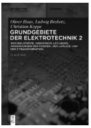
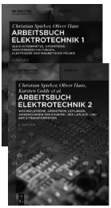
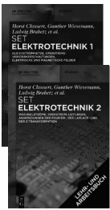
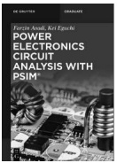

# Titel, Vorwort und Inhaltsverzeichnis

原始 PDF 第 1–10 页。

Oliver Haas, Ludwig Brabetz, Christian Koppe

**Grundgebiete der Elektrotechnik**

De Gruyter Studium

---

## Weitere Titel der Autoren

Grundgebiete der Elektrotechnik

Ludwig Brabetz, Christian Koppe, Oliver Haas, 2022

Begründet von: Horst Clausert, Gunther Wiesemann

Band 2: Wechselströme, Drehstrom, Leitungen, Anwendungen der

Fourier-, der Laplace- und der Z-Transformation

ISBN 978-3-11-063160-9, e-ISBN 978-3-11-063164-7

text_image

Christian Spielez, Oliver Hans
ARBEITSBUCH
ELEKTROTECHNIK 1
ARTISTIAN ZUCHESTEN, J. K. H. R. L. M. B. S.
VANNARIUS, J. K. H. R. L. M. B. S.
SANDRAZ, J. K. H. R. L. M. B.
ARTISTIAN ZUCHESTEN, J. K. H. R. L. M. B.
SANDRAZ, J. K. H. R. L. M. B.
ARTISTIAN ZUCHESTEN, J. K. H. R. L. M. B.
SANDRAZ, J. K. H. R. L. M. B.
ARTISTIAN ZUCHESTEN, J. K. H. R. L. M. B.
SANDRAZ, J. K. H. R. L.
ARTISTIAN ZUCHESTEN, J. K. H. R. L.
SANDRAZ, J. K. H.
ARTISTIAN ZUCHESTEN, J. K. H.
SANDRAZ, J. K.
ARTISTIAN ZUCHESTEN, J. K.
SANDRAZ, J. K.
ARTISTIAN ZUCHESTEN, J. K.
SANDRAZ, J. K.
ARTISTIAN ZUCHESTEN, J. K.
SANDRAZ, J. K.
ARTISTIAN ZUCHESTEN, J. K.
SANDRAZ, J. K.
ARTISTIAN ZUCHESTEN, J. K.
SANDRAZ, J. K.
ARTISBURGER, J. K.
ARTISBURGER, J. K.
ARTISBURGER, J. K.
ARTISBURGER, J. K.
ARTISBURGER, J. K.
ARTISBURGER, J. K.
ARTISBURGER, J. K.
ARTISBURGER, J. K.
ARTISBURGER, J. K.
ARTISBURGER, J. K.
ARTISBURGER, J. K.
ARTISBURGER,
JANANA
ARTISBURGER,
JANANA
ARTISBURGER,
JANANA
ARTISBURGER,
JANANA
ARTISBURGER,
JANANA
ARTISBURGER,
JANANA
ARTISBURGER,
JANANA
ARTISBURGER,
JANANA
ARTISBURGER,
JANANA
ARTISBURGER,
JANANA
ARTISBURGER,
JANANA
ARTISBURGER,
JANANA
ARTHURGER,
JANANA
ARTHURGER,
JANANA
ARTHURGER,
JANANA
ARTHURGER,
JANANA
ARTHURGER,
JANANA
ARTHURGER,
JANANA
ARTHURGER,
JANANA
ARTHURGER,
JANANA
ARTHURGER,
JANANA
ARTHURGER,
JANANA
ARTHURGER,
JANANA
ARTHURGER,
JANANA
ARTHURGER,
JASIKANDER,
JASIKANDER,
JASIKANDER,
JASIKANDER,
JASIKANDER,
JASIKANDER,
JASIKANDER,
JASIKANDER,
JASIKANDER,
JASIKANDER,
JASIKANDER,
JASIKANDER,
JASIKANDER,
JASIKANDER,
JASIKANDER,
JASIKANDER,
JASIKANDER,
JASIAKANDER,
JASIAKANDER,
JASIAKANDER,
JASIAKANDER,
JASIAKANDER,
JASIAKANDER,
JASIAKANDER,
JASIAKANDER,
JASIAKANDER,
JASIAKANDER,
JASIAKANDER,
JASIAKANDER,
JASIAKANDER,
JASIAKANDER,
JASIAKANDR
JASIAKANDER,
JASIAKANDER,
JASIAKANDER,
JASIAKANDER,
JASIAKANDER,
JASIAKANDER,
JASIAKANDER,
JASIAKANDER,
JASIAKANDER,
JASIAKANDER,
JASIAKANDER,
JASIAKANDER,
JASIAKANDER,
JASIAKANDER,
JADIMIRGAR
JADIMIRGAR
JADIMIRGAR
JADIMIRGAR
JADIMIRGAR
JADIMIRGAR
JADIMIRGAR
JADIMIRGAR
JADIMIRGAR
JADIMIRGAR
JADIMIRGAR
JADIMIRGAR
JADIMIRGAR
JADIMIRGAR
JADIMIRGAR
JAMINIGAR
JAMINIGAR
JAMINIGAR
JAMINIGAR
JAMINIGAR
JAMINIGAR
JAMINIGAR
JAMINIGAR
JAMINIGAR
JAMINIGAR
JAMINIGAR
JAMINIGAR
JAMINIGAR
JEHMAN
JEHMAN
JEHMAN
JEHMAN
JEHMAN
JEHMAN
JEHMAN
JEHMAN
JEHMAN
JEHMAN
JEHMAN
JEHMAN
JEHMAN
JEHMAN
JEHMAN
JEHMAN
JEHMAN
JEHMAN
JEHMAN
JEHMAN
JEHMAN
JEHMAN
JEHMAN
JEHMAN
JEHMAN
JEHMAOYI
JEHMAN
JEHMAN
JEHMAN
JEHMAN
JEHMAN
JEHMAN
JEHMAN
JEHMAN
JEHMAN
JEHMAN
JEHMAN
JEHMAN
JEHMAN
JEHMAN
JEHMAN
JEHMAN
JEHMAN
JEHMAN
JEHMAN
JEHMAN
JEHMAN
JEHMAN
JEHMAN
JEHMAN
JEHMEYI YUOYI YUOYI YUOYI YUOYI YUOYI YUOYI YUOYI YUOYI YUOYI YUOYI YUOYI YUOYI YUOYI YUOYI YUOYI YUOYI YUOYI YUOYI YUOYI YUOYI YUOOYI YUOOYI YUOOYI YUOOYI YUOOYI YUOOYI YUOOYI YUOOYI YUOOYI YUOOYI YUOOYI YUOOYI YUOOYI YUOOYI YUOOYI YUOOYI YUOOYI YUOOYI YUOOYI YUOOYI YUUUOYI YUUUOYI YUUUOYI YUUUOYI YUUUOYI YUUUOYI YUUUOYI YUUUOYI YUUUOYI YUUUOYI YUUUOYI YUUUOYI YUUUOYI YUUOOYI YUUOOYI YUUOOYI YUUOOYI YUUOOYI YUUOOYI YUUOOYI YUUOOYI YUUOOYI YUUOOYI YUUOOYI YUUOOYI YUUOOYI YUUOOYI YUUOOYI YUUOOYI YUUOOYI YUUOOYI YUUOOYI YUUOOYI YUUOUYOY I UUUOOYOY I UUUOOYOY I UUUOOYOY I UUUOOYOY I UUUOOYOY I UUUOOYOY I UUUOOYOY I UUUOOYOY I UUUOOYOY I UUUOOYOY I UUUOOYOY I UUUOOYOY I UUUOOYOY I UUUOOYOY I UUUOOYOY I UUUOOYOY I UUUOOYOY I SUSSUEYEYEYEYEYEYEYEYEYEYEYEYEYEYEYEYEYEYEYEYEYEYEYEYEYEYEYEYEYEYEYEYEYEYEYEYEYEYEYEYEYEYEYEYEYEYEYEYEYEYEYEYEYEYEYEYEYEYEYEYEYEYEYEYEYEYEYEYEYEYEYEYEYEYEYEYEYEYEYEYEYEYEYEYEYEYEYEYEYEYEYEYEYEYEYEYEYEYEYEYEVEEYEYEYEYEYEYEYEYEYEYEYEYEYEYEYEYEYEYEYEYEYEYEYEYEYEYEYEYEYEYEYEYEYEYEYEYEYEYEYEYEYEYEYEYEYEYEYEYEYEYEYEYEYEYEYEYEYEYEYE YESENEEYLEE YESENEEYLEE YESENEEYLEE YESENEEYLEE YESENEEYLEE YESENEEYLEE YESENEEYLEE YESENEEYLEE YESENEEYLEE YESENEEYLEE YESENEEYLEE YESENEEYLEE YESENEEYLEE YESENEEYLEE YESENEEYLEE YESENEEYLEE YESENEEYLEE YESENEOELEE YESENEEYLEE YESENEEYLEE YESENEEYLEE YESENEEYLEE YESENEEYLEE YESENEEYLEE YESENEEYLEE YESENEEYLEE YESENEEYLEE YESENEEYLEE YESENEEYLEE YESENEEYLEE YESENEEYLEE YESENEEYLEE YESENEEYLEE YESENEEYLEE YESENIELEE YESENEEYLEE YESENEEYLEE YESENEEYLEE YESENEEYLEE YESENEEYLEE YESENEEYLEE YESENEEYLEE YESENEEYLEE YESENEEYLEE YESENEEYLEE YESENEEYLEE YESENEEYLEE YESENEEYLEE YESENEEYLEE YESENEEYLEE YESENEEYLEE YESENIELEE YESENEEYLEE YESENEEYLEE YESENEEYLEE YESENEEYLEE YESENEEYLEE YESENEEYLEE YESENEEYLEE YESENEEYLEE YESENEEYLEE YESENEEYLEE YESENEEYLEE YESENEEYLEE YESENEEYLEE YESENEEYLEE YESENEEYLEE YESENEEYLEE YAEEZELE EAELEDE EAELEDE EAELEDE EAELEDE EAELEDE EAELEDE EAELEDE EAELEDE EAELEDE EAELEDE EAELEDE EAELEDE EAELEDE EAELEDE EAELEDE EAELEDE EAELEDE EAELEDE EAELEDE EAELEDE EAELEDE EAELEDE EAELEDE EAELEDE EAELEDE EAELEDO EAELEDE EAELEDE EAELEDE EAELEDE EAELEDE EAELEDE EAELEDE EAELEDE EAELEDE EAELEDE EAELEDE EAELEDE EAELEDE EAELEDE EAELEDE EAELEDE EAELEDE EAELEDE EAELEDE EAELEDE EAELEDE EAELEDE EAELEDE EAELEDE EAELEDRE EAELEDE EAELEDE EAELEDE EAELEDE EAELEDE EAELEDE EAELEDE EAELEDE EAELEDE EAELEDE EAELEDE EAELEDE EAELEDE EAELEDE EAELEDE EAELEDE EAELEDE EAELEDE EAELEDE EAELEDE EAELEDE EAELEDE EAELEDE EAELEDE EAELEDA EEAEEVEEA EEAEEVEEA EEAEEVEEA EEAEEVEEA EEAEEVEEA EEAEEVEEA EEAEEVEEA EEAEEVEEA EEAEEVEEA EEAEEVEEA EEAEEVEEA EEAEEVEEA EEAEEVEEA EEAEEVEEA EEAEEVEEA EEAEEVEEA EEAEEVEEA EEAEEVEEA EEAEEVEEA EEAEEVEEA EEAEEVELA EEAEEVEEA EEAEEVEEA EEAEEVEEA EEAEEVEEA EEAEEVEEA EEAEEVEEA EEAEEVEEA EEAEEVEEA EEAEEVEEA EEAEEVEEA EEAEEVEEA EEAEEVEEA EEAEEVEEA EEAEEVEEA EEAEEVEEA EEAEEVEEA EEAEEVEEA EEAEEVEEA EEAEEVEEA EEAEEVECA EEAEEVEEA EEAEEVEEA EEAEEVEEA EEAEEVEEA EEAEEVEEA EEAEEVEEA EEAEEVEEA EEAEEVEEA EEAEEVEEA EEAEEVEEA EEAEEVEEA EEAEEVEEA EEAEEVEEA EEAEEVEEA EEAEEVEEA EEAEEVEEA EEAEEVEEA EEAEEVEEA EEAEEVEEA EEAEEVEBA EE AEEVIEEA EE AEEVIEEA EE AEEVIEEA EE AEEVIEEA EE AEEVIEEA EE AEEVIEEA EE AEEVIEEA EE AEEVIEEA EE AEEVIEEA EE AEEVIEEA EE AEEVIEEA EE AEEVIEEA EE AEEVIEEA EE AEEVIEEA EE AEEVIEEA EE AEEVIEEA EE AEEVIEEA EE AEEVAES EA AEEVIEEA EE AEEVIEEA EE AEEVIEEA EE AEEVIEEA EE AEEVIEEA EE AEEVIEEA EE AEEVIEEA EE AEEVIEEA EE AEEVIEEA EE AEEVIEEA EE AEEVIEEA EE AEEVIEEA EE AEEVIEEA EE AEEVIEEA EE AEEVIEEA EE AEEVIEEA EE AEEVUEBA EE AEEVIEEA EE AEEVIEEA EE AEEVIEEA EE AEEVIEEA EE AEEVIEEA EE AEEVIEEA EE AEEVIEEA EE AEEVIEEA EE AEEVIEEA EE AEEVIEEA EE AEEVIEEA EE AEEVIEEA EE AEEVIEEA EE AEEVIEEA EE AEEVIEEA EE AEEVIEEA EE ASEEVAES EA AEEVIEEA EE ASEEVAES EA ASEEVAES EA ASEEVAES EA ASEEVAES EA ASEEVAES EA ASEEVAES EA ASEEVAES EA ASEEVAES EA ASEEVAES EA ASEEVAES EA ASEEVAES EA ASEEVAES EA ASEEVAES EA ASEEVAES EA ASEEVAES EA ASEEVAES EA ASEEVAES EA ASEEVAES EA ASEEVAES EA ASEEVAES EA ASEEVAES EN AE VIEELTEN SAALTA DE LA LEICAO DE LA LEICAO DE LA LEICAO DE LA LEICAO DE LA LEICAO DE LA LEICAO DE LA LEICAO DE LA LEICAO DE LA LEICAO DE LA LEICAO DE LA LEICAO DE LA LEICAO DE LA LEICAO DE LA LEICAO DE LA LEICAO DE LA LEICAO DE LA LEICAO DE LA LEICAO DE LA LEICAO DE LA LEICAO DE LA LEICAI TELOTE DE LA LEICAO DE LA LEICAO DE LA LEICAO DE LA LEICAO DE LA LEICAO DE LA LEICAO DE LA LEICAO DE LA LEICAO DE LA LEICAO DE LA LEICAO DE LA LEICAO DE LA LEICAO DE LA LEICAO DE LA LEICAO DE LA LEICAO DE LA LEICAO DE LA LEICAO DE LA LEICAO DE LA LEICAO DE LA LEICAU TELOTE DE LA LEICAO DE LA LEICAO DE LA LEICAO DE LA LEICAO DE LA LEICAO DE LA LEICAO DE LA LEICAO DE LA LEICAO DE LA LEICAO DE LA LEICAO DE LA LEICAO DE LA LEICAO DE LA LEICAO DE LA LEICAO DE LA LEICAO DE LA LEICAO DE LA LEICAO DE LA LEICAO DE LA LEICAO DE LAVETTE DE LA LEICAO DE LA LEICAO DE LA LEICAO DE LA LEICAO DE LA LEICAO DE LA LEICAO DE LA LEICAO DE LA LEICAO DE LA LEICAO DE LA LEICAO DE LA LEICAO DE LA LEICAO DE LA LEICAO DE LA LEICAO DE LA LEICAO DE LA LEICAO DE LA LEICAO DE LA LEICAO DE LA LEICAO DE LA LEIDTE DE LA LEIDTE DE LA LEIDTE DE LA LEIDTE DE LA LEIDTE DE LA LEIDTE DE LA LEIDTE DE LA LEIDTE DE LA LEIDTE DE LA LEIDTE DE LA LEIDTE DE LA LEIDTE DE LA LEIDTE DE LA LEIDTE DE LA LEIDTE DE LA LEIDTE DE LA LEIDTE DE LA LEIDTE DE LA LEIDTE DE LA LEIDTE DE LA LEIDTTE DE LA LEIDTE DE LA LEIDTE DE LA LEIDTE DE LA LEIDTE DE LA LEIDTE DE LA LEIDTE DE LA LEIDTE DE LA LEIDTE DE LA LEIDTE DE LA LEIDTE DE LA LEIDTE DE LA LEIDTE DE LA LEIDTE DE LA LEIDTE DE LA LEIDTE DE LA LEIDTE DE LA LEIDTE DE LA LEIDTE DE LA LEIDTE DE LA LEIDLTE DE LA LEIDTE DE LA LEIDTE DE LA LEIDTE DE LA LEIDTE DE LA LEIDTE DE LA LEIDTE DE LA LEIDTE DE LA LEIDTE DE LA LEIDTE DE LA LEIDTE DE LA LEIDTE DE LA LEIDTE DE LA LEIDTE DE LA LEIDTE DE LA LEIDTE DELA LETTATE DESLA LETTATE DESLA LETTATE DESLA LETTATE DESLA LETTATE DESLA LETTATE DESLA LETTATE DESLA LETTATE DESLA LETTATE DESLA LETTATE DESLA LETTATE DESLA LETTATE DESLA LETTATE DESLA LETTATE DESLA LETTATE DESLA LETTATE DESLA LETTATE DESLA LETTATE DESLA LETTATE DESLA LETTATE DESLA LETTATE D'UEVA ETUEVA ETUEVA ETUEVA ETUEVA ETUEVA ETUEVA ETUEVA ETUEVA ETUEVA ETUEVA ETUEVA ETUEVA ETUEVA ETUEVA ETUEVA ETUEVA ETUEVA ETUEVA ETUEVA ETUEVA ETUEVA ETUEVA ETUEVA ETUEVA ETUEVA ETUEVA ETUEVA ETUEVA ETUEVA ETUEVA ETUEVA ETUEVA ETUEVA ETUIVA ETUEVA ETUEVA ETUEVA ETUEVA ETUEVA ETUEVA ETUEVA ETUEVA ETUEVA ETUEVA ETUEVA ETUEVA ETUEVA ETUEVA ETUEVA ETUEVA ETUEVA ETUEVA ETUEVA ETUEVA ETUEVA ETUEVA ETUEVA ETUEVA ETUEVA ETUEVA ETUEVA ETUEVA ETUEVA ETUEVA ETUEVA ETUEVA ETUEBA ETUEVA ETUEVA ETUEVA ETUEVA ETUEVA ETUEVA ETUEVA ETUEVA ETUEVA ETUEVA ETUEVA ETUEVA ETUEVA ETUEVA ETUEVA ETUEVA ETUEVA ETUEVA ETUEVA ETUEVA ETUEVA ETUEVA ETUEVA ETUEVA ETUEVA ETUEVA ETUEVA ETUEVA ETUEVA ETUEVA ETUEVA ETUEBA ETUEVA ELISETTE ELISETTE ELISETTE ELISETTE ELISETTE ELISETTE ELISETTE ELISETTE ELISETTE ELISETTE ELISETTE ELISETTE ELISETTE ELISETTE ELISETTE ELISETTE ELISETTE ELISETTE ELISETTE ELISETTE ELISETTE ELISETTE ELISETTE ELISETTE ELISETTE ELISETFE ELISETTE ELISETTE ELISETTE ELISETTE ELISETTE ELISETTE ELISETTE ELISETTE ELISETTE ELISETTE ELISETTE ELISETTE ELISETTE ELISETTE ELISETTE ELISETTE ELISETTE ELISETTE ELISETTE ELISETTE ELISETTE ELISETTE ELISETTE ELISETTE ELISETTO ELISETTE ELISETTO ELISETTO ELISETTO ELISETTO ELISETTO ELISETTO ELISETTO ELISETTO ELISETTO ELISETTO ELISETTO ELISETTO ELISETTO ELISETTO ELISETTO ELISETTO ELISETTO ELISETTO ELISETTO ELISETTO ELISETTO ELISETTO ELISETTO ELISETTO ELISETTO ELISETFO ELISETTO ELISETTO ELISETTO ELISETTO ELISETTO ELISETTO ELISETTO ELISETTO ELISETTO ELISETTO ELISETTO ELISETTO ELISETTO ELISETTO ELISETTO ELISETTO ELISETTO ELISETTO ELISETTO ELISETTO ELISETTO ELISETTO ELISETTO ELISETTO ELISETPO ELISETTO ELISETTO ELISETTO ELISETTO ELISETTO ELISETTO ELISETTO ELISETTO ELISETTO ELISETTO ELISETTO ELISETTO ELISESTPO ELISETTO ELISESTPO ELISESTPO ELISESTPO ELISESTPO ELISESTPO ELISESTPO ELISESTPO ELISESTPO ELISESTPO ELISESTPO<nl>

Arbeitsbuch Elektrotechnik

Band 1: Gleichstromnetze, Operationsverstärkerschaltungen, elektrische und magnetische Felder

Christian Spieker, Oliver Haas, 2022

ISBN 978-3-11-067248-0, e-ISBN 978-3-11-067251-0

Band 2: Wechselströme, Drehstrom, Leitungen, Anwendungen der

Fourier-, der Laplace- und der Z-Transformation

Christian Spieker, Oliver Haas, Karsten Golde, Christian Gierl, Sujoy Paul, 2022

ISBN 978-3-11-067252-7, e-ISBN 978-3-11-067253-4

text_image

Horn Chouret, Gunker Wiesensme,
Ludwig Beberet et al.
SET
ELEKTROTECHNIK 1
GELKTRONNEFIEZ & ZERENSTROM
LUDIGIEZ & ZERENSTROM
SET
ELEKTROTECHNIK 2
LEUK-UNO
ABRETSCH

Jeweils auch als Set erhältlich:

Set Grundgebiete der Elektrotechnik 1, 13. Aufl.+Arbeitsbuch Elektrotechnik 1, 2. Aufl.

ISBN 978-3-11-067673-0

Set Grundgebiete der Elektrotechnik 2, 13. Aufl.+Arbeitsbuch Elektrotechnik 2, 2. Aufl.

ISBN 978-3-11-067674-7

## Weitere empfehlenswerte Titel

Elektronik für Informatiker

Von den Grundlagen bis zur Mikrocontroller-Applikation

Manfred Rost, Sandro Wefel, 2021

ISBN 978-3-11-060882-3, e-ISBN 978-3-11-040388-6

Power Electronics Circuit Analysis with PSIM®

Farzin Asadi, Kei Eguchi, 2021

ISBN 978-3-11-074063-9, e-ISBN 978-3-11-064357-2

---

Oliver Haas, Ludwig Brabetz, Christian Koppe

# Grundgebiete der Elektrotechnik

Band 1 Gleichstromnetze,

Operationsverstärkerschaltungen, elektrische und magnetische Felder

13. korrigierte Auflage

DE GRUYTER

OLDENBOURG

---

## Autoren

Prof. Dr. Ludwig Brabetz

Universität Kassel

FB 16 Elektrotechnik und Informatik

Wilhelmshöher Allee 73

34121 Kassel

brabetz@uni-kassel.de

Dr.-Ing. Oliver Haas

Wilhelmshöher Allee 73

34121 Kassel

oliver.haas@uni-kassel.de

Christian Koppe

Rheinstahlring 48

34246 Vellmar

c-koppe@web.de

Begründet von

Horst Clausert

Gunther Wiesemann

ISBN 978-3-11-063154-8

e-ISBN (PDF) 978-3-11-063158-6

e-ISBN (EPUB) 978-3-11-063177-7

**Library of Congress Control Number: 2022932559**

## Bibliografische Information der Deutschen Nationalbibliothek

Die Deutsche Nationalbibliothek verzeichnet diese Publikation in der Deutschen

Nationalbibliografie; detaillierte bibliografische Daten sind im Internet über

http://dnb.dnb.de abrufbar.

© 2022 Walter de Gruyter GmbH, Berlin/Boston

Coverabbildung: Girolamo Sferrazza Papa / iStock / Getty Images Plus

Druck und Bindung: CPI books GmbH, Leck

www.degruyter.com

---

## Vorwort zur 13. Auflage

Die Grundlagen der Elektrotechnik gehören für die Studierenden der Elektrotechnik, Mechatronik, Maschinenbau und der Informatik zu der Grundausbildung ihres Studi ums. Ein Grund für die neue Auflage des Bandes Grundgebiete der Elektrotechnik 1 der Autoren Clausert und Wiesemann ist, dass das Einheitensystem im Jahr 2019 reformiert wurde. Weiterhin gab es bereits im Jahr 2018 neue Messwerte wichtiger physikalischer Konstanten, die ebenfalls einige Anpassungen erforderlich machten.

Die Neuauflage berücksichtigt konsequent alle Empfehlungen des wissenschaftlichen Formelsatzes; also die Festlegung, wie Indizes, Variablen und Funktionen sowie mathematische Konstanten gesetzt werden sollen.

In dieser Auflage wurden Fehler korrigiert, Tabellen, Grafiken und Beispiele erweitert, sodass die Inhalte für den Leser deutlicher werden. So wurde z. B. der Abschnitt zu den Maxwell’schen-Gleichungen ausführlich erweitert und mit einem Beispiel ver sehen, mit dem Ziel, dem Leser das Verständnis dieser fundamentalen Formeln der Elektrotechnik zu erleichtern.

Viele Änderungen waren notwendig, damit auch diese Auflage weiterhin den Anspruch erfüllen kann, den Studierenden ein aktuelles Standardwerk zu bieten.

Wir möchten uns selbstverständlich bei De Gruyter Oldenbourg für die gute und freundliche Zusammenarbeit bedanken.

Kassel im Februar 2022

Ludwig Brabetz

Oliver Haas

Christian Koppe

https://doi.org/10.1515/9783110631586-202

---

VI

Vorwort zur dreizehnten Auflage

## Aus dem Vorwort zur ersten Auflage

In dem vorliegenden ersten Band behandeln wir die elektrischen Netze bei Gleichstrom und elektrische und magnetische Felder. Ein folgender zweiter Band wird der Wech selstromlehre und den Ausgleichsvorgängen gewidmet sein. Dem Lehrbuchcharakter entsprechend enthält jeder wichtige Abschnitt einige Beispiele. Diese sind fast alle als Aufgaben formuliert (mit den zugehörigen, oft recht ausführlichen Lösungen) und früheren Klausuren entnommen worden. Einige Beispiele stellen Ergänzungen des Vorlesungsstoffes dar und können beim ersten Durcharbeiten des Buches übersprungen werden.

Das Buch wendet sich in erster Linie an Studierende der Elektrotechnik, aber auch in der Praxis stehende Ingenieure werden aus dem Buch Nutzen ziehen – vielleicht gerade wegen der vielen Beispiele. Die Leser sollten mit den Grundbegriffen der Differenzial- und Integralrechnung vertraut sein. Die anspruchsvolleren Hilfsmittel der Feldtheorie dagegen werden nicht vorausgesetzt, sondern – soweit sie hier schon erforderlich sind – im Text erläutert.

Zum Schluss sprechen wir all denen unseren Dank aus, die zum Gelingen des Buches beigetragen haben. Der erstgenannte Verfasser dankt besonders Frau Bauks, die die Reinschrift seines Beitrags zu diesem Buch angefertigt hat, sowie Herrn cand. ing. Butscher für das Entwerfen und Zeichnen eines großen Teils der Bilder. Schließlich möchte er nicht versäumen, an dieser Stelle seines Lehrers Herbert Buchholz (1895–1971) zu gedenken, dessen Darmstädter Vorlesungen die Abschnitte über Felder in mancher Hinsicht beeinflusst haben. Der zweitgenannte Verfasser dankt seiner Frau für das sorgfältige Schreiben seines Manuskripts. Dem Verlag gebührt unser Dank für die gute Zusammenarbeit.

Wuppertal, Braunschweig im Juli 1978

H. Clausert G. Wiesemann

---

## Inhalt

## Vorwort zur 13. Auflage | V

Aus dem Vorwort zur ersten Auflage | **VI**

## 1 Einheiten, Gleichungen und grundlegende Begriffe | 1

1.1 Einheitensysteme | 1
1.1.1 Maßsysteme | 1
1.1.2 Die Grundgrößen des SI | 2
1.1.3 Einige abgeleitete Einheiten | 3
1.2 Schreibweise von Gleichungen | 4
1.2.1 Größengleichungen | 4
1.2.2 Der Begriff Dimension | 5
1.3 Die elektrische Ladung | 5
1.4 Der elektrische Strom | 6
1.5 Die elektrische Spannung | 9
1.6 Der elektrische Widerstand | **11**
1.7 Energie und Leistung | **13**

## 2 Berechnung von Strömen und Spannungen in elektrischen Netzen | 15

2.1 Die Grundgesetze | **15**
2.1.1 Das Ohm’sche Gesetz | **15**
2.1.2 Die Knotengleichung (1. Kirchhoff’sche Gleichung) | **19**
2.1.3 Die Umlaufgleichung (2. Kirchhoff’sche Gleichung) | **21**
2.2 Parallel- und Reihenschaltung | **23**
2.2.1 Reihenschaltung von Widerständen | **23**
2.2.2 Spannungsteiler | **24**
2.2.3 Parallelschaltung von Widerständen | **25**
2.2.4 Stromteiler | **27**
2.2.5 Gruppenschaltung von Widerständen | **27**
2.2.6 Brücken-Abgleich | **28**
2.2.7 Schaltungssymmetrie | **30**
2.3 Strom- und Spannungsmessung | **31**
2.3.1 Anforderungen an Strom- und Spannungsmesser | **31**
2.3.2 Analoges Messinstrument | **32**
2.3.3 Klassengenauigkeit | **33**
2.3.4 Digitales Messinstrument | **34**
2.3.5 Messbereichserweiterung | **35**
2.3.6 Vielfachmessinstrument (Multimeter) | **40**
2.3.7 Messwertkorrektur | **41**
2.4 Lineare Zweipole | **44**

---

VIII

Inhalt

2.4.1 Erzeuger- und Verbraucher-Zählpfeilsystem | **45**
2.4.2 Spannungsquellen | **46**
2.4.3 Linearität | **49**
2.4.4 Quellen-Ersatzzweipole | **51**
2.4.5 Leistung an Zweipolen | **56**
2.5 Nichtlineare Zweipole | **62**
2.5.1 Kennlinien nichtlinearer Zweipole | **62**
2.5.2 Grafische Bestimmung des Stromes in Netzen mit einem nichtlinearen Zweipol | **64**
2.6 Der Überlagerungssatz (Superpositionsprinzip nach Helmholtz) | **70**
2.7 Stern-Dreieck-Transformation | **73**
2.7.1 Umwandlung eines Dreiecks in einen Stern | **74**
2.7.2 Umwandlung eines Sterns in ein Dreieck | **75**
2.7.3 Vor- und Nachteile der Netzumwandlung | **76**
2.8 Umlauf- und Knotenanalyse linearer Netze | **78**
2.8.1 Die Bestimmungsgleichungen für die Ströme und Spannungen in einem Netz; lineare Abhängigkeit | **78**
2.8.2 Topologische Grundbegriffe beliebiger Netze | **83**
2.8.3 Umlaufanalyse | **85**
2.8.4 Knotenanalyse | **96**
2.8.5 Vergleich zwischen Umlauf- und Knotenanalyse | **103**
2.8.6 Gesteuerte Quellen | **106**
2.9 Operationsverstärkerschaltungen | **113**
2.9.1 Der ideale Operationsverstärker | **113**
2.9.2 Komparatoren | **115**
2.9.3 Rückkopplungsprinzipien | **116**
2.9.4 Spannungsübertragungsfunktion uA = f(uE) | **120**
2.9.5 Kombination von invertierender mit nichtinvertierender Gegenkopplung | **133**
2.9.6 Kombination von invertierender mit nichtinvertierender Mitkopplung | **137**
2.9.7 Kombination von Gegenkopplung und Mitkopplung | **142**

## 3 Elektrostatische Felder | 151

3.1 Skalare und vektorielle Feldgrößen | **151**

3.2 Die elektrische Feldstärke und die Potenzialfunktion | **152**

3.2.1 Das Coulomb’sche Gesetz | **152**

3.2.2 Die elektrische Feldstärke | **153**

3.2.3 Die Potenzialfunktion | **156**

3.3 Die Erregung des elektrischen Feldes | **161**

3.3.1 Die elektrische Flussdichte | **161**

3.3.2 Der Gauß’sche Satz der Elektrostatik | **162**

---

Inh l

IX

3.4 Die Potenzialfunktion spezieller Ladungsverteilungen | **165**

3.4.1 Die Punktladung | **165**

3.4.2 Der Dipol | **166**

3.4.3 Die Linienladung | **167**

3.5 Influenzwirkungen | **170**

3.6 Die Kapazität | **171**

3.6.1 Die Definition der Kapazität | **171**

3.6.2 Parallel- und Reihenschaltung von Kapazitäten | **172**

3.6.3 Die Kapazität spezieller Anordnungen | **173**

3.7 Spezielle Methoden der Feldberechnung | **179**

3.7.1 Das Prinzip der Materialisierung | **179**

3.7.2 Die Kästchenmethode | **184**

3.8 Energie und Kräfte | **185**

3.8.1 Elektrische Energie und Energiedichte | **185**

3.8.2 Kräfte im elektrostatischen Feld | **187**

3.9 Bedingungen an Grenzflächen | **191**

3.10 Kondensatorschaltungen | **194**

3.10.1 Aufladung ungeladener Kondensatorschaltungen | **194**

3.10.2 Ladungsausgleich zwischen Kondensatoren | **198**

## 4 Stationäre elektrische Strömungsfelder | 203

4.1 Die Grundgesetze und ihre Entsprechungen im elektrostatischen Feld | **203**

4.2 Methoden zur Berechnung von Widerständen | **206**

4.3 Anwendung auf Erdungsprobleme | **209**

4.4 Bedingungen an Grenzflächen | **212**

## 5 Stationäre Magnetfelder | 214

5.1 Magnetismus | **214**

5.2 Kräfte im magnetischen Feld und die magnetische Flussdichte | **215**

5.2.1 Die Kraft zwischen zwei stromdurchflossenen Leitern | **215**

5.2.2 Die magnetische Flussdichte | **216**

5.2.3 Die Kraft auf stromdurchflossene Leiter im Magnetfeld | **217**

5.3 Die Erregung des Magnetfeldes | **220**

5.3.1 Die magnetische Feldstärke | **220**

5.3.2 Das Durchflutungsgesetz | **223**

5.3.3 Das Gesetz von Biot-Savart | **226**

5.4 Der magnetische Fluss | **228**

5.5 Bedingungen an Grenzflächen | **230**

5.6 Magnetische Kreise | **231**

5.6.1 Grundlagen und Analogien | **231**

5.6.2 Der magnetische Kreis ohne Verzweigung | **232**

---

X | Inhalt

5.6.3 Der magnetische Kreis mit Verzweigung | **233**

5.6.4 Nichtlineare magnetische Kreise | **234**

## 6 Zeitlich veränderliche magnetische Felder | 240

6.1 Induktionswirkungen | **240**

6.1.1 Das Induktionsgesetz in einfacher Form | **240**

6.1.2 Die Lenzsche Regel | **241**

6.1.3 Faraday-Maxwell’sches-Induktionsgesetz | **242**

6.1.4 Weitere Formen des Induktionsgesetzes | **247**

6.1.5 Eine Folgerung aus dem Induktionsgesetz | **247**

6.2 Die magnetische Feldenergie | **249**

6.2.1 Die zum Aufbau des Feldes erforderliche Energie | **249**

6.2.2 Die Hystereseverluste | **251**

6.3 Induktivitäten | **252**

6.3.1 Die Selbstinduktivität | **252**

6.3.2 Die Gegeninduktivität | **253**

6.3.3 Die magnetische Energie eines Systems stromdurchflossener Leiterschleifen | **255**

6.3.4 Methoden zur Berechnung von Selbst- und Gegeninduktivitäten | **258**

6.4 Magnetische Feldkräfte | **261**

6.4.1 Die Berechnung von Kräften über die Energie | **261**

6.4.2 Kräfte bei Elektromagneten | **263**

6.5 Ampère-Maxwell’sches-Durchflutungsgesetz | **264**

6.6 Das System der Maxwell’schen Gleichungen | **266**

## Weiterführende Literatur | 269

**Stichwortverzeichnis** | **272**
