# 2 Berechnung von Strömen und Spannungen in elektrischen Netzen

原始 PDF 第 25–160 页。

# 2 Berechnung von Strömen und Spannungen in elektrischen Netzen

## 2.1 Die Grundgesetze

## 2.1.1 Das Ohm’sche Gesetz

Wenn auf die Leitungselektronen des Widerstandes R eine Kraft wirkt (Bild 2.1), so fließt im Widerstand ein Strom I. Dieser Strom wächst, wenn U größer wird; der Strom wächst aber auch, wenn der Wert R des Widerstandes abnimmt. Speziell in einem metallischen Leiter von konstanter Form und Größe ist der Strom der Spannung **streng proportional** (Bild 2.2), solange auch die **Temperatur konstant** gehalten wird:

$$
I \sim U. \tag {2.1}
$$

Diese Proportionalität zwischen Spannung und Strom in metallischen Leitern nennt man **Ohm’sches Gesetz**. Normalerweise schreibt man statt der Proportionalität eine Gleichung mit dem Proportionalitätsfaktor R, dem sogenannten ohmschen Widerstand:

$$
U = R I \quad (\text {mit} R = k o n s t) . \tag {2.2a}
$$

Umgeformt ergibt dies

$$
I = \frac {U}{R} \tag {2.2b}
$$

oder

$$
R = \frac {U}{I}. \tag {2.2c}
$$


Abb. 2.1: Stromkreis aus Batterie und Widerstand.

Abb. 2.2: Kennlinie $U = f ( I )$ eines ohmschen Widerstandes.

https://doi.org/10.1515/9783110631586-002

---

16

2 Berechnung von Strömen und Spannungen in elektrischen Netzen

Das Bild 2.2 stellt dar, dass der Zusammenhang zwischen U und I eine Gerade ist. Man spricht deshalb auch davon, dass U und I **linear** zusammenhängen (Linearität der Strom-Spannungs-Kennlinie $U = f ( I ) )$ . Den Kehrwert des Widerstandes R nennt man **Leitwert**

$$
G = \frac {1}{R}. \tag {2.3}
$$

Damit wird aus den Gln. (2.2)

$$
U = \frac {I}{G}; \quad I = G U; \quad G = \frac {I}{U}. \tag {2.4a,b,c}
$$

Bemerkenswert ist, dass in der deutschen Sprache zwischen dem Bauelement »Widerstand« und seinem Widerstandswert nicht unterschieden wird. (Im Englischen heißt das Bauelement **resistor** und sein Widerstandswert **resistance** .)

**Anmerkung** Temperaturabhängigkeit von Widerständen: In einem metallischen Leiter gilt das Ohm’sche Gesetz $I \sim U$ nur, solange die Temperatur konstant ist. Der Widerstand solcher Leiter ist also stromunabhängig, aber temperaturabhängig; er nimmt im Allgemeinen mit der Temperatur zu. Bei reinen Metallen (außer den ferromagnetischen) ist der spezifische Widerstand ϱ oberhalb einer bestimmten Temperatur eine nahezu lineare Funktion der Temperatur ϑ (Bild 2.3).

Völlig anders als reine Metalle verhalten sich bestimmte Legierungen, bei denen der spezifische Widerstand innerhalb eines größeren Temperatur-Bereiches sogar abnimmt, wenn die Temperatur zunimmt. So nimmt beispielsweise der spezifische Widerstand von Manganin (86 % Cu, 12 % Mn, 2 % Ni) im Bereich von $3 5   ^ { \circ } \mathrm { C }$ bis $2 0 0   ^ { \circ } \mathrm { C }$ mit steigender Temperatur geringfügig ab (Bild 2.3).


<details>
<summary>line</summary>

| \(\vartheta/{}^{\circ}C\) | Manganin (mΩ \(mm^{2}/m)\) | Blei (mΩ \(mm^{2}/m)\) | Eisen (mΩ \(mm^{2}/m)\) | Aluminium (mΩ \(mm^{2}/m)\) | Kupfer (mΩ \(mm^{2}/m)\) |
| --- | --- | --- | --- | --- | --- |
| -150 | ~415 | ~55 | ~25 | ~10 | ~5 |
| 0 | ~430 | ~180 | ~75 | ~25 | ~15 |
| 100 | ~430 | ~260 | ~130 | ~40 | ~25 |
| 200 | ~430 | ~340 | ~210 | ~50 | ~30 |
| 350 | — | — | — | ~65 | ~40 |
</details>

Abb. 2.3: Temperaturabhängigkeit spezifischer Widerstände.

---

2.1 Die Grundgesetze

17

Bei Temperaturen um $\vartheta = 2 0   ^ { \circ } \mathrm { C }$ beschreibt man das Verhalten von Widerstands-Materialien gern durch folgende Annäherung der Funktion $R = f ( \vartheta )$ an eine Geraden-Gleichung:

$$
R \approx R _ {2 0} \left[ 1 + \alpha_ {2 0} \left(\frac {\vartheta}{^ {\circ} \mathrm{C}} - 2 0\right) \mathrm{K} \right].
$$

Hierbei ist $R _ { 2 0 }$ der Wert, den ein ohmscher Widerstand bei $2 0   ^ { \circ } \mathrm { C }$ hat. $\alpha _ { 2 0 }$ ist der materialspezifische **Temperaturbeiwert** (Temperatur-Koeffizient); er ist ein Maß für die relative Zunahme des Widerstandswertes bei Erhöhung der Temperatur um 1 K. Je weniger linear die Funktion $R   =   f ( \vartheta )$ in Wirklichkeit ist, desto kleiner ist der Temperaturbereich, in dem die Annäherung durch eine Gerade brauchbar ist. Eine genauere Beschreibung der Temperatur-Abhängigkeit erreicht man folgendermaßen :

$$
R = R _ {2 0} \left[ 1 + \alpha_ {2 0} \left(\frac {\vartheta}{^ {\circ} \mathrm{C}} - 2 0\right) \mathrm{K} + \beta_ {2 0} \left(\frac {\vartheta}{^ {\circ} \mathrm{C}} - 2 0\right) ^ {2} \mathrm{K} ^ {2} + \dots \right].
$$

Hierbei treten zum linearen Term mit dem Koeffizienten α der quadratische Term mit dem Koeffizienten $\beta$ und eventuell noch mehr Terme hinzu.

In den folgenden Tabellen sind die spezifischen Widerstände $\varrho ,$ die spezifischen Leitwerte $\gamma = 1 / \varrho$ und die Temperaturbeiwerte α und $\beta$ für einige wichtige Stoffe zusammengestellt (alle Werte gelten für $\vartheta = 2 0   ^ { \circ } \mathsf { C } )$

In diesen Tabellen gibt $\varrho _ { 2 0 }$ den spezifischen Widerstand bei $2 0   ^ { \circ } \mathrm { C }$ an. Da $\varrho _ { 2 0 }$ in $\mathtt { \Omega m m } ^ { 2 } ,$ /m angegeben wird, geben die Zahlenwerte in der ersten Spalte der Tabellen unmittelbar an, wie viel Ohm ein Widerstand (Draht) von 1 m Länge und $1   \mathrm { m m } ^ { 2 }$ Querschnitt hat. So ist z. B. der Widerstandswert eines Konstantandrahtes von 1 m Länge und $1   \mathrm { { m m } ^ { 2 } }$ Querschnitt: $R = 0 , 5 \Omega$

Tab. 2.1: Spezifischer Widerstand, Leitwert und Temperaturbeiwerte von Reinmetallen.

| Material | $\frac{\varrho_{20}}{\Omega\frac{mm^2}{m}}$ | $\frac{\gamma_{20}}{S\frac{m}{mm^2}}$ | $\frac{\alpha_{20}}{1/K}$ | $\frac{\beta}{1/K^2}$ |
| --- | --- | --- | --- | --- |
| Aluminium | 0,027 | 37 | $4,3 \cdot 10^{-3}$ | $1,3 \cdot 10^{-6}$ |
| Blei | 0,21 | 4,75 | $3,9 \cdot 10^{-3}$ | $2,0 \cdot 10^{-6}$ |
| Eisen | 0,1 | 10 | $6,5 \cdot 10^{-3}$ | $6,0 \cdot 10^{-6}$ |
| Gold | 0,022 | 45,2 | $3,8 \cdot 10^{-3}$ | $0,5 \cdot 10^{-6}$ |
| Kupfer | 0,017 | 58 | $4,3 \cdot 10^{-3}$ | $0,6 \cdot 10^{-6}$ |
| Nickel | 0,07 | 14,3 | $6,0 \cdot 10^{-3}$ | $9,0 \cdot 10^{-6}$ |
| Platin | 0,098 | 10,5 | $3,5 \cdot 10^{-3}$ | $0,6 \cdot 10^{-6}$ |
| Quecksilber | 0,96 | 1,04 | $0,8 \cdot 10^{-3}$ | $1,2 \cdot 10^{-6}$ |
| Silber | 0,016 | 62,5 | $3,6 \cdot 10^{-3}$ | $0,7 \cdot 10^{-6}$ |
| Zinn | 0,12 | 8,33 | $4,3 \cdot 10^{-3}$ | $6,0 \cdot 10^{-6}$ |

---

18

2 Berechnung von Strömen und Spannungen in elektrischen Netzen

Tab. 2.2: Spezifischer Widerstand, Leitwert und Temperaturbeiwert von Legierungen.

| Material | $\frac{\varrho_{20}}{\Omega \frac{mm^2}{m}}$ | $\frac{\gamma_{20}}{S \frac{m}{mm^2}}$ | $\frac{\alpha_{20}}{1/K}$ |
| --- | --- | --- | --- |
| Konstantan (55 % Cu, 44 % Ni, 1 % Mn) | 0,5 | 2 | $-4,0 \cdot 10^{-5}$ |
| Manganin (86 % Cu, 2 % Ni, 12 % Mn) | 0,43 | 2,27 | $\pm 10^{-5}$ |
| Messing | 0,066 | 15 | $1,5 \cdot 10^{-3}$ |

Tab. 2.3: Spezifischer Widerstand, Leitwert und Temperaturbeiwert von Kohle und Halbleitern.

| Material | $\frac{\varrho_{20}}{\Omega \frac{mm^2}{m}}$ | $\frac{\gamma_{20}}{S \frac{m}{mm^2}}$ | $\frac{\alpha_{20}}{1/K}$ |
| --- | --- | --- | --- |
| Germanium (rein) | $4,6 \cdot 10^{5}$ | $2,2 \cdot 10^{-6}$ |  |
| Graphit | 8,7 | 0,115 |  |
| Kohle (Bürstenkohle) | 40...100 | 0,01...0,025 | $-2 \cdot 10^{-4} \cdots -8 \cdot 10^{-4}$ |
| Silizium (rein) | $2,3 \cdot 10^{9}$ | $0,43 \cdot 10^{-9}$ |  |

Tab. 2.4: Spezifischer Widerstand und Leitwert von Elektrolyten.

| Material | $\frac{\varrho_{20}}{\Omega \frac{mm^{2}}{m}}$ | $\frac{\gamma_{20}}{S \frac{m}{mm^{2}}}$ |
| --- | --- | --- |
| Kochsalzlösung (10 %) | $79 \cdot 10^{3}$ | $12,7 \cdot 10^{-6}$ |
| Schwefelsäure (10 %) | $25 \cdot 10^{3}$ | $40,0 \cdot 10^{-6}$ |
| Kupfersulfatlösung (10 %) | $300 \cdot 10^{3}$ | $3,3 \cdot 10^{-6}$ |
| Wasser (rein) | $2,5 \cdot 10^{11}$ | $4,0 \cdot 10^{-10}$ |
| Wasser (destilliert) | $4 \cdot 10^{10}$ | $2,5 \cdot 10^{-9}$ |
| Meerwasser | $300 \cdot 10^{3}$ | $3,3 \cdot 10^{-6}$ |

Tab. 2.5: Spezifischer Widerstand von Isolierstoffen.

| Material | $\frac{\varrho_{20}}{\Omega \frac{mm^2}{m}}$ |
| --- | --- |
| Bernstein | $10^{22}$ |
| Glas | $10^{17} \dots 10^{18}$ |
| Glimmer | $10^{19} \dots 10^{21}$ |
| Holz (trocken) | $10^{15} \dots 10^{19}$ |
| Papier | $10^{21} \dots 10^{22}$ |
| Porzellan | bis $5 \cdot 10^{18}$ |
| Transformer-Öl | $10^{16} \dots 10^{19}$ |

---

2.1 Die Grundgesetze

19

## Beispiel 2.1: Temperaturabhängigkeit eines Widerstandes.

Eine Spule aus Kupferdraht hat bei $1 5   ^ { \circ } \mathrm { C }$ den Widerstandswert 20 Ω und betriebswarm den Wert 28 Ω. Welche Temperatur hat die betriebswarme Spule?

## Lösung:

Zwischen dem Wert $R _ { \mathrm { k } } = 2 0   \Omega$ des Spulenwiderstandes bei $\vartheta _ { \mathrm { k } } = 1 5   ^ { \circ } \mathrm { C }$ und dem Wert $R _ { 2 0 }$ (Widerstand bei $2 0 ^ { \circ } \mathrm { C } )$ gilt die Beziehung

$$
R _ {\mathrm{k}} = R _ {2 0} \left[ 1 + \alpha_ {2 0} \left(\frac {\vartheta_ {\mathrm{k}}}{\mathrm{oC}} - 2 0\right) \mathrm{K} \right],
$$

und für $R _ { \mathrm { W } } = 2 8   \Omega$ gilt

$$
R _ {\mathrm{w}} = R _ {2 0} \left[ 1 + \alpha_ {2 0} \left(\frac {\vartheta_ {\mathrm{w}}}{\mathrm{oC}} - 2 0\right) \mathrm{K} \right].
$$

In diesen beiden Gleichungen sind $R _ { 2 0 }$ und $\vartheta _ { w }$ unbekannt. $R _ { 2 0 }$ kann sofort eliminiert werden:

$$
\frac {R _ {\mathrm{k}}}{R _ {\mathrm{w}}} = \frac {1 + \alpha_ {2 0} \left(\frac {\vartheta_ {\mathrm{k}}}{^ \circ \mathrm{C}} - 2 0\right) \mathrm{K}}{1 + \alpha_ {2 0} \left(\frac {\vartheta_ {\mathrm{w}}}{^ \circ \mathrm{C}} - 2 0\right) \mathrm{K}}.
$$

Daraus folgt mit $\alpha _ { 2 0 } \approx 4 \cdot 1 0 ^ { - 3 } / \mathrm { K }$

$$
\vartheta_ {\mathrm{w}} = 2 0 ^ {\circ} \mathrm{C} + \frac {R _ {\mathrm{w}}}{R _ {\mathrm{k}}} \left[ \frac {{} ^ {\circ} \mathrm{C} / \mathrm{K}}{\alpha_ {2 0}} + \vartheta_ {\mathrm{k}} - 2 0 ^ {\circ} \mathrm{C} \right] - \frac {{} ^ {\circ} \mathrm{C} / \mathrm{K}}{\alpha_ {2 0}}
$$

$$
\vartheta_ {\mathrm{w}} = 2 0 ^ {\circ} \mathrm{C} + 1, 4 \left[ \frac {1 0 ^ {3}}{4} ^ {\circ} \mathrm{C} - 5 ^ {\circ} \mathrm{C} \right] - \frac {1 0 ^ {3}}{4} ^ {\circ} \mathrm{C} = \underline {{\underline {{1 1 3 ^ {\circ} \mathrm{C}}}}}.
$$

## 2.1.2 Die Knotengleichung (1. Kirchhoff’sche Gleichung)

Wenn mehrere Leitungen (Zweige) in einem Knoten leitend miteinander verbunden sind (Bild 2.4a), ist die Summe der zufließenden Ströme $( I _ { 1 } , I _ { 2 } , I _ { 3 } )$ gleich der Summe der abfließenden Ströme $( I _ { 4 } , I _ { 5 } )$

$$
I _ {1} + I _ {2} + I _ {3} = I _ {4} + I _ {5}.
$$

Allgemein gilt

$$
\sum I _ {\mathrm{zu}} = \sum I _ {\mathrm{ab}}.
$$

In einem Knoten können keine Ladungen und damit auch keine Ströme verschwinden oder entstehen (ähnlich wie beim Zusammenfließen mehrerer Ströme einer inkompressiblen Flüssigkeit).

Wenn man für jeden Strom den Zählpfeil vom Knoten weg orientiert, also alle Ströme als abfließend definiert, so muss die Summe aller dieser Ströme Null werden; es ist daher (Bild 2.4b):

$$
I _ {1} + I _ {2} + I _ {3} + I _ {4} + I _ {5} = 0.
$$

---

20

2 Berechnung von Strömen und Spannungen in elektrischen Netzen


<details>
<summary>text_image</summary>

a)
I₁
I₂
I₃
I₄
I₅
</details>


<details>
<summary>text_image</summary>

b)
I₁
I₂
I₃
I₄
I₅
</details>

Abb. 2.4: a) Knoten mit 3 zufließenden und 2 abfließenden Strömen; b) Knoten mit 5 abfließenden Strömen.


<details>
<summary>text_image</summary>

I₁
I₂
Iₙ
Iᵥ
</details>

Abb. 2.5: Knoten mit n abfließenden Strömen.

Allgemein gilt für einen Knoten, aus dem n Ströme abfließen (Bild 2.5):

$$
\sum_ {\nu = 1} ^ {n} I _ {\nu} = 0. \tag {2.5}
$$

Diese Gleichung bezeichnet man als 1. Kirchhoff’sche Gleichung oder als 1. Kirchhoff’sches Gesetz.

Die Gl. (2.5) gilt nicht nur für die Summe aller Ströme, die aus einem einzelnen Knoten abfließen, sondern sie gilt auch für die Summe der Ströme, die aus einem ganzen Netz abfließen. Das betrachtete Netz muss allerdings (wie zuvor der Knoten) der Bedingung genügen, dass in jedem einzelnen seiner Knoten und Schaltelemente die Gl. (2.5) gilt.

## Beispiel 2.2: Zweimaschiges Netz als Großknoten.

Ein Beispiel hierzu ist das in Bild 2.6 dargestellte Netz aus ohmschen Widerständen. Man kann das ganze Netz von außen als einen Großknoten mit den abfließenden Strömen $I _ { \mathrm { A } }$ $I _ { \mathrm { B } } ,$ , $I _ { \mathrm { C } }$ betrachten.


<details>
<summary>text_image</summary>

I_A = -5A
1A
3R
6R
1A
R
B
R
3A
0A
3A
D
C
I_C = 1 A
I_B = 4 A
</details>

Abb. 2.6: Zusammenfassung von vier Knoten zu einem Großknoten.

---

2.1 Die Grundgesetze

21

Für die abfließenden Ströme gilt auch hier:

$$
\sum I _ {\nu} = I _ {\mathrm{A}} + I _ {\mathrm{B}} + I _ {\mathrm{C}} = 0.
$$

Auch in den Knoten A, B, C, D ist hierbei die Bedingung (2.5) erfüllt.

## 2.1.3 Die Umlaufgleichung (2. Kirchhoff’sche Gleichung)

Bei der Darstellung des Ohm’schen Gesetzes in Bild 2.1 wird vorausgesetzt, dass an der Batterie dieselbe Spannung U anliegt wie am Widerstand. U tritt an der Batterie als Erzeugerspannung (Quellenspannung), im Widerstand als Verbraucherspannung (Spannungsabfall) auf.

Für den in Bild 2.1 dargestellten geschlossenen Stromkreis gilt

$$
\sum U _ {\nu} = 0. \tag {2.6}
$$

Hierbei ist $\sum U _ { \nu }$ die Summe aller Spannungen, die entlang eines geschlossenen Umlaufs im Uhrzeigersinn (oder im Gegenuhrzeigersinn) auftreten.

Wählt man, wie in Bild 2.1 eingezeichnet, einen geschlossenen Umlauf im Uhrzeigersinn und beginnt mit der Summenbildung an der Minusklemme, so liefert zunächst die Batterie den Beitrag −U (Minuszeichen, weil an der Batterie Spannungszählpfeil und gewählte Umlaufrichtung entgegengerichtet sind) und dann der Widerstand den Beitrag +U:

$$
\sum U _ {\nu} = - U + U = 0.
$$

## Beispiel 2.3: Umlaufgleichungen in einem zweimaschigen Netz.

Anstatt der einfachen Schaltung in Bild 2.1 soll nun eine verzweigte Schaltung nach Bild 2.7 betrachtet werden. Auch hier gilt Gl. (2.6) für jeden der drei möglichen geschlossenen Umläufe:

$$
\begin{array}{l} - U _ {\mathrm{q}} + U _ {1} \quad = 0 \quad (\text {linker Umlauf}) \\ - U _ {1} + U _ {2} + U _ {3} = 0 \quad \text {(rechter Umlauf)} \\ - U _ {\mathrm{q}} + U _ {2} + U _ {3} = 0 \quad \text {(großer Umlauf)}. \\ \end{array}
$$


<details>
<summary>text_image</summary>

I
Uq
I1
R1
U1
I2
U2
R2
U3
R3
</details>

Abb. 2.7: Netz mit drei Zweigen.

---

22

2 Berechnung von Strömen und Spannungen in elektrischen Netzen

Die Gl. (2.6) lässt sich aus einer Leistungsbetrachtung begründen. Wir tun dies am Beispiel der Schaltung in Bild 2.7. Die Batterie gibt gemäß Gl. (1.16) die Leistung

$$
P _ {\mathrm{ab}} = I U _ {\mathrm{q}}
$$

$a b ,$ die Widerstände nehmen die Leistung

$$
P _ {\mathrm{auf}} = I _ {1} U _ {1} + I _ {2} U _ {2} + I _ {2} U _ {3}
$$

auf. Abgegebene und aufgenommene Leistung müssen gleich sein, also gilt

$$
I U _ {\mathrm{q}} = I _ {1} U _ {1} + I _ {2} (U _ {2} + U _ {3}).
$$

Wegen Gl. (2.5) ist $I = I _ { 1 } + I _ { 2 }$ ; damit wird

$$
I _ {1} U _ {\mathrm{q}} + I _ {2} U _ {\mathrm{q}} = I _ {1} U _ {1} + I _ {2} (U _ {2} + U _ {3}).
$$

Diese Gleichung muss auch erfüllt sein, wenn der Zweig mit $R _ { 2 }$ und $R _ { 3 }$ unterbrochen (d. h. $I _ { 2 } = 0 )$ wird; dann gilt

$$
I _ {1} U _ {\mathrm{q}} = I _ {1} U _ {1}
$$

$$
U _ {\mathrm{q}} = U _ {1}. \tag {2.6a}
$$

Sie muss aber auch erfüllt sein für $I_{1} = 0;$ ; dann ist

$$
I _ {2} U _ {\mathrm{q}} = I _ {2} (U _ {2} + U _ {3})
$$

$$
U _ {\mathrm{q}} = U _ {2} + U _ {3}. \tag {2.6b}
$$

Der Vergleich der Gln. (2.6a) und (2.6b) liefert

$$
U _ {1} = U _ {2} + U _ {3}. \tag {2.6c}
$$

Allgemein gilt auch in beliebig komplizierten Netzen auf jedem möglichen Umlauf, der n Spannungen umfasst:

$$
\sum_ {\nu = 1} ^ {n} U _ {\nu} = 0. \tag {2.7}
$$

Diese allgemein gültige Umlaufgleichung wird als 2. Kirchhoff’sche Gleichung oder als 2. Kirchhoff’sches Gesetz bezeichnet.

## Elektromotorische Kraft

Die Gl. (2.7) sagt aus, dass in einem geschlossenen Umlauf die Summe aller Spannungen gleich Null ist. Diese Aussage kann man auch so formulieren: in einem geschlossenen Umlauf ist die Summe der erzeugten Spannungen gleich der Summe der verbrauchten

---

2.2 Parallel- und Reihenschaltung

23

Spannungen. Früher versuchte man dieser Betrachtungsweise dadurch gerecht zu werden, dass man zwischen erzeugten und verbrauchten Spannungen stärker unterschied. Man bezeichnete eine Erzeuger(Generator)-Spannung gern als elektromotorische Kraft (EMK) mit dem Buchstaben E. Bild 2.8 zeigt, dass die Zählpfeile für U und E einander entgegengerichtet sind. Die 2. Kirchhoff’sche Gleichung lautet in dieser (veralteten) Darstellung

$$
\sum_ {\nu = 1} ^ {m} E _ {\nu} = \sum_ {\nu = 1} ^ {n} U _ {\nu}, \tag {2.8}
$$

d. h.: die Summe der m bei einem Umlauf durchlaufenen Erzeugerspannungen ist gleich der Summe der n bei diesem Umlauf durchlaufenen Verbraucherspannungen.

## 2.2 Parallel- und Reihenschaltung

## 2.2.1 Reihenschaltung von Widerständen

Bild 2.9 zeigt drei hintereinander geschaltete (in Reihe geschaltete) Widerstände. Nach dem Ohm’schen Gesetz, Gl. (2.2a) gilt

$$
U _ {1} = R _ {1} I _ {1} \tag {2.9a}
$$

$$
U _ {2} = R _ {2} I _ {2} \tag {2.9b}
$$

$$
U _ {3} = R _ {3} I _ {3}. \tag {2.9c}
$$

Die Addition dieser drei Gleichungen liefert

$$
U _ {1} + U _ {2} + U _ {3} = R _ {1} I _ {1} + R _ {2} I _ {2} + R _ {3} I _ {3}. \tag {2.10}
$$

Wegen des 1. Kirchhoff’schen Gesetzes, Gl. (2.5), gilt hier

$$
I _ {1} = I _ {2} = I _ {3} = I \tag {2.11}
$$

und wegen des 2. Kirchhoff’schen Gesetzes, Gl. (2.7),

$$
U _ {1} + U _ {2} + U _ {3} = U. \tag {2.12}
$$

Setzt man die Gln. (2.11) und (2.12) in (2.10) ein, so ergibt sich

$$
U = (R _ {1} + R _ {2} + R _ {3}) I. \tag {2.13}
$$


<details>
<summary>text_image</summary>

E
U
+
I
R
U
-
</details>

Abb. 2.8: EMK und Spannung einer Batterie.

---

24

2 Berechnung von Strömen und Spannungen in elektrischen Netzen


<details>
<summary>flowchart</summary>

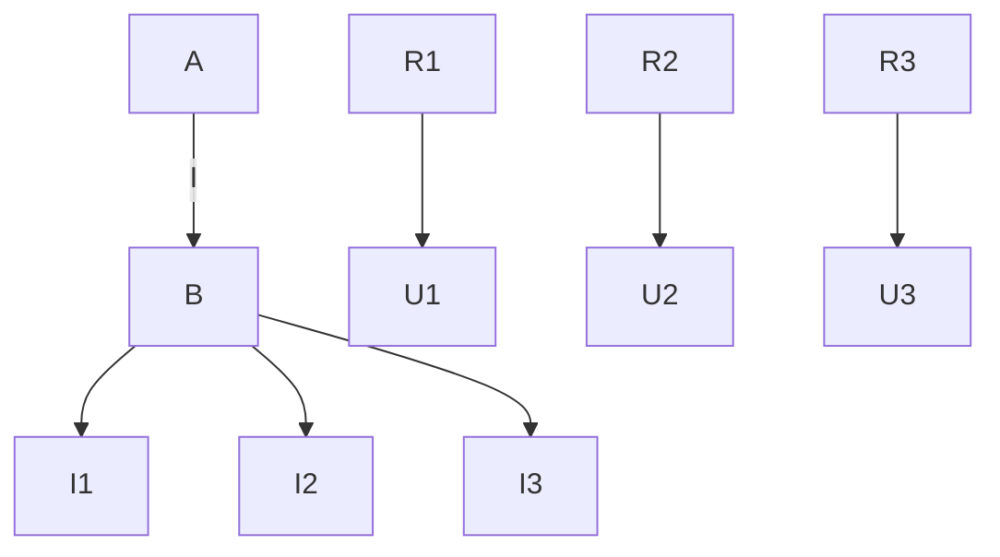
</details>

Abb. 2.9: Reihenschaltung dreier Widerstände.


<details>
<summary>text_image</summary>

I
U
R=R₁+R₂+R₃
</details>

Abb. 2.10: Ergebnis einer Reihenschaltung.

Dies ist das Ohm’sche Gesetz für einen Widerstand von der Größe

$$
R = R _ {1} + R _ {2} + R _ {3}. \tag {2.14}
$$

Die drei in Reihe geschalteten Widerstände $R _ { 1 } , R _ { 2 } , R _ { 3 }$ (Bild 2.9) verhalten sich wie ein einziger Widerstand mit dem Wert $R = R _ { 1 } + R _ { 2 } + R _ { 3 }$ (Bild 2.10).

Den resultierenden Widerstand einer Reihenschaltung von n Widerständen erhält man also aus der Addition der Teilwiderstände:

$$
R = \sum_ {\nu = 1} ^ {n} R _ {\nu} \quad (\text {Reihenschaltung}). \tag {2.15}
$$

## 2.2.2 Spannungsteiler

Aus den Gln. (2.9a) und (2.11) folgt

$$
U _ {1} = R _ {1} I,
$$

und mit Gl. (2.13) gilt dann

$$
\frac {U _ {1}}{U} = \frac {R _ {1} I}{(R _ {1} + R _ {2} + R _ {3}) I} = \frac {R _ {1}}{R _ {1} + R _ {2} + R _ {3}}.
$$

Allgemein gilt für die Teilspannung $U _ { \nu }$ am ν-ten Teilwiderstand $R _ { \nu }$ einer Reihenschaltung aus n Widerständen:

$$
U _ {\nu} = \frac {R _ {\nu}}{\sum_ {\nu = 1} ^ {n} R _ {\nu}} U. \tag {2.16}
$$

---

2.2 Parallel- und Reihenschaltung

25

Speziell an einer Reihenschaltung aus zwei Teilwiderständen (Bild 2.11) gilt also

$$
U _ {2} = \frac {R _ {2}}{R _ {1} + R _ {2}} U \tag {2.17}
$$

und

$$
\frac {U _ {1}}{U _ {2}} = \frac {R _ {1}}{R _ {2}}. \tag {2.18}
$$

Die Schaltung in Bild 2.11 nennt man deswegen auch einen **Spannungsteiler**.

## 2.2.3 Parallelschaltung von Widerständen

Das Bild 2.12 zeigt drei parallelgeschaltete Widerstände mit den Leitwerten

$$
G _ {1} = \frac {1}{R _ {1}}, \quad G _ {2} = \frac {1}{R _ {2}}, \quad G _ {3} = \frac {1}{R _ {3}}.
$$

Wendet man die Darstellung (2.4b) des Ohm’schen Gesetzes auf die drei Zweige der Parallelschaltung an, so wird

$$
I _ {1} = G _ {1} U _ {1} \tag {2.19a}
$$

$$
I _ {2} = G _ {2} U _ {2} \tag {2.19b}
$$

$$
I _ {3} = G _ {3} U _ {3}. \tag {2.19c}
$$

Die Addition dieser drei Gleichungen liefert

$$
I _ {1} + I _ {2} + I _ {3} = G _ {1} U _ {1} + G _ {2} U _ {2} + G _ {3} U _ {3}. \tag {2.20}
$$

Wegen des 2. Kirchhoff’schen Gesetzes, Gl. (2.7), gilt hier

$$
U _ {1} = U _ {2} = U _ {3} = U \tag {2.21}
$$

und wegen des 1. Kirchhoff’schen Gesetzes, Gl. (2.5),

$$
I _ {1} + I _ {2} + I _ {3} = I. \tag {2.22}
$$


<details>
<summary>text_image</summary>

R₁
U₁
R₂
U₂
</details>

Abb. 2.11: Unbelasteter Spannungsteiler aus zwei ohmschen Widerständen.

---

26

2 Berechnung von Strömen und Spannungen in elektrischen Netzen


<details>
<summary>flowchart</summary>

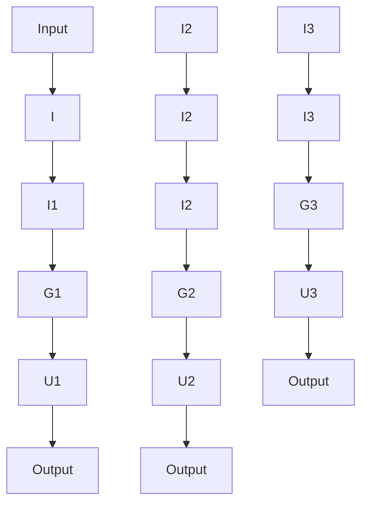
</details>

Abb. 2.12: Parallelschaltung dreier Widerstände.


<details>
<summary>text_image</summary>

I
U
G=G₁+G₂+G₃
</details>

Abb. 2.13: Ergebnis einer Parallelschaltung.

Setzt man die Gln. (2.21) und (2.22) in Gl. (2.20) ein, so ergibt sich

$$
I = (G _ {1} + G _ {2} + G _ {3}) U. \tag {2.23}
$$

Dies ist das Ohm’sche Gesetz (2.4b) für einen Leitwert von der Größe

$$
G = G _ {1} + G _ {2} + G _ {3}, \tag {2.24}
$$

(Bild 2.13). D. h. die drei parallelgeschalteten Leitwerte $G _ { 1 } , G _ { 2 } , G _ { 3 }$ verhalten sich wie ein einziger Leitwert von der Größe $G = G _ { 1 } + G _ { 2 } + G _ { 3 }$

Den resultierenden Leitwert einer Parallelschaltung von n Leitwerten erhält man aus der Addition der Teilleitwerte:

$$
G = \sum_ {\nu = 1} ^ {n} G _ {\nu} \quad (\text {Parallelschaltung}). \tag {2.25}
$$

Der Gesamtwiderstand R einer Parallelschaltung von n Teilleitwerten ist demnach

$$
R = \frac {1}{G} = \frac {1}{G _ {1} + G _ {2} + \cdots + G _ {\nu} + \cdots + G _ {n}} = \frac {1}{\frac {1}{R _ {1}} + \frac {1}{R _ {2}} + \cdots + \frac {1}{R _ {\nu}} + \cdots + \frac {1}{R _ {n}}}
$$

$$
R = \frac {1}{\sum_ {\nu = 1} ^ {n} \frac {1}{R _ {\nu}}} . \tag {2.26}
$$

Vergleicht man die Darstellungen in Gl. (2.25) und Gl. (2.26) miteinander, so zeigt sich deutlich, dass bei Parallelschaltung bequemer mit Leitwerten als mit Widerständen zu rechnen ist.

Speziell für zwei parallelgeschaltete Widerstände (Bild 2.14) gilt

$$
R = \frac {1}{G} = \frac {1}{G _ {1} + G _ {2}} = \frac {1}{\frac {1}{R _ {1}} + \frac {1}{R _ {2}}} = \frac {R _ {1} R _ {2}}{R _ {1} + R _ {2}}. \tag {2.27}
$$

---

2.2 Parallel- und Reihenschaltung

27


<details>
<summary>flowchart</summary>

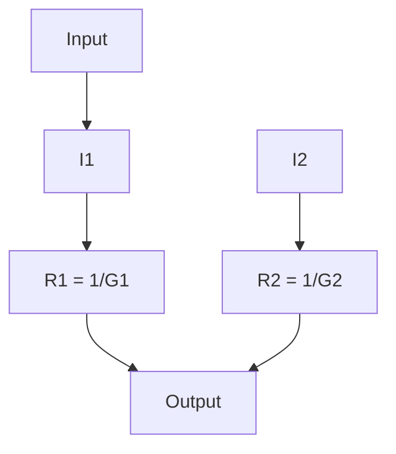
</details>

Abb. 2.14: Parallelschaltung zweier Widerstände.

## 2.2.4 Stromteiler

Aus den Gln. (2.19a) und (2.21) folgt

$$
I _ {1} = G _ {1} U
$$

und mit Gl. (2.23) gilt dann

$$
\frac {I _ {1}}{I} = \frac {G _ {1} U}{(G _ {1} + G _ {2} + G _ {3}) U} = \frac {G _ {1}}{G _ {1} + G _ {2} + G _ {3}}.
$$

Allgemein gilt für den Teilstrom $I _ { \nu }$ im ν-ten Teilleitwert $G _ { \nu }$ einer Parallelschaltung aus n Leitwerten:

$$
I _ {v} = \frac {G _ {v}}{\sum_ {v = 1} ^ {n} G _ {v}} I. \tag {2.28}
$$

Speziell an einer Parallelschaltung aus zwei Teilleitwerten (Bild 2.14) gilt also

$$
I _ {2} = \frac {G _ {2}}{G _ {1} + G _ {2}} I \tag {2.29a}
$$

$$
I _ {2} = \frac {\frac {1}{R _ {2}}}{\frac {1}{R _ {1}} + \frac {1}{R _ {2}}} I
$$

$$
I _ {2} = \frac {R _ {1}}{R _ {1} + R _ {2}} I \tag {2.29b}
$$

und

$$
\frac {I _ {1}}{I _ {2}} = \frac {G _ {1}}{G _ {2}}; \quad \frac {I _ {1}}{I _ {2}} = \frac {R _ {2}}{R _ {1}}. \tag {2.30a,b}
$$

## 2.2.5 Gruppenschaltung von Widerständen

In bestimmten Schaltungen lassen sich Gruppen von Widerständen zusammenfassen, die vom selben Strom durchflossen werden oder die an derselben Spannung liegen. Eine Schaltung, die sich ganz aus solchen Gruppen zusammensetzt, nennt man **Gruppenschaltung**.

---

28

2 Berechnung von Strömen und Spannungen in elektrischen Netzen

**Beispiel 2.4: Berechnung des resultierenden Widerstandes einer Gruppenschaltung.** In Bild 2.15 wird eine Schaltung dargestellt, deren Gesamtwiderstand

$$
R _ {\mathrm{CD}} = \frac {U}{I}
$$

sich leicht mit den Gln. (2.15) und (2.25) berechnen lässt :

$$
R _ {1, 2} = R _ {1} + R _ {2},
$$

$$
R _ {3, 4} = R _ {3} + R _ {4};
$$

$$
R _ {\mathrm{CD}} = \frac {1}{G _ {\mathrm{CD}}} = \frac {1}{\frac {1}{R _ {1 , 2}} + \frac {1}{R _ {3 , 4}}} = \frac {1}{\frac {1}{R _ {1} + R _ {2}} + \frac {1}{R _ {3} + R _ {4}}}
$$

$$
R _ {\mathrm{CD}} = \frac {(R _ {1} + R _ {2}) (R _ {3} + R _ {4})}{R _ {1} + R _ {2} + R _ {3} + R _ {4}}. \tag {2.31}
$$

Dagegen lässt sich eine Brückenschaltung (Bild 2.16) nicht einfach als Kombination von Reihen- und Parallelschaltungen auffassen, weil im Allgemeinen hier auch in $R _ { 5 }$ ein Strom fließen wird. Dann fließen durch $R _ { 1 }$ und $R _ { 2 }$ unterschiedliche Ströme: $R _ { 1 }$ und $R _ { 2 }$ bilden jetzt also keine Reihenschaltung. Das gleiche gilt für $R _ { 3 }$ und $R _ { 4 }$ . Ebenso treten in der Brückenschaltung keine parallelgeschalteten Widerstände auf; der Gesamtwiderstand $R _ { \mathrm { C D } } = U / _ { I }$ kann daher für diese Schaltung nicht aus den Formeln für Reihenschaltung Gl. (2.15) und Parallelschaltung Gl. (2.25) berechnet werden.

## 2.2.6 Brücken-Abgleich

Für die Spannungen $U _ { 1 }$ und $U _ { 3 }$ in Bild 2.15 gilt nach der Spannungsteiler-Formel Gl. (2.17):

$$
U _ {1} = \frac {R _ {1}}{R _ {1} + R _ {2}} U; \quad U _ {3} = \frac {R _ {3}}{R _ {3} + R _ {4}} U.
$$

Falls nun

$$
\frac {R _ {1}}{R _ {1} + R _ {2}} = \frac {R _ {3}}{R _ {3} + R _ {4}} \tag {2.32a}
$$


<details>
<summary>flowchart</summary>

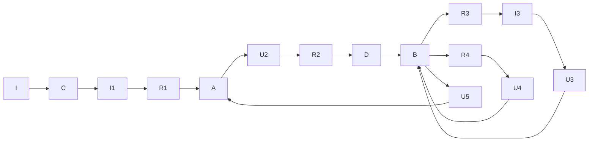
</details>

Abb. 2.15: Gruppenschaltung ohmscher Widerstände.

---

2.2 Parallel- und Reihenschaltung

29


<details>
<summary>flowchart</summary>

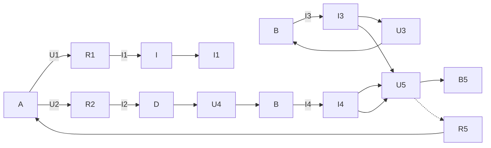
</details>

Abb. 2.16: Brückenschaltung.

wird, gilt $U _ { 1 } = U _ { 3 } ;$ man spricht in diesem Fall vom Abgleich der Schaltung in Bild 2.15, und die Anwendung der 2. Kirchhoff’schen Gleichung auf den linken Teil der Schaltung ergibt:

$$
U _ {5} = 0.
$$

Formt man die Gl. (2.32a) um, so entstehen u. a. die folgenden Formulierungen der **Abgleichbedingung** für eine Brückenschaltung (Bild 2.16):

$$
R _ {1} R _ {4} = R _ {2} R _ {3}; \quad \frac {R _ {1}}{R _ {2}} = \frac {R _ {3}}{R _ {4}}; \quad R _ {1} = \frac {R _ {2} R _ {3}}{R _ {4}}. \tag {2.32b,c,d}
$$

Ist die Abgleichbedingung erfüllt, so kann zwischen die Punkte A und B der Schaltung in Bild 2.15 ein beliebiger Widerstand $R _ { 5 }$ eingefügt werden. Weil zwischen diesen Knoten von vornherein keine Spannung anliegt, fließt durch diesen Widerstand auch kein Strom, und die Spannungen $U _ { 1 } \ldots U _ { 4 }$ bleiben ebenso wie die Ströme $I _ { 1 } \ldots I _ { 4 }$ unverändert.

Wenn die Schaltung in Bild 2.16 abgeglichen ist, kann demnach der Widerstand $R _ { 5 }$ einfach entfernt werden, ohne dass Spannungen und Ströme in der Schaltung hierdurch beeinflusst werden. Im Abgleichfall lässt sich die Schaltung in Bild 2.16 also durch die einfachere Gruppenschaltung 2.15 ersetzen. Aus Gl. (2.31) und der Abgleichbedingung Gl. (2.32d) ergibt sich für den Widerstand $R _ { \mathrm { C D } }$ dieser Schaltung

$$
\begin{array}{l} R _ {\mathrm{CD}} \big | _ {R _ {5} = \infty} \equiv R _ {\mathrm{L}} = \frac {\left(\frac {R _ {2} R _ {3}}{R _ {4}} + R _ {2}\right) (R _ {3} + R _ {4})}{\frac {R _ {2} R _ {3}}{R _ {4}} + R _ {2} + R _ {3} + R _ {4}} \\ R _ {\mathrm{L}} = R _ {2} \frac {R _ {3} + R _ {4}}{R _ {2} + R _ {4}}. \tag {2.33a} \\ \end{array}
$$

Wenn zwischen den Punkten A und B der Schaltung in Bild 2.16 keine Spannung besteht, so kann man diese beiden Punkte auch einfach kurzschließen, wie es in Bild 2.17 dargestellt ist. Diese Schaltung hat den Gesamtwiderstand

$$
R _ {\mathrm{CD}} \big | _ {R _ {5} = 0} \equiv R _ {\mathrm{k}} = \frac {R _ {1} R _ {3}}{R _ {1} + R _ {3}} + \frac {R _ {2} R _ {4}}{R _ {2} + R _ {4}}. \tag {2.34}
$$

---

30

2 Berechnung von Strömen und Spannungen in elektrischen Netzen


<details>
<summary>text_image</summary>

R₁
A
R₂
C
R₃
B
R₄
D
</details>

Abb. 2.17: Gruppenschaltung ohmscher Widerstände.

Mit der Abgleichbedingung Gl. (2.32d) ergibt sich hieraus

$$
R _ {\mathrm{k}} = \frac {\frac {R _ {2} R _ {3}}{R _ {4}} R _ {3}}{\frac {R _ {2} R _ {3}}{R _ {4}} + R _ {3}} + \frac {R _ {2} R _ {4}}{R _ {2} + R _ {4}}
$$

$$
R _ {\mathrm{k}} = R _ {2} \frac {R _ {3} + R _ {4}}{R _ {2} + R _ {4}}. \tag {2.33b}
$$

Die Ergebnisse der Gln. (2.33a) und (2.33b) bestätigen, dass der Gesamtwiderstand $R _ { \mathrm { L } }$ der Schaltung in Bild 2.15 mit dem Gesamtwiderstand $R _ { \mathrm { k } }$ der Schaltung in Bild 2.17 übereinstimmt, falls die Abgleichbedingung erfüllt ist.

## 2.2.7 Schaltungssymmetrie

Speziell bei symmetrischen Schaltungen aber auch bei anderen Schaltungen, kann man leicht Paare (oder größere Gruppen) von Punkten erkennen, zwischen denen keine Spannung auftritt. Solche Punkte (man nennt sie Punkte gleichen Potenzials) dürfen einfach kurzgeschlossen werden, ohne dass hierdurch Ströme und Spannungen in der Schaltung verändert werden. Ebenfalls dürfen die stromlosen Verbindungen zwischen solchen Punkten einfach aufgetrennt werden.

## Beispiel 2.5: Vereinfachung einer symmetrischen Schaltung.

Aufgrund der Symmetrie der Schaltung in Bild 2.18a ist leicht einzusehen, dass zwischen den Punkten A und B keine Spannung besteht (beide Punkte liegen auf der gestrichelten Symmetrieachse). Man darf also zwischen die Punkte A und B einen beliebigen Wider


Abb. 2.18: Drei gleichwertige symmetrische Schaltungen. a) Schaltung aus acht Widerständen; b) Schaltung aus neun Widerständen; c) Gruppenschaltung aus acht Widerständen.

---

2.3 Strom- und Spannungsmessung

31

stand $R _ { \mathrm { A B } }$ einfügen, ohne dass die ursprünglichen Ströme und Spannungen hierdurch verändert werden (Schaltung in Bild 2.18b). Wählt man $R _ { \mathrm { A B } } = 0 ,$ , so entsteht die Gruppenschaltung in Bild 2.18c. Damit ist gezeigt, dass die Schaltung in Bild 2.18b einfach durch die Schaltung in Bild 2.18c ersetzt werden kann, deren Gesamtwiderstand $R _ { \mathrm { C D } }$ zwischen den Klemmen C und D leicht berechenbar ist:

$$
R _ {\mathrm{CD}} = 2 \frac {R \cdot \frac {3}{2} R}{R + \frac {3}{2} R} = 1, 2 R.
$$

Dieser Wert gilt also für alle drei Schaltungen in Bild 2.18.

## 2.3 Strom- und Spannungsmessung

## 2.3.1 Anforderungen an Strom- und Spannungsmesser

Ein Strommessgerät (Amperemeter) muss in Reihe zu dem Bauelement eingefügt werden, in dem der Strom gemessen werden soll (Bild 2.19), damit es den selben Strom messen kann. Da das reale Strommessgerät einen ohmschen Widerstand hat, verändert es grundsätzlich den Messkreis und damit den zu messenden Strom (Bild 2.20). Der innere Widerstand $R _ { \mathrm { M , A } }$ des Strommessgerätes sollte also möglichst gering sein, damit der Spannungsabfall $U _ { \mathrm { M , A } }$ über dem Strommessgerät gering bleibt.

Ein Spannungsmessgerät (Voltmeter) muss parallel zu dem Bauelement geschaltet werden, an dem die Spannung gemessen werden soll (Bild 2.21), damit es die selbe Spannung messen kann. Auch hierbei wird bei einem realen Messgerät die Schaltung und damit die zu messende Spannung verändert. Der Strom I teilt sich auf in den Strom $I _ { R }$ durch den Widerstand R und in den Strom $I _ { \mathrm { M , V } }$ durch das Spannungsmessgerät. Der innere Widerstand des Spannungsmessers $R _ { \mathrm { M , V } }$ sollte deshalb möglichst hoch sein, damit der Strom $I _ { \mathrm { M , V } }$ gering bleibt (Bild 2.22).


<details>
<summary>text_image</summary>

I
U
A
UR
R
I
</details>

Abb. 2.19: Einfache Schaltung zur Strommessung mit dem Amperemeter.


<details>
<summary>flowchart</summary>

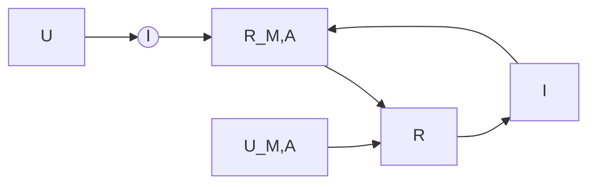
</details>

Abb. 2.20: Strommessung mit realem Amperemeter und Messgerätewiderstand $R _ { M , \mathsf { A } }$

---

32

2 Berechnung von Strömen und Spannungen in elektrischen Netzen


<details>
<summary>text_image</summary>

I
U
UR
R
V
</details>

Abb. 2.21: Einfache Schaltung zur Spannungsmessung mit dem Voltmeter.


<details>
<summary>text_image</summary>

I
U
IR
UR
R
UM,V
IM,V
RM,V
Voltmeter
</details>

Abb. 2.22: Spannungsmessung mit realem Voltmeter und Messgerätewiderstand $R _ { M , N }$ .

## 2.3.2 Analoges Messinstrument

Als wichtigster Vertreter der analogen Messinstrumente soll hier das Drehspulmessinstrument betrachtet werden.

Im Drehspulmessinstrument fließt der Messstrom durch eine drehbar gelagerte Spule (vgl. Beispiel 5.1). Die Spulenachse ist mit zwei Spiralfedern verbunden, die einer Spulendrehung entgegenwirken. Die Spule befindet sich in dem konstanten Magnetfeld eines Dauermagneten. Dadurch wirkt auf sie ein Drehmoment, das dem Messstrom proportional ist. Das Messergebnis lässt sich über eine **lineare Skala** ablesen (Bild 2.23). Der Zeiger ist fest mit der Spule verbunden und erreicht seine Ruhelage, wenn das Gegenmoment der Spiralfedern und das Drehmoment auf Grund der Kräfte im Magnetfeld im Gleichgewicht sind.

Schnellen Schwingungen kann die Drehspule mit ihrem Zeiger wegen ihrer mechanischen Trägheit praktisch nicht folgen. Das Messwerk zeigt daher immer nur den zeitlichen Mittelwert des gemessenen Stromes an, ist also vor allem zur Messung von **Gleichstrom** geeignet. Bei einem reinen **Wechselstrom** ergibt sich nur eine Anzeige, wenn er zuvor gleichgerichtet wird. Ein Vorteil des Drehspulmesswerks ist sein (im Vergleich zu anderen analogen Messwerken) **geringer Leistungsbedarf**. Es kann daher sehr kleine Ströme anzeigen. Außerdem hat das Drehspulmesswerk eine besonders hohe **Messgenauigkeit**.

Als **Vollausschlagsstrom** $I _ { \mathrm { M V } }$ bezeichnet man den Strom, der gerade fließen muss, damit der Zeiger sich auf den Skalenendwert einstellt. Den ohmschen Widerstand der Drehspule bezeichnet man als **Messwerkwiderstand** $R _ { M }$

Beispiel 2.6: Eigenverbrauch eines Drehspulmesswerks mit $I _ { \mathsf { M V } } = 5 0 \; \mu \mathsf { A } , R _ { \mathsf { M } } = 1 \; \mathsf { k } \Omega .$ Der Eigenverbrauch dieses Messwerks bei Vollausschlag ist

$$
P _ {\mathrm{MV}} = I _ {\mathrm{MV}} ^ {2} \cdot R _ {\mathrm{M}} = \left(5 0 \cdot 1 0 ^ {- 6}\right) ^ {2} \mathrm{A} ^ {2} \cdot 1 0 ^ {3} \Omega = 2, 5 \cdot 1 0 ^ {- 6} \mathrm{W}.
$$


<details>
<summary>text_image</summary>

0 1 2 3 4 5 6 7 8 9 10
</details>

Abb. 2.23: Beispiel für die lineare Skala eines Zeigerinstruments.

---

2.3 Strom- und Spannungsmessung

33

## 2.3.3 Klassengenauigkeit

Der vom Messinstrument angezeigte Strom kann vom wahren Wert des Stromes abweichen. Der Fehler, der höchstens zu erwarten ist, wird normalerweise in Prozent vom Skalenendwert angegeben: Das sogenannte **Klassenzeichen** gibt den zulässigen **Anzeigefehler** direkt in Prozent an. So hat ein Instrument der Klasse 0,1 einen zulässigen Anzeigefehler von ±0,1 %. Präzisionsinstrumente gehören zu den Klassen 0,1; 0,2 oder 0,5. Betriebsinstrumente gehören zu den Klassen 1; 1,5; 2,5 oder 5.

## Beispiel 2.7: Messgenauigkeit eines Drehspulmessgerätes der Klasse 1,5 im Messbereich 300 mA.

Der wahre Wert kann höchstens um 1,5 % von 300 mA, also

$$
3 0 0 \mathrm{mA} \cdot 0, 0 1 5 = 4, 5 \mathrm{mA}
$$

vom abgelesenen Wert abweichen. Liest man im Messbereich 300 mA z. B. den Wert 150 mA ab, so gilt für den wahren Wert:

$$
I = 1 5 0 \mathrm{mA} \pm 4, 5 \mathrm{mA};
$$

es ergibt sich also in diesem Fall eine Abweichung von

$$
\pm 3 \% \text { vom Messwert.}
$$

Liest man im Messbereich 300 mA z. B. den Strom 50 mA ab, so gilt für den wahren Wert:

$$
I = 5 0 \mathrm{mA} \pm 4, 5 \mathrm{mA};
$$

nun ist also sogar eine Abweichung von

$$
\pm 9 \%
$$

möglich. Würde man im 300-mA-Messbereich nur den Wert 4,5 mA ablesen, so ergäbe sich für den wahren Wert

$$
I = 4, 5 \mathrm{mA} \pm 4, 5 \mathrm{mA},
$$

d. h. der wahre Wert kann im Bereich von 0 mA bis 9 mA liegen, und die Abweichung des wahren Wertes vom gemessenen Wert kann

$$
\pm 100 \%
$$

erreichen. Der prozentuale Messfehler nimmt also zu, je kleiner der Zeigerausschlag ist. Daher ist es nötig, für jede Messung einen Messbereich zu haben, bei dem der Zeiger mög lichst dicht an das Skalenende herankommt. Daraus ergibt sich die Notwendigkeit, das Messwerk eines Instrumentes für verschiedene Messbereiche (z. B. 50 μA, 300 μA, 1 mA, 3 mA, 10 mA u. a.) verwendbar zu machen: Messbereichserweiterung. Außerdem können

---

34

2 Berechnung von Strömen und Spannungen in elektrischen Netzen

Drehspulinstrumente auch zur Anzeige von Spannungen verwendet werden. Fließt z. B. durch das Instrument nach Beispiel 2.6 der Vollausschlagsstrom, so liegt am Instrument die **Vollausschlagsspannung**

$$
U _ {\mathrm{MV}} = I _ {\mathrm{MV}} \cdot R _ {\mathrm{M}} \tag {2.35}
$$

$$
U _ {\mathrm{MV}} = 5 0 \cdot 1 0 ^ {- 6} \mathrm{A} \cdot 1 0 ^ {3} \Omega = 5 0 \mathrm{mV}.
$$

## 2.3.4 Digitales Messinstrument

Der Messwert wird bei einem digitalen Messinstrument über eine digitale Anzeige (z. B. Siebensegment-LCD-Anzeige oder – quasi analog – als Balkenanzeige (Bild 2.24)) wiedergegeben. Dafür müssen die analogen physikalischen Messgrößen in digitale Signale umgewandelt werden. Dies übernimmt ein sogenannter Analog-Digital-Wandler (A/D-Wandler, ADC = engl. analog to digital converter).

Die Auflösung ist von der Bit-Anzahl des $\mathrm { A / D }$ -Wandlers abhängig. Zum Beispiel besitzt ein 8-Bit-Wandler 255 Stufen, mit der das Messsignal digitalisiert werden kann. Was damit gemeint ist, zeigt Bild 2.25. Hier wurden aus Gründen der Veranschaulichung nur 3 bit – also 7 Stufen – für die Digitalisierung verwendet. Dieser Digitalisierungsprozess wird auch als **Quantisierung** bezeichnet. Die Messgröße muss jeweils einen Schwellenwert überschreiten, damit der A/D-Wandler diesen Wert erkennt. Der kleinste darstellbare Wert wird durch die Quantisierungsstufe bestimmt.

Dem Vollausschlag bei einem Drehspulmessgerät entspricht bei einem digitalen Messinstrument die maximal erlaubte Eingangsspannung des A/D-Wandlers. Sie wird durch die zum Vergleich verwendete Spannungsreferenz bestimmt. Wie beim analogen Instrument ergibt sich deshalb die Notwendigkeit der Messbereichserweiterung. Der maximalen Eingangsspannung wird dann der **Messbereichsendwert** zugeordnet.


Abb. 2.24: Digitale Anzeigen: Siebensegment-Anzeige und Balkenanzeige mit dem Wert 20,51.


<details>
<summary>line</summary>

| analoge Messgröße | diskrete Kurve (binärer Wert) | ideale Kurve (binärer Wert) |
| --- | --- | --- |
| 0 | 000 (0) | — |
| 1 | 001 (1) | 001 (1) |
| 2 | 010 (2) | 010 (2) |
| 3 | 011 (3) | 011 (3) |
| 4 | 100 (4) | 100 (4) |
| 5 | 101 (5) | 101 (5) |
| 6 | 110 (6) | 110 (6) |
| 7 | 111 (7) | 111 (7) |
</details>

Abb. 2.25: Beispiel für die Digitalisierung von analogen Messwerten, aus Gründen der Veranschaulichung hier nur mit 3 bit.

---

2.3 Strom- und Spannungsmessung

35

Die Genauigkeit ist für jeden einzelnen Messbereich im Datenblatt des Messgerätes angegeben. Zusätzlich zur Klassengenauigkeit müssen bei einem digitalen Messgerät noch die Fehler, die bei der Quantisierung auftreten, berücksichtigt werden.

Im Gegensatz zu einfachen analogen Anzeigen wird die benötigte elektrische Energie eines digital anzeigenden Messinstruments nicht über den zu messenden Stromkreis, sondern immer über eine eigene Energiequelle (oft eine 9-V-Primärzelle) bereitgestellt.

## Beispiel 2.8: Quantisierung einer analogen Spannung mit einem 8-Bit-Wandler.

Ein Spannungsbereich von 0 . . . 5 V soll mit einem $8 - Bit - A/D$ -Wandler digitalisiert werden. Wie viele Stufen stehen für die Quantisierung zur Verfügung und wie groß ist der kleinste darstellbare Wert ∆U?

## Lösung:

Bei einem 8-Bit-Wandler stehen $N = 2 ^ { 8 } - 1 = 2 5 5$ Stufen zur Verfügung. Der kleinste darstellbare Wert ist dann

$$
\Delta U = \frac {5 \mathrm{V} - 0 \mathrm{V}}{2 5 5} = \frac {1}{5 1} \mathrm{V} \approx 0, 0 1 9 6 \mathrm{V}.
$$

## 2.3.5 Messbereichserweiterung

## 2.3.5.1 Strom-Messbereichserweiterung

Falls mit einem Drehspulmessgerät ein Strom gemessen werden soll, der größer als der Vollausschlagsstrom $I _ { \mathrm { M V } }$ ist, so lässt sich der Messbereich durch einen Parallelwiderstand $R _ { \mathrm { p } }$ entsprechend erweitern (Bild 2.26). Wenn durch das Messwerk z. B. gerade der Vollausschlagsstrom $I _ { \mathrm { M V } }$ fließt, dann erreicht der Gesamtstrom I gemäß der Stromteilerformel Gl. (2.29a) den Wert

$$
I = I _ {\mathrm{V}} = \frac {G _ {\mathrm{M}} + G _ {\mathrm{P}}}{G _ {\mathrm{M}}} I _ {\mathrm{MV}}. \tag {2.36a}
$$

Diesen Strom $I _ { \mathrm { V } }$ kann man nun also dem Skalenendwert anstelle des Stromes $I _ { \mathrm { M V } }$ zuordnen, denn der Gesamtstrom I ist es ja, der von der Klemme a zur Klemme b fließt und der gemessen werden soll.


<details>
<summary>text_image</summary>

I
a → I_M → R_M = 1/G_M
R_P = 1/G_P
b
</details>

Abb. 2.26: Parallelschaltung eines ohmschen Widerstandes zum Messwerk zur Erweiterung des Strom-Messbereichs.

---

36

2 Berechnung von Strömen und Spannungen in elektrischen Netzen

## Beispiel 2.9: Berechnung eines Parallelwiderstandes zur Strom-Messbereichserweiterung.

Ein Drehspulinstrument mit dem Vollausschlagsstrom $I _ { \mathrm { M V } } = 5 0   \mu \mathrm { A }$ und dem Messwerkswiderstand $R _ { \mathbb { M } } = 1$ kΩ soll Ströme bis zum Wert $I = 1$ mA messen. Wie groß muss $R _ { \mathrm { p } }$ sein?

## Lösung:

Die Gl. (2.36a) lässt sich nach $G _ { \mathrm { p } }$ auflösen:

$$
G _ {\mathrm{P}} = G _ {\mathrm{M}} \left(\frac {I _ {\mathrm{V}}}{I _ {\mathrm{MV}}} - 1\right) \tag {2.36b}
$$

$$
G _ {\mathrm{P}} = \frac {1}{1 0 ^ {3} \Omega} \left(\frac {1 0 ^ {- 3} \mathrm{A}}{5 0 \cdot 1 0 ^ {- 6} \mathrm{A}} - 1\right) = \frac {1 9}{1 0 ^ {3} \Omega} = \frac {1}{R _ {\mathrm{P}}}
$$

$$
R _ {\mathrm{P}} = 5 2, 6 \Omega .
$$

Schaltet man diesen Widerstand zum Messwerk parallel, dann bedeutet – wie gefordert – Vollausschlag des Messinstruments, dass der Gesamtstrom I den Wert $I _ { \mathrm { V } } = 1   \mathrm { m A }$ erreicht.

Normalerweise wird in sogenannten **Vielfach-Instrumenten** ein einziges Messwerk für mehrere Messbereiche verwendet, z. B. sechs Strom- und sechs Spannungs-Messbereiche.

## Beispiel 2.10: Dimensionierung der Widerstände eines Vielfach-Messgeräts (Strommessung).

Ein Drehspulmesswerk hat den Vollausschlagsstrom $I _ { \mathrm { M V } } = 5 0   \mu \mathrm { A }$ und den Messwerkswiderstand $R _ { M }$

Das Messgerät soll drei Messbereiche haben: $1 0 0   \mu \mathrm { A } , 3 0 0   \mu \mathrm { A } ,$ , 1 mA. Zwischen den Schalterstellungen A, B, C in Bild 2.27 und den drei Strombereichen soll die Zuordnung aus Tabelle 2.6 gelten.

Die Widerstände $R _ { 1 } , R _ { 2 }$ und $R _ { 3 }$ sollen allgemein und für den Sonderfall $R _ { \mathrm { M } } = 9 0 0   \Omega$ berechnet werden.

## Lösung:

Bei Anschluss an Klemme A und Vollausschlag des Messwerks muss entsprechend der


<details>
<summary>text_image</summary>

I
R1
A
R2
B
C
R3
IM
(RM)
</details>

Abb. 2.27: Drehspulmesswerk mit drei Strom-Messbereichen.

---

2.3 Strom- und Spannungsmessung

37

Tab. 2.6: Drei Strommessbereiche in Abhängigkeit der Schalterstellung.

| Schalterstellung | Messbereich |
| --- | --- |
| A | 0 ... 1 mA |
| B | 0 ... 300 μA |
| C | 0 ... 100 μA |

Stromteilerformel Gl. (2.29b) gelten:

$$
\frac {R _ {1}}{R _ {1} + R _ {2} + R _ {3} + R _ {\mathrm{M}}} = \frac {I _ {\mathrm{MV}}}{I _ {(\mathrm{A})}} = \frac {5 0 \mu \mathrm{A}}{1 \mathrm{mA}} = \frac {1}{2 0}; \tag {2.37a}
$$

bei Anschluss an Klemme B:

$$
\frac {R _ {1} + R _ {2}}{R _ {1} + R _ {2} + R _ {3} + R _ {\mathrm{M}}} = \frac {I _ {\mathrm{MV}}}{I _ {\mathrm{(B)}}} = \frac {5 0 \mu \mathrm{A}}{3 0 0 \mu \mathrm{A}} = \frac {1}{6}; \tag {2.37b}
$$

bei Anschluss an Klemme C:

$$
\frac {R _ {1} + R _ {2} + R _ {3}}{R _ {1} + R _ {2} + R _ {3} + R _ {\mathrm{M}}} = \frac {I _ {\mathrm{MV}}}{I _ {(\mathrm{C})}} = \frac {5 0 \mu \mathrm{A}}{1 0 0 \mu \mathrm{A}} = \frac {1}{2}. \tag {2.37c}
$$

Durch einfache Umformung ergibt sich aus den Gln. (2.37):

$$
1 9 R _ {1} - R _ {2} - R _ {3} = R _ {\mathrm{M}} \tag {2.38a}
$$

$$
5 R _ {1} + 5 R _ {2} - R _ {3} = R _ {\mathrm{M}} \tag {2.38b}
$$

$$
R _ {1} + R _ {2} + R _ {3} = R _ {\mathrm{M}}. \tag {2.38c}
$$

Aus der Addition der Gln. (2.38a) und (2.38c) erhält man nun

$$
2 0 R _ {1} = 2 R _ {\mathrm{M}}; \quad R _ {1} = \frac {1}{1 0} R _ {\mathrm{M}}.
$$

Addition der Gl. (2.38b) und der mit (−5) multiplizierten Gl. (2.38c) liefert

$$
- 6 R _ {3} = - 4 R _ {\mathrm{M}}; \quad R _ {3} = \frac {2}{3} R _ {\mathrm{M}}.
$$

Aus Gl. (2.38c) folgt dann

$$
R _ {2} = R _ {\mathrm{M}} - R _ {1} - R _ {3} = R _ {\mathrm{M}} - \frac {1}{1 0} R _ {\mathrm{M}} - \frac {2}{3} R _ {\mathrm{M}}; \quad R _ {2} = \frac {7}{3 0} R _ {\mathrm{M}}.
$$

Mit $R _ { \mathrm { M } } = 9 0 0   \Omega$ wird also

$$
R _ {1} = 9 0 \Omega , \quad R _ {2} = 2 1 0 \Omega , \quad R _ {3} = 6 0 0 \Omega .
$$

---

38

2 Berechnung von Strömen und Spannungen in elektrischen Netzen

## 2.3.5.2 Spannungs-Messbereichserweiterung

Falls eine Spannung gemessen werden soll, die größer ist als $U _ { \mathrm { M V } }$ , vgl. Gl. (2.35), so lässt sich der Messbereich durch einen Vorwiderstand $R _ { \mathbf { r } }$ entsprechend erweitern (Bild 2.28).

Wenn am Messwerk z. B. gerade die Vollausschlagsspannung $U _ { \mathrm { M V } }$ liegt, dann erreicht die Spannung U an der Reihenschaltung gemäß der Spannungsteilerformel Gl. (2.17) den Wert

$$
U _ {\mathrm{V}} = \frac {R _ {\mathrm{r}} + R _ {\mathrm{M}}}{R _ {\mathrm{M}}} U _ {\mathrm{MV}}. \tag {2.39a}
$$

Diese Spannung $U _ { \mathrm { V } }$ kann man nun also dem Skalenendwert anstelle der Spannung $U _ { \mathrm { M V } }$ zuordnen, denn die Gesamtspannung U ist es $\mathbf { j a } ,$ die zwischen den Klemmen a und b liegt und die gemessen werden soll.

## Beispiel 2.11: Berechnung eines Vorwiderstandes zur Spannungs-Messbereichserweiterung.

Ein Drehspulmessgerät mit dem Vollausschlagsstrom $I _ { \mathrm { M V } } = 5 0   \mu \mathrm { A }$ und dem Messwerkswiderstand $R _ { \mathrm { M } } = 1$ kΩ soll Spannungen bis zum Wert $U = 1 0 0   \mathrm { V }$ messen. Wie groß muss $R _ { \mathbf { r } }$ sein?

## Lösung:

Das Messwerk hat die Vollausschlagsspannung

$$
U _ {\mathrm{MV}} = I _ {\mathrm{MV}} \cdot R _ {\mathrm{M}} = 5 0 \cdot 1 0 ^ {- 6} \mathrm{A} \cdot 1 0 ^ {3} \Omega = 5 0 \mathrm{mV}.
$$

Die Gl. (2.39a) lässt sich nach $R _ { \mathrm { r } }$ auflösen:

$$
R _ {\mathrm{r}} = R _ {\mathrm{M}} \left(\frac {U _ {\mathrm{V}}}{U _ {\mathrm{MV}}} - 1\right)
$$

$$
R _ {\mathrm{r}} = 1 0 ^ {3} \Omega \left(\frac {1 0 0 \mathrm{V}}{5 0 \mathrm{mV}} - 1\right) = 1 0 ^ {3} \Omega (2 0 0 0 - 1) = 1, 9 9 9 \mathrm{M} \Omega . \tag {2.39b}
$$

Schaltet man diesen Widerstand in Reihe zum Messwerk, dann bedeutet – wie gefordert – Vollausschlag des Messinstrumentes, dass die Gesamtspannung U den Wert $U _ { \mathrm { V } } = 1 0 0   \mathrm { V }$ erreicht.

## Beispiel 2.12: Dimensionierung der Widerstände eines Vielfach-Messgeräts (Spannungsmessung).

Ein Drehspulmessgerät hat den Spulenwiderstand $R _ { \mathrm { M } } = 1   \Omega$ . Wenn es von dem Strom $I _ { \mathrm { M V } } = 1 0 0$ mA durchflossen wird, dann schlägt es voll aus. Es soll als Spannungsmesser


<details>
<summary>flowchart</summary>

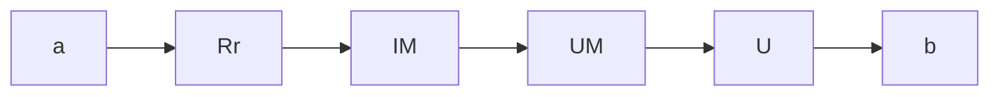
</details>

Abb. 2.28: Reihenschaltung eines ohmschen Widerstandes zum Messwerk zur Erweiterung des Spannungs-Messbereiches.

---

2.3 Strom- und Spannungsmessung

39

eingesetzt werden und vier Messbereiche haben (Bild 2.29). Zwischen den Schalterstellungen A, B, C, D und den vier Spannungs-Messbereichen soll die Zuordnung aus der Tabelle 2.7 gelten.

Tab. 2.7: Spannungsmessbereich in Abhängigkeit der Schalterstellung.

| Schalterstellung | Messbereich |
| --- | --- |
| A | 0 ... 300 mV |
| B | 0 ... 1 V |
| C | 0 ... 3 V |
| D | 0 ... 10 V |

Die Widerstände $R _ { 1 } \ldots R _ { 4 }$ sollen berechnet werden. Welchen Widerstand $R _ { \mathbf { i } }$ hat das Messgerät in den verschiedenen Messbereichen?

## Lösung:

In Schalterstellung A gilt: $I _ { \mathrm { M V } } ( R _ { \mathrm { m } } + R _ { 1 } ) = 3 0 0$ mV

$$
R _ {1} = \frac {3 0 0 \mathrm{mV}}{1 0 0 \mathrm{mA}} - R _ {\mathrm{M}} = 3 \Omega - 1 \Omega = 2 \Omega .
$$

Der Widerstand $R _ { \mathbf { i } }$ des Messgerätes ist in diesem Messbereich

$$
R _ {\mathrm{iA}} = R _ {\mathrm{M}} + R _ {1} = 3 \Omega .
$$

In Schalterstellung B gilt: $I _ { \mathrm { M V } } ( R _ { \mathrm { M } } + R _ { 1 } + R _ { 2 } ) = 1$ V

$$
R _ {2} = \frac {1 \mathrm{V}}{1 0 0 \mathrm{mA}} - R _ {\mathrm{M}} - R _ {1} = 1 0 \Omega - 3 \Omega = 7 \Omega .
$$

Der Widerstand $R _ { \mathbf { i } }$ des Messgerätes ist in diesem Messbereich

$$
R _ {\mathrm{iB}} = R _ {\mathrm{M}} + R _ {1} + R _ {2} = 1 0 \Omega .
$$


<details>
<summary>text_image</summary>

I_M
(R_M)
R_1
A
B
R_2
C
R_3
R_4
D
</details>

Abb. 2.29: Drehspulmessgerät mit vier Spannungs-Messbereichen.

---

40

2 Berechnung von Strömen und Spannungen in elektrischen Netzen

In Schalterstellung C gilt: $I _ { \mathrm { M V } } ( R _ { \mathrm { M } } + R _ { 1 } + R _ { 2 } + R _ { 3 } ) = 3   \mathrm { V }$

$$
R _ {3} = \frac {3 \mathrm{V}}{1 0 0 \mathrm{mA}} - R _ {\mathrm{M}} - R _ {1} - R _ {2} = 3 0 \Omega - 1 0 \Omega = 2 0 \Omega .
$$

Der Widerstand $R _ { \mathbf { i } }$ des Messgerätes ist in diesem Messbereich

$$
R _ {\mathrm{iC}} = R _ {\mathrm{M}} + R _ {1} + R _ {2} + R _ {3} = 3 0 \Omega .
$$

In Schalterstellung D gilt: $I _ { \mathrm { M V } } ( R _ { \mathrm { M } } + R _ { 1 } + R _ { 2 } + R _ { 3 } + R _ { 4 } ) = 1 0   \mathrm { V }$

$$
R _ {4} = \frac {1 0 \mathrm{V}}{1 0 0 \mathrm{mA}} - R _ {\mathrm{M}} - R _ {1} - R _ {2} - R _ {3} = 1 0 0 \Omega - 3 0 \Omega = 7 0 \Omega .
$$

Der Widerstand $R _ { \mathbf { i } }$ des Messgerätes ist in diesem Messbereich

$$
R _ {\mathrm{iD}} = R _ {\mathrm{M}} + R _ {1} + R _ {2} + R _ {3} + R _ {4} = 1 0 0 \Omega .
$$

**Anmerkung** Das betrachtete Messwerk $( R _ { \mathrm { M } } = 1   \Omega ,   I _ { \mathrm { M V } } = 1 0 0   \mathrm { m A } )$ hat die Vollausschlagsspannung

$$
U _ {\mathrm{MV}} = 1 \Omega \cdot 1 0 0 \mathrm{mA} = 1 0 0 \mathrm{mV}.
$$

Das Gerät (Messwerk + Vorwiderstände) hat daher in allen Messbereichen den auf die jeweilige Vollausschlagsspannung bezogenen (niedrigen) Innenwiderstand

$$
r _ {\mathrm{i}} ^ {*} = 1 \Omega / 1 0 0 \mathrm{mV} = 1 0 \Omega / \mathrm{V}.
$$

Zur Spannungsmessung wäre daher ein Messwerk geeigneter, dessen Spule einen hö- heren Widerstand $R _ { M }$ hat: würde z. B. die Anzahl der Windungen erhöht und dadurch $R _ { \mathrm { M } } = 1   \mathrm { k } \Omega ,   I _ { \mathrm { M V } } = 1 0 0   \mu \mathrm { A } ,$ so bliebe zwar $U_{\mathrm{MV}} = 100   \mathrm{mV}$ aber es ergäbe sich

$$
r _ {\mathrm{i}} ^ {*} = 1 \mathrm{k} \Omega / 1 0 0 \mathrm{mV} = 1 0 \mathrm{k} \Omega / \mathrm{V}.
$$

Von Vorteil wäre ein Gerät mit $R _ { \mathrm { M } } = 1   \Omega$ wegen der geringeren Spulengröße bei Strommessungen in den Messbereichen von 100 mA an aufwärts (es fehlen ihm aber Messbereiche unter 100 mA).

## 2.3.6 Vielfachmessinstrument (Multimeter)

Viele einfache Messaufgaben lassen sich heute mit einem digitalen oder analogen (Hand-)Multimeter bewerkstelligen. Solche Multimeter (Vielfachmessgeräte) können verschiedene physikalische Messgrößen wie z. B. Strom, Spannung, Widerstand und Temperatur erfassen. Bei den Multimetern existiert eine Vielzahl von Ausstattungs varianten sowie Genauigkeitsklassen. Einfache Multimeter lassen sich oft über einen Drehschalter bedienen, mit dem die zu messende physikalische Größe und ggf. der Messbereich eingestellt werden. Manche Multimeter schalten selbst in den am besten

---

2.3 Strom- und Spannungsmessung

41

geeigneten Messbereich um und erkennen außerdem, ob es sich um eine Gleich- bzw. Wechselspannung handelt. Schaltungen zur Messbereichserweiterung, wie sie die Bilder 2.27 und 2.29 zeigen, kommen dabei zur Anwendung.

Bei einfachen Formen der Messbereichserweiterungen verfügt ein Multimeter meistens über mehrere Eingänge für die Messleitungen (Bild 2.30). Dabei wird in der Regel unterschieden, ob eine Spannung, ein kleiner Strom ( mA, μA ) oder ein großer Strom (mehrere Ampere) gemessen werden soll. Der Bediener steckt je nach Messaufgabe (Spannungs- oder Strommessung) eine der beiden Messleitungen in den zugehörigen Eingang. Die zweite Messleitung wird mit dem COM-Anschluss (engl. common = gemeinsam) verbunden.

## 2.3.7 Messwertkorrektur

## 2.3.7.1 Spannungsrichtige Messung

Soll an einem Widerstand $R _ { 1 }$ (Bild 2.31) die Spannung gemessen werden, so schaltet man den Spannungsmesser parallel zu $R _ { 1 }$ . Will man gleichzeitig auch den Strom messen, der durch $R _ { 1 }$ fließt, so kann man die Schaltung 2.31 wählen. Diese Schaltung hat aber den Nachteil, dass der Strommesser nicht $I _ { 1 }$ , sondern I misst. Der Strom $I _ { M }$ durch den Spannungsmesser verfälscht die Anzeige des Strommessers. Hierbei gilt

$$
I _ {1} = I - I _ {\mathrm{M}}
$$

$$
I _ {1} = I - \frac {U _ {1}}{R _ {\mathrm{i}}} . \tag {2.40}
$$

Wenn der Widerstand $R _ { \mathbf { i } }$ des Spannungsmessers bekannt ist, kann aus dem gemessenen Wert I der Wert $I _ { 1 }$ des tatsächlich durch $R _ { 1 }$ fließenden Stromes berechnet werden. Man bezeichnet dies als **Stromkorrektur**. Da die gemessene Spannung $U _ { 1 }$ bei der Schaltung 2.31 mit der Spannung an $R _ { 1 }$ identisch ist, nennt man eine Messung nach der Schaltung in Bild 2.31 eine spannungsrichtige Messung.

## 2.3.7.2 Stromrichtige Messung

Soll in einem Widerstand $R _ { 1 }$ (Bild 2.32) der Strom gemessen werden, so schaltet man den Strommesser in Reihe zu $R _ { 1 }$ . Will man gleichzeitig auch die Spannung messen,


<details>
<summary>text_image</summary>

20.51
A
V
Ω
Off
A mA V COM
</details>

Abb. 2.30: Schema eines Multimeters.


<details>
<summary>flowchart</summary>

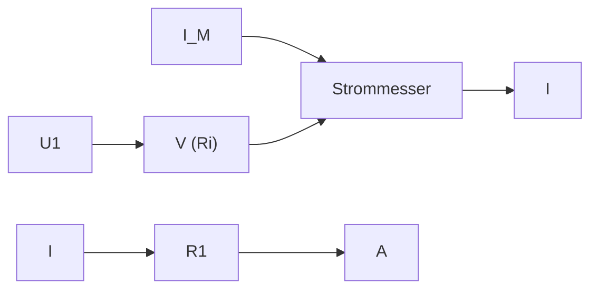
</details>

Abb. 2.31: Spannungsrichtige Messung.

---

42

2 Berechnung von Strömen und Spannungen in elektrischen Netzen

die an $R _ { 1 }$ liegt, so kann man die Schaltung 2.32 wählen. Diese Schaltung hat aber den Nachteil, dass der Spannungsmesser nicht $U _ { 1 }$ , sondern U misst. Die Spannung $U _ { M }$ am Strommesser verfälscht also die Anzeige des Spannungsmessers. Hierbei gilt:

$$
U _ {1} = U - U _ {\mathrm{M}}
$$

$$
U _ {1} = U - I _ {1} R _ {\mathrm{i}}. \tag {2.41}
$$

Wenn der Widerstand $R _ { \mathbf { i } }$ des Strommessgerätes bekannt ist, kann mit Hilfe dieser Gleichung aus dem gemessenen Wert U der Wert $U _ { 1 }$ der tatsächlich an $R _ { 1 }$ liegenden Spannung berechnet werden. Man bezeichnet dies als **Spannungskorrektur**. Da der gemessene Strom $I _ { 1 }$ bei der Schaltung 2.32 mit dem Strom in $R _ { 1 }$ identisch ist, nennt man eine Messung mit Schaltung 2.32 eine stromrichtige Messung.

## Beispiel 2.13: Genauigkeit einer Widerstandsmessung.

Gegeben ist eine Schaltung zur spannungsrichtigen Messung (Bild 2.31). An dem Widerstand $R _ { 1 }$ werden die Spannung $U _ { 1 } = 1 0   \mathrm { V }$ und der Strom $I = 1$ mA gemessen. Der Spannungsmesser hat den Widerstand $R _ { \mathrm { i } } = 5 0   \mathrm { k } \Omega$

a) Aus der Strom- und Spannungsmessung soll $R _ { 1 }$ bestimmt werden.
b) Der benutzte Spannungsmessbereich ist 0 . . . 30 V, der benutzte Strommessbereich $0 \ldots 3$ mA. Die beiden Messinstrumente haben das Klassenzeichen 5. Es sollen die Bereiche angegeben werden, in denen die wahren Werte des Stromes I und der Spannung $U _ { 1 }$ liegen können.
c) In welchem Bereich kann infolgedessen der wahre Wert R liegen?

## Lösung:

**a)** In der Schaltung 2.31 gilt mit $G _ { 1 } = 1 \big / _ { R _ { 1 } }$ und $G _ { \mathrm { i } } = 1 \big / _ { R _ { \mathrm { i } } }$

$$
I = U _ {1} (G _ {1} + G _ {\mathrm{i}})  . \tag {2.42}
$$

Löst man dies nach $G _ { 1 }$ auf, so wird

$$
G _ {1} = \frac {I}{U _ {1}} - G _ {i} \tag {2.43}
$$

$$
G _ {1} = \frac {1 \mathrm{mA}}{1 0 \mathrm{V}} - \frac {1}{5 0 \mathrm{k} \Omega} = \frac {1}{1 0 \mathrm{k} \Omega} - \frac {1}{5 0 \mathrm{k} \Omega} = \frac {4}{5 0 \mathrm{k} \Omega};
$$

$$
R _ {1} = \frac {5 0 \mathrm{k} \Omega}{4} = 1 2, 5 \mathrm{k} \Omega .
$$


<details>
<summary>flowchart</summary>

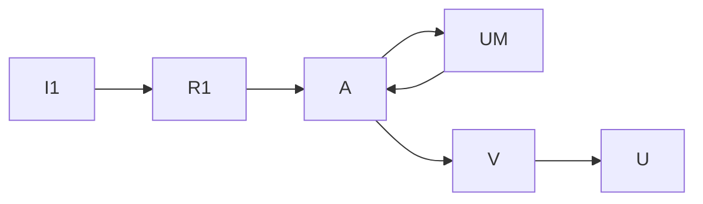
</details>

Abb. 2.32: Stromrichtige Messung.

---

2.3 Strom- und Spannungsmessung

43

**b)** Im Messbereich 3 mA ist bei einem Instrument der Klasse 5 die Abweichung $3\mathrm{mA} \cdot 0,05 = 0,15$ mA möglich. Wird der Wert $I = 1$ mA angezeigt, so liegt also der wahre Wert mit Sicherheit im Bereich

$$
0, 8 5 \mathrm{mA} \leq I \leq 1, 1 5 \mathrm{mA}.
$$

Im Spannungsmessbereich 30 V ist bei einem Instrument der Klasse 5 die Abweichung 30 $\mathrm{V} \cdot 0,05 = 1,5\mathrm{V}$ möglich. Wird der Wert 10 V angezeigt, so liegt der wahre Wert mit Sicherheit im Bereich

$$
8, 5 \mathrm{V} \leq U _ {1} \leq 1 1, 5 \mathrm{V}.
$$

**c)** Der maximal mögliche Leitwert $\hat { G } _ { 1 }$ ergibt sich, falls der wahre Strom den Wert $\hat { I } = 1$ ,15 mA und die wahre Spannung den Wert $\check { U } _ { 1 } = 8 ,   5   \mathrm { V }$ hat. Aus Gl. (2.43) folgt dann

$$
\begin{array}{l} \hat {G} _ {1} = \frac {\hat {I}}{\check {U} _ {1}} - G _ {\mathrm{i}} = \frac {1 , 1 5 \mathrm{mA}}{8 , 5 \mathrm{V}} - \frac {1}{5 0 \mathrm{k} \Omega} \\ \check {R} _ {1} = \frac {1}{\hat {G} _ {1}} \approx 8, 7 \mathrm{k} \Omega . \\ \end{array}
$$

Umgekehrt ergibt sich der minimal mögliche Leitwert $\check { G } _ { 1 }$ aus den Werten $\check{I} = 0,85    mA$ und $\hat { U } _ { 1 } = 1 1 ,   5   \mathrm { V } ;$

$$
\begin{array}{l} \check {G} _ {1} = \frac {\check {I}}{\hat {U} _ {1}} - G _ {\mathrm{i}} = \frac {0 , 8 5 \mathrm{mA}}{1 1 , 5 \mathrm{V}} - \frac {1}{5 0 \mathrm{k} \Omega} \\ \hat {R} _ {1} = \frac {1}{\check {G} _ {1}} \approx 1 8, 5 \mathrm{k} \Omega . \\ \end{array}
$$

Die Ungenauigkeit der verwendeten Messgeräte $( \pm 5   \%$ vom Skalenendwert) führt hier also zu einer noch viel größeren Ungenauigkeit bei der Widerstandsmessung:

$$
8, 7 \mathrm{k} \Omega \leq R _ {1} \leq 1 8, 5 \mathrm{k} \Omega
$$

$$
R _ {1} = 1 3, 6 \mathrm{k} \Omega \pm 4, 9 \mathrm{k} \Omega = 1 3, 6 \mathrm{k} \Omega \pm \frac {3 6}{1 0 0} 1 3, 6 \mathrm{k} \Omega.
$$

Bei der Widerstandsmessung ist also eine Abweichung von ±36 % möglich.

**Anmerkung** $Z   u   \boldsymbol { a } ) .$ : Ohne Stromkorrektur (und ohne Berücksichtigung der Ungenauigkeit des Messgerätes) hätte sich ergeben

$$
R _ {1 I} = \frac {U _ {1}}{I} = \frac {1 0 \mathrm{V}}{1 \mathrm{mA}} = 1 0 \mathrm{k} \Omega ;
$$

die Stromkorrektur (d. h. die Berücksichtigung des Innenwiderstandes des Spannungsmessers) darf hier also nicht unterbleiben.

Bei der Messung des Widerstandes $R _ { 1 } = 1 2 , 5$ kΩ hätte die stromrichtige Messung (bei idealer Messgenauigkeit) für $R _ { \mathrm { i } } = 1 0   \Omega   z .   B .$ zu folgenden Messwerten geführt (Bild 2.32):

$$
I _ {1} = 1 \mathrm{mA}, \quad U = 1 2, 5 1 \mathrm{V}.
$$

---

44

2 Berechnung von Strömen und Spannungen in elektrischen Netzen

Ohne Spannungskorrektur ergibt das

$$
R _ {1 U} = \frac {U}{I _ {1}} = \frac {1 2 , 5 1 \mathrm{V}}{1 \mathrm{mA}} = 1 2, 5 1 \mathrm{k} \Omega .
$$

Mit Spannungskorrektur hätte sich für $R _ { \mathrm { i } } = 1 0   \Omega$ ergeben:

$$
R _ {1} = \frac {U}{I _ {1}} - R _ {\mathrm{i}} = 1 2, 5 \mathrm{k} \Omega .
$$

Bei stromrichtiger Messung hätte also in diesem Fall der Spannungsabfall am Strommesser vernachlässigt werden können. Die Spannungskorrektur ist hier überflüssig, weil ihr Einfluss wesentlich geringer ist als der mögliche Fehler eines Präzisions-Messgerätes.

Allgemein gilt: Wenn der zu messende Widerstand klein ist (im Vergleich zum Innenwiderstand R<sub>i</sub> des Spannungsmessers), ist spannungsrichtige Messung zweckmäßig. Ist dagegen der zu messende Widerstand groß, so ist die stromrichtige Messung geeigneter.

## 2.4 Lineare Zweipole

Beliebige elektrische Schaltungen mit zwei Anschlüssen bezeichnet man als Zweipole. Auch Schaltungen mit mehr Anschlüssen können als Zweipole aufgefasst werden, wenn nur zwei Anschlüsse benutzt werden. Zweipole haben schon in den vorangehenden Abschnitten eine Rolle gespielt: ein einzelner ohmscher Widerstand mit seinen zwei Anschlüssen ist ein Zweipol, die Reihenschaltung mehrerer Widerstände (Bild 2.9) kann als Zweipol mit den Anschlussklemmen A und B angesehen werden. Ein solcher Zweipol kann im Übrigen außer ohmschen Widerständen auch alle möglichen anderen Verbraucher (z. B. Spulen, Dioden, Glühlampen) und Spannungsquellen enthalten.

In Bild 2.33 wird ein Zweipol dargestellt, der drei Spannungsquellen und drei Widerstände enthält; dieser Zweipol ist an den Klemmen A und B zugänglich. Messbar sind nur die Klemmenspannung U und der Klemmenstrom I.


<details>
<summary>text_image</summary>

Uq1
R1
Uq2
R2
Uq3
R3
I A
U
B
</details>

Abb. 2.33: Aktiver Zweipol mit drei Spannungsquellen und drei Widerständen.

---

2.4 Lineare Zweipole

45


<details>
<summary>flowchart</summary>

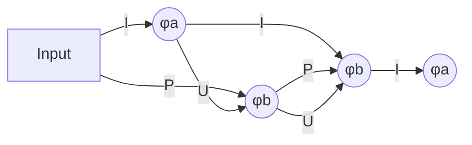
</details>

Abb. 2.34: Zuordnung der Zählpfeilrichtungen von Spannung, Strom und Leistung an einem Zweipol bei abgegebener Leistung (Erzeuger-Zählpfeilsystem).


<details>
<summary>text_image</summary>

I
φₐ
P
U
φb
φb
P
U
φₐ > φb
</details>

Abb. 2.35: Zuordnung der Zählpfeilrichtungen von Spannung, Strom und Leistung an einem Zweipol bei aufgenommener Leistung (Verbraucher-Zählpfeilsystem).

## 2.4.1 Erzeuger- und Verbraucher-Zählpfeilsystem

Ein Akkumulator kann sowohl elektrische Leistung abgeben als auch aufnehmen. Wenn ein Akkumulator Leistung abgibt, fließt aus dessen Plusklemme ein Strom heraus. Nur beim Aufladen (d. h. wenn der Akkumulator Leistung aufnimmt) fließt in dessen Plusklemme ein Strom hinein.

Bei der Wahl der Zählpfeile, für den Fall, dass der Akkumulator Leistung abgibt, zeigen sowohl der Strompfeil als auch der Leistungspfeil nach außen (Bild 2.34). Man spricht von einem **Erzeuger-Zählpfeilsystem** (Generator-Zählpfeilsystem) (EZS), wenn aus dem Anschlusspunkt mit dem höchsten Potential der Strom herausfließt.

Nimmt dagegen der Akkumulator Leistung auf, so zeigen in dem Zählpfeilsystem der Strompfeil und der Leistungspfeil nach innen (Bild 2.35). In diesem Fall spricht man von einem **Verbraucher-Zählpfeilsystem** (VZS).

Im Erzeuger-Zählpfeilsystem zeigen die Spannungs- und die Stromzählpfeile am Zweipol in die entgegengesetzte Richtung. Die positive Leistung entspricht dann der abgegebenen Leistung (Bild 2.34). Dagegen zeigen im Verbraucher-Zählpfeilsystem am Zweipol die Spannungs- und Stromzählpfeile in die selbe Richtung. Positive Leistung entspricht dann der aufgenommenen Leistung (Bild 2.35). Beide Zählpfeilsysteme werden, wie in Bild 2.36 dargestellt, üblicherweise in einem Stromkreis gemeinsam verwendet.

Das Ohm’sche Gesetz lautet

$$
R = \frac {U}{I} \quad \text {im Verbraucher - Zählpfeilsystem,} \tag {2.44}
$$

$$
R = - \frac {U}{I} \quad \text {im Erzeuger - Zählpfeilsystem.} \tag {2.45}
$$

---

46

2 Berechnung von Strömen und Spannungen in elektrischen Netzen


<details>
<summary>flowchart</summary>

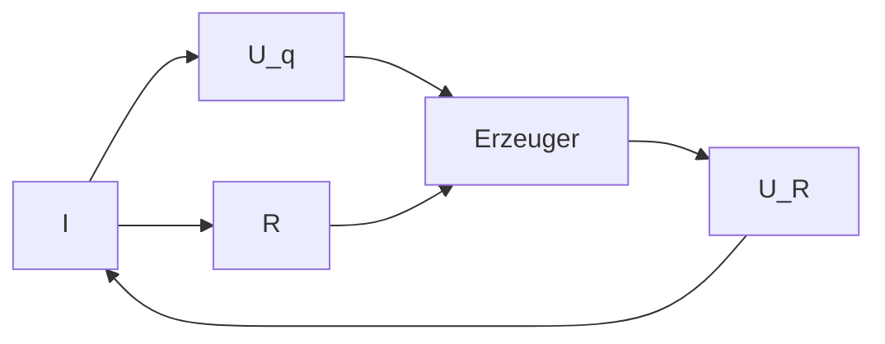
</details>

Abb. 2.36: Zählpfeile am Erzeuger- und Verbraucher-Zweipol.

In beiden Zählpfeilsystemen gilt für die Berechnung der Leistung

$$
P = U \cdot I. \tag {2.46}
$$

Dabei wird folgendes festgelegt:

$P > 0$ , wenn im VZS Leistung vom Zweipol aufgenommen wird.

$P < 0$ , wenn im VZS Leistung vom Zweipol abgegeben wird.

$P > 0$ , wenn im EZS Leistung vom Zweipol abgegeben wird.

$P < 0$ , wenn im EZS Leistung vom Zweipol aufgenommen wird.

Die Leistungsbilanz bei der gemeinsamen Verwendung beider Zählpfeilsysteme ist dann

$$
\sum P _ {\text {Erzeuger}} = \sum P _ {\text {Verbraucher}}. \tag {2.47}
$$

## 2.4.2 Spannungsquellen

Die wichtigsten Spannungsquellen sind die Drehstrom-Generatoren, die den technischen Wechselstrom erzeugen; Gleichspannung können sie nicht unmittelbar, sondern erst nach Gleichrichtung liefern. Alle Arten von chemischen Spannungsquellen, wie Trockenbatterien und Blei-Sammler (-Akkumulatoren) erzeugen Gleichspannung.

Die Spannung U, die an den Klemmen a, b einer Gleichspannungsquelle (Bild 2.37) auftritt, nimmt mit wachsendem Belastungsstrom I ab. Dies kann durch die Gleichung

$$
U = U _ {\mathrm{q}} - R _ {\mathrm{i}} I \tag {2.48}
$$


<details>
<summary>text_image</summary>

R_i
U_i
U_q
a
I
U
b
R
</details>

Spannungsquelle

Abb. 2.37: Belastung einer Spannungsquelle mit dem Widerstand R.

---

2.4 Lineare Zweipole

47

beschrieben werden. Hierbei sind die **Quellenspannung** $U _ { \mathrm { q } }$ Ua und der innere Wider**stand** $R _ { \mathbf { i } }$ fiktive Größen; d. h. Größen, die nicht unmittelbar messbar sind, sondern nur den messbaren Zusammenhang $U = f ( I )$ richtig beschreiben. In vielen wichtigen Fällen ist dieser Zusammenhang nahezu **linear**, die Funktion $U = f ( I )$ ergibt dann eine Gerade (Bild 2.38).

Die Gl. (2.48) beschreibt im Übrigen nur dann eine Gerade, wenn

$$
U _ {\mathrm{q}} = k o n s t \tag {2.49}
$$

und

$$
R _ {\mathrm{i}} = k o n s t \tag {2.50}
$$

sind. Man spricht in diesem Fall von einer **linearen** Spannungsquelle. In den folgenden Abschnitten soll der Einfachheit halber stets mit linearen Spannungsquellen gerechnet werden.

Dass die Gl. (2.48) und die in Bild 2.37 gestrichelte Schaltung eine angemessene Darstellung für das Verhalten einer Spannungsquelle sind, kann man sich für viele Fälle leicht plausibel machen:

Im Inneren der Quelle wird eine Spannung erzeugt, deren Größe (nahezu) belas tungsunabhängig ist. Durch metallische und elektrolytische Leitung im Innern der Quelle entsteht ein Spannungsabfall, der mit dem Strom zunimmt.


<details>
<summary>line</summary>

| Point | Description |
| --- | --- |
| Ui | Ri I |
| U | f(I) |
| Ri | Ri I |
</details>

Abb. 2.38: Abhängigkeit der Klemmenspannung vom Belastungsstrom bei einer linearen Spannungsquelle.


<details>
<summary>line</summary>

| I/A | \(K.Z. (Ri/\Omega)\) | \(A.M. (Ri/\Omega)\) | \(N.C. (Ri/\Omega)\) |
| --- | --- | --- | --- |
| ~0.15 | ~1.35 | ~0.58 | ~0.24 |
| 0.5 | ~0.90 | ~0.40 | ~0.18 |
| 1.0 | ~0.75 | ~0.35 | ~0.16 |
</details>


<details>
<summary>line</summary>

| I/A | Ri \((m\Omega)\)::g' | Ri \((m\Omega)\)::n' |
| --- | --- | --- |
| 10 | ~68 | 40 |
| 20 | ~57 | ~25 |
| 30 | ~51 | ~16 |
| 40 | ~50 | ~11 |
| 50 | ~51 | ~10 |
| 55 | ~53 | ~11 |
</details>

K.Z. = Kohle-Zink-Element

A.M. = Alkali-Mangan-Element

N.C. = wieder aufladbares Nickel-Cadmium-Element

Abb. 2.39: Innenwiderstand $R _ { \mathrm { i } } = f ( I )$ bei verschiedenen neuwertigen 1,5-V-Trockenbatterien.

g. = gebrauchter Akku

n. = neuwertiger Akku

Abb. 2.40: Innenwiderstand zweier 12-V-Blei-Akkumulatoren (Auto-Batterien).

---

48

2 Berechnung von Strömen und Spannungen in elektrischen Netzen

In den Bildern 2.39 und 2.40 werden Beispiele für den Innenwiderstand $R _ { \mathbf { i } }$ von Spannungsquellen gegeben $( R _ { \mathrm { i } }$ als Funktion des Belastungsstromes $I )$ , bei denen die Linearitätsbedingung nach Gl. (2.50) nicht ganz erfüllt ist.

Für den **Kurzschlussstrom** $I _ { \mathrm { k } }$ einer Spannungsquelle (Bild 2.41) gilt:

$$
I _ {\mathrm{k}} = \frac {U _ {\mathrm{q}}}{R _ {\mathrm{i}}}  . \tag {2.51}
$$

Dieser Wert kann unmittelbar gemessen werden, falls kein Teil der Schaltung hierdurch überlastet wird. Die **Leerlaufspannung** kann ebenfalls unmittelbar gemessen werden (Bild 2.42).

Aus der Messung des Kurzschlussstromes (Kurzschlussversuch) und der Leerlaufspannung (Leerlaufversuch) ergeben sich $I _ { \mathrm { k } }$ und $U _ { \mathrm { q } }$ unmittelbar. Mit Hilfe der Gl. (2.51) kann dann aus diesen beiden Größen $R _ { \mathbf { i } }$ bestimmt werden:

$$
R _ {\mathrm{i}} = \frac {U _ {\mathrm{q}}}{I _ {\mathrm{k}}} . \tag {2.52}
$$

Diese Gleichung gilt bei Kurzschluss. Bei geringerer Belastung kann sich in einer nichtlinearen Spannungsquelle z. B. ein höherer Wert für $R _ { \mathbf { i } }$ ergeben, wie aus den Bildern 2.39 und 2.40 zu erkennen ist. Die Bestimmung von $U _ { \mathrm { q } }$ und $R _ { \mathbf { i } }$ aus nur zwei Messungen ist also nur dann ausreichend, wenn die Linearitätsbedingungen nach Gln. (2.49) und (2.50) erfüllt sind.

Falls der Kurzschlussversuch zu einem unzulässig hohen Kurzschlussstrom führt und auch der Leerlaufversuch nicht möglich ist, kann man zur Bestimmung von $R _ { \mathbf { i } }$ und $U _ { \mathrm { q } }$ zwei beliebige Belastungsfälle heranziehen. In der Schaltung in Bild 2.37 können für R zwei verschiedene Werte eingestellt und die zugehörigen Werte der Klemmenspannung $( U _ { ( 1 ) }$ und $U _ { ( 2 ) } )$ und des Stromes $( I _ { ( 1 ) }$ und $I _ { ( 2 ) } )$ gemessen werden. Wendet man die Gl. (2.48) auf die beiden Belastungsfälle

$$
U _ {(1)} = U _ {\mathrm{q}} - R _ {\mathrm{i}} I _ {(1)}, \tag {2.53a}
$$

$$
U _ {(2)} = U _ {\mathrm{q}} - R _ {\mathrm{i}} I _ {(2)} \tag {2.53b}
$$

an, so stellen sie zwei Bestimmungsgleichungen für $R _ { \mathbf { i } }$ und $U _ { \mathrm { q } }$ dar.

## Beispiel 2.14: Bestimmung von $R _ { \mathbf { i } }$ und $u _ { \mathbf { q } }$ aus zwei Belastungsfällen.

Eine Spannungsquelle wird mit dem Widerstand R belastet (Bild 2.37). Zunächst wird


<details>
<summary>text_image</summary>

Uq
Ri
a
Ik
Ub=0
A
b
</details>

Abb. 2.41: Messung des Kurzschlussstromes $I _ { \mathrm { k } } .$


<details>
<summary>text_image</summary>

Uq
Ri
a
I = 0
Uq
b
V
</details>

Abb. 2.42: Messung der Leerlaufspannung $U _ { \mathbf { q } }$

---

2.4 Lineare Zweipole

49

$R = R _ { ( 1 ) }$ eingestellt und der zugehörige Strom $I = I _ { ( 1 ) }$ gemessen. Danach wird $R = R _ { ( 2 ) }$ eingestellt und der zugehörige Strom $I = I _ { ( 2 ) }$ gemessen.

Aus den Größen $R _ { ( 1 ) } , R _ { ( 2 ) } , I _ { ( 1 ) } , I _ { ( 2 ) }$ sollen $U _ { \mathrm { q } }$ und $R _ { \mathbf { i } }$ berechnet werden.

## Lösung:

Im ersten Fall gilt

$$
I _ {(1)} = \frac {U _ {\mathrm{q}}}{R _ {\mathrm{i}} + R _ {(1)}}, \tag {2.54a}
$$

im zweiten Fall

$$
I _ {(2)} = \frac {U _ {\mathrm{q}}}{R _ {\mathrm{i}} + R _ {(2)}}. \tag {2.54b}
$$

Division von Gl. (2.54a) durch (2.54b) ergibt

$$
\frac {I _ {(1)}}{I _ {(2)}} = \frac {R _ {\mathrm{i}} + R _ {(2)}}{R _ {\mathrm{i}} + R _ {(1)}}
$$

$$
R _ {\mathrm{i}} = \frac {R _ {(2)} I _ {(2)} - R _ {(1)} I _ {(1)}}{I _ {(1)} - I _ {(2)}}. \tag {2.55}
$$

Setzt man dies in Gl. (2.54a) ein, so wird

$$
U _ {\mathrm{q}} = I _ {(1)} (R _ {\mathrm{i}} + R _ {(1)}) \tag {2.56}
$$

$$
U _ {\mathrm{q}} = \frac {R _ {(2)} - R _ {(1)}}{\frac {I _ {(1)}}{I _ {(2)}} - 1} I _ {(1)}. \tag {2.57}
$$

## 2.4.3 Linearität

Im Abschnitt 2.1.1 (Ohm’sches Gesetz) wurde betont, dass das Ohm’sche Gesetz

$$
U = R I \tag {2.2a}
$$

eine lineare Gleichung ist, wenn die Bedingung R = konst erfüllt ist. Im Abschnitt 2.4.2 (Spannungsquellen) wurde dargestellt, dass bei Spannungsquellen ein Zusammenhang zwischen Strom und Spannung besteht,

$$
U = U _ {\mathrm{q}} - R _ {\mathrm{i}} I, \tag {2.48}
$$

der ebenfalls linear ist, falls $U _ { \mathrm { q } }$ und $R _ { \mathbf { i } }$ konstant sind. Außerdem sind offensichtlich auch die beiden Kirchhoff’schen Gln. (2.5) und (2.7) lineare Beziehungen (d. h. Gleichungen, in denen alle Variablen nur in der ersten Potenz auftreten):

$$
I _ {1} + I _ {2} + I _ {3} + \dots = 0,
$$

$$
U _ {1} + U _ {2} + U _ {3} + \dots = 0.
$$

Ein Netz, das nur ohmsche Widerstände und lineare Quellen enthält, nennt man ein **lineares Netz**. In ihm können mit Hilfe der Kirchhoff’schen Gleichungen und den

---

50

2 Berechnung von Strömen und Spannungen in elektrischen Netzen

Gln. (2.2a) und (2.48) jede beliebige Spannung und jeder beliebige Strom berechnet werden, und zwar als lineare Funktion jedes beliebigen anderen Stromes oder jeder beliebigen anderen Spannung. Einfache Beispiele hierfür sind die Spannungsteilerregel (2.17), bei der $U _ { 2 } = f ( U )$ angegeben wird, oder die Stromteilerregel, bei der $I _ { 2 } = f ( I )$ angegeben wird.

Dass in linearen Netzen grundsätzlich alle Ströme und Spannungen lineare Funktionen anderer Ströme und Spannungen sind, liegt daran, dass bei der Umformung und Auflösung linearer Gleichungssysteme ebenfalls immer nur lineare Gleichungen entstehen können.

## Beispiel 2.15: Lineare Zusammenhänge an einem belasteten Spannungsteiler.

Bei einem einfachen Spannungsteiler nach Bild 2.43, an den ein Belastungswiderstand $R _ { 3 }$ angeschlossen ist, gilt:

$$
I _ {1} = f (U _ {\mathrm{q}}) = \frac {U _ {\mathrm{q}}}{R _ {1} + \frac {R _ {2} R _ {3}}{R _ {2} + R _ {3}}}
$$

$$
I _ {1} = f (U _ {2}) = \frac {R _ {2} + R _ {3}}{R _ {2} R _ {3}} U _ {2}
$$

$$
I _ {3} = f (U _ {2}) = \frac {U _ {2}}{R _ {3}}
$$

$$
U _ {1} = f (U _ {\mathrm{q}}) = \frac {R _ {1} (R _ {2} + R _ {3})}{R _ {1} R _ {2} + R _ {2} R _ {3} + R _ {3} R _ {1}} U _ {\mathrm{q}}
$$

$$
U _ {1} = f (I _ {1}) = R _ {1} I _ {1}
$$

$$
U _ {2} = f (U _ {\mathrm{q}}) = \frac {R _ {2} R _ {3}}{R _ {1} R _ {2} + R _ {2} R _ {3} + R _ {3} R _ {1}} U _ {\mathrm{q}}
$$

$$
U _ {2} = f (U _ {1}) = \frac {R _ {2} R _ {3}}{R _ {1} (R _ {2} + R _ {3})} U _ {1}
$$

$$
U _ {2} = f (I _ {1}) = \frac {R _ {2} R _ {3}}{R _ {2} + R _ {3}} I _ {1} \quad u. a.
$$

Diese Ergebnis-Beispiele zeigen, wie bei einer einfachen Schaltung jede Strom- oder Spannungsgröße als lineare Funktion jeder anderen Strom- oder Spannungsgröße dargestellt


<details>
<summary>text_image</summary>

I₁
R₁
U₁
Uq
I₃
R₂
I₂
U₂
R₃
</details>

Abb. 2.43: Belasteter Spannungsteiler.

---

2.4 Lineare Zweipole

51

werden kann. Auch lineare Gleichungen folgenden Typs können angegeben werden:

$$
I _ {1} = f (U _ {2}, I _ {3}) = \frac {U _ {2}}{R _ {2}} + I _ {3}
$$

$$
U _ {1} = f (U _ {2}, I _ {3}) = \frac {R _ {1}}{R _ {2}} U _ {2} + R _ {1} I _ {3} \quad u. a.
$$

## 2.4.4 Quellen-Ersatzzweipole

## 2.4.4.1 Die Ersatzspannungsquelle

Trennt man ein beliebiges lineares Netz aus ohmschen Widerständen und Spannungs quellen an irgendeiner Stelle auf, so entstehen zwei freie Enden, die als Anschlussklemmen zugänglich sein sollen. Wenn alle anderen Knoten des Netzes unzugänglich sind, so ist also das Netz ein Quellen-Zweipol. Der Zusammenhang $U = f ( I )$ an den Klemmen muss linear sein, wenn das im Zweipol enthaltene Netz linear ist (vgl. Abschnitt 2.4.3):

$$
U = K _ {1} - K _ {2} I. \tag {2.58}
$$

Dieser Zusammenhang stellt in einem U-I-Koordinatensystem eine Gerade dar. Hierbei ist $K _ { 1 }$ der Achsenabschnitt auf der U-Achse und $K _ { 1 } / K _ { 2 }$ der Achsenabschnitt auf der I-Achse (Bild 2.45). Sind von einer Geraden die beiden Achsenabschnitte bekannt, so ist sie dadurch eindeutig bestimmt. Zur Bestimmung des Klemmenverhaltens eines linearen Quellen-Zweipols genügt also die Berechnung der beiden Konstanten $K _ { 1 }$ und $K _ { 2 }$ . Die beiden Bestimmungsgleichungen für sie können besonders gut aus dem Kurzschluss- und Leerlaufversuch gewonnen werden.

Bei einem Leerlaufversuch $( I = 0 )$ wird die Leerlaufspannung $U | _ { I = 0 } = U _ { \mathrm { l } }$ gemessen, und mit Gl. (2.58) gilt

$$
U | _ {I = 0} = U _ {1} = K _ {1}, \tag {2.59}
$$

d. h. $K _ { 1 }$ ist identisch mit der bei Leerlauf messbaren Klemmenspannung.


<details>
<summary>text_image</summary>

I
a
U
b
</details>

Abb. 2.44: Linearer Quellen-Zweipol.


<details>
<summary>line</summary>

| Variable | Value |
| --- | --- |
| Equation | Uq = K1 |
| Ratio | K1 / K2 = Ik |
</details>

Abb. 2.45: Kennlinie der Klemmenspannung eines linearen Quellen-Zweipols.

---

52

2 Berechnung von Strömen und Spannungen in elektrischen Netzen


<details>
<summary>text_image</summary>

Uq = U1
Ri = (Ul / Ik)
I
a
U
b
</details>

Abb. 2.46: Ersatzspannungsquelle für einen beliebigen aktiven linearen Zweipol mit der Leerlaufspannung $U _ { \mathrm { l } }$ und dem Kurzschlussstrom Ik. $I _ { \mathrm { k } }$

Bei einem Kurzschlussversuch $\left( U = 0 \right)$ wird der Kurzschlussstrom $I \big | _ { U = 0 } = I _ { \mathrm { k } }$ gemessen, und mit Gl. (2.58) gilt

$$
0 = K _ {1} - K _ {2} \left. I \right| _ {U = 0}
$$

$$
I | _ {U = 0} = I _ {\mathrm{k}} = \frac {K _ {1}}{K _ {2}}
$$

$$
K _ {2} = \frac {K _ {1}}{I _ {\mathrm{k}}} = \frac {U _ {\mathrm{l}}}{I _ {\mathrm{k}}} . \tag {2.60}
$$

Setzt man die Ergebnisse der Gln. (2.59) und (2.60) in Gl. (2.58) ein, so ergibt sich

$$
U = U _ {\mathrm{l}} - \frac {U _ {\mathrm{l}}}{I _ {\mathrm{k}}} I. \tag {2.61}
$$

Vergleicht man dies mit der Gl. (2.48), so zeigt sich, dass der betrachtete Zweipol (Bild 2.44) sich an den Klemmen a, b ebenso verhält wie eine Spannungsquelle mit der Quellenspannung $U _ { \mathrm { l } } ,$ , und dem Innenwiderstand $R _ { \mathrm { i } } = U _ { \mathrm { l } } \big / _ { I _ { \mathrm { k } } }$ (Bild 2.46). Demnach kann ein beliebiger linearer Zweipol durch eine einfache Spannungsquelle ersetzt werden, die man deshalb als Ersatzspannungsquelle bezeichnet. Der beliebige Zweipol und seine Ersatzspannungsquelle verhalten sich an ihren Klemmen gleich. Die Funktionen

$$
U = f (I)
$$

stimmen bei beiden überein. Im Innern (d. h. links von den Klemmen) kann der ursprüngliche Zweipol natürlich gänzlich anders aufgebaut sein und sich anders verhalten als seine Ersatzspannungsquelle. Grundsätzlich lässt sich eine Ersatzspannungsquelle nicht nur durch Kurzschluss- und Leerlauf-Messung bestimmen, sondern auch aus dem Aufbau des zu ersetzenden Zweipols berechnen.

## Beispiel 2.16: Berechnung der Leerlaufspannung $u _ { \mathbf { q } }$ und des Innenwiderstandes $R _ { \mathbf { i } }$ einer Ersatzspannungsquelle.

Werden die Klemmen $a ,$ b der Schaltung in Bild 2.47 kurzgeschlossen, so ergibt sich

$$
I _ {\mathrm{k}} = \frac {U _ {\mathrm{q1}}}{R _ {1}}. \tag {2.62}
$$

Bei Leerlauf gilt

$$
U _ {\mathrm{q}} = U _ {1} = \frac {R _ {2}}{R _ {1} + R _ {2}} U _ {\mathrm{q1}}. \tag {2.63}
$$

---

2.4 Lineare Zweipole

53


<details>
<summary>text_image</summary>

Uq1
R1
R2
I
a
U
b
</details>

Abb. 2.47: Aktiver linearer Zweipol (Quelle mit Spannungsteiler).


<details>
<summary>text_image</summary>

R₂/R₁+R₂ Uq1
R₁R₂/R₁+R₂
I
a
U
b
</details>

Abb. 2.48: Ersatzspannungsquelle für eine Quelle mit Spannungsteiler.

Der Innenwiderstand ist

$$
R _ {\mathrm{i}} = \frac {U _ {\mathrm{l}}}{I _ {\mathrm{k}}} = \frac {R _ {1} R _ {2}}{R _ {1} + R _ {2}}, \tag {2.64}
$$

$R _ { \mathbf { i } }$ lässt sich als Parallelschaltung der beiden Widerstände $R _ { 1 }$ und $R _ { 2 }$ auffassen. Zu diesem Ergebnis kommt man auch, wenn man in der Schaltung in Bild 2.47 die Quelle $U _ { \mathrm { q 1 } }$ kurzschließt und dann den Widerstand bestimmt, der sich von den Klemmen a, b aus ergibt.

## 2.4.4.2 Die Ersatzstromquelle

Wegen Gl. (2.51) gilt

$$
U _ {\mathrm{q}} = R _ {\mathrm{i}} I _ {\mathrm{k}}.
$$

und die Gl. (2.48) lässt sich folgendermaßen darstellen:

$$
U = R _ {\mathrm{i}} I _ {\mathrm{k}} - R _ {\mathrm{i}} I \tag {2.65}
$$

$$
I = I _ {\mathrm{k}} - \frac {U}{R _ {\mathrm{i}}} \tag {2.66}
$$

$$
I = I _ {\mathrm{k}} - I _ {\mathrm{i}}.
$$

Die Gl. (2.66) beschreibt das Verhalten der Schaltung 2.49a. In dieser Schaltung tritt keine konstante Quellenspannung, sondern eine Konstantstromquelle auf, deren Strom $I _ { \mathrm { k } }$ bei Leerlauf ganz durch $R _ { \mathbf { i } }$ fließen muss, so dass dann gilt

$$
U _ {\mathrm{q}} = R _ {\mathrm{i}} I _ {\mathrm{k}};
$$

im Kurzschlussfall fließt kein Strom durch den Innenwiderstand $R _ { \mathbf { i } }$ der Stromquelle; dann ist

$$
U = R _ {\mathrm{i}} I _ {\mathrm{i}} = 0.
$$

Sofern der Quellenstrom $I _ { \mathrm { k } }$ und die Quellenspannung $U _ { \mathrm { q } }$ der Gl. $U _ { \mathrm { q } } = R _ { \mathrm { i } } I _ { \mathrm { k } }$ genügen und die Innenwiderstände beider Schaltungen gleich sind, stimmt die Gl. (2.48), die das Klemmenverhalten einer Spannungsquelle beschreibt, mit der Gl. (2.65) überein, die das Klemmenverhalten einer Ersatzstromquelle beschreibt. Spannungs- und Stromquelle sind dann gleichwertig.

---

54

2 Berechnung von Strömen und Spannungen in elektrischen Netzen

a)


<details>
<summary>text_image</summary>

I_k
I_i
R_i = 1/G_i
I
a
U
R = 1/G
b
</details>

b)


<details>
<summary>line</summary>

| Variable | Description |
| --- | --- |
| I | Current (Y-axis) |
| U | Voltage (X-axis) |
| I_k | Initial Current Level |
| I_i | Intermediate Current Level |
| I = G_iU | Constant Current Level |
| I = GU | Lower Current Level |
| I = f(U) | Intermediate Current Level |
| U_q | Final Voltage Level |
</details>

Abb. 2.49: a) Ersatzstromquelle; b) Abhängigkeit des Klemmenstromes I von der Klemmenspannung U bei einer linearen Stromquelle.


<details>
<summary>flowchart</summary>


</details>

Abb. 2.50: Ersatzstromquelle für einen Spannungsteiler (Bild 2.47).

## Beispiel 2.17: Berechnung des Quellenstromes $I _ { \mathbf { k } }$ und des Innenwiderstandes $R _ { \mathbf { i } }$ einer Ersatzstromquelle.

Das Klemmenverhalten der Schaltung 2.47 lässt sich nicht nur durch eine Ersatzspannungsquelle (Beispiel 2.16), sondern auch durch eine Ersatzstromquelle (Bild 2.49a) beschreiben.

Im Kurzschlussfall gilt für den Klemmenstrom I in Schaltung 2.47:

$$
I _ {\mathrm{k}} = \frac {U _ {\mathrm{q} 1}}{R _ {1}}. \tag {2.62}
$$

Die Leerlaufspannung ist

$$
U _ {1} = \frac {R _ {2}}{R _ {1} + R _ {2}} U _ {\mathrm{q} 1} \tag {2.63}
$$

und der Innenwiderstand

$$
R _ {\mathrm{i}} = \frac {U _ {1}}{I _ {\mathrm{k}}} = \frac {R _ {1} R _ {2}}{R _ {1} + R _ {2}}, \tag {2.64}
$$

vgl. Bild 2.50.

## Beispiel 2.18: Parallelschaltung dreier Spannungsquellen.

Die Widerstände $R _ { \mathrm { R } } , R _ { \mathrm { S } } , R _ { \mathrm { T } } , R _ { \mathrm { M } }$ und die Quellenspannungen $U _ { \mathrm { R } } , U _ { \mathrm { S } } , U _ { \mathrm { T } }$ sind gegeben. Gesucht ist die Spannung $U _ { \mathrm { N M } }$ (Bild 2.51).

## Lösung:

Diese Aufgabe ist mit der Methode der Ersatzstromquelle besonders gut lösbar. Schließt

---

2.4 Lineare Zweipole

55


<details>
<summary>text_image</summary>

UR
RR
IR
US
RS
IS
UT
RT
IT
M
UNM
IN
RM
</details>

Abb. 2.51: Parallelschaltung dreier Spannungsquellen.


<details>
<summary>text_image</summary>

Ik
Ri
M← UNM → I
N
RM
</details>

Abb. 2.52: Ersatzstromquelle zum Zweipol in Bild 2.51.


<details>
<summary>text_image</summary>

R_R
R_S
R_T
M
N
R_i
</details>

Abb. 2.53: Zur Bestimmung des Innenwiderstandes eines Zweipols.

man die Klemmen M und N kurz, so erhält man den Quellenstrom $I _ { \mathrm { k } }$ der gesuchten Ersatzstromquelle (Bild 2.52):

$$
I _ {\mathrm{k}} = \frac {U _ {\mathrm{R}}}{R _ {\mathrm{R}}} + \frac {U _ {\mathrm{S}}}{R _ {\mathrm{S}}} + \frac {U _ {\mathrm{T}}}{R _ {\mathrm{T}}}. \tag {2.67}
$$

Der Innenwiderstand $R _ { \mathbf { i } }$ der Ersatzquelle ergibt sich wie folgt: Die Quellen mit den Spannungen $U _ { \mathrm { R } } ,   U _ { \mathrm { S } } ,   U _ { \mathrm { T } }$ werden kurzgeschlossen, und dann wird der Widerstand ermittelt, den der Zweipol an den Klemmen M, N hat.

In diesem Fall entsteht der Innenwiderstand einfach aus der Parallelschaltung von $R _ { \mathrm { R } } , R _ { \mathrm { S } }$ und $R _ { \mathrm { T } }$ (Bild 2.53):

$$
\frac {1}{R _ {\mathrm{i}}} = G _ {\mathrm{i}} = \frac {1}{R _ {\mathrm{R}}} + \frac {1}{R _ {\mathrm{S}}} + \frac {1}{R _ {\mathrm{T}}} . \tag {2.68}
$$

Falls die Ersatzstromquelle mit dem Quellenstrom $I _ { \mathrm { k } }$ und dem Innenwiderstand $R _ { \mathbf { i } }$ an den Widerstand $R _ { M }$ angeschlossen wird, fließt der Strom $I _ { \mathbf { k } }$ durch die Parallelschaltung von $R _ { \mathbf { i } }$ und $R _ { M }$ (Bild 2.52), es gilt demnach mit $\begin{array} { r } { G _ { \mathbb { M } } = \frac { 1 } { R _ { \mathbb { M } } } } \end{array}$

$$
U _ {\mathrm{NM}} = \frac {I _ {\mathrm{k}}}{G _ {\mathrm{i}} + G _ {\mathrm{M}}} = \frac {I _ {\mathrm{k}}}{\frac {1}{R _ {\mathrm{R}}} + \frac {1}{R _ {\mathrm{S}}} + \frac {1}{R _ {\mathrm{T}}} + \frac {1}{R _ {\mathrm{M}}}}
$$

$$
U _ {\mathrm{NM}} = \frac {\frac {U _ {\mathrm{R}}}{R _ {\mathrm{R}}} + \frac {U _ {\mathrm{S}}}{R _ {\mathrm{S}}} + \frac {U _ {\mathrm{T}}}{R _ {\mathrm{T}}}}{\frac {1}{R _ {\mathrm{R}}} + \frac {1}{R _ {\mathrm{S}}} + \frac {1}{R _ {\mathrm{T}}} + \frac {1}{R _ {\mathrm{M}}}}. \tag {2.69}
$$

## 2.4.4.3 Äquivalenz von Zweipolen

In Abschnitt 2.4.4 wurde gezeigt, dass ein beliebiger Zweipol in Bezug auf seine Klemmen durch seine Ersatzspannungs- oder Ersatzstromquelle **ersetzt** werden kann. Zweipole, die sich an ihren Klemmen gleich verhalten, sind äquivalent, d. h. sie verhalten

---

56

2 Berechnung von Strömen und Spannungen in elektrischen Netzen

sich nach außen hin gleich. Es ist messtechnisch unmöglich, sie von außen (d. h. von ihrem Klemmenpaar aus) zu unterscheiden. Im Inneren können sie aber sehr voneinander abweichen. Der Leistungsumsatz im Inneren von Quellen-Zweipolen (d. h. Zweipolen, die eine oder mehrere Quellen enthalten) kann sehr unterschiedlich sein. Zum Beispiel wird im Inneren des Zweipols, der in Bild 2.47 dargestellt ist, auch dann Leistung verbraucht, wenn die Klemmen a und b leerlaufen. Im Innern der äquiva lenten Ersatzspannungsquelle (Bild 2.48) dagegen wird im Leerlauf keine Leistung verbraucht. Die äquivalente Ersatzstromquelle (Bild 2.50) wiederum muss im Innern gerade bei Leerlauf ihre maximale Leistung aufbringen.

## Beispiel 2.19: Vergleich mehrerer äquivalenter Zweipole.

In Bild 2.54 werden vier äquivalente Zweipole miteinander verglichen, und zwar bei Leerlauf und Kurzschluss. Im Leerlauf stimmen die Klemmenspannungen und im Kurzschluss die Klemmenströme überein. Die Gesamtleistung $P _ { \mathrm { g e s } }$ ist in allen vier leerlaufenden Zweipolen unterschiedlich; auch im Kurzschlussfall stimmt sie in allen vier Zweipolen nicht überein.

Alle vier Zweipole sind äquivalent. Das heißt: die Schaltung A kann nicht nur durch ihre Ersatzspannungsquelle C oder ihre Ersatzstromquelle D ersetzt werden, sondern beispielsweise auch durch die Schaltung B.

## 2.4.5 Leistung an Zweipolen

## 2.4.5.1 Wirkungsgrad

Man definiert als Energie-Wirkungsgrad

$$
\eta_ {W} = \frac {\text {genutzte Energie}}{\text {gesamte aufgewendete Energie}} = \frac {W _ {\mathrm{n}}}{W _ {\mathrm{g}}}.\tag {2.70}
$$

Als Leistungs-Wirkungsgrad definiert man

$$
\eta_ {P} = \frac {\text {genutzte Leistung}}{\text {gesamte aufgewendete Leistung}} = \frac {P _ {\mathrm{n}}}{P _ {\mathrm{g}}}.\tag {2.71}
$$

Falls $\eta _ { P }$ zeitlich konstant ist, gilt $\eta _ { P } = \eta _ { W }$ . Speziell an einer belasteten Spannungsquelle (Bild 2.37) gilt wegen der Spannungsteilerformel Gl. (2.17):

$$
U = \frac {R}{R + R _ {\mathrm{i}}} U _ {\mathrm{q}}. \tag {2.72}
$$

Die Nutzleistung ist

$$
P _ {\mathrm{n}} = I U, \tag {2.73}
$$

die Gesamtleistung

$$
P _ {\mathrm{g}} = I U _ {\mathrm{q}}. \tag {2.74}
$$

---

2.4 Lineare Zweipole

57

<table><tr><td>AZwei parallel geschaltete Spannungsquellen</td><td>BSpannungsteiler</td><td>CErsatz-Spannungsquelle</td><td>DErsatz-Stromquelle</td></tr><tr><td></td><td></td><td></td><td></td></tr><tr><td> $P_{ges}=10W$ </td><td> $P_{ges}=90W$ </td><td> $P_{ges}=0$ </td><td> $P_{ges}=90W$ </td></tr><tr><td colspan="4">Leerlauf</td></tr><tr><td></td><td></td><td></td><td></td></tr><tr><td> $P_{ges}=100W$ </td><td> $P_{ges}=180W$ </td><td> $P_{ges}=90W$ </td><td> $P_{ges}=0$ </td></tr><tr><td colspan="4">Kurzschluss</td></tr></table>

Abb. 2.54: Leerlauf- und Kurzschlussbetrachtungen an vier äquivalenten Quellen-Zweipolen.

Daraus folgt mit den Gln. (2.71) bis (2.74):

$$
\eta_ {P} = \frac {I U}{I U _ {\mathrm{q}}} = \frac {U}{U _ {\mathrm{q}}} = \frac {\frac {R}{R + R _ {\mathrm{i}}} U _ {\mathrm{q}}}{U _ {\mathrm{q}}}
$$

$$
\eta_ {P} = \frac {R}{R + R _ {\mathrm{i}}} . \tag {2.75}
$$

## Beispiel 2.20: Wirkungsgrade bei Belastung einer Autobatterie.

Eine Autobatterie hat die Spannung $U _ { \mathrm { q } } = 1 2   \mathrm { V }$ und den inneren Widerstand (einschließ- lich Widerstand der Zuleitungen) $R_{\mathrm{i}} = 20   \mathrm{m}\Omega$ . Während des Anlassens wird die Batterie 30 s lang mit dem Widerstand $R _ { ( 1 ) } \; = \; 4 0$ mΩ belastet. Danach betreibt die Batterie 10 min lang die Lichtanlage $( R _ { ( 2 ) } = 2   \Omega )$

a) Wie groß ist der Leistungs-Wirkungsgrad während des Anlassens?
b) Wie groß ist er danach?
c) Mit welchem Energie-Wirkungsgrad hat die Batterie während der gesamten Betriebszeit gearbeitet?

---

58

2 Berechnung von Strömen und Spannungen in elektrischen Netzen

## Lösung:

**a)** Gl. (2.75) ergibt hier (Bild 2.37):

$$
\eta_ {P 1} = \frac {4 0 \mathrm{m} \Omega}{4 0 \mathrm{m} \Omega + 2 0 \mathrm{m} \Omega} = \underline {{\underline {{0 , 6 6 6}}}}.
$$

**b)** In diesem Fall folgt aus Gl. (2.75)

$$
\eta_ {P 2} = \frac {2 \Omega}{2 \Omega + 0 , 0 2 \Omega} = \underline {{\underline {{0 , 9 9}}}}.
$$

**c)** Die Gesamtleistung während des Anlassens ist

$$
P _ {1 \mathrm{g}} = \frac {U _ {\mathrm{q}} ^ {2}}{R _ {(1)} + R _ {\mathrm{i}}} = \frac {1 2 ^ {2} \mathrm{V} ^ {2}}{6 0 \mathrm{m} \Omega} = \frac {1 4 4 \mathrm{V} ^ {2}}{6 \cdot 1 0 ^ {- 2} \Omega} = \underline {{\underline {{2 , 4 \mathrm{kW}}}}}
$$

und die Nutzleistung

$$
P _ {1 \mathrm{n}} = \eta_ {P 1} P _ {1 \mathrm{g}} = \frac {2}{3} \cdot 2, 4 \mathrm{kW} = \underline {{\underline {{1 , 6 \mathrm{kW}}}}}.
$$

Die Batterie gibt beim Anlassen die Gesamtenergie

$$
W _ {1 \mathrm{g}} = P _ {1 \mathrm{g}} \cdot t _ {1} = 2, 4 \mathrm{kW} \cdot 3 0 \mathrm{s} = \underline {{7 2 \mathrm{kWs}}}
$$

ab bei einem Nutzanteil von

$$
W _ {\mathrm{1n}} = P _ {\mathrm{1n}} \cdot t _ {1} = \underline {{\underline {{4 8 \mathrm{kWs}}}}}.
$$

Während die Lichtanlage gespeist wird, liefert die Batterie die Gesamtleistung

$$
P _ {2 \mathrm{g}} = \frac {U _ {\mathrm{q}} ^ {2}}{R _ {(2)} + R _ {\mathrm{i}}} = \frac {1 2 ^ {2} \mathrm{V} ^ {2}}{2 , 0 2 \Omega} = \underline {{7 1 , 3 \mathrm{W}}};
$$

die Nutzleistung ist

$$
P _ {2 \mathrm{n}} = \eta_ {P 2} P _ {2 \mathrm{g}} = 0, 9 9 \cdot 7 1, 3 \mathrm{W} = \underline {{7 0 , 5 \mathrm{W}}}.
$$

Die Batterie gibt für den Betrieb der Lichtanlage die Gesamtenergie

$$
W _ {2 \mathrm{g}} = P _ {2 \mathrm{g}} \cdot t _ {2} = 7 1, 3 \mathrm{W} \cdot 1 0 \cdot 6 0 \mathrm{s} = \underline {{4 2 , 7 8 \mathrm{kWs}}}
$$

ab; der Nutzanteil ist dabei

$$
W _ {2 \mathrm{n}} = P _ {2 \mathrm{n}} \cdot t _ {2} = \underline {{4 2 , 3 \mathrm{kWs}}}.
$$

Als Energie-Wirkungsgrad ergibt sich mit diesen Werten aus der Definition (2.70)

$$
\eta_ {W} = \frac {W _ {\mathrm{n}}}{W _ {\mathrm{g}}} = \frac {W _ {1 \mathrm{n}} + W _ {2 \mathrm{n}}}{W _ {1 \mathrm{g}} + W _ {2 \mathrm{g}}} = \frac {4 8 + 4 2 , 3}{7 2 + 4 2 , 7 8} = \underline {{0 , 7 8 6}}.
$$

---

2.4 Lineare Zweipole

59

## Beispiel 2.21: Leistungs-Wirkungsgrad einer Taschenlampe.

Eine Glühlampe (Nenndaten: 2,5 V; 0,5 W) wird in einer Taschenlampe mit zwei hintereinander geschalteten Kohle-Zink-Batterien (je 1,5 V und 1,25 Ω) betrieben.

a) Welchen Leistungs-Wirkungsgrad hat die Schaltung?
b) Es stehen vier Batterien (mit ebenfalls je 1,5 V und 1,25 Ω) zur Verfügung.

Welche Betriebsspannung U und welchen Betriebswiderstand R müsste eine Glühlampe haben, die bei Anschluss an die vier hintereinander geschalteten Batterien ebenfalls 0,5 W aufnehmen soll? Welcher Leistungs-Wirkungsgrad ergibt sich nun?

## Lösung:

**a)** Aus den Nenndaten der Glühlampe ergibt sich deren Widerstand

$$
R = \frac {U ^ {2}}{P} = \frac {2 , 5 ^ {2} \mathrm{V} ^ {2}}{0 , 5 \mathrm{W}} = \underline {{\underline {{1 2 , 5 \Omega}}}},
$$

und mit Gl. (2.75) folgt

$$
\eta_ {\mathrm{a}} = \frac {R}{R + R _ {\mathrm{i}}} = \frac {1 2 , 5}{1 2 , 5 + 2 \cdot 1 , 2 5} = \frac {5}{6} = \underline {{0 , 8 3 3}}.
$$

**b)** Wenn vier Batterien verwendet werden, gilt

$$
R _ {\mathrm{i}} = 4 \cdot 1, 2 5 \Omega = 5 \Omega ; \quad U _ {\mathrm{q}} = 4 \cdot 1, 5 \mathrm{V} = 6 \mathrm{V}.
$$

Die Leistung der Glühlampe soll weiterhin $P = 0 , 5 \mathrm { ~ W ~ }$ sein. Für diese Leistung gilt außerdem (Bild 2.37)

$$
P = R I ^ {2} = \frac {U _ {\mathrm{q}} ^ {2}}{(R _ {\mathrm{i}} + R) ^ {2}} R
$$

$$
(R _ {\mathrm{i}} + R) ^ {2} = \frac {U _ {\mathrm{q}} ^ {2}}{P} R  .
$$

Mit der Abkürzung

$$
\alpha = \frac {U _ {\mathrm{q}} ^ {2}}{P} = \frac {3 6 \mathrm{V} ^ {2}}{0 , 5 \mathrm{W}} = 7 2 \Omega
$$

wird

$$
(R _ {\mathrm{i}} + R) ^ {2} = \alpha R  .
$$

Dies kann als Bestimmungsgleichung für den Lampenwiderstand R verwendet werden:

$$
R ^ {2} + 2 R \left(R _ {\mathrm{i}} - \frac {\alpha}{2}\right) + R _ {\mathrm{i}} ^ {2} = 0.
$$

Die Auflösung dieser quadratischen Gleichung liefert

$$
R = \frac {\alpha}{2} - R _ {\mathrm{i}} \pm \sqrt {\alpha \left(\frac {\alpha}{4} - R _ {\mathrm{i}}\right)}.
$$

---

60

2 Berechnung von Strömen und Spannungen in elektrischen Netzen

Mit den gegebenen Zahlenwerten wird daraus

$$
\begin{array}{l} R = 3 1 \Omega \pm \sqrt {7 2 (1 8 - 5)} \Omega = 3 1 \Omega \pm 6 \sqrt {2 6} \Omega \\ R _ {(1)} = \underline {{\underline {{6 1 , 6 \Omega}}}} \\ R _ {(2)} = 0, 4 0 6 \Omega . \\ \end{array}
$$

Die erste Lösung ergibt

$$
\eta_ {\mathrm{b} 1} = \frac {R}{R + R _ {\mathrm{i}}} = \frac {6 1 , 6}{6 6 , 6} = \underline {{0 , 9 2 5}},
$$

also eine Verbesserung des Wirkungsgrades durch Verwendung von mehr Batterien.

Die zweite Lösung würde praktisch den Kurzschluss der Batterien bedeuten; sie hätte den schlechten Wirkungsgrad

$$
\eta_ {\mathrm{b} 2} = \frac {0 , 4 0 6}{5 + 0 , 4 0 6} = 0, 0 7 5
$$

und kommt natürlich nicht in Betracht.

## 2.4.5.2 Anpassung

Wenn ein Verbraucher-Widerstand R (Bild 2.37) sehr groß wird im Vergleich zum In nenwiderstand $R _ { \mathbf { i } } ,$ dann kann er einer Spannungsquelle schließlich immer weniger Leistung entnehmen. Wird $R \rightarrow$ ∞ (Leerlauf), so gilt

$$
P = \frac {U ^ {2}}{R} = \lim _ {R \to \infty} \frac {U _ {\mathrm{q}} ^ {2}}{R} = 0.
$$

Aber auch wenn R sehr klein ist, wird schließlich die an den Verbraucher abgegebene Leistung sehr klein. Im Kurzschluss gibt die Batterie ihre gesamte Leistung an den inneren Widerstand $R _ { \mathbf { i } }$ ab und für die Verbraucher-Leistung folgt

$$
P = I ^ {2} R = I _ {\mathrm{k}} ^ {2} \cdot 0 = 0.
$$

Wenn in den beiden Extremfällen Leerlauf und Kurzschluss keine Leistung nach außen abgegeben wird, so muss mindestens ein Belastungsfall (d. h. ein Wert R) möglich sein, bei dem P maximal wird.

Für die Leistung P am Belastungswiderstand R gilt:

$$
\begin{array}{l} P = I ^ {2} R = \frac {U _ {\mathrm{q}} ^ {2}}{(R + R _ {\mathrm{i}}) ^ {2}} R \\ P = \frac {U _ {\mathrm{q}} ^ {2}}{R _ {\mathrm{i}}} \frac {R / R _ {\mathrm{i}}}{(1 + R / R _ {\mathrm{i}}) ^ {2}}. \tag {2.76} \\ \end{array}
$$

Mit der Abkürzung

$$
\alpha = \frac {R}{R _ {\mathrm{i}}} \tag {2.77}
$$

---

2.4 Lineare Zweipole

61

für das Widerstandsverhältnis lautet Gl. (2.76):

$$
P = \frac {U _ {\mathrm{q}} ^ {2}}{R _ {\mathrm{i}}} \frac {\alpha}{(1 + \alpha) ^ {2}}. \tag {2.78}
$$

Hierbei ist

$$
\frac {U _ {\mathrm{q}} ^ {2}}{R _ {\mathrm{i}}} = P _ {\mathrm{qk}}
$$

die Leistung, die die Quelle bei Kurzschluss aufbringen muss. Die genaue Untersuchung der in Gl. (2.78) beschriebenen Funktion $P = f ( \alpha )$ zeigt, dass P maximal wird, wenn $\alpha = 1$ ist (Bild 2.55). Mit Hilfe der Differenzialrechnung lässt sich das Maximum der Funktion

$$
P = P _ {\mathrm{qk}} \frac {\alpha}{(1 + \alpha) ^ {2}}
$$

leicht auffinden. Nach der Quotientenregel ergibt sich als erste Ableitung:

$$
\frac {\mathrm{d} P}{\mathrm{d} \alpha} = P _ {\mathrm{qk}} \frac {(1 + \alpha) ^ {2} - \alpha \cdot 2 (1 + \alpha)}{(1 + \alpha) ^ {4}} = P _ {\mathrm{qk}} \frac {1 - \alpha}{(1 + \alpha) ^ {3}}. \tag {2.79}
$$

Ein Extremwert der Funktion $P = f ( \alpha )$ folgt aus der Bedingung

$$
\frac {\mathrm{d} P}{\mathrm{d} \alpha} = 0,
$$

mit Gl. (2.79) also aus

$$
P _ {\mathrm{qk}} \frac {1 - \alpha}{(1 + \alpha) ^ {3}} = 0.
$$

Diese Bedingung wird erfüllt für

$$
\alpha_ {\mathrm{opt}} = 1,
$$

vgl. Bild 2.55. Der Extremwert der Funktion $P = f ( \alpha )$ tritt also auf, wenn

$$
R = R _ {\mathrm{i}} \tag {2.80}
$$


<details>
<summary>line</summary>

| \(\alpha = R/\)Ri | P/Pqk |
| --- | --- |
| 0 | 0 |
| 1 | 0,25 |
| 5 | ~0,13 |
</details>

Abb. 2.55: Normierte Verbraucherleistung in Abhängigkeit vom Widerstandsverhältnis α.

---

62

2 Berechnung von Strömen und Spannungen in elektrischen Netzen

wird; d. h. ein Verbraucher-Widerstand R kann einer Spannungsquelle dann eine maximale Leistung entnehmen, wenn er gerade so groß wie der Innenwiderstand $R _ { \mathbf { i } }$ der Quelle ist. Man spricht in diesem Fall von **Leistungsanpassung**.

Insgesamt unterscheidet man bei der Anpassung des Lastwiderstands an die Quelle die drei Fälle

$$
R <   R _ {\mathrm{i}} \quad \text {Stromanpassung (Unteranpassung)},
$$

$$
R = R _ {\mathrm{i}} \quad \text { Leistungsanpassung },
$$

$$
R > R _ {\mathrm{i}} \quad \text {Spannungsanpassung   (Überanpassung)}.
$$

Der Wirkungsgrad beträgt bei Leistungsanpassung gemäß Gl. (2.75)

$$
\eta = \frac {R}{R + R _ {\mathrm{i}}} = 0, 5.
$$

## 2.5 Nichtlineare Zweipole

## 2.5.1 Kennlinien nichtlinearer Zweipole

Viele der bisher behandelten Gesetzmäßigkeiten und Lösungsmethoden setzen voraus, dass nur lineare Zweipole vorkommen; vgl. Gl. (2.2a) und Bild 2.2. Bei einer Reihe technisch wichtiger Bauelemente hängen jedoch U und I nicht linear zusammen. Bei der Berechnung von Schaltungen, die solche nichtlinearen Zweipole enthalten, geht man immer von der **Strom-Spannungs-Kennlinie** $I = f ( U )$ aus. Deshalb werden hier zunächst einige Beispiele wichtiger nichtlinearer Kennlinien dargestellt.

Germanium- und Silizium-Dioden sollen in einem bestimmten Spannungsbereich möglichst nicht leiten und außerhalb dieses Bereiches möglichst gut leiten. Die Kennlinie der Dioden muss also stark von einer Geraden abweichen (Bilder 2.56 bis 2.58).

Bild 2.59 zeigt das Verhalten einer Glühlampe: bei ihr nimmt – im Gegensatz zur Diode – der Wert $U / _ { I } = R$ mit wachsender Spannung U zu.

Bei den Kennlinien der Bilder 2.56 bis 2.59 ist die Zuordnung zwischen U und I eindeutig: zu jedem Wert I gehört nur ein Wert U (und umgekehrt). Beispiele nicht eindeutiger Kennlinien liefern Tunneldiode, Glimmlampe, Kaltleiter und Heißleiter (Bilder 2.60 bis 2.63).

Bild 2.59 zeigt das Verhalten einer Glühlampe: bei ihr nimmt – im Gegensatz zur Diode – der Wert $U / _ { I } = R$ mit wachsender Spannung $U   \mathbf { z u }$

Bei den Kennlinien der Bilder 2.56 bis 2.59 ist die Zuordnung zwischen U und I eindeutig: zu jedem Wert I gehört nur ein Wert U (und umgekehrt). Beispiele nicht eindeutiger Kennlinien liefern Tunneldiode, Glimmlampe, Kaltleiter und Heißleiter (Bilder 2.60 bis 2.63).

Bildet man zu den einzelnen Punkten der Funktion $I = f ( U )$ jeweils den Quotienten $R   =   U \big / _ { I } ,$ so zeigt sich, dass Bauelemente mit nichtlinearer Kennlinie $I = f ( U )$ auch

---

2.5 Nichtlineare Zweipole

63


<details>
<summary>line</summary>

| Voltage (V) | Current (mA) |
| --- | --- |
| -40 | ~-500 |
| -20 | ~-150 |
| 0 | 0 |
| 1 | ~300 |
| 2 | ~1000 |
</details>

Abb. 2.56: Kennlinie einer Germaniumdiode.


<details>
<summary>line</summary>

| U (V) | I (mA) |
| --- | --- |
| -40 | ~-250 |
| -20 | ~-150 |
| 0 | 0 |
| 1 | ~100 |
| 2 | >100 |
</details>

Abb. 2.57: Kennlinie einer Siliziumdiode.


<details>
<summary>line</summary>

| U/V | I/mA |
| --- | --- |
| -6 | ~-20 |
| -5 | ~-10 |
| -4 | 0 |
| -3 | 0 |
| -2 | 0 |
| -1 | 0 |
| 0 | 0 |
| 1 | ~10 |
| 1.1 | ~20 |
</details>

Abb. 2.58: Kennlinie einer Z-Diode.


<details>
<summary>line</summary>

| U/V | I/mA |
| --- | --- |
| 0 | 0 |
| ~25 | ~100 |
| ~50 | ~150 |
| 100 | 200 |
| ~150 | ~230 |
| 200 | ~250 |
</details>

Abb. 2.59: Kennlinie einer Glühlampe.


<details>
<summary>line</summary>

| U/mV | I/mA |
| --- | --- |
| ~50 | ~2.5 |
| ~80 | 5 |
| ~150 | ~2.5 |
| ~300 | ~0.9 |
| ~450 | ~2.5 |
| ~520 | >5 |
</details>

Abb. 2.60: Kennlinie einer Tunneldiode.


<details>
<summary>line</summary>

| U/V | I/mA |
| --- | --- |
| 80 | ~2 |
| 85 | ~1.5 |
| 90 | ~1.2 |
| 100 | ~1.1 |
</details>

Abb. 2.61: Kennlinie einer Glimmlampe.

---

64

2 Berechnung von Strömen und Spannungen in elektrischen Netzen


<details>
<summary>line</summary>

| U/V | I/mA |
| --- | --- |
| ~1.6 | >20 |
| ~1.8 | 16 |
| ~2.0 | 12 |
| ~2.3 | 8 |
| ~2.7 | 5 |
| ~3.2 | 3 |
| ~4.0 | 1.5 |
| ~4.1 | 1.8 |
| ~2.3 | 0.5 |
| ~4.1 | 1.8 |
</details>

Abb. 2.62: Kennlinie eines Heißleiters.


<details>
<summary>line</summary>

| U (V) | I (mA) |
| --- | --- |
| ~5 | ~10 |
| ~8 | 100 |
| ~15 | ~60 |
| ~20 | 50 |
| ~30 | ~35 |
| ~40 | ~28 |
</details>

Abb. 2.63: Kennlinie eines Kaltleiters.


<details>
<summary>line</summary>

| U/V | \(R/\Omega\) |
| --- | --- |
| ~0.35 | ~140 |
| 0.4 | 80 |
| 0.6 | ~50 |
| 0.8 | ~35 |
| 1.0 | ~25 |
| 1.2 | ~20 |
| 1.4 | ~18 |
</details>

Abb. 2.64: Widerstand einer Germaniumdiode als Funktion der Spannung.


<details>
<summary>line</summary>

| U/V | \(R/\Omega\) |
| --- | --- |
| ~20 | ~180 |
| ~50 | ~300 |
| 100 | ~480 |
| ~150 | ~620 |
| 200 | ~780 |
</details>

Abb. 2.65: Widerstand einer Glühlampe als Funktion der Spannung.

durch die Funktion $R = f ( U )$ beschrieben werden können (R ist hier nicht konstant, im Gegensatz zum ohmschen Widerstand). Das Bild 2.64 zeigt den Verlauf $R = f ( U )$ für die in Bild 2.56 dargestellte Kennlinie, und Bild 2.65 gehört zu Bild 2.59.

## 2.5.2 Grafische Bestimmung des Stromes in Netzen mit einem nichtlinearen Zweipol

Netze, die nur Konstant-Spannungsquellen und ohmsche Widerstände enthalten, sind leicht zu berechnen. Alle einfachen Rechenverfahren setzen die Kenntnis des Widerstandswertes

$$
R = \frac {U}{I}
$$

für die im Netz vorhandenen passiven Zweipole voraus. Gerade dieser Wert R ist aber bei den nichtlinearen Zweipolen vom Strom abhängig und kann daher nicht als bekannte Größe in die Gleichungen eingeführt werden.

Für Netze, die außer linearen Elementen ein nichtlineares Element enthalten, gibt es ein einfaches grafisches Lösungsverfahren.

Als Beispiel betrachten wir die Ermittlung des Stromes I (Bild 2.66) aus den gegebenen Werten $U _ { \mathrm { q } } , R _ { \mathrm { i } }$ und der ebenfalls gegebenen Kennlinie $I = f ( U )$ (Bild 2.67). Das 2. Kirchhoff’sche Gesetz liefert für die betrachtete Schaltung

---

2.5 Nichtlineare Zweipole

65


<details>
<summary>text_image</summary>

Uq
Ui
Ri
I
U
U
</details>

Abb. 2.66: Reihenschaltung eines ohmschen Widerstandes und einer Diode.


<details>
<summary>line</summary>

| U | I (mA) |
| --- | --- |
| 0 | 100 |
| ~0.3V | 50 |
| U(S) | I(S) |
</details>

Abb. 2.67: Bestimmung des Schnittpunktes der Dioden-Kennlinie mit der Arbeitsgeraden.

$$
U _ {\mathrm{q}} = U _ {\mathrm{i}} + U \tag {2.81}
$$

$$
U _ {\mathrm{q}} = R _ {\mathrm{i}} I + U \tag {2.82}
$$

$$
I = \frac {U _ {\mathrm{q}} - U}{R _ {\mathrm{i}}} . \tag {2.83}
$$

Diese Gleichung stellt I als Funktion von U dar und beschreibt die in Bild 2.67 dargestellte Gerade. Der Schnittpunkt dieser Geraden mit der Kennlinie

$$
I = f (U) \tag {2.84}
$$

befriedigt sowohl die Gl. (2.83) als auch die Funktion (2.84). Die Koordinaten $I _ { ( S ) } , U _ { ( S ) }$ des Schnittpunkts können also als Lösung der beiden Gln. (2.83) und (2.84) mit den Unbekannten I und U angesehen werden. Allerdings liegt hierbei die Funktion (2.84) nur als Kurve in einem U-I-Koordinatensystem vor.

Die Gerade nach Gl. (2.83) nennt man **Quellengerade (Arbeitsgerade)**, weil ihre Lage allein vom inneren Widerstand $R _ { \mathbf { i } }$ und der Spannung $U _ { \mathrm { q } }$ der Quelle abhängt. Die Achsenabschnitte der Geraden sind leicht zu berechnen. Der U-Achsenabschnitt $U ^ { * }$ ergibt sich, wenn man in Gl. (2.83) $I = 0$ setzt (Leerlauf):

$$
0 = \frac {U _ {\mathrm{q}} - U ^ {*}}{R _ {\mathrm{i}}}
$$

$$
U ^ {*} = U _ {\mathrm{q}}. \tag {2.85}
$$

Der I-Achsenabschnitt $I ^ { * }$ ergibt sich, wenn in Gl. (2.83) $U = 0$ gesetzt wird (Kurzschluss):

$$
I ^ {*} = \frac {U _ {\mathrm{q}}}{R _ {\mathrm{i}}} . \tag {2.86}
$$

Wird bei konstanter Quellenspannung $U _ { \mathrm { q } }$ nur der Widerstand $R _ { \mathbf { i } }$ verändert, so bleibt der U-Achsenabschnitt $U ^ { * }$ erhalten und nur der I-Achsenabschnitt $I ^ { * }$ nimmt gemäß Gl. (2.86) mit wachsendem $R _ { \mathbf { i } }$ ab; das ergibt eine Drehung um den Punkt $U ^ { * }$ (Bild 2.68a).

Wird bei konstantem $R _ { \mathbf { i } }$ nur $U _ { \mathrm { q } }$ verändert, so ändern sich gemäß den Gln. (2.85) und (2.86) beide Achsenabschnitte in gleichem Maße; das ergibt eine Parallelverschiebung der Arbeitsgeraden (Bild 2.68b).

---

66

2 Berechnung von Strömen und Spannungen in elektrischen Netzen


Abb. 2.68: a) Drehung der Arbeitsgeraden durch Verändern des Reihenwiderstandes $R _ { \mathrm { i } } ;$ b) Parallelverschiebung der Arbeitsgeraden durch Verändern der Quellenspannung $U _ { \tt Q }$

Schaltet man zu der in Bild 2.66 dargestellten Diode einen Widerstand $( R _ { \mathrm { N } } )$ parallel (Bild 2.69), so gilt

$$
U _ {\mathrm{q}} = (I + I _ {\mathrm{N}}) R _ {\mathrm{i}} + U \quad \text {und} \quad I _ {\mathrm{N}} = \frac {U}{R _ {\mathrm{N}}},
$$

also

$$
U _ {\mathrm{q}} = \left(I + \frac {U}{R _ {\mathrm{N}}}\right) R _ {\mathrm{i}} + U = U \left(1 + \frac {R _ {\mathrm{i}}}{R _ {\mathrm{N}}}\right) + I R _ {\mathrm{i}}.
$$

Dies ist die Gleichung für eine Gerade mit den Achsenabschnitten

$$
U ^ {*} = \frac {U _ {\mathrm{q}}}{1 + \frac {R _ {\mathrm{i}}}{R _ {\mathrm{N}}}}; \quad I ^ {*} = \frac {U _ {\mathrm{q}}}{R _ {\mathrm{i}}}.
$$

Wird $R _ { \mathrm { N } }$ verändert, so bleibt $I ^ { * }$ konstant, aber der U-Achsenabschnitt nimmt mit $R _ { \mathrm { N } }$ zu (Bild 2.70).


<details>
<summary>text_image</summary>

I + IN
Ri
IN
Uq
RN
I
U
</details>

Abb. 2.69: Zweimaschiges Netz mit einer Diode.


<details>
<summary>contour</summary>

| Point | U | I |
| --- | --- | --- |
| R_N = x | U_q/4 | I* |
| R_N = Ri | U_q/2 | 0 |
| R_N = Ri | U_q | 0 |
| R_N = Ri/3 | U_q/4 | 0 |
</details>

Abb. 2.70: Drehung der Widerstandsgeraden durch Verändern des Parallel-Widerstandes $R _ { \mathrm { N } }$

---

2.5 Nichtlineare Zweipole

67

## Beispiel 2.22: Bestimmung des Diodenstromes aus Dioden-Kennlinie und Arbeitsgerade.

In Bild 2.66 sind für die Quellenspannung $U _ { \mathrm { q } }$ und den Widerstand $R _ { \mathbf { i } }$ folgende Zahlenwerte gegeben:

$$
U _ {\mathrm{q}} = 1 \mathrm{V}; \quad R _ {\mathrm{i}} = 1 2, 5 \Omega .
$$

Die Diode hat die in Bild $2 . 6 7$ dargestellte Kennlinie. Welcher Wert U und welcher Wert I ergeben sich für die Diode?

## Lösung:

Wegen Gl. (2.85) wird der U-Achsenabschnitt der Arbeitsgeraden

$$
U ^ {*} = U _ {\mathrm{q}} = 1 \mathrm{V};
$$

und der I-Achsenabschnitt wird wegen Gl. (2.86)

$$
I ^ {*} = \frac {U _ {\mathrm{q}}}{R _ {\mathrm{i}}} = \frac {1 \mathrm{V}}{1 2 , 5 \Omega} = 8 0 \mathrm{mA}.
$$

Diese Werte sind in Bild 2.67 eingezeichnet. Die Arbeitsgerade schneidet die Kennlinie im Punkt S. Die Koordinaten dieses Schnittpunktes stellen die gesuchte Lösung dar:

$$
I = I _ {\mathrm{(S)}} = \underline {{\underline {{3 2 \mathrm{mA}}}}}  , \qquad U = U _ {\mathrm{(S)}} = \underline {{\underline {{0 , 6 1 \mathrm{V}}}}}  .
$$

## Beispiel 2.23: Spannungs-Stabilisierung mit zwei Dioden.

Die Spannung an dem Widerstand $R _ { \mathrm { N } }$ soll auf ungefähr 1,2 V stabilisiert werden. Zu diesem Zweck werden zwei Siliziumdioden des gleichen Typs parallel zu $R _ { \mathrm { N } }$ geschaltet (Bild 2.71a). Die Dioden haben die in Bild 2.72 dargestellte Kennlinie $I = f ( U )$

a) Zwischen welchen Werten schwankt $U _ { \mathrm { N } }$ , wenn sich die Quellenspannung

$$
U _ {\mathrm{q1}} = 4 \mathrm{V}
$$

um ±1 V verändert?

b) Wie groß ist der Wirkungsgrad η im Fall $U _ { \mathrm { q 1 } } = 4   \mathrm { V }$ ohne die Dioden?
c) Welchen Wert hat η, wenn die Dioden hinzukommen?

a)


<details>
<summary>text_image</summary>

a)
U1
R1 = 50 Ω
RN = 50 Ω
Uq1
a I
UN
b
</details>

b)


<details>
<summary>text_image</summary>

Uq = Uq1/2
Ri = 50 Ω
a
U
b
</details>

Abb. 2.71: a) Schaltung zur Spannungs-Stabilisierung mit Dioden; b) Vereinfachung durch eine Ersatzspannungsquelle.

---

68

2 Berechnung von Strömen und Spannungen in elektrischen Netzen


<details>
<summary>line</summary>

| U/V | Curve A (I/mA) | Curve B (I/mA) | Curve C (I/mA) |
| --- | --- | --- | --- |
| 0.55 | — | — | ~18 |
| 0.60 | ~34 | — | — |
| 0.62 | — | ~50 | — |
| 1.00 | — | — | 0 |
</details>

Abb. 2.72: Spannungs-Stabilisierung mit Dioden.

## Lösung:

**a)** Für den Zweipol links von den Klemmen a, b (Bild 2.71a) wird zunächst die Ersatzspannungsquelle bestimmt (Bild 2.71b). Die Leerlaufspannung an den Klemmen a, b ist gemäß Gl. (2.63)

$$
U _ {\mathrm{q}} = U _ {\mathrm{l}} = \frac {5 0 \Omega}{5 0 \Omega + 5 0 \Omega} U _ {\mathrm{q1}} = \underline {{\frac {1}{2} U _ {\mathrm{q1}}}}
$$

und der innere Widerstand

$$
R _ {\mathrm{i}} = \frac {R _ {1} R _ {\mathrm{N}}}{R _ {1} + R _ {\mathrm{N}}} = 2 5 \Omega .
$$

Der Kurzschlussstrom ist

$$
I _ {\mathrm{k}} = \frac {U _ {\mathrm{q1}}}{R _ {1}} = \frac {U _ {\mathrm{q1}}}{5 0 \Omega}.
$$

Von der Kennlinie $I = f ( U )$ einer einzelnen Diode kann man leicht auf die Kennlinie

$$
I = f (U _ {\mathrm{N}})
$$

der Diodenreihenschaltung schließen. Zu jedem Stromwert der in Bild 2.72 dargestellten Kennlinie gehört der doppelte Spannungswert:

$$
U _ {\mathrm{N}} = 2 U.
$$

Das ist in Bild 2.72 dadurch berücksichtigt, dass unter die U-Achse eine zweite Achse eingezeichnet ist, auf der die zugehörigen Werte $U _ { \mathrm { N } }$ aufgetragen sind. Die Arbeitsgerade A,

$$
I = \frac {U _ {\mathrm{q}} - U _ {\mathrm{N}}}{R _ {\mathrm{i}}},
$$

---

2.5 Nichtlineare Zweipole

69

hat mit $\begin{array} { r } { U _ { \mathtt { q } } = \frac { 1 } { 2 } U _ { \mathtt { q } 1 } = \frac { 1 } { 2 } \cdot 4   \mathrm { V } = 2   \mathrm { V } } \end{array}$ folgende Achsenabschnitte:

$$
U _ {\mathrm{N}} ^ {*} = U _ {\mathrm{q}} = 2 \mathrm{V}; \quad I ^ {*} = I _ {\mathrm{k}} = \frac {4 \mathrm{V}}{5 0 \Omega} = 8 0 \mathrm{mA}.
$$

Für den Wert $\hat { U } _ { \mathsf { q } 1 } \; = \; 5   \mathrm { V }$ wird $\hat { U } _ { \mathrm { N } } ^ { * }   =   2 , 5   \mathrm { V }$ und für $\check { U } _ { \mathrm { q 1 } }   =   3   \mathrm { V }$ wird $\check { U } _ { \mathrm { N } } ^ { * }   =   1 { , } 5   \mathrm { V } .$ Zu den Stellen $\hat { U } _ { \mathrm { N } } ^ { * }$ und $\check { U } _ { \mathrm { N } } ^ { * }$ auf der UN-Achse gehören die entsprechenden Arbeitsgeraden B und C, die gegenüber der Geraden A parallel verschoben sind (in Bild 2.72 dünn eingezeichnet). Aus den Schnittpunkten der Geraden B und C mit der Kennlinie ergeben sich die zugehörigen Spannungen $U _ { \mathrm { N } }$ :

$$
\begin{array}{l} \hat{U}_{\mathrm{N}} = \underline{\underline{1,25\mathrm{V}}} \\ \check {U} _ {\mathrm{N}} = \underline {{\underline {{1 , 1 \mathrm{V}}}}}. \\ \end{array}
$$

Durch die Dioden wird also erreicht, dass bei einer Schwankung der Quellenspannung um $\pm 2 5   \%$ an $R _ { \mathrm { N } }$ nur noch eine Spannungs-Schwankung von knapp ±6 % auftritt.

**b)** Ohne die Dioden gilt gemäß Gl. (2.75)

$$
\eta = \frac {R _ {\mathrm{N}}}{R _ {1} + R _ {\mathrm{N}}} = \underline {{\underline {{0 , 5}}}}.
$$

**c)** Die Ersatzspannungsquelle (Bild 2.71b) diente in dieser Aufgabe dazu, die Klemmenspannung U und den Klemmenstrom I zu berechnen. Zur Berechnung der Gesamtleistung müssen wir allerdings wieder auf die ursprüngliche Schaltung (Bild 2.71a) zurückgreifen. Die Leistung im Nutzwiderstand $R _ { \mathrm { N } }$ ist

$$
P _ {\mathrm{N}} = \frac {U _ {\mathrm{N}} ^ {2}}{R _ {\mathrm{N}}}.
$$

Die Verlustleistung in den Dioden ist

$$
P _ {\mathrm{D}} = U _ {\mathrm{N}} I;
$$

im Widerstand $R _ { 1 }$ ist sie

$$
P _ {1} = \frac {U _ {1} ^ {2}}{R _ {1}} = \frac {(U _ {\mathrm{q1}} - U _ {\mathrm{N}}) ^ {2}}{R _ {1}},
$$

und speziell wegen $R _ { 1 } = R _ { \mathrm { N } }$ wird

$$
P _ {1} = \frac {(U _ {\mathrm{q1}} - U _ {\mathrm{N}}) ^ {2}}{R _ {\mathrm{N}}}.
$$

Der Wirkungsgrad ist nun (vgl. Gl. (2.71))

$$
\begin{array}{l} \eta = \frac {P _ {\mathrm{N}}}{P _ {\mathrm{N}} + P _ {\mathrm{D}} + P _ {1}} = \frac {U _ {\mathrm{N}} ^ {2}}{U _ {\mathrm{N}} ^ {2} + U _ {\mathrm{N}} I R _ {\mathrm{N}} + (U _ {\mathrm{q1}} - U _ {\mathrm{N}}) ^ {2}} \\ \eta = \frac {1 , 2 2 ^ {2}}{1 , 2 2 ^ {2} + 1 , 2 2 \cdot 3 , 2 \cdot 1 0 ^ {- 2} \cdot 5 0 + 2 , 7 8 ^ {2}} = \underline {{\underline {{0 , 1 3 3}}}}. \\ \end{array}
$$

---

70

2 Berechnung von Strömen und Spannungen in elektrischen Netzen

## 2.6 Der Überlagerungssatz (Superpositionsprinzip nach Helmholtz)

In Abschnitt 2.4.3 (Linearität) wurde gezeigt, dass zwischen einem beliebigen Strom und einer beliebigen Spannung in einem Netz aus Widerständen und konstanten Quellenspannungen ein linearer Zusammenhang besteht. So muss beispielsweise der Strom $I _ { 5 }$ (Bild 2.73) linear von den im Netz vorhandenen Quellenspannungen $( U _ { \mathtt { q 1 } }$ $U _ { \mathtt { q } 4 } )$ abhängen:

$$
I _ {5} = k _ {5} ^ {(1)} U _ {\mathrm{q} 1} + k _ {5} ^ {(4)} U _ {\mathrm{q} 4}. \tag {2.87}
$$

Daraus folgt, dass der Strom $I _ { 5 }$ auch auf folgende Weise bestimmt werden kann: Man berechnet zunächst den Strom $I _ { 5 }$ , der sich gemäß Gl. (2.87) ergeben würde, wenn alle Quellenspannungen bis auf $U _ { \mathrm { q 1 } }$ zu Null gemacht (d. h. kurzgeschlossen) werden:

$$
I _ {5} ^ {(1)} = k _ {5} ^ {(1)} U _ {\mathrm{q} 1}. \tag {2.88}
$$

Danach berechnet man den Strom $I _ { 5 } ^ { ( 4 ) }$ , der allein durch $U _ { \mathbf { q } 4 }$ verursacht würde:

$$
I _ {5} ^ {(4)} = k _ {5} ^ {(4)} U _ {\mathrm{q4}}. \tag {2.89}
$$

Der tatsächlich im Zweig 5 fließende Strom $I _ { 5 }$ ergibt sich also, wie die Gln. (2.87) bis (2.89) zeigen, als Summe der beiden Stromanteile:

$$
I _ {5} = I _ {5} ^ {(1)} + I _ {5} ^ {(4)}. \tag {2.90}
$$

Allgemein gilt: Wenn ein lineares Netz n Spannungsquellen $( U _ { \mathtt { q } 1 } , U _ { \mathtt { q } 2 } , \ldots , U _ { \mathtt { q } n } )$ enthält, dann verursacht die Quelle 1 den Stromanteil

$$
I _ {m} ^ {(1)} = k _ {m} ^ {(1)} U _ {\mathrm{q1}}
$$

im Zweig $m ;$ die Quelle 2 verursacht den Stromanteil

$$
I _ {m} ^ {(2)} = k _ {m} ^ {(2)} U _ {\mathrm{q2}}
$$

usw. Damit gilt für den Strom $I _ { m }$ im Zweig m:

$$
I _ {m} = k _ {m} ^ {(1)} U _ {\mathrm{q} 1} + k _ {m} ^ {(2)} U _ {\mathrm{q} 2} + \dots + k _ {m} ^ {(n)} U _ {\mathrm{q} n} = I _ {m} ^ {(1)} + I _ {m} ^ {(2)} + \dots + I _ {m} ^ {(n)}. \tag {2.91}
$$


<details>
<summary>text_image</summary>

R9
I5
R5
R2
R6
R3
R7
R8
Uq1
Uq4
</details>

Abb. 2.73: Netz mit zwei Spannungsquellen.

---

2.6 Der Überlagerungssatz (Superpositionsprinzip nach Helmholtz)

71

Die hier beschriebene Gesetzmäßigkeit folgt zwangsläufig aus der Linearität des Netzes. Man nennt sie den Überlagerungssatz (Superpositionsprinzip), weil jeder Zweigstrom (jede Zweigspannung) als Summe von Anteilen der Ströme (Spannungen) aufgefasst werden kann, die jeweils von nur einer Quelle verursacht werden.

Mit Hilfe des Überlagerungssatzes lässt sich auch zeigen, dass für einen linearen Quellen-Zweipol mit der Leerlaufspannung $U _ { 1 }$ und dem Kurzschlussstrom $I _ { \mathrm { k } }$ immer gilt $U _ { \mathrm { l } } \big / _ { I _ { \mathrm { k } } } = R _ { \mathrm { i } }$ , wobei $R _ { \mathbf { i } }$ der Widerstand des Zweipols ist, wenn man ihn von den Klemmen a, b aus betrachtet (Bild 2.74); Abschnitt 2.4.4.

Wenn man zunächst die Klemmen b und d miteinander kurzschließt (gemeinsames Massepotential), kann noch kein Strom fließen. Die zunächst noch unverbundenen Klemmen a, c haben dann (wegen $U _ { \mathfrak { q } 2 } = U _ { \mathrm { l } } )$ gleiches Potential und können nun kurzgeschlossen werden, ohne dass ein Strom entsteht. I kann als Überlagerung des vom Quellenzweipol hervorgerufenen Stromes $I _ { \mathrm { k } }$ und des durch die ideale Quelle $U _ { \mathbf { q } 2 }$ hervorgerufenen Stromes $I _ { \mathbf { q } 2 }$ aufgefasst werden:

$$
I = I _ {\mathrm{k}} + I _ {\mathrm{q2}} = 0.
$$

Es gilt $I _ { \mathtt { q } 2 } = - U _ { \mathtt { q } 2 } \big / _ { R _ { \mathtt { a b } } }$ . Somit wird $I _ { \mathbf { k } } = - I _ { \mathtt { q } 2 } = U _ { \mathtt { q } 2 } \big / _ { R _ { \mathtt { a b } } } = U _ { \mathtt { l } } \big / _ { R _ { \mathtt { a b } } }$ , d. h. es ist $U _ { \mathrm { l } } \big / _ { I _ { \mathrm { k } } } = R _ { \mathrm { a b } }$

## Beispiel 2.24: Parallelschaltung dreier Spannungsquellen.

Aufgabenstellung wie in Beispiel 2.18.

## Lösung:

Zur Lösung dieser Aufgabe kann der Überlagerungssatz herangezogen werden. Wenn nur die Quelle mit der Spannung $U _ { \mathrm { R } }$ wirksam ist, fließt durch sie der Strom (Bild 2.51)

$$
I _ {\mathrm{R}} ^ {(\mathrm{R})} = \frac {U _ {\mathrm{R}}}{\frac {1}{G _ {\mathrm{R}}} + \frac {1}{G _ {\mathrm{S}} + G _ {\mathrm{T}} + G _ {\mathrm{M}}}}.
$$

Nach der Stromteilerformel (2.28) gilt dann für den Strom in $R _ { M }$

$$
I _ {\mathrm{M}} ^ {(\mathrm{R})} = \frac {G _ {\mathrm{M}}}{G _ {\mathrm{S}} + G _ {\mathrm{T}} + G _ {\mathrm{M}}} I _ {\mathrm{R}} ^ {(\mathrm{R})} = \frac {G _ {\mathrm{M}}}{G _ {\mathrm{S}} + G _ {\mathrm{T}} + G _ {\mathrm{M}}} \frac {U _ {\mathrm{R}}}{\frac {1}{G _ {\mathrm{R}}} + \frac {1}{G _ {\mathrm{S}} + G _ {\mathrm{T}} + G _ {\mathrm{M}}}} = U _ {\mathrm{R}} \frac {G _ {\mathrm{M}} G _ {\mathrm{R}}}{G _ {\mathrm{R}} + G _ {\mathrm{S}} + G _ {\mathrm{T}} + G _ {\mathrm{M}}}.
$$


Abb. 2.74: Zur Begründung der Aussage $U _ { \mathrm { l } } / I _ { \mathrm { k } } = R _ { \mathrm { a b } }$ mit Hilfe des Überlagerungssatzes.

---

72

2 Berechnung von Strömen und Spannungen in elektrischen Netzen

Auf die gleiche Weise ergeben sich die Stromanteile, die von den Quellenspannungen $U _ { S }$ und $U _ { \mathrm { T } }$ bewirkt werden:

$$
I _ {\mathrm{M}} ^ {(\mathrm{S})} = U _ {\mathrm{S}} \frac {G _ {\mathrm{M}} G _ {\mathrm{S}}}{G _ {\mathrm{R}} + G _ {\mathrm{S}} + G _ {\mathrm{T}} + G _ {\mathrm{M}}} \quad \text {und} \quad I _ {\mathrm{M}} ^ {(\mathrm{T})} = U _ {\mathrm{T}} \frac {G _ {\mathrm{M}} G _ {\mathrm{T}}}{G _ {\mathrm{R}} + G _ {\mathrm{S}} + G _ {\mathrm{T}} + G _ {\mathrm{M}}}.
$$

Aus der Überlagerung der Stromanteile ergibt sich der Strom $I _ { M }$ :

$$
I _ {\mathrm{M}} = I _ {\mathrm{M}} ^ {(\mathrm{R})} + I _ {\mathrm{M}} ^ {(\mathrm{S})} + I _ {\mathrm{M}} ^ {(\mathrm{T})} = \frac {G _ {\mathrm{M}}}{G _ {\mathrm{R}} + G _ {\mathrm{S}} + G _ {\mathrm{T}} + G _ {\mathrm{M}}} (U _ {\mathrm{R}} G _ {\mathrm{R}} + U _ {\mathrm{S}} G _ {\mathrm{S}} + U _ {\mathrm{T}} G _ {\mathrm{T}}).
$$

Die Spannung an $R _ { M }$ ist

$$
U _ {\mathrm{NM}} = \frac {I _ {\mathrm{M}}}{G _ {\mathrm{M}}} = \frac {U _ {\mathrm{R}} G _ {\mathrm{R}} + U _ {\mathrm{S}} G _ {\mathrm{S}} + U _ {\mathrm{T}} G _ {\mathrm{T}}}{G _ {\mathrm{R}} + G _ {\mathrm{S}} + G _ {\mathrm{T}} + G _ {\mathrm{M}}} = \frac {\frac {U _ {\mathrm{R}}}{R _ {\mathrm{R}}} + \frac {U _ {\mathrm{S}}}{R _ {\mathrm{S}}} + \frac {U _ {\mathrm{T}}}{R _ {\mathrm{T}}}}{\frac {1}{R _ {\mathrm{R}}} + \frac {1}{R _ {\mathrm{S}}} + \frac {1}{R _ {\mathrm{T}}} + \frac {1}{R _ {\mathrm{M}}}}. \tag {2.65}
$$

Dieses Ergebnis stimmt mit dem aus Beispiel 2.18 überein. Der Rechengang zeigt, dass die Methode der Ersatzstromquelle in diesem Fall schneller zum Ziel führt.

## Beispiel 2.25: Berechnung eines Stromes in einem Netz mit zwei Stromquellen (mit Hilfe des Überlagerungssatzes).

In einem Netz (Bild 2.75) sind sämtliche Widerstände und die beiden Quellenströme $I _ { \mathrm { B } ; }$ IC gegeben. Der Strom $I _ { 1 }$ ist allgemein und für die Werte

$$
I _ {\mathrm{B}} = 4 \mathrm{A} \quad I _ {\mathrm{C}} = 1 \mathrm{A}
$$

zu berechnen.

## Lösung:

Falls nur die linke Stromquelle $( I _ { \mathrm { C } } )$ in Bild 2.76a wirkt, so folgt durch zweimaliges Anwenden der Stromteiler-Regel

$$
I _ {1} ^ {\mathrm{(C)}} = \frac {3 R}{3 R + \frac {R \cdot 7 R}{R + 7 R} + R} \cdot \frac {R}{R + 7 R} I _ {\mathrm{C}} = \frac {1}{1 3} I _ {\mathrm{C}}.
$$

Wirkt nur die rechte Quelle $( I _ { \mathrm { B } } )$ (Bild 2.76b), so gilt nach der Stromteiler-Regel

$$
I _ {1} ^ {\mathrm{(B)}} = \frac {R + \frac {R \cdot 4 R}{R + 4 R}}{R + \frac {R \cdot 4 R}{R + 4 R} + 6 R} I _ {\mathrm{B}} = \frac {3}{1 3} I _ {\mathrm{B}}.
$$


<details>
<summary>text_image</summary>

U_C
U_B
I_C
3 R
I_3
I_1
6 R
I_B
R
3
R
1
I_2
R
I_B
</details>

Abb. 2.75: Lineares Netz mit zwei Stromquellen.

---

2.7 Stern-Dreieck-Transformation

73


Abb. 2.76: Zur Anwendung des Überlagerungssatzes bei der Berechnung von $I _ { 1 }$ .

Aus den beiden Stromanteilen $I _ { 1 } ^ { ( \mathsf { C } ) }$ und $I _ { 1 } ^ { \mathrm { ( B ) } }$ ergibt sich schließlich $I _ { 1 }$ :

$$
I _ {1} = I _ {1} ^ {\mathrm{(C)}} + I _ {1} ^ {\mathrm{(B)}} = \frac {1}{\underline {{1 3}}} (I _ {\mathrm{C}} + 3 I _ {\mathrm{B}})
$$

$$
I _ {1} = \frac {1}{1 3} (1 \mathrm{A} + 3 \cdot 4 \mathrm{A}) = \underline {{\underline {{1 \mathrm{A}}}}}.
$$

## 2.7 Stern-Dreieck-Transformation

Nicht nur Zweipole können durch äquivalente Schaltungen ersetzt werden, sondern auch Dreipole, Vierpole usw. Ein wichtiger Sonderfall solcher Methoden der Netzum wandlung ist die Umrechnung passiver Sternschaltungen in äquivalente Vieleckschaltungen, z. B. die Umwandlung eines Vierer-Sterns in ein Viereck (Bild 2.77). Grundsätzlich lässt sich jede Sternschaltung in eine Vieleckschaltung umwandeln; d. h. es lässt sich zu jeder Sternschaltung eine Vieleckschaltung finden, die sich nach außen hin ebenso verhält.

Von besonderer praktischer Bedeutung ist die Umwandlung von Dreier-Sternen in Dreiecke oder umgekehrt von Dreiecken in Dreier-Sterne (Bild 2.78). Wenn sich beide


Abb. 2.77: Vierer-Stern und Viereck aus ohmschen Widerständen.

---

74

2 Berechnung von Strömen und Spannungen in elektrischen Netzen


Abb. 2.78: (Dreier-)Stern- und Dreieck-Schaltung.

Schaltungen dieses Bildes nach außen hin gleich verhalten sollen, so muss gelten

$$
R _ {1 0} + R _ {2 0} = R _ {1 2} \| \left(R _ {2 3} + R _ {3 1}\right)
$$

$$
R _ {1 0} + R _ {2 0} = \frac {R _ {1 2} (R _ {2 3} + R _ {3 1})}{R} \tag {2.92a}
$$

$$
R _ {2 0} + R _ {3 0} = \frac {R _ {2 3} (R _ {3 1} + R _ {1 2})}{R} \tag {2.92b}
$$

$$
R _ {3 0} + R _ {1 0} = \frac {R _ {3 1} (R _ {1 2} + R _ {2 3})}{R}. \tag {2.92c}
$$

Hierbei wurde als Abkürzung verwendet:

$$
R = R _ {1 2} + R _ {2 3} + R _ {3 1}. \tag {2.93}
$$

## 2.7.1 Umwandlung eines Dreiecks in einen Stern

Addiert man die Gln. (2.92a) und (2.92c) und subtrahiert Gl. (2.92b), so erhält man

$$
\begin{array}{l} R (R _ {1 0} + R _ {2 0} - R _ {2 0} - R _ {3 0} + R _ {3 0} + R _ {1 0}) = R _ {1 2} R _ {2 3} + R _ {1 2} R _ {3 1} - R _ {2 3} R _ {3 1} - \\ - R _ {2 3} R _ {1 2} + R _ {3 1} R _ {1 2} + R _ {3 1} R _ {2 3} \\ \end{array}
$$

$$
2 R R _ {1 0} = 2 R _ {1 2} R _ {3 1}
$$

$$
R _ {1 0} = \frac {R _ {1 2} R _ {3 1}}{R _ {1 2} + R _ {2 3} + R _ {3 1}}. \tag {2.94a}
$$

Setzt man dies in Gl. (2.92a) ein, so ergibt sich

$$
R _ {2 0} = \frac {R _ {1 2} (R _ {2 3} + R _ {3 1})}{R} - R _ {1 0} = \frac {R _ {1 2} (R _ {2 3} + R _ {3 1})}{R} - \frac {R _ {1 2} R _ {3 1}}{R}
$$

$$
R _ {2 0} = \frac {R _ {1 2} R _ {2 3}}{R _ {1 2} + R _ {2 3} + R _ {3 1}}. \tag {2.94b}
$$

---

2.7 Stern-Dreieck-Transformation

75

Setzt man Gl. (2.94a) in Gl. (2.92c) ein, so wird schließlich

$$
R _ {3 0} = \frac {R _ {3 1} (R _ {1 2} + R _ {2 3})}{R} - R _ {1 0} = \frac {R _ {3 1} (R _ {1 2} + R _ {2 3})}{R} - \frac {R _ {1 2} R _ {3 1}}{R}
$$

$$
R _ {3 0} = \frac {R _ {2 3} R _ {3 1}}{R _ {1 2} + R _ {2 3} + R _ {3 1}}. \tag {2.94c}
$$

Die Ergebnisse (2.94a, b, c) bedeuten folgendes. Wenn die Dreieckswiderstände gegeben sind, gilt für die Berechnung der Sternwiderstände:

$$
\text {Sternwiderstand} = \frac {\text {Produkt der Anliegerwiderstände}}{\text {Umfangswiderstand}}.
$$

## 2.7.2 Umwandlung eines Sterns in ein Dreieck

Es lassen sich nicht nur die Sternwiderstände aus den Dreieckswiderständen berechnen, sondern umgekehrt auch die Dreieckswiderstände $R _ { 1 2 } , R _ { 2 3 } , R _ { 3 1 }$ aus vorgegebenen Sternwiderständen $R _ { 1 0 } , R _ { 2 0 } , R _ { 3 0 }$ . Hierzu müssten die Gln. (2.92a, b, c) nach $R _ { 1 2 } , R _ { 2 3 }$ $R _ { 3 1 }$ aufgelöst werden. Einfacher ist es von den Gln. (2.94a, b, c) auszugehen. Aus ihnen folgt

$$
\frac {R _ {1 2} R _ {3 1}}{R _ {1 0}} = R _ {1 2} + R _ {2 3} + R _ {3 1} \tag {2.95a}
$$

$$
\frac {R _ {1 2} R _ {2 3}}{R _ {2 0}} = R _ {1 2} + R _ {2 3} + R _ {3 1} \tag {2.95b}
$$

$$
\frac {R _ {2 3} R _ {3 1}}{R _ {3 0}} = R _ {1 2} + R _ {2 3} + R _ {3 1}. \tag {2.95c}
$$

Ein Vergleich der Gl. (2.95a) mit (2.95b) ergibt

$$
R _ {2 3} = R _ {3 1} \frac {R _ {2 0}}{R _ {1 0}} \tag {2.96}
$$

und ein Vergleich der Gl. (2.95b) mit (2.95c):

$$
R _ {1 2} = R _ {3 1} \frac {R _ {2 0}}{R _ {3 0}}. \tag {2.97}
$$

Auf der rechten Seite der Gl. (2.95a) ersetzt man $R _ { 2 3 }$ und $R _ { 1 2 }$ mit Hilfe der Gln. (2.96) und (2.97):

$$
\frac {R _ {1 2} R _ {3 1}}{R _ {1 0}} = R _ {3 1} \frac {R _ {2 0}}{R _ {3 0}} + R _ {3 1} \frac {R _ {2 0}}{R _ {1 0}} + R _ {3 1} \tag {2.98}
$$

$$
\frac {R _ {1 2}}{R _ {1 0}} = \frac {R _ {2 0}}{R _ {3 0}} + \frac {R _ {2 0}}{R _ {1 0}} + 1
$$

$$
R _ {1 2} = \frac {R _ {1 0} R _ {2 0}}{R _ {3 0}} + R _ {2 0} + R _ {1 0} \tag {2.99}
$$

$$
R _ {1 2} = \frac {R _ {1 0} R _ {2 0} + R _ {2 0} R _ {3 0} + R _ {3 0} R _ {1 0}}{R _ {3 0}}. \tag {2.100}
$$

---

76

2 Berechnung von Strömen und Spannungen in elektrischen Netzen

Wenn also die Sternwiderstände gegeben sind, gilt für die Berechnung der Dreieckswiderstände:

$$
\begin{array}{l} \text {Dreieckswiderstand} = \frac {\text {Produkt der Anliegerwiderstände}}{\text {gegenüberliegender Widerstand}} \\ + \text {Summe der Anliegerwiderstände}. \\ \end{array}
$$

Verwendet man in Gl. (2.100) statt der Widerstandswerte die Leitwerte, so wird

$$
\frac {1}{G _ {1 2}} = G _ {3 0} \left[ \frac {1}{G _ {1 0} G _ {2 0}} + \frac {1}{G _ {2 0} G _ {3 0}} + \frac {1}{G _ {3 0} G _ {1 0}} \right] = \frac {G _ {1 0} + G _ {2 0} + G _ {3 0}}{G _ {1 0} G _ {2 0}}
$$

$$
G _ {1 2} = \frac {G _ {1 0} G _ {2 0}}{G _ {1 0} + G _ {2 0} + G _ {3 0}}. \tag {2.101a}
$$

In entsprechender Weise erhält man

$$
G _ {2 3} = \frac {G _ {2 0} G _ {3 0}}{G _ {1 0} + G _ {2 0} + G _ {3 0}} \tag {2.101b}
$$

und

$$
G _ {3 1} = \frac {G _ {1 0} G _ {3 0}}{G _ {1 0} + G _ {2 0} + G _ {3 0}}. \tag {2.101c}
$$

Die Gln. (2.101b) und (2.101c) lassen sich auch direkt aus Gl. (2.101a) durch zyklische Vertauschung der Indizes 1, 2, 3 herleiten. Dies ist wegen der Struktur-Symmetrie des Widerstandsdreiecks und -sterns zulässig. (Struktur-Symmetrie: bei Drehung des Dreiecks oder des Sterns in Bild 2.78 um $2 / _ { 3 } \pi$ kommt wieder jeweils die gleiche Schaltungsstruktur zustande.)

Ein Vergleich der Gln. (2.94) für die Sternwiderstände mit den Gln. (2.101) für die Dreiecksleitwerte zeigt, dass die Transformationen

$$
\curlywedge \rightarrow \triangle \quad \text {und} \quad \triangle \rightarrow \curlywedge
$$

analogen Gesetzen unterliegen. Die Ergebnisse (2.101) bedeuten folgendes. Wenn die Sternleitwerte gegeben sind, gilt für die Berechnung der Dreiecksleitwerte:

$$
\text {Dreiecksleitwert} = \frac {\text {Produkt der Anliegerleitwerte}}{\text {Knotenleitwert}}.
$$

## 2.7.3 Vor- und Nachteile der Netzumwandlung

Ersetzt man einen Stern durch ein Dreieck (oder umgekehrt), so ergeben sich in speziellen Fällen einfachere Netze. Wie sich grundsätzlich eine Netzumwandlung auswirkt, zeigt Bild 2.79.

Das linke Teilnetz geht in das rechte über, wenn man den (dick eingezeichneten) Innenstern in ein Dreieck umwandelt. Das linke Teilnetz hat drei Maschen und sieben

---

2.7 Stern-Dreieck-Transformation

77


<details>
<summary>chemical</summary>

Chemical structure transformation diagram showing a triangular lattice with solid and dashed bonds
</details>

Abb. 2.79: Netzumwandlung.


Abb. 2.80: Dreieck-Stern-Transformation eines einfachen Netzes (Reduktion von drei auf zwei Maschen).

Knoten. Durch Umwandlung des Sternes in ein Dreieck wird die Zahl der Maschen auf vier vergrößert, die Zahl der Knoten auf sechs vermindert. Die Verwandlung eines Dreiecks in einen Stern ist vor allem dann zweckmäßig, wenn das Netz nach Verminde rung der Maschenzahl leichter untersucht werden kann (Bild 2.80). Einen Nachteil der Umwandlung muss man allerdings in Kauf nehmen: im transformierten Netz treten die Ströme $I _ { 1 } , I _ { 2 }$ und $I _ { 4 }$ nicht mehr auf. Insofern würde also eine vollständige Analyse des Netzes A auf dem Umweg über das Netz B nicht unmittelbar möglich sein.

## Beispiel 2.26: Berechnung des Eingangswiderstandes einer Brückenschaltung.

In Bild 2.81 wird eine Brücke dargestellt, deren Eingangs-Widerstand $R _ { \mathrm { a b } }$ berechnet werden soll.

## Lösung:

$R _ { \mathrm { a b } }$ lässt sich nicht einfach auf Parallel- und Reihenschaltungen von Widerständen oder Widerstandsgruppen zurückführen (Abschnitt 2.2.5). Man kann aber eines der beiden in der Schaltung enthaltenen Widerstands-Dreiecke (1; 2; 3) in einen Stern umwandeln (Bild 2.82) und erhält so eine reine Gruppenschaltung. Die Sternwiderstände können


<details>
<summary>text_image</summary>

a
1
4Ω
20Ω
3
20Ω
2
20Ω
4Ω
b
</details>

Abb. 2.81: Unabgeglichene Brücke.


<details>
<summary>text_image</summary>

a
1
R10
0
R30
R20
3
2
20Ω
4Ω
b
</details>

Abb. 2.82: Brückenschaltung nach Dreieck-Stern-Transformation.

---

78

2 Berechnung von Strömen und Spannungen in elektrischen Netzen

mit den Gln. (2.94) berechnet werden:

$$
\begin{array}{l} R _ {1 0} = \frac {2 0 \cdot 4}{2 0 + 2 0 + 4} \Omega = \frac {8 0}{4 4} \Omega = \frac {2 0}{1 1} \Omega \\ R _ {2 0} = \frac {2 0 \cdot 2 0}{4 4} \Omega = \frac {1 0 0}{1 1} \Omega \\ R _ {3 0} = \frac {2 0 \cdot 4}{4 4} \Omega = \frac {2 0}{1 1} \Omega . \\ \end{array}
$$

Die vier unteren Widerstände in Bild 2.82 lassen sich wie folgt zusammenfassen:

$$
R _ {\mathrm{b} 0} = \frac {\left(\frac {2 0}{1 1} + 2 0\right) \left(\frac {1 0 0}{1 1} + 4\right)}{\frac {2 0}{1 1} + 2 0 + \frac {1 0 0}{1 1} + 4} \Omega = \frac {2 4 0 \cdot 1 4 4}{1 1 \cdot 3 8 4} \Omega = \frac {9 0}{1 1} \Omega.
$$

Als Gesamtwiderstand zwischen den Klemmen a, b ergibt sich damit

$$
R _ {\mathrm{ab}} = R _ {\mathrm{b0}} + R _ {1 0}
$$

$$
R _ {\mathrm{ab}} = \frac {9 0}{1 1} \Omega + \frac {2 0}{1 1} \Omega = \underline {{\underline {{1 0 \Omega}}}}. \tag {2.102}
$$

## 2.8 Umlauf- und Knotenanalyse linearer Netze

## 2.8.1 Die Bestimmungsgleichungen für die Ströme und Spannungen in einem Netz; lineare Abhängigkeit

Wenn in einem linearen Netz sämtliche Widerstände und Quellenspannungen bekannt sind, so können der Strom in jedem Zweig und die Spannung an jedem Zweig berechnet werden. Hierzu genügen das Ohm’sche Gesetz und die beiden Kirchhoff’schen Gleichungen. Das Ohm’sche Gesetz lässt sich auf jeden Widerstand anwenden, die 1. Kirchhoff’sche Gleichung auf jeden Knoten und die 2. Kirchhoff’sche Gleichung auf jeden Umlauf. Umläufe, die im Innern keine Zweige enthalten, nennt man **Maschen**. Die Schaltung in Bild 2.83 hat drei Maschen (4; 5; 6). Am Beispiel dieses dreimaschigen Netzes sollen alle möglichen Gleichungen untersucht werden, die aus der Anwendung


<details>
<summary>flowchart</summary>

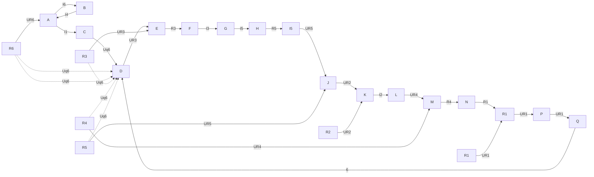
</details>

Abb. 2.83: Netz mit drei Maschen und einer Spannungsquelle.

---

2.8 Umlauf- und Knotenanalyse linearer Netze

79

des Ohm’schen Gesetzes und der Kirchhoff’schen Regeln folgen. Das Ohm’sche Gesetz kann für alle sechs Widerstände angegeben werden. Es liefert sechs Gleichungen:

$$
U _ {R 1} = R _ {1} I _ {1} \tag {2.100a}
$$

$$
\begin{array}{c c} \bullet & \bullet \\ \bullet & \bullet \\ \bullet & \bullet \end{array}
$$

$$
U _ {R 6} = R _ {6} I _ {6}. \tag {2.100f}
$$

Die 1. Kirchhoff’sche Gleichung (Knotengleichung) kann auf die Knoten A, B, C und D angewendet werden:

(2.101a)

(2.101b)

(2.101c)

(2.101d)

Die 1. Kirchhoff’sche Gleichung kann aber auch für größere Teile des Netzes (Groß- knoten) aufgestellt werden. Beispielsweise ergibt sich für den Großknoten, der die Knoten A und B enthält (Bild 2.84):

(2.101e)

Entsprechend folgt:

(2.101f)

(2.101g)

(2.101g)

(2.101f)

(2.101e)

(2.101d)

usw.


<details>
<summary>text_image</summary>

I6
A
I1
R4
B
I2
I5
</details>

Abb. 2.84: Großknoten in dem Netz aus Bild 2.83.

---

80

2 Berechnung von Strömen und Spannungen in elektrischen Netzen

Beim Aufstellen dieser Gleichungen zeigt sich, dass aus den drei Gln. (2.101a, b, c) alle folgenden hergeleitet werden können. Gl. (2.101d) entsteht z. B. aus der Addition der drei ersten Gleichungen. Gl. (2.101e) entsteht aus der Addition der beiden ersten Gleichungen, usw.

Gleichungen, die sich auf andere (lineare) Gleichungen zurückführen lassen, nennt man **linear abhängig**; sie sind beim Aufstellen der Bestimmungsgleichungen für die Spannungen und Ströme überflüssig. Daher muss bei der Auswahl der Gleichungen auf lineare Unabhängigkeit geachtet werden.

Es lässt sich zeigen, dass ganz allgemein gilt:

In einem Netz mit k Knoten können (k − 1) linear unabhängige Knotengleichungen aufgestellt werden.

Die 2. Kirchhoff’sche Gleichung (Umlaufgleichung) kann auf die Umläufe (Maschen) 4, 5 und 6 (Bild 2.83) angewendet werden:

$$
\text {Masche} 4: \quad - U _ {R 1} + U _ {R 2} + U _ {R 4} = 0 \tag {2.102a}
$$

$$
\text {Masche} 5: \quad - U _ {R 2} + U _ {R 3} + U _ {R 5} = 0 \tag {2.102b}
$$

$$
\text {Masche} 6: \quad U _ {R 1} - U _ {R 3} + U _ {R 6} = U _ {\mathrm{q} 6}. \tag {2.102c}
$$

Die 2. Kirchhoff’sche Gleichung kann aber auch für weitere Umläufe angegeben werden, z. B. für den Umlauf A–B–C–D–A in Bild 2.83:

$$
- U _ {\mathrm{R} 1} + U _ {\mathrm{R} 3} + U _ {\mathrm{R} 4} + U _ {\mathrm{R} 5} = 0. \tag {2.102d}
$$

Diese Gleichung und die drei übrigen Umlaufgleichungen (für A–B–D–C–A, A–D–B– C–A, A–B–C–A) können aber durch Addition aus den Gln. (2.102a, b, c) gewonnen werden, sind von diesen also linear abhängig; z. B. entsteht Gl. (2.102d) einfach aus der Addition der beiden Gln. (2.102a, b).

Diese Überlegungen lassen sich verallgemeinern:

In einem Netz mit m Maschen können m linear unabhängige Umlaufgleichungen aufgestellt werden.

Für die sechs unbekannten Ströme und sechs unbekannten Spannungen des betrachteten dreimaschigen Netzes existieren tatsächlich 12 linear unabhängige Gleichungen, nämlich

Gl. (2.100a) bis (2.100f)

Gl. (2.101a) bis (2.101c)

Gl. (2.102a) bis (2.102c)

aus denen die 12 Unbekannten bestimmt werden können. Wenn sämtliche Zweigströme berechnet werden sollen, drücken wir zunächst in den Gln. (2.102a) bis (2.102c) mit Hilfe der Gln. (2.100a) bis (2.100f) die Spannungen $U _ { R 1 } \dots U _ { R 6 }$ durch die Ströme $I _ { 1 } \ldots I _ { 6 }$

---

2.8 Umlauf- und Knotenanalyse linearer Netze

81

aus:

$$
- R _ {1} I _ {1} + R _ {2} I _ {2} + R _ {4} I _ {4} = 0 \tag {2.103a}
$$

$$
- R _ {2} I _ {2} + R _ {3} I _ {3} + R _ {5} I _ {5} = 0 \tag {2.103b}
$$

$$
R _ {1} I _ {1} - R _ {3} I _ {3} + R _ {6} I _ {6} = U _ {\mathrm{q6}}. \tag {2.103c}
$$

In diesen drei Gleichungen kann man die Ströme $I _ { 1 } , I _ { 2 } , I _ { 3 }$ mit Hilfe der drei Knotengleichungen (2.101a, b, c) eliminieren:

$$
- R _ {1} (- I _ {4} + I _ {6}) + R _ {2} (I _ {4} - I _ {5}) + R _ {4} I _ {4} = 0
$$

$$
- R _ {2} (I _ {4} - I _ {5}) + R _ {3} (I _ {5} - I _ {6}) + R _ {5} I _ {5} = 0
$$

$$
R _ {1} (- I _ {4} + I _ {6}) - R _ {3} (I _ {5} - I _ {6}) + R _ {6} I _ {6} = U _ {\mathrm{q6}}.
$$

Ordnet man diese drei Gleichungen nach den drei Unbekannten $I _ { 4 } , I _ { 5 } , I _ { 6 }$ , so entsteht folgendes Gleichungssystem:

4 (2.104a)
5 (2.104b)
6 (2.104c)

Die Untersuchung eines linearen Netzes mit drei Maschen führt also zu dem linearen Gleichungssystem (2.104) für drei unbekannte Ströme, das nun nur noch aufgelöst werden muss.

## Beispiel 2.27: Berechnung der Ströme in einem dreimaschigen Netz mit einer Spannungsquelle.

In Bild 2.83 ist ein lineares Netz mit sechs ohmschen Widerständen und einer konstanten Quellenspannung dargestellt. Es gelten folgende Zahlenwerte:

$$
R _ {1} = 3 \Omega ; \quad R _ {2} = 1 \Omega ; \quad R _ {3} = 2 \Omega ; \quad R _ {4} = 1 \Omega ; \quad R _ {5} = 5 \Omega ; \quad R _ {6} = 1 \Omega
$$

$$
U _ {\mathrm{q6}} = 1 0 \mathrm{V}.
$$

Gesucht sind sämtliche Ströme.

## Lösung:

Mit den gegebenen Zahlenwerten lautet das Gleichungssystem (2.104a, b, c):

$$
\begin{array}{l} 5 \Omega \cdot I _ {4} - 1 \Omega \cdot I _ {5} - 3 \Omega \cdot I _ {6} = 0 \\ - 1 \Omega \cdot I _ {4} + 8 \Omega \cdot I _ {5} - 2 \Omega \cdot I _ {6} = 0 \\ - 3 \Omega \cdot I _ {4} - 2 \Omega \cdot I _ {5} + 6 \Omega \cdot I _ {6} = 1 0 \mathrm{V}. \\ \end{array}
$$

Kürzt man alle drei Gleichungen durch die Einheit Ω, so entsteht

$$
\begin{array}{l} 5 I _ {4} - I _ {5} - 3 I _ {6} = 0 (2.105a) \\ - I _ {4} + 8 I _ {5} - 2 I _ {6} = 0 (2.105b) \\ - 3 I _ {4} - 2 I _ {5} + 6 I _ {6} = 1 0 \mathrm{A}. (2.105c) \\ \end{array}
$$

---

82

2 Berechnung von Strömen und Spannungen in elektrischen Netzen

Zunächst eliminieren wir $I _ { 5 }$ . Dazu wird die Gl. (2.105a) mit 8 multipliziert und zur Gl. (2.105b) addiert:

$$
\begin{array}{l} 4 0 I _ {4} - 8 I _ {5} - 2 4 I _ {6} = 0 \\ \frac {- I _ {4} + 8 I _ {5} - 2 I _ {6} = 0}{3 9 I _ {4} - 2 6 I _ {6} = 0}. \tag {2.106a} \\ \end{array}
$$

Dann wird die Gl. (2.105c) mit 4 multipliziert und zur Gl. (2.105b) addiert:

$$
\begin{array}{l} - 1 2 I _ {4} - 8 I _ {5} + 2 4 I _ {6} = 4 0 \mathrm{A} \\ \frac {- I _ {4} + 8 I _ {5} - 2 I _ {6} = 0}{- 1 3 I _ {4} + 2 2 I _ {6} = 4 0 \mathrm{A}.} \tag {2.106b} \\ \end{array}
$$

Die beiden Gln. (2.106) bilden nun ein Gleichungssystem mit den beiden Unbekannten $I _ { 4 }$ und $I _ { 6 } .$ . Um in diesem System $I _ { 4 }$ zu eliminieren, multiplizieren wir Gl. (2.106b) mit 3 und addieren Gl. (2.106a):

$$
\begin{array}{l} - 3 9 I _ {4} + 6 6 I _ {6} = 1 2 0 \mathrm{A} \\ \frac {3 9 I _ {4} - 2 6 I _ {6} = 0}{4 0 I _ {6} = 1 2 0 \mathrm{A}}; \quad \underline {{\underline {{I _ {6} = 3 \mathrm{A}}}}}. \left. \right. \\ \end{array}
$$

Setzt man dieses Ergebnis in Gl. (2.106a) ein, so folgt

$$
3 9 I _ {4} = 2 6 \cdot 3 \mathrm{A}; \quad \underline {{\underline {{I _ {4} = 2 \mathrm{A}}}}}.
$$

Mit den Werten von $I _ { 4 }$ und $I _ { 6 }$ erhält man aus Gl. (2.105a):

$$
I _ {5} = 5 I _ {4} - 3 I _ {6} = 1 0 \mathrm{A} - 9 \mathrm{A} = \underline {{\underline {{1 \mathrm{A}}}}}.
$$

Die übrigen drei Ströme ergeben sich durch Einsetzen dieser drei Ergebnisse in die Knotengleichungen (2.101a, b, c):

$$
\begin{array}{l} I _ {1} = - I _ {4} + I _ {6} = - 2 \mathrm{A} + 3 \mathrm{A} = \underline {{\underline {{1 \mathrm{A}}}}} \\ I _ {2} = I _ {4} - I _ {5} = 2 \mathrm{A} - 1 \mathrm{A} = \underline {{\underline {{1 \mathrm{A}}}}} \quad \\ I _ {3} = I _ {5} - I _ {6} = 1 \mathrm{A} - 3 \mathrm{A} = \underline {{- 2 \mathrm{A}}}. \\ \end{array}
$$

Der hier gewählte Weg zur Auflösung des linearen Gleichungssystems (2.105) ist selbstverständlich nur einer von mehreren möglichen.

An der Herleitung des Gleichungssystems (2.104) wird deutlich, welcher Aufwand getrieben werden muss, um mit Hilfe der Kirchhoff’schen Gleichungen und des Ohm’schen Gesetzes die Ströme und Spannungen in einem Netz zu berechnen. Dieser Aufwand lässt sich wesentlich reduzieren durch zwei Verfahren, bei denen die Probleme der Gleichungsauswahl und zweckmäßigen Elimination vermindert werden und die Anzahl der Unbekannten von vornherein minimiert wird. Diese Verfahren werden in den folgenden Abschnitten dargestellt.

---

2.8 Umlauf- und Knotenanalyse linearer Netze

83

## 2.8.2 Topologische Grundbegriffe beliebiger Netze

Wir betrachten als Beispiel eines Netzes die in Bild 2.83 dargestellte Schaltung. Stellt man die sechs Zweige dieses Netzes nur durch einfache Linien dar, so entsteht ein Graph (Bild 2.85). Man nennt das Netz wegen seiner vier Knoten ein Viereck; da alle möglichen


<details>
<summary>flowchart</summary>

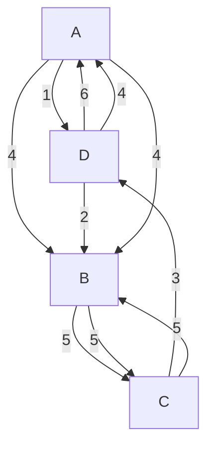
</details>

Abb. 2.85: Struktur eines Netzes (Graph) mit 4 Knoten und 3 Maschen.


Abb. 2.86: Festlegung der U- und I-Zählpfeile durch die in Bild 2.85 gewählten Zweigrichtungen.

Verbindungen zwischen den Knoten vorhanden sind, ist es ein **vollständiges Viereck**. (Entsprechend spricht man auch von Fünfecken, vollständigem Fünfeck usw.) Jeder Zweig trägt einen Richtungspfeil, durch den die Zählpfeile der **Zweigspannung** und des **Zweigstromes** (willkürlich) festgelegt werden (Bild 2.86).

Jede Zweigspannung kann sich aus einem ohmschen Spannungsabfall und einer Quellenspannung zusammensetzen, wie z. B. in Zweig 6 in Bild 2.83:

$$
U _ {6} = - U _ {\mathrm{q6}} + U _ {R 6}. \tag {2.107}
$$

Einen Linienkomplex, in dem kein geschlossener Umlauf enthalten ist, nennt man **Baum**. Beispiele für Bäume in dem Netz aus Bild 2.85 zeigt Bild 2.87. Als **vollständig** bezeichnet man einen Baum, der alle Knoten miteinander verbindet (z. B. die Zweige 1, 2, 3 in Bild 2.85).


<details>
<summary>flowchart</summary>

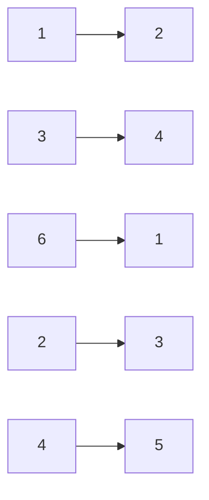
</details>

Abb. 2.87: Beispiele für Bäume im vollständigen Viereck.

---

84

2 Berechnung von Strömen und Spannungen in elektrischen Netzen

<table><tr><td></td><td></td><td></td><td></td><td></td></tr><tr><td></td><td></td><td></td><td></td><td></td></tr><tr><td></td><td></td><td></td><td></td><td></td></tr><tr><td></td><td colspan="4">Anzahl der vollständigen Bäume eines Netzes mit k Knoten: $n_b = k^{(k-2)}$ .</td></tr></table>

Anzahl der vollständigen Bäume eines Netzes mit k Knoten:

Abb. 2.88: Die möglichen vollständigen Bäume des vollständigen Vierecks (Bild 2.85).

In einem Netz mit k Knoten hat also ein vollständiger Baum

$$
b = (k - 1)
$$

Zweige. Die Zweige eines vollständigen Baumes nennt man auch die **Baumzweige**, die übrigen Zweige die **Verbindungszweige** (z. B. 4, 5, 6 in Bild 2.85). Ein Netz mit k Knoten und z Zweigen hat allgemein

$$
v = z - b = z + 1 - k
$$

Verbindungszweige. Die möglichen vollständigen Bäume des vollständigen Vierecks (Bild 2.85) sind in Bild 2.88 zusammengestellt. Ein Netz, dessen Zweige sich in einer Ebene kreuzungsfrei darstellen lassen, nennt man **eben**. Das vollständige Viereck ist ein ebenes Netz. Ein vollständiges Fünfeck dagegen ist schon kein ebenes Netz mehr (Bild 2.89).

---

2.8 Umlauf- und Knotenanalyse linearer Netze

85


<details>
<summary>natural_image</summary>

Geometric diagram with interconnected nodes and lines, no text or symbols present
</details>

Abb. 2.89: Vollständiges Fünfeck.


<details>
<summary>flowchart</summary>

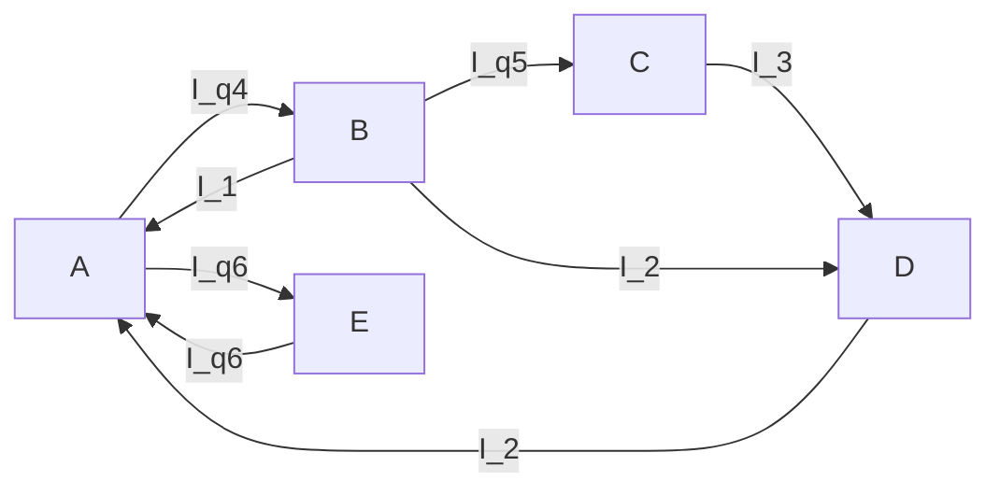
</details>

Abb. 2.90: Unabhängige Ströme in den Verbindungszweigen.

## 2.8.3 Umlaufanalyse

## 2.8.3.1 Unabhängige und abhängige Ströme; Maschenströme

Betrachtet wird das Netz in Bild 2.85. Die Zweige 1, 2, 3 sollen den vollständigen Baum bilden. Man kann nun in jedem Verbindungszweig (4, 5, 6) einen beliebigen Stromwert vorschreiben. Dies ist in Bild 2.90 durch ideale Stromquellen (d. h. Ersatzstromquellen ohne inneren Leitwert) dargestellt. Unmöglich ist es dagegen, zugleich in vier Zweigen Ströme beliebig vorzugeben, weil sonst in einem Knoten die Knotengleichung nicht erfüllt werden kann. Es ist auch unmöglich, die Ströme in den drei Zweigen 1, 2, 3 zugleich vorzuschreiben, denn in der Gleichung

$$
I _ {1} + I _ {2} + I _ {3} = 0 \tag {2.101d}
$$

können höchstens zwei der drei Ströme unabhängig voneinander vorgegeben werden. Da man in jedem Verbindungszweig einen Strom willkürlich festsetzen kann, sieht man die Ströme in Verbindungszweigen als voneinander unabhängig an und bezeichnet sie deshalb als **unabhängige Ströme**. Im Gegensatz dazu sind die Ströme in den Baumzweigen die **abhängigen Ströme**.

Die unabhängigen Ströme kann man auch **Umlaufströme** nennen oder – wenn die Umläufe mit den Maschen des Netzes identisch sind – Maschenströme. Wir stellen uns z. B. vor, dass die unabhängigen Ströme $I _ { 4 } , I _ { 5 }$ und $I _ { 6 }$ (Bilder 2.85 und 2.86) als Maschenströme nur jeweils die zugehörige Masche durchfließen, wie es in Bild 2.91 dargestellt ist. Die Ströme in den Baumzweigen entstehen dann aus einer Überlagerung der Maschenströme (Kreisströme), die durch den betreffenden Baumzweig fließen. Zum


Umlauf 4

a

Umlauf 5


<details>
<summary>flowchart</summary>


</details>

Umlauf 6

Abb. 2.91: Maschen und Maschenströme des Netzes 2.85.

---

86

2 Berechnung von Strömen und Spannungen in elektrischen Netzen

Beispiel fließen durch Baumzweig 1 der Maschenstrom $I _ { 4 }$ (entgegen der Zählrichtung dieses Zweiges, vgl. Bild 2.85) und der Maschenstrom $I _ { 6 }$ (in der Zählrichtung dieses Zweiges), es gilt also

$$
I _ {1} = - I _ {4} + I _ {6}; \tag {2.101a}
$$

dies ist nichts anderes als die Stromgleichung für den Knoten A.

## 2.8.3.2 Das Schema zur Aufstellung der Umlaufgleichungen

Drückt man in dem System der Umlaufgleichungen (2.102a, b, c) zunächst die ohmschen Spannungsabfälle $U _ { R 1 } ,   U _ { R 2 }$ usw. durch die Ströme $I _ { 1 } , I _ { 2 }$ usw. aus, so erhält man ein Gleichungssystem mit drei Gleichungen für die sechs Ströme $I _ { 1 } \ldots I _ { 6 }$ . In diesem System lassen sich die abhängigen Ströme $( I _ { 1 } , I _ { 2 } , I _ { 3 } )$ durch die unabhängigen ersetzen $( I _ { 4 } , I _ { 5 }$ $I _ { 6 } )$ , und zwar mit Hilfe der Knotengleichungen (2.101a, b, c). Hierbei entstehen – wie in Abschnitt 2.8.1 dargestellt – die Gln. (2.104a, b, c). Zu ihrer Deutung betrachten wir als Beispiel die Gl. (2.104c):

$$
- R _ {1} I _ {4} - R _ {3} I _ {5} + (R _ {1} + R _ {3} + R _ {6}) I _ {6} = U _ {\mathrm{q6}}. \tag {2.104c}
$$

Wenn der Umlaufstrom $I _ { 6 }$ nur durch den Umlauf 6 fließt (Bild 2.91c), verursacht er dort den Spannungsabfall

$$
(R _ {1} + R _ {3} + R _ {6}) I _ {6}  .
$$

In dem Baumzweig 1 des Umlaufs 6 überlagert sich dem Strom $I _ { 6 }$ aber noch der Strom $I _ { 4 }$ (Bild 2.91a) in entgegengesetzter Richtung. Dadurch kommt im Umlauf 6 der Spannungsabfall

$$
- R _ {1} I _ {4}
$$

hinzu. Im Baumzweig 3 des Umlaufs 6 überlagert sich dem Strom $I _ { 6 }$ der Strom $I _ { 5 }$ (Bild 2.91b) ebenfalls in entgegengesetzter Richtung. Damit kommt dort noch der Spannungsabfall

$$
- R _ {3} I _ {5}
$$

hinzu. Da im Zweig 6 die Quellenspannung $U _ { \mathrm { q 6 } }$ enthalten ist, tritt diese Spannung ebenfalls in der Spannungsgleichung auf, und zwar auf der rechten Seite mit positivem Vorzeichen, weil sie dem Umlaufsinn des Umlaufstromes $I _ { 6 }$ entgegen gerichtet ist. Der Umlaufstrom $I _ { 6 }$ findet in seinem Umlauf den Widerstand $R _ { 1 } + R _ { 3 } + R _ { 6 }$ vor; man bezeichnet diesen Widerstand

$$
R _ {1} + R _ {3} + R _ {6} \quad \text {als Umlaufwiderstand}
$$

des Umlaufs $6$ (der Umlaufwiderstand kann als Reihenschaltung sämtlicher im Umlauf enthaltenen Widerstände aufgefasst werden). Der Umlaufstrom $I _ { 4 }$ überlagert sich dem Umlaufstrom $I _ { 6 }$ nur im Baumwiderstand $R _ { 1 }$ , daher bezeichnet man

$$
R _ {1} \quad \text {als Kopplungswiderstand}
$$

---

2.8 Umlauf- und Knotenanalyse linearer Netze

87

der beiden Umläufe 4 und 6. Entsprechend ist der Baumwiderstand

## $R _ { 3 }$ der Kopplungswiderstand

der beiden Umläufe 5 und $6 .$

Die Gl. (2.104c) kann direkt folgendermaßen aufgestellt werden:

1. Es wird für die gegebene Schaltung (Bild 2.83) ein vollständiger Baum ausgewählt (z. B. die Zweige 1, 2 und 3). In den Verbindungszweigen werden Zählpfeile für die unabhängigen Ströme $( I _ { 4 } , I _ { 5 } , I _ { 6 } )$ eingetragen.
2. Die Gleichung enthält auf der linken Seite als Unbekannte alle unabhängigen Ströme $( I _ { 4 } , I _ { 5 } , I _ { 6 } )$
3. Hierbei tritt der Umlaufwiderstand $( R _ { 1 } + R _ { 3 } + R _ { 6 } )$ als Koeffizient beim Umlaufstrom $( I _ { 6 } )$ des betrachteten Umlaufs (6) auf.
4. Die Koeffizienten für die anderen Umlaufströme $( I _ { 4 } ,   I _ { 5 } )$ sind die Kopplungswi derstände $( R _ { 1 } ,   R _ { 3 } )$ . Ihr Vorzeichen ist positiv, wenn die Umlaufströme, die der Kopplungswiderstand miteinander verknüpft, im Kopplungswiderstand gleiche Zählrichtung haben, und andernfalls negativ.
5. Auf der rechten Seite erscheint die Summe aller Quellenspannungen des Umlaufs $( U _ { \mathrm { q 6 } } )$ . Jede Quellenspannung erhält hierbei ein negatives Vorzeichen, wenn ihr Zählpfeil mit der Umlaufrichtung des Umlaufstromes übereinstimmt, andernfalls ein positives.

Nach diesen Regeln erhält man leicht das ganze Gleichungssystem (2.104) für die drei Umlaufströme unmittelbar, ohne zuvor die Gln. (2.100), (2.101), (2.102) und (2.103) aufstellen und bearbeiten zu müssen. Das System (2.104) stellen wir noch übersichtlicher dar:

| $I_{4}$ | $I_{5}$ | $I_{6}$ |  |
| --- | --- | --- | --- |
| $R_{1} + R_{2} + R_{4}$ | $-R_{2}$ | $-R_{1}$ | 0 |
| $-R_{2}$ | $R_{2} + R_{3} + R_{5}$ | $-R_{3}$ | 0 |
| $-R_{1}$ | $-R_{3}$ | $R_{1} + R_{3} + R_{6}$ | $U_{\text{q6}}$ |

Das aus den drei Umlauf- und sechs Kopplungswiderständen gebildete Koeffizientenschema nennt man **Widerstandsmatrix**. Bei ihr fällt auf, dass die Hauptdiagonale die drei Umlaufwiderstände enthält und dass die Kopplungswiderstände symmetrisch zur Hauptdiagonalen liegen. Hierbei wird vorausgesetzt, dass die Reihenfolge der Umlaufgleichungen (2.104) für die Umläufe 4, 5 und 6 (vgl. Bild 2.85) der Reihenfolge der drei Unbekannten $( I _ { 4 } , I _ { 5 } , I _ { 6 } )$ entspricht. Das Verfahren zur unmittelbaren Aufstellung der Widerstandsmatrix nennt man **Umlaufanalyse**.

## Beispiel 2.28: Analyse eines zweimaschigen Netzes mit einer Spannungsquelle.

Gegeben sind die Quellenspannung $U _ { \mathrm { q } }$ und die vier ohmschen Widerstände in einem Netz mit zwei Maschen (Bild 2.92). Gesucht ist die Spannung $U _ { 4 }$ für folgenden Sonderfall: $R _ { 1 } = R _ { 3 }$ und $R _ { 2 } = R _ { 4 }$

---

88

2 Berechnung von Strömen und Spannungen in elektrischen Netzen


<details>
<summary>text_image</summary>

R₁ I₁ I₃ R₃
Uq R₂ R₄ U₄
</details>

Abb. 2.92: Zweimaschiges Netz mit einer Spannungsquelle.

## Lösung:

Wenn der Zweig mit $R _ { 2 }$ zum vollständigen Baum gemacht wird, werden $I _ { 1 }$ und $I _ { 3 }$ zu unabhängigen Strömen, für die sich nach den Regeln der Umlaufanalyse folgendes Gleichungssystem ergibt:

| $I_{1}$ | $I_{3}$ |  |
| --- | --- | --- |
| $R_{1} + R_{2}$ | $-R_{2}$ | $U_{\text{q}}$ |
| $-R_{2}$ | $R_{2} + R_{3} + R_{4}$ | 0 |

Wegen $R _ { 1 } = R _ { 3 }$ und $R _ { 2 } = R _ { 4 }$ folgt hieraus:

| $I_{1}$ | $I_{3}$ |  |
| --- | --- | --- |
| $R_{1} + R_{2}$ | $-R_{2}$ | $U_{\text{q}}$ |
| $-R_{2}$ | $R_{1} + 2R_{2}$ | 0 |

Zur Elimination von $I _ { 1 }$ wird die obere Gleichung mit $R _ { 2 }$ , die untere mit $( R _ { 1 } + R _ { 2 } )$ multipliziert, und dann werden beide Gleichungen addiert. Damit wird

$$
I _ {3} (R _ {1} ^ {2} + 3 R _ {1} R _ {2} + R _ {2} ^ {2}) = R _ {2} U _ {\mathrm{q}}
$$

und

$$
U _ {4} = I _ {3} R _ {4} = I _ {3} R _ {2} = \frac {R _ {2} ^ {2}}{R _ {1} ^ {2} + 3 R _ {1} R _ {2} + R _ {2} ^ {2}} U _ {\mathrm{q}}.
$$

## Beispiel 2.29: Berechnung eines Stromes in einem Netz mit zwei Stromquellen.

Aufgabenstellung wie in Beispiel 2.25.

## Lösung:

Wenn man diese Aufgabe mit Hilfe der Umlaufanalyse zu lösen sucht, so fällt zunächst auf, dass in dem Schema zur Aufstellung der Widerstandsmatrix von Stromquellen keine Rede ist. Um dem Schema gerecht zu werden, kann man die Stromquellen durch äquivalente Spannungsquellen ersetzen. Man kann aber auch die Stromquellen einfach in die Verbindungszweige legen. Bei der Aufstellung des Gleichungssystems für die unabhängigen Ströme werden die Quellenströme $( I _ { \mathrm { B } } , I _ { \mathrm { C } } )$ dann ebenso behandelt wie andere unabhängige Ströme auch. Wir wählen die in Bild 2.75 dick eingezeichneten Zweige als vollständigen Baum und erhalten nach den Regeln der Umlaufanalyse ein

---

2.8 Umlauf- und Knotenanalyse linearer Netze

89

Gleichungssystem für die vier unabhängigen Ströme $I _ { 1 } , I _ { 3 } , I _ { \mathrm { B } } , I _ { \mathrm { C } } ;$

| $I_{1}$ | $I_{3}$ | $I_{B}$ | $I_{C}$ |  |  |  |
| --- | --- | --- | --- | --- | --- | --- |
| 8R | R | -2R | -R | 0 | (Masche 1) | (2.108a) |
| R | 5R | -R | -2R | 0 | (Masche 3) | (2.108b) |
| -2R | -R | 2R | R | $U_{B}$ |  | (2.108c) |
| -R | -2R | R | 2R | $U_{C}$ |  | (2.108d) |

Dieses Gleichungssystem enthält die Unbekannten

$$
I _ {1}, \quad I _ {3}; \quad U _ {\mathrm{B}}, \quad U _ {\mathrm{C}}.
$$

Um $I _ { 1 }$ und $I _ { 3 }$ zu berechnen, brauchen wir nur die Gln. (2.108a) und (2.108b) zu nehmen. Sie bilden ein System zweier Gleichungen für nur zwei Unbekannte $( I _ { 1 } , I _ { 3 } )$ . Weil die Quellenströme $I _ { \mathrm { B } }$ und $I _ { \mathrm { C } }$ keine Unbekannten sind, ziehen wir sie auf die rechten Seiten der Gleichungen:

| $I_1$ | $I_3$ |  |
| --- | --- | --- |
| 8R | R | $R(2I_{\text{B}} + I_{\text{C}})$ |
| R | 5R | $R(I_{\text{B}} + 2I_{\text{C}})$ |

Diese Gleichungen werden durch R dividiert:

$$
8 I _ {1} + \quad I _ {3} = 2 I _ {\mathrm{B}} + \quad I _ {\mathrm{C}}
$$

$$
I _ {1} + 5 I _ {3} = I _ {\mathrm{B}} + 2 I _ {\mathrm{C}}.
$$

Zur Elimination von $I _ { 3 }$ wird die obere Gleichung mit (−5) multipliziert und zur unteren addiert:

$$
- 4 0 I _ {1} - 5 I _ {3} = - 1 0 I _ {\mathrm{B}} - 5 I _ {\mathrm{C}}
$$

$$
I _ {1} - 5 I _ {3} = \quad I _ {\mathrm{B}} + 2 I _ {\mathrm{C}}
$$

$$
- 3 9 I _ {1} \quad = - 9 I _ {\mathrm{B}} - 3 I _ {\mathrm{C}}
$$

$$
1 3 I _ {1} = 3 I _ {\mathrm{B}} + I _ {\mathrm{C}}
$$

$$
I _ {1} = \frac {3 I _ {\mathrm{B}} + I _ {\mathrm{C}}}{1 3} = \frac {3 \cdot 4 \mathrm{A} + 1 \mathrm{A}}{1 3} = 1 \mathrm{A}.
$$

## Beispiel 2.30: Analyse eines symmetrischen dreimaschigen Netzes.

Für den Klemmenwiderstand

$$
R _ {\mathrm{ab}} = \frac {U _ {\mathrm{q}}}{I}
$$

einer Brückenschaltung (Bild 2.93) soll gelten

$$
R _ {\mathrm{ab}} = 1 0 \Omega .
$$

Wie groß muss $R _ { 5 }$ sein, damit diese Forderung erfüllt wird?

---

90

2 Berechnung von Strömen und Spannungen in elektrischen Netzen


<details>
<summary>text_image</summary>

I
a
Uq
4Ω
20Ω
R5
20Ω
I3
4Ω
b
I2
</details>

Abb. 2.93: Unabgeglichene Brücke.

## Lösung:

Wenn der mittlere Zweig (mit $R _ { 5 } )$ aufgetrennt wird, ist $R _ { \mathrm { a b } } = 1 2   \Omega$ . Wenn $R _ { 5 } = 0$ wird, dann ist $R _ { \mathrm { a b } }   =   2 0 / _ { 3 }   \Omega$ . Es muss also möglich sein, durch richtige Wahl von $R _ { 5 }$ die Bedingung $R _ { \mathrm { a b } } = 1 0   \Omega$ zu erfüllen. Zur Analyse des Netzes wird der vollständige Baum so gelegt, dass $I , I _ { 2 }$ und $I _ { 3 }$ zu unabhängigen Strömen werden:

| I | $I_{2}$ | $I_{3}$ |  |
| --- | --- | --- | --- |
| $8\,\Omega + R_{5}$ | $-(4\,\Omega + R_{5})$ | $-(4\,\Omega + R_{5})$ | $U_{\text{q}}$ |
| $-(4\,\Omega + R_{5})$ | $24\,\Omega + R_{5}$ | $R_{5}$ | 0 |
| $-(4\,\Omega + R_{5})$ | $R_{5}$ | $24\,\Omega + R_{5}$ | 0 |

Subtrahiert man die dritte von der zweiten Gleichung, so entsteht

$$
2 4 \Omega I _ {2} - 2 4 \Omega I _ {3} = 0, \quad \text { also }
$$

$$
I _ {2} = I _ {3}.
$$

Damit vereinfacht sich das Gleichungssystem wie folgt:

| I | $I_{2}$ | $I_{2} = I_{3}$ |  |
| --- | --- | --- | --- |
| $8\Omega + R_{5}$ | $-(4\Omega + R_{5})$ | $-(4\Omega + R_{5})$ | $U_{\text{q}}$ |
| $-(4\Omega + R_{5})$ | $24\Omega + R_{5}$ | $R_{5}$ | 0 |

<table><tr><td>I</td><td colspan="2"> $I_{2}$ </td></tr><tr><td> $8\Omega + R_{5}$ </td><td> $-2(4\Omega + R_{5})$ </td><td> $U_{\text{q}}$ </td></tr><tr><td> $-(4\Omega + R_{5})$ </td><td> $2(12\Omega + R_{5})$ </td><td>0</td></tr></table>

Durch Elimination von $I _ { 2 }$ ergibt sich:

$$
(8 0 \Omega^ {2} + 1 2 \Omega \cdot R _ {5}) \cdot I = (1 2 \Omega + R _ {5}) \cdot U _ {\mathrm{q}}.
$$

Mit $R _ { \mathsf { a b } } = U _ { \mathsf { q } } / _ { I }$ wird

$$
8 0 \Omega^ {2} + 1 2 \Omega \cdot R _ {5} = R _ {\mathrm{ab}} \cdot (1 2 \Omega + R _ {5})
$$

$$
R _ {5} = \frac {4 \Omega \cdot (3 R _ {\mathrm{ab}} - 2 0 \Omega)}{1 2 \Omega - R _ {\mathrm{ab}}} = \frac {4 \Omega \cdot (3 0 - 2 0) \Omega}{1 2 \Omega - 1 0 \Omega} = \underline {{\underline {{2 0 \Omega}}}}.
$$

---

2.8 Umlauf- und Knotenanalyse linearer Netze

91

Hierdurch wird das Ergebnis aus Beispiel 2.26 bestätigt (dort ergibt sich mit der gegebenen Größe $R _ { 5 } = 2 0   \Omega$ der Wert $R _ { \mathrm { a b } } = 1 0   \Omega )$

## Beispiel 2.31: Digital-Analog-Umsetzer (DAU).

Für die Kettenschaltung mit n Spannungsquellen in Bild 2.94a soll die Spannung $U _ { \mathrm { A } }$ berechnet werden.

## Lösung:

Vorbemerkung: Durch Maschenanalyse der Kettenschaltung entsteht ein Gleichungssystem für $n   +   1$ unbekannte Ströme. Eine wesentlich einfachere Lösung ergibt sich hier mit Hilfe der Methode der Ersatzspannungsquelle, da alle Kettenglieder in Bezug auf die Widerstände (R, 2R) übereinstimmen und sich der Innenwiderstand $R _ { \mathbf { i } }$ bei einer Verlängerung der Kette nicht ändert (Bild 2.94b).

Zunächst soll der DAU für den Sonderfall $n = 3$ (Bild 2.94b) betrachtet werden. Der Zweipol links von den Klemmen $\mathrm { A } _ { 2 }$ , B (DAU mit $n = 2 )$ hat den Innenwiderstand $R _ { \mathrm { i } } = R$ und seine Leerlaufspannung nennen wir $U _ { \mathrm { A } ( 2 ) }$ . Der DAU mit $n = 3$ entsteht dadurch, dass an $\mathrm { A } _ { 2 }$ , B die Reihenschaltung R, 2R, $U _ { \mathtt { q } 3 }$ angeschlossen wird. Aus Bild 2.94c geht der Zusammenhang zwischen $U _ { \mathrm { A } ( 2 ) }$ und $U _ { \mathrm { A } ( 3 ) }$ hervor:

$$
U _ {\mathrm{A(3)}} = U _ {\mathrm{q3}} + 2 R I _ {3} = U _ {\mathrm{q3}} + \frac {U _ {\mathrm{A(2)}} - U _ {\mathrm{q3}}}{4 R} 2 R = \frac {1}{2} (U _ {\mathrm{q3}} + U _ {\mathrm{A(2)}}) .
$$

Allgemein gilt offenbar

$$
U _ {\mathrm{A} (n)} = \frac {1}{2} (U _ {\mathrm{A} (n - 1)} + U _ {\mathrm{q} n}) \quad m i t \quad n = 1, 2, 3, \dots . \tag {2.109a}
$$


Abb. 2.94: Binärer Digital-Analog-Umsetzer (DAU). a) DAU mit n Kettengliedern b) Entstehung eines DAU mit $n = 3$ aus der Verlängerung des DAU mit $n = 2$ um ein Kettenglied $c )$ Zusammenfassung des linken Teiles der Schaltung b) (Zweipol mit den Klemmen $\mathsf { A } _ { 2 }$ , B) zu einer Ersatzspannungsquelle.

---

92

2 Berechnung von Strömen und Spannungen in elektrischen Netzen

bzw.

$$
U _ {\mathrm{A} (n + 1)} = \frac {1}{2} (U _ {\mathrm{A} (n)} + U _ {\mathrm{q} (n + 1)}) . \tag {2.109b}
$$

Es ist für $n = 0$

$$
U _ {\mathrm{A(0)}} = \frac {1}{2} U _ {\mathrm{q0}}.
$$

Die Rekursionsformel (2.109b) ergibt dann für

$$
\begin{array}{l} n = 1: \quad U _ {\mathrm{A} (1)} = \frac {1}{2} U _ {\mathrm{A} (0)} + \frac {1}{2} U _ {\mathrm{q} 1} = \frac {1}{4} U _ {\mathrm{q} 0} + \frac {1}{2} U _ {\mathrm{q} 1}; \\ n = 2: \quad U _ {\mathrm{A} (2)} = \frac {1}{2} U _ {\mathrm{A} (1)} + \frac {1}{2} U _ {\mathrm{q} 2} = \frac {1}{8} U _ {\mathrm{q} 0} + \frac {1}{4} U _ {\mathrm{q} 1} + \frac {1}{2} U _ {\mathrm{q} 2}; \\ \end{array}
$$

usw. Hieraus ist zu vermuten, dass für beliebiges n gilt

$$
U _ {\mathrm{A} (n)} = \frac {1}{2 \cdot 2 ^ {n}} \sum_ {\nu = 0} ^ {n} 2 ^ {\nu} U _ {\mathrm{q} \nu}. \tag {2.109c}
$$

Ersetzt man nämlich n durch (n + 1), so wird

$$
U _ {\mathrm{A} (n + 1)} = \frac {1}{2 \cdot 2 ^ {n + 1}} \sum_ {\nu = 0} ^ {n + 1} 2 ^ {\nu} U _ {\mathrm{q} \nu} = \frac {1}{2} \left[ \underbrace {\frac {1}{2 \cdot 2 ^ {n}} \sum_ {\nu = 0} ^ {n} 2 ^ {\nu} U _ {\mathrm{q} \nu}} _ {= U _ {\mathrm{A} (n)}} + U _ {\mathrm{q} (n + 1)} \right],
$$

wodurch die Rekursionsformel (2.109b) bestätigt wird. Die Reihendarstellung (2.109b) gilt also für beliebiges n.

## Anmerkung (Realisierung mit Schaltern)

Die vierstellige Dualzahl

$$
y = x _ {3} 2 ^ {3} + x _ {2} 2 ^ {2} + x _ {1} 2 ^ {1} + x _ {0} 2 ^ {0} \tag {2.109d}
$$

kann durch vier Schalter $( S _ { 0 } \ldots S _ { 3 }$ , siehe Bild 2.95) eingestellt werden. So kann mit $U _ { \mathrm { B } } = 1 6   \mathrm { V }$ jede der Quellenspannungen (in Bild 2.94b: $U _ { \mathfrak { q } 0 } \dots U _ { \mathfrak { q } 3 } )$ entweder den Wert


<details>
<summary>text_image</summary>

2 R
R
2 R
R
2 R
R
2 R
y
x0=1 x0=0 x1=1 x1=0 x2=1 x2=0 x3=1 x3=0
S0 S1 S2 S3
UB
UA(3)
</details>

Abb. 2.95: Einstellung einer vierstelligen Dualzahl mit Hilfe von vier Schaltern, Umsetzung in den Analogwert (in der dargestellten Schalterstellung ist y = 13).

---

2.8 Umlauf- und Knotenanalyse linearer Netze

93

Tab. 2.8: Analogspannung in Abhängigkeit der Schalterstellungen.

| $x_{3}$ | $x_{2}$ | $x_{1}$ | $x_{0}$ | $y = U_{\mathrm{A(3)}}/\mathrm{V}$ |
| --- | --- | --- | --- | --- |
| 0 | 0 | 0 | 0 | 0 |
| 0 | 0 | 0 | 1 | 1 |
| 0 | 0 | 1 | 0 | 2 |
| 0 | 0 | 1 | 1 | 3 |
| 0 | 1 | 0 | 0 | 4 |
| 0 | 1 | 0 | 1 | 5 |
| 0 | 1 | 1 | 0 | 6 |
| 0 | 1 | 1 | 1 | 7 |
| 1 | 0 | 0 | 0 | 8 |
| 1 | 0 | 0 | 1 | 9 |
| 1 | 0 | 1 | 0 | 10 |
| 1 | 0 | 1 | 1 | 11 |
| 1 | 1 | 0 | 0 | 12 |
| 1 | 1 | 0 | 1 | 13 |
| 1 | 1 | 1 | 0 | 14 |
| 1 | 1 | 1 | 1 | 15 |

0 V (mit $x _ { \nu } = 0$ wird $U _ { \mathtt { q } \nu } = x _ { \nu } U _ { \mathtt { B } } = 0   \mathrm { V } )$ oder 16 V (mit $x _ { \nu } = 1$ wird $U _ { \mathrm { q } \nu } = x _ { \nu } U _ { \mathrm { B } } = 1 6   \mathrm { V } )$ annehmen. Aus (2.109c) folgt dann:

$$
U _ {\mathrm{A(3)}} = \frac {1}{2 \cdot 2 ^ {3}} \sum_ {\nu = 0} ^ {3} 2 ^ {\nu} x _ {\nu} U _ {\mathrm{B}} = 1 \mathrm{V} \left[ x _ {3} 2 ^ {3} + x _ {2} 2 ^ {2} + x _ {1} 2 ^ {1} + x _ {0} 2 ^ {0} \right].
$$

Die $2 ^ { 4 } = 1 6$ verschiedenen Kombinationen der Schalterstellungen $x _ { 0 } \ldots x _ { 3 }$ und die sich daraus ergebende (stufige) Analogspannung $U _ { \mathrm { A } ( 3 ) }$ sind in der Tabelle 2.8 zusammengefasst.

## Anmerkung (Verallgemeinerung des binären DAU)

Ist eine mehrstellige Zahl in einem beliebigen Stellenwertsystem (Basis b) gegeben (z. B. Dezimalsystem: $b = 1 0 )$ und soll sie durch einen DAU mit einer Struktur wie in Bild 2.94 in ein Analogsignal umgesetzt werden, so ergeben sich andere Widerstandsverhältnisse (Bild 2.96a). Für die Dimensionierung der Widerstände gelten nun die folgenden drei Bedingungen:

1. Beim Anschluss des $( n + 1 )$ ten Kettengliedes (Bild 2.96a) an die Klemmen $A _ { n } ,$ , B muss der Innenwiderstand $R _ { \mathbf { i } }$ unverändert bleiben:

$$
\frac {1}{R _ {\mathrm{i}} + R _ {1}} + \frac {1}{R _ {\mathrm{q}}} = \frac {1}{R _ {\mathrm{i}}} . \tag {2.109e}
$$

2. Soll das (n + 1)te Kettenglied den Beitrag aller vorangehenden Quellenspannungen $( U _ { \mathtt { q } 0 } \dots U _ { \mathtt { q } n } )$ durch die Basis b eines beliebigen Stellenwertsystems (im Beispiel von Schaltung 2.96 ist $b = 3 )$ dividieren, so muss für den Spannungsteiler $R _ { \mathrm { q } } , ( R _ { 1 } + R _ { \mathrm { i } } )$

---

94

2 Berechnung von Strömen und Spannungen in elektrischen Netzen

gelten:

$$
\frac {R _ {\mathrm{q}}}{R _ {\mathrm{q}} + R _ {1} + R _ {\mathrm{i}}} = \frac {1}{b}; \quad R _ {\mathrm{q}} (b - 1) = R _ {\mathrm{i}} + R _ {1}. \tag {2.109f,g}
$$

3. Auch der Zweipol mit den Klemmen $A _ { 0 }$ , B muss den Innenwiderstand $R _ { \mathbf { i } }$ haben:

$$
\frac {1}{R _ {\mathrm{A}}} + \frac {1}{R _ {\mathrm{q}}} = \frac {1}{R _ {\mathrm{i}}} . \tag {2.109h}
$$

Setzt man (2.109g) in (e) ein, so wird

$$
\frac {1}{R _ {\mathrm{q}} (b - 1)} + \frac {1}{R _ {\mathrm{q}}} = \frac {1}{R _ {\mathrm{i}}}; \quad R _ {\mathrm{i}} = R _ {\mathrm{q}} \frac {b - 1}{b}. \tag {2.109i,j}
$$

Ersetzt man $R _ { \mathbf { i } }$ mit Hilfe von $( j ) ,$ so entsteht aus (g)

$$
R _ {1} = R _ {\mathrm{q}} \frac {(b - 1) ^ {2}}{b} \tag {2.109k}
$$

und aus (h)

$$
R _ {\mathrm{A}} = R _ {\mathrm{q}} (b - 1). \tag {2.109l}
$$

Eine der vier Widerstandsgrößen $R _ { \mathrm { q } } , R _ { 1 } , R _ { \mathrm { i } } , R _ { \mathrm { A } }$ kann willkürlich gewählt werden, die übrigen drei ergeben sich dann aus den Beziehungen (2.109j, k, l). Wählt man $R _ { \mathrm { q } } = b R ,$ so wird

$$
R _ {\mathrm{q}} = b R; \quad R _ {\mathrm{i}} = (b - 1) R; \quad R _ {1} = (b - 1) ^ {2} R; \quad R _ {\mathrm{A}} = b (b - 1) R; (2. 1 0 9 \mathrm{m}, \mathrm{n}, \mathrm{o}, \mathrm{p})
$$

vgl. die Tabelle 2.9, in der die erste Spalte den Fall der Schaltung 2.96a darstellt.

Für einen DAU mit beliebiger Basis b gilt

$$
U _ {\mathrm{A} (n)} = \frac {b - 1}{b ^ {n + 1}} \sum_ {\nu = 0} ^ {n} b ^ {\nu} U _ {\mathrm{q} \nu}.
$$

Bild 2.96b zeigt einen DAU mit $b = 3$ und $n = 3$

a)


b)

Abb. 2.96: DAU für ein beliebiges Stellenwertsystem. a) Zur Dimensionierung des DAU b) DAU mit b = 3 und $n = 3$

---

2.8 Umlauf- und Knotenanalyse linearer Netze

95

Tab. 2.9: Widerstandsverhältnis für die Schaltung 2.96a.

| $R_{\text{q}}/R$ | 2 | 3 | 4 | 5 | 6 | 7 | 8 | 9 | 10 | 11 | 12 | 13 | 14 | 15 | 16 |
| --- | --- | --- | --- | --- | --- | --- | --- | --- | --- | --- | --- | --- | --- | --- | --- |
| $R_{\text{i}}/R$ | 1 | 2 | 3 | 4 | 5 | 6 | 7 | 8 | 9 | 10 | 11 | 12 | 13 | 14 | 15 |
| $R_{1}/R$ | 1 | 4 | 9 | 16 | 25 | 36 | 49 | 64 | 81 | 100 | 121 | 144 | 169 | 196 | 225 |
| $R_{\text{A}}/R$ | 2 | 6 | 12 | 20 | 30 | 42 | 56 | 72 | 90 | 110 | 132 | 156 | 182 | 210 | 240 |

## 2.8.3.3 Die Auswahl des vollständigen Baumes

Grundsätzlich kann ein vollständiger Baum für eine Umlaufanalyse beliebig ausgewählt werden. Zum Beispiel kann man für das dreimaschige Netz, das in Bild 2.83 dargestellt ist, beliebig einen von den 16 möglichen vollständigen Bäumen nehmen. Trotzdem gibt es Gesichtspunkte, die zur Bevorzugung eines bestimmten Baumes führen können:

1. Der vollständige Baum sollte so liegen, dass die entstehenden Umläufe möglichst einfach werden. Z. B. führt der Baum a aus Bild 2.88 zu Umläufen, die mit den Maschen des Netzes identisch sind. Der Baum c dagegen – in Beispiel 2.30 verwendet – führt zu einem unübersichtlicheren Umlauf für den Umlaufstrom $I _ { 6 } .$
Wenn möglichst einfache Umläufe ausgewählt werden, treten zwischen den einzelnen Umläufen im Allgemeinen auch wenige Kopplungen auf. D. h. es entstehen Paare von Umläufen, die nicht miteinander gekoppelt sind (Kopplungswiderstand gleich Null). Wählt man in einer Kettenschaltung den Baum sternförmig (Bild 2.97a), so treten im Gleichungssystem nur drei Kopplungswiderstände auf, nämlich zwischen den jeweils benachbarten Maschen. Nimmt man dagegen den Baum, der in Bild 2.97b dargestellt ist, so sind über den Zweig 1 offensichtlich **alle** unabhängigen Ströme miteinander gekoppelt. In der Widerstandsmatrix ergeben sich nun keine Nullen.
2. Vorgegebene Ströme (Quellenströme) sollten als unabhängige Ströme von vornherein in Verbindungszweigen bleiben (Beispiel 2.29).
3. Wenn nicht alle Ströme gesucht sind, sollte man den vollständigen Baum so legen, dass die gesuchten Ströme in Verbindungszweigen fließen (Beispiele 2.28; 2.29).
4. Spannungsquellen sollten in Verbindungszweige gelegt werden. Sie treten dann im Gleichungssystem nur einmal auf (Beispiele 2.28; 2.30).
5. Der Baum sollte einer möglicherweise vorhandenen Schaltungssymmetrie gerecht werden (Beispiel 2.30).

Im Allgemeinen können diese Gesichtspunkte nicht alle gleichzeitig berücksichtigt werden.

a)


<details>
<summary>flowchart</summary>

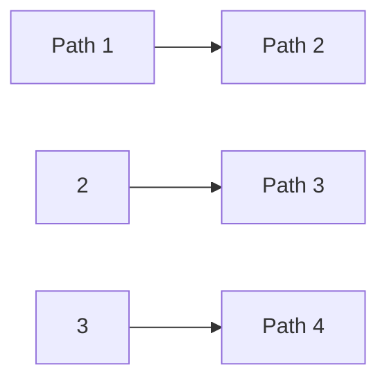
</details>

b)


<details>
<summary>flowchart</summary>

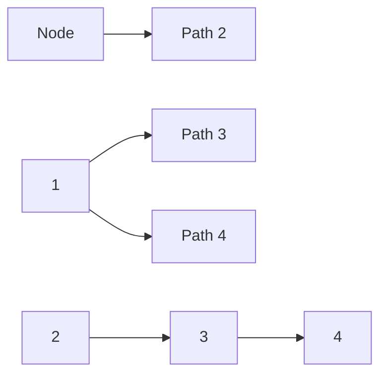
</details>

Abb. 2.97: Zwei vollständige Bäume für eine viermaschige Kettenschaltung.

---

96

2 Berechnung von Strömen und Spannungen in elektrischen Netzen

## 2.8.4 Knotenanalyse

## 2.8.4.1 Abhängige und unabhängige Spannungen

Wir betrachten wieder das in Bild 2.83 dargestellte Netz und bilden den vollständigen Baum aus den Zweigen 1, 2 und 3. Man könnte nun in jedem Baumzweig eine beliebige Spannung vorschreiben. Dies ist in Bild 2.98 durch ideale Spannungsquellen (d. h. Spannungsquellen ohne inneren Widerstand) dargestellt. Unmöglich wäre es dagegen, zugleich in vier Zweigen Spannungen beliebig vorzuschreiben, weil sonst in einem Umlauf die Umlaufgleichung nicht erfüllt werden könnte. Es wäre auch unmöglich, die Spannungen an den drei Zweigen 4, 5, 6 zugleich vorzuschreiben, denn in der Gleichung

$$
U _ {4} + U _ {5} + U _ {6} = 0
$$

können höchstens zwei der drei Spannungen unabhängig voneinander vorgegeben werden. Da man in jedem Baumzweig eine Spannung willkürlich festsetzen kann, sieht man die Spannungen an Baumzweigen als voneinander unabhängig an und bezeichnet sie deshalb als unabhängige Spannungen. Im Gegensatz dazu sind die Spannungen an den Verbindungszweigen die abhängigen Spannungen.

## 2.8.4.2 Das Schema zur Aufstellung der Knotengleichungen

Man kann in dem Netz, dessen Struktur in Bild 2.85 dargestellt wird, alle vorhandenen Spannungsquellen durch ihre Ersatzstromquellen ersetzen. Zum Beispiel wird dann das in Bild 2.83 dargestellte Netz in ein Netz verwandelt, dessen Zweig 6 eine Stromquelle

$$
I _ {\mathrm{q6}} = U _ {\mathrm{q6}} / R _ {6}
$$

mit dem Innenleitwert $\begin{array} { r } { G _ { 6 }   =   \frac { 1 } { R _ { 6 } } } \end{array}$ (anstatt der Spannungsquelle mit $U _ { \mathrm { q 6 } }$ und dem Innenwiderstand $R _ { 6 } )$ enthält. Dies zeigt Bild 2.99, wobei anstatt der Widerstandswerte jeweils die Leitwerte angegeben sind:

$$
G _ {1} = \frac {1}{R _ {1}} \quad \text { usw. }
$$


<details>
<summary>flowchart</summary>

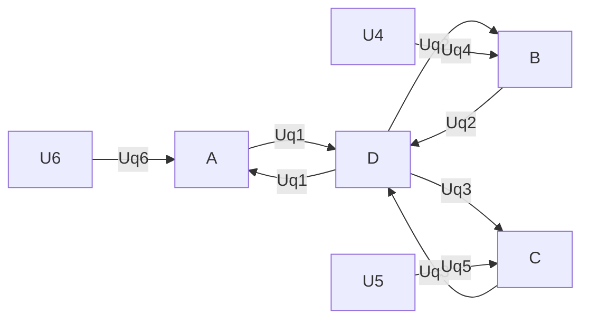
</details>

Abb. 2.98: Unabhängige Spannungen in den Baumzweigen.

---

2.8 Umlauf- und Knotenanalyse linearer Netze

97

Für die sechs Widerstände kann das Ohm’sche Gesetz in folgender Form geschrieben werden:

$$
I _ {\mathrm{G} 1} = G _ {1} U _ {1} \tag {2.110a}
$$

$$
\begin{array}{c c} \bullet & \bullet \\ \bullet & \bullet \\ \bullet & \bullet \end{array}
$$

$$
I _ {\mathrm{G6}} = G _ {6} U _ {6}. \tag {2.110f}
$$

Als System der Knotengleichungen ergibt sich nun

(2.111a)

(2.111b)

Knoten C : (2.111c)

und als System der Umlaufgleichungen

$$
U _ {4} = U _ {1} - U _ {2} \tag {2.112a}
$$

$$
U _ {5} = U _ {2} - U _ {3} \tag {2.112b}
$$

$$
U _ {6} = U _ {3} - U _ {1}. \tag {2.112c}
$$

Wenn man nun in den Gln. (2.111) die Ströme $I _ { \mathsf { G } 1 } \dots I _ { \mathsf { G } 6 }$ durch die zugehörigen Spannungen ausdrückt, so ergibt sich

$$
G _ {1} U _ {1} + G _ {4} U _ {4} - G _ {6} U _ {6} = I _ {\mathrm{q6}} \tag {2.113a}
$$

$$
G _ {2} U _ {2} - G _ {4} U _ {4} + G _ {5} U _ {5} = 0 \tag {2.113b}
$$

$$
G _ {3} U _ {3} - G _ {5} U _ {5} + G _ {6} U _ {6} = - I _ {\mathrm{q6}}. \tag {2.113c}
$$

In diesen drei Gleichungen kann man die abhängigen Spannungen $U _ { 4 }$ , $U _ { 5 }$ , $U _ { 6 }$ mit Hilfe der drei Maschengleichungen (2.112) eliminieren:

$$
G _ {1} U _ {1} + G _ {4} (U _ {1} - U _ {2}) - G _ {6} (U _ {3} - U _ {1}) = I _ {\mathrm{q6}}
$$

$$
G _ {2} U _ {2} + G _ {4} (U _ {1} - U _ {2}) - G _ {5} (U _ {2} - U _ {3}) = 0
$$

$$
G _ {3} U _ {3} + G _ {5} (U _ {2} - U _ {3}) - G _ {6} (U _ {3} - U _ {1}) = - I _ {\mathrm{q6}}.
$$


<details>
<summary>text_image</summary>

Iq6
IG6
U6
G6
A
IG1
U1
G1
D
B
U2
G2
U3
G3
C
IG3
G4
U4
Ig4
G5
U5
IG5
</details>

Abb. 2.99: Netz mit drei Maschen und einer Stromquelle.

---

98

2 Berechnung von Strömen und Spannungen in elektrischen Netzen

Ordnet man diese drei Gleichungen nach den drei Unbekannten $U _ { 1 } , U _ { 2 } , U _ { 3 }$ , so entsteht folgendes Gleichungssystem für die unabhängigen Spannungen:

(2.114a)

(2.114b)

(2.114c)

Dieses Gleichungssystem lässt sich folgendermaßen deuten. Zum Beispiel ist die Gl. (2.114a) aus der Gl. (2.111a) für den Knoten A hervorgegangen. Der (einzige) Baumzweig, der mit diesem Knoten verbunden ist, ist der Zweig 1 mit der unabhängigen Spannung $U _ { 1 }$ . Als Koeffizient dieser Spannung tritt die Summe aller drei in A zusammengeführten Leitwerte $G _ { 1 } + G _ { 4 } + G _ { 6 }$ auf. Man bezeichnet

$$
G _ {1} + G _ {4} + G _ {6} \quad \text {als Knotenleitwert}
$$

des Knotens A (der Knotenleitwert kann als Parallelschaltung sämtlicher im Knoten zusammentreffenden Leitwerte aufgefasst werden).

Als Koeffizient für $U _ { 2 }$ tritt der Leitwert $G _ { 4 }$ auf, der die Knoten A und B direkt verbindet $( U _ { 2 }$ ist die unabhängige Spannung, die dem Knoten B zugeordnet ist). Wir betrachten daher

$$
G _ {4} \quad \text {als Kopplungsleitwert}
$$

der beiden Knoten A und B. Entsprechend ist der Leitwert

$$
G _ {6} \quad \text {der Kopplungsleitwert}
$$

der beiden Knoten A und C.

Die Gl. (2.114a) kann also direkt folgendermaßen aufgestellt werden:

1. Es wird für die gegebene Schaltung (z. B. Bild 2.99) ein sternförmiger vollständiger Baum ausgewählt (z. B. die Zweige 1, 2, 3), indem man von einem beliebigen Bezugsknoten ausgeht (hier Knoten D) und alle Verbindungen von diesem Knoten zu den anderen Knoten zu Baumzweigen macht. Sind nicht alle Knoten direkt mit dem Bezugsknoten (D) verbunden, so sind in solchen Fällen Zweige mit dem Leitwert $\mathsf { G } = 0$ einzufügen.
2. Die Zählpfeile der unabhängigen Spannungen $( U _ { 1 } , U _ { 2 } , U _ { 3 } )$ zeigen alle auf den Bezugsknoten (D).
3. Die Gleichung enthält auf der linken Seite als Unbekannte alle unabhängigen Spannungen $( U _ { 1 }$ $U _ { 2 } , U _ { 3 } )$
4. Hierbei tritt der Knotenleitwert $( G _ { 1 } + G _ { 4 } + G _ { 6 } )$ als Koeffizient bei der unabhängigen Spannung $( U _ { 1 } )$ auf, die dem betrachteten Knoten (A) zugeordnet ist.
5. Die Koeffizienten für die anderen unabhängigen Spannungen $( U _ { 2 } , U _ { 3 } )$ sind die Kopplungsleitwerte $( G _ { 4 } , G _ { 6 } )$ . Ihr Vorzeichen ist immer negativ (aufgrund der Regeln 1 und 2).
6. Auf der rechten Gleichungsseite erscheint die Summe aller Quellenströme $( I _ { \mathsf { q } 6 } )$ , die in den betreffenden Knoten (A) hineinfließen. Jeder Quellenstrom erhält hierbei ein Pluszeichen, wenn er in den Knoten hineinfließt; ein Minuszeichen, wenn er herausfließt.

Der vollständige Baum muss nicht so gewählt werden, wie die Regel 1 es vorschreibt. Doch dann werden die Regeln 4 und 5 zur Bestimmung der Koeffizienten viel undurch-

---

2.8 Umlauf- und Knotenanalyse linearer Netze

99

sichtiger. Es lohnt sich hier – im Gegensatz zur Umlaufanalyse –, bei der Auswahl des vollständigen Baumes von vornherein eine erhebliche Einschränkung hinzunehmen.

Nach den Regeln 1 . . . 6 hätte das Gleichungssystem (2.114) unmittelbar aufgestellt werden können. Auch dieses Gleichungssystem kann in einer übersichtlichen Form dargestellt werden:

| $U_{1}$ | $U_{2}$ | $U_{3}$ |  |
| --- | --- | --- | --- |
| $G_{1} + G_{4} + G_{6}$ | $-G_{4}$ | $-G_{6}$ | $I_{\text{q6}}$ |
| $-G_{4}$ | $G_{2} + G_{4} + G_{5}$ | $-G_{5}$ | 0 |
| $-G_{6}$ | $-G_{5}$ | $G_{3} + G_{5} + G_{6}$ | $I_{\text{q6}}$ |

Das aus den drei Knoten- und sechs Kopplungsleitwerten gebildete Koeffizientenschema nennt man Leitwertmatrix. Die Hauptdiagonale enthält die drei Knotenleitwerte, die Kopplungsleitwerte liegen symmetrisch zur Hauptdiagonalen. Das Verfahren zur unmittelbaren Aufstellung der Leitwertmatrix nennt man Knotenanalyse.

## Beispiel 2.32: Analyse eines Netzes mit drei Maschen und einer Stromquelle.

In einem Netz (Bild 2.100) sind die Leitwerte $G _ { 1 } \ldots G _ { 6 }$ und der eingeprägte Strom $I _ { \mathbf { q } 6 }$ gegeben:

$$
G _ {1} = 6 \mathrm{S}, \quad G _ {2} = 8 \mathrm{S}, \quad G _ {3} = 1 1 \mathrm{S}, \quad G _ {4} = 1 2 \mathrm{S}, \quad G _ {5} = 4 \mathrm{S}, \quad G _ {6} = 3 \mathrm{S};
$$

$$
I _ {\mathrm{q6}} = 2 3, 5 \mathrm{A}.
$$

Die Spannung $U _ { 3 }$ ist gesucht.

## Lösung:

Nach den Regeln der Knotenanalyse lässt sich das Gleichungssystem (2.114) für die Spannungen $U _ { 1 } , U _ { 2 } , U _ { 3 }$ angeben (Bezugsknoten D). Mit den gegebenen Zahlenwerten wird dann:


<details>
<summary>text_image</summary>

Iq6
G6
A
G1
U1
G2
D
B
G3
U3
C
G4
U2
G5
</details>

Abb. 2.100: Dreimaschiges Netz mit einer Stromquelle.

---

100

2 Berechnung von Strömen und Spannungen in elektrischen Netzen

|  | $U_{1}$ | $U_{2}$ | $U_{3}$ |  |
| --- | --- | --- | --- | --- |
| A | 21 S | -12 S | -3 S | 23,5 A |
| B | -12 S | 24 S | -4 S | 0 A |
| C | -3 S | -4 S | 18 S | -23,5 A |

Durch Multiplikation mit der Einheit $\Omega = \mathbb { S } ^ { - 1 }$ erhält man

| $U_{1}$ | $U_{2}$ | $U_{3}$ |  |
| --- | --- | --- | --- |
| 21 | -12 | -3 | 23,5 V |
| -12 | 24 | -4 | 0 V |
| -3 | -4 | 18 | -23,5 V |

Wir multiplizieren die dritte Gleichung mit 3 und addieren die beiden anderen Gleichungen:

| $U_{1}$ | $U_{2}$ | $U_{3}$ |  |
| --- | --- | --- | --- |
| 21 | -12 | -3 | 23,5 V |
| -12 | 24 | -4 | 0 V |
| -9 | -12 | 54 | -70,5 V |

Wegen der speziellen Zahlenwerte für $G _ { 1 } \ldots G _ { 6 }$ lässt sich das Gleichungssystem hier also besonders schnell auflösen:

$$
4 7 U _ {3} = - 4 7 \mathrm{V} \quad \rightarrow \quad \underline {{U _ {3} = - 1 \mathrm{V}}}.
$$

## Beispiel 2.33: Berechnung der Ströme in einem dreimaschigen Netz mit einer Spannungsquelle.

Aufgabenstellung: wie in Beispiel 2.27.

## Lösung:

Um die Knotenanalyse anwenden zu können, wird die Spannungsquelle im Zweig 6 in eine Stromquelle umgewandelt (Bild 2.101); vgl. Abschnitt 2.4.4. Das gegebene Netz (Bild 2.83) kann dann so dargestellt werden wie in Bild 2.102. Für die unabhängigen Spannungen $U _ { 1 } ,   U _ { 2 } ,   U _ { 3 }$ ergibt sich mit den Regeln der Knotenanalyse:

| $U_{1}$ | $U_{2}$ | $U_{3}$ |  |
| --- | --- | --- | --- |
| $\frac{1}{3}$ | -1 | -1 | 10 V |
| -1 | $\frac{11}{5}$ | $-\frac{1}{5}$ | 0 V |
| -1 | $-\frac{1}{5}$ | $\frac{17}{10}$ | -10 V |

---

2.8 Umlauf- und Knotenanalyse linearer Netze

101

Die Auflösung dieses Gleichungssystems ergibt

$$
U _ {1} = 3 \mathrm{V}; \quad U _ {2} = 1 \mathrm{V}; \quad U _ {3} = - 4 \mathrm{V}.
$$

Daraus folgt

$$
U _ {4} = U _ {1} - U _ {2} = 2 \mathrm{V}
$$

$$
U _ {5} = U _ {2} - U _ {3} = 5 \mathrm{V}
$$

$$
U _ {6} = U _ {3} - U _ {1} = - 7 \mathrm{V}.
$$

Die gesuchten Ströme sind

$$
I _ {1} = U _ {1} G _ {1} = \frac {3 \mathrm{V}}{3 \Omega} = \underline {{\underline {{1 \mathrm{A}}}}}
$$

$$
I _ {2} = U _ {2} G _ {2} = \frac {1 \mathrm{V}}{1 \Omega} = \underline {{\underline {{1 \mathrm{A}}}}}
$$

$$
I _ {3} = U _ {3} G _ {3} = \frac {- 4 \mathrm{V}}{2 \Omega} = \underline {{\underline {{- 2 \mathrm{A}}}}}
$$

$$
I _ {4} = U _ {4} G _ {4} = \frac {2 \mathrm{V}}{1 \Omega} = \underline {{\underline {{2 \mathrm{A}}}}}
$$

$$
I _ {5} = U _ {5} G _ {5} = \frac {5 \mathrm{V}}{5 \Omega} = \underline {{\underline {{1 \mathrm{A}}}}}
$$

$$
I _ {6} = I _ {\mathrm{q6}} + I _ {\mathrm{G6}} = I _ {\mathrm{q6}} + U _ {6} G _ {6} = 1 0 \mathrm{A} + \frac {- 7 \mathrm{V}}{1 \Omega} = \underline {{\underline {{3 \mathrm{A}}}}}.
$$

Hierdurch werden die Ergebnisse des Beispiels 2.27 bestätigt.

## Beispiel 2.34: Analyse eines Netzes mit fünf Knoten und neun Zweigen (davon zwei ideale Spannungsquellen).

Ein Netz enthält sieben ohmsche Widerstände und zwei ideale Spannungsquellen


<details>
<summary>text_image</summary>

A
I6
R6=1Ω
Uq6 = 10 V
U6
Uq6 = Iq6R6
G6=1S
Iq6 = 10 A
C
A
I6
U6
</details>

Abb. 2.101: Äquivalente Quellen.


<details>
<summary>text_image</summary>

Iq6 = 10 A
G6=1S
U1
1/3 S
I1
A
D
I2
1S
B
U2
I3
1/2 S
I5
C
I4
1S
I6
Ig6
</details>

Abb. 2.102: Dreimaschiges Netz mit einer Stromquelle.

---

102

2 Berechnung von Strömen und Spannungen in elektrischen Netzen


<details>
<summary>text_image</summary>

G9
B
G6
C
I8
G8
G5
U2
G2
G3
U3
G7
A
E
D
Uq1
Uq4
</details>

Abb. 2.103: Netz mit fünf Knoten und neun Zweigen.

(Bild 2.103). Folgende Zahlenwerte sind gegeben:

$$
G _ {2} = 1 4 \mathrm{S}; \quad G _ {3} = 1 1 \mathrm{S}
$$

$$
G _ {5} = 4 \mathrm{S}
$$

$$
G _ {6} = 8 \mathrm{S}; \quad G _ {7} = 1 1 \mathrm{S}
$$

$$
G _ {8} = 6 \mathrm{S}; \quad G _ {9} = 2 \mathrm{S}.
$$

$$
U _ {\mathrm{q1}} = 1 5 \mathrm{V}; \quad U _ {\mathrm{q4}} = 6 \mathrm{V}.
$$

Gesucht ist der Strom $I _ { 8 }$ .

## Lösung:

Mit Hilfe der Knotenanalyse ergeben sich (mit dem Bezugsknoten E) für die Knoten B und C folgende Gleichungen für die vier unabhängigen Spannungen $U _ { \mathtt { q } 1 } , U _ { 2 } , U _ { 3 } , U _ { \mathtt { q } 4 }$

|  | $U_{q1}$ | $U_2$ | $U_3$ | $U_{q4}$ |  |
| --- | --- | --- | --- | --- | --- |
| B | $-G_5$ | $(G_2 + G_5 + G_6 + G_8)$ | $-G_6$ | $-G_8$ | 0 |
| C | $-G_9$ | $G_6$ | $(G_3 + G_6 + G_7 + G_9)$ | $-G_7$ | 0 |

Die Gleichungen für die Knoten A und D enthalten auf der rechten Seite die von den Quellen abgegebenen (unbekannten) Ströme. Hier genügen zur Analyse des Netzes schon die beiden Gln. (2.115), weil in ihnen nur $U _ { 2 }$ und $U _ { 3 }$ unbekannt, $U _ { \mathtt { q } 1 }$ und $U _ { \mathbf { q } 4 }$ dagegen vorgegeben sind. Um das deutlich zu machen, ziehen wir $U _ { \mathrm { q 1 } }$ und $U _ { \mathrm { q 4 } }$ auf die rechten Gleichungs-Seiten.

| $U_{2}$ | $U_{3}$ |  |
| --- | --- | --- |
| $(G_{2} + G_{5} + G_{6} + G_{8})$ | $-G_{6}$ | $G_{5}U_{\text{q1}} + G_{8}U_{\text{q4}}$ |
| $G_{6}$ | $(G_{3} + G_{6} + G_{7} + G_{9})$ | $G_{9}U_{\text{q1}} + G_{7}U_{\text{q4}}$ |

Mit den gegebenen Zahlenwerten wird

| $U_{2}$ | $U_{3}$ |  |
| --- | --- | --- |
| 32 | -8 | 96 V |
| -8 | 32 | 96 V |

---

2.8 Umlauf- und Knotenanalyse linearer Netze

103

Vertauschung von $U _ { 2 }$ und $U _ { 3 }$ ändert am Gleichungssystem nichts, d. h. es ist

$$
U _ {2} = U _ {3}.
$$

Damit folgt

$$
2 4 U _ {2} = 9 6 \mathrm{V}; \quad U _ {2} = 4 \mathrm{V} = U _ {3}.
$$

Wegen

$$
U _ {8} = U _ {2} - U _ {\mathrm{q4}} = 4 \mathrm{V} - 6 \mathrm{V} = - 2 \mathrm{V}
$$

gilt dann

$$
I _ {8} = U _ {8} G _ {8} = - 2 \mathrm{V} \cdot 6 \mathrm{S} = \underline {{- 1 2 \mathrm{A}}}.
$$

## 2.8.5 Vergleich zwischen Umlauf- und Knotenanalyse

Zunächst soll der Zusammenhang zwischen der Anzahl k der Knoten eines Netzes und der maximalen Anzahl ẑ der Zweige bestimmt werden: Fügt man einem Netz mit k Knoten (z. B. k = 4 in Bild 2.104) noch einen Knoten hinzu (E), so sind hierdurch k neue Zweige möglich (in Bild 2.104 gestrichelt gezeichnet):

$$
\hat {z} _ {k + 1} = k + \hat {z} _ {k} = k + k - 1 + \hat {z} _ {k - 1} = k + k - 1 + k - 2 + \dots + 1
$$

$$
\hat {z} _ {k + 1} = (k + 1) \frac {k}{2}.
$$

Ersetzt man hierin $k + 1$ durch $k ,$ so wird

$$
\hat {z} _ {k} = k \frac {k - 1}{2}.
$$

Da für die Anzahl b der Baumzweige gilt

$$
b = k - 1
$$

und für die maximale Anzahl $\hat { \nu }$ der Verbindungszweige

$$
\hat {v} = \hat {z} - b,
$$

kann man die Tabelle 2.10 aufstellen.


<details>
<summary>flowchart</summary>

```mermaid
graph TD
  A["A"] --> B["B"]
  B --> C["C"]
  C --> D["D"]
  D --> E["E"]
  E -.-> A
  E -.-> D
  E -.-> C
```
</details>

Abb. 2.104: Zur Herstellung des Zusammenhangs zwischen k und $\hat { Z }$ .

---

104

2 Berechnung von Strömen und Spannungen in elektrischen Netzen

Tab. 2.10: Anzahl der Verbindungszweige v̂ in Abhängigkeit von der Anzahl der Knoten k, Zweige ẑ und Baumzweige b.

| k | b | $\hat{z}$ | $\hat{v}$ | $\hat{v} - b$ |
| --- | --- | --- | --- | --- |
| 2 | 1 | 1 |  |  |
| 3 | 2 | 3 | 1 | -1 |
| 4 | 3 | 6 | 3 | 0 |
| 5 | 4 | 10 | 6 | 2 |
| 6 | 5 | 15 | 10 | 5 |
| 7 | 6 | 21 | 15 | 9 |

Bei der Anwendung der Umlaufanalyse entsteht ein Gleichungssystem mit v Unbekannten, bei der Knotenanalyse mit b Unbekannten. Ist in einem Netz also

$$
v > b,
$$

so führt die Knotenanalyse zu einem Gleichungssystem mit weniger Unbekannten als die Umlaufanalyse. Das ist nur für Netze mit $k \geq 5$ möglich. Zum Beispiel hat ein Fünfeck nur vier unabhängige Spannungen, liefert bei der Knotenanalyse also vier Unbekannte. Falls das Fünfeck neun Zweige hat (wie z. B. in Bild 2.103), existieren fünf unabhängige Ströme, die Umlaufanalyse liefert also fünf Unbekannte. Falls das Fünfeck sogar zehn Zweige hat (wie z. B. in Bild 2.104), ergibt sich demnach aus der Umlaufanalyse ein Gleichungssystem mit sechs Unbekannten.

Die Knotenanalyse ist also der Umlaufanalyse vor allem in stark »vermaschten«Netzen mit fünf und mehr Knoten überlegen. Sind allerdings die Ströme oder Spannungen einzelner Zweige vorgegeben, so treten jeweils weniger unbekannte unabhängige Ströme bzw. unabhängige Spannungen auf.

Ist in einem Netz $k = 4 , z = 6$ eine ideale Spannungsquelle enthalten, so kann in diesem Fall die Knotenanalyse schneller zum Ziel führen als die Umlaufanalyse, wie das folgende Beispiel zeigt.

## Beispiel 2.35: Analyse eines dreimaschigen Netzes mit einer idealen Spannungsquelle.

In einem Netz nach Bild 2.105 sind die Leitwerte $G _ { 2 } \ldots G _ { 6 }$ und die Spannung $U _ { \mathtt { q } 1 }$ gegeben:

$$
G _ {2} = 2 \mathrm{S}; \quad G _ {3} = 3 \mathrm{S}
$$

$$
G _ {4} = 4 \mathrm{S}; \quad G _ {5} = 6 \mathrm{S}
$$

$$
G _ {6} = 8 \mathrm{S};
$$

$$
U _ {\mathrm{q1}} = 7 \mathrm{V}.
$$

Die Spannungen $U _ { 2 } \ldots U _ { 6 }$ sind gesucht.

---

2.8 Umlauf- und Knotenanalyse linearer Netze

105

## Lösung:

Nach den Regeln der Knotenanalyse gilt (mit D als Bezugsknoten):

|  | $U_{q1}$ | $U_2$ | $U_3$ |  |
| --- | --- | --- | --- | --- |
| A | $(G_4 + G_6)$ | $-G_4$ | $-G_6$ | $I_1$ |
| B | $-G_4$ | $(G_2 + G_4 + G_5)$ | $-G_5$ | 0 |
| C | $-G_6$ | $-G_5$ | $(G_3 + G_5 + G_6)$ | 0 |

In diesem Gleichungssystem mit den Unbekannten $U _ { 2 } ,   U _ { 3 }$ und $I _ { 1 }$ enthält nur die oberste Gleichung die Unbekannte $I _ { 1 }$ . Wir lassen diese Gleichung weg und erhalten so ein Gleichungssystem für die beiden Unbekannten $U _ { 2 } , U _ { 3 }$ :

| $U_{2}$ | $U_{3}$ |  |
| --- | --- | --- |
| $(G_{2} + G_{4} + G_{5})$ | $-G_{5}$ | $G_{4}U_{\text{q1}}$ |
| $-G_{5}$ | $(G_{3} + G_{5} + G_{6})$ | $G_{6}U_{\text{q1}}$ |

Mit den gegebenen Zahlenwerten wird:

| $U_{2}$ | $U_{3}$ |  |
| --- | --- | --- |
| 12 | -6 | 28 V |
| -6 | 17 | 56 V |

Die zweite Gleichung wird mit 2 multipliziert und zur ersten addiert:

$$
\begin{array}{l} 1 2 U _ {2} - 6 U _ {3} = 2 8 \mathrm{V} \\ - 1 2 U _ {2} + 3 4 U _ {3} = 1 1 2 \mathrm{V} \\ 2 8 U _ {3} = 1 4 0 \mathrm{V} \quad U _ {3} = \underline {{5 \mathrm{V}}}. \\ \end{array}
$$

Setzt man dies in die erste Gleichung ein, so wird

$$
1 2 U _ {2} = 2 8 \mathrm{V} + 6 \cdot 5 \mathrm{V} \quad U _ {2} = \underline {{\frac {2 9}{6}}} \mathrm{V}.
$$


<details>
<summary>text_image</summary>

G6
U6
A
I4
Uq1
D
G2
U2
B
U3
G3
C
U5
G5
U4
G4
</details>

Abb. 2.105: Dreimaschiges Netz mit einer idealen Spannungsquelle.

---

106

2 Berechnung von Strömen und Spannungen in elektrischen Netzen

Daraus ergeben sich die abhängigen Spannungen:

$$
U _ {4} = U _ {\mathrm{q1}} - U _ {2} = 7 \mathrm{V} - \frac {2 9}{6} \mathrm{V} = \underline {{\frac {1 3}{6} \mathrm{V}}}
$$

$$
U _ {5} = U _ {2} - U _ {3} = \frac {2 9}{6} \mathrm{V} - 5 \mathrm{V} = \underline {{- \frac {1}{6} \mathrm{V}}}
$$

$$
U _ {6} = U _ {3} - U _ {\mathrm{q1}} = 5 \mathrm{V} - 7 \mathrm{V} \quad = \underline {{\underline {{- 2 \mathrm{V}}}}}.
$$

## 2.8.6 Gesteuerte Quellen

In Abschnitt 2.4.4 wurde gezeigt, dass man lineare Quellen (bzw. lineare aktive Zweipole) durch eine ideale Quelle (Spannungs oder Stromquelle) und einen Innenwiderstand darstellen kann. Die idealen Quellen sind dadurch gekennzeichnet, dass – unabhängig von der Belastung – bei der idealen Spannungsquelle die Spannung zwischen den Klemmen eine Konstante ist, während die ideale Stromquelle einen konstanten Strom abgibt.

Im Hinblick auf viele Anwendungen (z. B. Verstärkerschaltungen) ist es zweckmä- ßig, neben den idealen Quellen mit einer konstanten Klemmengröße sog. **gesteuerte Quellen** einzuführen. Bei diesen hängt eine der beiden Klemmengrößen U oder I (Bild 2.106) von einer der steuernden Eingangsgrößen $U _ { 1 }$ oder $I _ { 1 }$ ab. Insgesamt gibt es demnach vier Arten gesteuerter Quellen:

1. $U _ { 1 }$ steuert U: spannungsgesteuerte Spannungsquelle,
2. $U _ { 1 }$ steuert I: spannungsgesteuerte Stromquelle,
3. $I _ { 1 }$ steuert U: stromgesteuerte Spannungsquelle,
4. $I _ { 1 }$ steuert I: stromgesteuerte Stromquelle.

Im einfachsten Fall ist die gesteuerte Größe der steuernden Größe proportional. Damit lassen sich die vier Arten gesteuerter Quellen so beschreiben:

$$
U = k _ {1} U _ {1},
$$

$$
I = k _ {2} U _ {1},
$$

$$
U = k _ {3} I _ {1},
$$

$$
I = k _ {4} I _ {1}.
$$


Abb. 2.106: Gesteuerte Quellen: a) spannungsgesteuert $( I _ { 1 } / U _ { 1 } = 0 ) ;$ b) stromgesteuert $( U _ { 1 } / I _ { 1 } = 0 )$

---

2.8 Umlauf- und Knotenanalyse linearer Netze

107

## 2.8.6.1 Beispiele

Die folgenden Betrachtungen beziehen sich auf die Schaltung nach Bild 2.103. Zuerst wird die Spannungsquelle $U _ { \mathrm { q 4 } }$ durch eine spannungsgesteuerte Stromquelle $I _ { \mathtt { q } 4 } = k { \cdot } U _ { 2 }$ (Stromrichtung: von D nach E) ersetzt. Die Gleichungen werden wie in Beispiel 2.34 aufgestellt. Hinzu kommt eine dritte Gleichung für den Knoten D.

|  | $U_{q1}$ | $U_{2}$ | $U_{3}$ | $U_{q4}$ |  |
| --- | --- | --- | --- | --- | --- |
| B : | $-G_{5}$ | $G_{2} + G_{5} + G_{6} + G_{8}$ | $-G_{6}$ | $-G_{8}$ | 0 |
| C : | $-G_{9}$ | $-G_{6}$ | $G_{3} + G_{6} + G_{7} + G_{9}$ | $-G_{7}$ | 0 |
| D : | 0 | $-G_{8}$ | $-G_{7}$ | $G_{7} + G_{8}$ | $-I_{q4} = -kU_{2}$ |

In der letzten Gleichung zieht man den Term $- k U _ { 2 }$ auf die linke Seite:

D : 0 −G<sub>8</sub> + k G<sub>7</sub> + G<sub>8</sub> 0

Damit entsteht ein Gleichungssystem für die drei Unbekannten $U _ { 2 } ,   U _ { 3 } ,   U _ { 4 }$ . Es lässt sich auf folgende Form bringen:

| $U_{2}$ | $U_{3}$ | $U_{\text{q4}}$ |  |
| --- | --- | --- | --- |
|  | ... |  | $G_{5}U_{\text{q1}}$ |
|  | ... |  | $G_{9}U_{\text{q1}}$ |
|  | ... |  | 0 |

Ebenso lässt sich auch der Fall der spannungsgesteuerten Spannungsquelle behandeln: Es sei $U _ { \mathtt { q } 4 }   =   k \cdot U _ { 2 }$ . Dann ist in dem Gleichungssystem $U _ { \mathrm { q 4 } }$ durch $k U _ { 2 }$ zu ersetzen. Man erhält zunächst für die Knoten B und C:

| $U_{\text{q1}}$ | $U_2$ | $U_3$ | $kU_2$ |  |
| --- | --- | --- | --- | --- |
| $-G_5$ | $G_2 + G_5 + G_6 + G_8$ | $-G_6$ | $-G_8$ | 0 |
| $-G_9$ | $-G_6$ | $G_3 + G_6 + G_7 + G_9$ | $-G_7$ | 0 |

Nach Zusammenfassen der Spalten 2 und 4 erhält man

| $U_{q1}$ | $U_2$ | $U_3$ |  |
| --- | --- | --- | --- |
| $-G_5$ | $G_2 + G_5 + G_6 + G_8 - kG_8$ | $-G_6$ | 0 |
| $-G_9$ | $-G_6 - kG_7$ | $G_3 + G_6 + G_7 + G_9$ | 0 |

oder

| $U_{2}$ | $U_{3}$ |  |
| --- | --- | --- |
|  | ... | $G_{5}U_{\text{q1}}$ |
|  | ... | $G_{9}U_{\text{q1}}$ |

Diese Aufgabe lässt sich besonders einfach lösen, weil die steuernde Spannung in dem Schema als Knotenspannung unmittelbar vorkommt.

---

108

2 Berechnung von Strömen und Spannungen in elektrischen Netzen

Etwas aufwendiger wird die Untersuchung eines Netzes, wenn die steuernde Spannung zuerst noch durch Knotenspannungen ausgedrückt werden muss. Wir betrachten den Fall $U _ { \mathtt { q } 4 }   =   k U _ { 6 }$ . Aus dem Schaltbild entnimmt man $U _ { 6 } \; = \; U _ { 2 }   -   U _ { 3 }$ ; demnach ist $U _ { \mathtt { q } 4 } = k U _ { 2 } - k U _ { 3 }$ . Man hat also

<table><tr><td> $U_{q1}$ </td><td> $U_2$ </td><td> $U_3$ </td><td colspan="2"> $k(U_2 - U_3)$ </td></tr><tr><td> $-G_5$ </td><td> $G_2 + G_5 + G_6 + G_8$ </td><td> $-G_6$ </td><td> $-G_8$ </td><td>0</td></tr><tr><td> $-G_9$ </td><td> $-G_6$ </td><td> $G_3 + G_6 + G_7 + G_9$ </td><td> $-G_7$ </td><td>0</td></tr></table>

oder

| $U_{q1}$ | $U_2$ | $U_3$ |  |
| --- | --- | --- | --- |
| $-G_5$ | $G_2 + G_5 + G_6 + G_8 - kG_8$ | $-G_6 + kG_8$ | 0 |
| $-G_9$ | $-G_6 - kG_7$ | $G_3 + G_6 + G_7 + G_9 + kG_7$ | 0 |

usw.

Spannungsgesteuerte Spannungs- und Stromquellen können also bei der Knotenanalyse ohne weiteres berücksichtigt werden.

Wir wenden uns nun dem Fall der stromgesteuerten Spannungsquelle zu: Es sei $U _ { \mathfrak { q } 4 } = k I _ { 6 }$ . Wir drücken $I _ { 6 }$ mit Hilfe des Ohm’schen Gesetzes durch Knotenspannungen aus: $I _ { 6 } = G _ { 6 } ( U _ { 2 } - U _ { 3 } )$ . Damit wird

| $U_{\text{q1}}$ | $U_2$ | $U_3$ | $kG_6(U_2 - U_3)$ |  |
| --- | --- | --- | --- | --- |
|  |  | ... |  | 0 |

Der Fall kann also wie das vorige Beispiel behandelt werden.

Es lässt sich daher feststellen, dass mit der Knotenanalyse Netze mit spannungsgesteuerten Quellen besonders einfach zu behandeln sind. Entsprechend können mit der Umlaufanalyse Schaltungen mit stromgesteuerten Quellen leichter untersucht werden.

## 2.8.6.2 Der Operationsverstärker als spannungsgesteuerte Spannungsquelle

Als wichtiger Typ einer gesteuerten Quelle soll hier der Operationsverstärker behandelt werden (Bild 2.107), der sich als spannungsgesteuerte Spannungsquelle durch

$$
U _ {\mathrm{A}} = k _ {1} U _ {\mathrm{E}} \tag {2.116}
$$

beschreiben lässt. Dies gilt aber nur, wenn er nicht übersteuert wird, d. h. nur innerhalb eines relativ kleinen Wertebereiches für die Eingangsspannung $U _ { \mathrm { E } }$ (im Beispiel des Bildes $2.108\  fir -1,2\  mV <U_{ E }<+1,2\  mV$ . In diesem Bereich linearer Verstärkung schreibt man für den Proportionalitätsfaktor statt $k _ { 1 }$ meist $\nu _ { 0 }$ und nennt ihn die Leerlaufverstärkung des Operationsverstärkers:

$$
v _ {0} = \frac {U _ {\mathrm{A}}}{U _ {\mathrm{E}}}  . \tag {2.117}
$$

---

2.8 Umlauf- und Knotenanalyse linearer Netze

109


<details>
<summary>text_image</summary>

I₁
+
RE
v₀UE
-
RE ≫ RA
RA
IA
UA
UE
</details>

Abb. 2.107: Nicht-übersteuerter Operationsverstärker als spannungsgesteuerte Spannungsquelle.


<details>
<summary>line</summary>

| UE (mV) | UA (V) |
| --- | --- |
| -1.2 | -12 |
| 0 | 0 |
| 1.2 | 12 |
| >1.2 | 15 |
</details>

Abb. 2.108: Beispiel für die Verstärkungs-Kennlinie eines Operationsverstärkers.

In Bild 2.108 ist $\nu _ { 0 } = 1 0 ^ { 4 }$ . Bei den meisten Anwendungen werden die Operationsverstärker im Bereich linearer Verstärkung betrieben, so dass sie in Datenbüchern über integrierte Halbleiterschaltungen sogar kurzerhand als lineare Schaltungen bezeichnet werden. Es gibt aber auch wichtige Anwendungen, bei denen die Operationsverstärker außerhalb des Bereiches der linearen Verstärkung betrieben werden (insbesondere in Mitkopplungsschaltungen, aber auch in übersteuerten Gegenkopplungsschaltungen). Genaueres hierzu in Abschnitt 2.9.

## 2.8.6.3 Der Transistor als gesteuerte Quelle

Der Transistor ist ein Halbleiterbauelement mit drei Anschlüssen, in dem drei unterschiedlich dotierte Schichten aufeinander folgen. Eine p-leitende Schicht liegt zwischen zwei n-leitenden, oder umgekehrt. Man spricht daher von npn- bzw. pnp-Transistoren (Bild 2.109).

Die drei Anschlüsse bezeichnet man als Basis (B), Emitter (E) und Kollektor (C). Auf die innere Wirkungsweise des Transistors wird hier nicht eingegangen. Er soll hier nur

---

110

2 Berechnung von Strömen und Spannungen in elektrischen Netzen

durch sein Klemmenverhalten beschrieben werden, und zwar durch seine Eingangskennlinie $I _ { \mathrm { B } } = f ( U _ { \mathrm { B E } } )$ und sein Ausgangskennlinienfeld $I _ { \mathbb { C } } = f ( U _ { \mathbb { C } \mathbb { E } } ; I _ { \mathbb { B } } )$ (Bilder 2.110 und 2.111).

Da alle Beziehungen des npn-Transistors durch Vorzeichenwechsel der Spannungen und Ströme auf die des pnp-Transistors übertragbar sind, soll hier nur der npn-Transistor betrachtet werden.

Die Eingangskennlinie hängt übrigens geringfügig von $U _ { \mathrm { C E } }$ ab; diese Rückwirkung wird im Folgenden vernachlässigt.

Die in Bild 2.111 dargestellten Kennlinien sind zwar nichtlinear, können aber für viele Anwendungen durch Geraden ersetzt oder aus mehreren Geradenstücken zusammengesetzt werden (Bild 2.112).

Die Eingangskennlinie ist im Bereich positiver Werte $U _ { \mathrm { B E } }$ durch einen ohmschen Widerstand realisierbar, die Ausgangskennlinien können als das Verhalten einer Stromquelle gedeutet werden, die vom Strom $I _ { \mathrm { B } }$ gesteuert wird. Bild 2.113b beschreibt in einem Ersatzschaltbild den Transistor dementsprechend als stromgesteuerte Stromquelle.


npn-Transistor


pnp-Transistor

Abb. 2.109: Transistor-Schaltsymbole.


<details>
<summary>text_image</summary>

I_C
B
C
E
I_E
U_BE
U_CE
</details>

Abb. 2.110: Spannungen und Ströme eines npn-Transistors.


<details>
<summary>line</summary>

| UBE | IB |
| --- | --- |
| ~0 | 0 |
| ~1 | ~0.1 |
| ~2 | ~0.3 |
| ~3 | ~0.6 |
| ~4 | ~1.1 |
</details>

Eingangskennlinie


<details>
<summary>line</summary>

| UCE | IC (IB=0) | IC (IB=1) | IC (IB=2) | IC (IB=3) |
| --- | --- | --- | --- | --- |
| 0 | 0 | 0 | 0 | 0 |
| ~0.25 | ~0.1 | ~0.25 | ~0.45 | ~0.65 |
| ~0.5 | ~0.15 | ~0.35 | ~0.55 | ~0.75 |
| ~0.75 | ~0.18 | ~0.4 | ~0.6 | ~0.8 |
</details>

Ausgangskennlinienfeld

Abb. 2.111: Kennlinien eines npn-Transistors.

---

2.8 Umlauf- und Knotenanalyse linearer Netze

111

Die Stromverstärkung $\beta$ ist ein Qualitätsmerkmal des Transistors und wird in Datenblättern angegeben. Über die Beziehung $U _ { \mathrm { B E } } = I _ { \mathrm { B } } R _ { \mathrm { B E } }$ lässt sich der Transistor auch als spannungsgesteuerte Stromquelle darstellen (Bild 2.113c). Die Größe $S = \beta / _ { R _ { \mathrm { B E } } }$ nennt man Steilheit.

Eine bessere Annäherung an die tatsächlichen Kennlinien als in Bild 2.112 erhält man durch die in Bild 2.114 gewählte Darstellung. Die Eingangskennlinie kann nun als Kennlinie einer Spannungsquelle $U _ { S }$ mit dem Innenwiderstand $R _ { \mathrm { B E } }$ aufgefasst werden, die Ausgangskennlinien kann man als Kennlinien einer stromgesteuerten Stromquelle mit dem Innenwiderstand $R _ { \mathrm { C E } }$ beschreiben (Bild 2.115).

Diese Ersatzschaltbilder gelten nur, falls durch die äußere Beschaltung sichergestellt ist, dass Kollektor- und Basisstrom fließen können (d. h. insbesondere, dass in Reihe zur Kollektor-Emitter-Strecke eine Versorgungsspannung vorhanden sein muss).


Abb. 2.112: Linearisierung der Transistor-Kennlinien.


Abb. 2.113: Vereinfachtes Transistor-Ersatzschaltbild.


Abb. 2.114: Verbesserte Linearisierung der Transistor-Kennlinien.

---

112

2 Berechnung von Strömen und Spannungen in elektrischen Netzen

## Beispiel 2.36: Transistor-Verstärker.

Für eine Transistorschaltung nach Bild 2.116 soll die Ausgangsspannung $U _ { \mathrm { A } }$ als Funktion der Eingangsspannung $U _ { \mathrm { E } }$ berechnet werden.

$$
U _ {\mathrm{RC}} = U _ {0} - U _ {\mathrm{A}} = U _ {\mathrm{E}} \frac {\beta R _ {\mathrm{C}}}{R _ {\mathrm{BE}} + R _ {\mathrm{E}} + \beta R _ {\mathrm{E}}}
$$

Setzt man die Größen $R _ { \mathrm { B E } }$ und $\beta$ und außerdem die Widerstände $R _ { \mathrm { E } }$ und $R _ { \mathrm { C } }$ sowie die Betriebsspannung $U _ { 0 }$ als bekannt voraus, so kann man den Transistor in Schaltung 2.116 durch die Ersatzschaltung 2.113b darstellen und erhält so die Schaltung 2.117.

Hier gelten die beiden Spannungs-Umlaufgleichungen

$$
U _ {\mathrm{E}} = I _ {\mathrm{B}} R _ {\mathrm{BE}} + R _ {\mathrm{E}} (I _ {\mathrm{B}} + \beta I _ {\mathrm{B}})
$$

und

$$
U _ {0} = \beta I _ {\mathrm{B}} R _ {\mathrm{C}} + U _ {\mathrm{A}},
$$


Abb. 2.115: Verbessertes Transistor-Ersatzschaltbild.


<details>
<summary>text_image</summary>

RC
URC
UE
UA
RE
U0
</details>

Abb. 2.116: Einfacher Transistor-Verstärker.


<details>
<summary>text_image</summary>

B
IB
RBE
IC = βIB
C
RC
UE
RE
UA
U0
</details>

Abb. 2.117: Ersatzschaltbild des Transistor-Verstärkers.

---

2.9 Operationsverstärkerschaltungen

113

aus denen sich nach Elimination von $I _ { \mathrm { B } }$

$$
U _ {\mathrm{A}} = U _ {0} - U _ {\mathrm{E}} \frac {\beta R _ {\mathrm{C}}}{R _ {\mathrm{BE}} + R _ {\mathrm{E}} + \beta R _ {\mathrm{E}}}
$$

ergibt.

## 2.9 Operationsverstärkerschaltungen

Im Abschnitt 2.8 ist der Operationsverstärker als spannungsgesteuerte Spannungsquelle beschrieben worden, die den Verstärkungsfaktor $\nu _ { 0 }$ hat, eine für den Verstärker charakteristische Größe. $\nu _ { 0 }$ ist normalerweise sehr groß. Braucht man aber eine gesteuerte Spannungsquelle mit einem Verstärkungsfaktor $\nu   <   \nu _ { 0 }$ , so kann man dies durch sogenannte Gegenkopplung erreichen: am einfachsten mit einem ohmschen Spannungsteiler (Umkehrverstärker, Bild 2.122a; Elektrometerverstärker, Bild 2.122b).

Ist die Verstärker-Ausgangsklemme mit mindestens einer Eingangsklemme verbunden, so spricht man von Rückkopplung, und zwar ist bei rein ohmschen Schaltungen eine Verbindung A–N eine Gegenkopplung, A–P eine Mitkopplung.

Als gesteuerte lineare Quellen kommen nur Gegenkopplungsschaltungen in Frage. In Schaltungen, bei denen Gegen- und Mitkopplung miteinander kombiniert sind, muss der Gegenkopplungseffekt überwiegen (Abschnitt 2.9.6).

Im Folgenden beschränken wir uns auf Schaltungen, in denen außer einem Opera tionsverstärker nur Spannungsquellen und ohmsche Widerstände vorkommen. Trotz dieser Einschränkung lassen sich hieran die Rückkopplungsprinzipien und ihre wichtigsten Kombinationen gut darstellen.

## 2.9.1 Der ideale Operationsverstärker

Um Verstärkerschaltungen verstehen und entwerfen zu können, ist es zweckmäßig, zunächst von einem idealen Operationsverstärker auszugehen. Seine wichtigsten Eigenschaften sind:

1. Eingangswiderstand $R _ { \mathrm { E } } \to \infty$ (Bild 2.107) und damit Eingangsströme $\boldsymbol { i } _ { \mathrm { P } } = \boldsymbol { i } _ { \mathrm { N } } = 0$
2. Ausgangswiderstand $R _ { \mathrm { A } } = 0$ (Bild 2.107)
3. Eingangs-Offsetspannung $U _ { \mathrm { D o f f s e t } } = 0$ (Bild 2.118b)
4. Gleichtaktverstärkung $\nu _ { \mathrm { c m } } = 0$
5. Proportionalität $u _ { \mathrm { A } } \sim u _ { \mathrm { D } }$ im Bereich der linearen Verstärkung $( U _ { \mathrm { D u } } < u _ { \mathrm { D } } < U _ { \mathrm { D 0 } } )$ ; den Proportionalitätsfaktor im Bereich $U _ { \mathrm { D u } } < u _ { \mathrm { D } } < U _ { \mathrm { D o } }$ nennt man Leerlaufverstärkung $\nu _ { 0 } = u _ { \mathrm { A } } \big / _ { u _ { \mathrm { D } } }$
6. Unabhängigkeit des Verlaufes der Verstärkungskennlinie $u _ { \mathrm { A } } = f _ { \mathrm { } } ( u _ { \mathrm { D } } )$ von irgendwelchen Parametern (Temperatur, Alterung, Frequenz o. a.).

---

114

2 Berechnung von Strömen und Spannungen in elektrischen Netzen

Die Annahme 4 besagt, dass sich z. B. im Fall $u_{\mathrm{P}}=1,5\mathrm{mV},u_{\mathrm{N}}=1$ mV und im Fall $u_{\mathrm{P}}=2,5\mathrm{mV},u_{\mathrm{N}}=2$ mV jedes Mal der gleiche Wert $u _ { \mathrm { A } }$ ergibt, da $u _ { \mathrm { D } }$ in beiden Fällen übereinstimmt: $u _ { \mathrm { D } } = u _ { \mathrm { P } } - u _ { \mathrm { N } } = 0 , 5   \mathrm { m V }$

Wenn bei einem realen Operationsverstärker z. B. $R_{\mathrm{E}} = 10   \mathrm{M}\Omega$ und $R _ { \mathrm { A } } = 1 0 0   \Omega$ ist, dann sollten die Widerstände, mit denen der Verstärker beschaltet wird, wesentlich kleiner als $R _ { \mathrm { E } }$ aber auch wesentlich größer als $R _ { \mathrm { A } }$ sein, also z. B. in dem Bereich $1   \mathrm { k } \Omega \dots 1$ MΩ liegen.

Die Forderung $\nu _ { 0 } \to \infty$ zählen wir nicht zu den Eigenschaften eines idealen Operationsverstärkers; erst recht nicht die Forderung $u _ { \mathrm { D } } \approx 0 ,$ , die nur bei gegengekoppelten nicht übersteuerten Verstärkern berechtigt ist. Die Forderungen 1 bis 6 kann man dagegen unabhängig vom Betriebsfall aufrechterhalten, also auch für übersteuerte Gegenkopplungsschaltungen und mitgekoppelte Verstärker. Trotzdem ist es oftmals zweckmäßig, $\nu _ { 0 } \to \infty$ oder sogar $u _ { \mathrm { D } } = 0$ vorauszusetzen, falls der Verstärker überwiegend gegengekoppelt ist und nicht übersteuert wird.

Selbstverständlich braucht auch ein idealer Verstärker eine Stromversorgung (normalerweise zwei gleiche Spannungsquellen, Bild 2.118a). In Prinzipschaltbildern werden die Versorgungsspannungen jedoch meist nicht eingezeichnet, sondern es werden nur die Klemmen $\mathrm { P } ,$ N und A dargestellt. Die Knotengleichung für den OP liefert aber allgemein

$$
0 = i _ {\mathrm{N}} + i _ {\mathrm{P}} + i _ {\mathrm{S1}} - i _ {\mathrm{S2}} - i _ {\mathrm{A}} \quad \text {und ideal} \quad 0 = i _ {\mathrm{S1}} - i _ {\mathrm{S2}} - i _ {\mathrm{A}}.
$$

Da gewöhnlich $i _ { \mathbb { S } 1 } { - } i _ { \mathbb { S } 2 } \neq 0$ ist, kann für den Verstärker, bei dem nur die drei Anschlüsse P, N, A berücksichtigt werden, die Gleichung $\textstyle \sum i = 0$ nicht gelten.

a)


<details>
<summary>flowchart</summary>

```mermaid
graph LR
  uP["uP"] --> uN["uN"]
  uD["uD"] --> iP["iP"]
  iP --> P["P"]
  N["iN"] --> N
  iS1["iS1"] --> A["A"]
  iS2["iS2"] --> A
  A --> Ausgang["Ausgang"]
  A --> iA["iA"]
  iA --> uA["uA"]
  iA --> -Us["-Us"]
  iA --> Us["Us"]
  Us --> U["U_S"]
  U --> iS1
  U --> Us["-Us"]
  U --> Us
  U --> iS2
  iS2 --> Anschlüsse["Anschlüsse für Frequenzgangkorrektur"]
```
</details>

b)


<details>
<summary>line</summary>

| uD | U_Amax (Ideal) | U_Amax (Real) | U_D offset (Ideal) | U_D offset (Real) |
| --- | --- | --- | --- | --- |
| 0 | U_Amin | U_Amin | 0 | 0 |
| U_Du | U_Amin | U_Amin | 0 | 0 |
| U_Do | U_Amax | U_Amax | U_Doffset | U_Doffset |
| >U_Do | U_Amax | U_Amax | N/A | N/A |
</details>


<details>
<summary>text_image</summary>

P
+
N
-
∞
+
A
</details>

Abb. 2.118: Operationsverstärker: a) Schaltsymbole; b) Verstärkungskennlinie (VKL).

---

2.9 Operationsverstärkerschaltungen

115

## 2.9.2 Komparatoren

Wenn $\nu _ { 0 }$ sehr groß ist, lässt sich die ideale Verstärkungskennlinie praktisch als Sprungfunktion auffassen (Bild 2.119):

$$
u _ {\mathrm{A}} = \left\{ \begin{array}{l l} U _ {\mathrm{A} \min} & \text {fur} \quad u _ {\mathrm{D}} <   0, \\ U _ {\mathrm{A} \max} & \text {fur} \quad u _ {\mathrm{D}} \geq 0. \end{array} \right.
$$

So betrachtet ist der Verstärker ein Komparator (Vergleicher). Er vergleicht $u _ { \mathrm { D } }$ mit dem Wert $0   \mathrm { V } ,$ Die Bezugsschwelle muss aber nicht 0 V bleiben, sondern kann verschoben werden (zum Beispiel Bild 2.120: hier durchläuft $u _ { \mathrm { D } }$ den Wert $0   \mathrm { V } ,$ wenn $u _ { \mathrm { E } }$ den Wert $U _ { \mathrm { r } }$ annimmt).

Die Referenzspannung (Bezugsspannung) $U _ { \mathrm { r } }$ wird beim praktischen Schaltungsaufbau natürlich nicht durch eine besondere Spannungsquelle realisiert, sondern durch einen Abgriff an einem Spannungsteiler, der von den ohnehin für den Verstärker notwendigen Spannungsquellen $( \pm U _ { S }$ in Bild 2.118a) versorgt wird. Vertauscht man die beiden Eingangsklemmen miteinander (Bild 2.121), so durchläuft auch in diesem Fall uD genau dann den Wert 0 V, wenn $u _ { \mathrm { E } }$ den Wert $U _ { \mathrm { r } }$ annimmt. Es wird aber – wegen $u _ { \mathrm { D } } = U _ { \mathrm { r } } - u _ { \mathrm { E } }$ für $u _ { \mathrm { E } } > U _ { \mathrm { r } } -$ die Eingangsdifferenzspannung $u _ { \mathrm { D } } < 0$ , also $u _ { \mathrm { A } } = U _ { \mathrm { A m i n } }$ Entsprechend wird für $u _ { \mathrm { E } } < U _ { \mathrm { r } }$ die Ausgangsspannung $u _ { \mathrm { A } } = U _ { \mathrm { A m a x } }$

Legt man das Potential $u _ { \mathrm { E } }$ an die Klemme N des Verstärkers, entsteht damit ein invertierender Komparator. Niedrige Werte von $u _ { \mathrm { E } }$ führen am Ausgang zu $u _ { \mathrm { A } } = U _ { \mathrm { A m a x } } ,$ hohe Werte von $u _ { \mathrm { E } }$ zu $u _ { \mathrm { A } } = U _ { \mathrm { A m i n } }$ . Man bezeichnet deshalb die Klemme N als den


<details>
<summary>text_image</summary>

U_A max
u_A
U_A min
u_D
</details>

Abb. 2.119: Idealisierte Verstärkungskennlinie.


<details>
<summary>text_image</summary>

a)
E
P
+
uD
N
-
uE
Ur
=
A
ua
</details>


<details>
<summary>line</summary>

| uE | uA |
| --- | --- |
| <Ur | U_Amax |
| Ur | 0 |
| >Ur | U_Amax |
</details>

Abb. 2.120: Nichtinvertierender Komparator. (a) Verstärker-Schaltung mit Referenzspannung $U _ { \mathrm { { f } } }$ (b) idealisierte, um $U _ { \mathrm { r } }$ verschobene Verstärkungskennlinie

---

116

2 Berechnung von Strömen und Spannungen in elektrischen Netzen

invertierenden Eingang des Operationsverstärkers und dementsprechend P als den nichtinvertierenden Eingang und daher die Schaltung 2.120 als nichtinvertierenden Komparator.

## 2.9.3 Rückkopplungsprinzipien

## 2.9.3.1 Übersicht

Wenn bei rein ohmscher Beschaltung der Ausgang A eines Verstärkers mit dem nichtinvertierenden Verstärkereingang P gekoppelt, d. h. über einen Widerstand verbunden wird, so bezeichnet man dies als Mitkopplung (MK). Wenn der Ausgang A mit dem invertierenden Verstärkereingang N verbunden wird, handelt es sich um eine Gegenkopplung (GK). Wird hierbei E mit P verbunden, so ergibt sich eine nichtinvertierende Schaltung. Verbindet man dagegen E mit N, so entsteht eine invertierende Schaltung (Bild 2.122) wie schon bei den beiden Komparatorschaltungen in den Bildern 2.120 und 2.121.

## 2.9.3.2 Arbeitsgeraden

Für die Spannungen uE, $u _ { \mathrm { D } }$ , $u _ { \mathrm { A } }$ in den vier Rückkopplungs-Grundschaltungen in Bild 2.122 gilt unabhängig von den Eigenschaften des Verstärkers jeweils ein einfacher linearer Zusammenhang. So gilt in Schaltung 2.122d für den Knoten P (Knotenanalyse!)

$$
\begin{array}{c c c c} \hline u _ {\mathrm{E}} & u _ {\mathrm{D}} = u _ {\mathrm{P}} & u _ {\mathrm{A}} \\ \hline - G _ {1} & G _ {1} + G _ {2} & - G _ {2} & 0 \\ \hline \end{array} \tag {2.118}
$$

(2.119)

Dies ist die Gleichung der Arbeitsgeraden (AG) $u _ { \mathrm { A } } = f _ { } ( u _ { \mathrm { D } } ; u _ { \mathrm { E } } )$ (uD als unabhängige Veränderliche, $u _ { \mathrm { E } }$ als Scharparameter).


Abb. 2.121: Invertierender Komparator. (a) Verstärker-Schaltung mit Referenzspannung $U _ { \mathrm { L } }$ , (b) idealisierte, um $U _ { \mathrm { r } }$ verschobene Verstärkungskennlinie.

---

2.9 Operationsverstärkerschaltungen

117

Außer dieser Gleichung muss auch der vom Verstärker vorgegebene Zusammenhang zwischen $u _ { \mathrm { A } }$ und $u _ { \mathrm { D } }$ , die Verstärkerkennlinie (VKL), gelten (Bild 2.118b). Die Schnittpunkte einer Arbeitsgeraden mit der Verstärkerkennlinie geben also an, welche Betriebszustände möglich sind. In bestimmten Bereichen von $u _ { \mathrm { E } }$ gibt es nur einen einzigen Schnittpunkt (Bild 2.123a).

Bevor untersucht wird, welcher der drei möglichen Schnittpunkte sich einstellt, sollen auch die Arbeitsgeraden der drei anderen Rückkopplungsschaltungen berechnet


Abb. 2.122: Vier Rückkopplungsarten. a) Umkehrverstärker; b) Elektrometerverstärker; c) invertierender Schmitt-Trigger; d) nichtinvertierender Schmitt-Trigger.


Abb. 2.123: Schnittpunkte der Verstärkungskennlinie mit den Arbeitsgeraden; (a) bei Mitkopplung und (b) bei Gegenkopplung.

---

118

2 Berechnung von Strömen und Spannungen in elektrischen Netzen

werden. Für den Knoten N in der Schaltung in Bild 2.122a gilt

$$
- G _ {1} u _ {\mathrm{E}} + (G _ {1} + G _ {2}) u _ {\mathrm{N}} - G _ {2} u _ {\mathrm{A}} = 0,
$$

woraus wegen $u _ { \mathrm { D } } = - u _ { \mathrm { N } }$ die Arbeitsgeraden-Gleichung

$$
\mathrm{a} \quad u _ {\mathrm{A}} = - \frac {R _ {1} + R _ {2}}{R _ {1}} u _ {\mathrm{D}} - \frac {R _ {2}}{R _ {1}} u _ {\mathrm{E}} \qquad (\text {invertierende Gegenkopplung}). \tag {2.120}
$$

hervorgeht (Bild 2.123b). Für die Schaltung in Bild 2.122c gilt

$$
u _ {\mathrm{P}} = \frac {R _ {3}}{R _ {3} + R _ {4}} u _ {\mathrm{A}} \tag {2.121}
$$

und wegen $u _ { \mathrm { P } } = u _ { \mathrm { D } } + u _ { \mathrm { E } }$

$$
\mathrm{c} \quad u _ {\mathrm{A}} = + \frac {R _ {3} + R _ {4}}{R _ {3}} u _ {\mathrm{D}} + \frac {R _ {3} + R _ {4}}{R _ {3}} u _ {\mathrm{E}} \qquad (\text {invertierende Mitkopplung}). \tag {2.122}
$$

Für die Schaltung in Bild 2.122b gilt $u _ { \mathrm { N } } = u _ { \mathrm { A } } R _ { 3 } / ( R _ { 3 } + R _ { 4 } )$ und wegen $u _ { \mathrm { N } } = - u _ { \mathrm { D } } + u _ { \mathrm { E } }$

$$
\mathrm{b} \quad u _ {\mathrm{A}} = - \frac {R _ {3} + R _ {4}}{R _ {3}} u _ {\mathrm{D}} + \frac {R _ {3} + R _ {4}}{R _ {3}} u _ {\mathrm{E}} \quad (\text {nichtinvertierende Gegenkopplung}). \tag {2.123}
$$

Vergleicht man die Gln. (2.119), (2.120), (2.122) und (2.123) für die vier Arbeitsgeraden miteinander, so fällt auf, dass bei Mitkopplung die Steigung der Arbeitsgeraden $u _ { \mathrm { A } } = f ( u _ { \mathrm { D } } )$ positiv ist, bei Gegenkopplung negativ. Die Kehrwerte der Steigungen der Arbeitsgeraden bezeichnet man auch als Rückkopplungsfaktoren. Auch sie sind bei Gegenkopplung negativ:

$$
- R _ {1} / (R _ {1} + R _ {2}) \quad \text {bzw.} \quad - R _ {3} / (R _ {3} + R _ {4});
$$

bei Mitkopplung ergeben sich:

$$
+ R _ {1} / (R _ {1} + R _ {2}) \quad \text {bzw.} \quad + R _ {3} / (R _ {3} + R _ {4}); \qquad (\text {vgl. Abschnitt 2.9.6}).
$$

## 2.9.3.3 Stabile und instabile Arbeitspunkte

Für die Schaltung in Bild 2.122d wird der Schnittpunkt $S _ { 1 }$ einer Arbeitsgeraden (AG) (Gl. (2.119)) mit der Verstärkerkennlinie (VKL) betrachtet (Bild 2.124). Die Werte $u _ { \mathrm { D 1 } }$ $u _ { \mathrm { A 1 } }$ stellen einen möglichen Betriebsfall dar, der sich allerdings als instabil erweist. Dies sollen die folgenden Überlegungen zeigen: Kommt zur Ausgangsspannung $u _ { \mathrm { A 1 } }$ kurzzeitig eine sehr kleine Störung $\Delta u _ { \mathrm { A } }$ hinzu (z. B. durch induktive Einwirkung benachbarter Schaltungsteile), so kann der Verstärker den neuen Wert $u _ { \mathrm { A } 2 } = u _ { \mathrm { A } 1 } + \Delta u _ { \mathrm { A } }$ durch den Wert $u _ { \mathrm { D } 2 }$ aufrechterhalten. Der Spannungsteiler $R _ { 1 } , R _ { 2 }$ erhöht aber, wie die Arbeitsgerade zeigt, aufgrund des Wertes $u _ { \mathrm { A } } = u _ { \mathrm { A } 2 }$ den Wert $u _ { \mathrm { D } }$ über $u _ { \mathrm { D } 2 }$ hinaus auf $u _ { \mathrm { { p } 2 } } ^ { * }$ . Dieser Wert wiederum muss wegen der VKL zu einer weiteren Erhöhung von $u _ { \mathrm { A } }$ über $u _ { \mathrm { A } 2 }$ hinaus auf $u _ { \mathrm { A } 2 } ^ { * }$ führen. $u _ { \mathrm { A } }$ wird in dieser Weise immer weiter anwachsen bis

---

2.9 Operationsverstärkerschaltungen

119


<details>
<summary>line</summary>

| Point | uA | uD |
| --- | --- | --- |
| S1 | uA1 | uD1 |
| S'' | uAmin | uD'' |
| u*A2 | uA2 | uD2 |
| u*D2 | uA2 | uD3 |
| u*D3 | uA2 | uD3 |
| u*D3 | uAmax | uD3 |
| S' | uAmax | uD' |
| \(\Delta u'A\) | — | — |
</details>

Abb. 2.124: Zur Stabilität und Instabilität von Arbeitspunkten bei Mitkopplung.

maximal zum Wert $U _ { \mathrm { A m a x } }$ , so dass sich schließlich der Schnittpunkt $S ^ { \prime }   ( u _ { \mathrm { D } } ^ { \prime } ;   U _ { \mathrm { A m a x } } )$ ergibt. Dieser Schnittpunkt ist stabil. Eine kurzzeitige Erhöhung von $u _ { \mathrm { A } }$ über $U _ { \mathrm { A } }$ max hinaus kann vom Verstärker auch durch die hierdurch bewirkte Erhöhung von $u _ { \mathrm { D } }$ nicht aufrechterhalten werden. Eine kurzzeitige Verminderung von $u _ { \mathrm { A } }$ um $\Delta u _ { \mathrm { A } } ^ { \prime }$ auf den Wert $U _ { \mathrm { A m a x } } - \Delta u _ { \mathrm { A } } ^ { \prime }$ kann der Verstärker nur dann aufrechterhalten, wenn $u _ { \mathrm { D } } = u _ { \mathrm { D } 3 }$ ist. Der Spannungsteiler bewirkt aber beim Wert $u _ { \mathrm { A } } = U _ { \mathrm { A m a x } } - \Delta u _ { \mathrm { A } } ^ { \prime }$ , dass $u _ { \mathrm { D } }$ wieder über $u _ { \mathrm { D 3 } }$ hinaus auf $u _ { \mathrm { { D 3 } } } ^ { * }$ anwächst. Bei diesem Wert muss der Verstärker aber zu $u _ { \mathrm { A } } = U _ { \mathrm { A } }$ max zurückkehren. Das heißt: überlagert sich im Betriebsfall $S ^ { \prime }$ der Ausgangsspannung eine Störung, so führt dies wieder in den ursprünglichen Zustand zurück: $S ^ { \prime }$ ist stabil. Geht man übrigens bei der Betrachtung des Betriebszustandes $S _ { 1 }$ von einer Abnahme des Wertes $u _ { \mathrm { A 1 } }$ aus, so führt auch dies aus dem Zustand $u _ { \mathrm { D 1 } } , u _ { \mathrm { A 1 } }$ heraus in einen stabilen Betriebspunkt $( S ^ { \prime \prime } )$

Falls $\nu _ { 0 }$ kleiner als die Arbeitsgeradensteigung einer Mitkopplungsschaltung ist (Bild 2.125), so haben alle Arbeitsgeraden jeweils nur einen einzigen Schnittpunkt mit der Verstärkerkennlinie (VKL). Dieser Arbeitspunkt ist stabil, wie sich durch eine Überlegung zeigen lässt ähnlich der für den Punkt $S _ { 1 }$ in Bild 2.124.

Gleichartige Überlegungen zeigen außerdem, dass der Schnittpunkt der Verstärkerkennlinie mit einer fallenden Arbeitsgeraden – also negativer Steigung – (Gln. (2.120), (2.123)) für die Gegenkopplungsschaltungen in Bild 2.122a, b stabil ist, ganz gleich ob er innerhalb oder außerhalb des Bereiches $U _ { \mathrm { D u } } < u _ { \mathrm { D } } < U _ { \mathrm { D o } }$ liegt.

---

120

2 Berechnung von Strömen und Spannungen in elektrischen Netzen


<details>
<summary>line</summary>

| Point | uD | uA |
| --- | --- | --- |
| 1 | ~0.25 | -3.5 |
| 2 | ~0.45 | -0.5 |
| 3 | ~0.75 | 0.5 |
| 4 | ~1.0 | 3.5 |
</details>

Abb. 2.125: Mitkopplung mit nur stabilen Arbeitspunkten.

## 2.9.4 Spannungsübertragungsfunktion $\pmb { u } _ { \mathsf { A } } = \pmb { f } ( \pmb { u } _ { \mathsf { E } } )$

## 2.9.4.1 Gegenkopplungsschaltungen

## Invertierende Gegenkopplung (Umkehrverstärker)

Wenn eine Arbeitsgerade (Gl. (2.120)) die Verstärkerkennlinie im Bereich der linearen Verstärkung $( U _ { \mathrm { D u } } < u _ { \mathrm { D } } < U _ { \mathrm { D o } } )$ schneidet, so kann man in Gl. (2.120) $u _ { \mathrm { D } }$ durch $u _ { \mathrm { A } } / \nu _ { 0 }$ ersetzen. Damit wird

$$
u _ {\mathrm{A}} = - \frac {R _ {1} + R _ {2}}{R _ {1}} \cdot \frac {u _ {\mathrm{A}}}{\nu_ {0}} - \frac {R _ {2}}{R _ {1}} u _ {\mathrm{E}}
$$

und mit der Abkürzung $R _ { 2 } / _ { R _ { 1 } } = r$

$$
v = \frac {u _ {\mathrm{A}}}{u _ {\mathrm{E}}} = \frac {- r}{1 + \frac {1 + r}{\nu_ {0}}} . \tag {2.124a}
$$

v bezeichnet man als die Gesamtverstärkung des Umkehrverstärkers. In dem wichtigen Fall sehr großer Leerlaufverstärkung $\nu _ { 0 } \left( \nu _ { 0 } \gg 1 + r \right)$ gilt

$$
\lim _ {v _ {0} \to \infty} \frac {u _ {\mathrm{A}}}{u _ {\mathrm{E}}} = - r = - \frac {R _ {2}}{R _ {1}}. \tag {2.124b}
$$

In diesem Fall hängt also v nur vom Verhältnis $R _ { 2 } / _ { R _ { 1 } }$ ab, d. h. von externen Widerständen. Durch die Gegenkopplung kann man die (Gesamt-)Verstärkung begrenzen und vom Wert $\nu _ { 0 }$ unabhängig machen. Statt der Gl. (2.124b) schreibt man die Näherung

$$
\frac {u _ {\mathrm{A}}}{u _ {\mathrm{E}}} \approx - r. \tag {2.124c}
$$

Diese Schreibweise ist besonders verbreitet, aber etwas missverständlich, weil die Voraussetzung $\nu _ { 0 } \to \infty$ unerwähnt bleibt. Ist z. B. $r   =   1 0 0$ und $\nu _ { 0 }   =   1 0$ , so ergibt

---

2.9 Operationsverstärkerschaltungen

121

Gl. (2.124a) den Wert $\nu = - 9$ , während die Näherungsgleichung (2.124c) zu dem falschen Ergebnis $\nu \approx - 1 0 0$ führen würde. Die Gleichung (2.124a) bestätigt, dass bei reiner Gegenkopplung immer $\nu < \nu _ { 0 }$ bleiben muss. Über $\nu _ { 0 }$ hinaus kann die Gesamtverstärkung nur erhöht werden in Mitkopplungsschaltungen (Beispiel 2.40c; $\nu _ { 0 } = 3$ wird durch MK zu $\nu = 5$ , also $\nu > \nu _ { 0 } )$ und bei Kombination von MK und GK, falls dort die MK überwiegt (Beispiel 2.41d; hier ist z. B. für $\nu _ { 0 } = 2$ die Gesamtverstärkung $\nu = u _ { \mathrm { A } } / _ { u _ { \mathrm { E } } } = 2 , 5 )$

Die Näherungsgleichung (2.124c) lässt sich auch sehr einfach direkt herleiten. Mit $\nu _ { 0 } \to \infty$ wird $u _ { \mathrm { D } } \approx 0$ , solange nur Betriebsfälle im Bereich der linearen Verstärkung betrachtet werden (Bild 2.126).

Dieses vereinfachende Vorgehen lohnt sich immer dann, wenn die Gesamtverstärkung v eines nichtübersteuerten, gegengekoppelten Verstärkers mit großem $\nu _ { 0 }$ näherungsweise zu berechnen ist. Die Gl. (2.124a) kann auch in der Form

$$
u _ {\mathrm{A}} = - \frac {r}{1 + \frac {1 + r}{v _ {0}}} u _ {\mathrm{E}} \tag {2.125}
$$

geschrieben werden. Bild 2.127 zeigt diesen Zusammenhang $u _ { \mathrm { A } } = f ( u _ { \mathrm { E } } )$ und berücksichtigt zugleich, dass $U _ { \mathrm { A m i n } } \leq u _ { \mathrm { A } } \leq U _ { \mathrm { A m a x } }$ sein muss, dass also die gestrichelten Teile der durch Gl. (2.125) beschriebenen Gerade nicht gelten.

Das Bild 2.127 veranschaulicht, dass die in Gl. (2.125) beschriebene Proportionalität zwischen $u _ { \mathrm { A } }$ und $u _ { \mathrm { E } }$ nur im Bereich $U _ { \mathtt { E u } } \leq u _ { \mathtt { E } } \leq U _ { \mathtt { E o } }$ gilt, hierbei ist

$$
U _ {\mathrm{Eu}} = - \frac {U _ {\mathrm{Amax}}}{r} \left(1 + \frac {1 + r}{v _ {0}}\right) \approx - \frac {U _ {\mathrm{Amax}}}{r} \tag {2.126a}
$$

$$
U _ {\mathrm{E0}} = - \frac {U _ {\mathrm{A} \min}}{r} \left(1 + \frac {1 + r}{v _ {0}}\right) \approx - \frac {U _ {\mathrm{A} \min}}{r}. \tag {2.126b}
$$

**Übersteuerung:** Treten Werte $u _ { \mathrm { E } } < U _ { \mathrm { E u } }$ oder $u _ { \mathrm { E } } > U _ { \mathrm { E } _ { 0 } }$ auf, so wird der Umkehrverstärker »übersteuert«. Ein- und Ausgangssignal sind dann nicht mehr proportional zueinander (Begrenzung des Ausgangssignals $u _ { \mathrm { A } } )$ . Bild 2.128 gibt hierfür ein Beispiel. Wenn die Amplitude (Scheitelwert) der zeitlich sinusförmigen Spannung $u _ { \mathrm { E } } ( t )$ größer als $4   \mathrm { V }$ ist, so ist die Ausgangsspannung $u _ { \mathrm { A } } ( t )$ nicht mehr sinusförmig. Die Gln. (2.126) zeigen, dass der Bereich, in dem $u _ { \mathrm { E } }$ linear verstärkt wird, umso größer ist, je kleiner r ist (Bild 2.129).


<details>
<summary>text_image</summary>

E
i1
R1
u1 ≈ uE
N
R2
u2 ≈ -uA
i2
A
uE
iN = 0
uD ≈ 0
-
+
uA
</details>

Abb. 2.126: Umkehrverstärker.

$$
i _ {1} = i _ {2}; u _ {1} / R _ {1} = u _ {2} / R _ {2};
$$

$$
u _ {\mathrm{E}} / R _ {1} \approx - u _ {\mathrm{A}} / R _ {2};
$$

$$
\boxed {u _ {\mathrm{A}} / u _ {\mathrm{E}} \approx - R _ {2} / R _ {1}} = - r.
$$

---

122

2 Berechnung von Strömen und Spannungen in elektrischen Netzen


<details>
<summary>line</summary>

| uE | uA |
| --- | --- |
| <UEu | U_Amax |
| UEu | U_Amax |
| UEo | U_Amin |
| >UEo | U_Amin |
</details>

Abb. 2.127: Gesamtverstärkung $\boldsymbol { u } _ { \mathsf { A } } = f _ { } ( \boldsymbol { u } _ { \mathsf { E } } )$ des Umkehrverstärkers.


Abb. 2.128: Lineare Verstärkung und Übersteuerung beim Umkehrverstärker.

## Nichtinvertierende Gegenkopplung (Elektrometerverstärker)

Beim Elektrometerverstärker in Bild 2.122b ergeben sich ebenso wie beim Umkehrverstärker fallende Arbeitsgeraden (Gl. (2.123)). Falls sie die Verstärkerkennlinie im


<details>
<summary>text_image</summary>

u_A
r
u_E
</details>

Abb. 2.129: Abhängigkeit der Gesamtverstärkung des Umkehrverstärkers vom Widerstandsverhältnis $r = R _ { 2 } / _ { R _ { 1 } }$

---

2.9 Operationsverstärkerschaltungen

123

Bereich linearer Verstärkung schneiden $( u _ { \mathrm { D } } = u _ { \mathrm { A } } \big / _ { \nu _ { 0 } } )$ , so wird mit $r = R _ { 4 } \big / _ { R _ { 3 } }$

$$
v = \frac {u _ {\mathrm{A}}}{u _ {\mathrm{E}}} = \frac {1 + r}{1 + \frac {1 + r}{v _ {0}}} \tag {2.127a}
$$

und

$$
\lim _ {\nu_ {0} \to \infty} \frac {u _ {\mathrm{A}}}{u _ {\mathrm{E}}} = 1 + r \tag {2.127b}
$$

oder für $\nu _ { 0 } \rightarrow$ ∞ einfach

$$
\frac {u _ {\mathrm{A}}}{u _ {\mathrm{E}}} \approx 1 + r, \tag {2.127c}
$$

was man auch hier direkt aus der Annahme $u _ { \mathrm { D } } \approx 0$ herleiten kann (Bild 2.130a).

Die Gl. (2.127a) zeigt, dass auch beim Elektrometerverstärker ebenso wie beim Umkehrverstärker der Betrag der Gesamtverstärkung v mit r zunimmt (Bild 2.131a), wobei die Grenzen für die Gültigkeit der Gleichung selbstverständlich ebenfalls bei $U _ { \mathrm { A m a x } }$ und $U _ { \mathrm { A m i n } }$ liegen (Bild 2.131b).

Falls $\nu _ { 0 }$ sehr groß ist, kann die Gesamtverstärkung v beim Elektrometerverstärker den Wert 1 nicht unterschreiten, vgl. Gl. (2.127c). Für die Grenzen $U _ { \mathrm { E u } }$ und $U _ { \mathrm { E 0 } }$ , zwischen denen $u _ { \mathrm { E } }$ linear verstärkt wird, gilt:

$$
U _ {\mathrm{Eu}} = \frac {1 + \frac {1 + r}{v _ {0}}}{1 + r} U _ {\mathrm{Amin}} \approx \frac {1}{1 + r} U _ {\mathrm{Amin}} \tag {2.128a}
$$

$$
U _ {\mathrm{Eo}} = \frac {1 + \frac {1 + r}{v _ {0}}}{1 + r} U _ {\mathrm{Amax}} \approx \frac {1}{1 + r} U _ {\mathrm{Amax}}. \tag {2.128b}
$$

**Anmerkung** Das Zusammenspiel des Verstärkers mit dem Rückkopplungsnetzwerk beschreibt man bei nichtinvertierender Gegenkopplung mit Hilfe eines Rückkopplungs-Zweitores (Bild 2.130b), an dessen Eingang die Verstärkerausgangsspannung $u _ { \mathrm { A } }$ liegt und das den Übertragungsfaktor k hat. Im Bereich linearer Verstärkung $( u _ { \mathrm { a } } = \nu _ { 0 } u _ { \mathrm { D } } )$ gilt wegen $u _ { \mathrm { E } } = u _ { \mathrm { D } } + k u _ { \mathrm { A } }$

$$
u _ {\mathrm{E}} = \frac {u _ {\mathrm{A}}}{v _ {0}} + k u _ {\mathrm{A}} \quad u n d \quad \frac {u _ {\mathrm{A}}}{u _ {\mathrm{E}}} = \frac {v _ {0}}{1 + k v _ {0}}.
$$

## 2.9.4.2 Mitkopplungsschaltungen

## Invertierende Mitkopplung

In Bild 2.132b sind Arbeitsgeraden der Schaltung in Bild 2.132a für verschiedene Werte $u _ { \mathrm { E } }$ eingezeichnet (Gl. (2.122)). Geht man davon aus, dass zunächst $u _ { \mathrm { E } } = u _ { \mathrm { E 1 } }$ ist, so gilt im einzigen Schnittpunkt $\mathrm { V K L / A G }$ , den es in diesem Fall gibt, $u _ { \mathrm { A } } = U _ { \mathrm { A m a x } }$

Erhöht man $u _ { \mathrm { E } }$ bis zum Wert $u _ { \mathrm { E } }   =   u _ { \mathrm { E } 4 }$ , so bleibt $u _ { \mathrm { A } } = U _ { \mathrm { A m a x } }$ . Geht man über $u _ { \mathrm { E 4 } }$ hinaus, so wird nur noch ein Schnittpunkt $\mathrm { V K L / A G }$ bei $u _ { \mathrm { A } } = U _ { \mathrm { A m i n } }$ möglich. Überschreitet $u _ { \mathrm { E } }$ den Wert $u _ { \mathrm { E 4 } }$ , so springt $u _ { \mathrm { A } }$ von $U _ { \mathrm { A m a x } }$ auf $U _ { \mathrm { A m i n } } , u _ { \mathrm { E 4 } }$ wird mit $U _ { \mathrm { E a b } }$ bezeichnet. Vermindert man danach $u _ { \mathrm { E } }$ wieder, so bleibt $u _ { \mathrm { A } } = U _ { \mathrm { A m i n } }$ , bis $u _ { \mathrm { E } }$ den Wert

---

124

2 Berechnung von Strömen und Spannungen in elektrischen Netzen

a


<details>
<summary>text_image</summary>

uE
uD ≈ 0↓
+
-
iN = 0
R3
R4
uA
u3 ≈ uE
ua
uA/u3 = (R3 + R4)/R3; [ua/ue ≈ (R3 + R4)/R3] = 1 + r
</details>

b)


<details>
<summary>flowchart</summary>

```mermaid
graph LR
  Input["uE"] --> A["Ausgang"]
  A --> B["Rückkopplungs-Zweitor"]
  B --> C["R4"]
  C --> D["Eingang"]
  D --> E["k = (R3/R3+R4) = xG"]
  E --> F["uA = v0uD"]
```
</details>

Abb. 2.130: Elektrometerverstärker.

a)


<details>
<summary>line</summary>

| uE | uA |
| --- | --- |
| < U_E u | U_A min |
| U_E u | 0 |
| U_E o | U_A max |
| > U_E o | U_A max |
</details>

b)


<details>
<summary>line</summary>

| Category | uA (Curve 1) | uA (Curve 2) | uA (Curve 3) | uA (Curve 4) |
| --- | --- | --- | --- | --- |
| Leftmost point | U_A min | — | — | — |
| Center intersection | 0 | 0 | 0 | 0 |
| Rightmost point | U_A max | U_A max | U_A max | U_A max |
</details>

Abb. 2.131: Gesamtverstärkung $u _ { \mathsf { A } } = f _ { } ( u _ { \mathsf { E } } )$ des Elektrometerverstärkers.

---

2.9 Operationsverstärkerschaltungen

125


Abb. 2.132: Invertierender Schmitt-Trigger: a) Schaltung; b) Kennlinie.


<details>
<summary>wireframe</summary>

| Parameter | Description |
| --- | --- |
| uA | Output Voltage (Vertical axis) |
| uE | Input Voltage (Horizontal axis) |
| U_Amax | Maximum Output Voltage threshold |
| U_Eauf | Upper reference voltage level |
| U_Eab | Lower reference voltage level |
| U_Amin | Minimum Output voltage threshold |
</details>

Abb. 2.133: Schalthysterese beim invertierenden Schmitt-Trigger.

---

126

2 Berechnung von Strömen und Spannungen in elektrischen Netzen

$u _ { \mathrm { E } 2 }$ erreicht hat. Erst wenn $u _ { \mathrm { E } 2 }$ unterschritten wird, ist nur noch ein Schnittpunkt $\mathrm { V K L / A G }$ bei $u _ { \mathrm { A } } = U _ { \mathrm { A m a x } }$ möglich. Unterschreitet $u _ { \mathrm { E } }$ den Wert $u _ { \mathrm { E } 2 }$ , so springt $u _ { \mathrm { A } }$ von $U _ { \mathrm { A m i n } }$ auf $U _ { \mathrm { A m a x } } ,   u _ { \mathrm { E } 2 }$ wird mit $U _ { \mathrm { E a u f } }$ bezeichnet.

Falls also $u _ { \mathrm { E } }$ im Bereich $U _ { \mathrm { E a b } }   <   u _ { \mathrm { E } }   <   U _ { \mathrm { E a u f } }$ liegt, kann $u _ { \mathrm { A } }$ je nach Vorzustand den Wert $U _ { \mathrm { A m a x } }$ oder $U _ { \mathrm { A m i n } }$ annehmen. Dieses Hysterese-Verhalten ist in Bild 2.133 dargestellt.

Die Berechnung von $U _ { \mathrm { E a u f } }$ ergibt sich aus der folgenden Überlegung: Direkt vor dem Aufwärtssprung der Ausgangsspannung $u _ { \mathrm { A } }$ ist

$$
u _ {\mathrm{E}} = U _ {\mathrm{Eauf}}, \quad u _ {\mathrm{A}} = U _ {\mathrm{Amin}}, \quad u _ {\mathrm{D}} = U _ {\mathrm{Amin}} / v _ {0}.
$$

In Bild 2.132b sieht man, dass die Arbeitsgerade mit $u _ { \mathrm { E } } = U _ { \mathrm { E a u f } }$ durch $P _ { \mathbf { u } }$ geht und $P _ { \mathbf { u } }$ die Koordinaten $U _ { \mathrm { A m i n } } / \nu _ { 0 }$ und $U _ { \mathrm { A m i n } }$ hat. Dies setzt man in die Arbeitsgeradengleichung (2.122) ein, so dass mit $r = R _ { 4 } \big / _ { R _ { 3 } }$ gil<sup>t</sup>:

$$
U _ {\mathrm{A} \min} = (1 + r) \frac {U _ {\mathrm{A} \min}}{\nu_ {0}} + (1 + r) U _ {\mathrm{E} \text {auf}}
$$

$$
U _ {\mathrm{Eauf}} = U _ {\mathrm{Amin}} \frac {1 - \frac {1 + r}{v _ {0}}}{1 + r} \approx \frac {1}{1 + r} U _ {\mathrm{Amin}}. \tag {2.129a}
$$

Entsprechend ergibt sich aus der Betrachtung des Punktes $P _ { 0 } ,$ durch den die Arbeitsgerade beim Anwachsen von $u _ { \mathrm { E } }$ direkt vor dem $u _ { \mathrm { A } } { \mathrm { - } } \mathbf { A }$ bwärtssprung hindurchgeht,

$$
U _ {\mathrm{Eab}} = U _ {\mathrm{Amax}} \frac {1 - \frac {1 + r}{v _ {0}}}{1 + r} \approx \frac {1}{1 + r} U _ {\mathrm{Amax}}. \tag {2.129b}
$$

Die Näherungsgleichungen gelten unter der Voraussetzung, dass $\nu _ { 0 }$ sehr groß ist.

## Nichtinvertierende Mitkopplung

In Bild 2.134b sind die Arbeitsgeraden der Schaltung in Bild 2.134a eingezeichnet (Gl. (2.119)). Für $u _ { \mathrm { E } } = u _ { \mathrm { E 1 } }$ gibt es nur einen Schnittpunkt $\mathrm { V K L / A G }$ (bei $u _ { \mathrm { A } } = U _ { \mathrm { A m i n } }$ Wächst $\begin{array} { r } { \pmb { u } _ { \mathrm { E } }   \mathtt { a m } , } \end{array}$ , so kommt es für $u _ { \mathrm { E } } = u _ { \mathrm { E } 4 }$ zum Aufwärtssprung der Ausgangsspannung $u _ { \mathrm { A } }$ . Zum Abwärtssprung kommt es dann erst wieder, wenn $u _ { \mathrm { E } }$ auf den Wert $u _ { \mathrm { E } } = u _ { \mathrm { E } 2 }$ sinkt. Dieses Hystereseverhalten des Verlaufes $u _ { \mathrm { A } } = f ( u _ { \mathrm { E } } )$ ist in Bild 2.135 dargestellt.

Direkt vor dem Aufwärtssprung der Ausgangsspannung $u _ { \mathrm { A } }$ ist

$$
u _ {\mathrm{E}} = U _ {\mathrm{Eauf}}, \quad u _ {\mathrm{A}} = U _ {\mathrm{Amin}}, \quad u _ {\mathrm{D}} = \frac {U _ {\mathrm{Amin}}}{\nu_ {0}}.
$$

Eingesetzt in die Arbeitsgeradengleichung (2.119) folgt mit $r = R _ { 2 } \big / _ { R _ { 1 } }$

$$
U _ {\mathrm{A} \min} = (1 + r) \frac {U _ {\mathrm{A} \min}}{\nu_ {0}} - r U _ {\mathrm{E} \text {auf}}
$$

$$
U _ {\mathrm{Eauf}} = - \frac {1 - \frac {1 + r}{v _ {0}}}{r} U _ {\mathrm{Amin}} \approx - \frac {U _ {\mathrm{Amin}}}{r}. \tag {2.130a}
$$

---

2.9 Operationsverstärkerschaltungen

127

a)


<details>
<summary>text_image</summary>

E
R₁
P
R₂
A
uE
uD
+
-
N
uA
</details>


<details>
<summary>text_image</summary>

b)
uA
uE1
uE2
uE3
uE4
uE5
UA max
UA min
uD
</details>

Abb. 2.134: Nichtinvertierender Schmitt-Trigger: a) Schaltung; b) Kennlinie.

Aus der Betrachtung des Abwärtssprunges folgt entsprechend:

$$
U _ {\mathrm{Eab}} = - \frac {1 - \frac {1 + r}{v _ {0}}}{r} U _ {\mathrm{Amax}} \approx - \frac {U _ {\mathrm{Amax}}}{r}. \tag {2.130b}
$$

Die Näherungsgleichungen gelten auch hier unter der Bedingung, dass $\nu _ { 0 }$ sehr groß ist. Vergleicht man die Gln. (2.126a) mit (2.130b) sowie (2.126b) mit (2.130a), so zeigt sich, dass für $\nu _ { 0 } \rightarrow$ ∞ beim Vertauschen von P und N in Schaltung 2.122d $U _ { \mathrm { E a u f } }$ zu $U _ { \mathrm { E 0 } }$ und $U _ { \mathrm { E a b } }$ zu $U _ { \mathrm { E u } }$ wird. Aus dem Vergleich der Gln. (2.128a) mit (2.129a) sowie (2.128b) mit (2.129b) geht hervor, dass für $\nu _ { 0 } \rightarrow$ ∞ beim Vertauschen von P und N in Schaltung 2.122c $U _ { \mathrm { E a u f } }$ zu $U _ { \mathrm { E u } }$ und $U _ { \mathrm { E a b } }$ zu $U _ { \mathrm { E 0 } }$ wird.

---

128

2 Berechnung von Strömen und Spannungen in elektrischen Netzen


<details>
<summary>wireframe</summary>

| Feature | Description |
| --- | --- |
| uA | Output Voltage (Vertical Axis) |
| uE | Input Voltage (Horizontal Axis) |
| U_A max | Maximum Voltage Level |
| U_E ab | Lower Bound Voltage Level |
| U_E auf | Upper Bound Voltage Level |
| U_A min | Minimum Voltage Level |
</details>

Abb. 2.135: Schalthysterese beim nichtinvertierenden Schmitt-Trigger.


<details>
<summary>text_image</summary>

R1
P
R2
uE
uD
+
-
N
Ur
uA
</details>

Abb. 2.136: Nichtinvertierender Schmitt-Trigger mit Referenzspannung $U _ { \mathrm { { f } } }$

## 2.9.4.3 Dimensionierung von Schmitt-Triggern

Bei den Mitkopplungsschaltungen in den Bildern 2.132 und 2.134 kann man z. B. für $u _ { \mathrm { E } }   =   0$ nicht ohne weiteres angeben, wie groß $u _ { \mathrm { A } }$ wird. Ist bei der Schaltung 2.134 zunächst $u _ { \mathrm { E } } > U _ { \mathrm { E a u f } }$ (Bild 2.135) und vermindert man $u _ { \mathrm { E } }$ auf den Wert $u _ { \mathrm { E } } = 0 ,$ , so ergibt sich $u _ { \mathrm { A } } = U _ { \mathrm { A m a x } }$ . Ist dagegen zunächst $u _ { \mathrm { E } } < U _ { \mathrm { E a b } }$ und erhöht man dann $u _ { \mathrm { E } }$ auf den Wert $u _ { \mathrm { E } } = 0$ , so ergibt sich $u _ { \mathrm { A } } = U _ { \mathrm { A m i n } }$ . Die Schaltung besitzt also eine Eigenschaft, die man als **Selbsthaltung** oder Hysterese bezeichnet, in Analogie zu dem Zusammenhang, der die magnetischen Feldgrößen H und B im Eisen miteinander verknüpft.

Das Spannungsteilerverhältnis $r ~ ( R _ { 2 } \big / _ { R _ { 1 } }$ bzw. $R _ { 4 } / _ { R _ { 3 } } )$ legt die Breite der Hystereseschleife fest und eine hinzugefügte Referenzspannung $U _ { \mathrm { r } }$ (Bild 2.136) verschiebt diese Schleife nach links oder rechts. Man kann also auch die Lage und die Breite der (Schalt-)Hysterese vorgeben und daraus die Werte $r$ und $U _ { \mathrm { r } }$ berechnen; so kommt man zu Dimensionierungsvorschriften für Mitkopplungsschaltungen mit Schalthysterese, die auch als Schmitt-Trigger bezeichnet werden.

---

2.9 Operationsverstärkerschaltungen

129

## Nichtinvertierender Schmitt-Trigger

Für den Knoten P (Schaltung in Bild 2.136) gilt entsprechend den Regeln der Knotenanalyse (mit $G _ { 1 } = { ^ { 1 } / _ { R _ { 1 } } } ,   G _ { 2 } = { ^ { 1 } / _ { R _ { 2 } } } )$

$$
- G _ {1} u _ {\mathrm{E}} + (G _ {1} + G _ {2}) (u _ {\mathrm{D}} + u _ {\mathrm{r}}) - G _ {2} u _ {\mathrm{A}} = 0. \tag {2.131}
$$

Direkt vor dem Aufwärtssprung von $u _ { \mathrm { A } }$ ist

$$
u _ {\mathrm{E}} = U _ {\mathrm{Eauf}}, \quad u _ {\mathrm{A}} = U _ {\mathrm{Amin}}, \quad u _ {\mathrm{D}} = U _ {\mathrm{Amin}} / v _ {0}. \tag {2.132a,b,c}
$$

Wenn man sich auf den Fall $\nu _ { 0 } \rightarrow$ ∞ beschränkt, so gilt statt Gl. (2.132c) $u _ { \mathrm { D } } \approx 0$ . Setzt man dies und die Gln. (2.132a,b) in die Arbeitsgeradengleichung (2.131) ein, so wird

$$
- G _ {1} U _ {\mathrm{Eauf}} + (G _ {1} + G _ {2}) U _ {\mathrm{r}} - G _ {2} U _ {\mathrm{Amin}} = 0. \tag {2.133a}
$$

Entsprechend führt die Betrachtung des Abwärtssprunges von $u _ { \mathrm { A } }$ zu

$$
- G _ {1} U _ {\mathrm{Eab}} + (G _ {1} + G _ {2}) U _ {\mathrm{r}} - G _ {2} U _ {\mathrm{Amax}} = 0. \tag {2.133b}
$$

Multiplikation der Gln. (2.133) mit $R _ { 2 }$ liefert

$$
\begin{array}{l} - \left(\frac {R _ {2}}{R _ {1}}\right) U _ {\mathrm{Eauf}} + \left(1 + \frac {R _ {2}}{R _ {1}}\right) U _ {\mathrm{r}} - U _ {\mathrm{Amin}} = 0 (2.134a) \\ - \left(\frac {R _ {2}}{R _ {1}}\right) U _ {\mathrm{Eab}} + \left(1 + \frac {R _ {2}}{R _ {1}}\right) U _ {\mathrm{r}} - U _ {\mathrm{Amax}} = 0. (2.134b) \\ \end{array}
$$

Sind $U _ { \mathrm { r } }$ und $R _ { 2 } / _ { R _ { 1 } }$ gegeben, so kann man die Gln. (2.134) als Bestimmungsgleichungen für $U _ { \mathrm { E a u f } }$ und $U _ { \mathrm { E a b } }$ benutzen:

$$
U _ {\mathrm{Eauf}} = \left(1 + \frac {R _ {1}}{R _ {2}}\right) U _ {\mathrm{r}} - \frac {R _ {1}}{R _ {2}} U _ {\mathrm{Amin}}, \tag {2.135a}
$$

$$
U _ {\mathrm{Eab}} = \left(1 + \frac {R _ {1}}{R _ {2}}\right) U _ {\mathrm{r}} - \frac {R _ {1}}{R _ {2}} U _ {\mathrm{Amax}}. \tag {2.135b}
$$

Falls aber $U _ { \mathrm { E a u f } }$ und UE b $U _ { \mathrm { E a b } }$ vorgegeben werden, so können die Gln. (2.134) zur Bestimmung von $U _ { \mathrm { r } }$ und $R _ { 2 } / _ { R _ { 1 } }$ die<sup>nen</sup>:

$$
\frac {R _ {2}}{R _ {1}} = \frac {U _ {\mathrm{A} \max} - U _ {\mathrm{A} \min}}{U _ {\mathrm{E} \text {auf}} - U _ {\mathrm{E} \text {ab}}}, \tag {2.136a}
$$

$$
U _ {\mathrm{r}} = \frac {U _ {\mathrm{A} \max} U _ {\mathrm{E} \text {auf}} - U _ {\mathrm{A} \min} U _ {\mathrm{E} \text {ab}}}{(U _ {\mathrm{A} \max} + U _ {\mathrm{E} \text {auf}}) - (U _ {\mathrm{A} \min} + U _ {\mathrm{E} \text {ab}})}. \tag {2.136b}
$$

## Beispiel 2.37: Schalthysterese eines nichtinvertierenden Schmitt-Triggers.

In der Schaltung in Bild 2.136 sind die beiden Widerstände gegeben. Für die Verstärkerkennlinie des Operationsverstärkers gilt

$$
U _ {\mathrm{A} \max} = 1 0 \mathrm{V}, U _ {\mathrm{A} \min} = - 1 0 \mathrm{V}, v _ {0} = 1 0 ^ {5}.
$$

---

130

2 Berechnung von Strömen und Spannungen in elektrischen Netzen


Abb. 2.137: Asymmetrische Schalthysterese bei nichtinvertierender Mitkopplung.

Abkürzung: $R _ { 2 } / _ { R _ { 1 } } = r .$

Die Kennlinien $u _ { \mathrm { A } } = f ( u _ { \mathrm { E } } )$ sollen skizziert werden für

$$
\mathrm{a)} U _ {\mathrm{r}} = 0, \mathrm{b)} U _ {\mathrm{r}} = 5 \mathrm{V}, \mathrm{c)} U _ {\mathrm{r}} = 1 0 \mathrm{V}.
$$

Hierbei sind jeweils die Fälle $r = 1$ und $r = 2$ darzustellen.

## Lösung:

Die Gln. (2.135) ergeben die in Bild 2.137 ablesbaren Verläufe.

## Invertierender Schmitt-Trigger

Für den Knoten P (Schaltung in Bild 2.138) gilt (mit $G _ { 3 } = 1 / R _ { 3 } , \; G _ { 4 } = 1 / R _ { 4 }$

$$
\begin{array}{l} - G _ {3} U _ {\mathrm{r}} + (G _ {3} + G _ {4}) u _ {\mathrm{P}} - G _ {4} u _ {\mathrm{A}} = 0 \\ - G _ {3} U _ {\mathrm{r}} + (G _ {3} + G _ {4}) (u _ {\mathrm{E}} + u _ {\mathrm{D}}) - G _ {4} u _ {\mathrm{A}} = 0. \tag {2.137} \\ \end{array}
$$

Direkt vor dem Aufwärtssprung der Ausgangsspannung UA $u _ { \mathrm { A } }$ gelten auch hier die Gln. (2.132a,b) und mit $\nu _ { 0 } \to \infty$ auch $u _ { \mathrm { D } } \approx 0$

Eingesetzt in die Arbeitsgeradengleichung (2.137) ergibt sich dann

$$
- G _ {3} U _ {\mathrm{r}} + (G _ {3} + G _ {4}) U _ {\mathrm{Eauf}} - G _ {4} U _ {\mathrm{Amin}} = 0 \tag {2.138a}
$$

---

2.9 Operationsverstärkerschaltungen

131

und entsprechend aus der Betrachtung des Abwärtssprunges von $u _ { \mathrm { A } }$

$$
- G _ {3} U _ {\mathrm{r}} + (G _ {3} + G _ {4}) U _ {\mathrm{Eab}} - G _ {4} U _ {\mathrm{Amax}} = 0. \tag {2.138b}
$$

Die Multiplikation der Gln. (2.138) mit $R _ { 4 }$ führt zu

$$
- \frac {R _ {4}}{R _ {3}} U _ {\mathrm{r}} + \left(1 + \frac {R _ {4}}{R _ {3}}\right) U _ {\mathrm{Eauf}} - U _ {\mathrm{Amin}} = 0 \tag {2.139a}
$$

$$
- \frac {R _ {4}}{R _ {3}} U _ {\mathrm{r}} + \left(1 + \frac {R _ {4}}{R _ {3}}\right) U _ {\mathrm{Eab}} - U _ {\mathrm{Amax}} = 0. \tag {2.139b}
$$

Sind $U _ { \mathrm { r } }$ und $R _ { 4 } / _ { R _ { 3 } }$ gegeben, so kann man die Gln. (2.139) als Bestimmungsgleichungen für $U _ { \mathrm { E a u f } }$ und $U _ { \mathrm { E a b } }$ benutzen:

$$
U _ {\mathrm{Eauf}} = \frac {U _ {\mathrm{Amin}} + \frac {R _ {4}}{R _ {3}} U _ {\mathrm{r}}}{1 + \frac {R _ {4}}{R _ {3}}} , \tag {2.140a}
$$

$$
U _ {\mathrm{Eab}} = \frac {U _ {\mathrm{Amax}} + \frac {R _ {4}}{R _ {3}} U _ {\mathrm{r}}}{1 + \frac {R _ {4}}{R _ {3}}} . \tag {2.140b}
$$

Werden dagegen $U _ { \mathrm { E a u f } }$ und $U _ { \mathrm { E a b } }$ vorgegeben, so kann das Gleichungspaar (2.139) zur Bestimmung von $U _ { \mathrm { r } }$ und $R _ { 4 } / _ { R _ { 3 } }$ die<sup>nen</sup>:

$$
\frac {R _ {4}}{R _ {3}} = \frac {U _ {\mathrm{A} \max} - U _ {\mathrm{A} \min}}{U _ {\mathrm{E} \mathrm{ab}} - U _ {\mathrm{E} \mathrm{auf}}} - 1, \tag {2.141a}
$$

$$
U _ {\mathrm{r}} = \frac {U _ {\mathrm{A} \max} U _ {\mathrm{E} \text {auf}} - U _ {\mathrm{A} \min} U _ {\mathrm{E} \text {ab}}}{(U _ {\mathrm{A} \max} + U _ {\mathrm{E} \text {auf}}) - (U _ {\mathrm{A} \min} + U _ {\mathrm{E} \text {ab}})} . \tag {2.141b}
$$

## 2.9.4.4 Anwendungen des Umkehrverstärkers

Die Verbindung des Ausgangs mit dem invertierenden Eingang (Umkehrverstärker-Prinzip, invertierende Gegenkopplung) ist in vielen wichtigen Schaltungen enthalten. Beispiele hierfür sind der Umkehraddierer und der Subtrahierer.


<details>
<summary>text_image</summary>

uE
Ur
=
R3
P
uD
+
-
R4
uP
uA
</details>

Abb. 2.138: Invertierender Schmitt-Trigger mit Referenzspannung $U _ { \mathrm { r } }$

---

132

2 Berechnung von Strömen und Spannungen in elektrischen Netzen


<details>
<summary>text_image</summary>

E0
R10
E1
R11
R2
A
uE0
uE1
E2
R12
N
iN
+
-
uD
uA
uE2
</details>

Abb. 2.139: Umkehraddierer.

## Umkehraddierer

In der Schaltung in Bild 2.139 ergibt sich für den Knoten N mit $i _ { \mathrm { N } } = 0$ aus der Knotenanalyse:

$$
- \frac {u _ {\mathrm{E0}}}{R _ {1 0}} - \frac {u _ {\mathrm{E1}}}{R _ {1 1}} - \frac {u _ {\mathrm{E2}}}{R _ {1 2}} + \left(\frac {1}{R _ {1 0}} + \frac {1}{R _ {1 1}} + \frac {1}{R _ {1 2}} + \frac {1}{R _ {2}}\right) (- u _ {\mathrm{D}}) - \frac {u _ {\mathrm{A}}}{R _ {2}} = 0.
$$

Im Bereich linearer Verstärkung, d. h. für $U_{ Amin } < u_{ A } < U_{ Amax }$ , gilt $u _ { \mathrm { D } } = u _ { \mathrm { A } } / v _ { 0 }$ , mit $\nu _ { 0 } \rightarrow$ ∞ also $u _ { \mathrm { D } } \approx 0$ , so dass dann

$$
u _ {\mathrm{A}} = - \left(\frac {R _ {2}}{R _ {1 0}} u _ {\mathrm{E0}} + \frac {R _ {2}}{R _ {1 1}} u _ {\mathrm{E1}} + \frac {R _ {2}}{R _ {1 2}} u _ {\mathrm{E2}}\right) \tag {2.142}
$$

wird. Die Ausgangsspannung ist also eine (mit −1 multiplizierte) Summe aller drei Eingangsspannungen, wobei diese mit den Faktoren $R _ { 2 } / _ { R _ { 1 0 } }$ usw. bewertet werden. Setzt man $R _ { 1 0 } = R _ { 1 1 } = R _ { 1 2 } = R _ { 2 }$ , so werden alle drei Gewichtsfaktoren gleich 1:

$$
u _ {\mathrm{A}} = - (u _ {\mathrm{E0}} + u _ {\mathrm{E1}} + u _ {\mathrm{E2}})  . \tag {2.143}
$$

Wenn der Verstärker im linearen Bereich $( u _ { \mathrm { D } } = u _ { \mathrm { A } } \big / _ { \nu _ { 0 } } )$ arbeitet und überdies $\nu _ { 0 } \to \infty$ so wird das Potential des invertierenden Eingangs N praktisch auf Null festgehalten. Dadurch werden die Eingänge $\mathtt { E } _ { 0 } , \mathtt { E } _ { 1 } , \mathtt { E } _ { 2 }$ voneinander entkoppelt. Selbstverständlich kann die Zahl n der Eingänge größer als drei sein. Gl. (2.142) wird dann entsprechend durch weitere Summanden ergänzt.

## Subtrahierer

Die Knotenanalyse liefert für die Knoten N und P (Bild 2.140):

|  | $u_{E0}$ | $u_{E1}$ | $u_{N}$ | $u_{P}$ | $u_{A}$ |  |
| --- | --- | --- | --- | --- | --- | --- |
| N | $-G_1$ | 0 | $G_1 + G_2$ | 0 | $-G_2$ | 0 |
| P | 0 | $-G_3$ | 0 | $G_3 + G_4$ | 0 | 0 |

---

2.9 Operationsverstärkerschaltungen

133


<details>
<summary>text_image</summary>

E0 R1 N R2 A
uE0 iN -
uD iP +
P R3 P R4 uA
E1 uE1
</details>

Abb. 2.140: Subtrahierer.

(mit der Voraussetzung $i_{\mathrm{N}} = 0, i_{\mathrm{P}} = 0$ für den idealen Operationsverstärker). Aus Gl. (2.144b) folgt

$$
u _ {\mathrm{P}} = \frac {G _ {3}}{G _ {3} + G _ {4}} u _ {\mathrm{E1}}
$$

und wegen $u _ { \mathrm { D } } = 0$ ist $u _ { \mathrm { N } } = u _ { \mathrm { P } }$ , also

$$
u _ {\mathrm{N}} = \frac {G _ {3}}{G _ {3} + G _ {4}} u _ {\mathrm{E1}}.
$$

Setzt man dies in Gl. (2.144a) ein, so entsteht

$$
\begin{array}{l} - G _ {1} u _ {\mathrm{E0}} + (G _ {1} + G _ {2}) \frac {G _ {3}}{G _ {3} + G _ {4}} u _ {\mathrm{E1}} = G _ {2} u _ {\mathrm{A}} \\ - u _ {\mathrm{E0}} + \frac {1 + \frac {R _ {1}}{R _ {2}}}{1 + \frac {R _ {3}}{R _ {4}}} u _ {\mathrm{E1}} = \frac {R _ {1}}{R _ {2}} u _ {\mathrm{A}} \\ u _ {\mathrm{A}} = \frac {R _ {2}}{R _ {1}} \left[ \frac {1 + \frac {R _ {1}}{R _ {2}}}{1 + \frac {R _ {3}}{R _ {4}}} u _ {\mathrm{E} 1} - u _ {\mathrm{E} 0} \right]. \tag {2.145} \\ \end{array}
$$

Wählt man $R _ { 3 } \big / _ { R _ { 4 } }   =   R _ { 1 } \big / _ { R _ { 2 } }$ , so erhalten beide Eingangsspannungen den gleichen Gewichtsfaktor:

$$
u _ {\mathrm{A}} = \frac {R _ {2}}{R _ {1}} \left[ u _ {\mathrm{E} 1} - u _ {\mathrm{E} 0} \right]. \tag {2.146}
$$

Es wird also die mit $R _ { 2 } / _ { R _ { 1 } }$ multiplizierte Differenz zweier Spannungen gebildet.

## 2.9.5 Kombination von invertierender mit nichtinvertierender Gegenkopplung

Bei einem Umkehrverstärker (Bild 2.126) entsteht die Gegenkopplung durch die Verbindung A–N, das invertierende Verhalten durch die Verbindung E–N. Verbindet man

---

134

2 Berechnung von Strömen und Spannungen in elektrischen Netzen

zusätzlich E mit P (Bild 2.141), so hängt es von den beiden Spannungsteilerverhältnissen

$$
\frac {R _ {1}}{R _ {1} + R _ {2}} \quad \text {und} \quad \frac {R _ {3}}{R _ {3} + R _ {4}}
$$

ab, ob invertierendes oder nichtinvertierendes Gegenkopplungsverhalten überwiegt: siehe Beispiel 2.37.

## Beispiel 2.38: Kombination von invertierender mit nichtinvertierender Gegenkopplung.

In Bild 2.141 sind die vier Widerstände gegeben. Für die Verstärkungskennlinie $u _ { \mathrm { a } } = f ( u _ { \mathrm { D } } )$ des Operationsverstärkers gilt:

$$
U _ {\mathrm{A} \max} = 1 0 \mathrm{V}; \qquad U _ {\mathrm{A} \min} = - 1 0 \mathrm{V}; \qquad \nu_ {0} = 1 0 ^ {5}.
$$

Zweckmäßige Abkürzungen:

$$
r _ {\mathrm{N}} = \frac {R _ {2}}{R _ {1}}, \qquad r _ {\mathrm{P}} = \frac {R _ {4}}{R _ {3}}.
$$

a) Unter der Voraussetzung $u _ { \mathrm { D } } \approx 0   ( d .   h .$ für den Bereich linearer Verstärkung) ist $u _ { a } / _ { u _ { e } }$ zu berechnen.
b) Die Übertragungskennlinien $u _ { \mathrm { A } } = f ( u _ { \mathrm { E } } )$ sollen für folgende fünf Fälle skizziert werden:

$$
r _ {\mathrm{P}} = \infty (d. h. R _ {3} = 0)
$$

$$
r _ {\mathrm{P}} = 2; 1; 0, 5; 0.
$$

In allen Fällen ist $r _ { \mathrm { N } } = 1$

## Lösung:

**a)** Wegen $u _ { \mathrm { D } } = 0$ wird $u _ { 1 } = u _ { 3 }$ , mit der Spannungsteilerregel also

$$
\frac {u _ {\mathrm{A}}}{u _ {\mathrm{E}}} = \frac {r _ {\mathrm{P}} - r _ {\mathrm{N}}}{1 + r _ {\mathrm{P}}} . \tag {2.147}
$$


<details>
<summary>text_image</summary>

E
R1
u1
uE - uA
R2
A
u3
N
-
uD
+
P
R3
uA
R4
</details>

Abb. 2.141: Kombination von invertierender mit nichtinvertierender Gegenkopplung.

---

2.9 Operationsverstärkerschaltungen

135


<details>
<summary>line</summary>

| uE | uA (rP=0) | uA (rP=0.5) | uA (rP=1) | uA (rP=2) | uA \((rP \to \infty)\) |
| --- | --- | --- | --- | --- | --- |
| 0 | -10 V | -10 V | -10 V | 0 V | 0 V |
| ~0.5 | -10 V | -10 V | 0 V | 0 V | 0 V |
| ~1.0 | -10 V | -10 V | 0 V | 0 V | 0 V |
| ~1.5 | -10 V | -10 V | 0 V | 0 V | 0 V |
| ~2.0 | -10 V | -10 V | 0 V | 0 V | 0 V |
| ~2.5 | -10 V | -10 V | 0 V | 0 V | 0 V |
| ~3.0 | -10 V | -10 V | 0 V | 0 V | 0 V |
| ~3.5 | -10 V | -10 V | 0 V | 0 V | 0 V |
| ~4.0 | -10 V | -10 V | 0 V | 0 V | 0 V |
| ~4.5 | -10 V | -10 V | 0 V | 0 V | 0 V |
| ~5.0 | -10 V | -10 V | 0 V | 0 V | 0 V |
| ~5.5 | -10 V | -10 V | 0 V | 0 V | 0 V |
| ~6.0 | -10 V | -10 V | 0 V | 0 V | 0 V |
| ~6.5 | -10 V | -10 V | 0 V | 0 V | 0 V |
| ~7.0 | -10 V | -10 V | 0 V | 0 V | 0 V |
| ~7.5 | -10 V | -10 V | 0 V | 0 V | 0 V |
| ~8.0 | -10 V | -10 V | 0 V | 0 V | 0 V |
| ~8.5 | -10 V | -10 V | 0 V | 0 V | 0 V |
| ~9.0 | -10 V | -10 V | 0 V | 0 V | 0 V |
| ~9.5 | -10 V | -10 V | 0 V | 0 V | 0 V |
| ~10.0 | -10 V | -10 V | 0 V | 0 V | 0 V |
| ~1.5 | -10 V | -10 V | 0 V | 0 V | 0 V |
| ~2.0 | -10 V | -10 V | 0 V | 0 V | 0 V |
| ~2.5 | -10 V | -10 V | 0V (rP=2) | 0V (rP=2) | 0V (rP→\(\infty)\) |
| ~3.0 | -10 V | -10 V | +10V (rP=2) | +10V (rP=2) | +10V (rP→\(\infty)\) |
| ~3.5 | -10 V | -10V (rP=2) | +10V (rP=2) | +10V (rP=2) | +10V (rP→\(\infty)\) |
| ~4.0 | -10V (rP=2) | +10V (rP=2) | +10V (rP=2) | +10V (rP=2) | +10V (rP→\(\infty)\) |
| ~4.5 | -10V (rP=2) | +10V (rP=2) | +10V (rP=2) | +10V (rP=2) | +10V (rP→\(\infty)\) |
| ~5.0 | -10V (rP=2) | +10V (rP=2) | +10V (rP=2) | +10V (rP=2) | +10V (rP→\(\infty)\) |
| ~5.5 | -10V (rP=2) | +10V (rP=2) | +10V (rP=2) | +10V (rP=2) | +10V (rP→\(\infty)\) |
| ~6.0 | -10V (rP=2) | +10V (rP=2) | +10V (rP=2) | +10V (rP=2) | +10V (rP→\(\infty)\) |
| ~6.5 | -10V (rP=2) | +10V (rP=2) | +10V (rP=2) | +10V (rP=2) | +10V (rP→\(\infty)\) |
| ~7.0 | -10V (rP=2) | +10V (rP=2) | +10V (rP=2) | +10V (rP=2) | +10V (rP→\(\infty)\) |
</details>

Abb. 2.142: Gesamtverstärkung der Schaltung 2.141.


<details>
<summary>text_image</summary>

E
R1
uN
R2
A
N
uD
+
-
R5
uE
P
R3
uP
R4
uA
</details>

Abb. 2.143: Bipolares Koeffizientenglied.

$$
\begin{array}{l} \frac {R _ {1}}{R _ {1} + R _ {2}} (u _ {\mathrm{E}} - u _ {\mathrm{A}}) = \frac {R _ {3}}{R _ {3} + R _ {4}} u _ {\mathrm{E}} \\ \frac {1}{1 + r _ {\mathrm{N}}} (u _ {\mathrm{E}} - u _ {\mathrm{A}}) = \frac {1}{1 + r _ {\mathrm{P}}} u _ {\mathrm{E}} \\ \end{array}
$$

b)

| $r_{\mathrm{P}}$ | $\infty$ | 2 | 1 | 0,5 | 0 |
| --- | --- | --- | --- | --- | --- |
| $u_{\mathrm{A}}/u_{\mathrm{E}}$ | 1 | 1/3 | 0 | -1/3 | -1 |

Diese Tabelle ergibt sich aus Gl. (2.147) mit $r _ { \mathrm { N } } = 1$ ; grafisch dargestellt ist das Ergebnis in Bild 2.142.

Das Bild 2.142 zeigt, dass in der Schaltung 2.141 die Gesamtverstärkung zwar positiv oder negativ werden kann, dass ihr Betrag aber nie größer als 1 wird, wenn $r _ { \mathrm { N } } = 1$ ist. Wählt man für $r _ { \mathrm { N } }$ einen beliebigen Wert, so ändert sich auch der Betrag der im Fall $r _ { \mathrm { P } } = 0$ erreichbaren, negativen Gesamtverstärkung: $u _ { \mathrm { A } } / _ { u _ { \mathrm { E } } } = - r _ { \mathrm { N } }$ . D. h. die Schaltung ist bei $r _ { \mathrm { P } } = 0$ ein einfacher Umkehrverstärker. Der Höchstwert, den $u _ { \mathrm { A } } / _ { u _ { \mathrm { E } } }$ err<sup>eicht</sup> (für $r _ { \mathrm { P } } \to \infty )$ , ist bei allen Werten $r _ { \mathrm { N } }$ der gleiche: $u _ { \mathrm { A } } / _ { u _ { \mathrm { E } } } = 1$

---

136

2 Berechnung von Strömen und Spannungen in elektrischen Netzen

Diese Einschränkung gilt für das bipolare Koeffizientenglied nicht (Bild 2.143, durch Hinzufügung von $R _ { 5 }$ aus Bild 2.141 hervorgegangen). Im Beispiel 2.38 wird die Gesamtverstärkung eines bipolaren Koeffizientengliedes berechnet.

## Beispiel 2.39: Bipolares Koeffizientenglied.

In Bild 2.143 sind die Widerstände $R _ { 1 } \ldots R _ { 5 }$ gegeben. Für die Verstärkungskennlinie $u _ { \mathrm { A } } = f ( u _ { \mathrm { D } } )$ des Operationsverstärkers gilt:

$$
U _ {\mathrm{A} \max} = 1 0 \mathrm{V} = - U _ {\mathrm{A} \min}; \quad \nu_ {0} = 1 0 ^ {5}.
$$

a) Unter der Voraussetzung $u _ { \mathrm { D } } \approx 0 ,$ , d. h. für den Bereich linearer Verstärkung, ist $u _ { \mathrm { A } } / _ { u _ { \mathrm { E } } }$ zu berechnen.
b) In dieses Ergebnis sollen die Abkürzungen

$$
a = \frac {R _ {4}}{R _ {3} + R _ {4}} \quad u n d \quad r = \frac {R _ {2}}{R _ {1}}
$$

sowie die nur für $r \geq 1$ erfüllbare Bedingung $R _ { 5 } = R _ { 2 } \big / ( r - 1 )$ eingeführt werden.

c) Die Übertragungskennlinien $u _ { \mathrm { A } } = f ( u _ { \mathrm { E } } )$ sollen mit $r = 1 0$ für die fünf Fälle

$$
a = 0; 0, 2 5; 0, 5; 0, 7 5; 1
$$

skizziert werden.

## Lösung:

**a)** Knotenanalyse für die Punkte N und P:

|  | $u_{\text{E}}$ | $u_{\text{N}}$ | $u_{\text{P}}$ | $u_{\text{A}}$ |  |
| --- | --- | --- | --- | --- | --- |
| N | $-G_1$ | $G_1 + G_2 + G_5$ | 0 | $-G_2$ | 0 |
| P | $-G_3$ | 0 | $G_3 + G_4$ | 0 | 0 |

Aus Gl. (2.148b) folgt mit $u _ { \mathrm { N } } = u _ { \mathrm { P } } \left( \mathrm { a u s } \; u _ { \mathrm { D } } = 0 \right)$

$$
u _ {\mathrm{N}} = \frac {G _ {3}}{G _ {3} + G _ {4}} u _ {\mathrm{E}}.
$$

Setzt man dies in Gl. (2.148a) ein und berücksichtigt die Vorschrift $R _ { 5 } = R _ { 2 } \big / ( r - 1 )$ , die übrigens gleichbedeutend ist mit $G _ { 5 } = G _ { 1 } - G _ { 2 }$ , so entsteht

$$
u _ {\mathrm{E}} \left[ - G _ {1} + \frac {G _ {3}}{G _ {3} + G _ {4}} (G _ {1} + G _ {2} + G _ {5}) \right] = G _ {2} u _ {\mathrm{A}},
$$

$$
\frac {u _ {\mathrm{A}}}{u _ {\mathrm{E}}} = - \frac {G _ {1}}{G _ {2}} + \frac {G _ {3}}{G _ {3} + G _ {4}} \left[ \frac {G _ {1}}{G _ {2}} + 1 + \frac {G _ {5}}{G _ {2}} \right].
$$

**b)** mit den Abkürzungen a und r:

$$
\frac {u _ {\mathrm{A}}}{u _ {\mathrm{E}}} = - r + a (r + 1 + r - 1) = \underline {{r (2 a - 1)}}. \tag {2.149}
$$

---

2.9 Operationsverstärkerschaltungen

137


<details>
<summary>line</summary>

| uE/V | uA/V (a=0) | uA/V (a=0.25) | uA/V (a=0.5) | uA/V (a=0.75) | uA/V (a=1) |
| --- | --- | --- | --- | --- | --- |
| -2 | 0 | 0 | 0 | 0 | 0 |
| 0 | 0 | 0 | 0 | 0 | 0 |
| 2 | 0 | 0 | 0 | 0 | 0 |
| 2.5 | 10 | ~9.5 | ~8.5 | ~6.5 | ~-3.5 |
| 3 | 10 | 10 | 10 | 10 | 10 |
</details>

Abb. 2.144: Spannungsverstärkung des bipolaren Koeffizientengliedes.

c) Mit $r = 1 0$ wird $u _ { \mathrm { A } } / _ { u _ { \mathrm { E } } } = 1 0   ( 2 a - 1 )$ :

| a | 0 | 0,25 | 0,5 | 0,75 | 1 |
| --- | --- | --- | --- | --- | --- |
| $u_{\text{A}}/u_{\text{E}}$ | -10 | -5 | 0 | 5 | 10 |

Die grafische Darstellung hierzu ist in Bild 2.144 zu finden.

## 2.9.6 Kombination von invertierender mit nichtinvertierender Mitkopplung

Bei der Schaltung in Bild 2.134a entsteht die Mitkopplung durch die Verbindung $\mathrm { A } { - } \mathrm { P } ,$ das nichtinvertierende Verhalten durch die Verbindung E–P. Verbindet man außerdem E mit N (Bild 2.145), so hängt es auch hier (Beispiel 2.39) von den beiden Spannungsteilerverhältnissen

$$
\frac {R _ {1}}{R _ {1} + R _ {2}} \quad \text {und} \quad \frac {R _ {3}}{R _ {3} + R _ {4}}
$$

bzw. von $R _ { 2 } / _ { R _ { 1 } }$ und $R _ { 4 } / _ { R _ { 3 } }$ ab, ob invertierendes oder nichtinvertierendes Verhalten überwiegt.

## Beispiel 2.40: Kombination von invertierender mit nichtinvertierender Mitkopplung.

Für die Verstärkungskennlinie des in Bild 2.145 dargestellten Operationsverstärkers gilt:

$$
U _ {\mathrm{A} \max} = - U _ {\mathrm{A} \min} = 8 \mathrm{V}; \quad \nu_ {0} = 1 0 ^ {5}.
$$

Die vier Widerstände sind gegeben; als Abkürzungen sollen verwendet werden:

$$
r _ {\mathrm{P}} = \frac {R _ {2}}{R _ {1}}; \quad r _ {\mathrm{N}} = \frac {R _ {4}}{R _ {3}}.
$$

Die Funktion $u _ { \mathrm { A } } = f ( u _ { \mathrm { E } } )$ ist zu skizzieren für

---

138

2 Berechnung von Strömen und Spannungen in elektrischen Netzen

a) $r _ { \mathrm { P } } = 1 ;   r _ { \mathrm { N } } = 9$
b) $r _ { \mathrm { P } } = 1 ;   r _ { \mathrm { N } } = 1 / 9$
c) Für die zulässigen Spannungen an den Eingängen P, N gilt: $| u _ { \mathbb { P } } | < U _ { \mathbb { S } } ; | u _ { \mathbb { N } } | < U _ { \mathbb { S } }$ . Auf welchen Bereich muss $u _ { \mathrm { E } }$ daher in den Fällen a und b beschränkt werden?

**Lösung:**

$$
\text {Aus} \quad u _ {\mathrm{D}} + u _ {1} = u _ {3}
$$

$$
u _ {\mathrm{D}} + \frac {R _ {1}}{R _ {1} + R _ {2}} (u _ {\mathrm{E}} - u _ {\mathrm{A}}) = \frac {R _ {3}}{R _ {3} + R _ {4}} u _ {\mathrm{E}}
$$

ergibt sich die Arbeitsgeradengleichung

$$
u _ {\mathrm{A}} = \frac {r _ {\mathrm{N}} - r _ {\mathrm{p}}}{1 + r _ {\mathrm{N}}} u _ {\mathrm{E}} + (1 + r _ {\mathrm{p}}) u _ {\mathrm{D}}. \tag {2.150}
$$

Direkt vor dem Aufwärtssprung gilt $u_{\mathrm{D}} = 0, u_{\mathrm{A}} = U_{\mathrm{Amin}}, u_{\mathrm{E}} = U_{\mathrm{Eand}}$ . Gl. (2.150) stellt zwischen diesen Werten den Zusammenhang

$$
U _ {\mathrm{A} \min} = \frac {r _ {\mathrm{N}} - r _ {\mathrm{P}}}{1 + r _ {\mathrm{N}}} U _ {\mathrm{E} \text {auf}} \tag {2.151a}
$$

her. Direkt vor dem Abwärtssprung gilt $u_{\mathrm{D}} = 0,   u_{\mathrm{A}} = U_{\mathrm{Amax}},   u_{\mathrm{E}} = U_{\mathrm{Eab}}$ . Zwischen diesen Werten stellt die Gl. (2.150) den Zusammenhang

$$
U _ {\mathrm{A} \min} = \frac {r _ {\mathrm{N}} - r _ {\mathrm{P}}}{1 + r _ {\mathrm{N}}} U _ {\mathrm{E} \mathrm{ab}} \tag {2.151b}
$$

her. Zusammengefasst und nach $U _ { \mathrm { E a u f } }$ bzw. $U _ { \mathrm { E a b } }$ aufgelöst gilt:

$$
U _ {\text {Eauf} \text {(ab)}} = \frac {1 + r _ {\mathrm{N}}}{r _ {\mathrm{N}} - r _ {\mathrm{p}}} U _ {\text {Amin} \text {(max)}} \tag {2.152}
$$

a) $U_{\mathrm{Eauf}}=\frac{1+9}{9-1}U_{\mathrm{Amin}}=\mp10\mathrm{V}.$
b) $U _ { \mathrm { E a u f } } = \frac { 1 + 1 / 9 } { 1 / 9 - 1 } U _ { \mathrm { A m i n } } = \pm 1 0 \mathrm { V } .$

Die Ergebnisse a) und b) sind in Bild 2.146 zusammengefasst.


<details>
<summary>text_image</summary>

E
R1
u1
uE - uA
R2
A
P
+ U_S = 10 V
uD
-
N
u3
R3
R4
-U_S
uA
uE
</details>

Abb. 2.145: Kombination von invertierender mit nichtinvertierender Mitkopplung.

---

2.9 Operationsverstärkerschaltungen

139


Abb. 2.146: Schalthysterese der Schaltung 2.145.

## c) Beschränkung von uE:

Im Fall a) ist der Bereich $-11,1 V  < u_{ E } < 11,1 V$
im Fall b) ist der Bereich $- 1 2   \mathrm { V } < u _ { \mathrm { E } } < 1 2   \mathrm { V }$ zulässig.

Geht man in der Schaltung in Bild 2.145 von einer Leerlaufverstärkung $\nu _ { 0 }$ des Operationsverstärkers aus, die kleiner als das Verhältnis $R _ { 2 } / _ { R _ { 1 } }$ ist, so kommt es trotz der Verbindung A–P und obwohl keine Verbindung A–N existiert, nicht mehr zu Mitkopplungsverhalten. Die Schaltung verhält sich wie eine Gegenkopplungsschaltung, wobei allerdings $\nu > \nu _ { 0 }$ werden kann, was bei den durch die Verbindung A–N entstehenden Gegenkopplungsschaltungen nicht möglich ist. Dort ist immer $| \boldsymbol { v } | < \nu _ { 0 }$ (Beispiel 2.40).

## Beispiel 2.41: Vergrößerung der linearen Verstärkung durch Mitkopplung $( \pmb { v } > \pmb { v } _ { 0 } )$

Für die Schaltung 2.145 soll gelten:

$$
U _ {\mathrm{A} \max} = - U _ {\mathrm{A} \min} = 1 0 \mathrm{V}; \frac {R _ {2}}{R _ {1}} = 5.
$$

Außerdem ist die Abkürzung $a   =   R _ { 4 } / ( R _ { 3 }   +   R _ { 4 } )$ einzuführen. Berechnet und skizziert werden soll $u _ { \mathrm { A } } = f ( u _ { \mathrm { E } } )$ für folgende vier Fälle:

## Lösung:

Aufstellung der Knotengleichungen für N und P (Knotenanalyse):

|  | $u_{\text{E}}$ | $u_{\text{P}}$ | $u_{\text{N}}$ | $u_{\text{A}}$ |  |
| --- | --- | --- | --- | --- | --- |
| P | $-G_1$ | $G_1 + G_2$ | 0 | $-G_2$ | 0 |
| N | $-G_3$ | 0 | $G_3 + G_4$ | 0 | 0 |

---

140

2 Berechnung von Strömen und Spannungen in elektrischen Netzen

Aus Gl. (2.153b) folgt $u _ { \mathrm { N } } = a   u _ { \mathrm { E } }$ . Damit wird

$$
u _ {\mathrm{P}} = u _ {\mathrm{N}} + u _ {\mathrm{D}} = a u _ {\mathrm{E}} + u _ {\mathrm{D}}.
$$

Setzt man dies in die Gl. (2.153a) ein, so erhält man die Gleichung für die Arbeitsgeradenschar:

$$
- G _ {1} u _ {\mathrm{E}} + (G _ {1} + G _ {2}) (a u _ {\mathrm{E}} + u _ {\mathrm{D}}) - G _ {2} u _ {\mathrm{A}} = 0
$$

$$
G _ {2} u _ {\mathrm{A}} = (G _ {1} + G _ {2}) u _ {\mathrm{D}} + [ (G _ {1} + G _ {2}) a - G _ {1} ] u _ {\mathrm{E}}
$$

$$
u _ {\mathrm{A}} = \left(\frac {R _ {2}}{R _ {1}} + 1\right) u _ {\mathrm{D}} + \left[ \left(\frac {R _ {2}}{R _ {1}} + 1\right) a - \frac {R _ {2}}{R _ {1}} \right] u _ {\mathrm{E}} \tag {2.154a}
$$

$$
\text {speziell mit} R _ {2} / _ {R _ {1}} = 5 \text {also:} u _ {\mathrm{A}} = 6 u _ {\mathrm{D}} + (6 a - 5) u _ {\mathrm{E}}. \tag {2.154b}
$$

Die Gl. (2.154a) beschreibt Arbeitsgeraden mit der (positiven) Steigung $R _ { 2 } \big / _ { R _ { 1 } }   +   1$ (Bild 2.147).

Ist $R _ { 2 } / _ { R _ { 1 } } + 1 < \nu _ { 0 }$ (Fall 1), so entsteht Mitkopplungsverhalten. Die Schnittpunkte AG/VKL sind instabil (Abschnitt 2.9.3), falls sie im Bereich $U _ { \mathrm { D u } } < u _ { \mathrm { D } } < U _ { \mathrm { D o } }$ liegen. Ist dagegen $R _ { 2 } / _ { R _ { 1 } } + 1 > \nu _ { 0 }$ (Fall 2), so gibt es immer nur einen Schnittpunkt. Dieser ist auch dann stabil, wenn er im Bereich $U _ { \mathrm { D u } } < u _ { \mathrm { D } } < U _ { \mathrm { D o } }$ liegt. Die Schaltung wirkt dann wie eine Gegenkopplungsschaltung.

Bei Mitkopplungsverhalten $( R _ { 2 } / _ { R _ { 1 } } + 1 < \nu _ { 0 } ;$ Fälle a und b) kommt es zum Abwärtssprung, wenn gilt

$$
u _ {\mathrm{A}} = U _ {\mathrm{Amax}}, u _ {\mathrm{D}} = U _ {\mathrm{Amax}} / v _ {0}, u _ {\mathrm{E}} = U _ {\mathrm{Eab}}.
$$

Setzt man dies in die Arbeitsgeradengleichung ein, so wird

$$
U _ {\mathrm{A} \max} = \left(\frac {R _ {2}}{R _ {1}} + 1\right) \frac {U _ {\mathrm{A} \max}}{\nu_ {0}} + \left[ \left(\frac {R _ {2}}{R _ {1}} + 1\right) a - \frac {R _ {2}}{R _ {1}} \right] U _ {\mathrm{Eab}} \tag {2.155}
$$

$$
U _ {\text {Eab} \text {(auf)}} = U _ {\underset {\text {(min)}} {\operatorname{Amax}}} \frac {1 - \frac {1}{v _ {0}} \left(\frac {R _ {2}}{R _ {1}} + 1\right)}{a \left(\frac {R _ {2}}{R _ {1}} + 1\right) - \frac {R _ {2}}{R _ {1}}} . \tag {2.156}
$$


<details>
<summary>line</summary>

| uD | uA (Upper Bound) | uA (Lower Bound) |
| --- | --- | --- |
| 0 | U_A_max | U_A_min |
| U_D_u | U_D_u | — |
| U_D_o | U_D_o | — |
| >U_D_o | U_A_max | U_A_min |
</details>

Abb. 2.147: Mitkopplungs-Arbeitsgeraden unterschiedlicher Steigung.

---

2.9 Operationsverstärkerschaltungen

141

Zum Aufwärtssprung kommt es bei $u_{\mathrm{A}}=U_{\mathrm{Amin}}, u_{\mathrm{D}}=U_{\mathrm{Amin}} / _{V_{0}}, u_{\mathrm{E}}=U_{\mathrm{Eand}}$ . Das führt zu einer entsprechenden Formel wie für $U _ { \mathrm { E a b } }$ (untere Indizes in Gl. (2.156)).

Bei Gegenkopplungsverhalten $( R _ { 2 } / _ { R _ { 1 } } + 1 > \nu _ { 0 }$ : Fälle c und d) gilt im Bereich linearer Verstärkung $u _ { \mathrm { D } } = u _ { \mathrm { A } } \big / _ { \nu _ { 0 } }$ . Setzt man dies in die Gl. (2.154a) ein, so entsteht (ähnlich wie Gl. (2.155)):

$$
u _ {\mathrm{A}} = \left(\frac {R _ {2}}{R _ {1}} + 1\right) \frac {u _ {\mathrm{A}}}{v _ {0}} + \left[ \left(\frac {R _ {2}}{R _ {1}} + 1\right) a - \frac {R _ {2}}{R _ {1}} \right] u _ {\mathrm{E}}
$$

und daraus

$$
v = \frac {a \left(\frac {R _ {2}}{R _ {1}} + 1\right) - \frac {R _ {2}}{R _ {1}}}{1 - \frac {1}{\nu_ {0}} \left(\frac {R _ {2}}{R _ {1}} + 1\right)} \quad \text {fur} \quad U _ {\mathrm{A} \min} <   u _ {\mathrm{A}} <   U _ {\mathrm{A} \max}. \tag {2.157}
$$

a) Es gilt $R_{2}/_{R_{1}} + 1 = 6 < \nu_{0} \rightarrow$ ∞: Mitkopplungsverhalten. Die Gl. (2.156) ergibt $U_{\mathrm{E\;auf}} = -U_{\mathrm{E\;ab}} = 2\mathrm{V}.$
b) Auch hier ist $R_{2}/_{R_{1}}+1=6<\nu_{0}\rightarrow$ ∞: Mitkopplungsverhalten. $U_{\mathrm{E\;auf}} = -U_{\mathrm{E\;ab}} = 5\mathrm{~V}.$ Die Kennlinien $u _ { \mathrm { A } } = f ( u _ { \mathrm { E } } )$ sind in Bild 2.148a für die Fälle a und b zusammengefasst.
c) Es ist $R _ { 2 } / _ { R _ { 1 } } + 1 = 6 > \nu _ { 0 } = 3$ : Gegenkopplungsverhalten.
Für den Bereich der linearen Verstärkung ergibt sich aus Gl. (2.157): $u _ { \mathrm { A } } / _ { u _ { \mathrm { E } } } = 5$
d) Hier ist ebenfalls $R _ { 2 } / _ { R _ { 1 } } + 1 = 6 > \nu _ { 0 } = 3 ;$ Gegenkopplungsverhalten. $u _ { \mathrm { A } } / _ { u _ { \mathrm { E } } } = 2$

Für die Fälle c und d sind die Kennlinien $u _ { \mathrm { A } } = f ( u _ { \mathrm { E } } )$ in Bild 2.148b zusammengefasst. Im Fall c wird die Gesamtverstärkung größer als die Leerlaufverstärkung: $u _ { \mathrm { A } } \big / _ { u _ { \mathrm { E } } } > \nu _ { 0 }$ Der gleiche Effekt tritt auch im Beispiel 2.41d auf. Wenn $\nu _ { 0 } = 1 0 \big / _ { 3 }$ ist, wird $u _ { \mathrm { A } } / _ { u _ { \mathrm { E } } } \infty$


Abb. 2.148: Mit- und Gegenkopplungsverhalten der Schaltung 2.145.

---

142

2 Berechnung von Strömen und Spannungen in elektrischen Netzen

## 2.9.7 Kombination von Gegenkopplung und Mitkopplung

## 2.9.7.1 Mit- und Gegenkopplungsfaktor

In Schaltungen, in denen A sowohl mit P als auch mit N verbunden ist (Bild 2.149), hängt es (falls $\nu _ { 0 } \to \infty )$ nur von den Spannungsteiler-Verhältnissen

$$
x _ {\mathrm{M}} = \frac {R _ {1}}{R _ {1} + R _ {2}} \quad (\text {Mitkopplungsfaktor}) \tag {2.158a}
$$

und

$$
x _ {\mathrm{G}} = \frac {R _ {3}}{R _ {3} + R _ {4}} \quad (\text {Gegenkopplungsfaktor}) \tag {2.158b}
$$

ab, ob der Mit- oder der Gegenkopplungseffekt überwiegt:

$$
x _ {\mathrm{M}} > x _ {\mathrm{G}}: \text {Mitkopplungsverhalten}
$$

$$
x _ {\mathrm{M}} <   x _ {\mathrm{G}}: \text {Gegenkopplungsverhalten.}
$$

Dies wird im Beispiel 2.41 gezeigt. Es wird außerdem vorgeführt, wie es sich auswirkt, wenn die Leerlaufverstärkung $\nu _ { 0 }$ nicht unendlich groß wird. In diesem Fall kann die Gegenkopplung überwiegen, obwohl $x _ { \mathrm { M } } > x _ { \mathrm { G } }$ ist.

## Beispiel 2.42: Gesamtverstärkung bei Kombination von Gegen- und Mitkopplung.

Die Kennlinie $u _ { \mathrm { A } } = f ( u _ { \mathrm { D } } )$ des Operationsverstärkers $( V K L )$ in Bild 2.149 hat die Kennwerte $U_{ Amax } = +10 V$ und $U_{ Amin } = -10 V;$ für die Leerlaufverstärkung $u _ { \mathrm { A } } \big / _ { u _ { \mathrm { D } } } = \nu _ { 0 }   g i l t { \mathrm { : } }$

$$
1 \leq v _ {0} \leq 1 0 ^ {6}.
$$

a) Berechnen Sie die Gesamtverstärkung $\nu _ { \mathrm { g e s } } = u _ { \mathrm { A } } / _ { u _ { \mathrm { E } } }$ und berücksichtigen Sie dabei, dass $\nu _ { 0 }$ grundsätzlich nur endlich groß ist. Hierbei sind die Abkürzungen $x _ { M }$ und $x _ { \mathrm { G } }$ wie in den Gln. (2.158) einzuführen. Es soll – ohne weitere Untersuchung – vorausgesetzt werden, dass die Schaltung linear verstärkt und der Operationsverstärker nur in dem Bereich arbeitet, in dem $u _ { \mathrm { A } } = v _ { 0 } u _ { \mathrm { D } }$ ist.
b) Skizzieren Sie die Kennlinien $u_{\mathrm{A}} = f(u_{\mathrm{E}})   f_{\mathrm{M}} r   x_{\mathrm{M}} = 0,5;   x_{\mathrm{G}} = 0,8$ in den Fällen $\nu _ { 0 } = 1 0 ^ { 6 } ; \; 1 0 ; \; ^ { 1 0 } / _ { 3 } ; \; 2 ; \; 1$


<details>
<summary>text_image</summary>

E
iE
R1
P
R2
A
uE
uD
+
-
A
uA
R3
N
R4
</details>

Abb. 2.149: Kombination von Mit- und Gegenkopplungsschaltung.

---

2.9 Operationsverstärkerschaltungen

143

c) Skizzieren Sie die Kennlinien $u_{\mathrm{A}} = f(u_{\mathrm{E}})   f_{\mathrm{M}}   r_{\mathrm{M}} = 0,5;   x_{\mathrm{G}} = 0,5$ in den Fällen $\nu _ { 0 } = 1 0 ^ { 6 } ; \; 1 0 ; \; 1 0 / _ { 3 } ; \; 2 ; \; 1$
d) Skizzieren Sie die Kennlinien $u_{\mathrm{A}} = f(u_{\mathrm{E}})   f_{\mathrm{M}}   r_{\mathrm{M}} = 0,5;   x_{\mathrm{G}} = 0,2$ in den Fällen $\nu _ { 0 }   =   1 0 / _ { 3 } ; 2$ ; 1. Wie verhält sich die Schaltung mit $x _ { \mathrm { M } } = 0 , 5$ und $x _ { G } = 0 , 2$ , falls $\nu _ { 0 } > 1 0 \slash { } _ { 3 }$ wird, z. B. $\nu _ { 0 } = 1 0 ?$

## Lösung:

**a)** Mit Hilfe der Knotenanalyse stellen wir die Gleichungen für die Knoten P und N (Schaltung 2.149) auf:

|  | $u_{\text{E}}$ | $u_{\text{P}}$ | $u_{\text{N}}$ | $u_{\text{A}}$ |  |
| --- | --- | --- | --- | --- | --- |
| P | $-G_1$ | $G_1 + G_2$ | 0 | $-G_2$ | 0 |
| N | 0 | 0 | $G_3 + G_4$ | $-G_4$ | 0 |

Aus Gl. (2.159b) ergibt sich: $\boldsymbol { u } _ { \mathrm { N } } = G _ { 4 } \big / _ { ( G _ { 3 } \mathrm { ~ + ~ } G _ { 4 } ) } \boldsymbol { u } _ { \mathrm { A } } = \boldsymbol { x } _ { \mathrm { G } } \boldsymbol { u } _ { \mathrm { A } }$ . Setzt man dies in die Gl. (2.159a) ein und berücksichtigt

$$
u _ {\mathrm{P}} = u _ {\mathrm{N}} + u _ {\mathrm{D}} = u _ {\mathrm{N}} + \frac {u _ {\mathrm{A}}}{\nu_ {0}},
$$

so erhält man

$$
\begin{array}{l} - G _ {1} u _ {\mathrm{E}} + (G _ {1} + G _ {2}) \left(x _ {G} u _ {\mathrm{A}} + \frac {u _ {\mathrm{A}}}{v _ {0}}\right) - G _ {2} u _ {\mathrm{A}} = 0 \\ - \frac {R _ {2}}{R _ {1}} u _ {\mathrm{E}} + \left(\frac {R _ {2}}{R _ {1}} + 1\right) \left(x _ {\mathrm{G}} + \frac {1}{v _ {0}}\right) u _ {\mathrm{A}} - u _ {\mathrm{A}} = 0 \\ \end{array}
$$

$$
u _ {\mathrm{A}} \left[ \frac {1}{x _ {\mathrm{M}}} \left(x _ {\mathrm{G}} + \frac {1}{v _ {0}}\right) - 1 \right] = \frac {R _ {2}}{R _ {1}} u _ {\mathrm{E}} = \frac {1 - x _ {\mathrm{M}}}{x _ {\mathrm{M}}} u _ {\mathrm{E}}
$$

$$
\frac {u _ {\mathrm{A}}}{u _ {\mathrm{E}}} = \frac {1 - x _ {\mathrm{M}}}{x _ {\mathrm{G}} - x _ {\mathrm{M}} + \frac {1}{v _ {0}}} = \frac {v _ {0} (1 - x _ {\mathrm{M}})}{v _ {0} (x _ {\mathrm{G}} - x _ {\mathrm{M}}) + 1}. \tag {2.160a,b}
$$

Eliminiert man aus den Gln. (2.159) und $u _ { \mathrm { P } } = u _ { \mathrm { N } } + u _ { \mathrm { D } }$ die Spannungen $u _ { \mathrm { P } }$ und $u _ { \mathrm { N } }$ , so erhält man die Arbeitsgeradengleichung

$$
u _ {\mathrm{A}} = \frac {1 - x _ {\mathrm{M}}}{x _ {\mathrm{G}} - x _ {\mathrm{M}}} u _ {\mathrm{E}} - \frac {u _ {\mathrm{D}}}{x _ {\mathrm{G}} - x _ {\mathrm{M}}} . \tag {2.161}
$$

Sie zeigt, dass die Arbeitsgeraden $u _ { \mathrm { A } } = f ( u _ { \mathrm { D } } )$ für $x _ { \mathrm { G } } > x _ { \mathrm { M } }$ negative Steigung haben, dass dann also die Gegenkopplung überwiegt. Für $x _ { \mathsf { G } } < x _ { \mathsf { M } }$ ist die Steigung der Arbeitsgeraden positiv: dann überwiegt im Falle $\nu _ { 0 } \rightarrow$ ∞ der Mitkopplungseffekt. Er überwiegt auch, falls $\nu _ { 0 }$ nur endlich ist, und zwar so lange, wie $\nu _ { 0 }$ größer als die Steigung der Arbeitsgeraden ist (Bild 2.147).

Dies geht auch aus einer Betrachtung der linearen Gesamtverstärkung $u _ { \mathrm { A } } / _ { u _ { \mathrm { E } } }$ der Gl. (2.160a) hervor. Der Nenner

$$
x _ {\mathrm{G}} - x _ {\mathrm{M}} + \frac {1}{\nu_ {0}}
$$

wird für $x _ { \mathrm { M } } - x _ { G } = 1 \big / \nu _ { 0 }$ gleich Null und die Gesamtverstärkung damit theoretisch unendlich groß. Hier haben wir es offensichtlich mit dem Grenzfall für die Gültigkeit der

---

144

2 Berechnung von Strömen und Spannungen in elektrischen Netzen

Gl. (2.160a) zu tun. Wird $x _ { \mathrm { M } } > x _ { \mathrm { G } } = 1 \big / _ { \nu _ { 0 } } ,$ so kann demnach die Gl. (2.160a) nicht mehr gelten und der Mitkopplungseffekt dominiert nun.

Die Arbeitsgeradengleichung (2.161) bestätigt außerdem, dass die Steigung der $\mathrm { A G } ^ { 1 } / ( x _ { \mathrm { M } } - x _ { \mathrm { G } } )$ ist, in dem beschriebenen Grenzfall also Leerlaufverstärkung $\nu _ { 0 }$ und AG-Steigung übereinstimmen:

$$
v _ {0} = \frac {1}{x _ {\mathrm{M}} - x _ {\mathrm{G}}} . \tag {2.162}
$$

Betrachtet man daraufhin die Fälle b, c und d der Aufgabenstellung, so sieht man, dass in allen Fällen der Nenner $x _ { \mathrm { G } } - x _ { \mathrm { M } } + 1 \big / \nu _ { 0 }$ pos<sup>itiv</sup> ist und daher Gl. (2.160) anwendbar bleibt. Nur für $x_{\mathrm{M}} = 0,5;x_{\mathrm{G}} = 0,2;v_{0} = 10$ ist $x _ { \mathsf { G } } - x _ { \mathsf { M } } + 1 \big / _ { \nu _ { 0 } } < 0$ und somit Gl. (2.160) wegen des Überwiegens des Mitkopplungseffektes nicht anwendbar.

**b)** Mit den für $x _ { \mathrm { G } } , x _ { \mathrm { M } }$ und $\nu _ { 0 }$ gegebenen Werten ergibt sich aus Gl. (2.160b):

$$
\frac {u _ {\mathrm{A}}}{u _ {\mathrm{E}}} = \frac {0 , 5 v _ {0}}{0 , 3 v _ {0} + 1}
$$

| $v_{0}$ | $10^{6}$ | 10 | 10/3 | 2 | 1 |
| --- | --- | --- | --- | --- | --- |
| $u_{A}/u_{E}$ | 5/3 | 5/4 | 5/6 | 5/8 | 5/13 |

In Bild 2.150 sind die Funktionen $u _ { \mathrm { A } } = f ( u _ { \mathrm { E } } )$ grafisch dargestellt.

$\mathbf { c } )$ Mit den für $x _ { \mathrm { G } } , x _ { \mathrm { M } }$ und $\nu _ { 0 }$ gegebenen Werten ergibt sich aus Gl. (2.160b):

$$
\frac {u _ {\mathrm{A}}}{u _ {\mathrm{E}}} = 0, 5 \nu_ {0}
$$

| $v_{0}$ | $10^{6}$ | 10 | 10/3 | 2 | 1 |
| --- | --- | --- | --- | --- | --- |
| $u_{\text{A}}/u_{\text{E}}$ | $5 \cdot 3^{5}$ | 5 | 5/3 | 1 | 0,5 |

Die Ergebnisse sind in Bild 2.151 dargestellt.

$$
\frac {u _ {\mathrm{A}}}{u _ {\mathrm{E}}} = \frac {0 , 5 v _ {0}}{1 - 0 , 3 v _ {0}}
$$

| $v_{0}$ | 10/3 | 2 | 1 |
| --- | --- | --- | --- |
| $u_{A}/u_{E}$ | $\infty$ | 5/2 | 5/7 |


<details>
<summary>line</summary>

| uE (V) | uA (V) |
| --- | --- |
| -20 | 10 |
| -10 | 10 |
| 0 | 0 |
| 10 | 10 |
| 20 | 10 |
</details>

Abb. 2.150: Spannungsverstärkung der Schaltung 2.149 bei überwiegender Gegenkopplung.

---

2.9 Operationsverstärkerschaltungen

145

**d)** In diesem Fall ist $x _ { \mathrm { G } }   <   x _ { \mathrm { M } _ { 1 } }$ , so dass die Gl. (2.160) nur für $\nu _ { 0 }   <   1 \big / ( x _ { \mathrm { M } } - x _ { \mathrm { G } } )   =   1 0 \big / 3$ anwendbar bleibt (Bild 2.152a).

Wollte man die Formel (2.160) auch auf den Fall $x_{\mathrm{M}} = 0,5; x_{\mathrm{G}} = 0,2; v_{0} = 10$ anwenden, so erhielte man $u _ { \mathrm { A } } / _ { u _ { \mathrm { E } } } = - 2 , 5$ , also eine negative Gesamtverstärkung bei einer nichtinvertierenden Schaltung. Nichtinvertierend, weil E mit P, aber nicht mit N verbunden ist (Bild 2.149). Das ist ein deutlicher Hinweis darauf, dass der Wert −2,5 nicht stimmen kann.

Im Anschluss an die Arbeitsgeradengleichung (2.161) ist dargestellt worden, dass nun der Mitkopplungseffekt überwiegt. Es entsteht die in Abschnitt 2.9.3 beschriebene Hysterese mit dem Aufwärtssprung bei

$$
u _ {\mathrm{A}} = U _ {\mathrm{A} \min}, \quad u _ {\mathrm{D}} = \frac {U _ {\mathrm{A} \min}}{\nu_ {0}}, \quad u _ {\mathrm{E}} = U _ {\mathrm{E} \text {auf}}.
$$

Setzt man diese Werte in Gl. (2.161) ein, so wird

$$
\begin{array}{l} U _ {\mathrm{Amin}} = \frac {1 - x _ {\mathrm{M}}}{x _ {\mathrm{G}} - x _ {\mathrm{M}}} U _ {\mathrm{Eauf}} - \frac {\frac {U _ {\mathrm{Amin}}}{\nu_ {0}}}{x _ {\mathrm{G}} - x _ {\mathrm{M}}} \\ - 1 0 \mathrm{V} = \frac {1 - 0 , 5}{0 , 2 - 0 , 5} U _ {\mathrm{Eauf}} - \frac {\frac {- 1 0 \mathrm{V}}{1 0}}{0 , 2 - 0 , 5} \\ U _ {\mathrm{Eauf}} = \underline {{4 \mathrm{V}}}. \\ \end{array}
$$

Entsprechend wird $U _ { \mathrm { E a b } } = - 4   \mathrm { V }$ (Bild 2.152b).

**Anmerkung** Praktisch auftreten können kleine Werte $\nu _ { 0 }   z , B _ { \bullet }$ , wenn man Verstärker aus diskreten Bauelementen aufbaut oder statt des Operationsverstärkers einen Elektrometerverstärker (Bild 2.130b) mit kleinem Wert $\nu _ { \mathrm { g e s } }$ verwendet.


<details>
<summary>line</summary>

| uE (V) | uA (V) |
| --- | --- |
| -20 | 0 |
| -10 | 0 |
| 0 | 0 |
| 10 | 0 |
| 20 | 0 |
| -20 | 10 |
| -10 | 10 |
| 0 | 10 |
| 10 | 10 |
| 20 | 10 |
| -20 | 10/3 |
| -10 | 10/3 |
| 0 | 10/3 |
| 10 | 10/3 |
| 20 | 10/3 |
| -20 | 1 |
| -10 | 1 |
| 0 | 1 |
| 10 | 1 |
| 20 | 1 |
| -20 | -10 |
| -10 | -10 |
| 0 | -10 |
| 10 | -10 |
| 20 | -10 |
</details>

Abb. 2.151: Spannungsverstärkung der Schaltung 2.149 im Falle $X _ { \mathsf { G } } = X _ { \mathsf { M } }$

---

146

2 Berechnung von Strömen und Spannungen in elektrischen Netzen


Abb. 2.152: Spannungsübertragung der Schaltung 2.149 bei überwiegender Mitkopplung.

## 2.9.7.2 Spannungsgesteuerte Stromquelle

In der Schaltung in Bild 2.153 überwiegt die Gegenkopplung in jedem Fall (d. h. auch bei beliebig hoher Leerlaufverstärkung $\nu _ { 0 } )$ die Mitkopplung, denn es gilt

$$
x _ {\mathrm{G}} = \frac {R _ {\mathrm{N}}}{R _ {\mathrm{N}} + a R _ {\mathrm{N}}} = \frac {1}{1 + a} \quad \text {und}
$$

$$
x _ {\mathrm{M}} = \frac {\frac {R _ {\mathrm{P}} R _ {5}}{R _ {\mathrm{P}} + R _ {5}}}{\frac {R _ {\mathrm{P}} R _ {5}}{R _ {\mathrm{P}} + R _ {5}} + a R _ {\mathrm{P}}} = \frac {1}{1 + a \left(1 + \frac {R _ {\mathrm{P}}}{R _ {5}}\right)}; \quad \text {also ist} \quad x _ {\mathrm{G}} > x _ {\mathrm{M}}.
$$

## Beispiel 2.43: Invertierende spannungsgesteuerte Stromquelle (Übersteuerungsgrenzen).

In der Schaltung 2.153 ist die Gegenkopplung stärker als die Mitkopplung. Innerhalb eines bestimmten Bereiches

$$
U _ {\mathrm{Eu}} \leq u _ {\mathrm{E}} \leq U _ {\mathrm{Eo}}
$$


<details>
<summary>text_image</summary>

E
RN
N
aRN
uD
+
-
P
A
RP
aRP
R5
i5
uA
uE
</details>

Abb. 2.153: Invertierende spannungsgesteuerte Stromquelle.

---

2.9 Operationsverstärkerschaltungen

147

kann die Schaltung also linear verstärken. Vereinfachend soll $\nu _ { 0 } \to \infty$ gesetzt werden, so dass $u _ { \mathrm { D } } = 0$ ist, wenn der Verstärker nicht übersteuert wird.

a) Wie hängt beim nichtübersteuerten Verstärker $i _ { 5 }$ von $u _ { \mathrm { E } }$ und den Widerständen ab?
b) Wie hängen die Aussteuerungsgrenzen $U _ { \mathrm { E 0 } }$ und $U _ { \mathrm { E u } }$ von den Widerständen und $U _ { \mathrm { A m a x } }   a b ?$
c) Es sei $a = 1 , R _ { \mathrm { P } } = 1   \mathrm { k } \Omega ;   U _ { \mathrm { E }   \mathrm { o } } = - U _ { \mathrm { E }   \mathrm { u } } = 1   \mathrm { V } .$
Wie groß darf $R _ { 5 }$ höchstens werden, wenn die $f i i r   i _ { 5 }$ unter $a )$ berechnete Gleichung gelten soll?

## Lösung:

**a)** Aufstellung der Gleichungen für die Knoten N und P (Knotenanalyse):

|  | $u_{\text{E}}$ | $u_{\text{N}}$ | $u_{\text{P}}$ | $u_{\text{A}}$ |  |
| --- | --- | --- | --- | --- | --- |
| N | $-G_{\text{N}}$ | $G_{\text{N}} + G_{\text{N}}/a$ | 0 | $-G_{\text{N}}/a$ | 0 |
| P | 0 | 0 | $G_{\text{P}} + G_{\text{P}}/a + G_{5}$ | $-G_{\text{P}}/a$ | 0 |

Aus Gl. (2.163b) folgt

$$
u _ {\mathrm{A}} = a \left(1 + \frac {1}{a} + \frac {G _ {5}}{G _ {\mathrm{P}}}\right) u _ {\mathrm{P}}. \tag {2.163c}
$$

Setzt man dies in die Gl. (2.163a) ein, so wird mit $u _ { \mathrm { N } } = u _ { \mathrm { P } }$

$$
\begin{array}{l} - u _ {\mathrm{E}} + \left[ \left(1 + \frac {1}{a}\right) - \left(1 + \frac {1}{a} + \frac {G _ {5}}{G _ {\mathrm{P}}}\right) \right] u _ {\mathrm{P}} = 0 \\ u _ {\mathrm{P}} = \frac {u _ {\mathrm{E}}}{1 + \frac {1}{a} - \frac {1}{a} - 1 - \frac {G _ {5}}{G _ {\mathrm{P}}}} = - \frac {G _ {\mathrm{P}}}{G _ {5}} u _ {\mathrm{E}} = - \frac {R _ {5}}{R _ {\mathrm{P}}} u _ {\mathrm{E}} \\ \end{array}
$$

und wegen $\boldsymbol { i } _ { 5 } = \boldsymbol { u } _ { \mathrm { P } } \big / _ { R _ { 5 } }$ wird

$$
i _ {5} = - \frac {u _ {\mathrm{E}}}{R _ {\mathrm{p}}} . \tag {2.164}
$$

Betrachtet man $R _ { 5 }$ als Lastwiderstand und $i _ { 5 }$ als den Ausgangsstrom, so ergibt sich das erstaunliche Resultat, dass der Ausgangsstrom zwar zur Eingangsspannung proportional ist, aber vom Widerstandswert $R _ { 5 }$ selbst gar nicht abhängt. Selbstverständlich kann kein Strom vom Betrag $u _ { \mathrm { E } } / _ { R _ { \mathrm { P } } }$ in $R _ { 5 }$ erzwungen werden, wenn $R _ { 5 }$ sehr groß wird $( \mathrm { z .   B .   }   R _ { 5 } \to \infty )$ . Für $R _ { 5 }$ muss es also eine Obergrenze geben, nach deren Überschreiten Gl. (2.164) nicht mehr gelten kann, weil der Verstärker dann nicht mehr im Bereich linearer Verstärkung $[ U _ { \mathrm { D u } } < u _ { \mathrm { D } } < U _ { \mathrm { D o } } ]$ arbeitet und daher die zur Berechnung von Gl. (2.164) vorausgesetzte Annahme $u _ { \mathrm { D } } = 0$ , bzw. $u _ { \mathrm { N } } = u _ { \mathrm { P } }$ , ungültig wird. Außerdem gelten auch – wie schon beim einfachen Umkehrverstärker – für $u _ { \mathrm { E } }$ Grenzen. In welchen Grenzen sich $R _ { \mathrm { P } }$ und $u _ { \mathrm { E } }$ bewegen dürfen, wenn der Verstärker nicht übersteuert werden soll, zeigen die Aufgabenpunkte b und c.

**b)** Aus Gl. (2.163c) und $u _ { \mathrm { P } } = u _ { \mathrm { N } }$ ergibt sich

$$
u _ {\mathrm{N}} = \frac {\frac {1}{a}}{1 + \frac {1}{a} + \frac {G _ {5}}{G _ {\mathrm{P}}}} u _ {\mathrm{A}}.
$$

---

148

2 Berechnung von Strömen und Spannungen in elektrischen Netzen

Setzt man dies in die Gl. (2.163a)

$$
0 = - G _ {\mathrm{N}} U _ {\mathrm{E}} + \left(G _ {\mathrm{N}} + \frac {G _ {\mathrm{N}}}{a}\right) U _ {\mathrm{N}} - \frac {G _ {\mathrm{N}}}{a} U _ {\mathrm{A}}
$$

ein, so erhält man für den linearen Zusammenhang zwischen $u _ { \mathrm { A } }$ und $u _ { \mathrm { E 1 } }$ :

$$
u _ {\mathrm{E}} = \left[ \frac {\frac {1}{a}}{1 + \frac {1}{a} + \frac {G _ {5}}{G _ {\mathrm{P}}}} \left(1 + \frac {1}{a}\right) - \frac {1}{a} \right] u _ {\mathrm{A}} = - \frac {\frac {G _ {5}}{G _ {\mathrm{P}}}}{1 + \frac {1}{a} + \frac {G _ {5}}{G _ {\mathrm{P}}}} \frac {u _ {\mathrm{A}}}{a}
$$

$$
u _ {\mathrm{E}} = \frac {- \frac {R _ {\mathrm{P}}}{R _ {5}}}{1 + a + a \frac {R _ {\mathrm{P}}}{R _ {5}}} u _ {\mathrm{A}}. \tag {2.165}
$$

Speziell an den Grenzen des linearen Verstärkungsbereiches gilt damit

$$
U _ {\mathrm{Eu} _ {(o)}} = \frac {- \frac {R _ {\mathrm{P}}}{R _ {5}}}{1 + a + a \frac {R _ {\mathrm{P}}}{R _ {5}}} U _ {\mathrm{Amax} _ {(\min)}}. \tag {2.166a,b}
$$

**c)** Mit der Abkürzung $r = R _ { \mathrm { P } } \big / _ { R _ { 5 } }$ gilt

$$
\frac {U _ {\mathrm{Eo}}}{- U _ {\mathrm{Amin}}} = \frac {r}{1 + a + a r},
$$

und wegen $-U_{ Amin } = U_{ Amax }$ daher

$$
\frac {U _ {\mathrm{Eo}}}{U _ {\mathrm{Amax}}} = \frac {r}{1 + a + a r}. \tag {2.167}
$$

Mit den Werten $U_{\mathrm{E}0}=1\mathrm{V}, U_{\mathrm{Amax}}=13\mathrm{V}; a=1; R_{\mathrm{P}}=1$ kΩ wird

$$
\frac {1 \mathrm{V}}{1 3 \mathrm{V}} = \frac {r}{1 + 1 + r}
$$

$$
2 + r = 1 3 r; \quad r = R _ {\mathrm{P}} / R _ {5} = 1 / 6
$$

$$
R _ {5} = 6 R _ {\mathrm{P}} = 6 \mathrm{k} \Omega .
$$

Unter den gegebenen Bedingungen darf $R _ { 5 }$ den Wert 6 kΩ nicht überschreiten. Bei größeren Werten kommt es zur Übersteuerung.

## 2.9.7.3 Negativer Eingangswiderstand

Der Eingangswiderstand

$$
R _ {\mathrm{E}} = \frac {u _ {\mathrm{E}}}{i _ {\mathrm{E}}}
$$

der Schaltung in Bild 2.149 kann negativ werden (Beispiel 2.42).

## Beispiel 2.44: Negativ-Impedanz-Konverter (NIC).

$R _ { 1 } , R _ { 2 } , R _ { 3 } , R _ { 4 }$ und $U_{\mathrm{Amax}} = -U_{\mathrm{Amin}} = 12   \mathrm{V}$ sind gegeben. Für die Leerlaufverstärkung soll gelten: $\nu _ { 0 } \to \infty ;$ die Schaltung ist in Bild 2.149 dargestellt.

---

2.9 Operationsverstärkerschaltungen

149

a) Geben Sie das Spannungsverhältnis $u _ { \mathrm { A } } / _ { u _ { \mathrm { E } } }$ unt<sup>er</sup> der Voraussetzung an, dass die Gegenkopplung überwiegt und der Verstärker nicht übersteuert wird, so dass mit $u _ { \mathrm { D } } \approx 0$ gerechnet werden kann.
Wie hängt in diesem Fall $R _ { \mathrm { E } } = u _ { \mathrm { E } } \big / _ { i _ { \mathrm { E } } }$ von $R _ { 1 } , R _ { 2 } , R _ { 3 } , R _ { 4 }$ ab?
b) Welche Bedingung müssen die Widerstände erfüllen, damit die Gegenkopplung überwiegt?
c) Für die Werte $R_{1}=R_{2}=10 \mathrm{k}\Omega; R_{3}=20 \mathrm{k}\Omega, R_{4}=10$ kΩ überwiegt die Gegenkopplung. Welche Bedingung muss uE erfüllen, damit für diesen Fall der Verstärker nicht übersteuert wird, und wie groß wird hierbei $R _ { \mathrm { E } } ?$
d) Geben sie für den Fall $R_{1}=R_{2}=10 \mathrm{k}\Omega; R_{3}=20 \mathrm{k}\Omega, R_{4}=10 \mathrm{k}\Omega$ den Eingangswiderstand $R _ { \mathrm { E } }   f \ddot { u } r$ zwei Werte von $u _ { \mathrm { E } }   a n ,$ bei denen der Verstärker übersteuert wird.

## Lösung:

**a)** Aus Beispiel 2.42 kann das Ergebnis übernommen werden. Dort war wegen $u _ { \mathrm { D } } \approx 0$

$$
\frac {u _ {\mathrm{A}}}{u _ {\mathrm{E}}} = \frac {1 - x _ {\mathrm{M}}}{x _ {\mathrm{G}} - x _ {\mathrm{M}} + \frac {1}{\nu_ {0}}}.
$$

Setzt man nun für die Leerlaufverstärkung $\nu _ { 0 } \rightarrow$ ∞ ein, so erhält man

$$
\frac {u _ {\mathrm{A}}}{u _ {\mathrm{E}}} = \frac {1 - x _ {\mathrm{M}}}{x _ {\mathrm{G}} - x _ {\mathrm{M}}} . \tag {2.168}
$$

Für den Mitkopplungsfaktor $x _ { M }$ und den Gegenkopplungsfaktor $x _ { \mathrm { G } }$ werden die Definitionen nach Gl. (2.158) verwendet:

$$
x _ {\mathrm{M}} = \frac {R _ {1}}{R _ {1} + R _ {2}} \quad (\text {Mitkopplungsfaktor}),
$$

$$
x _ {\mathrm{G}} = \frac {R _ {3}}{R _ {3} + R _ {4}} \quad \text {(Gegenkopplungsfaktor)}.
$$

Setzt man diese beiden Gleichungen nun in (2.168) ein, so erhält man

$$
\frac {u _ {\mathrm{A}}}{u _ {\mathrm{E}}} = \frac {R _ {2} (R _ {3} + R _ {4})}{R _ {2} R _ {3} - R _ {1} R _ {4}}. \tag {2.169}
$$

Zur Bestimmung des Eingangsstroms $i _ { \mathrm { E } }$ wählt man in Bild 2.149 den Umlauf

$$
0 = - u _ {\mathrm{E}} + i _ {\mathrm{E}} \cdot (R _ {1} + R _ {2}) + u _ {\mathrm{A}}. \tag {2.170}
$$

Man erhält somit

$$
i _ {\mathrm{E}} = \frac {u _ {\mathrm{E}} - u _ {\mathrm{A}}}{R _ {1} + R _ {2}} = \frac {u _ {\mathrm{E}}}{R _ {1} + R _ {2}} \cdot \left[ \frac {x _ {\mathrm{G}} - 1}{x _ {\mathrm{G}} - x _ {\mathrm{M}}} \right] = \frac {R _ {4} \cdot u _ {\mathrm{E}}}{R _ {1} R _ {4} - R _ {2} R _ {3}}. \tag {2.171}
$$

Der Eingangswiderstand wird dann

$$
R _ {\mathrm{E}} = \frac {u _ {\mathrm{E}}}{i _ {\mathrm{E}}} = \frac {R _ {1} R _ {4} - R _ {2} R _ {3}}{R _ {4}}. \tag {2.172}
$$

---

150

2 Berechnung von Strömen und Spannungen in elektrischen Netzen

**b)** Die Gegenkopplung überwiegt für $x _ { \mathrm { G } } > x _ { \mathrm { M } }$ (Beispiel 2.41a), d. h. für

$$
\frac {R _ {3}}{R _ {3} + R _ {4}} > \frac {R _ {1}}{R _ {1} + R _ {2}}
$$

bzw.

$$
\frac {R _ {2}}{R _ {1}} > \frac {R _ {4}}{R _ {3}}. \tag {2.173}
$$

c) Es ist $R _ { 2 } / _ { R _ { 1 } } = 1$ und $R_{4}/_{R_{3}} = 0,5;$ die Bedingung nach Gl. (2.173) ist also erfüllt und die Gl. (2.168) ist anwendbar:

$$
\frac {u _ {\mathrm{A}}}{u _ {\mathrm{E}}} = \frac {1 - \frac {1}{2}}{\frac {2}{3} - \frac {1}{2}} = \underline {{3}}.
$$

Die Ausgangsspannung $u _ { \mathrm { A } }$ erreicht also ihre Grenzen $U_{ Amin } = -12   V$ und $U_{ Amax } = 12   V$ bei $u _ { \mathrm { E } } = \pm 4   \mathrm { V }$ (Bild 2.154). Damit der Verstärker nicht übersteuert wird, muss demnach gelten:

$$
- 4 \mathrm{V} \leq u _ {\mathrm{E}} \leq + 4 \mathrm{V}.
$$

Als Eingangswiderstand ergibt sich $R _ { \mathrm { E } } = - 1 0   \mathrm { k } \Omega$

**d)** Bei Übersteuerung ist $u _ { \mathrm { D } } \neq 0$ und $| u _ { \mathrm { A } } | = 1 2   \mathrm { V } ;$ damit ergibt sich mit $x _ { \mathrm { M } } = 1 / _ { 2 }$ und $x _ { \mathrm { G } } = 2 / _ { 3 }$ aus Gleichung (2.161)

$$
\pm 1 2 \mathrm{V} = \frac {1 - \frac {1}{2}}{\frac {2}{3} - \frac {1}{2}} u _ {\mathrm{E}} - \frac {u _ {\mathrm{D}}}{\frac {2}{3} - \frac {1}{2}} = 3 u _ {\mathrm{E}} - 6 u _ {\mathrm{D}}.
$$

Der Eingangstrom wird dann gemäß Gleichung (2.170)

$$
i _ {\mathrm{E}} = \frac {u _ {\mathrm{E}} - u _ {\mathrm{A}}}{R _ {1} + R _ {2}} = \frac {u _ {\mathrm{E}} \mp 1 2 \mathrm{V}}{2 0 \mathrm{k} \Omega}.
$$

Zum Beispiel ergeben sich für

$$
\begin{array}{l} u _ {\mathrm{E}} = \pm 6 \mathrm{V}: \quad u _ {\mathrm{D}} = \pm 1 \mathrm{V}, \quad i _ {\mathrm{E}} = \mp 0, 3 \mathrm{mA}, \quad R _ {\mathrm{E}} = - 2 0 \mathrm{k} \Omega \quad \text {und} \\ u _ {\mathrm{E}} = \pm 8 \mathrm{V}: \quad u _ {\mathrm{D}} = \pm 2 \mathrm{V}, \quad i _ {\mathrm{E}} = \mp 0, 2 \mathrm{mA}, \quad R _ {\mathrm{E}} = - 4 0 \mathrm{k} \Omega. \\ \end{array}
$$


<details>
<summary>line</summary>

| uE | uA |
| --- | --- |
| -4 V | -12 V |
| 0 V | 0 V |
| 4 V | 12 V |
</details>

Abb. 2.154: Grenzen der linearen Verstärkung eines NIC.
