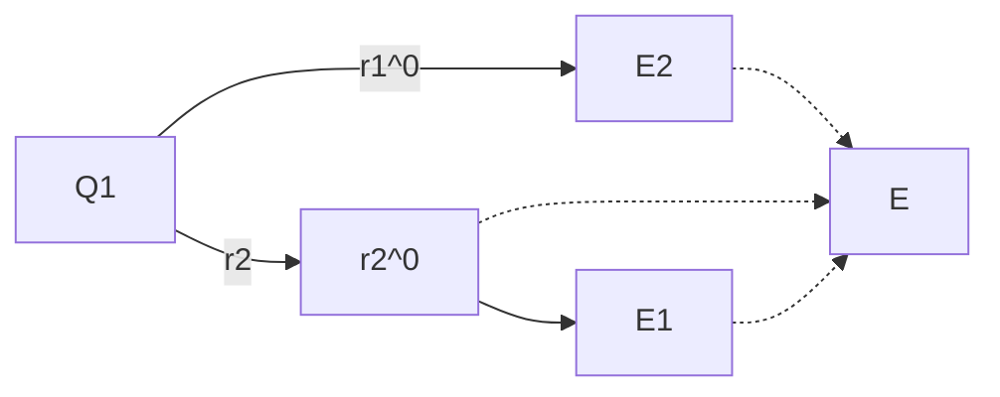
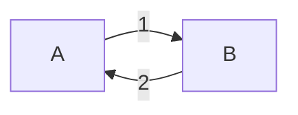

# 3 Elektrostatische Felder

原始 PDF 第 161–212 页。

## 3 Elektrostatische Felder

## 3.1 Skalare und vektorielle Feldgrößen

Bisher wurden fast nur Größen betrachtet, die sich auf eine Länge oder einen Querschnitt beziehen. So tritt z. B. ein Spannungsabfall U auf einem Leiterstück der Länge l auf. Wenn die transportierte Ladungsmenge durch den Strom I gekennzeichnet wird, so ist dabei immer an einen bestimmten Querschnitt zu denken, durch den die Ladungsmenge in einer gewissen Zeit hindurchtritt. Sind physikalische Größen den Punkten eines Raumes zugeordnet (man sagt auch: dieser Raum ist von den Wirkungen dieser physikalischen Größe erfüllt), so nennt man diesen Raum ein **Feld** und die den Raumzustand charakterisierende Größe eine **Feldgröße**. Ist die Feldgröße eine ungerichtete Größe, wie z. B. die Temperatur oder der Druck, so spricht man von einer **skalaren Feldgröße**, ist die Feldgröße durch Betrag und Richtung gekennzeichnet, so liegt eine **vektorielle Feldgröße** vor. Beispiele hierfür sind die Windgeschwindigkeit und die Stromdichte.

Skalare Felder lassen sich durch Flächen darstellen, auf denen die Feldgröße überall den gleichen Wert hat. Das zeigt für den zweidimensionalen Fall Bild 3.1, in dem geographische Höhenlinien skizziert sind.

Vektorielle Felder können durch Feldlinien veranschaulicht werden. Diese Linien geben die Richtung der Feldgröße an; ein Maß für den Betrag der Feldgröße stellt die Dichte der Feldlinien dar. Eine andere Möglichkeit besteht darin, in bestimmten Punkten das Feld durch Vektorpfeile zu kennzeichnen (Bild 3.2). Ist die Feldgröße in dem betrachteten Raum hinsichtlich Betrag und Richtung örtlich konstant, so nennt man das Feld **homogen**, andernfalls **inhomogen**. Bild 3.3 zeigt einige Beispiele. Haben alle Feldlinien Anfang und Ende, so hat man es mit einem reinen **Quellenfeld** zu tun. Sind alle Feldlinien in sich geschlossen, so liegt ein reines **Wirbelfeld** vor (Bild 3.4).

text_image

h₁
h₂
h₃

Abb. 3.1: Geographische Höhenlinien.

natural_image

Two diagrams showing curved arrows on the left and a grid of directional arrows on the right, both without any text or labels.

Abb. 3.2: Darstellung eines Feldes durch Feldlinien oder durch Vektoren in Rasterpunkten.

https://doi.org/10.1515/9783110631586-003

---

152

3 Elektrostatische Felder

Abb. 3.3: a) Homogenes Feld; b), c), d) Beispiele für inhomogene Felder.

Abb. 3.4: a) Reines Quellenfeld; b) reines Wirbelfeld.

text_image

Q
r
r̅⁰
q
F
|r̅⁰|=1

Abb. 3.5: Zum Coulomb’schen Gesetz.

## 3.2 Die elektrische Feldstärke und die Potenzialfunktion

## 3.2.1 Das Coulomb’sche Gesetz

Dass zwischen Ladungen Kräfte wirken, wurde schon in Abschnitt 1.3 gesagt. Dieser Zusammenhang wird quantitativ beschrieben durch das experimentell gefundene **Coulomb’sche Gesetz**. Danach ist die Kraft $F ,$ die zwischen den beiden Punktladungen $q$ und Q besteht, die voneinander den Abstand r haben:

$$
F = K \frac {q \cdot Q}{r ^ {2}}.
$$

Die Richtung der Kraft hängt davon ab, ob die Kraft auf die Ladung q oder die Ladung $Q$ gemeint ist. Für die Kraft auf $q$ lässt sich unter Verwendung von Vektoren (Bild 3.5)

---

3.2 Die elektrische Feldstärke und die Potenzialfunktion

153

schreiben:

$$
\vec {F} = K \frac {q \cdot Q}{r ^ {2}} \vec {r} ^ {0}.
$$

Der Proportionalitätsfaktor K ist nicht mehr frei wählbar, da die Abstände, Kräfte und Ladungen bereits definiert sind. Er hängt von dem Medium ab, in dem das Coulomb’sche Experiment ausgeführt wird. Der Faktor K ist also eine Materialkonstante. Man schreibt aus Gründen, die in den folgenden Abschnitten deutlich werden,

$$
K = \frac {1}{4 \pi \varepsilon} \tag {3.1}
$$

und nennt ε die **Permittivität** (alt: Dielektrizitätskonstante).

Mit Gl. (3.1) nimmt das Coulomb’sche Gesetz die endgültige Form an

$$
\vec {F} = \frac {q \cdot Q}{4 \pi \varepsilon} \frac {\vec {r} ^ {0}}{r ^ {2}}. \tag {3.2}
$$

An dieser Stelle soll auf das **elektrostatische Maßsystem** hingewiesen werden. Setzt man willkürlich für das Vakuum die Konstante K im Coulomb’schen Gesetz gleich eins, so hat man

$$
F = \frac {q \cdot Q}{r ^ {2}}
$$

und damit, da für Längen und Kräfte Maßeinheiten bereits vorliegen, eine Bestimmungsgleichung für eine mögliche Einheit der Ladung:

$$
[ Q ^ {2} ] = [ F ] [ r ^ {2} ] = \mathrm{N} \cdot \mathrm{m} ^ {2} = \frac {\mathrm{kg} \mathrm{m}}{\mathrm{s} ^ {2}} \cdot \mathrm{m} ^ {2} = \mathrm{kg} \cdot \mathrm{m} ^ {3} \cdot \mathrm{s} ^ {- 2}
$$

und

$$
[ Q ] = \mathrm{kg} ^ {\frac {1}{2}} \mathrm{m} ^ {\frac {3}{2}} \mathrm{s} ^ {- 1} .
$$

## 3.2.2 Die elektrische Feldstärke

Gl. (3.2) zeigt, dass die auf eine Probeladung q wirkende Kraft dieser Ladung proportional ist:

$$
\vec {F} \sim q. \tag {3.3}
$$

Der Proportionalitätsfaktor ist, wie ein Vergleich mit derselben Gl. (3.2) ergibt, der Vektor

$$
\frac {Q}{4 \pi \varepsilon} \frac {\vec {r} ^ {0}}{r ^ {2}}.
$$

Dieser Vektor stellt offensichtlich ein Maß für die elektrische Wirkung der Ladung Q an einem Ort im Abstand r von der Ladung Q dar. Man kann diesen Sachverhalt unter Verwendung des Feldbegriffs so beschreiben:

---

154

3 Elektrostatische Felder

Die Ladung $Q$ (Bild 3.6) ändert den Raumzustand in ihrer Umgebung oder

der Raum ist von einem elektrischen Feld erfüllt, das seine Ursache in $Q$ hat.

Den dieses Feld charakterisierenden Vektor nennt man die **elektrische Feldstärke** ${ \vec { E } } .$ Für den speziellen Fall der Punktladung $Q$ gilt

$$
\vec {E} = \frac {Q}{4 \pi \varepsilon} \frac {\vec {r} ^ {0}}{r ^ {2}}. \tag {3.4}
$$

An Stelle von Gl. (3.2) kann geschrieben werden

$$
\vec {F} = q \vec {E}. \tag {3.5}
$$

Da die elektrische Feldstärke $\vec { E }$ nur das von der Ladung Q hervorgerufene Feld beschreibt, jedoch nicht das von der Probeladung $q$ angeregte Feld, nennt man $\vec { E }$ in Gl. (3.5) auch das Fremdfeld und setzt dafür $\vec { E } ^ { ( \mathrm { f } ) }$ . Die Definitionsgleichung für die elektrische Feldstärke kann nach Gl. (3.5) geschrieben werden:

$$
\vec {E} = \frac {\vec {F}}{q}.
$$

Nach dieser Gleichung ist die Richtung von $\vec { E }$ so festgelegt worden, dass sie im Fall einer positiven Probeladung $q$ mit der Richtung der auf diese Ladung wirkenden Kraft $\vec { F }$ übereinstimmt. Als mögliche Einheit für $\vec { E }$ ergibt sich:

$$
[ E ] = \frac {[ F ]}{[ q ]} = \frac {\mathrm{N}}{\mathrm{As}} = \frac {\mathrm{Ws/m}}{\mathrm{As}} = \frac {\mathrm{V}}{\mathrm{m}}.
$$

## Beispiel 3.1: Überlagerung von Feldstärken.

Wird ein Feld von mehreren Punktladungen, z. B. von $Q _ { 1 }$ und $Q _ { 2 }$ hervorgerufen, so gilt bei konstantem ε erfahrungsgemäß der Überlagerungssatz. Die Gesamtfeldstärke folgt demnach durch **vektorielle** Addition (Bild 3.7):

$$
\vec {E} = \vec {E} _ {1} + \vec {E} _ {2} = \frac {1}{4 \pi \varepsilon} \left(Q _ {1} \frac {\vec {r} _ {1} ^ {0}}{r _ {1} ^ {2}} + Q _ {2} \frac {\vec {r} _ {2} ^ {0}}{r _ {2} ^ {2}}\right).
$$

text_image

q
F
Q

Abb. 3.6: Probeladung q im Feld der Ladung $Q .$

---

3.2 Die elektrische Feldstärke und die Potenzialfunktion

155

flowchart

Abb. 3.7: Vektorielle Addition der von $Q _ { 1 }$ und $Q _ { 2 }$ angeregten Teilfeldstärken $\vec { E } _ { 1 }$ und $\vec { E } _ { 2 }$

Es wird sich zeigen, dass das elektrostatische Feld aus einer skalaren Hilfsfunktion hergeleitet werden kann. Damit lassen sich die den einzelnen Ladungen zugeordneten skalaren Funktionen durch **algebraische** Addition überlagern.

Der Zusammenhang zwischen der elektrischen Feldstärke und der elektrischen Spannung soll durch eine Energiebilanz gefunden werden. Wir betrachten zu diesem Zweck die Bewegung der Probeladung $q$ im elektrischen Feld (Bild 3.8). Die Bewegung soll in Feldrichtung um die Strecke $\Delta s$ erfolgen. Dabei ändert sich nach Abschnitt 1.5 die potenzielle Energie der Probeladung um

$$
\Delta W _ {\mathrm{el}} = q \cdot \Delta U.
$$

Ist $q$ positiv, so handelt es sich bei den in Bild 3.8 zugrunde gelegten Richtungen um eine Energieabnahme. Dieser Abnahme entspricht ein Gewinn an mechanischer Energie $F \cdot \Delta s$ , wofür mit Gl. (3.5) geschrieben werden kann:

$$
\Delta W _ {\mathrm{mech}} = F \cdot \Delta s = q \cdot E \cdot \Delta s.
$$

Durch Gleichsetzen beider Energien folgt

$$
\Delta U = E \cdot \Delta s \tag {3.6}
$$

oder

$$
E = \frac {\Delta U}{\Delta s}. \tag {3.7}
$$

Lässt man in Gl. (3.7) ∆s gegen Null streben, geht man also vom Differenzen- zum Differenzialquotienten über, so hat man

$$
E = \lim _ {\Delta s \to 0} \frac {\Delta U}{\Delta s} = \frac {\mathrm{d} U}{\mathrm{d} s}. \tag {3.8}
$$

text_image

q
Δs
E

Abb. 3.8: Probeladung q bewegt sich im Feld $\vec { E }$ um $\Delta \vec { s }$ in Feldrichtung.

---

156

3 Elektrostatische Felder

Bei der Herleitung der Gln. (3.6) bis (3.8) wurde vorausgesetzt, dass die Richtung von ∆s bzw. ds mit der Richtung der Feldlinien übereinstimmt. Bemerkenswert an Gl. (3.8) ist, dass hier eine Spannung U nach dem Ort s differenziert, also als Funktion des Ortes aufgefasst wird. Hier müsste demnach U eine Feldgröße sein, was unseren bisherigen Vorstellungen widerspricht. Offen ist auch noch, wie man bei bekannter Funktion U die Richtung der Feldstärke finden kann. Diese Fragen sollen im nächsten Abschnitt beantwortet werden.

## 3.2.3 Die Potenzialfunktion

Zu allgemeineren Ergebnissen als im letzten Abschnitt gelangt man, wenn man von der Einschränkung absieht, die Probeladung solle sich längs einer Feldlinie bewegen. Für die Änderung der mechanischen Energie kann geschrieben werden (Bild 3.9)

$$
\Delta W _ {\mathrm{mech}} = F \cdot \Delta s \cdot \cos \alpha = \left| \vec {F} \right| \cdot \left| \Delta \vec {s} \right| \cdot \cos \triangleleft (\vec {F}, \Delta \vec {s}).
$$

Die rechte Seite stellt das aus der Vektorrechnung bekannte **Skalarprodukt** $\vec { F } \cdot \Delta \vec { s }$ (gelesen: F Punkt $\Delta s )$ dar. Mit Gl. (3.5) folgt dann

$$
\Delta W _ {\mathrm{mech}} = q \vec {E} \cdot \Delta \vec {s}
$$

und für den Weg von Punkt A nach Punkt B zunächst

$$
W _ {\mathrm{mech}} = q \vec {E} _ {1} \cdot \Delta \vec {s} _ {1} + q \vec {E} _ {2} \cdot \Delta \vec {s} _ {2} + \dots = q \sum_ {k} \vec {E} _ {k} \cdot \Delta \vec {s} _ {k}.
$$

Geht man zum Grenzwert der Summe $( \Delta \vec { s } _ { k } \rightarrow 0 )$ und damit zum Integral über, so erhält man

$$
W _ {\mathrm{mech}} = q \int_ {A} ^ {B} \vec {E} \cdot \mathrm{d} \vec {s}. \tag {3.9}
$$

text_image

F=q\vec{E}
α
Δ\vec{s}
q
Weg
E
E1
E2
Δ\vec{s1}
Δ\vec{s2}
Weg

Abb. 3.9: Zur Energieänderung bei Bewegung der Probeladung auf beliebigem Weg.

---

3.2 Die elektrische Feldstärke und die Potenzialfunktion

157

Ein Integral des hier vorliegenden Typs nennt man ein **Linienintegral**. Im Allgemeinen hängt der Wert eines solchen Integrals nicht nur von den Grenzen ab, sondern auch noch von dem von A nach B verlaufenden Weg. Die beiden Punkte A und B lassen sich durch beliebig viele Wege miteinander verbinden. Die Frage ist, welchen Einfluss der gewählte Weg auf das nach Gl. (3.9) berechnete Ergebnis hat. Dazu stellt man sich vor, dass eine Probeladung q (Bild 3.10) zuerst auf dem Weg (1) von A nach B bewegt wird, dann auf dem Weg (2) von B nach A zurück. Wird z. B. auf dem Weg (1) der Ladung mehr mechanische Energie zugeführt, als auf dem Weg (2) zurückgewonnen wird, so erfährt die Ladung bei jedem Umlauf einen gewissen Energiezuwachs. Das ist jedoch in einem System, das sich im Gleichgewichtszustand befindet und nicht in einem Energieaustausch mit der Außenwelt steht, nicht möglich. Damit leuchtet ein, dass in der Elektrostatik für einen geschlossenen Umlauf mit Gl. (3.9) gilt:

$$
0 = q \int_ {(1) A} ^ {B} \vec {E} \cdot \mathrm{d} \vec {s} + q \int_ {(2) B} ^ {A} \vec {E} \cdot \mathrm{d} \vec {s}. \tag {3.10}
$$

Für die Summe dieser beiden Integrale, die sich zu einem geschlossenen Umlauf ergänzen, schreibt man abkürzend

$$
\oint_ {L} \vec {E} \cdot \mathrm{d} \vec {s} = 0. \tag {3.11}
$$

Das Linienintegral der elektrischen Feldstärke längs eines beliebigen geschlossenen Weges L ist Null. Ein Feld mit dieser speziellen Eigenschaft nennt man **wirbelfrei**. Gl. (3.10) lässt sich auch in der Form

$$
\int_ {(1) A} ^ {B} \vec {E} \cdot \mathrm{d} \vec {s} = \int_ {(2) A} ^ {B} \vec {E} \cdot \mathrm{d} \vec {s}
$$

angeben. Die Gleichung gilt für beliebig gewählte Wege (1) und (2). Das Integral ist demnach **wegunabhängig**. Es kommt nur auf den Anfangs- und Endpunkt an. Ein Vergleich mit Gl. (3.6) zeigt, dass es sich bei dem Integral offensichtlich um eine Verallgemeinerung des Ausdrucks für die Spannung zwischen den Punkten A und B handelt:

$$
U _ {A B} = \int_ {A} ^ {B} \vec {E} \cdot \mathrm{d} \vec {s}. \tag {3.12}
$$

flowchart

Abb. 3.10: Wegunabhängigkeit von $\int _ { A } ^ { B } { \vec { E } } \cdot \mathsf { d } { \vec { s } }$

---

158

3 Elektrostatische Felder

Das Integral hängt nur von seinen Grenzen ab:

$$
U _ {A B} = \int_ {A} ^ {B} \vec {E} \cdot \mathrm{d} \vec {s} = f (B) - f (A) = \int_ {A} ^ {B} \mathrm{d} f.
$$

Üblicherweise nennt man die Funktion der Grenzen nicht $f ,$ sondern setzt $f = - \phi$ wobei $\phi$ **Potenzial(funktion)** heißt. Damit wird

$$
U _ {A B} = \int_ {A} ^ {B} \vec {E} \cdot \mathrm{d} \vec {s} = \phi (A) - \phi (B) = - \int_ {A} ^ {B} \mathrm{d} \phi \quad \text {bzw.} \quad \phi (B) = - \int_ {A} ^ {B} \vec {E} \cdot \mathrm{d} \vec {s} + \phi (A).
$$

und

$$
\vec {E} \cdot \mathrm{d} \vec {s} = - \mathrm{d} \phi . \tag {3.13}
$$

Der Einführung des Minuszeichens liegt die Vorstellung zugrunde, dass im elektrostatischen Feld die Orte, an denen eine positive Ladung eine höhere potenzielle Energie gegenüber anderen Orten besitzt, auch durch höhere Werte des Potenzials gekennzeichnet sein sollen.

Gl. (3.13) gibt nun die Möglichkeit, die im Zusammenhang mit Gl. (3.8) gestellte Frage zu beantworten, wie aus einer skalaren Feldfunktion die zugehörige Feldstärke zu bestimmen sei. Legt man ein kartesisches Koordinatensystem (Bild 3.11) zugrunde, dann sind $\vec { E }$ und ds⃗ durch Komponenten darstellbar:

$$
\vec {E} = \vec {e} _ {x} E _ {x} + \vec {e} _ {y} E _ {y} + \vec {e} _ {z} E _ {z},
$$

$$
\mathrm{d} \vec {s} = \vec {e} _ {x} \mathrm{d} x + \vec {e} _ {y} \mathrm{d} y + \vec {e} _ {z} \mathrm{d} z.
$$

Hierbei sind $E _ { x } , E _ { y } , E _ { z }$ im Allgemeinen Funktionen von $x , y , z .$ Das Skalarprodukt auf der linken Seite von (3.13) ergibt sich zu

$$
\vec {E} \cdot \mathrm{d} \vec {s} = E _ {x} \mathrm{d} x + E _ {y} \mathrm{d} y + E _ {z} \mathrm{d} z,
$$

die Größe d $\phi$ auf der rechten Seite ist das **vollständige Differenzial** der Funktion $\phi ( x ,   y ,   z )$ :

$$
- \mathrm{d} \phi = - \frac {\partial \phi}{\partial x} \mathrm{d} x - \frac {\partial \phi}{\partial y} \mathrm{d} y - \frac {\partial \phi}{\partial z} \mathrm{d} z.
$$

text_image

z
P(x,y,z)
\vec{e}_z
y
\vec{e}_y
x
\vec{e}_x

Abb. 3.11: Kartesisches Koordinatensystem; Einheitsvektoren e⃗.

---

3.2 Die elektrische Feldstärke und die Potenzialfunktion

159

Da Gl. (3.13) für jedes beliebige ds⃗ und damit für beliebige dx, ${ \mathsf { d } } y ,$ dz gilt, müssen die Koeffizienten von dx, dy, dz auf beiden Seiten der Gleichung übereinstimmen:

$$
E _ {x} = - \frac {\partial \phi}{\partial x}, \quad E _ {y} = - \frac {\partial \phi}{\partial y}, \quad E _ {z} = - \frac {\partial \phi}{\partial z}.
$$

Fasst man jetzt die Komponenten wieder zu einem Vektor zusammen, so folgt

$$
\vec {E} = - \left(\vec {e} _ {x} \frac {\partial \phi}{\partial x} + \vec {e} _ {y} \frac {\partial \phi}{\partial y} + \vec {e} _ {z} \frac {\partial \phi}{\partial z}\right).
$$

Den Ausdruck in der Klammer nennt man den **Gradienten** von $\phi$ und schreibt

$$
\mathrm{grad} \phi = \vec {e} _ {x} \frac {\partial \phi}{\partial x} + \vec {e} _ {y} \frac {\partial \phi}{\partial y} + \vec {e} _ {z} \frac {\partial \phi}{\partial z}. \tag {3.14}
$$

Damit lautet die Endformel

$$
\vec {E} = - \operatorname{grad} \phi . \tag {3.15}
$$

Diese Gleichung stellt die Umkehrung von Gl. (3.13) dar und ist zugleich die gesuchte Verallgemeinerung von Gl. (3.8).

## Beispiel 3.2: Potenzialfunktion und Feldstärke.

Eine bestimmte Ladungsverteilung habe ein elektrisches Feld zur Folge, das durch folgende Potenzialfunktion beschrieben wird:

$$
\phi = c (x ^ {2} + y ^ {2}) = c r ^ {2}.
$$

Man bestimme zuerst die beiden Feldkomponenten $E _ { X }$ und $E _ { y }$ . Dann soll zur Kontrolle der Rechnung aus dem elektrischen Feld durch Integration entlang einer Feldlinie auf die Potenzialfunktion geschlossen werden.

## Lösung:

Wegen Gl. (3.15) und (3.14) erhält man

$$
E _ {x} = - 2 c x, \quad E _ {y} = - 2 c y
$$

oder

$$
\vec {E} = - 2 c (\vec {e} _ {x} x + \vec {e} _ {y} y)
$$

und mit den Bezeichnungen nach Bild 3.12:

$$
\vec {E} = - 2 c \vec {r}.
$$

Durch Integration von Gl. (3.13) entlang einer Feldlinie (ds⃗ = dr⃗) folgt:

$$
\phi = - \int \vec {E} (r) \cdot \mathrm{d} \vec {r} = + 2 c \int r \mathrm{d} r = c r ^ {2} + k o n s t.
$$

---

160

3 Elektrostatische Felder

## Beispiel 3.3: Richtung und Betrag des Gradienten.

Setzt man Gl. (3.15) in Gl. (3.13) ein, so erhält man

$$
\mathrm{d} \phi = \operatorname{grad} \phi \cdot \mathrm{d} \vec {s} = \left| \operatorname{grad} \phi \right| \left| \mathrm{d} \vec {s} \right| \cos \triangle (\operatorname{grad} \phi , \mathrm{d} \vec {s}).
$$

Hieraus lassen sich Aussagen über a) die Richtung und b) den Betrag des Gradienten herleiten.

Zu a): Ein Punkt bewegt sich auf einer Potenziallinie bzw. -fläche und legt dabei den Weg ds⃗ zurück. Für die Bewegung auf einer Potenzialfläche gilt d $. \phi = 0 ,$ , also

$$
0 = \left| \mathrm{grad}   \phi \right| \left| \mathrm{d} \vec {s} \right| \cos \triangleleft (\mathrm{grad}   \phi , \mathrm{d} \vec {s})  .
$$

Da das Produkt Null ist, muss mindestens einer der drei Faktoren auf der rechten Gleichungsseite verschwinden. Der Gradient von ϕ ist im Allgemeinen von Null verschieden (ausgenommen in speziellen Punkten), ebenso voraussetzungsgemäß die Strecke ds.⃗ Somit muss der Cosinus den Wert Null annehmen, d. h. der Vektor gradϕ (und damit auch E⃗) steht senkrecht auf ds⃗ und damit auf der Potenzialfläche.

Zu b): Ausgehend von einem Punkt auf der Potenziallinie $\phi = k o n s t ,$ die man sich am besten als Höhenlinie vorstellt, werde die Strecke ds⃗ zurückgelegt und dabei die Potenziallinie $\phi + \mathrm { d } \phi \; ( = k o n s t )$ erreicht. Für den Betrag des Gradienten gilt

$$
\left| \mathrm{grad} \phi \right| = \frac {\mathrm{d} \phi}{\left| \mathrm{d} \vec {s} \right| \cos \triangleleft (\mathrm{grad} \phi , \mathrm{d} \vec {s})}.
$$

Der Ausdruck im Nenner stellt die Projektion der Strecke ds⃗ auf die Richtung des Gradienten dar, ist also der kürzeste Abstand zwischen den beiden betrachteten Höhenlinien. Mithin liefert der Quotient den Betrag der größten Steigung.

## Beispiel 3.4: Wegunabhängigkeit von $\int _ { A } ^ { B } { \vec { E } } \cdot \mathbf { d } { \vec { s } } .$

Eine Probeladung q bewege sich im elektrischen Feld der Punktladung Q. Die bei dieser Bewegung auftretende Energieänderung lässt sich berechnen, indem man Gl. (3.4) in

text_image

|\vec{e}_x|=|\vec{e}_y|=1
\vec{e}_y E_y
\vec{e}_x E_x
\vec{e}_x E_x
y
x
x

Abb. 3.12: Bezeichnungen in Beispiel 3.2.

---

3.3 Die Erregung des elektrischen Feldes

161

Gl. (3.9) einsetzt:

$$
W = q \int_ {A} ^ {B} \frac {Q}{4 \pi \varepsilon} \frac {\vec {r} ^ {0}}{r ^ {2}} \cdot \mathrm{d} \vec {s} = \frac {q Q}{4 \pi \varepsilon} \int_ {A} ^ {B} \frac {\vec {r} ^ {0} \cdot \mathrm{d} \vec {s}}{r ^ {2}}.
$$

Nach Bild 3.13 fasst man das skalare Produkt $\vec { r } ^ { 0 }$ ⋅ ds⃗ als Zuwachs von r auf, womit man

$$
W = \frac {q Q}{4 \pi \varepsilon} \int_ {A} ^ {B} \frac {\mathrm{d} r}{r ^ {2}} = \frac {q Q}{4 \pi \varepsilon} \left(\frac {1}{r _ {A}} - \frac {1}{r _ {B}}\right)
$$

erhält. Das Ergebnis zeigt, dass die Energie nur von der Lage der Punkte A und B abhängt, nicht jedoch vom Verlauf des Weges zwischen A und B. Durch Anwenden des Überlagerungssatzes verallgemeinert man diese Aussage: Sie gilt für alle Felder, die von beliebig verteilten, ruhenden Punktladungen verursacht werden.

## 3.3 Die Erregung des elektrischen Feldes

## 3.3.1 Die elektrische Flussdichte

Nach Gl. (3.4) hängt die Stärke des elektrischen Feldes nicht nur von der verursachenden Ladung Q und dem Abstand zwischen dem Ort der Ladung und dem Aufpunkt ab, sondern auch von dem Stoff, von dem die Ladung umgeben ist. Es erweist sich als zweckmäßig, eine zweite, materialunabhängige Feldgröße einzuführen, die am gleichen Ort wie die Feldstärke E wirksam ist. Man definiert

$$
\vec {D} = \varepsilon \vec {E}. \tag {3.16}
$$

Das setzt voraus, dass $\vec { E }$ und $\vec { D }$ die gleiche Richtung haben. Materialien, bei denen diese Voraussetzung erfüllt ist, nennt man **isotrope** Stoffe. Bei einigen Stoffen, z. B.

text_image

Q
r_A
A
r
r^0
q
dr
B
r_B
d\u221a\u221a
\u221a\u221a

Abb. 3.13: Verschiebung der Probeladung q im Feld der Punktladung $Q .$

---

162

3 Elektrostatische Felder

bestimmten Kristallen, sind die Richtungen von $\vec { E }$ und $\vec { D }$ verschieden. Für diese Stoffe, die man als **anisotrope** Stoffe bezeichnet, gilt Gl. (3.16) nicht mehr. Mit Gl. (3.16) erhält man z. B. für das Feld der Punktladung wegen Gl. (3.4)

$$
\vec {D} = \frac {Q}{4 \pi} \frac {\vec {r} ^ {0}}{r ^ {2}}. \tag {3.17}
$$

Man bezeichnet die Größe $\vec { D }$ als die Erregung des elektrischen Feldes, als **elektrische Flussdichte** (alt: elektrische Verschiebungsdichte oder Verschiebungsflussdichte).

Die beiden letzten Gleichungen können benutzt werden, um mögliche Einheiten für $\varepsilon$ und $\vec { D }$ zu ermitteln. Aus Gl. (3.17) folgt

$$
[ D ] = \frac {[ Q ]}{[ r ^ {2} ]} = \frac {\mathrm{As}}{\mathrm{m} ^ {2}}
$$

und aus Gl. (3.16)

$$
[ \varepsilon ] = \frac {[ D ]}{[ E ]} = \frac {\mathrm{Asm} ^ {- 2}}{\mathrm{Vm} ^ {- 1}} = \frac {\mathrm{As}}{\mathrm{Vm}}.
$$

Für die **elektrische Feldkonstante** oder **Permittivität** des Vakuums (alt: Dielektrizitätskonstante) ergibt sich ein Zahlenwert (CODATA 2018), der auf den als exakt definierten physikalischen Konstanten (siehe Tabelle 1.1) Lichtgeschwindigkeit $c ,$ Elementarladung e und Plank’schem Wirkungsquantum h basiert. Aus diesem Zusammenhang lässt sich auch die mögliche Einheit ableiten. Außerdem bedarf es der Feinstrukturkonstante $\alpha ,$ die eine Messunsicherheit mit sich bringt. Das bedeutet, dass auch die Permittivität im Vakuum einer Messunsicherheit unterliegt

$$
\varepsilon_ {0} = \frac {e ^ {2}}{2 \cdot h \cdot c \cdot \alpha} = 8, 8 5 4 1 8 7 8 1 2 8 \cdot 1 0 ^ {- 1 2} \frac {\mathrm{As}}{\mathrm{Vm}}.
$$

In den meisten Fällen gibt man die dimensionslose **relative Permittivität** (alt: relative Dielektrizitätskonstante oder Dielektrizitätszahl) $\varepsilon _ { \mathbf { r } }$ an, die im Vakuum den Wert 1 hat und zusammen mit der elektrischen Feldkonstante in isotropen Medien die Permittivität

$$
\varepsilon = \varepsilon_ {\mathrm{r}} \varepsilon_ {0} \tag {3.18}
$$

definiert. Eine Reihe von Zahlenwerten für unterschiedliche Medien, u. a. wichtiger technischer Isolierstoffe, enthält die Tabelle 3.1.

## 3.3.2 Der Gauß’sche Satz der Elektrostatik

Aus Gl. (3.17) ergibt sich für den Betrag der elektrischen Flussdichte im Abstand r von einer Punktladung

$$
D = \frac {Q}{4 \pi r ^ {2}}.
$$

Wir lösen die Gleichung nach der Ladung auf

$$
Q = 4 \pi r ^ {2} D \tag {3.19}
$$

---

3.3 Die Erregung des elektrischen Feldes

163

Tab. 3.1: Relative Permittivitäten (Dielektrizitätskonstanten) $\varepsilon _ { \mathrm { { f } } }$ einiger wichtiger Isolierstoffe.

| Medium | $\varepsilon_{r}$ |
| --- | --- |
| Bakelit | 6 |
| Bariumtitanat | 1000...4000 |
| Bernstein | 2,8 |
| Epoxidharz | 3,7 |
| Fernsprechkabelisolation (Papier, Luft) | 1,6...2 |
| Glas | 10 |
| Glimmer | 8 |
| Gummi | 2,6 |
| Kautschuk | 2,4 |
| Luft, Gase | 1 |
| Mineralöl | 2,2 |
| Papier, chlophen. | 5,4 |
| Papier, paraffin. | 4 |
| Pertinax | 5 |
| Polyäthylen | 2,3 |
| Polystyrol | 2,5 |
| Polyvinylchlorid | 3,1 |
| Porzellan | 5,5 |
| Starkstromkabelisolation (Papier, Öl) | 3...4,5 |
| Transformatoröl | 2,5 |
| Wasser | 80 |

und interpretieren die Gleichung so: Ist auf einer kugelförmigen Hüllfläche, in deren Mittelpunkt sich die Punktladung befindet, die elektrische Flussdichte bekannt, so liefert das Produkt aus elektrischer Flussdichte und Kugeloberfläche die von der Hülle umschlossene Ladung. Bezeichnet man die Wirkung, die insgesamt von der Ladung Q ausgeht, als **elektrischen Fluss** $\Psi _ { \mathsf { e } }$ , wobei $Q = \Psi _ { \mathrm { e } }$ sein soll, so gibt die Größe D die auf die Fläche bezogene Dichte dieses Flusses an.

Es soll die Vorstellung, dass von einer elektrischen Ladung ein Fluss ausgeht, herangezogen werden, um eine Verallgemeinerung der Gl. (3.19) zu finden, die keine spezielle Form der Hüllfläche mehr voraussetzt. Zunächst betrachtet man den Teilfluss $\Delta \Psi _ { \mathrm { e } }$ , der von der in Bild 3.14 im Längsschnitt dargestellten Mantelfläche begrenzt wird. Der Teilfluss wird in Anlehnung an Gl. (3.19) durch die Größe D und das Flächenelement $\Delta A$ ausgedrückt:

$$
\Delta \Psi_ {\mathrm{e}} = D \Delta A.
$$

Es ist gleichgültig, an welcher Stelle, gekennzeichnet durch den Radius $r ,$ der Teilfluss berechnet wird, da D mit $1 / r ^ { 2 }$ abnimmt, $\Delta A$ jedoch mit $r ^ { 2 }$ anwächst. Die Gleichung für $\Delta \Psi _ { \mathrm { e } }$ setzt voraus, dass $D$ senkrecht auf dem Flächenelement steht. Andernfalls gilt (Bild 3.14):

$$
\Delta \Psi_ {\mathrm{e}} = D \Delta A \cos \alpha .
$$

---

164

3 Elektrostatische Felder

Ordnet man dem Flächenelement einen Vektor $\mathbf { Z } \mathbf { u } ,$ der senkrecht auf der Fläche steht, so folgt

$$
\Delta \Psi_ {\mathrm{e}} = | \vec {D} | | \Delta \vec {A} | \cos \triangleleft (\vec {D}, \Delta \vec {A}) = \vec {D} \cdot \Delta \vec {A}.
$$

Wird das ganze Volumen, das von einer beliebigen Hüllfläche begrenzt sein soll, in pyramidenförmige Volumenelemente aufgeteilt (Bild 3.14), so lässt sich durch Summie ren aller Teilflüsse, die aus den Volumenelementen austreten, der Gesamtfluss und damit die Ladung bestimmen:

$$
Q = \Psi_ {\mathrm{e}} = \vec {D} _ {1} \cdot \Delta \vec {A} _ {1} + \vec {D} _ {2} \cdot \Delta \vec {A} _ {2} + \dots = \sum_ {k} \vec {D} _ {k} \cdot \Delta \vec {A} _ {k}.
$$

Für immer kleinere Flächenelemente $\left( \Delta A _ { k } \rightarrow 0 \right)$ entsteht der Grenzwert der Summe, d. h. das Integral

$$
Q = \int_ {A} \vec {D} \cdot \mathrm{d} \vec {A}. \tag {3.20}
$$

Ein solches Integral, das über eine geschlossene Fläche (eine Hüllfläche) zu erstrecken ist, nennt man auch ein **Hüllenintegral**. Man bezeichnet Gl. (3.20) als den **Gauß’schen Satz der Elektrostatik**:

Der Fluss der elektrischen Flussdichte durch eine beliebige geschlossene Fläche A ist gleich den von der Fläche insgesamt umhüllten Ladungen.

Zu beachten ist, dass das Flächenelement $\mathrm { d } \vec { A }$ in Gl. (3.20) nach außen positiv gezählt werden muss.

Den Fluss, der durch eine beliebige, jedoch nicht geschlossene Fläche hindurchtritt, bestimmt man mit

$$
\Psi_ {\mathrm{e}} = \int_ {A} \vec {D} \cdot \mathrm{d} \vec {A}. \tag {3.21}
$$

text_image

vergrößerte
Darstellung
ΔA
ΔA cos α
Δψe
Δψe
r1
r2
Q
beliebige
Hüllfläche

Abb. 3.14: Zur Herleitung von Gl. (3.20).

---

3.4 Die Potenzialfunktion spezieller Ladungsverteilungen

165

Die einfachste Anwendung von Gl. (3.20) ist die Berechnung der elektrischen Flussdichte in der Umgebung einer Punktladung Q. Dazu stellt man sich vor, dass die Punktladung von einer konzentrischen Hüllkugel mit dem Radius r umgeben sei, auf der aus Gründen der Symmetrie die Größe $\vec { D }$ überall den gleichen Betrag hat und die gleiche Richtung wie das Flächenelement in demselben Punkt aufweist. Dann wird – in Übereinstimmung mit Gl. (3.19) bzw. Gl. (3.17) –

$$
Q = \oint_ {A} \vec {D} \cdot \mathrm{d} \vec {A} = \oint_ {A} D   \mathrm{d} A = D (r) \oint_ {A} \mathrm{d} A = D (r) 4 \pi r ^ {2}
$$

oder

$$
D = \frac {Q}{4 \pi r ^ {2}}.
$$

Die letzte Zeile macht deutlich, weshalb mit Gl. (3.1) der Faktor 4π in das Coulomb’sche Gesetz aufgenommen wurde, da mit $A = 4 \pi r ^ { 2 }$ die Oberfläche einer Kugel beschrieben wird.

## 3.4 Die Potenzialfunktion spezieller Ladungsverteilungen

## 3.4.1 Die Punktladung

Die elektrische Feldstärke in der Umgebung einer **Punktladung** ist durch Gl. (3.4) gegeben. Um die zugehörige Potenzialfunktion zu finden, wird Gl. (3.12) angewendet. Da dieses Integral wegunabhängig ist, kann ein einfacher Integrationsweg gewählt werden. Die Integration erfolgt längs einer Feldlinie von P nach B (Bild 3.15). Dann ergibt sich

$$
U _ {P B} = \int_ {P} ^ {B} \vec {E} \cdot \mathrm{d} \vec {s} = \int_ {P} ^ {B} E (r) \mathrm{d} r = \frac {Q}{4 \pi \varepsilon} \int_ {P} ^ {B} \frac {\mathrm{d} r}{r ^ {2}} \quad \text { oder }
$$

$$
U _ {P B} = \frac {Q}{4 \pi \varepsilon} \left(\frac {1}{r _ {P}} - \frac {1}{r _ {B}}\right).
$$

Die Spannung bzw. Potenzialdifferenz zwischen einem beliebigen Punkt P und einem festen Bezugspunkt B, der willkürlich gewählt sein kann, ist dann:

$$
U _ {P B} = \phi (P) - \phi (B) = \frac {Q}{4 \pi \varepsilon} \frac {1}{r} - \frac {Q}{4 \pi \varepsilon} \frac {1}{r _ {B}},
$$

text_image

rP = r
Q
P
dr
rB
B

Abb. 3.15: Bestimmung der Potenzialfunktion einer Punktladung durch Integration entlang einer Feldlinie.

---

166

3 Elektrostatische Felder

wobei der Index P bei $r _ { P }$ fortgelassen wurde. Solange ein Bezugspunkt nicht festgelegt und diesem kein Potenzialwert zugeordnet ist, schreibt man

$$
\phi (P) = \frac {Q}{4 \pi \varepsilon} \frac {1}{r} + k o n s t. \tag {3.22a}
$$

Man bezeichnet den Punkt, für den das Potenzial bzw. Feld berechnet wird, auch als **Aufpunkt** und den Ort, an dem sich die Ursache (hier die Ladung) befindet, als **Quellpunkt**.

Das gleiche Ergebnis erhält man, wenn man von Gl. (3.13) ausgeht und eine unbestimmte Integration durchführt. Die dabei auftretende Integrationskonstante macht deutlich, dass zu einem bestimmten elektrischen Feld beliebig viele Potenzialfunktionen angebbar sind, die sich alle durch einen konstanten Summanden voneinander unterscheiden. Es ist üblich, sehr weit entfernten Punkten oder dem leitenden Erdboden das Potenzial Null zuzuordnen. Für das Beispiel der Punktladung liefert die Festsetzung $\phi \to 0$ für $r \to \infty$ , dass die Konstante null sein muss:

$$
\phi (P) = \frac {Q}{4 \pi \varepsilon} \frac {1}{r}. \tag {3.22b}
$$

## 3.4.2 Der Dipol

Zwei gleich große Punktladungen entgegengesetzten Vorzeichens, die voneinander einen sehr geringen Abstand haben, bilden einen elektrischen **Dipol** (Bild 3.16). Da die Lösung für eine Ladung mit Gl. (3.22a) bekannt ist, führt das Superpositionsprinzip zu folgendem Ansatz:

$$
\phi (P) = \frac {Q}{4 \pi \varepsilon} \frac {1}{r _ {+}} - \frac {Q}{4 \pi \varepsilon} \frac {1}{r _ {-}}
$$

oder

$$
\phi (P) = \frac {Q}{4 \pi \varepsilon} \frac {r _ {-} - r _ {+}}{r _ {-} r _ {+}}.
$$

text_image

+Q
b
-Q
r
r+
r-
P

Abb. 3.16: Zur Herleitung der Potenzialfunktion eines Dipols.

---

3.4 Die Potenzialfunktion spezieller Ladungsverteilungen

167

Die willkürlichen Konstanten sind hier von vornherein gleich null gesetzt. Wird nun der Abstand b sehr klein gemacht, so folgt $r _ { + } \approx r _ { - } \approx r , r _ { - } - r _ { + } \approx$ b cos $\vartheta$ und somit

$$
\phi (P) = \frac {Q \cdot b}{4 \pi \varepsilon} \cdot \frac {\cos \vartheta}{r ^ {2}}.
$$

Lässt man nun $b$ gegen Null streben $( b \to 0 )$ und gleichzeitig $Q$ so anwachsen $( Q \to$ ∞), dass das Produkt $Q$ ⋅ b endlich bleibt, so erhält man die Potenzialfunktion des elektrischen Dipols

$$
\phi (P) = \frac {p}{4 \pi \varepsilon} \frac {\cos \vartheta}{r ^ {2}} \text {mit} p = Q \cdot b, \tag {3.23}
$$

wobei man die Größe p das **elektrische Dipolmoment** nennt.

Bei einem Vergleich der Potenzialfunktionen nach Gl. (3.22b) und Gl. (3.23) fällt auf, dass bei der Punktladung das Potenzial mit $^ 1 / r \mathrm { { } ^ { \ast } }$ bei dem Dipol jedoch mit $1 / r ^ { 2 }$ wesentlich stärker abnimmt. Das ist damit zu erklären, dass sich die Wirkungen der beiden Ladungen entgegengesetzten Vorzeichens mit zunehmendem Abstand immer mehr gegenseitig aufheben.

## 3.4.3 Die Linienladung

Denkt man sich sehr viele Punktladungen auf einer geraden Linie in gleichmäßiger Verteilung angeordnet, wobei der Abstand zwischen zwei benachbarten Punktladungen gegen Null gehen soll, so gelangt man zu einer elektrischen **Linienladung**. Die auf die Länge bezogene Ladung bezeichnet man als **Linienladungsdichte**

$$
\lambda = \lim _ {\Delta s \to 0} \frac {\Delta Q}{\Delta s} = \frac {\mathrm{d} Q}{\mathrm{d} s} . \tag {3.24}
$$

Es liegt nun nahe, die Potenzialfunktion einer Linienladung der Länge 2l (Bild 3.17) auch mit Hilfe des Superpositionsprinzips zu bestimmen, indem man aus der Linienladung ein Ladungselement λ ds an der Stelle s (Quellpunktkoordinate) herausgreift und für dieses gemäß Gl. (3.22b) den Ansatz

$$
\mathrm{d} \phi (P) = \frac {\lambda \mathrm{d} s}{4 \pi \varepsilon} \frac {1}{r}
$$

aufschreibt und dann über die Länge der Linienladung integriert. Man erhält mit den Bezeichnungen nach Bild 3.17 das Integral

$$
\phi (P) = \frac {\lambda}{4 \pi \varepsilon} \int_ {- l} ^ {+ l} \frac {\mathrm{d} s}{\left[ \varrho^ {2} + (z - s) ^ {2} \right] ^ {1 / 2}} = \frac {\lambda}{4 \pi \varepsilon} \operatorname{arsinh} \left. \frac {s - z}{\varrho} \right| _ {- l} ^ {l}.
$$

Da in den praktischen Anwendungen häufig Linienleiter sehr großer Länge auftreten, soll dieser Sonderfall auf einfachere Weise mit Gl. (3.20) gelöst werden. Diese Gleichung kann, wie gezeigt, nur dann erfolgreich zur Bestimmung von $\vec { D }$ angewendet werden,

---

168

3 Elektrostatische Felder

wenn der Feldverlauf im Prinzip bekannt ist. Dann lässt sich die Hüllfläche so wählen, dass auf ihr die Größe D eine Konstante ist. Damit kann D vor das Integral geschrieben werden. Das Feld ist hier offensichtlich **radialsymmetrisch**. Daher denkt man sich den linienförmigen Leiter koaxial von einem Zylinder umgeben (Bild 3.18). Das Feld hat dann auf der Mantelfläche M des gedachten Zylinders überall die gleiche Richtung

text_image

z
+l
r
P(ρ,z)
z-s
ds
ρ
s
0
-l

Abb. 3.17: Zur Herleitung der Potenzialfunktion einer Linienladung der Länge 2l.

text_image

d\vec{A}
A1
M
ds
\varrho
d\vec{A}
\vec{D}
A2

Abb. 3.18: Zur Herleitung der Potenzialfunktion einer Linienladung sehr großer Länge.

---

3.4 Die Potenzialfunktion spezieller Ladungsverteilungen

169

wie das Flächenelement d $\vec { A }$ in demselben Punkt und ist dem Betrage nach konstant. Damit wird der Beitrag des Mantels zum Integral (3.20):

$$
\int_ {M} \vec {D} \cdot \mathrm{d} \vec {A} = \int_ {M} D (\varrho) \mathrm{d} A = D (\varrho) \int_ {M} \mathrm{d} A = D (\varrho) \cdot 2 \pi \varrho \cdot l.
$$

Hierbei ist 2πϱ ⋅ l die Fläche des Zylindermantels. Auf den beiden Deckflächen des Zylinders $A _ { 1 }$ und $A _ { 2 }$ stehen die Flächenelemente senkrecht auf den Feldvektoren und liefern keinen Beitrag zum Oberflächenintegral. Für die linke Seite des Integrals (3.20) ergibt sich insgesamt

$$
D (\varrho) \cdot 2 \pi \varrho \cdot l
$$

und für die rechte Seite, also für die von der Hüllfläche umschlossene Ladung,

$$
\lambda \cdot l.
$$

Nach Gleichsetzen und Auflösen folgt für die elektrische Flussdichte

$$
D (\varrho) = \frac {\lambda}{2 \pi \varrho} \tag {3.25}
$$

und mit (3.16) für die elektrische Feldstärke

$$
E \left(\varrho\right) = \frac {\lambda}{2 \pi \varepsilon} \cdot \frac {1}{\varrho}. \tag {3.26}
$$

Wie bei der Bestimmung des Potenzials der Punktladung kann Gl. (3.13) benutzt werden, um eine unbestimmte Integration längs einer Feldlinie durchzuführen

$$
\phi (P) = - \int E (\varrho) \mathrm{d} \varrho = - \frac {\lambda}{2 \pi \varepsilon} \int \frac {\mathrm{d} \varrho}{\varrho},
$$

mit dem Ergebnis

$$
\phi (P) = \frac {\lambda}{2 \pi \varepsilon} \ln \frac {1}{\varrho} + k o n s t. \tag {3.27}
$$

Hier fällt auf, dass das Argument des Logarithmus keine reine Zahl ist, sondern die Grö- ße $^ 1 / \varrho .$ Dieser Schönheitsfehler lässt sich beseitigen, wenn man an Stelle von Gl. (3.27) schreibt:

$$
\phi (P) = \frac {\lambda}{2 \pi \varepsilon} \left(\ln \frac {1}{\varrho} + \ln k o n s t\right) = \frac {\lambda}{2 \pi \varepsilon} \ln \frac {k o n s t}{\varrho}.
$$

Setzt man hier $\varrho$ und konst jeweils als Produkt aus Zahlenwert und Einheit ein, so kürzen sich die Maßeinheiten heraus und das Argument des Logarithmus wird ein reiner Zahlenwert.

**Anmerkung** In diesem Abschnitt wurde die Größe ϱ in der Bedeutung eines Achsenabstandes verwendet. Im Gegensatz dazu wurde der Abstand von einem Punkt mit r bezeichnet. Diese Unterscheidung soll beibehalten werden, zumal eine Verwechslung mit dem spezifischen Widerstand ϱ nicht zu befürchten ist.

---

170

3 Elektrostatische Felder

## 3.5 Influenzwirkungen

Bringt man in ein elektrisches Feld, das z. B. zwischen zwei geladenen Platten besteht, einen ungeladenen Leiter, so wandern unter der Einwirkung der elektrischen Kräfte die Leitungselektronen (»Elektronengas«) zu der Seite des Leiters, die der positiv geladenen Platte zugewandt ist. Die andere Seite des Leiters, die der negativ geladenen Platte am nächsten liegt, weist damit einen Elektronenmangel auf. Vereinfachend sagt man, dass der ungeladene Leiter gleich viele positive wie negative Ladungen trägt. Diese werden unter der Einwirkung eines äußeren elektrischen Feldes getrennt und verteilen sich so auf der Leiteroberfläche, dass das Leiterinnere feldfrei wird. Das äußere Feld und das den jetzt getrennten Ladungen des Leiters zugeordnete Feld heben sich im Leiterinneren gerade auf. Diesen Vorgang bezeichnet man als **Influenz**.

Experimentell lässt sich die Influenzwirkung leicht vorführen, indem man in ein elektrisches Feld zwei ungeladene Leiterplatten bringt, die sich zunächst berühren (Bild 3.19). Trennt man nun diese Leiterplatten im Feld und entfernt sie anschließend aus dem Feld, so kann man durch Messung die beiden im Bild 3.19 mit $+ Q ^ { \prime }$ und $- Q ^ { \prime }$ bezeichneten Ladungen nachweisen.

Ist ein stabförmiger ungeladener Leiter einem elektrischen Feld ausgesetzt, das eine Komponente in Leiterrichtung aufweist und sein Vorzeichen ständig ändert, so wechseln auch die influenzierten Ladungen ständig ihr Vorzeichen: Es muss also ein Wechselstrom durch den Leiter fließen, den man durch ein etwa in der Mitte des Leiterstabes eingefügtes Messgerät auch messen kann. Denkt man sich das Messgerät durch einen Rundfunkempfänger ersetzt, so entspricht der betrachtete Leiterstab offensichtlich einer Antenne.

Sorgt man bei einem beliebigen ungeladenen Leiter, auf dem die Ladungen durch ein äußeres Feld getrennt worden sind, dafür, dass ein Teil der Ladungen von dem Leiter abfließen kann, so dass schließlich auf dem Leiter Ladungen eines Vorzeichens vorherrschen, so spricht man von einer Aufladung des Leiters durch Influenz.

text_image

+ -
+ -
+ -
+ -
+ -
+ Q'
+ Q'
Q
Q

Abb. 3.19: Influenz.

---

3.6 Die Kapazität

171

## 3.6 Die Kapazität

## 3.6.1 Die Definition der Kapazität

Bei den bisher behandelten Anordnungen waren die Ladungen in einigen Punkten konzentriert (Punktladungen) oder auf einer Linie angeordnet (Linienladungen). Jetzt sollen räumlich ausgedehnte leitende Körper betrachtet werden, die auf ihren Oberflächen Ladungen tragen. Ein einfaches Beispiel ist in Bild 3.20 dargestellt. Zwei voneinander isolierte Leiter tragen insgesamt die Ladungen $+ Q$ bzw. $- Q .$ Eine solche Anordnung nennt man einen **Kondensator** und bezeichnet die beiden Leiter als die Elektroden des Kondensators.

Auf Grund des Coulomb’schen Gesetzes wirken auf die einzelnen Ladungsträger Kräfte. Gleichartige Ladungsträger innerhalb eines Leiters stoßen sich gegenseitig ab, die positiven Ladungsträger der linken Elektrode ziehen die negativen Ladungsträger der rechten Elektrode an. Damit kommt auf den Leiteroberflächen eine Ladungsverteilung zustande, wie sie in Bild 3.20 skizziert ist. Im statischen Fall hat der leitende Körper ein konstantes Potenzial. Bestünden im oder auf dem Leiter noch Potenzialunterschiede, so würden nach dem Ohm’schen Gesetz Ströme fließen, bis sich ein Gleichgewichtszustand eingestellt hat. Im statischen Fall ist das Leiterinnere feldfrei und damit auch frei von Ladungen. Diese befinden sich alle an der Leiteroberfläche, und zwar in einer solchen Verteilung, dass die Leiteroberfläche eine Fläche konstanten Potenzials (Äquipotenzialfläche) wird. Damit steht gemäß Beispiel 3.3 die elektrische Feldstärke senkrecht auf der Leiteroberfläche.

Es liegt nun nahe, dass die Spannung zwischen den beiden Elektroden des Kondensators mit der Ladung $Q$ in einem Zusammenhang steht. Für die Spannung zwischen den Punkten A und B unter Berücksichtigung der Gln. (3.12) und (3.16) und den in Bild 3.20 dargestellten Integrationsweg gilt:

$$
U _ {A B} = \int_ {A} ^ {B} E \mathrm{d} s = \int_ {A} ^ {B} \frac {D}{\varepsilon} \mathrm{d} s.
$$

text_image

+Q
A
B
-Q
Integrationsweg

Abb. 3.20: Kondensator; Feldlinien gestrichelt.

---

172

3 Elektrostatische Felder

Offensichtlich ist die elektrische Flussdichte D proportional zu der das Feld erregenden Ladung Q. Damit folgt $U _ { A B } \sim Q$ oder

$$
Q = C U. \tag {3.28}
$$

Den Proportionalitätsfaktor C nennt man die **Kapazität** des Kondensators. C wird als positive Größe definiert.

Aus (3.28) ergibt sich als mögliche Einheit für die Kapazität

$$
[ C ] = \frac {[ Q ]}{[ U ]} = \frac {\mathrm{As}}{\mathrm{V}}.
$$

Da diese Einheit häufig vorkommt, hat man die abkürzende Bezeichnung eingeführt

$$
1 \frac {\mathrm{As}}{\mathrm{V}} = 1 \text { Farad } = 1 \mathrm{F}.
$$

Diese Einheit ist für praktische Zwecke oft viel zu groß, weshalb man überwiegend mit den um Zehnerpotenzen kleineren Maßeinheiten μF, nF, pF arbeitet.

## 3.6.2 Parallel- und Reihenschaltung von Kapazitäten

Werden mehrere Kondensatoren, die in Bild 3.21 durch ihr Schaltsymbol dargestellt sind, parallel an eine Spannungsquelle mit der Spannung U gelegt, so nimmt der erste nach Gl. (3.28) die Ladung $Q _ { 1 } = U C _ { 1 }$ auf, der zweite die Ladung $Q _ { 2 } = U C _ { 2 }$ usw. Insgesamt speichert die Parallelschaltung der drei Kondensatoren die Ladung

$$
Q = U C _ {1} + U C _ {2} + U C _ {3} = U (C _ {1} + C _ {2} + C _ {3}).
$$

Die gleichwertige Kapazität $C _ { \mathrm { g e s } }$ soll bei gleicher Spannung die gleiche Ladung aufnehmen:

$$
Q = U C _ {\text {ges}}.
$$

Nach Gleichsetzen der Ladungen und Division durch U hat man

$$
C _ {\mathrm{ges}} = C _ {1} + C _ {2} + C _ {3}
$$

Abb. 3.21: Parallel- und Reihenschaltung von Kapazitäten.

---

3.6 Die Kapazität

173

und schließlich ganz allgemein für die Parallelschaltung aus n Kapazitäten:

$$
C _ {\mathrm{ges}} \equiv C = \sum_ {k = 1} ^ {n} C _ {k}. \tag {3.29}
$$

Nun sollen mehrere ungeladene Kondensatoren in Reihe geschaltet und dann an eine Spannungsquelle angeschlossen werden (Bild 3.21). Zuerst ist zu überlegen, welche Ladungen die Kondensatoren jetzt speichern. Trägt die linke Platte des ersten Kondensators die Ladung $+ Q ,$ so werden auf den beiden folgenden Platten, die insgesamt ungeladen sind, die Ladungen $- Q$ und $+ Q$ influenziert usw. D. h. auf allen Kondensatoren befindet sich die gleiche Ladung $Q .$ Damit liegt nach Gl. (3.28) am ersten Kondensator die Spannung $U _ { 1 } = Q / C _ { 1 }$ an, am zweiten die Spannung $U _ { 2 } = Q / C _ { 2 }$ usw. Da die Spannungen sich bei einer Reihenschaltung addieren, folgt

$$
U = \frac {Q}{C _ {1}} + \frac {Q}{C _ {2}} + \frac {Q}{C _ {3}} = Q \left(\frac {1}{C _ {1}} + \frac {1}{C _ {2}} + \frac {1}{C _ {3}}\right).
$$

Die gleichwertige Kapazität $C _ { \mathrm { g e s } }$ soll bei gleicher Ladung die gleiche Spannung zwischen den Anschlussklemmen aufweisen:

$$
U = \frac {Q}{C _ {\mathrm{ges}}}.
$$

Durch Gleichsetzen ergibt sich

$$
\frac {1}{C _ {\mathrm{ges}}} = \frac {1}{C _ {1}} + \frac {1}{C _ {2}} + \frac {1}{C _ {3}}
$$

und in allgemeinerer Form für n Kapazitäten:

$$
\frac {1}{C _ {\mathrm{ges}}} \equiv \frac {1}{C} = \sum_ {k = 1} ^ {n} \frac {1}{C _ {k}}. \tag {3.30}
$$

## 3.6.3 Die Kapazität spezieller Anordnungen

## 3.6.3.1 Der Plattenkondensator

Gegeben ist ein Plattenkondensator in Bild 3.22a. Die Vorschrift zur Berechnung der Kapazität ergibt sich aus Gl. (3.28):

$$
C = \frac {Q}{U}. \tag {3.31}
$$

Gibt man eine Ladung $Q$ vor, so kann die sich dann einstellende Spannung berechnet und der Quotient nach Gl. (3.31) gebildet werden.

Um diese Vorstellung im Fall des Plattenkondensators heranziehen zu können, idealisiert man die Aufgabe gemäß Bild 3.22b. Das Feld wird als homogen angenommen

---

174

3 Elektrostatische Felder

text_image

a)
A
-Q
+Q
d

text_image

b)
Randfeld
d
dA
+Q
Hüllfläche
A
E, D
dA
-UAB
-Q
B

Abb. 3.22: Plattenkondensator (a) Aufbau und (b) Feld (Feldlinien , Potenziallinien ).

bei Vernachlässigung der Feldverzerrungen am Rand des Kondensators (im Bild durch zwei strichpunktierte Feldlinien veranschaulicht). Um die zu der Ladung Q gehörende elektrische Flussdichte zu bestimmen, wird Gl. (3.20) auf die in das Bild eingetragene Hüllfläche angewandt. Man erhält

$$
Q = D A ,
$$

wobei A die Plattenfläche (einseitig!) bedeutet. Der obere Teil der Hüllfläche liefert keinen Beitrag, da hier die elektrische Flussdichte Null ist. Mit Gl. (3.16) wird

$$
D = \frac {Q}{A} \rightarrow E = \frac {Q}{\varepsilon A}.
$$

Die Spannung ergibt sich z. B. mit Gl. (3.6) (∆s = d) zu

$$
U = \frac {Q}{\varepsilon A} d,
$$

woraus durch Umformen $C = Q / _ { U }$ entsteht, also

$$
C = \frac {\varepsilon A}{d}. \tag {3.32}
$$

---

3.6 Die Kapazität

175

## Beispiel 3.5: Parallelschaltung von Kondensatoren.

Vorgegeben sind zwei Plattenkondensatoren mit den Daten $A _ { 1 } ,   d _ { 1 } ,   \varepsilon _ { 1 }$ und $A _ { 2 } , d _ { 2 } , \varepsilon _ { 2 }$ (Bild 3.23). Zuerst erteilt man dem Anschluss B das Potenzial $\phi _ { 1 }$ , wobei Anschluss A isoliert bleibt. Dann wird Anschluss A geerdet. Auf welchen Wert fällt das Potenzial des Anschlusses B jetzt ab?

## Lösung:

Kondensator (2) erhält die Ladung

$$
Q = C _ {2} \phi_ {1}.
$$

Nach Erdung des Anschlusses A (entspricht einer Parallelschaltung von $C _ { 1 }$ und $C _ { 2 } )$ wird

$$
\phi_ {\mathrm{neu}} = \frac {Q}{C _ {\mathrm{ges}}} = \phi_ {1} \cdot \frac {C _ {2}}{C _ {2} + C _ {1}} = \phi_ {1} \frac {\varepsilon_ {2} \frac {A _ {2}}{d _ {2}}}{\varepsilon_ {2} \frac {A _ {2}}{d _ {2}} + \varepsilon_ {1} \frac {A _ {1}}{d _ {1}}} = \frac {\varepsilon_ {2} A _ {2} d _ {1}}{\underline {{\varepsilon_ {2} A _ {2} d _ {1} + \varepsilon_ {1} A _ {1} d _ {2}}}} \phi_ {1} .
$$

## Beispiel 3.6: Reihenschaltung von Kondensatoren.

Zwei gleiche, anfangs ungeladene Plattenkondensatoren $( \varepsilon = \varepsilon _ { 0 } )$ werden in Reihe geschaltet und an eine Batterie mit der Spannung U angeschlossen. Man zeige, dass sich das Potenzial des die beiden Kondensatoren verbindenden Drahtes um $\begin{array} { r } { \frac { 1 } { 2 } \frac { \varepsilon _ { \mathrm { r } } - 1 } { \varepsilon _ { \mathrm { r } } + 1 } U } \end{array}$ ändert, wenn bei einem der beiden Kondensatoren der Raum zwischen den Platten vollständig mit einem Dielektrikum $( \varepsilon = \varepsilon _ { 0 } \varepsilon _ { \mathrm { r } } )$ ausgefüllt wird.

## Lösung:

Anfangs liegt an beiden Kondensatoren die Spannung $U / _ { 2 }$ an. Nach Einbringen des Dielektrikums wird die Ladung

$$
Q _ {\mathrm{neu}} = U \cdot C _ {\mathrm{ges}} = \frac {U}{\frac {1}{C} + \frac {1}{\varepsilon_ {\mathrm{r}} C}} = \frac {U C}{1 + \frac {1}{\varepsilon_ {\mathrm{r}}}}.
$$

Damit folgt für die Spannung an dem Kondensator mit $\pmb { \varepsilon } = \pmb { \varepsilon } _ { 0 } \pmb { \varepsilon } _ { \mathrm { r } }$

$$
U _ {2} = \frac {Q _ {\mathrm{neu}}}{\varepsilon_ {\mathrm{r}} C}
$$

und für die Änderung der Spannung (Potenzialdifferenz):

$$
\Delta U = \frac {U}{2} - U _ {2} = \frac {U}{2} - \frac {Q _ {\mathrm{neu}}}{\varepsilon_ {\mathrm{r}} C} = \frac {U}{2} - \frac {1}{\varepsilon_ {\mathrm{r}} C} \cdot \frac {U C}{1 + \frac {1}{\varepsilon_ {\mathrm{r}}}} = \frac {U}{2} \frac {\varepsilon_ {\mathrm{r}} - 1}{\varepsilon_ {\mathrm{r}} + 1}.
$$

text_image

(1)
A
B
(2)
(2)

Abb. 3.23: Kondensatorschaltung zu Beispiel 3.5.

---

176

3 Elektrostatische Felder

## 3.6.3.2 Der Kugelkondensator

Ein Kugelkondensator sei aus zwei konzentrisch angeordneten kugelförmigen Leitern aufgebaut (Bild 3.24).

Es werden die gleichen Überlegungen wie beim Plattenkondensator angestellt. Die elektrische Flussdichte lässt sich, da das Feld Kugelsymmetrie aufweist, leicht ermitteln. Man wendet Gl. (3.20) auf eine konzentrische Kugel an, die zwischen beiden Elektroden zu denken ist und den Radius r hat.

$$
D = \frac {Q}{4 \pi r ^ {2}} \rightarrow E = \frac {Q}{4 \pi \varepsilon} \frac {1}{r ^ {2}}.
$$

Dabei geht die Ladung auf der äußeren Elektrode nicht in Gl. (3.20) ein, da sie außerhalb der Hüllfläche liegt.

Die Spannung zwischen den Elektroden, also zwischen $r = r _ { 1 }$ und $r = r _ { 2 }$ , folgt durch eine Integration, wie in Abschnitt 3.4.1:

$$
U _ {\mathrm{PB}} \rightarrow U _ {r _ {1}, r _ {2}} = \frac {Q}{4 \pi \varepsilon} \left(\frac {1}{r _ {1}} - \frac {1}{r _ {2}}\right).
$$

Wäre man von der Potenzialfunktion nach Gl. (3.22a) ausgegangen, so hätte man noch die Grenzen $r _ { 1 }$ und $r _ { 2 }$ einsetzen müssen und ebenso

$$
U _ {r _ {1}, r _ {2}} = \phi (r _ {1}) - \phi (r _ {2}) = \frac {Q}{4 \pi \varepsilon} \left(\frac {1}{r _ {1}} - \frac {1}{r _ {2}}\right)
$$

erhalten. Die gesuchte Kapazität wird

$$
C = \frac {4 \pi \varepsilon}{\frac {1}{r _ {1}} - \frac {1}{r _ {2}}} = \frac {4 \pi \varepsilon r _ {1} r _ {2}}{r _ {2} - r _ {1}}. \tag {3.33}
$$

Als Sonderfall erkennt man, dass die Kapazität einer Kugel gegenüber der sehr weit entfernten Umgebung $( r _ { 2 } \to \infty )$ ist:

$$
C = 4 \pi \varepsilon r _ {1}. \tag {3.34}
$$

Abb. 3.24: Kugelkondensator: gleiche Feld- und Potenzialverteilung wie bei der Punktladung.

---

3.6 Die Kapazität

177

## Beispiel 3.7: Kugelkondensator maximaler Kapazität.

Zwischen den Elektroden eines Kugelkondensators mit den Radien a und $r ( a < r )$ befindet sich ein Dielektrikum mit $\varepsilon _ { 0 } \cdot \varepsilon _ { \mathrm { r } }$ und der Durchschlagfeldstärke $E _ { \mathrm { m a x } }$

Man wähle den Radius r so, dass bei vorgegebener Kondensatorspannung U die Kapazität einen maximalen Wert hat, ohne dass die elektrische Feldstärke an irgendeiner Stelle im Dielektrikum größer als $E _ { \mathrm { m a x } }$ wird.

## Lösung:

Aus dem Zusammenhang zwischen $E _ { \mathrm { m a x } }$ und Q ergibt sich:

$$
E _ {\max} = \frac {Q _ {\max}}{4 \pi \varepsilon \cdot a ^ {2}} \rightarrow Q _ {\max} = E _ {\max} \cdot 4 \pi \varepsilon \cdot a ^ {2}.
$$

Die Spannung zwischen den Elektroden beträgt:

$$
U = \frac {Q _ {\max}}{4 \pi \varepsilon} \left(\frac {1}{a} - \frac {1}{r}\right) = E _ {\max} \cdot a ^ {2} \left(\frac {1}{a} - \frac {1}{r}\right)\rightarrow \underline {{\frac {1}{r} = \frac {1}{a} \left(\frac {- U}{a E _ {\max}} + 1\right)}}.
$$

Mit dem errechneten Wert für r folgt für die maximale Kapazität:

$$
C = \frac {4 \pi \varepsilon}{\frac {1}{a} - \frac {1}{r}} = \frac {4 \pi \varepsilon}{\frac {1}{a} - \frac {1}{a} \left(\frac {- U}{a E _ {\max}} + 1\right)} \rightarrow C = \frac {4 \pi \varepsilon a ^ {2}}{\underline {{\frac {U}{E _ {\max}}}}}.
$$

## 3.6.3.3 Das Koaxialkabel

Zwei konzentrische zylindrische Leiter (Bild 3.25a) bilden ein Koaxialkabel. Der Innenleiter soll die auf die Länge bezogene Ladung +λ tragen, der Außenleiter die Ladung −λ. Es sei eine sehr große Länge des Kabels angenommen, so dass die Feldverzerrungen am Anfang und Ende des Kabels vernachlässigt werden können.

Da das Feld zylindersymmetrisch ist, wird die Auswertung von Gl. (3.20) sehr einfach, wenn als Hüllfläche ein koaxialer $\mathrm { Z y }$ linder mit dem Radius $\varrho$ vorsehen wird, der zwischen beiden Elektroden liegt. Die weiteren Überlegungen entsprechen denen, die in Abschnitt 3.4.3 zu der Potenzialfunktion nach Gl. (3.27) geführt haben. Die Spannung

Abb. 3.25: Koaxialkabel; a) allgemein, b) mit geschichtetem Dielektrikum.

---

178

3 Elektrostatische Felder

ergibt sich zu

$$
U _ {\varrho_ {1}, \varrho_ {2}} = \phi (\varrho_ {1}) - \phi (\varrho_ {2}) = \frac {\lambda}{2 \pi \varepsilon} \ln \frac {\varrho_ {2}}{\varrho_ {1}}.
$$

Daraus kann $\lambda / _ { U }$ , also eine Kapazität pro Länge errechnet werden, die man mit $C ^ { \prime }$ bezeichnet:

$$
\frac {\lambda}{U} = \frac {C}{l} = C ^ {\prime}.
$$

Das gesuchte Ergebnis lautet:

$$
C ^ {\prime} = \frac {2 \pi \varepsilon}{\ln \frac {\varrho_ {2}}{\varrho_ {1}}} . \tag {3.35}
$$

Vor allem durch das letzte Beispiel ist deutlich geworden, dass die Kapazitätsberechnung sehr leicht durchzuführen ist, wenn die zu der vorgegebenen Anordnung gehö- rende Potenzialfunktion bekannt ist. Dann hat man

$$
C = \frac {Q}{\phi_ {+} - \phi_ {-}} \quad \text {bzw.} \quad C ^ {\prime} = \frac {\lambda}{\phi_ {+} - \phi_ {-}} . \tag {3.36}
$$

$\phi _ { + }$ und $\phi _ { - }$ bedeuten die Potenzialwerte auf der positiven bzw. negativen Elektrode des Kondensators. Für eine positive Ladung Q bzw. λ ergibt sich die Kapazität positiv, wie es sein muss.

## Beispiel 3.8: Koaxialkabel mit geschichtetem Dielektrikum.

Das Dielektrikum eines Koaxialkabels besteht aus zwei Schichten (Bild 3.25b).

a) Wie groß ist die Kapazität des Kabels?
b) Wie groß sind die maximalen Feldstärken in beiden Dielektrika? Die Spannung U zwischen Hin- und Rückleiter ist als gegeben anzusehen.
c) Wie muss die Größe $\varrho _ { 2 }$ gewählt werden, damit die beiden unter b) ermittelten Feldstärken gleichgroß werden?

## Lösung:

**a)** Mit Gl. (3.26) bzw. (3.27) wird

$$
U = \frac {\lambda}{2 \pi \varepsilon_ {1}} \int_ {\varrho_ {1}} ^ {\varrho_ {2}} \frac {\mathrm{d} \varrho}{\varrho} + \frac {\lambda}{2 \pi \varepsilon_ {2}} \int_ {\varrho_ {2}} ^ {\varrho_ {3}} \frac {\mathrm{d} \varrho}{\varrho} = \frac {\lambda}{2 \pi} \left(\frac {1}{\varepsilon_ {1}} \ln \frac {\varrho_ {2}}{\varrho_ {1}} + \frac {1}{\varepsilon_ {2}} \ln \frac {\varrho_ {3}}{\varrho_ {2}}\right)
$$

und wegen Gl. (3.36)

$$
C ^ {\prime} = \frac {2 \pi}{\frac {1}{\varepsilon_ {1}} \ln \frac {\varrho_ {2}}{\varrho_ {1}} + \frac {1}{\varepsilon_ {2}} \ln \frac {\varrho_ {3}}{\varrho_ {2}}}.
$$

**b)** Mit Gl. (3.26) folgt für die Maximalwerte bei $\varrho = \varrho _ { 1 } , \varrho = \varrho _ { 2 }$

$$
E _ {1} (\varrho_ {1}) = \frac {\lambda}{2 \pi \varepsilon_ {1} \varrho_ {1}}, \qquad E _ {2} (\varrho_ {2}) = \frac {\lambda}{2 \pi \varepsilon_ {2} \varrho_ {2}}.
$$

c) $E _ { 1 } ( \varrho _ { 1 } ) = E _ { 2 } ( \varrho _ { 2 } )$ für $\varepsilon _ { 1 } \varrho _ { 1 } = \varepsilon _ { 2 } \varrho _ { 2 } \; \rightarrow \; \varrho _ { 2 } = \varepsilon _ { 1 } / \varepsilon _ { 2 }   \varrho _ { 1 }$ . (Voraussetzung: $\varepsilon _ { 1 } > \varepsilon _ { 2 } )$

---

3.7 Spezielle Methoden der Feldberechnung

179

## 3.7 Spezielle Methoden der Feldberechnung

## 3.7.1 Das Prinzip der Materialisierung

Bei der Bestimmung der Kapazitäten von Kugel- und Zylinderkondensator hat sich gezeigt, dass der Rechnungsgang fast vollständig mit dem übereinstimmt, der bei der Ermittlung der Potenzialfunktionen von Punkt- und Linienladung einzuschlagen ist. Das legt die Vermutung nahe, dass man auch unmittelbar von den bekannten Potenzialfunktionen einfacher Ladungsverteilungen ausgehen kann, sofern nur die Feldstruktur der komplizierteren Anordnung, die untersucht werden soll, der bekann ten Potenzialfunktion entspricht.

Diese Vorstellung soll durch ein Gedankenexperiment verdeutlicht werden. Be trachtet wird die in Bild 3.24 dargestellte Potenzialverteilung in der Umgebung einer Punktladung. Angenommen wird, dass eine Potenzialfläche mit dem Radius $r _ { 2 }$ mate rialisiert werden kann. D. h. es soll die ursprüngliche Anordnung durch eine konzentrische, ungeladene leitende Hohlkugel von ganz geringer Wandstärke ergänzt werden. An dem Feld in der Umgebung der Punktladung ändert sich dadurch nichts, denn durch Influenz werden auf der Innenseite der Hohlkugel negative Ladungen entstehen und auf der Außenseite gleich viele positive. Der von der Punktladung Q ausgehende elektrische Fluss endet in den negativen influenzierten Ladungen, während die positiven Influenzladungen außerhalb der Hohlkugel genau das gleiche Feld zur Folge haben, das vor dem Einfügen der Hohlkugel existierte (Bild 3.26, rechter Teil).

Besteht nun die Hohlkugel aus zwei dünnen, sich berührenden Folien, so dass man sich vorstellen kann, dass etwa die innere Folie mit den negativen Influenzladungen und außerdem die Punktladung Q entfernt werden, so bleibt die äußere Folie mit den positiven Ladungsträgern übrig (Bild 3.26, mittlerer Teil). Das Feld außerhalb der Kugel stimmt mit dem ursprünglichen überein, während das Kugelinnere jetzt feldfrei ist.

Bei Entfernen der äußeren Folie mit den positiven Influenzladungen entsteht die in Bild 3.26, linker Teil, dargestellte Hohlkugel, die eine Punktladung +Q umgibt und auf ihrer Innenfläche die Ladung −Q trägt.

chemical

Diagram showing particle interaction in a quantum system with charge carriers and a central region labeled r2

Abb. 3.26: Prinzip der Materialisierung; Superposition.

---

180

3 Elektrostatische Felder

Damit lassen sich durch die Potenzialfunktion der Punktladung die Felder der beiden in Bild 3.26, linker und mittlerer Teil, dargestellten Anordnungen beschreiben. Zu be achten ist dabei, dass die Lösung im ersten Fall nur für den Bereich $0 \leq r \leq r _ { 2 }$ gilt, im zweiten für den Bereich $r _ { 2 } \leq r .$ Das hier besprochene Verfahren, das im Wesentlichen von der Vorstellung Gebrauch macht, dass man $\ddot { \mathrm { A } }$ quipotenzialflächen durch ungelade ne leitende Flächen ersetzen kann, ohne dass sich dadurch die Feldverteilung ändert, nennt man das **Prinzip der Materialisierung**.

Als erste Anwendung soll die Kapazität zwischen den Leitern einer sehr langen Doppelleitung berechnet werden, wenn beide Leiter sehr dünn sind und den Radius $\varrho _ { 0 }$ haben. Der Abstand zwischen den Leiterachsen beträgt d. Das Feld sei von den beiden Linienladungen $+ \lambda$ und $- \lambda$ erzeugt und die zwei Potenzialflächen sollen als materialisiert angesehen werden und damit die Leiteroberflächen bilden. Nach Gl. (3.27) und der Überlagerung der Potenzialfunktionen der beiden Linienladungen erhält man:

$$
\phi = \frac {\lambda}{2 \pi \varepsilon} \ln \frac {1}{\varrho_ {+}} - \frac {\lambda}{2 \pi \varepsilon} \ln \frac {1}{\varrho_ {-}} + K
$$

oder

$$
\phi = \frac {\lambda}{2 \pi \varepsilon} \ln \frac {\varrho_ {-}}{\varrho_ {+}} + K. \tag {3.37}
$$

K ist eine willkürliche Konstante. Bild 3.27 zeigt das zu dieser Gleichung gehörende Feldbild. Die Potenziallinien sind durch konstante Potenzialwerte gekennzeichnet; das bedeutet hier wegen Gl. (3.37), dass für jede Potenziallinie der Quotient $\varrho _ { - } / \varrho _ { - }$ eine bestimmte Konstante sein muss. Nach einem Satz aus der Geometrie (Satz des Apollonius) sind damit die Potenziallinien Kreise. Ihre Mittelpunkte fallen dabei nicht mit der Lage der Linienladungen zusammen. Nur Potenziallinien mit sehr kleinem Radius sind näherungsweise konzentrisch zu den Linienladungen. Will man also die Oberflächen der vorgegebenen Leiter, in deren Achsen man sich die Linienladungen denkt, durch materialisierte Potenzialflächen annähern, so wird diese Annäherung umso besser, je kleiner $\varrho _ { 0 }$ im Vergleich zu d gewählt wird. Unter dieser Voraussetzung werden $\phi .$ und $\phi .$ unter Verwendung von Gl. (3.37) berechnet. Dazu wird der Aufpunkt

text_image

P
ρ+
ρ-
ρ0
+λ
-λ
d

Abb. 3.27: Feld zweier Linienladungen entgegengesetzten Vorzeichens; Doppelleitung.

---

3.7 Spezielle Methoden der Feldberechnung

181

P zuerst auf den linken Leiter gelegt $( \varrho _ { + } = \varrho _ { 0 } , \varrho _ { - } \approx d )$ . Damit erhält man

$$
\phi_ {+} = \frac {\lambda}{2 \pi \varepsilon} \ln \frac {d}{\varrho_ {0}} + K.
$$

Entsprechend erhält man für den rechten Leiter $( \varrho _ { + } \approx d , \varrho _ { - } = \varrho _ { 0 } )$

$$
\phi_ {-} = \frac {\lambda}{2 \pi \varepsilon} \ln \frac {\varrho_ {0}}{d} + K.
$$

Nach Einsetzen in Gl. (3.36) ergibt sich

$$
C ^ {\prime} = \frac {\pi \varepsilon}{\ln \frac {d}{\varrho_ {0}}} \quad \text {fur} \quad d \gg \varrho_ {0}. \tag {3.38}
$$

Als nächstes Beispiel werden zwei sehr lange Linienladungen gleicher Größe und gleichen Vorzeichens betrachtet. Mit den in Bild 3.28 angegebenen Bezeichnungen lautet die Potenzialfunktion, wenn man von Gl. (3.27) ausgeht und die Teilpotenziale überlagert:

$$
\phi = \frac {\lambda}{2 \pi \varepsilon} \ln \frac {1}{\varrho_ {1}} + \frac {\lambda}{2 \pi \varepsilon} \ln \frac {1}{\varrho_ {2}} + K \tag {3.39}
$$

oder

$$
\phi = \frac {\lambda}{2 \pi \varepsilon} \ln \frac {1}{\varrho_ {1} \varrho_ {2}} + K.
$$

Bild 3.28 zeigt auch das zu dieser Gleichung gehörende Feldbild. Denkt man sich hier die mit $\phi .$ bezeichneten Potenzialflächen materialisiert, so hat man das Feld in der Um gebung eines Bündelleiters, der in der Hochspannungstechnik eine große Rolle spielt. Durch Differenzieren von Gl. (3.39) lässt sich die für die Anwendung wichtige Frage nach der Oberflächenfeldstärke beantworten (Beispiel 3.9). Wäre die mit $\phi .$ bezeichne te Potenzialfläche ein metallischer Schirm, so könnte man die Kapazität zwischen dem Leiterbündel und diesem Schirm nach derselben Vorgehensweise ausrechnen, die für die Doppelleitung vorgeführt wurde.

text_image

vergrößert
d
b
36
34
32
31
30
29
28
27
26
25
24
23
22
21
20
19
18
17
16
15
14
13
12
11
10
8
7
6
5
4
3
2
1
40
39
38
37
φ-
34
ρ1
ρ2
φ+
φ+
+λ
+λ

Abb. 3.28: Feld zweier Linienladungen gleichen Vorzeichens (Feldlinien , Äquipotenziallinien ).

---

182

3 Elektrostatische Felder

## Beispiel 3.9: Bündelleiter.

Eine sehr lange Doppelleitung (Achsenabstand $a ,$ Leiterradius $R _ { 0 } \ll a ,$ Linienladungen $+ \boldsymbol{A} , - \boldsymbol{A}$ gemäß Bild 3.27) ist mit der Anordnung nach Bild 3.29 zu vergleichen (Voraussetzung: $a \gg \overline { { D } } \gg r _ { 0 } )$

a) Gegeben seien $a , D , r _ { 0 }$ . Wie groß muss $R _ { 0 }$ gewählt werden, damit in beiden Fällen die Kapazität zwischen Hin- und Rückleitung gleich ist?
b) Gegeben seien $a ,   D ,   R _ { 0 }$ . Zunächst lege man $r _ { 0 }$ so fest, dass für beide Fälle der Materialaufwand gleich ist. Wie verhält sich die Oberflächenfeldstärke auf dem Bündelleiter zu der auf dem Einzelleiter?
c) Die Endformel unter b) ist für folgende Zahlenangaben auszuwerten:

$$
R _ {0} = 1 0 \mathrm{mm}, \quad a = 1 0 \mathrm{m}, \quad D = 2 0 \mathrm{cm}.
$$

## Lösung:

Die Kapazität der Doppelleitung ist bekannt: Gl. (3.38)

$$
C ^ {\prime} = \frac {\pi \varepsilon}{\ln \frac {a}{R _ {0}}}.
$$

Für die Anordnung nach Bild 3.29 gilt mit Gl. (3.37):

$$
\phi (P) = \frac {\lambda}{2 \pi \varepsilon} \ln \frac {\varrho_ {1 -}}{\varrho_ {1 +}} + \frac {\lambda}{2 \pi \varepsilon} \ln \frac {\varrho_ {2 -}}{\varrho_ {2 +}} = \frac {\lambda}{2 \pi \varepsilon} \ln \frac {\varrho_ {1 -} \varrho_ {2 -}}{\varrho_ {1 +} \varrho_ {2 +}},
$$

$$
C ^ {\prime} = \frac {2 \lambda}{\phi_ {+} - \phi_ {-}} = \frac {2 \lambda}{2 \phi_ {+}} = \frac {\lambda}{\frac {\lambda}{2 \pi \varepsilon} \ln \frac {a ^ {2}}{r _ {0} D}} = \frac {2 \pi \varepsilon}{\ln \frac {a ^ {2}}{r _ {0} D}}.
$$

**a)** Gleiche Kapazität für $\begin{array} { r } { \frac { a } { R _ { 0 } } = \left( \frac { a ^ { 2 } } { r _ { 0 }   D } \right) ^ { \frac { 1 } { 2 } } } \end{array}$ oder $R _ { 0 } = \sqrt { r _ { 0 } D } .$

Die Oberflächenfeldstärke ergibt sich mit Gl. (3.26).

Einzelleiter: $\begin{array} { r } { E \left( R _ { 0 } \right) = \frac { \Lambda } { 2 \pi \varepsilon } \cdot \frac { 1 } { R _ { 0 } } } \end{array}$ mit $A = C ^ { \prime } \cdot U$

$$
\underline {{E \left(R _ {0}\right) = \frac {U}{2 R _ {0} \ln \frac {a}{R _ {0}}}}}.
$$

text_image

a≫D≫r₀
ρ₂₊
ρ₁₊
ρ₂₋
ρ₁₋
r₀ +λ
φ₊ (2)
φ₊ (1)
φ₋ (2)
φ₋ (1)
D
a

Abb. 3.29: Doppelleitung, bestehend aus zwei Leiterbündeln.

---

3.7 Spezielle Methoden der Feldberechnung

183

Bündelleiter: $\begin{array} { r } { E \left( r _ { 0 } \right) = \frac { \lambda } { 2 \pi \varepsilon } \cdot \frac { 1 } { r _ { 0 } } } \end{array}$ mit $2 \lambda = C ^ { \prime } \cdot U$

$$
\underline {{ \begin{array}{l} E \left(r _ {0}\right) = \frac {U}{2 r _ {0} \ln \frac {a ^ {2}}{r _ {0} D}} \quad \text {bzw.} \quad \frac {U}{2 r _ {0} \cdot 2 \ln \frac {a}{R _ {0}}} . \\ \hline \end{array} }}
$$

**b)** Gleicher Leiterquerschnitt: $\pi R _ { 0 } ^ { 2 } = 2 \pi r _ { 0 } ^ { 2 } \rightarrow r _ { 0 } = R _ { 0 } / \sqrt { 2 }$

$$
\frac {E \left(r _ {0}\right)}{E \left(R _ {0}\right)} = \frac {2 R _ {0} \ln \frac {a}{R _ {0}}}{2 r _ {0} \ln \frac {a ^ {2}}{r _ {0} D}} = \sqrt {2} \frac {\ln \frac {a}{R _ {0}}}{\ln \frac {a ^ {2} \sqrt {2}}{R _ {0} D}}.
$$

**c)** Zahlenwerte:

$$
\frac {E \left(r _ {0}\right)}{E \left(R _ {0}\right)} = \sqrt {2} \frac {\ln 10^{3}}{\ln \left(10^{6} \cdot \sqrt{2} / 20\right)} = \underline{\underline{87,5\%}} \quad (R_{0} = 3,76\mathrm{cm}).
$$

## Beispiel 3.10: Ladungsverteilung auf Leitungen.

Drei sehr lange, parallele Leiter mit gleichem Radius sind gemäß Bild 3.30 angeordnet. Die beiden linken Leiter dienen als Hinleitung und haben das Potenzial $\phi _ { 0 } ,$ , der rechte Leiter bildet die Rückleitung und hat das Potenzial Null.

Zu berechnen sind die Linienladungen $\lambda _ { 1 }$ und $\lambda _ { 2 }$ .

## Lösung:

Es wird angesetzt:

$$
\begin{array}{l} \phi (P) = \frac {1}{2 \pi \varepsilon} \left(\lambda_ {1} \ln \frac {1}{\varrho_ {1}} + \lambda_ {2} \ln \frac {1}{\varrho_ {2}} + (\lambda_ {1} + \lambda_ {2}) \ln \varrho_ {3}\right) + K \\ = \frac {1}{2 \pi \varepsilon} \left(\lambda_ {1} \ln \frac {\varrho_ {3}}{\varrho_ {1}} + \lambda_ {2} \ln \frac {\varrho_ {3}}{\varrho_ {2}}\right) + K. \\ \end{array}
$$

Nun muss man K so festlegen, dass $\phi$ auf Leiter 3 Null wird:

$$
K = - \frac {1}{2 \pi \varepsilon} \left(\lambda_ {1} \ln \frac {\varrho_ {0}}{2 a} + \lambda_ {2} \ln \frac {\varrho_ {0}}{a}\right).
$$

Damit wird

$$
\phi (P) = \frac {1}{2 \pi \varepsilon} \left(\lambda_ {1} \ln \frac {\varrho_ {3} 2 a}{\varrho_ {1} \varrho_ {0}} + \lambda_ {2} \ln \frac {\varrho_ {3} a}{\varrho_ {2} \varrho_ {0}}\right).
$$

text_image

P
φ0
φ1
φ0
φ2
φ3
(1)
λ1
(2)
λ2
(3)
φ=0
(a≫ρ0)
-(λ1+λ2)

Abb. 3.30: Drei parallele Leiter, von denen zwei gleiches Potenzial haben.

---

184

3 Elektrostatische Felder

Auf Leiter 1 soll $\phi = \phi _ { 0 }$ sein:

$$
\phi_ {0} = \frac {1}{2 \pi \varepsilon} \left(\lambda_ {1} \ln \frac {(2 a) ^ {2}}{\varrho_ {0} ^ {2}} + \lambda_ {2} \ln \frac {2 a a}{a \varrho_ {0}}\right).
$$

ebenfalls auf Leiter 2:

$$
\phi_ {0} = \frac {1}{2 \pi \varepsilon} \left(\lambda_ {1} \ln \frac {a 2 a}{a \varrho_ {0}} + \lambda_ {2} \ln \frac {a a}{\varrho_ {0} \varrho_ {0}}\right).
$$

Aus diesen beiden Gln. für die beiden Unbekannten $\lambda _ { 1 }$ und $\lambda _ { 2 }$ folgt:

$$
\lambda_ {1} 2 \ln \frac {2 a}{\varrho_ {0}} + \lambda_ {2} \ln \frac {2 a}{\varrho_ {0}} = 2 \pi \varepsilon \phi_ {0}
$$

$$
\lambda_ {1} \ln \frac {2 a}{\varrho_ {0}} + \lambda_ {2} 2 \ln \frac {a}{\varrho_ {0}} = 2 \pi \varepsilon \phi_ {0}
$$

mit den Lösungen

$$
\underline {\lambda_ {2} = \frac {2 \pi \varepsilon \phi_ {0}}{\ln \frac {a ^ {3}}{2 \varrho_ {0} ^ {3}}}}, \quad \lambda_ {1} = \pi \varepsilon \phi_ {0} \left(\frac {1}{\ln \frac {2 a}{\varrho_ {0}}} - \frac {1}{\ln \frac {a ^ {3}}{2 \varrho_ {0} ^ {3}}}\right) = 2 \pi \varepsilon \phi_ {0} \frac {\ln \frac {a}{2 \varrho_ {0}}}{\ln \frac {2 a}{\varrho_ {0}} \cdot \ln \frac {a ^ {3}}{2 \varrho_ {0} ^ {3}}}.
$$

## 3.7.2 Die Kästchenmethode

Ist das Feldbild (Feldlinien und Potenziallinien) zwischen zwei sehr langen, parallelen Leitern bekannt, so kann aus diesem Feldbild sofort auf die Kapazität zwischen den beiden Leitern geschlossen werden. Um das zu erläutern, halten wir uns wieder an das Beispiel nach Bild 3.28. Es seien alle Potenzialflächen materialisiert. Dann lässt sich die Kapazität zwischen den durch die Potenziale $\phi .$ + und $\phi _ { - }$ gekennzeichneten Flächen auffassen als Reihenschaltung aus den sechs Kapazitäten zwischen benachbarten Potenzialflächen:

$$
\frac {1}{C _ {\mathrm{ges}}} = \frac {1}{C _ {\mathrm{r} 1}} + \frac {1}{C _ {\mathrm{r} 2}} + \dots + \frac {1}{C _ {\mathrm{r} 6}}.
$$

Jede dieser Kapazitäten $C _ { \mathtt { r 1 } }$ bis $C _ { \mathrm { r 6 } }$ kann man als Parallelschaltung von »Elementarkondensatoren« ansehen, deren Querschnitt in Bild 3.28 als nahezu quadratisches»Kästchen« erscheint. Insgesamt sind im vorliegenden Fall 40 derartige Elementarkondensatoren parallel geschaltet. Die Kapazität $C _ { 0 }$ jedes Elementarkondensators kann näherungsweise mit der für den Plattenkondensator hergeleiteten Formel bestimmt werden:

$$
C _ {0} = \frac {\varepsilon b l}{d}
$$

(l = Länge der Platten, b = Breite der Platten, d = Plattenabstand).

Da hier quadratische Kästchen vorliegen $( b = d )$ , vereinfacht sich die Gleichung zu

$$
C _ {0} = \varepsilon l.
$$

---

3.8 Energie und Kräfte

185

Die Kapazität zwischen zwei benachbarten Potenzialflächen wird hier also

$$
C _ {\mathrm{r}} = 4 0 C _ {0}.
$$

Da alle sechs in Reihe geschalteten Kapazitäten den gleichen Wert haben, folgt

$$
C _ {\mathrm{ges}} = \frac {1}{6} \cdot 4 0 C _ {0} = \frac {2 0}{3} \varepsilon l
$$

oder

$$
C _ {\mathrm{ges}} ^ {\prime} = \frac {2 0}{3} \varepsilon .
$$

Ist in einem beliebigen zweidimensionalen Fall das Feld zwischen zwei Elektroden durch n Feldlinien und m − 1 Potenziallinien dargestellt, wobei Feld- und Potenziallinien quadratische Kästchen begrenzen, so gilt allgemein für die Kapazität pro Länge:

$$
C ^ {\prime} = \frac {n}{m} \varepsilon . \tag {3.40}
$$

Damit ist ein graphisches Verfahren zur Kapazitätsermittlung gefunden: die sog.»**Kästchenmethode**«. Man muss also den Raum zwischen den Elektroden des Kondensators möglichst genau in kleine Quadrate aufteilen und dabei beachten, dass die Leiteroberflächen Äquipotenzialflächen bilden und dass Feldlinien auf den Leitern senkrecht stehen. Das Verfahren erscheint mühsam, führt aber bei einiger Übung zu sehr befriedigenden Resultaten.

Wichtig erscheint der Hinweis, dass die Methode nur bei zweidimensionalen Feldern anwendbar ist, also bei solchen, die in allen parallelen Querschnitten die gleiche Gestalt haben. Kompliziertere Anordnungen können nur mit Hilfe von mathematischen Methoden der »Theoretischen Elektrotechnik« berechnet werden.

## 3.8 Energie und Kräfte

## 3.8.1 Elektrische Energie und Energiedichte

Die in einem Kondensator gespeicherte Energie lässt sich einfach bestimmen, indem man den Aufladevorgang betrachtet. Betrachtet man den zeitlichen Verlauf der Spannung u(t) am Kondensator, die auf einen Endwert U anwächst, und des Stromes i(t), so lässt sich die dem Kondensator zugeführte Energie mit Gl. (1.14) wie folgt berechnen:

$$
W _ {\mathrm{e}} = \int_ {0} ^ {\infty} u (t) i (t) \mathrm{d} t.
$$

Der zeitliche Verlauf von Strom und Spannung braucht nicht bekannt zu sein. Es kann nämlich i(t) dt durch den Ladungszuwachs dQ ersetzt werden

$$
W _ {\mathrm{e}} = \int_ {0} ^ {Q _ {\mathrm{e}}} u \mathrm{d} Q. \tag {3.41}
$$

---

186

3 Elektrostatische Felder

Im Fall des Plattenkondensators mit dem Plattenabstand d und der Plattenfläche A wird $u = E d$ und d $Q = A   \mathrm { d } D$ , so dass folgt:

$$
W _ {\mathrm{e}} = A d \int_ {0} ^ {D _ {\mathrm{e}}} E \mathrm{d} D
$$

oder

$$
W _ {\mathrm{e}} = V \int_ {0} ^ {D _ {\mathrm{e}}} E \mathrm{d} D, \tag {3.42}
$$

wobei $D _ { \mathrm { e } }$ den Endwert der elektrische Flussdichte bedeutet und V das von dem Feld durchsetzte Volumen des Plattenkondensators. Für die Energie pro Volumen, also $w _ { \mathrm { e } } = W _ { \mathrm { e } } / _ { V }$ , gilt dann

$$
w _ {\mathrm{e}} = \int_ {0} ^ {D _ {\mathrm{e}}} E \mathrm{d} D. \tag {3.43}
$$

Diese Gleichung ist in Bild 3.31 veranschaulicht. Ganz analoge Beziehungen werden wir in Abschnitt 6.2.1 antreffen.

Wenn ε konstant ist, lässt sich das Integral (3.43) leicht auswerten. Mit Gl. (3.16) ergibt sich zunächst

$$
w _ {\mathrm{e}} = \int_ {0} ^ {D _ {\mathrm{e}}} \frac {D}{\varepsilon} \mathrm{d} D = \frac {1}{2} \frac {D _ {\mathrm{e}} ^ {2}}{\varepsilon}.
$$

Wir lassen bei $D _ { \mathrm { e } }$ den Index e jetzt weg und schreiben mit $D \; = \; \varepsilon E$ insgesamt drei Ausdrücke für die elektrische Energiedichte auf:

$$
w _ {\mathrm{e}} = \frac {1}{2} \varepsilon E ^ {2} = \frac {1}{2} D E = \frac {1}{2} \frac {D ^ {2}}{\varepsilon}. \tag {3.44}
$$

Diese für den Plattenkondensator hergeleiteten Beziehungen gelten ganz allgemein, d. h. auch für inhomogene Felder. Das ergibt sich aus der in Abschnitt 3.7.2 entwickelten Vorstellung, nach der man sich einen Kondensator aus einer Vielzahl von Elementarkondensatoren aufgebaut denken kann, die durchweg Plattenkondensatoren sind. Das bedeutet gleichzeitig, dass man als Träger der Energie das Feld ansieht.

text_image

D
De
dD
E dD
0
E

Abb. 3.31: Zur Veranschaulichung des Integrals $\textstyle \int _ { 0 } ^ { D _ { \mathrm { e } } } E   \mathsf { d } D$

---

3.8 Energie und Kräfte

187

Gl. (3.41) kann mit Gl. (3.28) für konstantes C auch wie folgt ausgewertet werden:

$$
W _ {\mathrm{e}} = \int_ {0} ^ {Q _ {\mathrm{e}}} u \mathrm{d} Q = C \int_ {0} ^ {U} u \mathrm{d} u = \frac {1}{2} C U ^ {2}. \tag {3.45}
$$

Mit Hilfe von Gl. (3.28) lassen sich zwei weitere Ausdrücke gewinnen, so dass sich insgesamt die folgenden Darstellungsformen für die vom Kondensator gespeicherte **elektrische Energie** ergeben:

$$
W _ {\mathrm{e}} = \frac {1}{2} C U ^ {2} = \frac {1}{2} Q U = \frac {1}{2} \frac {Q ^ {2}}{C}. \tag {3.46}
$$

## Beispiel 3.11: Energieverlust beim Parallelschalten geladener Kondensatoren.

Zwei Kondensatoren $C _ { 1 }$ und $C _ { 2 }$ , die zunächst die Ladungen $Q _ { 1 }$ bzw. $Q _ { 2 }$ tragen, werden parallel geschaltet. Man zeige, dass dabei ein Energieverlust von

$$
W _ {1} - W _ {2} = \frac {\left(Q _ {1} C _ {2} - Q _ {2} C _ {1}\right) ^ {2}}{2 C _ {1} C _ {2} \left(C _ {1} + C _ {2}\right)}
$$

auftritt.

## Lösung:

Nach Gl. (3.46) ist die Energie vor dem Parallelschalten

$$
W _ {1} = \frac {1}{2} \frac {Q _ {1} ^ {2}}{C _ {1}} + \frac {1}{2} \frac {Q _ {2} ^ {2}}{C _ {2}},
$$

und nach dem Parallelschalten

$$
W _ {2} = \frac {1}{2} \frac {\left(Q _ {1} + Q _ {2}\right) ^ {2}}{C _ {1} + C _ {2}}.
$$

Die Ladung bleibt also erhalten. Für die Differenz $W _ { 1 } - W _ { 2 }$ erfolgt nach geschicktem Zusammenfassen der oben angegebene Ausdruck. Der Energieverlust tritt in den Verbindungsleitungen auf oder wird abgestrahlt.

## 3.8.2 Kräfte im elektrostatischen Feld

Zuerst sollen die Kräfte, die auf die Elektroden von Kondensatoren wirken, mit Hilfe des Energiesatzes bestimmt werden. Dieses Verfahren ist auch in der Mechanik gebräuch lich und wird dort als **Prinzip der virtuellen Verschiebung** bezeichnet. Es wird eine kleine Verschiebung einer Elektrode des Kondensators angenommen. Dann stellt man die Energiebilanz auf und löst die entsprechende Gleichung nach der gesuchten Kraft auf.

Zunächst soll der geladene Kondensator keine Verbindung mit einer Spannungsquelle haben, so dass die Ladung während der Verschiebung konstant bleibt (Bild 3.32).

---

188

3 Elektrostatische Felder

Energie tritt hier in zwei Formen auf. Als elektrische Feldenergie, die im Kondensator gespeichert ist, und als mechanische Energie – dargestellt durch die potenzielle Energie des Gewichts G. Nun lässt man eine Verschiebung der linken Kondensatorplatte um dx nach rechts zu. Dabei soll die Bewegung reibungsfrei und auf Grund einer entsprechend gewählten Größe von $G$ so langsam erfolgen, dass von der geringen kinetischen Energie der Platte abgesehen werden kann. Die Gesamtenergie des Systems ändert sich bei dieser Verschiebung nicht, es muss also für die Änderung der Gesamtenergie gelten:

$$
\mathrm{d} W _ {\mathrm{ges}} = \mathrm{d} (W _ {\mathrm{e}} + W _ {\mathrm{m}}) = \mathrm{d} W _ {\mathrm{e}} + \mathrm{d} W _ {\mathrm{m}} = 0.
$$

Hierin ist d $W _ { \mathfrak { m } } = F _ { x }$ dx, womit folgt:

$$
F _ {x} = - \frac {\mathrm{d} W _ {\mathrm{e}} ^ {(Q)}}{\mathrm{d} x}. \tag {3.47}
$$

Der hochgestellte Index (Q) soll daran erinnern, dass bei der Herleitung der Gleichung eine konstante Ladung vorausgesetzt wurde.

Bleibt der Kondensator während der Verschiebung mit der Spannungsquelle verbunden (Bild 3.33), so ist in die Energiebetrachtung zusätzlich die in der Batterie gespeicherte Energie (hier mit $W _ { \mathrm { B } }$ bezeichnet) einzubeziehen. Lässt man jetzt eine Verschiebung der linken Platte um dx nach rechts zu – unter sonst gleichen Voraus setzungen wie im ersten Fall –, so lautet die Forderung, dass die Gesamtenergie des Systems konstant bleiben muss:

$$
\mathrm{d} W _ {\text {ges}} = \mathrm{d} (W _ {\mathrm{e}} + W _ {\mathrm{m}} + W _ {\mathrm{B}}) = \mathrm{d} W _ {\mathrm{e}} + \mathrm{d} W _ {\mathrm{m}} + \mathrm{d} W _ {\mathrm{B}} = 0.
$$

Die drei Energieänderungen sind hier als Zunahmen definiert. Mit der in Bild 3.33 festgelegten Zählrichtung für x wird die Zunahme wie im ersten Fall

$$
\mathrm{d} W _ {\mathrm{m}} = F _ {x} \mathrm{d} x.
$$

Für d $W _ { \mathrm { e } }$ ergibt sich mit Gl. (3.45)

$$
\mathrm{d} W _ {\mathrm{e}} = \mathrm{d} \left(\frac {1}{2} C U ^ {2}\right) = \frac {1}{2} U ^ {2} \mathrm{d} C,
$$

text_image

Q = konst
+Q
Fx
-Fx
-Q
dr
x
dx
G

Abb. 3.32: Zur Herleitung der Kraft mit Hilfe des Prinzips der virtuellen Verschiebung bei $Q = k o n s t$

---

3.8 Energie und Kräfte

189

also auch ein Zuwachs, da die Kapazität sich vergrößert. Eine Kapazitätsvergrößerung hat nach $Q = C U$ eine weitere Aufladung des Kondensators zur Folge, die Batterie gibt Energie ab:

$$
\mathrm{d} W _ {\mathrm{B}} = - U i \mathrm{d} t = - U \mathrm{d} Q = - U \mathrm{d} (C U) = - U ^ {2} \mathrm{d} C.
$$

Die drei Energieänderungen ergänzen sich zu Null:

$$
F _ {x} \mathrm{d} x + \frac {1}{2} U ^ {2} \mathrm{d} C - U ^ {2} \mathrm{d} C = 0 = F _ {x} \mathrm{d} x - \frac {1}{2} U ^ {2} \mathrm{d} C.
$$

Schreibt man für $\textstyle { \frac { 1 } { 2 } } U ^ { 2 }$ dC wieder d $W _ { \mathrm { e } }$ , so hat man

$$
F _ {x} = \frac {\mathrm{d} W _ {\mathrm{e}} ^ {(U)}}{\mathrm{d} x}. \tag {3.48}
$$

Hier soll der hochgestellte Index (U) darauf hinweisen, dass die Formel eine konstante Spannung voraussetzt.

Die Gln. (3.47) und (3.48) gelten nicht nur für Plattenkondensatoren (Bild 3.32 und 3.33), sondern für beliebige Elektrodenformen. Das ergibt sich daraus, dass bei der Herleitung der Gleichungen an keiner Stelle eine Voraussetzung über eine bestimmte Form der Elektroden gemacht wurde.

Es soll jetzt die Kraft auf die Platten eines Plattenkondensators bestimmt werden. Um die Gln. (3.47) und (3.48) anwenden zu können, wird für x die Zählrichtung nach Bild 3.32 gewählt. Die jetzt von x abhängige Kapazität ist

$$
C (x) = \frac {\varepsilon A}{d - x}.
$$

Dann folgt mit (3.46)

$$
W _ {\mathrm{e}} ^ {(Q)} = \frac {1}{2} \frac {Q ^ {2}}{C} = \frac {Q ^ {2} (d - x)}{2 \varepsilon A}, \quad W _ {\mathrm{e}} ^ {(U)} = \frac {1}{2} C U ^ {2} = \frac {U ^ {2} \varepsilon A}{2 (d - x)}
$$

und gemäß Gl. (3.47)

$$
F _ {x} = + \frac {Q ^ {2}}{2 \varepsilon A}. \tag {3.49}
$$

text_image

U = konst
dx
G
dx
x
d
i · dt
U

Abb. 3.33: Zur Herleitung der Kraft mit Hilfe des Prinzips der virtuellen Verschiebung bei $U = k o n s t$

---

190

3 Elektrostatische Felder

Die Kraft ist konstant und unabhängig von x. Bei Verwendung von Gl. (3.48) hat man

$$
F _ {x} = \frac {U ^ {2} \varepsilon A}{2 (d - x) ^ {2}}.
$$

Das Ergebnis ist von der Lage der linken Platte abhängig. Hier interessiert der Fall, dass der Plattenabstand d beträgt und demnach x = 0 ist:

$$
F _ {x} = \frac {U ^ {2} \varepsilon A}{2 d ^ {2}}. \tag {3.50}
$$

Beide Ergebnisse (3.49) und (3.50) lassen sich ineinander umrechnen und auch folgendermaßen darstellen:

$$
F _ {x} = \frac {\varepsilon E ^ {2} A}{2} = \frac {D E A}{2} = \frac {D ^ {2} A}{2 \varepsilon}.
$$

Aus dieser Zeile liest man für die Kraft pro Fläche

$$
\sigma = \frac {F _ {x}}{A}
$$

sofort ab:

$$
\sigma = \frac {1}{2} \varepsilon E ^ {2} = \frac {1}{2} D E = \frac {1}{2} \frac {D ^ {2}}{\varepsilon}. \tag {3.51}
$$

Man nennt σ die **Kraftdichte**. Vergleicht man diese Formeln mit den Gln. (3.44), so zeigt sich, dass $w _ { \mathbf { e } }$ und σ übereinstimmen. Auch diese Formeln sind – aus den im Zusammenhang mit den Gln. (3.44) angeführten Gründen – nicht nur für den Plattenkondensator gültig, sondern sind bei beliebig geformter Leiteroberfläche anwendbar.

Die Kraft, die auf die Platten eines Plattenkondensators wirkt, lässt sich wegen $D \cdot A = Q$ auch beschreiben als

$$
F _ {x} = \frac {1}{2} Q E.
$$

Bemerkenswert ist, dass diese Formel bis auf den Faktor $^ 1 / 2$ mit Gl. (3.5) übereinstimmt. Wesentliche Unterschiede liegen darin, dass bei Gl. (3.5) die Ladung als punktförmig anzusehen ist und E das Fremdfeld bedeutet, während mit den im vorliegenden Abschnitt auftretenden Feldgrößen immer das tatsächlich vorhandene Feld gemeint ist.

Beachtet man die Voraussetzungen, unter denen Gl. (3.5) gilt, so kann man aus dieser Gleichung auch das Ergebnis (3.49) herleiten. Angenommen wird zu diesem Zweck eine Anordnung, die aus der linken Kondensatorplatte besteht und einem kleinen, fast punktförmigen Flächenelement ∆A der rechten Platte, das die Ladung ∆Q

text_image

(1) (2)
+ + -
ΔA
+ +
+ +
+ +
+ +
+ + -
(1) (2)
=
(1) (2)

Abb. 3.34: Zur Berechnung der Kraft zwischen den Platten eines Plattenkondensators mit Gl. (3.5).

---

3.9 Bedingungen an Grenzflächen

191

trägt (Bild 3.34). Jetzt sind die Voraussetzungen der Gl. (3.5) offensichtlich erfüllt und es kann für die Kraft auf das Flächenelement geschrieben werden:

$$
\Delta F = \Delta Q E ^ {(f)}.
$$

Die Feldstärke $E ^ { ( f ) }$ wird von der Ladung auf der linken Platte hervorgerufen. Man berechnet sie, indem man sich die Feldverteilung beim Plattenkondensator durch Superposition (Bild 3.34) entstanden denkt. Dann ist

$$
E ^ {(f)} = \frac {Q}{2 \varepsilon A}.
$$

Damit wirkt auf ein Flächenelement ∆A der rechten Platte die Kraft

$$
\Delta F = \frac {1}{2} \frac {Q \Delta Q}{\varepsilon A}
$$

und auf die ganze Platte die Kraft nach Gl. (3.49).

## Beispiel 3.12: Kraft zwischen zwei Linienladungen.

Es ist die Kraft zwischen zwei sehr langen Linienladungen $\lambda _ { 1 }$ und $\lambda _ { 2 }$ gesucht, die voneinander den Abstand d haben.

## Lösung:

Mit dem soeben beschriebenen Verfahren ergibt sich

$$
\Delta F = \lambda_ {1} \Delta l E ^ {(f)} (\lambda_ {2}) \quad \mathrm{mit} \quad E ^ {(f)} (\lambda_ {2}) = \frac {\lambda_ {2}}{2 \pi \varepsilon} \frac {1}{d}
$$

und insgesamt für die Kraft pro Länge

$$
\frac {F}{l} = F ^ {\prime} = \frac {\lambda_ {1} \lambda_ {2}}{2 \pi \varepsilon} \cdot \frac {1}{d}.
$$

## 3.9 Bedingungen an Grenzflächen

Betrachtet wird die Grenzfläche zwischen zwei Materialien mit unterschiedlicher Permittivität (Dielektrizitätskonstante). Die Frage ist, wie sich die elektrischen Feldgrößen an dieser Grenzfläche verhalten.

Zuerst soll das Verhalten der Komponenten untersucht werden, die auf der Grenzfläche senkrecht stehen (Normalkomponenten). Dazu wendet man den Gauß’schen Satz der Elektrostatik, Gl. (3.20), auf einen flachen Zylinder an (Bild 3.35). Dabei soll der Durchmesser des Zylinders klein sein, so dass wir die elektrische Flussdichte auf den Deckflächen des Zylinders näherungsweise als konstant ansehen können. Die Höhe des Zylinders sei wesentlich kleiner als der Durchmesser, so dass der Beitrag des Zylindermantels zum Integral vernachlässigt werden darf. Schließlich soll sich

---

192

3 Elektrostatische Felder

text_image

D2t
D2n
D2
|n|=1
ΔA2
ΔA=|ΔA1|=|ΔA2|
(2)
← n
(1)
ε2
ε1
D1
D1n
D1t

Abb. 3.35: Zur Herleitung der Stetigkeit der Normalkomponenten von ${ \vec { D } } .$

keine Ladung in der Grenzschicht befinden. Dann wird mit den in der Abbildung angegebenen Bezeichnungen

$$
\oint_ {A} \vec {D} \cdot \mathrm{d} \vec {A} = \vec {D} _ {2} \cdot \Delta \vec {A} _ {2} + \vec {D} _ {1} \cdot \Delta \vec {A} _ {1} = 0.
$$

Die Orientierung der Grenzfläche wird durch einen auf dieser senkrecht stehenden Einheitsvektor n⃗ charakterisiert. Es folgt mit

$$
\Delta \vec {A} _ {2} = \vec {n} \Delta A, \quad \Delta \vec {A} _ {1} = - \vec {n} \Delta A
$$

und

$$
\vec {n} \cdot \vec {D} _ {2} = D _ {2 n}, \quad \vec {n} \cdot \vec {D} _ {1} = D _ {1 n}
$$

der Ausdruck

$$
(D _ {2 n} - D _ {1 n}) \Delta A = 0
$$

oder schließlich

$$
D _ {2 n} = D _ {1 n}. \tag {3.52}
$$

Die Normalkomponente der elektrische Flussdichte verhält sich also an einer Grenzflä- che stetig. Das Verhalten der Feldkomponenten, die parallel zur Grenzfläche gerichtet sind (Tangentialkomponenten) ergibt sich aus dem Satz von der Wirbelfreiheit des elektrostatischen Feldes, Gl. (3.11). Dieser Satz wird auf den in Bild 3.36 skizzierten rechteckigen Umlauf angewendet. Dabei soll die Länge $\Delta s$ so klein sein, dass auf ihr die elektrische Feldstärke als konstant angesehen werden kann. Die Höhe des Rechtecks sei wesentlich kleiner als die Länge $\Delta s ,$ , so dass die Beiträge der beiden senkrechten Teilwege vernachlässigt werden können. Dann ist

$$
\oint_ {L} \vec {E} \cdot \mathrm{d} \vec {s} = \vec {E} _ {2} \cdot \Delta \vec {s} _ {2} + \vec {E} _ {1} \cdot \Delta \vec {s} _ {1} = 0.
$$

---

3.9 Bedingungen an Grenzflächen

193

Zur Kennzeichnung der Schnittlinie zwischen der Grenzfläche und der durch L berandeten, dazu senkrechten Fläche führen wir den Einheitsvektor $\vec { t }$ ein. Dann folgt mit

$$
\Delta \vec {s} _ {2} = \vec {t} \Delta s, \quad \Delta \vec {s} _ {1} = - \vec {t} \Delta s
$$

und

$$
\vec {t} \cdot \vec {E} _ {2} = E _ {2 t}, \quad \vec {t} \cdot \vec {E} _ {1} = E _ {1 t}
$$

das Ergebnis

$$
(E _ {2 t} - E _ {1 t}) \Delta s = 0
$$

bzw.

$$
E _ {2 t} = E _ {1 t}. \tag {3.53}
$$

Die Tangentialkomponenten der elektrischen Feldstärke verhalten sich stetig an der Grenze zwischen zwei unterschiedlichen Dielektrika.

Mit Hilfe der eben gewonnenen Beziehungen kann das **Brechungsgesetz** der elektrischen Feldlinien hergeleitet werden. Aus Bild 3.37 liest man ab

$$
\tan \alpha_ {1} = \frac {E _ {1 t}}{E _ {1 n}}, \quad \tan \alpha_ {2} = \frac {E _ {2 t}}{E _ {2 n}}.
$$

text_image

(2)
(1)
\vec{t}
\(\vec{E}_1\)
\(\vec{E}_{1n}\)
\(\vec{E}_{1t}\)
\(\vec{E}_{2n}\)
\(\vec{E}_{2t}\)
\(\Delta \vec{s}_2\)
\(\Delta \vec{s}_1\)
\(\epsilon_2\)
\(\epsilon_1\)
\(\Delta s = |\Delta \vec{s}_1| = |\Delta \vec{s}_2|\)

Abb. 3.36: Zur Herleitung der Stetigkeit der Tangentialkomponenten von $\vec { E } .$

text_image

E_{2t}
E_{2n} \alpha_2
E_2
(2)
(1)
\epsilon_2
\epsilon_1
E_1 \alpha_1 E_{1n}
E_{1t}

Abb. 3.37: Zum Brechungsgesetz für elektrische Feldlinien.

---

194

3 Elektrostatische Felder

Wird hierin die Normalkomponente von E jeweils durch $D / \varepsilon$ ausgedrückt, so folgt

$$
\tan \alpha_ {1} = \frac {E _ {1 t}}{D _ {1 n}} \varepsilon_ {1}, \quad \tan \alpha_ {2} = \frac {E _ {2 t}}{D _ {2 n}} \varepsilon_ {2}.
$$

Dividiert man tan $\alpha _ { 1 }$ durch tan $\alpha _ { 2 }$ , so ergibt sich für den Ausdruck auf der rechten Gleichungsseite bei Beachtung von Gl. (3.52) und Gl. (3.53) das Verhältnis der ε-Werte:

$$
\frac {\tan \alpha_ {1}}{\tan \alpha_ {2}} = \frac {\varepsilon_ {1}}{\varepsilon_ {2}}. \tag {3.54}
$$

Das ist das gesuchte Brechungsgesetz.

## Beispiel 3.13: Brechungsgesetz.

Es seien die Größen $D _ { 1 } ,   E _ { 1 } ,   \varepsilon _ { 1 } ,   \varepsilon _ { 2 }$ und $\alpha _ { 1 }$ bekannt. Wie groß sind dann $D _ { 2 }$ und $E _ { 2 }$ (Bild 3.37)?

## Lösung:

Wegen Gl. (3.52) ist

$$
D _ {2 n} = D _ {1 n} = D _ {1} \cos \alpha_ {1}
$$

und wegen Gl. (3.53)

$$
D _ {2 t} = \frac {\varepsilon_ {2}}{\varepsilon_ {1}} D _ {1 t} = \frac {\varepsilon_ {2}}{\varepsilon_ {1}} D _ {1} \sin \alpha_ {1}
$$

Daraus folgt mit

$$
D _ {2} ^ {2} = D _ {2 n} ^ {2} + D _ {2 t} ^ {2}
$$

der Ausdruck

$$
D _ {2} ^ {2} = D _ {1} ^ {2} \left(\cos^ {2} \alpha_ {1} + \left(\frac {\varepsilon_ {2}}{\varepsilon_ {1}}\right) ^ {2} \sin^ {2} \alpha_ {1}\right).
$$

Für $E _ { 2 }$ ergibt sich mit

$$
E _ {2} = \frac {D _ {2}}{\varepsilon_ {2}}
$$

schließlich:

$$
E _ {2} ^ {2} = E _ {1} ^ {2} \left(\left(\frac {\varepsilon_ {1}}{\varepsilon_ {2}}\right) ^ {2} \cos^ {2} \alpha_ {1} + \sin^ {2} \alpha_ {1}\right).
$$

## 3.10 Kondensatorschaltungen

## 3.10.1 Aufladung ungeladener Kondensatorschaltungen

Das Bild 3.38 gibt ein Beispiel für eine Schaltung mit Spannungsquellen, ohmschen Widerständen und Kondensatoren. Vorausgesetzt wird, dass die beiden Schalter $S _ { 2 }$ und $S _ { 6 }$ zunächst offen und alle Kondensatoren ungeladen sind. Schließt man zur Zeit $t = 0$ beide Schalter, so fließen in allen Zweigen Ströme, die zur Aufladung der

---

3.10 Kondensatorschaltungen

195

Kondensatoren führen und schließlich (für $t \to \infty )$ ganz abklingen. Hier werden zunächst die Ladungen $Q _ { 1 } , Q _ { 3 } , Q _ { 4 }$ und $Q _ { 5 }$ betrachtet, die sich auf den Kondensatoren angesammelt haben, sobald die Aufladeströme abgeklungen sind. Die Endwerte der Kondensatorspannungen seien $U _ { 1 } , U _ { 3 }$ usw. und es gelte $U _ { 1 } = Q _ { 1 } \big / c _ { 1 }$ usw.

Da zu jedem Zeitpunkt $t _ { \mathrm { E } }$ die Kirchhoff’schen Gleichungen erfüllt sein müssen und für die Kondensatorladungen auch zu jeder Zeit $t _ { \mathrm { E } }$

$$
C u = \int_ {0} ^ {t _ {\mathrm{E}}} i \mathrm{d} t
$$

gilt (also insbesondere auch für $t _ { \mathrm { E } } \to \infty )$ , so erhält man z. B. für den Knoten $\mathbf { A }$ :

$$
\begin{array}{l} i _ {6} = i _ {1} + i _ {4} \\ \int_ {0} ^ {\infty} i _ {6} \mathrm{d} t = \int_ {0} ^ {\infty} i _ {1} \mathrm{d} t + \int_ {0} ^ {\infty} i _ {4} \mathrm{d} t \\ Q _ {6} = Q _ {1} + Q _ {4}. \tag {3.55} \\ \end{array}
$$

Hierbei sind $Q _ { 1 } ,   Q _ { 4 } ,   Q _ { 6 }$ die Ladungen, die bis zum völligen abklingen aller Ströme durch die betreffenden Zweige hindurch transportiert worden sind. Im Fall der Zweige 1 und 4 sammeln sie sich in den Kondensatoren $( C _ { 1 } , C _ { 4 } )$ an:

$$
Q _ {1} = C _ {1} U _ {1} \quad \text {und} \quad Q _ {4} = C _ {4} U _ {4}.
$$

Aus Gl. (3.55) ergibt sich daher

$$
Q _ {6} = C _ {1} U _ {1} + C _ {4} U _ {4}
$$

$( Q _ { 6 }$ kann selbstverständlich nicht als Produkt einer Kapazität mit einer Spannung dargestellt werden).

text_image

S6
i6
R6
Uq6
A
i1
C1
U1
E
S2
i2
R2
B
i4
C4
U4
U3
C3
i3
D
C5
i5
Uq2
U5

Abb. 3.38: Kondensatorschaltung mit zwei realen Spannungsquellen.

---

196

3 Elektrostatische Felder

Mit $U _ { 4 } = U _ { 1 } - U _ { \tt q 2 }$ wird dann

$$
Q _ {6} = C _ {1} U _ {1} + C _ {4} (U _ {1} - U _ {\mathrm{q2}})
$$

$$
Q _ {6} = (C _ {1} + C _ {4}) U _ {1} - C _ {4} U _ {\mathrm{q2}}.
$$

Diese Gleichung kann man nach den Regeln der Knotenanalyse direkt als Gleichung für den Knoten A aufstellen, wenn man statt Leitwerten Kapazitäten und statt des Stromes $i _ { 6 }$ im Quellenzweig 6 dessen Integral, die Ladung $Q _ { 6 }$ , einsetzt.

## Beispiel 3.14: Aufladung von vier Kondensatoren durch zwei Spannungsquellen.

In der Schaltung 3.38 sind die vier Kondensatoren zunächst ungeladen. Anschließend werden die beiden Schalter geschlossen, so dass die Spannungsquellen die Kondensatoren aufladen.

Die Größen $C _ { 1 } , C _ { 3 } , C _ { 4 } , C _ { 5 } , U _ { \mathrm { q } 2 } , U _ { \mathrm { q } 6 }$ sind gegeben.

a) Berechnen Sie die Spannung $U _ { 1 }$ , die sich nach Abschluss des Aufladevorganges am Kondensator $C _ { 1 }$ einstellt.
b) Welche Werte $U _ { 1 } , U _ { 3 } , U _ { 4 } , U _ { 5 }$ ergeben sich mit

$$
C _ {1} = 1 0 0 \mu \mathrm{F}, C _ {3} = 3 0 \mu \mathrm{F}, C _ {4} = 4 0 \mu \mathrm{F}, C _ {5} = 5 0 \mu \mathrm{F}, U _ {\mathrm{q2}} = 2 0 \mathrm{V}, U _ {\mathrm{q6}} = 6 0 \mathrm{V}?
$$

## Lösung:

**a)** Man stellt nicht nur die Gleichung für den Knoten A (Gl. (3.56a)) nach den Regeln der Knotenanalyse auf, sondern auch die Gleichungen für die Knoten B und D. E wird als Bezugsknoten gewählt. So erhält man ein Gleichungssystem für die Spannungen, die zu den übrigen drei Knoten A, B und D gehören $( U _ { 1 } ,   U _ { \mathrm { q } 2 } ,   U _ { 3 } )$

|  | $U_{1}$ | $U_{q2}$ | $U_{3}$ |  |
| --- | --- | --- | --- | --- |
| A | $C_{1} + C_{4}$ | $-C_{4}$ | 0 | $Q_{6}$ (3.56a) |
| B | $-C_{4}$ | $C_{4} + C_{5}$ | $-C_{5}$ | $Q_{2}$ (3.56b) |
| D | 0 | $-C_{5}$ | $C_{3} + C_{5}$ | $-Q_{6}$ (3.56c) |

Addiert man die Gln. (3.56a) und (3.56c) und berücksichtigt

$$
U _ {3} = U _ {1} - U _ {\mathrm{q6}}, \tag {3.57}
$$

so folgt daraus

$$
(C _ {1} + C _ {4}) U _ {1} - (C _ {4} + C _ {5}) U _ {\mathrm{q2}} + (C _ {3} + C _ {5}) (U _ {1} - U _ {\mathrm{q6}}) = 0
$$

$$
U _ {1} = \frac {\left(C _ {4} + C _ {5}\right) U _ {\mathrm{q2}} + \left(C _ {3} + C _ {5}\right) U _ {\mathrm{q6}}}{C _ {1} + C _ {3} + C _ {4} + C _ {5}}.
$$

**b)** Mit den gegebenen Zahlenwerten ergibt sich

$$
U _ {1} = 3 0 \mathrm{V}; \quad U _ {3} = - 3 0 \mathrm{V}; \quad U _ {4} = 1 0 \mathrm{V}; \quad U _ {5} = 5 0 \mathrm{V}.
$$

Für die durch die Spannungsquellen transportierten Ladungen gilt

$$
Q _ {2} = 2, 1 \mathrm{mAs}; \quad Q _ {6} = 3, 4 \mathrm{mAs}.
$$

---

3.10 Kondensatorschaltungen

197

text_image

Uq
R
U1
C
U4
4C
B
U2
5R
U3
5C
U5

Abb. 3.39: Aufladung von Kondensatoren an einem ohmschen Spannungsteiler.

## Beispiel 3.15: Aufladung von Kondensatoren an einem Spannungsteiler.

Drei Kondensatoren sind an einen ohmschen Spannungsteiler angeschlossen (Bild 3.39). Wie groß ist $U _ { 2 } ?$

## Lösung:

Mit den Regeln der Knotenanalyse ergibt sich für den Knoten B:

|  | $U_{1}$ | $U_{2}$ | $U_{3}$ |  |
| --- | --- | --- | --- | --- |
| B | $-C$ | $10C$ | $-5C$ | $0$ |

Aufgelöst nach $U _ { 2 }$ :

$$
U _ {2} = \frac {5 U _ {3} + U _ {1}}{1 0} \tag {3.58}
$$

Hierbei gilt für $U _ { 1 }$ und $U _ { 3 }$ nach der Spannungsteilerregel (Abschnitt 2.2.2):

$$
U _ {1} = \frac {1}{6} U _ {\mathrm{q}}, \quad U _ {3} = - \frac {5}{6} U _ {\mathrm{q}}.
$$

In Gl. (3.58) eingesetzt ergibt sich:

$$
U _ {2} = \frac {- \frac {2 5}{6} + \frac {1}{6}}{1 0} U _ {\mathrm{q}} = \underline {{\underline {{- 0 , 4 U _ {\mathrm{q}}}}}}
$$

Außerdem wird $\begin{array} { r } { U _ { 4 } = \frac { 1 7 } { 3 0 } U _ { \mathbf { q } } } \end{array}$ und $\begin{array} { r } { U _ { 5 } = \frac { 1 3 } { 3 0 } U _ { \mathbf { q } } } \end{array}$

## Beispiel 3.16: Kondensator-Brückenschaltung.

Eine Gleichspannungsquelle lädt fünf Kondensatoren auf (Bild 3.40). Der Schalter S ist schon so lange geschlossen, dass alle Aufladevorgänge abgeschlossen sind. Welche Spannungen $U _ { 3 }$ und $U _ { 5 }$ stellen sich ein?

## Lösung:

Die Knotenanalyse (mit B als Bezugsknoten) ergibt für den Knoten A die Gleichung

|  | $U_{3}$ | $U_{5}$ | $U_{\mathrm{q}}$ |  |
| --- | --- | --- | --- | --- |
| A | 4C | -C | -2C | 0 |

---

198

3 Elektrostatische Felder

text_image

S
U1 2C C
A C
U3 C 2C U5
Uq B

Abb. 3.40: Nichtabgeglichene Kondensator-Brückenschaltung.

Aus Symmetriegründen (vgl. Beispiel 2.30) gilt hier $U _ { 5 } = U _ { 1 }$ und daher

$$
U _ {5} = U _ {\mathrm{q}} - U _ {3}. \tag {3.60}
$$

Setzt man dies in Gl. (3.59) ein, so wird

$$
4 C U _ {3} - C (U _ {\mathrm{q}} - U _ {3}) - 2 C U _ {\mathrm{q}} = 0
$$

$$
U _ {3} = \underline {{0 , 6 U _ {\mathrm{q}}}}.
$$

Aus Gl. (3.60) folgt damit $U_{5}=U_{\mathrm{q}}-0,6U_{\mathrm{q}}=0,4U_{\mathrm{q}}$

## 3.10.2 Ladungsausgleich zwischen Kondensatoren

Das Verfahren der Knotenanalyse bleibt auch dann besonders zweckmäßig, wenn man die Spannungsverteilung nach dem Ladungsausgleich berechnen will, der zustande kommt, wenn geladene Kondensatoren miteinander verbunden werden. Dies wird in den folgenden Beispielen gezeigt.

## Beispiel 3.17: Aufladung und Umladung von drei Kondensatoren.

In der Schaltung 3.41 ist der Schalter zunächst in der Stellung 1, und zwar bis die Aufladung der drei Kondensatoren abgeschlossen ist. Danach wird der Schalter in die Stellung 2 gebracht; hierbei ändern sich die Kondensatorladungen (Umladung). Welche Spannungswerte $U _ { 4 } ,   U _ { \mathrm { B } } ,   U _ { 5 }$ stellen sich schließlich ein, wenn der Umladevorgang beendet ist?

## Lösung:

In der Schalterstellung 1 ergibt sich nach Abschluss der Aufladevorgänge an jedem der hierbei parallelgeschalteten Kondensatoren (Bild 3.42) die Spannung 60 V. Für die

---

3.10 Kondensatorschaltungen

199

gewählten Zählpfeile gilt damit

$$
U _ {4} = - 6 0 \mathrm{V}; \quad U _ {\mathrm{B}} = U _ {5} = 6 0 \mathrm{V}.
$$

Bis dahin ist dem Knoten B aus der Quelle $( U _ { \tt q } )$ (U ) die Ladung $3 C U _ { \tt q }$ zugeflossen. Jeder von den drei Kondensatoren trägt hierbei den Anteil $C U _ { \mathtt { q } }$ . Bringt man dann den Schalter in die Stellung 2, so ergibt sich nach Beendigung aller Umladevorgänge mit E als Bezugsknoten für B die Gleichung

|  | $U_{\text{A}}$ | $U_{\text{B}}$ | $U_{\text{D}}$ |  |
| --- | --- | --- | --- | --- |
| B | $-C$ | $3C$ | $-C$ | $3CU_{\text{q}}$ |

text_image

1
S
2
60 V
Uq
R
UA
R
E
4R
UD
D
A
C4
U4
UB
C2
B
U5
C5
C2 = C4 = C5 = C

Abb. 3.41: Umladung in einer RC-Schaltung.

text_image

1
S
2
A
60 V
C4
60 V
Uq
0 V
R
E
60 V
C2
B
0 V
R
0 V
4R
D
60 V
C5
C2 = C4 = C5 = C

Abb. 3.42: Spannungen in Schaltung 3.41 vor dem Umlegen des Schalters in die Stellung 2.

---

200

| 3 Elektrostatische Felder

text_image

1
S
2
A
40 V
C4
60 V
Uq
10 V
R
E
50 V
C2
B
10 V
R
40 V
4R
D
90 V
C5
C2 = C4 = C5 = C

Abb. 3.43: Spannungen in Schaltung 3.41 nach dem Umlegen des Schalters in die Stellung 2.

$$
U _ {\mathrm{B}} = \frac {1}{3} \left(U _ {\mathrm{A}} + U _ {\mathrm{D}}\right) + U _ {\mathrm{q}}. \tag {3.61}
$$

Dabei gilt an dem ohmschen Spannungsteiler $R ; 4 R$ (an dem die Spannung $5 / _ { 6 } U _ { \tt q }$ liegt):

$$
U _ {\mathrm{A}} = \frac {1}{6} U _ {\mathrm{q}}; \quad U _ {\mathrm{D}} = - \frac {4}{6} U _ {\mathrm{q}}
$$

(vgl. Beispiel 3.15). Daher wird

$$
U _ {\mathrm{B}} = \frac {1}{3} \left(- \frac {1}{2} U _ {\mathrm{q}}\right) + U _ {\mathrm{q}}
$$

$$
U _ {\mathrm{B}} = \frac {5}{6} U _ {\mathrm{q}} = \underline {{\underline {{5 0 \mathrm{V}}}}} \quad
$$

und

$$
U _ {4} = U _ {\mathrm{A}} - U _ {\mathrm{B}} = 1 0 \mathrm{V} - 5 0 \mathrm{V} = \underline {{\underline {{- 4 0 \mathrm{V}}}}} \quad
$$

sowie

$$
U _ {5} = U _ {\mathrm{B}} - U _ {\mathrm{D}} = 5 0 \mathrm{V} + 4 0 \mathrm{V} = \underline {{\underline {{9 0 \mathrm{V}}}}}.
$$

Die Spannungsverteilung, die sich schließlich nach Umlegen des Schalters in die Stellung 2 ergibt, ist in Bild 3.43 zusammengefasst.

Vergleicht man die Bilder 3.42 und 3.43 miteinander, so zeigt sich, dass nach dem Umlegen des Schalters in die Stellung 2 der Kondensator 4 $( C _ { 4 } )$ die Ladung C ⋅ 20 V und Kondensator $2 \left( C _ { 2 } \right)$ die Ladung $C \cdot 1 0   \mathrm { V }$ abgibt, und zwar an den Kondensator $5 \left( C _ { 5 } \right)$ dessen Ladung um C ⋅ 30 V zunimmt, wodurch $U _ { 5 }$ über den Wert der Quellenspannung $U _ { \mathrm { q } }$ hinaus anwächst: von 60 V auf 90 V.

## Beispiel 3.18: Ladungsausgleich zwischen vier Kondensatoren; Energiebilanz.

Die beiden Schalter in der Schaltung 3.44 sind zunächst offen und die Kondensatoren

---

3.10 Kondensatorschaltungen

201

ungeladen. Dann wird $S _ { 2 }$ geschlossen und erst wieder geöffnet, nachdem die Aufladung der Kondensatoren $( C _ { 3 } , C _ { 5 } , C _ { 7 } )$ beendet ist. Hiernach wird $S _ { 4 }$ geschlossen, wodurch es zu einem Ladungsausgleich zwischen allen vier Kondensatoren kommt.

a) Welche Werte $U _ { 3 \mathrm { b } } , U _ { 5 \mathrm { b } }$ und $U _ { 7 \mathsf { b } }$ nehmen die Kondensatorspannungen nach dem Ladungsausgleich an?
b) Wie groß ist die Energie $W _ { \mathbf { q } } ,$ die von der Quelle insgesamt abgegeben wird?
c) Welche Energie nehmen die Kondensatoren während des ersten Vorganges insgesamt auf $( W _ { C \mathsf { a } } ) ?$
d) Welche Energie $W _ { C \mathsf { b } }$ befindet sich zum Schluss noch insgesamt in den Kondensatoren?

$$
U _ {\mathrm{q}} = 1 0 0 \mathrm{V}; \quad C _ {3} = C _ {5} = C _ {6} = C _ {7} = C = 6 0 \mu \mathrm{F}.
$$

## Lösung:

**a)** Zunächst werden nur drei Kondensatoren $( C _ { 3 } , C _ { 5 } , C _ { 7 } )$ aufgeladen:

$$
U _ {3 \mathrm{a}} = U _ {\mathrm{q}} = 1 0 0 \mathrm{V}; \quad U _ {5 \mathrm{a}} = U _ {7 \mathrm{a}} = 0, 5 \cdot U _ {\mathrm{q}} = 5 0 \mathrm{V}.
$$

Hierbei fließt dem Knoten A aus der Quelle die Ladung $^ { 1 , 5 C U _ { \mathrm { q } } }$ zu. Der Kondensator 3 enthält die Ladung $C U _ { \mathtt { q } }$ . In den Zweig mit den Kondensatoren 5 und 7 fließt die Ladung $\scriptstyle 0 , 5 C U _ { \mathrm { q } }$ ein (Bild 3.45).

Bei der Berechnung der Spannungen $U _ { 5 \mathrm { b } }$ und $U _ { 7 \mathsf { b } }$ mit Hilfe der Knotenanalyse legen wir den vollständigen Baum mit dem Bezugsknoten B zugrunde (in Bild 3.45 dick gezeichnet):

|  | $U_{5b}$ | $-U_{7b}$ |  |
| --- | --- | --- | --- |
| A | 3C | -C | $1,5CU_{q} \cdot 2$ |
| D | -C | 2C | $-1,5CU_{q}$ |

Auf den rechten Gleichungsseiten stehen die Ladungen, die den zugehörigen Knoten aus der Quelle zugeflossen waren. Es wird zunächst $U _ { 7 \mathrm { b } }$ eliminiert:

$$
5 C U _ {5 \mathrm{b}} = 1, 5 C U _ {\mathrm{q}}; \quad U _ {5 \mathrm{b}} = 0, 3 U _ {\mathrm{q}} = \underline {{\underline {{3 0 \mathrm{V}}}}}.
$$

Aus Gl. 3.62b folgt damit:

$$
- 2 C U _ {7 \mathrm{b}} = C U _ {5 \mathrm{b}} - 1, 5 C U _ {\mathrm{q}}; \quad U _ {7 \mathrm{b}} = \underline {{6 0 \mathrm{V}}}.
$$

Weiterhin wird

$$
U _ {3 \mathrm{b}} = U _ {5 \mathrm{b}} + U _ {7 \mathrm{b}} = \underline {{\underline {{9 0 \mathrm{V}}}}}.
$$

**b)** Die Quelle bringt die Leistung $U _ { \mathbf { q } } i$ auf, also die Energie

$$
W _ {\mathrm{q}} = \int_ {0} ^ {\infty} U _ {\mathrm{q}} i \mathrm{d} t = U _ {\mathrm{q}} \int_ {0} ^ {\infty} i \mathrm{d} t = U _ {\mathrm{q}} Q _ {\mathrm{q}}.
$$

---

202

| 3 Elektrostatische Felder

Hierbei ist $Q _ { \mathbf { q } }$ die insgesamt von der Quelle transportierte Ladung:

$$
Q _ {\mathrm{q}} = 1, 5 C U _ {\mathrm{q}}.
$$

Also wird

$$
W _ {\mathrm{q}} = 1, 5 C U _ {\mathrm{q}} ^ {2} = \underline {{0 , 9 \mathrm{Ws}}}.
$$

$\mathbf { c } )$ Die Kondensatoren speichern zunächst die Energie

$$
W _ {C a} = 0, 5 C _ {\text {ges}} U _ {\mathrm{q}} ^ {2} = 0, 5 \cdot 1, 5 C U _ {\mathrm{q}} ^ {2} = 0, 7 5 C U _ {\mathrm{q}} ^ {2} = \underline {{0 , 4 5 \mathrm{Ws}}}.
$$

$$
(W _ {\mathrm{Ca}} = 0, 5 W _ {\mathrm{q}}).
$$

**d)** Nach dem Ladungsausgleich ist insgesamt folgende Energie in den Kondensatoren gespeichert:

$$
W _ {C \mathrm{b}} = 0, 5 C _ {3} U _ {3 \mathrm{b}} ^ {2} + 0, 5 C _ {5} U _ {5 \mathrm{b}} ^ {2} + 0, 5 C _ {6} U _ {5 \mathrm{b}} ^ {2} + 0, 5 C _ {7} U _ {7 \mathrm{b}} ^ {2} = \underline {{\underline {{0 , 4 0 5 \mathrm{Ws}}}}}.
$$

Bei dem Ladungsausgleich wird also die Energie

$$
W _ {\mathrm{Ca}} - W _ {\mathrm{Cb}} = 0, 0 4 5 \mathrm{Ws}
$$

verbraucht.

text_image

i
S2
A
C5
C6
B
Uq
C3
U3
D
U5
U7
C7

Abb. 3.44: Schaltung zum Auf- und Umladen von vier Kondensatoren.

text_image

S2
1,5 CUq
A
C
U3b
D
S4
C
B
C
U5b
-U7b
C

Abb. 3.45: Spannungsverteilung nach dem Ladungsausgleich in Schaltung 3.44.
