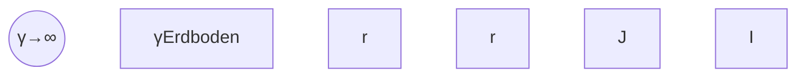

# 4 Stationäre elektrische Strömungsfelder

原始 PDF 第 213–223 页。

## 4 Stationäre elektrische Strömungsfelder

## 4.1 Die Grundgesetze und ihre Entsprechungen im elektrostatischen Feld

Bei den bisherigen Betrachtungen in Kapitel 2 wurde die elektrische Strömung durch den Strom I, eine integrale Größe, gekennzeichnet. Die räumliche Verteilung der Strö mung über ausgedehnte Querschnitte blieb unberücksichtigt. In diesem Kapitel sollen die Grundgesetze zur Berechnung von Netzwerken, nämlich die beiden Sätze von Kirchhoff und das Ohm’sche Gesetz, so verallgemeinert werden, dass sie zur Behandlung des stationären (d. h. zeitlich konstanten) elektrischen Strömungsfeldes herangezogen werden können.

Zuerst wird eine der elektrischen Flussdichte analoge flächenbezogene Stromgröße eingeführt, die durch

$$
J = \frac {\Delta I}{\Delta A} \quad \text { oder } \quad \Delta I = J \Delta A
$$

definiert ist. Man nennt die Größe J (für die man auch S oder G schreibt) die **elektrische Stromdichte**. Die Definitionsgleichung für J setzt voraus, dass der Strom $\Delta I$ senkrecht durch das Flächenelement $\Delta A$ hindurch tritt. Andernfalls hat man den Einfallswinkel α zu berücksichtigen (Bild 4.1)

$$
\Delta I = J \Delta A \cos \alpha .
$$

Fasst man J und $\Delta A$ als Vektoren auf (Bild 4.1), so folgt

$$
\Delta I = \left| \vec {J} \right| \left| \Delta \vec {A} \right| \cos \triangleleft (\vec {J}, \Delta \vec {A}) = \vec {J} \cdot \Delta \vec {A}.
$$

text_image

I₁
dĀ₁
J₁
A₁
A₃
Hüllfläche A
I₂
I₃
ΔĀ
J
ΔA
α
ΔA cos α

Abb. 4.1: Zum 1. Kirchhoff’schen Satz.

https://doi.org/10.1515/9783110631586-004

---

204

| 4 Stationäre elektrische Strömungsfelder

Setzt man den 1. Kirchhoff’schen Satz auf den in Bild 4.1 skizzierten Knoten an, so ergibt sich bei den zugrunde gelegten Zählrichtungen

$$
I _ {1} + I _ {2} + I _ {3} = 0. \tag {4.1}
$$

Auf einer Hüllfläche A, die den Knoten umgibt, sind diejenigen Teilflächen mit $A _ { 1 } , A _ { 2 }$ $A _ { 3 }$ bezeichnet, die innerhalb der Leiter 1 bis 3 liegen. Bildet man das Flächenintegral der Stromdichte $\vec { J }$ für diese Teilflächen, so hat man z. B.

$$
I _ {1} = \int_ {A _ {1}} \vec {J} \cdot \mathrm{d} \vec {A}
$$

und damit an Stelle von Gl. (4.1):

$$
\int_ {A _ {1}} \vec {J} \cdot \mathrm{d} \vec {A} + \int_ {A _ {2}} \vec {J} \cdot \mathrm{d} \vec {A} + \int_ {A _ {3}} \vec {J} \cdot \mathrm{d} \vec {A} = 0. \tag {4.2}
$$

Durch den Rest der Hüllfläche tritt kein Strom. Ein entsprechendes Integral über diese Fläche wird also Null. Gl. (4.2) kann deshalb einfacher geschrieben werden

$$
\oint_ {A} \vec {J} \cdot \mathrm{d} \vec {A} = 0. \tag {4.3}
$$

Das Flächenelement d $\vec { A }$ auf der Hüllfläche wird nach außen positiv gezählt. Dann führen Strömungslinien, die aus dem von der Hüllfläche umschlossenen Volumen austreten, zu positiven Strombeiträgen. In das Volumen eintretende Stromlinien be deuten negative Strombeiträge. Da sich all diese Beiträge zu null ergänzen, liegt ein quellenfreies Feld vor: elektrische Strömungslinien sind im stationären Fall immer geschlossen. Bei zeitlich veränderlichen Feldern muss das nicht so sein (Kapitel 6).

Betrachtet man einen Ausschnitt aus einem durchströmten Leiter (Bild 4.2) und wendet den 2. Kirchhoff’schen Satz auf den eingezeichneten Umlauf an, so ergibt sich näherungsweise für den Spannungsabfall auf dem Weg $\Delta \vec { s }$ :

$$
\Delta U = E \Delta s \cos \alpha = \left| \vec {E} \right| \left| \Delta \vec {s} \right| \cos \triangleleft (\vec {E}, \Delta \vec {s}) = \vec {E} \cdot \Delta \vec {s}.
$$

Für einen vollständigen Umlauf gilt $\textstyle \sum U = 0$ bzw. $\begin{array} { r } { \sum \Delta U = 0 } \end{array}$ , also hier

$$
\sum \vec {E} \cdot \Delta \vec {s} = 0.
$$

Daraus folgt, wenn $\Delta \vec { s }$ gegen Null strebt, also vom Grenzwert der Summe zum Integral übergeht:

$$
\oint_ {L} \vec {E} \cdot \mathrm{d} \vec {s} = 0. \tag {4.4}
$$

Das elektrische Feld ist wie in der Elektrostatik wirbelfrei. Man kann die elektrische Feldstärke auch hier aus einer skalaren Feldgröße, der Potenzialfunktion, herleiten.

---

4.1 Die Grundgesetze und ihre Entsprechungen im elektrostatischen Feld

205

Gl. (4.4) gilt in der angegebenen Form auch, wenn auf dem Umlauf L Spannungsquellen liegen, sofern nur das innere Feld der Quelle berücksichtigt wird. Ist nicht das innere Feld der Quelle bekannt, sondern die Quellenspannung, so ist diese in Gl. (4.4) zu ergänzen.

Um das Ohm’sche Gesetz für Feldgrößen zu erhalten, geht man von Bild 4.3 aus. Es wird angenommen, dass in einem Strömungsfeld ein kleiner Zylinder abgegrenzt werden kann, und zwar so, dass der Strom senkrecht durch die Deckflächen fließt (diese sind also Flächen konstanten Potenzials), während die Mantelfläche parallel zu den elektrischen Feldlinien orientiert ist. Für einen genügend kleinen Zylinder kann der Leitwert näherungsweise gemäß

$$
G = \gamma \frac {\Delta A}{\Delta l}
$$

berechnet werden. Andererseits gilt nach dem Ohm’schen Gesetz

$$
G = \frac {\Delta I}{\Delta U} = \frac {J \Delta A}{E \Delta l}.
$$

Durch Gleichsetzen beider Ausdrücke folgt

$$
J = \gamma E
$$

oder in vektorieller Schreibweise

$$
\vec {J} = \gamma \vec {E}. \tag {4.5}
$$

text_image

Umlauf L
E cos α
ΔU
Δs
α
E
J, E

Abb. 4.2: Zum 2. Kirchhoff’schen Satz.

text_image

J
ΔA
J̅
J̅

Abb. 4.3: Zur Herleitung von Gl. (4.5) und Gl. (4.6).

---

206

4 Stationäre elektrische Strömungsfelder

Vorausgesetzt wurde dabei, dass $\vec { E }$ und $\vec { J }$ gleiche Richtung haben. Es muss also ein isotropes Medium vorliegen.

In der folgenden Übersicht sind noch einmal die Ausgangsgleichungen, die aus ihnen hergeleiteten Beziehungen für die Feldgrößen des elektrischen Strömungsfeldes und die analogen Gleichungen der Elektrostatik zusammengestellt:

$$
\begin{array}{l} \sum I = 0 \\ \oint \vec {J} \cdot \mathrm{d} \vec {A} = 0 \\ \oint \vec {D} \cdot \mathrm{d} \vec {A} = Q \\ \sum U = 0 \\ \oint \vec {E} \cdot \mathrm{d} \vec {s} = 0 \\ \oint \vec {E} \cdot \mathrm{d} \vec {s} = 0 \\ I = G U \\ \vec {J} = \gamma \vec {E} \\ \vec {D} = \varepsilon \vec {E} \\ \end{array}
$$

Wegen der ersichtlichen formalen Analogien können die in der Elektrostatik einsetzbaren Lösungsmethoden auch zur Berechnung elektrischer Strömungsfelder benutzt werden.

Die im elektrischen Strömungsfeld umgesetzte Leistung kann auf das Volumen bezogen werden. Nach Bild 4.3 setzt man an Stelle von $P = I ^ { 2 } R$ zunächst

$$
\Delta P = (\Delta I) ^ {2} \frac {\Delta l}{\gamma \Delta A} = \left(\frac {\Delta I}{\Delta A}\right) ^ {2} \cdot \frac {\Delta l \Delta A}{\gamma}.
$$

und dividiert beide Seiten durch das Volumenelement $\Delta V = \Delta l \cdot \Delta A$

$$
p = \frac {\Delta P}{\Delta V}
$$

und gewinnt mit Gl. (4.5) folgende Ausdrücke für die **Leistungsdichte**:

$$
p = \frac {J ^ {2}}{\gamma} = E \cdot J = \gamma E ^ {2}. \tag {4.6}
$$

## 4.2 Methoden zur Berechnung von Widerständen

Ist der Verlauf der elektrischen Strömung in einem stromdurchflossenen Körper im Prinzip bekannt, so kann der elektrische Widerstand dieses Körpers auch durch Integration über Teilwiderstände bzw. Teilleitwerte gefunden werden. Es muss dabei die Aufteilung so vorgenommen werden, dass die entstehenden Teilwiderstände bzw. -leitwerte mit der bekannten Formel für den Leiter der Länge l mit konstantem Querschnitt A berechnet werden können.

Ist der durchströmte Querschnitt örtlich nicht konstant, wohl aber die Länge der Stromlinien, so teilt man den Leiter in dünne Scheiben auf, die durch Potenzialflächen begrenzt werden. Ist der Abstand der Potenzialflächen $\Delta l$ und der Scheibenquerschnitt A (senkrecht zur Strömungsrichtung), so hat der Widerstand der Scheibe die Größe

---

4.2 Methoden zur Berechnung von Widerständen

207

$\Delta R = \Delta l / _ { \gamma A }$ . Der Gesamtwiderstand folgt durch Hintereinanderschalten der Teilwiderstände:

$$
R = \sum \Delta R = \sum \frac {\Delta l}{\gamma A}. \tag {4.7}
$$

Ist dagegen bei dem stromdurchflossenen Leiter der Querschnitt senkrecht zur Strö- mungsrichtung überall konstant, die Länge der Stromlinien jedoch nicht, so teilt man den Leiter in dünne Streifen auf, die von Strömungslinien begrenzt werden. Hat dieser Streifen den gleichbleibenden Querschnitt $\Delta A$ und die Länge l, so hat sein Leitwert die Größe $\Delta G = \Delta A \gamma / _ { l }$ . Der Gesamtleitwert ergibt sich durch Parallelschalten der Streifen, also durch Addition der Teilleitwerte:

$$
G = \sum \Delta G = \sum \gamma \frac {\Delta A}{l} . \tag {4.8}
$$

Die folgenden Beispiele sollen diese beiden Methoden verdeutlichen.

## Beispiel 4.1: Koaxialkabel.

Gegeben ist ein Koaxialkabel (Bild 3.25a) mit den Radien $\varrho _ { 1 }$ und $\varrho _ { 2 }$ und der Länge l. Das Dielektrikum zwischen beiden Leitern soll nicht ideal sein und eine Leitfähigkeit γ haben. Gesucht ist der Verlustwiderstand des Kabels.

## Lösung:

Der Widerstand eines koaxialen Zylindermantels mit dem Radius ϱ und der Wandstärke dϱ ist

$$
\mathrm{d} R = \frac {\mathrm{d} \varrho}{\gamma 2 \pi \varrho l}.
$$

Durch Reihenschaltung dieser Teilwiderstände gemäß Gl. (4.7) ergibt sich

$$
R = \frac {1}{2 \pi \gamma l} \int_ {\varrho_ {1}} ^ {\varrho_ {2}} \frac {\mathrm{d} \varrho}{\varrho} = \frac {1}{2 \pi \gamma l} \ln \frac {\varrho_ {2}}{\varrho_ {1}}.
$$

## Beispiel 4.2: Stromdurchflossener Bügel.

Ein stromdurchflossener Leiter hat die Form eines Bügels mit rechteckigem Querschnitt. Gegeben sind die Radien $\varrho _ { 1 }$ und $\varrho _ { 2 }$ sowie die Breite b des Bügels (Bild 4.4).

Gesucht ist der Widerstand, den der Strom I überwinden muss. (Es sollen Randeffekte vernachlässigt und die Strömungslinien als Halbkreise angesehen werden.)

text_image

d\u03c6
\u03c62
\u03c6
\u03c61
I
I

Abb. 4.4: Stromdurchflossener Bügel.

---

208

| 4 Stationäre elektrische Strömungsfelder

## Lösung:

Der Leitwert eines koaxialen Halbzylindermantels mit dem Radius $\varrho$ und der Wandstärke dϱ wird

$$
\mathrm{d} G = \gamma \frac {b \mathrm{d} \varrho}{\pi \varrho}.
$$

Durch Addition der Leitwerte nach Gl. (4.8) folgt

$$
G = \gamma \frac {b}{\pi} \int_ {\varrho_ {1}} ^ {\varrho_ {2}} \frac {\mathrm{d} \varrho}{\varrho} = \gamma \frac {b}{\pi} \ln \frac {\varrho_ {2}}{\varrho_ {1}}.
$$

In vielen Fällen kann man aus einer bereits vorliegenden Formel für die Kapazität einer bestimmten Anordnung auf den elektrischen Widerstand einer entsprechenden Anordnung schließen, bei der dann das Dielektrikum durch ein leitfähiges Material ersetzt zu denken ist. Wesentlich ist, dass Kondensator und Widerstand die gleiche räumliche Anordnung und die gleiche Feldverteilung aufweisen. Für die Kapazität gilt bei örtlich konstantem ε-Wert

$$
C = \frac {Q}{U} = \frac {\int_ {A} \vec {D} \cdot \mathrm{d} \vec {A}}{\int_ {a} ^ {b} \vec {E} \cdot \mathrm{d} \vec {s}} = \frac {\varepsilon \int_ {A} \vec {E} \cdot \mathrm{d} \vec {A}}{\int_ {a} ^ {b} \vec {E} \cdot \mathrm{d} \vec {s}},
$$

für den elektrischen Widerstand bei örtlich konstanter Leitfähigkeit

$$
R = \frac {U}{I} = \frac {\int_ {a} ^ {b} \vec {E} \cdot d \vec {s}}{\int_ {A} \vec {J} \cdot d \vec {A}} = \frac {\int_ {a} ^ {b} \vec {E} \cdot d \vec {s}}{\gamma \int_ {A} \vec {E} \cdot d \vec {A}}.
$$

Dabei bedeuten, wenn wir der Einfachheit halber an das Koaxialkabel denken, a und b Punkte auf dem Innen- bzw. Außenleiter. Die Fläche A ist die Fläche, durch die der gesamte elektrische Fluss bzw. die gesamte elektrische Strömung hindurchtritt, also z. B. ein koaxialer Zylinder wie in Beispiel 4.1. Multipliziert man die Gleichungen für C und R miteinander, so hat man

$$
R C = \frac {\varepsilon}{\gamma} \quad \text {oder} \quad \frac {G}{C} = \frac {\gamma}{\varepsilon}. \tag {4.9}
$$

Durch Anwenden von Gl. (4.9) hätte in Beispiel 4.1 der gesuchte Widerstand auf Grund der in Abschnitt 3.6.3 angegebenen Kapazitätsformel sofort hingeschrieben werden können.

Sind die bis jetzt besprochenen speziellen Methoden nicht anwendbar, so muss auf die Definition des Widerstandes nach Gl. (1.8) zurückgegriffen werden. Man gibt sich den Strom I vor, berechnet für diesen Strom die dem Strömungsfeld zugeordnete Potenzialfunktion $\phi$ und bildet den Quotienten

$$
R = \frac {\phi_ {+} - \phi_ {-}}{I}. \tag {4.10}
$$

---

4.3 Anwendung auf Erdungsprobleme

209

Dabei bedeuten $\phi _ { + }$ und $\phi _ { - }$ die Potenzialwerte auf der positiven bzw. negativen Elektrode. Auf analoge Weise wurden in Abschnitt 3.6.3 Kapazitäten bestimmt.

## 4.3 Anwendung auf Erdungsprobleme

Einleitend soll die Anordnung nach Bild 4.5 betrachtet werden. Einer sehr gut leitenden Metallkugel, die allseits vom mäßig leitenden Erdboden umgeben ist, wird über einen dünnen isolierten Draht ein Strom I zugeführt. Aus Gründen der Symmetrie wird das Strömungsfeld im Erdreich radialsymmetrisch sein. Die Stromdichte kann sehr leicht mit Gl. (4.3) ermittelt werden. Es wird angenommen, dass eine Metallkugel konzentrisch von einer Hüllkugel mit dem Radius r umgeben ist und ein sehr dünner Zuleiter existiert. Für die aus der Hüllkugel austretende Strömung ergibt sich

$$
\int_ {A} J (r) \mathrm{d} A = J (r) \int_ {A} \mathrm{d} A = J (r) 4 \pi r ^ {2}.
$$

Mit dem in die Kugel eintretenden Strom I, der negativ zu zählen ist, folgt

$$
J (r) 4 \pi r ^ {2} - I = 0
$$

oder

$$
J (r) = \frac {I}{4 \pi r ^ {2}}.
$$

flowchart

Abb. 4.5: Kugelförmiger Erder.

---

210

4 Stationäre elektrische Strömungsfelder

Die elektrische Feldstärke ist wegen Gl. (4.5)

$$
E (r) = \frac {I}{4 \pi \gamma} \frac {1}{r ^ {2}}. \tag {4.11}
$$

Wie in der Elektrostatik kann dieser Feldstärke eine Potenzialfunktion zugeordnet werden, die am einfachsten durch unbestimmte Integration von Gl. (3.13) längs einer Feldlinie gefunden wird:

$$
\phi (r) = \frac {I}{4 \pi \gamma} \cdot \frac {1}{r} + k o n s t. \tag {4.12}
$$

Dieses Ergebnis entspricht Gl. (3.22a).

Jetzt soll durch den Mittelpunkt der Metallkugel nach Bild 4.5 eine dünne isolie rende Ebene gelegt werden, wobei jeder der beiden so entstehenden Halbkugeln der halbe Strom zugeführt wird. An der Feldverteilung im Erdreich ändert sich dabei offensichtlich nichts. Damit ist die Lösung für die Anordnung nach Bild 4.6 gefunden. Hier repräsentiert die metallische Halbkugel in erster Näherung einen Erder. In der Praxis werden zwar Platten, Rohre, Bänder verwendet, aber für die folgenden Betrachtungen ist diese Idealisierung zulässig.

Der Potenzialverlauf an der Erdoberfläche folgt aus Gl. (4.12), wobei zu beachten ist, dass mit I jetzt der Strom gemeint ist, der sich auf einen halb so großen Raum verteilt. Das bedeutet eine Verdoppelung von Stromdichte, Feldstärke und Potenzialfunktion. Damit geht Gl. (4.12) über in

$$
\phi (r) = \frac {I}{2 \pi \gamma} \frac {1}{r} + k o n s t. \tag {4.13}
$$

Der Verlauf der Potenzialfunktion ist in Bild $4 . 7$ für konst = 0 dargestellt. Ein Mensch, der etwa an einer Stelle $r \; = \; r _ { 1 }$ steht und den stromführenden Zuleiter zum Erder berührt, ist der sog. **Berührungsspannung** $U _ { \mathrm { B } }$ ausgesetzt, die sich mit Gl. (4.13) zu

$$
U _ {\mathrm{B}} = \phi (r _ {0}) - \phi (r _ {1}) = \frac {I}{2 \pi \gamma} \left(\frac {1}{r _ {0}} - \frac {1}{r _ {1}}\right) \tag {4.14}
$$

ergibt. Ein Lebewesen, das sich in der Umgebung des stromführenden Erders aufhält, kann mit seinen Füßen (Bild 4.7) die sog. **Schrittspannung**

$$
U _ {\mathrm{S}} = \phi (r _ {2}) - \phi (r _ {3}) = \frac {I}{2 \pi \gamma} \left(\frac {1}{r _ {2}} - \frac {1}{r _ {3}}\right) \tag {4.15}
$$

überbrücken.

text_image

I
E, J
r0
r
P

Abb. 4.6: Halbkugelerder.

---

4.3 Anwendung auf Erdungsprobleme

211

text_image

I
UB
φ(r)
r0 r1 r2 r3 r
US
J̅

Abb. 4.7: Potenzialverlauf in der Umgebung des Halbkugelerders. Berührungsspannung $U _ { \mathsf { B } } ;$ Schrittspannung $U _ { S }$ . Voraussetzung: Leitfähigkeit des Erders ≫ Leitfähigkeit des Erdreichs.

## Beispiel 4.3: Schrittspannung.

Ein Leiter einer Freileitung erhält Berührung mit dem Mast, wodurch ein Strom von 1000 A ins Erdreich fließt.

Wie groß ist die Schrittspannung in 10 m und 20 m Entfernung vom Mast, wenn mit einer Schrittlänge von 80 cm und einer mittleren Leitfähigkeit des Erdbodens von $1 0 ^ { - 2 }   \mathrm { S m ^ { - 1 } }$ gerechnet wird?

## Lösung:

Nach Gl. (4.15) ist

$$
U _ {\mathrm{S}} = \frac {I}{2 \pi \gamma} \frac {r _ {3} - r _ {2}}{r _ {2} r _ {3}} \approx \frac {I}{2 \pi \gamma} \frac {\Delta r}{r ^ {2}}.
$$

Damit folgt mit $\Delta r = 0$ ,8 m und $r = 1 0$ m

$$
U _ {\mathrm{S}} \approx \frac {1 0 ^ {3} \mathrm{Am} \cdot 0 , 8 \mathrm{m}}{2 \pi 1 0 ^ {- 2} \mathrm{S} \cdot 1 0 ^ {2} \mathrm{m} ^ {2}} \approx 1 2 7 \mathrm{V}
$$

und für $r = 2 0$ m

$$
U _ {\mathrm{S}} \approx 3 2 \mathrm{V}.
$$

Im ersten Fall wird eine für den Menschen gefährliche Spannung (oberhalb von etwa 60 V) erreicht.

Den Widerstand zwischen dem Erder und einer konzentrischen Halbkugel mit unendlich großem Radius nennt man den **Erdübergangswiderstand**. Dieser ergibt sich für den Fall des Halbkugelerders wegen Gl. (4.13) zu

$$
R = \frac {U}{I} = \frac {\phi (r _ {0}) - \phi (\infty)}{I} = \frac {1}{2 \pi \gamma r _ {0}}. \tag {4.16}
$$

Auch dieses Ergebnis kann man mit Gl. (4.9) aus dem Ausdruck für die Kapazität einer Kugel gegenüber dem Unendlichen gewinnen. Es ist allerdings wegen des Übergangs von der Vollkugel zur Halbkugel der Faktor 2 zu berücksichtigen.

---

212

4 Stationäre elektrische Strömungsfelder

## 4.4 Bedingungen an Grenzflächen

Fließt ein elektrischer Strom von einem Material mit der Leitfähigkeit $\gamma _ { 1 }$ in ein Material mit der Leitfähigkeit $\gamma _ { 2 }$ , so werden die Strömungslinien an der Grenzfläche zwischen den beiden Materialien geknickt, falls die Strömung nicht senkrecht zur Grenzfläche verläuft.

Um das Verhalten der Normalkomponenten zu untersuchen wird Gl. (4.3) auf einen flachen Zylinder angewendet, wie er in Bild 3.35 dargestellt ist. Aus den gleichen Überlegungen wie in Abschnitt 3.9 folgt

$$
J _ {2 n} = J _ {1 n}. \tag {4.17}
$$

Für die Tangentialkomponenten gilt wegen Gl. (4.4) wie in der Elektrostatik

$$
E _ {2 t} = E _ {1 t}. \tag {4.18}
$$

Damit erhält man das **Brechungsgesetz** des elektrischen Strömungsfeldes, wobei die Winkel wie in Bild 3.37 zu zählen sind:

$$
\frac {\tan \alpha_ {1}}{\tan \alpha_ {2}} = \frac {\gamma_ {1}}{\gamma_ {2}}. \tag {4.19}
$$

Hat der eine Leiter eine sehr viel größere Leitfähigkeit als der andere, ist also $\gamma _ { 1 } / _ { \gamma _ { 2 } } \gg 1$ so ist auch tan $\alpha _ { 1 } / \tan \alpha _ { 2 } \gg 1$ . Für den Zahlenwert $\gamma _ { 1 } / \gamma _ { 2 } = 1 0 0$ ergeben sich für die Winkel $\alpha _ { 1 } = 0 ^ { \circ } ; 4 5 ^ { \circ } ; 6 0 ^ { \circ } ; 7 0 ^ { \circ } ; 8 0 ^ { \circ } ; 8 5 ^ { \circ }$ entsprechend die Winkel $\alpha _ { 2 } = 0 ^ { \circ } ; 0 , 6 ^ { \circ } ; 1 ^ { \circ } ; 1 , 6 ^ { \circ } ; 3 , 2 ^ { \circ }$ ; $^ { 6 , 5 ^ { \circ } }$ . Das bedeutet, dass die Feldlinien aus der Grenzfläche eines guten Leiters nahezu senkrecht heraustreten. Damit wird die Oberfläche dieses Leiters näherungsweise zu einer Äquipotenzialfläche.

In den Abschnitten über elektrostatische Felder wurden stets Dielektrika mit unendlich geringer Leitfähigkeit vorausgesetzt. Wenn diese idealisierende Annahme nicht gemacht werden kann, ist zu fragen, ob sich das Feld an der Grenzfläche nach den Bedingungen verhält, die für elektrostatische Felder – Gln. (3.52) und (3.53) – aufge stellt wurden, oder nach den für Strömungsfelder – Gln. (4.17) und (4.18) – gültigen. Die Erfahrung zeigt, dass sich im stationären Fall die Feldverteilung in durchströmten Gebieten nach den Gesetzen des Strömungsfeldes richtet. Bei zeitlich veränderlichen Feldern dagegen, die später behandelt werden, wird die Feldverteilung mit zunehmender Änderungsgeschwindigkeit immer stärker von den dielektrischen Eigenschaften der Stoffe und weniger von ihren Leitfähigkeiten bestimmt.

Im stationären Fall verhalten sich die Normalkomponenten der Stromdichte also stetig. Damit sind auch die Normalkomponenten der elektrischen Feldstärke wegen Gl. (4.5) festgelegt und für die daraus gemäß Gl. (3.16) bestimmten Normalkomponenten der elektrischen Flussdichte gilt die Bedingung der Stetigkeit nach Gl. (3.52) im Allgemeinen nicht mehr.

Die jetzt maßgebende Bedingung an der Grenzfläche findet man auf ähnliche Weise wie in Abschnitt 3.9. Man hat dabei in der Grenzschicht des Zylinders nach Bild 3.35 eine

---

4.4 Bedingungen an Grenzflächen

213

Ladung $\Delta Q$ anzunehmen. Diese schreibt man als $\sigma \cdot \Delta A$ , wobei σ eine **Flächenladung** (Ladung pro Fläche) bedeutet. So ergibt sich

$$
D _ {2 n} - D _ {1 n} = \sigma . \tag {4.20}
$$

## Beispiel 4.4: Kugelkondensator mit leitendem Dielektrikum.

Zwischen zwei vollkommen leitenden, konzentrischen Kugelschalen befinden sich zwei Medien (1) und (2) gemäß Bild 4.8. Über isolierte Drähte sind die beiden Kugelschalen an eine Spannungsquelle U angeschlossen.

Gesucht sind der Strom I und die Flächenladung $\sigma ,$ die sich in der Grenzschicht zwischen den beiden Medien ausbildet.

## Lösung:

Die Potenzialfunktion für eine kugelsymmetrische Anordnung ist mit Gl. (4.12) bekannt. Damit lassen sich für die beiden Raumteile die Ansätze machen:

$$
\phi_ {1} (r) = \frac {I}{4 \pi \gamma_ {1}} \cdot \frac {1}{r} + C _ {1}, \quad \phi_ {2} (r) = \frac {I}{4 \pi \gamma_ {2}} \cdot \frac {1}{r} + C _ {2}.
$$

Die Spannung U setzt sich aus den beiden Anteilen $\phi _ { 1 } ( r _ { 0 } )   -   \phi _ { 1 } ( r _ { 1 } )$ und $\phi _ { 2 } ( r _ { 1 } )   -   \phi _ { 2 } ( r _ { 2 } )$ zusammen:

$$
U = \frac {I}{4 \pi} \left\{\frac {1}{\gamma_ {1}} \left(\frac {1}{r _ {0}} - \frac {1}{r _ {1}}\right) + \frac {1}{\gamma_ {2}} \left(\frac {1}{r _ {1}} - \frac {1}{r _ {2}}\right) \right\}.
$$

Auf das Auflösen nach I soll hier verzichtet werden.

Die elektrischen Feldstärken in beiden Raumteilen sind nach Gl. (4.11):

$$
E _ {1} (r) = \frac {I}{4 \pi \gamma_ {1}} \cdot \frac {1}{r ^ {2}}, \qquad E _ {2} (r) = \frac {I}{4 \pi \gamma_ {2}} \cdot \frac {1}{r ^ {2}}.
$$

Damit folgt gemäß Gl. (4.20):

$$
\sigma = \varepsilon_ {2} E _ {2 n} (r _ {1}) - \varepsilon_ {1} E _ {1 n} (r _ {1}) = \frac {I}{4 \pi r _ {1} ^ {2}} \left(\frac {\varepsilon_ {2}}{\gamma_ {2}} - \frac {\varepsilon_ {1}}{\gamma_ {1}}\right).
$$

Demnach bildet sich nur in dem Sonderfall $\varepsilon _ { 1 } \big / _ { \varepsilon _ { 2 } } = \gamma _ { 1 } \big / _ { \gamma _ { 2 } }$ keine Flächenladung in der Grenzschicht aus.

text_image

γ₂·ε₂
(2)
(1)
γ₁·ε₁
r₂
r₁
r₀
I
U

Abb. 4.8: Kugelkondensator mit geschichtetem, verlustbehaftetem Dielektrikum.
