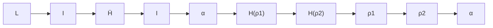
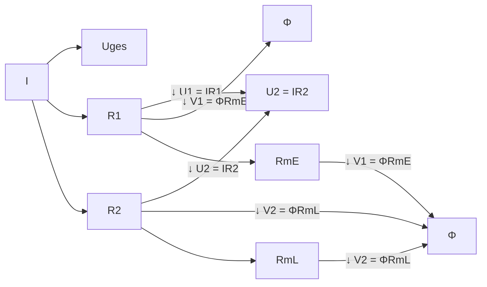
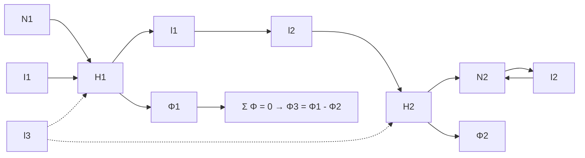

# 5 Stationäre Magnetfelder

原始 PDF 第 224–249 页。

## 5 Stationäre Magnetfelder

## 5.1 Magnetismus

Zwischen gewissen Eisenkörpern, die man **Magnete** nennt, treten anziehende oder abstoßende Kräfte auf. Ein solcher Magnet hat die Tendenz, sich in Nord-Süd-Richtung einzustellen (Bild 5.1). Das Ende des Magneten, das nach Norden weist, nennt man den magnetischen **Nordpol**, das andere den magnetischen **Südpol**. Wird ein Magnet gemäß Bild 5.2 in zwei Teile zerlegt, so entstehen zwei neue Magnete. Darin liegt offensichtlich ein entscheidender Unterschied zur Elektrostatik. Elektrische Ladungen lassen sich trennen, magnetische Pole dagegen nicht.

Teilt man einen Magneten in immer kleinere Elemente auf, so erhält man schließ- lich einen Elementarmagneten, den man als Dipol nach Bild 5.3 darstellen kann. Diesen denkt man sich aufgebaut aus zwei punktförmigen Polen N und S, die voneinander den Abstand l haben (l → 0) . Die Stärke der Pole wird durch die **Polstärke** P charakterisiert, die das Analogon zur elektrischen Ladung Q ist. Das Produkt

$$
m = P \cdot l
$$

nennt man das **magnetische Dipolmoment**.

Magnetfelder, deren Ursache in magnetischen Dipolen vorgegebener Verteilung zu sehen ist, können mit den Methoden behandelt werden, die in den Abschnitten über elektrostatische Felder besprochen wurden. Weit wichtiger sind allerdings die Magnetfelder, die von bewegten Ladungen verursacht werden.

radar

| Position | Region |
| --- | --- |
| N | Geographischer Nordpol |
| N | Magnetischer Nordpol |
| S | Magnetischer Südpol |
| S | Geographischer Südpol |

Abb. 5.1: Magnetnadel richtet sich im Erdfeld aus.

Abb. 5.2: Magnetische »Ladungen« lassen sich nicht trennen.

text_image

+P
N
r
θ
l
S
-P

Abb. 5.3: Magnetischer Dipol.

https://doi.org/10.1515/9783110631586-005

---

5.2 Kräfte im magnetischen Feld und die magnetische Flussdichte

215

## 5.2 Kräfte im magnetischen Feld und die magnetische Flussdichte

## 5.2.1 Die Kraft zwischen zwei stromdurchflossenen Leitern

Es liegt nahe, die magnetischen Feldgrößen in ähnlicher Weise einzuführen wie die elektrischen. Da es keine isolierten (d. h. nicht paarweise auftretenden) magnetischen Ladungen gibt, darf man kein unmittelbares, durch ein völlig gleichartiges Experiment nachweisbares Analogon zum Coulomb’schen Gesetz erwarten, das den Ausgangspunkt für weitere Schlussfolgerungen bilden könnte. Wir gehen jetzt von der Erfahrungstatsache aus, dass zwei parallele Leiter, die von Strömen durchflossen werden, einander bei gleichen Stromrichtungen anziehen und bei entgegengesetzten Stromrichtungen abstoßen. Experimentell ergibt sich für dünne Leiter sehr großer Länge l bei einem Achsenabstand $\varrho$ und den Strömen $I _ { 1 }$ und $I _ { 2 }$ (Bild 5.4) der folgende Zusammenhang:

$$
F = K \frac {I _ {1} I _ {2} l}{\varrho}.
$$

Der Proportionalitätsfaktor K ist bereits festgelegt, da Längen, Kräfte und Ströme schon definiert sind. Der Faktor K hängt von dem Material in der Umgebung der stromdurchflossenen Leiter ab, ist also eine Materialkonstante. Aus Gründen, die in den folgenden Abschnitten besprochen werden, setzt man

$$
K = \frac {\mu}{2 \pi}. \tag {5.1}
$$

Dabei heißt $\mu$ die **Permeabilität(skonstante)** oder Induktionskonstante.

Mit Gl. (5.1) nimmt die Ausgangsgleichung die Form an:

$$
F = \frac {\mu I _ {1} I _ {2} l}{2 \pi \varrho}. \tag {5.2}
$$

Die Kraft zwischen den stromdurchflossenen Leitern kann nicht mit elektrostatischen Kräften erklärt werden, die zwischen den Ladungen in den Leitern wirken. Denn beide Leiter sind bei Gleichstrom insgesamt ungeladen. Man begegnet hier also einer neuen Erscheinung, die auf magnetische Feldkräfte bzw. bewegte Ladungen zurückführen ist.

text_image

dünne Leiter
Luft
I₁
I₂
l
ρ

Abb. 5.4: Zur Kraft zwischen zwei stromdurchflossenen Leitern.

---

216

5 Stationäre Magnetfelder

## 5.2.2 Die magnetische Flussdichte

Gl. (5.2) lässt sich nun so interpretieren wie in der Elektrostatik das Coulomb’sche Gesetz. Die Kraft, die etwa auf den vom Strom $I _ { 2 }$ durchflossenen Leiter der Länge l wirkt, ist proportional zu $I _ { 2 } l$ :

$$
F \sim I _ {2} l.
$$

Der Faktor

$$
\frac {\mu I_ {1}}{2 \pi \varrho}
$$

stellt die Wirkung – genauer: die magnetische Wirkung – des vom Strom $I _ { 1 }$ durchflossenen Leiters am Ort des zweiten Leiters dar. Der stromführende zweite Leiter gibt, wie die Probeladung in der Elektrostatik, die Möglichkeit, über die Messung der auf diesen Leiter wirkenden Kraft das Magnetfeld in der Umgebung des vom Strom $I _ { 1 }$ durchflossenen Leiters zu ermitteln. Die das Feld charakterisierende magnetische Größe nennt man die **magnetische Flussdichte** B oder auch die magnetische Induktion und setzt

$$
B _ {1} = \frac {\mu I _ {1}}{2 \pi \varrho}. \tag {5.3}
$$

Da die Flussdichte $B _ { 1 }$ im vorliegenden Fall nicht von einem Winkel, sondern nur vom Abstand von der Leiterachse abhängt, handelt es sich hier um ein zylindersymmetrisches Feld. Das zeigen auch die bekannten Versuche mit Eisenfeilspänen. Diese orientieren sich so, wie es die kreisförmigen Linien in Bild 5.5 zeigen. Als Richtung des Feldvektors $\vec { B }$ ist in Analogie zur Elektrostatik willkürlich diejenige gewählt worden, in die sich ein frei beweglicher Nordpol, den es nach Abschnitt 5.1 nicht gibt, bewegen würde. Das ist gleichzeitig die Richtung, in die der Nordpol der in Bild 5.5 skizzierten Magnetnadel zeigt. Mit dieser willkürlichen Definition ergibt sich, dass die Richtung des Feldes und die des Stromes im Sinne der **Rechtsschraubenregel** miteinander verknüpft sind (Bild 5.6 und Bild 5.14).

text_image

N
S
(1)
I₁
ρ
(2)
I₂
F̅₂
B̅₁

Abb. 5.5: Leiter (2) im Magnetfeld von Leiter (1).

---

5.2 Kräfte im magnetischen Feld und die magnetische Flussdichte

217

Setzt man Gl. (5.3) in Gl. (5.2) ein, so erhält man für die Kraft auf einen stromdurchflossenen geraden Leiter der Länge l, der sich in einem Magnetfeld der Flussdichte B befindet, den Ausdruck

$$
F = I \cdot l \cdot B. \tag {5.4}
$$

In dieser Form gilt die Gleichung nur, wenn das Magnetfeld senkrecht auf dem Leiter steht. Gl. (5.4) soll nun benutzt werden, um eine mögliche Maßeinheit der magnetischen Flussdichte zu bestimmen. Es wird

$$
B = \frac {F}{I \cdot l}
$$

und damit

$$
[ B ] = \frac {[ F ]}{[ I ] [ l ]} = \frac {\mathrm{N}}{\mathrm{Am}} = \frac {\mathrm{Vs}}{\mathrm{m} ^ {2}}.
$$

B ist also – wie die elektrische Flussdichte D – eine flächenbezogene Größe, daher die Bezeichnung magnetische Flussdichte. Man hat für B eine spezielle Einheit eingeführt:

$$
1 \frac {\mathrm{Vs}}{\mathrm{m} ^ {2}} = 1 \text {Tesla} = 1 \mathrm{T}.
$$

Häufig wird noch die veraltete Einheit Gauß verwendet:

$$
1 0 ^ {- 4} \frac {\mathrm{Vs}}{\mathrm{m} ^ {2}} = 1 \mathrm{Gau} \beta = 1 \mathrm{G}.
$$

Felder der Stärke 1 T treten in elektrischen Maschinen auf. Ein Beispiel für ein Feld, dessen Stärke in der Größenordnung von 1 G liegt, ist das **magnetische Erdfeld**.

## 5.2.3 Die Kraft auf stromdurchflossene Leiter im Magnetfeld

Einen speziellen Ausdruck für die Kraft auf einen stromdurchflossenen Leiter, der einem Magnetfeld ausgesetzt ist, stellt Gl. (5.4) dar. Tritt zwischen den Richtungen von Feld und Leiter kein rechter, sondern ein beliebiger Winkel auf (Bild 5.6), so ergibt sich experimentell

$$
F = I \cdot l \cdot B \sin \alpha . \tag {5.5}
$$

Die Richtung der Kraft steht senkrecht auf dem Leiter und dem Magnetfeld. Ordnet man der Länge einen Vektor zu, dessen Betrag der Länge entspricht und dessen Richtung mit der des Stromes übereinstimmt, so lässt sich Gl. (5.5) unter Verwendung des in der Vektorrechnung definierten **Kreuzproduktes (Vektorproduktes)** $\vec { l } \times \vec { B }$ (gelesen: l Kreuz B) schreiben:

$$
\vec {F} = I \cdot \vec {l} \times \vec {B}. \tag {5.6}
$$

Dabei bedeutet also $\vec { l } \times \vec { B }$ einen Vektor, der auf $\vec { l }$ und $\vec { B }$ senkrecht steht und dessen Betrag

$$
l B \sin \alpha = l \cdot B \sin \triangleleft (\vec {l}, \vec {B})
$$

---

218

5 Stationäre Magnetfelder

text_image

F
α
l
I
B
l
α
B
l × B

Abb. 5.6: Kraft auf stromdurchflossenen Leiter im Magnetfeld; Kreuzprodukt und Rechtsschraubenregel.

ist. Die Richtung von $\vec { l } \times \vec { B }$ (einschließlich Vorzeichen) erhält man so: Man denkt sich $\vec { l }$ auf kürzestem Weg in die Richtung von $\vec { B }$ gedreht, wobei dieser Drehbewegung eine Richtung gemäß der Rechtsschraubenregel zugeordnet wird (Bild 5.6).

Befindet sich ein stromdurchflossener, dünner, nicht geradliniger Draht in einem inhomogenen Magnetfeld (Bild 5.7), so kann Gl. (5.6) nur auf ein kleines Leiterelement ∆s⃗ angewendet werden, auf dem $\vec { B }$ in erster Näherung konstant ist:

$$
\Delta \vec {F} = I \Delta \vec {s} \times \vec {B}. \tag {5.7}
$$

Die Gesamtkraft folgt durch Integration:

$$
\vec {F} = I \int_ {L} \mathrm{d} \vec {s} \times \vec {B}. \tag {5.8}
$$

Bei räumlich verteilter elektrischer Strömung ist ein Volumenelement zu betrachten, wie es in Bild 5.8 dargestellt ist. Hier müssen ∆A und ∆s so klein gewählt werden, dass in dem Volumenelement die Größen $\vec { B }$ und $\vec { J }$ in erster Näherung als konstant angesehen werden können. Dann folgt aus Gl. (5.5)

$$
\Delta F = J \Delta A \Delta s B \sin \alpha = \Delta V J B \sin \alpha
$$

und in Vektorschreibweise

$$
\Delta \vec {F} = \Delta V \vec {J} \times \vec {B}. \tag {5.9}
$$

Bewegt sich eine Ladung $\Delta Q$ mit der Geschwindigkeit $\vec { v }$ durch ein Magnetfeld, so wirkt auf die Ladung eine Kraft, die wieder mit Gl. (5.5) berechnet werden kann. Die

text_image

B
Δs̄
I
ΔF

Abb. 5.7: Stromdurchflossenes Leiterelement im Magnetfeld.

---

5.2 Kräfte im magnetischen Feld und die magnetische Flussdichte

219

text_image

B
J
ΔA
Δs
ΔF

Abb. 5.8: Durchströmtes Volumenelement im Magnetfeld.

Ladungsbewegung durch den in Bild 5.9 gestrichelten Querschnitt innerhalb der Zeit ∆t entspricht einem Strom $I = \Delta Q \big / _ { \Delta t }$ . Damit wird

$$
I \Delta s = \frac {\Delta Q}{\Delta t} \Delta s = \Delta Q \cdot v
$$

und

$$
\Delta F = \Delta Q \cdot v \cdot B \sin \alpha
$$

oder in Vektorschreibweise

$$
\Delta \vec {F} = \Delta Q \vec {v} \times \vec {B} \tag {5.10a}
$$

bzw. für punktförmige Ladungen beliebiger Größe

$$
\vec {F} = Q \vec {v} \times \vec {B}. \tag {5.10b}
$$

Bei der Anwendung dieser Formel auf einen Gleichstrom durchflossenen Leiter, der insgesamt ungeladen ist, muss beachtet werden, dass mit ∆Q bzw. Q nur die bewegten Ladungen, im genannten Fall also die Leitungselektronen gemeint sind.

text_image

B⃗
v⃗
ΔQ
ΔF⃗

Abb. 5.9: Eine Punktladung fliegt durch ein Magnetfeld.

## Beispiel 5.1: Drehspule.

Eine stromdurchflossene, quadratische Leiterschleife (Fläche $A = a ^ { 2 } )$ befindet sich in einem radialsymmetrischen Magnetfeld der Flussdichte B (Bild 5.10).

Auf die beiden im Querschnitt dargestellten Leiter wirkt nach Gl. (5.4) das Drehmoment

$$
M _ {1} = 2 \cdot \frac {a}{2} \cdot I a B = A I B
$$

und bei N Windungen

$$
M _ {1} = N A I B.
$$

---

220

| 5 Stationäre Magnetfelder

text_image

F
N
α
M₁
I
S
B
F

Abb. 5.10: Drehspule in radialhomogenem Feld.

Ergänzt man die Anordnung so durch zwei Spiralfedern, dass die Spule einem dem Winkel α proportionalen Gegendrehmoment

$$
M _ {2} = k o n s t \cdot \alpha ,
$$

ausgesetzt ist, so stellt sich für $M _ { 1 } = M _ { 2 }$ ein Gleichgewicht bei

$$
\alpha = \frac {1}{k o n s t} N A I B
$$

ein. Der Drehwinkel α ist also dem Strom I proportional. Nach diesem Prinzip arbeiten **Drehspulmesswerke**.

## 5.3 Die Erregung des Magnetfeldes

## 5.3.1 Die magnetische Feldstärke

Nach Gl. (5.3) hängt die magnetische Flussdichte in der Umgebung eines stromdurchflossenen Leiters auch von dem Stoff ab, der den Leiter umgibt. Wie beim elektrischen Feld definiert man eine zweite, materialunabhängige Feldgröße. Diese nennt man die **magnetische Feldstärke** oder auch die **magnetische Erregung** und bezeichnet sie mit H. Für den stromdurchflossenen Leiter folgt aus Gl. (5.3) durch Fortlassen des Faktors μ:

$$
H = \frac {I}{2 \pi \varrho}. \tag {5.11}
$$

Der Zusammenhang zwischen B und H ist, wie ein Vergleich von Gl. (5.3) mit Gl. (5.11) zeigt, dann durch

$$
\vec {B} = \mu \vec {H} \tag {5.12}
$$

gegeben. Es wird hier, wie bei Gl. (3.16), ein isotropes Medium vorausgesetzt.

Wegen Gl. (5.11) lässt sich eine mögliche Einheit von H sofort hinschreiben:

$$
[ H ] = \frac {[ I ]}{[ \varrho ]} = \frac {\mathrm{A}}{\mathrm{m}}  .
$$

Für die **Permeablität** oder **magnetische Feldkonstante** des Vakuums ergibt sich ein Zahlenwert (CODATA 2018), der auf den als exakt definierten physikalischen Konstanten (siehe Tabelle 1.1) Lichtgeschwindigkeit c, Elementarladung e und Plank’schem

---

5.3 Die Erregung des Magnetfeldes

221

Wirkungsquantum h basiert. Aus diesem Zusammenhang lässt sich auch die mögliche Einheit ableiten. Außerdem bedarf es der Feinstrukturkonstante $\alpha ,$ die eine Messunsicherheit mit sich bringt. Das bedeutet, dass auch die Permeabilität im Vakuum einer Messunsicherheit unterliegt

$$
\mu_ {0} = \frac {2 \cdot h \cdot \alpha}{c \cdot e ^ {2}} = 1, 2 5 6 6 3 7 0 6 2 \cdot 1 0 ^ {- 6} \frac {\mathrm{Vs}}{\mathrm{Am}} \approx 4 \pi \cdot 1 0 ^ {- 7} \frac {\mathrm{Vs}}{\mathrm{Am}}.
$$

## Beispiel 5.2: Die Kraft zwischen zwei stromdurchflossenen Leitern.

Die Kraft zwischen zwei stromdurchflossenen Leitern lässt sich über die Gl. (5.2) ermitteln. Fließt z. B. in den beiden Leitern mit der Länge l = 1 m der gleiche Strom von $I _ { 1 } = I _ { 2 } = 1   \mathrm { A }$ und haben die beiden Leiter einen Abstand von $\varrho = 1$ m zueinander, so ergibt sich für die Kraft, die zwischen den beiden Leitern herrscht

$$
F = \frac {\mu I _ {1} I _ {2} l}{2 \pi \varrho} \approx \frac {4 \pi \cdot 1 0 ^ {- 7} \frac {\mathrm{Vs}}{\mathrm{Am}} \cdot (1 \mathrm{A}) ^ {2} \cdot 1 \mathrm{m}}{2 \pi \cdot 1 \mathrm{m}} = 2 \cdot 1 0 ^ {- 7} \mathrm{N}.
$$

Auf diese Weise wurde die Einheit Ampere der elektrischen Stromstärke im SI bis zur Änderung im Jahr 2019 festgelegt.

In Analogie zu Gl. (3.18) gibt man die dimensionslose **relative Permeabilität** (oder Permeabilitätszahl) $\mu _ { \mathrm { r } }$ an, die im Vakuum den Zahlenwert 1 hat und zusammen mit der magnetischen Feldkonstante in isotropen Medien die Permeabilität

$$
\mu = \mu_ {\mathrm{r}} \mu_ {0} \tag {5.13}
$$

definiert. Die magnetischen Eigenschaften der Stoffe kennzeichnet man meist durch die Größe $\mu _ { \mathrm { { r } } } ,$ , sofern diese nicht von der Erregung des Feldes abhängt. Dann ist man auf Kennlinien angewiesen. Man unterscheidet nach der Größe von $\mu _ { \mathrm { r } }$ zwischen dia-, para- und ferromagnetischen Stoffen.

Bei dia- und paramagnetischen Stoffen weicht $\mu _ { \mathrm { r } }$ nur wenig von eins ab. Ist $\mu _ { \mathrm { r } } < 1$ , so nennt man den Stoff **diamagnetisch**. Beispiele hierfür sind Wismut mit $\mu _ { \mathrm { r } } = 1 - 1 6 0 \cdot 1 0 ^ { - 6 }$ und Kupfer mit $\mu _ { \mathrm { r } } = 1 - 1 0 \cdot 1 0 ^ { - 6 }$ . Stoffe mit $\mu _ { \mathrm { r } } > 1$ heißen para**magnetisch**. Zu diesen gehören Platin mit $\mu _ { \mathrm { r } } = 1 + 3 0 0 \cdot 1 0 ^ { - 6 }$ und Aluminium mit $\mu _ { \mathrm { r } } = 1 + 2 2 \cdot 1 0 ^ { - 6 }$ . In den meisten Anwendungen kann man die nichtferromagnetischen Stoffe als magnetisch neutral ansehen und mit $\mu _ { \mathrm { r } } = 1$ rechnen.

Bei **ferromagnetischen** Stoffen – z. B. Eisen, Kobalt, Nickel – ist $\mu _ { \mathrm { r } } \gg 1   ( \mathrm { z .   B . }$ $\mu _ { \mathrm { r } } \; = \; 1 0 ^ { 4 } )$ . Das erklärt man sich damit, dass diese Stoffe größere Bezirke mit gleichem magnetischen Moment aufweisen, sog. Elementarmagnete, die sich ausrichten, wenn der Stoff einer magnetischen Erregung ausgesetzt wird. Der Zusammenhang zwischen der magnetischen Feldstärke H und der Flussdichte B ist nichtlinear und hängt außerdem von der Vorgeschichte ab. Er wird durch die **Magnetisierungskennlinie** dargestellt (Bild 5.11). War der ferromagnetische Stoff noch nicht magnetisiert und lässt man die Größe H von Null auf den durch den Punkt $P _ { 1 }$ gekennzeichneten Wert anwachsen, so erhält man die **Neukurve** (1). Bei weiterer Erhöhung von H nimmt B nur

---

222

| 5 Stationäre Magnetfelder

contour

| Point | H | B |
| --- | --- | --- |
| P1 | ~0.85 | ~0.95 |
| BR | 0 | BR |
| -HK | -0.45 | -HK |
| -BR | 0.45 | -BR |

Abb. 5.11: Magnetisierungskennlinie: Hystereseschleife und Neukurve (1).

noch unwesentlich zu. Dann haben sich alle Elementarmagnete ausgerichtet und man befindet sich im Bereich der **Sättigung** (gestrichelte Kurve). Bei Verringern der Größe H auf null erreicht B auf Kurve (2) den Wert $B _ { \mathrm { R } } ,$ , die **Remanenzflussdichte**. Um B zu null zu machen, muss man die Richtung von H umkehren und H wieder anwachsen lassen bis zum Wert $- H _ { \mathrm { K } }$ $H _ { \mathrm { K } }$ heißt die **Koerzitivfeldstärke**. Durch geeignete Wahl von H durchläuft man über den Punkt $P _ { 2 }$ und schließlich auf Kurve (3) bis zum Punkt $P _ { 1 }$ zurück eine geschlossene Schleife, die sog. **Hystereseschleife**. Die Erscheinung der Hysterese wird bei Dauermagneten ausgenutzt (Abschnitt 5.6.4). Bei den meisten Anwendungen ist sie jedoch unerwünscht (Hystereseverluste, Abschnitt 6.2.2). Für

line

| H (A/cm) | Dynamoblech (B/Tesla) | legiertes Blech (B/Tesla) | Walzstahl (B/Tesla) | Grauguss (B/Tesla) |
| --- | --- | --- | --- | --- |
| 0 | 0 | 0 | 0 | 0 |
| 5 | ~1.2 | ~1.15 | ~0.5 | ~0.15 |
| 10 | ~1.4 | ~1.35 | ~0.95 | ~0.35 |
| 15 | ~1.5 | ~1.45 | ~1.15 | ~0.55 |
| 20 | ~1.6 | ~1.55 | ~1.3 | ~0.65 |

Abb. 5.12: Magnetisierungskennlinien.

---

5.3 Die Erregung des Magnetfeldes

223

einige wichtige Eisensorten, bei denen man von der Erscheinung der Hysterese näherungsweise absehen kann, sind in Bild 5.12 die Magnetisierungskennlinien angegeben.

## 5.3.2 Das Durchflutungsgesetz

Schreibt man Gl. (5.11) in der Form

$$
2 \pi \varrho H (\varrho) = I,
$$

dann lässt sich der physikalische Inhalt der Gleichung so formulieren (Bild 5.13): Das Produkt aus der magnetischen Feldstärke auf einer Feldlinie vom Radius ϱ und der Länge dieser Feldlinie $L = 2 \pi \varrho$ ist gleich dem Strom, der von der Feldlinie umfasst wird. Es soll ein Umlauf betrachtet werden, der teilweise auf einer Feldlinie vom Radius $\varrho _ { 1 }$ , teilweise auf einer solchen vom Radius $\varrho _ { 2 }$ verläuft (Bild 5.13). Für Kreisbögen, die durch den gleichen Winkel α gekennzeichnet sind, bleibt das Produkt aus Feldstärke und Länge bei unterschiedlichem ϱ konstant:

$$
H (\varrho_ {1}) \alpha \varrho_ {1} = \frac {I}{2 \pi \varrho_ {1}} \alpha \varrho_ {1} = I \frac {\alpha}{2 \pi},
$$

$$
H (\varrho_ {2}) \alpha \varrho_ {2} = \frac {I}{2 \pi \varrho_ {2}} \alpha \varrho_ {2} = I \frac {\alpha}{2 \pi}.
$$

Damit liegt es nahe, eine beliebige Kurve L, die den stromführenden Leiter umgibt (Bild 5.13), durch eine Treppenkurve anzunähern und zu schreiben:

$$
\sum_ {k} H _ {k} \Delta s _ {k} = I.
$$

Darin bedeutet $\Delta s _ { k }$ die Länge des k-ten Bogenelements.

Fasst man $\Delta s _ { k }$ als Längenelement beliebiger Richtung auf, so darf in die obige Gleichung nur die Projektion von $\Delta s _ { k }$ in die Richtung des Bogens eingesetzt werden. Das lässt sich am einfachsten formulieren, wenn man $\vec { H }$ und $\Delta \vec { s } _ { k }$ als Vektoren auffasst:

$$
\sum_ {k} H _ {k} \Delta s _ {k} \cos \triangleleft (\vec {H} _ {k}, \Delta \vec {s} _ {k}) = \sum_ {k} \vec {H} _ {k} \Delta \vec {s} _ {k} = I.
$$

flowchart

Abb. 5.13: Zur »Herleitung« des Durchflutungsgesetzes.

---

224

| 5 Stationäre Magnetfelder

Gehen wir nun noch zum Grenzwert der Summe über, so erhalten wir

$$
\oint_ {L} \vec {H} \cdot \mathrm{d} \vec {s} = I. \tag {5.14}
$$

Das ist das **Durchflutungsgesetz**. Es fasst die experimentellen Ergebnisse über den Zusammenhang von H und I in allgemeiner Form zusammen. Die Richtung des Stromes I und die des Umlaufs L sind einander im Sinne der Rechtsschraubenregel zugeordnet (Bild 5.14). Treten gemäß Bild 5.15 mehrere Ströme durch die Fläche A, die von der Kurve L aufgespannt wird, so hat man auf der rechten Seite von Gl. (5.14) die Summe der mit dem Umlauf L verketteten Ströme einzusetzen. Diese Gesamtheit der Ströme nennt man die **Durchflutung** $\theta$ :

$$
\oint_ {L} \vec {H} \cdot \mathrm{d} \vec {s} = \sum_ {k} I _ {k} = \Theta . \tag {5.15a}
$$

Bei räumlich ausgedehnter Strömung gilt:

$$
\oint_ {L} \vec {H} \cdot \mathrm{d} \vec {s} = \int_ {A} \vec {J} \cdot \mathrm{d} \vec {A}. \tag {5.15b}
$$

## Beispiel 5.3: Zylinderspule.

Bei einer Zylinderspule (Bild 5.16), deren Spulenkörper mit N Windungen gleichmäßig dicht bewickelt ist und deren Durchmesser sehr viel kleiner ist als die Spulenlänge, ist

text_image

L
I
A
d\vec{s}
\vec{H}

text_image

L
I

text_image

I₁
dA
I₂
dS
L
H

Abb. 5.15: Zum Durchflutungsgesetz in allgemeiner Form.

Abb. 5.14: Zum Durchflutungsgesetz und zur Rechtsschraubenregel.

text_image

H₂≈0
I N
H₁
l₁

Abb. 5.16: Zylinderspule im Querschnitt.

---

5.3 Die Erregung des Magnetfeldes

225

das Feld – wie Versuche mit Eisenfeilspänen zeigen – im Innern praktisch homogen, im Außenraum dagegen inhomogen und von so geringer Dichte, dass näherungsweise $H _ { 2 } = 0$ gesetzt werden kann. Damit wird aus Gl. (5.15a):

$$
H _ {1} l _ {1} = \Theta = N I \rightarrow H _ {1} = \frac {N I}{l _ {1}}.
$$

## Beispiel 5.4: Feldstärke in der Umgebung einer Doppelleitung.

Zwei dünne, sehr lange, stromdurchflossene Leiter verlaufen in einem kartesischen Koordinatensystem parallel zur z-Achse (s. Bild 5.17). Man berechne die magnetische Feldstärke in der Ebene $x = 0$

a) für $I _ { 1 } = I _ { 2 } = I$
b) für $I _ { 1 } = - I _ { 2 } = I$

## Lösung:

In der Ebene $x = 0$ ist der Betrag der von den stromdurchflossenen Leitern 1 und 2 erregten magnetischen Feldstärke nach Bild 5.17:

$$
H _ {1} = H _ {2} = \frac {I}{2 \pi} \frac {1}{(a ^ {2} + y ^ {2}) ^ {1 / 2}}.
$$

$$
\begin{array}{l} H _ {y} (0, y) = 0 \\ H _ {x} (0, y) = - 2 \cdot H _ {1, 2} \cdot \frac {y}{\left(a ^ {2} + y ^ {2}\right) ^ {1 / 2}} \\ \underline {{H _ {x} (0 , y) = - \frac {1}{\pi} \frac {y}{a ^ {2} + y ^ {2}}}} \\ \end{array}
$$

$$
\begin{array}{l} H _ {x} (0, y) = 0 \\ H _ {y} (0, y) = - 2 \cdot H _ {1, 2} \cdot \frac {a}{\left(a ^ {2} + y ^ {2}\right) ^ {1 / 2}} \\ \underline {{H _ {y} (0 , y) = - \frac {1}{\pi} \frac {a}{a ^ {2} + y ^ {2}}}} \\ \end{array}
$$

text_image

y
I₂ I₁
a a
x

a) I1=I2=I

text_image

H₂
Hₓ/₂
I₂
a
y

b) $I_{1} = -I_{2} = I$

text_image

(a²+y²)¹/²
H_y/2
H₂
I₂
a
y

Abb. 5.17: Das Magnetfeld zwischen zwei stromdurchflossenen Leitern.

---

226

| 5 Stationäre Magnetfelder

text_image

H(\u03c6)
~ \u03c6
0 \u03c6 0 \u03c6 0 \u03c6 1/\u03c6

Abb. 5.18: Feld innerhalb und außerhalb eines Leiters, der von einem Gleichstrom durchflossen wird.

## Beispiel 5.5: Runddraht.

Der in Bild 5.18 dargestellte gerade Leiter wird von dem gleichmäßig verteilten Gleichstrom I durchflossen. Gesucht ist die magnetische Feldstärke innerhalb und außerhalb des Leiters.

## Lösung:

Da die Anordnung rotationssymmetrisch ist, sind alle Feldlinien konzentrische Kreise. Gl. (5.14), angewendet auf einen Umlauf mit dem Radius ϱ, liefert für den Außenraum ein bereits bekanntes Ergebnis: Gl. (5.11).

Bei der Bestimmung des Feldes im Leiterinneren mit Gl. (5.14) muss man darauf achten, dass mit I nur der von dem Umlauf umfasste Strom gemeint ist, also hier $I ( \pi \varrho ^ { 2 } ) / ( \pi \varrho _ { 0 } ^ { 2 } )$ . Damit wird

$$
2 \pi \varrho H = I \frac {\varrho^ {2}}{\varrho_ {0} ^ {2}} \rightarrow H = \frac {I}{2 \pi \varrho_ {0} ^ {2}} \varrho .
$$

Das Ergebnis ist in Bild 5.18 als Funktion $H \equiv H ( \varrho )$ dargestellt.

## 5.3.3 Das Gesetz von Biot-Savart

Wie die Beispiele 5.3 bis 5.5 gezeigt haben, lässt sich das Durchflutungsgesetz bei vorgegebener Stromverteilung zur Ermittlung des Magnetfeldes nur heranziehen, wenn der Verlauf der magnetischen Feldlinien im Prinzip bekannt ist. Dann kann man z. B. die Integration über eine solche Feldlinie erstrecken, auf der die Feldstärke konstant ist. Damit lässt sich die Feldstärke vor das Integral ziehen, das nun leicht ausgewertet werden kann.

Viele Aufgaben, die in den Anwendungen auftreten, können mit einem anderen Gesetz gelöst werden, das denselben physikalischen Zusammenhang wie das Durchflutungsgesetz zum Inhalt hat, nur in anderer Formulierung. Dieses ist das **Gesetz von Biot-Savart**:

$$
\Delta \vec {B} (P) = \frac {\mu I}{4 \pi} \frac {\Delta \vec {s} \times \vec {r} ^ {0}}{r ^ {2}}. \tag {5.16}
$$

---

5.3 Die Erregung des Magnetfeldes

227

Es gibt an, welchen Beitrag ein stromdurchflossenes Leiterelement im Quellpunkt irgendeines Stromkreises zur magnetischen Flussdichte in einem beliebigen Aufpunkt P liefert (Bild 5.19).

Durch Integration über den Weg L, d. h. über die Quellpunktskoordinate s, folgt die magnetische Flussdichte auf Grund des Stromes in der geschlossenen Leiterschleife:

$$
\vec {B} (P) = \frac {\mu I}{4 \pi} \oint_ {L} \frac {\mathrm{d} \vec {s} \times \vec {r} ^ {0}}{r ^ {2}}. \tag {5.17}
$$

Zu beachten ist, dass das Gesetz eine im ganzen Raum konstante Permeabilität voraussetzt.

Da das Durchflutungsgesetz und das Gesetz von Biot-Savart den gleichen phy sikalischen Zusammenhang zwischen Strom und Magnetfeld beschreiben, liegt es nahe, dass das eine Gesetz aus dem anderen hergeleitet werden kann. Das ist in der Tat möglich, allerdings nur mit relativ aufwändigen Hilfsmitteln der Theoretischen Elektrotechnik.

## Beispiel 5.6: Magnetfeld eines stromdurchflossenen Leiters endlicher Länge.

Ein Stromkreis, der vom Strom I durchflossen wird, habe die Form eines regelmäßigen n-Ecks. Die Größe des n-Ecks ist durch den Radius a des eingeschriebenen Kreises gegeben. Die magnetische Flussdichte im Mittelpunkt dieses Kreises ist zu berechnen.

$$
\text {Hinweis:} \int \frac {\mathrm{d} x}{(1 + x ^ {2}) ^ {3 / 2}} = \frac {x}{(1 + x ^ {2}) ^ {1 / 2}} + C.
$$

## Lösung:

Zunächst soll die in Bild 5.20 skizzierte Teilaufgabe gelöst werden. Hier ist

$$
\frac {\mathrm{d} \vec {s} \times \vec {r} ^ {0}}{r ^ {2}} = \vec {e} _ {3} \frac {\mathrm{d} s \cdot \sin \varphi}{r ^ {2}} = \vec {e} _ {3} \frac {a \mathrm{d} s}{r ^ {3}} = \frac {a \mathrm{d} s}{\left(a ^ {2} + s ^ {2}\right) ^ {3 / 2}} \vec {e} _ {3}
$$

und mit Gl. (5.17)

$$
\begin{array}{l} \vec {B} (P) = \vec {e} _ {3} \frac {\mu I}{4 \pi} \int \frac {a \mathrm{d} s}{\left(a ^ {2} + s ^ {2}\right) ^ {3 / 2}} = \vec {e} _ {3} \frac {\mu I}{4 \pi a} \int \frac {\mathrm{d} \left(\frac {s}{a}\right)}{\left[ 1 + \left(\frac {s}{a}\right) ^ {2} \right] ^ {3 / 2}} = \vec {e} _ {3} \frac {\mu I}{4 \pi a} \left. \frac {\frac {s}{a}}{\left[ 1 + \left(\frac {s}{a}\right) ^ {2} \right] ^ {1 / 2}} \right| _ {- \cot \vartheta_ {1}} ^ {+ \cot \vartheta_ {2}} \\ = \vec {e} _ {3} \frac {\mu I}{4 \pi a} \left\{\frac {\cot \vartheta_ {2}}{\left(1 + \cot^ {2} \vartheta_ {2}\right) ^ {1 / 2}} + \frac {\cot \vartheta_ {1}}{\left(1 + \cot^ {2} \vartheta_ {1}\right) ^ {1 / 2}} \right\} \\ \end{array}
$$

text_image

d\vec{s}
r
P
r̅⁰
d\vec{B}
|r̅⁰|=1
I

Abb. 5.19: Zum Biot-Savart’schen Gesetz.

---

228

| 5 Stationäre Magnetfelder

oder nach Erweitern mit dem Sinus:

$$
\vec {B} = \vec {e} _ {3} \cdot \frac {\mu I}{4 \pi a} (\cos \vartheta_ {2} + \cos \vartheta_ {1})
$$

und speziell für $\vartheta _ { 1 } = \vartheta _ { 2 } = \vartheta ;$

$$
\vec {B} = \vec {e} _ {3} \frac {\mu I}{2 \pi a} \cos \vartheta .
$$

Damit hat man für das n-Eck nach Bild 5.21 mit $\vartheta = \pi / _ { 2 } { - \pi } / _ { n }$ und cos $\left( \pi / _ { 2 } - \pi / _ { n } \right) = \sin \pi / _ { n }$ die Formel

$$
\vec {B} (M) = \vec {e} _ {3} \frac {\mu n I}{2 \pi a} \sin \frac {\pi}{n}.
$$

Verwendet man hier an Stelle von a den Radius $b$ des umgeschriebenen Kreises, so wird mit sin $\pi / _ { n } = a / _ { b }$ tan $\pi / n$ :

$$
\vec {B} (M) = \vec {e} _ {3} \frac {\mu n I}{2 \pi b} \tan \frac {\pi}{n}.
$$

Im Grenzfall $n \rightarrow$ ∞ liefern beide Gleichungen die Flussdichte im Mittelpunkt eines Kreises vom Radius $a = b$ :

$$
\vec {B} (M) = \vec {e} _ {3} \frac {\mu I}{2 a}.
$$

## 5.4 Der magnetische Fluss

In der Elektrostatik wurde, ausgehend von dem elektrischen Fluss, die elektrische Flussdichte $\vec { D }$ als flächenbezogene Größe eingeführt. Bei elektrischen Strömungsfeldern wurde analog neben der Stromstärke I die Stromdichte $\vec { J }$ definiert.

Hier wird durch die Behandlung der Kräfte zwischen stromdurchflossenen Leitern entsprechend die Stärke des magnetischen Feldes durch die magnetische Flussdichte $\vec { B }$ charakterisiert. Ausgehend von der flächenbezogenen Größe wird nun nachträglich die integrale Größe

$$
\varPhi = \int_ {A} \vec {B} \cdot \mathrm{d} \vec {A} \tag {5.18}
$$

text_image

e₃
θ₁
I
P
r
a
r₀
φ
dš
θ₂
s

Abb. 5.20: Magnetfeld in der Umgebung eines stromdurchflossenen Leiters endlicher Länge.

text_image

e₃
b
a
M
π/n

Abb. 5.21: Magnetfeld im Mittelpunkt eines stromdurchflossenen n-Ecks.

---

5.4 Der magnetische Fluss

229

eingeführt. Man nennt Φ den **magnetischen Fluss**, der die Fläche A durchströmt. Ist $\vec { B }$ auf der Fläche A konstant und ist A eine ebene Fläche, die durch den Vektor A⃗ gekennzeichnet wird, dann vereinfacht sich Gl. (5.18) zu

$$
\Phi = \vec {B} \cdot \vec {A}. \tag {5.19}
$$

Steht $\vec { B }$ senkrecht auf der Fläche, so hat man schließlich

$$
\Phi = B A . \tag {5.20}
$$

Damit lässt sich eine Einheit des Flusses angeben

$$
[ \varPhi ] = [ B ] [ A ] = \frac {\mathrm{Vs}}{\mathrm{m} ^ {2}} \cdot \mathrm{m} ^ {2} = \mathrm{Vs},
$$

wofür die Bezeichnung

$$
1 \mathrm{Vs} = 1 \text {Weber} = 1 \mathrm{Wb}
$$

eingeführt wurde.

Eine besondere Eigenschaft des Feldes der magnetischen Flussdichte ist seine **Quellenfreiheit**, d. h. die Feldlinien der magnetischen Flussdichte haben weder An fang noch Ende, da es keine magnetischen Ladungen gibt. Das bedeutet, dass die Summe aller magnetischen Teilflüsse, die in irgendein Volumen eintreten, gleich der Summe der Teilflüsse sein muss, die aus dem Volumen austreten. In Analogie zu Gl. (4.3) kann man schreiben:

$$
\oint_ {A} \vec {B} \cdot \mathrm{d} \vec {A} = 0. \tag {5.21}
$$

## Beispiel 5.7: Doppelleitung.

Es ist der magnetische Fluss gesucht, der von den beiden Leitern der Doppelleitung (Bild 5.4 bzw. 5.22) umfasst wird.

## Lösung:

Um Gl. (5.18) bequem auswerten zu können, wählt man eine ebene Fläche A (Bild 5.22). Mit Gl. (5.11) folgt für den vom Strom im linken Leiter erzeugten Fluss:

$$
\varPhi_ {1} = \int_ {A} B \mathrm{d} A = \frac {\mu_ {0} I \cdot l}{2 \pi} \int_ {\varrho_ {0}} ^ {d} \frac {\mathrm{d} \varrho}{\varrho} = \frac {\mu_ {0} I l}{2 \pi} \ln \frac {d}{\varrho_ {0}}.
$$

text_image

H
dA
d
I
ρ0
ρ
A
ρ0
I
d
ρ0 ≪ d

Abb. 5.22: Beispiel einer Doppelleitung zur Berechnung des magnetischen Flusses zwischen einer Hinund einer Rückleitung.

---

230

| 5 Stationäre Magnetfelder

Der Strom im rechten Leiter liefert den gleichen Beitrag, damit hat man für den Fluss pro Länge:

$$
\Phi^ {\prime} = \frac {2 \Phi_ {1}}{l} = \frac {\mu_ {0} I}{\pi} \ln \frac {d}{\varrho_ {0}}.
$$

## 5.5 Bedingungen an Grenzflächen

Nach der Herleitung der analogen Bedingungen für das elektrostatische Feld in Abschnitt 3.9 und der für das elektrische Strömungsfeld in Abschnitt 4.4, kann auf die Dar stellung der Einzelheiten verzichtet werden. Wie bei der Anwendung des Gauß’schen Satzes der Elektrostatik auf einen flachen Zylinder (Bild 3.35), so geht man hier von dem Satz über die Quellenfreiheit der magnetischen Flussdichte aus (Gl. (5.21)) und findet

$$
B _ {2 n} = B _ {1 n}. \tag {5.22}
$$

Die Normalkomponente der magnetischen Flussdichte verhält sich an einer Grenzfläche also stetig.

Um das Verhalten der Tangentialkomponenten des magnetischen Feldes zu bestimmen, wendet man das Durchflutungsgesetz, Gl. (5.14), auf einen Umlauf nach Bild 3.36 an und erhält, sofern in der Grenzschicht kein Strom fließt:

$$
H _ {2 t} = H _ {1 t}. \tag {5.23}
$$

Die Tangentialkomponente der magnetischen Feldstärke zeigt also ein stetiges Verhalten an der Grenzschicht zwischen zwei Materialien mit unterschiedlichen μ-Werten.

Das Brechungsgesetz für magnetische Feldlinien lautet in Analogie zu Gl. (3.54) bzw. Gl. (4.19):

$$
\frac {\tan \alpha_ {1}}{\tan \alpha_ {2}} = \frac {\mu_ {1}}{\mu_ {2}}. \tag {5.24}
$$

Bild 5.23 verdeutlicht das Brechungsgesetz für einen wichtigen Sonderfall. Es ist hier $\mu _ { 2 }$ sehr viel größer als $\mu _ { 1 }$ . Die Linien der magnetischen Flussdichte stehen im Medium 1 nahezu senkrecht auf der Grenzschicht. Im Medium 2 verlaufen sie dagegen fast parallel zur Grenzschicht und weisen eine hohe Dichte auf. Das bedeutet, dass die Feldlinien

text_image

μ₁ ≪ μ₂
μ₂
B̅

Abb. 5.23: Zum Brechungsgesetz der magnetischen Feldlinien für $\mu _ { 2 } \gg \mu _ { 1 }$ . Hinweis: $\mu _ { \mathsf { E i s e n } } \approx 1 0 ^ { 4 } \mu _ { 0 }$

---

5.6 Magnetische Kreise

231

im vorliegenden Fall von dem Medium mit der hohen Permeabilität »geführt« werden. Darauf beruht die große Bedeutung der ferromagnetischen Stoffe in der Elektrotechnik, z. B. bei Transformatoren und elektrischen Maschinen.

## 5.6 Magnetische Kreise

## 5.6.1 Grundlagen und Analogien

Die Grundlagen zur Berechnung magnetischer Kreise sind ähnlich den Gesetzen der Elektrostatik und der elektrischen Strömungsfelder. Die wichtigsten Beziehungen sind hier noch einmal zusammengestellt, und zwar im oberen Drittel der Tabelle für Feldgrößen, im unteren Drittel für integrale Größen. Die Zusammenhänge zwischen Feldgrößen und integralen Größen sind in den beiden mittleren Zeilen angegeben:

| Elektrostatik | stationäre elektrische Strömungsfelder | stationäre Magnetfelder |
| --- | --- | --- |
| $\oint_{A} \vec{D} \cdot d\vec{A} = Q$ | $\oint_{A} \vec{J} \cdot d\vec{A} = 0$ | $\oint_{A} \vec{B} \cdot d\vec{A} = 0$ |
| $\oint_{L} \vec{E} \cdot d\vec{s} = 0$ | $\oint_{L} \vec{E} \cdot d\vec{s} = 0$ | $\oint_{L} \vec{H} \cdot d\vec{s} = \Theta$ |
| $\vec{D} = \varepsilon \vec{E}$ | $\vec{J} = \gamma \vec{E}$ | $\vec{B} = \mu \vec{H}$ |
| $\Psi_{e} = \int_{A} \vec{D} \cdot d\vec{A}$ | $I = \int_{A} \vec{J} \cdot d\vec{A}$ | $\Phi = \int_{A} \vec{B} \cdot d\vec{A}$ |
| $U = \int_{L} \vec{E} \cdot d\vec{s}$ | $U = \int_{L} \vec{E} \cdot d\vec{S}$ | $V = \int_{L} \vec{H} \cdot d\vec{s}$ |
| $\sum \Psi_{e} = Q$ | $\sum I = 0$ | $\sum \Phi = 0$ |
| $\sum U = 0$ | $\sum U = 0$ | $\sum V = \Theta$ |
| $\left. \begin{array}{c} Q \\ \Psi_{e} \end{array} \right\} = CU$ | $I = GU$ | $\psi = N\Phi = LI$$\Phi = \Lambda V$ |

Aus der ersten Zeile geht hervor, dass das elektrostatische Feld, im Gegensatz zu den beiden anderen Feldtypen, nicht quellenfrei ist. Die zweite Zeile zeigt, dass von den hier verglichenen Feldtypen nur das magnetische Feld nicht wirbelfrei ist. Sonst bestehen so weitgehende Übereinstimmungen, dass teilweise die gleichen Methoden benutzt und analoge Begriffe gebildet werden, z. B. die magnetische Spannung V, der magnetische Leitwert Λ. Diese Bezeichnungen kommen in der Tabelle schon vor, werden aber erst später erläutert.

---

232

| 5 Stationäre Magnetfelder

## 5.6.2 Der magnetische Kreis ohne Verzweigung

Gegeben ist ein magnetischer Kreis nach Bild 5.24. Dieser besteht aus einem Eisenring mit einem Luftspalt. Der Ring trägt eine stromdurchflossene Spule mit N Windungen. Die Querschnittsabmessungen des Ringes sollen im Vergleich zum Radius einer Feldlinie so klein sein, dass man das Magnetfeld im Eisen näherungsweise als homogen ansehen kann. Die Länge einer mittleren Feldlinie im Eisen beträgt $l _ { \mathrm { E } }$ . Ist die Länge des Luftspalts $l _ { \mathrm { L } }$ sehr klein gegenüber der Breite des Luftspalts, so kann man das Feld auch hier als homogen ansehen und Feldlinien am Rand des Luftspalts, die das sogenannte Streufeld bilden, vernachlässigen.

Unter den genannten Voraussetzungen ist wegen des stetigen Übergangs der Normalkomponente der Flussdichte

$$
B _ {\mathrm{E}} = B _ {\mathrm{L}} = B
$$

und auf Grund des Durchflutungsgesetzes

$$
H _ {\mathrm{E}} l _ {\mathrm{E}} + H _ {\mathrm{L}} l _ {\mathrm{L}} = N I = \Theta . \tag {5.25}
$$

Aus diesen beiden Gleichungen folgt mit $B = \mu H$

$$
\frac {B}{\mu_ {\mathrm{E}}} l _ {\mathrm{E}} + \frac {B}{\mu_ {\mathrm{L}}} l _ {\mathrm{L}} = \Theta .
$$

Erweitert man die linke Seite mit dem Querschnitt A und klammert dann den magnetischen Fluss $\varPhi = B A$ aus, so hat man

$$
\varPhi \left(\frac {l _ {\mathrm{E}}}{\mu_ {\mathrm{E}} A} + \frac {l _ {\mathrm{L}}}{\mu_ {\mathrm{L}} A}\right) = \varTheta . \tag {5.26}
$$

Die beiden Summanden in der Klammer sind genauso gebildet wie die Ausdrücke für den elektrischen Widerstand eines Leiters der Länge l, des Querschnitts A und der Leitfähigkeit $\gamma .$ Das legt es nahe, ein magnetisches Analogon zu definieren, den **magnetischen Widerstand** $R _ { \mathrm { m } }$

$$
R _ {\mathrm{m}} = \frac {l}{\mu A}. \tag {5.27}
$$

Den Kehrwert von $R _ { \mathrm { m } }$ nennt man den **magnetischen Leitwert** Λ:

$$
\Lambda = \frac {1}{R _ {\mathrm{m}}} = \frac {\mu A}{l} . \tag {5.28}
$$

text_image

I
N
lE (Eisenweg)
lL (Luftweg)
Querschnitt A = konst

Abb. 5.24: Magnetischer Kreis.

---

5.6 Magnetische Kreise

233

Dann lässt sich Gl. (5.26) schreiben als

$$
\Phi (R _ {\mathrm{mE}} + R _ {\mathrm{mL}}) = \Theta .
$$

Vergleicht man diese Gleichung mit Gl. (5.25), so hat man z. B.

$$
H _ {\mathrm{E}} l _ {\mathrm{E}} = \varPhi R _ {\mathrm{mE}}.
$$

Bezeichnet man nun in Analogie zum elektrischen Fall das Produkt aus Feldstärke und Weg als Spannung und kennzeichnet diese hier mit dem Buchstaben V, also

$$
H \cdot l = V, \tag {5.29}
$$

so erhält man das **Ohm’sche Gesetz des magnetischen Kreises**:

$$
V = R _ {\mathrm{m}} \varPhi \quad \text {bzw.} \quad \varPhi = \varLambda V . \tag {5.30}
$$

Die Größe $\Phi$ entspricht offensichtlich dem elektrischen Strom. Der Index E wurde hier fortgelassen, weil die Beziehungen für einen beliebigen Abschnitt eines magnetischen Kreises gelten.

Mit den soeben eingeführten Definitionen lässt sich für den behandelten magnetischen Kreis das Ersatzschaltbild nach Bild 5.25 zeichnen. Die magnetische »Quellen spannung« $\theta$ wirkt auf die Reihenschaltung aus den beiden magnetischen Widerständen $R _ { \mathrm { m E } }$ und $R _ { \mathrm { m L } }$

## 5.6.3 Der magnetische Kreis mit Verzweigung

Es soll der magnetische Kreis nach Bild 5.26 behandelt werden. Wie beim unverzweigten magnetischen Kreis, so wird auch hier das Feld in allen drei Abschnitten (Zweigen) als homogen angesehen. Dann kann wieder mit dem mittleren Eisenweg gearbeitet werden. Es wird angenommen, dass auf den eingetragenen Eisenwegen $l _ { 1 } , l _ { 2 } , l _ { 3 }$ die Querschnitte jeweils konstant bleiben. Dann sind auf diesen drei Abschnitten die Flussdichten und damit auch die Feldstärken jeweils konstant.

Es gelten hier ganz analoge Vorzeichenregeln wie bei elektrischen Netzen. So müs sen z. B. zuerst Zählpfeile für die Flüsse, die mit den Zählrichtungen der Feldstärken übereinstimmen, festgelegt werden; und dann müssen Umlaufrichtungen gewählt werden. Zusätzlich ist zu beachten, dass die Durchflutungen nur dann positiv einzusetzen

flowchart

Abb. 5.25: Elektrischer Stromkreis und analoges magnetisches Ersatzschaltbild.

---

234

| 5 Stationäre Magnetfelder

sind, wenn sie mit den gewählten Umlaufrichtungen im Sinne der Rechtsschraubenregel verknüpft sind.

Bei Beachtung dieser Regeln und im Hinblick auf Bild 5.26 folgt aus der Quellenfreiheit des magnetischen Feldes (dieses Gesetz muss jetzt zusätzlich berücksichtigt werden)

$$
\Phi_ {1} - \Phi_ {2} - \Phi_ {3} = 0
$$

und aus dem Durchflutungsgesetz, angewendet auf die Umläufe $l _ { 1 } , l _ { 2 }$ und $l _ { 1 } , l _ { 3 }$

$$
H _ {1} l _ {1} + H _ {2} l _ {2} = N _ {1} I _ {1} + N _ {2} I _ {2},
$$

$$
H _ {1} l _ {1} + H _ {3} l _ {3} = N _ {1} I _ {1}.
$$

Weitere von diesen unabhängige Gleichungen gibt es nicht.

Sind die Abmessungen und Materialeigenschaften (also die Werte von μ) des magnetischen Kreises bekannt, so kann man die magnetischen Widerstände der drei Abschnitte $l _ { 1 } , l _ { 2 } , l _ { 3 }$ ausrechnen. Man erhält das Ersatzschaltbild nach Bild 5.27. Dieses lässt sich mit den aus Kapitel 2 bekannten Methoden behandeln.

Leider ist es in vielen praktischen Fällen so, dass man die Nichtlinearität des Zusammenhangs zwischen magnetischer Spannung und magnetischem Fluss bei ferromagnetischen Stoffen berücksichtigen muss. Dann kann man z. B. den magnetischen Widerstand nicht mehr nach Gl. (5.27) ausrechnen, weil die Größe μ unbekannt ist und gemäß Bild 5.28 von der in vielen Fällen gerade gesuchten Größe H abhängt.

## 5.6.4 Nichtlineare magnetische Kreise

## 5.6.4.1 Eine Methode zur Bestimmung der Magnetisierungskennlinie

Für die Anordnung nach Bild 5.24 soll unter gleichen Voraussetzungen hinsichtlich der Abmessungen wie in Abschnitt 5.6.2 die Magnetisierungskurve ermittelt werden.

Die Abmessungen des magnetischen Kreises seien gegeben und der Zusammenhang zwischen dem Strom I (bzw. $N I = \theta )$ und der Flussdichte im Luftspalt sei z. B. mit Hilfe einer Hallsonde gemessen worden (Bild 5.29).

flowchart

Abb. 5.26: Magnetischer Kreis mit Verzweigung.

text_image

Rm1 Φ1 Φ2 Rm2
+ - Θ1 Φ3 Rm3 Θ2 -
Θ1 θ2 = N1I1 θ2 = N2I2

Abb. 5.27: Analoges Netzwerk zur Anordnung in Bild 5.26.

---

5.6 Magnetische Kreise

235

Das Durchflutungsgesetz gemäß Gl. (5.25) kann, da im Luftspalt $B = \mu _ { 0 } H$ gilt, geschrieben werden als

$$
H _ {\mathrm{E}} l _ {\mathrm{E}} + \frac {B}{\mu_ {0}} l _ {\mathrm{L}} = \Theta . \tag {5.31}
$$

Die Größe B stellt hier, bei Vernachlässigung der Streuung, die Flussdichte im Luftspalt und im Eisen dar. Aus der Kurve nach Bild 5.29 lässt sich für ein beliebiges Θ das zugehörige B ablesen und damit der zweite Summand auf der linken Seite von Gl. (5.31) berechnen. Dieser Summand stellt die magnetische Spannung im Luftspalt $V _ { \mathrm { L } }$ dar, die in das Bild eingetragen wird. Die Differenz zwischen $\theta$ und $V _ { \mathrm { L } }$ ist dann die magnetische Spannung im Eisen $V _ { \mathrm { E } }$ . Wegen des linearen Zusammenhangs zwischen $V _ { \mathrm { L } }$ und der Flussdichte B kann $V _ { \mathrm { L } }$ für jeden Wert von B sofort in das Bild eingetragen werden, nachdem man eine Hilfslinie von A zum Koordinatenursprung gezogen hat. Die rechts von dieser Hilfslinie liegenden, gestrichelten Strecken bis zur Kurve $B ( \theta )$ stellen die Funktion $B ( V _ { \mathrm { E } } )$ dar, die man am besten in ein besonderes Koordinatensystem einträgt (Bild 5.29, rechter Teil). Rechnet man jetzt noch den Maßstab auf der Abszissenachse gemäß $H _ { \mathrm { E } } = \left. V _ { \mathrm { E } } \right/ _ { l _ { \mathrm { E } } }$ um, so hat man die gesuchte Magnetisierungskennlinie des Eisenkerns gefunden.

line

| Point | \(\mu(H)\) | B(H) |
| --- | --- | --- |
| Trough (H) | ~0.5 | ~0.2 |
| Peak (H) | ~1.0 | ~0.8 |

Abb. 5.28: Kennlinien $\mu \equiv \mu ( H )$ $B \equiv B ( H )$

Abb. 5.29: Zur Bestimmung der Magnetisierungskennlinie.

---

236

| 5 Stationäre Magnetfelder

## 5.6.4.2 Das Verfahren der Scherung

In manchen Fällen, z. B. bei Spulen mit Eisenkern, sind Änderungen der Eisenpermeabilität in Abhängigkeit vom Strom unerwünscht. Dann kann man den Eisenkern mit einem Luftspalt versehen und erzielt damit einen »linearisierenden Effekt«. Dieses Verfahren nennt man Scherung.

Die folgende Betrachtung macht das deutlich. Gegeben sei wieder die Anordnung nach Bild 5.24. Bekannt seien die Abmessungen des magnetischen Kreises und die Magnetisierungskurve der verwendeten Eisensorte. Gesucht ist die magnetische Fluss dichte im Luftspalt – und damit im Eisen, wenn wieder die Streuung vernachlässigt wird – als Funktion des in der Wicklung fließenden Stromes. Nach Gl. (5.31) gilt

$$
H _ {\mathrm{E}} l _ {\mathrm{E}} + \frac {B}{\mu_ {0}} l _ {\mathrm{L}} = \Theta .
$$

Damit erhält man eine erste Bedingung, der die gesuchte Lösung genügen muss. Hierin treten $H _ { \mathrm { E } }$ und B als Unbekannte auf. Zur Lösung braucht man also noch eine zweite Bedingung. Diese stellt die hier vorgegebene Magnetisierungskennlinie dar (Bild 5.30). Es kommt jetzt darauf an, den durch das Durchflutungsgesetz vorgegebenen Zusammenhang zwischen den beiden Unbekannten $H _ { \mathrm { E } }$ und B in das Diagramm einzutragen. Es handelt sich um einen linearen Zusammenhang, den man am besten in der Achsenabschnittsform darstellt:

$$
\frac {H _ {\mathrm{E}}}{\theta / l _ {\mathrm{E}}} + \frac {B}{\mu_ {0} \theta / l _ {\mathrm{L}}} = 1. \tag {5.32}
$$

Diese Gerade, die man die **Scherungsgerade** nennt, schneidet die Ordinatenachse im Punkt $\mu _ { 0 } \theta / _ { l _ { \mathrm { L } } }$ und die Abszissenachse im Punkt $^ { \theta } / l _ { \mathrm { E } }$ (Bild 5.30 ). Beide Bedingungen sind gleichzeitig im Punkt A erfüllt, womit die gesuchte Flussdichte abgelesen werden kann. Zu diesem Wert von B gehört die Durchflutung $\theta ,$ , die auf der Abszissenachse in spezieller, nämlich auf $l _ { \mathrm { E } }$ bezogener Form auftritt. Der Abschnitt zwischen Ordinatenachse und dem Punkt A ist die auf $l _ { \mathrm { E } }$ bezogene magnetische Spannung (also $H _ { \mathrm { E } } )$

line

| Feature | Value |
| --- | --- |
| Point A (Intersection of Curve I & II) | \(B(\theta/\)lE) |
| Point C (Intersection of Curve II & B) | \(B(\theta/\)lE) |
| Y-intercept | 0 |
| X-intercept | HE |
| X-axis range | V_L/l_E to θ/l_E |
| Y-axis range | \(\mu_{0}/\)lL to θ |

Abb. 5.30: Magnetisierungskennlinie mit Erläuterung zum Verfahren der Scherung.

---

5.6 Magnetische Kreise

237

line

| Point | HE | B |
| --- | --- | --- |
| 1 | V_L/l_E | \(\mu_0/l_L\) |
| 2 | V_L/l_E | \(\mu_0/l_L\) |

Abb. 5.31: Konstruktion der »gescherten« Magnetisierungskennlinie.

der sich anschließende, gestrichelt gezeichnete Abschnitt, die auf $l _ { \mathrm { E } }$ bezogene magnetische Spannung im Luftspalt. Punkt C gehört dann offensichtlich zur Kurve $B ( \theta / _ { l _ { \mathrm { E } } } )$ die man als gescherte Kurve bezeichnet. Diese lässt sich bequem zeichnen, wenn man sich verschiedene Werte der Durchflutung vorgibt $( \theta _ { 1 } , \theta _ { 2 } , \dots )$ und mit Hilfe der eben beschriebenen Konstruktion weitere Kurvenpunkte ermittelt. Die Scherungsgeraden haben nach Gl. (5.32) alle die gleiche Steigung, sind also zueinander parallel: Bild 5.31. Die erhaltene neue Kennlinie verläuft weniger stark gekrümmt und wesentlich flacher als die Magnetisierungskurve. Der Luftspalt hat also einen linearisierenden Effekt und verringert gleichzeitig die magnetische Flussdichte.

## 5.6.4.3 Der Dauermagnet

Der Dauermagnet habe die in Bild 5.24 skizzierte Form. Eine Wicklung ist jetzt nicht vorhanden. Hinsichtlich der Abmessungen gelten dieselben Voraussetzungen wie in Abschnitt 5.6.2. Die Eisenkennlinie sei bekannt. Gefragt ist nach der Flussdichte im Luftspalt.

Für den Zusammenhang zwischen B und $H _ { \mathrm { E } }$ gilt einmal das Durchflutungsgesetz nach Gl. (5.31), wobei jedoch wegen der fehlenden stromführenden Wicklung die rechte Seite verschwindet:

$$
H _ {\mathrm{E}} l _ {\mathrm{E}} + \frac {B}{\mu_ {0}} l _ {\mathrm{L}} = 0 \quad \text {oder} \quad B = - \mu_ {0} H _ {\mathrm{E}} \frac {l _ {\mathrm{E}}}{l _ {\mathrm{L}}} . \tag {5.33}
$$

Als zweite Bedingung liegt die Hystereseschleife des Kernmaterials vor, bei der man vom oberen Remanenzpunkt $( H _ { \mathrm { E } } = 0 , B = B _ { \mathrm { R } } )$ ausgeht (Bild 5.32). Es ist die aus dem Durchflutungsgesetz folgende Gerade in das Diagramm einzutragen. So erhält man den Schnittpunkt $A _ { 1 }$ , in dem beide Bedingungen erfüllt sind. Damit lässt sich die ge suchte Flussdichte B ablesen. Die Steigung der Geraden nach Gl. (5.33) nimmt mit wachsender Luftspaltlänge ab, damit wird B kleiner. Der Luftspalt hat also wieder eine entmagnetisierende Wirkung.

---

238

| 5 Stationäre Magnetfelder

text_image

A
B ablesen
-BK
0
HE
BR

Abb. 5.32: Flussdichte B im Luftspalt eines Dauermagneten.

## Beispiel 5.8: Magnetischer Kreis.

Gegeben ist der in Bild 5.33 dargestellte magnetische Kreis mit folgenden Daten:

$$
\begin{array}{l} N I = \Theta = 1 3 0 8 \mathrm{A} \\ l _ {1} + l _ {2} = l _ {3} + l _ {4} = 3 0 \mathrm{cm}; A _ {1, 2, 3, 4} = 4 \mathrm{cm} ^ {2} \\ l _ {5} \quad = 1 0 \mathrm{cm} \quad ; \quad A _ {5} \quad = 8 \mathrm{cm} ^ {2} \\ l _ {\mathrm{L}} \quad = 0, 1 \mathrm{cm} \\ \end{array}
$$

Magnetisierungskennlinie

| $\frac{B}{T}$ | 0 | 0,628 | 0,942 | 1,256 | 1,500 |
| --- | --- | --- | --- | --- | --- |
| $\frac{H}{A cm^{-1}}$ | 0 | 1,7 | 3,8 | 9 | 24 |

Wie groß muss die Länge $l _ { x } = x$ cm des rechten Luftspalts sein, damit im linken Luftspalt die Flussdichte $B _ { \mathrm { L } } = 1 , 2 5 6   \mathrm { T }$ entsteht? Die Streuung ist zu vernachlässigen.

text_image

l₁
l₃
NI
l₅
A₂
A₄
lₓ
l₂
l₄

Abb. 5.33: Beispiel für einen magnetischen Kreis. Der mittlere Eisenweg ist gestrichelt eingezeichnet.

---

5.6 Magnetische Kreise

239

Tab. 5.1: Lösungsschritte zu Beispiel 5.8 in tabellarischer Form.

<table><tr><td></td><td colspan="5">Abschnitt (Zweig)</td></tr><tr><td></td><td> $l_{L}$ </td><td> $l_{1} + l_{2}$ </td><td> $l_{5}$ </td><td> $l_{3} + l_{4}$ </td><td> $l_{x}$ </td></tr><tr><td> $\frac{A}{cm^{2}}$ </td><td>4</td><td>4</td><td>8</td><td>4</td><td>4</td></tr><tr><td> $\frac{l}{cm}$ </td><td>0,1</td><td>30</td><td>10</td><td>30</td><td>x</td></tr></table>

## Lösung:

Die Lösung ist in tabellarischer Form in Tabelle 5.1 dargestellt. Die Pfeile bezeichnen die Reihenfolge der Rechenschritte.
