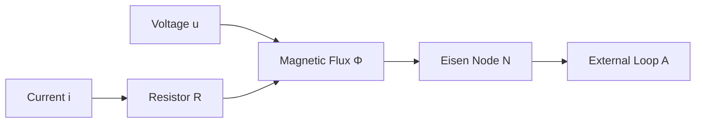
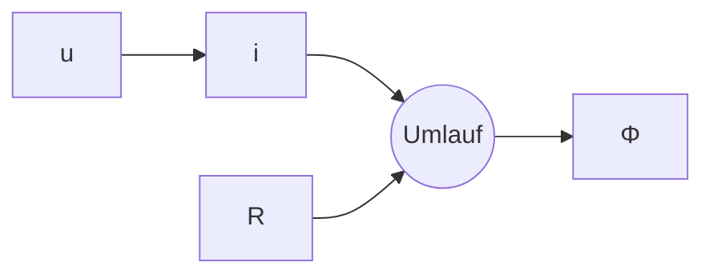
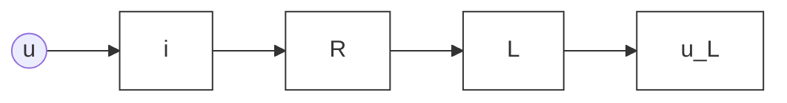
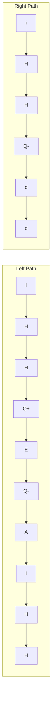

# 6 Zeitlich veränderliche magnetische Felder

原始 PDF 第 250–278 页。

# 6 Zeitlich veränderliche magnetische Felder

## 6.1 Induktionswirkungen

## 6.1.1 Das Induktionsgesetz in einfacher Form

Bewegt sich ein ungeladener leitender Stab gemäß Bild 6.1 durch ein Magnetfeld, so erfahren die Ladungsträger nach Gl. (5.10) eine Kraftwirkung: Die negativen Leitungs elektronen wandern im vorliegenden Fall an das untere Ende des Stabes, an dem dann negative Ladungen vorherrschen, während das obere Ende durch die Abwanderung der negativen Elektronen positiv geladen ist. Zwischen den Ladungen entgegengesetzten Vorzeichens an den Enden des Stabes entsteht ein elektrisches Feld $\vec { E } ,$ das von den positiven zu den negativen Ladungen gerichtet ist. Dieses Feld wird innerhalb des Leiters offensichtlich durch den Einfluss der magnetischen Feldstärke aufgehoben. Das Leiterinnere muss nämlich feldfrei sein, weil sonst noch ein Strom fließen würde. Es liegt nahe, die Größe ${ \vec { v } } \times { \vec { B } } _ { i }$ , die der Dimension nach eine elektrische Feldstärke ist, als Gegenfeldstärke aufzufassen, die durch magnetische Feldkräfte bedingt ist. Sie wird mit $\vec { E } _ { \mathbf { m } }$ bezeichnet. Damit kann mit

$$
\vec {E} _ {\mathrm{m}} = \vec {\nu} \times \vec {B}
$$

die Feldfreiheit im Leiter so formuliert werden:

$$
\vec {E} + \vec {E} _ {\mathrm{m}} = 0 \quad \text {oder} \quad \vec {E} = - \vec {v} \times \vec {B}.
$$

Um einen Zusammenhang mit den bisher verwendeten Begriffen herzustellen, wird gemäß Bild 6.2 ein Gedankenexperiment durchgeführt. Dabei sei der betrachtete Leiterstab mit leitenden Schienen so verbunden, dass in einem ruhenden Messinstrument die Spannung U gemessen werden kann. Es soll sich um ein ideales Messinstrument

text_image

B⃗
+  v⃗

Abb. 6.1: Ungeladener Leiterstab bewegt sich durch Magnetfeld.

text_image

+
I
E
E_m
B
Umlauf
dx
x

Abb. 6.2: Zum Induktionsgesetz.

https://doi.org/10.1515/9783110631586-006

---

6.1 Induktionswirkungen

241

handeln, so dass nur ein verschwindend kleiner Messstrom fließt. Zunächst wird U durch E ⋅ l ausgedrückt, wobei l den Abstand zwischen den Schienen bedeutet. Da v⃗ und $\vec { B }$ hier aufeinander senkrecht stehen, wird $E = \boldsymbol { \nu } \cdot \boldsymbol { B }$ und somit

$$
U = v \cdot B \cdot l. \tag {6.1}
$$

U nennt man die **induzierte Spannung**. Wird der Leiterstab innerhalb der Zeit dt um dx nach rechts verschoben, so lässt sich für U weiter schreiben:

$$
U = \frac {\mathrm{d} x}{\mathrm{d} t} B l = - B \frac {\mathrm{d} A}{\mathrm{d} t} = - \frac {\mathrm{d} \varPhi}{\mathrm{d} t}.
$$

Das Minuszeichen kommt dadurch zustande, dass die von der Leiterschleife umschlossene Fläche A bei einem Zuwachs von x abnimmt. Damit lautet das **Induktionsgesetz** in einfachster Form

$$
U = - \frac {\mathrm{d} \varPhi}{\mathrm{d} t}. \tag {6.2}
$$

Die induzierte Spannung ist also der zeitlichen Abnahme des Flusses proportional, der von der Leiterschleife umfasst wird. Diese Spannung entsteht auch, wie die Erfahrung zeigt, wenn die Flussänderung dadurch zustande kommt, dass ein sich zeitlich än derndes Magnetfeld eine starre und unbewegte Leiterschleife durchsetzt. Man sollte beachten, dass der Fluss $\Phi$ und die Umlaufrichtung – und damit die Zählrichtung der Spannung – im Sinne der Rechtsschraubenregel miteinander verknüpft sind.

## 6.1.2 Die Lenzsche Regel

Um das Induktionsgesetz noch etwas anschaulicher zu machen, kann man von Bild 6.3 ausgehen. Dort sind im rechten und linken Teilbild zwei Leiterschleifen dargestellt. In der oberen Leiterschleife fließt jeweils ein Strom $i _ { \mathbf { e } } ,$ der einen primären, magnetischen Fluss $\Phi _ { \mathrm { e } }$ erregt. Dieser Fluss durchsetzt, wenn man von der Streuung einmal absieht, auch die untere Leiterschleife. Erhöht man nun in der linken Anordnung den Strom um $\mathrm { d } i _ { \mathrm { e } } ,$ , so wächst der Fluss um $\mathbf { d } \varPhi _ { \mathbf { e } }$ an und hat in der unteren Windung nach dem Induktionsgesetz eine Spannung und damit einen Strom $i _ { \mathrm { i } }$ der eingetragenen Richtung zur Folge. Dieser Strom regt seinerseits einen sekundären Magnetfluss $\phi _ { \mathrm { s e k } }$ an,

Abb. 6.3: Zur Lenzschen Regel.

---

242

| 6 Zeitlich veränderliche magnetische Felder

der den ursprünglichen Fluss $\Phi _ { \mathrm { e } }$ zu vermindern sucht. Im rechten Teilbild soll der Strom $i _ { \mathrm { e } }$ abnehmen, wodurch ein sekundärer Fluss entsteht, der den ursprünglichen Fluss verstärkt. Der sekundäre Fluss wirkt also jedes Mal der Ursache entgegen. Diese Erscheinung ist unter dem Namen **Lenzsche Regel** bekannt.

## 6.1.3 Faraday-Maxwell’sches-Induktionsgesetz

Der magnetische Fluss $\Phi$ ist nach Gl. (5.18) definiert als Bündelung der magnetischen Flussdichte $\vec { B } ,$ die durch die von der Leiterschleife aufgespannte Fläche A hindurch tritt. Verändert sich nun der magnetische Fluss mit der Zeit, so wird in der Leiterschleife eine Spannung

$$
u _ {\mathrm{i}} = - \frac {\mathrm{d} \varPhi}{\mathrm{d} t}
$$

induziert. Im einfachsten Fall steht die Flussdichte B senkrecht auf der Fläche A und ist innerhalb der Leiterschleife homogen verteilt

$$
\Phi = \int_ {A _ {L}} \vec {B} \cdot \mathrm{d} \vec {A} = B \cdot A. \tag {6.3}
$$

Die Ableitung des magnetischen Flusses nach der Zeit führt dann mittels der Produktregel auf

$$
u _ {\mathrm{i}} = - \frac {\mathrm{d} \varPhi}{\mathrm{d} t} = \underbrace {- \frac {\mathrm{d} B}{\mathrm{d} t} A} _ {(1)} - \underbrace {B \frac {\mathrm{d} A}{\mathrm{d} t}} _ {(2)}. \tag {6.4}
$$

Dabei kann die zeitliche Veränderung des magnetischen Flusses durch zwei Ursachen entstehen. Teil (1) sagt aus, dass sich die magnetische Flussdichte mit der Zeit ändern kann und der Flächeninhalt konstant bleibt. Dieser Vorgang wird auch **Ruheinduktion** genannt und ist in Bild $6 . 4$ gezeigt. Teil (2) von Gl. (6.4) beschreibt den Fall, dass die Flussdichte $\vec { B }$ konstant ist und sich die Fläche A mit der Zeit ändert, so wie es z. B. in Bild 6.2 dargestellt ist. Dieser Anteil wird als **Bewegungsinduktion** interpretiert.

Die zeitliche Änderung des magnetischen Flusses erzeugt außerdem ein elektrisches Wirbelfeld $\vec { E } _ { \mathrm { i n d } }$ wie es Bild 6.5 zeigt.

**Integralform I** Der Summand (1) in Gleichung $(6.4)$ steht für den Anteil der induzierten Spannung, der durch eine zeitliche Änderung des magnetischen Feldes $\vec { B }$ entsteht

$$
u _ {\mathrm{i} 1} = \oint_ {L} \vec {E} _ {1} \cdot \mathrm{d} \vec {s} = - \frac {\mathrm{d} B}{\mathrm{d} t} A. \tag {6.5}
$$

Ist die magnetische Flussdichte innerhalb der Leiterschleife nicht homogen verteilt, müssen infinitesimale Anteile d $\vec { A }$ der Fläche A betrachtet werden (siehe Bild 6.6) und

---

6.1 Induktionswirkungen

243

text_image

B
dA
A
∂B/∂t ≠ 0
Leiterschleife
φ+
φ-
V
u(t)

Abb. 6.4: Leiterschleife und zeitlich sich änderndes Magnetfeld.

text_image

∂B/∂t ≠ 0
E\u2089\u2089\u2089
B\u2089

Abb. 6.5: Zeitlich sich änderndes Magnetfeld mit induziertem elektrischem Wirbelfeld.

text_image

∂A
∂A' → ∂B/∂t · dA = -du
∫E|dA · dS = -∂B/∂t · dA
∫E·dS = -∫A ∂B/∂t · dA
A

Abb. 6.6: Zur Herleitung der Integralform I.

man schreibt

$$
u _ {\mathrm{i} 1} = \oint_ {L} \vec {E} _ {1} \cdot \mathrm{d} \vec {s} = - \int_ {A _ {L}} \frac {\partial \vec {B}}{\partial t} \cdot \mathrm{d} \vec {A} \tag {6.6}
$$

wobei die Ableitung nach der Zeit als partielle Ableitung gekennzeichnet wird, da im allgemeinen Fall das magnetische Feld noch von den Ortskoordinaten abhängen kann.

Die Aussage von Gleichung (6.6) kann noch allgemeiner gefasst werden. Statt des Leiterwegs L darf eine beliebige Randkurve $\partial A$ und deren umrandete Fläche A betrachtet werden. Das heißt, es wird keine Leiterschleife benötigt, um das allgemeine Maxwell’sche Induktionsgesetz in der Integralform I zu formulieren

$$
\oint_ {\partial A} \vec {E} \cdot \mathrm{d} \vec {s} = - \int_ {A} \frac {\partial \vec {B}}{\partial t} \cdot \mathrm{d} \vec {A}. \tag {6.7}
$$

Wichtig ist nur, dass die Orientierung der Randkurve $\partial A$ und die Ausrichtung des Flächenelements $\mathrm { d } \vec { A }$ nach der Rechtsschraubenregel erfolgen muss. Beim Aufstellen

---

244

6 Zeitlich veränderliche magnetische Felder

der Maxwell’schen Gleichungen ist unbedingt darauf zu achten, dass alle Größen im selben Inertialsystem betrachtet werden müssen. Das bedeutet: alle Größen und Gleichungen werden entweder aus der Sicht eines Beobachters im ruhenden System oder im bewegten System formuliert.

**Anmerkung** Die Aussage dieser Form des Maxwell’schen Induktionsgesetzes ist nicht, dass durch Bewegungsinduktion, die auf der Lorentzkraft beruht, keine Spannung induziert wird, sondern dass ein zeitlich sich änderndes magnetisches Feld ein elektrisches Wirbelfeld hervorruft, so wie es in Bild 6.5 gezeigt ist.

**Integralform II** Diese beschreibt sowohl den Anteil der Ruheinduktion als auch den Anteil der Bewegungsinduktion. Die Herleitung der zweiten Integralform ist mathe matisch sehr anspruchsvoll, deshalb wird hier darauf verzichtet. Im Gegensatz zur Integralform I dürfen sich die Randkurve $\partial A ( t )$ und die umrandete Fläche A(t) zeitlich ändern und zwar sowohl in ihrer Ausdehnung als auch in ihrer Position. Dies wird durch die Geschwindigkeit u⃗ im Linienintegral berücksichtigt. Die Integralform II kann als verallgemeinerte Form von Gl. (6.4) aufgefasst werden:

$$
\oint_ {\partial A (t)} \left(\vec {E} + \vec {u} \times \vec {B}\right) \cdot \mathrm{d} \vec {s} = - \frac {\mathrm{d}}{\mathrm{d} t} \int_ {A (t)} \vec {B} \cdot \mathrm{d} \vec {A}. \tag {6.8}
$$

**Anmerkung** Wie noch am Beispiel 6.1 gezeigt werden wird, darf der Term $\vec { u } \times \vec { B }$ auf der linken Seite der Gleichung nicht fehlen, damit der Inhalt von Gleichung (6.4) korrekt wiedergegeben wird.

## Beispiel 6.1: Bewegter Leiterstab im Magnetfeld.

Das vorangegangene Beispiel zum Induktionsgesetz, welches die Gleichung (6.1) beschreibt und im Bild 6.2 dargestellt ist, soll hier nochmals betrachtet werden. Gegeben sei wieder ein beweglicher Leiterstab, der sich auf ideal-leitenden Schienen mit der konstanten Geschwindigkeit v⃗ in der eingezeichneten Richtung bewegt, siehe Bild 6.7. Zum

text_image

u_i
V
y
z
x
P'
P
dA
∂A(t)
B
E
A(t)
Q'
Q
v

Abb. 6.7: Beispiel zur Bewegungsinduktion: Beweglicher Leiterstab im homogenen Magnetfeld.

---

6.1 Induktionswirkungen

245

Zeitpunkt $t = 0$ befand sich der Leiterstab zwischen den Punkten $P ^ { \prime }$ und $Q ^ { \prime } .$ Zu einem beliebigen Zeitpunkt $t > 0$ befinde sich der Leiterstab zwischen den Punkten P und $Q .$

Die induzierte Spannung $u _ { \mathbf { i } }$ soll jetzt mit Hilfe der Integralform II des Maxwell’schen Induktionsgesetzes (6.8) berechnet werden.

## Lösung:

Das Spannungsmessgerät und die ideal-leitenden Schienen befinden sich in dem laborfesten System $\mathsf { S }$ und der bewegliche Leiterstab befindet sich im mit der Geschwin digkeit v⃗ bewegten System L. Ein Beobachter im laborfesten System $\mathsf { S }$ sieht, dass sich der Leiterstab mit der Geschwindigkeit v⃗ im homogenen Magnetfeld $\vec { B }$ bewegt. Auf die Ladungsträger im Stab wirkt die Lorentzkraft. Folglich gilt für die Feldstärke

$$
\vec {E} ^ {\mathrm{(S)}} = \vec {E} = - \vec {\nu} \times \vec {B}.
$$

Für einen Beobachter, der sich im System L befindet, ist die Geschwindigkeit des Leiters $\vec { v } ^ { ( \mathrm { L } ) }   = \vec { 0 }$ . Weil die Flussdichte homogen verteilt ist, spürt er auch keine Änderung der Flussdichte: $\vec { B } ^ { ( \mathsf { S } ) }   = \vec { B } ^ { ( \mathrm { L } ) }   = \vec { B }$ . Folglich gilt hier für die elektrische Feldstärke

$$
\vec {E} ^ {\mathrm{(L)}} = - \vec {\nu} ^ {\mathrm{(L)}} \times \vec {B} = \vec {0}.
$$

Betrachtet wird nun die Randkurve $\partial A ( t )$ der Fläche $A ( t )$ , deren Verlauf in Bild $6 . 7$ durch die vier Punkte $P ^ { \prime } , Q ^ { \prime } , Q , P$ und eine gestrichelte Linie markiert ist. Das geschlossene Linienintegral auf der linken Seite von Gl. (6.8) muss dafür in vier Abschnitte zerlegt werden:

$$
\begin{array}{l} \oint_ {\partial A (t)} (\vec {E} + \vec {u} \times \vec {B}) \cdot \mathrm{d} \vec {s} = \int_ {P ^ {\prime}} ^ {Q ^ {\prime}} (\vec {E} + \vec {u} \times \vec {B}) \cdot \mathrm{d} \vec {s} \quad (\text {Spannung am Messgerät, System S}) \\ + \int_ {Q ^ {\prime}} ^ {Q} (\vec {E} + \vec {u} \times \vec {B}) \cdot \mathrm{d} \vec {s} \quad \text {(ideal - leitende Schiene, System S)} \\ + \int_ {Q} ^ {P} (\vec {E} + \vec {u} \times \vec {B}) \cdot \mathrm{d} \vec {s} \quad (\text {bewegter Leiterstab, System L}) \\ + \int_ {P} ^ {P ^ {\prime}} (\vec {E} + \vec {u} \times \vec {B}) \cdot \mathrm{d} \vec {s} \quad \text {(ideal - leitende Schiene, System S)}. \\ \end{array}
$$

Die Größe u⃗ gibt dabei immer die Geschwindigkeit an, mit der sich das jeweilige System bewegt. Alle Gleichungen werden aus der Sicht des laborfesten Systems S aufgestellt. Das heißt, für das laborfeste System $\mathsf { S }$ gilt $\vec { u } = \vec { 0 }$ und für das System L des Leiterstabs ist $\vec { u } = \vec { v } .$ . Das Spannungsmessgerät misst die Spannung $u _ { \mathrm { i } }$ zwischen den Punkten $P ^ { \prime }$ und $Q ^ { \prime }$ im System S. Entlang der ideal-leitenden Schienen im System S ist die elektrische

---

246

6 Zeitlich veränderliche magnetische Felder

Feldstärke null. Hieraus ergeben sich für die vier Teilintegrale

$$
\begin{array}{l} \int_ {P ^ {\prime}} ^ {Q ^ {\prime}} (\vec {E} + \vec {u} \times \vec {B}) \cdot \mathrm{d} \vec {s} = \int_ {P ^ {\prime}} ^ {Q ^ {\prime}} (- \vec {v} \times \vec {B} + \vec {0} \times \vec {B}) \cdot \mathrm{d} \vec {s} = \int_ {P ^ {\prime}} ^ {Q ^ {\prime}} (- \vec {v} \times \vec {B}) \cdot \mathrm{d} \vec {s} = u _ {\mathrm{i}}, \\ \int_ {Q ^ {\prime}} ^ {Q} (\vec {E} + \vec {u} \times \vec {B}) \cdot \mathrm{d} \vec {s} = \int_ {Q ^ {\prime}} ^ {Q} (\vec {0} + \vec {0} \times \vec {B}) \cdot \mathrm{d} \vec {s} = 0, \\ \int_ {P} ^ {Q} \big (\vec {E} + \vec {u} \times \vec {B} \big) \cdot \mathrm{d} \vec {s} = \int_ {P} ^ {Q} \big (- \vec {v} \times \vec {B} + \vec {v} \times \vec {B} \big) \cdot \mathrm{d} \vec {s} = 0, \\ \int_ {P} ^ {P ^ {\prime}} \left(\vec {E} + \vec {u} \times \vec {B}\right) \cdot \mathrm{d} \vec {s} = \int_ {P} ^ {P ^ {\prime}} \left(\vec {0} + \vec {0} \times \vec {B}\right) \cdot \mathrm{d} \vec {s} = 0. \\ \end{array}
$$

Damit wird

$$
\oint_ {\partial A (t)} (\vec {E} + \vec {u} \times \vec {B}) \cdot \mathrm{d} \vec {s} = \int_ {P ^ {\prime}} ^ {Q ^ {\prime}} (- \vec {v} \times \vec {B}) \cdot \mathrm{d} \vec {s} = u _ {\mathrm{i}} = - \frac {\mathrm{d}}{\mathrm{d} t} \int_ {A (t)} \vec {B} \cdot \mathrm{d} \vec {A}. \tag {6.9}
$$

Die beiden verbliebenen Integrale sollen jetzt mit konkreteren Angaben berechnet werden: Gemäß Bild 6.7 gelten

$$
\vec {B} = B _ {0} (- \vec {e} _ {z}), \quad \vec {v} = v \vec {e} _ {x} \quad \Rightarrow \quad \vec {E} = v B _ {0} (- \vec {e} _ {y}).
$$

Die vier Punkte sollen die folgenden Werte haben:

$$
P ^ {\prime} = (x _ {0}; l), \quad Q ^ {\prime} = (x _ {0}; 0), \quad P = (x _ {0} + v t; l), \quad Q = (x _ {0} + v t; 0).
$$

Zunächst wird das Linienintegral berechnet, hierbei bewegt sich das Linienelement ds⃗ in negative y-Richtung:

$$
\int_ {P ^ {\prime}} ^ {Q ^ {\prime}} \left(- \vec {v} \times \vec {B}\right) \cdot \mathrm{d} \vec {s} = \int_ {s = 0} ^ {l} v B _ {0} (- \vec {e} _ {y}) \cdot (- \vec {e} _ {y})   \mathrm{d} s = \underline {{v B _ {0} l}}.
$$

Für das Flächenintegral über $A ( t )$ ist das Flächenelement $\mathbf { d } { \vec { A } } = \mathbf { d } x   \mathbf { d } y   { \vec { e } } _ { z }$ zu betrachten:

$$
- \frac {\mathrm{d}}{\mathrm{d} t} \int_ {A (t)} \vec {B} \cdot \mathrm{d} \vec {A} = - \frac {\mathrm{d}}{\mathrm{d} t} \int_ {x = x _ {0}} ^ {x _ {0} + v t} \int_ {y = 0} ^ {l} B _ {0} (- \vec {e} _ {z}) \cdot \mathrm{d} y   \mathrm{d} x \vec {e} _ {z} = - \frac {\mathrm{d}}{\mathrm{d} t} [ - B _ {0} l v t ] = \underline {{B _ {0} l v}}.
$$

Auf beiden Seiten der Gleichung (6.9) ergibt sich also korrekt die induzierte Spannung

$$
u _ {\mathrm{i}} = \nu B _ {0} l.
$$

---

6.1 Induktionswirkungen

247

text_image

(1)
(2)
(3)
Φ₁
Φ₂
Φ₃
Fluss vernachlässigen!
Uges
B

Abb. 6.8: Teilflüsse bei mehreren Windungen.

## 6.1.4 Weitere Formen des Induktionsgesetzes

Sind mehrere Windungen hintereinander geschaltet und ist jede Windung von einem anderen Teil- oder Bündelfluss durchsetzt (Bild 6.8), so addieren sich die nach Gl. (6.2) induzierten Teilspannungen:

$$
u = u _ {1} + u _ {2} + u _ {3} = - \frac {\mathrm{d} \varPhi_ {1}}{\mathrm{d} t} - \frac {\mathrm{d} \varPhi_ {2}}{\mathrm{d} t} - \frac {\mathrm{d} \varPhi_ {3}}{\mathrm{d} t} = - \frac {\mathrm{d}}{\mathrm{d} t} \left(\varPhi_ {1} + \varPhi_ {2} + \varPhi_ {3}\right).
$$

Die Summe der Teilflüsse bezeichnet man als den verketteten magnetischen Fluss, Induktionsfluss oder Gesamtfluss und schreibt:

$$
\Psi = \Phi_ {1} + \Phi_ {2} + \Phi_ {3}.
$$

Damit hat man

$$
u = - \frac {\mathrm{d} \Psi}{\mathrm{d} t} \tag {6.10}
$$

und für eine Spule mit N Windungen, bei der die N Bündelflüsse gleich sind:

$$
u \approx - N \frac {\mathrm{d} \varPhi}{\mathrm{d} t}. \tag {6.11}
$$

## 6.1.5 Eine Folgerung aus dem Induktionsgesetz

Die in den früheren Abschnitten 3 und 4 behandelten elektrischen Felder waren wirbelfrei. Elektrische Felder, die durch Induktionswirkungen entstehen – also mit Magnetfeldern verknüpft sind, die sich zeitlich ändern –, sind nach Gl. (6.7) nicht wirbelfrei. Damit ist das Linienintegral der elektrischen Feldstärke nicht mehr wegunabhängig (Bild 6.9):

$$
\oint_ {L} \vec {E} \cdot \mathrm{d} \vec {s} = \int_ {(1) A} ^ {B} \vec {E} \cdot \mathrm{d} \vec {s} + \int_ {(2) B} ^ {A} \vec {E} \cdot \mathrm{d} \vec {s} = - \frac {\mathrm{d} \varPhi}{\mathrm{d} t}
$$

---

248

6 Zeitlich veränderliche magnetische Felder

text_image

(1)
Φ
A
B
(2)

Abb. 6.9: Zur Wegabhängigkeit des Integrals $\int _ { A } ^ { B } { \vec { E } } \cdot \mathsf { d } { \vec { s } }$

oder

$$
\int_ {(1) A} ^ {B} \vec {E} \cdot \mathrm{d} \vec {s} = \int_ {(2) A} ^ {B} \vec {E} \cdot \mathrm{d} \vec {s} - \frac {\mathrm{d} \varPhi}{\mathrm{d} t}.
$$

Diese Tatsache ist z. B. in der Messtechnik zu beachten, wenn es etwa darum geht, den Spannungsabfall an einem stromdurchflossenen Leiter zwischen den Punkten P und Q zu bestimmen (Bild 6.10). Wird die Messleitung entlang der Linie (1) verlegt, so zeigt das Messinstrument die Spannung $u _ { 1 }$ an; bei der gestrichelt dargestellten Leitungsführung (2) die Spannung $u _ { 2 }$ . Die beiden Spannungen unterscheiden sich um $\mathsf { d } \varPhi / _ { \mathsf { d } t } ,$ , wobei $\Phi$ die Differenz der von den Schleifen (1) und (2) umfassten Flüsse ist.

Die Größe $\mathsf { d } \varPhi / _ { \mathsf { d } t }$ und damit ein möglicher Messfehler wird besonders groß, wenn entweder das Magnetfeld sehr stark ist oder aber die Änderungsgeschwindigkeit des Flusses. Der erste Fall begegnet einem vor allem in der Hochstromtechnik, der zweite in der Hochfrequenztechnik.

## Beispiel 6.2: Rotierende Leiterschleife im Magnetfeld.

Aus einem Stück Draht mit dem ohmschen Widerstand R formt man eine rechteckige Schleife und versetzt sie in langsame, gleichförmige Drehbewegung mit n Umdrehungen pro Sekunde. Die Rotationsachse stehe senkrecht auf der Richtung des zeitlich konstanten, homogenen Magnetfeldes B, in welches die Schleife ganz hineintaucht (Bild 6.11).

a) Welche Wärmeverlustleistung entsteht in der Schleife?
b) Welches Drehmoment muss man dabei in den verschiedenen Stellungen überwinden?

text_image

P (1)
u2(t) u1(t)
(2)
Φ(t)
i(t)
Q

Abb. 6.10: Messtechnische Anwendung zu Bild 6.9.

---

6.2 Die magnetische Feldenergie

249

text_image

B
a
b
φ
ω

Abb. 6.11: Rotierende Leiterschleife im Magnetfeld.

## Lösung:

$$
\begin{array}{l} \Phi = B a b \sin \underbrace {\omega t} _ {\varphi} \rightarrow u (t) = - \frac {\mathrm{d} \Phi}{\mathrm{d} t} = - \omega B a b \cos \omega t \\ i (t) = - \frac {\omega B a b}{R} \cos \omega t \quad \text { mit } \quad \omega = 2 \pi n. \\ \end{array}
$$

**a)** Leistung
b) Drehmoment $M _ { \mathrm { e l } } = P / \omega = \frac { \omega } { R } \left( B a b \right) ^ { 2 } \cos ^ { 2 } \omega t \qquad \mathrm { P r o b e } \left( M = - M _ { \mathrm { e l } } \right) ;$

$$
M = 2 \cdot F \cdot \frac {a}{2} \cos \omega t = a b i B \cos \omega t = - a b \frac {\omega B a b}{R} \cdot B \cos^ {2} \omega t = - \frac {\omega}{R} (B a b) ^ {2} \cos^ {2} \omega t.
$$

## 6.2 Die magnetische Feldenergie

## 6.2.1 Die zum Aufbau des Feldes erforderliche Energie

Zur Bestimmung der magnetischen Energie kann eine Anordnung nach Bild 6.12 be trachtet werden. Dabei soll der Eisenring einen so geringen Querschnitt im Vergleich zu den anderen Abmessungen haben, dass die magnetische Feldstärke im Ring als örtlich konstant angesehen werden kann. Zum Aufbau des Feldes ist Energie erforderlich, die von der Spannungsquelle geliefert wird. Um zu einer Energiebilanz zu kommen, stellt

flowchart

Abb. 6.12: Zur Bestimmung der magnetischen Feldenergie.

---

250

6 Zeitlich veränderliche magnetische Felder

man zuerst die Maschengleichung unter Einbeziehung des Induktionsgesetzes nach Gl. (6.11) auf. Bei der im Bild gekennzeichneten Umlaufrichtung folgt:

$$
- u + i R = - N \frac {\mathrm{d} \varPhi}{\mathrm{d} t}.
$$

Multipliziert man diese Gleichung mit i dt, so erhält man

$$
- u i \mathrm{d} t + i ^ {2} R \mathrm{d} t = - N i \mathrm{d} \varPhi .
$$

Hierbei ist der erste Summand die von der Spannungsquelle gelieferte elektrische Energie. Das Minuszeichen weist im Verbraucherzählpfeilsystem auf eine Energieabga be hin. Der zweite Summand stellt die im Widerstand in Wärme umgesetzte Energie dar. Der Term auf der rechten Seite muss die zum Aufbau des Magnetfeldes benötigte Energie sein, da weitere Energieformen hier nicht auftreten. Daraus folgt

$$
\mathrm{d} W _ {\mathrm{m}} = N i \mathrm{d} \Phi = i N A \mathrm{d} B. \tag {6.12}
$$

Der Index m wird im Folgenden weggelassen, da jetzt nur die magnetische Energie betrachtet wird und Verwechslungen nicht möglich sind. Der Zusammenhang zwischen dem Strom und der magnetischen Feldstärke ist für die vorliegende Anordnung durch Gl. (5.11) bekannt. Somit folgt aus Gl. (6.12):

$$
\mathrm{d} W = 2 \pi \varrho H A \mathrm{d} B.
$$

Hierin ist 2πϱA offensichtlich das Volumen des Eisenkerns, so dass sich ergibt:

$$
\mathrm{d} W = V H \mathrm{d} B
$$

oder

$$
W = V \int_ {0} ^ {B _ {\mathrm{e}}} H \mathrm{d} B. \tag {6.13}
$$

Hier bedeutet $B _ { \mathsf { e } }$ den Endwert der Flussdichte, der sich nach dem Aufbau des Magnetfeldes eingestellt hat. Für die Energie pro Volumen, also $w = W / _ { V } ,$ gilt

$$
w = \int_ {0} ^ {B _ {\mathrm{e}}} H \mathrm{d} B. \tag {6.14}
$$

Der analoge Ausdruck für das elektrische Feld ist in Bild 3.31 durch die schraffierte Fläche gekennzeichnet.

Bis jetzt wurde ein homogenes Magnetfeld vorausgesetzt. Im inhomogenen Fall ist noch über das Volumen zu integrieren:

$$
W = \int_ {V} w \mathrm{d} V. \tag {6.15}
$$

---

6.2 Die magnetische Feldenergie

251

Das Integral Gl. (6.14) lässt sich, wenn die Permeabilität konstant ist, leicht auswerten:

$$
w = \int_ {0} ^ {B _ {\mathrm{e}}} \frac {B}{\mu} \mathrm{d} B = \frac {1}{2} \frac {B _ {\mathrm{e}} ^ {2}}{\mu}.
$$

Man lässt bei $B _ { \mathsf { e } }$ jetzt den Index e weg und notiert mit $B = \mu H$ insgesamt drei Ausdrücke für die magnetische **Energiedichte**:

$$
w = \frac {1}{2} \mu H ^ {2} = \frac {1}{2} B H = \frac {1}{2} \frac {B ^ {2}}{\mu}. \tag {6.16}
$$

Diese Ausdrücke entsprechen denen, die für das elektrische Feld durch Gl. (3.44) hergeleitet wurden.

## 6.2.2 Die Hystereseverluste

Wird bei einem Eisenkern mit der Kennlinie nach Bild 5.12 die magnetische Erregung von einem Endwert $H _ { \mathrm { e } }$ auf null verringert, so gewinnt man die magnetische Energie vollständig zurück. Anders ist es bei ferromagnetischen Stoffen, die die Erscheinung der Hysterese zeigen.

Das soll an Hand von Bild 6.13 erläutert werden. Die magnetische Feldstärke sei zunächst null. Ausgehend vom Zustand A wird H bis zu einem Endwert $H _ { \mathrm { e } }$ vergrößert. Dabei ist eine Arbeit aufzuwenden, die der waagerecht schraffierten Fläche entspricht.

text_image

-Hₑ
C
A
B
Hₑ

Abb. 6.13: Hystereseverluste.

---

252

| 6 Zeitlich veränderliche magnetische Felder

Beim Verringern der Feldstärke von $H _ { \mathrm { e } }$ auf null (Punkt C) wird Energie zurückgewonnen, die durch die senkrecht schraffierte Fläche gekennzeichnet ist. Lässt man nun H auf $- H _ { \mathrm { e } }$ anwachsen, so ist wieder Arbeit aufzuwenden, dargestellt durch die waagerecht schraffierte Fläche links von der Ordinatenachse. Bei der Rückkehr zum Ausgangspunkt A gewinnt man etwas Energie zurück, gekennzeichnet durch die senkrecht schraffierte Fläche. Insgesamt tritt also ein Energieverlust beim Durchlaufen der Hystereseschleife auf, der genau der von der Schleife umschlossenen Fläche entspricht. Derartige Verluste nennt man **Hystereseverluste**.

## 6.3 Induktivitäten

## 6.3.1 Die Selbstinduktivität

Betrachtet werden soll eine Leiterschleife, die an eine Quelle angeschlossen ist, die eine sich zeitlich ändernde Spannung liefert (Bild 6.14). Dann sind auch der sich einstellende Strom und das mit diesem verknüpfte Magnetfeld zeitlich veränderlich. Das Magnetfeld wirkt nach dem Induktionsgesetz bzw. der Lenzschen Regel auf die Leiterschleife zurück. Nach den Gln. (6.2) und (6.8) stellt sich ein solcher Strom ein, dass die Summe der Spannungen auf dem Umlauf L gleich der zeitlichen Abnahme des umfassten Flusses wird. Im vorliegenden Fall ergibt sich für einen Umlauf entlang der Leiterschleife im Sinne des eingezeichneten Pfeils bei Beachtung der Rechtsschraubenregel:

$$
- u + i R = - \frac {\mathrm{d} \varPhi}{\mathrm{d} t}. \tag {6.17}
$$

Zwischen dem Fluss $\Phi$ und dem Strom i besteht nach Abschnitt 5.6 oft ein linearer Zusammenhang. Dann setzt man

$$
\Phi = L \cdot i, \tag {6.18}
$$

wobei der Proportionalitätsfaktor L die **Selbstinduktivität** der Schleife genannt wird. Damit lässt sich Gl. (6.17) schreiben als

$$
- u + i R + L \frac {\mathrm{d} i}{\mathrm{d} t} = 0.
$$

Für diesen Zusammenhang kann man ein Ersatzschaltbild angeben, in dem die Wirkung der räumlich ausgedehnten Leiterschleife durch Schaltkreissymbole dargestellt wird

flowchart

Abb. 6.14: Stromdurchflossene Leiterschleife; Selbstinduktivität.

---

6.3 Induktivitäten

253

flowchart

Abb. 6.15: Elektrisches Ersatzschaltbild der stromdurchflossenen Leiterschleife in Bild 6.14.

(Bild 6.15). Die Selbstinduktivität kann man also als Schaltkreiselement auffassen, bei dem der Zusammenhang zwischen Spannung und Strom durch

$$
u _ {L} = L \frac {\mathrm{d} i}{\mathrm{d} t} \tag {6.19}
$$

gegeben ist. Genauso wie bei elektrischen Widerständen sind den Größen Strom und Spannung Zählpfeile gleicher Richtung zuzuordnen.

Besteht die Leiterschleife aus N Windungen, so ist in den Gln. (6.17) und (6.18) an Stelle von Φ der Gesamtfluss $\Psi$ einzusetzen oder NΦ, wenn alle Windungen den gleichen Fluss umfassen:

$$
\Psi = L i \quad \text {bzw.} \quad N \Phi = L i . \tag {6.20}
$$

Formt man NΦ unter Berücksichtigung des Ohm’schen Gesetzes des magnetischen Kreises gemäß

$$
N \Phi = N \Theta \Lambda = N N i \Lambda = N ^ {2} \Lambda i
$$

um, so folgt durch Vergleich mit Gl. (6.20) für den Zusammenhang zwischen der Selbstinduktivität und dem magnetischen Leitwert:

$$
L = N ^ {2} \Lambda . \tag {6.21}
$$

## 6.3.2 Die Gegeninduktivität

Ist neben der einen stromdurchflossenen Leiterschleife nach Bild 6.14 in nicht allzu großer Entfernung noch eine zweite, gleichartige Leiterschleife vorhanden (Bild 6.16), so werden sich die Leiterschleifen über die mit ihnen verknüpften magnetischen Felder

```mermaid
graph LR
  u1["u1"] --> i1["i1"]
  i1 --> R1["R1"]
  R1 --> u1
  u1 --> i2["i2"]
  i2 --> u2["u2"]
  u2 --> i2
  u2 --> R2["R2"]
  R2 --> u2
  u2 --> R2
  R2 --> \nFif1["\nFif1"] --> R1
  R1 --> \nFif2["\nFif2"] --> R1
  R1 --> \nFif3["\nFif3"] --> R1
  R1 --> \nFif4["\nFif4"] --> R1
  R1 --> \nFif5["\nFif5"] --> R1
  R1 --> \nFif6["\nFif6"] --> R1
  R1 --> \nFif7["\nFif7"] --> R1
  R1 --> \nFif8["\nFif8"] --> R1
  R1 --> \nFif9["\nFif9"] --> R1
  R1 --> \nFif10["\nFif10"] --> R1
  R1 --> \nFif11["\nFif11"] --> R1
  R1 --> \nFif12["\nFif12"] --> R1
  R1 --> \nFif13["\nFif13"] --> R1
  R1 --> \nFif14["\nFif14"] --> R1
  R1 --> \nFif15["\nFif15"] --> R1
  R1 --> \nFif16["\nFif16"] --> R1
  R1 --> \nFif17["\nFif17"] --> R1
  R1 --> \nFif18["\nFif18"] --> R1
  R1 --> \nFif19["\nFif19"] --> R1
  R1 --> \nFif20["\nFif20"] --> R1
  R1 --> \nFif21["\nFif21"] --> R1
  R1 --> \nFif22["\nFif22"] --> R1
  R1 --> \nFif23["\nFif23"] --> R1
  R1 --> \nFif24["\nFif24"] --> R1
  R1 --> \nFif25["\nFif25"] --> R1
  R1 --> \nFif26["\nFif26"] --> R1
  R1 --> \nFif27["\nFif27"] --> R1
  R1 --> \nFif28["\nFif28"] --> R1
  R1 --> \nFif29["\nFif29"] --> R1
  R1 --> \nFif30["\nFif30"] --> R1
  R1 --> \nFif31["\nFif31"] --> R1
  R1 --> \nFif32["\nFif32"] --> R1
  R1 --> \nFif33["\nFif33"] --> R1
  R1 --> \nFif34["\nFif34"] --> R1
  R1 --> \nFif35["\nFif35"] --> R1
  R1 --> \nFif36["\nFif36"] --> R1
  R1 --> \nFif37["\nFif37"] --> R1
  R1 --> \nFif38["\nFif38"] --> R1
  R1 --> \nFif39["\nFif39"] --> R1
  R1 --> \nFif40["\nFif40"] --> R1
  R1 --> \nFif41["\nFif41"] --> R1
  R1 --> \nFif42["\nFif42"] --> R1
  R1 --> \nFif43["\nFif43"] --> R1
  R1 --> \nFif44["\nFif44"] --> R1
  R1 --> \nFif45["\nFif45"] --> R1
  R1 --> \nFif46["\nFif46"] --> R1
  R1 --> \nFif47["\nFif47"] --> R1
  R1 --> \nFif48["\nFif48"] --> R1
  R1 --> \nFif49["\nFif49"] --> R1
  R1 --> \nFif50["\nFif50"] --> R1
  R1 --> \nFif51["\nFif51"] --> R1
  R1 --> \nFif52["\nFif52"] --> R1
  R1 --> \nFif53["\nFif53"] --> R1
  R1 --> \nFif54["\nFif54"] --> R1
  R1 --> \nFif55["\nFif55"] --> R1
  R1 --> \nFif56["\nFif56"] --> R1
  R1 --> \nFif57["\nFif57"] --> R1
  R1 --> \nFif58["\nFif58"] --> R1
  R1 --> \nFif59["\nFif59"] --> R1
  R1 --> \nFif60["\nFif60"] --> R1
  u2_((2)) -.-> i2_((2))
  u2_((2)) -.-> i2_((2))
```

flowchart

Abb. 6.16: Zwei magnetisch gekoppelte Leiterschleifen.

---

254

| 6 Zeitlich veränderliche magnetische Felder

gegenseitig beeinflussen. Das Induktionsgesetz auf beide Schleifen angewendet ergibt

$$
\begin{array}{l} - u _ {1} + i _ {1} R _ {1} = - \frac {\mathrm{d} \varPhi_ {1}}{\mathrm{d} t}, \\ - u _ {2} + i _ {2} R _ {2} = - \frac {\mathrm{d} \varPhi_ {2}}{\mathrm{d} t}. \tag {6.22} \\ \end{array}
$$

Die Flüsse $\Phi _ { 1 }$ und $\Phi _ { 2 }$ werden jetzt von beiden Strömen verursacht. Unterstellt man wieder einen linearen Zusammenhang zwischen Strömen und Flüssen, so kann man $\Phi _ { 1 }$ und $\Phi _ { 2 }$ als Summe von Teilflüssen darstellen. Ist der Beitrag des Stromes $i _ { 1 }$ zum Fluss in Schleife 1

$$
\Phi_ {1 1} = L _ {1 1} i _ {1} \tag {6.23}
$$

und der Beitrag des Stromes $i _ { 2 }$ zum Fluss in derselben Schleife

$$
\Phi_ {1 2} = L _ {1 2} i _ {2}, \tag {6.24}
$$

so folgt der Gesamtfluss in Schleife 1:

$$
\Phi_ {1} = \Phi_ {1 1} + \Phi_ {1 2} = L _ {1 1} i _ {1} + L _ {1 2} i _ {2}. \tag {6.25}
$$

Entsprechend ergibt sich für den Fluss in Schleife 2:

$$
\Phi_ {2} = \Phi_ {2 1} + \Phi_ {2 2} = L _ {2 1} i _ {1} + L _ {2 2} i _ {2}. \tag {6.26}
$$

Die hier eingeführten Proportionalitätsfaktoren $L _ { 1 1 }$ und $L _ { 2 2 }$ sind die Selbstinduktivitä- ten der Schleifen 1 und 2. Man kann schreiben

$$
L _ {1 1} = L _ {1} \quad \text {und} \quad L _ {2 2} = L _ {2}. \tag {6.27}
$$

Die Größen $L _ { 1 2 }$ und $L _ { 2 1 }$ nennt man die Gegeninduktivitäten zwischen den beiden Schleifen. Wie in Abschnitt 6.3.3 gezeigt wird, sind beide Größen gleich; üblich ist die Bezeichnung

$$
L _ {1 2} = L _ {2 1} = M. \tag {6.28}
$$

Setzt man die Gln. (6.25) und (6.26) unter Beachtung der Gln. (6.27) und (6.28) in Gl. (6.22) ein, so erhält man

$$
\begin{array}{l} - u _ {1} + i _ {1} R _ {1} = - L _ {1} \frac {\mathrm{d} i _ {1}}{\mathrm{d} t} - M \frac {\mathrm{d} i _ {2}}{\mathrm{d} t}, \\ - u _ {2} + i _ {2} R _ {2} = - L _ {2} \frac {\mathrm{d} i _ {2}}{\mathrm{d} t} - M \frac {\mathrm{d} i _ {1}}{\mathrm{d} t}. \tag {6.29} \\ \end{array}
$$

Indem man in der ersten Gleichung den Term $M ^ { \mathrm { d } i _ { 1 } } / \mathrm { d } t$ hinzufügt und wieder abzieht, in der zweiten Zeile entsprechend mit dem Summanden $M   \mathrm { d } i _ { 2 } \big / \mathrm { d } t$ verfährt, kann man durch zweckmäßiges Zusammenfassen folgende Gleichungen erhalten:

$$
\begin{array}{l} - u _ {1} + R _ {1} i _ {1} + (L _ {1} - M) \frac {\mathrm{d} i _ {1}}{\mathrm{d} t} + M \frac {\mathrm{d} (i _ {1} + i _ {2})}{\mathrm{d} t} = 0, \\ - u _ {2} + R _ {2} i _ {2} + (L _ {2} - M) \frac {\mathrm{d} i _ {2}}{\mathrm{d} t} + M \frac {\mathrm{d} (i _ {1} + i _ {2})}{\mathrm{d} t} = 0. \tag {6.30} \\ \end{array}
$$

---

6.3 Induktivitäten

255

Diese Gleichungen lassen sich durch die Ersatzschaltung nach Bild 6.17 darstellen.

Hat man an Stelle der Schleifen 1 und 2 jetzt Wicklungen mit $N _ { 1 }$ bzw. $N _ { 2 }$ Windungen, so muss in den Gln. (6.22) bis (6.26) der Fluss $\Phi$ jeweils durch den Gesamtfluss Ψ ersetzt werden. Unter der Annahme, dass jedes Mal alle Windungen den gleichen Fluss umfassen, wird z. B. aus der linken Seite von Gl. (6.24), ein unverzweigter magnetischer Kreis vorausgesetzt:

$$
\Psi_ {1 2} = N _ {1} \varPhi_ {1 2} = N _ {1} (\varTheta_ {2} \varLambda) = N _ {1} N _ {2} \varLambda i _ {2}.
$$

Für die rechte Seite schreibt man wegen Gl. (6.28) $M i _ { 2 }$ und erhält durch Vergleich:

$$
M = N _ {1} N _ {2} \Lambda . \tag {6.31}
$$

Es fehlt noch eine Maßeinheit für L (bzw. M).

Mit Gl. (6.18) wird

$$
[ L ] = \frac {[ \varPhi ]}{[ I ]} = \frac {\mathrm{Vs}}{\mathrm{A}} = \Omega \mathrm{s},
$$

wofür man abkürzend schreibt

$$
1 \Omega \mathrm{s} = 1 \text {Henry} = 1 \mathrm{H}.
$$

## 6.3.3 Die magnetische Energie eines Systems stromdurchflossener Leiterschleifen

Zunächst soll die magnetische Energie berechnet werden, die das Feld einer Spule mit der Induktivität L speichert, wenn durch die Spulenwicklung der Strom I fließt. Man geht wie in Abschnitt 3.8.1 von der Beziehung

$$
W _ {\mathrm{m}} = \int_ {0} ^ {\infty} u (t) i (t)   \mathrm{d} t
$$

aus und setzt für die Spannung, die an der Spule anliegt, gemäß Gl. (6.19)

$$
u = L \frac {\mathrm{d} i}{\mathrm{d} t}
$$

ein. Dann wird

$$
W _ {\mathrm{m}} = \int_ {0} ^ {\infty} L \frac {\mathrm{d} i}{\mathrm{d} t} i \mathrm{d} t = \int_ {0} ^ {I} L i \mathrm{d} i.
$$

text_image

i₁
R₁ L₁-M L₂-M R₂ i₂
u₁ M u₂

Abb. 6.17: Ersatzschaltbild zu Bild 6.16.

---

256

| 6 Zeitlich veränderliche magnetische Felder

Hierbei bedeutet I den zeitlich konstanten Spulenstrom. Ist L konstant, was hier vorausgesetzt wird, dann folgt

$$
W _ {\mathrm{m}} = \frac {1}{2} L I ^ {2}. \tag {6.32}
$$

Hat man zwei Spulen mit den Induktivitäten $L _ { 1 }$ und $L _ { 2 }$ und sind die zugehörigen Ströme $I _ { 1 }$ und $I _ { 2 }$ , so werden die Energien

$$
W _ {1} = \frac {1}{2} L _ {1} I _ {1} ^ {2} \quad \text {und} \quad W _ {2} = \frac {1}{2} L _ {2} I _ {2} ^ {2}
$$

gespeichert, solange zwischen beiden Spulen keine magnetische Kopplung besteht.

Nun soll berechnet werden, wie sich die Energie ändert, wenn eine solche Kopplung vorliegt. Die Zählrichtungen beziehen sich auf Bild 6.16. Die ohmschen Widerstände sollen aber vernachlässigt werden. Damit werden die Spannungsgleichungen (6.17) unter Berücksichtigung der Gln. (6.25) und (6.26):

$$
u _ {1} = L _ {1} \frac {\mathrm{d} i _ {1}}{\mathrm{d} t} + L _ {1 2} \frac {\mathrm{d} i _ {2}}{\mathrm{d} t},
$$

$$
u _ {2} = L _ {2} \frac {\mathrm{d} i _ {2}}{\mathrm{d} t} + L _ {2 1} \frac {\mathrm{d} i _ {1}}{\mathrm{d} t}. \tag {6.33}
$$

Innerhalb des Zeitintervalls dt geben die Spannungsquellen die Energien ab:

$$
u _ {1} i _ {1} \mathrm{d} t = L _ {1} i _ {1} \mathrm{d} i _ {1} + L _ {1 2} i _ {1} \mathrm{d} i _ {2},
$$

$$
u _ {2} i _ {2} \mathrm{d} t = L _ {2} i _ {2} \mathrm{d} i _ {2} + L _ {2 1} i _ {2} \mathrm{d} i _ {1}.
$$

Es können zwei Fälle unterschieden werden:

**Fall a:** In Spule 1 fließt schon der Endwert des Stromes, also $i _ { 1 } = I _ { 1 }$ und $\mathbf { d } i _ { 1 } = 0$ . In Spule 2 soll der Strom von Null auf den Endwert $I _ { 2 }$ vergrößert werden. Damit wird der gesamte Energiezuwachs

$$
\mathrm{d} W _ {\mathrm{a}} = u _ {1} I _ {1} \mathrm{d} t + u _ {2} i _ {2} \mathrm{d} t = L _ {1 2} I _ {1} \mathrm{d} i _ {2} + L _ {2} i _ {2} \mathrm{d} i _ {2}
$$

und nach Integration über $\mathrm { d } i _ { 2 }$ von Null bis $I _ { 2 }$ :

$$
W _ {\mathrm{a}} = L _ {1 2} I _ {1} I _ {2} + \frac {1}{2} L _ {2} I _ {2} ^ {2}.
$$

Die gesamte Energie des Systems ist demnach gleich der Summe aus dem Energiebeitrag $1 / _ { 2 } L _ { 1 } I _ { 1 } ^ { 2 }$ , der nur von $I _ { 1 }$ abhängt, und dem soeben ermittelten Anteil $W _ { \mathbf { a } }$ , also

$$
W _ {\mathrm{ges}} = \frac {1}{2} L _ {1} I _ {1} ^ {2} + L _ {1 2} I _ {1} I _ {2} + \frac {1}{2} L _ {2} I _ {2} ^ {2}. \tag {6.34}
$$

**Fall b:** In Spule 2 hat sich bereits der Endwert des Stromes eingestellt: $i _ { 2 } = I _ { 2 } ; \mathbf { d } i _ { 2 } = 0 .$ In Spule 1 wächst der Strom von Null auf $I _ { 1 }$ . Damit ergibt sich ein Energiezuwachs von

$$
\mathrm{d} W _ {\mathrm{b}} = u _ {1} i _ {1} \mathrm{d} t + u _ {2} I _ {2} \mathrm{d} t = L _ {1} i _ {1} \mathrm{d} i _ {1} + L _ {2 1} i _ {2} \mathrm{d} i _ {1}
$$

---

6.3 Induktivitäten

257

und nach Integration:

$$
W _ {\mathrm{b}} = \frac {1}{2} L _ {1} I _ {1} ^ {2} + L _ {2 1} I _ {2} I _ {1}.
$$

Die gesamte Energie ergibt sich in Analogie zu Gl. (6.34) zu:

$$
W _ {\mathrm{ges}} = \frac {1}{2} L _ {2} I _ {2} ^ {2} + L _ {2 1} I _ {2} I _ {1} + \frac {1}{2} L _ {1} I _ {1} ^ {2}. \tag {6.35}
$$

Da die Energie des Systems nicht davon abhängen kann, in welcher Reihenfolge die Ströme ihre Endwerte erreichen, müssen die mit den Gln. (6.34) und (6.35) bezeichneten Ausdrücke übereinstimmen, womit

$$
L _ {1 2} = L _ {2 1} \tag {6.36}
$$

wird. Diesen Zusammenhang nennt man den **Umkehrungssatz**. Verwendet man gemäß Gl. (6.28) die Abkürzung M, so folgt für die magnetische Energie des betrachteten Systems:

$$
W _ {\mathrm{m}} = \frac {1}{2} L _ {1} I _ {1} ^ {2} + M I _ {1} I _ {2} + \frac {1}{2} L _ {2} I _ {2} ^ {2}. \tag {6.37}
$$

Es lässt sich zeigen, dass für ein System aus n stromdurchflossenen Leiterschleifen die Formel gilt:

$$
W _ {\mathrm{m}} = \frac {1}{2} \sum_ {\mu = 1} ^ {n} \sum_ {\nu = 1} ^ {n} L _ {\mu \nu} I _ {\mu} I _ {\nu}. \tag {6.38}
$$

Darin bedeutet dann $L _ { \mu \mu }$ die Selbstinduktivität der $\mu \cdot$ ten Leiterschleife und $L _ { \mu \nu } = L _ { \nu \mu }$ die Gegeninduktivität zwischen der μ-ten und der ν-ten Schleife.

## Beispiel 6.3: Ersatzinduktivität.

Gegeben ist ein magnetischer Kreis mit zwei Spulen. Ihre Induktivitäten sind $L _ { 1 }$ und $L _ { 2 }$ und zwischen beiden Spulen besteht die Gegeninduktivität M, Bild 6.18. Die magnetischen Flüsse sollen vollständig im Eisen verlaufen. Damit enthalten $L _ { 1 } , L _ { 2 }$ , M die Wirkung des Eisens.

a) Wie groß ist die in diesem Kreis gespeicherte magnetische Energie?
b) Jetzt werden beide Spulen hintereinander geschaltet, und zwar so, dass α) $\boldsymbol{i}_{1}=\boldsymbol{i}_{2}, \boldsymbol{\beta}) \boldsymbol{i}_{1}=-\boldsymbol{i}_{2}$ ist.

Wie müsste jeweils die Induktivität einer Ersatzspule gewählt werden, damit bei gleichem Strom die gleiche magnetische Energie gespeichert wird?

text_image

i₁
M
Eisen
L₁
L₂
i₂

Abb. 6.18: Eisenkern mit zwei Wicklungen und zugeordneten Induktivitäten: Gegeninduktivität M sowie Selbstinduktivitäten $L _ { 1 }$ und $L _ { 2 }$

---

258

| 6 Zeitlich veränderliche magnetische Felder

## Lösung:

b) 1/2Lα i21 = 1/2L1i21 + Mi21 + 1/2L2i21

$$
\rightarrow L _ {\alpha} = L _ {1} + L _ {2} + 2 M,
$$

entsprechend

$$
\rightarrow L _ {\beta} = L _ {1} + L _ {2} - 2 M.
$$

## 6.3.4 Methoden zur Berechnung von Selbst- und Gegeninduktivitäten

Geht man von den durch die Gln. (6.13) und (6.19) gegebenen Definitionen aus, so kann man Selbst- und Gegeninduktivitäten über die magnetischen Flüsse ausrechnen:

$$
L = \frac {\Phi}{I} \tag {6.39}
$$

und

$$
M \equiv L _ {1 2} = \frac {\Phi_ {1 2}}{I _ {2}}. \tag {6.40}
$$

Im Fall der Selbstinduktivität hat man sich also einen Strom in der betrachteten, ge schlossenen Leiterschleife vorzugeben und dann den Fluss zu bestimmen, der genau eine Fläche durchsetzt, die die Leiterschleife aufspannt. Im Fall der Gegeninduktivität gibt man sich einen Strom in einer der beiden Leiterschleifen vor und berechnet den Fluss, der von der zweiten Leiterschleife umfasst wird. Hat man es nicht mit der Windungszahl eins zu tun, sondern mit N bzw. $N _ { 1 }$ und $N _ { 2 } ,$ , so kann man zunächst – wie beschrieben – mit der Windungszahl eins rechnen und nachträglich die Windungszahlen gemäß den Gln. (6.21) und (6.31) ergänzen. Voraussetzung ist dabei, dass alle Windungen einer Wicklung den gleichen Fluss umfassen.

Die hier beschriebene Vorgehensweise führt nicht zum Erfolg, wenn man den Fluss nicht eindeutig der Leiterschleife zuordnen kann, die ihn umfasst. Dann geht man von den Gln. (6.32) bzw. (6.37) aus und hat z. B. für die Selbstinduktivität

$$
L = \frac {2 W _ {\mathrm{m}}}{I ^ {2}}. \tag {6.41}
$$

Man nimmt also einen bestimmten Strom an, ermittelt mit einer der in Abschnitt 6.2.1 angegebenen Formeln die zugehörige Feldenergie und bildet den Quotienten gemäß Gl. (6.41). Wir betrachten als erste Anwendung die Doppelleitung nach Bild 5.4. Da der magnetische Fluss in Beispiel 5.7 schon bestimmt wurde, liefert Gl. (6.39) sofort für die Induktivität pro Länge:

$$
\frac {L}{l} = L ^ {\prime} = \frac {\mu_ {0}}{\pi} \ln \frac {d}{\varrho_ {0}}. \tag {6.42}
$$

Als zweites Beispiel soll ein Koaxialkabel nach Bild 6.19 behandelt und dabei die Gl. (6.41) angewendet werden. Die gesamte magnetische Energie besteht aus drei Anteilen: der im Innenleiter, im Luftraum und im Außenleiter gespeicherten Energie.

---

6.3 Induktivitäten

259

Für den Innenleiter erhält man mit dem aus Beispiel 5.5 bekannten H und Gl. (6.16):

$$
\begin{array}{l} W _ {1} = \frac {1}{2} \mu_ {1} \int H ^ {2} \mathrm{d} V \quad \text { mit } \quad \mathrm{d} V = 2 \pi \varrho \cdot \mathrm{d} \varrho \cdot l, \\ W _ {1} = \frac {I ^ {2} \mu_ {1} l}{2 \cdot 2 \pi \varrho_ {1} ^ {4}} \int_ {0} ^ {\varrho_ {1}} \varrho^ {3} \mathrm{d} \varrho = \frac {\mu_ {1} I ^ {2} l}{1 6 \pi}. \\ \end{array}
$$

Demnach ist wegen Gl. (6.41):

$$
L _ {1} ^ {\prime} = \frac {\mu_ {1}}{8 \pi}.
$$

Für den Luftraum zwischen Außen- und Innenleiter ergibt sich auf gleiche Weise mit dem nach Gl. (5.11) bekannten H:

$$
W _ {2} = \frac {I ^ {2} \mu_ {2} l}{2 \cdot 2 \pi} \int_ {\varrho_ {1}} ^ {\varrho_ {2}} \frac {\mathrm{d} \varrho}{\varrho} = \frac {I ^ {2} \mu_ {2} l}{2 \cdot 2 \pi} \ln \frac {\varrho_ {2}}{\varrho_ {1}}.
$$

Damit folgt

$$
L _ {2} ^ {\prime} = \frac {\mu_ {2}}{2 \pi} \ln \frac {\varrho_ {2}}{\varrho_ {1}}. \tag {6.43}
$$

Auf die Bestimmung von $L _ { 3 } ^ { \prime }$ wird hier verzichtet.

Die dem Luftraum zugeordnete Induktivität kann man auch über den Fluss ausrechnen:

$$
\begin{array}{l} \Phi_ {2} = \mu_ {2} \int_ {A} H \mathrm{d} A \quad \text {mit} \quad \mathrm{d} A = l \mathrm{d} \varrho , \\ \Phi_ {2} = \frac {\mu_ {2} I l}{2 \pi} \int_ {\varrho_ {1}} ^ {\varrho_ {2}} \frac {\mathrm{d} \varrho}{\varrho} = \frac {\mu_ {2} I l}{2 \pi} \ln \frac {\varrho_ {2}}{\varrho_ {1}}. \\ \end{array}
$$

Mit $L ^ { \prime } = \varPhi / ( I \cdot l )$ entsteht daraus das bereits vorliegende Ergebnis für $L _ { 2 } ^ { \prime }$

text_image

dρ
ρ
I ⊗ μ₁
μ₂ = μ₀
μ₃
dV = 2πρ · dρ · l

Abb. 6.19: Koaxialkabel: Selbstinduktivität.

---

260

| 6 Zeitlich veränderliche magnetische Felder

**Anmerkung** Bei einem Vergleich von Gl. (3.35) mit Gl. (6.43) und von Gl. (3.38) mit Gl. (6.42) fällt auf, dass jeweils die Ausdrücke im Nenner mit denen im Zähler übereinstimmen. Damit folgt für das Produkt aus $C ^ { \prime }$ und $L ^ { \prime }$ das bemerkenswerte Ergebnis

$$
C ^ {\prime} L ^ {\prime} = \varepsilon \mu ,
$$

das auch für beliebige Leitungsanordnungen gültig ist. Das kann hier jedoch nicht bewiesen werden.

Zum Schluss soll die Gegeninduktivität zwischen den in Bild 6.20 skizzierten Doppelleitungen bestimmt werden. Zuerst ermittelt man den Beitrag $\phi _ { 2 a }$ des stromdurchflossenen Leiters a zum Gesamtfluss, wobei über die im Bild mit A bezeichnete Fläche zwischen $\varrho _ { a c }$ und $\varrho _ { a d }$ integriert wird. Damit ist die gleiche Rechnung durchzuführen wie in Beispiel 5.7 und man erhält für den auf die Länge bezogenen Fluss:

$$
\Phi_ {2 a} ^ {\prime} = \frac {\mu_ {0} I _ {1}}{2 \pi} \ln \frac {\varrho_ {a d}}{\varrho_ {a c}}.
$$

Entsprechend ist der Beitrag von Leiter b

$$
\Phi_ {2 b} ^ {\prime} = \frac {\mu_ {0} I _ {1}}{2 \pi} \ln \frac {\varrho_ {b d}}{\varrho_ {b c}}
$$

und dann der Gesamtfluss $\phi _ { 2 1 }$ (als Differenz der Teilflüsse, da diese die Schleife 2 nicht in gleicher Richtung durchsetzen):

$$
\varPhi_ {2 1} ^ {\prime} = \frac {\mu_ {0} I _ {1}}{2 \pi} \ln \frac {\varrho_ {a d} \varrho_ {b c}}{\varrho_ {a c} \varrho_ {b d}}.
$$

Mit $\varPhi _ { 2 1 } ^ { \prime } = M ^ { \prime } i _ { 1 }$ – analog zu Gl. (6.24) – wird

$$
M ^ {\prime} = \frac {\mu_ {0}}{2 \pi} \ln \frac {\varrho_ {a d} \varrho_ {b c}}{\varrho_ {a c} \varrho_ {b d}}. \tag {6.44}
$$

Selbstinduktivitäten und im Allgemeinen auch Gegeninduktivitäten werden als positive Größen angesehen. Das ergibt sich bei der Herleitung zwangsweise, wenn man

text_image

I₁ a
ρₐₐ
c
Φ₂ₐ
ρₐₐ
b
ρbc
A
d
ρbd
a,b ≡ Schleife 1
c,d ≡ Schleife 2

Abb. 6.20: Zwei Doppelleitungen: Gegeninduktivität.

---

6.4 Magnetische Feldkräfte

261

die Zählrichtungen des Flusses (Φ bzw. $\phi _ { 2 1 } )$ und des zugehörigen Stromes (I bzw. $I _ { 1 } )$ einander im Sinne der Rechtsschraubenregel zuordnet. Ist diese Zuordnung für bestimmte Zahlenwerte in der eben hergeleiteten Gleichung nicht gegeben, so erhält man für M einen negativen Zahlenwert.

## 6.4 Magnetische Feldkräfte

## 6.4.1 Die Berechnung von Kräften über die Energie

Es sollen jetzt Kräfte mit Hilfe des Prinzips der virtuellen Verschiebung bestimmt werden. Man geht ähnlich vor wie in Abschnitt 3.8.2 und geht von der Anordnung nach Bild 6.21 aus. Vorausgesetzt wird, dass die Stromquelle einen konstanten Strom I liefert, die Leitungen widerstandsfrei sind, der rechts dargestellte senkrechte Leiterstab sich in x-Richtung reibungsfrei bewegen kann und schließlich der Übergangswiderstand zwischen dem Leiterstab und den waagerecht angeordneten Leiterschienen verschwin dend klein sei.

Energie kommt in der skizzierten Anordnung in drei Formen vor: als magnetische Feldenergie $W _ { \mathrm { m } }$ , als mechanische Energie $W _ { \mathrm { m e c h } }$ , dargestellt durch die potentielle Energie des Gewichts $G ,$ und als elektrische Energie der Stromquelle $W _ { \mathrm { e } }$ . Lässt man eine Verschiebung des Leiterstabes um dx nach rechts zu, wobei die Bewegung langsam erfolgen soll, so ändert sich die Gesamtenergie des Systems nicht:

$$
\mathrm{d} W _ {\mathrm{ges}} = \mathrm{d} (W _ {\mathrm{e}} + W _ {\mathrm{mech}} + W _ {\mathrm{m}}) = \mathrm{d} W _ {\mathrm{e}} + \mathrm{d} W _ {\mathrm{mech}} + \mathrm{d} W _ {\mathrm{m}} = 0.
$$

Mit der in Bild 6.21 festgelegten Zählrichtung für x ergibt sich eine Zunahme der mechanischen Energie:

$$
\mathrm{d} W _ {\text {mech}} = F _ {x} \mathrm{d} x.
$$

text_image

I = konst
Umlauf
B
Fx
x
dx
dx
G = Fx
u

Abb. 6.21: Zur Herleitung der Kraft mit Hilfe des Prinzips der virtuellen Verschiebung bei I = konst.

---

262

| 6 Zeitlich veränderliche magnetische Felder

Auch die magnetische Energie $1 / _ { 2 } L I ^ { 2 }$ erfährt eine Zunahme

$$
\mathrm{d} W _ {\mathrm{m}} = \frac {1}{2} I ^ {2} \mathrm{d} L,
$$

da die Induktivität der Schleife sich vergrößert. I ist nach Voraussetzung konstant. Mit den hier eingeführten Richtungen von u und I muss die Energieänderung der Stromquelle als Abnahme aufgefasst werden, also wird (im Verbraucherzählpfeilsystem)

$$
\mathrm{d} W _ {\mathrm{e}} = - u I \mathrm{d} t.
$$

Wendet man jetzt das Induktionsgesetz auf einen Umlauf im Uhrzeigersinn an, so folgt bei Beachtung der Rechtsschraubenregel

$$
- u = - \frac {\mathrm{d} \varPhi}{\mathrm{d} t}
$$

oder mit $\varPhi = L I ;$

$$
u = I \frac {\mathrm{d} L}{\mathrm{d} t}.
$$

Die Abnahme der elektrischen Energie wird also

$$
\mathrm{d} W _ {\mathrm{e}} = - I ^ {2} \mathrm{d} L.
$$

Die Summe der drei als Zunahmen definierten Energieänderungen ergibt dann

$$
F _ {x} \mathrm{d} x + \frac {1}{2} I ^ {2} \mathrm{d} L - I ^ {2} \mathrm{d} L = 0
$$

oder

$$
F _ {x} = \frac {1}{2} I ^ {2} \frac {\mathrm{d} L}{\mathrm{d} x}.
$$

Setzen wir für $1 / _ { 2 } I ^ { 2 }$ dL wieder d $W _ { \mathrm { m } }$ , so lautet die Endformel

$$
F _ {x} = \frac {\mathrm{d} W _ {\mathrm{m}} ^ {(I)}}{\mathrm{d} x}. \tag {6.45}
$$

Der hochgestellte Index (I) soll darauf hinweisen, dass bei der Herleitung der Formel ein konstanter Strom vorausgesetzt wurde.

## Beispiel 6.4: Kraft auf Traverse eines Schalters.

Die beiden Leiter einer nach links sehr langen Doppelleitung sind durch den in Bild 6.22 schraffiert dargestellten Leiter, bei dem es sich $z , B ,$ um die Traverse eines Schalters handeln kann, leitend miteinander verbunden. Welche Kraft wirkt auf die Traverse? (Voraussetzung: $\varrho _ { 0 } \ll d )$

## Lösung:

Die Kraft soll mit Gl. (6.45) berechnet werden:

$$
F _ {x} = \frac {\mathrm{d} W _ {\mathrm{m}} ^ {(I)}}{\mathrm{d} x} = \frac {\mathrm{d}}{\mathrm{d} x} \left(\frac {1}{2} L I ^ {2}\right) = \frac {1}{2} I ^ {2} \frac {\mathrm{d} L (x)}{\mathrm{d} x}.
$$

---

6.4 Magnetische Feldkräfte

263

Abb. 6.22: Kraft auf Traverse eines Schalters.

Für L(x) setzen wir

$$
L (x) = L ^ {\prime} \cdot x + K,
$$

wobei $L ^ { \prime }$ der für die Doppelleitung hergeleitete Ausdruck nach Gl. (6.42) ist und K einen nicht von x abhängigen Korrekturterm bedeutet, der das Randfeld am rechten Leiterende erfasst. Damit ergibt sich

$$
F _ {x} = \frac {1}{2} I ^ {2} L ^ {\prime} = \frac {\mu I ^ {2}}{2 \pi} \ln \frac {d}{\varrho_ {0}}.
$$

## 6.4.2 Kräfte bei Elektromagneten

Betrachtet wird der in Bild 6.23 dargestellte magnetische Kreis, der als Teil eines Schaltrelais aufgefasst werden kann. Wie in Abschnitt 5.6.2 sollen vorgegeben sein: die Durchflutung $\theta   =   N I _ { \mathrm { i } }$ , die mittlere Länge des Eisenweges $l _ { \mathrm { E } } ,$ die Länge des Luftspalts $l _ { \mathrm { L } }$ und der konstante Querschnitt A. Vernachlässigt wird wieder die Streuung. Somit gilt $B _ { \mathrm { E } } = B _ { \mathrm { L } } = B .$ . Die Kraft soll über die Energieänderung, also mit Gl. (6.45) berechnet werden. Gesucht ist ein Ausdruck für die gesamte magnetische Feldenergie, die hier aus zwei Anteilen besteht: der im Luftspalt und der im Eisen gespeicherten Energie. Mit Gl. (6.16) ergibt sich

$$
W _ {\mathrm{m}} = A l _ {\mathrm{L}} \frac {1}{2} \frac {B ^ {2}}{\mu_ {0}} + A l _ {\mathrm{E}} \frac {1}{2} \frac {B ^ {2}}{\mu_ {\mathrm{E}}} = \frac {(A B) ^ {2}}{2} \left(\frac {l _ {\mathrm{L}}}{\mu_ {0} A} + \frac {l _ {\mathrm{E}}}{\mu_ {\mathrm{E}} A}\right) = \frac {\varPhi^ {2}}{2} \left(\frac {l _ {\mathrm{L}}}{\mu_ {0} A} + \frac {l _ {\mathrm{E}}}{\mu_ {\mathrm{E}} A}\right) = \frac {\varPhi^ {2}}{2} R _ {\mathrm{mges}}.
$$

text_image

Θ = NI
Fₓ
lₗ lₗ - x
x
Gelenk

Abb. 6.23: Elektromagnet; Kraftberechnung.

---

264

6 Zeitlich veränderliche magnetische Felder

Hierin ist der Fluss Φ durch die gegebene Größe Θ auszudrücken. Mit dem Ohm’schen Gesetz des magnetischen Kreises gemäß Gl. (5.26) folgt

$$
W _ {\mathrm{m}} = \frac {\Theta^ {2}}{2} \frac {1}{\frac {l _ {\mathrm{L}}}{\mu_ {0} A} + \frac {l _ {\mathrm{E}}}{\mu_ {\mathrm{E}} A}} = \frac {\Theta^ {2}}{2 R _ {\mathrm{mges}}}.
$$

Hierin kann $l _ { \mathrm { L } }$ jetzt als Veränderliche aufgefasst werden. Mit der gewählten Zählrichtung (Bild 6.23) wird $l _ { \mathrm { L } } \to l _ { \mathrm { L } } - x$ und damit wegen Gl. (6.45), wenn $\mu _ { \mathrm { E } }$ als konstant angesehen wird:

$$
F _ {x} = \frac {\Theta^ {2}}{2} \frac {\frac {1}{\mu_ {0} A}}{\left(\frac {l _ {\mathrm{L}} - x}{\mu_ {0} A} + \frac {l _ {\mathrm{E}}}{\mu_ {\mathrm{E}} A}\right) ^ {2}} = \frac {\Theta^ {2}}{2} \frac {- 1}{R _ {\mathrm{mges}} ^ {2}} \frac {\mathrm{d} R _ {\mathrm{mges}}}{\mathrm{d} x}.
$$

Die Kraft für $x = 0$ erhält man mit Gl. (5.26)

$$
F _ {x} = \frac {1}{2} \frac {\Phi^ {2}}{\mu_ {0} A} = \frac {1}{2} \frac {B ^ {2}}{\mu_ {0}} A. \tag {6.46}
$$

Daraus lesen wir für die Kraft pro Fläche ab:

$$
\frac {F _ {x}}{A} = \frac {1}{2} \frac {B ^ {2}}{\mu_ {0}}. \tag {6.47}
$$

Daraus lassen sich noch zwei weitere Ausdrücke (wie bei Gl. (6.16)) herleiten.

## 6.5 Ampère-Maxwell’sches-Durchflutungsgesetz

Das bisher betrachtete Durchflutungsgesetz in der Form von Gl. (5.14) oder (5.15b) ist noch nicht ganz vollständig. Dies soll das folgende Gedankenexperiment zeigen. Betrachtet wird der Aufladevorgang eines Plattenkondensators gemäß Bild 6.24.

Die Platten des Kondensators haben die Fläche A und den Abstand d. Durch diesen Abstand ist der Stromkreis nicht geschlossenen. Dennoch ist ein Stromfluss in den Zuleitungen des Kondensators messbar und das Durchflutungsgesetz nach Gl. (5.14) ergibt ein Magnetfeld um den Leiter

$$
\oint_ {L} \vec {H} \cdot \mathrm{d} \vec {s} = i.
$$

Zwischen den beiden Plattenflächen fließt aber kein elektrischer Strom. Hierfür liefert das Durchflutungsgesetz

$$
\oint_ {L} \vec {H} \cdot \mathrm{d} \vec {s} = 0.
$$

Das magnetische Feld müsste also plötzlich verschwinden, so wie es in Bild 6.24 dargestellt ist. Dies steht aber im Widerspruch zu den experimentellen Erkenntnissen. In aufwändigen Versuchen konnten magnetische Felder zwischen den Platten nachgewiesen werden, die immer dann entstehen, wenn sich durch einen Auflade- oder Entladevorgang eine Ladungsänderung im Kondensator ergibt.

---

6.5 Ampère-Maxwell’sches-Durchflutungsgesetz

265

flowchart

Abb. 6.24: Aufladen eines Plattenkondensators; eingetragen sind nur die magnetischen Feldlinien, die sich aufgrund der Durchflutungsgleichung (5.14) ergeben.

**Anmerkung** Das ist nicht der einzige Widerspruch, tatsächlich wird ohne Maxwells Erweiterung auch das Gesetz der Ladungserhaltung verletzt, darauf soll aber an dieser Stelle nicht weiter eingegangen werden.

Den oben genannten Widerspruch gilt es jetzt aufzulösen. Durch den Strom i ändert sich die Ladung auf den Kondensatorplatten. Über die Beziehung $Q = C U$ gilt damit für den Plattenkondensator

$$
i = \frac {\mathrm{d} Q}{\mathrm{d} t} = \frac {\mathrm{d}}{\mathrm{d} t} \left(\varepsilon A \frac {U}{d}\right).
$$

Mit der elektrischen Feldstärke $E = U / _ { d }$ wird

$$
i = \frac {\mathrm{d} Q}{\mathrm{d} t} = \varepsilon A \frac {\mathrm{d} E}{\mathrm{d} t}. \tag {6.48}
$$

Das heißt, die zeitliche $\ddot { \mathbf { A } }$ nderung des elektrischen Feldes entspricht in ihrer Wirkung einem »fiktiven Stromfluss« zwischen den Platten. Diesen fiktiven Strom hat Maxwell als Verschiebungsstrom $i _ { \mathrm { V } }$ bezeichnet und damit das bisherige Durchflutungsgesetz ergänzt

$$
\oint_ {L} \vec {H} \cdot \mathrm{d} \vec {s} = i + i _ {\mathrm{V}}. \tag {6.49}
$$

Seine Interpretation dieses Zusammenhangs ist: Der Strom fließt in den Zuleitungen und in den Kondensatorplatten als Leitungsstrom i und zwischen den Platten als Verschiebungsstrom $i _ { \mathrm { V } }$ . Der Verschiebungsstrom bewirkt genauso wie der Leitungsstrom ein magnetisches Feld, so wie es in Bild 6.25 dargestellt ist. Der am Anfang dieses Abschnitts genannte Widerspruch ist somit behoben.

Verallgemeinert lässt sich Gleichung (6.48) unter Verwendung der vektoriellen Feldgrößen schreiben als

$$
\vec {j} _ {\mathrm{V}} = \varepsilon \frac {\partial \vec {E}}{\partial t} = \frac {\partial \vec {D}}{\partial t}. \tag {6.50}
$$

---

266

6 Zeitlich veränderliche magnetische Felder

flowchart

This diagram illustrates a signal processing system with two parallel waveforms (Q+ and Q-) and their corresponding transfer functions, showing the flow of energy through filters and filtering.

Abb. 6.25: Verschiebungsstromdichte und magnetisches Feld beim Auf- oder Entladevorgang eines Plattenkondensators.

Die zeitliche Ableitung wird als partielle Ableitung gekennzeichnet, da im allgemeinen Fall das elektrische Feld noch von den Ortskoordinaten abhängen kann. Maxwell nannte die Dichte des Verschiebungsstroms **Verschiebungsstromdichte**. Ergänzt man nun das bisherige Durchflutungsgesetz (5.15b) durch die Verschiebungsstromdichte erhält man

$$
\oint_ {\partial A} \vec {H} \cdot \mathrm{d} \vec {s} = \int_ {A} \left(\vec {J} + \frac {\partial \vec {D}}{\partial t}\right) \cdot \mathrm{d} \vec {A}. \tag {6.51}
$$

In dieser erweiterten Form ist das Durchflutungsgesetz Teil der Maxwell’schen Gleichungen und wird **Ampère-Maxwell’sches Durchflutungsgesetz** genannt.

## 6.6 Das System der Maxwell’schen Gleichungen

Die bisher vorgestellten Gleichungen (3.20), (5.21), (6.7) und (6.51) bilden das System der Maxwell’schen Gleichungen in der Integralform ab. Die Maxwell’schen Gleichungen lassen sich allerdings auch in ihrer Differenzialform darstellen.

Integral- und Differenzialformen der Maxwell’schen Gleichungen sind äquivalent. Die Integralformen sind häufig einfacher interpretierbar und eignen sich daher für das Verständnis und die Herleitung der Maxwell’schen Gleichungen in der Lehre. Für die Beschreibung und Lösung komplexer Probleme, insbesondere mittels numerischer Feldberechnungen, ist in der Regel aber die Differenzialform besser geeignet.

Für die Schreibweise in Differenzialform wird in der Regel der Nabla-Operator verwendet. Der Nabla-Operator ist ein Vektor-Differenzialoperator, dessen Anwendung

---

6.6 Das System der Maxwell’schen Gleichungen

267

auf eine Feldgröße partiell Ableitungen nach den Orts-Koordinaten durchführt. In kartesischen Koordinaten ist der Nabla-Operator definiert durch

$$
\vec {\nabla} = \left(\frac {\partial}{\partial x}, \frac {\partial}{\partial y}, \frac {\partial}{\partial z}\right) ^ {\mathrm{T}} = \vec {e} _ {x} \frac {\partial}{\partial x} + \vec {e} _ {y} \frac {\partial}{\partial y} + \vec {e} _ {z} \frac {\partial}{\partial z}. \tag {6.52}
$$

Neben der Schreibweise mit dem Nabla-Operator gibt es die Bezeichnungen **grad**, **div** und **rot**. Sie geben an, in welcher Form der Nabla-Operator wirkt; ob dieser einen Gradienten oder eine Divergenz bildet, oder eine Rotation mit einem Vektorfeld ausführt. Zum Beispiel entsprechen

$$
\vec {\nabla} \phi := \operatorname{grad} \phi , \quad \vec {\nabla} \cdot \vec {D} := \operatorname{div} \vec {D} \quad \text {und} \quad \vec {\nabla} \times \vec {E} := \operatorname{rot} \vec {E}.
$$

Mit Hilfe von mathematischen Sätzen (Integralsätze von Gauß, Green und Stokes) und Methoden der Vektor-Differenzialrechnung können die integralen Formen in ihre jeweilige differenzielle Form überführt werden. Auf eine explizite Herleitung wird hier jedoch verzichtet.

Maxwell’sche Gleichungen in Integral- und Differenzialform:

$$
\oint_ {\partial A} \vec {E} \cdot \mathrm{d} \vec {s} = - \int_ {A} \frac {\partial \vec {B}}{\partial t} \cdot \mathrm{d} \vec {A} \quad \Leftrightarrow \quad \vec {\nabla} \times \vec {E} = - \frac {\partial \vec {B}}{\partial t} \tag {6.53}
$$

$$
\oint_ {\partial A} \vec {H} \cdot \mathrm{d} \vec {s} = \int_ {A} \left(\vec {J} + \frac {\partial \vec {D}}{\partial t}\right) \cdot \mathrm{d} \vec {A} \quad \Leftrightarrow \quad \vec {\nabla} \times \vec {H} = \vec {J} + \frac {\partial \vec {D}}{\partial t} \tag {6.54}
$$

$$
\oint_ {\partial V} \vec {D} \cdot \mathrm{d} \vec {A} = \int_ {V} \rho \mathrm{d} V \quad \Leftrightarrow \quad \vec {\nabla} \cdot \vec {D} = \rho \tag {6.55}
$$

$$
\oint_ {\partial V} \vec {B} \cdot \mathrm{d} \vec {A} = 0 \quad \Leftrightarrow \quad \vec {\nabla} \cdot \vec {B} = 0 \tag {6.56}
$$

Ergänzt werden diese vier Gleichungen durch die drei Materialgleichungen (3.16), (4.5) und (5.12):

$$
\vec {D} = \varepsilon \vec {E}, \quad \vec {J} = \gamma \vec {E}, \quad \vec {B} = \mu \vec {H}.
$$

Wie bereits gesagt, sind die beiden Formen völlig äquivalent. Nur für das Verständnis sind daher im Folgenden die Aussagen der Maxwell’schen Gleichungen nach ihren beiden Formen in Worte gefasst; die physikalische Bedeutung ist aber jeweils identisch.

---

268

| 6 Zeitlich veränderliche magnetische Felder

## Faraday-Maxwell’sches-Induktionsgesetz (6.53)

Die Differenzialform sagt aus, dass ein zeitlich sich änderndes magnetisches Feld ein elektrisches Wirbelfeld hervorruft. Die Integralform ergibt, dass ein zeitlich sich änderndes magnetisches Feld, was durch eine Fläche hindurch tritt, bis auf das negative Vorzeichen in seiner Wirkung identisch ist mit dem elektrischen Feld entlang des Randes dieser Fläche.

## Ampère-Maxwell’sches-Durchflutungsgesetz (6.54)

Die Differenzialform sagt aus, dass die Wirbel des magnetischen Feldes sowohl durch einen elektrischen Strom als auch durch ein zeitlich sich änderndes elektrisches Feld hervorgerufen werden. Die Integralform gibt an, dass ein magnetisches Feld entlang des Randes einer Fläche durch die Leitungs- und Verschiebungsstromdichten hervorgerufen wird, die durch diese Fläche hindurch treten.

## Gauß’sches elektrisches Gesetz (6.55)

Die Differenzialform besagt, dass die elektrischen Ladungen die Quellen und Senken des elektrischen Feldes sind. Die Integralform liefert die Aussage, dass der elektrische Fluss durch die geschlossene Oberfläche eines Volumens gleich der Ladung ist, die von diesem Volumen eingeschlossen wird.

## Gauß’sches magnetisches Gesetz (6.56)

Die Differenzialform besagt, dass das magnetische Feld quellenfrei ist. Das bedeutet, dass keine magnetischen Monopole existieren. Die Integralform erläutert, dass sich der gesamte magnetische Fluss, der durch die geschlossene Oberfläche eines Volumens fließt, in seiner Wirkung aufhebt.
