Spannungen. Früher versuchte man dieser Betrachtungsweise dadurch gerecht zu werden, dass man zwischen erzeugten und verbrauchten Spannungen stärker unterschied. Man bezeichnete eine Erzeuger(Generator)-Spannung gern als elektromotorische Kraft (EMK) mit dem Buchstaben E. Bild 2.8 zeigt, dass die Zählpfeile für U und E einander entgegengerichtet sind. Die 2. Kirchhoff’sche Gleichung lautet in dieser (veralteten) Darstellung

$$
\sum_ {\nu = 1} ^ {m} E _ {\nu} = \sum_ {\nu = 1} ^ {n} U _ {\nu}, \tag {2.8}
$$

d. h.: die Summe der m bei einem Umlauf durchlaufenen Erzeugerspannungen ist gleich der Summe der n bei diesem Umlauf durchlaufenen Verbraucherspannungen.

## 2.2 Parallel- und Reihenschaltung

## 2.2.1 Reihenschaltung von Widerständen

Bild 2.9 zeigt drei hintereinander geschaltete (in Reihe geschaltete) Widerstände. Nach dem Ohm’schen Gesetz, Gl. (2.2a) gilt

$$
U _ {1} = R _ {1} I _ {1} \tag {2.9a}
$$

$$
U _ {2} = R _ {2} I _ {2} \tag {2.9b}
$$

$$
U _ {3} = R _ {3} I _ {3}. \tag {2.9c}
$$

Die Addition dieser drei Gleichungen liefert

$$
U _ {1} + U _ {2} + U _ {3} = R _ {1} I _ {1} + R _ {2} I _ {2} + R _ {3} I _ {3}. \tag {2.10}
$$

Wegen des 1. Kirchhoff’schen Gesetzes, Gl. (2.5), gilt hier

$$
I _ {1} = I _ {2} = I _ {3} = I \tag {2.11}
$$

und wegen des 2. Kirchhoff’schen Gesetzes, Gl. (2.7),

$$
U _ {1} + U _ {2} + U _ {3} = U. \tag {2.12}
$$

Setzt man die Gln. (2.11) und (2.12) in (2.10) ein, so ergibt sich

$$
U = (R _ {1} + R _ {2} + R _ {3}) I. \tag {2.13}
$$

text_image

E
U
+
I
R
U
-

Abb. 2.8: EMK und Spannung einer Batterie.

flowchart

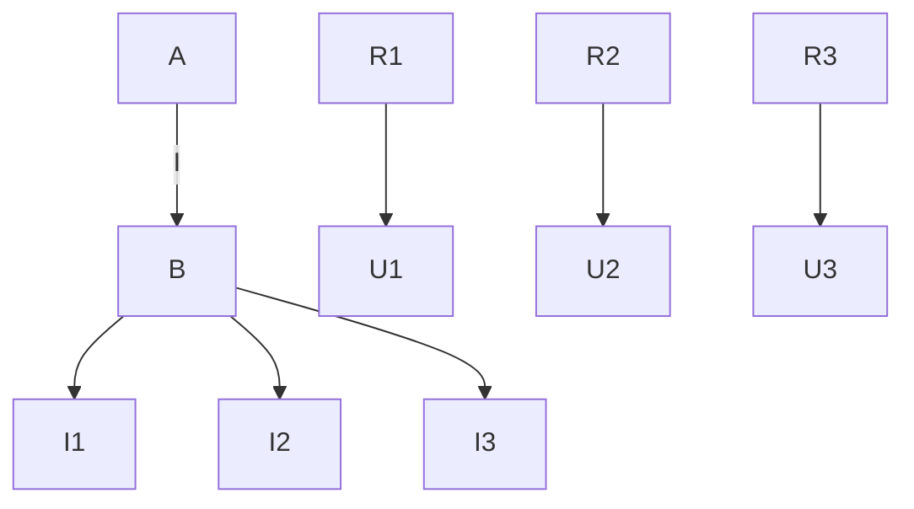

Abb. 2.9: Reihenschaltung dreier Widerstände.

text_image

I
U
R=R₁+R₂+R₃

Abb. 2.10: Ergebnis einer Reihenschaltung.

Dies ist das Ohm’sche Gesetz für einen Widerstand von der Größe

$$
R = R _ {1} + R _ {2} + R _ {3}. \tag {2.14}
$$

Die drei in Reihe geschalteten Widerstände $R _ { 1 } , R _ { 2 } , R _ { 3 }$ (Bild 2.9) verhalten sich wie ein einziger Widerstand mit dem Wert $R = R _ { 1 } + R _ { 2 } + R _ { 3 }$ (Bild 2.10).

Den resultierenden Widerstand einer Reihenschaltung von n Widerständen erhält man also aus der Addition der Teilwiderstände:

$$
R = \sum_ {\nu = 1} ^ {n} R _ {\nu} \quad (\text {Reihenschaltung}). \tag {2.15}
$$

## 2.2.2 Spannungsteiler

Aus den Gln. (2.9a) und (2.11) folgt

$$
U _ {1} = R _ {1} I,
$$

und mit Gl. (2.13) gilt dann

$$
\frac {U _ {1}}{U} = \frac {R _ {1} I}{(R _ {1} + R _ {2} + R _ {3}) I} = \frac {R _ {1}}{R _ {1} + R _ {2} + R _ {3}}.
$$

Allgemein gilt für die Teilspannung $U _ { \nu }$ am ν-ten Teilwiderstand $R _ { \nu }$ einer Reihenschaltung aus n Widerständen:

$$
U _ {\nu} = \frac {R _ {\nu}}{\sum_ {\nu = 1} ^ {n} R _ {\nu}} U. \tag {2.16}
$$

Speziell an einer Reihenschaltung aus zwei Teilwiderständen (Bild 2.11) gilt also

$$
U _ {2} = \frac {R _ {2}}{R _ {1} + R _ {2}} U \tag {2.17}
$$

und

$$
\frac {U _ {1}}{U _ {2}} = \frac {R _ {1}}{R _ {2}}. \tag {2.18}
$$

Die Schaltung in Bild 2.11 nennt man deswegen auch einen **Spannungsteiler**.

## 2.2.3 Parallelschaltung von Widerständen

Das Bild 2.12 zeigt drei parallelgeschaltete Widerstände mit den Leitwerten

$$
G _ {1} = \frac {1}{R _ {1}}, \quad G _ {2} = \frac {1}{R _ {2}}, \quad G _ {3} = \frac {1}{R _ {3}}.
$$

Wendet man die Darstellung (2.4b) des Ohm’schen Gesetzes auf die drei Zweige der Parallelschaltung an, so wird

$$
I _ {1} = G _ {1} U _ {1} \tag {2.19a}
$$

$$
I _ {2} = G _ {2} U _ {2} \tag {2.19b}
$$

$$
I _ {3} = G _ {3} U _ {3}. \tag {2.19c}
$$

Die Addition dieser drei Gleichungen liefert

$$
I _ {1} + I _ {2} + I _ {3} = G _ {1} U _ {1} + G _ {2} U _ {2} + G _ {3} U _ {3}. \tag {2.20}
$$

Wegen des 2. Kirchhoff’schen Gesetzes, Gl. (2.7), gilt hier

$$
U _ {1} = U _ {2} = U _ {3} = U \tag {2.21}
$$

und wegen des 1. Kirchhoff’schen Gesetzes, Gl. (2.5),

$$
I _ {1} + I _ {2} + I _ {3} = I. \tag {2.22}
$$

text_image

R₁
U₁
R₂
U₂

Abb. 2.11: Unbelasteter Spannungsteiler aus zwei ohmschen Widerständen.

flowchart

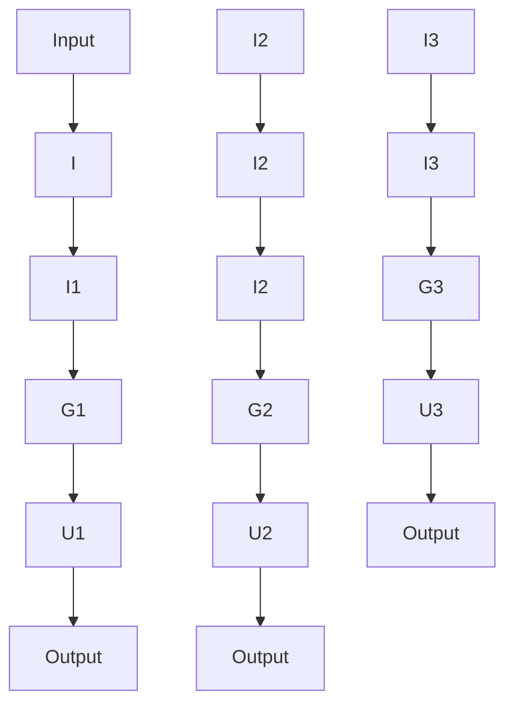

Abb. 2.12: Parallelschaltung dreier Widerstände.

text_image

I
U
G=G₁+G₂+G₃

Abb. 2.13: Ergebnis einer Parallelschaltung.

Setzt man die Gln. (2.21) und (2.22) in Gl. (2.20) ein, so ergibt sich

$$
I = (G _ {1} + G _ {2} + G _ {3}) U. \tag {2.23}
$$

Dies ist das Ohm’sche Gesetz (2.4b) für einen Leitwert von der Größe

$$
G = G _ {1} + G _ {2} + G _ {3}, \tag {2.24}
$$

(Bild 2.13). D. h. die drei parallelgeschalteten Leitwerte $G _ { 1 } , G _ { 2 } , G _ { 3 }$ verhalten sich wie ein einziger Leitwert von der Größe $G = G _ { 1 } + G _ { 2 } + G _ { 3 }$

Den resultierenden Leitwert einer Parallelschaltung von n Leitwerten erhält man aus der Addition der Teilleitwerte:

$$
G = \sum_ {\nu = 1} ^ {n} G _ {\nu} \quad (\text {Parallelschaltung}). \tag {2.25}
$$

Der Gesamtwiderstand R einer Parallelschaltung von n Teilleitwerten ist demnach

$$
R = \frac {1}{G} = \frac {1}{G _ {1} + G _ {2} + \cdots + G _ {\nu} + \cdots + G _ {n}} = \frac {1}{\frac {1}{R _ {1}} + \frac {1}{R _ {2}} + \cdots + \frac {1}{R _ {\nu}} + \cdots + \frac {1}{R _ {n}}}
$$

$$
R = \frac {1}{\sum_ {\nu = 1} ^ {n} \frac {1}{R _ {\nu}}} . \tag {2.26}
$$

Vergleicht man die Darstellungen in Gl. (2.25) und Gl. (2.26) miteinander, so zeigt sich deutlich, dass bei Parallelschaltung bequemer mit Leitwerten als mit Widerständen zu rechnen ist.

Speziell für zwei parallelgeschaltete Widerstände (Bild 2.14) gilt

$$
R = \frac {1}{G} = \frac {1}{G _ {1} + G _ {2}} = \frac {1}{\frac {1}{R _ {1}} + \frac {1}{R _ {2}}} = \frac {R _ {1} R _ {2}}{R _ {1} + R _ {2}}. \tag {2.27}
$$

flowchart

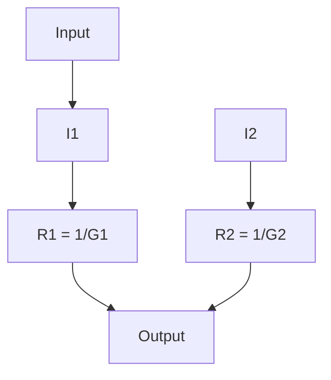

Abb. 2.14: Parallelschaltung zweier Widerstände.

## 2.2.4 Stromteiler

Aus den Gln. (2.19a) und (2.21) folgt

$$
I _ {1} = G _ {1} U
$$

und mit Gl. (2.23) gilt dann

$$
\frac {I _ {1}}{I} = \frac {G _ {1} U}{(G _ {1} + G _ {2} + G _ {3}) U} = \frac {G _ {1}}{G _ {1} + G _ {2} + G _ {3}}.
$$

Allgemein gilt für den Teilstrom $I _ { \nu }$ im ν-ten Teilleitwert $G _ { \nu }$ einer Parallelschaltung aus n Leitwerten:

$$
I _ {v} = \frac {G _ {v}}{\sum_ {v = 1} ^ {n} G _ {v}} I. \tag {2.28}
$$

Speziell an einer Parallelschaltung aus zwei Teilleitwerten (Bild 2.14) gilt also

$$
I _ {2} = \frac {G _ {2}}{G _ {1} + G _ {2}} I \tag {2.29a}
$$

$$
I _ {2} = \frac {\frac {1}{R _ {2}}}{\frac {1}{R _ {1}} + \frac {1}{R _ {2}}} I
$$

$$
I _ {2} = \frac {R _ {1}}{R _ {1} + R _ {2}} I \tag {2.29b}
$$

und

$$
\frac {I _ {1}}{I _ {2}} = \frac {G _ {1}}{G _ {2}}; \quad \frac {I _ {1}}{I _ {2}} = \frac {R _ {2}}{R _ {1}}. \tag {2.30a,b}
$$

## 2.2.5 Gruppenschaltung von Widerständen

In bestimmten Schaltungen lassen sich Gruppen von Widerständen zusammenfassen, die vom selben Strom durchflossen werden oder die an derselben Spannung liegen. Eine Schaltung, die sich ganz aus solchen Gruppen zusammensetzt, nennt man **Gruppenschaltung**.

**Beispiel 2.4: Berechnung des resultierenden Widerstandes einer Gruppenschaltung.** In Bild 2.15 wird eine Schaltung dargestellt, deren Gesamtwiderstand

$$
R _ {\mathrm{CD}} = \frac {U}{I}
$$

sich leicht mit den Gln. (2.15) und (2.25) berechnen lässt :

$$
R _ {1, 2} = R _ {1} + R _ {2},
$$

$$
R _ {3, 4} = R _ {3} + R _ {4};
$$

$$
R _ {\mathrm{CD}} = \frac {1}{G _ {\mathrm{CD}}} = \frac {1}{\frac {1}{R _ {1 , 2}} + \frac {1}{R _ {3 , 4}}} = \frac {1}{\frac {1}{R _ {1} + R _ {2}} + \frac {1}{R _ {3} + R _ {4}}}
$$

$$
R _ {\mathrm{CD}} = \frac {(R _ {1} + R _ {2}) (R _ {3} + R _ {4})}{R _ {1} + R _ {2} + R _ {3} + R _ {4}}. \tag {2.31}
$$

Dagegen lässt sich eine Brückenschaltung (Bild 2.16) nicht einfach als Kombination von Reihen- und Parallelschaltungen auffassen, weil im Allgemeinen hier auch in $R _ { 5 }$ ein Strom fließen wird. Dann fließen durch $R _ { 1 }$ und $R _ { 2 }$ unterschiedliche Ströme: $R _ { 1 }$ und $R _ { 2 }$ bilden jetzt also keine Reihenschaltung. Das gleiche gilt für $R _ { 3 }$ und $R _ { 4 }$ . Ebenso treten in der Brückenschaltung keine parallelgeschalteten Widerstände auf; der Gesamtwiderstand $R _ { \mathrm { C D } } = U / _ { I }$ kann daher für diese Schaltung nicht aus den Formeln für Reihenschaltung Gl. (2.15) und Parallelschaltung Gl. (2.25) berechnet werden.

## 2.2.6 Brücken-Abgleich

Für die Spannungen $U _ { 1 }$ und $U _ { 3 }$ in Bild 2.15 gilt nach der Spannungsteiler-Formel Gl. (2.17):

$$
U _ {1} = \frac {R _ {1}}{R _ {1} + R _ {2}} U; \quad U _ {3} = \frac {R _ {3}}{R _ {3} + R _ {4}} U.
$$

Falls nun

$$
\frac {R _ {1}}{R _ {1} + R _ {2}} = \frac {R _ {3}}{R _ {3} + R _ {4}} \tag {2.32a}
$$

flowchart

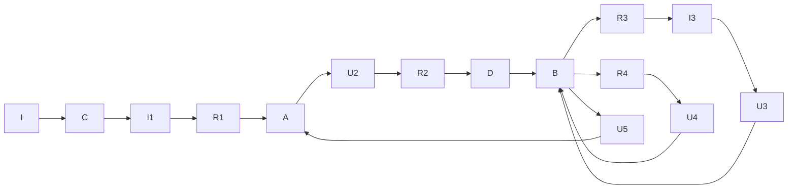

Abb. 2.15: Gruppenschaltung ohmscher Widerstände.

flowchart

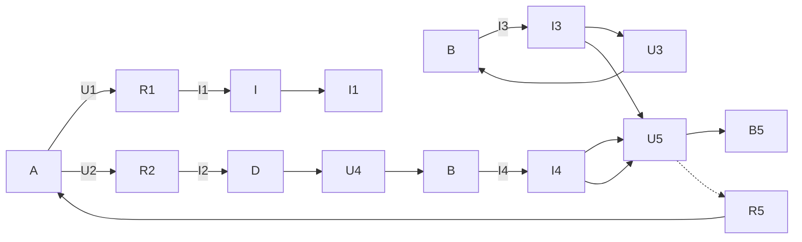

Abb. 2.16: Brückenschaltung.

wird, gilt $U _ { 1 } = U _ { 3 } ;$ man spricht in diesem Fall vom Abgleich der Schaltung in Bild 2.15, und die Anwendung der 2. Kirchhoff’schen Gleichung auf den linken Teil der Schaltung ergibt:

$$
U _ {5} = 0.
$$

Formt man die Gl. (2.32a) um, so entstehen u. a. die folgenden Formulierungen der **Abgleichbedingung** für eine Brückenschaltung (Bild 2.16):

$$
R _ {1} R _ {4} = R _ {2} R _ {3}; \quad \frac {R _ {1}}{R _ {2}} = \frac {R _ {3}}{R _ {4}}; \quad R _ {1} = \frac {R _ {2} R _ {3}}{R _ {4}}. \tag {2.32b,c,d}
$$

Ist die Abgleichbedingung erfüllt, so kann zwischen die Punkte A und B der Schaltung in Bild 2.15 ein beliebiger Widerstand $R _ { 5 }$ eingefügt werden. Weil zwischen diesen Knoten von vornherein keine Spannung anliegt, fließt durch diesen Widerstand auch kein Strom, und die Spannungen $U _ { 1 } \ldots U _ { 4 }$ bleiben ebenso wie die Ströme $I _ { 1 } \ldots I _ { 4 }$ unverändert.

Wenn die Schaltung in Bild 2.16 abgeglichen ist, kann demnach der Widerstand $R _ { 5 }$ einfach entfernt werden, ohne dass Spannungen und Ströme in der Schaltung hierdurch beeinflusst werden. Im Abgleichfall lässt sich die Schaltung in Bild 2.16 also durch die einfachere Gruppenschaltung 2.15 ersetzen. Aus Gl. (2.31) und der Abgleichbedingung Gl. (2.32d) ergibt sich für den Widerstand $R _ { \mathrm { C D } }$ dieser Schaltung

$$
\begin{array}{l} R _ {\mathrm{CD}} \big | _ {R _ {5} = \infty} \equiv R _ {\mathrm{L}} = \frac {\left(\frac {R _ {2} R _ {3}}{R _ {4}} + R _ {2}\right) (R _ {3} + R _ {4})}{\frac {R _ {2} R _ {3}}{R _ {4}} + R _ {2} + R _ {3} + R _ {4}} \\ R _ {\mathrm{L}} = R _ {2} \frac {R _ {3} + R _ {4}}{R _ {2} + R _ {4}}. \tag {2.33a} \\ \end{array}
$$

Wenn zwischen den Punkten A und B der Schaltung in Bild 2.16 keine Spannung besteht, so kann man diese beiden Punkte auch einfach kurzschließen, wie es in Bild 2.17 dargestellt ist. Diese Schaltung hat den Gesamtwiderstand

$$
R _ {\mathrm{CD}} \big | _ {R _ {5} = 0} \equiv R _ {\mathrm{k}} = \frac {R _ {1} R _ {3}}{R _ {1} + R _ {3}} + \frac {R _ {2} R _ {4}}{R _ {2} + R _ {4}}. \tag {2.34}
$$

text_image

R₁
A
R₂
C
R₃
B
R₄
D

Abb. 2.17: Gruppenschaltung ohmscher Widerstände.

Mit der Abgleichbedingung Gl. (2.32d) ergibt sich hieraus

$$
R _ {\mathrm{k}} = \frac {\frac {R _ {2} R _ {3}}{R _ {4}} R _ {3}}{\frac {R _ {2} R _ {3}}{R _ {4}} + R _ {3}} + \frac {R _ {2} R _ {4}}{R _ {2} + R _ {4}}
$$

$$
R _ {\mathrm{k}} = R _ {2} \frac {R _ {3} + R _ {4}}{R _ {2} + R _ {4}}. \tag {2.33b}
$$

Die Ergebnisse der Gln. (2.33a) und (2.33b) bestätigen, dass der Gesamtwiderstand $R _ { \mathrm { L } }$ der Schaltung in Bild 2.15 mit dem Gesamtwiderstand $R _ { \mathrm { k } }$ der Schaltung in Bild 2.17 übereinstimmt, falls die Abgleichbedingung erfüllt ist.

## 2.2.7 Schaltungssymmetrie

Speziell bei symmetrischen Schaltungen aber auch bei anderen Schaltungen, kann man leicht Paare (oder größere Gruppen) von Punkten erkennen, zwischen denen keine Spannung auftritt. Solche Punkte (man nennt sie Punkte gleichen Potenzials) dürfen einfach kurzgeschlossen werden, ohne dass hierdurch Ströme und Spannungen in der Schaltung verändert werden. Ebenfalls dürfen die stromlosen Verbindungen zwischen solchen Punkten einfach aufgetrennt werden.

## Beispiel 2.5: Vereinfachung einer symmetrischen Schaltung.

Aufgrund der Symmetrie der Schaltung in Bild 2.18a ist leicht einzusehen, dass zwischen den Punkten A und B keine Spannung besteht (beide Punkte liegen auf der gestrichelten Symmetrieachse). Man darf also zwischen die Punkte A und B einen beliebigen Wider stand $R _ { \mathrm { A B } }$ einfügen, ohne dass die ursprünglichen Ströme und Spannungen hierdurch verändert werden (Schaltung in Bild 2.18b). Wählt man $R _ { \mathrm { A B } } = 0 ,$ , so entsteht die Gruppenschaltung in Bild 2.18c. Damit ist gezeigt, dass die Schaltung in Bild 2.18b einfach durch die Schaltung in Bild 2.18c ersetzt werden kann, deren Gesamtwiderstand $R _ { \mathrm { C D } }$ zwischen den Klemmen C und D leicht berechenbar ist:

Abb. 2.18: Drei gleichwertige symmetrische Schaltungen. a) Schaltung aus acht Widerständen; b) Schaltung aus neun Widerständen; c) Gruppenschaltung aus acht Widerständen.

$$
R _ {\mathrm{CD}} = 2 \frac {R \cdot \frac {3}{2} R}{R + \frac {3}{2} R} = 1, 2 R.
$$

Dieser Wert gilt also für alle drei Schaltungen in Bild 2.18.

## 2.3 Strom- und Spannungsmessung

## 2.3.1 Anforderungen an Strom- und Spannungsmesser

Ein Strommessgerät (Amperemeter) muss in Reihe zu dem Bauelement eingefügt werden, in dem der Strom gemessen werden soll (Bild 2.19), damit es den selben Strom messen kann. Da das reale Strommessgerät einen ohmschen Widerstand hat, verändert es grundsätzlich den Messkreis und damit den zu messenden Strom (Bild 2.20). Der innere Widerstand $R _ { \mathrm { M , A } }$ des Strommessgerätes sollte also möglichst gering sein, damit der Spannungsabfall $U _ { \mathrm { M , A } }$ über dem Strommessgerät gering bleibt.

Ein Spannungsmessgerät (Voltmeter) muss parallel zu dem Bauelement geschaltet werden, an dem die Spannung gemessen werden soll (Bild 2.21), damit es die selbe Spannung messen kann. Auch hierbei wird bei einem realen Messgerät die Schaltung und damit die zu messende Spannung verändert. Der Strom I teilt sich auf in den Strom $I _ { R }$ durch den Widerstand R und in den Strom $I _ { \mathrm { M , V } }$ durch das Spannungsmessgerät. Der innere Widerstand des Spannungsmessers $R _ { \mathrm { M , V } }$ sollte deshalb möglichst hoch sein, damit der Strom $I _ { \mathrm { M , V } }$ gering bleibt (Bild 2.22).

text_image

I
U
A
UR
R
I

Abb. 2.19: Einfache Schaltung zur Strommessung mit dem Amperemeter.

flowchart

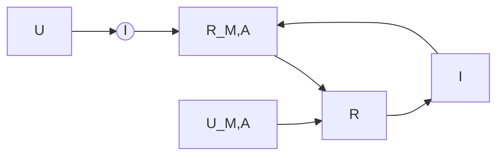

Abb. 2.20: Strommessung mit realem Amperemeter und Messgerätewiderstand $R _ { M , \mathsf { A } }$

text_image

I
U
UR
R
V

Abb. 2.21: Einfache Schaltung zur Spannungsmessung mit dem Voltmeter.

text_image

I
U
IR
UR
R
UM,V
IM,V
RM,V
Voltmeter

Abb. 2.22: Spannungsmessung mit realem Voltmeter und Messgerätewiderstand $R _ { M , N }$ .

## 2.3.2 Analoges Messinstrument

Als wichtigster Vertreter der analogen Messinstrumente soll hier das Drehspulmessinstrument betrachtet werden.

Im Drehspulmessinstrument fließt der Messstrom durch eine drehbar gelagerte Spule (vgl. Beispiel 5.1). Die Spulenachse ist mit zwei Spiralfedern verbunden, die einer Spulendrehung entgegenwirken. Die Spule befindet sich in dem konstanten Magnetfeld eines Dauermagneten. Dadurch wirkt auf sie ein Drehmoment, das dem Messstrom proportional ist. Das Messergebnis lässt sich über eine **lineare Skala** ablesen (Bild 2.23). Der Zeiger ist fest mit der Spule verbunden und erreicht seine Ruhelage, wenn das Gegenmoment der Spiralfedern und das Drehmoment auf Grund der Kräfte im Magnetfeld im Gleichgewicht sind.

Schnellen Schwingungen kann die Drehspule mit ihrem Zeiger wegen ihrer mechanischen Trägheit praktisch nicht folgen. Das Messwerk zeigt daher immer nur den zeitlichen Mittelwert des gemessenen Stromes an, ist also vor allem zur Messung von **Gleichstrom** geeignet. Bei einem reinen **Wechselstrom** ergibt sich nur eine Anzeige, wenn er zuvor gleichgerichtet wird. Ein Vorteil des Drehspulmesswerks ist sein (im Vergleich zu anderen analogen Messwerken) **geringer Leistungsbedarf**. Es kann daher sehr kleine Ströme anzeigen. Außerdem hat das Drehspulmesswerk eine besonders hohe **Messgenauigkeit**.

Als **Vollausschlagsstrom** $I _ { \mathrm { M V } }$ bezeichnet man den Strom, der gerade fließen muss, damit der Zeiger sich auf den Skalenendwert einstellt. Den ohmschen Widerstand der Drehspule bezeichnet man als **Messwerkwiderstand** $R _ { M }$

Beispiel 2.6: Eigenverbrauch eines Drehspulmesswerks mit $I _ { \mathsf { M V } } = 5 0 \; \mu \mathsf { A } , R _ { \mathsf { M } } = 1 \; \mathsf { k } \Omega .$ Der Eigenverbrauch dieses Messwerks bei Vollausschlag ist

$$
P _ {\mathrm{MV}} = I _ {\mathrm{MV}} ^ {2} \cdot R _ {\mathrm{M}} = \left(5 0 \cdot 1 0 ^ {- 6}\right) ^ {2} \mathrm{A} ^ {2} \cdot 1 0 ^ {3} \Omega = 2, 5 \cdot 1 0 ^ {- 6} \mathrm{W}.
$$

text_image

0 1 2 3 4 5 6 7 8 9 10

Abb. 2.23: Beispiel für die lineare Skala eines Zeigerinstruments.

## 2.3.3 Klassengenauigkeit

Der vom Messinstrument angezeigte Strom kann vom wahren Wert des Stromes abweichen. Der Fehler, der höchstens zu erwarten ist, wird normalerweise in Prozent vom Skalenendwert angegeben: Das sogenannte **Klassenzeichen** gibt den zulässigen **Anzeigefehler** direkt in Prozent an. So hat ein Instrument der Klasse 0,1 einen zulässigen Anzeigefehler von ±0,1 %. Präzisionsinstrumente gehören zu den Klassen 0,1; 0,2 oder 0,5. Betriebsinstrumente gehören zu den Klassen 1; 1,5; 2,5 oder 5.

## Beispiel 2.7: Messgenauigkeit eines Drehspulmessgerätes der Klasse 1,5 im Messbereich 300 mA.

Der wahre Wert kann höchstens um 1,5 % von 300 mA, also

$$
3 0 0 \mathrm{mA} \cdot 0, 0 1 5 = 4, 5 \mathrm{mA}
$$

vom abgelesenen Wert abweichen. Liest man im Messbereich 300 mA z. B. den Wert 150 mA ab, so gilt für den wahren Wert:

$$
I = 1 5 0 \mathrm{mA} \pm 4, 5 \mathrm{mA};
$$

es ergibt sich also in diesem Fall eine Abweichung von

$$
\pm 3 \% \text { vom Messwert.}
$$

Liest man im Messbereich 300 mA z. B. den Strom 50 mA ab, so gilt für den wahren Wert:

$$
I = 5 0 \mathrm{mA} \pm 4, 5 \mathrm{mA};
$$

nun ist also sogar eine Abweichung von

$$
\pm 9 \%
$$

möglich. Würde man im 300-mA-Messbereich nur den Wert 4,5 mA ablesen, so ergäbe sich für den wahren Wert

$$
I = 4, 5 \mathrm{mA} \pm 4, 5 \mathrm{mA},
$$

d. h. der wahre Wert kann im Bereich von 0 mA bis 9 mA liegen, und die Abweichung des wahren Wertes vom gemessenen Wert kann

$$
\pm 100 \%
$$

erreichen. Der prozentuale Messfehler nimmt also zu, je kleiner der Zeigerausschlag ist. Daher ist es nötig, für jede Messung einen Messbereich zu haben, bei dem der Zeiger mög lichst dicht an das Skalenende herankommt. Daraus ergibt sich die Notwendigkeit, das Messwerk eines Instrumentes für verschiedene Messbereiche (z. B. 50 μA, 300 μA, 1 mA, 3 mA, 10 mA u. a.) verwendbar zu machen: Messbereichserweiterung. Außerdem können

Drehspulinstrumente auch zur Anzeige von Spannungen verwendet werden. Fließt z. B. durch das Instrument nach Beispiel 2.6 der Vollausschlagsstrom, so liegt am Instrument die **Vollausschlagsspannung**

$$
U _ {\mathrm{MV}} = I _ {\mathrm{MV}} \cdot R _ {\mathrm{M}} \tag {2.35}
$$

$$
U _ {\mathrm{MV}} = 5 0 \cdot 1 0 ^ {- 6} \mathrm{A} \cdot 1 0 ^ {3} \Omega = 5 0 \mathrm{mV}.
$$

## 2.3.4 Digitales Messinstrument

Der Messwert wird bei einem digitalen Messinstrument über eine digitale Anzeige (z. B. Siebensegment-LCD-Anzeige oder – quasi analog – als Balkenanzeige (Bild 2.24)) wiedergegeben. Dafür müssen die analogen physikalischen Messgrößen in digitale Signale umgewandelt werden. Dies übernimmt ein sogenannter Analog-Digital-Wandler (A/D-Wandler, ADC = engl. analog to digital converter).

Die Auflösung ist von der Bit-Anzahl des $\mathrm { A / D }$ -Wandlers abhängig. Zum Beispiel besitzt ein 8-Bit-Wandler 255 Stufen, mit der das Messsignal digitalisiert werden kann. Was damit gemeint ist, zeigt Bild 2.25. Hier wurden aus Gründen der Veranschaulichung nur 3 bit – also 7 Stufen – für die Digitalisierung verwendet. Dieser Digitalisierungsprozess wird auch als **Quantisierung** bezeichnet. Die Messgröße muss jeweils einen Schwellenwert überschreiten, damit der A/D-Wandler diesen Wert erkennt. Der kleinste darstellbare Wert wird durch die Quantisierungsstufe bestimmt.

Dem Vollausschlag bei einem Drehspulmessgerät entspricht bei einem digitalen Messinstrument die maximal erlaubte Eingangsspannung des A/D-Wandlers. Sie wird durch die zum Vergleich verwendete Spannungsreferenz bestimmt. Wie beim analogen Instrument ergibt sich deshalb die Notwendigkeit der Messbereichserweiterung. Der maximalen Eingangsspannung wird dann der **Messbereichsendwert** zugeordnet.

Abb. 2.24: Digitale Anzeigen: Siebensegment-Anzeige und Balkenanzeige mit dem Wert 20,51.

line

| analoge Messgröße | diskrete Kurve (binärer Wert) | ideale Kurve (binärer Wert) |
| --- | --- | --- |
| 0 | 000 (0) | — |
| 1 | 001 (1) | 001 (1) |
| 2 | 010 (2) | 010 (2) |
| 3 | 011 (3) | 011 (3) |
| 4 | 100 (4) | 100 (4) |
| 5 | 101 (5) | 101 (5) |
| 6 | 110 (6) | 110 (6) |
| 7 | 111 (7) | 111 (7) |

Abb. 2.25: Beispiel für die Digitalisierung von analogen Messwerten, aus Gründen der Veranschaulichung hier nur mit 3 bit.

Die Genauigkeit ist für jeden einzelnen Messbereich im Datenblatt des Messgerätes angegeben. Zusätzlich zur Klassengenauigkeit müssen bei einem digitalen Messgerät noch die Fehler, die bei der Quantisierung auftreten, berücksichtigt werden.

Im Gegensatz zu einfachen analogen Anzeigen wird die benötigte elektrische Energie eines digital anzeigenden Messinstruments nicht über den zu messenden Stromkreis, sondern immer über eine eigene Energiequelle (oft eine 9-V-Primärzelle) bereitgestellt.

## Beispiel 2.8: Quantisierung einer analogen Spannung mit einem 8-Bit-Wandler.

Ein Spannungsbereich von 0 . . . 5 V soll mit einem $8 - Bit - A/D$ -Wandler digitalisiert werden. Wie viele Stufen stehen für die Quantisierung zur Verfügung und wie groß ist der kleinste darstellbare Wert ∆U?

## Lösung:

Bei einem 8-Bit-Wandler stehen $N = 2 ^ { 8 } - 1 = 2 5 5$ Stufen zur Verfügung. Der kleinste darstellbare Wert ist dann

$$
\Delta U = \frac {5 \mathrm{V} - 0 \mathrm{V}}{2 5 5} = \frac {1}{5 1} \mathrm{V} \approx 0, 0 1 9 6 \mathrm{V}.
$$

## 2.3.5 Messbereichserweiterung

## 2.3.5.1 Strom-Messbereichserweiterung

Falls mit einem Drehspulmessgerät ein Strom gemessen werden soll, der größer als der Vollausschlagsstrom $I _ { \mathrm { M V } }$ ist, so lässt sich der Messbereich durch einen Parallelwiderstand $R _ { \mathrm { p } }$ entsprechend erweitern (Bild 2.26). Wenn durch das Messwerk z. B. gerade der Vollausschlagsstrom $I _ { \mathrm { M V } }$ fließt, dann erreicht der Gesamtstrom I gemäß der Stromteilerformel Gl. (2.29a) den Wert

$$
I = I _ {\mathrm{V}} = \frac {G _ {\mathrm{M}} + G _ {\mathrm{P}}}{G _ {\mathrm{M}}} I _ {\mathrm{MV}}. \tag {2.36a}
$$

Diesen Strom $I _ { \mathrm { V } }$ kann man nun also dem Skalenendwert anstelle des Stromes $I _ { \mathrm { M V } }$ zuordnen, denn der Gesamtstrom I ist es ja, der von der Klemme a zur Klemme b fließt und der gemessen werden soll.

text_image

I
a → I_M → R_M = 1/G_M
R_P = 1/G_P
b

Abb. 2.26: Parallelschaltung eines ohmschen Widerstandes zum Messwerk zur Erweiterung des Strom-Messbereichs.

## Beispiel 2.9: Berechnung eines Parallelwiderstandes zur Strom-Messbereichserweiterung.

Ein Drehspulinstrument mit dem Vollausschlagsstrom $I _ { \mathrm { M V } } = 5 0   \mu \mathrm { A }$ und dem Messwerkswiderstand $R _ { \mathbb { M } } = 1$ kΩ soll Ströme bis zum Wert $I = 1$ mA messen. Wie groß muss $R _ { \mathrm { p } }$ sein?

## Lösung:

Die Gl. (2.36a) lässt sich nach $G _ { \mathrm { p } }$ auflösen:

$$
G _ {\mathrm{P}} = G _ {\mathrm{M}} \left(\frac {I _ {\mathrm{V}}}{I _ {\mathrm{MV}}} - 1\right) \tag {2.36b}
$$

$$
G _ {\mathrm{P}} = \frac {1}{1 0 ^ {3} \Omega} \left(\frac {1 0 ^ {- 3} \mathrm{A}}{5 0 \cdot 1 0 ^ {- 6} \mathrm{A}} - 1\right) = \frac {1 9}{1 0 ^ {3} \Omega} = \frac {1}{R _ {\mathrm{P}}}
$$

$$
R _ {\mathrm{P}} = 5 2, 6 \Omega .
$$

Schaltet man diesen Widerstand zum Messwerk parallel, dann bedeutet – wie gefordert – Vollausschlag des Messinstruments, dass der Gesamtstrom I den Wert $I _ { \mathrm { V } } = 1   \mathrm { m A }$ erreicht.

Normalerweise wird in sogenannten **Vielfach-Instrumenten** ein einziges Messwerk für mehrere Messbereiche verwendet, z. B. sechs Strom- und sechs Spannungs-Messbereiche.

## Beispiel 2.10: Dimensionierung der Widerstände eines Vielfach-Messgeräts (Strommessung).

Ein Drehspulmesswerk hat den Vollausschlagsstrom $I _ { \mathrm { M V } } = 5 0   \mu \mathrm { A }$ und den Messwerkswiderstand $R _ { M }$

Das Messgerät soll drei Messbereiche haben: $1 0 0   \mu \mathrm { A } , 3 0 0   \mu \mathrm { A } ,$ , 1 mA. Zwischen den Schalterstellungen A, B, C in Bild 2.27 und den drei Strombereichen soll die Zuordnung aus Tabelle 2.6 gelten.

Die Widerstände $R _ { 1 } , R _ { 2 }$ und $R _ { 3 }$ sollen allgemein und für den Sonderfall $R _ { \mathrm { M } } = 9 0 0   \Omega$ berechnet werden.

## Lösung:

Bei Anschluss an Klemme A und Vollausschlag des Messwerks muss entsprechend der

text_image

I
R1
A
R2
B
C
R3
IM
(RM)

Abb. 2.27: Drehspulmesswerk mit drei Strom-Messbereichen.

Tab. 2.6: Drei Strommessbereiche in Abhängigkeit der Schalterstellung.

| Schalterstellung | Messbereich |
| --- | --- |
| A | 0 ... 1 mA |
| B | 0 ... 300 μA |
| C | 0 ... 100 μA |

Stromteilerformel Gl. (2.29b) gelten:

$$
\frac {R _ {1}}{R _ {1} + R _ {2} + R _ {3} + R _ {\mathrm{M}}} = \frac {I _ {\mathrm{MV}}}{I _ {(\mathrm{A})}} = \frac {5 0 \mu \mathrm{A}}{1 \mathrm{mA}} = \frac {1}{2 0}; \tag {2.37a}
$$

bei Anschluss an Klemme B:

$$
\frac {R _ {1} + R _ {2}}{R _ {1} + R _ {2} + R _ {3} + R _ {\mathrm{M}}} = \frac {I _ {\mathrm{MV}}}{I _ {\mathrm{(B)}}} = \frac {5 0 \mu \mathrm{A}}{3 0 0 \mu \mathrm{A}} = \frac {1}{6}; \tag {2.37b}
$$

bei Anschluss an Klemme C:

$$
\frac {R _ {1} + R _ {2} + R _ {3}}{R _ {1} + R _ {2} + R _ {3} + R _ {\mathrm{M}}} = \frac {I _ {\mathrm{MV}}}{I _ {(\mathrm{C})}} = \frac {5 0 \mu \mathrm{A}}{1 0 0 \mu \mathrm{A}} = \frac {1}{2}. \tag {2.37c}
$$

Durch einfache Umformung ergibt sich aus den Gln. (2.37):

$$
1 9 R _ {1} - R _ {2} - R _ {3} = R _ {\mathrm{M}} \tag {2.38a}
$$

$$
5 R _ {1} + 5 R _ {2} - R _ {3} = R _ {\mathrm{M}} \tag {2.38b}
$$

$$
R _ {1} + R _ {2} + R _ {3} = R _ {\mathrm{M}}. \tag {2.38c}
$$

Aus der Addition der Gln. (2.38a) und (2.38c) erhält man nun

$$
2 0 R _ {1} = 2 R _ {\mathrm{M}}; \quad R _ {1} = \frac {1}{1 0} R _ {\mathrm{M}}.
$$

Addition der Gl. (2.38b) und der mit (−5) multiplizierten Gl. (2.38c) liefert

$$
- 6 R _ {3} = - 4 R _ {\mathrm{M}}; \quad R _ {3} = \frac {2}{3} R _ {\mathrm{M}}.
$$

Aus Gl. (2.38c) folgt dann

$$
R _ {2} = R _ {\mathrm{M}} - R _ {1} - R _ {3} = R _ {\mathrm{M}} - \frac {1}{1 0} R _ {\mathrm{M}} - \frac {2}{3} R _ {\mathrm{M}}; \quad R _ {2} = \frac {7}{3 0} R _ {\mathrm{M}}.
$$

Mit $R _ { \mathrm { M } } = 9 0 0   \Omega$ wird also

$$
R _ {1} = 9 0 \Omega , \quad R _ {2} = 2 1 0 \Omega , \quad R _ {3} = 6 0 0 \Omega .
$$

## 2.3.5.2 Spannungs-Messbereichserweiterung

Falls eine Spannung gemessen werden soll, die größer ist als $U _ { \mathrm { M V } }$ , vgl. Gl. (2.35), so lässt sich der Messbereich durch einen Vorwiderstand $R _ { \mathbf { r } }$ entsprechend erweitern (Bild 2.28).

Wenn am Messwerk z. B. gerade die Vollausschlagsspannung $U _ { \mathrm { M V } }$ liegt, dann erreicht die Spannung U an der Reihenschaltung gemäß der Spannungsteilerformel Gl. (2.17) den Wert

$$
U _ {\mathrm{V}} = \frac {R _ {\mathrm{r}} + R _ {\mathrm{M}}}{R _ {\mathrm{M}}} U _ {\mathrm{MV}}. \tag {2.39a}
$$

Diese Spannung $U _ { \mathrm { V } }$ kann man nun also dem Skalenendwert anstelle der Spannung $U _ { \mathrm { M V } }$ zuordnen, denn die Gesamtspannung U ist es $\mathbf { j a } ,$ die zwischen den Klemmen a und b liegt und die gemessen werden soll.

## Beispiel 2.11: Berechnung eines Vorwiderstandes zur Spannungs-Messbereichserweiterung.

Ein Drehspulmessgerät mit dem Vollausschlagsstrom $I _ { \mathrm { M V } } = 5 0   \mu \mathrm { A }$ und dem Messwerkswiderstand $R _ { \mathrm { M } } = 1$ kΩ soll Spannungen bis zum Wert $U = 1 0 0   \mathrm { V }$ messen. Wie groß muss $R _ { \mathbf { r } }$ sein?

## Lösung:

Das Messwerk hat die Vollausschlagsspannung

$$
U _ {\mathrm{MV}} = I _ {\mathrm{MV}} \cdot R _ {\mathrm{M}} = 5 0 \cdot 1 0 ^ {- 6} \mathrm{A} \cdot 1 0 ^ {3} \Omega = 5 0 \mathrm{mV}.
$$

Die Gl. (2.39a) lässt sich nach $R _ { \mathrm { r } }$ auflösen:

$$
R _ {\mathrm{r}} = R _ {\mathrm{M}} \left(\frac {U _ {\mathrm{V}}}{U _ {\mathrm{MV}}} - 1\right)
$$

$$
R _ {\mathrm{r}} = 1 0 ^ {3} \Omega \left(\frac {1 0 0 \mathrm{V}}{5 0 \mathrm{mV}} - 1\right) = 1 0 ^ {3} \Omega (2 0 0 0 - 1) = 1, 9 9 9 \mathrm{M} \Omega . \tag {2.39b}
$$

Schaltet man diesen Widerstand in Reihe zum Messwerk, dann bedeutet – wie gefordert – Vollausschlag des Messinstrumentes, dass die Gesamtspannung U den Wert $U _ { \mathrm { V } } = 1 0 0   \mathrm { V }$ erreicht.

## Beispiel 2.12: Dimensionierung der Widerstände eines Vielfach-Messgeräts (Spannungsmessung).

Ein Drehspulmessgerät hat den Spulenwiderstand $R _ { \mathrm { M } } = 1   \Omega$ . Wenn es von dem Strom $I _ { \mathrm { M V } } = 1 0 0$ mA durchflossen wird, dann schlägt es voll aus. Es soll als Spannungsmesser eingesetzt werden und vier Messbereiche haben (Bild 2.29). Zwischen den Schalterstellungen A, B, C, D und den vier Spannungs-Messbereichen soll die Zuordnung aus der Tabelle 2.7 gelten.

flowchart

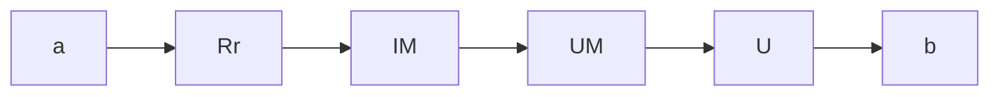

Abb. 2.28: Reihenschaltung eines ohmschen Widerstandes zum Messwerk zur Erweiterung des Spannungs-Messbereiches.

Tab. 2.7: Spannungsmessbereich in Abhängigkeit der Schalterstellung.

| Schalterstellung | Messbereich |
| --- | --- |
| A | 0 ... 300 mV |
| B | 0 ... 1 V |
| C | 0 ... 3 V |
| D | 0 ... 10 V |

Die Widerstände $R _ { 1 } \ldots R _ { 4 }$ sollen berechnet werden. Welchen Widerstand $R _ { \mathbf { i } }$ hat das Messgerät in den verschiedenen Messbereichen?

## Lösung:

In Schalterstellung A gilt: $I _ { \mathrm { M V } } ( R _ { \mathrm { m } } + R _ { 1 } ) = 3 0 0$ mV

$$
R _ {1} = \frac {3 0 0 \mathrm{mV}}{1 0 0 \mathrm{mA}} - R _ {\mathrm{M}} = 3 \Omega - 1 \Omega = 2 \Omega .
$$

Der Widerstand $R _ { \mathbf { i } }$ des Messgerätes ist in diesem Messbereich

$$
R _ {\mathrm{iA}} = R _ {\mathrm{M}} + R _ {1} = 3 \Omega .
$$

In Schalterstellung B gilt: $I _ { \mathrm { M V } } ( R _ { \mathrm { M } } + R _ { 1 } + R _ { 2 } ) = 1$ V

$$
R _ {2} = \frac {1 \mathrm{V}}{1 0 0 \mathrm{mA}} - R _ {\mathrm{M}} - R _ {1} = 1 0 \Omega - 3 \Omega = 7 \Omega .
$$

Der Widerstand $R _ { \mathbf { i } }$ des Messgerätes ist in diesem Messbereich

$$
R _ {\mathrm{iB}} = R _ {\mathrm{M}} + R _ {1} + R _ {2} = 1 0 \Omega .
$$

text_image

I_M
(R_M)
R_1
A
B
R_2
C
R_3
R_4
D

Abb. 2.29: Drehspulmessgerät mit vier Spannungs-Messbereichen.

In Schalterstellung C gilt: $I _ { \mathrm { M V } } ( R _ { \mathrm { M } } + R _ { 1 } + R _ { 2 } + R _ { 3 } ) = 3   \mathrm { V }$

$$
R _ {3} = \frac {3 \mathrm{V}}{1 0 0 \mathrm{mA}} - R _ {\mathrm{M}} - R _ {1} - R _ {2} = 3 0 \Omega - 1 0 \Omega = 2 0 \Omega .
$$

Der Widerstand $R _ { \mathbf { i } }$ des Messgerätes ist in diesem Messbereich

$$
R _ {\mathrm{iC}} = R _ {\mathrm{M}} + R _ {1} + R _ {2} + R _ {3} = 3 0 \Omega .
$$

In Schalterstellung D gilt: $I _ { \mathrm { M V } } ( R _ { \mathrm { M } } + R _ { 1 } + R _ { 2 } + R _ { 3 } + R _ { 4 } ) = 1 0   \mathrm { V }$

$$
R _ {4} = \frac {1 0 \mathrm{V}}{1 0 0 \mathrm{mA}} - R _ {\mathrm{M}} - R _ {1} - R _ {2} - R _ {3} = 1 0 0 \Omega - 3 0 \Omega = 7 0 \Omega .
$$

Der Widerstand $R _ { \mathbf { i } }$ des Messgerätes ist in diesem Messbereich

$$
R _ {\mathrm{iD}} = R _ {\mathrm{M}} + R _ {1} + R _ {2} + R _ {3} + R _ {4} = 1 0 0 \Omega .
$$

**Anmerkung** Das betrachtete Messwerk $( R _ { \mathrm { M } } = 1   \Omega ,   I _ { \mathrm { M V } } = 1 0 0   \mathrm { m A } )$ hat die Vollausschlagsspannung

$$
U _ {\mathrm{MV}} = 1 \Omega \cdot 1 0 0 \mathrm{mA} = 1 0 0 \mathrm{mV}.
$$

Das Gerät (Messwerk + Vorwiderstände) hat daher in allen Messbereichen den auf die jeweilige Vollausschlagsspannung bezogenen (niedrigen) Innenwiderstand

$$
r _ {\mathrm{i}} ^ {*} = 1 \Omega / 1 0 0 \mathrm{mV} = 1 0 \Omega / \mathrm{V}.
$$

Zur Spannungsmessung wäre daher ein Messwerk geeigneter, dessen Spule einen hö- heren Widerstand $R _ { M }$ hat: würde z. B. die Anzahl der Windungen erhöht und dadurch $R _ { \mathrm { M } } = 1   \mathrm { k } \Omega ,   I _ { \mathrm { M V } } = 1 0 0   \mu \mathrm { A } ,$ so bliebe zwar $U_{\mathrm{MV}} = 100   \mathrm{mV}$ aber es ergäbe sich

$$
r _ {\mathrm{i}} ^ {*} = 1 \mathrm{k} \Omega / 1 0 0 \mathrm{mV} = 1 0 \mathrm{k} \Omega / \mathrm{V}.
$$

Von Vorteil wäre ein Gerät mit $R _ { \mathrm { M } } = 1   \Omega$ wegen der geringeren Spulengröße bei Strommessungen in den Messbereichen von 100 mA an aufwärts (es fehlen ihm aber Messbereiche unter 100 mA).

## 2.3.6 Vielfachmessinstrument (Multimeter)

Viele einfache Messaufgaben lassen sich heute mit einem digitalen oder analogen (Hand-)Multimeter bewerkstelligen. Solche Multimeter (Vielfachmessgeräte) können verschiedene physikalische Messgrößen wie z. B. Strom, Spannung, Widerstand und Temperatur erfassen. Bei den Multimetern existiert eine Vielzahl von Ausstattungs varianten sowie Genauigkeitsklassen. Einfache Multimeter lassen sich oft über einen Drehschalter bedienen, mit dem die zu messende physikalische Größe und ggf. der Messbereich eingestellt werden. Manche Multimeter schalten selbst in den am besten geeigneten Messbereich um und erkennen außerdem, ob es sich um eine Gleich- bzw. Wechselspannung handelt. Schaltungen zur Messbereichserweiterung, wie sie die Bilder 2.27 und 2.29 zeigen, kommen dabei zur Anwendung.

Bei einfachen Formen der Messbereichserweiterungen verfügt ein Multimeter meistens über mehrere Eingänge für die Messleitungen (Bild 2.30). Dabei wird in der Regel unterschieden, ob eine Spannung, ein kleiner Strom ( mA, μA ) oder ein großer Strom (mehrere Ampere) gemessen werden soll. Der Bediener steckt je nach Messaufgabe (Spannungs- oder Strommessung) eine der beiden Messleitungen in den zugehörigen Eingang. Die zweite Messleitung wird mit dem COM-Anschluss (engl. common = gemeinsam) verbunden.

## 2.3.7 Messwertkorrektur

## 2.3.7.1 Spannungsrichtige Messung

Soll an einem Widerstand $R _ { 1 }$ (Bild 2.31) die Spannung gemessen werden, so schaltet man den Spannungsmesser parallel zu $R _ { 1 }$ . Will man gleichzeitig auch den Strom messen, der durch $R _ { 1 }$ fließt, so kann man die Schaltung 2.31 wählen. Diese Schaltung hat aber den Nachteil, dass der Strommesser nicht $I _ { 1 }$ , sondern I misst. Der Strom $I _ { M }$ durch den Spannungsmesser verfälscht die Anzeige des Strommessers. Hierbei gilt

$$
I _ {1} = I - I _ {\mathrm{M}}
$$

$$
I _ {1} = I - \frac {U _ {1}}{R _ {\mathrm{i}}} . \tag {2.40}
$$

Wenn der Widerstand $R _ { \mathbf { i } }$ des Spannungsmessers bekannt ist, kann aus dem gemessenen Wert I der Wert $I _ { 1 }$ des tatsächlich durch $R _ { 1 }$ fließenden Stromes berechnet werden. Man bezeichnet dies als **Stromkorrektur**. Da die gemessene Spannung $U _ { 1 }$ bei der Schaltung 2.31 mit der Spannung an $R _ { 1 }$ identisch ist, nennt man eine Messung nach der Schaltung in Bild 2.31 eine spannungsrichtige Messung.

## 2.3.7.2 Stromrichtige Messung

Soll in einem Widerstand $R _ { 1 }$ (Bild 2.32) der Strom gemessen werden, so schaltet man den Strommesser in Reihe zu $R _ { 1 }$ . Will man gleichzeitig auch die Spannung messen, die an $R _ { 1 }$ liegt, so kann man die Schaltung 2.32 wählen. Diese Schaltung hat aber den Nachteil, dass der Spannungsmesser nicht $U _ { 1 }$ , sondern U misst. Die Spannung $U _ { M }$ am Strommesser verfälscht also die Anzeige des Spannungsmessers. Hierbei gilt:

text_image

20.51
A
V
Ω
Off
A mA V COM

Abb. 2.30: Schema eines Multimeters.

flowchart

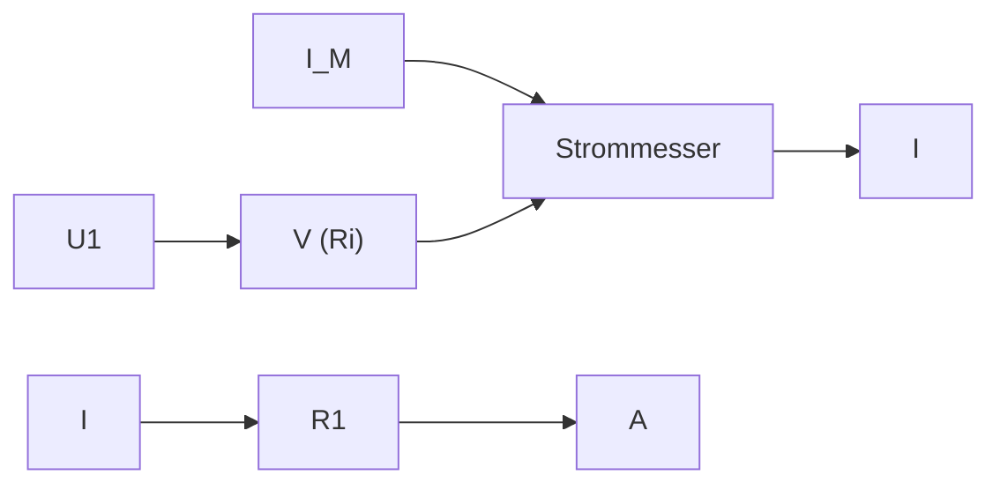

Abb. 2.31: Spannungsrichtige Messung.

$$
U _ {1} = U - U _ {\mathrm{M}}
$$

$$
U _ {1} = U - I _ {1} R _ {\mathrm{i}}. \tag {2.41}
$$

Wenn der Widerstand $R _ { \mathbf { i } }$ des Strommessgerätes bekannt ist, kann mit Hilfe dieser Gleichung aus dem gemessenen Wert U der Wert $U _ { 1 }$ der tatsächlich an $R _ { 1 }$ liegenden Spannung berechnet werden. Man bezeichnet dies als **Spannungskorrektur**. Da der gemessene Strom $I _ { 1 }$ bei der Schaltung 2.32 mit dem Strom in $R _ { 1 }$ identisch ist, nennt man eine Messung mit Schaltung 2.32 eine stromrichtige Messung.

## Beispiel 2.13: Genauigkeit einer Widerstandsmessung.

Gegeben ist eine Schaltung zur spannungsrichtigen Messung (Bild 2.31). An dem Widerstand $R _ { 1 }$ werden die Spannung $U _ { 1 } = 1 0   \mathrm { V }$ und der Strom $I = 1$ mA gemessen. Der Spannungsmesser hat den Widerstand $R _ { \mathrm { i } } = 5 0   \mathrm { k } \Omega$

a) Aus der Strom- und Spannungsmessung soll $R _ { 1 }$ bestimmt werden.
b) Der benutzte Spannungsmessbereich ist 0 . . . 30 V, der benutzte Strommessbereich $0 \ldots 3$ mA. Die beiden Messinstrumente haben das Klassenzeichen 5. Es sollen die Bereiche angegeben werden, in denen die wahren Werte des Stromes I und der Spannung $U _ { 1 }$ liegen können.
c) In welchem Bereich kann infolgedessen der wahre Wert R liegen?

## Lösung:

**a)** In der Schaltung 2.31 gilt mit $G _ { 1 } = 1 \big / _ { R _ { 1 } }$ und $G _ { \mathrm { i } } = 1 \big / _ { R _ { \mathrm { i } } }$

$$
I = U _ {1} (G _ {1} + G _ {\mathrm{i}})  . \tag {2.42}
$$

Löst man dies nach $G _ { 1 }$ auf, so wird

$$
G _ {1} = \frac {I}{U _ {1}} - G _ {i} \tag {2.43}
$$

$$
G _ {1} = \frac {1 \mathrm{mA}}{1 0 \mathrm{V}} - \frac {1}{5 0 \mathrm{k} \Omega} = \frac {1}{1 0 \mathrm{k} \Omega} - \frac {1}{5 0 \mathrm{k} \Omega} = \frac {4}{5 0 \mathrm{k} \Omega};
$$

$$
R _ {1} = \frac {5 0 \mathrm{k} \Omega}{4} = 1 2, 5 \mathrm{k} \Omega .
$$

flowchart

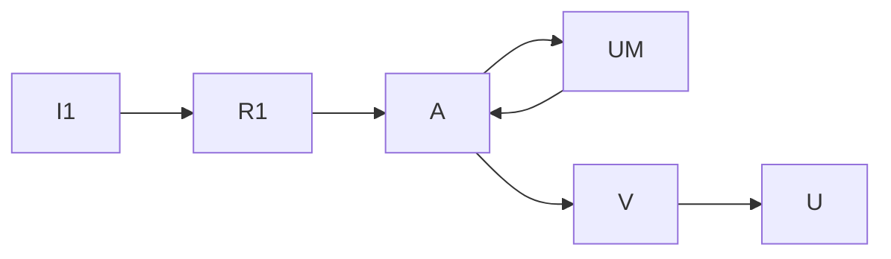

Abb. 2.32: Stromrichtige Messung.

**b)** Im Messbereich 3 mA ist bei einem Instrument der Klasse 5 die Abweichung $3\mathrm{mA} \cdot 0,05 = 0,15$ mA möglich. Wird der Wert $I = 1$ mA angezeigt, so liegt also der wahre Wert mit Sicherheit im Bereich

$$
0, 8 5 \mathrm{mA} \leq I \leq 1, 1 5 \mathrm{mA}.
$$

Im Spannungsmessbereich 30 V ist bei einem Instrument der Klasse 5 die Abweichung 30 $\mathrm{V} \cdot 0,05 = 1,5\mathrm{V}$ möglich. Wird der Wert 10 V angezeigt, so liegt der wahre Wert mit Sicherheit im Bereich

$$
8, 5 \mathrm{V} \leq U _ {1} \leq 1 1, 5 \mathrm{V}.
$$

**c)** Der maximal mögliche Leitwert $\hat { G } _ { 1 }$ ergibt sich, falls der wahre Strom den Wert $\hat { I } = 1$ ,15 mA und die wahre Spannung den Wert $\check { U } _ { 1 } = 8 ,   5   \mathrm { V }$ hat. Aus Gl. (2.43) folgt dann

$$
\begin{array}{l} \hat {G} _ {1} = \frac {\hat {I}}{\check {U} _ {1}} - G _ {\mathrm{i}} = \frac {1 , 1 5 \mathrm{mA}}{8 , 5 \mathrm{V}} - \frac {1}{5 0 \mathrm{k} \Omega} \\ \check {R} _ {1} = \frac {1}{\hat {G} _ {1}} \approx 8, 7 \mathrm{k} \Omega . \\ \end{array}
$$

Umgekehrt ergibt sich der minimal mögliche Leitwert $\check { G } _ { 1 }$ aus den Werten $\check{I} = 0,85    mA$ und $\hat { U } _ { 1 } = 1 1 ,   5   \mathrm { V } ;$

$$
\begin{array}{l} \check {G} _ {1} = \frac {\check {I}}{\hat {U} _ {1}} - G _ {\mathrm{i}} = \frac {0 , 8 5 \mathrm{mA}}{1 1 , 5 \mathrm{V}} - \frac {1}{5 0 \mathrm{k} \Omega} \\ \hat {R} _ {1} = \frac {1}{\check {G} _ {1}} \approx 1 8, 5 \mathrm{k} \Omega . \\ \end{array}
$$

Die Ungenauigkeit der verwendeten Messgeräte $( \pm 5   \%$ vom Skalenendwert) führt hier also zu einer noch viel größeren Ungenauigkeit bei der Widerstandsmessung:

$$
8, 7 \mathrm{k} \Omega \leq R _ {1} \leq 1 8, 5 \mathrm{k} \Omega
$$

$$
R _ {1} = 1 3, 6 \mathrm{k} \Omega \pm 4, 9 \mathrm{k} \Omega = 1 3, 6 \mathrm{k} \Omega \pm \frac {3 6}{1 0 0} 1 3, 6 \mathrm{k} \Omega.
$$

Bei der Widerstandsmessung ist also eine Abweichung von ±36 % möglich.

**Anmerkung** $Z   u   \boldsymbol { a } ) .$ : Ohne Stromkorrektur (und ohne Berücksichtigung der Ungenauigkeit des Messgerätes) hätte sich ergeben

$$
R _ {1 I} = \frac {U _ {1}}{I} = \frac {1 0 \mathrm{V}}{1 \mathrm{mA}} = 1 0 \mathrm{k} \Omega ;
$$

die Stromkorrektur (d. h. die Berücksichtigung des Innenwiderstandes des Spannungsmessers) darf hier also nicht unterbleiben.

Bei der Messung des Widerstandes $R _ { 1 } = 1 2 , 5$ kΩ hätte die stromrichtige Messung (bei idealer Messgenauigkeit) für $R _ { \mathrm { i } } = 1 0   \Omega   z .   B .$ zu folgenden Messwerten geführt (Bild 2.32):

$$
I _ {1} = 1 \mathrm{mA}, \quad U = 1 2, 5 1 \mathrm{V}.
$$

Ohne Spannungskorrektur ergibt das

$$
R _ {1 U} = \frac {U}{I _ {1}} = \frac {1 2 , 5 1 \mathrm{V}}{1 \mathrm{mA}} = 1 2, 5 1 \mathrm{k} \Omega .
$$

Mit Spannungskorrektur hätte sich für $R _ { \mathrm { i } } = 1 0   \Omega$ ergeben:

$$
R _ {1} = \frac {U}{I _ {1}} - R _ {\mathrm{i}} = 1 2, 5 \mathrm{k} \Omega .
$$

Bei stromrichtiger Messung hätte also in diesem Fall der Spannungsabfall am Strommesser vernachlässigt werden können. Die Spannungskorrektur ist hier überflüssig, weil ihr Einfluss wesentlich geringer ist als der mögliche Fehler eines Präzisions-Messgerätes.

Allgemein gilt: Wenn der zu messende Widerstand klein ist (im Vergleich zum Innenwiderstand Ri des Spannungsmessers), ist spannungsrichtige Messung zweckmäßig. Ist dagegen der zu messende Widerstand groß, so ist die stromrichtige Messung geeigneter.

## 2.4 Lineare Zweipole

Beliebige elektrische Schaltungen mit zwei Anschlüssen bezeichnet man als Zweipole. Auch Schaltungen mit mehr Anschlüssen können als Zweipole aufgefasst werden, wenn nur zwei Anschlüsse benutzt werden. Zweipole haben schon in den vorangehenden Abschnitten eine Rolle gespielt: ein einzelner ohmscher Widerstand mit seinen zwei Anschlüssen ist ein Zweipol, die Reihenschaltung mehrerer Widerstände (Bild 2.9) kann als Zweipol mit den Anschlussklemmen A und B angesehen werden. Ein solcher Zweipol kann im Übrigen außer ohmschen Widerständen auch alle möglichen anderen Verbraucher (z. B. Spulen, Dioden, Glühlampen) und Spannungsquellen enthalten.

In Bild 2.33 wird ein Zweipol dargestellt, der drei Spannungsquellen und drei Widerstände enthält; dieser Zweipol ist an den Klemmen A und B zugänglich. Messbar sind nur die Klemmenspannung U und der Klemmenstrom I.

text_image

Uq1
R1
Uq2
R2
Uq3
R3
I A
U
B

Abb. 2.33: Aktiver Zweipol mit drei Spannungsquellen und drei Widerständen.

flowchart

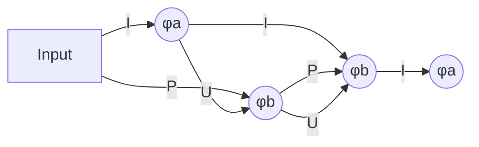

Abb. 2.34: Zuordnung der Zählpfeilrichtungen von Spannung, Strom und Leistung an einem Zweipol bei abgegebener Leistung (Erzeuger-Zählpfeilsystem).

text_image

I
φₐ
P
U
φb
φb
P
U
φₐ > φb

Abb. 2.35: Zuordnung der Zählpfeilrichtungen von Spannung, Strom und Leistung an einem Zweipol bei aufgenommener Leistung (Verbraucher-Zählpfeilsystem).

## 2.4.1 Erzeuger- und Verbraucher-Zählpfeilsystem

Ein Akkumulator kann sowohl elektrische Leistung abgeben als auch aufnehmen. Wenn ein Akkumulator Leistung abgibt, fließt aus dessen Plusklemme ein Strom heraus. Nur beim Aufladen (d. h. wenn der Akkumulator Leistung aufnimmt) fließt in dessen Plusklemme ein Strom hinein.

Bei der Wahl der Zählpfeile, für den Fall, dass der Akkumulator Leistung abgibt, zeigen sowohl der Strompfeil als auch der Leistungspfeil nach außen (Bild 2.34). Man spricht von einem **Erzeuger-Zählpfeilsystem** (Generator-Zählpfeilsystem) (EZS), wenn aus dem Anschlusspunkt mit dem höchsten Potential der Strom herausfließt.

Nimmt dagegen der Akkumulator Leistung auf, so zeigen in dem Zählpfeilsystem der Strompfeil und der Leistungspfeil nach innen (Bild 2.35). In diesem Fall spricht man von einem **Verbraucher-Zählpfeilsystem** (VZS).

Im Erzeuger-Zählpfeilsystem zeigen die Spannungs- und die Stromzählpfeile am Zweipol in die entgegengesetzte Richtung. Die positive Leistung entspricht dann der abgegebenen Leistung (Bild 2.34). Dagegen zeigen im Verbraucher-Zählpfeilsystem am Zweipol die Spannungs- und Stromzählpfeile in die selbe Richtung. Positive Leistung entspricht dann der aufgenommenen Leistung (Bild 2.35). Beide Zählpfeilsysteme werden, wie in Bild 2.36 dargestellt, üblicherweise in einem Stromkreis gemeinsam verwendet.

Das Ohm’sche Gesetz lautet

$$
R = \frac {U}{I} \quad \text {im Verbraucher - Zählpfeilsystem,} \tag {2.44}
$$

$$
R = - \frac {U}{I} \quad \text {im Erzeuger - Zählpfeilsystem.} \tag {2.45}
$$

flowchart

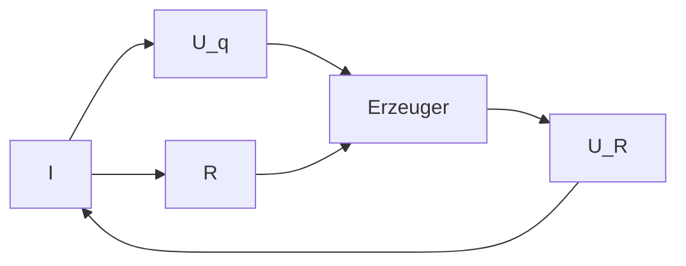

Abb. 2.36: Zählpfeile am Erzeuger- und Verbraucher-Zweipol.

In beiden Zählpfeilsystemen gilt für die Berechnung der Leistung

$$
P = U \cdot I. \tag {2.46}
$$

Dabei wird folgendes festgelegt:

$P > 0$ , wenn im VZS Leistung vom Zweipol aufgenommen wird.

$P < 0$ , wenn im VZS Leistung vom Zweipol abgegeben wird.

$P > 0$ , wenn im EZS Leistung vom Zweipol abgegeben wird.

$P < 0$ , wenn im EZS Leistung vom Zweipol aufgenommen wird.

Die Leistungsbilanz bei der gemeinsamen Verwendung beider Zählpfeilsysteme ist dann

$$
\sum P _ {\text {Erzeuger}} = \sum P _ {\text {Verbraucher}}. \tag {2.47}
$$

## 2.4.2 Spannungsquellen

Die wichtigsten Spannungsquellen sind die Drehstrom-Generatoren, die den technischen Wechselstrom erzeugen; Gleichspannung können sie nicht unmittelbar, sondern erst nach Gleichrichtung liefern. Alle Arten von chemischen Spannungsquellen, wie Trockenbatterien und Blei-Sammler (-Akkumulatoren) erzeugen Gleichspannung.

Die Spannung U, die an den Klemmen a, b einer Gleichspannungsquelle (Bild 2.37) auftritt, nimmt mit wachsendem Belastungsstrom I ab. Dies kann durch die Gleichung

$$
U = U _ {\mathrm{q}} - R _ {\mathrm{i}} I \tag {2.48}
$$

text_image

R_i
U_i
U_q
a
I
U
b
R

Spannungsquelle

Abb. 2.37: Belastung einer Spannungsquelle mit dem Widerstand R.

beschrieben werden. Hierbei sind die **Quellenspannung** $U _ { \mathrm { q } }$ Ua und der innere Wider**stand** $R _ { \mathbf { i } }$ fiktive Größen; d. h. Größen, die nicht unmittelbar messbar sind, sondern nur den messbaren Zusammenhang $U = f ( I )$ richtig beschreiben. In vielen wichtigen Fällen ist dieser Zusammenhang nahezu **linear**, die Funktion $U = f ( I )$ ergibt dann eine Gerade (Bild 2.38).

Die Gl. (2.48) beschreibt im Übrigen nur dann eine Gerade, wenn

$$
U _ {\mathrm{q}} = k o n s t \tag {2.49}
$$

und

$$
R _ {\mathrm{i}} = k o n s t \tag {2.50}
$$

sind. Man spricht in diesem Fall von einer **linearen** Spannungsquelle. In den folgenden Abschnitten soll der Einfachheit halber stets mit linearen Spannungsquellen gerechnet werden.

Dass die Gl. (2.48) und die in Bild 2.37 gestrichelte Schaltung eine angemessene Darstellung für das Verhalten einer Spannungsquelle sind, kann man sich für viele Fälle leicht plausibel machen:

Im Inneren der Quelle wird eine Spannung erzeugt, deren Größe (nahezu) belas tungsunabhängig ist. Durch metallische und elektrolytische Leitung im Innern der Quelle entsteht ein Spannungsabfall, der mit dem Strom zunimmt.

line

| Point | Description |
| --- | --- |
| Ui | Ri I |
| U | f(I) |
| Ri | Ri I |

Abb. 2.38: Abhängigkeit der Klemmenspannung vom Belastungsstrom bei einer linearen Spannungsquelle.

line

| I/A | \(K.Z. (Ri/\Omega)\) | \(A.M. (Ri/\Omega)\) | \(N.C. (Ri/\Omega)\) |
| --- | --- | --- | --- |
| ~0.15 | ~1.35 | ~0.58 | ~0.24 |
| 0.5 | ~0.90 | ~0.40 | ~0.18 |
| 1.0 | ~0.75 | ~0.35 | ~0.16 |

line

| I/A | Ri \((m\Omega)\)::g' | Ri \((m\Omega)\)::n' |
| --- | --- | --- |
| 10 | ~68 | 40 |
| 20 | ~57 | ~25 |
| 30 | ~51 | ~16 |
| 40 | ~50 | ~11 |
| 50 | ~51 | ~10 |
| 55 | ~53 | ~11 |

K.Z. = Kohle-Zink-Element

A.M. = Alkali-Mangan-Element

N.C. = wieder aufladbares Nickel-Cadmium-Element

Abb. 2.39: Innenwiderstand $R _ { \mathrm { i } } = f ( I )$ bei verschiedenen neuwertigen 1,5-V-Trockenbatterien.

g. = gebrauchter Akku

n. = neuwertiger Akku

Abb. 2.40: Innenwiderstand zweier 12-V-Blei-Akkumulatoren (Auto-Batterien).

In den Bildern 2.39 und 2.40 werden Beispiele für den Innenwiderstand $R _ { \mathbf { i } }$ von Spannungsquellen gegeben $( R _ { \mathrm { i } }$ als Funktion des Belastungsstromes $I )$ , bei denen die Linearitätsbedingung nach Gl. (2.50) nicht ganz erfüllt ist.

Für den **Kurzschlussstrom** $I _ { \mathrm { k } }$ einer Spannungsquelle (Bild 2.41) gilt:

$$
I _ {\mathrm{k}} = \frac {U _ {\mathrm{q}}}{R _ {\mathrm{i}}}  . \tag {2.51}
$$

Dieser Wert kann unmittelbar gemessen werden, falls kein Teil der Schaltung hierdurch überlastet wird. Die **Leerlaufspannung** kann ebenfalls unmittelbar gemessen werden (Bild 2.42).

Aus der Messung des Kurzschlussstromes (Kurzschlussversuch) und der Leerlaufspannung (Leerlaufversuch) ergeben sich $I _ { \mathrm { k } }$ und $U _ { \mathrm { q } }$ unmittelbar. Mit Hilfe der Gl. (2.51) kann dann aus diesen beiden Größen $R _ { \mathbf { i } }$ bestimmt werden:

$$
R _ {\mathrm{i}} = \frac {U _ {\mathrm{q}}}{I _ {\mathrm{k}}} . \tag {2.52}
$$

Diese Gleichung gilt bei Kurzschluss. Bei geringerer Belastung kann sich in einer nichtlinearen Spannungsquelle z. B. ein höherer Wert für $R _ { \mathbf { i } }$ ergeben, wie aus den Bildern 2.39 und 2.40 zu erkennen ist. Die Bestimmung von $U _ { \mathrm { q } }$ und $R _ { \mathbf { i } }$ aus nur zwei Messungen ist also nur dann ausreichend, wenn die Linearitätsbedingungen nach Gln. (2.49) und (2.50) erfüllt sind.

Falls der Kurzschlussversuch zu einem unzulässig hohen Kurzschlussstrom führt und auch der Leerlaufversuch nicht möglich ist, kann man zur Bestimmung von $R _ { \mathbf { i } }$ und $U _ { \mathrm { q } }$ zwei beliebige Belastungsfälle heranziehen. In der Schaltung in Bild 2.37 können für R zwei verschiedene Werte eingestellt und die zugehörigen Werte der Klemmenspannung $( U _ { ( 1 ) }$ und $U _ { ( 2 ) } )$ und des Stromes $( I _ { ( 1 ) }$ und $I _ { ( 2 ) } )$ gemessen werden. Wendet man die Gl. (2.48) auf die beiden Belastungsfälle

$$
U _ {(1)} = U _ {\mathrm{q}} - R _ {\mathrm{i}} I _ {(1)}, \tag {2.53a}
$$

$$
U _ {(2)} = U _ {\mathrm{q}} - R _ {\mathrm{i}} I _ {(2)} \tag {2.53b}
$$

an, so stellen sie zwei Bestimmungsgleichungen für $R _ { \mathbf { i } }$ und $U _ { \mathrm { q } }$ dar.

## Beispiel 2.14: Bestimmung von $R _ { \mathbf { i } }$ und $u _ { \mathbf { q } }$ aus zwei Belastungsfällen.

Eine Spannungsquelle wird mit dem Widerstand R belastet (Bild 2.37). Zunächst wird

text_image

Uq
Ri
a
Ik
Ub=0
A
b

Abb. 2.41: Messung des Kurzschlussstromes $I _ { \mathrm { k } } .$

text_image

Uq
Ri
a
I = 0
Uq
b
V

Abb. 2.42: Messung der Leerlaufspannung $U _ { \mathbf { q } }$

$R = R _ { ( 1 ) }$ eingestellt und der zugehörige Strom $I = I _ { ( 1 ) }$ gemessen. Danach wird $R = R _ { ( 2 ) }$ eingestellt und der zugehörige Strom $I = I _ { ( 2 ) }$ gemessen.

Aus den Größen $R _ { ( 1 ) } , R _ { ( 2 ) } , I _ { ( 1 ) } , I _ { ( 2 ) }$ sollen $U _ { \mathrm { q } }$ und $R _ { \mathbf { i } }$ berechnet werden.

## Lösung:

Im ersten Fall gilt

$$
I _ {(1)} = \frac {U _ {\mathrm{q}}}{R _ {\mathrm{i}} + R _ {(1)}}, \tag {2.54a}
$$

im zweiten Fall

$$
I _ {(2)} = \frac {U _ {\mathrm{q}}}{R _ {\mathrm{i}} + R _ {(2)}}. \tag {2.54b}
$$

Division von Gl. (2.54a) durch (2.54b) ergibt

$$
\frac {I _ {(1)}}{I _ {(2)}} = \frac {R _ {\mathrm{i}} + R _ {(2)}}{R _ {\mathrm{i}} + R _ {(1)}}
$$

$$
R _ {\mathrm{i}} = \frac {R _ {(2)} I _ {(2)} - R _ {(1)} I _ {(1)}}{I _ {(1)} - I _ {(2)}}. \tag {2.55}
$$

Setzt man dies in Gl. (2.54a) ein, so wird

$$
U _ {\mathrm{q}} = I _ {(1)} (R _ {\mathrm{i}} + R _ {(1)}) \tag {2.56}
$$

$$
U _ {\mathrm{q}} = \frac {R _ {(2)} - R _ {(1)}}{\frac {I _ {(1)}}{I _ {(2)}} - 1} I _ {(1)}. \tag {2.57}
$$

## 2.4.3 Linearität

Im Abschnitt 2.1.1 (Ohm’sches Gesetz) wurde betont, dass das Ohm’sche Gesetz

$$
U = R I \tag {2.2a}
$$

eine lineare Gleichung ist, wenn die Bedingung R = konst erfüllt ist. Im Abschnitt 2.4.2 (Spannungsquellen) wurde dargestellt, dass bei Spannungsquellen ein Zusammenhang zwischen Strom und Spannung besteht,

$$
U = U _ {\mathrm{q}} - R _ {\mathrm{i}} I, \tag {2.48}
$$

der ebenfalls linear ist, falls $U _ { \mathrm { q } }$ und $R _ { \mathbf { i } }$ konstant sind. Außerdem sind offensichtlich auch die beiden Kirchhoff’schen Gln. (2.5) und (2.7) lineare Beziehungen (d. h. Gleichungen, in denen alle Variablen nur in der ersten Potenz auftreten):

$$
I _ {1} + I _ {2} + I _ {3} + \dots = 0,
$$

$$
U _ {1} + U _ {2} + U _ {3} + \dots = 0.
$$

Ein Netz, das nur ohmsche Widerstände und lineare Quellen enthält, nennt man ein **lineares Netz**. In ihm können mit Hilfe der Kirchhoff’schen Gleichungen und den

Gln. (2.2a) und (2.48) jede beliebige Spannung und jeder beliebige Strom berechnet werden, und zwar als lineare Funktion jedes beliebigen anderen Stromes oder jeder beliebigen anderen Spannung. Einfache Beispiele hierfür sind die Spannungsteilerregel (2.17), bei der $U _ { 2 } = f ( U )$ angegeben wird, oder die Stromteilerregel, bei der $I _ { 2 } = f ( I )$ angegeben wird.

Dass in linearen Netzen grundsätzlich alle Ströme und Spannungen lineare Funktionen anderer Ströme und Spannungen sind, liegt daran, dass bei der Umformung und Auflösung linearer Gleichungssysteme ebenfalls immer nur lineare Gleichungen entstehen können.

## Beispiel 2.15: Lineare Zusammenhänge an einem belasteten Spannungsteiler.

Bei einem einfachen Spannungsteiler nach Bild 2.43, an den ein Belastungswiderstand $R _ { 3 }$ angeschlossen ist, gilt:

$$
I _ {1} = f (U _ {\mathrm{q}}) = \frac {U _ {\mathrm{q}}}{R _ {1} + \frac {R _ {2} R _ {3}}{R _ {2} + R _ {3}}}
$$

$$
I _ {1} = f (U _ {2}) = \frac {R _ {2} + R _ {3}}{R _ {2} R _ {3}} U _ {2}
$$

$$
I _ {3} = f (U _ {2}) = \frac {U _ {2}}{R _ {3}}
$$

$$
U _ {1} = f (U _ {\mathrm{q}}) = \frac {R _ {1} (R _ {2} + R _ {3})}{R _ {1} R _ {2} + R _ {2} R _ {3} + R _ {3} R _ {1}} U _ {\mathrm{q}}
$$

$$
U _ {1} = f (I _ {1}) = R _ {1} I _ {1}
$$

$$
U _ {2} = f (U _ {\mathrm{q}}) = \frac {R _ {2} R _ {3}}{R _ {1} R _ {2} + R _ {2} R _ {3} + R _ {3} R _ {1}} U _ {\mathrm{q}}
$$

$$
U _ {2} = f (U _ {1}) = \frac {R _ {2} R _ {3}}{R _ {1} (R _ {2} + R _ {3})} U _ {1}
$$

$$
U _ {2} = f (I _ {1}) = \frac {R _ {2} R _ {3}}{R _ {2} + R _ {3}} I _ {1} \quad u. a.
$$

Diese Ergebnis-Beispiele zeigen, wie bei einer einfachen Schaltung jede Strom- oder Spannungsgröße als lineare Funktion jeder anderen Strom- oder Spannungsgröße dargestellt werden kann. Auch lineare Gleichungen folgenden Typs können angegeben werden:

text_image

I₁
R₁
U₁
Uq
I₃
R₂
I₂
U₂
R₃

Abb. 2.43: Belasteter Spannungsteiler.

$$
I _ {1} = f (U _ {2}, I _ {3}) = \frac {U _ {2}}{R _ {2}} + I _ {3}
$$

$$
U _ {1} = f (U _ {2}, I _ {3}) = \frac {R _ {1}}{R _ {2}} U _ {2} + R _ {1} I _ {3} \quad u. a.
$$

## 2.4.4 Quellen-Ersatzzweipole

## 2.4.4.1 Die Ersatzspannungsquelle

Trennt man ein beliebiges lineares Netz aus ohmschen Widerständen und Spannungs quellen an irgendeiner Stelle auf, so entstehen zwei freie Enden, die als Anschlussklemmen zugänglich sein sollen. Wenn alle anderen Knoten des Netzes unzugänglich sind, so ist also das Netz ein Quellen-Zweipol. Der Zusammenhang $U = f ( I )$ an den Klemmen muss linear sein, wenn das im Zweipol enthaltene Netz linear ist (vgl. Abschnitt 2.4.3):

$$
U = K _ {1} - K _ {2} I. \tag {2.58}
$$

Dieser Zusammenhang stellt in einem U-I-Koordinatensystem eine Gerade dar. Hierbei ist $K _ { 1 }$ der Achsenabschnitt auf der U-Achse und $K _ { 1 } / K _ { 2 }$ der Achsenabschnitt auf der I-Achse (Bild 2.45). Sind von einer Geraden die beiden Achsenabschnitte bekannt, so ist sie dadurch eindeutig bestimmt. Zur Bestimmung des Klemmenverhaltens eines linearen Quellen-Zweipols genügt also die Berechnung der beiden Konstanten $K _ { 1 }$ und $K _ { 2 }$ . Die beiden Bestimmungsgleichungen für sie können besonders gut aus dem Kurzschluss- und Leerlaufversuch gewonnen werden.

Bei einem Leerlaufversuch $( I = 0 )$ wird die Leerlaufspannung $U | _ { I = 0 } = U _ { \mathrm { l } }$ gemessen, und mit Gl. (2.58) gilt

$$
U | _ {I = 0} = U _ {1} = K _ {1}, \tag {2.59}
$$

d. h. $K _ { 1 }$ ist identisch mit der bei Leerlauf messbaren Klemmenspannung.

text_image

I
a
U
b

Abb. 2.44: Linearer Quellen-Zweipol.

line

| Variable | Value |
| --- | --- |
| Equation | Uq = K1 |
| Ratio | K1 / K2 = Ik |

Abb. 2.45: Kennlinie der Klemmenspannung eines linearen Quellen-Zweipols.

text_image

Uq = U1
Ri = (Ul / Ik)
I
a
U
b

Abb. 2.46: Ersatzspannungsquelle für einen beliebigen aktiven linearen Zweipol mit der Leerlaufspannung $U _ { \mathrm { l } }$ und dem Kurzschlussstrom Ik. $I _ { \mathrm { k } }$

Bei einem Kurzschlussversuch $\left( U = 0 \right)$ wird der Kurzschlussstrom $I \big | _ { U = 0 } = I _ { \mathrm { k } }$ gemessen, und mit Gl. (2.58) gilt

$$
0 = K _ {1} - K _ {2} \left. I \right| _ {U = 0}
$$

$$
I | _ {U = 0} = I _ {\mathrm{k}} = \frac {K _ {1}}{K _ {2}}
$$

$$
K _ {2} = \frac {K _ {1}}{I _ {\mathrm{k}}} = \frac {U _ {\mathrm{l}}}{I _ {\mathrm{k}}} . \tag {2.60}
$$

Setzt man die Ergebnisse der Gln. (2.59) und (2.60) in Gl. (2.58) ein, so ergibt sich

$$
U = U _ {\mathrm{l}} - \frac {U _ {\mathrm{l}}}{I _ {\mathrm{k}}} I. \tag {2.61}
$$

Vergleicht man dies mit der Gl. (2.48), so zeigt sich, dass der betrachtete Zweipol (Bild 2.44) sich an den Klemmen a, b ebenso verhält wie eine Spannungsquelle mit der Quellenspannung $U _ { \mathrm { l } } ,$ , und dem Innenwiderstand $R _ { \mathrm { i } } = U _ { \mathrm { l } } \big / _ { I _ { \mathrm { k } } }$ (Bild 2.46). Demnach kann ein beliebiger linearer Zweipol durch eine einfache Spannungsquelle ersetzt werden, die man deshalb als Ersatzspannungsquelle bezeichnet. Der beliebige Zweipol und seine Ersatzspannungsquelle verhalten sich an ihren Klemmen gleich. Die Funktionen

$$
U = f (I)
$$

stimmen bei beiden überein. Im Innern (d. h. links von den Klemmen) kann der ursprüngliche Zweipol natürlich gänzlich anders aufgebaut sein und sich anders verhalten als seine Ersatzspannungsquelle. Grundsätzlich lässt sich eine Ersatzspannungsquelle nicht nur durch Kurzschluss- und Leerlauf-Messung bestimmen, sondern auch aus dem Aufbau des zu ersetzenden Zweipols berechnen.

## Beispiel 2.16: Berechnung der Leerlaufspannung $u _ { \mathbf { q } }$ und des Innenwiderstandes $R _ { \mathbf { i } }$ einer Ersatzspannungsquelle.

Werden die Klemmen $a ,$ b der Schaltung in Bild 2.47 kurzgeschlossen, so ergibt sich

$$
I _ {\mathrm{k}} = \frac {U _ {\mathrm{q1}}}{R _ {1}}. \tag {2.62}
$$

Bei Leerlauf gilt

$$
U _ {\mathrm{q}} = U _ {1} = \frac {R _ {2}}{R _ {1} + R _ {2}} U _ {\mathrm{q1}}. \tag {2.63}
$$

text_image

Uq1
R1
R2
I
a
U
b

Abb. 2.47: Aktiver linearer Zweipol (Quelle mit Spannungsteiler).

text_image

R₂/R₁+R₂ Uq1
R₁R₂/R₁+R₂
I
a
U
b

Abb. 2.48: Ersatzspannungsquelle für eine Quelle mit Spannungsteiler.

Der Innenwiderstand ist

$$
R _ {\mathrm{i}} = \frac {U _ {\mathrm{l}}}{I _ {\mathrm{k}}} = \frac {R _ {1} R _ {2}}{R _ {1} + R _ {2}}, \tag {2.64}
$$

$R _ { \mathbf { i } }$ lässt sich als Parallelschaltung der beiden Widerstände $R _ { 1 }$ und $R _ { 2 }$ auffassen. Zu diesem Ergebnis kommt man auch, wenn man in der Schaltung in Bild 2.47 die Quelle $U _ { \mathrm { q 1 } }$ kurzschließt und dann den Widerstand bestimmt, der sich von den Klemmen a, b aus ergibt.

## 2.4.4.2 Die Ersatzstromquelle

Wegen Gl. (2.51) gilt

$$
U _ {\mathrm{q}} = R _ {\mathrm{i}} I _ {\mathrm{k}}.
$$

und die Gl. (2.48) lässt sich folgendermaßen darstellen:

$$
U = R _ {\mathrm{i}} I _ {\mathrm{k}} - R _ {\mathrm{i}} I \tag {2.65}
$$

$$
I = I _ {\mathrm{k}} - \frac {U}{R _ {\mathrm{i}}} \tag {2.66}
$$

$$
I = I _ {\mathrm{k}} - I _ {\mathrm{i}}.
$$

Die Gl. (2.66) beschreibt das Verhalten der Schaltung 2.49a. In dieser Schaltung tritt keine konstante Quellenspannung, sondern eine Konstantstromquelle auf, deren Strom $I _ { \mathrm { k } }$ bei Leerlauf ganz durch $R _ { \mathbf { i } }$ fließen muss, so dass dann gilt

$$
U _ {\mathrm{q}} = R _ {\mathrm{i}} I _ {\mathrm{k}};
$$

im Kurzschlussfall fließt kein Strom durch den Innenwiderstand $R _ { \mathbf { i } }$ der Stromquelle; dann ist

$$
U = R _ {\mathrm{i}} I _ {\mathrm{i}} = 0.
$$

Sofern der Quellenstrom $I _ { \mathrm { k } }$ und die Quellenspannung $U _ { \mathrm { q } }$ der Gl. $U _ { \mathrm { q } } = R _ { \mathrm { i } } I _ { \mathrm { k } }$ genügen und die Innenwiderstände beider Schaltungen gleich sind, stimmt die Gl. (2.48), die das Klemmenverhalten einer Spannungsquelle beschreibt, mit der Gl. (2.65) überein, die das Klemmenverhalten einer Ersatzstromquelle beschreibt. Spannungs- und Stromquelle sind dann gleichwertig.

a)

text_image

I_k
I_i
R_i = 1/G_i
I
a
U
R = 1/G
b

b)

line

| Variable | Description |
| --- | --- |
| I | Current (Y-axis) |
| U | Voltage (X-axis) |
| I_k | Initial Current Level |
| I_i | Intermediate Current Level |
| I = G_iU | Constant Current Level |
| I = GU | Lower Current Level |
| I = f(U) | Intermediate Current Level |
| U_q | Final Voltage Level |

Abb. 2.49: a) Ersatzstromquelle; b) Abhängigkeit des Klemmenstromes I von der Klemmenspannung U bei einer linearen Stromquelle.

flowchart

Abb. 2.50: Ersatzstromquelle für einen Spannungsteiler (Bild 2.47).

## Beispiel 2.17: Berechnung des Quellenstromes $I _ { \mathbf { k } }$ und des Innenwiderstandes $R _ { \mathbf { i } }$ einer Ersatzstromquelle.

Das Klemmenverhalten der Schaltung 2.47 lässt sich nicht nur durch eine Ersatzspannungsquelle (Beispiel 2.16), sondern auch durch eine Ersatzstromquelle (Bild 2.49a) beschreiben.

Im Kurzschlussfall gilt für den Klemmenstrom I in Schaltung 2.47:

$$
I _ {\mathrm{k}} = \frac {U _ {\mathrm{q} 1}}{R _ {1}}. \tag {2.62}
$$

Die Leerlaufspannung ist

$$
U _ {1} = \frac {R _ {2}}{R _ {1} + R _ {2}} U _ {\mathrm{q} 1} \tag {2.63}
$$

und der Innenwiderstand

$$
R _ {\mathrm{i}} = \frac {U _ {1}}{I _ {\mathrm{k}}} = \frac {R _ {1} R _ {2}}{R _ {1} + R _ {2}}, \tag {2.64}
$$

vgl. Bild 2.50.

## Beispiel 2.18: Parallelschaltung dreier Spannungsquellen.

Die Widerstände $R _ { \mathrm { R } } , R _ { \mathrm { S } } , R _ { \mathrm { T } } , R _ { \mathrm { M } }$ und die Quellenspannungen $U _ { \mathrm { R } } , U _ { \mathrm { S } } , U _ { \mathrm { T } }$ sind gegeben. Gesucht ist die Spannung $U _ { \mathrm { N M } }$ (Bild 2.51).

## Lösung:

Diese Aufgabe ist mit der Methode der Ersatzstromquelle besonders gut lösbar. Schließt