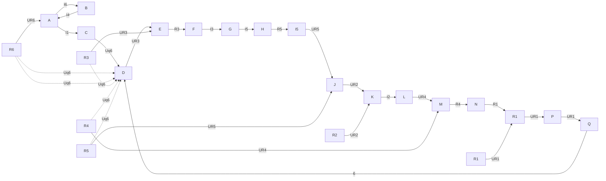
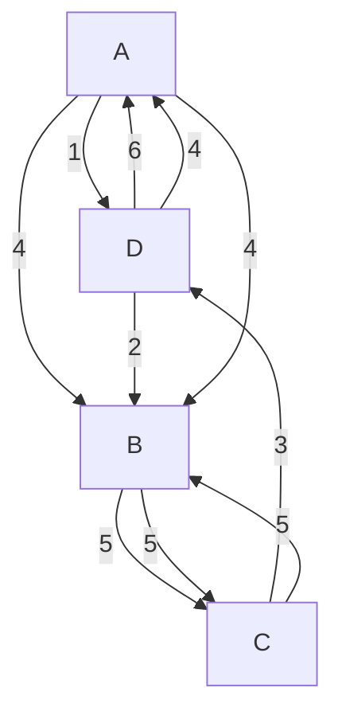
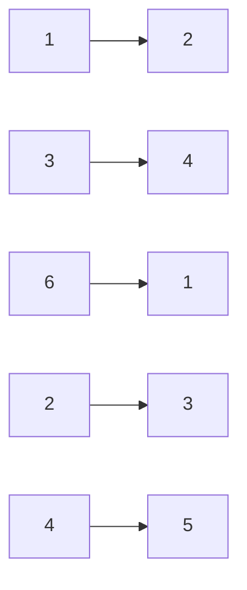
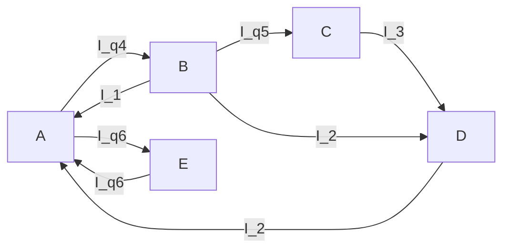

text_image

UR
RR
IR
US
RS
IS
UT
RT
IT
M
UNM
IN
RM

Abb. 2.51: Parallelschaltung dreier Spannungsquellen.

text_image

Ik
Ri
M← UNM → I
N
RM

Abb. 2.52: Ersatzstromquelle zum Zweipol in Bild 2.51.

text_image

R_R
R_S
R_T
M
N
R_i

Abb. 2.53: Zur Bestimmung des Innenwiderstandes eines Zweipols.

man die Klemmen M und N kurz, so erhält man den Quellenstrom $I _ { \mathrm { k } }$ der gesuchten Ersatzstromquelle (Bild 2.52):

$$
I _ {\mathrm{k}} = \frac {U _ {\mathrm{R}}}{R _ {\mathrm{R}}} + \frac {U _ {\mathrm{S}}}{R _ {\mathrm{S}}} + \frac {U _ {\mathrm{T}}}{R _ {\mathrm{T}}}. \tag {2.67}
$$

Der Innenwiderstand $R _ { \mathbf { i } }$ der Ersatzquelle ergibt sich wie folgt: Die Quellen mit den Spannungen $U _ { \mathrm { R } } ,   U _ { \mathrm { S } } ,   U _ { \mathrm { T } }$ werden kurzgeschlossen, und dann wird der Widerstand ermittelt, den der Zweipol an den Klemmen M, N hat.

In diesem Fall entsteht der Innenwiderstand einfach aus der Parallelschaltung von $R _ { \mathrm { R } } , R _ { \mathrm { S } }$ und $R _ { \mathrm { T } }$ (Bild 2.53):

$$
\frac {1}{R _ {\mathrm{i}}} = G _ {\mathrm{i}} = \frac {1}{R _ {\mathrm{R}}} + \frac {1}{R _ {\mathrm{S}}} + \frac {1}{R _ {\mathrm{T}}} . \tag {2.68}
$$

Falls die Ersatzstromquelle mit dem Quellenstrom $I _ { \mathrm { k } }$ und dem Innenwiderstand $R _ { \mathbf { i } }$ an den Widerstand $R _ { M }$ angeschlossen wird, fließt der Strom $I _ { \mathbf { k } }$ durch die Parallelschaltung von $R _ { \mathbf { i } }$ und $R _ { M }$ (Bild 2.52), es gilt demnach mit $\begin{array} { r } { G _ { \mathbb { M } } = \frac { 1 } { R _ { \mathbb { M } } } } \end{array}$

$$
U _ {\mathrm{NM}} = \frac {I _ {\mathrm{k}}}{G _ {\mathrm{i}} + G _ {\mathrm{M}}} = \frac {I _ {\mathrm{k}}}{\frac {1}{R _ {\mathrm{R}}} + \frac {1}{R _ {\mathrm{S}}} + \frac {1}{R _ {\mathrm{T}}} + \frac {1}{R _ {\mathrm{M}}}}
$$

$$
U _ {\mathrm{NM}} = \frac {\frac {U _ {\mathrm{R}}}{R _ {\mathrm{R}}} + \frac {U _ {\mathrm{S}}}{R _ {\mathrm{S}}} + \frac {U _ {\mathrm{T}}}{R _ {\mathrm{T}}}}{\frac {1}{R _ {\mathrm{R}}} + \frac {1}{R _ {\mathrm{S}}} + \frac {1}{R _ {\mathrm{T}}} + \frac {1}{R _ {\mathrm{M}}}}. \tag {2.69}
$$

## 2.4.4.3 Äquivalenz von Zweipolen

In Abschnitt 2.4.4 wurde gezeigt, dass ein beliebiger Zweipol in Bezug auf seine Klemmen durch seine Ersatzspannungs- oder Ersatzstromquelle **ersetzt** werden kann. Zweipole, die sich an ihren Klemmen gleich verhalten, sind äquivalent, d. h. sie verhalten sich nach außen hin gleich. Es ist messtechnisch unmöglich, sie von außen (d. h. von ihrem Klemmenpaar aus) zu unterscheiden. Im Inneren können sie aber sehr voneinander abweichen. Der Leistungsumsatz im Inneren von Quellen-Zweipolen (d. h. Zweipolen, die eine oder mehrere Quellen enthalten) kann sehr unterschiedlich sein. Zum Beispiel wird im Inneren des Zweipols, der in Bild 2.47 dargestellt ist, auch dann Leistung verbraucht, wenn die Klemmen a und b leerlaufen. Im Innern der äquiva lenten Ersatzspannungsquelle (Bild 2.48) dagegen wird im Leerlauf keine Leistung verbraucht. Die äquivalente Ersatzstromquelle (Bild 2.50) wiederum muss im Innern gerade bei Leerlauf ihre maximale Leistung aufbringen.

## Beispiel 2.19: Vergleich mehrerer äquivalenter Zweipole.

In Bild 2.54 werden vier äquivalente Zweipole miteinander verglichen, und zwar bei Leerlauf und Kurzschluss. Im Leerlauf stimmen die Klemmenspannungen und im Kurzschluss die Klemmenströme überein. Die Gesamtleistung $P _ { \mathrm { g e s } }$ ist in allen vier leerlaufenden Zweipolen unterschiedlich; auch im Kurzschlussfall stimmt sie in allen vier Zweipolen nicht überein.

Alle vier Zweipole sind äquivalent. Das heißt: die Schaltung A kann nicht nur durch ihre Ersatzspannungsquelle C oder ihre Ersatzstromquelle D ersetzt werden, sondern beispielsweise auch durch die Schaltung B.

## 2.4.5 Leistung an Zweipolen

## 2.4.5.1 Wirkungsgrad

Man definiert als Energie-Wirkungsgrad

$$
\eta_ {W} = \frac {\text {genutzte Energie}}{\text {gesamte aufgewendete Energie}} = \frac {W _ {\mathrm{n}}}{W _ {\mathrm{g}}}.\tag {2.70}
$$

Als Leistungs-Wirkungsgrad definiert man

$$
\eta_ {P} = \frac {\text {genutzte Leistung}}{\text {gesamte aufgewendete Leistung}} = \frac {P _ {\mathrm{n}}}{P _ {\mathrm{g}}}.\tag {2.71}
$$

Falls $\eta _ { P }$ zeitlich konstant ist, gilt $\eta _ { P } = \eta _ { W }$ . Speziell an einer belasteten Spannungsquelle (Bild 2.37) gilt wegen der Spannungsteilerformel Gl. (2.17):

$$
U = \frac {R}{R + R _ {\mathrm{i}}} U _ {\mathrm{q}}. \tag {2.72}
$$

Die Nutzleistung ist

$$
P _ {\mathrm{n}} = I U, \tag {2.73}
$$

die Gesamtleistung

$$
P _ {\mathrm{g}} = I U _ {\mathrm{q}}. \tag {2.74}
$$

<table><tr><td>AZwei parallel geschaltete Spannungsquellen</td><td>BSpannungsteiler</td><td>CErsatz-Spannungsquelle</td><td>DErsatz-Stromquelle</td></tr><tr><td></td><td></td><td></td><td></td></tr><tr><td> $P_{ges}=10W$ </td><td> $P_{ges}=90W$ </td><td> $P_{ges}=0$ </td><td> $P_{ges}=90W$ </td></tr><tr><td colspan="4">Leerlauf</td></tr><tr><td></td><td></td><td></td><td></td></tr><tr><td> $P_{ges}=100W$ </td><td> $P_{ges}=180W$ </td><td> $P_{ges}=90W$ </td><td> $P_{ges}=0$ </td></tr><tr><td colspan="4">Kurzschluss</td></tr></table>

Abb. 2.54: Leerlauf- und Kurzschlussbetrachtungen an vier äquivalenten Quellen-Zweipolen.

Daraus folgt mit den Gln. (2.71) bis (2.74):

$$
\eta_ {P} = \frac {I U}{I U _ {\mathrm{q}}} = \frac {U}{U _ {\mathrm{q}}} = \frac {\frac {R}{R + R _ {\mathrm{i}}} U _ {\mathrm{q}}}{U _ {\mathrm{q}}}
$$

$$
\eta_ {P} = \frac {R}{R + R _ {\mathrm{i}}} . \tag {2.75}
$$

## Beispiel 2.20: Wirkungsgrade bei Belastung einer Autobatterie.

Eine Autobatterie hat die Spannung $U _ { \mathrm { q } } = 1 2   \mathrm { V }$ und den inneren Widerstand (einschließ- lich Widerstand der Zuleitungen) $R_{\mathrm{i}} = 20   \mathrm{m}\Omega$ . Während des Anlassens wird die Batterie 30 s lang mit dem Widerstand $R _ { ( 1 ) } \; = \; 4 0$ mΩ belastet. Danach betreibt die Batterie 10 min lang die Lichtanlage $( R _ { ( 2 ) } = 2   \Omega )$

a) Wie groß ist der Leistungs-Wirkungsgrad während des Anlassens?
b) Wie groß ist er danach?
c) Mit welchem Energie-Wirkungsgrad hat die Batterie während der gesamten Betriebszeit gearbeitet?

## Lösung:

**a)** Gl. (2.75) ergibt hier (Bild 2.37):

$$
\eta_ {P 1} = \frac {4 0 \mathrm{m} \Omega}{4 0 \mathrm{m} \Omega + 2 0 \mathrm{m} \Omega} = \underline {{\underline {{0 , 6 6 6}}}}.
$$

**b)** In diesem Fall folgt aus Gl. (2.75)

$$
\eta_ {P 2} = \frac {2 \Omega}{2 \Omega + 0 , 0 2 \Omega} = \underline {{\underline {{0 , 9 9}}}}.
$$

**c)** Die Gesamtleistung während des Anlassens ist

$$
P _ {1 \mathrm{g}} = \frac {U _ {\mathrm{q}} ^ {2}}{R _ {(1)} + R _ {\mathrm{i}}} = \frac {1 2 ^ {2} \mathrm{V} ^ {2}}{6 0 \mathrm{m} \Omega} = \frac {1 4 4 \mathrm{V} ^ {2}}{6 \cdot 1 0 ^ {- 2} \Omega} = \underline {{\underline {{2 , 4 \mathrm{kW}}}}}
$$

und die Nutzleistung

$$
P _ {1 \mathrm{n}} = \eta_ {P 1} P _ {1 \mathrm{g}} = \frac {2}{3} \cdot 2, 4 \mathrm{kW} = \underline {{\underline {{1 , 6 \mathrm{kW}}}}}.
$$

Die Batterie gibt beim Anlassen die Gesamtenergie

$$
W _ {1 \mathrm{g}} = P _ {1 \mathrm{g}} \cdot t _ {1} = 2, 4 \mathrm{kW} \cdot 3 0 \mathrm{s} = \underline {{7 2 \mathrm{kWs}}}
$$

ab bei einem Nutzanteil von

$$
W _ {\mathrm{1n}} = P _ {\mathrm{1n}} \cdot t _ {1} = \underline {{\underline {{4 8 \mathrm{kWs}}}}}.
$$

Während die Lichtanlage gespeist wird, liefert die Batterie die Gesamtleistung

$$
P _ {2 \mathrm{g}} = \frac {U _ {\mathrm{q}} ^ {2}}{R _ {(2)} + R _ {\mathrm{i}}} = \frac {1 2 ^ {2} \mathrm{V} ^ {2}}{2 , 0 2 \Omega} = \underline {{7 1 , 3 \mathrm{W}}};
$$

die Nutzleistung ist

$$
P _ {2 \mathrm{n}} = \eta_ {P 2} P _ {2 \mathrm{g}} = 0, 9 9 \cdot 7 1, 3 \mathrm{W} = \underline {{7 0 , 5 \mathrm{W}}}.
$$

Die Batterie gibt für den Betrieb der Lichtanlage die Gesamtenergie

$$
W _ {2 \mathrm{g}} = P _ {2 \mathrm{g}} \cdot t _ {2} = 7 1, 3 \mathrm{W} \cdot 1 0 \cdot 6 0 \mathrm{s} = \underline {{4 2 , 7 8 \mathrm{kWs}}}
$$

ab; der Nutzanteil ist dabei

$$
W _ {2 \mathrm{n}} = P _ {2 \mathrm{n}} \cdot t _ {2} = \underline {{4 2 , 3 \mathrm{kWs}}}.
$$

Als Energie-Wirkungsgrad ergibt sich mit diesen Werten aus der Definition (2.70)

$$
\eta_ {W} = \frac {W _ {\mathrm{n}}}{W _ {\mathrm{g}}} = \frac {W _ {1 \mathrm{n}} + W _ {2 \mathrm{n}}}{W _ {1 \mathrm{g}} + W _ {2 \mathrm{g}}} = \frac {4 8 + 4 2 , 3}{7 2 + 4 2 , 7 8} = \underline {{0 , 7 8 6}}.
$$

## Beispiel 2.21: Leistungs-Wirkungsgrad einer Taschenlampe.

Eine Glühlampe (Nenndaten: 2,5 V; 0,5 W) wird in einer Taschenlampe mit zwei hintereinander geschalteten Kohle-Zink-Batterien (je 1,5 V und 1,25 Ω) betrieben.

a) Welchen Leistungs-Wirkungsgrad hat die Schaltung?
b) Es stehen vier Batterien (mit ebenfalls je 1,5 V und 1,25 Ω) zur Verfügung.

Welche Betriebsspannung U und welchen Betriebswiderstand R müsste eine Glühlampe haben, die bei Anschluss an die vier hintereinander geschalteten Batterien ebenfalls 0,5 W aufnehmen soll? Welcher Leistungs-Wirkungsgrad ergibt sich nun?

## Lösung:

**a)** Aus den Nenndaten der Glühlampe ergibt sich deren Widerstand

$$
R = \frac {U ^ {2}}{P} = \frac {2 , 5 ^ {2} \mathrm{V} ^ {2}}{0 , 5 \mathrm{W}} = \underline {{\underline {{1 2 , 5 \Omega}}}},
$$

und mit Gl. (2.75) folgt

$$
\eta_ {\mathrm{a}} = \frac {R}{R + R _ {\mathrm{i}}} = \frac {1 2 , 5}{1 2 , 5 + 2 \cdot 1 , 2 5} = \frac {5}{6} = \underline {{0 , 8 3 3}}.
$$

**b)** Wenn vier Batterien verwendet werden, gilt

$$
R _ {\mathrm{i}} = 4 \cdot 1, 2 5 \Omega = 5 \Omega ; \quad U _ {\mathrm{q}} = 4 \cdot 1, 5 \mathrm{V} = 6 \mathrm{V}.
$$

Die Leistung der Glühlampe soll weiterhin $P = 0 , 5 \mathrm { ~ W ~ }$ sein. Für diese Leistung gilt außerdem (Bild 2.37)

$$
P = R I ^ {2} = \frac {U _ {\mathrm{q}} ^ {2}}{(R _ {\mathrm{i}} + R) ^ {2}} R
$$

$$
(R _ {\mathrm{i}} + R) ^ {2} = \frac {U _ {\mathrm{q}} ^ {2}}{P} R  .
$$

Mit der Abkürzung

$$
\alpha = \frac {U _ {\mathrm{q}} ^ {2}}{P} = \frac {3 6 \mathrm{V} ^ {2}}{0 , 5 \mathrm{W}} = 7 2 \Omega
$$

wird

$$
(R _ {\mathrm{i}} + R) ^ {2} = \alpha R  .
$$

Dies kann als Bestimmungsgleichung für den Lampenwiderstand R verwendet werden:

$$
R ^ {2} + 2 R \left(R _ {\mathrm{i}} - \frac {\alpha}{2}\right) + R _ {\mathrm{i}} ^ {2} = 0.
$$

Die Auflösung dieser quadratischen Gleichung liefert

$$
R = \frac {\alpha}{2} - R _ {\mathrm{i}} \pm \sqrt {\alpha \left(\frac {\alpha}{4} - R _ {\mathrm{i}}\right)}.
$$

Mit den gegebenen Zahlenwerten wird daraus

$$
\begin{array}{l} R = 3 1 \Omega \pm \sqrt {7 2 (1 8 - 5)} \Omega = 3 1 \Omega \pm 6 \sqrt {2 6} \Omega \\ R _ {(1)} = \underline {{\underline {{6 1 , 6 \Omega}}}} \\ R _ {(2)} = 0, 4 0 6 \Omega . \\ \end{array}
$$

Die erste Lösung ergibt

$$
\eta_ {\mathrm{b} 1} = \frac {R}{R + R _ {\mathrm{i}}} = \frac {6 1 , 6}{6 6 , 6} = \underline {{0 , 9 2 5}},
$$

also eine Verbesserung des Wirkungsgrades durch Verwendung von mehr Batterien.

Die zweite Lösung würde praktisch den Kurzschluss der Batterien bedeuten; sie hätte den schlechten Wirkungsgrad

$$
\eta_ {\mathrm{b} 2} = \frac {0 , 4 0 6}{5 + 0 , 4 0 6} = 0, 0 7 5
$$

und kommt natürlich nicht in Betracht.

## 2.4.5.2 Anpassung

Wenn ein Verbraucher-Widerstand R (Bild 2.37) sehr groß wird im Vergleich zum In nenwiderstand $R _ { \mathbf { i } } ,$ dann kann er einer Spannungsquelle schließlich immer weniger Leistung entnehmen. Wird $R \rightarrow$ ∞ (Leerlauf), so gilt

$$
P = \frac {U ^ {2}}{R} = \lim _ {R \to \infty} \frac {U _ {\mathrm{q}} ^ {2}}{R} = 0.
$$

Aber auch wenn R sehr klein ist, wird schließlich die an den Verbraucher abgegebene Leistung sehr klein. Im Kurzschluss gibt die Batterie ihre gesamte Leistung an den inneren Widerstand $R _ { \mathbf { i } }$ ab und für die Verbraucher-Leistung folgt

$$
P = I ^ {2} R = I _ {\mathrm{k}} ^ {2} \cdot 0 = 0.
$$

Wenn in den beiden Extremfällen Leerlauf und Kurzschluss keine Leistung nach außen abgegeben wird, so muss mindestens ein Belastungsfall (d. h. ein Wert R) möglich sein, bei dem P maximal wird.

Für die Leistung P am Belastungswiderstand R gilt:

$$
\begin{array}{l} P = I ^ {2} R = \frac {U _ {\mathrm{q}} ^ {2}}{(R + R _ {\mathrm{i}}) ^ {2}} R \\ P = \frac {U _ {\mathrm{q}} ^ {2}}{R _ {\mathrm{i}}} \frac {R / R _ {\mathrm{i}}}{(1 + R / R _ {\mathrm{i}}) ^ {2}}. \tag {2.76} \\ \end{array}
$$

Mit der Abkürzung

$$
\alpha = \frac {R}{R _ {\mathrm{i}}} \tag {2.77}
$$

für das Widerstandsverhältnis lautet Gl. (2.76):

$$
P = \frac {U _ {\mathrm{q}} ^ {2}}{R _ {\mathrm{i}}} \frac {\alpha}{(1 + \alpha) ^ {2}}. \tag {2.78}
$$

Hierbei ist

$$
\frac {U _ {\mathrm{q}} ^ {2}}{R _ {\mathrm{i}}} = P _ {\mathrm{qk}}
$$

die Leistung, die die Quelle bei Kurzschluss aufbringen muss. Die genaue Untersuchung der in Gl. (2.78) beschriebenen Funktion $P = f ( \alpha )$ zeigt, dass P maximal wird, wenn $\alpha = 1$ ist (Bild 2.55). Mit Hilfe der Differenzialrechnung lässt sich das Maximum der Funktion

$$
P = P _ {\mathrm{qk}} \frac {\alpha}{(1 + \alpha) ^ {2}}
$$

leicht auffinden. Nach der Quotientenregel ergibt sich als erste Ableitung:

$$
\frac {\mathrm{d} P}{\mathrm{d} \alpha} = P _ {\mathrm{qk}} \frac {(1 + \alpha) ^ {2} - \alpha \cdot 2 (1 + \alpha)}{(1 + \alpha) ^ {4}} = P _ {\mathrm{qk}} \frac {1 - \alpha}{(1 + \alpha) ^ {3}}. \tag {2.79}
$$

Ein Extremwert der Funktion $P = f ( \alpha )$ folgt aus der Bedingung

$$
\frac {\mathrm{d} P}{\mathrm{d} \alpha} = 0,
$$

mit Gl. (2.79) also aus

$$
P _ {\mathrm{qk}} \frac {1 - \alpha}{(1 + \alpha) ^ {3}} = 0.
$$

Diese Bedingung wird erfüllt für

$$
\alpha_ {\mathrm{opt}} = 1,
$$

vgl. Bild 2.55. Der Extremwert der Funktion $P = f ( \alpha )$ tritt also auf, wenn

$$
R = R _ {\mathrm{i}} \tag {2.80}
$$

line

| \(\alpha = R/\)Ri | P/Pqk |
| --- | --- |
| 0 | 0 |
| 1 | 0,25 |
| 5 | ~0,13 |

Abb. 2.55: Normierte Verbraucherleistung in Abhängigkeit vom Widerstandsverhältnis α.

wird; d. h. ein Verbraucher-Widerstand R kann einer Spannungsquelle dann eine maximale Leistung entnehmen, wenn er gerade so groß wie der Innenwiderstand $R _ { \mathbf { i } }$ der Quelle ist. Man spricht in diesem Fall von **Leistungsanpassung**.

Insgesamt unterscheidet man bei der Anpassung des Lastwiderstands an die Quelle die drei Fälle

$$
R <   R _ {\mathrm{i}} \quad \text {Stromanpassung (Unteranpassung)},
$$

$$
R = R _ {\mathrm{i}} \quad \text { Leistungsanpassung },
$$

$$
R > R _ {\mathrm{i}} \quad \text {Spannungsanpassung   (Überanpassung)}.
$$

Der Wirkungsgrad beträgt bei Leistungsanpassung gemäß Gl. (2.75)

$$
\eta = \frac {R}{R + R _ {\mathrm{i}}} = 0, 5.
$$

## 2.5 Nichtlineare Zweipole

## 2.5.1 Kennlinien nichtlinearer Zweipole

Viele der bisher behandelten Gesetzmäßigkeiten und Lösungsmethoden setzen voraus, dass nur lineare Zweipole vorkommen; vgl. Gl. (2.2a) und Bild 2.2. Bei einer Reihe technisch wichtiger Bauelemente hängen jedoch U und I nicht linear zusammen. Bei der Berechnung von Schaltungen, die solche nichtlinearen Zweipole enthalten, geht man immer von der **Strom-Spannungs-Kennlinie** $I = f ( U )$ aus. Deshalb werden hier zunächst einige Beispiele wichtiger nichtlinearer Kennlinien dargestellt.

Germanium- und Silizium-Dioden sollen in einem bestimmten Spannungsbereich möglichst nicht leiten und außerhalb dieses Bereiches möglichst gut leiten. Die Kennlinie der Dioden muss also stark von einer Geraden abweichen (Bilder 2.56 bis 2.58).

Bild 2.59 zeigt das Verhalten einer Glühlampe: bei ihr nimmt – im Gegensatz zur Diode – der Wert $U / _ { I } = R$ mit wachsender Spannung U zu.

Bei den Kennlinien der Bilder 2.56 bis 2.59 ist die Zuordnung zwischen U und I eindeutig: zu jedem Wert I gehört nur ein Wert U (und umgekehrt). Beispiele nicht eindeutiger Kennlinien liefern Tunneldiode, Glimmlampe, Kaltleiter und Heißleiter (Bilder 2.60 bis 2.63).

Bild 2.59 zeigt das Verhalten einer Glühlampe: bei ihr nimmt – im Gegensatz zur Diode – der Wert $U / _ { I } = R$ mit wachsender Spannung $U   \mathbf { z u }$

Bei den Kennlinien der Bilder 2.56 bis 2.59 ist die Zuordnung zwischen U und I eindeutig: zu jedem Wert I gehört nur ein Wert U (und umgekehrt). Beispiele nicht eindeutiger Kennlinien liefern Tunneldiode, Glimmlampe, Kaltleiter und Heißleiter (Bilder 2.60 bis 2.63).

Bildet man zu den einzelnen Punkten der Funktion $I = f ( U )$ jeweils den Quotienten $R   =   U \big / _ { I } ,$ so zeigt sich, dass Bauelemente mit nichtlinearer Kennlinie $I = f ( U )$ auch

line

| Voltage (V) | Current (mA) |
| --- | --- |
| -40 | ~-500 |
| -20 | ~-150 |
| 0 | 0 |
| 1 | ~300 |
| 2 | ~1000 |

Abb. 2.56: Kennlinie einer Germaniumdiode.

line

| U (V) | I (mA) |
| --- | --- |
| -40 | ~-250 |
| -20 | ~-150 |
| 0 | 0 |
| 1 | ~100 |
| 2 | >100 |

Abb. 2.57: Kennlinie einer Siliziumdiode.

line

| U/V | I/mA |
| --- | --- |
| -6 | ~-20 |
| -5 | ~-10 |
| -4 | 0 |
| -3 | 0 |
| -2 | 0 |
| -1 | 0 |
| 0 | 0 |
| 1 | ~10 |
| 1.1 | ~20 |

Abb. 2.58: Kennlinie einer Z-Diode.

line

| U/V | I/mA |
| --- | --- |
| 0 | 0 |
| ~25 | ~100 |
| ~50 | ~150 |
| 100 | 200 |
| ~150 | ~230 |
| 200 | ~250 |

Abb. 2.59: Kennlinie einer Glühlampe.

line

| U/mV | I/mA |
| --- | --- |
| ~50 | ~2.5 |
| ~80 | 5 |
| ~150 | ~2.5 |
| ~300 | ~0.9 |
| ~450 | ~2.5 |
| ~520 | >5 |

Abb. 2.60: Kennlinie einer Tunneldiode.

line

| U/V | I/mA |
| --- | --- |
| 80 | ~2 |
| 85 | ~1.5 |
| 90 | ~1.2 |
| 100 | ~1.1 |

Abb. 2.61: Kennlinie einer Glimmlampe.

line

| U/V | I/mA |
| --- | --- |
| ~1.6 | >20 |
| ~1.8 | 16 |
| ~2.0 | 12 |
| ~2.3 | 8 |
| ~2.7 | 5 |
| ~3.2 | 3 |
| ~4.0 | 1.5 |
| ~4.1 | 1.8 |
| ~2.3 | 0.5 |
| ~4.1 | 1.8 |

Abb. 2.62: Kennlinie eines Heißleiters.

line

| U (V) | I (mA) |
| --- | --- |
| ~5 | ~10 |
| ~8 | 100 |
| ~15 | ~60 |
| ~20 | 50 |
| ~30 | ~35 |
| ~40 | ~28 |

Abb. 2.63: Kennlinie eines Kaltleiters.

line

| U/V | \(R/\Omega\) |
| --- | --- |
| ~0.35 | ~140 |
| 0.4 | 80 |
| 0.6 | ~50 |
| 0.8 | ~35 |
| 1.0 | ~25 |
| 1.2 | ~20 |
| 1.4 | ~18 |

Abb. 2.64: Widerstand einer Germaniumdiode als Funktion der Spannung.

line

| U/V | \(R/\Omega\) |
| --- | --- |
| ~20 | ~180 |
| ~50 | ~300 |
| 100 | ~480 |
| ~150 | ~620 |
| 200 | ~780 |

Abb. 2.65: Widerstand einer Glühlampe als Funktion der Spannung.

durch die Funktion $R = f ( U )$ beschrieben werden können (R ist hier nicht konstant, im Gegensatz zum ohmschen Widerstand). Das Bild 2.64 zeigt den Verlauf $R = f ( U )$ für die in Bild 2.56 dargestellte Kennlinie, und Bild 2.65 gehört zu Bild 2.59.

## 2.5.2 Grafische Bestimmung des Stromes in Netzen mit einem nichtlinearen Zweipol

Netze, die nur Konstant-Spannungsquellen und ohmsche Widerstände enthalten, sind leicht zu berechnen. Alle einfachen Rechenverfahren setzen die Kenntnis des Widerstandswertes

$$
R = \frac {U}{I}
$$

für die im Netz vorhandenen passiven Zweipole voraus. Gerade dieser Wert R ist aber bei den nichtlinearen Zweipolen vom Strom abhängig und kann daher nicht als bekannte Größe in die Gleichungen eingeführt werden.

Für Netze, die außer linearen Elementen ein nichtlineares Element enthalten, gibt es ein einfaches grafisches Lösungsverfahren.

Als Beispiel betrachten wir die Ermittlung des Stromes I (Bild 2.66) aus den gegebenen Werten $U _ { \mathrm { q } } , R _ { \mathrm { i } }$ und der ebenfalls gegebenen Kennlinie $I = f ( U )$ (Bild 2.67). Das 2. Kirchhoff’sche Gesetz liefert für die betrachtete Schaltung

text_image

Uq
Ui
Ri
I
U
U

Abb. 2.66: Reihenschaltung eines ohmschen Widerstandes und einer Diode.

line

| U | I (mA) |
| --- | --- |
| 0 | 100 |
| ~0.3V | 50 |
| U(S) | I(S) |

Abb. 2.67: Bestimmung des Schnittpunktes der Dioden-Kennlinie mit der Arbeitsgeraden.

$$
U _ {\mathrm{q}} = U _ {\mathrm{i}} + U \tag {2.81}
$$

$$
U _ {\mathrm{q}} = R _ {\mathrm{i}} I + U \tag {2.82}
$$

$$
I = \frac {U _ {\mathrm{q}} - U}{R _ {\mathrm{i}}} . \tag {2.83}
$$

Diese Gleichung stellt I als Funktion von U dar und beschreibt die in Bild 2.67 dargestellte Gerade. Der Schnittpunkt dieser Geraden mit der Kennlinie

$$
I = f (U) \tag {2.84}
$$

befriedigt sowohl die Gl. (2.83) als auch die Funktion (2.84). Die Koordinaten $I _ { ( S ) } , U _ { ( S ) }$ des Schnittpunkts können also als Lösung der beiden Gln. (2.83) und (2.84) mit den Unbekannten I und U angesehen werden. Allerdings liegt hierbei die Funktion (2.84) nur als Kurve in einem U-I-Koordinatensystem vor.

Die Gerade nach Gl. (2.83) nennt man **Quellengerade (Arbeitsgerade)**, weil ihre Lage allein vom inneren Widerstand $R _ { \mathbf { i } }$ und der Spannung $U _ { \mathrm { q } }$ der Quelle abhängt. Die Achsenabschnitte der Geraden sind leicht zu berechnen. Der U-Achsenabschnitt $U ^ { * }$ ergibt sich, wenn man in Gl. (2.83) $I = 0$ setzt (Leerlauf):

$$
0 = \frac {U _ {\mathrm{q}} - U ^ {*}}{R _ {\mathrm{i}}}
$$

$$
U ^ {*} = U _ {\mathrm{q}}. \tag {2.85}
$$

Der I-Achsenabschnitt $I ^ { * }$ ergibt sich, wenn in Gl. (2.83) $U = 0$ gesetzt wird (Kurzschluss):

$$
I ^ {*} = \frac {U _ {\mathrm{q}}}{R _ {\mathrm{i}}} . \tag {2.86}
$$

Wird bei konstanter Quellenspannung $U _ { \mathrm { q } }$ nur der Widerstand $R _ { \mathbf { i } }$ verändert, so bleibt der U-Achsenabschnitt $U ^ { * }$ erhalten und nur der I-Achsenabschnitt $I ^ { * }$ nimmt gemäß Gl. (2.86) mit wachsendem $R _ { \mathbf { i } }$ ab; das ergibt eine Drehung um den Punkt $U ^ { * }$ (Bild 2.68a).

Wird bei konstantem $R _ { \mathbf { i } }$ nur $U _ { \mathrm { q } }$ verändert, so ändern sich gemäß den Gln. (2.85) und (2.86) beide Achsenabschnitte in gleichem Maße; das ergibt eine Parallelverschiebung der Arbeitsgeraden (Bild 2.68b).

Abb. 2.68: a) Drehung der Arbeitsgeraden durch Verändern des Reihenwiderstandes $R _ { \mathrm { i } } ;$ b) Parallelverschiebung der Arbeitsgeraden durch Verändern der Quellenspannung $U _ { \tt Q }$

Schaltet man zu der in Bild 2.66 dargestellten Diode einen Widerstand $( R _ { \mathrm { N } } )$ parallel (Bild 2.69), so gilt

$$
U _ {\mathrm{q}} = (I + I _ {\mathrm{N}}) R _ {\mathrm{i}} + U \quad \text {und} \quad I _ {\mathrm{N}} = \frac {U}{R _ {\mathrm{N}}},
$$

also

$$
U _ {\mathrm{q}} = \left(I + \frac {U}{R _ {\mathrm{N}}}\right) R _ {\mathrm{i}} + U = U \left(1 + \frac {R _ {\mathrm{i}}}{R _ {\mathrm{N}}}\right) + I R _ {\mathrm{i}}.
$$

Dies ist die Gleichung für eine Gerade mit den Achsenabschnitten

$$
U ^ {*} = \frac {U _ {\mathrm{q}}}{1 + \frac {R _ {\mathrm{i}}}{R _ {\mathrm{N}}}}; \quad I ^ {*} = \frac {U _ {\mathrm{q}}}{R _ {\mathrm{i}}}.
$$

Wird $R _ { \mathrm { N } }$ verändert, so bleibt $I ^ { * }$ konstant, aber der U-Achsenabschnitt nimmt mit $R _ { \mathrm { N } }$ zu (Bild 2.70).

text_image

I + IN
Ri
IN
Uq
RN
I
U

Abb. 2.69: Zweimaschiges Netz mit einer Diode.

contour

| Point | U | I |
| --- | --- | --- |
| R_N = x | U_q/4 | I* |
| R_N = Ri | U_q/2 | 0 |
| R_N = Ri | U_q | 0 |
| R_N = Ri/3 | U_q/4 | 0 |

Abb. 2.70: Drehung der Widerstandsgeraden durch Verändern des Parallel-Widerstandes $R _ { \mathrm { N } }$

## Beispiel 2.22: Bestimmung des Diodenstromes aus Dioden-Kennlinie und Arbeitsgerade.

In Bild 2.66 sind für die Quellenspannung $U _ { \mathrm { q } }$ und den Widerstand $R _ { \mathbf { i } }$ folgende Zahlenwerte gegeben:

$$
U _ {\mathrm{q}} = 1 \mathrm{V}; \quad R _ {\mathrm{i}} = 1 2, 5 \Omega .
$$

Die Diode hat die in Bild $2 . 6 7$ dargestellte Kennlinie. Welcher Wert U und welcher Wert I ergeben sich für die Diode?

## Lösung:

Wegen Gl. (2.85) wird der U-Achsenabschnitt der Arbeitsgeraden

$$
U ^ {*} = U _ {\mathrm{q}} = 1 \mathrm{V};
$$

und der I-Achsenabschnitt wird wegen Gl. (2.86)

$$
I ^ {*} = \frac {U _ {\mathrm{q}}}{R _ {\mathrm{i}}} = \frac {1 \mathrm{V}}{1 2 , 5 \Omega} = 8 0 \mathrm{mA}.
$$

Diese Werte sind in Bild 2.67 eingezeichnet. Die Arbeitsgerade schneidet die Kennlinie im Punkt S. Die Koordinaten dieses Schnittpunktes stellen die gesuchte Lösung dar:

$$
I = I _ {\mathrm{(S)}} = \underline {{\underline {{3 2 \mathrm{mA}}}}}  , \qquad U = U _ {\mathrm{(S)}} = \underline {{\underline {{0 , 6 1 \mathrm{V}}}}}  .
$$

## Beispiel 2.23: Spannungs-Stabilisierung mit zwei Dioden.

Die Spannung an dem Widerstand $R _ { \mathrm { N } }$ soll auf ungefähr 1,2 V stabilisiert werden. Zu diesem Zweck werden zwei Siliziumdioden des gleichen Typs parallel zu $R _ { \mathrm { N } }$ geschaltet (Bild 2.71a). Die Dioden haben die in Bild 2.72 dargestellte Kennlinie $I = f ( U )$

a) Zwischen welchen Werten schwankt $U _ { \mathrm { N } }$ , wenn sich die Quellenspannung

$$
U _ {\mathrm{q1}} = 4 \mathrm{V}
$$

um ±1 V verändert?

b) Wie groß ist der Wirkungsgrad η im Fall $U _ { \mathrm { q 1 } } = 4   \mathrm { V }$ ohne die Dioden?
c) Welchen Wert hat η, wenn die Dioden hinzukommen?

a)

text_image

a)
U1
R1 = 50 Ω
RN = 50 Ω
Uq1
a I
UN
b

b)

text_image

Uq = Uq1/2
Ri = 50 Ω
a
U
b

Abb. 2.71: a) Schaltung zur Spannungs-Stabilisierung mit Dioden; b) Vereinfachung durch eine Ersatzspannungsquelle.

line

| U/V | Curve A (I/mA) | Curve B (I/mA) | Curve C (I/mA) |
| --- | --- | --- | --- |
| 0.55 | — | — | ~18 |
| 0.60 | ~34 | — | — |
| 0.62 | — | ~50 | — |
| 1.00 | — | — | 0 |

Abb. 2.72: Spannungs-Stabilisierung mit Dioden.

## Lösung:

**a)** Für den Zweipol links von den Klemmen a, b (Bild 2.71a) wird zunächst die Ersatzspannungsquelle bestimmt (Bild 2.71b). Die Leerlaufspannung an den Klemmen a, b ist gemäß Gl. (2.63)

$$
U _ {\mathrm{q}} = U _ {\mathrm{l}} = \frac {5 0 \Omega}{5 0 \Omega + 5 0 \Omega} U _ {\mathrm{q1}} = \underline {{\frac {1}{2} U _ {\mathrm{q1}}}}
$$

und der innere Widerstand

$$
R _ {\mathrm{i}} = \frac {R _ {1} R _ {\mathrm{N}}}{R _ {1} + R _ {\mathrm{N}}} = 2 5 \Omega .
$$

Der Kurzschlussstrom ist

$$
I _ {\mathrm{k}} = \frac {U _ {\mathrm{q1}}}{R _ {1}} = \frac {U _ {\mathrm{q1}}}{5 0 \Omega}.
$$

Von der Kennlinie $I = f ( U )$ einer einzelnen Diode kann man leicht auf die Kennlinie

$$
I = f (U _ {\mathrm{N}})
$$

der Diodenreihenschaltung schließen. Zu jedem Stromwert der in Bild 2.72 dargestellten Kennlinie gehört der doppelte Spannungswert:

$$
U _ {\mathrm{N}} = 2 U.
$$

Das ist in Bild 2.72 dadurch berücksichtigt, dass unter die U-Achse eine zweite Achse eingezeichnet ist, auf der die zugehörigen Werte $U _ { \mathrm { N } }$ aufgetragen sind. Die Arbeitsgerade A,

$$
I = \frac {U _ {\mathrm{q}} - U _ {\mathrm{N}}}{R _ {\mathrm{i}}},
$$

hat mit $\begin{array} { r } { U _ { \mathtt { q } } = \frac { 1 } { 2 } U _ { \mathtt { q } 1 } = \frac { 1 } { 2 } \cdot 4   \mathrm { V } = 2   \mathrm { V } } \end{array}$ folgende Achsenabschnitte:

$$
U _ {\mathrm{N}} ^ {*} = U _ {\mathrm{q}} = 2 \mathrm{V}; \quad I ^ {*} = I _ {\mathrm{k}} = \frac {4 \mathrm{V}}{5 0 \Omega} = 8 0 \mathrm{mA}.
$$

Für den Wert $\hat { U } _ { \mathsf { q } 1 } \; = \; 5   \mathrm { V }$ wird $\hat { U } _ { \mathrm { N } } ^ { * }   =   2 , 5   \mathrm { V }$ und für $\check { U } _ { \mathrm { q 1 } }   =   3   \mathrm { V }$ wird $\check { U } _ { \mathrm { N } } ^ { * }   =   1 { , } 5   \mathrm { V } .$ Zu den Stellen $\hat { U } _ { \mathrm { N } } ^ { * }$ und $\check { U } _ { \mathrm { N } } ^ { * }$ auf der UN-Achse gehören die entsprechenden Arbeitsgeraden B und C, die gegenüber der Geraden A parallel verschoben sind (in Bild 2.72 dünn eingezeichnet). Aus den Schnittpunkten der Geraden B und C mit der Kennlinie ergeben sich die zugehörigen Spannungen $U _ { \mathrm { N } }$ :

$$
\begin{array}{l} \hat{U}_{\mathrm{N}} = \underline{\underline{1,25\mathrm{V}}} \\ \check {U} _ {\mathrm{N}} = \underline {{\underline {{1 , 1 \mathrm{V}}}}}. \\ \end{array}
$$

Durch die Dioden wird also erreicht, dass bei einer Schwankung der Quellenspannung um $\pm 2 5   \%$ an $R _ { \mathrm { N } }$ nur noch eine Spannungs-Schwankung von knapp ±6 % auftritt.

**b)** Ohne die Dioden gilt gemäß Gl. (2.75)

$$
\eta = \frac {R _ {\mathrm{N}}}{R _ {1} + R _ {\mathrm{N}}} = \underline {{\underline {{0 , 5}}}}.
$$

**c)** Die Ersatzspannungsquelle (Bild 2.71b) diente in dieser Aufgabe dazu, die Klemmenspannung U und den Klemmenstrom I zu berechnen. Zur Berechnung der Gesamtleistung müssen wir allerdings wieder auf die ursprüngliche Schaltung (Bild 2.71a) zurückgreifen. Die Leistung im Nutzwiderstand $R _ { \mathrm { N } }$ ist

$$
P _ {\mathrm{N}} = \frac {U _ {\mathrm{N}} ^ {2}}{R _ {\mathrm{N}}}.
$$

Die Verlustleistung in den Dioden ist

$$
P _ {\mathrm{D}} = U _ {\mathrm{N}} I;
$$

im Widerstand $R _ { 1 }$ ist sie

$$
P _ {1} = \frac {U _ {1} ^ {2}}{R _ {1}} = \frac {(U _ {\mathrm{q1}} - U _ {\mathrm{N}}) ^ {2}}{R _ {1}},
$$

und speziell wegen $R _ { 1 } = R _ { \mathrm { N } }$ wird

$$
P _ {1} = \frac {(U _ {\mathrm{q1}} - U _ {\mathrm{N}}) ^ {2}}{R _ {\mathrm{N}}}.
$$

Der Wirkungsgrad ist nun (vgl. Gl. (2.71))

$$
\begin{array}{l} \eta = \frac {P _ {\mathrm{N}}}{P _ {\mathrm{N}} + P _ {\mathrm{D}} + P _ {1}} = \frac {U _ {\mathrm{N}} ^ {2}}{U _ {\mathrm{N}} ^ {2} + U _ {\mathrm{N}} I R _ {\mathrm{N}} + (U _ {\mathrm{q1}} - U _ {\mathrm{N}}) ^ {2}} \\ \eta = \frac {1 , 2 2 ^ {2}}{1 , 2 2 ^ {2} + 1 , 2 2 \cdot 3 , 2 \cdot 1 0 ^ {- 2} \cdot 5 0 + 2 , 7 8 ^ {2}} = \underline {{\underline {{0 , 1 3 3}}}}. \\ \end{array}
$$

## 2.6 Der Überlagerungssatz (Superpositionsprinzip nach Helmholtz)

In Abschnitt 2.4.3 (Linearität) wurde gezeigt, dass zwischen einem beliebigen Strom und einer beliebigen Spannung in einem Netz aus Widerständen und konstanten Quellenspannungen ein linearer Zusammenhang besteht. So muss beispielsweise der Strom $I _ { 5 }$ (Bild 2.73) linear von den im Netz vorhandenen Quellenspannungen $( U _ { \mathtt { q 1 } }$ $U _ { \mathtt { q } 4 } )$ abhängen:

$$
I _ {5} = k _ {5} ^ {(1)} U _ {\mathrm{q} 1} + k _ {5} ^ {(4)} U _ {\mathrm{q} 4}. \tag {2.87}
$$

Daraus folgt, dass der Strom $I _ { 5 }$ auch auf folgende Weise bestimmt werden kann: Man berechnet zunächst den Strom $I _ { 5 }$ , der sich gemäß Gl. (2.87) ergeben würde, wenn alle Quellenspannungen bis auf $U _ { \mathrm { q 1 } }$ zu Null gemacht (d. h. kurzgeschlossen) werden:

$$
I _ {5} ^ {(1)} = k _ {5} ^ {(1)} U _ {\mathrm{q} 1}. \tag {2.88}
$$

Danach berechnet man den Strom $I _ { 5 } ^ { ( 4 ) }$ , der allein durch $U _ { \mathbf { q } 4 }$ verursacht würde:

$$
I _ {5} ^ {(4)} = k _ {5} ^ {(4)} U _ {\mathrm{q4}}. \tag {2.89}
$$

Der tatsächlich im Zweig 5 fließende Strom $I _ { 5 }$ ergibt sich also, wie die Gln. (2.87) bis (2.89) zeigen, als Summe der beiden Stromanteile:

$$
I _ {5} = I _ {5} ^ {(1)} + I _ {5} ^ {(4)}. \tag {2.90}
$$

Allgemein gilt: Wenn ein lineares Netz n Spannungsquellen $( U _ { \mathtt { q } 1 } , U _ { \mathtt { q } 2 } , \ldots , U _ { \mathtt { q } n } )$ enthält, dann verursacht die Quelle 1 den Stromanteil

$$
I _ {m} ^ {(1)} = k _ {m} ^ {(1)} U _ {\mathrm{q1}}
$$

im Zweig $m ;$ die Quelle 2 verursacht den Stromanteil

$$
I _ {m} ^ {(2)} = k _ {m} ^ {(2)} U _ {\mathrm{q2}}
$$

usw. Damit gilt für den Strom $I _ { m }$ im Zweig m:

$$
I _ {m} = k _ {m} ^ {(1)} U _ {\mathrm{q} 1} + k _ {m} ^ {(2)} U _ {\mathrm{q} 2} + \dots + k _ {m} ^ {(n)} U _ {\mathrm{q} n} = I _ {m} ^ {(1)} + I _ {m} ^ {(2)} + \dots + I _ {m} ^ {(n)}. \tag {2.91}
$$

text_image

R9
I5
R5
R2
R6
R3
R7
R8
Uq1
Uq4

Abb. 2.73: Netz mit zwei Spannungsquellen.

Die hier beschriebene Gesetzmäßigkeit folgt zwangsläufig aus der Linearität des Netzes. Man nennt sie den Überlagerungssatz (Superpositionsprinzip), weil jeder Zweigstrom (jede Zweigspannung) als Summe von Anteilen der Ströme (Spannungen) aufgefasst werden kann, die jeweils von nur einer Quelle verursacht werden.

Mit Hilfe des Überlagerungssatzes lässt sich auch zeigen, dass für einen linearen Quellen-Zweipol mit der Leerlaufspannung $U _ { 1 }$ und dem Kurzschlussstrom $I _ { \mathrm { k } }$ immer gilt $U _ { \mathrm { l } } \big / _ { I _ { \mathrm { k } } } = R _ { \mathrm { i } }$ , wobei $R _ { \mathbf { i } }$ der Widerstand des Zweipols ist, wenn man ihn von den Klemmen a, b aus betrachtet (Bild 2.74); Abschnitt 2.4.4.

Wenn man zunächst die Klemmen b und d miteinander kurzschließt (gemeinsames Massepotential), kann noch kein Strom fließen. Die zunächst noch unverbundenen Klemmen a, c haben dann (wegen $U _ { \mathfrak { q } 2 } = U _ { \mathrm { l } } )$ gleiches Potential und können nun kurzgeschlossen werden, ohne dass ein Strom entsteht. I kann als Überlagerung des vom Quellenzweipol hervorgerufenen Stromes $I _ { \mathrm { k } }$ und des durch die ideale Quelle $U _ { \mathbf { q } 2 }$ hervorgerufenen Stromes $I _ { \mathbf { q } 2 }$ aufgefasst werden:

$$
I = I _ {\mathrm{k}} + I _ {\mathrm{q2}} = 0.
$$

Es gilt $I _ { \mathtt { q } 2 } = - U _ { \mathtt { q } 2 } \big / _ { R _ { \mathtt { a b } } }$ . Somit wird $I _ { \mathbf { k } } = - I _ { \mathtt { q } 2 } = U _ { \mathtt { q } 2 } \big / _ { R _ { \mathtt { a b } } } = U _ { \mathtt { l } } \big / _ { R _ { \mathtt { a b } } }$ , d. h. es ist $U _ { \mathrm { l } } \big / _ { I _ { \mathrm { k } } } = R _ { \mathrm { a b } }$

## Beispiel 2.24: Parallelschaltung dreier Spannungsquellen.

Aufgabenstellung wie in Beispiel 2.18.

## Lösung:

Zur Lösung dieser Aufgabe kann der Überlagerungssatz herangezogen werden. Wenn nur die Quelle mit der Spannung $U _ { \mathrm { R } }$ wirksam ist, fließt durch sie der Strom (Bild 2.51)

$$
I _ {\mathrm{R}} ^ {(\mathrm{R})} = \frac {U _ {\mathrm{R}}}{\frac {1}{G _ {\mathrm{R}}} + \frac {1}{G _ {\mathrm{S}} + G _ {\mathrm{T}} + G _ {\mathrm{M}}}}.
$$

Nach der Stromteilerformel (2.28) gilt dann für den Strom in $R _ { M }$

$$
I _ {\mathrm{M}} ^ {(\mathrm{R})} = \frac {G _ {\mathrm{M}}}{G _ {\mathrm{S}} + G _ {\mathrm{T}} + G _ {\mathrm{M}}} I _ {\mathrm{R}} ^ {(\mathrm{R})} = \frac {G _ {\mathrm{M}}}{G _ {\mathrm{S}} + G _ {\mathrm{T}} + G _ {\mathrm{M}}} \frac {U _ {\mathrm{R}}}{\frac {1}{G _ {\mathrm{R}}} + \frac {1}{G _ {\mathrm{S}} + G _ {\mathrm{T}} + G _ {\mathrm{M}}}} = U _ {\mathrm{R}} \frac {G _ {\mathrm{M}} G _ {\mathrm{R}}}{G _ {\mathrm{R}} + G _ {\mathrm{S}} + G _ {\mathrm{T}} + G _ {\mathrm{M}}}.
$$

Abb. 2.74: Zur Begründung der Aussage $U _ { \mathrm { l } } / I _ { \mathrm { k } } = R _ { \mathrm { a b } }$ mit Hilfe des Überlagerungssatzes.

Auf die gleiche Weise ergeben sich die Stromanteile, die von den Quellenspannungen $U _ { S }$ und $U _ { \mathrm { T } }$ bewirkt werden:

$$
I _ {\mathrm{M}} ^ {(\mathrm{S})} = U _ {\mathrm{S}} \frac {G _ {\mathrm{M}} G _ {\mathrm{S}}}{G _ {\mathrm{R}} + G _ {\mathrm{S}} + G _ {\mathrm{T}} + G _ {\mathrm{M}}} \quad \text {und} \quad I _ {\mathrm{M}} ^ {(\mathrm{T})} = U _ {\mathrm{T}} \frac {G _ {\mathrm{M}} G _ {\mathrm{T}}}{G _ {\mathrm{R}} + G _ {\mathrm{S}} + G _ {\mathrm{T}} + G _ {\mathrm{M}}}.
$$

Aus der Überlagerung der Stromanteile ergibt sich der Strom $I _ { M }$ :

$$
I _ {\mathrm{M}} = I _ {\mathrm{M}} ^ {(\mathrm{R})} + I _ {\mathrm{M}} ^ {(\mathrm{S})} + I _ {\mathrm{M}} ^ {(\mathrm{T})} = \frac {G _ {\mathrm{M}}}{G _ {\mathrm{R}} + G _ {\mathrm{S}} + G _ {\mathrm{T}} + G _ {\mathrm{M}}} (U _ {\mathrm{R}} G _ {\mathrm{R}} + U _ {\mathrm{S}} G _ {\mathrm{S}} + U _ {\mathrm{T}} G _ {\mathrm{T}}).
$$

Die Spannung an $R _ { M }$ ist

$$
U _ {\mathrm{NM}} = \frac {I _ {\mathrm{M}}}{G _ {\mathrm{M}}} = \frac {U _ {\mathrm{R}} G _ {\mathrm{R}} + U _ {\mathrm{S}} G _ {\mathrm{S}} + U _ {\mathrm{T}} G _ {\mathrm{T}}}{G _ {\mathrm{R}} + G _ {\mathrm{S}} + G _ {\mathrm{T}} + G _ {\mathrm{M}}} = \frac {\frac {U _ {\mathrm{R}}}{R _ {\mathrm{R}}} + \frac {U _ {\mathrm{S}}}{R _ {\mathrm{S}}} + \frac {U _ {\mathrm{T}}}{R _ {\mathrm{T}}}}{\frac {1}{R _ {\mathrm{R}}} + \frac {1}{R _ {\mathrm{S}}} + \frac {1}{R _ {\mathrm{T}}} + \frac {1}{R _ {\mathrm{M}}}}. \tag {2.65}
$$

Dieses Ergebnis stimmt mit dem aus Beispiel 2.18 überein. Der Rechengang zeigt, dass die Methode der Ersatzstromquelle in diesem Fall schneller zum Ziel führt.

## Beispiel 2.25: Berechnung eines Stromes in einem Netz mit zwei Stromquellen (mit Hilfe des Überlagerungssatzes).

In einem Netz (Bild 2.75) sind sämtliche Widerstände und die beiden Quellenströme $I _ { \mathrm { B } ; }$ IC gegeben. Der Strom $I _ { 1 }$ ist allgemein und für die Werte

$$
I _ {\mathrm{B}} = 4 \mathrm{A} \quad I _ {\mathrm{C}} = 1 \mathrm{A}
$$

zu berechnen.

## Lösung:

Falls nur die linke Stromquelle $( I _ { \mathrm { C } } )$ in Bild 2.76a wirkt, so folgt durch zweimaliges Anwenden der Stromteiler-Regel

$$
I _ {1} ^ {\mathrm{(C)}} = \frac {3 R}{3 R + \frac {R \cdot 7 R}{R + 7 R} + R} \cdot \frac {R}{R + 7 R} I _ {\mathrm{C}} = \frac {1}{1 3} I _ {\mathrm{C}}.
$$

Wirkt nur die rechte Quelle $( I _ { \mathrm { B } } )$ (Bild 2.76b), so gilt nach der Stromteiler-Regel

$$
I _ {1} ^ {\mathrm{(B)}} = \frac {R + \frac {R \cdot 4 R}{R + 4 R}}{R + \frac {R \cdot 4 R}{R + 4 R} + 6 R} I _ {\mathrm{B}} = \frac {3}{1 3} I _ {\mathrm{B}}.
$$

text_image

U_C
U_B
I_C
3 R
I_3
I_1
6 R
I_B
R
3
R
1
I_2
R
I_B

Abb. 2.75: Lineares Netz mit zwei Stromquellen.

Abb. 2.76: Zur Anwendung des Überlagerungssatzes bei der Berechnung von $I _ { 1 }$ .

Aus den beiden Stromanteilen $I _ { 1 } ^ { ( \mathsf { C } ) }$ und $I _ { 1 } ^ { \mathrm { ( B ) } }$ ergibt sich schließlich $I _ { 1 }$ :

$$
I _ {1} = I _ {1} ^ {\mathrm{(C)}} + I _ {1} ^ {\mathrm{(B)}} = \frac {1}{\underline {{1 3}}} (I _ {\mathrm{C}} + 3 I _ {\mathrm{B}})
$$

$$
I _ {1} = \frac {1}{1 3} (1 \mathrm{A} + 3 \cdot 4 \mathrm{A}) = \underline {{\underline {{1 \mathrm{A}}}}}.
$$

## 2.7 Stern-Dreieck-Transformation

Nicht nur Zweipole können durch äquivalente Schaltungen ersetzt werden, sondern auch Dreipole, Vierpole usw. Ein wichtiger Sonderfall solcher Methoden der Netzum wandlung ist die Umrechnung passiver Sternschaltungen in äquivalente Vieleckschaltungen, z. B. die Umwandlung eines Vierer-Sterns in ein Viereck (Bild 2.77). Grundsätzlich lässt sich jede Sternschaltung in eine Vieleckschaltung umwandeln; d. h. es lässt sich zu jeder Sternschaltung eine Vieleckschaltung finden, die sich nach außen hin ebenso verhält.

Von besonderer praktischer Bedeutung ist die Umwandlung von Dreier-Sternen in Dreiecke oder umgekehrt von Dreiecken in Dreier-Sterne (Bild 2.78). Wenn sich beide

Abb. 2.77: Vierer-Stern und Viereck aus ohmschen Widerständen.

Abb. 2.78: (Dreier-)Stern- und Dreieck-Schaltung.

Schaltungen dieses Bildes nach außen hin gleich verhalten sollen, so muss gelten

$$
R _ {1 0} + R _ {2 0} = R _ {1 2} \| \left(R _ {2 3} + R _ {3 1}\right)
$$

$$
R _ {1 0} + R _ {2 0} = \frac {R _ {1 2} (R _ {2 3} + R _ {3 1})}{R} \tag {2.92a}
$$

$$
R _ {2 0} + R _ {3 0} = \frac {R _ {2 3} (R _ {3 1} + R _ {1 2})}{R} \tag {2.92b}
$$

$$
R _ {3 0} + R _ {1 0} = \frac {R _ {3 1} (R _ {1 2} + R _ {2 3})}{R}. \tag {2.92c}
$$

Hierbei wurde als Abkürzung verwendet:

$$
R = R _ {1 2} + R _ {2 3} + R _ {3 1}. \tag {2.93}
$$

## 2.7.1 Umwandlung eines Dreiecks in einen Stern

Addiert man die Gln. (2.92a) und (2.92c) und subtrahiert Gl. (2.92b), so erhält man

$$
\begin{array}{l} R (R _ {1 0} + R _ {2 0} - R _ {2 0} - R _ {3 0} + R _ {3 0} + R _ {1 0}) = R _ {1 2} R _ {2 3} + R _ {1 2} R _ {3 1} - R _ {2 3} R _ {3 1} - \\ - R _ {2 3} R _ {1 2} + R _ {3 1} R _ {1 2} + R _ {3 1} R _ {2 3} \\ \end{array}
$$

$$
2 R R _ {1 0} = 2 R _ {1 2} R _ {3 1}
$$

$$
R _ {1 0} = \frac {R _ {1 2} R _ {3 1}}{R _ {1 2} + R _ {2 3} + R _ {3 1}}. \tag {2.94a}
$$

Setzt man dies in Gl. (2.92a) ein, so ergibt sich

$$
R _ {2 0} = \frac {R _ {1 2} (R _ {2 3} + R _ {3 1})}{R} - R _ {1 0} = \frac {R _ {1 2} (R _ {2 3} + R _ {3 1})}{R} - \frac {R _ {1 2} R _ {3 1}}{R}
$$

$$
R _ {2 0} = \frac {R _ {1 2} R _ {2 3}}{R _ {1 2} + R _ {2 3} + R _ {3 1}}. \tag {2.94b}
$$

Setzt man Gl. (2.94a) in Gl. (2.92c) ein, so wird schließlich

$$
R _ {3 0} = \frac {R _ {3 1} (R _ {1 2} + R _ {2 3})}{R} - R _ {1 0} = \frac {R _ {3 1} (R _ {1 2} + R _ {2 3})}{R} - \frac {R _ {1 2} R _ {3 1}}{R}
$$

$$
R _ {3 0} = \frac {R _ {2 3} R _ {3 1}}{R _ {1 2} + R _ {2 3} + R _ {3 1}}. \tag {2.94c}
$$

Die Ergebnisse (2.94a, b, c) bedeuten folgendes. Wenn die Dreieckswiderstände gegeben sind, gilt für die Berechnung der Sternwiderstände:

$$
\text {Sternwiderstand} = \frac {\text {Produkt der Anliegerwiderstände}}{\text {Umfangswiderstand}}.
$$

## 2.7.2 Umwandlung eines Sterns in ein Dreieck

Es lassen sich nicht nur die Sternwiderstände aus den Dreieckswiderständen berechnen, sondern umgekehrt auch die Dreieckswiderstände $R _ { 1 2 } , R _ { 2 3 } , R _ { 3 1 }$ aus vorgegebenen Sternwiderständen $R _ { 1 0 } , R _ { 2 0 } , R _ { 3 0 }$ . Hierzu müssten die Gln. (2.92a, b, c) nach $R _ { 1 2 } , R _ { 2 3 }$ $R _ { 3 1 }$ aufgelöst werden. Einfacher ist es von den Gln. (2.94a, b, c) auszugehen. Aus ihnen folgt

$$
\frac {R _ {1 2} R _ {3 1}}{R _ {1 0}} = R _ {1 2} + R _ {2 3} + R _ {3 1} \tag {2.95a}
$$

$$
\frac {R _ {1 2} R _ {2 3}}{R _ {2 0}} = R _ {1 2} + R _ {2 3} + R _ {3 1} \tag {2.95b}
$$

$$
\frac {R _ {2 3} R _ {3 1}}{R _ {3 0}} = R _ {1 2} + R _ {2 3} + R _ {3 1}. \tag {2.95c}
$$

Ein Vergleich der Gl. (2.95a) mit (2.95b) ergibt

$$
R _ {2 3} = R _ {3 1} \frac {R _ {2 0}}{R _ {1 0}} \tag {2.96}
$$

und ein Vergleich der Gl. (2.95b) mit (2.95c):

$$
R _ {1 2} = R _ {3 1} \frac {R _ {2 0}}{R _ {3 0}}. \tag {2.97}
$$

Auf der rechten Seite der Gl. (2.95a) ersetzt man $R _ { 2 3 }$ und $R _ { 1 2 }$ mit Hilfe der Gln. (2.96) und (2.97):

$$
\frac {R _ {1 2} R _ {3 1}}{R _ {1 0}} = R _ {3 1} \frac {R _ {2 0}}{R _ {3 0}} + R _ {3 1} \frac {R _ {2 0}}{R _ {1 0}} + R _ {3 1} \tag {2.98}
$$

$$
\frac {R _ {1 2}}{R _ {1 0}} = \frac {R _ {2 0}}{R _ {3 0}} + \frac {R _ {2 0}}{R _ {1 0}} + 1
$$

$$
R _ {1 2} = \frac {R _ {1 0} R _ {2 0}}{R _ {3 0}} + R _ {2 0} + R _ {1 0} \tag {2.99}
$$

$$
R _ {1 2} = \frac {R _ {1 0} R _ {2 0} + R _ {2 0} R _ {3 0} + R _ {3 0} R _ {1 0}}{R _ {3 0}}. \tag {2.100}
$$

Wenn also die Sternwiderstände gegeben sind, gilt für die Berechnung der Dreieckswiderstände:

$$
\begin{array}{l} \text {Dreieckswiderstand} = \frac {\text {Produkt der Anliegerwiderstände}}{\text {gegenüberliegender Widerstand}} \\ + \text {Summe der Anliegerwiderstände}. \\ \end{array}
$$

Verwendet man in Gl. (2.100) statt der Widerstandswerte die Leitwerte, so wird

$$
\frac {1}{G _ {1 2}} = G _ {3 0} \left[ \frac {1}{G _ {1 0} G _ {2 0}} + \frac {1}{G _ {2 0} G _ {3 0}} + \frac {1}{G _ {3 0} G _ {1 0}} \right] = \frac {G _ {1 0} + G _ {2 0} + G _ {3 0}}{G _ {1 0} G _ {2 0}}
$$

$$
G _ {1 2} = \frac {G _ {1 0} G _ {2 0}}{G _ {1 0} + G _ {2 0} + G _ {3 0}}. \tag {2.101a}
$$

In entsprechender Weise erhält man

$$
G _ {2 3} = \frac {G _ {2 0} G _ {3 0}}{G _ {1 0} + G _ {2 0} + G _ {3 0}} \tag {2.101b}
$$

und

$$
G _ {3 1} = \frac {G _ {1 0} G _ {3 0}}{G _ {1 0} + G _ {2 0} + G _ {3 0}}. \tag {2.101c}
$$

Die Gln. (2.101b) und (2.101c) lassen sich auch direkt aus Gl. (2.101a) durch zyklische Vertauschung der Indizes 1, 2, 3 herleiten. Dies ist wegen der Struktur-Symmetrie des Widerstandsdreiecks und -sterns zulässig. (Struktur-Symmetrie: bei Drehung des Dreiecks oder des Sterns in Bild 2.78 um $2 / _ { 3 } \pi$ kommt wieder jeweils die gleiche Schaltungsstruktur zustande.)

Ein Vergleich der Gln. (2.94) für die Sternwiderstände mit den Gln. (2.101) für die Dreiecksleitwerte zeigt, dass die Transformationen

$$
\curlywedge \rightarrow \triangle \quad \text {und} \quad \triangle \rightarrow \curlywedge
$$

analogen Gesetzen unterliegen. Die Ergebnisse (2.101) bedeuten folgendes. Wenn die Sternleitwerte gegeben sind, gilt für die Berechnung der Dreiecksleitwerte:

$$
\text {Dreiecksleitwert} = \frac {\text {Produkt der Anliegerleitwerte}}{\text {Knotenleitwert}}.
$$

## 2.7.3 Vor- und Nachteile der Netzumwandlung

Ersetzt man einen Stern durch ein Dreieck (oder umgekehrt), so ergeben sich in speziellen Fällen einfachere Netze. Wie sich grundsätzlich eine Netzumwandlung auswirkt, zeigt Bild 2.79.

Das linke Teilnetz geht in das rechte über, wenn man den (dick eingezeichneten) Innenstern in ein Dreieck umwandelt. Das linke Teilnetz hat drei Maschen und sieben

chemical

Chemical structure transformation diagram showing a triangular lattice with solid and dashed bonds

Abb. 2.79: Netzumwandlung.

Abb. 2.80: Dreieck-Stern-Transformation eines einfachen Netzes (Reduktion von drei auf zwei Maschen).

Knoten. Durch Umwandlung des Sternes in ein Dreieck wird die Zahl der Maschen auf vier vergrößert, die Zahl der Knoten auf sechs vermindert. Die Verwandlung eines Dreiecks in einen Stern ist vor allem dann zweckmäßig, wenn das Netz nach Verminde rung der Maschenzahl leichter untersucht werden kann (Bild 2.80). Einen Nachteil der Umwandlung muss man allerdings in Kauf nehmen: im transformierten Netz treten die Ströme $I _ { 1 } , I _ { 2 }$ und $I _ { 4 }$ nicht mehr auf. Insofern würde also eine vollständige Analyse des Netzes A auf dem Umweg über das Netz B nicht unmittelbar möglich sein.

## Beispiel 2.26: Berechnung des Eingangswiderstandes einer Brückenschaltung.

In Bild 2.81 wird eine Brücke dargestellt, deren Eingangs-Widerstand $R _ { \mathrm { a b } }$ berechnet werden soll.

## Lösung:

$R _ { \mathrm { a b } }$ lässt sich nicht einfach auf Parallel- und Reihenschaltungen von Widerständen oder Widerstandsgruppen zurückführen (Abschnitt 2.2.5). Man kann aber eines der beiden in der Schaltung enthaltenen Widerstands-Dreiecke (1; 2; 3) in einen Stern umwandeln (Bild 2.82) und erhält so eine reine Gruppenschaltung. Die Sternwiderstände können

text_image

a
1
4Ω
20Ω
3
20Ω
2
20Ω
4Ω
b

Abb. 2.81: Unabgeglichene Brücke.

text_image

a
1
R10
0
R30
R20
3
2
20Ω
4Ω
b

Abb. 2.82: Brückenschaltung nach Dreieck-Stern-Transformation.

mit den Gln. (2.94) berechnet werden:

$$
\begin{array}{l} R _ {1 0} = \frac {2 0 \cdot 4}{2 0 + 2 0 + 4} \Omega = \frac {8 0}{4 4} \Omega = \frac {2 0}{1 1} \Omega \\ R _ {2 0} = \frac {2 0 \cdot 2 0}{4 4} \Omega = \frac {1 0 0}{1 1} \Omega \\ R _ {3 0} = \frac {2 0 \cdot 4}{4 4} \Omega = \frac {2 0}{1 1} \Omega . \\ \end{array}
$$

Die vier unteren Widerstände in Bild 2.82 lassen sich wie folgt zusammenfassen:

$$
R _ {\mathrm{b} 0} = \frac {\left(\frac {2 0}{1 1} + 2 0\right) \left(\frac {1 0 0}{1 1} + 4\right)}{\frac {2 0}{1 1} + 2 0 + \frac {1 0 0}{1 1} + 4} \Omega = \frac {2 4 0 \cdot 1 4 4}{1 1 \cdot 3 8 4} \Omega = \frac {9 0}{1 1} \Omega.
$$

Als Gesamtwiderstand zwischen den Klemmen a, b ergibt sich damit

$$
R _ {\mathrm{ab}} = R _ {\mathrm{b0}} + R _ {1 0}
$$

$$
R _ {\mathrm{ab}} = \frac {9 0}{1 1} \Omega + \frac {2 0}{1 1} \Omega = \underline {{\underline {{1 0 \Omega}}}}. \tag {2.102}
$$

## 2.8 Umlauf- und Knotenanalyse linearer Netze

## 2.8.1 Die Bestimmungsgleichungen für die Ströme und Spannungen in einem Netz; lineare Abhängigkeit

Wenn in einem linearen Netz sämtliche Widerstände und Quellenspannungen bekannt sind, so können der Strom in jedem Zweig und die Spannung an jedem Zweig berechnet werden. Hierzu genügen das Ohm’sche Gesetz und die beiden Kirchhoff’schen Gleichungen. Das Ohm’sche Gesetz lässt sich auf jeden Widerstand anwenden, die 1. Kirchhoff’sche Gleichung auf jeden Knoten und die 2. Kirchhoff’sche Gleichung auf jeden Umlauf. Umläufe, die im Innern keine Zweige enthalten, nennt man **Maschen**. Die Schaltung in Bild 2.83 hat drei Maschen (4; 5; 6). Am Beispiel dieses dreimaschigen Netzes sollen alle möglichen Gleichungen untersucht werden, die aus der Anwendung des Ohm’schen Gesetzes und der Kirchhoff’schen Regeln folgen. Das Ohm’sche Gesetz kann für alle sechs Widerstände angegeben werden. Es liefert sechs Gleichungen:

flowchart

Abb. 2.83: Netz mit drei Maschen und einer Spannungsquelle.

$$
U _ {R 1} = R _ {1} I _ {1} \tag {2.100a}
$$

$$
\begin{array}{c c} \bullet & \bullet \\ \bullet & \bullet \\ \bullet & \bullet \end{array}
$$

$$
U _ {R 6} = R _ {6} I _ {6}. \tag {2.100f}
$$

Die 1. Kirchhoff’sche Gleichung (Knotengleichung) kann auf die Knoten A, B, C und D angewendet werden:

(2.101a)

(2.101b)

(2.101c)

(2.101d)

Die 1. Kirchhoff’sche Gleichung kann aber auch für größere Teile des Netzes (Groß- knoten) aufgestellt werden. Beispielsweise ergibt sich für den Großknoten, der die Knoten A und B enthält (Bild 2.84):

(2.101e)

Entsprechend folgt:

(2.101f)

(2.101g)

(2.101g)

(2.101f)

(2.101e)

(2.101d)

usw.

text_image

I6
A
I1
R4
B
I2
I5

Abb. 2.84: Großknoten in dem Netz aus Bild 2.83.

Beim Aufstellen dieser Gleichungen zeigt sich, dass aus den drei Gln. (2.101a, b, c) alle folgenden hergeleitet werden können. Gl. (2.101d) entsteht z. B. aus der Addition der drei ersten Gleichungen. Gl. (2.101e) entsteht aus der Addition der beiden ersten Gleichungen, usw.

Gleichungen, die sich auf andere (lineare) Gleichungen zurückführen lassen, nennt man **linear abhängig**; sie sind beim Aufstellen der Bestimmungsgleichungen für die Spannungen und Ströme überflüssig. Daher muss bei der Auswahl der Gleichungen auf lineare Unabhängigkeit geachtet werden.

Es lässt sich zeigen, dass ganz allgemein gilt:

In einem Netz mit k Knoten können (k − 1) linear unabhängige Knotengleichungen aufgestellt werden.

Die 2. Kirchhoff’sche Gleichung (Umlaufgleichung) kann auf die Umläufe (Maschen) 4, 5 und 6 (Bild 2.83) angewendet werden:

$$
\text {Masche} 4: \quad - U _ {R 1} + U _ {R 2} + U _ {R 4} = 0 \tag {2.102a}
$$

$$
\text {Masche} 5: \quad - U _ {R 2} + U _ {R 3} + U _ {R 5} = 0 \tag {2.102b}
$$

$$
\text {Masche} 6: \quad U _ {R 1} - U _ {R 3} + U _ {R 6} = U _ {\mathrm{q} 6}. \tag {2.102c}
$$

Die 2. Kirchhoff’sche Gleichung kann aber auch für weitere Umläufe angegeben werden, z. B. für den Umlauf A–B–C–D–A in Bild 2.83:

$$
- U _ {\mathrm{R} 1} + U _ {\mathrm{R} 3} + U _ {\mathrm{R} 4} + U _ {\mathrm{R} 5} = 0. \tag {2.102d}
$$

Diese Gleichung und die drei übrigen Umlaufgleichungen (für A–B–D–C–A, A–D–B– C–A, A–B–C–A) können aber durch Addition aus den Gln. (2.102a, b, c) gewonnen werden, sind von diesen also linear abhängig; z. B. entsteht Gl. (2.102d) einfach aus der Addition der beiden Gln. (2.102a, b).

Diese Überlegungen lassen sich verallgemeinern:

In einem Netz mit m Maschen können m linear unabhängige Umlaufgleichungen aufgestellt werden.

Für die sechs unbekannten Ströme und sechs unbekannten Spannungen des betrachteten dreimaschigen Netzes existieren tatsächlich 12 linear unabhängige Gleichungen, nämlich

Gl. (2.100a) bis (2.100f)

Gl. (2.101a) bis (2.101c)

Gl. (2.102a) bis (2.102c)

aus denen die 12 Unbekannten bestimmt werden können. Wenn sämtliche Zweigströme berechnet werden sollen, drücken wir zunächst in den Gln. (2.102a) bis (2.102c) mit Hilfe der Gln. (2.100a) bis (2.100f) die Spannungen $U _ { R 1 } \dots U _ { R 6 }$ durch die Ströme $I _ { 1 } \ldots I _ { 6 }$

aus:

$$
- R _ {1} I _ {1} + R _ {2} I _ {2} + R _ {4} I _ {4} = 0 \tag {2.103a}
$$

$$
- R _ {2} I _ {2} + R _ {3} I _ {3} + R _ {5} I _ {5} = 0 \tag {2.103b}
$$

$$
R _ {1} I _ {1} - R _ {3} I _ {3} + R _ {6} I _ {6} = U _ {\mathrm{q6}}. \tag {2.103c}
$$

In diesen drei Gleichungen kann man die Ströme $I _ { 1 } , I _ { 2 } , I _ { 3 }$ mit Hilfe der drei Knotengleichungen (2.101a, b, c) eliminieren:

$$
- R _ {1} (- I _ {4} + I _ {6}) + R _ {2} (I _ {4} - I _ {5}) + R _ {4} I _ {4} = 0
$$

$$
- R _ {2} (I _ {4} - I _ {5}) + R _ {3} (I _ {5} - I _ {6}) + R _ {5} I _ {5} = 0
$$

$$
R _ {1} (- I _ {4} + I _ {6}) - R _ {3} (I _ {5} - I _ {6}) + R _ {6} I _ {6} = U _ {\mathrm{q6}}.
$$

Ordnet man diese drei Gleichungen nach den drei Unbekannten $I _ { 4 } , I _ { 5 } , I _ { 6 }$ , so entsteht folgendes Gleichungssystem:

4 (2.104a)
5 (2.104b)
6 (2.104c)

Die Untersuchung eines linearen Netzes mit drei Maschen führt also zu dem linearen Gleichungssystem (2.104) für drei unbekannte Ströme, das nun nur noch aufgelöst werden muss.

## Beispiel 2.27: Berechnung der Ströme in einem dreimaschigen Netz mit einer Spannungsquelle.

In Bild 2.83 ist ein lineares Netz mit sechs ohmschen Widerständen und einer konstanten Quellenspannung dargestellt. Es gelten folgende Zahlenwerte:

$$
R _ {1} = 3 \Omega ; \quad R _ {2} = 1 \Omega ; \quad R _ {3} = 2 \Omega ; \quad R _ {4} = 1 \Omega ; \quad R _ {5} = 5 \Omega ; \quad R _ {6} = 1 \Omega
$$

$$
U _ {\mathrm{q6}} = 1 0 \mathrm{V}.
$$

Gesucht sind sämtliche Ströme.

## Lösung:

Mit den gegebenen Zahlenwerten lautet das Gleichungssystem (2.104a, b, c):

$$
\begin{array}{l} 5 \Omega \cdot I _ {4} - 1 \Omega \cdot I _ {5} - 3 \Omega \cdot I _ {6} = 0 \\ - 1 \Omega \cdot I _ {4} + 8 \Omega \cdot I _ {5} - 2 \Omega \cdot I _ {6} = 0 \\ - 3 \Omega \cdot I _ {4} - 2 \Omega \cdot I _ {5} + 6 \Omega \cdot I _ {6} = 1 0 \mathrm{V}. \\ \end{array}
$$

Kürzt man alle drei Gleichungen durch die Einheit Ω, so entsteht

$$
\begin{array}{l} 5 I _ {4} - I _ {5} - 3 I _ {6} = 0 (2.105a) \\ - I _ {4} + 8 I _ {5} - 2 I _ {6} = 0 (2.105b) \\ - 3 I _ {4} - 2 I _ {5} + 6 I _ {6} = 1 0 \mathrm{A}. (2.105c) \\ \end{array}
$$

Zunächst eliminieren wir $I _ { 5 }$ . Dazu wird die Gl. (2.105a) mit 8 multipliziert und zur Gl. (2.105b) addiert:

$$
\begin{array}{l} 4 0 I _ {4} - 8 I _ {5} - 2 4 I _ {6} = 0 \\ \frac {- I _ {4} + 8 I _ {5} - 2 I _ {6} = 0}{3 9 I _ {4} - 2 6 I _ {6} = 0}. \tag {2.106a} \\ \end{array}
$$

Dann wird die Gl. (2.105c) mit 4 multipliziert und zur Gl. (2.105b) addiert:

$$
\begin{array}{l} - 1 2 I _ {4} - 8 I _ {5} + 2 4 I _ {6} = 4 0 \mathrm{A} \\ \frac {- I _ {4} + 8 I _ {5} - 2 I _ {6} = 0}{- 1 3 I _ {4} + 2 2 I _ {6} = 4 0 \mathrm{A}.} \tag {2.106b} \\ \end{array}
$$

Die beiden Gln. (2.106) bilden nun ein Gleichungssystem mit den beiden Unbekannten $I _ { 4 }$ und $I _ { 6 } .$ . Um in diesem System $I _ { 4 }$ zu eliminieren, multiplizieren wir Gl. (2.106b) mit 3 und addieren Gl. (2.106a):

$$
\begin{array}{l} - 3 9 I _ {4} + 6 6 I _ {6} = 1 2 0 \mathrm{A} \\ \frac {3 9 I _ {4} - 2 6 I _ {6} = 0}{4 0 I _ {6} = 1 2 0 \mathrm{A}}; \quad \underline {{\underline {{I _ {6} = 3 \mathrm{A}}}}}. \left. \right. \\ \end{array}
$$

Setzt man dieses Ergebnis in Gl. (2.106a) ein, so folgt

$$
3 9 I _ {4} = 2 6 \cdot 3 \mathrm{A}; \quad \underline {{\underline {{I _ {4} = 2 \mathrm{A}}}}}.
$$

Mit den Werten von $I _ { 4 }$ und $I _ { 6 }$ erhält man aus Gl. (2.105a):

$$
I _ {5} = 5 I _ {4} - 3 I _ {6} = 1 0 \mathrm{A} - 9 \mathrm{A} = \underline {{\underline {{1 \mathrm{A}}}}}.
$$

Die übrigen drei Ströme ergeben sich durch Einsetzen dieser drei Ergebnisse in die Knotengleichungen (2.101a, b, c):

$$
\begin{array}{l} I _ {1} = - I _ {4} + I _ {6} = - 2 \mathrm{A} + 3 \mathrm{A} = \underline {{\underline {{1 \mathrm{A}}}}} \\ I _ {2} = I _ {4} - I _ {5} = 2 \mathrm{A} - 1 \mathrm{A} = \underline {{\underline {{1 \mathrm{A}}}}} \quad \\ I _ {3} = I _ {5} - I _ {6} = 1 \mathrm{A} - 3 \mathrm{A} = \underline {{- 2 \mathrm{A}}}. \\ \end{array}
$$

Der hier gewählte Weg zur Auflösung des linearen Gleichungssystems (2.105) ist selbstverständlich nur einer von mehreren möglichen.

An der Herleitung des Gleichungssystems (2.104) wird deutlich, welcher Aufwand getrieben werden muss, um mit Hilfe der Kirchhoff’schen Gleichungen und des Ohm’schen Gesetzes die Ströme und Spannungen in einem Netz zu berechnen. Dieser Aufwand lässt sich wesentlich reduzieren durch zwei Verfahren, bei denen die Probleme der Gleichungsauswahl und zweckmäßigen Elimination vermindert werden und die Anzahl der Unbekannten von vornherein minimiert wird. Diese Verfahren werden in den folgenden Abschnitten dargestellt.

## 2.8.2 Topologische Grundbegriffe beliebiger Netze

Wir betrachten als Beispiel eines Netzes die in Bild 2.83 dargestellte Schaltung. Stellt man die sechs Zweige dieses Netzes nur durch einfache Linien dar, so entsteht ein Graph (Bild 2.85). Man nennt das Netz wegen seiner vier Knoten ein Viereck; da alle möglichen

flowchart

Abb. 2.85: Struktur eines Netzes (Graph) mit 4 Knoten und 3 Maschen.

Abb. 2.86: Festlegung der U- und I-Zählpfeile durch die in Bild 2.85 gewählten Zweigrichtungen.

Verbindungen zwischen den Knoten vorhanden sind, ist es ein **vollständiges Viereck**. (Entsprechend spricht man auch von Fünfecken, vollständigem Fünfeck usw.) Jeder Zweig trägt einen Richtungspfeil, durch den die Zählpfeile der **Zweigspannung** und des **Zweigstromes** (willkürlich) festgelegt werden (Bild 2.86).

Jede Zweigspannung kann sich aus einem ohmschen Spannungsabfall und einer Quellenspannung zusammensetzen, wie z. B. in Zweig 6 in Bild 2.83:

$$
U _ {6} = - U _ {\mathrm{q6}} + U _ {R 6}. \tag {2.107}
$$

Einen Linienkomplex, in dem kein geschlossener Umlauf enthalten ist, nennt man **Baum**. Beispiele für Bäume in dem Netz aus Bild 2.85 zeigt Bild 2.87. Als **vollständig** bezeichnet man einen Baum, der alle Knoten miteinander verbindet (z. B. die Zweige 1, 2, 3 in Bild 2.85).

flowchart

Abb. 2.87: Beispiele für Bäume im vollständigen Viereck.

<table><tr><td></td><td></td><td></td><td></td><td></td></tr><tr><td></td><td></td><td></td><td></td><td></td></tr><tr><td></td><td></td><td></td><td></td><td></td></tr><tr><td></td><td colspan="4">Anzahl der vollständigen Bäume eines Netzes mit k Knoten: $n_b = k^{(k-2)}$ .</td></tr></table>

Anzahl der vollständigen Bäume eines Netzes mit k Knoten:

Abb. 2.88: Die möglichen vollständigen Bäume des vollständigen Vierecks (Bild 2.85).

In einem Netz mit k Knoten hat also ein vollständiger Baum

$$
b = (k - 1)
$$

Zweige. Die Zweige eines vollständigen Baumes nennt man auch die **Baumzweige**, die übrigen Zweige die **Verbindungszweige** (z. B. 4, 5, 6 in Bild 2.85). Ein Netz mit k Knoten und z Zweigen hat allgemein

$$
v = z - b = z + 1 - k
$$

Verbindungszweige. Die möglichen vollständigen Bäume des vollständigen Vierecks (Bild 2.85) sind in Bild 2.88 zusammengestellt. Ein Netz, dessen Zweige sich in einer Ebene kreuzungsfrei darstellen lassen, nennt man **eben**. Das vollständige Viereck ist ein ebenes Netz. Ein vollständiges Fünfeck dagegen ist schon kein ebenes Netz mehr (Bild 2.89).

natural_image

Geometric diagram with interconnected nodes and lines, no text or symbols present

Abb. 2.89: Vollständiges Fünfeck.

flowchart

Abb. 2.90: Unabhängige Ströme in den Verbindungszweigen.

## 2.8.3 Umlaufanalyse

## 2.8.3.1 Unabhängige und abhängige Ströme; Maschenströme

Betrachtet wird das Netz in Bild 2.85. Die Zweige 1, 2, 3 sollen den vollständigen Baum bilden. Man kann nun in jedem Verbindungszweig (4, 5, 6) einen beliebigen Stromwert vorschreiben. Dies ist in Bild 2.90 durch ideale Stromquellen (d. h. Ersatzstromquellen ohne inneren Leitwert) dargestellt. Unmöglich ist es dagegen, zugleich in vier Zweigen Ströme beliebig vorzugeben, weil sonst in einem Knoten die Knotengleichung nicht erfüllt werden kann. Es ist auch unmöglich, die Ströme in den drei Zweigen 1, 2, 3 zugleich vorzuschreiben, denn in der Gleichung

$$
I _ {1} + I _ {2} + I _ {3} = 0 \tag {2.101d}
$$

können höchstens zwei der drei Ströme unabhängig voneinander vorgegeben werden. Da man in jedem Verbindungszweig einen Strom willkürlich festsetzen kann, sieht man die Ströme in Verbindungszweigen als voneinander unabhängig an und bezeichnet sie deshalb als **unabhängige Ströme**. Im Gegensatz dazu sind die Ströme in den Baumzweigen die **abhängigen Ströme**.

Die unabhängigen Ströme kann man auch **Umlaufströme** nennen oder – wenn die Umläufe mit den Maschen des Netzes identisch sind – Maschenströme. Wir stellen uns z. B. vor, dass die unabhängigen Ströme $I _ { 4 } , I _ { 5 }$ und $I _ { 6 }$ (Bilder 2.85 und 2.86) als Maschenströme nur jeweils die zugehörige Masche durchfließen, wie es in Bild 2.91 dargestellt ist. Die Ströme in den Baumzweigen entstehen dann aus einer Überlagerung der Maschenströme (Kreisströme), die durch den betreffenden Baumzweig fließen. Zum

Umlauf 4

a

Umlauf 5

flowchart

Umlauf 6

Abb. 2.91: Maschen und Maschenströme des Netzes 2.85.

Beispiel fließen durch Baumzweig 1 der Maschenstrom $I _ { 4 }$ (entgegen der Zählrichtung dieses Zweiges, vgl. Bild 2.85) und der Maschenstrom $I _ { 6 }$ (in der Zählrichtung dieses Zweiges), es gilt also

$$
I _ {1} = - I _ {4} + I _ {6}; \tag {2.101a}
$$

dies ist nichts anderes als die Stromgleichung für den Knoten A.

## 2.8.3.2 Das Schema zur Aufstellung der Umlaufgleichungen

Drückt man in dem System der Umlaufgleichungen (2.102a, b, c) zunächst die ohmschen Spannungsabfälle $U _ { R 1 } ,   U _ { R 2 }$ usw. durch die Ströme $I _ { 1 } , I _ { 2 }$ usw. aus, so erhält man ein Gleichungssystem mit drei Gleichungen für die sechs Ströme $I _ { 1 } \ldots I _ { 6 }$ . In diesem System lassen sich die abhängigen Ströme $( I _ { 1 } , I _ { 2 } , I _ { 3 } )$ durch die unabhängigen ersetzen $( I _ { 4 } , I _ { 5 }$ $I _ { 6 } )$ , und zwar mit Hilfe der Knotengleichungen (2.101a, b, c). Hierbei entstehen – wie in Abschnitt 2.8.1 dargestellt – die Gln. (2.104a, b, c). Zu ihrer Deutung betrachten wir als Beispiel die Gl. (2.104c):

$$
- R _ {1} I _ {4} - R _ {3} I _ {5} + (R _ {1} + R _ {3} + R _ {6}) I _ {6} = U _ {\mathrm{q6}}. \tag {2.104c}
$$

Wenn der Umlaufstrom $I _ { 6 }$ nur durch den Umlauf 6 fließt (Bild 2.91c), verursacht er dort den Spannungsabfall

$$
(R _ {1} + R _ {3} + R _ {6}) I _ {6}  .
$$

In dem Baumzweig 1 des Umlaufs 6 überlagert sich dem Strom $I _ { 6 }$ aber noch der Strom $I _ { 4 }$ (Bild 2.91a) in entgegengesetzter Richtung. Dadurch kommt im Umlauf 6 der Spannungsabfall

$$
- R _ {1} I _ {4}
$$

hinzu. Im Baumzweig 3 des Umlaufs 6 überlagert sich dem Strom $I _ { 6 }$ der Strom $I _ { 5 }$ (Bild 2.91b) ebenfalls in entgegengesetzter Richtung. Damit kommt dort noch der Spannungsabfall

$$
- R _ {3} I _ {5}
$$

hinzu. Da im Zweig 6 die Quellenspannung $U _ { \mathrm { q 6 } }$ enthalten ist, tritt diese Spannung ebenfalls in der Spannungsgleichung auf, und zwar auf der rechten Seite mit positivem Vorzeichen, weil sie dem Umlaufsinn des Umlaufstromes $I _ { 6 }$ entgegen gerichtet ist. Der Umlaufstrom $I _ { 6 }$ findet in seinem Umlauf den Widerstand $R _ { 1 } + R _ { 3 } + R _ { 6 }$ vor; man bezeichnet diesen Widerstand

$$
R _ {1} + R _ {3} + R _ {6} \quad \text {als Umlaufwiderstand}
$$

des Umlaufs $6$ (der Umlaufwiderstand kann als Reihenschaltung sämtlicher im Umlauf enthaltenen Widerstände aufgefasst werden). Der Umlaufstrom $I _ { 4 }$ überlagert sich dem Umlaufstrom $I _ { 6 }$ nur im Baumwiderstand $R _ { 1 }$ , daher bezeichnet man

$$
R _ {1} \quad \text {als Kopplungswiderstand}
$$