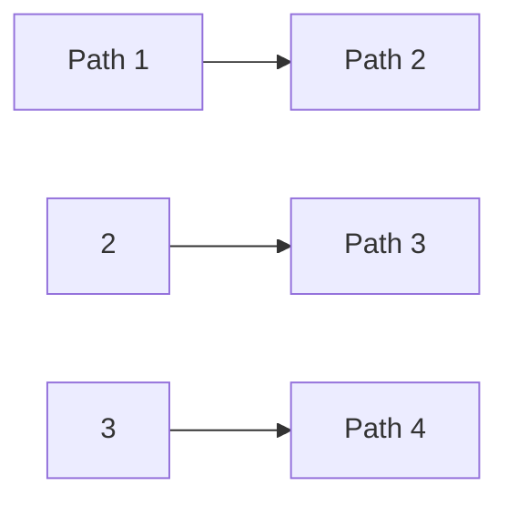
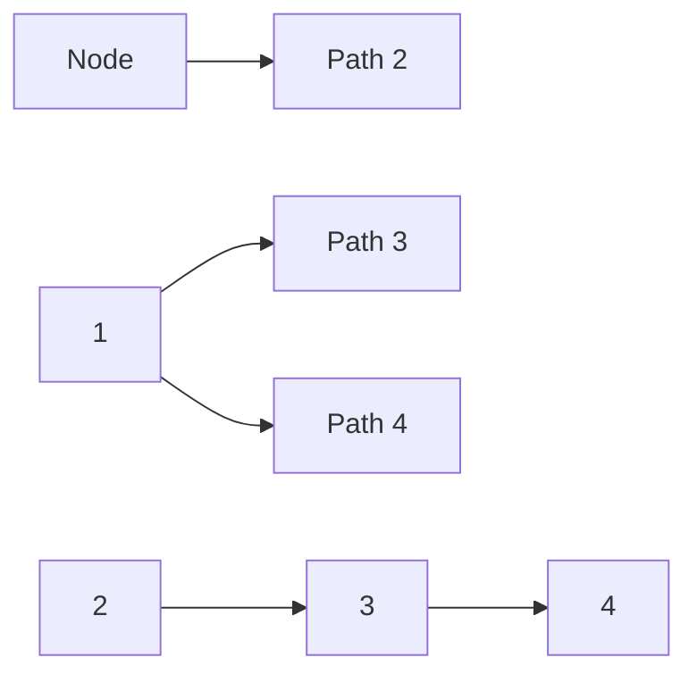
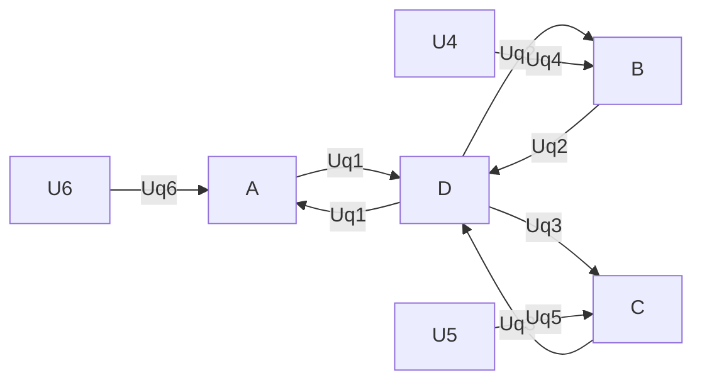
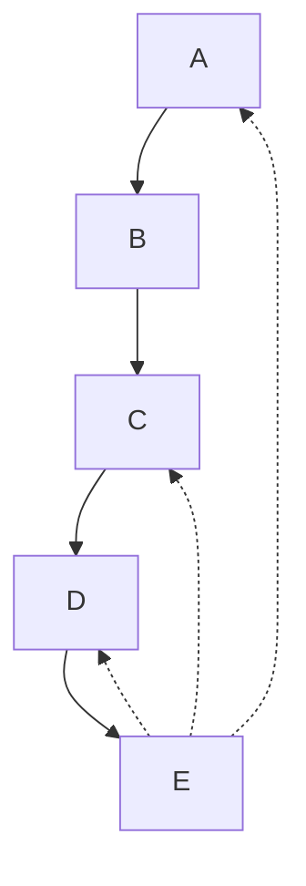
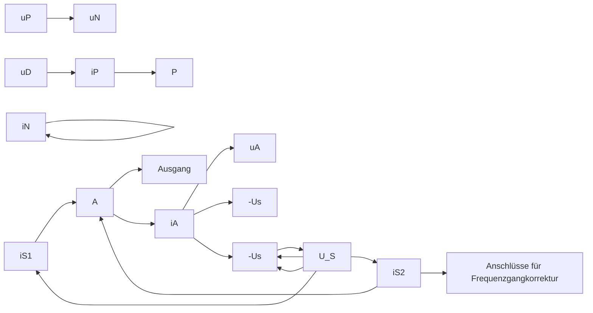

der beiden Umläufe 4 und 6. Entsprechend ist der Baumwiderstand

## $R _ { 3 }$ der Kopplungswiderstand

der beiden Umläufe 5 und $6 .$

Die Gl. (2.104c) kann direkt folgendermaßen aufgestellt werden:

1. Es wird für die gegebene Schaltung (Bild 2.83) ein vollständiger Baum ausgewählt (z. B. die Zweige 1, 2 und 3). In den Verbindungszweigen werden Zählpfeile für die unabhängigen Ströme $( I _ { 4 } , I _ { 5 } , I _ { 6 } )$ eingetragen.
2. Die Gleichung enthält auf der linken Seite als Unbekannte alle unabhängigen Ströme $( I _ { 4 } , I _ { 5 } , I _ { 6 } )$
3. Hierbei tritt der Umlaufwiderstand $( R _ { 1 } + R _ { 3 } + R _ { 6 } )$ als Koeffizient beim Umlaufstrom $( I _ { 6 } )$ des betrachteten Umlaufs (6) auf.
4. Die Koeffizienten für die anderen Umlaufströme $( I _ { 4 } ,   I _ { 5 } )$ sind die Kopplungswi derstände $( R _ { 1 } ,   R _ { 3 } )$ . Ihr Vorzeichen ist positiv, wenn die Umlaufströme, die der Kopplungswiderstand miteinander verknüpft, im Kopplungswiderstand gleiche Zählrichtung haben, und andernfalls negativ.
5. Auf der rechten Seite erscheint die Summe aller Quellenspannungen des Umlaufs $( U _ { \mathrm { q 6 } } )$ . Jede Quellenspannung erhält hierbei ein negatives Vorzeichen, wenn ihr Zählpfeil mit der Umlaufrichtung des Umlaufstromes übereinstimmt, andernfalls ein positives.

Nach diesen Regeln erhält man leicht das ganze Gleichungssystem (2.104) für die drei Umlaufströme unmittelbar, ohne zuvor die Gln. (2.100), (2.101), (2.102) und (2.103) aufstellen und bearbeiten zu müssen. Das System (2.104) stellen wir noch übersichtlicher dar:

| $I_{4}$ | $I_{5}$ | $I_{6}$ |  |
| --- | --- | --- | --- |
| $R_{1} + R_{2} + R_{4}$ | $-R_{2}$ | $-R_{1}$ | 0 |
| $-R_{2}$ | $R_{2} + R_{3} + R_{5}$ | $-R_{3}$ | 0 |
| $-R_{1}$ | $-R_{3}$ | $R_{1} + R_{3} + R_{6}$ | $U_{\text{q6}}$ |

Das aus den drei Umlauf- und sechs Kopplungswiderständen gebildete Koeffizientenschema nennt man **Widerstandsmatrix**. Bei ihr fällt auf, dass die Hauptdiagonale die drei Umlaufwiderstände enthält und dass die Kopplungswiderstände symmetrisch zur Hauptdiagonalen liegen. Hierbei wird vorausgesetzt, dass die Reihenfolge der Umlaufgleichungen (2.104) für die Umläufe 4, 5 und 6 (vgl. Bild 2.85) der Reihenfolge der drei Unbekannten $( I _ { 4 } , I _ { 5 } , I _ { 6 } )$ entspricht. Das Verfahren zur unmittelbaren Aufstellung der Widerstandsmatrix nennt man **Umlaufanalyse**.

## Beispiel 2.28: Analyse eines zweimaschigen Netzes mit einer Spannungsquelle.

Gegeben sind die Quellenspannung $U _ { \mathrm { q } }$ und die vier ohmschen Widerstände in einem Netz mit zwei Maschen (Bild 2.92). Gesucht ist die Spannung $U _ { 4 }$ für folgenden Sonderfall: $R _ { 1 } = R _ { 3 }$ und $R _ { 2 } = R _ { 4 }$

text_image

R₁ I₁ I₃ R₃
Uq R₂ R₄ U₄

Abb. 2.92: Zweimaschiges Netz mit einer Spannungsquelle.

## Lösung:

Wenn der Zweig mit $R _ { 2 }$ zum vollständigen Baum gemacht wird, werden $I _ { 1 }$ und $I _ { 3 }$ zu unabhängigen Strömen, für die sich nach den Regeln der Umlaufanalyse folgendes Gleichungssystem ergibt:

| $I_{1}$ | $I_{3}$ |  |
| --- | --- | --- |
| $R_{1} + R_{2}$ | $-R_{2}$ | $U_{\text{q}}$ |
| $-R_{2}$ | $R_{2} + R_{3} + R_{4}$ | 0 |

Wegen $R _ { 1 } = R _ { 3 }$ und $R _ { 2 } = R _ { 4 }$ folgt hieraus:

| $I_{1}$ | $I_{3}$ |  |
| --- | --- | --- |
| $R_{1} + R_{2}$ | $-R_{2}$ | $U_{\text{q}}$ |
| $-R_{2}$ | $R_{1} + 2R_{2}$ | 0 |

Zur Elimination von $I _ { 1 }$ wird die obere Gleichung mit $R _ { 2 }$ , die untere mit $( R _ { 1 } + R _ { 2 } )$ multipliziert, und dann werden beide Gleichungen addiert. Damit wird

$$
I _ {3} (R _ {1} ^ {2} + 3 R _ {1} R _ {2} + R _ {2} ^ {2}) = R _ {2} U _ {\mathrm{q}}
$$

und

$$
U _ {4} = I _ {3} R _ {4} = I _ {3} R _ {2} = \frac {R _ {2} ^ {2}}{R _ {1} ^ {2} + 3 R _ {1} R _ {2} + R _ {2} ^ {2}} U _ {\mathrm{q}}.
$$

## Beispiel 2.29: Berechnung eines Stromes in einem Netz mit zwei Stromquellen.

Aufgabenstellung wie in Beispiel 2.25.

## Lösung:

Wenn man diese Aufgabe mit Hilfe der Umlaufanalyse zu lösen sucht, so fällt zunächst auf, dass in dem Schema zur Aufstellung der Widerstandsmatrix von Stromquellen keine Rede ist. Um dem Schema gerecht zu werden, kann man die Stromquellen durch äquivalente Spannungsquellen ersetzen. Man kann aber auch die Stromquellen einfach in die Verbindungszweige legen. Bei der Aufstellung des Gleichungssystems für die unabhängigen Ströme werden die Quellenströme $( I _ { \mathrm { B } } , I _ { \mathrm { C } } )$ dann ebenso behandelt wie andere unabhängige Ströme auch. Wir wählen die in Bild 2.75 dick eingezeichneten Zweige als vollständigen Baum und erhalten nach den Regeln der Umlaufanalyse ein

Gleichungssystem für die vier unabhängigen Ströme $I _ { 1 } , I _ { 3 } , I _ { \mathrm { B } } , I _ { \mathrm { C } } ;$

| $I_{1}$ | $I_{3}$ | $I_{B}$ | $I_{C}$ |  |  |  |
| --- | --- | --- | --- | --- | --- | --- |
| 8R | R | -2R | -R | 0 | (Masche 1) | (2.108a) |
| R | 5R | -R | -2R | 0 | (Masche 3) | (2.108b) |
| -2R | -R | 2R | R | $U_{B}$ |  | (2.108c) |
| -R | -2R | R | 2R | $U_{C}$ |  | (2.108d) |

Dieses Gleichungssystem enthält die Unbekannten

$$
I _ {1}, \quad I _ {3}; \quad U _ {\mathrm{B}}, \quad U _ {\mathrm{C}}.
$$

Um $I _ { 1 }$ und $I _ { 3 }$ zu berechnen, brauchen wir nur die Gln. (2.108a) und (2.108b) zu nehmen. Sie bilden ein System zweier Gleichungen für nur zwei Unbekannte $( I _ { 1 } , I _ { 3 } )$ . Weil die Quellenströme $I _ { \mathrm { B } }$ und $I _ { \mathrm { C } }$ keine Unbekannten sind, ziehen wir sie auf die rechten Seiten der Gleichungen:

| $I_1$ | $I_3$ |  |
| --- | --- | --- |
| 8R | R | $R(2I_{\text{B}} + I_{\text{C}})$ |
| R | 5R | $R(I_{\text{B}} + 2I_{\text{C}})$ |

Diese Gleichungen werden durch R dividiert:

$$
8 I _ {1} + \quad I _ {3} = 2 I _ {\mathrm{B}} + \quad I _ {\mathrm{C}}
$$

$$
I _ {1} + 5 I _ {3} = I _ {\mathrm{B}} + 2 I _ {\mathrm{C}}.
$$

Zur Elimination von $I _ { 3 }$ wird die obere Gleichung mit (−5) multipliziert und zur unteren addiert:

$$
- 4 0 I _ {1} - 5 I _ {3} = - 1 0 I _ {\mathrm{B}} - 5 I _ {\mathrm{C}}
$$

$$
I _ {1} - 5 I _ {3} = \quad I _ {\mathrm{B}} + 2 I _ {\mathrm{C}}
$$

$$
- 3 9 I _ {1} \quad = - 9 I _ {\mathrm{B}} - 3 I _ {\mathrm{C}}
$$

$$
1 3 I _ {1} = 3 I _ {\mathrm{B}} + I _ {\mathrm{C}}
$$

$$
I _ {1} = \frac {3 I _ {\mathrm{B}} + I _ {\mathrm{C}}}{1 3} = \frac {3 \cdot 4 \mathrm{A} + 1 \mathrm{A}}{1 3} = 1 \mathrm{A}.
$$

## Beispiel 2.30: Analyse eines symmetrischen dreimaschigen Netzes.

Für den Klemmenwiderstand

$$
R _ {\mathrm{ab}} = \frac {U _ {\mathrm{q}}}{I}
$$

einer Brückenschaltung (Bild 2.93) soll gelten

$$
R _ {\mathrm{ab}} = 1 0 \Omega .
$$

Wie groß muss $R _ { 5 }$ sein, damit diese Forderung erfüllt wird?

text_image

I
a
Uq
4Ω
20Ω
R5
20Ω
I3
4Ω
b
I2

Abb. 2.93: Unabgeglichene Brücke.

## Lösung:

Wenn der mittlere Zweig (mit $R _ { 5 } )$ aufgetrennt wird, ist $R _ { \mathrm { a b } } = 1 2   \Omega$ . Wenn $R _ { 5 } = 0$ wird, dann ist $R _ { \mathrm { a b } }   =   2 0 / _ { 3 }   \Omega$ . Es muss also möglich sein, durch richtige Wahl von $R _ { 5 }$ die Bedingung $R _ { \mathrm { a b } } = 1 0   \Omega$ zu erfüllen. Zur Analyse des Netzes wird der vollständige Baum so gelegt, dass $I , I _ { 2 }$ und $I _ { 3 }$ zu unabhängigen Strömen werden:

| I | $I_{2}$ | $I_{3}$ |  |
| --- | --- | --- | --- |
| $8\,\Omega + R_{5}$ | $-(4\,\Omega + R_{5})$ | $-(4\,\Omega + R_{5})$ | $U_{\text{q}}$ |
| $-(4\,\Omega + R_{5})$ | $24\,\Omega + R_{5}$ | $R_{5}$ | 0 |
| $-(4\,\Omega + R_{5})$ | $R_{5}$ | $24\,\Omega + R_{5}$ | 0 |

Subtrahiert man die dritte von der zweiten Gleichung, so entsteht

$$
2 4 \Omega I _ {2} - 2 4 \Omega I _ {3} = 0, \quad \text { also }
$$

$$
I _ {2} = I _ {3}.
$$

Damit vereinfacht sich das Gleichungssystem wie folgt:

| I | $I_{2}$ | $I_{2} = I_{3}$ |  |
| --- | --- | --- | --- |
| $8\Omega + R_{5}$ | $-(4\Omega + R_{5})$ | $-(4\Omega + R_{5})$ | $U_{\text{q}}$ |
| $-(4\Omega + R_{5})$ | $24\Omega + R_{5}$ | $R_{5}$ | 0 |

<table><tr><td>I</td><td colspan="2"> $I_{2}$ </td></tr><tr><td> $8\Omega + R_{5}$ </td><td> $-2(4\Omega + R_{5})$ </td><td> $U_{\text{q}}$ </td></tr><tr><td> $-(4\Omega + R_{5})$ </td><td> $2(12\Omega + R_{5})$ </td><td>0</td></tr></table>

Durch Elimination von $I _ { 2 }$ ergibt sich:

$$
(8 0 \Omega^ {2} + 1 2 \Omega \cdot R _ {5}) \cdot I = (1 2 \Omega + R _ {5}) \cdot U _ {\mathrm{q}}.
$$

Mit $R _ { \mathsf { a b } } = U _ { \mathsf { q } } / _ { I }$ wird

$$
8 0 \Omega^ {2} + 1 2 \Omega \cdot R _ {5} = R _ {\mathrm{ab}} \cdot (1 2 \Omega + R _ {5})
$$

$$
R _ {5} = \frac {4 \Omega \cdot (3 R _ {\mathrm{ab}} - 2 0 \Omega)}{1 2 \Omega - R _ {\mathrm{ab}}} = \frac {4 \Omega \cdot (3 0 - 2 0) \Omega}{1 2 \Omega - 1 0 \Omega} = \underline {{\underline {{2 0 \Omega}}}}.
$$

Hierdurch wird das Ergebnis aus Beispiel 2.26 bestätigt (dort ergibt sich mit der gegebenen Größe $R _ { 5 } = 2 0   \Omega$ der Wert $R _ { \mathrm { a b } } = 1 0   \Omega )$

## Beispiel 2.31: Digital-Analog-Umsetzer (DAU).

Für die Kettenschaltung mit n Spannungsquellen in Bild 2.94a soll die Spannung $U _ { \mathrm { A } }$ berechnet werden.

## Lösung:

Vorbemerkung: Durch Maschenanalyse der Kettenschaltung entsteht ein Gleichungssystem für $n   +   1$ unbekannte Ströme. Eine wesentlich einfachere Lösung ergibt sich hier mit Hilfe der Methode der Ersatzspannungsquelle, da alle Kettenglieder in Bezug auf die Widerstände (R, 2R) übereinstimmen und sich der Innenwiderstand $R _ { \mathbf { i } }$ bei einer Verlängerung der Kette nicht ändert (Bild 2.94b).

Zunächst soll der DAU für den Sonderfall $n = 3$ (Bild 2.94b) betrachtet werden. Der Zweipol links von den Klemmen $\mathrm { A } _ { 2 }$ , B (DAU mit $n = 2 )$ hat den Innenwiderstand $R _ { \mathrm { i } } = R$ und seine Leerlaufspannung nennen wir $U _ { \mathrm { A } ( 2 ) }$ . Der DAU mit $n = 3$ entsteht dadurch, dass an $\mathrm { A } _ { 2 }$ , B die Reihenschaltung R, 2R, $U _ { \mathtt { q } 3 }$ angeschlossen wird. Aus Bild 2.94c geht der Zusammenhang zwischen $U _ { \mathrm { A } ( 2 ) }$ und $U _ { \mathrm { A } ( 3 ) }$ hervor:

$$
U _ {\mathrm{A(3)}} = U _ {\mathrm{q3}} + 2 R I _ {3} = U _ {\mathrm{q3}} + \frac {U _ {\mathrm{A(2)}} - U _ {\mathrm{q3}}}{4 R} 2 R = \frac {1}{2} (U _ {\mathrm{q3}} + U _ {\mathrm{A(2)}}) .
$$

Allgemein gilt offenbar

$$
U _ {\mathrm{A} (n)} = \frac {1}{2} (U _ {\mathrm{A} (n - 1)} + U _ {\mathrm{q} n}) \quad m i t \quad n = 1, 2, 3, \dots . \tag {2.109a}
$$

Abb. 2.94: Binärer Digital-Analog-Umsetzer (DAU). a) DAU mit n Kettengliedern b) Entstehung eines DAU mit $n = 3$ aus der Verlängerung des DAU mit $n = 2$ um ein Kettenglied $c )$ Zusammenfassung des linken Teiles der Schaltung b) (Zweipol mit den Klemmen $\mathsf { A } _ { 2 }$ , B) zu einer Ersatzspannungsquelle.

bzw.

$$
U _ {\mathrm{A} (n + 1)} = \frac {1}{2} (U _ {\mathrm{A} (n)} + U _ {\mathrm{q} (n + 1)}) . \tag {2.109b}
$$

Es ist für $n = 0$

$$
U _ {\mathrm{A(0)}} = \frac {1}{2} U _ {\mathrm{q0}}.
$$

Die Rekursionsformel (2.109b) ergibt dann für

$$
\begin{array}{l} n = 1: \quad U _ {\mathrm{A} (1)} = \frac {1}{2} U _ {\mathrm{A} (0)} + \frac {1}{2} U _ {\mathrm{q} 1} = \frac {1}{4} U _ {\mathrm{q} 0} + \frac {1}{2} U _ {\mathrm{q} 1}; \\ n = 2: \quad U _ {\mathrm{A} (2)} = \frac {1}{2} U _ {\mathrm{A} (1)} + \frac {1}{2} U _ {\mathrm{q} 2} = \frac {1}{8} U _ {\mathrm{q} 0} + \frac {1}{4} U _ {\mathrm{q} 1} + \frac {1}{2} U _ {\mathrm{q} 2}; \\ \end{array}
$$

usw. Hieraus ist zu vermuten, dass für beliebiges n gilt

$$
U _ {\mathrm{A} (n)} = \frac {1}{2 \cdot 2 ^ {n}} \sum_ {\nu = 0} ^ {n} 2 ^ {\nu} U _ {\mathrm{q} \nu}. \tag {2.109c}
$$

Ersetzt man nämlich n durch (n + 1), so wird

$$
U _ {\mathrm{A} (n + 1)} = \frac {1}{2 \cdot 2 ^ {n + 1}} \sum_ {\nu = 0} ^ {n + 1} 2 ^ {\nu} U _ {\mathrm{q} \nu} = \frac {1}{2} \left[ \underbrace {\frac {1}{2 \cdot 2 ^ {n}} \sum_ {\nu = 0} ^ {n} 2 ^ {\nu} U _ {\mathrm{q} \nu}} _ {= U _ {\mathrm{A} (n)}} + U _ {\mathrm{q} (n + 1)} \right],
$$

wodurch die Rekursionsformel (2.109b) bestätigt wird. Die Reihendarstellung (2.109b) gilt also für beliebiges n.

## Anmerkung (Realisierung mit Schaltern)

Die vierstellige Dualzahl

$$
y = x _ {3} 2 ^ {3} + x _ {2} 2 ^ {2} + x _ {1} 2 ^ {1} + x _ {0} 2 ^ {0} \tag {2.109d}
$$

kann durch vier Schalter $( S _ { 0 } \ldots S _ { 3 }$ , siehe Bild 2.95) eingestellt werden. So kann mit $U _ { \mathrm { B } } = 1 6   \mathrm { V }$ jede der Quellenspannungen (in Bild 2.94b: $U _ { \mathfrak { q } 0 } \dots U _ { \mathfrak { q } 3 } )$ entweder den Wert

text_image

2 R
R
2 R
R
2 R
R
2 R
y
x0=1 x0=0 x1=1 x1=0 x2=1 x2=0 x3=1 x3=0
S0 S1 S2 S3
UB
UA(3)

Abb. 2.95: Einstellung einer vierstelligen Dualzahl mit Hilfe von vier Schaltern, Umsetzung in den Analogwert (in der dargestellten Schalterstellung ist y = 13).

Tab. 2.8: Analogspannung in Abhängigkeit der Schalterstellungen.

| $x_{3}$ | $x_{2}$ | $x_{1}$ | $x_{0}$ | $y = U_{\mathrm{A(3)}}/\mathrm{V}$ |
| --- | --- | --- | --- | --- |
| 0 | 0 | 0 | 0 | 0 |
| 0 | 0 | 0 | 1 | 1 |
| 0 | 0 | 1 | 0 | 2 |
| 0 | 0 | 1 | 1 | 3 |
| 0 | 1 | 0 | 0 | 4 |
| 0 | 1 | 0 | 1 | 5 |
| 0 | 1 | 1 | 0 | 6 |
| 0 | 1 | 1 | 1 | 7 |
| 1 | 0 | 0 | 0 | 8 |
| 1 | 0 | 0 | 1 | 9 |
| 1 | 0 | 1 | 0 | 10 |
| 1 | 0 | 1 | 1 | 11 |
| 1 | 1 | 0 | 0 | 12 |
| 1 | 1 | 0 | 1 | 13 |
| 1 | 1 | 1 | 0 | 14 |
| 1 | 1 | 1 | 1 | 15 |

0 V (mit $x _ { \nu } = 0$ wird $U _ { \mathtt { q } \nu } = x _ { \nu } U _ { \mathtt { B } } = 0   \mathrm { V } )$ oder 16 V (mit $x _ { \nu } = 1$ wird $U _ { \mathrm { q } \nu } = x _ { \nu } U _ { \mathrm { B } } = 1 6   \mathrm { V } )$ annehmen. Aus (2.109c) folgt dann:

$$
U _ {\mathrm{A(3)}} = \frac {1}{2 \cdot 2 ^ {3}} \sum_ {\nu = 0} ^ {3} 2 ^ {\nu} x _ {\nu} U _ {\mathrm{B}} = 1 \mathrm{V} \left[ x _ {3} 2 ^ {3} + x _ {2} 2 ^ {2} + x _ {1} 2 ^ {1} + x _ {0} 2 ^ {0} \right].
$$

Die $2 ^ { 4 } = 1 6$ verschiedenen Kombinationen der Schalterstellungen $x _ { 0 } \ldots x _ { 3 }$ und die sich daraus ergebende (stufige) Analogspannung $U _ { \mathrm { A } ( 3 ) }$ sind in der Tabelle 2.8 zusammengefasst.

## Anmerkung (Verallgemeinerung des binären DAU)

Ist eine mehrstellige Zahl in einem beliebigen Stellenwertsystem (Basis b) gegeben (z. B. Dezimalsystem: $b = 1 0 )$ und soll sie durch einen DAU mit einer Struktur wie in Bild 2.94 in ein Analogsignal umgesetzt werden, so ergeben sich andere Widerstandsverhältnisse (Bild 2.96a). Für die Dimensionierung der Widerstände gelten nun die folgenden drei Bedingungen:

1. Beim Anschluss des $( n + 1 )$ ten Kettengliedes (Bild 2.96a) an die Klemmen $A _ { n } ,$ , B muss der Innenwiderstand $R _ { \mathbf { i } }$ unverändert bleiben:

$$
\frac {1}{R _ {\mathrm{i}} + R _ {1}} + \frac {1}{R _ {\mathrm{q}}} = \frac {1}{R _ {\mathrm{i}}} . \tag {2.109e}
$$

2. Soll das (n + 1)te Kettenglied den Beitrag aller vorangehenden Quellenspannungen $( U _ { \mathtt { q } 0 } \dots U _ { \mathtt { q } n } )$ durch die Basis b eines beliebigen Stellenwertsystems (im Beispiel von Schaltung 2.96 ist $b = 3 )$ dividieren, so muss für den Spannungsteiler $R _ { \mathrm { q } } , ( R _ { 1 } + R _ { \mathrm { i } } )$

gelten:

$$
\frac {R _ {\mathrm{q}}}{R _ {\mathrm{q}} + R _ {1} + R _ {\mathrm{i}}} = \frac {1}{b}; \quad R _ {\mathrm{q}} (b - 1) = R _ {\mathrm{i}} + R _ {1}. \tag {2.109f,g}
$$

3. Auch der Zweipol mit den Klemmen $A _ { 0 }$ , B muss den Innenwiderstand $R _ { \mathbf { i } }$ haben:

$$
\frac {1}{R _ {\mathrm{A}}} + \frac {1}{R _ {\mathrm{q}}} = \frac {1}{R _ {\mathrm{i}}} . \tag {2.109h}
$$

Setzt man (2.109g) in (e) ein, so wird

$$
\frac {1}{R _ {\mathrm{q}} (b - 1)} + \frac {1}{R _ {\mathrm{q}}} = \frac {1}{R _ {\mathrm{i}}}; \quad R _ {\mathrm{i}} = R _ {\mathrm{q}} \frac {b - 1}{b}. \tag {2.109i,j}
$$

Ersetzt man $R _ { \mathbf { i } }$ mit Hilfe von $( j ) ,$ so entsteht aus (g)

$$
R _ {1} = R _ {\mathrm{q}} \frac {(b - 1) ^ {2}}{b} \tag {2.109k}
$$

und aus (h)

$$
R _ {\mathrm{A}} = R _ {\mathrm{q}} (b - 1). \tag {2.109l}
$$

Eine der vier Widerstandsgrößen $R _ { \mathrm { q } } , R _ { 1 } , R _ { \mathrm { i } } , R _ { \mathrm { A } }$ kann willkürlich gewählt werden, die übrigen drei ergeben sich dann aus den Beziehungen (2.109j, k, l). Wählt man $R _ { \mathrm { q } } = b R ,$ so wird

$$
R _ {\mathrm{q}} = b R; \quad R _ {\mathrm{i}} = (b - 1) R; \quad R _ {1} = (b - 1) ^ {2} R; \quad R _ {\mathrm{A}} = b (b - 1) R; (2. 1 0 9 \mathrm{m}, \mathrm{n}, \mathrm{o}, \mathrm{p})
$$

vgl. die Tabelle 2.9, in der die erste Spalte den Fall der Schaltung 2.96a darstellt.

Für einen DAU mit beliebiger Basis b gilt

$$
U _ {\mathrm{A} (n)} = \frac {b - 1}{b ^ {n + 1}} \sum_ {\nu = 0} ^ {n} b ^ {\nu} U _ {\mathrm{q} \nu}.
$$

Bild 2.96b zeigt einen DAU mit $b = 3$ und $n = 3$

a)

b)

Abb. 2.96: DAU für ein beliebiges Stellenwertsystem. a) Zur Dimensionierung des DAU b) DAU mit b = 3 und $n = 3$

Tab. 2.9: Widerstandsverhältnis für die Schaltung 2.96a.

| $R_{\text{q}}/R$ | 2 | 3 | 4 | 5 | 6 | 7 | 8 | 9 | 10 | 11 | 12 | 13 | 14 | 15 | 16 |
| --- | --- | --- | --- | --- | --- | --- | --- | --- | --- | --- | --- | --- | --- | --- | --- |
| $R_{\text{i}}/R$ | 1 | 2 | 3 | 4 | 5 | 6 | 7 | 8 | 9 | 10 | 11 | 12 | 13 | 14 | 15 |
| $R_{1}/R$ | 1 | 4 | 9 | 16 | 25 | 36 | 49 | 64 | 81 | 100 | 121 | 144 | 169 | 196 | 225 |
| $R_{\text{A}}/R$ | 2 | 6 | 12 | 20 | 30 | 42 | 56 | 72 | 90 | 110 | 132 | 156 | 182 | 210 | 240 |

## 2.8.3.3 Die Auswahl des vollständigen Baumes

Grundsätzlich kann ein vollständiger Baum für eine Umlaufanalyse beliebig ausgewählt werden. Zum Beispiel kann man für das dreimaschige Netz, das in Bild 2.83 dargestellt ist, beliebig einen von den 16 möglichen vollständigen Bäumen nehmen. Trotzdem gibt es Gesichtspunkte, die zur Bevorzugung eines bestimmten Baumes führen können:

1. Der vollständige Baum sollte so liegen, dass die entstehenden Umläufe möglichst einfach werden. Z. B. führt der Baum a aus Bild 2.88 zu Umläufen, die mit den Maschen des Netzes identisch sind. Der Baum c dagegen – in Beispiel 2.30 verwendet – führt zu einem unübersichtlicheren Umlauf für den Umlaufstrom $I _ { 6 } .$
Wenn möglichst einfache Umläufe ausgewählt werden, treten zwischen den einzelnen Umläufen im Allgemeinen auch wenige Kopplungen auf. D. h. es entstehen Paare von Umläufen, die nicht miteinander gekoppelt sind (Kopplungswiderstand gleich Null). Wählt man in einer Kettenschaltung den Baum sternförmig (Bild 2.97a), so treten im Gleichungssystem nur drei Kopplungswiderstände auf, nämlich zwischen den jeweils benachbarten Maschen. Nimmt man dagegen den Baum, der in Bild 2.97b dargestellt ist, so sind über den Zweig 1 offensichtlich **alle** unabhängigen Ströme miteinander gekoppelt. In der Widerstandsmatrix ergeben sich nun keine Nullen.
2. Vorgegebene Ströme (Quellenströme) sollten als unabhängige Ströme von vornherein in Verbindungszweigen bleiben (Beispiel 2.29).
3. Wenn nicht alle Ströme gesucht sind, sollte man den vollständigen Baum so legen, dass die gesuchten Ströme in Verbindungszweigen fließen (Beispiele 2.28; 2.29).
4. Spannungsquellen sollten in Verbindungszweige gelegt werden. Sie treten dann im Gleichungssystem nur einmal auf (Beispiele 2.28; 2.30).
5. Der Baum sollte einer möglicherweise vorhandenen Schaltungssymmetrie gerecht werden (Beispiel 2.30).

Im Allgemeinen können diese Gesichtspunkte nicht alle gleichzeitig berücksichtigt werden.

a)

flowchart

b)

flowchart

Abb. 2.97: Zwei vollständige Bäume für eine viermaschige Kettenschaltung.

## 2.8.4 Knotenanalyse

## 2.8.4.1 Abhängige und unabhängige Spannungen

Wir betrachten wieder das in Bild 2.83 dargestellte Netz und bilden den vollständigen Baum aus den Zweigen 1, 2 und 3. Man könnte nun in jedem Baumzweig eine beliebige Spannung vorschreiben. Dies ist in Bild 2.98 durch ideale Spannungsquellen (d. h. Spannungsquellen ohne inneren Widerstand) dargestellt. Unmöglich wäre es dagegen, zugleich in vier Zweigen Spannungen beliebig vorzuschreiben, weil sonst in einem Umlauf die Umlaufgleichung nicht erfüllt werden könnte. Es wäre auch unmöglich, die Spannungen an den drei Zweigen 4, 5, 6 zugleich vorzuschreiben, denn in der Gleichung

$$
U _ {4} + U _ {5} + U _ {6} = 0
$$

können höchstens zwei der drei Spannungen unabhängig voneinander vorgegeben werden. Da man in jedem Baumzweig eine Spannung willkürlich festsetzen kann, sieht man die Spannungen an Baumzweigen als voneinander unabhängig an und bezeichnet sie deshalb als unabhängige Spannungen. Im Gegensatz dazu sind die Spannungen an den Verbindungszweigen die abhängigen Spannungen.

## 2.8.4.2 Das Schema zur Aufstellung der Knotengleichungen

Man kann in dem Netz, dessen Struktur in Bild 2.85 dargestellt wird, alle vorhandenen Spannungsquellen durch ihre Ersatzstromquellen ersetzen. Zum Beispiel wird dann das in Bild 2.83 dargestellte Netz in ein Netz verwandelt, dessen Zweig 6 eine Stromquelle

$$
I _ {\mathrm{q6}} = U _ {\mathrm{q6}} / R _ {6}
$$

mit dem Innenleitwert $\begin{array} { r } { G _ { 6 }   =   \frac { 1 } { R _ { 6 } } } \end{array}$ (anstatt der Spannungsquelle mit $U _ { \mathrm { q 6 } }$ und dem Innenwiderstand $R _ { 6 } )$ enthält. Dies zeigt Bild 2.99, wobei anstatt der Widerstandswerte jeweils die Leitwerte angegeben sind:

$$
G _ {1} = \frac {1}{R _ {1}} \quad \text { usw. }
$$

flowchart

Abb. 2.98: Unabhängige Spannungen in den Baumzweigen.

Für die sechs Widerstände kann das Ohm’sche Gesetz in folgender Form geschrieben werden:

$$
I _ {\mathrm{G} 1} = G _ {1} U _ {1} \tag {2.110a}
$$

$$
\begin{array}{c c} \bullet & \bullet \\ \bullet & \bullet \\ \bullet & \bullet \end{array}
$$

$$
I _ {\mathrm{G6}} = G _ {6} U _ {6}. \tag {2.110f}
$$

Als System der Knotengleichungen ergibt sich nun

(2.111a)

(2.111b)

Knoten C : (2.111c)

und als System der Umlaufgleichungen

$$
U _ {4} = U _ {1} - U _ {2} \tag {2.112a}
$$

$$
U _ {5} = U _ {2} - U _ {3} \tag {2.112b}
$$

$$
U _ {6} = U _ {3} - U _ {1}. \tag {2.112c}
$$

Wenn man nun in den Gln. (2.111) die Ströme $I _ { \mathsf { G } 1 } \dots I _ { \mathsf { G } 6 }$ durch die zugehörigen Spannungen ausdrückt, so ergibt sich

$$
G _ {1} U _ {1} + G _ {4} U _ {4} - G _ {6} U _ {6} = I _ {\mathrm{q6}} \tag {2.113a}
$$

$$
G _ {2} U _ {2} - G _ {4} U _ {4} + G _ {5} U _ {5} = 0 \tag {2.113b}
$$

$$
G _ {3} U _ {3} - G _ {5} U _ {5} + G _ {6} U _ {6} = - I _ {\mathrm{q6}}. \tag {2.113c}
$$

In diesen drei Gleichungen kann man die abhängigen Spannungen $U _ { 4 }$ , $U _ { 5 }$ , $U _ { 6 }$ mit Hilfe der drei Maschengleichungen (2.112) eliminieren:

$$
G _ {1} U _ {1} + G _ {4} (U _ {1} - U _ {2}) - G _ {6} (U _ {3} - U _ {1}) = I _ {\mathrm{q6}}
$$

$$
G _ {2} U _ {2} + G _ {4} (U _ {1} - U _ {2}) - G _ {5} (U _ {2} - U _ {3}) = 0
$$

$$
G _ {3} U _ {3} + G _ {5} (U _ {2} - U _ {3}) - G _ {6} (U _ {3} - U _ {1}) = - I _ {\mathrm{q6}}.
$$

text_image

Iq6
IG6
U6
G6
A
IG1
U1
G1
D
B
U2
G2
U3
G3
C
IG3
G4
U4
Ig4
G5
U5
IG5

Abb. 2.99: Netz mit drei Maschen und einer Stromquelle.

Ordnet man diese drei Gleichungen nach den drei Unbekannten $U _ { 1 } , U _ { 2 } , U _ { 3 }$ , so entsteht folgendes Gleichungssystem für die unabhängigen Spannungen:

(2.114a)

(2.114b)

(2.114c)

Dieses Gleichungssystem lässt sich folgendermaßen deuten. Zum Beispiel ist die Gl. (2.114a) aus der Gl. (2.111a) für den Knoten A hervorgegangen. Der (einzige) Baumzweig, der mit diesem Knoten verbunden ist, ist der Zweig 1 mit der unabhängigen Spannung $U _ { 1 }$ . Als Koeffizient dieser Spannung tritt die Summe aller drei in A zusammengeführten Leitwerte $G _ { 1 } + G _ { 4 } + G _ { 6 }$ auf. Man bezeichnet

$$
G _ {1} + G _ {4} + G _ {6} \quad \text {als Knotenleitwert}
$$

des Knotens A (der Knotenleitwert kann als Parallelschaltung sämtlicher im Knoten zusammentreffenden Leitwerte aufgefasst werden).

Als Koeffizient für $U _ { 2 }$ tritt der Leitwert $G _ { 4 }$ auf, der die Knoten A und B direkt verbindet $( U _ { 2 }$ ist die unabhängige Spannung, die dem Knoten B zugeordnet ist). Wir betrachten daher

$$
G _ {4} \quad \text {als Kopplungsleitwert}
$$

der beiden Knoten A und B. Entsprechend ist der Leitwert

$$
G _ {6} \quad \text {der Kopplungsleitwert}
$$

der beiden Knoten A und C.

Die Gl. (2.114a) kann also direkt folgendermaßen aufgestellt werden:

1. Es wird für die gegebene Schaltung (z. B. Bild 2.99) ein sternförmiger vollständiger Baum ausgewählt (z. B. die Zweige 1, 2, 3), indem man von einem beliebigen Bezugsknoten ausgeht (hier Knoten D) und alle Verbindungen von diesem Knoten zu den anderen Knoten zu Baumzweigen macht. Sind nicht alle Knoten direkt mit dem Bezugsknoten (D) verbunden, so sind in solchen Fällen Zweige mit dem Leitwert $\mathsf { G } = 0$ einzufügen.
2. Die Zählpfeile der unabhängigen Spannungen $( U _ { 1 } , U _ { 2 } , U _ { 3 } )$ zeigen alle auf den Bezugsknoten (D).
3. Die Gleichung enthält auf der linken Seite als Unbekannte alle unabhängigen Spannungen $( U _ { 1 }$ $U _ { 2 } , U _ { 3 } )$
4. Hierbei tritt der Knotenleitwert $( G _ { 1 } + G _ { 4 } + G _ { 6 } )$ als Koeffizient bei der unabhängigen Spannung $( U _ { 1 } )$ auf, die dem betrachteten Knoten (A) zugeordnet ist.
5. Die Koeffizienten für die anderen unabhängigen Spannungen $( U _ { 2 } , U _ { 3 } )$ sind die Kopplungsleitwerte $( G _ { 4 } , G _ { 6 } )$ . Ihr Vorzeichen ist immer negativ (aufgrund der Regeln 1 und 2).
6. Auf der rechten Gleichungsseite erscheint die Summe aller Quellenströme $( I _ { \mathsf { q } 6 } )$ , die in den betreffenden Knoten (A) hineinfließen. Jeder Quellenstrom erhält hierbei ein Pluszeichen, wenn er in den Knoten hineinfließt; ein Minuszeichen, wenn er herausfließt.

Der vollständige Baum muss nicht so gewählt werden, wie die Regel 1 es vorschreibt. Doch dann werden die Regeln 4 und 5 zur Bestimmung der Koeffizienten viel undurchsichtiger. Es lohnt sich hier – im Gegensatz zur Umlaufanalyse –, bei der Auswahl des vollständigen Baumes von vornherein eine erhebliche Einschränkung hinzunehmen.

Nach den Regeln 1 . . . 6 hätte das Gleichungssystem (2.114) unmittelbar aufgestellt werden können. Auch dieses Gleichungssystem kann in einer übersichtlichen Form dargestellt werden:

| $U_{1}$ | $U_{2}$ | $U_{3}$ |  |
| --- | --- | --- | --- |
| $G_{1} + G_{4} + G_{6}$ | $-G_{4}$ | $-G_{6}$ | $I_{\text{q6}}$ |
| $-G_{4}$ | $G_{2} + G_{4} + G_{5}$ | $-G_{5}$ | 0 |
| $-G_{6}$ | $-G_{5}$ | $G_{3} + G_{5} + G_{6}$ | $I_{\text{q6}}$ |

Das aus den drei Knoten- und sechs Kopplungsleitwerten gebildete Koeffizientenschema nennt man Leitwertmatrix. Die Hauptdiagonale enthält die drei Knotenleitwerte, die Kopplungsleitwerte liegen symmetrisch zur Hauptdiagonalen. Das Verfahren zur unmittelbaren Aufstellung der Leitwertmatrix nennt man Knotenanalyse.

## Beispiel 2.32: Analyse eines Netzes mit drei Maschen und einer Stromquelle.

In einem Netz (Bild 2.100) sind die Leitwerte $G _ { 1 } \ldots G _ { 6 }$ und der eingeprägte Strom $I _ { \mathbf { q } 6 }$ gegeben:

$$
G _ {1} = 6 \mathrm{S}, \quad G _ {2} = 8 \mathrm{S}, \quad G _ {3} = 1 1 \mathrm{S}, \quad G _ {4} = 1 2 \mathrm{S}, \quad G _ {5} = 4 \mathrm{S}, \quad G _ {6} = 3 \mathrm{S};
$$

$$
I _ {\mathrm{q6}} = 2 3, 5 \mathrm{A}.
$$

Die Spannung $U _ { 3 }$ ist gesucht.

## Lösung:

Nach den Regeln der Knotenanalyse lässt sich das Gleichungssystem (2.114) für die Spannungen $U _ { 1 } , U _ { 2 } , U _ { 3 }$ angeben (Bezugsknoten D). Mit den gegebenen Zahlenwerten wird dann:

text_image

Iq6
G6
A
G1
U1
G2
D
B
G3
U3
C
G4
U2
G5

Abb. 2.100: Dreimaschiges Netz mit einer Stromquelle.

|  | $U_{1}$ | $U_{2}$ | $U_{3}$ |  |
| --- | --- | --- | --- | --- |
| A | 21 S | -12 S | -3 S | 23,5 A |
| B | -12 S | 24 S | -4 S | 0 A |
| C | -3 S | -4 S | 18 S | -23,5 A |

Durch Multiplikation mit der Einheit $\Omega = \mathbb { S } ^ { - 1 }$ erhält man

| $U_{1}$ | $U_{2}$ | $U_{3}$ |  |
| --- | --- | --- | --- |
| 21 | -12 | -3 | 23,5 V |
| -12 | 24 | -4 | 0 V |
| -3 | -4 | 18 | -23,5 V |

Wir multiplizieren die dritte Gleichung mit 3 und addieren die beiden anderen Gleichungen:

| $U_{1}$ | $U_{2}$ | $U_{3}$ |  |
| --- | --- | --- | --- |
| 21 | -12 | -3 | 23,5 V |
| -12 | 24 | -4 | 0 V |
| -9 | -12 | 54 | -70,5 V |

Wegen der speziellen Zahlenwerte für $G _ { 1 } \ldots G _ { 6 }$ lässt sich das Gleichungssystem hier also besonders schnell auflösen:

$$
4 7 U _ {3} = - 4 7 \mathrm{V} \quad \rightarrow \quad \underline {{U _ {3} = - 1 \mathrm{V}}}.
$$

## Beispiel 2.33: Berechnung der Ströme in einem dreimaschigen Netz mit einer Spannungsquelle.

Aufgabenstellung: wie in Beispiel 2.27.

## Lösung:

Um die Knotenanalyse anwenden zu können, wird die Spannungsquelle im Zweig 6 in eine Stromquelle umgewandelt (Bild 2.101); vgl. Abschnitt 2.4.4. Das gegebene Netz (Bild 2.83) kann dann so dargestellt werden wie in Bild 2.102. Für die unabhängigen Spannungen $U _ { 1 } ,   U _ { 2 } ,   U _ { 3 }$ ergibt sich mit den Regeln der Knotenanalyse:

| $U_{1}$ | $U_{2}$ | $U_{3}$ |  |
| --- | --- | --- | --- |
| $\frac{1}{3}$ | -1 | -1 | 10 V |
| -1 | $\frac{11}{5}$ | $-\frac{1}{5}$ | 0 V |
| -1 | $-\frac{1}{5}$ | $\frac{17}{10}$ | -10 V |

Die Auflösung dieses Gleichungssystems ergibt

$$
U _ {1} = 3 \mathrm{V}; \quad U _ {2} = 1 \mathrm{V}; \quad U _ {3} = - 4 \mathrm{V}.
$$

Daraus folgt

$$
U _ {4} = U _ {1} - U _ {2} = 2 \mathrm{V}
$$

$$
U _ {5} = U _ {2} - U _ {3} = 5 \mathrm{V}
$$

$$
U _ {6} = U _ {3} - U _ {1} = - 7 \mathrm{V}.
$$

Die gesuchten Ströme sind

$$
I _ {1} = U _ {1} G _ {1} = \frac {3 \mathrm{V}}{3 \Omega} = \underline {{\underline {{1 \mathrm{A}}}}}
$$

$$
I _ {2} = U _ {2} G _ {2} = \frac {1 \mathrm{V}}{1 \Omega} = \underline {{\underline {{1 \mathrm{A}}}}}
$$

$$
I _ {3} = U _ {3} G _ {3} = \frac {- 4 \mathrm{V}}{2 \Omega} = \underline {{\underline {{- 2 \mathrm{A}}}}}
$$

$$
I _ {4} = U _ {4} G _ {4} = \frac {2 \mathrm{V}}{1 \Omega} = \underline {{\underline {{2 \mathrm{A}}}}}
$$

$$
I _ {5} = U _ {5} G _ {5} = \frac {5 \mathrm{V}}{5 \Omega} = \underline {{\underline {{1 \mathrm{A}}}}}
$$

$$
I _ {6} = I _ {\mathrm{q6}} + I _ {\mathrm{G6}} = I _ {\mathrm{q6}} + U _ {6} G _ {6} = 1 0 \mathrm{A} + \frac {- 7 \mathrm{V}}{1 \Omega} = \underline {{\underline {{3 \mathrm{A}}}}}.
$$

Hierdurch werden die Ergebnisse des Beispiels 2.27 bestätigt.

## Beispiel 2.34: Analyse eines Netzes mit fünf Knoten und neun Zweigen (davon zwei ideale Spannungsquellen).

Ein Netz enthält sieben ohmsche Widerstände und zwei ideale Spannungsquellen

text_image

A
I6
R6=1Ω
Uq6 = 10 V
U6
Uq6 = Iq6R6
G6=1S
Iq6 = 10 A
C
A
I6
U6

Abb. 2.101: Äquivalente Quellen.

text_image

Iq6 = 10 A
G6=1S
U1
1/3 S
I1
A
D
I2
1S
B
U2
I3
1/2 S
I5
C
I4
1S
I6
Ig6

Abb. 2.102: Dreimaschiges Netz mit einer Stromquelle.

text_image

G9
B
G6
C
I8
G8
G5
U2
G2
G3
U3
G7
A
E
D
Uq1
Uq4

Abb. 2.103: Netz mit fünf Knoten und neun Zweigen.

(Bild 2.103). Folgende Zahlenwerte sind gegeben:

$$
G _ {2} = 1 4 \mathrm{S}; \quad G _ {3} = 1 1 \mathrm{S}
$$

$$
G _ {5} = 4 \mathrm{S}
$$

$$
G _ {6} = 8 \mathrm{S}; \quad G _ {7} = 1 1 \mathrm{S}
$$

$$
G _ {8} = 6 \mathrm{S}; \quad G _ {9} = 2 \mathrm{S}.
$$

$$
U _ {\mathrm{q1}} = 1 5 \mathrm{V}; \quad U _ {\mathrm{q4}} = 6 \mathrm{V}.
$$

Gesucht ist der Strom $I _ { 8 }$ .

## Lösung:

Mit Hilfe der Knotenanalyse ergeben sich (mit dem Bezugsknoten E) für die Knoten B und C folgende Gleichungen für die vier unabhängigen Spannungen $U _ { \mathtt { q } 1 } , U _ { 2 } , U _ { 3 } , U _ { \mathtt { q } 4 }$

|  | $U_{q1}$ | $U_2$ | $U_3$ | $U_{q4}$ |  |
| --- | --- | --- | --- | --- | --- |
| B | $-G_5$ | $(G_2 + G_5 + G_6 + G_8)$ | $-G_6$ | $-G_8$ | 0 |
| C | $-G_9$ | $G_6$ | $(G_3 + G_6 + G_7 + G_9)$ | $-G_7$ | 0 |

Die Gleichungen für die Knoten A und D enthalten auf der rechten Seite die von den Quellen abgegebenen (unbekannten) Ströme. Hier genügen zur Analyse des Netzes schon die beiden Gln. (2.115), weil in ihnen nur $U _ { 2 }$ und $U _ { 3 }$ unbekannt, $U _ { \mathtt { q } 1 }$ und $U _ { \mathbf { q } 4 }$ dagegen vorgegeben sind. Um das deutlich zu machen, ziehen wir $U _ { \mathrm { q 1 } }$ und $U _ { \mathrm { q 4 } }$ auf die rechten Gleichungs-Seiten.

| $U_{2}$ | $U_{3}$ |  |
| --- | --- | --- |
| $(G_{2} + G_{5} + G_{6} + G_{8})$ | $-G_{6}$ | $G_{5}U_{\text{q1}} + G_{8}U_{\text{q4}}$ |
| $G_{6}$ | $(G_{3} + G_{6} + G_{7} + G_{9})$ | $G_{9}U_{\text{q1}} + G_{7}U_{\text{q4}}$ |

Mit den gegebenen Zahlenwerten wird

| $U_{2}$ | $U_{3}$ |  |
| --- | --- | --- |
| 32 | -8 | 96 V |
| -8 | 32 | 96 V |

Vertauschung von $U _ { 2 }$ und $U _ { 3 }$ ändert am Gleichungssystem nichts, d. h. es ist

$$
U _ {2} = U _ {3}.
$$

Damit folgt

$$
2 4 U _ {2} = 9 6 \mathrm{V}; \quad U _ {2} = 4 \mathrm{V} = U _ {3}.
$$

Wegen

$$
U _ {8} = U _ {2} - U _ {\mathrm{q4}} = 4 \mathrm{V} - 6 \mathrm{V} = - 2 \mathrm{V}
$$

gilt dann

$$
I _ {8} = U _ {8} G _ {8} = - 2 \mathrm{V} \cdot 6 \mathrm{S} = \underline {{- 1 2 \mathrm{A}}}.
$$

## 2.8.5 Vergleich zwischen Umlauf- und Knotenanalyse

Zunächst soll der Zusammenhang zwischen der Anzahl k der Knoten eines Netzes und der maximalen Anzahl ẑ der Zweige bestimmt werden: Fügt man einem Netz mit k Knoten (z. B. k = 4 in Bild 2.104) noch einen Knoten hinzu (E), so sind hierdurch k neue Zweige möglich (in Bild 2.104 gestrichelt gezeichnet):

$$
\hat {z} _ {k + 1} = k + \hat {z} _ {k} = k + k - 1 + \hat {z} _ {k - 1} = k + k - 1 + k - 2 + \dots + 1
$$

$$
\hat {z} _ {k + 1} = (k + 1) \frac {k}{2}.
$$

Ersetzt man hierin $k + 1$ durch $k ,$ so wird

$$
\hat {z} _ {k} = k \frac {k - 1}{2}.
$$

Da für die Anzahl b der Baumzweige gilt

$$
b = k - 1
$$

und für die maximale Anzahl $\hat { \nu }$ der Verbindungszweige

$$
\hat {v} = \hat {z} - b,
$$

kann man die Tabelle 2.10 aufstellen.

flowchart

Abb. 2.104: Zur Herstellung des Zusammenhangs zwischen k und $\hat { Z }$ .

Tab. 2.10: Anzahl der Verbindungszweige v̂ in Abhängigkeit von der Anzahl der Knoten k, Zweige ẑ und Baumzweige b.

| k | b | $\hat{z}$ | $\hat{v}$ | $\hat{v} - b$ |
| --- | --- | --- | --- | --- |
| 2 | 1 | 1 |  |  |
| 3 | 2 | 3 | 1 | -1 |
| 4 | 3 | 6 | 3 | 0 |
| 5 | 4 | 10 | 6 | 2 |
| 6 | 5 | 15 | 10 | 5 |
| 7 | 6 | 21 | 15 | 9 |

Bei der Anwendung der Umlaufanalyse entsteht ein Gleichungssystem mit v Unbekannten, bei der Knotenanalyse mit b Unbekannten. Ist in einem Netz also

$$
v > b,
$$

so führt die Knotenanalyse zu einem Gleichungssystem mit weniger Unbekannten als die Umlaufanalyse. Das ist nur für Netze mit $k \geq 5$ möglich. Zum Beispiel hat ein Fünfeck nur vier unabhängige Spannungen, liefert bei der Knotenanalyse also vier Unbekannte. Falls das Fünfeck neun Zweige hat (wie z. B. in Bild 2.103), existieren fünf unabhängige Ströme, die Umlaufanalyse liefert also fünf Unbekannte. Falls das Fünfeck sogar zehn Zweige hat (wie z. B. in Bild 2.104), ergibt sich demnach aus der Umlaufanalyse ein Gleichungssystem mit sechs Unbekannten.

Die Knotenanalyse ist also der Umlaufanalyse vor allem in stark »vermaschten«Netzen mit fünf und mehr Knoten überlegen. Sind allerdings die Ströme oder Spannungen einzelner Zweige vorgegeben, so treten jeweils weniger unbekannte unabhängige Ströme bzw. unabhängige Spannungen auf.

Ist in einem Netz $k = 4 , z = 6$ eine ideale Spannungsquelle enthalten, so kann in diesem Fall die Knotenanalyse schneller zum Ziel führen als die Umlaufanalyse, wie das folgende Beispiel zeigt.

## Beispiel 2.35: Analyse eines dreimaschigen Netzes mit einer idealen Spannungsquelle.

In einem Netz nach Bild 2.105 sind die Leitwerte $G _ { 2 } \ldots G _ { 6 }$ und die Spannung $U _ { \mathtt { q } 1 }$ gegeben:

$$
G _ {2} = 2 \mathrm{S}; \quad G _ {3} = 3 \mathrm{S}
$$

$$
G _ {4} = 4 \mathrm{S}; \quad G _ {5} = 6 \mathrm{S}
$$

$$
G _ {6} = 8 \mathrm{S};
$$

$$
U _ {\mathrm{q1}} = 7 \mathrm{V}.
$$

Die Spannungen $U _ { 2 } \ldots U _ { 6 }$ sind gesucht.

## Lösung:

Nach den Regeln der Knotenanalyse gilt (mit D als Bezugsknoten):

|  | $U_{q1}$ | $U_2$ | $U_3$ |  |
| --- | --- | --- | --- | --- |
| A | $(G_4 + G_6)$ | $-G_4$ | $-G_6$ | $I_1$ |
| B | $-G_4$ | $(G_2 + G_4 + G_5)$ | $-G_5$ | 0 |
| C | $-G_6$ | $-G_5$ | $(G_3 + G_5 + G_6)$ | 0 |

In diesem Gleichungssystem mit den Unbekannten $U _ { 2 } ,   U _ { 3 }$ und $I _ { 1 }$ enthält nur die oberste Gleichung die Unbekannte $I _ { 1 }$ . Wir lassen diese Gleichung weg und erhalten so ein Gleichungssystem für die beiden Unbekannten $U _ { 2 } , U _ { 3 }$ :

| $U_{2}$ | $U_{3}$ |  |
| --- | --- | --- |
| $(G_{2} + G_{4} + G_{5})$ | $-G_{5}$ | $G_{4}U_{\text{q1}}$ |
| $-G_{5}$ | $(G_{3} + G_{5} + G_{6})$ | $G_{6}U_{\text{q1}}$ |

Mit den gegebenen Zahlenwerten wird:

| $U_{2}$ | $U_{3}$ |  |
| --- | --- | --- |
| 12 | -6 | 28 V |
| -6 | 17 | 56 V |

Die zweite Gleichung wird mit 2 multipliziert und zur ersten addiert:

$$
\begin{array}{l} 1 2 U _ {2} - 6 U _ {3} = 2 8 \mathrm{V} \\ - 1 2 U _ {2} + 3 4 U _ {3} = 1 1 2 \mathrm{V} \\ 2 8 U _ {3} = 1 4 0 \mathrm{V} \quad U _ {3} = \underline {{5 \mathrm{V}}}. \\ \end{array}
$$

Setzt man dies in die erste Gleichung ein, so wird

$$
1 2 U _ {2} = 2 8 \mathrm{V} + 6 \cdot 5 \mathrm{V} \quad U _ {2} = \underline {{\frac {2 9}{6}}} \mathrm{V}.
$$

text_image

G6
U6
A
I4
Uq1
D
G2
U2
B
U3
G3
C
U5
G5
U4
G4

Abb. 2.105: Dreimaschiges Netz mit einer idealen Spannungsquelle.

Daraus ergeben sich die abhängigen Spannungen:

$$
U _ {4} = U _ {\mathrm{q1}} - U _ {2} = 7 \mathrm{V} - \frac {2 9}{6} \mathrm{V} = \underline {{\frac {1 3}{6} \mathrm{V}}}
$$

$$
U _ {5} = U _ {2} - U _ {3} = \frac {2 9}{6} \mathrm{V} - 5 \mathrm{V} = \underline {{- \frac {1}{6} \mathrm{V}}}
$$

$$
U _ {6} = U _ {3} - U _ {\mathrm{q1}} = 5 \mathrm{V} - 7 \mathrm{V} \quad = \underline {{\underline {{- 2 \mathrm{V}}}}}.
$$

## 2.8.6 Gesteuerte Quellen

In Abschnitt 2.4.4 wurde gezeigt, dass man lineare Quellen (bzw. lineare aktive Zweipole) durch eine ideale Quelle (Spannungs oder Stromquelle) und einen Innenwiderstand darstellen kann. Die idealen Quellen sind dadurch gekennzeichnet, dass – unabhängig von der Belastung – bei der idealen Spannungsquelle die Spannung zwischen den Klemmen eine Konstante ist, während die ideale Stromquelle einen konstanten Strom abgibt.

Im Hinblick auf viele Anwendungen (z. B. Verstärkerschaltungen) ist es zweckmä- ßig, neben den idealen Quellen mit einer konstanten Klemmengröße sog. **gesteuerte Quellen** einzuführen. Bei diesen hängt eine der beiden Klemmengrößen U oder I (Bild 2.106) von einer der steuernden Eingangsgrößen $U _ { 1 }$ oder $I _ { 1 }$ ab. Insgesamt gibt es demnach vier Arten gesteuerter Quellen:

1. $U _ { 1 }$ steuert U: spannungsgesteuerte Spannungsquelle,
2. $U _ { 1 }$ steuert I: spannungsgesteuerte Stromquelle,
3. $I _ { 1 }$ steuert U: stromgesteuerte Spannungsquelle,
4. $I _ { 1 }$ steuert I: stromgesteuerte Stromquelle.

Im einfachsten Fall ist die gesteuerte Größe der steuernden Größe proportional. Damit lassen sich die vier Arten gesteuerter Quellen so beschreiben:

$$
U = k _ {1} U _ {1},
$$

$$
I = k _ {2} U _ {1},
$$

$$
U = k _ {3} I _ {1},
$$

$$
I = k _ {4} I _ {1}.
$$

Abb. 2.106: Gesteuerte Quellen: a) spannungsgesteuert $( I _ { 1 } / U _ { 1 } = 0 ) ;$ b) stromgesteuert $( U _ { 1 } / I _ { 1 } = 0 )$

## 2.8.6.1 Beispiele

Die folgenden Betrachtungen beziehen sich auf die Schaltung nach Bild 2.103. Zuerst wird die Spannungsquelle $U _ { \mathrm { q 4 } }$ durch eine spannungsgesteuerte Stromquelle $I _ { \mathtt { q } 4 } = k { \cdot } U _ { 2 }$ (Stromrichtung: von D nach E) ersetzt. Die Gleichungen werden wie in Beispiel 2.34 aufgestellt. Hinzu kommt eine dritte Gleichung für den Knoten D.

|  | $U_{q1}$ | $U_{2}$ | $U_{3}$ | $U_{q4}$ |  |
| --- | --- | --- | --- | --- | --- |
| B : | $-G_{5}$ | $G_{2} + G_{5} + G_{6} + G_{8}$ | $-G_{6}$ | $-G_{8}$ | 0 |
| C : | $-G_{9}$ | $-G_{6}$ | $G_{3} + G_{6} + G_{7} + G_{9}$ | $-G_{7}$ | 0 |
| D : | 0 | $-G_{8}$ | $-G_{7}$ | $G_{7} + G_{8}$ | $-I_{q4} = -kU_{2}$ |

In der letzten Gleichung zieht man den Term $- k U _ { 2 }$ auf die linke Seite:

D : 0 −G8 + k G7 + G8 0

Damit entsteht ein Gleichungssystem für die drei Unbekannten $U _ { 2 } ,   U _ { 3 } ,   U _ { 4 }$ . Es lässt sich auf folgende Form bringen:

| $U_{2}$ | $U_{3}$ | $U_{\text{q4}}$ |  |
| --- | --- | --- | --- |
|  | ... |  | $G_{5}U_{\text{q1}}$ |
|  | ... |  | $G_{9}U_{\text{q1}}$ |
|  | ... |  | 0 |

Ebenso lässt sich auch der Fall der spannungsgesteuerten Spannungsquelle behandeln: Es sei $U _ { \mathtt { q } 4 }   =   k \cdot U _ { 2 }$ . Dann ist in dem Gleichungssystem $U _ { \mathrm { q 4 } }$ durch $k U _ { 2 }$ zu ersetzen. Man erhält zunächst für die Knoten B und C:

| $U_{\text{q1}}$ | $U_2$ | $U_3$ | $kU_2$ |  |
| --- | --- | --- | --- | --- |
| $-G_5$ | $G_2 + G_5 + G_6 + G_8$ | $-G_6$ | $-G_8$ | 0 |
| $-G_9$ | $-G_6$ | $G_3 + G_6 + G_7 + G_9$ | $-G_7$ | 0 |

Nach Zusammenfassen der Spalten 2 und 4 erhält man

| $U_{q1}$ | $U_2$ | $U_3$ |  |
| --- | --- | --- | --- |
| $-G_5$ | $G_2 + G_5 + G_6 + G_8 - kG_8$ | $-G_6$ | 0 |
| $-G_9$ | $-G_6 - kG_7$ | $G_3 + G_6 + G_7 + G_9$ | 0 |

oder

| $U_{2}$ | $U_{3}$ |  |
| --- | --- | --- |
|  | ... | $G_{5}U_{\text{q1}}$ |
|  | ... | $G_{9}U_{\text{q1}}$ |

Diese Aufgabe lässt sich besonders einfach lösen, weil die steuernde Spannung in dem Schema als Knotenspannung unmittelbar vorkommt.

Etwas aufwendiger wird die Untersuchung eines Netzes, wenn die steuernde Spannung zuerst noch durch Knotenspannungen ausgedrückt werden muss. Wir betrachten den Fall $U _ { \mathtt { q } 4 }   =   k U _ { 6 }$ . Aus dem Schaltbild entnimmt man $U _ { 6 } \; = \; U _ { 2 }   -   U _ { 3 }$ ; demnach ist $U _ { \mathtt { q } 4 } = k U _ { 2 } - k U _ { 3 }$ . Man hat also

<table><tr><td> $U_{q1}$ </td><td> $U_2$ </td><td> $U_3$ </td><td colspan="2"> $k(U_2 - U_3)$ </td></tr><tr><td> $-G_5$ </td><td> $G_2 + G_5 + G_6 + G_8$ </td><td> $-G_6$ </td><td> $-G_8$ </td><td>0</td></tr><tr><td> $-G_9$ </td><td> $-G_6$ </td><td> $G_3 + G_6 + G_7 + G_9$ </td><td> $-G_7$ </td><td>0</td></tr></table>

oder

| $U_{q1}$ | $U_2$ | $U_3$ |  |
| --- | --- | --- | --- |
| $-G_5$ | $G_2 + G_5 + G_6 + G_8 - kG_8$ | $-G_6 + kG_8$ | 0 |
| $-G_9$ | $-G_6 - kG_7$ | $G_3 + G_6 + G_7 + G_9 + kG_7$ | 0 |

usw.

Spannungsgesteuerte Spannungs- und Stromquellen können also bei der Knotenanalyse ohne weiteres berücksichtigt werden.

Wir wenden uns nun dem Fall der stromgesteuerten Spannungsquelle zu: Es sei $U _ { \mathfrak { q } 4 } = k I _ { 6 }$ . Wir drücken $I _ { 6 }$ mit Hilfe des Ohm’schen Gesetzes durch Knotenspannungen aus: $I _ { 6 } = G _ { 6 } ( U _ { 2 } - U _ { 3 } )$ . Damit wird

| $U_{\text{q1}}$ | $U_2$ | $U_3$ | $kG_6(U_2 - U_3)$ |  |
| --- | --- | --- | --- | --- |
|  |  | ... |  | 0 |

Der Fall kann also wie das vorige Beispiel behandelt werden.

Es lässt sich daher feststellen, dass mit der Knotenanalyse Netze mit spannungsgesteuerten Quellen besonders einfach zu behandeln sind. Entsprechend können mit der Umlaufanalyse Schaltungen mit stromgesteuerten Quellen leichter untersucht werden.

## 2.8.6.2 Der Operationsverstärker als spannungsgesteuerte Spannungsquelle

Als wichtiger Typ einer gesteuerten Quelle soll hier der Operationsverstärker behandelt werden (Bild 2.107), der sich als spannungsgesteuerte Spannungsquelle durch

$$
U _ {\mathrm{A}} = k _ {1} U _ {\mathrm{E}} \tag {2.116}
$$

beschreiben lässt. Dies gilt aber nur, wenn er nicht übersteuert wird, d. h. nur innerhalb eines relativ kleinen Wertebereiches für die Eingangsspannung $U _ { \mathrm { E } }$ (im Beispiel des Bildes $2.108\  fir -1,2\  mV <U_{ E }<+1,2\  mV$ . In diesem Bereich linearer Verstärkung schreibt man für den Proportionalitätsfaktor statt $k _ { 1 }$ meist $\nu _ { 0 }$ und nennt ihn die Leerlaufverstärkung des Operationsverstärkers:

$$
v _ {0} = \frac {U _ {\mathrm{A}}}{U _ {\mathrm{E}}}  . \tag {2.117}
$$

text_image

I₁
+
RE
v₀UE
-
RE ≫ RA
RA
IA
UA
UE

Abb. 2.107: Nicht-übersteuerter Operationsverstärker als spannungsgesteuerte Spannungsquelle.

line

| UE (mV) | UA (V) |
| --- | --- |
| -1.2 | -12 |
| 0 | 0 |
| 1.2 | 12 |
| >1.2 | 15 |

Abb. 2.108: Beispiel für die Verstärkungs-Kennlinie eines Operationsverstärkers.

In Bild 2.108 ist $\nu _ { 0 } = 1 0 ^ { 4 }$ . Bei den meisten Anwendungen werden die Operationsverstärker im Bereich linearer Verstärkung betrieben, so dass sie in Datenbüchern über integrierte Halbleiterschaltungen sogar kurzerhand als lineare Schaltungen bezeichnet werden. Es gibt aber auch wichtige Anwendungen, bei denen die Operationsverstärker außerhalb des Bereiches der linearen Verstärkung betrieben werden (insbesondere in Mitkopplungsschaltungen, aber auch in übersteuerten Gegenkopplungsschaltungen). Genaueres hierzu in Abschnitt 2.9.

## 2.8.6.3 Der Transistor als gesteuerte Quelle

Der Transistor ist ein Halbleiterbauelement mit drei Anschlüssen, in dem drei unterschiedlich dotierte Schichten aufeinander folgen. Eine p-leitende Schicht liegt zwischen zwei n-leitenden, oder umgekehrt. Man spricht daher von npn- bzw. pnp-Transistoren (Bild 2.109).

Die drei Anschlüsse bezeichnet man als Basis (B), Emitter (E) und Kollektor (C). Auf die innere Wirkungsweise des Transistors wird hier nicht eingegangen. Er soll hier nur durch sein Klemmenverhalten beschrieben werden, und zwar durch seine Eingangskennlinie $I _ { \mathrm { B } } = f ( U _ { \mathrm { B E } } )$ und sein Ausgangskennlinienfeld $I _ { \mathbb { C } } = f ( U _ { \mathbb { C } \mathbb { E } } ; I _ { \mathbb { B } } )$ (Bilder 2.110 und 2.111).

Da alle Beziehungen des npn-Transistors durch Vorzeichenwechsel der Spannungen und Ströme auf die des pnp-Transistors übertragbar sind, soll hier nur der npn-Transistor betrachtet werden.

Die Eingangskennlinie hängt übrigens geringfügig von $U _ { \mathrm { C E } }$ ab; diese Rückwirkung wird im Folgenden vernachlässigt.

Die in Bild 2.111 dargestellten Kennlinien sind zwar nichtlinear, können aber für viele Anwendungen durch Geraden ersetzt oder aus mehreren Geradenstücken zusammengesetzt werden (Bild 2.112).

Die Eingangskennlinie ist im Bereich positiver Werte $U _ { \mathrm { B E } }$ durch einen ohmschen Widerstand realisierbar, die Ausgangskennlinien können als das Verhalten einer Stromquelle gedeutet werden, die vom Strom $I _ { \mathrm { B } }$ gesteuert wird. Bild 2.113b beschreibt in einem Ersatzschaltbild den Transistor dementsprechend als stromgesteuerte Stromquelle.

npn-Transistor

pnp-Transistor

Abb. 2.109: Transistor-Schaltsymbole.

text_image

I_C
B
C
E
I_E
U_BE
U_CE

Abb. 2.110: Spannungen und Ströme eines npn-Transistors.

line

| UBE | IB |
| --- | --- |
| ~0 | 0 |
| ~1 | ~0.1 |
| ~2 | ~0.3 |
| ~3 | ~0.6 |
| ~4 | ~1.1 |

Eingangskennlinie

line

| UCE | IC (IB=0) | IC (IB=1) | IC (IB=2) | IC (IB=3) |
| --- | --- | --- | --- | --- |
| 0 | 0 | 0 | 0 | 0 |
| ~0.25 | ~0.1 | ~0.25 | ~0.45 | ~0.65 |
| ~0.5 | ~0.15 | ~0.35 | ~0.55 | ~0.75 |
| ~0.75 | ~0.18 | ~0.4 | ~0.6 | ~0.8 |

Ausgangskennlinienfeld

Abb. 2.111: Kennlinien eines npn-Transistors.

Die Stromverstärkung $\beta$ ist ein Qualitätsmerkmal des Transistors und wird in Datenblättern angegeben. Über die Beziehung $U _ { \mathrm { B E } } = I _ { \mathrm { B } } R _ { \mathrm { B E } }$ lässt sich der Transistor auch als spannungsgesteuerte Stromquelle darstellen (Bild 2.113c). Die Größe $S = \beta / _ { R _ { \mathrm { B E } } }$ nennt man Steilheit.

Eine bessere Annäherung an die tatsächlichen Kennlinien als in Bild 2.112 erhält man durch die in Bild 2.114 gewählte Darstellung. Die Eingangskennlinie kann nun als Kennlinie einer Spannungsquelle $U _ { S }$ mit dem Innenwiderstand $R _ { \mathrm { B E } }$ aufgefasst werden, die Ausgangskennlinien kann man als Kennlinien einer stromgesteuerten Stromquelle mit dem Innenwiderstand $R _ { \mathrm { C E } }$ beschreiben (Bild 2.115).

Diese Ersatzschaltbilder gelten nur, falls durch die äußere Beschaltung sichergestellt ist, dass Kollektor- und Basisstrom fließen können (d. h. insbesondere, dass in Reihe zur Kollektor-Emitter-Strecke eine Versorgungsspannung vorhanden sein muss).

Abb. 2.112: Linearisierung der Transistor-Kennlinien.

Abb. 2.113: Vereinfachtes Transistor-Ersatzschaltbild.

Abb. 2.114: Verbesserte Linearisierung der Transistor-Kennlinien.

## Beispiel 2.36: Transistor-Verstärker.

Für eine Transistorschaltung nach Bild 2.116 soll die Ausgangsspannung $U _ { \mathrm { A } }$ als Funktion der Eingangsspannung $U _ { \mathrm { E } }$ berechnet werden.

$$
U _ {\mathrm{RC}} = U _ {0} - U _ {\mathrm{A}} = U _ {\mathrm{E}} \frac {\beta R _ {\mathrm{C}}}{R _ {\mathrm{BE}} + R _ {\mathrm{E}} + \beta R _ {\mathrm{E}}}
$$

Setzt man die Größen $R _ { \mathrm { B E } }$ und $\beta$ und außerdem die Widerstände $R _ { \mathrm { E } }$ und $R _ { \mathrm { C } }$ sowie die Betriebsspannung $U _ { 0 }$ als bekannt voraus, so kann man den Transistor in Schaltung 2.116 durch die Ersatzschaltung 2.113b darstellen und erhält so die Schaltung 2.117.

Hier gelten die beiden Spannungs-Umlaufgleichungen

$$
U _ {\mathrm{E}} = I _ {\mathrm{B}} R _ {\mathrm{BE}} + R _ {\mathrm{E}} (I _ {\mathrm{B}} + \beta I _ {\mathrm{B}})
$$

und

$$
U _ {0} = \beta I _ {\mathrm{B}} R _ {\mathrm{C}} + U _ {\mathrm{A}},
$$

Abb. 2.115: Verbessertes Transistor-Ersatzschaltbild.

text_image

RC
URC
UE
UA
RE
U0

Abb. 2.116: Einfacher Transistor-Verstärker.

text_image

B
IB
RBE
IC = βIB
C
RC
UE
RE
UA
U0

Abb. 2.117: Ersatzschaltbild des Transistor-Verstärkers.

aus denen sich nach Elimination von $I _ { \mathrm { B } }$

$$
U _ {\mathrm{A}} = U _ {0} - U _ {\mathrm{E}} \frac {\beta R _ {\mathrm{C}}}{R _ {\mathrm{BE}} + R _ {\mathrm{E}} + \beta R _ {\mathrm{E}}}
$$

ergibt.

## 2.9 Operationsverstärkerschaltungen

Im Abschnitt 2.8 ist der Operationsverstärker als spannungsgesteuerte Spannungsquelle beschrieben worden, die den Verstärkungsfaktor $\nu _ { 0 }$ hat, eine für den Verstärker charakteristische Größe. $\nu _ { 0 }$ ist normalerweise sehr groß. Braucht man aber eine gesteuerte Spannungsquelle mit einem Verstärkungsfaktor $\nu   <   \nu _ { 0 }$ , so kann man dies durch sogenannte Gegenkopplung erreichen: am einfachsten mit einem ohmschen Spannungsteiler (Umkehrverstärker, Bild 2.122a; Elektrometerverstärker, Bild 2.122b).

Ist die Verstärker-Ausgangsklemme mit mindestens einer Eingangsklemme verbunden, so spricht man von Rückkopplung, und zwar ist bei rein ohmschen Schaltungen eine Verbindung A–N eine Gegenkopplung, A–P eine Mitkopplung.

Als gesteuerte lineare Quellen kommen nur Gegenkopplungsschaltungen in Frage. In Schaltungen, bei denen Gegen- und Mitkopplung miteinander kombiniert sind, muss der Gegenkopplungseffekt überwiegen (Abschnitt 2.9.6).

Im Folgenden beschränken wir uns auf Schaltungen, in denen außer einem Opera tionsverstärker nur Spannungsquellen und ohmsche Widerstände vorkommen. Trotz dieser Einschränkung lassen sich hieran die Rückkopplungsprinzipien und ihre wichtigsten Kombinationen gut darstellen.

## 2.9.1 Der ideale Operationsverstärker

Um Verstärkerschaltungen verstehen und entwerfen zu können, ist es zweckmäßig, zunächst von einem idealen Operationsverstärker auszugehen. Seine wichtigsten Eigenschaften sind:

1. Eingangswiderstand $R _ { \mathrm { E } } \to \infty$ (Bild 2.107) und damit Eingangsströme $\boldsymbol { i } _ { \mathrm { P } } = \boldsymbol { i } _ { \mathrm { N } } = 0$
2. Ausgangswiderstand $R _ { \mathrm { A } } = 0$ (Bild 2.107)
3. Eingangs-Offsetspannung $U _ { \mathrm { D o f f s e t } } = 0$ (Bild 2.118b)
4. Gleichtaktverstärkung $\nu _ { \mathrm { c m } } = 0$
5. Proportionalität $u _ { \mathrm { A } } \sim u _ { \mathrm { D } }$ im Bereich der linearen Verstärkung $( U _ { \mathrm { D u } } < u _ { \mathrm { D } } < U _ { \mathrm { D 0 } } )$ ; den Proportionalitätsfaktor im Bereich $U _ { \mathrm { D u } } < u _ { \mathrm { D } } < U _ { \mathrm { D o } }$ nennt man Leerlaufverstärkung $\nu _ { 0 } = u _ { \mathrm { A } } \big / _ { u _ { \mathrm { D } } }$
6. Unabhängigkeit des Verlaufes der Verstärkungskennlinie $u _ { \mathrm { A } } = f _ { \mathrm { } } ( u _ { \mathrm { D } } )$ von irgendwelchen Parametern (Temperatur, Alterung, Frequenz o. a.).

Die Annahme 4 besagt, dass sich z. B. im Fall $u_{\mathrm{P}}=1,5\mathrm{mV},u_{\mathrm{N}}=1$ mV und im Fall $u_{\mathrm{P}}=2,5\mathrm{mV},u_{\mathrm{N}}=2$ mV jedes Mal der gleiche Wert $u _ { \mathrm { A } }$ ergibt, da $u _ { \mathrm { D } }$ in beiden Fällen übereinstimmt: $u _ { \mathrm { D } } = u _ { \mathrm { P } } - u _ { \mathrm { N } } = 0 , 5   \mathrm { m V }$

Wenn bei einem realen Operationsverstärker z. B. $R_{\mathrm{E}} = 10   \mathrm{M}\Omega$ und $R _ { \mathrm { A } } = 1 0 0   \Omega$ ist, dann sollten die Widerstände, mit denen der Verstärker beschaltet wird, wesentlich kleiner als $R _ { \mathrm { E } }$ aber auch wesentlich größer als $R _ { \mathrm { A } }$ sein, also z. B. in dem Bereich $1   \mathrm { k } \Omega \dots 1$ MΩ liegen.

Die Forderung $\nu _ { 0 } \to \infty$ zählen wir nicht zu den Eigenschaften eines idealen Operationsverstärkers; erst recht nicht die Forderung $u _ { \mathrm { D } } \approx 0 ,$ , die nur bei gegengekoppelten nicht übersteuerten Verstärkern berechtigt ist. Die Forderungen 1 bis 6 kann man dagegen unabhängig vom Betriebsfall aufrechterhalten, also auch für übersteuerte Gegenkopplungsschaltungen und mitgekoppelte Verstärker. Trotzdem ist es oftmals zweckmäßig, $\nu _ { 0 } \to \infty$ oder sogar $u _ { \mathrm { D } } = 0$ vorauszusetzen, falls der Verstärker überwiegend gegengekoppelt ist und nicht übersteuert wird.

Selbstverständlich braucht auch ein idealer Verstärker eine Stromversorgung (normalerweise zwei gleiche Spannungsquellen, Bild 2.118a). In Prinzipschaltbildern werden die Versorgungsspannungen jedoch meist nicht eingezeichnet, sondern es werden nur die Klemmen $\mathrm { P } ,$ N und A dargestellt. Die Knotengleichung für den OP liefert aber allgemein

$$
0 = i _ {\mathrm{N}} + i _ {\mathrm{P}} + i _ {\mathrm{S1}} - i _ {\mathrm{S2}} - i _ {\mathrm{A}} \quad \text {und ideal} \quad 0 = i _ {\mathrm{S1}} - i _ {\mathrm{S2}} - i _ {\mathrm{A}}.
$$

Da gewöhnlich $i _ { \mathbb { S } 1 } { - } i _ { \mathbb { S } 2 } \neq 0$ ist, kann für den Verstärker, bei dem nur die drei Anschlüsse P, N, A berücksichtigt werden, die Gleichung $\textstyle \sum i = 0$ nicht gelten.

a)

flowchart

b)

line

| uD | U_Amax (Ideal) | U_Amax (Real) | U_D offset (Ideal) | U_D offset (Real) |
| --- | --- | --- | --- | --- |
| 0 | U_Amin | U_Amin | 0 | 0 |
| U_Du | U_Amin | U_Amin | 0 | 0 |
| U_Do | U_Amax | U_Amax | U_Doffset | U_Doffset |
| >U_Do | U_Amax | U_Amax | N/A | N/A |

text_image

P
+
N
-
∞
+
A

Abb. 2.118: Operationsverstärker: a) Schaltsymbole; b) Verstärkungskennlinie (VKL).

## 2.9.2 Komparatoren

Wenn $\nu _ { 0 }$ sehr groß ist, lässt sich die ideale Verstärkungskennlinie praktisch als Sprungfunktion auffassen (Bild 2.119):

$$
u _ {\mathrm{A}} = \left\{ \begin{array}{l l} U _ {\mathrm{A} \min} & \text {fur} \quad u _ {\mathrm{D}} <   0, \\ U _ {\mathrm{A} \max} & \text {fur} \quad u _ {\mathrm{D}} \geq 0. \end{array} \right.
$$

So betrachtet ist der Verstärker ein Komparator (Vergleicher). Er vergleicht $u _ { \mathrm { D } }$ mit dem Wert $0   \mathrm { V } ,$ Die Bezugsschwelle muss aber nicht 0 V bleiben, sondern kann verschoben werden (zum Beispiel Bild 2.120: hier durchläuft $u _ { \mathrm { D } }$ den Wert $0   \mathrm { V } ,$ wenn $u _ { \mathrm { E } }$ den Wert $U _ { \mathrm { r } }$ annimmt).

Die Referenzspannung (Bezugsspannung) $U _ { \mathrm { r } }$ wird beim praktischen Schaltungsaufbau natürlich nicht durch eine besondere Spannungsquelle realisiert, sondern durch einen Abgriff an einem Spannungsteiler, der von den ohnehin für den Verstärker notwendigen Spannungsquellen $( \pm U _ { S }$ in Bild 2.118a) versorgt wird. Vertauscht man die beiden Eingangsklemmen miteinander (Bild 2.121), so durchläuft auch in diesem Fall uD genau dann den Wert 0 V, wenn $u _ { \mathrm { E } }$ den Wert $U _ { \mathrm { r } }$ annimmt. Es wird aber – wegen $u _ { \mathrm { D } } = U _ { \mathrm { r } } - u _ { \mathrm { E } }$ für $u _ { \mathrm { E } } > U _ { \mathrm { r } } -$ die Eingangsdifferenzspannung $u _ { \mathrm { D } } < 0$ , also $u _ { \mathrm { A } } = U _ { \mathrm { A m i n } }$ Entsprechend wird für $u _ { \mathrm { E } } < U _ { \mathrm { r } }$ die Ausgangsspannung $u _ { \mathrm { A } } = U _ { \mathrm { A m a x } }$

Legt man das Potential $u _ { \mathrm { E } }$ an die Klemme N des Verstärkers, entsteht damit ein invertierender Komparator. Niedrige Werte von $u _ { \mathrm { E } }$ führen am Ausgang zu $u _ { \mathrm { A } } = U _ { \mathrm { A m a x } } ,$ hohe Werte von $u _ { \mathrm { E } }$ zu $u _ { \mathrm { A } } = U _ { \mathrm { A m i n } }$ . Man bezeichnet deshalb die Klemme N als den invertierenden Eingang des Operationsverstärkers und dementsprechend P als den nichtinvertierenden Eingang und daher die Schaltung 2.120 als nichtinvertierenden Komparator.

text_image

U_A max
u_A
U_A min
u_D

Abb. 2.119: Idealisierte Verstärkungskennlinie.

text_image

a)
E
P
+
uD
N
-
uE
Ur
=
A
ua

line

| uE | uA |
| --- | --- |
| <Ur | U_Amax |
| Ur | 0 |
| >Ur | U_Amax |

Abb. 2.120: Nichtinvertierender Komparator. (a) Verstärker-Schaltung mit Referenzspannung $U _ { \mathrm { { f } } }$ (b) idealisierte, um $U _ { \mathrm { r } }$ verschobene Verstärkungskennlinie

## 2.9.3 Rückkopplungsprinzipien

## 2.9.3.1 Übersicht

Wenn bei rein ohmscher Beschaltung der Ausgang A eines Verstärkers mit dem nichtinvertierenden Verstärkereingang P gekoppelt, d. h. über einen Widerstand verbunden wird, so bezeichnet man dies als Mitkopplung (MK). Wenn der Ausgang A mit dem invertierenden Verstärkereingang N verbunden wird, handelt es sich um eine Gegenkopplung (GK). Wird hierbei E mit P verbunden, so ergibt sich eine nichtinvertierende Schaltung. Verbindet man dagegen E mit N, so entsteht eine invertierende Schaltung (Bild 2.122) wie schon bei den beiden Komparatorschaltungen in den Bildern 2.120 und 2.121.

## 2.9.3.2 Arbeitsgeraden

Für die Spannungen uE, $u _ { \mathrm { D } }$ , $u _ { \mathrm { A } }$ in den vier Rückkopplungs-Grundschaltungen in Bild 2.122 gilt unabhängig von den Eigenschaften des Verstärkers jeweils ein einfacher linearer Zusammenhang. So gilt in Schaltung 2.122d für den Knoten P (Knotenanalyse!)

$$
\begin{array}{c c c c} \hline u _ {\mathrm{E}} & u _ {\mathrm{D}} = u _ {\mathrm{P}} & u _ {\mathrm{A}} \\ \hline - G _ {1} & G _ {1} + G _ {2} & - G _ {2} & 0 \\ \hline \end{array} \tag {2.118}
$$

(2.119)

Dies ist die Gleichung der Arbeitsgeraden (AG) $u _ { \mathrm { A } } = f _ { } ( u _ { \mathrm { D } } ; u _ { \mathrm { E } } )$ (uD als unabhängige Veränderliche, $u _ { \mathrm { E } }$ als Scharparameter).

Abb. 2.121: Invertierender Komparator. (a) Verstärker-Schaltung mit Referenzspannung $U _ { \mathrm { L } }$ , (b) idealisierte, um $U _ { \mathrm { r } }$ verschobene Verstärkungskennlinie.

Außer dieser Gleichung muss auch der vom Verstärker vorgegebene Zusammenhang zwischen $u _ { \mathrm { A } }$ und $u _ { \mathrm { D } }$ , die Verstärkerkennlinie (VKL), gelten (Bild 2.118b). Die Schnittpunkte einer Arbeitsgeraden mit der Verstärkerkennlinie geben also an, welche Betriebszustände möglich sind. In bestimmten Bereichen von $u _ { \mathrm { E } }$ gibt es nur einen einzigen Schnittpunkt (Bild 2.123a).

Bevor untersucht wird, welcher der drei möglichen Schnittpunkte sich einstellt, sollen auch die Arbeitsgeraden der drei anderen Rückkopplungsschaltungen berechnet werden. Für den Knoten N in der Schaltung in Bild 2.122a gilt

Abb. 2.122: Vier Rückkopplungsarten. a) Umkehrverstärker; b) Elektrometerverstärker; c) invertierender Schmitt-Trigger; d) nichtinvertierender Schmitt-Trigger.

Abb. 2.123: Schnittpunkte der Verstärkungskennlinie mit den Arbeitsgeraden; (a) bei Mitkopplung und (b) bei Gegenkopplung.

$$
- G _ {1} u _ {\mathrm{E}} + (G _ {1} + G _ {2}) u _ {\mathrm{N}} - G _ {2} u _ {\mathrm{A}} = 0,
$$

woraus wegen $u _ { \mathrm { D } } = - u _ { \mathrm { N } }$ die Arbeitsgeraden-Gleichung

$$
\mathrm{a} \quad u _ {\mathrm{A}} = - \frac {R _ {1} + R _ {2}}{R _ {1}} u _ {\mathrm{D}} - \frac {R _ {2}}{R _ {1}} u _ {\mathrm{E}} \qquad (\text {invertierende Gegenkopplung}). \tag {2.120}
$$

hervorgeht (Bild 2.123b). Für die Schaltung in Bild 2.122c gilt

$$
u _ {\mathrm{P}} = \frac {R _ {3}}{R _ {3} + R _ {4}} u _ {\mathrm{A}} \tag {2.121}
$$

und wegen $u _ { \mathrm { P } } = u _ { \mathrm { D } } + u _ { \mathrm { E } }$

$$
\mathrm{c} \quad u _ {\mathrm{A}} = + \frac {R _ {3} + R _ {4}}{R _ {3}} u _ {\mathrm{D}} + \frac {R _ {3} + R _ {4}}{R _ {3}} u _ {\mathrm{E}} \qquad (\text {invertierende Mitkopplung}). \tag {2.122}
$$

Für die Schaltung in Bild 2.122b gilt $u _ { \mathrm { N } } = u _ { \mathrm { A } } R _ { 3 } / ( R _ { 3 } + R _ { 4 } )$ und wegen $u _ { \mathrm { N } } = - u _ { \mathrm { D } } + u _ { \mathrm { E } }$

$$
\mathrm{b} \quad u _ {\mathrm{A}} = - \frac {R _ {3} + R _ {4}}{R _ {3}} u _ {\mathrm{D}} + \frac {R _ {3} + R _ {4}}{R _ {3}} u _ {\mathrm{E}} \quad (\text {nichtinvertierende Gegenkopplung}). \tag {2.123}
$$

Vergleicht man die Gln. (2.119), (2.120), (2.122) und (2.123) für die vier Arbeitsgeraden miteinander, so fällt auf, dass bei Mitkopplung die Steigung der Arbeitsgeraden $u _ { \mathrm { A } } = f ( u _ { \mathrm { D } } )$ positiv ist, bei Gegenkopplung negativ. Die Kehrwerte der Steigungen der Arbeitsgeraden bezeichnet man auch als Rückkopplungsfaktoren. Auch sie sind bei Gegenkopplung negativ:

$$
- R _ {1} / (R _ {1} + R _ {2}) \quad \text {bzw.} \quad - R _ {3} / (R _ {3} + R _ {4});
$$

bei Mitkopplung ergeben sich:

$$
+ R _ {1} / (R _ {1} + R _ {2}) \quad \text {bzw.} \quad + R _ {3} / (R _ {3} + R _ {4}); \qquad (\text {vgl. Abschnitt 2.9.6}).
$$

## 2.9.3.3 Stabile und instabile Arbeitspunkte

Für die Schaltung in Bild 2.122d wird der Schnittpunkt $S _ { 1 }$ einer Arbeitsgeraden (AG) (Gl. (2.119)) mit der Verstärkerkennlinie (VKL) betrachtet (Bild 2.124). Die Werte $u _ { \mathrm { D 1 } }$ $u _ { \mathrm { A 1 } }$ stellen einen möglichen Betriebsfall dar, der sich allerdings als instabil erweist. Dies sollen die folgenden Überlegungen zeigen: Kommt zur Ausgangsspannung $u _ { \mathrm { A 1 } }$ kurzzeitig eine sehr kleine Störung $\Delta u _ { \mathrm { A } }$ hinzu (z. B. durch induktive Einwirkung benachbarter Schaltungsteile), so kann der Verstärker den neuen Wert $u _ { \mathrm { A } 2 } = u _ { \mathrm { A } 1 } + \Delta u _ { \mathrm { A } }$ durch den Wert $u _ { \mathrm { D } 2 }$ aufrechterhalten. Der Spannungsteiler $R _ { 1 } , R _ { 2 }$ erhöht aber, wie die Arbeitsgerade zeigt, aufgrund des Wertes $u _ { \mathrm { A } } = u _ { \mathrm { A } 2 }$ den Wert $u _ { \mathrm { D } }$ über $u _ { \mathrm { D } 2 }$ hinaus auf $u _ { \mathrm { { p } 2 } } ^ { * }$ . Dieser Wert wiederum muss wegen der VKL zu einer weiteren Erhöhung von $u _ { \mathrm { A } }$ über $u _ { \mathrm { A } 2 }$ hinaus auf $u _ { \mathrm { A } 2 } ^ { * }$ führen. $u _ { \mathrm { A } }$ wird in dieser Weise immer weiter anwachsen bis