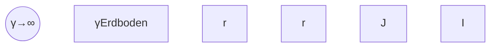

Bündelleiter: $\begin{array} { r } { E \left( r _ { 0 } \right) = \frac { \lambda } { 2 \pi \varepsilon } \cdot \frac { 1 } { r _ { 0 } } } \end{array}$ mit $2 \lambda = C ^ { \prime } \cdot U$

$$
\underline {{ \begin{array}{l} E \left(r _ {0}\right) = \frac {U}{2 r _ {0} \ln \frac {a ^ {2}}{r _ {0} D}} \quad \text {bzw.} \quad \frac {U}{2 r _ {0} \cdot 2 \ln \frac {a}{R _ {0}}} . \\ \hline \end{array} }}
$$

**b)** Gleicher Leiterquerschnitt: $\pi R _ { 0 } ^ { 2 } = 2 \pi r _ { 0 } ^ { 2 } \rightarrow r _ { 0 } = R _ { 0 } / \sqrt { 2 }$

$$
\frac {E \left(r _ {0}\right)}{E \left(R _ {0}\right)} = \frac {2 R _ {0} \ln \frac {a}{R _ {0}}}{2 r _ {0} \ln \frac {a ^ {2}}{r _ {0} D}} = \sqrt {2} \frac {\ln \frac {a}{R _ {0}}}{\ln \frac {a ^ {2} \sqrt {2}}{R _ {0} D}}.
$$

**c)** Zahlenwerte:

$$
\frac {E \left(r _ {0}\right)}{E \left(R _ {0}\right)} = \sqrt {2} \frac {\ln 10^{3}}{\ln \left(10^{6} \cdot \sqrt{2} / 20\right)} = \underline{\underline{87,5\%}} \quad (R_{0} = 3,76\mathrm{cm}).
$$

## Beispiel 3.10: Ladungsverteilung auf Leitungen.

Drei sehr lange, parallele Leiter mit gleichem Radius sind gemäß Bild 3.30 angeordnet. Die beiden linken Leiter dienen als Hinleitung und haben das Potenzial $\phi _ { 0 } ,$ , der rechte Leiter bildet die Rückleitung und hat das Potenzial Null.

Zu berechnen sind die Linienladungen $\lambda _ { 1 }$ und $\lambda _ { 2 }$ .

## Lösung:

Es wird angesetzt:

$$
\begin{array}{l} \phi (P) = \frac {1}{2 \pi \varepsilon} \left(\lambda_ {1} \ln \frac {1}{\varrho_ {1}} + \lambda_ {2} \ln \frac {1}{\varrho_ {2}} + (\lambda_ {1} + \lambda_ {2}) \ln \varrho_ {3}\right) + K \\ = \frac {1}{2 \pi \varepsilon} \left(\lambda_ {1} \ln \frac {\varrho_ {3}}{\varrho_ {1}} + \lambda_ {2} \ln \frac {\varrho_ {3}}{\varrho_ {2}}\right) + K. \\ \end{array}
$$

Nun muss man K so festlegen, dass $\phi$ auf Leiter 3 Null wird:

$$
K = - \frac {1}{2 \pi \varepsilon} \left(\lambda_ {1} \ln \frac {\varrho_ {0}}{2 a} + \lambda_ {2} \ln \frac {\varrho_ {0}}{a}\right).
$$

Damit wird

$$
\phi (P) = \frac {1}{2 \pi \varepsilon} \left(\lambda_ {1} \ln \frac {\varrho_ {3} 2 a}{\varrho_ {1} \varrho_ {0}} + \lambda_ {2} \ln \frac {\varrho_ {3} a}{\varrho_ {2} \varrho_ {0}}\right).
$$

text_image

P
φ0
φ1
φ0
φ2
φ3
(1)
λ1
(2)
λ2
(3)
φ=0
(a≫ρ0)
-(λ1+λ2)

Abb. 3.30: Drei parallele Leiter, von denen zwei gleiches Potenzial haben.

Auf Leiter 1 soll $\phi = \phi _ { 0 }$ sein:

$$
\phi_ {0} = \frac {1}{2 \pi \varepsilon} \left(\lambda_ {1} \ln \frac {(2 a) ^ {2}}{\varrho_ {0} ^ {2}} + \lambda_ {2} \ln \frac {2 a a}{a \varrho_ {0}}\right).
$$

ebenfalls auf Leiter 2:

$$
\phi_ {0} = \frac {1}{2 \pi \varepsilon} \left(\lambda_ {1} \ln \frac {a 2 a}{a \varrho_ {0}} + \lambda_ {2} \ln \frac {a a}{\varrho_ {0} \varrho_ {0}}\right).
$$

Aus diesen beiden Gln. für die beiden Unbekannten $\lambda _ { 1 }$ und $\lambda _ { 2 }$ folgt:

$$
\lambda_ {1} 2 \ln \frac {2 a}{\varrho_ {0}} + \lambda_ {2} \ln \frac {2 a}{\varrho_ {0}} = 2 \pi \varepsilon \phi_ {0}
$$

$$
\lambda_ {1} \ln \frac {2 a}{\varrho_ {0}} + \lambda_ {2} 2 \ln \frac {a}{\varrho_ {0}} = 2 \pi \varepsilon \phi_ {0}
$$

mit den Lösungen

$$
\underline {\lambda_ {2} = \frac {2 \pi \varepsilon \phi_ {0}}{\ln \frac {a ^ {3}}{2 \varrho_ {0} ^ {3}}}}, \quad \lambda_ {1} = \pi \varepsilon \phi_ {0} \left(\frac {1}{\ln \frac {2 a}{\varrho_ {0}}} - \frac {1}{\ln \frac {a ^ {3}}{2 \varrho_ {0} ^ {3}}}\right) = 2 \pi \varepsilon \phi_ {0} \frac {\ln \frac {a}{2 \varrho_ {0}}}{\ln \frac {2 a}{\varrho_ {0}} \cdot \ln \frac {a ^ {3}}{2 \varrho_ {0} ^ {3}}}.
$$

## 3.7.2 Die Kästchenmethode

Ist das Feldbild (Feldlinien und Potenziallinien) zwischen zwei sehr langen, parallelen Leitern bekannt, so kann aus diesem Feldbild sofort auf die Kapazität zwischen den beiden Leitern geschlossen werden. Um das zu erläutern, halten wir uns wieder an das Beispiel nach Bild 3.28. Es seien alle Potenzialflächen materialisiert. Dann lässt sich die Kapazität zwischen den durch die Potenziale $\phi .$ + und $\phi _ { - }$ gekennzeichneten Flächen auffassen als Reihenschaltung aus den sechs Kapazitäten zwischen benachbarten Potenzialflächen:

$$
\frac {1}{C _ {\mathrm{ges}}} = \frac {1}{C _ {\mathrm{r} 1}} + \frac {1}{C _ {\mathrm{r} 2}} + \dots + \frac {1}{C _ {\mathrm{r} 6}}.
$$

Jede dieser Kapazitäten $C _ { \mathtt { r 1 } }$ bis $C _ { \mathrm { r 6 } }$ kann man als Parallelschaltung von »Elementarkondensatoren« ansehen, deren Querschnitt in Bild 3.28 als nahezu quadratisches»Kästchen« erscheint. Insgesamt sind im vorliegenden Fall 40 derartige Elementarkondensatoren parallel geschaltet. Die Kapazität $C _ { 0 }$ jedes Elementarkondensators kann näherungsweise mit der für den Plattenkondensator hergeleiteten Formel bestimmt werden:

$$
C _ {0} = \frac {\varepsilon b l}{d}
$$

(l = Länge der Platten, b = Breite der Platten, d = Plattenabstand).

Da hier quadratische Kästchen vorliegen $( b = d )$ , vereinfacht sich die Gleichung zu

$$
C _ {0} = \varepsilon l.
$$

Die Kapazität zwischen zwei benachbarten Potenzialflächen wird hier also

$$
C _ {\mathrm{r}} = 4 0 C _ {0}.
$$

Da alle sechs in Reihe geschalteten Kapazitäten den gleichen Wert haben, folgt

$$
C _ {\mathrm{ges}} = \frac {1}{6} \cdot 4 0 C _ {0} = \frac {2 0}{3} \varepsilon l
$$

oder

$$
C _ {\mathrm{ges}} ^ {\prime} = \frac {2 0}{3} \varepsilon .
$$

Ist in einem beliebigen zweidimensionalen Fall das Feld zwischen zwei Elektroden durch n Feldlinien und m − 1 Potenziallinien dargestellt, wobei Feld- und Potenziallinien quadratische Kästchen begrenzen, so gilt allgemein für die Kapazität pro Länge:

$$
C ^ {\prime} = \frac {n}{m} \varepsilon . \tag {3.40}
$$

Damit ist ein graphisches Verfahren zur Kapazitätsermittlung gefunden: die sog.»**Kästchenmethode**«. Man muss also den Raum zwischen den Elektroden des Kondensators möglichst genau in kleine Quadrate aufteilen und dabei beachten, dass die Leiteroberflächen Äquipotenzialflächen bilden und dass Feldlinien auf den Leitern senkrecht stehen. Das Verfahren erscheint mühsam, führt aber bei einiger Übung zu sehr befriedigenden Resultaten.

Wichtig erscheint der Hinweis, dass die Methode nur bei zweidimensionalen Feldern anwendbar ist, also bei solchen, die in allen parallelen Querschnitten die gleiche Gestalt haben. Kompliziertere Anordnungen können nur mit Hilfe von mathematischen Methoden der »Theoretischen Elektrotechnik« berechnet werden.

## 3.8 Energie und Kräfte

## 3.8.1 Elektrische Energie und Energiedichte

Die in einem Kondensator gespeicherte Energie lässt sich einfach bestimmen, indem man den Aufladevorgang betrachtet. Betrachtet man den zeitlichen Verlauf der Spannung u(t) am Kondensator, die auf einen Endwert U anwächst, und des Stromes i(t), so lässt sich die dem Kondensator zugeführte Energie mit Gl. (1.14) wie folgt berechnen:

$$
W _ {\mathrm{e}} = \int_ {0} ^ {\infty} u (t) i (t) \mathrm{d} t.
$$

Der zeitliche Verlauf von Strom und Spannung braucht nicht bekannt zu sein. Es kann nämlich i(t) dt durch den Ladungszuwachs dQ ersetzt werden

$$
W _ {\mathrm{e}} = \int_ {0} ^ {Q _ {\mathrm{e}}} u \mathrm{d} Q. \tag {3.41}
$$

Im Fall des Plattenkondensators mit dem Plattenabstand d und der Plattenfläche A wird $u = E d$ und d $Q = A   \mathrm { d } D$ , so dass folgt:

$$
W _ {\mathrm{e}} = A d \int_ {0} ^ {D _ {\mathrm{e}}} E \mathrm{d} D
$$

oder

$$
W _ {\mathrm{e}} = V \int_ {0} ^ {D _ {\mathrm{e}}} E \mathrm{d} D, \tag {3.42}
$$

wobei $D _ { \mathrm { e } }$ den Endwert der elektrische Flussdichte bedeutet und V das von dem Feld durchsetzte Volumen des Plattenkondensators. Für die Energie pro Volumen, also $w _ { \mathrm { e } } = W _ { \mathrm { e } } / _ { V }$ , gilt dann

$$
w _ {\mathrm{e}} = \int_ {0} ^ {D _ {\mathrm{e}}} E \mathrm{d} D. \tag {3.43}
$$

Diese Gleichung ist in Bild 3.31 veranschaulicht. Ganz analoge Beziehungen werden wir in Abschnitt 6.2.1 antreffen.

Wenn ε konstant ist, lässt sich das Integral (3.43) leicht auswerten. Mit Gl. (3.16) ergibt sich zunächst

$$
w _ {\mathrm{e}} = \int_ {0} ^ {D _ {\mathrm{e}}} \frac {D}{\varepsilon} \mathrm{d} D = \frac {1}{2} \frac {D _ {\mathrm{e}} ^ {2}}{\varepsilon}.
$$

Wir lassen bei $D _ { \mathrm { e } }$ den Index e jetzt weg und schreiben mit $D \; = \; \varepsilon E$ insgesamt drei Ausdrücke für die elektrische Energiedichte auf:

$$
w _ {\mathrm{e}} = \frac {1}{2} \varepsilon E ^ {2} = \frac {1}{2} D E = \frac {1}{2} \frac {D ^ {2}}{\varepsilon}. \tag {3.44}
$$

Diese für den Plattenkondensator hergeleiteten Beziehungen gelten ganz allgemein, d. h. auch für inhomogene Felder. Das ergibt sich aus der in Abschnitt 3.7.2 entwickelten Vorstellung, nach der man sich einen Kondensator aus einer Vielzahl von Elementarkondensatoren aufgebaut denken kann, die durchweg Plattenkondensatoren sind. Das bedeutet gleichzeitig, dass man als Träger der Energie das Feld ansieht.

text_image

D
De
dD
E dD
0
E

Abb. 3.31: Zur Veranschaulichung des Integrals $\textstyle \int _ { 0 } ^ { D _ { \mathrm { e } } } E   \mathsf { d } D$

Gl. (3.41) kann mit Gl. (3.28) für konstantes C auch wie folgt ausgewertet werden:

$$
W _ {\mathrm{e}} = \int_ {0} ^ {Q _ {\mathrm{e}}} u \mathrm{d} Q = C \int_ {0} ^ {U} u \mathrm{d} u = \frac {1}{2} C U ^ {2}. \tag {3.45}
$$

Mit Hilfe von Gl. (3.28) lassen sich zwei weitere Ausdrücke gewinnen, so dass sich insgesamt die folgenden Darstellungsformen für die vom Kondensator gespeicherte **elektrische Energie** ergeben:

$$
W _ {\mathrm{e}} = \frac {1}{2} C U ^ {2} = \frac {1}{2} Q U = \frac {1}{2} \frac {Q ^ {2}}{C}. \tag {3.46}
$$

## Beispiel 3.11: Energieverlust beim Parallelschalten geladener Kondensatoren.

Zwei Kondensatoren $C _ { 1 }$ und $C _ { 2 }$ , die zunächst die Ladungen $Q _ { 1 }$ bzw. $Q _ { 2 }$ tragen, werden parallel geschaltet. Man zeige, dass dabei ein Energieverlust von

$$
W _ {1} - W _ {2} = \frac {\left(Q _ {1} C _ {2} - Q _ {2} C _ {1}\right) ^ {2}}{2 C _ {1} C _ {2} \left(C _ {1} + C _ {2}\right)}
$$

auftritt.

## Lösung:

Nach Gl. (3.46) ist die Energie vor dem Parallelschalten

$$
W _ {1} = \frac {1}{2} \frac {Q _ {1} ^ {2}}{C _ {1}} + \frac {1}{2} \frac {Q _ {2} ^ {2}}{C _ {2}},
$$

und nach dem Parallelschalten

$$
W _ {2} = \frac {1}{2} \frac {\left(Q _ {1} + Q _ {2}\right) ^ {2}}{C _ {1} + C _ {2}}.
$$

Die Ladung bleibt also erhalten. Für die Differenz $W _ { 1 } - W _ { 2 }$ erfolgt nach geschicktem Zusammenfassen der oben angegebene Ausdruck. Der Energieverlust tritt in den Verbindungsleitungen auf oder wird abgestrahlt.

## 3.8.2 Kräfte im elektrostatischen Feld

Zuerst sollen die Kräfte, die auf die Elektroden von Kondensatoren wirken, mit Hilfe des Energiesatzes bestimmt werden. Dieses Verfahren ist auch in der Mechanik gebräuch lich und wird dort als **Prinzip der virtuellen Verschiebung** bezeichnet. Es wird eine kleine Verschiebung einer Elektrode des Kondensators angenommen. Dann stellt man die Energiebilanz auf und löst die entsprechende Gleichung nach der gesuchten Kraft auf.

Zunächst soll der geladene Kondensator keine Verbindung mit einer Spannungsquelle haben, so dass die Ladung während der Verschiebung konstant bleibt (Bild 3.32).

Energie tritt hier in zwei Formen auf. Als elektrische Feldenergie, die im Kondensator gespeichert ist, und als mechanische Energie – dargestellt durch die potenzielle Energie des Gewichts G. Nun lässt man eine Verschiebung der linken Kondensatorplatte um dx nach rechts zu. Dabei soll die Bewegung reibungsfrei und auf Grund einer entsprechend gewählten Größe von $G$ so langsam erfolgen, dass von der geringen kinetischen Energie der Platte abgesehen werden kann. Die Gesamtenergie des Systems ändert sich bei dieser Verschiebung nicht, es muss also für die Änderung der Gesamtenergie gelten:

$$
\mathrm{d} W _ {\mathrm{ges}} = \mathrm{d} (W _ {\mathrm{e}} + W _ {\mathrm{m}}) = \mathrm{d} W _ {\mathrm{e}} + \mathrm{d} W _ {\mathrm{m}} = 0.
$$

Hierin ist d $W _ { \mathfrak { m } } = F _ { x }$ dx, womit folgt:

$$
F _ {x} = - \frac {\mathrm{d} W _ {\mathrm{e}} ^ {(Q)}}{\mathrm{d} x}. \tag {3.47}
$$

Der hochgestellte Index (Q) soll daran erinnern, dass bei der Herleitung der Gleichung eine konstante Ladung vorausgesetzt wurde.

Bleibt der Kondensator während der Verschiebung mit der Spannungsquelle verbunden (Bild 3.33), so ist in die Energiebetrachtung zusätzlich die in der Batterie gespeicherte Energie (hier mit $W _ { \mathrm { B } }$ bezeichnet) einzubeziehen. Lässt man jetzt eine Verschiebung der linken Platte um dx nach rechts zu – unter sonst gleichen Voraus setzungen wie im ersten Fall –, so lautet die Forderung, dass die Gesamtenergie des Systems konstant bleiben muss:

$$
\mathrm{d} W _ {\text {ges}} = \mathrm{d} (W _ {\mathrm{e}} + W _ {\mathrm{m}} + W _ {\mathrm{B}}) = \mathrm{d} W _ {\mathrm{e}} + \mathrm{d} W _ {\mathrm{m}} + \mathrm{d} W _ {\mathrm{B}} = 0.
$$

Die drei Energieänderungen sind hier als Zunahmen definiert. Mit der in Bild 3.33 festgelegten Zählrichtung für x wird die Zunahme wie im ersten Fall

$$
\mathrm{d} W _ {\mathrm{m}} = F _ {x} \mathrm{d} x.
$$

Für d $W _ { \mathrm { e } }$ ergibt sich mit Gl. (3.45)

$$
\mathrm{d} W _ {\mathrm{e}} = \mathrm{d} \left(\frac {1}{2} C U ^ {2}\right) = \frac {1}{2} U ^ {2} \mathrm{d} C,
$$

text_image

Q = konst
+Q
Fx
-Fx
-Q
dr
x
dx
G

Abb. 3.32: Zur Herleitung der Kraft mit Hilfe des Prinzips der virtuellen Verschiebung bei $Q = k o n s t$

also auch ein Zuwachs, da die Kapazität sich vergrößert. Eine Kapazitätsvergrößerung hat nach $Q = C U$ eine weitere Aufladung des Kondensators zur Folge, die Batterie gibt Energie ab:

$$
\mathrm{d} W _ {\mathrm{B}} = - U i \mathrm{d} t = - U \mathrm{d} Q = - U \mathrm{d} (C U) = - U ^ {2} \mathrm{d} C.
$$

Die drei Energieänderungen ergänzen sich zu Null:

$$
F _ {x} \mathrm{d} x + \frac {1}{2} U ^ {2} \mathrm{d} C - U ^ {2} \mathrm{d} C = 0 = F _ {x} \mathrm{d} x - \frac {1}{2} U ^ {2} \mathrm{d} C.
$$

Schreibt man für $\textstyle { \frac { 1 } { 2 } } U ^ { 2 }$ dC wieder d $W _ { \mathrm { e } }$ , so hat man

$$
F _ {x} = \frac {\mathrm{d} W _ {\mathrm{e}} ^ {(U)}}{\mathrm{d} x}. \tag {3.48}
$$

Hier soll der hochgestellte Index (U) darauf hinweisen, dass die Formel eine konstante Spannung voraussetzt.

Die Gln. (3.47) und (3.48) gelten nicht nur für Plattenkondensatoren (Bild 3.32 und 3.33), sondern für beliebige Elektrodenformen. Das ergibt sich daraus, dass bei der Herleitung der Gleichungen an keiner Stelle eine Voraussetzung über eine bestimmte Form der Elektroden gemacht wurde.

Es soll jetzt die Kraft auf die Platten eines Plattenkondensators bestimmt werden. Um die Gln. (3.47) und (3.48) anwenden zu können, wird für x die Zählrichtung nach Bild 3.32 gewählt. Die jetzt von x abhängige Kapazität ist

$$
C (x) = \frac {\varepsilon A}{d - x}.
$$

Dann folgt mit (3.46)

$$
W _ {\mathrm{e}} ^ {(Q)} = \frac {1}{2} \frac {Q ^ {2}}{C} = \frac {Q ^ {2} (d - x)}{2 \varepsilon A}, \quad W _ {\mathrm{e}} ^ {(U)} = \frac {1}{2} C U ^ {2} = \frac {U ^ {2} \varepsilon A}{2 (d - x)}
$$

und gemäß Gl. (3.47)

$$
F _ {x} = + \frac {Q ^ {2}}{2 \varepsilon A}. \tag {3.49}
$$

text_image

U = konst
dx
G
dx
x
d
i · dt
U

Abb. 3.33: Zur Herleitung der Kraft mit Hilfe des Prinzips der virtuellen Verschiebung bei $U = k o n s t$

Die Kraft ist konstant und unabhängig von x. Bei Verwendung von Gl. (3.48) hat man

$$
F _ {x} = \frac {U ^ {2} \varepsilon A}{2 (d - x) ^ {2}}.
$$

Das Ergebnis ist von der Lage der linken Platte abhängig. Hier interessiert der Fall, dass der Plattenabstand d beträgt und demnach x = 0 ist:

$$
F _ {x} = \frac {U ^ {2} \varepsilon A}{2 d ^ {2}}. \tag {3.50}
$$

Beide Ergebnisse (3.49) und (3.50) lassen sich ineinander umrechnen und auch folgendermaßen darstellen:

$$
F _ {x} = \frac {\varepsilon E ^ {2} A}{2} = \frac {D E A}{2} = \frac {D ^ {2} A}{2 \varepsilon}.
$$

Aus dieser Zeile liest man für die Kraft pro Fläche

$$
\sigma = \frac {F _ {x}}{A}
$$

sofort ab:

$$
\sigma = \frac {1}{2} \varepsilon E ^ {2} = \frac {1}{2} D E = \frac {1}{2} \frac {D ^ {2}}{\varepsilon}. \tag {3.51}
$$

Man nennt σ die **Kraftdichte**. Vergleicht man diese Formeln mit den Gln. (3.44), so zeigt sich, dass $w _ { \mathbf { e } }$ und σ übereinstimmen. Auch diese Formeln sind – aus den im Zusammenhang mit den Gln. (3.44) angeführten Gründen – nicht nur für den Plattenkondensator gültig, sondern sind bei beliebig geformter Leiteroberfläche anwendbar.

Die Kraft, die auf die Platten eines Plattenkondensators wirkt, lässt sich wegen $D \cdot A = Q$ auch beschreiben als

$$
F _ {x} = \frac {1}{2} Q E.
$$

Bemerkenswert ist, dass diese Formel bis auf den Faktor $^ 1 / 2$ mit Gl. (3.5) übereinstimmt. Wesentliche Unterschiede liegen darin, dass bei Gl. (3.5) die Ladung als punktförmig anzusehen ist und E das Fremdfeld bedeutet, während mit den im vorliegenden Abschnitt auftretenden Feldgrößen immer das tatsächlich vorhandene Feld gemeint ist.

Beachtet man die Voraussetzungen, unter denen Gl. (3.5) gilt, so kann man aus dieser Gleichung auch das Ergebnis (3.49) herleiten. Angenommen wird zu diesem Zweck eine Anordnung, die aus der linken Kondensatorplatte besteht und einem kleinen, fast punktförmigen Flächenelement ∆A der rechten Platte, das die Ladung ∆Q trägt (Bild 3.34). Jetzt sind die Voraussetzungen der Gl. (3.5) offensichtlich erfüllt und es kann für die Kraft auf das Flächenelement geschrieben werden:

text_image

(1) (2)
+ + -
ΔA
+ +
+ +
+ +
+ +
+ + -
(1) (2)
=
(1) (2)

Abb. 3.34: Zur Berechnung der Kraft zwischen den Platten eines Plattenkondensators mit Gl. (3.5).

$$
\Delta F = \Delta Q E ^ {(f)}.
$$

Die Feldstärke $E ^ { ( f ) }$ wird von der Ladung auf der linken Platte hervorgerufen. Man berechnet sie, indem man sich die Feldverteilung beim Plattenkondensator durch Superposition (Bild 3.34) entstanden denkt. Dann ist

$$
E ^ {(f)} = \frac {Q}{2 \varepsilon A}.
$$

Damit wirkt auf ein Flächenelement ∆A der rechten Platte die Kraft

$$
\Delta F = \frac {1}{2} \frac {Q \Delta Q}{\varepsilon A}
$$

und auf die ganze Platte die Kraft nach Gl. (3.49).

## Beispiel 3.12: Kraft zwischen zwei Linienladungen.

Es ist die Kraft zwischen zwei sehr langen Linienladungen $\lambda _ { 1 }$ und $\lambda _ { 2 }$ gesucht, die voneinander den Abstand d haben.

## Lösung:

Mit dem soeben beschriebenen Verfahren ergibt sich

$$
\Delta F = \lambda_ {1} \Delta l E ^ {(f)} (\lambda_ {2}) \quad \mathrm{mit} \quad E ^ {(f)} (\lambda_ {2}) = \frac {\lambda_ {2}}{2 \pi \varepsilon} \frac {1}{d}
$$

und insgesamt für die Kraft pro Länge

$$
\frac {F}{l} = F ^ {\prime} = \frac {\lambda_ {1} \lambda_ {2}}{2 \pi \varepsilon} \cdot \frac {1}{d}.
$$

## 3.9 Bedingungen an Grenzflächen

Betrachtet wird die Grenzfläche zwischen zwei Materialien mit unterschiedlicher Permittivität (Dielektrizitätskonstante). Die Frage ist, wie sich die elektrischen Feldgrößen an dieser Grenzfläche verhalten.

Zuerst soll das Verhalten der Komponenten untersucht werden, die auf der Grenzfläche senkrecht stehen (Normalkomponenten). Dazu wendet man den Gauß’schen Satz der Elektrostatik, Gl. (3.20), auf einen flachen Zylinder an (Bild 3.35). Dabei soll der Durchmesser des Zylinders klein sein, so dass wir die elektrische Flussdichte auf den Deckflächen des Zylinders näherungsweise als konstant ansehen können. Die Höhe des Zylinders sei wesentlich kleiner als der Durchmesser, so dass der Beitrag des Zylindermantels zum Integral vernachlässigt werden darf. Schließlich soll sich keine Ladung in der Grenzschicht befinden. Dann wird mit den in der Abbildung angegebenen Bezeichnungen

text_image

D2t
D2n
D2
|n|=1
ΔA2
ΔA=|ΔA1|=|ΔA2|
(2)
← n
(1)
ε2
ε1
D1
D1n
D1t

Abb. 3.35: Zur Herleitung der Stetigkeit der Normalkomponenten von ${ \vec { D } } .$

$$
\oint_ {A} \vec {D} \cdot \mathrm{d} \vec {A} = \vec {D} _ {2} \cdot \Delta \vec {A} _ {2} + \vec {D} _ {1} \cdot \Delta \vec {A} _ {1} = 0.
$$

Die Orientierung der Grenzfläche wird durch einen auf dieser senkrecht stehenden Einheitsvektor n⃗ charakterisiert. Es folgt mit

$$
\Delta \vec {A} _ {2} = \vec {n} \Delta A, \quad \Delta \vec {A} _ {1} = - \vec {n} \Delta A
$$

und

$$
\vec {n} \cdot \vec {D} _ {2} = D _ {2 n}, \quad \vec {n} \cdot \vec {D} _ {1} = D _ {1 n}
$$

der Ausdruck

$$
(D _ {2 n} - D _ {1 n}) \Delta A = 0
$$

oder schließlich

$$
D _ {2 n} = D _ {1 n}. \tag {3.52}
$$

Die Normalkomponente der elektrische Flussdichte verhält sich also an einer Grenzflä- che stetig. Das Verhalten der Feldkomponenten, die parallel zur Grenzfläche gerichtet sind (Tangentialkomponenten) ergibt sich aus dem Satz von der Wirbelfreiheit des elektrostatischen Feldes, Gl. (3.11). Dieser Satz wird auf den in Bild 3.36 skizzierten rechteckigen Umlauf angewendet. Dabei soll die Länge $\Delta s$ so klein sein, dass auf ihr die elektrische Feldstärke als konstant angesehen werden kann. Die Höhe des Rechtecks sei wesentlich kleiner als die Länge $\Delta s ,$ , so dass die Beiträge der beiden senkrechten Teilwege vernachlässigt werden können. Dann ist

$$
\oint_ {L} \vec {E} \cdot \mathrm{d} \vec {s} = \vec {E} _ {2} \cdot \Delta \vec {s} _ {2} + \vec {E} _ {1} \cdot \Delta \vec {s} _ {1} = 0.
$$

Zur Kennzeichnung der Schnittlinie zwischen der Grenzfläche und der durch L berandeten, dazu senkrechten Fläche führen wir den Einheitsvektor $\vec { t }$ ein. Dann folgt mit

$$
\Delta \vec {s} _ {2} = \vec {t} \Delta s, \quad \Delta \vec {s} _ {1} = - \vec {t} \Delta s
$$

und

$$
\vec {t} \cdot \vec {E} _ {2} = E _ {2 t}, \quad \vec {t} \cdot \vec {E} _ {1} = E _ {1 t}
$$

das Ergebnis

$$
(E _ {2 t} - E _ {1 t}) \Delta s = 0
$$

bzw.

$$
E _ {2 t} = E _ {1 t}. \tag {3.53}
$$

Die Tangentialkomponenten der elektrischen Feldstärke verhalten sich stetig an der Grenze zwischen zwei unterschiedlichen Dielektrika.

Mit Hilfe der eben gewonnenen Beziehungen kann das **Brechungsgesetz** der elektrischen Feldlinien hergeleitet werden. Aus Bild 3.37 liest man ab

$$
\tan \alpha_ {1} = \frac {E _ {1 t}}{E _ {1 n}}, \quad \tan \alpha_ {2} = \frac {E _ {2 t}}{E _ {2 n}}.
$$

text_image

(2)
(1)
\vec{t}
\(\vec{E}_1\)
\(\vec{E}_{1n}\)
\(\vec{E}_{1t}\)
\(\vec{E}_{2n}\)
\(\vec{E}_{2t}\)
\(\Delta \vec{s}_2\)
\(\Delta \vec{s}_1\)
\(\epsilon_2\)
\(\epsilon_1\)
\(\Delta s = |\Delta \vec{s}_1| = |\Delta \vec{s}_2|\)

Abb. 3.36: Zur Herleitung der Stetigkeit der Tangentialkomponenten von $\vec { E } .$

text_image

E_{2t}
E_{2n} \alpha_2
E_2
(2)
(1)
\epsilon_2
\epsilon_1
E_1 \alpha_1 E_{1n}
E_{1t}

Abb. 3.37: Zum Brechungsgesetz für elektrische Feldlinien.

Wird hierin die Normalkomponente von E jeweils durch $D / \varepsilon$ ausgedrückt, so folgt

$$
\tan \alpha_ {1} = \frac {E _ {1 t}}{D _ {1 n}} \varepsilon_ {1}, \quad \tan \alpha_ {2} = \frac {E _ {2 t}}{D _ {2 n}} \varepsilon_ {2}.
$$

Dividiert man tan $\alpha _ { 1 }$ durch tan $\alpha _ { 2 }$ , so ergibt sich für den Ausdruck auf der rechten Gleichungsseite bei Beachtung von Gl. (3.52) und Gl. (3.53) das Verhältnis der ε-Werte:

$$
\frac {\tan \alpha_ {1}}{\tan \alpha_ {2}} = \frac {\varepsilon_ {1}}{\varepsilon_ {2}}. \tag {3.54}
$$

Das ist das gesuchte Brechungsgesetz.

## Beispiel 3.13: Brechungsgesetz.

Es seien die Größen $D _ { 1 } ,   E _ { 1 } ,   \varepsilon _ { 1 } ,   \varepsilon _ { 2 }$ und $\alpha _ { 1 }$ bekannt. Wie groß sind dann $D _ { 2 }$ und $E _ { 2 }$ (Bild 3.37)?

## Lösung:

Wegen Gl. (3.52) ist

$$
D _ {2 n} = D _ {1 n} = D _ {1} \cos \alpha_ {1}
$$

und wegen Gl. (3.53)

$$
D _ {2 t} = \frac {\varepsilon_ {2}}{\varepsilon_ {1}} D _ {1 t} = \frac {\varepsilon_ {2}}{\varepsilon_ {1}} D _ {1} \sin \alpha_ {1}
$$

Daraus folgt mit

$$
D _ {2} ^ {2} = D _ {2 n} ^ {2} + D _ {2 t} ^ {2}
$$

der Ausdruck

$$
D _ {2} ^ {2} = D _ {1} ^ {2} \left(\cos^ {2} \alpha_ {1} + \left(\frac {\varepsilon_ {2}}{\varepsilon_ {1}}\right) ^ {2} \sin^ {2} \alpha_ {1}\right).
$$

Für $E _ { 2 }$ ergibt sich mit

$$
E _ {2} = \frac {D _ {2}}{\varepsilon_ {2}}
$$

schließlich:

$$
E _ {2} ^ {2} = E _ {1} ^ {2} \left(\left(\frac {\varepsilon_ {1}}{\varepsilon_ {2}}\right) ^ {2} \cos^ {2} \alpha_ {1} + \sin^ {2} \alpha_ {1}\right).
$$

## 3.10 Kondensatorschaltungen

## 3.10.1 Aufladung ungeladener Kondensatorschaltungen

Das Bild 3.38 gibt ein Beispiel für eine Schaltung mit Spannungsquellen, ohmschen Widerständen und Kondensatoren. Vorausgesetzt wird, dass die beiden Schalter $S _ { 2 }$ und $S _ { 6 }$ zunächst offen und alle Kondensatoren ungeladen sind. Schließt man zur Zeit $t = 0$ beide Schalter, so fließen in allen Zweigen Ströme, die zur Aufladung der

Kondensatoren führen und schließlich (für $t \to \infty )$ ganz abklingen. Hier werden zunächst die Ladungen $Q _ { 1 } , Q _ { 3 } , Q _ { 4 }$ und $Q _ { 5 }$ betrachtet, die sich auf den Kondensatoren angesammelt haben, sobald die Aufladeströme abgeklungen sind. Die Endwerte der Kondensatorspannungen seien $U _ { 1 } , U _ { 3 }$ usw. und es gelte $U _ { 1 } = Q _ { 1 } \big / c _ { 1 }$ usw.

Da zu jedem Zeitpunkt $t _ { \mathrm { E } }$ die Kirchhoff’schen Gleichungen erfüllt sein müssen und für die Kondensatorladungen auch zu jeder Zeit $t _ { \mathrm { E } }$

$$
C u = \int_ {0} ^ {t _ {\mathrm{E}}} i \mathrm{d} t
$$

gilt (also insbesondere auch für $t _ { \mathrm { E } } \to \infty )$ , so erhält man z. B. für den Knoten $\mathbf { A }$ :

$$
\begin{array}{l} i _ {6} = i _ {1} + i _ {4} \\ \int_ {0} ^ {\infty} i _ {6} \mathrm{d} t = \int_ {0} ^ {\infty} i _ {1} \mathrm{d} t + \int_ {0} ^ {\infty} i _ {4} \mathrm{d} t \\ Q _ {6} = Q _ {1} + Q _ {4}. \tag {3.55} \\ \end{array}
$$

Hierbei sind $Q _ { 1 } ,   Q _ { 4 } ,   Q _ { 6 }$ die Ladungen, die bis zum völligen abklingen aller Ströme durch die betreffenden Zweige hindurch transportiert worden sind. Im Fall der Zweige 1 und 4 sammeln sie sich in den Kondensatoren $( C _ { 1 } , C _ { 4 } )$ an:

$$
Q _ {1} = C _ {1} U _ {1} \quad \text {und} \quad Q _ {4} = C _ {4} U _ {4}.
$$

Aus Gl. (3.55) ergibt sich daher

$$
Q _ {6} = C _ {1} U _ {1} + C _ {4} U _ {4}
$$

$( Q _ { 6 }$ kann selbstverständlich nicht als Produkt einer Kapazität mit einer Spannung dargestellt werden).

text_image

S6
i6
R6
Uq6
A
i1
C1
U1
E
S2
i2
R2
B
i4
C4
U4
U3
C3
i3
D
C5
i5
Uq2
U5

Abb. 3.38: Kondensatorschaltung mit zwei realen Spannungsquellen.

Mit $U _ { 4 } = U _ { 1 } - U _ { \tt q 2 }$ wird dann

$$
Q _ {6} = C _ {1} U _ {1} + C _ {4} (U _ {1} - U _ {\mathrm{q2}})
$$

$$
Q _ {6} = (C _ {1} + C _ {4}) U _ {1} - C _ {4} U _ {\mathrm{q2}}.
$$

Diese Gleichung kann man nach den Regeln der Knotenanalyse direkt als Gleichung für den Knoten A aufstellen, wenn man statt Leitwerten Kapazitäten und statt des Stromes $i _ { 6 }$ im Quellenzweig 6 dessen Integral, die Ladung $Q _ { 6 }$ , einsetzt.

## Beispiel 3.14: Aufladung von vier Kondensatoren durch zwei Spannungsquellen.

In der Schaltung 3.38 sind die vier Kondensatoren zunächst ungeladen. Anschließend werden die beiden Schalter geschlossen, so dass die Spannungsquellen die Kondensatoren aufladen.

Die Größen $C _ { 1 } , C _ { 3 } , C _ { 4 } , C _ { 5 } , U _ { \mathrm { q } 2 } , U _ { \mathrm { q } 6 }$ sind gegeben.

a) Berechnen Sie die Spannung $U _ { 1 }$ , die sich nach Abschluss des Aufladevorganges am Kondensator $C _ { 1 }$ einstellt.
b) Welche Werte $U _ { 1 } , U _ { 3 } , U _ { 4 } , U _ { 5 }$ ergeben sich mit

$$
C _ {1} = 1 0 0 \mu \mathrm{F}, C _ {3} = 3 0 \mu \mathrm{F}, C _ {4} = 4 0 \mu \mathrm{F}, C _ {5} = 5 0 \mu \mathrm{F}, U _ {\mathrm{q2}} = 2 0 \mathrm{V}, U _ {\mathrm{q6}} = 6 0 \mathrm{V}?
$$

## Lösung:

**a)** Man stellt nicht nur die Gleichung für den Knoten A (Gl. (3.56a)) nach den Regeln der Knotenanalyse auf, sondern auch die Gleichungen für die Knoten B und D. E wird als Bezugsknoten gewählt. So erhält man ein Gleichungssystem für die Spannungen, die zu den übrigen drei Knoten A, B und D gehören $( U _ { 1 } ,   U _ { \mathrm { q } 2 } ,   U _ { 3 } )$

|  | $U_{1}$ | $U_{q2}$ | $U_{3}$ |  |
| --- | --- | --- | --- | --- |
| A | $C_{1} + C_{4}$ | $-C_{4}$ | 0 | $Q_{6}$ (3.56a) |
| B | $-C_{4}$ | $C_{4} + C_{5}$ | $-C_{5}$ | $Q_{2}$ (3.56b) |
| D | 0 | $-C_{5}$ | $C_{3} + C_{5}$ | $-Q_{6}$ (3.56c) |

Addiert man die Gln. (3.56a) und (3.56c) und berücksichtigt

$$
U _ {3} = U _ {1} - U _ {\mathrm{q6}}, \tag {3.57}
$$

so folgt daraus

$$
(C _ {1} + C _ {4}) U _ {1} - (C _ {4} + C _ {5}) U _ {\mathrm{q2}} + (C _ {3} + C _ {5}) (U _ {1} - U _ {\mathrm{q6}}) = 0
$$

$$
U _ {1} = \frac {\left(C _ {4} + C _ {5}\right) U _ {\mathrm{q2}} + \left(C _ {3} + C _ {5}\right) U _ {\mathrm{q6}}}{C _ {1} + C _ {3} + C _ {4} + C _ {5}}.
$$

**b)** Mit den gegebenen Zahlenwerten ergibt sich

$$
U _ {1} = 3 0 \mathrm{V}; \quad U _ {3} = - 3 0 \mathrm{V}; \quad U _ {4} = 1 0 \mathrm{V}; \quad U _ {5} = 5 0 \mathrm{V}.
$$

Für die durch die Spannungsquellen transportierten Ladungen gilt

$$
Q _ {2} = 2, 1 \mathrm{mAs}; \quad Q _ {6} = 3, 4 \mathrm{mAs}.
$$

text_image

Uq
R
U1
C
U4
4C
B
U2
5R
U3
5C
U5

Abb. 3.39: Aufladung von Kondensatoren an einem ohmschen Spannungsteiler.

## Beispiel 3.15: Aufladung von Kondensatoren an einem Spannungsteiler.

Drei Kondensatoren sind an einen ohmschen Spannungsteiler angeschlossen (Bild 3.39). Wie groß ist $U _ { 2 } ?$

## Lösung:

Mit den Regeln der Knotenanalyse ergibt sich für den Knoten B:

|  | $U_{1}$ | $U_{2}$ | $U_{3}$ |  |
| --- | --- | --- | --- | --- |
| B | $-C$ | $10C$ | $-5C$ | $0$ |

Aufgelöst nach $U _ { 2 }$ :

$$
U _ {2} = \frac {5 U _ {3} + U _ {1}}{1 0} \tag {3.58}
$$

Hierbei gilt für $U _ { 1 }$ und $U _ { 3 }$ nach der Spannungsteilerregel (Abschnitt 2.2.2):

$$
U _ {1} = \frac {1}{6} U _ {\mathrm{q}}, \quad U _ {3} = - \frac {5}{6} U _ {\mathrm{q}}.
$$

In Gl. (3.58) eingesetzt ergibt sich:

$$
U _ {2} = \frac {- \frac {2 5}{6} + \frac {1}{6}}{1 0} U _ {\mathrm{q}} = \underline {{\underline {{- 0 , 4 U _ {\mathrm{q}}}}}}
$$

Außerdem wird $\begin{array} { r } { U _ { 4 } = \frac { 1 7 } { 3 0 } U _ { \mathbf { q } } } \end{array}$ und $\begin{array} { r } { U _ { 5 } = \frac { 1 3 } { 3 0 } U _ { \mathbf { q } } } \end{array}$

## Beispiel 3.16: Kondensator-Brückenschaltung.

Eine Gleichspannungsquelle lädt fünf Kondensatoren auf (Bild 3.40). Der Schalter S ist schon so lange geschlossen, dass alle Aufladevorgänge abgeschlossen sind. Welche Spannungen $U _ { 3 }$ und $U _ { 5 }$ stellen sich ein?

## Lösung:

Die Knotenanalyse (mit B als Bezugsknoten) ergibt für den Knoten A die Gleichung

|  | $U_{3}$ | $U_{5}$ | $U_{\mathrm{q}}$ |  |
| --- | --- | --- | --- | --- |
| A | 4C | -C | -2C | 0 |

text_image

S
U1 2C C
A C
U3 C 2C U5
Uq B

Abb. 3.40: Nichtabgeglichene Kondensator-Brückenschaltung.

Aus Symmetriegründen (vgl. Beispiel 2.30) gilt hier $U _ { 5 } = U _ { 1 }$ und daher

$$
U _ {5} = U _ {\mathrm{q}} - U _ {3}. \tag {3.60}
$$

Setzt man dies in Gl. (3.59) ein, so wird

$$
4 C U _ {3} - C (U _ {\mathrm{q}} - U _ {3}) - 2 C U _ {\mathrm{q}} = 0
$$

$$
U _ {3} = \underline {{0 , 6 U _ {\mathrm{q}}}}.
$$

Aus Gl. (3.60) folgt damit $U_{5}=U_{\mathrm{q}}-0,6U_{\mathrm{q}}=0,4U_{\mathrm{q}}$

## 3.10.2 Ladungsausgleich zwischen Kondensatoren

Das Verfahren der Knotenanalyse bleibt auch dann besonders zweckmäßig, wenn man die Spannungsverteilung nach dem Ladungsausgleich berechnen will, der zustande kommt, wenn geladene Kondensatoren miteinander verbunden werden. Dies wird in den folgenden Beispielen gezeigt.

## Beispiel 3.17: Aufladung und Umladung von drei Kondensatoren.

In der Schaltung 3.41 ist der Schalter zunächst in der Stellung 1, und zwar bis die Aufladung der drei Kondensatoren abgeschlossen ist. Danach wird der Schalter in die Stellung 2 gebracht; hierbei ändern sich die Kondensatorladungen (Umladung). Welche Spannungswerte $U _ { 4 } ,   U _ { \mathrm { B } } ,   U _ { 5 }$ stellen sich schließlich ein, wenn der Umladevorgang beendet ist?

## Lösung:

In der Schalterstellung 1 ergibt sich nach Abschluss der Aufladevorgänge an jedem der hierbei parallelgeschalteten Kondensatoren (Bild 3.42) die Spannung 60 V. Für die

gewählten Zählpfeile gilt damit

$$
U _ {4} = - 6 0 \mathrm{V}; \quad U _ {\mathrm{B}} = U _ {5} = 6 0 \mathrm{V}.
$$

Bis dahin ist dem Knoten B aus der Quelle $( U _ { \tt q } )$ (U ) die Ladung $3 C U _ { \tt q }$ zugeflossen. Jeder von den drei Kondensatoren trägt hierbei den Anteil $C U _ { \mathtt { q } }$ . Bringt man dann den Schalter in die Stellung 2, so ergibt sich nach Beendigung aller Umladevorgänge mit E als Bezugsknoten für B die Gleichung

|  | $U_{\text{A}}$ | $U_{\text{B}}$ | $U_{\text{D}}$ |  |
| --- | --- | --- | --- | --- |
| B | $-C$ | $3C$ | $-C$ | $3CU_{\text{q}}$ |

text_image

1
S
2
60 V
Uq
R
UA
R
E
4R
UD
D
A
C4
U4
UB
C2
B
U5
C5
C2 = C4 = C5 = C

Abb. 3.41: Umladung in einer RC-Schaltung.

text_image

1
S
2
A
60 V
C4
60 V
Uq
0 V
R
E
60 V
C2
B
0 V
R
0 V
4R
D
60 V
C5
C2 = C4 = C5 = C

Abb. 3.42: Spannungen in Schaltung 3.41 vor dem Umlegen des Schalters in die Stellung 2.

text_image

1
S
2
A
40 V
C4
60 V
Uq
10 V
R
E
50 V
C2
B
10 V
R
40 V
4R
D
90 V
C5
C2 = C4 = C5 = C

Abb. 3.43: Spannungen in Schaltung 3.41 nach dem Umlegen des Schalters in die Stellung 2.

$$
U _ {\mathrm{B}} = \frac {1}{3} \left(U _ {\mathrm{A}} + U _ {\mathrm{D}}\right) + U _ {\mathrm{q}}. \tag {3.61}
$$

Dabei gilt an dem ohmschen Spannungsteiler $R ; 4 R$ (an dem die Spannung $5 / _ { 6 } U _ { \tt q }$ liegt):

$$
U _ {\mathrm{A}} = \frac {1}{6} U _ {\mathrm{q}}; \quad U _ {\mathrm{D}} = - \frac {4}{6} U _ {\mathrm{q}}
$$

(vgl. Beispiel 3.15). Daher wird

$$
U _ {\mathrm{B}} = \frac {1}{3} \left(- \frac {1}{2} U _ {\mathrm{q}}\right) + U _ {\mathrm{q}}
$$

$$
U _ {\mathrm{B}} = \frac {5}{6} U _ {\mathrm{q}} = \underline {{\underline {{5 0 \mathrm{V}}}}} \quad
$$

und

$$
U _ {4} = U _ {\mathrm{A}} - U _ {\mathrm{B}} = 1 0 \mathrm{V} - 5 0 \mathrm{V} = \underline {{\underline {{- 4 0 \mathrm{V}}}}} \quad
$$

sowie

$$
U _ {5} = U _ {\mathrm{B}} - U _ {\mathrm{D}} = 5 0 \mathrm{V} + 4 0 \mathrm{V} = \underline {{\underline {{9 0 \mathrm{V}}}}}.
$$

Die Spannungsverteilung, die sich schließlich nach Umlegen des Schalters in die Stellung 2 ergibt, ist in Bild 3.43 zusammengefasst.

Vergleicht man die Bilder 3.42 und 3.43 miteinander, so zeigt sich, dass nach dem Umlegen des Schalters in die Stellung 2 der Kondensator 4 $( C _ { 4 } )$ die Ladung C ⋅ 20 V und Kondensator $2 \left( C _ { 2 } \right)$ die Ladung $C \cdot 1 0   \mathrm { V }$ abgibt, und zwar an den Kondensator $5 \left( C _ { 5 } \right)$ dessen Ladung um C ⋅ 30 V zunimmt, wodurch $U _ { 5 }$ über den Wert der Quellenspannung $U _ { \mathrm { q } }$ hinaus anwächst: von 60 V auf 90 V.

## Beispiel 3.18: Ladungsausgleich zwischen vier Kondensatoren; Energiebilanz.

Die beiden Schalter in der Schaltung 3.44 sind zunächst offen und die Kondensatoren ungeladen. Dann wird $S _ { 2 }$ geschlossen und erst wieder geöffnet, nachdem die Aufladung der Kondensatoren $( C _ { 3 } , C _ { 5 } , C _ { 7 } )$ beendet ist. Hiernach wird $S _ { 4 }$ geschlossen, wodurch es zu einem Ladungsausgleich zwischen allen vier Kondensatoren kommt.

a) Welche Werte $U _ { 3 \mathrm { b } } , U _ { 5 \mathrm { b } }$ und $U _ { 7 \mathsf { b } }$ nehmen die Kondensatorspannungen nach dem Ladungsausgleich an?
b) Wie groß ist die Energie $W _ { \mathbf { q } } ,$ die von der Quelle insgesamt abgegeben wird?
c) Welche Energie nehmen die Kondensatoren während des ersten Vorganges insgesamt auf $( W _ { C \mathsf { a } } ) ?$
d) Welche Energie $W _ { C \mathsf { b } }$ befindet sich zum Schluss noch insgesamt in den Kondensatoren?

$$
U _ {\mathrm{q}} = 1 0 0 \mathrm{V}; \quad C _ {3} = C _ {5} = C _ {6} = C _ {7} = C = 6 0 \mu \mathrm{F}.
$$

## Lösung:

**a)** Zunächst werden nur drei Kondensatoren $( C _ { 3 } , C _ { 5 } , C _ { 7 } )$ aufgeladen:

$$
U _ {3 \mathrm{a}} = U _ {\mathrm{q}} = 1 0 0 \mathrm{V}; \quad U _ {5 \mathrm{a}} = U _ {7 \mathrm{a}} = 0, 5 \cdot U _ {\mathrm{q}} = 5 0 \mathrm{V}.
$$

Hierbei fließt dem Knoten A aus der Quelle die Ladung $^ { 1 , 5 C U _ { \mathrm { q } } }$ zu. Der Kondensator 3 enthält die Ladung $C U _ { \mathtt { q } }$ . In den Zweig mit den Kondensatoren 5 und 7 fließt die Ladung $\scriptstyle 0 , 5 C U _ { \mathrm { q } }$ ein (Bild 3.45).

Bei der Berechnung der Spannungen $U _ { 5 \mathrm { b } }$ und $U _ { 7 \mathsf { b } }$ mit Hilfe der Knotenanalyse legen wir den vollständigen Baum mit dem Bezugsknoten B zugrunde (in Bild 3.45 dick gezeichnet):

|  | $U_{5b}$ | $-U_{7b}$ |  |
| --- | --- | --- | --- |
| A | 3C | -C | $1,5CU_{q} \cdot 2$ |
| D | -C | 2C | $-1,5CU_{q}$ |

Auf den rechten Gleichungsseiten stehen die Ladungen, die den zugehörigen Knoten aus der Quelle zugeflossen waren. Es wird zunächst $U _ { 7 \mathrm { b } }$ eliminiert:

$$
5 C U _ {5 \mathrm{b}} = 1, 5 C U _ {\mathrm{q}}; \quad U _ {5 \mathrm{b}} = 0, 3 U _ {\mathrm{q}} = \underline {{\underline {{3 0 \mathrm{V}}}}}.
$$

Aus Gl. 3.62b folgt damit:

$$
- 2 C U _ {7 \mathrm{b}} = C U _ {5 \mathrm{b}} - 1, 5 C U _ {\mathrm{q}}; \quad U _ {7 \mathrm{b}} = \underline {{6 0 \mathrm{V}}}.
$$

Weiterhin wird

$$
U _ {3 \mathrm{b}} = U _ {5 \mathrm{b}} + U _ {7 \mathrm{b}} = \underline {{\underline {{9 0 \mathrm{V}}}}}.
$$

**b)** Die Quelle bringt die Leistung $U _ { \mathbf { q } } i$ auf, also die Energie

$$
W _ {\mathrm{q}} = \int_ {0} ^ {\infty} U _ {\mathrm{q}} i \mathrm{d} t = U _ {\mathrm{q}} \int_ {0} ^ {\infty} i \mathrm{d} t = U _ {\mathrm{q}} Q _ {\mathrm{q}}.
$$

Hierbei ist $Q _ { \mathbf { q } }$ die insgesamt von der Quelle transportierte Ladung:

$$
Q _ {\mathrm{q}} = 1, 5 C U _ {\mathrm{q}}.
$$

Also wird

$$
W _ {\mathrm{q}} = 1, 5 C U _ {\mathrm{q}} ^ {2} = \underline {{0 , 9 \mathrm{Ws}}}.
$$

$\mathbf { c } )$ Die Kondensatoren speichern zunächst die Energie

$$
W _ {C a} = 0, 5 C _ {\text {ges}} U _ {\mathrm{q}} ^ {2} = 0, 5 \cdot 1, 5 C U _ {\mathrm{q}} ^ {2} = 0, 7 5 C U _ {\mathrm{q}} ^ {2} = \underline {{0 , 4 5 \mathrm{Ws}}}.
$$

$$
(W _ {\mathrm{Ca}} = 0, 5 W _ {\mathrm{q}}).
$$

**d)** Nach dem Ladungsausgleich ist insgesamt folgende Energie in den Kondensatoren gespeichert:

$$
W _ {C \mathrm{b}} = 0, 5 C _ {3} U _ {3 \mathrm{b}} ^ {2} + 0, 5 C _ {5} U _ {5 \mathrm{b}} ^ {2} + 0, 5 C _ {6} U _ {5 \mathrm{b}} ^ {2} + 0, 5 C _ {7} U _ {7 \mathrm{b}} ^ {2} = \underline {{\underline {{0 , 4 0 5 \mathrm{Ws}}}}}.
$$

Bei dem Ladungsausgleich wird also die Energie

$$
W _ {\mathrm{Ca}} - W _ {\mathrm{Cb}} = 0, 0 4 5 \mathrm{Ws}
$$

verbraucht.

text_image

i
S2
A
C5
C6
B
Uq
C3
U3
D
U5
U7
C7

Abb. 3.44: Schaltung zum Auf- und Umladen von vier Kondensatoren.

text_image

S2
1,5 CUq
A
C
U3b
D
S4
C
B
C
U5b
-U7b
C

Abb. 3.45: Spannungsverteilung nach dem Ladungsausgleich in Schaltung 3.44.

## 4 Stationäre elektrische Strömungsfelder

## 4.1 Die Grundgesetze und ihre Entsprechungen im elektrostatischen Feld

Bei den bisherigen Betrachtungen in Kapitel 2 wurde die elektrische Strömung durch den Strom I, eine integrale Größe, gekennzeichnet. Die räumliche Verteilung der Strö mung über ausgedehnte Querschnitte blieb unberücksichtigt. In diesem Kapitel sollen die Grundgesetze zur Berechnung von Netzwerken, nämlich die beiden Sätze von Kirchhoff und das Ohm’sche Gesetz, so verallgemeinert werden, dass sie zur Behandlung des stationären (d. h. zeitlich konstanten) elektrischen Strömungsfeldes herangezogen werden können.

Zuerst wird eine der elektrischen Flussdichte analoge flächenbezogene Stromgröße eingeführt, die durch

$$
J = \frac {\Delta I}{\Delta A} \quad \text { oder } \quad \Delta I = J \Delta A
$$

definiert ist. Man nennt die Größe J (für die man auch S oder G schreibt) die **elektrische Stromdichte**. Die Definitionsgleichung für J setzt voraus, dass der Strom $\Delta I$ senkrecht durch das Flächenelement $\Delta A$ hindurch tritt. Andernfalls hat man den Einfallswinkel α zu berücksichtigen (Bild 4.1)

$$
\Delta I = J \Delta A \cos \alpha .
$$

Fasst man J und $\Delta A$ als Vektoren auf (Bild 4.1), so folgt

$$
\Delta I = \left| \vec {J} \right| \left| \Delta \vec {A} \right| \cos \triangleleft (\vec {J}, \Delta \vec {A}) = \vec {J} \cdot \Delta \vec {A}.
$$

text_image

I₁
dĀ₁
J₁
A₁
A₃
Hüllfläche A
I₂
I₃
ΔĀ
J
ΔA
α
ΔA cos α

Abb. 4.1: Zum 1. Kirchhoff’schen Satz.

Setzt man den 1. Kirchhoff’schen Satz auf den in Bild 4.1 skizzierten Knoten an, so ergibt sich bei den zugrunde gelegten Zählrichtungen

$$
I _ {1} + I _ {2} + I _ {3} = 0. \tag {4.1}
$$

Auf einer Hüllfläche A, die den Knoten umgibt, sind diejenigen Teilflächen mit $A _ { 1 } , A _ { 2 }$ $A _ { 3 }$ bezeichnet, die innerhalb der Leiter 1 bis 3 liegen. Bildet man das Flächenintegral der Stromdichte $\vec { J }$ für diese Teilflächen, so hat man z. B.

$$
I _ {1} = \int_ {A _ {1}} \vec {J} \cdot \mathrm{d} \vec {A}
$$

und damit an Stelle von Gl. (4.1):

$$
\int_ {A _ {1}} \vec {J} \cdot \mathrm{d} \vec {A} + \int_ {A _ {2}} \vec {J} \cdot \mathrm{d} \vec {A} + \int_ {A _ {3}} \vec {J} \cdot \mathrm{d} \vec {A} = 0. \tag {4.2}
$$

Durch den Rest der Hüllfläche tritt kein Strom. Ein entsprechendes Integral über diese Fläche wird also Null. Gl. (4.2) kann deshalb einfacher geschrieben werden

$$
\oint_ {A} \vec {J} \cdot \mathrm{d} \vec {A} = 0. \tag {4.3}
$$

Das Flächenelement d $\vec { A }$ auf der Hüllfläche wird nach außen positiv gezählt. Dann führen Strömungslinien, die aus dem von der Hüllfläche umschlossenen Volumen austreten, zu positiven Strombeiträgen. In das Volumen eintretende Stromlinien be deuten negative Strombeiträge. Da sich all diese Beiträge zu null ergänzen, liegt ein quellenfreies Feld vor: elektrische Strömungslinien sind im stationären Fall immer geschlossen. Bei zeitlich veränderlichen Feldern muss das nicht so sein (Kapitel 6).

Betrachtet man einen Ausschnitt aus einem durchströmten Leiter (Bild 4.2) und wendet den 2. Kirchhoff’schen Satz auf den eingezeichneten Umlauf an, so ergibt sich näherungsweise für den Spannungsabfall auf dem Weg $\Delta \vec { s }$ :

$$
\Delta U = E \Delta s \cos \alpha = \left| \vec {E} \right| \left| \Delta \vec {s} \right| \cos \triangleleft (\vec {E}, \Delta \vec {s}) = \vec {E} \cdot \Delta \vec {s}.
$$

Für einen vollständigen Umlauf gilt $\textstyle \sum U = 0$ bzw. $\begin{array} { r } { \sum \Delta U = 0 } \end{array}$ , also hier

$$
\sum \vec {E} \cdot \Delta \vec {s} = 0.
$$

Daraus folgt, wenn $\Delta \vec { s }$ gegen Null strebt, also vom Grenzwert der Summe zum Integral übergeht:

$$
\oint_ {L} \vec {E} \cdot \mathrm{d} \vec {s} = 0. \tag {4.4}
$$

Das elektrische Feld ist wie in der Elektrostatik wirbelfrei. Man kann die elektrische Feldstärke auch hier aus einer skalaren Feldgröße, der Potenzialfunktion, herleiten.

Gl. (4.4) gilt in der angegebenen Form auch, wenn auf dem Umlauf L Spannungsquellen liegen, sofern nur das innere Feld der Quelle berücksichtigt wird. Ist nicht das innere Feld der Quelle bekannt, sondern die Quellenspannung, so ist diese in Gl. (4.4) zu ergänzen.

Um das Ohm’sche Gesetz für Feldgrößen zu erhalten, geht man von Bild 4.3 aus. Es wird angenommen, dass in einem Strömungsfeld ein kleiner Zylinder abgegrenzt werden kann, und zwar so, dass der Strom senkrecht durch die Deckflächen fließt (diese sind also Flächen konstanten Potenzials), während die Mantelfläche parallel zu den elektrischen Feldlinien orientiert ist. Für einen genügend kleinen Zylinder kann der Leitwert näherungsweise gemäß

$$
G = \gamma \frac {\Delta A}{\Delta l}
$$

berechnet werden. Andererseits gilt nach dem Ohm’schen Gesetz

$$
G = \frac {\Delta I}{\Delta U} = \frac {J \Delta A}{E \Delta l}.
$$

Durch Gleichsetzen beider Ausdrücke folgt

$$
J = \gamma E
$$

oder in vektorieller Schreibweise

$$
\vec {J} = \gamma \vec {E}. \tag {4.5}
$$

text_image

Umlauf L
E cos α
ΔU
Δs
α
E
J, E

Abb. 4.2: Zum 2. Kirchhoff’schen Satz.

text_image

J
ΔA
J̅
J̅

Abb. 4.3: Zur Herleitung von Gl. (4.5) und Gl. (4.6).

Vorausgesetzt wurde dabei, dass $\vec { E }$ und $\vec { J }$ gleiche Richtung haben. Es muss also ein isotropes Medium vorliegen.

In der folgenden Übersicht sind noch einmal die Ausgangsgleichungen, die aus ihnen hergeleiteten Beziehungen für die Feldgrößen des elektrischen Strömungsfeldes und die analogen Gleichungen der Elektrostatik zusammengestellt:

$$
\begin{array}{l} \sum I = 0 \\ \oint \vec {J} \cdot \mathrm{d} \vec {A} = 0 \\ \oint \vec {D} \cdot \mathrm{d} \vec {A} = Q \\ \sum U = 0 \\ \oint \vec {E} \cdot \mathrm{d} \vec {s} = 0 \\ \oint \vec {E} \cdot \mathrm{d} \vec {s} = 0 \\ I = G U \\ \vec {J} = \gamma \vec {E} \\ \vec {D} = \varepsilon \vec {E} \\ \end{array}
$$

Wegen der ersichtlichen formalen Analogien können die in der Elektrostatik einsetzbaren Lösungsmethoden auch zur Berechnung elektrischer Strömungsfelder benutzt werden.

Die im elektrischen Strömungsfeld umgesetzte Leistung kann auf das Volumen bezogen werden. Nach Bild 4.3 setzt man an Stelle von $P = I ^ { 2 } R$ zunächst

$$
\Delta P = (\Delta I) ^ {2} \frac {\Delta l}{\gamma \Delta A} = \left(\frac {\Delta I}{\Delta A}\right) ^ {2} \cdot \frac {\Delta l \Delta A}{\gamma}.
$$

und dividiert beide Seiten durch das Volumenelement $\Delta V = \Delta l \cdot \Delta A$

$$
p = \frac {\Delta P}{\Delta V}
$$

und gewinnt mit Gl. (4.5) folgende Ausdrücke für die **Leistungsdichte**:

$$
p = \frac {J ^ {2}}{\gamma} = E \cdot J = \gamma E ^ {2}. \tag {4.6}
$$

## 4.2 Methoden zur Berechnung von Widerständen

Ist der Verlauf der elektrischen Strömung in einem stromdurchflossenen Körper im Prinzip bekannt, so kann der elektrische Widerstand dieses Körpers auch durch Integration über Teilwiderstände bzw. Teilleitwerte gefunden werden. Es muss dabei die Aufteilung so vorgenommen werden, dass die entstehenden Teilwiderstände bzw. -leitwerte mit der bekannten Formel für den Leiter der Länge l mit konstantem Querschnitt A berechnet werden können.

Ist der durchströmte Querschnitt örtlich nicht konstant, wohl aber die Länge der Stromlinien, so teilt man den Leiter in dünne Scheiben auf, die durch Potenzialflächen begrenzt werden. Ist der Abstand der Potenzialflächen $\Delta l$ und der Scheibenquerschnitt A (senkrecht zur Strömungsrichtung), so hat der Widerstand der Scheibe die Größe $\Delta R = \Delta l / _ { \gamma A }$ . Der Gesamtwiderstand folgt durch Hintereinanderschalten der Teilwiderstände:

$$
R = \sum \Delta R = \sum \frac {\Delta l}{\gamma A}. \tag {4.7}
$$

Ist dagegen bei dem stromdurchflossenen Leiter der Querschnitt senkrecht zur Strö- mungsrichtung überall konstant, die Länge der Stromlinien jedoch nicht, so teilt man den Leiter in dünne Streifen auf, die von Strömungslinien begrenzt werden. Hat dieser Streifen den gleichbleibenden Querschnitt $\Delta A$ und die Länge l, so hat sein Leitwert die Größe $\Delta G = \Delta A \gamma / _ { l }$ . Der Gesamtleitwert ergibt sich durch Parallelschalten der Streifen, also durch Addition der Teilleitwerte:

$$
G = \sum \Delta G = \sum \gamma \frac {\Delta A}{l} . \tag {4.8}
$$

Die folgenden Beispiele sollen diese beiden Methoden verdeutlichen.

## Beispiel 4.1: Koaxialkabel.

Gegeben ist ein Koaxialkabel (Bild 3.25a) mit den Radien $\varrho _ { 1 }$ und $\varrho _ { 2 }$ und der Länge l. Das Dielektrikum zwischen beiden Leitern soll nicht ideal sein und eine Leitfähigkeit γ haben. Gesucht ist der Verlustwiderstand des Kabels.

## Lösung:

Der Widerstand eines koaxialen Zylindermantels mit dem Radius ϱ und der Wandstärke dϱ ist

$$
\mathrm{d} R = \frac {\mathrm{d} \varrho}{\gamma 2 \pi \varrho l}.
$$

Durch Reihenschaltung dieser Teilwiderstände gemäß Gl. (4.7) ergibt sich

$$
R = \frac {1}{2 \pi \gamma l} \int_ {\varrho_ {1}} ^ {\varrho_ {2}} \frac {\mathrm{d} \varrho}{\varrho} = \frac {1}{2 \pi \gamma l} \ln \frac {\varrho_ {2}}{\varrho_ {1}}.
$$

## Beispiel 4.2: Stromdurchflossener Bügel.

Ein stromdurchflossener Leiter hat die Form eines Bügels mit rechteckigem Querschnitt. Gegeben sind die Radien $\varrho _ { 1 }$ und $\varrho _ { 2 }$ sowie die Breite b des Bügels (Bild 4.4).

Gesucht ist der Widerstand, den der Strom I überwinden muss. (Es sollen Randeffekte vernachlässigt und die Strömungslinien als Halbkreise angesehen werden.)

text_image

d\u03c6
\u03c62
\u03c6
\u03c61
I
I

Abb. 4.4: Stromdurchflossener Bügel.

## Lösung:

Der Leitwert eines koaxialen Halbzylindermantels mit dem Radius $\varrho$ und der Wandstärke dϱ wird

$$
\mathrm{d} G = \gamma \frac {b \mathrm{d} \varrho}{\pi \varrho}.
$$

Durch Addition der Leitwerte nach Gl. (4.8) folgt

$$
G = \gamma \frac {b}{\pi} \int_ {\varrho_ {1}} ^ {\varrho_ {2}} \frac {\mathrm{d} \varrho}{\varrho} = \gamma \frac {b}{\pi} \ln \frac {\varrho_ {2}}{\varrho_ {1}}.
$$

In vielen Fällen kann man aus einer bereits vorliegenden Formel für die Kapazität einer bestimmten Anordnung auf den elektrischen Widerstand einer entsprechenden Anordnung schließen, bei der dann das Dielektrikum durch ein leitfähiges Material ersetzt zu denken ist. Wesentlich ist, dass Kondensator und Widerstand die gleiche räumliche Anordnung und die gleiche Feldverteilung aufweisen. Für die Kapazität gilt bei örtlich konstantem ε-Wert

$$
C = \frac {Q}{U} = \frac {\int_ {A} \vec {D} \cdot \mathrm{d} \vec {A}}{\int_ {a} ^ {b} \vec {E} \cdot \mathrm{d} \vec {s}} = \frac {\varepsilon \int_ {A} \vec {E} \cdot \mathrm{d} \vec {A}}{\int_ {a} ^ {b} \vec {E} \cdot \mathrm{d} \vec {s}},
$$

für den elektrischen Widerstand bei örtlich konstanter Leitfähigkeit

$$
R = \frac {U}{I} = \frac {\int_ {a} ^ {b} \vec {E} \cdot d \vec {s}}{\int_ {A} \vec {J} \cdot d \vec {A}} = \frac {\int_ {a} ^ {b} \vec {E} \cdot d \vec {s}}{\gamma \int_ {A} \vec {E} \cdot d \vec {A}}.
$$

Dabei bedeuten, wenn wir der Einfachheit halber an das Koaxialkabel denken, a und b Punkte auf dem Innen- bzw. Außenleiter. Die Fläche A ist die Fläche, durch die der gesamte elektrische Fluss bzw. die gesamte elektrische Strömung hindurchtritt, also z. B. ein koaxialer Zylinder wie in Beispiel 4.1. Multipliziert man die Gleichungen für C und R miteinander, so hat man

$$
R C = \frac {\varepsilon}{\gamma} \quad \text {oder} \quad \frac {G}{C} = \frac {\gamma}{\varepsilon}. \tag {4.9}
$$

Durch Anwenden von Gl. (4.9) hätte in Beispiel 4.1 der gesuchte Widerstand auf Grund der in Abschnitt 3.6.3 angegebenen Kapazitätsformel sofort hingeschrieben werden können.

Sind die bis jetzt besprochenen speziellen Methoden nicht anwendbar, so muss auf die Definition des Widerstandes nach Gl. (1.8) zurückgegriffen werden. Man gibt sich den Strom I vor, berechnet für diesen Strom die dem Strömungsfeld zugeordnete Potenzialfunktion $\phi$ und bildet den Quotienten

$$
R = \frac {\phi_ {+} - \phi_ {-}}{I}. \tag {4.10}
$$

Dabei bedeuten $\phi _ { + }$ und $\phi _ { - }$ die Potenzialwerte auf der positiven bzw. negativen Elektrode. Auf analoge Weise wurden in Abschnitt 3.6.3 Kapazitäten bestimmt.

## 4.3 Anwendung auf Erdungsprobleme

Einleitend soll die Anordnung nach Bild 4.5 betrachtet werden. Einer sehr gut leitenden Metallkugel, die allseits vom mäßig leitenden Erdboden umgeben ist, wird über einen dünnen isolierten Draht ein Strom I zugeführt. Aus Gründen der Symmetrie wird das Strömungsfeld im Erdreich radialsymmetrisch sein. Die Stromdichte kann sehr leicht mit Gl. (4.3) ermittelt werden. Es wird angenommen, dass eine Metallkugel konzentrisch von einer Hüllkugel mit dem Radius r umgeben ist und ein sehr dünner Zuleiter existiert. Für die aus der Hüllkugel austretende Strömung ergibt sich

$$
\int_ {A} J (r) \mathrm{d} A = J (r) \int_ {A} \mathrm{d} A = J (r) 4 \pi r ^ {2}.
$$

Mit dem in die Kugel eintretenden Strom I, der negativ zu zählen ist, folgt

$$
J (r) 4 \pi r ^ {2} - I = 0
$$

oder

$$
J (r) = \frac {I}{4 \pi r ^ {2}}.
$$

flowchart

Abb. 4.5: Kugelförmiger Erder.

Die elektrische Feldstärke ist wegen Gl. (4.5)

$$
E (r) = \frac {I}{4 \pi \gamma} \frac {1}{r ^ {2}}. \tag {4.11}
$$

Wie in der Elektrostatik kann dieser Feldstärke eine Potenzialfunktion zugeordnet werden, die am einfachsten durch unbestimmte Integration von Gl. (3.13) längs einer Feldlinie gefunden wird:

$$
\phi (r) = \frac {I}{4 \pi \gamma} \cdot \frac {1}{r} + k o n s t. \tag {4.12}
$$

Dieses Ergebnis entspricht Gl. (3.22a).

Jetzt soll durch den Mittelpunkt der Metallkugel nach Bild 4.5 eine dünne isolie rende Ebene gelegt werden, wobei jeder der beiden so entstehenden Halbkugeln der halbe Strom zugeführt wird. An der Feldverteilung im Erdreich ändert sich dabei offensichtlich nichts. Damit ist die Lösung für die Anordnung nach Bild 4.6 gefunden. Hier repräsentiert die metallische Halbkugel in erster Näherung einen Erder. In der Praxis werden zwar Platten, Rohre, Bänder verwendet, aber für die folgenden Betrachtungen ist diese Idealisierung zulässig.

Der Potenzialverlauf an der Erdoberfläche folgt aus Gl. (4.12), wobei zu beachten ist, dass mit I jetzt der Strom gemeint ist, der sich auf einen halb so großen Raum verteilt. Das bedeutet eine Verdoppelung von Stromdichte, Feldstärke und Potenzialfunktion. Damit geht Gl. (4.12) über in

$$
\phi (r) = \frac {I}{2 \pi \gamma} \frac {1}{r} + k o n s t. \tag {4.13}
$$

Der Verlauf der Potenzialfunktion ist in Bild $4 . 7$ für konst = 0 dargestellt. Ein Mensch, der etwa an einer Stelle $r \; = \; r _ { 1 }$ steht und den stromführenden Zuleiter zum Erder berührt, ist der sog. **Berührungsspannung** $U _ { \mathrm { B } }$ ausgesetzt, die sich mit Gl. (4.13) zu

$$
U _ {\mathrm{B}} = \phi (r _ {0}) - \phi (r _ {1}) = \frac {I}{2 \pi \gamma} \left(\frac {1}{r _ {0}} - \frac {1}{r _ {1}}\right) \tag {4.14}
$$

ergibt. Ein Lebewesen, das sich in der Umgebung des stromführenden Erders aufhält, kann mit seinen Füßen (Bild 4.7) die sog. **Schrittspannung**

$$
U _ {\mathrm{S}} = \phi (r _ {2}) - \phi (r _ {3}) = \frac {I}{2 \pi \gamma} \left(\frac {1}{r _ {2}} - \frac {1}{r _ {3}}\right) \tag {4.15}
$$

überbrücken.

text_image

I
E, J
r0
r
P

Abb. 4.6: Halbkugelerder.

text_image

I
UB
φ(r)
r0 r1 r2 r3 r
US
J̅

Abb. 4.7: Potenzialverlauf in der Umgebung des Halbkugelerders. Berührungsspannung $U _ { \mathsf { B } } ;$ Schrittspannung $U _ { S }$ . Voraussetzung: Leitfähigkeit des Erders ≫ Leitfähigkeit des Erdreichs.

## Beispiel 4.3: Schrittspannung.

Ein Leiter einer Freileitung erhält Berührung mit dem Mast, wodurch ein Strom von 1000 A ins Erdreich fließt.

Wie groß ist die Schrittspannung in 10 m und 20 m Entfernung vom Mast, wenn mit einer Schrittlänge von 80 cm und einer mittleren Leitfähigkeit des Erdbodens von $1 0 ^ { - 2 }   \mathrm { S m ^ { - 1 } }$ gerechnet wird?

## Lösung:

Nach Gl. (4.15) ist

$$
U _ {\mathrm{S}} = \frac {I}{2 \pi \gamma} \frac {r _ {3} - r _ {2}}{r _ {2} r _ {3}} \approx \frac {I}{2 \pi \gamma} \frac {\Delta r}{r ^ {2}}.
$$

Damit folgt mit $\Delta r = 0$ ,8 m und $r = 1 0$ m

$$
U _ {\mathrm{S}} \approx \frac {1 0 ^ {3} \mathrm{Am} \cdot 0 , 8 \mathrm{m}}{2 \pi 1 0 ^ {- 2} \mathrm{S} \cdot 1 0 ^ {2} \mathrm{m} ^ {2}} \approx 1 2 7 \mathrm{V}
$$

und für $r = 2 0$ m

$$
U _ {\mathrm{S}} \approx 3 2 \mathrm{V}.
$$

Im ersten Fall wird eine für den Menschen gefährliche Spannung (oberhalb von etwa 60 V) erreicht.

Den Widerstand zwischen dem Erder und einer konzentrischen Halbkugel mit unendlich großem Radius nennt man den **Erdübergangswiderstand**. Dieser ergibt sich für den Fall des Halbkugelerders wegen Gl. (4.13) zu

$$
R = \frac {U}{I} = \frac {\phi (r _ {0}) - \phi (\infty)}{I} = \frac {1}{2 \pi \gamma r _ {0}}. \tag {4.16}
$$

Auch dieses Ergebnis kann man mit Gl. (4.9) aus dem Ausdruck für die Kapazität einer Kugel gegenüber dem Unendlichen gewinnen. Es ist allerdings wegen des Übergangs von der Vollkugel zur Halbkugel der Faktor 2 zu berücksichtigen.

## 4.4 Bedingungen an Grenzflächen

Fließt ein elektrischer Strom von einem Material mit der Leitfähigkeit $\gamma _ { 1 }$ in ein Material mit der Leitfähigkeit $\gamma _ { 2 }$ , so werden die Strömungslinien an der Grenzfläche zwischen den beiden Materialien geknickt, falls die Strömung nicht senkrecht zur Grenzfläche verläuft.

Um das Verhalten der Normalkomponenten zu untersuchen wird Gl. (4.3) auf einen flachen Zylinder angewendet, wie er in Bild 3.35 dargestellt ist. Aus den gleichen Überlegungen wie in Abschnitt 3.9 folgt

$$
J _ {2 n} = J _ {1 n}. \tag {4.17}
$$

Für die Tangentialkomponenten gilt wegen Gl. (4.4) wie in der Elektrostatik

$$
E _ {2 t} = E _ {1 t}. \tag {4.18}
$$

Damit erhält man das **Brechungsgesetz** des elektrischen Strömungsfeldes, wobei die Winkel wie in Bild 3.37 zu zählen sind:

$$
\frac {\tan \alpha_ {1}}{\tan \alpha_ {2}} = \frac {\gamma_ {1}}{\gamma_ {2}}. \tag {4.19}
$$

Hat der eine Leiter eine sehr viel größere Leitfähigkeit als der andere, ist also $\gamma _ { 1 } / _ { \gamma _ { 2 } } \gg 1$ so ist auch tan $\alpha _ { 1 } / \tan \alpha _ { 2 } \gg 1$ . Für den Zahlenwert $\gamma _ { 1 } / \gamma _ { 2 } = 1 0 0$ ergeben sich für die Winkel $\alpha _ { 1 } = 0 ^ { \circ } ; 4 5 ^ { \circ } ; 6 0 ^ { \circ } ; 7 0 ^ { \circ } ; 8 0 ^ { \circ } ; 8 5 ^ { \circ }$ entsprechend die Winkel $\alpha _ { 2 } = 0 ^ { \circ } ; 0 , 6 ^ { \circ } ; 1 ^ { \circ } ; 1 , 6 ^ { \circ } ; 3 , 2 ^ { \circ }$ ; $^ { 6 , 5 ^ { \circ } }$ . Das bedeutet, dass die Feldlinien aus der Grenzfläche eines guten Leiters nahezu senkrecht heraustreten. Damit wird die Oberfläche dieses Leiters näherungsweise zu einer Äquipotenzialfläche.

In den Abschnitten über elektrostatische Felder wurden stets Dielektrika mit unendlich geringer Leitfähigkeit vorausgesetzt. Wenn diese idealisierende Annahme nicht gemacht werden kann, ist zu fragen, ob sich das Feld an der Grenzfläche nach den Bedingungen verhält, die für elektrostatische Felder – Gln. (3.52) und (3.53) – aufge stellt wurden, oder nach den für Strömungsfelder – Gln. (4.17) und (4.18) – gültigen. Die Erfahrung zeigt, dass sich im stationären Fall die Feldverteilung in durchströmten Gebieten nach den Gesetzen des Strömungsfeldes richtet. Bei zeitlich veränderlichen Feldern dagegen, die später behandelt werden, wird die Feldverteilung mit zunehmender Änderungsgeschwindigkeit immer stärker von den dielektrischen Eigenschaften der Stoffe und weniger von ihren Leitfähigkeiten bestimmt.

Im stationären Fall verhalten sich die Normalkomponenten der Stromdichte also stetig. Damit sind auch die Normalkomponenten der elektrischen Feldstärke wegen Gl. (4.5) festgelegt und für die daraus gemäß Gl. (3.16) bestimmten Normalkomponenten der elektrischen Flussdichte gilt die Bedingung der Stetigkeit nach Gl. (3.52) im Allgemeinen nicht mehr.

Die jetzt maßgebende Bedingung an der Grenzfläche findet man auf ähnliche Weise wie in Abschnitt 3.9. Man hat dabei in der Grenzschicht des Zylinders nach Bild 3.35 eine

Ladung $\Delta Q$ anzunehmen. Diese schreibt man als $\sigma \cdot \Delta A$ , wobei σ eine **Flächenladung** (Ladung pro Fläche) bedeutet. So ergibt sich

$$
D _ {2 n} - D _ {1 n} = \sigma . \tag {4.20}
$$

## Beispiel 4.4: Kugelkondensator mit leitendem Dielektrikum.

Zwischen zwei vollkommen leitenden, konzentrischen Kugelschalen befinden sich zwei Medien (1) und (2) gemäß Bild 4.8. Über isolierte Drähte sind die beiden Kugelschalen an eine Spannungsquelle U angeschlossen.

Gesucht sind der Strom I und die Flächenladung $\sigma ,$ die sich in der Grenzschicht zwischen den beiden Medien ausbildet.

## Lösung:

Die Potenzialfunktion für eine kugelsymmetrische Anordnung ist mit Gl. (4.12) bekannt. Damit lassen sich für die beiden Raumteile die Ansätze machen:

$$
\phi_ {1} (r) = \frac {I}{4 \pi \gamma_ {1}} \cdot \frac {1}{r} + C _ {1}, \quad \phi_ {2} (r) = \frac {I}{4 \pi \gamma_ {2}} \cdot \frac {1}{r} + C _ {2}.
$$

Die Spannung U setzt sich aus den beiden Anteilen $\phi _ { 1 } ( r _ { 0 } )   -   \phi _ { 1 } ( r _ { 1 } )$ und $\phi _ { 2 } ( r _ { 1 } )   -   \phi _ { 2 } ( r _ { 2 } )$ zusammen:

$$
U = \frac {I}{4 \pi} \left\{\frac {1}{\gamma_ {1}} \left(\frac {1}{r _ {0}} - \frac {1}{r _ {1}}\right) + \frac {1}{\gamma_ {2}} \left(\frac {1}{r _ {1}} - \frac {1}{r _ {2}}\right) \right\}.
$$

Auf das Auflösen nach I soll hier verzichtet werden.

Die elektrischen Feldstärken in beiden Raumteilen sind nach Gl. (4.11):

$$
E _ {1} (r) = \frac {I}{4 \pi \gamma_ {1}} \cdot \frac {1}{r ^ {2}}, \qquad E _ {2} (r) = \frac {I}{4 \pi \gamma_ {2}} \cdot \frac {1}{r ^ {2}}.
$$

Damit folgt gemäß Gl. (4.20):

$$
\sigma = \varepsilon_ {2} E _ {2 n} (r _ {1}) - \varepsilon_ {1} E _ {1 n} (r _ {1}) = \frac {I}{4 \pi r _ {1} ^ {2}} \left(\frac {\varepsilon_ {2}}{\gamma_ {2}} - \frac {\varepsilon_ {1}}{\gamma_ {1}}\right).
$$

Demnach bildet sich nur in dem Sonderfall $\varepsilon _ { 1 } \big / _ { \varepsilon _ { 2 } } = \gamma _ { 1 } \big / _ { \gamma _ { 2 } }$ keine Flächenladung in der Grenzschicht aus.

text_image

γ₂·ε₂
(2)
(1)
γ₁·ε₁
r₂
r₁
r₀
I
U

Abb. 4.8: Kugelkondensator mit geschichtetem, verlustbehaftetem Dielektrikum.

## 5 Stationäre Magnetfelder

## 5.1 Magnetismus

Zwischen gewissen Eisenkörpern, die man **Magnete** nennt, treten anziehende oder abstoßende Kräfte auf. Ein solcher Magnet hat die Tendenz, sich in Nord-Süd-Richtung einzustellen (Bild 5.1). Das Ende des Magneten, das nach Norden weist, nennt man den magnetischen **Nordpol**, das andere den magnetischen **Südpol**. Wird ein Magnet gemäß Bild 5.2 in zwei Teile zerlegt, so entstehen zwei neue Magnete. Darin liegt offensichtlich ein entscheidender Unterschied zur Elektrostatik. Elektrische Ladungen lassen sich trennen, magnetische Pole dagegen nicht.

Teilt man einen Magneten in immer kleinere Elemente auf, so erhält man schließ- lich einen Elementarmagneten, den man als Dipol nach Bild 5.3 darstellen kann. Diesen denkt man sich aufgebaut aus zwei punktförmigen Polen N und S, die voneinander den Abstand l haben (l → 0) . Die Stärke der Pole wird durch die **Polstärke** P charakterisiert, die das Analogon zur elektrischen Ladung Q ist. Das Produkt

$$
m = P \cdot l
$$

nennt man das **magnetische Dipolmoment**.

Magnetfelder, deren Ursache in magnetischen Dipolen vorgegebener Verteilung zu sehen ist, können mit den Methoden behandelt werden, die in den Abschnitten über elektrostatische Felder besprochen wurden. Weit wichtiger sind allerdings die Magnetfelder, die von bewegten Ladungen verursacht werden.

radar

| Position | Region |
| --- | --- |
| N | Geographischer Nordpol |
| N | Magnetischer Nordpol |
| S | Magnetischer Südpol |
| S | Geographischer Südpol |

Abb. 5.1: Magnetnadel richtet sich im Erdfeld aus.

Abb. 5.2: Magnetische »Ladungen« lassen sich nicht trennen.

text_image

+P
N
r
θ
l
S
-P

Abb. 5.3: Magnetischer Dipol.