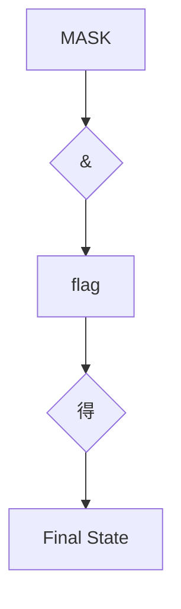

# 第15章 位操作

原始 PDF 第 1133–1194 页。

# 第15章位操作

本章介绍以下内容:

运算符:～、&、|、^、

$$
\ll , \gg
$$

$$
\& = , \mid = , \wedge = , > > = , <   <   =
$$

二进制、十进制和十六进制记数法（复习）

处理一个值中的位的两个C工具:位运算符和位字段

关键字:\_Alignas、\_Alignof

在C语言中，可以单独操控变量中的位。读者可能好奇，竟然有人想这样做。有时必须单独操控位，而且非常有用。例如，通常向硬件设备发送一两个字节来控制这些设备，其中每个位（bit）都有特定的含义。另外，与文件相关的操作系统信息经常被储存，通过使用特定位表明特定项。许多压缩和加密操作都是直接处理单独的位。高级语言一般不会处理这级别的细节，C 在提供高级语言便利的同时，还能在为汇编语言所保留的级别上工作，这使其成为编写设备驱动程序和嵌入式代码的首选语言。

首先要介绍位、字节、二进制记数法和其他进制记数系统的一些背景知识。

1133

---

## 15.1 二进制数、位和字节

通常都是基于数字10来书写数字。例如2157的千位是2，百位是1，十位是5，个位是7，可以写成:

$$
2 \times 1 0 0 0 + 1 \times 1 0 0 + 5 \times 1 0 + 7 \times 1
$$

注意，1000是10的立方（即3次幂），100是10的平方（即2次幂），10是10的1次幂，而且10（以及任意正数）的0次幂是1。因此，2157也可以写成:

$$
2 \times 1 0 ^ {3} + 1 \times 1 0 ^ {2} + 5 \times 1 0 ^ {1} + 7 \times 1 0 ^ {0}
$$

因为这种书写数字的方法是基于10的幂，所以称以10为基底书写2157。

姑且认为十进制系统得以发展是得益于我们都有10根手指。从某种意义上看，计算机的位只有2根手指，因为它只能被设置为0或1，关闭或打开。因此，计算机适用基底为2的数制系统。它用2的幂而不是10的幂。以2为基底表示的数字被称为二进制数（binary number）。二进制中的2和十进制中的10作用相同。例如，二进制数1101可表示为:

$$
1 \times 2 ^ {3} + 1 \times 2 ^ {2} + 0 \times 2 ^ {1} + 1 \times 2 ^ {0}
$$

以十进制数表示为:

$$
1 \times 8 + 1 \times 4 + 0 \times 2 + 1 \times 1 = 1 3
$$

用二进制系统可以把任意整数（如果有足够的位）表示为0和1的组合。由于数字计算机通过关闭和打开状态的组合来表示信息，这两种状态分别用0和1来表示，所以使用这套数制系统非常方便。接下来，我们来学习二进制系统如何表示1字节的整数。

## 15.1.1 二进制整数

1134

---

通常，1字节包含8位。C语言用字节（byte）表示储存系统字符集所需的大小，所以C字节可能是8位、9位、16位或其他值。不过，描述存储器芯片和数据传输率中所用的字节指的是8位字节。为了简化起见，本章假设1字节是8位（计算机界通常用八位组(octet)这个术语特指8位字节）。可以从左往右给这8位分别编号为7～0。在1字节中，编号是7的位被称为高阶位（high-order bit），编号是0的位被称为低阶位（low-order bit）。每 1位的编号对应2的相应指数。因此，可以根据图15.1所示的例子理解字节。


<details>
<summary>text_image</summary>

位编号
7 6 5 4 3 2 1 0
0 1 0 0 1 0 0 1
位值
128 64 32 16 8 4 2 1
该例中，把编号是6、3、0的位设置为1
该字节的值是64+8+1或73
</details>

图15.1 位编号和位值

这里，128是2的7次幂，以此类推。该字节能表示的最大数字是把所有位都设置为1:11111111。这个二进制数的值是:

$$
1 2 8 + 6 4 + 3 2 + 1 6 + 8 + 4 + 2 + 1 = 2 5 5
$$

而该字节最小的二进制数是00000000，其值为0。因此，1字节可储存0 ～255范围内的数字，总共256个值。或者，通过不同的方式解释位组合（bit pattern），程序可以用1字节储存-128～+127范围内的整数，总共还是256个值。例如，通常unsigned char用1字节表示的范围是0～255，而signed char用1字节表示的范围是-128～+127。

## 15.1.2 有符号整数

如何表示有符号整数取决于硬件，而不是C语言。也许表示有符号数最简单的方式是用1位（如，高阶位）储存符号，只剩下7位表示数字本身（假

1135

---

设储存在1字节中）。用这种符号量（sign-magnitude）表示法，10000001表示−1，00000001表示1。因此，其表示范围是−127～+127。

这种方法的缺点是有两个0:+0和-0。这很容易混淆，而且用两个位组合来表示一个值也有些浪费。

二进制补码（two’s-complement）方法避免了这个问题，是当今最常用的系统。我们将以1字节为例，讨论这种方法。二进制补码用1字节中的后7位表示0～127，高阶位设置为0。目前，这种方法和符号量的方法相同。另外，如果高阶位是1，表示的值为负。这两种方法的区别在于如何确定负值。从一个9位组合100000000（256的二进制形式）减去一个负数的位组合，结果是该负值的量。例如，假设一个负值的位组合是 10000000，作为一个无符号字节，该组合为表示 128；作为一个有符号值，该组合表示负值（编码是 7的位为1），而且值为100000000-10000000，即1000000（128）。因此，该数是-128（在符号量表示法中，该位组合表示−0）。类似地，10000001 是−127，11111111 是−1。该方法可以表示−128～ +127范围内的数。

要得到一个二进制补码数的相反数，最简单的方法是反转每一位（即0变为1，1变为0），然后加1。因为1是00000001，那么−1则是11111110+1，或11111111。这与上面的介绍一致。

二进制反码（one’s-complement）方法通过反转位组合中的每一位形成一个负数。例如，00000001是1，那么11111110是−1。这种方法也有一个−0:11111111。该方法能表示-127～+127之间的数。

## 15.1.3 二进制浮点数

浮点数分两部分储存:二进制小数和二进制指数。下面我们将详细介绍。

## 1.二进制小数

1136

---

一个普通的浮点数0.527，表示如下:

$$
5 / 1 0 + 2 / 1 0 0 + 7 / 1 0 0 0
$$

从左往右，各分母都是10的递增次幂。在二进制小数中，使用2的幂作为分母，所以二进制小数.101表示为:

$$
1 / 2 + 0 / 4 + 1 / 8
$$

用十进制表示法为:

$$
0. 5 0 + 0. 0 0 + 0. 1 2 5
$$

即是0.625。

许多分数（如，1/3）不能用十进制表示法精确地表示。与此类似，许多分数也不能用二进制表示法准确地表示。实际上，二进制表示法只能精确地表示多个1/2的幂的和。因此，3/4和7/8可以精确地表示为二进制小数，但是1/3和2/5却不能。

## 2.浮点数表示法

为了在计算机中表示一个浮点数，要留出若干位（因系统而异）储存二进制分数，其他位储存指数。一般而言，数字的实际值是由二进制小数乘以2的指定次幂组成。例如，一个浮点数乘以4，那么二进制小数不变，其指数乘以2，二进制分数不变。如果一份浮点数乘以一个不是2的幂的数，会改变二进制小数部分，如有必要，也会改变指数部分。

1137

---

## 15.2 其他进制数

计算机界通常使用八进制记数系统和十六进制记数系统。因为8和16都是2的幂，这些系统比十进制系统更接近计算机的二进制系统。

## 15.2.1 八进制

八进制（octal）是指八进制记数系统。该系统基于8的幂，用0～7表示数字（正如十进制用0～9表示数字一样）。例如，八进制数451（在C中写作0451）表示为:

$$
4 \times 8 ^ {2} + 5 \times 8 ^ {1} + 1 \times 8 ^ {0} = 2 9 7 (\text {十进制})
$$

了解八进制的一个简单的方法是，每个八进制位对应3个二进制位。表15.1列出了这种对应关系。这种关系使得八进制与二进制之间的转换很容易。例如，八进制数0377的二进制形式是11111111。即，用111代替0377中的最后一个7，再用111代替倒数第2个7，最后用011代替3，并舍去第1位的0。这表明比0377大的八进制要用多个字节表示。这是八进制唯一不方便的地方:一个3位的八进制数可能要用9位二进制数来表示。注意，将八进制数转换为二进制形式时，不能去掉中间的0。例如，八进制数0173的二进制形式是01111011，不是0111111。

表15.1 与八进制位等价的二进制位

| 八进制位 | 等价的二进制位 | 八进制位 | 等价的二进制位 |
| --- | --- | --- | --- |
| 0 | 000 | 4 | 100 |
| 1 | 001 | 5 | 101 |
| 2 | 010 | 6 | 110 |
| 3 | 011 | 7 | 111 |

## 15.2.2 十六进制

十六进制（hexadecimal或hex）是指十六进制记数系统。该系统基于16的幂，用0～15表示数字。但是，由于没有单独的数（digit，即0～9这样单

1138

---

独一位的数）表示10～15，所以用字母A～F来表示。例如，十六进制数A3F（在C中写作0xA3F）表示为:

$$
1 0 \times 1 6 ^ {2} + 3 \times 1 6 ^ {1} + 1 5 \times 1 6 ^ {0} = 2 6 2 3 (\text {十进制})
$$

由于A表示10，F表示15。在C语言中，A～F既可用小写也可用大写。因此，2623也可写作0xa3f。

每个十六进制位都对应一个4位的二进制数（即4个二进制位），那么两个十六进制位恰好对应一个8位字节。第1个十六进制表示前4位，第2个十六进制位表示后4位。因此，十六进制很适合表示字节值。

表15.2列出了各进制之间的对应关系。例如，十六进制值0xC2可转换为11000010。相反，二进制值11010101可以看作是1101 0101，可转换为0xD5。

表15.2 十进制、十六进制和等价的二进制

| 十进制 | 十六进制 | 等价二进制 | 十进制 | 十六进制 | 等价二进制 |
| --- | --- | --- | --- | --- | --- |
| 0 | 0 | 0000 | 8 | 8 | 1000 |
| 1 | 1 | 0001 | 9 | 9 | 1001 |
| 2 | 2 | 0010 | 10 | A | 1010 |
| 3 | 3 | 0011 | 11 | B | 1011 |
| 4 | 4 | 0100 | 12 | C | 1100 |
| 5 | 5 | 0101 | 13 | D | 1101 |
| 6 | 6 | 0110 | 14 | E | 1110 |
| 7 | 7 | 0111 | 15 | F | 1111 |

介绍了位和字节的相关内容，接下来我们研究C用位和字节进行哪些操作。C有两个操控位的工具。第 1 个工具是一套（6 个）作用于位的按位运算符。第 2 个工具是字段（field）数据形式，用于访问 int中的位。下面将简要介绍这些C的特性。

1139

---

## 15.3 C按位运算符

C 提供按位逻辑运算符和移位运算符。在下面的例子中，为了方便读者了解位的操作，我们用二进制记数法写出值。但是在实际的程序中不必这样，用一般形式的整型变量或常量即可。例如，在程序中用25或031或0x19，而不是00011001。另外，下面的例子均使用8位二进制数，从左往右每位的编号为7～0。

## 15.3.1 按位逻辑运算符

4个按位逻辑运算符都用于整型数据，包括char。之所以叫作按位（bitwise）运算，是因为这些操作都是针对每一个位进行，不影响它左右两边的位。不要把这些运算符与常规的逻辑运算符（&&、||和！）混淆，常规的逻辑运算符操作的是整个值。

## 1.二进制反码或按位取反:～

一元运算符～把1变为0，把0变为1。如下例子所示:

～(10011010) // 表达式

(01100101) // 结果值

假设val的类型是unsigned char，已被赋值为2。在二进制中，00000010表示2。那么，～val的值是11111101，即253。注意，该运算符不会改变val的值，就像3 \* val不会改变val的值一样， val仍然是2。但是，该运算符确实创建了一个可以使用或赋值的新值:

$$
\text {newval} = \sim \text {val};
$$

$$
\mathrm{printf} (\% \mathrm{d}", \sim \text {val});
$$

如果要把val的值改为～val，使用下面这条语句:

1140

---

$$
\mathrm{val} = \sim \mathrm{val};
$$

## 2.按位与:&

二元运算符&通过逐位比较两个运算对象，生成一个新值。对于每个位，只有两个运算对象中相应的位都为1时，结果才为1（从真/假方面看，只有当两个位都为真时，结果才为真）。因此，对下面的表达式求值:

(10010011) & (00111101) // 表达式

由于两个运算对象中编号为4和0的位都为1，得:

(00010001) // 结果值

C有一个按位与和赋值结合的运算符:&=。下面两条语句产生的最终结果相同:

$$
\text {val} \& = 0 3 7 7;
$$

$$
\text {val} = \text {val} \& 0 3 7 7;
$$

## 3.按位或:|

二元运算符|，通过逐位比较两个运算对象，生成一个新值。对于每个位，如果两个运算对象中相应的位为1，结果就为1（从真/假方面看，如果两个运算对象中相应的一个位为真或两个位都为真，那么结果为真）。因此，对下面的表达式求值:

(10010011) | (00111101) // 表达式

除了编号为6的位，这两个运算对象的其他位至少有一个位为1，得:

(10111111) // 结果值

C有一个按位或和赋值结合的运算符:|=。下面两条语句产生的最终作用相同:

1141

---

$$
\text {val} \models 0 3 7 7;
$$

$$
\mathrm{val} = \mathrm{val} \mid 0 3 7 7;
$$

## 4.按位异或:^

二元运算符^逐位比较两个运算对象。对于每个位，如果两个运算对象中相应的位一个为1（但不是两个为1），结果为1（从真/假方面看，如果两个运算对象中相应的一个位为真且不是两个为同为1，那么结果为真）。因此，对下面表达式求值:

(10010011) ^ (00111101) // 表达式

编号为0的位都是1，所以结果为0，得:

(10101110) // 结果值

C有一个按位异或和赋值结合的运算符:^=。下面两条语句产生的最终作用相同:

$$
\text {val} ^ {\wedge} = 0 3 7 7;
$$

$$
\mathrm{val} = \mathrm{val} ^ {\wedge} 0 3 7 7;
$$

## 15.3.2 用法:掩码

按位与运算符常用于掩码（mask）。所谓掩码指的是一些设置为开（1）或关（0）的位组合。要明白称其为掩码的原因，先来看通过&把一个量与掩码结合后发生什么情况。例如，假设定义符号常量MASK为2 （即，二进制形式为00000010），只有1号位是1，其他位都是0。下面的语句:

$$
\text {flags} = \text {flags} \& \text {MASK};
$$

把flags中除1号位以外的所有位都设置为0，因为使用按位与运算符（&）任何位与0组合都得0。1号位的值不变（如果1号位是1，那么 1&1得

1142

---

1；如果 1号位是0，那么 0&1也得0）。这个过程叫作“使用掩码”，因为掩码中的0隐藏了flags中相应的位。

可以这样类比:把掩码中的0看作不透明，1看作透明。表达式flags & MASK相当于用掩码覆盖在flags的位组合上，只有MASK为1的位才可见（见图15.2）。


<details>
<summary>flowchart</summary>


</details>

图15.2 掩码示例

用&=运算符可以简化前面的代码，如下所示:

$$
\text {flags} \& = \text {MASK};
$$

下面这条语句是按位与的一种常见用法:

$$
\mathrm{ch} \&= 0 \mathrm{xff}; / * \text {或者} \mathrm{ch} \&= 0 3 7 7; *\right/
$$

前面介绍过oxff的二进制形式是11111111，八进制形式是0377。这个掩码保持ch中最后8位不变，其他位都设置为0。无论ch原来是8位、16位或是其他更多位，最终的值都被修改为1个8位字节。在该例中，掩码的宽度为8

1143

---

位。

## 15.3.3 用法:打开位（设置位）

有时，需要打开一个值中的特定位，同时保持其他位不变。例如，一台IBM PC 通过向端口发送值来控制硬件。例如，为了打开内置扬声器，必须打开 1 号位，同时保持其他位不变。这种情况可以使用按位或运算符（|）。

以上一节的flags和MASK（只有1号位为1）为例。下面的语句:

$$
\text {flags} = \text {flags} \mid \text {MASK};
$$

把flags的1号位设置为1，且其他位不变。因为使用|运算符，任何位与0组合，结果都为本身；任何位与1组合，结果都为1。

例如，假设flags是00001111，MASK是10110110。下面的表达式:

$$
\text {flags} \mid \text {MASK}
$$

即是:

$$
(0 0 0 0 1 1 1 1) \mid (1 0 1 1 0 1 1 0) \quad / / \text {表达式}
$$

其结果为:

$$
(1 0 1 1 1 1 1 1) \quad / / \text {结果值}
$$

MASK中为1的位，flags与其对应的位也为1。MASK中为0的位，flags与其对应的位不变。

用|=运算符可以简化上面的代码，如下所示:

$$
\text {flags} \models \text {MASK};
$$

同样，这种方法根据MASK中为1的位，把flags中对应的位设置为1，其

1144

---

他位不变。

## 15.3.4 用法:关闭位（清空位）

和打开特定的位类似，有时也需要在不影响其他位的情况下关闭指定的位。假设要关闭变量flags中的1号位。同样，MASK只有1号位为1（即，打开）。可以这样做:

$$
\text {flags} = \text {flags} \& \sim \text {MASK};
$$

由于MASK除1号位为1以外，其他位全为0，所以～MASK除1号位为0以外，其他位全为1。使用&，任何位与1组合都得本身，所以这条语句保持1号位不变，改变其他各位。另外，使用&，任何位与0组合都的0。所以无论1号位的初始值是什么，都将其设置为0。

例如，假设flags是00001111，MASK是10110110。下面的表达式:

$$
\text {flags} \& \sim \text {MASK}
$$

即是:

(00001111) & ～(10110110) // 表达式

其结果为:

(00001001) // 结果值

MASK中为1的位在结果中都被设置（清空）为0。flags中与MASK为0的位相应的位在结果中都未改变。

可以使用下面的简化形式:

$$
\text {flags} \& = \sim \text {MASK};
$$

## 15.3.5 用法:切换位

1145

---

切换位指的是打开已关闭的位，或关闭已打开的位。可以使用按位异或运算符（^）切换位。也就是说，假设b是一个位（1或0），如果b为1，则1^b为0；如果b为0，则1^b为1。另外，无论b为1还是0，0^b均为b。因此，如果使用^组合一个值和一个掩码，将切换该值与MASK为1的位相对应的位，该

值与MASK为0的位相对应的位不变。要切换flags中的1号位，可以使用下面两种方法:

$$
\text {flags} = \text {flags} ^ {\wedge} \text {MASK};
$$

$$
\text {flags} ^ {\wedge} = \text {MASK};
$$

例如，假设flags是00001111，MASK是10110110。表达式:

$$
\text {flags} ^ {\wedge} \text {MASK}
$$

即是:

(00001111) ^ (10110110) // 表达式

其结果为:

(10111001) // 结果值

flags中与MASK为1的位相对应的位都被切换了，MASK为0的位相对应的位不变。

## 15.3.6 用法:检查位的值

前面介绍了如何改变位的值。有时，需要检查某位的值。例如，flags中1号位是否被设置为1？不能这样直接比较flags和MASK:

$$
\text {if (flags == MASK)}
$$

puts("Wow!"); /\* 不能正常工作 \*/

1146

---

这样做即使flags的1号位为1，其他位的值会导致比较结果为假。因此，必须覆盖flags中的其他位，只用1号位和MASK比较:

$$
\text {if} ((\text {flags} \& \text {MASK}) = = \text {MASK})
$$

$$
\text {puts} (" \text {Wow!"});
$$

由于按位运算符的优先级比==低，所以必须在flags & MASK周围加上圆括号。

为了避免信息漏过边界，掩码至少要与其覆盖的值宽度相同。

## 15.3.7 移位运算符

下面介绍C的移位运算符。移位运算符向左或向右移动位。同样，我们在示例中仍然使用二进制数，有助于读者理解其工作原理。

**1.**左移:**<<**

左移运算符（<<）将其左侧运算对象每一位的值向左移动其右侧运算对象指定的位数。左侧运算对象移出左末端位的值丢失，用0填充空出的位置。下面的例子中，每一位都向左移动两个位置:

$$
(1 0 0 0 1 0 1 0) \ll 2 \quad / / \text { 表达式 }
$$

$$
(0 0 1 0 1 0 0 0) \quad / / \text {结果值}
$$

该操作产生了一个新的位值，但是不改变其运算对象。例如，假设stonk为1，那么 stonk<<2为4，但是stonk本身不变，仍为1。可以使用左移赋值运算符（<<=）来更改变量的值。该运算符将变量中的位向左移动其右侧运算对象给定值的位数。如下例:

$$
\text {int stonk} = 1;
$$

$$
\text {int onkoo;}
$$

1147

---

onkoo = stonk << 2; /\* 把4赋给onkoo \*/

stonk <<= 2; /\* 把stonk的值改为4 \*/

## 2.右移:>>

右移运算符（>>）将其左侧运算对象每一位的值向右移动其右侧运算对象指定的位数。左侧运算对象移出右末端位的值丢。对于无符号类型，用0 填充空出的位置；对于有符号类型，其结果取决于机器。空出的位置可用0填充，或者用符号位（即，最左端的位）的副本填充:

(10001010) >> 2 // 表达式，有符号值

(00100010) // 在某些系统中的结果值

(10001010) >> 2 // 表达式，有符号值

(11100010) // 在另一些系统上的结果值

下面是无符号值的例子:

(10001010) >> 2 // 表达式，无符号值

(00100010) // 所有系统都得到该结果值

每个位向右移动两个位置，空出的位用0填充。

右移赋值运算符（>>=）将其左侧的变量向右移动指定数量的位数。如下所示:

int sweet = 16;

int ooosw;

ooosw = sweet >> 3; // ooosw = 2，sweet的值仍然为16

1148

---

sweet >>=3; // sweet的值为2

## 3.用法:移位运算符

移位运算符针对2的幂提供快速有效的乘法和除法:

number << n number乘以2的n次幂

number >> n 如果number为非负，则用number除以2的n次幂

这些移位运算符类似于在十进制中移动小数点来乘以或除以10。

移位运算符还可用于从较大单元中提取一些位。例如，假设用一个unsigned long类型的值表示颜色值，低阶位字节储存红色的强度，下一个字节储存绿色的强度，第 3 个字节储存蓝色的强度。随后你希望把每种颜色的强度分别储存在3个不同的unsigned char类型的变量中。那么，可以使用下面的语句:

#define BYTE\_MASK 0xff

unsigned long color = 0x002a162f;

unsigned char blue, green, red;

red = color & BYTE\_MASK;

green = (color >> 8) & BYTE\_MASK;

以上代码中，使用右移运算符将 8 位颜色值移动至低阶字节，然后使用掩码技术把低阶字节赋给指定的变量。

## 15.3.8 编程示例

在第 9 章中，我们用递归的方法编写了一个程序，把数字转换为二进制

1149

---

形式（程序清单 9.8）。现在，要用移位运算符来解决相同的问题。程序清单15.1中的程序，读取用户从键盘输入的整数，将该整数和一个字符串地址传递给itobs()函数（itobs表示interger to binary string，即整数转换成二进制字符串）。然后，该函数使用移位运算符计算出正确的1和0的组合，并将其放入字符串中。

程序清单**15.1 binbit.c**程序

/\* binbit.c -- 使用位操作显示二进制 \*/

#include &lt;stdio.h&gt;

#include &lt;limits.h&gt; // 提供 CHAR\_BIT 的定义，CHAR\_BIT 表示每字节的位数

```c
char * itobs(int, char *);
void show_bstr(const char *);
int main(void)
{
char bin_str[CHAR_BIT * sizeof(int) + 1];
int number;
puts("Enter integers and see them in binary.");
puts("Non-numeric input terminates program.");
while (scanf("%d", &number) == 1)
{
itobs(number, bin_str);
```

1150

---

```c
printf("%d is ", number);
show_bstr(bin_str);
putchar('\n');
}
puts("Bye!");
return 0;
}
char * itobs(int n, char * ps)
{
int i;
const static int size = CHAR_BIT * sizeof(int);
for (i = size - 1; i >= 0; i--, n >>= 1)
ps[i] = (01 & n) + '0';
ps[size] = '\0';
return ps;
}
/*4位一组显示二进制字符串 */
void show_bstr(const char * str)
{
```

1151

---

```txt
int i = 0;

while (str[i]) /* 不是一个空字符 */
{
putchar(str[i]);
if (++i % 4 == 0 && str[i])
putchar(' ');
}
}
```

程序清单15.1使用limits.h中的CHAR\_BIT宏，该宏表示char中的位数。sizeof运算符返回char的大小，所以表达式CHAE\_BIT \* sizeof(int)表示int类型的位数。bin\_str数组的元素个数是CHAE\_BIT \* sizeof(int) + 1，留出一个位置给末尾的空字符。

itobs()函数返回的地址与传入的地址相同，可以把该函数作为printf()的参数。在该函数中，首次执行for循环时，对01 & n求值。01是一个八进制形式的掩码，该掩码除0号位是1之外，其他所有位都为0。因此，01 & n就是n最后一位的值。该值为0或1。但是对数组而言，需要的是字符'0'或字符'1'。该值加上'0'即可完成这种转换（假设按顺序编码的数字，如 ASCII）。其结果存放在数组中倒数第2个元素中（最后一个元素用来存放空字符）。

顺带一提，用1 & n或01 & n都可以。我们用八进制1而不是十进制1，只是为了更接近计算机的表达方式。

然后，循环执行i--和n >>= 1。i--移动到数组的前一个元素，n >>= 1使n中的所有位向右移动一个位置。进入下一轮迭代时，循环中处理的是n中新的最右端的值。然后，把该值储存在倒数第3个元素中，以此类推。itobs()函数用这种方式从右往左填充数组。

1152

---

可以使用printf()或puts()函数显示最终的字符串，但是程序清单15.1中定义了show\_bstr()函数，以4位一组打印字符串，方便阅读。

下面的该程序的运行示例:

Enter integers and see them in binary.

Non-numeric input terminates program.

7

7 is 0000 0000 0000 0000 0000 0000 0000 0111

**2013**

2013 is 0000 0000 0000 0000 0000 0111 1101 1101

-1 is 1111 1111 1111 1111 1111 1111 1111 1111

**32123**

32123 is 0000 0000 0000 0000 0111 1101 0111 1011

q

Bye!

## 15.3.9 另一个例子

我们来看另一个例子。这次要编写的函数用于切换一个值中的后 n 位，待处理值和 n 都是函数的参数。

～运算符切换一个字节的所有位，而不是选定的少数位。但是，^运算符（按位异或）可用于切换单个位。假设创建了一个掩码，把后n位设置为

1153

---

1，其余位设置为0。然后使用^组合掩码和待切换的值便可切换该值的最后n位，而且其他位不变。方法如下:

```txt
int invert_end(int num, int bits)
{
int mask = 0;
int bitval = 1;
while (bits— > 0)
{
mask |= bitval;
bitval <<= 1;
}
return num ^ mask;
}
```

while循环用于创建所需的掩码。最初，mask的所有位都为0。第1轮循环将mask的0号位设置为1。然后第2轮循环将mask的1号位设置为1，以此类推。循环bits次，mask的后bits位就都被设置为1。最后，num ^ mask运算即得所需的结果。

我们把这个函数放入前面的程序中，测试该函数。如程序清单15.2所示。

程序清单**15.2 invert4.c**程序

/\* invert4.c -- 使用位操作显示二进制 \*/

1154

---

```c
#include <stdio.h>

#include <limits.h>

char * itobs(int, char *);
void show_bstr(const char *);
int invert_end(int num, int bits);

int main(void)
{
char bin_str[CHAR_BIT * sizeof(int) + 1];
int number;
puts("Enter integers and see them in binary.");
puts("Non-numeric input terminates program.");
while (scanf("%d", &number) == 1)
{
itobs(number, bin_str);
printf("%d is\n", number);
show_bstr(bin_str);
putchar('\n');
number = invert_end(number, 4);
printf("Inverting the last 4 bits gives\n");
```

1155

---

```c
show_bstr(itobs(number, bin_str));

putchar('\n');

}

puts("Bye!");

return 0;

}

char * itobs(int n, char * ps)

{

int i;

const static int size = CHAR_BIT * sizeof(int);

for (i = size - 1; i >= 0; i--, n >>= 1)

ps[i] = (01 & n) + '0';

ps[size] = '\0';

return ps;

}

/* 以4位为一组，显示二进制字符串 */
void show_bstr(const char * str)

{

int i = 0;
```

1156

---

while (str[i]) /\* 不是空字符 \*/

{

putchar(str[i]);

if (++i % 4 == 0 && str[i])

putchar(' ');

}

}

int invert\_end(int num, int bits)

{

int mask = 0;

int bitval = 1;

while (bits-- > 0)

{

mask |= bitval;

bitval <<= 1;

}

return num ^ mask;

}

下面是该程序的一个运行示例:

1157

---

Enter integers and see them in binary.

Non-numeric input terminates program.

7

7 is

0000 0000 0000 0000 0000 0000 0000 0111

Inverting the last 4 bits gives

0000 0000 0000 0000 0000 0000 0000 1000

**12541**

12541 is

0000 0000 0000 0000 0011 0000 1111 1101

Inverting the last 4 bits gives

0000 0000 0000 0000 0011 0000 1111 0010

q

Bye!

1158

---

## 15.4 位字段

操控位的第2种方法是位字段（bit field）。位字段是一个signed int或unsigned int类型变量中的一组相邻的位（C99和C11新增了\_Bool类型的位字段）。位字段通过一个结构声明来建立，该结构声明为每个字段提供标签，并确定该字段的宽度。例如，下面的声明建立了一个4个1位的字段:

```txt
struct {
unsigned int autfd : 1;
unsigned int bldfc : 1;
unsigned int undln : 1;
unsigned int itals : 1;
} prnt;
```

根据该声明，prnt包含4个1位的字段。现在，可以通过普通的结构成员运算符（.）单独给这些字段赋值:

```javascript
prnt.itals = 0;

prnt.undln = 1;
```

由于每个字段恰好为1位，所以只能为其赋值1或0。变量prnt被储存在int大小的内存单元中，但是在本例中只使用了其中的4位。

带有位字段的结构提供一种记录设置的方便途径。许多设置（如，字体的粗体或斜体）就是简单的二选一。例如，开或关、真或假。如果只需要使用 1 位，就不需要使用整个变量。内含位字段的结构允许在一个存储单元中储存多个设置。

有时，某些设置也有多个选择，因此需要多位来表示。这没问题，字段

1159

---

不限制 1 位大小。可以使用如下的代码:

```vhdl
struct {

unsigned int code1 : 2;

unsigned int code2 : 2;

unsigned int code3 : 8;

} prcode;
```

以上代码创建了两个2位的字段和一个8位的字段。可以这样赋值:

```txt
prcode.code1 = 0;

prcode.code2 = 3;

prcode.code3 = 102;
```

但是，要确保所赋的值不超出字段可容纳的范围。

如果声明的总位数超过了一个unsigned int类型的大小会怎样？会用到下一个unsigned int类型的存储位置。一个字段不允许跨越两个unsigned int之间的边界。编译器会自动移动跨界的字段，保持unsigned int的边界对齐。一旦发生这种情况，第1个unsigned int中会留下一个未命名的“洞”。

可以用未命名的字段宽度“填充”未命名的“洞”。使用一个宽度为0的未命名字段迫使下一个字段与下一个整数对齐:

```txt
struct {

unsigned int field1      : 1 ;

unsigned int          : 2 ;
```

1160

---

```matlab
unsigned int field2      : 1 ;
unsigned int             : 0 ;
unsigned int field3     : 1 ;
} stuff;
```

这里，在stuff.field1和stuff.field2之间，有一个2位的空隙；stuff.field3将储存在下一个unsigned int中。

字段储存在一个int中的顺序取决于机器。在有些机器上，存储的顺序是从左往右，而在另一些机器上，是从右往左。另外，不同的机器中两个字段边界的位置也有区别。由于这些原因，位字段通常都不容易移植。尽管如此，有些情况却要用到这种不可移植的特性。例如，以特定硬件设备所用的形式储存数据。

## 15.4.1 位字段示例

通常，把位字段作为一种更紧凑储存数据的方式。例如，假设要在屏幕上表示一个方框的属性。为简化问题，我们假设方框具有如下属性:

方框是透明的或不透明的；

方框的填充色选自以下调色板:黑色、红色、绿色、黄色、蓝色、紫色、青色或白色；

边框可见或隐藏；

边框颜色与填充色使用相同的调色板；

边框可以使用实线、点线或虚线样式。

可以使用单独的变量或全长（full-sized）结构成员来表示每个属性，但是这样做有些浪费位。例如，只需1位即可表示方框是透明还是不透明；只

1161

---

需1位即可表示边框是显示还是隐藏。8种颜色可以用3位单元的8个可能的值来表示，而3种边框样式也只需2位单元即可表示。总共10位就足够表示方框的5个属性设置。

一种方案是:一个字节储存方框内部（透明和填充色）的属性，一个字节储存方框边框的属性，每个字节中的空隙用未命名字段填充。struct box\_props声明如下:

```txt
struct boxprops {
bool opaque                      : 1 ;
unsigned int fill_color    : 3 ;
unsigned int                          : 4 ;
bool show_border         : 1 ;
unsigned int border_color   : 3 ;
unsigned int border_style   : 2 ;
unsigned int                          : 2 ;
};
```

加上未命名的字段，该结构共占用 16 位。如果不使用填充，该结构占用 10 位。但是要记住，C 以unsigned int作为位字段结构的基本布局单元。因此，即使一个结构唯一的成员是1位字段，该结构的大小也是一个unsigned int类型的大小，unsigned int在我们的系统中是32位。另外，以上代码假设C99新增的\_Bool类型可用，在stdbool.h中，bool是\_Bool的别名。

对于opaque成员，1表示方框不透明，0表示透明。show\_border成员也用类似的方法。对于颜色，可以用简单的RGB（即red-green-blue的缩写）表示。这些颜色都是三原色的混合。显示器通过混合红、绿、蓝像素来产生不

1162

---

同的颜色。在早期的计算机色彩中，每个像素都可以打开或关闭，所以可以使用用 1 位来表示三原色中每个二进制颜色的亮度。常用的顺序是，左侧位表示蓝色亮度、中间位表示绿色亮度、右侧位表示红色亮度。表15.3列出了这8种可能的组合。fill\_color成员和border\_color成员可以使用这些组合。最后，border\_style成员可以使用0、1、2来表示实线、点线和虚线样式。

表15.3 简单的颜色表示

| 位组合 | 十进制 | 颜色 |
| --- | --- | --- |
| 000 | 0 | 黑色 |
| 001 | 1 | 红色 |
| 010 | 2 | 绿色 |
| 011 | 3 | 黄色 |
| 100 | 4 | 蓝色 |
| 101 | 5 | 紫色 |
| 110 | 6 | 青色 |
| 111 | 7 | 白色 |

程序清单15.3中的程序使用box\_props结构，该程序用#define创建供结构成员使用的符号常量。注意，只打开一位即可表示三原色之一。其他颜色用三原色的组合来表示。例如，紫色由打开的蓝色位和红色位组成，所以，紫色可表示为BLUE|RED。

程序清单**15.3 fields.c**程序

/\* fields.c -- 定义并使用字段 \*/

#include &lt;stdio.h&gt;

#include &lt;stdbool.h&gt; // C99定义了bool、true、false

/\* 线的样式 \*/

#define SOLID 0

#define DOTTED 1

#define DASHED 2

1163

---

/\* 三原色 \*/

#define BLUE 4

#define GREEN 2

#define RED 1

/\* 混合色 \*/

#define BLACK 0

#define YELLOW (RED | GREEN)

#define MAGENTA (RED | BLUE)

#define CYAN (GREEN | BLUE)

#define WHITE (RED | GREEN | BLUE)

const char \* colors[8] = { "black", "red", "green", "yellow",

"blue", "magenta", "cyan", "white" };

struct box\_props {

bool opaque : 1; // 或者 unsigned int （C99以前）

unsigned int fill\_color : 3;

unsigned int : 4;

bool show\_border : 1; // 或者 unsigned int （C99以前）

unsigned int border\_color : 3;

unsigned int border\_style : 2;

1164

---

```c
unsigned int : 2;
};
void show_settings(const struct boxprops * pb);
int main(void)
{
/* 创建并初始化 boxprops 结构 */
struct boxprops box = { true, YELLOW, true, GREEN, DASHED };
printf("Original box settings:\n");
show_settings(&box);
box.opaque = false;
box.fill_color = WHITE;
box.border_color = MAGENTA;
box.border_style = SOLID;
printf("\nModified box settings:\n");
show_settings(&box);
return 0;
}
void show_settings(const struct boxprops * pb)
{
```

1165

---

```cpp
printf("Box is %s.\n",
pb->opaque == true ? "opaque" : "transparent");
printf("The fill color is %s.\n", colors[pb->fill_color]);
printf("Border %s.\n",
pb->show_border == true ? "shown" : "not shown");
printf("The border color is %s.\n", colors[pb->border_color]);
printf("The border style is ");
switch (pb->border_style)
{
case SOLID: printf("solid.\n"); break;
case DOTTED: printf("dotted.\n"); break;
case DASHED: printf("dashed.\n"); break;
default: printf("unknown type.\n");
}
}
下面是该程序的输出:
Original box settings:
Box is opaque.
The fill color is yellow.
```

1166

---

Border shown.

The border color is green.

The border style is dashed.

Modified box settings:

Box is transparent.

The fill color is white.

Border shown.

The border color is magenta.

The border style is solid.

该程序要注意几个要点。首先，初始化位字段结构与初始化普通结构的语法相同:

$$
\text {struct box\_props box} = \{\text {YES, YELLOW, YES, GREEN, DASHED} \};
$$

类似地，也可以给位字段成员赋值:

$$
\text {box.fill\_color} = \text {WHITE};
$$

另外，switch语句中也可以使用位字段成员，甚至还可以把位字段成员用作数组的下标:

$$
\operatorname{printf} \left(\text {The fill color is \%s.\n", colors[pb - > fill\_color]}\right);
$$

注意，根据 colors 数组的定义，每个索引对应一个表示颜色的字符串，而每种颜色都把索引值作为该颜色的数值。例如，索引1对应字符串"red"，枚举常量red的值是1。

1167

---

## 15.4.2 位字段和按位运算符

在同类型的编程问题中，位字段和按位运算符是两种可替换的方法，用哪种方法都可以。例如，前面的例子中，使用和unsigned int类型大小相同的结构储存图形框的信息。也可使用unsigned int变量储存相同的信息。如果不想用结构成员表示法来访问不同的部分，也可以使用按位运算符来操作。一般而言，这种方法比较麻烦。接下来，我们来研究这两种方法（程序中使用了这两种方法，仅为了解释它们的区别，我们并不鼓励这样做）。

可以通过一个联合把结构方法和位方法放在一起。假定声明了 struct box\_props 类型，然后这样声明联合:

```txt
union Views /* 把数据看作结构或unsigned short类型的变量 */
{
struct boxprops st_view;
unsigned short us_view;
};
```

在某些系统中，unsigned int和box\_props类型的结构都占用16 位内存。但是，在其他系统中（例如我们使用的系统），unsigned int和box\_props都是32位。无论哪种情况，通过联合，都可以使用 st\_view 成员把一块内存看作是一个结构，或者使用 us\_view 成员把相同的内存块看作是一个unsigned short。结构的哪一个位字段与unsigned short中的哪一位对应？这取决于实现和硬件。下面的程序示例假设从字节的低阶位端到高阶位端载入结构。也就是说，结构中的第 1 个位字段对应计算机字的0号位（为简化起见，图15.3以16位单元演示了这种情况）。

1168

---


<details>
<summary>text_image</summary>

box.us_view
把box联合
视为一个整数
0 1 0 0 0 0 1 0 1 0 1 0 1 1 0 1
15号位
0号位
box.st_view
把box联合
视为一个结构
0 1 0 0 0 0 1 0 1 0 1 0 1 1 0 1
num_prtrs
gameio
num_comcds
num_drives
vid_setup
mother_bd
has_drive
</details>

图15.3 作为整数和结构的联合

程序清单15.4使用Views联合来比较位字段和按位运算符这两种方法。在该程序中，box是View联合，所以box.st\_view是一个使用位字段的box\_props类型的结构，box.us\_view把相同的数据看作是一个unsigned short类型的变量。联合只允许初始化第1 个成员，所以初始化值必须与结构相匹配。该程序分别通过两个函数显示 box 的属性，一个函数接受一个结构，一个函数接受一个 unsigned short 类型的值。这两种方法都能访问数据，但是所用的技术不同。该程序还使用了本章前面定义的itobs()函数，以二进制字符串形式显示数据，以便读者查看每个位的开闭情况。

程序清单**15.4 dualview.c**程序

/\* dualview.c -- 位字段和按位运算符 \*/

#include &lt;stdio.h&gt;

#include &lt;stdbool.h&gt;

1169

---

#include &lt;limits.h&gt;

/\* 位字段符号常量 \*/

/\* 边框线样式 \*/

#define SOLID 0

#define DOTTED 1

#define DASHED 2

/\* 三原色 \*/

#define BLUE 4

#define GREEN 2

#define RED 1

/\* 混合颜色 \*/

#define BLACK 0

#define YELLOW (RED | GREEN)

#define MAGENTA (RED | BLUE)

#define CYAN (GREEN | BLUE)

#define WHITE (RED | GREEN | BLUE)

/\* 按位方法中用到的符号常量 \*/

#define OPAQUE 0x1

#define FILL\_BLUE 0x8

1170

---

#define FILL\_GREEN 0x4

#define FILL\_RED 0x2

#define FILL\_MASK 0xE

#define BORDER 0x100

#define BORDER\_BLUE 0x800

#define BORDER\_GREEN 0x400

#define BORDER\_RED0x 200

#define BORDER\_MASK 0xE00

#define B\_SOLID 0

#define B\_DOTTED 0x1000

#define B\_DASHED 0x2000

#define STYLE\_MASK0x 3000

const char \* colors[8] = { "black", "red", "green", "yellow", "blue", "magenta",

"cyan", "white" };

struct box\_props {

bool opaque : 1;

unsigned int fill\_color : 3;

unsigned int : 4;

1171

---

```c
bool show_border          : 1;
unsigned int border_color  : 3;
unsigned int border_style  : 2;
unsigned int                : 2;
};
union Views   /* 把数据看作结构或unsigned short类型的变量 */
{
struct boxprops st_view;
unsigned short us_view;
};
void show_settings(const struct boxprops * pb);
void show_settings1(unsigned short);
char * itobs(int n, char * ps);
int main(void)
{
/* 创建Views联合，并初始化initialize struct box view */
union Views box = { { true, YELLOW, true, GREEN, DASHED } };
char bin_str[8 * sizeof(unsigned int) + 1];
printf("Original box settings:\n");
```

1172

---

```c
show_settings(&box.st_view);

printf("\nBox settings using unsigned int view:\n");

show_settings1(box.us_view);

printf("bits are %s\n",
itobs(box.us_view, bin_str));

box.us_view &= ~FILL_MASK;          /* 把表示填充色的位清0 */
box.us_view |= (FILL_BLUE | FILL_GREEN);    /* 重置填充色 */
box.us_view ^= OPAQUE;                    /* 切换是否透明的位 */
box.us_view |= BORDER_RED;                /* 错误的方法 */
box.us_view &= ~STYLE_MASK;            /* 把样式的位清0 */
box.us_view |= B_DOTTED;                 /* 把样式设置为点 */
printf("\nModified box settings:\n");
show_settings(&box.st_view);
printf("\nBox settings using unsigned int view:\n");
show_settings1(box.us_view);
printf("bits are %s\n",
itobs(box.us_view, bin_str));
return 0;
```

1173

---

```txt
}
void show_settings(const struct boxprops * pb)
{
printf("Box is %s.\n",
pb->opaque == true ? "opaque" : "transparent");
printf("The fill color is %s.\n", colors[pb->fill_color]);
printf("Border %s.\n",
pb->show_border == true ? "shown" : "not shown");
printf("The border color is %s.\n", colors[pb->border_color]);
printf("The border style is ");
switch (pb->border_style)
{
case SOLID: printf("solid.\n"); break;
case DOTTED: printf("dotted.\n"); break;
case DASHED: printf("dashed.\n"); break;
default: printf("unknown type.\n");
}
}
void show_settings1(unsigned short us)
```

1174

---

```txt
{
printf("box is %s.\n",
(us & OPAQUE) == OPAQUE ? "opaque" : "transparent");
printf("The fill color is %s.\n",
colors[(us >> 1) & 07]);
printf("Border %s.\n",
(us & BORDER) == BORDER ? "shown" : "not shown");
printf("The border style is ");
switch (us & STYLE_MASK)
{
case B_SOLID : printf("solid.\n"); break;
case B_DOTTED : printf("dotted.\n"); break;
case B_DASHED : printf("dashed.\n"); break;
default : printf("unknown type.\n");
}
printf("The border color is %s.\n",
colors[(us >> 9) & 07]);
}
char * itobs(int n, char * ps)
```

1175

---

```txt
{
int i;

const static int size = CHAR_BIT * sizeof(int);

for (i = size - 1; i >= 0; i--, n >>= 1)

ps[i] = (01 & n) + '0';

ps[size] = '\0';

return ps;

}
```

下面是该程序的输出:

Original box settings:

Box is opaque.

The fill color is yellow.

Border shown.

The border color is green.

The border style is dashed.

Box settings using unsigned int view:

box is opaque.

The fill color is yellow.

Border shown.

1176

---

The border style is dashed.

The border color is green.

bits are 00000000000000000010010100000111

Modified box settings:

Box is transparent.

The fill color is cyan.

Border shown.

The border color is yellow.

The border style is dotted.

Box settings using unsigned int view:

box is transparent.

The fill color is cyan.

Border not shown.

The border style is dotted.

The border color is yellow.

bits are 00000000000000000001011100001100

这里要讨论几个要点。位字段视图和按位视图的区别是，按位视图需要位置信息。例如，程序中使用BLUE表示蓝色，该符号常量的数值为4。但是，由于结构排列数据的方式，实际储存蓝色设置的是3号位（位的编号从0开始，参见图15.1），而且储存边框为蓝色的设置是11号位。因此，该程序

1177

---

定义了一些新的符号常量:

```c
#define FILL_BLUE      0x8
```

```c
#define BORDER_BLUE      0x800
```

这里，0x8是3号位为1时的值，0x800是11号位为1时的值。可以使用第1个符号常量设置填充色的蓝色位，用第2个符号常量设置边框颜色的蓝色位。用十六进制记数法更容易看出要设置二进制的哪一位，由于十六进制的每一位代表二进制的4位，那么0x8的位组合是1000，而0x800的位组合是10000000000，0x800的位组合比0x8后面多8个0。但是以等价的十进制来看就没那么明显，0x8是8，0x800是2048。

如果值是2的幂，那么可以使用左移运算符来表示值。例如，可以用下面的#define分别替换上面的#define:

```c
#define FILL_BLUE          1<<3
```

```c
#define BORDER_BLUE      1<<11
```

这里，<<的右侧是2的指数，也就是说，0x8是2<sup>3</sup>，0x800是2<sup>11</sup>。同样，表达式1<<n指的是第n位为1的整数。1<<11是常量表达式，在编译时求值。

可以使用枚举代替#defined创建符号常量。例如，可以这样做:

```python
enum { OPAQUE = 0x1, FILL_BLUE = 0x8, FILL_GREEN = 0x4, FILL_RED = 0x2,
```

```python
FILL_MASK = 0xE, BORDER = 0x100, BORDER_BLUE = 0x800,
```

```python
BORDER_GREEN = 0x400, BORDER_RED = 0x200, BORDER_MASK = 0xE00,
```

```txt
B_DOTTED = 0x1000, B_DASHED = 0x2000, STYLE_MASK = 0x3000};
```

1178

---

如果不想创建枚举变量，就不用在声明中使用标记。

注意，按位运算符改变设置更加复杂。例如，要设置填充色为青色。只打开蓝色位和绿色位是不够的:

问题是该颜色还依赖于红色位的设置。如果已经设置了该位（比如对于黄色），这行代码保留了红色位的设置，而且还设置了蓝色位和绿色位，结果是产生白色。解决这个问题最简单的方法是在设置新值前关闭所有的颜色位。因此，程序中使用了下面两行代码:

/\* 把表示填充色的位

如果不先关闭所有的相关位，程序中演示了这种情况:

因为BORDER\_GREEN位已经设置过了，所以结果颜色是BORDER\_GREEN | BORDER\_RED，被解释为黄色。

这种情况下，位字段版本更简单:

这种方法不用先清空所有的位。而且，使用位字段成员时，可以为边框和框内填充色使用相同的颜色值。但是用按位运算符的方法则要使用不同的值（这些值反映实际位的位置）。

其次，比较下面两个打印语句:

printf("The border color is %s.\n", colors[pb->border\_color]);

1179

---

printf("The border color is %s.\n", colors[(us >> 9) & 07]);

第1条语句中，表达式pb->border\_color的值在0～7的范围内，所以该表达式可用作colors数组的索引。用按位运算符获得相同的信息更加复杂。一种方法是使用ui>>9把边框颜色右移至最右端（0号位～2号位），然后把该值与掩码07组合，关闭除了最右端3位以外所有的位。这样结果也在0～7的范围内，可作为colors数组的索引。

警告

位字段和位的位置之间的相互对应因实现而异。例如，在早期的Macintosh PowerPC上运行程序清单15.4，输出如下:

Original box settings:

Box is opaque.

The fill color is yellow.

Border shown.

The border color is green.

The border style is dashed.

Box settings using unsigned int view:

box is transparent.

The fill color is black.

Border not shown.

The border style is solid.

The border color is black.

1180

---

bits are 10110000101010000000000000000000

Modified box settings:

Box is opaque.

The fill color is yellow.

Border shown.

The border color is green.

The border style is dashed.

Box settings using unsigned int view:

box is opaque.

The fill color is cyan.

Border shown.

The border style is dotted.

The border color is red.

bits are 10110000101010000001001000001101

该输出的二进制位与程序示例15.4不同，Macintosh PowerPC把结构载入内存的方式不同。特别是，它把第1位字段载入最高阶位，而不是最低阶位。所以结构表示法储存在前16位（与PC中的顺序不同），而unsigned int表示法则储存在后16位。因此，对于Macintosh，程序清单15.4中关于位的位置的假设是错误的，使用按位运算符改变透明设置和填充色设置时，也弄错了位。

1181

---

## 15.5 对齐特性（C11）

C11 的对齐特性比用位填充字节更自然，它们还代表了C在处理硬件相关问题上的能力。在这种上下文中，对齐指的是如何安排对象在内存中的位置。例如，为了效率最大化，系统可能要把一个 double 类型的值储存在4 字节内存地址上，但却允许把char储存在任意地址。大部分程序员都对对齐不以为然。但是，有些情况又受益于对齐控制。例如，把数据从一个硬件位置转移到另一个位置，或者调用指令同时操作多个数据项。

\_Alignof运算符给出一个类型的对齐要求，在关键字\_Alignof后面的圆括号中写上类型名即可:

$$
\text {size\_td\_align} = \text {\_Alignof(float)};
$$

假设d\_align的值是4，意思是float类型对象的对齐要求是4。也就是说，4是储存该类型值相邻地址的字节数。一般而言，对齐值都应该是2的非负整数次幂。较大的对齐值被称为stricter或stronger，较小的对齐值被称为weaker。

可以使用\_Alignas 说明符指定一个变量或类型的对齐值。但是，不应该要求该值小于基本对齐值。例如，如果float类型的对齐要求是4，不要请求其对齐值是1或2。该说明符用作声明的一部分，说明符后面的圆括号内包含对齐值或类型:

Alignas(double) char c1;

Alignas(8) char c2;

unsigned char \_Alignas(long double) c\_arr[sizeof(long double)];

注意

撰写本书时，Clang（3.2版本）要求\_Alignas(type)说明符在类型说明符后面，如上面第3行代码所示。但是，无论\_Alignas(type)说明符在类型说明

1182

---

符的前面还是后面，GCC 4.7.3都能识别，后来Clang 3.3 版本也支持了这两种顺序。

程序清单15.5中的程序演示了\_Alignas和\_Alignof的用法。

程序清单15.5 align.c程序

// align.c -- 使用 \_Alignof 和 \_Alignas （C11）

```c
#include <stdio.h>

int main(void)
{
double dx;
char ca;
char cx;
double dz;
char cb;
char _Alignas(double)  cz;
printf("char alignment: %zd\n", _Alignof(char));
printf("double alignment: %zd\n", _Alignof(double));
printf("&dx: %p\n", &dx);
printf("&ca: %p\n", &ca);
printf("&cx: %p\n", &cx);
```

1183

---

```c
printf("&dz: %p\n", &dz);

printf("&cb: %p\n", &cb);

printf("&cz: %p\n", &cz);

return 0;

}
```

该程序的输出如下:

```txt
char alignment: 1
double alignment: 8
&dx: 0x7fff5fbff660
&ca: 0x7fff5fbff65f
&cx: 0x7fff5fbff65e
&dz: 0x7fff5fbff650
&cb: 0x7fff5fbff64f
&cz: 0x7fff5fbff648
```

在我们的系统中，double的对齐值是8，这意味着地址的类型对齐可以被8整除。以0或8结尾的十六进制地址可被8整除。这就是地址常用两个double类型的变量和char类型的变量cz（该变量是double对齐值）。因为char的对齐值是1，对于普通的char类型变量，编译器可以使用任何地址。

在程序中包含 stdalign.h 头文件后，就可以把 alignas 和 alignof 分别作为\_Alignas 和\_Alignof的别名。这样做可以与C++关键字匹配。

1184

---

C11在stdlib.h库还添加了一个新的内存分配函数，用于对齐动态分配的内存。该函数的原型如下:

第1个参数代表指定的对齐，第2个参数是所需的字节数，其值应是第1个参数的倍数。与其他内存分配函数一样，要使用free()函数释放之前分配的内存。

1185

---

## 15.6 关键概念

C 区别于许多高级语言的特性之一是访问整数中单独位的能力。该特性通常是与硬件设备和操作系统交互的关键。

C有两种访问位的方法。一种方法是通过按位运算符，另一种方法是在结构中创建位字段。

C11新增了检查内存对齐要求的功能，而且可以指定比基本对齐值更大的对齐值。

通常（但不总是），使用这些特性的程序仅限于特定的硬件平台或操作系统，而且设计为不可移植的。

1186

---

## 15.7 本章小结

计算硬件与二进制记数系统密不可分，因为二进制数的1和0可用于表示计算机内存和寄存器中位的开闭状态。虽然C不允许以二进制形式书写数字，但是它识别与二进制相关的八进制和十六进制记数法。正如每个二进制数字表示1位一样，每个八进制位代表3位，每个十六进制位代表4位。这种关系使得二进制转为八进制或十六进制较为简单。

C 提供多种按位运算符，之所以称为按位是因为它们单独操作一个值中的每个位。～运算符将其运算对象的每一位取反，将1转为0，0转为1。按位与运算符（&）通过两个运算对象形成一个值。如果两运算对象中相同号位都为1，那么该值中对应的位为1；否则，该位为0。按位或运算符（|）同样通过两个运算对象形成一个值。如果两运算对象中相同号位有一个为1或都为1，那么该值中对应的位为1；否则，该位为0。按位异或运算符（^）也有类似的操作，只有两运算对象中相同号位有一个为1时，结果值中对应的位才为1。

C还有左移（<<）和右移（>>）运算符。这两个运算符使位组合中的所有位都向左或向右移动指定数量的位，以形成一个新值。对于左移运算符，空出的位置设为 0。对于右移运算符，如果是无符号类型的值，空出的位设为0；如果是有符号类型的值，右移运算符的行为取决于实现。

可以在结构中使用位字段操控一个值中的单独位或多组位。具体细节因实现而异。

可以使用\_Alignas强制执行数据存储区上的对齐要求。

这些位工具帮助C程序处理硬件问题，因此它们通常用于依赖实现的场合中。

1187

---

## 15.8 复习题

复习题的参考答案在附录A中。

1.把下面的十进制转换为二进制:

a.3
b.13
c.59
d.119

2.将下面的二进制值转换为十进制、八进制和十六进制的形式:

a.00010101
b.01010101
c.01001100
d.10011101

3.对下面的表达式求值，假设每个值都为8位:

a.～3
b.3 & 6
c.3 | 6
d.1 | 6
e.3 ^ 6
f.7 >> 1

1188

---

```txt
g.7 << 2
```

4.对下面的表达式求值，假设每个值都为8位:

```txt
a.～0
b.!0
c.2 & 4
d.2 && 4
e.2 | 4
f.2 || 4
g.5 << 3
```

5.因为ASCII码只使用最后7位，所以有时需要用掩码关闭其他位，其相应的二进制掩码是什么？分别用十进制、八进制和十六进制来表示这个掩码。

6.程序清单15.2中，可以把下面的代码:

```txt
while (bits-- > 0)
{
mask |= bitval;
bitval <<= 1;
}
```

替换成:

```txt
while (bits-- > 0)
```

1189

---

```lisp
{
mask += bitval;
bitval *= 2;
}
```

程序照常工作。这是否意味着\*=2等同于<<=1？+=是否等同于|=？

7.a.Tinkerbell计算机有一个硬件字节可读入程序。该字节包含以下信息:

| 位 | 含义 |
| --- | --- |
| 0~1 | 1.4MB 软盘驱动器的数量 |
| 2 | 未使用 |
| 3~4 | CD-ROM 驱动器数量 |
| 5 | 未使用 |
| 6~7 | 硬盘驱动器数量 |

Tinkerbell和IBM PC一样，从右往左填充结构位字段。创建一个适合存放这些信息的位字段模板。

b.Klinkerbell与Tinkerbell类似，但是它从左往右填充结构位字段。请为Klinkerbell创建一个相应的位字段模板。

1190

---

## 15.9 编程练习

1.编写一个函数，把二进制字符串转换为一个数值。例如，有下面的语句:

$$
\mathrm{char} * \mathrm{pbin} = " 0 1 0 0 1 0 0 1";
$$

那么把pbin作为参数传递给该函数后，它应该返回一个int类型的值25。

2.编写一个程序，通过命令行参数读取两个二进制字符串，对这两个二进制数使用～运算符、&运算符、|运算符和^运算符，并以二进制字符串形式打印结果（如果无法使用命令行环境，可以通过交互式让程序读取字符串）。
3.编写一个函数，接受一个 int 类型的参数，并返回该参数中打开位的数量。在一个程序中测试该函数。
4.编写一个程序，接受两个int类型的参数:一个是值；一个是位的位置。如果指定位的位置为1，该函数返回1；否则返回0。在一个程序中测试该函数。
5.编写一个函数，把一个 unsigned int 类型值中的所有位向左旋转指定数量的位。例如，rotate\_l(x, 4)把x中所有位向左移动4个位置，而且从最左端移出的位会重新出现在右端。也就是说，把高阶位移出的位放入低阶位。在一个程序中测试该函数。
6.设计一个位字段结构以储存下面的信息。

字体ID:0～255之间的一个数；

字体大小:0～127之间的一个数；

对齐:0～2之间的一个数，表示左对齐、居中、右对齐；

1191

---

加粗:开（1）或闭（0）；

斜体:开（1）或闭（0）；

在一个程序中使用该结构来打印字体参数，并使用循环菜单来让用户改变参数。例如，该程序的一个运行示例如下:

1192

---

```txt
ID SIZE ALIGNMENT B I U
1 12 left off off off
```

f)changefont s)change size a)changealignment b)toggle bold i)toggle italicu)toggle underline q)quit

s Enterfont size (0-127):36

```txt
ID SIZE ALIGNMENT B I U
1 36 left off off off
```

f)changefont s)change size a)changealignment b)toggle bold i)toggle italic u)toggle underline q)quit

a Select alignment: 1)left c)center r)right r

ID SIZE ALIGNMENT B I U 1 36 right off off off f)changefont s)changesize a)changealignment b)toggle bold i)toggle italic u)toggle underline q)quit i

```txt
ID SIZE ALIGNMENT    B    I    U
1     36   right      off on off
```

f)change font s)change size a)changealignment b)toggle bold i)toggle italic u)toggle underline q)quit

q Bye!

1193

---

该程序要使用按位与运算符（&）和合适的掩码来把字体ID和字体大小信息转换到指定的范围内。

7.编写一个与编程练习 6 功能相同的程序，使用 unsigned long 类型的变量储存字体信息，并且使用按位运算符而不是位成员来管理这些信息。

1194
