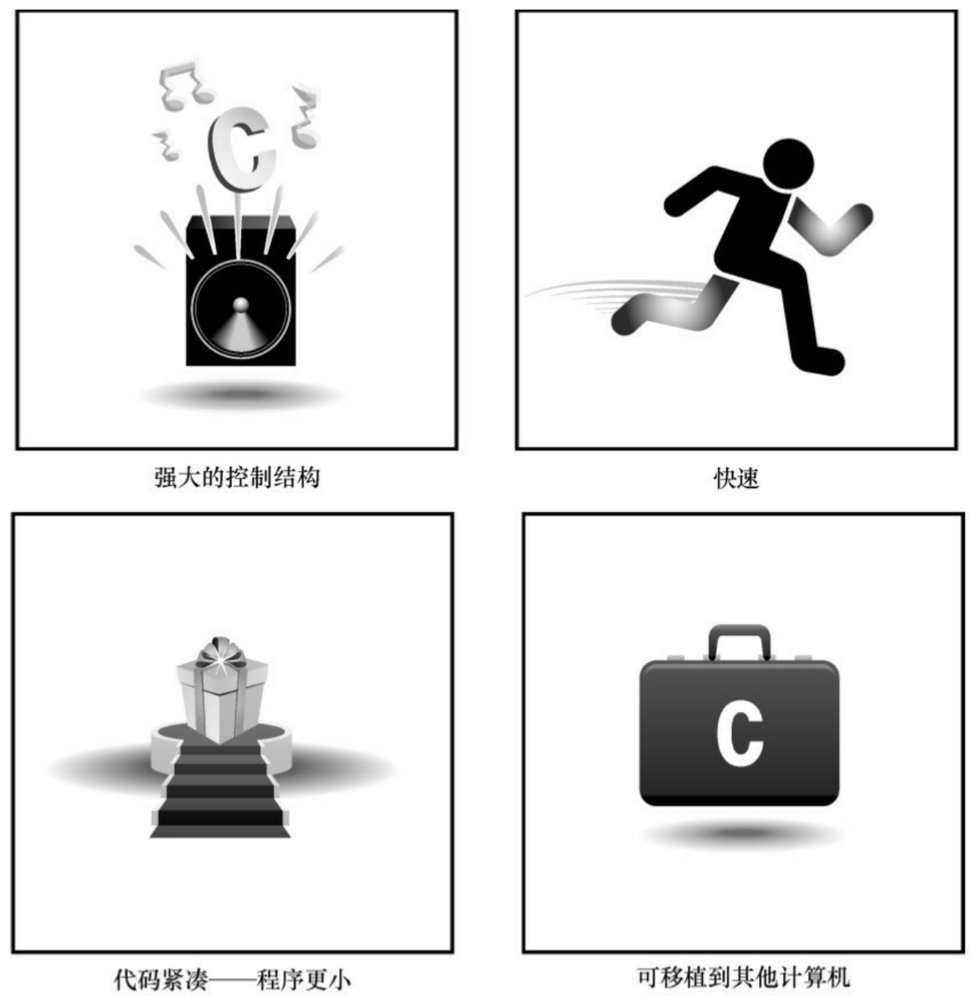

# C Primer Plus

# （第6版）中文版

## C Primer Plus Sixth Edition

经久不衰的C语言畅销经典教程
针对C11标准进行全面更新

natural_image

Illustration of two chess pieces on a checkered floor, one white and one black, with two small figures pushing a red puzzle piece (no text or symbols)

[美]|Stephen Prata|著

姜佑|译

## 目 录

<u>封面</u>

<u>扉页</u>

<u>版权</u>

<u>内容提要</u>

<u>作者简介</u>

<u>前言</u>

<u>第1章初识C语言</u>

<u>1.1 C语言的起源</u>

<u>1.2 选择C语言的理由</u>

<u>1.2.1 设计特性</u>

<u>1.2.2 高效性</u>

<u>1.2.3 可移植性</u>

<u>1.2.4 强大而灵活</u>

<u>1.2.5 面向程序员</u>

<u>1.2.6 缺点</u>

<u>1.3 C语言的应用范围</u>

<u>1.4 计算机能做什么</u>

<u>1.5 高级计算机语言和编译器</u>

<u>1.6 语言标准</u>

<u>1.6.1 第1个ANSI/ISO C标准</u>

<u>1.6.2 C99标准</u>

<u>1.6.3 C11标准</u>

<u>1.7 使用C语言的7个步骤</u>

<u>1.7.1 第1步:定义程序的目标</u>

<u>1.7.2 第2步:设计程序</u>

<u>1.7.3 第3步:编写代码</u>

<u>1.7.4 第4步:编译</u>

<u>1.7.5 第5步:运行程序</u>

<u>1.7.6 第6步:测试和调试程序</u>

<u>1.7.7 第7步:维护和修改代码</u>

<u>1.7.8 说明</u>

<u>1.8 编程机制</u>

<u>1.8.1 目标代码文件、可执行文件和库</u>

<u>1.8.2 UNIX系统</u>

<u>1.8.3 GNU编译器集合和LLVM项目</u>

<u>1.8.4 Linux系统</u>

<u>1.8.5 PC的命令行编译器</u>

<u>1.8.6 集成开发环境（Windows）</u>

<u>1.8.7 Windows/Linux</u>

<u>1.8.8 Macintosh中的C</u>

<u>1.9 本书的组织结构</u>

<u>1.10 本书的约定</u>

<u>1.10.1 字体</u>

<u>1.10.2 程序输出</u>

<u>1.10.3 特殊元素</u>

<u>1.11 本章小结</u>

<u>1.12 复习题</u>

<u>1.13 编程练习</u>

<u>第2章 C语言概述</u>

<u>2.1 简单的C程序示例</u>

<u>2.2 示例解释</u>

<u>2.2.1 第1遍:快速概要</u>

<u>2.2.2 第2遍:程序细节</u>

<u>2.3 简单程序的结构</u>

<u>2.4 提高程序可读性的技巧</u>

<u>2.5 进一步使用C</u>

<u>2.5.1 程序说明</u>

<u>2.5.2 多条声明</u>

<u>2.5.3 乘法</u>

<u>2.5.4 打印多个值</u>

<u>2.6 多个函数</u>

<u>2.7 调试程序</u>

<u>2.7.1 语法错误</u>

<u>2.7.2 语义错误</u>

<u>2.7.3 程序状态</u>
<u>2.8 关键字和保留标识符</u>
<u>2.9 关键概念</u>
<u>2.10 本章小结</u>
<u>2.11 复习题</u>
<u>2.12 编程练习</u>
<u>第3章数据和C</u>
<u>3.1 示例程序</u>
<u>3.2 变量与常量数据</u>
<u>3.3 数据:数据类型关键字</u>
<u>3.3.1 整数和浮点数</u>
<u>3.3.2 整数</u>
<u>3.3.3 浮点数</u>
<u>3.4 C语言基本数据类型</u>
<u>3.4.1 int类型</u>
<u>3.4.2 其他整数类型</u>
<u>3.4.3 使用字符:char类型</u>
<u>3.4.4 \_Bool类型</u>
<u>3.4.5 可移植类型:stdint.h和inttypes.h</u>
<u>3.4.6 float、double和long double</u>
<u>3.4.7 复数和虚数类型</u>
<u>3.4.8 其他类型</u>
<u>3.4.9 类型大小</u>
<u>3.5 使用数据类型</u>
<u>3.6 参数和陷阱</u>
<u>3.7 转义序列示例</u>
<u>3.7.1 程序运行情况</u>
<u>3.7.2 刷新输出</u>
<u>3.8 关键概念</u>
<u>3.9 本章小结</u>
<u>3.10 复习题</u>
<u>3.11 编程练习</u>
<u>第4章字符串和格式化输入/输出</u>

<u>4.1 前导程序</u>
<u>4.2 字符串简介</u>
<u>4.2.1 char类型数组和null字符</u>
<u>4.2.2 使用字符串</u>
<u>4.2.3 strlen()函数</u>
<u>4.3 常量和C预处理器</u>
<u>4.3.1 const限定符</u>
<u>4.3.2 明示常量</u>
<u>4.4 printf()和scanf()</u>
<u>4.4.1 printf()函数</u>
<u>4.4.2 使用printf()</u>
<u>4.4.3 printf()的转换说明修饰符</u>
<u>4.4.4 转换说明的意义</u>
<u>4.4.5 使用scanf()</u>
<u>4.4.6 printf()和scanf()的\*修饰符</u>
<u>4.4.7 printf()的用法提示</u>
<u>4.5 关键概念</u>
<u>4.6 本章小结</u>
<u>4.7 复习题</u>
<u>4.8 编程练习</u>
<u>第5章运算符、表达式和语句</u>
<u>5.1 循环简介</u>
<u>5.2 基本运算符</u>
<u>5.2.1 赋值运算符:=</u>
<u>5.2.2 加法运算符:+</u>
<u>5.2.3 减法运算符:-</u>
<u>5.2.4 符号运算符:-和+</u>
<u>5.2.5 乘法运算符:\*</u>
<u>5.2.6 除法运算符:/</u>
<u>5.2.7 运算符优先级</u>
<u>5.2.8 优先级和求值顺序</u>
<u>5.3 其他运算符</u>
<u>5.3.1 sizeof运算符和size\_t类型</u>

<u>5.3.2 求模运算符:%</u>
<u>5.3.3 递增运算符:++</u>
<u>5.3.4 递减运算符:--</u>
<u>5.3.5 优先级</u>
<u>5.3.6 不要自作聪明</u>
<u>5.4 表达式和语句</u>
<u>5.4.1 表达式</u>
<u>5.4.2 语句</u>
<u>5.4.3 复合语句（块）</u>
<u>5.5 类型转换</u>
<u>5.6 带参数的函数</u>
<u>5.7 示例程序</u>
<u>5.8 关键概念</u>
<u>5.9 本章小结</u>
<u>5.10 复习题</u>
<u>5.11 编程练习</u>
<u>第6章 C控制语句:循环</u>
<u>6.1 再探while循环</u>
<u>6.1.1 程序注释</u>
<u>6.1.2 C风格读取循环</u>
<u>6.2 while语句</u>
<u>6.2.1 终止while循环</u>
<u>6.2.2 何时终止循环</u>
<u>6.2.3 while:入口条件循环</u>
<u>6.2.4 语法要点</u>
<u>6.3 用关系运算符和表达式比较大小</u>
<u>6.3.1 什么是真</u>
<u>6.3.2 其他真值</u>
<u>6.3.3 真值的问题</u>
<u>6.3.4 新的\_Bool类型</u>
<u>6.3.5 优先级和关系运算符</u>
<u>6.4 不确定循环和计数循环</u>
<u>6.5 for循环</u>

<u>6.6 其他赋值运算符:+=、-=、\*=、/=、%=</u>

<u>6.7 逗号运算符</u>

<u>6.8 出口条件循环:do while</u>

<u>6.9 如何选择循环</u>

<u>6.10 嵌套循环</u>

<u>6.10.1 程序分析</u>

<u>6.10.2 嵌套变式</u>

<u>6.11 数组简介</u>

<u>6.12 使用函数返回值的循环示例</u>

<u>6.12.1 程序分析</u>

<u>6.12.2 使用带返回值的函数</u>

<u>6.13 关键概念</u>

<u>6.14 本章小结</u>

<u>6.15 复习题</u>

<u>6.16 编程练习</u>

<u>第7章 C控制语句:分支和跳转</u>

<u>7.1 if语句</u>

<u>7.2 if else语句</u>

<u>7.2.1 另一个示例:介绍getchar()和putchar()</u>

<u>7.2.2 ctype.h系列的字符函数</u>

<u>7.2.3 多重选择else if</u>

<u>7.2.4 else与if配对</u>

<u>7.2.5 多层嵌套的if语句</u>

<u>7.3 逻辑运算符</u>

<u>7.3.1 备选拼写:iso646.h头文件</u>

<u>7.3.2 优先级</u>

<u>7.3.3 求值顺序</u>

<u>7.3.4 范围</u>

<u>7.4 一个统计单词的程序</u>

<u>7.5 条件运算符:?:</u>

<u>7.6 循环辅助:continue和break</u>

<u>7.6.1 continue语句</u>

<u>7.6.2 break语句</u>

<u>7.7 多重选择:switch和break</u>
<u>7.7.1 switch语句</u>
<u>7.7.2 只读每行的首字符</u>
<u>7.7.3 多重标签</u>
<u>7.7.4 switch和if else</u>
<u>7.8 goto语句</u>
<u>7.9 关键概念</u>
<u>7.10 本章小结</u>
<u>7.11 复习题</u>
<u>7.12 编程练习</u>
<u>第8章字符输入/输出和输入验证</u>
<u>8.1 单字符I/O:getchar()和putchar()</u>
<u>8.2 缓冲区</u>
<u>8.3 结束键盘输入</u>
<u>8.3.1 文件、流和键盘输入</u>
<u>8.3.2 文件结尾</u>
<u>8.4 重定向和文件</u>
<u>8.5 创建更友好的用户界面</u>
<u>8.5.1 使用缓冲输入</u>
<u>8.5.2 混合数值和字符输入</u>
<u>8.6 输入验证</u>
<u>8.6.1 分析程序</u>
<u>8.6.2 输入流和数字</u>
<u>8.7 菜单浏览</u>
<u>8.7.1 任务</u>
<u>8.7.2 使执行更顺利</u>
<u>8.7.3 混合字符和数值输入</u>
<u>8.8 关键概念</u>
<u>8.9 本章小结</u>
<u>8.10 复习题</u>
<u>8.11 编程练习</u>
<u>第9章函数</u>
<u>9.1 复习函数</u>

<u>9.1.1 创建并使用简单函数</u>
<u>9.1.2 分析程序</u>
<u>9.1.3 函数参数</u>
<u>9.1.4 定义带形式参数的函数</u>
<u>9.1.5 声明带形式参数函数的原型</u>
<u>9.1.6 调用带实际参数的函数</u>
<u>9.1.7 黑盒视角</u>
<u>9.1.8 使用return从函数中返回值</u>
<u>9.1.9 函数类型</u>
<u>9.2 ANSI C函数原型</u>
<u>9.2.1 问题所在</u>
<u>9.2.2 ANSI的解决方案</u>
<u>9.2.3 无参数和未指定参数</u>
<u>9.2.4 函数原型的优点</u>
<u>9.3 递归</u>
<u>9.3.1 演示递归</u>
<u>9.3.2 递归的基本原理</u>
<u>9.3.3 尾递归</u>
<u>9.3.4 递归和倒序计算</u>
<u>9.3.5 递归的优缺点</u>
<u>9.4 编译多源代码文件的程序</u>
<u>9.4.1 UNIX</u>
<u>9.4.2 Linux</u>
<u>9.4.3 DOS命令行编译器</u>
<u>9.4.4 Windows和苹果的IDE编译器</u>
<u>9.4.5 使用头文件</u>
<u>9.5 查找地址:&运算符</u>
<u>9.6 更改主调函数中的变量</u>
<u>9.7 指针简介</u>
<u>9.7.1 间接运算符:\*</u>
<u>9.7.2 声明指针</u>
<u>9.7.3 使用指针在函数间通信</u>
<u>9.8 关键概念</u>

<u>9.9 本章小结</u>

<u>9.10 复习题</u>

<u>9.11 编程练习</u>

<u>第10章数组和指针</u>

<u>10.1 数组</u>

<u>10.1.1 初始化数组</u>

<u>10.1.2 指定初始化器（C99）</u>

<u>10.1.3 给数组元素赋值</u>

<u>10.1.4 数组边界</u>

<u>10.1.5 指定数组的大小</u>

<u>10.2 多维数组</u>

<u>10.2.1 初始化二维数组</u>

<u>10.2.2 其他多维数组</u>

<u>10.3 指针和数组</u>

<u>10.4 函数、数组和指针</u>

<u>10.4.1 使用指针形参</u>

<u>10.4.2 指针表示法和数组表示法</u>

<u>10.5 指针操作</u>

<u>10.6 保护数组中的数据</u>

<u>10.6.1 对形式参数使用const</u>

<u>10.6.2 const的其他内容</u>

<u>10.7 指针和多维数组</u>

<u>10.7.1 指向多维数组的指针</u>

<u>10.7.2 指针的兼容性</u>

<u>10.7.3 函数和多维数组</u>

<u>10.8 变长数组（VLA）</u>

<u>10.9 复合字面量</u>

<u>10.10 关键概念</u>

<u>10.11 本章小结</u>

<u>10.12 复习题</u>

<u>10.13 编程练习</u>

<u>第11章字符串和字符串函数</u>

<u>11.1 表示字符串和字符串I/O</u>

<u>11.1.1 在程序中定义字符串</u>
<u>11.1.2 指针和字符串</u>
<u>11.2 字符串输入</u>
<u>11.2.1 分配空间</u>
<u>11.2.2 不幸的gets()函数</u>
<u>11.2.3 gets()的替代品</u>
<u>11.2.4 scanf()函数</u>
<u>11.3 字符串输出</u>
<u>11.3.1 puts()函数</u>
<u>11.3.2 fputs()函数</u>
<u>11.3.3 printf()函数</u>
<u>11.4 自定义输入/输出函数</u>
<u>11.5 字符串函数</u>
<u>11.5.1 strlen()函数</u>
<u>11.5.2 strcat()函数</u>
<u>11.5.3 strncat()函数</u>
<u>11.5.4 strcmp()函数</u>
<u>11.5.5 strcpy()和strncpy()函数</u>
<u>11.5.6 sprintf()函数</u>
<u>11.5.7 其他字符串函数</u>
<u>11.6 字符串示例:字符串排序</u>
<u>11.6.1 排序指针而非字符串</u>
<u>11.6.2 选择排序算法</u>
<u>11.7 ctype.h字符函数和字符串</u>
<u>11.8 命令行参数</u>
<u>11.8.1 集成环境中的命令行参数</u>
<u>11.8.2 Macintosh中的命令行参数</u>
<u>11.9 把字符串转换为数字</u>
<u>11.10 关键概念</u>
<u>11.11 本章小结</u>
<u>11.12 复习题</u>
<u>11.13 编程练习</u>
<u>第12章存储类别、链接和内存管理</u>

<u>12.1 存储类别</u>
<u>12.1.1 作用域</u>
<u>12.1.2 链接</u>
<u>12.1.3 存储期</u>
<u>12.1.4 自动变量</u>
<u>12.1.5 寄存器变量</u>
<u>12.1.6 块作用域的静态变量</u>
<u>12.1.7 外部链接的静态变量</u>
<u>12.1.8 内部链接的静态变量</u>
<u>12.1.9 多文件</u>
<u>12.1.10 存储类别说明符</u>
<u>12.1.11 存储类别和函数</u>
<u>12.1.12 存储类别的选择</u>
<u>12.2 随机数函数和静态变量</u>
<u>12.3 掷骰子</u>
<u>12.4 分配内存:malloc()和free()</u>
<u>12.4.1 free()的重要性</u>
<u>12.4.2 calloc()函数</u>
<u>12.4.3 动态内存分配和变长数组</u>
<u>12.4.4 存储类别和动态内存分配</u>
<u>12.5 ANSI C类型限定符</u>
<u>12.5.1 const类型限定符</u>
<u>12.5.2 volatile类型限定符</u>
<u>12.5.3 restrict类型限定符</u>
<u>12.5.4 \_Atomic类型限定符（C11）</u>
<u>12.5.5 旧关键字的新位置</u>
<u>12.6 关键概念</u>
<u>12.7 本章小结</u>
<u>12.8 复习题</u>
<u>12.9 编程练习</u>
<u>第13章文件输入/输出</u>
<u>13.1 与文件进行通信</u>
<u>13.1.1 文件是什么</u>

<u>13.1.2 文本模式和二进制模式</u>
<u>13.1.3 I/O的级别</u>
<u>13.1.4 标准文件</u>
<u>13.2 标准I/O</u>
<u>13.2.1 检查命令行参数</u>
<u>13.2.2 fopen()函数</u>
<u>13.2.3 getc()和putc()函数</u>
<u>13.2.4 文件结尾</u>
<u>13.2.5 fclose()函数</u>
<u>13.2.6 指向标准文件的指针</u>
<u>13.3 一个简单的文件压缩程序</u>
<u>13.4 文件I/O:fprintf()、fscanf()、fgets()和fputs()</u>
<u>13.4.1 fprintf()和fscanf()函数</u>
<u>13.4.2 fgets()和fputs()函数</u>
<u>13.5 随机访问:fseek()和ftell()</u>
<u>13.5.1 fseek()和ftell()的工作原理</u>
<u>13.5.2 二进制模式和文本模式</u>
<u>13.5.3 可移植性</u>
<u>13.5.4 fgetpos()和fsetpos()函数</u>
<u>13.6 标准I/O的机理</u>
<u>13.7 其他标准I/O函数</u>
<u>13.7.1 int ungetc(int c, FILE \*fp)函数</u>
<u>13.7.2 int fflush()函数</u>
<u>13.7.3 int setvbuf()函数</u>
<u>13.7.4 二进制I/O:fread()和fwrite()</u>
<u>13.7.5 size\_t fwrite()函数</u>
<u>13.7.6 size\_t fread()函数</u>
<u>13.7.7 int feof(FILE \*fp)和int ferror(FILE \*fp)函数</u>
<u>13.7.8 一个程序示例</u>
<u>13.7.9 用二进制I/O进行随机访问</u>
<u>13.8 关键概念</u>
<u>13.9 本章小结</u>
<u>13.10 复习题</u>

<u>13.11 编程练习</u>
<u>第14章结构和其他数据形式</u>
<u>14.1 示例问题:创建图书目录</u>
<u>14.2 建立结构声明</u>
<u>14.3 定义结构变量</u>
<u>14.3.1 初始化结构</u>
<u>14.3.2 访问结构成员</u>
<u>14.3.3 结构的初始化器</u>
<u>14.4 结构数组</u>
<u>14.4.1 声明结构数组</u>
<u>14.4.2 标识结构数组的成员</u>
<u>14.4.3 程序讨论</u>
<u>14.5 嵌套结构</u>
<u>14.6 指向结构的指针</u>
<u>14.6.1 声明和初始化结构指针</u>
<u>14.6.2 用指针访问成员</u>
<u>14.7 向函数传递结构的信息</u>
<u>14.7.1 传递结构成员</u>
<u>14.7.2 传递结构的地址</u>
<u>14.7.3 传递结构</u>
<u>14.7.4 其他结构特性</u>
<u>14.7.5 结构和结构指针的选择</u>
<u>14.7.6 结构中的字符数组和字符指针</u>
<u>14.7.7 结构、指针和malloc()</u>
<u>14.7.8 复合字面量和结构（C99）</u>
<u>14.7.9 伸缩型数组成员（C99）</u>
<u>14.7.10 匿名结构（C11）</u>
<u>14.7.11 使用结构数组的函数</u>
<u>14.8 把结构内容保存到文件中</u>
<u>14.8.1 保存结构的程序示例</u>
<u>14.8.2 程序要点</u>
<u>14.9 链式结构</u>
<u>14.10 联合简介</u>

<u>14.10.1 使用联合</u>
<u>14.10.2 匿名联合（C11）</u>
<u>14.11 枚举类型</u>
<u>14.11.1 enum常量</u>
<u>14.11.2 默认值</u>
<u>14.11.3 赋值</u>
<u>14.11.4 enum的用法</u>
<u>14.11.5 共享名称空间</u>
<u>14.12 typedef简介</u>
<u>14.13 其他复杂的声明</u>
<u>14.14 函数和指针</u>
<u>14.15 关键概念</u>
<u>14.16 本章小结</u>
<u>14.17 复习题</u>
<u>14.18 编程练习</u>
<u>第15章位操作</u>
<u>15.1 二进制数、位和字节</u>
<u>15.1.1 二进制整数</u>
<u>15.1.2 有符号整数</u>
<u>15.1.3 二进制浮点数</u>
<u>15.2 其他进制数</u>
<u>15.2.1 八进制</u>
<u>15.2.2 十六进制</u>
<u>15.3 C按位运算符</u>
<u>15.3.1 按位逻辑运算符</u>
<u>15.3.2 用法:掩码</u>
<u>15.3.3 用法:打开位（设置位）</u>
<u>15.3.4 用法:关闭位（清空位）</u>
<u>15.3.5 用法:切换位</u>
<u>15.3.6 用法:检查位的值</u>
<u>15.3.7 移位运算符</u>
<u>15.3.8 编程示例</u>
<u>15.3.9 另一个例子</u>

<u>15.4 位字段</u>
<u>15.4.1 位字段示例</u>
<u>15.4.2 位字段和按位运算符</u>
<u>15.5 对齐特性（C11）</u>
<u>15.6 关键概念</u>
<u>15.7 本章小结</u>
<u>15.8 复习题</u>
<u>15.9 编程练习</u>
<u>第16章 C预处理器和C库</u>
<u>16.1 翻译程序的第一步</u>
<u>16.2 明示常量:#define</u>
<u>16.2.1 记号</u>
<u>16.2.2 重定义常量</u>
<u>16.3 在#define中使用参数</u>
<u>16.3.1 用宏参数创建字符串:#运算符</u>
<u>16.3.2 预处理器黏合剂:##运算符</u>
16.3.3 变参宏:...和\_ \_VA\_ARGS
<u>16.4 宏和函数的选择</u>
<u>16.5 文件包含:#include</u>
<u>16.5.1 头文件示例</u>
<u>16.5.2 使用头文件</u>
<u>16.6 其他指令</u>
<u>16.6.1 #undef指令</u>
<u>16.6.2 从C预处理器角度看已定义</u>
<u>16.6.3 条件编译</u>
<u>16.6.4 预定义宏</u>
<u>16.6.5 #line和#error</u>
<u>16.6.6 #pragma</u>
<u>16.6.7 泛型选择（C11）</u>
<u>16.7 内联函数（C99）</u>
<u>16.8 \_Noreturn函数（C11）</u>
<u>16.9 C库</u>
<u>16.9.1 访问C库</u>

<u>16.9.2 使用库描述</u>
<u>16.10 数学库</u>
<u>16.10.1 三角问题</u>
<u>16.10.2 类型变体</u>
<u>16.10.3 tgmath.h库（C99）</u>
<u>16.11 通用工具库</u>
<u>16.11.1 exit()和atexit()函数</u>
<u>16.11.2 qsort()函数</u>
<u>16.12 断言库</u>
<u>16.12.1 assert的用法</u>
<u>16.12.2 \_Static\_assert（C11）</u>
<u>16.13 string.h库中的memcpy()和memmove()</u>
<u>16.14 可变参数:stdarg.h</u>
<u>16.15 关键概念</u>
<u>16.16 本章小结</u>
<u>16.17 复习题</u>
<u>16.18 编程练习</u>
<u>第17章高级数据表示</u>
<u>17.1 研究数据表示</u>
<u>17.2 从数组到链表</u>
<u>17.2.1 使用链表</u>
<u>17.2.2 反思</u>
<u>17.3 抽象数据类型（ADT）</u>
<u>17.3.1 建立抽象</u>
<u>17.3.2 建立接口</u>
<u>17.3.3 使用接口</u>
<u>17.3.4 实现接口</u>
<u>17.4 队列ADT</u>
<u>17.4.1 定义队列抽象数据类型</u>
<u>17.4.2 定义一个接口</u>
<u>17.4.3 实现接口数据表示</u>
<u>17.4.4 测试队列</u>
<u>17.5 用队列进行模拟</u>

<u>17.6 链表和数组</u>
<u>17.7 二叉查找树</u>
<u>17.7.1 二叉树ADT</u>
<u>17.7.2 二叉查找树接口</u>
<u>17.7.3 二叉树的实现</u>
<u>17.7.4 使用二叉树</u>
<u>17.7.5 树的思想</u>
<u>17.8 其他说明</u>
<u>17.9 关键概念</u>
<u>17.10 本章小结</u>
<u>17.11 复习题</u>
<u>17.12 编程练习</u>
<u>附录A 复习题答案</u>
<u>附录B 参考资料</u>
<u>B.1 参考资料I:补充阅读</u>
<u>B.2 参考资料II:C运算符</u>

<u>B.3 参考资料III:基本类型和存储类别</u>
<u>B.4 参考资料IV:表达式、语句和程序流</u>
<u>B.5 参考资料V:新增C99和C11的ANSI C库</u>
<u>B.6 参考资料VI:扩展的整数类型</u>
<u>B.7 参考资料VII:扩展字符支持</u>
<u>B.8 参考资料VIII:C99/C11数值计算增强</u>
<u>B.9 参考资料IX:C和C++的区别</u>

## PEARSON

CPrimer Plus（第6版）中文版

[美]Stephen Prata 著

姜佑 译

人民邮电出版社

北京

图书在版编目（**CIP**）数据

C Primer Plus（第6版）中文版/（美）普拉达（Prata,S.）著；姜佑译.--北京:人民邮电出版社，2016.4

ISBN 978-7-115-39059-2

Ⅰ.①C… Ⅱ.①普…②姜… Ⅲ.①C语言—程序设计 Ⅳ.①TP312

中国版本图书馆CIP数据核字（2015）第084602号

版权声明

Authorized translation from the English language edition,entitled C Primer Plus(sixth edition),9780321928429 by Stephen Prata,published by Pearson Education,Inc.,publishing as Addison-Wesley,Copyright©2014 Pearson Education,Inc.

All rights reserved.No part of this book may be reproduced or transmitted in any form or by any means,electronic or mechanical,including photocopying,recording or by any information storage retrieval system,without permission from Pearson Education Inc.CHINESE SIMPLIFIED language edition published by PEARSON EDUCATION ASIA LTD.,and POSTS & TELECOMMUNICATIONS PRESS Copyright©2015.

本书封面贴有**Pearson Education**（培生教育出版集团）激光防伪标签。无标签者不得销售。

◆著 [美]Stephen Prata

译 姜佑

责任编辑 傅道坤

责任印制 张佳莹 焦志炜

◆人民邮电出版社出版发行 北京市丰台区成寿寺路11号

邮编 100164 电子邮件 315@ptpress.com.cn

网址 http://www.ptpress.com.cn

北京圣夫亚美印刷有限公司印刷

◆开本:787×1092 1/16

印张:47

字数:1412千字 2016年4月第1版

印数:1-8000册 2016年4月北京第1次印刷

著作权合同登记号 图字:01-2014-5617号

定价:89.00元

读者服务热线:**(010)81055410** 印装质量热线:**(010)81055316**

反盗版热线:**(010)81055315**

## 内容提要

本书详细讲解了C语言的基本概念和编程技巧。

全书共17章。第1章、第2章介绍了C语言编程的预备知识。第3章～第15章详细讲解了C语言的相关知识，包括数据类型、格式化输入/输出、运算符、表达式、语句、循环、字符输入和输出、函数、数组和指针、字符和字符串函数、内存管理、文件输入输出、结构、位操作等。第16章、第17章介绍C预处理器、C库和高级数据表示。本书以完整的程序为例，讲解C语言的知识要点和注意事项。每章末尾设计了大量复习题和编程练习，帮助读者巩固所学知识和提高实际编程能力。附录给出了各章复习题的参考答案和丰富的参考资料。

本书可作为C语言的教材，适用于需要系统学习C语言的初学者，也适用于巩固C语言知识或希望进一步提高编程技术的程序员。

## 作者简介

Stephen Prata曾在加利福尼亚的马林学院（肯特菲尔德）教授天文学、物理学和程序设计课程，现已退休。他在加州理工学院获得学士学位，在加州大学伯克利分校获得博士学位。他最早接触程序设计，是为了利用计算机给星团建模。Stephen撰写和与他人合著了十几本图书，其中包括C++Primer Plus和UNIX Primer Plus。

献辞

谨将本书献给我的父亲William Prata。

致谢

感谢Pearson的Mark Taber一直都非常关注本书。感谢Danny Kalev在技术上提供的帮助和建议。

## 前言

1984年C Primer Plus第1版刚问世时，使用C语言编程的人并不多。C语言从那时开始流行，许多人在本书的帮助下掌握了C语言。实际上，C Primer Plus各个版本累计销售量已超过55万册。

C语言从早期的非正式的K&R标准，发展到1990 ISO/ANSI标准，进而发展到2011 ISO/IEC标准。本书也随着逐渐成熟，发展到现在的第 6 版。在所有这些版本中，我的目标是致力于编写一本指导性强、条理清晰而且有用的C语言教程。

本书的用法和目标

我希望撰写一本友好、方便使用、便于自学的指南。为此，本书采用以下写作策略。

在介绍C语言细节的同时，讲解编程概念。本书假定读者为非专业的程序员。

每次尽量用短小简单的示例演示一两个概念，学以致用是最有效的学习方式之一。

当概念用文字较难解释时，则用图表演示以帮助读者理解。

C语言的主要特性总结在方框中，便于查找和复习。

每章末尾设有复习题和编程练习，帮助读者测试和加深对C语言的理解。

为了获得最佳的学习效果，学习本书时，读者应尽量扮演一个积极的角色。不仅要仔细阅读程序示例，还要亲自动手录入程序并运行。C 是一种可移植性很高的语言，但有时在你的系统中运行的结果和在我们的系统中运行的结果不同。经常改动程序的某些部分，运行后看看有什么效果。偶尔出现警告也不必理会，主要是看一下执行错误操作会出现什么状况。在学习的过程中应该多提出问题和多练习。用得越多，学的知识就越牢固。

希望本书能帮助读者轻松愉快地学习C语言。

## 第1章初识C语言

本章介绍以下内容:

C的历史和特性

编写程序的步骤

编译器和链接器的一些知识

C标准

欢迎来到C语言的世界。C是一门功能强大的专业化编程语言，深受业余编程爱好者和专业程序员的喜爱。本章为读者学习这一强大而流行的语言打好基础，并介绍几种开发C程序最可能使用的环境。

我们先来了解C语言的起源和一些特性，包括它的优缺点。然后，介绍编程的起源并探讨一些编程的基本原则。最后，讨论如何在一些常见系统中运行C程序。

## 1.1 C语言的起源

1972年，贝尔实验室的丹尼斯·里奇（Dennis Ritch）和肯·汤普逊（Ken Thompson）在开发UNIX操作系统时设计了C语言。然而，C语言不完全是里奇突发奇想而来，他是在B语言（汤普逊发明）的基础上进行设计。至于 B语言的起源，那是另一个故事。C 语言设计的初衷是将其作为程序员使用的一种编程工具，因此，其主要目标是成为有用的语言。

虽然绝大多数语言都以实用为目标，但是通常也会考虑其他方面。例如，Pascal 的主要目标是为更好地学习编程原理提供扎实的基础；而BASIC的主要目标是开发出类似英文的语言，让不熟悉计算机的学生轻松学习编程。这些目标固然很重要，但是随着计算机的迅猛发展，它们已经不是主流语言。然而，最初为程序员设计开发的C语言，现在已成为首选的编程语言之一。

## 1.2 选择C语言的理由

在过去40多年里，C语言已成为最重要、最流行的编程语言之一。它的成长归功于使用过的人都对它很满意。过去20多年里，虽然许多人都从C语言转而使用其他编程语言（如，C++、Objective C、Java等），但是C语言仍凭借自身实力在众多语言中脱颖而出。在学习C语言的过程中，会发现它的许多优点（见图1.1）。下面，我们来看看其中较为突出的几点。

## 1.2.1 设计特性

C是一门流行的语言，融合了计算机科学理论和实践的控制特性。C语言的设计理念让用户能轻松地完成自顶向下的规划、结构化编程和模块化设计。因此，用C语言编写的程序更易懂、更可靠。

## 1.2.2 高效性

C是高效的语言。在设计上，它充分利用了当前计算机的优势，因此 C程序相对更紧凑，而且运行速度很快。实际上，C 语言具有通常是汇编语言才具有的微调控制能力（汇编语言是为特殊的中央处理单元设计的一系列内部指令，使用助记符来表示；不同的 CPU 系列使用不同的汇编语言），可以根据具体情况微调程序以获得最大运行速度或最有效地使用内存。

图1.1 C语言的优点

## 1.2.3 可移植性

C是可移植的语言。这意味着，在一种系统中编写的 C程序稍作修改或不修改就能在其他系统运行。如需修改，也只需简单更改主程序头文件中的少许项即可。大部分语言都希望成为可移植语言，但是，如果经历过把IBM PC BASIC程序转换成苹果BASIC（两者是近亲），或者在UNIX系统中运行IBM大型机的FORTRAN程序的人都知道，移植是最麻烦的事。C语言是可移植方面的佼佼者。从8位微处理器到克雷超级计算机，许多计算机体系结构都可以使用C编译器（C编译器是把C代码转换成计算机内部指令的程序）。但是要注意，程序中针对特殊硬件设备（如，显示监视器）或操作系统特殊功能（如，Windows 8或OS X）编写的部分，通常是不可移植的。

由于C语言与UNIX关系密切，UNIX系统通常会将C编译器作为软件包的一部分。安装Linux时，通常也会安装C编译器。供个人计算机使用的C编译器很多，运行各种版本的Windows和Macintosh（即， Mac）的PC都能找到合适的C编译器。因此，无论是使用家庭计算机、专业工作站，还是大型机，都能找到针对特定系统的C编译器。

## 1.2.4 强大而灵活

C语言功能强大且灵活（计算机领域经常使用这两个词）。例如，功能强大且灵活的UNIX操作系统，大部分是用C语言写的；其他语言（如，FORTRAN、Perl、Python、Pascal、LISP、Logo、BASIC）的许多编译器和解释器都是用C语言编写的。因此，在UNIX机上使用FORTRAN时，最终是由C程序生成最后的可执行程序。C程序可以用于解决物理学和工程学的问题，甚至可用于制作电影的动画特效。

## 1.2.5 面向程序员

C 语言是为了满足程序员的需求而设计的，程序员利用 C 可以访问硬件、操控内存中的位。C 语言有丰富的运算符，能让程序员简洁地表达自己的意图。C没有Pascal严谨，但是却比C++的限制多。这样的灵活性既是优点也是缺点。优点是，许多任务用C来处理都非常简洁（如，转换数据的格式）；缺点是，你可能会犯一些莫名其妙的错误，这些错误不可能在其他语言中出现。C 语言在提供更多自由的同时，也让使用者承担了更大的责任。

另外，大多数C实现都有一个大型的库，包含众多有用的C函数。这些函数用于处理程序员经常需要解决的问题。

## 1.2.6 缺点

人无完人，金无足赤。C语言也有一些缺点。例如，前面提到的，要享受用C语言自由编程的乐趣，就必须承担更多的责任。特别是，C语言使用指针，而涉及指针的编程错误往往难以察觉。有句话说的好:想拥有自由就必须时刻保持警惕。

C 语言紧凑简洁，结合了大量的运算符。正因如此，我们也可以编写出让人极其费解的代码。虽然没必要强迫自己编写晦涩的代码，但是有兴趣写写也无妨。试问，除 C语言外还为哪种语言举办过年度混乱代码大赛[1]？

瑕不掩瑜，C语言的优点比缺点多很多。我们不想在这里多费笔墨，还是来聊聊C语言的其他话题。

## 1.3 C语言的应用范围

早在20世纪80年代，C语言就已经成为小型计算机（UNIX系统）使用的主流语言。从那以后，C语言的应用范围扩展到微型机（个人计算机）和大型机（庞然大物）。如图1.2所示，许多软件公司都用C语言来开发文字处理程序、电子表格、编译器和其他产品，因为用 C语言编写的程序紧凑而高效。更重要的是，C程序很方便修改，而且移植到新型号的计算机中也没什么问题。

无论是软件公司、经验丰富的C程序员，还是其他用户，都能从C语言中受益。越来越多的计算机用户已转而求助C语言解决一些安全问题。不一定非得是计算机专家也能使用C语言。

20世纪90年代，许多软件公司开始改用C++来开发大型的编程项目。C++在C语言的基础上嫁接了面向对象编程工具（面向对象编程是一门哲学，它通过对语言建模来适应问题，而不是对问题建模以适应语言）。C++几乎是C的超集，这意味着任何C程序差不多就是一个C++程序。学习C语言，也相当于学习了许多C++的知识。