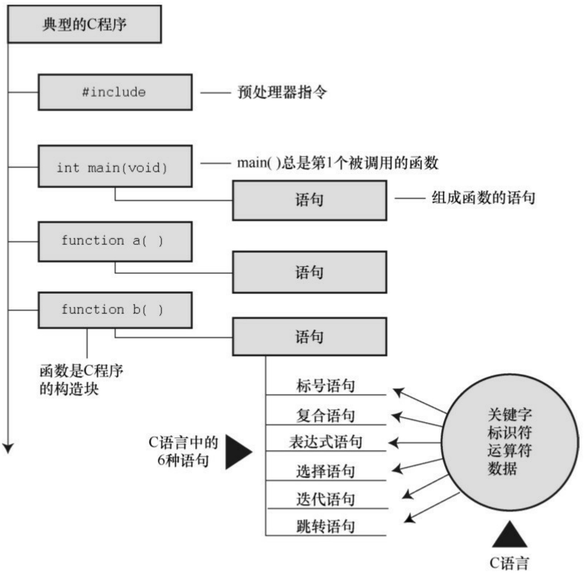
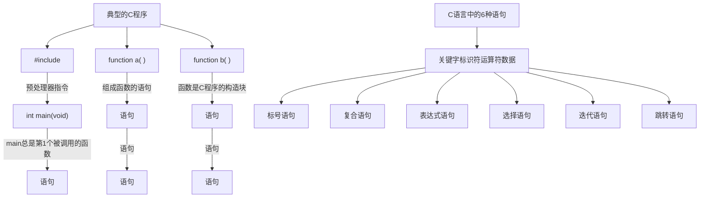
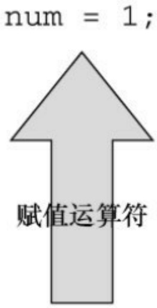
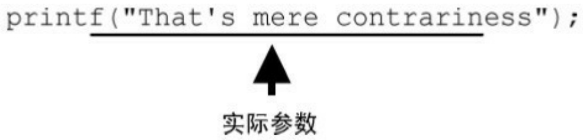
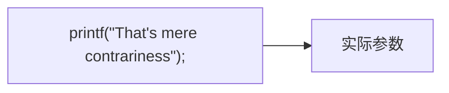
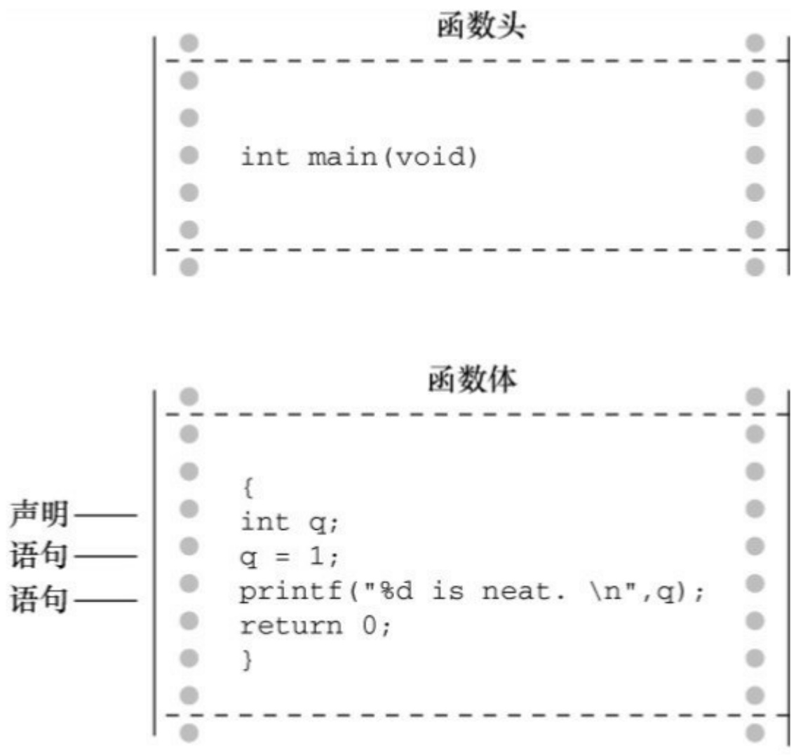

## 1.13 编程练习

我们尚未要求你编写C代码，该练习侧重于编程过程的早期步骤。

1.你刚被MacroMuscle有限公司聘用。该公司准备进入欧洲市场，需要一个把英寸单位转换为厘米单位（1 英寸=2.54 厘米）的程序。该程序要提示用户输入英寸值。你的任务是定义程序目标和设计程序（编程过程的第1步和第2步）。

[1].国际C语言混乱代码大赛（IOCCC，The International Obfuscated C Code Contest）。这是一项国际编程赛事，从1984年开始，每年举办一次（1997、1999、2002、2003和2006年除外），目的是写出最有创意且最让人难以理解的C语言代码。——译者注
[2].VAX（Virtual Address eXtension）是一种可支持机器语言和虚拟地址的32位小型计算机。VMS（Virtual Memory System）是旧名，现在叫OpenVMS，是一种用于服务器的操作系统，可在VAX、Alpha或Itanium处理器系列平台上运行。——译者注
[3].GCC最基本的用法是:gcc [options] [filenames]，其中options是所需的参数，filenames是文件名。——译者注

# 第2章 C语言概述

本章介绍以下内容:

运算符:=

函数:main()、printf()

编写一个简单的C程序

创建整型变量，为其赋值并在屏幕上显示其值

换行字符

如何在程序中写注释，创建包含多个函数的程序，发现程序的错误

什么是关键字

C程序是什么样子的？浏览本书，能看到许多示例。初见 C 程序会觉得有些古怪，程序中有许多｛、cp->tort和\*ptr++这样的符号。然而，在学习C的过程中，对这些符号和C语言特有的其他符号会越来越熟悉，甚至会喜欢上它们。如果熟悉与C相关的其他语言，会对C语言有似曾相识的感觉。本章，我们从演示一个简单的程序示例开始，解释该程序的功能。同时，强调一些C语言的基本特性。

## 2.1 简单的C程序示例

我们来看一个简单的C程序，如程序清单2.1所示。该程序演示了用C语言编程的一些基本特性。请先通读程序清单2.1，看看自己是否能明白该程序的用途，再认真阅读后面的解释。

程序清单2.1 first.c程序

```c
#include <stdio.h>

int main(void) /* 一个简单的C程序 */

{
int num; /* 定义一个名为num的变量 */
num = 1; /* 为num赋一个值 */

printf("I am a simple "); /* 使用printf()函数 */

printf("computer.\n");

printf("My favorite number is %d because it is first.\n",num);
return 0;
}
```

如果你认为该程序会在屏幕上打印一些内容，那就对了！光看程序也许并不知道打印的具体内容，所以，运行该程序，并查看结果。首先，用你熟悉的编辑器（或者编译器提供的编辑器）创建一个包含程序清单2.1 中所有内容的文件。给该文件命名，并以.c作为扩展名，以满足当前系统对文件名的要求。例如，可以使用first.c。现在，编译并运行该程序（查看第1章，复习该步骤的具体内容）。如果一切运行正常，该程序的输出应该是:

I am a simple computer.

My favorite number is 1 because it is first.

总而言之，结果在意料之中，但是程序中的\n 和%d 是什么？程序中有几行代码看起来有点奇怪。接下来，我们逐行解释这个程序。

程序调整

程序的输出是否在屏幕上一闪而过？某些窗口环境会在单独的窗口运行程序，然后在程序运行结束后自动关闭窗口。如果遇到这种情况，可以在程序中添加额外的代码，让窗口等待用户按下一个键后才关闭。一种方法是，在程序的return语句前添加一行代码:

getchar()；

这行代码会让程序等待击键，窗口会在用户按下一个键后才关闭。在第8 章中会详细介绍 getchar()的内容。

## 2.2 示例解释

我们会把程序清单2.1的程序分析两遍。第1遍（快速概要）概述程序中每行代码的作用，帮助读者初步了解程序。第2遍（程序细节）详细分析代码的具体含义，帮助读者深入理解程序。

图2.1总结了组成C程序的几个部分[1]，图中包含的元素比第1个程序多。



<details>
<summary>flowchart</summary>


</details>

图2.1 C程序解剖

## 2.2.1 第1遍:快速概要

本节简述程序中的每行代码的作用。下一节详细讨论代码的含义。

#include&lt;stdio.h&gt; ←包含另一个文件

该行告诉编译器把stdio.h中的内容包含在当前程序中。stdio.h是C编译器软件包的标准部分，它提供键盘输入和屏幕输出的支持。

int main(void) ←函数名

C程序包含一个或多个函数，它们是C程序的基本模块。程序清单2.1的程序中有一个名为main()的函数。圆括号表明main()是一个函数名。int表明main()函数返回一个整数，void表明main()不带任何参数。这些内容我们稍后详述。现在，只需记住int和void是标准ANSI C定义main()的一部分（如果使用ANSI C之前的编译器，请省略void；考虑到兼容的问题，请尽量使用较新的C编译器）。

/\* 一个简单的C程序 \*/ ←注释

注释在/\*和\*/两个符号之间，这些注释能提高程序的可读性。注意，注释只是为了帮助读者理解程序，编译器会忽略它们。

{ ←函数体开始

左花括号表示函数定义开始，右花括号（}）表示函数定义结束。

int num; ←声明

该声明表明，将使用一个名为num的变量，而且num是int（整数）类型。

语句num = 1;把值1赋给名为num的变量。

printf("I am a simple "); ←调用一个函数

该语句使用 printf()函数，在屏幕上显示 I am a simple，光标停在同一行。printf()是标准的C库函数。在程序中使用函数叫作调用函数。

printf("computer.\n"); ←调用另一个函数

接下来调用的这个printf()函数在上条语句打印出来的内容后面加上“computer”。代码\n告诉计算机另起一行，即把光标移至下一行。

printf("My favorite number is %d because it is first.\n", num);

最后调用的printf()把num的值（1）内嵌在用双引号括起来的内容中一并打印。%d告诉计算机以何种形式输出num的值，打印在何处。

C函数可以给调用方提供（或返回）一个数。目前，可暂时把该行看作是结束main()函数的要求。

} ←结束

必须以右花括号表示程序结束。

## 2.2.2 第2遍:程序细节

浏览完程序清单2.1后，我们来仔细分析这个程序。再次强调，本节将逐行分析程序中的代码，以每行代码为出发点，深入分析代码背后的细节，为更全面地学习C语言编程的特性夯实基础。

## 1.#include指令和头文件

#include&lt;stdio.h&gt;

这是程序的第1行。#include &lt;stdio.h&gt;的作用相当于把stdio.h文件中的所有内容都输入该行所在的位置。实际上，这是一种“拷贝-粘贴”的操作。

include 文件提供了一种方便的途径共享许多程序共有的信息。

#include这行代码是一条C预处理器指令（preprocessor directive）。通常，C编译器在编译前会对源代码做一些准备工作，即预处理（preprocessing）。

所有的C编译器软件包都提供stdio.h文件。该文件中包含了供编译器使用的输入和输出函数（如， printf()）信息。该文件名的含义是标准输入/输出头文件。通常，在C程序顶部的信息集合被称为头文件（header）。

在大多数情况下，头文件包含了编译器创建最终可执行程序要用到的信息。例如，头文件中可以定义一些常量，或者指明函数名以及如何使用它们。但是，函数的实际代码在一个预编译代码的库文件中。简而言之，头文件帮助编译器把你的程序正确地组合在一起。

ANSI/ISO C规定了C编译器必须提供哪些头文件。有些程序要包含stdio.h，而有些不用。特定C实现的文档中应该包含对C库函数的说明。这些说明确定了使用哪些函数需要包含哪些头文件。例如，要使用printf()函数，必须包含stdio.h头文件。省略必要的头文件可能不会影响某一特定程序，但是最好不要这样做。本书每次用到库函数，都会用#include指令包含ANSI/ISO标准指定的头文件。

注意为何不内置输入和输出

读者一定很好奇，为何不把输入和输出这些基本功能内置在语言中。原因之一是，并非所有的程序都会用到I/O（输入/输出）包。轻装上阵表现了C语言的哲学。正是这种经济使用资源的原则，使得C语言成为流行的嵌入式编程语言（例如，编写控制汽车自动燃油系统或蓝光播放机芯片的代码）。#include中的#符号表明，C预处理器在编译器接手之前处理这条指令。本书后面章节中会介绍更多预处理器指令的示例，第16章将更详细地讨论相关内容。

**2.main()**函数

int main(void);

程序清单2.1中的第2行表明该函数名为main。的确，main是一个极其普通的名称，但是这是唯一的选择。C程序一定从main()函数开始执行（目前不必考虑例外的情况）。除了main()函数，你可以任意命名其他函数，而且main()函数必须是开始的函数。圆括号有什么功能？用于识别main()是一个函数。很快你将学到更多的函数。就目前而言，只需记住函数是C程序的基本模块。

int是main()函数的返回类型。这表明main()函数返回的值是整数。返回到哪里？返回给操作系统。我们将在第6章中再来探讨这个问题。

通常，函数名后面的圆括号中包含一些传入函数的信息。该例中没有传递任何信息。因此，圆括号内是单词void（第11章将介绍把信息从main()函数传回操作系统的另一种形式）。

如果浏览旧式的C代码，会发现程序以如下形式开始:

main()

C90标准勉强接受这种形式，但是C99和C11标准不允许这样写。因此，即使你使用的编译器允许，也不要这样写。

你还会看到下面这种形式:

void main()

一些编译器允许这样写，但是所有的标准都未认可这种写法。因此，编译器不必接受这种形式，而且许多编译器都不能这样写。需要强调的是，只要坚持使用标准形式，把程序从一个编译器移至另一个编译器时就不会出什么问题。

## 3.注释

/\*一个简单的程序\*/

在程序中，被/\* \*/两个符号括起来的部分是程序的注释。写注释能让他人（包括自己）更容易明白你所写的程序。C 语言注释的好处之一是，可将注释放在任意的地方，甚至是与要解释的内容在同一行。较长的注释可单独放一行或多行。在/\*和\*/之间的内容都会被编译器忽略。下面列出了一些有效和无效的注释形式:

/\* 这是一条C注释。 \*/

/\* 这也是一条注释，

被分成两行。\*/

/\*

也可以这样写注释。

\*/

/\* 这条注释无效，因为缺少了结束标记。

C99新增了另一种风格的注释，普遍用于C++和Java。这种新风格使用//符号创建注释，仅限于单行。

// 这种注释只能写成一行。

int rigue; // 这种注释也可置于此。

因为一行末尾就标志着注释的结束，所以这种风格的注释只需在注释开始处标明//符号即可。

这种新形式的注释是为了解决旧形式注释存在的潜在问题。假设有下面的代码:

/\*

希望能运行。

```javascript
*/
x = 100;
y = 200;
```

/\* 其他内容已省略。 \*/

接下来，假设你决定删除第4行，但不小心删掉了第3行（\*/）。代码如下所示:

```txt
/*
```

希望能运行。

```txt
y = 200;
```

/\*其他内容已省略。 \*/

现在，编译器把第1行的/\*和第4行的\*/配对，导致4行代码全都成了注释（包括应作为代码的那一行）。而//形式的注释只对单行有效，不会导致这种“消失代码”的问题。

一些编译器可能不支持这一特性。还有一些编译器需要更改设置，才能支持C99或C11的特性。

考虑到只用一种注释风格过于死板乏味，本书在示例中采用两种风格的注释。

**4.**花括号、函数体和块

```txt
{
...
}
```

程序清单2.1中，花括号把main()函数括起来。一般而言，所有的C函数都使用花括号标记函数体的开始和结束。这是规定，不能省略。只有花括号（{}）能起这种作用，圆括号（()）和方括号（[]）都不行。

花括号还可用于把函数中的多条语句合并为一个单元或块。如果读者熟悉Pascal、ADA、Modula-2或者Algol，就会明白花括号在C语言中的作用类似于这些语言中的begin和end。

## 5.声明

int num;

程序清单2.1中，这行代码叫作声明（declaration）。声明是C语言最重要的特性之一。在该例中，声明完成了两件事。其一，在函数中有一个名为num的变量（variable）。其二，int表明num是一个整数（即，没有小数点或小数部分的数）。int是一种数据类型。编译器使用这些信息为num变量在内存中分配存储空间。分号在C语言中是大部分语句和声明的一部分，不像在Pascal中只是语句间的分隔符。

int是C语言的一个关键字（keyword），表示一种基本的C语言数据类型。关键字是语言定义的单词，不能做其他用途。例如，不能用int作为函数名和变量名。但是，这些关键字在该语言以外不起作用，所以把一只猫或一个可爱的小孩叫int是可以的（尽管某些地方的当地习俗或法律可能不允许）。

示例中的num是一个标识符（identifier），也就一个变量、函数或其他实体的名称。因此，声明把特定标识符与计算机内存中的特定位置联系起来，同时也确定了储存在某位置的信息类型或数据类型。

在C语言中，所有变量都必须先声明才能使用。这意味着必须列出程序中用到的所有变量名及其类型。

以前的C语言，还要求把变量声明在块的顶部，其他语句不能在任何声

明的前面。也就是说，main()函数体如下所示:

int main() //旧规则

```proto
{
int doors;
int dogs;
doors = 5;
dogs = 3;
```

// 其他语句

}

C99和C11遵循C++的惯例，可以把声明放在块中的任何位置。尽管如此，首次使用变量之前一定要先声明它。因此，如果编译器支持这一新特性，可以这样编写上面的代码:

int main() // 目前的C规则

{

// 一些语句

int doors;

doors = 5; // 第1次使用doors

// 其他语句

int dogs;

dogs = 3; // 第1次使用dogs

// 其他语句

}

为了与旧系统更好地兼容，本书沿用最初的规则（即，把变量声明都写在块的顶部）。

现在，读者可能有3个问题:什么是数据类型？如何命名？为何要声明变量？请往下看。

数据类型

C 语言可以处理多种类型的数据，如整数、字符和浮点数。把变量声明为整型或字符类型，计算机才能正确地储存、读取和解释数据。下一章将详细介绍C语言中的各种数据类型。

命名

给变量命名时要使用有意义的变量名或标识符（如，程序中需要一个变量数羊，该变量名应该是sheep\_count而不是x3）。如果变量名无法清楚地表达自身的用途，可在注释中进一步说明。这是一种良好的编程习惯和编程技巧。

C99和C11允许使用更长的标识符名，但是编译器只识别前63个字符。对于外部标识符（参阅第12章），只允许使用31个字符。〔以前C90只允许6个字符，这是一个很大的进步。旧式编译器通常最多只允许使用8个字符。〕实际上，你可以使用更长的字符，但是编译器会忽略超出的字符。也就是说，如果有两个标识符名都有63个字符，只有一个字符不同，那么编译器会识别这是两个不同的名称。如果两个标识符都是64个字符，只有最后一个字符不同，那么编译器可能将其视为同一个名称，也可能不会。标准并未定义在这种情况下会发生什么。

可以用小写字母、大写字母、数字和下划线（\_）来命名。而且，名称的第1个字符必须是字符或下划线，不能是数字。表2.1给出了一些示例。

表2.1 有效和无效的名称

| 有效的名称 | 无效的名称 |
| --- | --- |
| wiggles | $Z]** |
| cat2 | 2cat |
| Hot_Tub | Hot-Tub |
| taxRate | tax rate |
| _kcab | don't |

操作系统和C库经常使用以一个或两个下划线字符开始的标识符（如，\_kcab），因此最好避免在自己的程序中使用这种名称。标准标签都以一个或两个下划线字符开始，如库标识符。这样的标识符都是保留的。这意味着，虽然使用它们没有语法错误，但是会导致名称冲突。

C语言的名称区分大小写，即把一个字母的大写和小写视为两个不同的字符。因此，stars和Stars、STARS都不同。

为了让C语言更加国际化，C99和C11根据通用字符名（即UCN）机制添加了扩展字符集。其中包含了除英文字母以外的部分字符。欲了解详细内容，请参阅附录B的“参考资料VII:扩展字符支持”。

声明变量的4个理由

一些更老的语言（如，FORTRAN 和 BASIC 的最初形式）都允许直接使用变量，不必先声明。为何 C语言不采用这种简单易行的方法？原因如下。

把所有的变量放在一处，方便读者查找和理解程序的用途。如果变量名都是有意义的（如，taxtate而不是 r），这样做效果很好。如果变量名无法表述清楚，在注释中解释变量的含义。这种方法让程序的可读性更高。

声明变量会促使你在编写程序之前做一些计划。程序在开始时要获得哪些信息？希望程序如何输出？表示数据最好的方式是什么？

声明变量有助于发现隐藏在程序中的小错误，如变量名拼写错误。例

如，假设在某些不需要声明就可以直接使用变量的语言中，编写如下语句:

$$
\text {RADIUS1} = 2 0. 4;
$$

在后面的程序中，误写成:

$$
\mathrm{CIRCUM} = 6. 2 8 * \text {RADIUS1};
$$

你不小心把数字1打成小写字母l。这些语言会创建一个新的变量RADIUSl，并使用该变量中的值（也许是0，也许是垃圾值），导致赋给CIRCUM的值是错误值。你可能要花很久时间才能查出原因。这样的错误在C语言中不会发生（除非你很不明智地声明了两个极其相似的变量），因为编译器在发现未声明的RADIUSl时会报错。

如果事先未声明变量，C程序将无法通过编译。如果前几个理由还不足以说服你，这个理由总可以让你认真考虑一下了。

如果要声明变量，应该声明在何处？前面提到过，C99之前的标准要求把声明都置于块的顶部，这样规定的好处是:把声明放在一起更容易理解程序的用途。C99 允许在需要时才声明变量，这样做的好处是:在给变量赋值之前声明变量，就不会忘记给变量赋值。但是实际上，许多编译器都还不支持C99。

**6.**赋值

$$
\mathrm{num} = 1;
$$

程序清单中的这行代码是赋值表达式语句[2]。赋值是C语言的基本操作之一。该行代码的意思是“把值1赋给变量num”。在执行int num;声明时，编译器在计算机内存中为变量num预留了空间，然后在执行这行赋值表达式语句时，把值储存在之前预留的位置。可以给num赋不同的值，这就是num之所以被称为变量（variable）的原因。注意，该赋值表达式语句从右侧把值赋到左侧。另外，该语句以分号结尾，如图2.2所示。



<details>
<summary>text_image</summary>

num = 1;
赋值运算符
</details>

图2.2 赋值是C语言中的基本操作之一

## 7.printf()函数

printf("I am a simple ");

printf("computer.\n");

printf("My favorite number is %d because it is first.\n", num);

这3行都使用了C语言的一个标准函数:printf()。圆括号表明printf是一个函数名。圆括号中的内容是从main()函数传递给printf()函数的信息。例如，上面的第1行把I am a simple传递给printf()函数。该信息被称为参数，或者更确切地说，是函数的实际参数（actual argument），如图2.3所示。〔在C语言中，实际参数（简称实参）是传递给函数的特定值，形式参数（简称形参）是函数中用于储存值的变量。第5章中将详述相关内容。〕printf()函数用参数来做什么？该函数会查看双引号中的内容，并将其打印在屏幕上。



<details>
<summary>flowchart</summary>


</details>

图2.3 带实参的printf()函数

第1行printf()演示了在C语言中如何调用函数。只需输入函数名，把所需的参数填入圆括号即可。当程序运行到这一行时，控制权被转给已命名的函数（该例中是printf()）。函数执行结束后，控制权被返回至主调函数（calling function），该例中是main()。

第2行printf()函数的双引号中的\n字符并未输出。这是为什么？\n的意思是换行。\n组合（依次输入这两个字符）代表一个换行符（newline character）。对于printf()而言，它的意思是“在下一行的最左边开始新的一行”。也就是说，打印换行符的效果与在键盘按下Enter键相同。既然如此，为何不在键入printf()参数时直接使用Enter键？因为编辑器可能认为这是直接的命令，而不是储存在在源代码中的指令。换句话说，如果直接按下Enter键，编辑器会退出当前行并开始新的一行。但是，换行符仅会影响程序输出的显示格式。

换行符是一个转义序列（escape sequence）。转义序列用于代表难以表示或无法输入的字符。如，\t代表Tab键，\b代表Backspace键（退格键）。每个转义序列都以反斜杠字符（\）开始。我们在第3章中再来探讨相关内容。

这样，就解释了为什么3行printf()语句只打印出两行:第1个printf()打印的内容中不含换行符，但是第2和第3个printf()中都有换行符。

第3个printf()还有一些不明之处:参数中的%d在打印时有什么作用？先来看该函数的输出:

My favorite number is 1 because it is first.

对比发现，参数中的%d被数字1代替了，而1就是变量num的值。%d相当于是一个占位符，其作用是指明输出num值的位置。该行和下面的BASIC语句很像:

PRINT "My favorite number is "; num; " because it is first."

实际上，C语言的printf()比BASIC的这条语句做的事情多一些。%提醒程序，要在该处打印一个变量，d表明把变量作为十进制整数打印。printf()

函数名中的f提醒用户，这是一种格式化打印函数。printf()函数有多种打印变量的格式，包括小数和十六进制整数。后面章节在介绍数据类型时，会详细介绍相关内容。

## 8.return语句

return 0;

return语句[3]是程序清单2.1的最后一条语句。int main(void)中的int表明main()函数应返回一个整数。C标准要求main()这样做。有返回值的C函数要有return语句。该语句以return关键字开始，后面是待返回的值，并以分号结尾。如果遗漏 main()函数中的 return 语句，程序在运行至最外面的右花括号（}）时会返回0。因此，可以省略main()函数末尾的return语句。但是，不要在其他有返回值的函数中漏掉它。因此，强烈建议读者养成在 main()函数中保留 return 语句的好习惯。在这种情况下，可将其看作是统一代码风格。但对于某些操作系统（包括Linux和UNIX），return语句有实际的用途。第11章再详述这个主题。

## 2.3 简单程序的结构

在看过一个具体的程序示例后，我们来了解一下C程序的基本结构。程序由一个或多个函数组成，必须有 main()函数。函数由函数头和函数体组成。函数头包括函数名、传入该函数的信息类型和函数的返回类型。通过函数名后的圆括号可识别出函数，圆括号里可能为空，可能有参数。函数体被花括号括起来，由一系列语句、声明组成，如图2.4所示。本章的程序示例中有一条声明，声明了程序使用的变量名和类型。然后是一条赋值表达式语句，变量被赋给一个值。接下来是3条printf()语句[4]，调用printf()函数3次。最后，main()以return语句结束。



图2.4 函数包含函数头和函数体

简而言之，一个简单的C程序的格式如下:

```c
#include <stdio.h>

int main(void)
{
语句
return 0;
}
```

（大部分语句都以分号结尾。）

## 2.4 提高程序可读性的技巧

编写可读性高的程序是良好的编程习惯。可读性高的程序更容易理解，以后也更容易修改和更正。提高程序的可读性还有助于你理清编程思路。

前面介绍过两种提高程序可读性的技巧:选择有意义的函数名和写注释。注意，使用这两种技巧时应相得益彰，避免重复啰嗦。如果变量名是width，就不必写注释说明该变量表示宽度，但是如果变量名是video\_routine\_4，就要解释一下该变量名的含义。

提高程序可读性的第3个技巧是:在函数中用空行分隔概念上的多个部分。例如，程序清单2.1中用空行把声明部分和程序的其他部分区分开来。C语言并未规定一定要使用空行，但是多使用空行能提高程序的可读性。

提高程序可读性的第4个技巧是:每条语句各占一行。同样，这也不是C语言的要求。C语言的格式比较自由，可以把多条语句放在一行，也可以每条语句独占一行。下面的语句都没问题，但是不好看:

```c
int main( void ) { int four; four
=
4
;
printf(
"%d\n",
four); return 0;}
```

分号告诉编译器一条语句在哪里结束、下一条语句在哪里开始。如果按照本章示例的约定来编写代码（见图2.5），程序的逻辑会更清晰。

```c
int main(void) /* 把2音寻（测水深的单位）转换成英尺*/——写注释
{
int feet, fathoms; ______ 使用有意义的变量名
___________ 使用空行
fathoms=2;
feet=6*fathoms; ______ 每行一条语句
printf("There are %d feet in %d fathoms!\n", feet, fathoms);
return 0;
}
```

图2.5 提高程序的可读性

## 2.5 进一步使用C

本章的第1个程序相当简单，下面的程序清单2.2也不太难。

程序清单2.2 fathm\_ft.c程序

```c
// fathm_ft.c -- 把2音寻转换成英寸
#include <stdio.h>
int main(void)
{
int feet, fathoms;
fathoms = 2;
feet = 6 * fathoms;
printf("There are %d feet in %d fathoms!\n", feet, fathoms);
printf("Yes, I said %d feet!\n", 6 * fathoms);
return 0;
}
```

与程序清单2.1相比，以上代码有什么新内容？这段代码提供了程序描述，声明了多个变量，进行了乘法运算，并打印了两个变量的值。下面我们更详细地分析这些内容。

## 2.5.1 程序说明

程序在开始处有一条注释（使用新的注释风格），给出了文件名和程序的目的。写这种程序说明很简单、不费时，而且在以后浏览或打印程序时很

有帮助。

## 2.5.2 多条声明

接下来，程序在一条声明中声明了两个变量，而不是一个变量。为此，要在声明中用逗号隔开两个变量（feet和fathoms）。也就是说，

int feet, fathoms;

和

int feet;

int fathoms;

等价。

## 2.5.3 乘法

然后，程序进行了乘法运算。利用计算机强大的计算能力来计算 6 乘以2。C 语言和许多其他语言一样，用\*表示乘法。因此，语句

feet = 6 \* fathoms;

的意思是“查找变量fathoms的值，用6乘以该值，并把计算结果赋给变量feet”。

## 2.5.4 打印多个值

最后，程序以新的方式使用printf()函数。如果编译并运行该程序，输出应该是这样:

There are 12 feet in 2 fathoms!

Yes, I said 12 feet!

程序的第1个printf()中进行了两次替换。双引号号后面的第1个变量（feet）替换了双引号中的第1个%d；双引号号后面的第2个变量（fathoms）替换了双引号中的第2个%d。注意，待输出的变量列于双引号的后面。还要注意，变量之间要用逗号隔开。

第2个printf()函数说明待打印的值不一定是变量，只要可求值得出合适类型值的项即可，如6 \*fathoms。

该程序涉及的范围有限，但它是把音寻[5]转换成英寸程序的核心部分。我们还需要把其他值通过交互的方式赋给feet，其方法将在后面章节中介绍。

## 2.6 多个函数

到目前为止，介绍的几个程序都只使用了printf()函数。程序清单2.3演示了除main()以外，如何把自己的函数加入程序中。

程序清单2.3 two\_func.c程序

```c
//* two_func.c -- 一个文件中包含两个函数 */
#include <stdio.h>

void butler(void); /* ANSI/ISO C函数原型 */

int main(void)
{
printf("I will summon the butler function.\n");
butler();
printf("Yes. Bring me some tea and writeable DVDs.\n");
return 0;
}
void butler(void) /* 函数定义开始 */
{
printf("You rang, sir?\n");
}
该程序的输出如下:
```

I will summon the butler function.

You rang, sir?

Yes.Bring me some tea and writeable DVDs.

butler()函数在程序中出现了3次。第1次是函数原型（prototype），告知编译器在程序中要使用该函数；第 2 次以函数调用（function call）的形式出现在 main()中；最后一次出现在函数定义（function definition）中，函数定义即是函数本身的源代码。下面逐一分析。

C90 标准新增了函数原型，旧式的编译器可能无法识别（稍后我们将介绍，如果使用这种编译器应该怎么做）。函数原型是一种声明形式，告知编译器正在使用某函数，因此函数原型也被称为函数声明（function declaration）。函数原型还指明了函数的属性。例如，butler()函数原型中的第1个void表明，butler()函数没有返回值（通常，被调函数会向主调函数返回一个值，但是 bulter()函数没有）。第 2 个 void （butler(void)中的 void）的意思是 butler()函数不带参数。因此，当编译器运行至此，会检查butler()是否使用得当。注意，void在这里的意思是“空的”，而不是“无效”。

早期的C语言支持一种更简单的函数声明，只需指定返回类型，不用描述参数:

void butler();

早期的C代码中的函数声明就类似上面这样，不是现在的函数原型。C90、C99 和C11 标准都承认旧版本的形式，但是也表明了会逐渐淘汰这种过时的写法。如果要使用以前写的 C代码，就需要把旧式声明转换成函数原型。本书在后面的章节会继续介绍函数原型的相关内容。

接下来我们继续分析程序。在 main()中调用 butler()很简单，写出函数名和圆括号即可。当butler()执行完毕后，程序会继续执行main()中的下一条语句。

程序的最后部分是 butler()函数的定义，其形式和 main()相同，都包含函数头和用花括号括起来的函数体。函数头重述了函数原型的信息:bulter()不带任何参数，且没有返回值。如果使用老式编译器，请去掉圆括号中的void。

这里要注意，何时执行 butler()函数取决于它在 main()中被调用的位置，而不是 butler()的定义在文件中的位置。例如，把 butler()函数的定义放在 main()定义之前，不会改变程序的执行顺序， butler()函数仍然在两次printf()调用之间被调用。记住，无论main()在程序文件处于什么位置，所有的C程序都从main()开始执行。但是，C的惯例是把main()放在开头，因为它提供了程序的基本框架。

C标准建议，要为程序中用到的所有函数提供函数原型。标准include文件（包含文件）为标准库函数提供可函数原型。例如，在C标准中，stdio.h文件包含了printf()的函数原型。第6章最后一个示例演示了如何使用带返回值的函数，第9章将详细全面地介绍函数。

## 2.7 调试程序

现在，你可以编写一个简单的 C 程序，但是可能会犯一些简单的错误。程序的错误通常叫做 bug，找出并修正错误的过程叫做调试（debug）。程序清单2.4是一个有错误的程序，看看你能找出几处。

程序清单2.4 nogood.c程序

```c
/* nogood.c -- 有错误的程序 */

#include <stdio.h>

int main(void)

(
int n, int n2, int n3;

/* 该程序有多处错误

n = 5;

n2 = n * n;

n3 = n2 * n2;

printf("n = %d, n squared = %d, n cubed = %d\n", n, n2, n3)

return 0;

)
```

## 2.7.1 语法错误

程序清单 2.4 中有多处语法错误。如果不遵循 C 语言的规则就会犯语法错误。这类似于英文中的语法错误。例如，看看这个句子:Bugs frustrate be can[6]。该句子中的英文单词都是有效的单词（即，拼写正确），但是并未按照正确的顺序组织句子，而且用词也不妥。C语言的语法错误指的是，把有效的C符号放在错误的地方。

nogood.c程序中有哪些错误？其一，main()函数体使用圆括号来代替花括号。这就是把C符号用错了地方。其二，变量声明应该这样写:

int n, n2, n3;

或者，这样写:

int n;

int n2;

int n3;

其三，main()中的注释末尾漏掉了\*/（另一种修改方案是，用//替换/\*）。最后，printf()语句末尾漏掉了分号。

如何发现程序的语法错误？首先，在编译之前，浏览源代码看是否能发现一些明显的错误。接下来，查看编译器是否发现错误，检查程序的语法错误是它的工作之一。在编译程序时，编译器发现错误会报告错误信息，指出每一处错误的性质和具体位置。

尽管如此，编译器也有出错的时候。也许某处隐藏的语法错误会导致编译器误判。例如，由于nogood.c程序未正确声明n2和n3，会导致编译器在使用这些变量时发现更多问题。实际上，有时不用把编译器报告的所有错误逐一修正，仅修正第 1 条或前几处错误后，错误信息就会少很多。继续这样做，直到编译器不再报错。编译器另一个常见的毛病是，报错的位置比真正的错误位置滞后一行。例如，编译器在编译下一行时才会发现上一行缺少分号。因此，如果编译器报错某行缺少分号，请检查上一行。

## 2.7.2 语义错误

语义错误是指意思上的错误。例如，考虑这个句子:Scornful derivatives sing greenly（轻蔑的衍生物不熟练地唱歌）。句中的形容词、名词、动词和副词都在正确的位置上，所以语法正确。但是，却让人不知所云。在C语言中，如果遵循了C规则，但是结果不正确，那就是犯了语义错误。程序示例中有这样的错误:

$$
\mathrm{n} 3 = \mathrm{n} 2 * \mathrm{n} 2;
$$

此处，n3原意表示n的3次方，但是代码中的n3被设置成n的4次方（n2 = n \* n）。

编译器无法检测语义错误，因为这类错误并未违反 C语言的规则。编译器无法了解你的真正意图，所以你只能自己找出这些错误。例如，假设你修正了程序的语法错误，程序应该如程序清单2.5所示:

程序清单**2.5 stillbad.c**程序

/\* stillbad.c -- 修复了语法错误的程序 \*/

```c
#include <stdio.h>

int main(void)

{

int n, n2, n3;
```

/\* 该程序有一个语义错误 \*/

```txt
n = 5;
n2 = n * n;
n3 = n2 * n2;
```