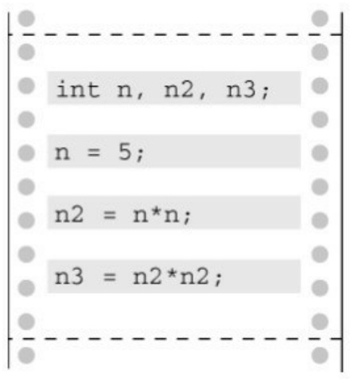
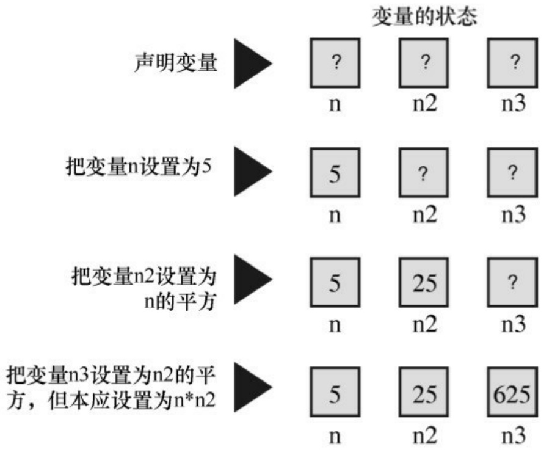
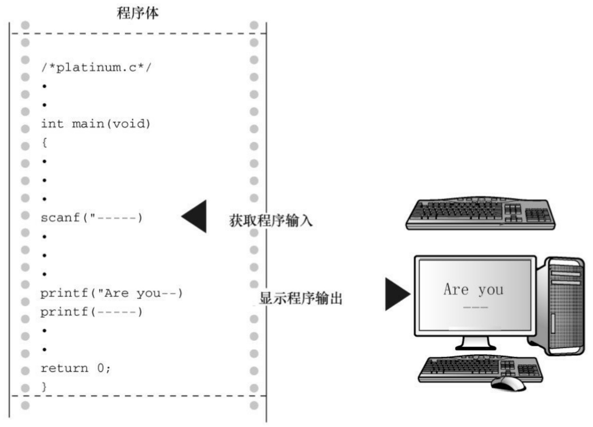
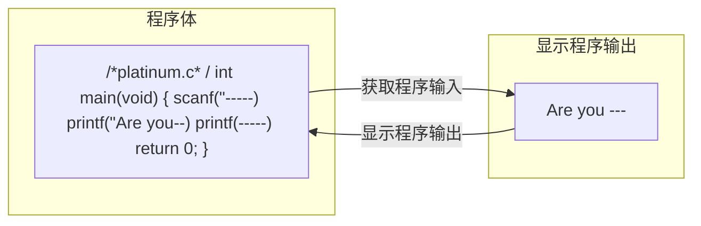
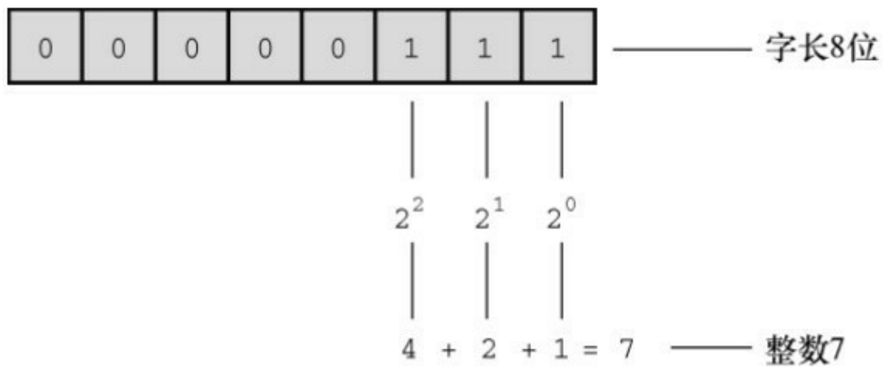
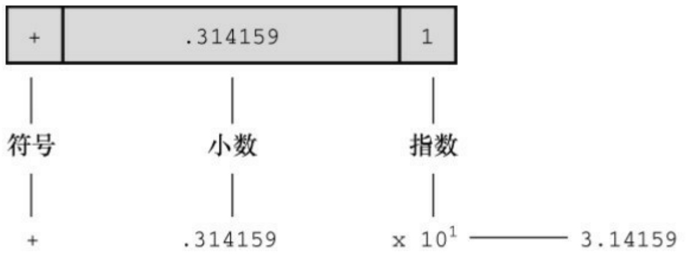
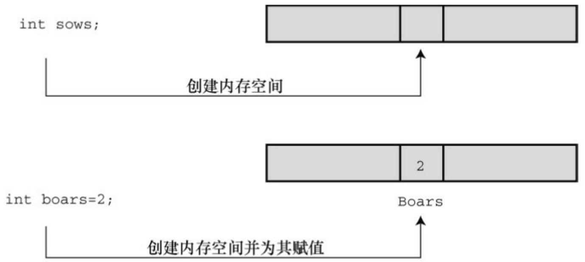

```txt
printf("n = %d, n squared = %d, n cubed = %d\n", n, n2, n3);
```

```scss
return 0;
}
```

该程序的输出如下:

```txt
n = 5, n squared = 25, n cubed = 625
```

如果对简单的立方比较熟悉，就会注意到 625 不对。下一步是跟踪程序的执行步骤，找出程序如何得出这个答案。对于本例，通过查看代码就会发现其中的错误，但是，还应该学习更系统的方法。方法之一是，把自己想象成计算机，跟着程序的步骤一步一步地执行。下面，我们来试试这种方法。

main()函数体一开始就声明了3个变量:n、n2、n3。你可以画出3个盒子并把变量名写在盒子上来模拟这种情况（见图2.6）。接下来，程序把5赋给变量n。你可以在标签为n的盒子里写上5。接着，程序把n和n相乘，并把乘积赋给n2。因此，查看标签为n的盒子，其值是5，5乘以5得25，于是把25放进标签为 n2 的盒子里。为了模拟下一条语句 $(n3 = n2 * n2)$ ），查看 n2 盒子，发现其值是 25。25乘以25得625，把625放进标签为n3的盒子。原来如此！程序中计算的是n2的平方，不是用n2乘以n得到n的3次方。

对于上面的程序示例，检查程序的过程可能过于繁琐。但是，用这种方法一步一步查看程序的执行情况，通常是发现程序问题所在的良方。

执行main()中的每一行



<details>
<summary>text_image</summary>

int n, n2, n3;
n = 5;
n2 = n*n;
n3 = n2*n2;
</details>



<details>
<summary>text_image</summary>

变量的状态
声明变量 ▶ ? n  n2  ? n3
把变量n设置为5 ▶ 5 n  ? n2  ?
把变量n2设置为n的平方 ▶ 5 n  25 n2  ?
把变量n3设置为n2的平方，但本应设置为n*n2 ▶ 5 n  25 n2  625 n3
</details>

图2.6 跟踪程序的执行步骤

## 2.7.3 程序状态

通过逐步跟踪程序的执行步骤，并记录每个变量，便可监视程序的状态。程序状态（program state）是在程序的执行过程中，某给定点上所有变量值的集合。它是计算机当前状态的一个快照。

我们刚刚讨论了一种跟踪程序状态的方法:自己模拟计算机逐步执行程序。但是，如果程序中有10000次循环，这种方法恐怕行不通。不过，你可以跟踪一小部分循环，看看程序是否按照预期的方式执行。另外，还要考虑一种情况:你很可能按照自己所想去执行程序，而不是根据实际写出来的代码去执行。因此，要尽量忠实代码来模拟。

定位语义错误的另一种方法是:在程序中的关键点插入额外的 printf()语句，以监视制定变量值的变化。通过查看值的变化可以了解程序的执行情况。对程序的执行满意后，便可删除额外的 printf()语句，然后重新编译。

检测程序状态的第3种方法是使用调试器。调试器（debugger）是一种程序，让你一步一步运行另一个程序，并检查该程序变量的值。调试器有不同的使用难度和复杂度。较高级的调试器会显示正在执行的源代码行号。这在检查有多条执行路径的程序时很方便，因为很容易知道正在执行哪条路径。如果你的编译器自带调试器，现在可以花点时间学会怎么使用它。例如，试着调试一下程序清单2.4。

## 2.8 关键字和保留标识符

关键字是C语言的词汇。它们对C而言比较特殊，不能用它们作为标识符（如，变量名）。许多关键字用于指定不同的类型，如 int。还有一些关键字（如，if）用于控制程序中语句的执行顺序。在表 2.2 中所列的C语言关键字中，粗体表示的是C90标准新增的关键字，斜体表示的C99标准新增的关键字，粗斜体表示的是C11标准新增的关键字。

表2.2 ISO C关键字

| auto | extern | short | while |
| --- | --- | --- | --- |
| break | float | signed | _Alignas |
| case | for | sizeof | _Alignof |
| char | goto | static | _Atomic |

续表

| const | if | struct | _Bool |
| --- | --- | --- | --- |
| continue | inline | switch | _Complex |
| default | int | typedef | _Generic |
| do | long | union | _Imaginary |
| double | register | unsigned | _Noreturn |
| else | restrict | void | _Static_assert |
| enum | return | volatile | _Thread_local |

如果使用关键字不当（如，用关键字作为变量名），编译器会将其视为语法错误。还有一些保留标识符（reserved identifier），C语言已经指定了它们的用途或保留它们的使用权，如果你使用这些标识符来表示其他意思会导致一些问题。因此，尽管它们也是有效的名称，不会引起语法错误，也不能随便使用。保留标识符包括那些以下划线字符开头的标识符和标准库函数名，如printf()。

## 2.9 关键概念

编程是一件富有挑战性的事情。程序员要具备抽象和逻辑的思维，并谨慎地处理细节问题（编译器会强迫你注意细节问题）。平时和朋友交流时，可能用错几个单词，犯一两个语法错误，或者说几句不完整的句子，但是对方能明白你想说什么。而编译器不允许这样，对它而言，几乎正确仍然是错误。

编译器不会在下面讲到的概念性问题上帮助你。因此，本书在这一章中介绍一些关键概念帮助读者弥补这部分的内容。

在本章中，读者的目标应该是理解什么是C程序。可以把程序看作是你希望计算机如何完成任务的描述。编译器负责处理一些细节工作，例如把你要计算机完成的任务转换成底层的机器语言（如果从量化方面来解释编译器所做的工作，它可以把1KB的源文件创建成60KB的可执行文件；即使是一个很简单的C程序也要用大量的机器语言来表示）。由于编译器不具有真正的智能，所以你必须用编译器能理解的术语表达你的意图，这些术语就是C语言标准规定的形式规则（尽管有些约束，但总比直接用机器语言方便得多）。

编译器希望接收到特定格式的指令，我们在本章已经介绍过。作为程序员的任务是，在符合 C标准的编译器框架中，表达你希望程序应该如何完成任务的想法。

## 2.10 本章小结

C程序由一个或多个C函数组成。每个C程序必须包含一个main()函数，这是C程序要调用的第1个函数。简单的函数由函数头和后面的一对花括号组成，花括号中是由声明、语句组成的函数体。

在C语言中，大部分语句都以分号结尾。声明为变量创建变量名和标识该变量中储存的数据类型。变量名是一种标识符。赋值表达式语句把值赋给变量，或者更一般地说，把值赋给存储空间。函数表达式语句用于调用指定的已命名函数。调用函数执行完毕后，程序会返回到函数调用后面的语句继续执行。

printf()函数用于输出想要表达的内容和变量的值。

一门语言的语法是一套规则，用于管理语言中各有效语句组合在一起的方式。语句的语义是语句要表达的意思。编译器可以检测出语法错误，但是程序里的语义错误只有在编译完之后才能从程序的行为中表现出来。检查程序是否有语义错误要跟踪程序的状态，即程序每执行一步后所有变量的值。

最后，关键字是C语言的词汇。

## 2.11 复习题

复习题的参考答案在附录A中。

1.C语言的基本模块是什么？
2.什么是语法错误？写出一个英语例子和C语言例子。
3.什么是语义错误？写出一个英语例子和C语言例子。
4.Indiana Sloth编写了下面的程序，并征求你的意见。请帮助他评定。

```txt
include studio.h

int main{void} /* 该程序打印一年有多少周 /*
```

```txt
(
int s
```

```txt
s := 56;
```

```txt
print(There are s weeks in a year.);
return 0;
```

5.假设下面的4个例子都是完整程序中的一部分，它们都输出什么结果？

a. printf("Baa Baa Black Sheep.");
printf("Have you any wool?\n");
b. printf("Begone!\nO creature of lard!\n");
c.printf("What?\nNo/nfish?\n");

d.int num;

num = 2;

printf("%d + %d = %d", num, num, num + num);

6.在main、int、function、char、=中，哪些是C语言的关键字？

7.如何以下面的格式输出变量words和lines的值（这里，3020和350代表两个变量的值）？

There were 3020 words and 350 lines.

8.考虑下面的程序:

#include &lt;stdio.h&gt;

int main(void)

{

int a, b;

a = 5;

b = 2; /\* 第7行 \*/

b = a; /\* 第8行 \*/

a = b; /\* 第9行 \*/

printf("%d %d\n", b, a);

return 0;

}

请问，在执行完第7、第8、第9行后，程序的状态分别是什么？

9.考虑下面的程序:

```c
#include <stdio.h>
```

```txt
int main(void)
```

```txt
{
```

```txt
int x, y;
```

```txt
x = 10;
```

```txt
y=5; /*第7行*/
```

<div class="docvortex-algorithm" style="white-space: pre-wrap; font-family:monospace;">
$y=x+y;/*第8行*/$
</div>

```txt
x = x*y; /*第9行*/
```

```txt
printf("%d %d\n", x, y);
```

```txt
return 0;
```

```txt
}
```

请问，在执行完第7、第8、第9行后，程序的状态分别是什么？

## 2.12 编程练习

纸上得来终觉浅，绝知此事要躬行。读者应该试着编写一两个简单的程序，体会一下编写程序是否和阅读本章介绍的这样轻松。题目中会给出一些建议，但是应该尽量自己思考这些问题。一些编程答案练习的答案可在出版商网站获取。

1.编写一个程序，调用一次 printf()函数，把你的姓名打印在一行。再调用一次 printf()函数，把你的姓名分别打印在两行。然后，再调用两次printf()函数，把你的姓名打印在一行。输出应如下所示（当然要把示例的内容换成你的姓名）:

| Gustav Mahler | ←第1次打印的内容 |
| --- | --- |
| Gustav | ←第2次打印的内容 |
| Mahler | ←仍是第2次打印的内容 |
| Gustav Mahler | ←第3次和第4次打印的内容 |

2.编写一个程序，打印你的姓名和地址。

3.编写一个程序把你的年龄转换成天数，并显示这两个值。这里不用考虑闰年的问题。

4.编写一个程序，生成以下输出:

For he's a jolly good fellow!

For he's a jolly good fellow!

For he's a jolly good fellow!

Which nobody can deny!

除了 main()函数以外，该程序还要调用两个自定义函数:一个名为jolly()，用于打印前 3 条消息，调用一次打印一条；另一个函数名为deny()，打印最后一条消息。

5.编写一个程序，生成以下输出:

Brazil, Russia, India, China

India, China,

Brazil, Russia

除了main()以外，该程序还要调用两个自定义函数:一个名为br()，调用一次打印一次“Brazil, Russia”；另一个名为ic()，调用一次打印一次“India, China”。其他内容在main()函数中完成。

6.编写一个程序，创建一个整型变量toes，并将toes设置为10。程序中还要计算toes的两倍和toes的平方。该程序应打印3个值，并分别描述以示区分。
7.许多研究表明，微笑益处多多。编写一个程序，生成以下格式的输出:

Smile!Smile!Smile!

Smile!Smile!

Smile!

该程序要定义一个函数，该函数被调用一次打印一次“Smile!”，根据程序的需要使用该函数。

8.在C语言中，函数可以调用另一个函数。编写一个程序，调用一个名为one\_three()的函数。该函数在一行打印单词“one”，再调用第2个函数two()，然后在另一行打印单词“three”。two()函数在一行显示单词“two”。main()函数在调用 one\_three()函数前要打印短语“starting now:”，并在调用完毕后显示短语“done!”。因此，该程序的输出应如下所示:

```txt
starting now:
one
two
three
done!
```

[1].原书图中叙述有误。根据C11标准，C语言有6种语句，已在图中更正。译者注
[2].C语言是通过赋值运算符而不是赋值语句完成赋值操作。根据C标准，C语言并没有所谓的“赋值语句”，本书及一些其他书籍中提到的“赋值语句”实际上是表达式语句（C语言的6种基本语句之一）。本书把“赋值语句”均译为“赋值表达式语句”，以提醒初学者注意。——译者注
[3].在C语言中，return语句是一种跳转语句。——译者注
[4].市面上许多书籍（包括本书）都把这种语句叫作“函数调用语句”，但是历年的C标准中从来没有函数调用语句！值得一提的是，函数调用本身是一个表达式，圆括号是运算符，圆括号左边的函数名是运算对象。在C11标准中，这样的表达式是一种后缀表达式。在表达式末尾加上分号，就成了表达式语句。请初学者注意，这样的“函数调用语句”实质是表达式语句。本书的错误之处已在翻译过程中更正。——译者注
[5].音寻，也称为寻。航海用的深度单位，1英寻=6英尺=1.8米，通常用在海图上测量水深。——译者注
[6].要理解该句子存在语法错误，需要具备基本的英文语法知识。——译者注

## 第3章数据和C

本章介绍以下内容:

关键字:int 、short、long、unsigned、char、float、double、\_Bool、Complex、\_Imaginary

运算符:sizeof()

函数:scanf()

整数类型和浮点数类型的区别

如何书写整型和浮点型常数，如何声明这些类型的变量

如何使用printf()和scanf()函数读写不同类型的值

程序离不开数据。把数字、字母和文字输入计算机，就是希望它利用这些数据完成某些任务。例如，需要计算一份利息或显示一份葡萄酒商的排序列表。本章除了介绍如何读取数据外，还将教会读者如何操控数据。

C 语言提供两大系列的多种数据类型。本章详细介绍两大数据类型:整数类型和浮点数类型，讲解这些数据类型是什么、如何声明它们、如何以及何时使用它们。除此之外，还将介绍常量和变量的区别。读者很快就能看到第1个交互式程序。

## 3.1 示例程序

本章仍从一个简单的程序开始。如果发现有不熟悉的内容，别担心，我们稍后会详细解释。该程序的意图比较明了，请试着编译并运行程序清单3.1中的源代码。为了节省时间，在输入源代码时可省略注释。

程序清单3.1 platinum.c程序

```c
/* platinum.c -- your weight in platinum */
#include <stdio.h>

int main(void)
{
float weight; /* 你的体重 */
float value; /* 相等重量的白金价值 */
printf("Are you worth your weight in platinum?\n");
printf("Let's check it out.\n");
printf("Please enter your weight in pounds: ");
/* 获取用户的输入 */
scanf("%f", &weight);
/* 假设白金的价格是每盎司$1700 */
/* 14.5833用于把英镑常衡盎司转换为金衡盎司[1]*/
value = 1700.0 * weight * 14.5833;
```

```perl
printf("Your weight in platinum is worth \$%.2f.\n", value);
printf("You are easily worth that! If platinum prices drop,\n");
printf("eat more to maintain your value.\n");
return 0;
}
```

提示错误与警告

如果输入程序时打错（如，漏了一个分号），编译器会报告语法错误消息。然而，即使输入正确无误，编译器也可能给出一些警告，如“警告:从double类型转换成float类型可能会丢失数据”。错误消息表明程序中有错，不能进行编译。而警告则表明，尽管编写的代码有效，但可能不是程序员想要的。警告并不终止编译。特殊的警告与C如何处理1700.0这样的值有关。本例不必理会这个问题，本章稍后会进一步说明。

输入该程序时，可以把1700.0改成贵金属白金当前的市价，但是不要改动14.5833，该数是1英镑的金衡盎司数（金衡盎司用于衡量贵金属，而英镑常衡盎司用于衡量人的体重）。

注意，“enter your weight”的意思是输入你的体重，然后按下Enter或Return键（不要键入体重后就一直等着）。按下Enter键是告知计算机，你已完成输入数据。该程序需要你输入一个数字（如，155），而不是单词（如，too much）。如果输入字母而不是数字，会导致程序出问题。这个问题要用if语句来解决（详见第7章），因此请先输入数字。下面是程序的输出示例:

Are you worth your weight in platinum?

Let's check it out.

Please enter your weight in pounds: 156

Your weight in platinum is worth \$3867491.25.

You are easily worth that! If platinum prices drop,

eat more to maintain your value.

程序调整

即使用第2章介绍的方法，在程序中添加下面一行代码:

getchar();

程序的输出是否依旧在屏幕上一闪而过？本例，需要调用两次getchar()函数:

getchar();

getchar();

getchar()函数读取下一个输入字符，因此程序会等待用户输入。在这种情况下，键入 156 并按下Enter（或Return）键（发送一个换行符），然后scanf()读取键入的数字，第1个getchar()读取换行符，第2个getchar()让程序暂停，等待输入。

## 3.1.1 程序中的新元素

程序清单3.1中包含C语言的一些新元素。

注意，代码中使用了一种新的变量声明。前面的例子中只使用了整数类型的变量（int），但是本例使用了浮点数类型（float）的变量，以便处理更大范围的数据。float 类型可以储存带小数的数字。

程序中演示了常量的几种新写法。现在可以使用带小数点的数了。

为了打印新类型的变量，在printf()中使用%f来处理浮点值。%.2f中的.2用于精确控制输出，指定输出的浮点数只显示小数点后面两位。

scanf()函数用于读取键盘的输入。%f说明scanf()要读取用户从键盘输入的浮点数，&weight告诉 scanf()把输入的值赋给名为 weight 的变量。scanf()函数使用&符号表明找到 weight变量的地点。下一章将详细讨论&。就目前而言，请按照这样写。

也许本程序最突出的新特点是它的交互性。计算机向用户询问信息，然后用户输入数字。与非交互式程序相比，交互式程序用起来更有趣。更重要的是，交互式使得程序更加灵活。例如，示例程序可以使用任何合理的体重，而不只是 156磅。不必重写程序，就可以根据不同体重进行计算。scanf()和printf()函数用于实现这种交互。scanf()函数读取用户从键盘输入的数据，并把数据传递给程序；printf()函数读取程序中的数据，并把数据显示在屏幕上。把两个函数结合起来，就可以建立人机双向通信（见图 3.1），这让使用计算机更加饶有趣味。



<details>
<summary>flowchart</summary>


</details>

图3.1 程序中的scanf()和printf()函数

本章着重解释上述新特性中的前两项:各种数据类型的变量和常量。第4章将介绍后3项。

## 3.2 变量与常量数据

在程序的指导下，计算机可以做许多事情，如数值计算、名字排序、执行语言或视频命令、计算彗星轨道、准备邮件列表、拨电话号码、画画、做决策或其他你能想到的事情。要完成这些任务，程序需要使用数据，即承载信息的数字和字符。有些数据类型在程序使用之前已经预先设定好了，在整个程序的运行过程中没有变化，这些称为常量（constant）。其他数据类型在程序运行期间可能会改变或被赋值，这些称为变量（variable）。在示例程序中，weight 是一个变量，14.5833 是一个常量。那么，1700.0 是常量还是变量？在现实生活中，白金的价格不会是常量，但是在程序中，像1700.0这样的价格被视为常量。

## 3.3 数据:数据类型关键字

不仅变量和常量不同，不同的数据类型之间也有差异。一些数据类型表示数字，一些数据类型表示字母（更普遍地说是字符）。C通过识别一些基本的数据类型来区分和使用这些不同的数据类型。如果数据是常量，编译器一般通过用户书写的形式来识别类型（如，42是整数，42.100是浮点数）。但是，对变量而言，要在声明时指定其类型。稍后会详细介绍如何声明变量。现在，我们先来了解一下 C语言的基本类型关键字。K&C给出了7个与类型相关的关键字。C90标准添加了2个关键字，C99标准又添加了3个关键字（见表3.1）。

表3.1 C语言的数据类型关键字

| 最初 K&amp;R 给出的关键字 | C90 标准添加的关键字 | C99 标准添加的关键字 |
| --- | --- | --- |
| int | signed | _Bool |
| long | void | _Complex |
| short |  | _Imaginary |
| unsigned |  |  |
| char |  |  |
| float |  |  |
| double |  |  |

在C语言中，用int关键字来表示基本的整数类型。后3个关键字（long、short和unsigned）和C90新增的signed用于提供基本整数类型的变式，例如unsigned short int和long long int。char关键字用于指定字母和其他字符（如，#、\$、%和\*）。另外，char类型也可以表示较小的整数。float、double和long double表示带小数点的数。\_Bool类型表示布尔值（true或false），\_complex和\_Imaginary分别表示复数和虚数。

通过这些关键字创建的类型，按计算机的储存方式可分为两大基本类型:整数类型和浮点数类型。

## 位、字节和字

位、字节和字是描述计算机数据单元或存储单元的术语。这里主要指存

储单元。

最小的存储单元是位（bit），可以储存0或1（或者说，位用于设置“开”或“关”）。虽然1位储存的信息有限，但是计算机中位的数量十分庞大。位是计算机内存的基本构建块。

字节（byte）是常用的计算机存储单位。对于几乎所有的机器，1字节均为8位。这是字节的标准定义，至少在衡量存储单位时是这样（但是，C语言对此有不同的定义，请参阅本章3.4.3节）。既然1位可以表示0或1，那么8位字节就有256（2的8次方）种可能的0、1的组合。通过二进制编码（仅用0和1便可表示数字），便可表示0～255的整数或一组字符（第15章将详细讨论二进制编码，如果感兴趣可以现在浏览一下该章的内容）。

字（word）是设计计算机时给定的自然存储单位。对于8位的微型计算机（如，最初的苹果机）， 1个字长只有8位。从那以后，个人计算机字长增至16位、32位，直到目前的64位。计算机的字长越大，其数据转移越快，允许的内存访问也更多。

## 3.3.1 整数和浮点数

整数类型？浮点数类型？如果觉得这些术语非常陌生，别担心，下面先简述它们的含义。如果不熟悉位、字节和字的概念，请阅读上面方框中的内容。刚开始学习时，不必了解所有的细节，就像学习开车之前不必详细了解汽车内部引擎的原理一样。但是，了解一些计算机或汽车引擎内部的原理会对你有所帮助。

对我们而言，整数和浮点数的区别是它们的书写方式不同。对计算机而言，它们的区别是储存方式不同。下面详细介绍整数和浮点数。

## 3.3.2 整数

和数学的概念一样，在C语言中，整数是没有小数部分的数。例如，2、−23和2456都是整数。而3.14、0.22和2.000都不是整数。计算机以二进制数字储存整数，例如，整数7以二进制写是111。因此，要在8位字节中储存该数字，需要把前5位都设置成0，后3位设置成1（如图3.2所示）。



<details>
<summary>text_image</summary>

0 0 0 0 0 1 1 1
—— 字长8位
|
|
|
2² 2¹ 2⁰
|
|
|
4 + 2 + 1 = 7 —— 整数7
</details>

图3.2 使用二进制编码储存整数7

## 3.3.3 浮点数

浮点数与数学中实数的概念差不多。2.75、3.16E7、7.00 和 2e-8 都是浮点数。注意，在一个值后面加上一个小数点，该值就成为一个浮点值。所以，7是整数，7.00是浮点数。显然，书写浮点数有多种形式。稍后将详细介绍e记数法，这里先做简要介绍:3.16E7 表示 $3 . 1 6   \times   1 0 ^ { 7 }$ （3.16 乘以10 的7次方）。其中， $10^{7}=10000000$ ，7被称为10的指数。

这里关键要理解浮点数和整数的储存方案不同。计算机把浮点数分成小数部分和指数部分来表示，而且分开储存这两部分。因此，虽然7.00和7在数值上相同，但是它们的储存方式不同。在十进制下，可以把7.0写成0.7E1。这里，0.7是小数部分，1是指数部分。图3.3演示了一个储存浮点数的例子。当然，计算机在内部使用二进制和2的幂进行储存，而不是10的幂。第15章将详述相关内容。现在，我们着重讲解这两种类型的实际区别。

整数没有小数部分，浮点数有小数部分。

浮点数可以表示的范围比整数大。参见本章末的表3.3。

对于一些算术运算（如，两个很大的数相减），浮点数损失的精度更

多。



<details>
<summary>text_image</summary>

+
.314159
1
|
符号
|
小数
|
|
+
.314159
|
|
x 10¹ ------------------- 3.14159
</details>

图3.3 以浮点格式（十进制）储存π的值

因为在任何区间内（如，1.0 到 2.0 之间）都存在无穷多个实数，所以计算机的浮点数不能表示区间内所有的值。浮点数通常只是实际值的近似值。例如，7.0可能被储存为浮点值6.99999。稍后会讨论更多精度方面的内容。

过去，浮点运算比整数运算慢。不过，现在许多CPU都包含浮点处理器，缩小了速度上的差距。

## 3.4 C语言基本数据类型

本节将详细节介绍C语言的基本数据类型，包括如何声明变量、如何表示字面值常量（如，5或2.78），以及典型的用法。一些老式的C语言编译器无法支持这里提到的所有类型，请查阅你使用的编译器文档，了解可以使用哪些类型。

## 3.4.1 int类型

C语言提供了许多整数类型，为什么一种类型不够用？因为 C语言让程序员针对不同情况选择不同的类型。特别是，C语言中的整数类型可表示不同的取值范围和正负值。一般情况使用int类型即可，但是为满足特定任务和机器的要求，还可以选择其他类型。

int类型是有符号整型，即int类型的值必须是整数，可以是正整数、负整数或零。其取值范围依计算机系统而异。一般而言，储存一个int要占用一个机器字长。因此，早期的16位IBM PC兼容机使用16位来储存一个int值，其取值范围（即int值的取值范围）是-32768～32767。目前的个人计算机一般是32位，因此用32位储存一个int值。现在，个人计算机产业正逐步向着64位处理器发展，自然能储存更大的整数。ISO C规定int的取值范围最小为-32768～32767。一般而言，系统用一个特殊位的值表示有符号整数的正负号。第15章将介绍常用的方法。

## 1.声明int变量

第2章中已经用int声明过基本整型变量。先写上int，然后写变量名，最后加上一个分号。要声明多个变量，可以单独声明每个变量，也可在int后面列出多个变量名，变量名之间用逗号分隔。下面都是有效的声明:

int erns;

int hogs, cows, goats;

可以分别在4条声明中声明各变量，也可以在一条声明中声明4个变量。两种方法的效果相同，都为4个int大小的变量赋予名称并分配内存空间。

以上声明创建了变量，但是并没有给它们提供值。变量如何获得值？前面介绍过在程序中获取值的两种途径。第1种途径是赋值:

$$
\text {cows} = 1 1 2;
$$

第2种途径是，通过函数（如，scanf()）获得值。接下来，我们着重介绍第3种途径。

## 2.初始化变量

初始化（initialize）变量就是为变量赋一个初始值。在C语言中，初始化可以直接在声明中完成。只需在变量名后面加上赋值运算符（=）和待赋给变量的值即可。如下所示:

$$
\text {int hogs} = 2 1;
$$

$$
\text {int cows} = 3 2, \text {goats} = 1 4;
$$

int dogs, cats = 94; /\* 有效，但是这种格式很糟糕 \*/

以上示例的最后一行，只初始化了cats，并未初始化dogs。这种写法很容易让人误认为dogs也被初始化为94，所以最好不要把初始化的变量和未初始化的变量放在同一条声明中。

简而言之，声明为变量创建和标记存储空间，并为其指定初始值（如图3.4所示）。



<details>
<summary>flowchart</summary>

```mermaid
graph TD
  subgraph int_sows["\"int sows\""]
  A[""] --> B[""]
  end
  
  subgraph int_boars_2["\"int boars=2;\"]"]
  C[""] --> D[""]
  end
  
  B -->|"创建内存空间"| E[""]
  D -->|"创建内存空间并为其赋值"| F["Boars"]
```
</details>

图3.4 定义并初始化变量

## 3.int类型常量

上面示例中出现的整数（21、32、14和94）都是整型常量或整型字面量。C语言把不含小数点和指数的数作为整数。因此，22和-44都是整型常量，但是22.0和2.2E1则不是。C语言把大多数整型常量视为int类型，但是非常大的整数除外。详见后面“long常量和long long常量”小节对long int类型的讨论。

## 4.打印int值

可以使用printf()函数打印int类型的值。第2章中介绍过，%d指明了在一行中打印整数的位置。%d称为转换说明，它指定了printf()应使用什么格式来显示一个值。格式化字符串中的每个%d都与待打印变量列表中相应的int值匹配。这个值可以是int类型的变量、int类型的常量或其他任何值为int类型的表达式。作为程序员，要确保转换说明的数量与待打印值的数量相同，编译器不会捕获这类型的错误。程序清单3.2演示了一个简单的程序，程序中初始化了一个变量，并打印该变量的值、一个常量值和一个简单表达式的值。另外，程序还演示了如果粗心犯错会导致什么结果。

## 程序清单3.2 print1.c程序

```c
/* print1.c - 演示printf()的一些特性 */

#include <stdio.h>

int main(void)
{
int ten = 10;
int two = 2;

printf("Doing it right: ");
printf("%d minus %d is %d\n", ten, 2, ten - two);
printf("Doing it wrong: ");
printf("%d minus %d is %d\n", ten); // 遗漏2个参数
return 0;
}
```

编译并运行该程序，输出如下:

Doing it right: 10 minus 2 is 8

Doing it wrong: 10 minus 16 is 1650287143

在第一行输出中，第1个%d对应int类型变量ten；第2个%d对应int类型常量2；第3个%d对应int类型表达式ten - two的值。在第二行输出中，第1个%d对应ten的值，但是由于没有给后两个%d提供任何值，所以打印出的值是内存中的任意值（读者在运行该程序时显示的这两个数值会与输出示例中的数值不同，因为内存中储存的数据不同，而且编译器管理内存的位置也不同）。

你可能会抱怨编译器为何不能捕获这种明显的错误，但实际上问题出在printf()不寻常的设计。大部分函数都需要指定数目的参数，编译器会检查参数的数目是否正确。但是，printf()函数的参数数目不定，可以有1个、2个、3个或更多，编译器也爱莫能助。记住，使用printf()函数时，要确保转换说明的数量与待打印值的数量相等。

## 5.八进制和十六进制

通常，C语言都假定整型常量是十进制数。然而，许多程序员很喜欢使用八进制和十六进制数。因为8和16都是2的幂，而10却不是。显然，八进制和十六进制记数系统在表达与计算机相关的值时很方便。例如，十进制数65536经常出现在16位机中，用十六进制表示正好是10000。另外，十六进制数的每一位的数恰好由4位二进制数表示。例如，十六进制数3是0011，十六进制数5是0101。因此，十六进制数35的位组合（bit pattern）是00110101，十六进制数53的位组合是01010011。这种对应关系使得十六进制和二进制的转换非常方便。但是，计算机如何知道10000是十进制、十六进制还是二进制？在C语言中，用特定的前缀表示使用哪种进制。0x或0X前缀表示十六进制值，所以十进制数16表示成十六进制是0x10或0X10。与此类似，0前缀表示八进制。例如，十进制数16表示成八进制是020。第15章将更全面地介绍进制相关的内容。

要清楚，使用不同的进制数是为了方便，不会影响数被储存的方式。也就是说，无论把数字写成16、020或0x10，储存该数的方式都相同，因为计算机内部都以二进制进行编码。

## 6.显示八进制和十六进制

在C程序中，既可以使用和显示不同进制的数。不同的进制要使用不同的转换说明。以十进制显示数字，使用%d；以八进制显示数字，使用%o；以十六进制显示数字，使用%x。另外，要显示各进制数的前缀0、0x和0X，必须分别使用%#o、%#x、%#X。程序清单3.3演示了一个小程序。回忆一下，在某些集成开发环境（IDE）下编写的代码中插入getchar();语句，程序在执行完毕后不会立即关闭执行窗口。

程序清单3.3 bases.c程序

```c
/* bases.c--以十进制、八进制、十六进制打印十进制数100 */
#include <stdio.h>

int main(void)
{
int x = 100;
printf("dec = %d; octal = %o; hex = %x\n", x, x, x);
printf("dec = %d; octal = %#o; hex = %#x\n", x, x, x);
return 0;
}
```

编译并运行该程序，输出如下:

$$
\mathrm{dec} = 1 0 0; \text { octal } = 1 4 4; \mathrm{hex} = 6 4
$$

$$
\mathrm{dec} = 1 0 0; \text {octal} = 0 1 4 4; \mathrm{hex} = 0 \mathrm{x} 6 4
$$

该程序以3种不同记数系统显示同一个值。printf()函数做了相应的转换。注意，如果要在八进制和十六进制值前显示0和0x前缀，要分别在转换说明中加入#。

## 3.4.2 其他整数类型

初学C语言时，int类型应该能满足大多数程序的整数类型需求。尽管如此，还应了解一下整型的其他形式。当然，也可以略过本节跳至3.4.3节阅读char类型的相关内容，以后有需要时再阅读本节。

C语言提供3个附属关键字修饰基本整数类型:short、long和unsigned。应记住以下几点。

short int类型（或者简写为short）占用的存储空间可能比int类型少，常用于较小数值的场合以节省空间。与int类似，short是有符号类型。

long int或long占用的存储空间可能比int多，适用于较大数值的场合。与int类似，long是有符号类型。

long long int或long long（C99标准加入）占用的储存空间可能比long多，适用于更大数值的场合。该类型至少占64位。与int类似，long long是有符号类型。

unsigned int或unsigned只用于非负值的场合。这种类型与有符号类型表示的范围不同。例如，16位unsigned int允许的取值范围是0～65535，而不是-32768～32767。用于表示正负号的位现在用于表示另一个二进制位，所以无符号整型可以表示更大的数。

在C90标准中，添加了unsigned long int或unsigned long和unsigned int或unsigned short类型。C99标准又添加了unsigned long long int或unsigned long long。

在任何有符号类型前面添加关键字signed，可强调使用有符号类型的意图。例如，short、short int、signed short、signed short int都表示同一种类型。

## 1.声明其他整数类型

其他整数类型的声明方式与int类型相同，下面列出了一些例子。不是所有的C编译器都能识别最后3条声明，最后一个例子所有的类型是C99标准新增的。

long int estine;

```txt
long johns;

short int erns;

short ribs;

unsigned int s_count;

unsigned players;

unsigned long headcount;

unsigned short yesvotes;

long long ago;
```

## 2.使用多种整数类型的原因

为什么说short类型“可能”比int类型占用的空间少，long类型“可能”比int类型占用的空间多？因为C语言只规定了short占用的存储空间不能多于int，long占用的存储空间不能少于int。这样规定是为了适应不同的机器。例如，过去的一台运行Windows 3的机器上，int类型和short类型都占16位，long类型占32位。后来，Windows和苹果系统都使用16位储存short类型，32位储存int类型和long类型（使用32位可以表示的整数数值超过20亿）。现在，计算机普遍使用64位处理器，为了储存64位的整数，才引入了long long类型。

现在，个人计算机上最常见的设置是，long long占64位，long占32位，short占16位，int占16位或32位（依计算机的自然字长而定）。原则上，这4种类型代表4种不同的大小，但是在实际使用中，有些类型之间通常有重叠。

C 标准对基本数据类型只规定了允许的最小大小。对于 16 位机，short和 int 的最小取值范围是[−32767,32767]；对于32位机，long的最小取值范围是[−2147483647,2147483647]。对于unsigned short和unsigned int，最小取值范围是[0,65535]；对于unsigned long，最小取值范围是[0,4294967295]。long long类型是为了支持64位的需求，最小取值范围是

[−9223372036854775807,9223372036854775807]；unsigned long long的最小取值范围是[0,18446744073709551615]。如果要开支票，这个数是一千八百亿亿（兆）六千七百四十四万亿零七百三十七亿零九百五十五万一千六百一十五。但是，谁会去数？

int类型那么多，应该如何选择？首先，考虑unsigned类型。这种类型的数常用于计数，因为计数不用负数。而且，unsigned类型可以表示更大的正数。

如果一个数超出了int类型的取值范围，且在long类型的取值范围内时，使用long类型。然而，对于那些long占用的空间比int大的系统，使用long类型会减慢运算速度。因此，如非必要，请不要使用long类型。另外要注意一点:如果在long类型和int类型占用空间相同的机器上编写代码，当确实需要32位的整数时，应使用long类型而不是int类型，以便把程序移植到16位机后仍然可以正常工作。类似地，如果确实需要64位的整数，应使用long long类型。

如果在int设置为32位的系统中要使用16位的值，应使用short类型以节省存储空间。通常，只有当程序使用相对于系统可用内存较大的整型数组时，才需要重点考虑节省空间的问题。使用short类型的另一个原因是，计算机中某些组件使用的硬件寄存器是16位。

## 3.long常量和long long常量

通常，程序代码中使用的数字（如，2345）都被储存为int类型。如果使用1000000这样的大数字，超出了int类型能表示的范围，编译器会将其视为long int类型（假设这种类型可以表示该数字）。如果数字超出long可表示的最大值，编译器则将其视为unsigned long类型。如果还不够大，编译器则将其视为long long或unsigned long long类型（前提是编译器能识别这些类型）。

八进制和十六进制常量被视为int类型。如果值太大，编译器会尝试使用unsigned int。如果还不够大，编译器会依次使用long、unsigned long、long long和unsigned long long类型。

有些情况下，需要编译器以long类型储存一个小数字。例如，编程时要显式使用IBM PC上的内存地址时。另外，一些C标准函数也要求使用long类型的值。要把一个较小的常量作为long类型对待，可以在值的末尾加上l（小写的L）或L后缀。使用L后缀更好，因为l看上去和数字1很像。因此，在int为16位、long为32位的系统中，会把7作为16位储存，把7L作为32位储存。l或L后缀也可用于八进制和十六进制整数，如020L和0x10L。

类似地，在支持long long类型的系统中，也可以使用ll或LL后缀来表示long long类型的值，如3LL。另外，u或U后缀表示unsigned long long，如5ull、10LLU、6LLU或9Ull。

整数溢出

如果整数超出了相应类型的取值范围会怎样？下面分别将有符号类型和无符号类型的整数设置为比最大值略大，看看会发生什么（printf()函数使用%u说明显示unsigned int类型的值）。

```c
/* toobig.c-- 超出系统允许的最大int值*/
#include <stdio.h>

int main(void)
{
int i = 2147483647;
unsigned int j = 4294967295;
printf("%d %d %d\n", i, i+1, i+2);
printf("%u %u %u\n", j, j+1, j+2);
```