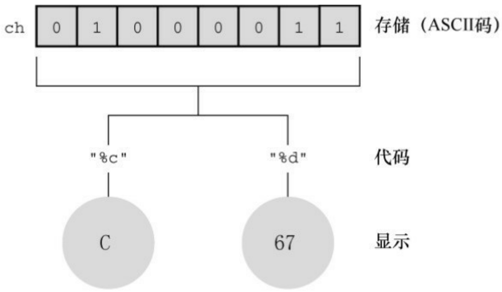
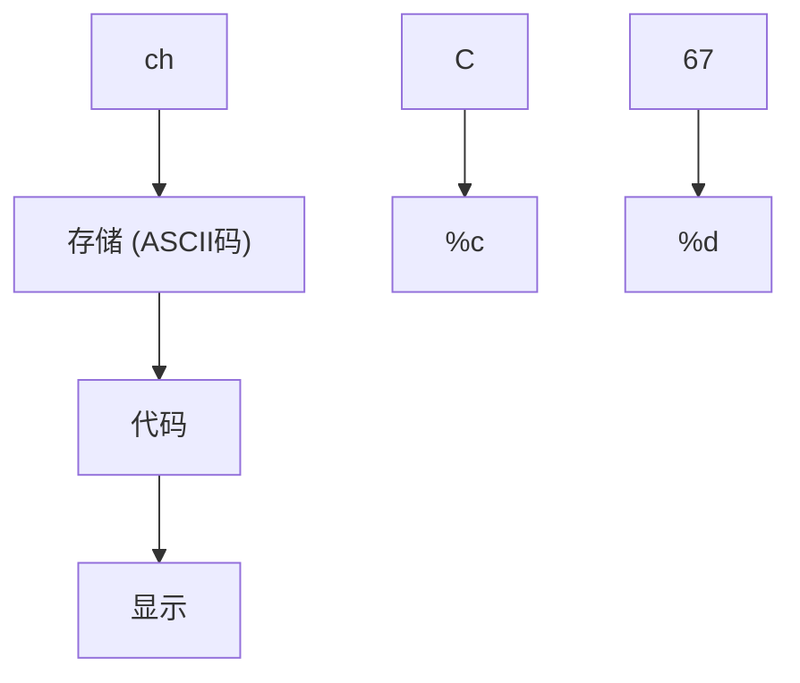
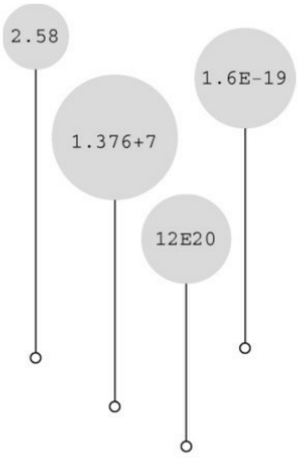

```scss
return 0;
}
```

在我们的系统下输出的结果是:

```txt
2147483647 -2147483648 -2147483647
4294967295 0 1
```

可以把无符号整数j看作是汽车的里程表。当达到它能表示的最大值时，会重新从起始点开始。整数 i 也是类似的情况。它们主要的区别是，在超过最大值时，unsigned int 类型的变量 j 从 0开始；而int类型的变量i则从−2147483648开始。注意，当i超出（溢出）其相应类型所能表示的最大值时，系统并未通知用户。因此，在编程时必须自己注意这类问题。

溢出行为是未定义的行为，C 标准并未定义有符号类型的溢出规则。以上描述的溢出行为比较有代表性，但是也可能会出现其他情况。

## 4.打印short、long、long long和unsigned类型

打印unsigned int类型的值，使用%u转换说明；打印long类型的值，使用%ld转换说明。如果系统中int和long的大小相同，使用%d就行。但是，这样的程序被移植到其他系统（int和long类型的大小不同）中会无法正常工作。在x和o前面可以使用l前缀，%lx表示以十六进制格式打印long类型整数，%lo表示以八进制格式打印long类型整数。注意，虽然C允许使用大写或小写的常量后缀，但是在转换说明中只能用小写。

C语言有多种printf()格式。对于short类型，可以使用h前缀。%hd表示以十进制显示short类型的整数，%ho表示以八进制显示short类型的整数。h和l前缀都可以和u一起使用，用于表示无符号类型。例如，%lu表示打印unsigned long类型的值。程序清单3.4演示了一些例子。对于支持long long类型的系统，%lld和%llu分别表示有符号和无符号类型。第4章将详细介绍转换说明。

程序清单3.4 print2.c程序

```c
/* print2.c--更多printf()的特性 */
#include <stdio.h>

int main(void)
{
unsigned int un = 3000000000; /* int为32位和short为16位的系统 */
short end = 200;
long big = 65537;
long long verybig = 12345678908642;
printf("un = %u and not %d\n", un, un);
printf("end = %hd and %d\n", end, end);
printf("big = %ld and not %hd\n", big, big);
printf("verybig= %lld and not %ld\n", verybig, verybig);
return 0;
}
在特定的系统中输出如下（输出的结果可能不同）:
un = 3000000000 and not -1294967296
end = 200 and 200
big = 65537 and not 1
```

$$
\text {verybig} = 1 2 3 4 5 6 7 8 9 0 8 6 4 2 \text {and not} 1 9 4 2 8 9 9 9 3 8
$$

该例表明，使用错误的转换说明会得到意想不到的结果。第 1 行输出，对于无符号变量 un，使用%d会生成负值！其原因是，无符号值 3000000000和有符号值−129496296 在系统内存中的内部表示完全相同（详见第15章）。因此，如果告诉printf()该数是无符号数，它打印一个值；如果告诉它该数是有符号数，它将打印另一个值。在待打印的值大于有符号值的最大值时，会发生这种情况。对于较小的正数（如96），有符号和无符号类型的存储、显示都相同。

第2行输出，对于short类型的变量end，在printf()中无论指定以short类型（%hd）还是int类型（%d）打印，打印出来的值都相同。这是因为在给函数传递参数时，C编译器把short类型的值自动转换成int类型的值。你可能会提出疑问:为什么要进行转换？h修饰符有什么用？第1个问题的答案是，int类型被认为是计算机处理整数类型时最高效的类型。因此，在short和int类型的大小不同的计算机中，用int类型的参数传递速度更快。第2个问题的答案是，使用h修饰符可以显示较大整数被截断成 short 类型值的情况。第 3 行输出就演示了这种情况。把 65537 以二进制格式写成一个 32 位数是00000000000000010000000000000001。使用%hd，printf()只会查看后位，所以显示的值是 1。与此类似，输出的最后一行先显示了verybig的完整值，然后由于使用了%ld，printf()只显示了储存在后32位的值。

本章前面介绍过，程序员必须确保转换说明的数量和待打印值的数量相同。以上内容也提醒读者，程序员还必须根据待打印值的类型使用正确的转换说明。

提示匹配**printf()**说明符的类型

在使用 printf()函数时，切记检查每个待打印值都有对应的转换说明，还要检查转换说明的类型是否与待打印值的类型相匹配。

## 3.4.3 使用字符:char类型

char类型用于储存字符（如，字母或标点符号），但是从技术层面看，char是整数类型。因为char类型实际上储存的是整数而不是字符。计算机使用数字编码来处理字符，即用特定的整数表示特定的字符。美国最常用的编码是ASCII编码，本书也使用此编码。例如，在ASCII码中，整数65代表大写字母A。因此，储存字母A实际上储存的是整数65（许多IBM的大型主机使用另一种编码——EBCDIC，其原理相同。另外，其他国家的计算机系统可能使用完全不同的编码）。

标准ASCII码的范围是0～127，只需7位二进制数即可表示。通常，char类型被定义为8位的存储单元，因此容纳标准ASCII码绰绰有余。许多其他系统（如IMB PC和苹果Macs）还提供扩展ASCII码，也在8位的表示范围之内。一般而言，C语言会保证char类型足够大，以储存系统（实现C语言的系统）的基本字符集。

许多字符集都超过了127，甚至多于255。例如，日本汉字（kanji）字符集。商用的统一码（Unicode）创建了一个能表示世界范围内多种字符集的系统，目前包含的字符已超过110000个。国际标准化组织（ISO）和国际电工技术委员会（IEC）为字符集开发了ISO/IEC 10646标准。统一码标准也与ISO/IEC 10646标准兼容。

C语言把1字节定义为char类型占用的位（bit）数，因此无论是16位还是32位系统，都可以使用char类型。

## 1.声明char类型变量

char类型变量的声明方式与其他类型变量的声明方式相同。下面是一些例子:

char response;

char itable, latan;

以上声明创建了3个char类型的变量:response、itable和latan。

## 2.字符常量和初始化

如果要把一个字符常量初始化为字母 A，不必背下 ASCII 码，用计算机语言很容易做到。通过以下初始化把字母A赋给grade即可:

$$
\text {char grade} = ^ {\prime} \mathrm{A} ^ {\prime};
$$

在C语言中，用单引号括起来的单个字符被称为字符常量（character constant）。编译器一发现'A'，就会将其转换成相应的代码值。单引号必不可少。下面还有一些其他的例子:

char broiled; /\* 声明一个char类型的变量 \*/

broiled = 'T'; /\* 为其赋值，正确 \*/

broiled = T; /\* 错误！此时T是一个变量 \*/

如上所示，如果省略单引号，编译器认为T是一个变量名；如果把T用双引号括起来，编译器则认为"T"是一个字符串。字符串的内容将在第4章中介绍。

实际上，字符是以数值形式储存的，所以也可使用数字代码值来赋值:

char grade = 65; /\* 对于ASCII，这样做没问题，但这是一种不好的编程风格 \*/

在本例中，虽然65是int类型，但是它在char类型能表示的范围内，所以将其赋值给grade没问题。由于65是字母A对应的ASCII码，因此本例是把A赋给grade。注意，能这样做的前提是系统使用ASCII码。其实，用'A'代替65才是较为妥当的做法，这样在任何系统中都不会出问题。因此，最好使用字符常量，而不是数字代码值。

奇怪的是，C语言将字符常量视为int类型而非char类型。例如，在int为

32位、char为8位的ASCII系统中，有下面的代码:

$$
\text {char grade} = ^ {\prime} \mathrm{B} ^ {\prime};
$$

本来'B'对应的数值66储存在32位的存储单元中，现在却可以储存在8位的存储单元中（grade）。利用字符常量的这种特性，可以定义一个字符常量'FATE'，即把4个独立的8位ASCII码储存在一个32位存储单元中。如果把这样的字符常量赋给char类型变量grade，只有最后8位有效。因此，grade的值是'E'。

## 3.非打印字符

单引号只适用于字符、数字和标点符号，浏览ASCII表会发现，有些ASCII字符打印不出来。例如，一些代表行为的字符（如，退格、换行、终端响铃或蜂鸣）。C语言提供了3种方法表示这些字符。

第1种方法前面介绍过——使用ASCII码。例如，蜂鸣字符的ASCII值是7，因此可以这样写:

$$
\text {char beep} = 7;
$$

第 2 种方法是，使用特殊的符号序列表示一些特殊的字符。这些符号序列叫作转义序列（escape sequence）。表3.2列出了转义序列及其含义。

把转义序列赋给字符变量时，必须用单引号把转义序列括起来。例如，假设有下面一行代码:

$$
\text {char nerf} = ^ {\prime} \backslash n ^ {\prime};
$$

稍后打印变量nerf的效果是，在打印机或屏幕上另起一行。

表3.2 转义序列

| 转义序列 | 含义 |
| --- | --- |
| \\a | 警报(ANSI C) |
| \\b | 退格 |
| \\f | 换页 |
| \\n | 换行 |
| \\r | 回车 |
| \\t | 水平制表符 |
| \\v | 垂直制表符 |
| \\\\ | 反斜杠(\\) |
| \\' | 单引号 |
| \\" | 双引号 |
| \\? | 问号 |
| \\0oo | 八进制值(oo必须是有效的八进制数,即每个o可表示0~7中的一个数) |
| \\xhh | 十六进制值(hh必须是有效的十六进制数,即每个h可表示0~f中的一个数) |

现在，我们来仔细分析一下转义序列。使用C90新增的警报字符（\a）是否能产生听到或看到的警报，取决于计算机的硬件，蜂鸣是最常见的警报（在一些系统中，警报字符不起作用）。C标准规定警报字符不得改变活跃位置。标准中的活跃位置（active position）指的是显示设备（屏幕、电传打字机、打印机等）中下一个字符将出现的位置。简而言之，平时常说的屏幕光标位置就是活跃位置。在程序中把警报字符输出在屏幕上的效果是，发出一声蜂鸣，但不会移动屏幕光标。

接下来的转义字符\b、\f、\n、\r、\t和\v是常用的输出设备控制字符。了解它们最好的方式是查看它们对活跃位置的影响。换页符（\f）把活跃位置移至下一页的开始处；换行符（\n）把活跃位置移至下一行的开始处；回车符（\r）把活跃位置移动到当前行的开始处；水平制表符（\t）将活跃位置移至下一个水平制表点（通常是第1个、第9个、第17个、第25个等字符位置）；垂直制表符（\v）把活跃位置移至下一个垂直制表点。

这些转义序列字符不一定在所有的显示设备上都起作用。例如，换页符和垂直制表符在PC屏幕上会生成奇怪的符号，光标并不会移动。只有将其输出到打印机上时才会产生前面描述的效果。

接下来的3个转义序列（\\、\'、\"）用于打印\、'、"字符（由于这些字符用于定义字符常量，是printf()函数的一部分，若直接使用它们会造成混乱）。如果打印下面一行内容:

Gramps sez, "a \ is a backslash."

应这样编写代码:

printf("Gramps sez, \"a \\ is a backslash.\"\n");

表3.2中的最后两个转义序列（\0oo和\xhh）是ASCII码的特殊表示。如果要用八进制ASCII码表示一个字符，可以在编码值前面加一个反斜杠（\）并用单引号括起来。例如，如果编译器不识别警报字符（\a），可以使用ASCII码来代替:

$$
\text {beep} = ^ {\prime} \backslash 0 0 7 ^ {\prime};
$$

可以省略前面的 0，'\07'甚至'\7'都可以。即使没有前缀 0，编译器在处理这种写法时，仍会解释为八进制。

从C90开始，不仅可以用十进制、八进制形式表示字符常量，C语言还提供了第3种选择——用十六进制形式表示字符常量，即反斜杠后面跟一个x或X，再加上1～3位十六进制数字。例如，Ctrl+P字符的ASCII十六进制码是10（相当于十进制的16），可表示为'\x10'或'\x010'。图3.5列出了一些整数类型的不同进制形式。

<table><tr><td colspan="4">整型常量的例子</td></tr><tr><td>类型</td><td>十六进制</td><td>八进制</td><td>十进制</td></tr><tr><td>char</td><td>\0x41</td><td>\0101</td><td>N.A.</td></tr><tr><td>int</td><td>0x41</td><td>0101</td><td>65</td></tr><tr><td>unsigned int</td><td>0x41u</td><td>0101u</td><td>65u</td></tr><tr><td>long</td><td>0x41L</td><td>0101L</td><td>65L</td></tr><tr><td>unsigned long</td><td>0x41UL</td><td>0101UL</td><td>65UL</td></tr><tr><td>long long</td><td>0x41LL</td><td>0101LL</td><td>65LL</td></tr><tr><td>unsigned long long</td><td>0x41ULL</td><td>0101ULL</td><td>65ULL</td></tr></table>

图3.5 int系列类型的常量写法示例

使用ASCII码时，注意数字和数字字符的区别。例如，字符4对应的ASCII码是52。'4'表示字符4，而不是数值4。

关于转义序列，读者可能有下面3个问题。

上面最后一个例子（printf("Gramps sez, \"a \\ is a backslash\"\"n"），为何没有用单引号把转义序列括起来？无论是普通字符还是转义序列，只要是双引号括起来的字符集合，就无需用单引号括起来。双引号中的字符集合叫作字符串（详见第4章）。注意，该例中的其他字符（G、r、a、m、p、s等）都没有用单引号括起来。与此类似，printf("Hello!\007\n");将打印Hello!并发出一声蜂鸣，而 printf("Hello!7\n");则打印 Hello!7。不是转义序列中的数字将作为普通字符被打印出来。

何时使用ASCII码？何时使用转义序列？如果要在转义序列（假设使用'\f'）和ASCII码（'\014'）之间选择，请选择前者（即'\f'）。这样的写法不仅更好记，而且可移植性更高。'\f'在不使用ASCII码的系统中，仍然有效。

如果要使用ASCII码，为何要写成'\032'而不是032？首先，'\032'能更清晰地表达程序员使用字符编码的意图。其次，类似\032这样的转义序列可以嵌入C的字符串中，如printf("Hello!\007\n");中就嵌入了\007。

## 4.打印字符

printf()函数用%c指明待打印的字符。前面介绍过，一个字符变量实际上被储存为1字节的整数值。因此，如果用%d转换说明打印 char类型变量的值，打印的是一个整数。而%c转换说明告诉printf()打印该整数值对应的字符。程序清单3.5演示了打印char类型变量的两种方式。

程序清单3.5 charcode.c程序

```c
/* charcode.c-显示字符的代码编号 */
#include <stdio.h>

int main(void)
{
char ch;

printf("Please enter a character.\n");
scanf("%c", &ch); /* 用户输入字符 */
printf("The code for %c is %d.\n", ch, ch);
return 0;
}
```

运行该程序后，输出示例如下:

```txt
Please enter a character.
```

C

The code for C is 67.

运行该程序时，在输入字母后不要忘记按下Enter或Return键。随后，scanf()函数会读取用户输入的字符，&符号表示把输入的字符赋给变量ch。接着，printf()函数打印ch的值两次，第1次打印一个字符（对应代码中的%c），第2次打印一个十进制整数值（对应代码中的%d）。注意，printf()函数中的转换说明决定了数据的显示方式，而不是数据的储存方式（见图3.6）。



<details>
<summary>flowchart</summary>


</details>

图3.6 数据显示和数据存储

## 5.有符号还是无符号

有些C编译器把char实现为有符号类型，这意味着char可表示的范围是-128～127。而有些C编译器把char实现为无符号类型，那么char可表示的范围是0～255。请查阅相应的编译器手册，确定正在使用的编译器如何实现char类型。或者，可以查阅limits.h头文件。下一章将详细介绍头文件的内容。

根据C90标准，C语言允许在关键字char前面使用signed或unsigned。这样，无论编译器默认char是什么类型，signed char表示有符号类型，而unsigned char表示无符号类型。这在用char类型处理小整数时很有用。如果只用char处理字符，那么char前面无需使用任何修饰符。

## 3.4.4 \_Bool类型

C99标准添加了\_Bool类型，用于表示布尔值，即逻辑值true和false。因为C语言用值1表示true，值0表示false，所以\_Bool类型实际上也是一种整数类型。但原则上它仅占用1位存储空间，因为对0和1而言，1位的存储空间足够了。

程序通过布尔值可选择执行哪部分代码。我们将在第6章和第7章中详述相关内容。

## 3.4.5 可移植类型:stdint.h和inttypes.h

C 语言提供了许多有用的整数类型。但是，某些类型名在不同系统中的功能不一样。C99 新增了两个头文件stdint.h和inttypes.h，以确保C语言的类型在各系统中的功能相同。

C语言为现有类型创建了更多类型名。这些新的类型名定义在stdint.h头文件中。例如，int32\_t表示32位的有符号整数类型。在使用32位int的系统中，头文件会把int32\_t作为int的别名。不同的系统也可以定义相同的类型名。例如，int为16位、long为32位的系统会把int32\_t作为long的别名。然后，使用int32\_t类型编写程序，并包含stdint.h头文件时，编译器会把int或long替换成与当前系统匹配的类型。

上面讨论的类型别名是精确宽度整数类型（exact-width integer type）的示例。int32\_t表示整数类型的宽度正好是32位。但是，计算机的底层系统可能不支持。因此，精确宽度整数类型是可选项。

如果系统不支持精确宽度整数类型怎么办？C99和C11提供了第2类别名集合。一些类型名保证所表示的类型一定是至少有指定宽度的最小整数类

型。这组类型集合被称为最小宽度类型（minimum width type）。例如，int\_least8\_t是可容纳8位有符号整数值的类型中宽度最小的类型的一个别名。如果某系统的最小整数类型是16位，可能不会定义int8\_t类型。尽管如此，该系统仍可使用int\_least8\_t类型，但可能把该类型实现为16位的整数类型。

当然，一些程序员更关心速度而非空间。为此，C99和C11定义了一组可使计算达到最快的类型集合。这组类型集合被称为最快最小宽度类型（fastst minimum width type）。例如，int\_fast8\_t被定义为系统中对8位有符号值而言运算最快的整数类型的别名。

另外，有些程序员需要系统的最大整数类型。为此，C99定义了最大的有符号整数类型intmax\_t，可储存任何有效的有符号整数值。类似地，unitmax\_t表示最大的无符号整数类型。顺带一提，这些类型有可能比long long和unsigned long类型更大，因为C编译器除了实现标准规定的类型以外，还可利用C语言实现其他类型。例如，一些编译器在标准引入 long long 类型之前，已提前实现了该类型。

C99 和 C11 不仅提供可移植的类型名，还提供相应的输入和输出。例如，printf()打印特定类型时要求与相应的转换说明匹配。如果要打印int32\_t类型的值，有些定义使用%d，而有些定义使用%ld，怎么办？C 标准针对这一情况，提供了一些字符串宏（第 4 章中详细介绍）来显示可移植类型。例如， inttypes.h头文件中定义了PRId32字符串宏，代表打印32位有符号值的合适转换说明（如d或l）。程序清单3.6演示了一种可移植类型和相应转换说明的用法。

程序清单**3.6 altnames.c**程序

/\* altnames.c -- 可移植整数类型名 \*/

#include &lt;stdio.h&gt;

#include &lt;inttypes.h&gt; // 支持可移植类型

```c
int main(void)
{
int32_t me32;      // me32是一个32位有符号整型变量
me32 = 45933945;
printf("First, assume int32_t is int: ");
printf("me32 = %d\n", me32);
printf("Next, let's not make any assumptions.\n");
printf("Instead, use a \"macro\" from inttypes.h: ");
printf("me32 = %" PRId32 "\n", me32);
return 0;
}
```

该程序最后一个printf()中，参数PRId32被定义在inttypes.h中的"d"替换，因而这条语句等价于:

```txt
printf("me16 = %" "d" "\n", me16);
```

在C语言中，可以把多个连续的字符串组合成一个字符串，所以这条语句又等价于:

```txt
printf("me16 = %d\n", me16);
```

下面是该程序的输出，注意，程序中使用了\"转义序列来显示双引号:

```txt
First, assume int32_t is int: me32 = 45933945
```

Next, let's not make any assumptions.

$$
\text {Instead, use a "macro" from inttypes.h: me32 = 45933945}
$$

篇幅有限，无法介绍扩展的所有整数类型。本节主要是为了让读者知道，在需要时可进行这种级别的类型控制。附录B中的参考资料VI“扩展的整数类型”介绍了完整的inttypes.h和stdint.h头文件。

注意对**C99/C11**的支持

C语言发展至今，虽然ISO已发布了C11标准，但是编译器供应商对C99的实现程度却各不相同。在本书第6版的编写过程中，一些编译器仍未实现inttypes.h头文件及其相关功能。

## 3.4.6 float、double和long double

各种整数类型对大多数软件开发项目而言够用了。然而，面向金融和数学的程序经常使用浮点数。C语言中的浮点类型有float、double和long double类型。它们与FORTRAN和Pascal中的real类型一致。前面提到过，浮点类型能表示包括小数在内更大范围的数。浮点数的表示类似于科学记数法（即用小数乘以10的幂来表示数字）。该记数系统常用于表示非常大或非常小的数。表3.3列出了一些示例。

表3.3 记数法示例

| 数字 | 科学记数法 | 指数记数法 |
| --- | --- | --- |
| 1000000000 | $1.0 \times 10^9$ | 1.0e9 |
| 123000 | $1.23 \times 10^5$ | 1.23e5 |
| 322.56 | $3.2256 \times 10^2$ | 3.2256e2 |
| 0.000056 | $5.6 \times 10^{-5}$ | 5.6e-5 |

第1列是一般记数法；第2列是科学记数法；第3列是指数记数法（或称为e记数法），这是科学记数法在计算机中的写法，e后面的数字代表10的指数。图3.7演示了更多的浮点数写法。

C标准规定，float类型必须至少能表示6位有效数字，且取值范围至少是$1 0 ^ { - 3 7 } { \sim } 1 0 ^ { + 3 7 }$ 。前一项规定指float类型必须至少精确表示小数点后的6位有效数字，如33.333333。后一项规定用于方便地表示诸如太阳质量（2.0e30千克）、一个质子的电荷量（1.6e-19库仑）或国家债务之类的数字。通常，系统储存一个浮点数要占用32位。其中8位用于表示指数的值和符号，剩下24位用于表示非指数部分（也叫作尾数或有效数）及其符号。



<details>
<summary>bubble</summary>

| Category | Value |
| --- | --- |
| 1 | 2.58 |
| 2 | 1.376+7 |
| 3 | 12E20 |
| 4 | 1.6E-19 |
</details>

图3.7 更多浮点数写法示例

C语言提供的另一种浮点类型是double（意为双精度）。double类型和float类型的最小取值范围相同，但至少必须能表示10位有效数字。一般情况下，double占用64位而不是32位。一些系统将多出的 32 位全部用来表示非指数部分，这不仅增加了有效数字的位数（即提高了精度），而且还减少了舍入误差。另一些系统把其中的一些位分配给指数部分，以容纳更大的指数，从而增加了可表示数的范围。无论哪种方法，double类型的值至少有13位有效数字，超过了标准的最低位数规定。

C语言的第3种浮点类型是long double，以满足比double类型更高的精度要求。不过，C只保证long double类型至少与double类型的精度相同。

## 1.声明浮点型变量

浮点型变量的声明和初始化方式与整型变量相同，下面是一些例子:

float noah, jonah;

double trouble;

float planck = 6.63e-34;

long double gnp;

## 2.浮点型常量

在代码中，可以用多种形式书写浮点型常量。浮点型常量的基本形式是:有符号的数字（包括小数点），后面紧跟e或E，最后是一个有符号数表示10的指数。下面是两个有效的浮点型常量:

-1.56E+12

2.87e-3

正号可以省略。可以没有小数点（如，2E5）或指数部分（如，19.28），但是不能同时省略两者。可以省略小数部分（如，3.E16）或整数部分（如，.45E-6），但是不能同时省略两者。下面是更多的有效浮点型常量示例:

3.14159

.2

4e16

.8E-5

100.

不要在浮点型常量中间加空格:1.56 E+12（错误！）

默认情况下，编译器假定浮点型常量是double类型的精度。例如，假设some是float类型的变量，编写下面的语句:

$$
\text {some} = 4. 0 * 2. 0;
$$

通常，4.0和2.0被储存为64位的double类型，使用双精度进行乘法运算，然后将乘积截断成float类型的宽度。这样做虽然计算精度更高，但是会减慢程序的运行速度。

在浮点数后面加上f或F后缀可覆盖默认设置，编译器会将浮点型常量看作float类型，如2.3f和9.11E9F。使用l或L后缀使得数字成为long double类型，如54.3l和4.32L。注意，建议使用L后缀，因为字母l和数字1很容易混淆。没有后缀的浮点型常量是double类型。

C99 标准添加了一种新的浮点型常量格式——用十六进制表示浮点型常量，即在十六进制数前加上十六进制前缀（0x或0X），用p和P分别代替e和E，用2的幂代替10的幂（即，p计数法）。如下所示:

0xa.1fp10

十六进制a等于十进制10，.1f是1/16加上15/256（十六进制f等于十进制15），p10是2 <sup>10</sup>或1024。0xa.1fp10表示的值是(10 + 1/16 + 15/256)×1024（即，十进制10364.0）。

注意，并非所有的编译器都支持C99的这一特性。

## 3.打印浮点值

printf()函数使用%f转换说明打印十进制记数法的float和double类型浮点数，用%e打印指数记数法的浮点数。如果系统支持十六进制格式的浮点数，可用a和A分别代替e和E。打印long double类型要使用%Lf、%Le或%La转换说明。给那些未在函数原型中显式说明参数类型的函数（如，printf()）

传递参数时，C编译器会把float类型的值自动转换成double类型。程序清单3.7演示了这些特性。

程序清单3.7 showf\_pt.c程序

```c
/* showf_pt.c -- 以两种方式显示float类型的值 */
#include <stdio.h>

int main(void)
{
float aboat = 32000.0;
double abet = 2.14e9;
long double dip = 5.32e-5;
printf("%f can be written %e\n", aboat, aboat);
```

// 下一行要求编译器支持C99或其中的相关特性

```c
printf("And it's %a in hexadecimal, powers of 2 notation\n", aboat);

    printf("%f can be written %e\n", abet, abet);
    printf("%Lf can be written %Le\n", dip, dip);
    return 0;

}
```

该程序的输出如下，前提是编译器支持C99/C11:

```txt
32000.000000 can be written 3.200000e+04
```

And it's 0x1.f4p+14 in hexadecimal, powers of 2 notation

2140000000.000000 can be written 2.140000e+09

0.000053 can be written 5.320000e-05

该程序示例演示了默认的输出效果。下一章将介绍如何通过设置字段宽度和小数位数来控制输出格式。

## 4.浮点值的上溢和下溢

假设系统的最大float类型值是3.4E38，编写如下代码:

float toobig = 3.4E38 \* 100.0f;

printf("%e\n", toobig);

会发生什么？这是一个上溢（overflow）的示例。当计算导致数字过大，超过当前类型能表达的范围时，就会发生上溢。这种行为在过去是未定义的，不过现在C语言规定，在这种情况下会给toobig赋一个表示无穷大的特定值，而且printf()显示该值为inf或infinity（或者具有无穷含义的其他内容）。

当除以一个很小的数时，情况更为复杂。回忆一下，float类型的数以指数和尾数部分来储存。存在这样一个数，它的指数部分是最小值，即由全部可用位表示的最小尾数值。该数字是float类型能用全部精度表示的最小数字。现在把它除以 2。通常，这个操作会减小指数部分，但是假设的情况中，指数已经是最小值了。所以计算机只好把尾数部分的位向右移，空出第1 个二进制位，并丢弃最后一个二进制数。以十进制为例，把一个有4位有效数字的数（如，0.1234E-10）除以10，得到的结果是0.0123E-10。虽然得到了结果，但是在计算过程中却损失了原末尾有效位上的数字。这种情况叫作下溢（underflow）。C语言把损失了类型全精度的浮点值称为低于正常的（subnormal）浮点值。因此，把最小的正浮点数除以 2将得到一个低于正常的值。如果除以一个非常大的值，会导致所有的位都为0。现在，C库已提

供了用于检查计算是否会产生低于正常值的函数。

还有另一个特殊的浮点值NaN（not a number的缩写）。例如，给asin()函数传递一个值，该函数将返回一个角度，该角度的正弦就是传入函数的值。但是正弦值不能大于1，因此，如果传入的参数大于1，该函数的行为是未定义的。在这种情况下，该函数将返回NaN值，printf()函数可将其显示为nan、NaN或其他类似的内容。

## 浮点数舍入错误

给定一个数，加上1，再减去原来给定的数，结果是多少？你一定认为是1。但是，下面的浮点运算给出了不同的答案:

/\* floaterr.c--演示舍入错误 \*/

```c
#include <stdio.h>

int main(void)
{
float a,b;
b = 2.0e20 + 1.0;
a = b - 2.0e20;
printf("%f \n", a);
return 0;
}
```

该程序的输出如下:

```txt
0.000000 ←Linux 系统下的老式 gcc
-13584010575872.000000 ←Turbo C 1.5
4008175468544.000000 ←XCode 4.5、Visual Studio 2012、当前版本的 gcc
```

得出这些奇怪答案的原因是，计算机缺少足够的小数位来完成正确的运算。2.0e20是 2后面有20个0。如果把该数加1，那么发生变化的是第21位。要正确运算，程序至少要储存21位数字。而float类型的数字通常只能储存按指数比例缩小或放大的6或7位有效数字。在这种情况下，计算结果一定是错误的。另一方面，如果把2.0e20改成2.0e4，计算结果就没问题。因为2.0e4加1只需改变第5位上的数字，float类型的精度足够进行这样的计算。

## 浮点数表示法

上一个方框中列出了由于计算机使用的系统不同，一个程序有不同的输出。原因是，根据前面介绍的知识，实现浮点数表示法的方法有多种。为了尽可能地统一实现，电子和电气工程师协会（IEEE）为浮点数计算和表示法开发了一套标准。现在，许多硬件浮点单元都采用该标准。2011年，该标准被ISO/IEC/IEEE 60559:2011标准收录。该标准作为C99和C11的可选项，符合硬件要求的平台可开启。floaterr.c程序的第3个输出示例即是支持该浮点标准的系统显示的结果。支持C标准的编译器还包含捕获异常问题的工具。详见附录B.5，参考资料V。

## 3.4.7 复数和虚数类型

许多科学和工程计算都要用到复数和虚数。C99 标准支持复数类型和虚数类型，但是有所保留。一些独立实现，如嵌入式处理器的实现，就不需要使用复数和虚数（VCR芯片就不需要复数）。一般而言，虚数类型都是可选项。C11标准把整个复数软件包都作为可选项。

简而言之，C语言有3种复数类型:float\_Complex、double\_Complex和long double \_Complex。例如，float \_Complex类型的变量应包含两个float类型的值，分别表示复数的实部和虚部。类似地， C语言的3种虚数类型是float \_Imaginary、double \_Imaginary和long double \_Imaginary。

如果包含complex.h头文件，便可用complex代替\_Complex，用imaginary代替\_Imaginary，还可以用I代替-1的平方根。

为何 C 标准不直接用 complex 作为关键字来代替\_Complex，而要添加一个头文件（该头文件中把complex定义为\_Complex）？因为标准委员会考虑到，如果使用新的关键字，会导致以该关键字作为标识符的现有代码全部失效。例如，之前的 C99，许多程序员已经使用 struct complex 定义一个结构来表示复数或者心理学程序中的心理状况（关键字struct用于定义能储存多个值的结构，详见第14章）。让complex成为关键字会导致之前的这些代码出现语法错误。但是，使用struct \_Complex的人很少，特别是标准使用首字母是下划线的标识符作为预留字以后。因此，标准委员会选定\_Complex作为关键字，在不用考虑名称冲突的情况下可选择使用complex。

## 3.4.8 其他类型

现在已经介绍完C语言的所有基本数据类型。有些人认为这些类型实在太多了，但有些人觉得还不够用。注意，虽然C语言没有字符串类型，但也能很好地处理字符串。第4章将详细介绍相关内容。

C语言还有一些从基本类型衍生的其他类型，包括数组、指针、结构和联合。尽管后面章节中会详细介绍这些类型，但是本章的程序示例中已经用到了指针〔指针（pointer）指向变量或其他数据对象位置〕。例如，在scanf()函数中用到的前缀&，便创建了一个指针，告诉 scanf()把数据放在何处。

小结:基本数据类型

关键字:

基本数据类型由11个关键字组成:int、long、short、unsigned、char、float、double、signed、\_Bool、\_Complex和\_Imaginary。

有符号整型:

有符号整型可用于表示正整数和负整数。

int — 系统给定的基本整数类型。C语言规定int类型不小于16位。

short或short int —— 最大的short类型整数小于或等于最大的int类型整数。C语言规定short类型至少占16位。

long或long int ——该类型可表示的整数大于或等于最大的int类型整数。C语言规定long类型至少占32位。

long long或long long int ——该类型可表示的整数大于或等于最大的long类型整数。Long long类型至少占64位。

一般而言，long类型占用的内存比short类型大，int类型的宽度要么和long类型相同，要么和short类型相同。例如，旧DOS系统的PC提供16位的short和int，以及32位的long；Windows 95系统提供16位的short以及32位的int和long。

无符号整型:

无符号整型只能用于表示零和正整数，因此无符号整型可表示的正整数比有符号整型的大。在整型类型前加上关键字unsigned表明该类型是无符号整型:unsignedint、unsigned long、unsigned short。单独的unsigned相当于unsignedint。

字符类型:

可打印出来的符号（如A、&和+）都是字符。根据定义，char类型表示一个字符要占用1字节内存。出于历史原因，1字节通常是8位，但是如果要表示基本字符集，也可以是16位或更大。

char ——字符类型的关键字。有些编译器使用有符号的char，而有些则使用无符号的char。在需要时，可在char前面加上关键字signed或unsigned来指明具体使用哪一种类型。

布尔类型:

布尔值表示true和false。C语言用1表示true，0表示false。

\_Bool ——布尔类型的关键字。布尔类型是无符号 int类型，所占用的空间只要能储存0或1即可。

实浮点类型:

实浮点类型可表示正浮点数和负浮点数。

float ——系统的基本浮点类型，可精确表示至少6位有效数字。

double —— 储存浮点数的范围（可能）更大，能表示比 float 类型更多的有效数字（至少 10位，通常会更多）和更大的指数。

long long 储存浮点数的范围（可能）比double更大，能表示比double更多的有效数字和更大的指数。

复数和虚数浮点数:

虚数类型是可选的类型。复数的实部和虚部类型都基于实浮点类型来构成:

```txt
float _Complex
double _Complex
long double _Complex
float _Imaginary
double _Imaginary
long long _Imaginary
```

小结:如何声明简单变量

1.选择需要的类型。
2.使用有效的字符给变量起一个变量名。
3.按以下格式进行声明:

类型说明符变量名;

类型说明符由一个或多个关键字组成。下面是一些示例:

int erest;

unsigned short cash;

4.可以同时声明相同类型的多个变量，用逗号分隔各变量名，如下所示:

char ch, init, ans;

5.在声明的同时还可以初始化变量:

float mass = 6.0E24;

## 3.4.9 类型大小

如何知道当前系统的指定类型的大小是多少？运行程序清单3.8，会列出当前系统的各类型的大小。

程序清单**3.8 typesize.c**程序

//\* typesize.c -- 打印类型大小 \*/

#include &lt;stdio.h&gt;

int main(void)

{

/\* C99为类型大小提供%zd转换说明 \*/

```c
printf("Type int has a size of %zd bytes.\n", sizeof(int));
printf("Type char has a size of %zd bytes.\n", sizeof(char));
printf("Type long has a size of %zd bytes.\n", sizeof(long));
printf("Type long long has a size of %zd bytes.\n",
sizeof(long long));
printf("Type double has a size of %zd bytes.\n",
sizeof(double));
printf("Type long double has a size of %zd bytes.\n",
sizeof(long double));
return 0;
}
```

sizeof是C语言的内置运算符，以字节为单位给出指定类型的大小。C99和C11提供%zd转换说明匹配sizeof的返回类型[2]。一些不支持C99和C11的编译器可用%u或%lu代替%zd。

该程序的输出如下:

Type int has a size of 4 bytes.

Type char has a size of 1 bytes.

Type long has a size of 8 bytes.

Type long long has a size of 8 bytes.

Type double has a size of 8 bytes.

Type long double has a size of 16 bytes.

该程序列出了6种类型的大小，你也可以把程序中的类型更换成感兴趣的其他类型。注意，因为C语言定义了char类型是1字节，所以char类型的大小一定是1字节。而在char类型为16位、double类型为64位的系统中，sizeof给出的double是4字节。在limits.h和float.h头文件中有类型限制的相关信息（下一章将详细介绍这两个头文件）。

顺带一提，注意该程序最后几行 printf()语句都被分为两行，只要不在引号内部或一个单词中间断行，就可以这样写。

## 3.5 使用数据类型

编写程序时，应注意合理选择所需的变量及其类型。通常，用int或float类型表示数字，char类型表示字符。在使用变量之前必须先声明，并选择有意义的变量名。初始化变量应使用与变量类型匹配的常数类型。例如:

与Pascal相比，C在检查类型匹配方面不太严格。C编译器甚至允许二次初始化，但在激活了较高级别警告时，会给出警告。最好不要养成这样的习惯。

把一个类型的数值初始化给不同类型的变量时，编译器会把值转换成与变量匹配的类型，这将导致部分数据丢失。例如，下面的初始化:

int cost = 12.99; /\* 用double类型的值初始化int类型的变量 \*/

第1个声明，cost的值是12。C编译器把浮点数转换成整数时，会直接丢弃（截断）小数部分，而不进行四舍五入。第2个声明会损失一些精度，因为C只保证了float类型前6位的精度。编译器对这样的初始化可能给出警告。读者在编译程序清单3.1时可能就遇到了这种警告。

许多程序员和公司内部都有系统化的命名约定，在变量名中体现其类型。例如，用 i\_前缀表示 int类型，us\_前缀表示 unsigned short 类型。这样，一眼就能看出来 i\_smart 是 int 类型的变量， us\_versmart是unsigned short类型的变量。

## 3.6 参数和陷阱

有必要再次提醒读者注意 printf()函数的用法。读者应该还记得，传递给函数的信息被称为参数。例如，printf("Hello, pal.")函数调用有一个参数:"Hello,pal."。双引号中的字符序列（如，"Hello,pal."）被称为字符串（string），第4章将详细讲解相关内容。现在，关键是要理解无论双引号中包含多少个字符和标点符号，一个字符串就是一个参数。

与此类似，scanf("%d", &weight)函数调用有两个参数:"%d"和&weight。C语言用逗号分隔函数中的参数。printf()和scanf()函数与一般函数不同，它们的参数个数是可变的。例如，前面的程序示例中调用过带一个、两个，甚至三个参数的 printf()函数。程序要知道函数的参数个数才能正常工作。printf()和scanf()函数用第1个参数表明后续有多少个参数，即第1个字符串中的转换说明与后面的参数一一对应。例如，下面的语句有两个%d转换说明，说明后面还有两个参数:

printf("%d cats ate %d cans of tuna\n", cats, cans);

后面的确还有两个参数:cats和cans。

程序员要负责确保转换说明的数量、类型与后面参数的数量、类型相匹配。现在，C 语言通过函数原型机制检查函数调用时参数的个数和类型是否正确。但是，该机制对printf()和scanf()不起作用，因为这两个函数的参数个数可变。如果参数在匹配上有问题，会出现什么情况？假设你编写了程序清单 3.9中的程序。

程序清单**3.9 badcount.c**程序

/\* badcount.c -- 参数错误的情况 \*/

#include &lt;stdio.h&gt;

int main(void)

```c
{
int n = 4;
int m = 5;
float f = 7.0f;
float g = 8.0f;
printf("%d\n", n, m); /* 参数太多 */
printf("%d %d %d\n", n); /* 参数太少 */
printf("%d %d\n", f, g); /* 值的类型不匹配 */
return 0;
}
XCode 4.6 (OS 10.8) 的输出如下:
4
4 1 -706337836
1606414344 1
Microsoft Visual Studio Express 2012 (Windows 7) 的输出如下:
4
4 0 0
0 1075576832
注意，用%d显示float类型的值，其值不会被转换成int类型。在不同的
```

平台下，缺少参数或参数类型不匹配导致的结果不同。

所有编译器都能顺利编译并运行该程序，但其中大部分会给出警告。的确，有些编译器会捕获到这类问题，然而C标准对此未作要求。因此，计算机在运行时可能不会捕获这类错误。如果程序正常运行，很难觉察出来。如果程序没有打印出期望值或打印出意想不到的值，你才会检查 printf()函数中的参数个数和类型是否得当。