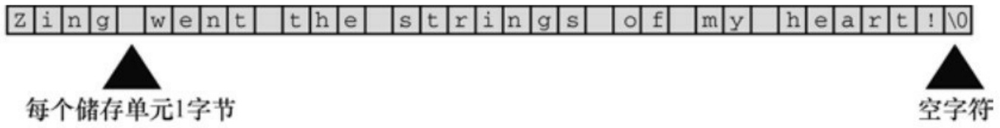
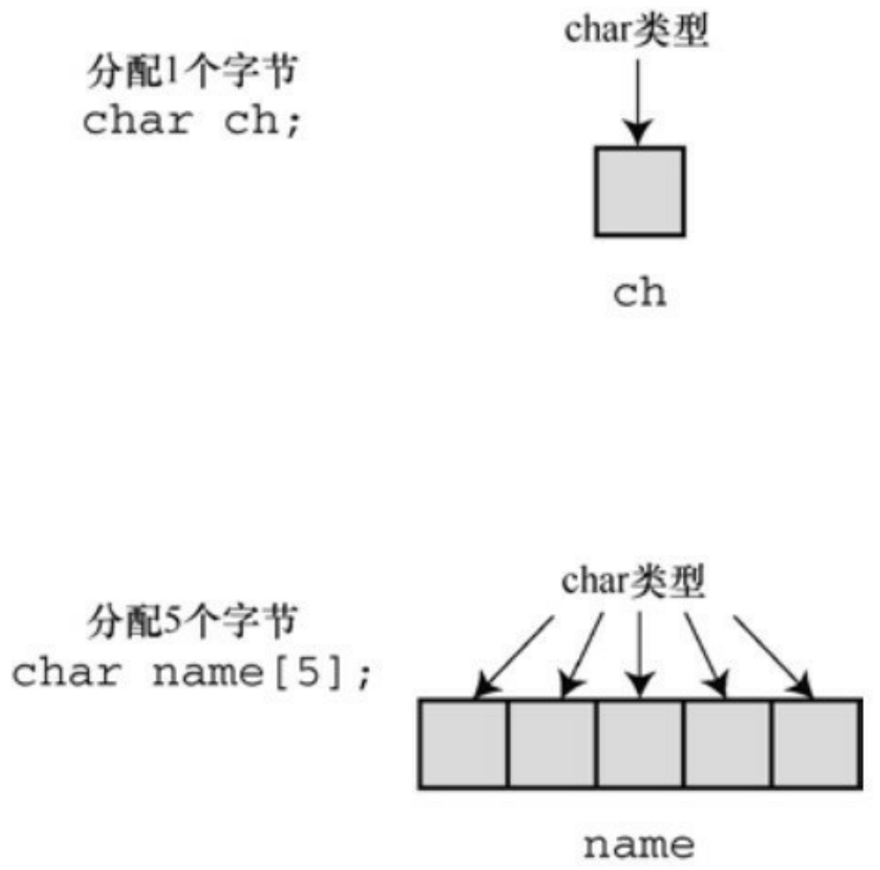
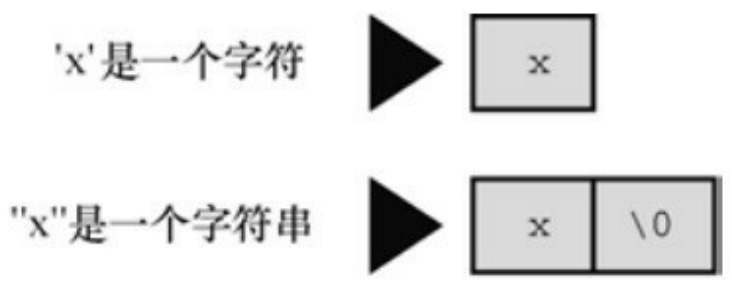
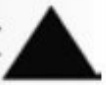
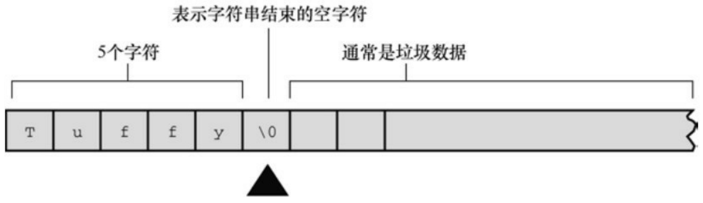
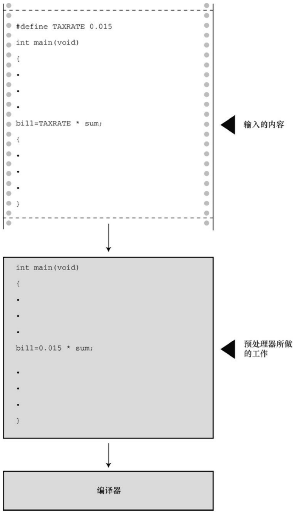
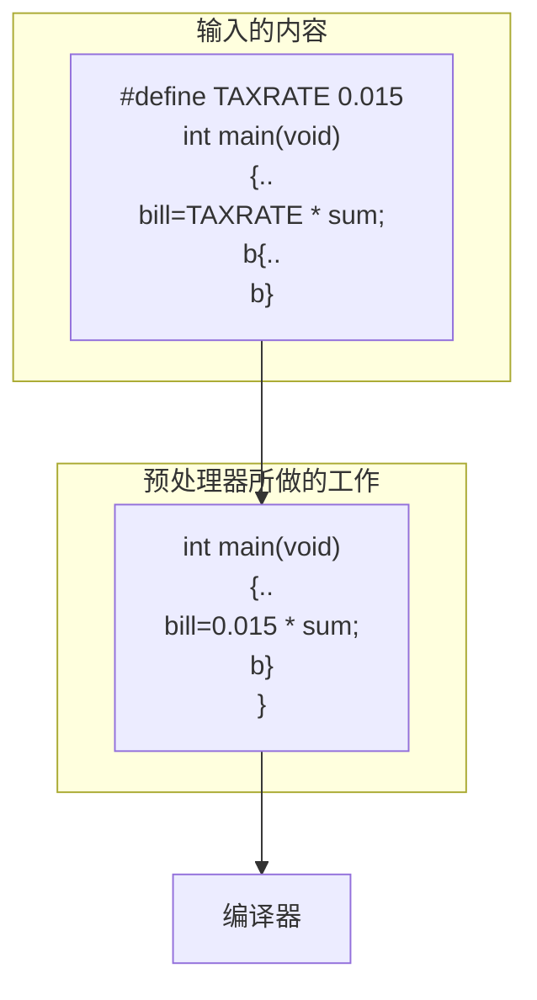

## 3.7 转义序列示例

再来看一个程序示例，该程序使用了一些特殊的转义序列。程序清单3.10 演示了退格（\b）、水平制表符（\t）和回车（\t）的工作方式。这些概念在计算机使用电传打字机作为输出设备时就有了，但是它们不一定能与现代的图形接口兼容。例如，程序清单3.10在某些Macintosh的实现中就无法正常运行。

程序清单3.10 escape.c程序

```c
/* escape.c -- 使用转移序列 */
#include <stdio.h>

int main(void)
{
float salary;
printf("\aEnter your desired monthly salary:"); /* 1 */
printf("\$_\b\b\b\b\b\b"); /* 2 */
scanf("%f", &salary);
printf("\n\t$%.2f a month is $%.2f a year.", salary,
salary * 12.0); /* 3 */
printf("\rGee!\n"); /* 4 */
return 0;
}
```

## 3.7.1 程序运行情况

假设在系统中运行的转义序列行为与本章描述的行为一致（实际行为可能不同。例如，XCode 4.6把\a、\b和\r显示为颠倒的问号），下面我们来分析这个程序。

第1条printf()语句（注释中标为1）发出一声警报（因为使用了\a），然后打印下面的内容:

Enter your desired monthly salary:

因为printf()中的字符串末尾没有\n，所以光标停留在冒号后面。

第2条printf()语句在光标处接着打印，屏幕上显示的内容是:

Enter your desired monthly salary: \$

冒号和美元符号之间有一个空格，这是因为第2条printf()语句中的字符串以一个空格开始。7个退格字符使得光标左移7个位置，即把光标移至7个下划线字符的前面，紧跟在美元符号后面。通常，退格不会擦除退回所经过的字符，但有些实现是擦除的，这和本例不同。

假设键入的数据是4000.00（并按下Enter键），屏幕显示的内容应该是:

Enter your desired monthly salary: \$4000.00

键入的字符替换了下划线字符。按下Enter键后，光标移至下一行的起始处。

第3条printf()语句中的字符串以\n\t开始。换行字符使光标移至下一行起始处。水平制表符使光标移至该行的下一个制表点，一般是第9列（但不一定）。然后打印字符串中的其他内容。执行完该语句后，此时屏幕显示的内容应该是:

Enter your desired monthly salary: \$4000.00

\$4000.00 a month is \$48000.00 a year.

因为这条printf()语句中没有使用换行字符，所以光标停留在最后的点号后面。

第4条printf()语句以\r开始。这使得光标回到当前行的起始处。然后打印Gee!，接着\n使光标移至下一行的起始处。屏幕最后显示的内容应该是:

Enter your desired monthly salary: \$4000.00

Gee! \$4000.00 a month is \$48000.00 a year.

## 3.7.2 刷新输出

printf()何时把输出发送到屏幕上？最初，printf()语句把输出发送到一个叫作缓冲区（buffer）的中间存储区域，然后缓冲区中的内容再不断被发送到屏幕上。C 标准明确规定了何时把缓冲区中的内容发送到屏幕:当缓冲区满、遇到换行字符或需要输入的时候（从缓冲区把数据发送到屏幕或文件被称为刷新缓冲区）。例如，前两个 printf()语句既没有填满缓冲区，也没有换行符，但是下一条 scanf()语句要求用户输入，这迫使printf()的输出被发送到屏幕上。

旧式编译器遇到scanf()也不会强行刷新缓冲区，程序会停在那里不显示任何提示内容，等待用户输入数据。在这种情况下，可以使用换行字符刷新缓冲区。代码应改为:

printf("Enter your desired monthly salary:\n");

scanf("%f", &salary);

无论接下来的输入是否能刷新缓冲区，代码都会正常运行。这将导致光标移至下一行起始处，用户无法在提示内容同一行输入数据。还有一种刷新缓冲区的方法是使用fflush()函数，详见第13章。

## 3.8 关键概念

C语言提供了大量的数值类型，目的是为程序员提供方便。那以整数类型为例，C认为一种整型不够，提供了有符号、无符号，以及大小不同的整型，以满足不同程序的需求。

计算机中的浮点数和整数在本质上不同，其存储方式和运算过程有很大区别。即使两个32位存储单元储存的位组合完全相同，但是一个解释为float类型，另一个解释为long类型，这两个相同的位组合表示的值也完全不同。例如，在PC中，假设一个位组合表示float类型的数256.0，如果将其解释为long类型，得到的值是113246208。C语言允许编写混合数据类型的表达式，但是会进行自动类型转换，以便在实际运算时统一使用一种类型。

计算机在内存中用数值编码来表示字符。美国最常用的是ASCII码，除此之外C也支持其他编码。字符常量是计算机系统使用的数值编码的符号表示，它表示为单引号括起来的字符，如'A'。

## 3.9 本章小结

C 有多种的数据类型。基本数据类型分为两大类:整数类型和浮点数类型。通过为类型分配的储存量以及是有符号还是无符号，区分不同的整数类型。最小的整数类型是char，因实现不同，可以是有符号的char或无符号的char，即unsigned char或signed char。但是，通常用char类型表示小整数时才这样显示说明。其他整数类型有short、int、long和long long类型。C规定，后面的类型不能小于前面的类型。上述都是有符号类型，但也可以使用unsigned关键字创建相应的无符号类型:unsigned short、unsigned int、unsigned long和unsigned long long。或者，在类型名前加上signed修饰符显式表明该类型是有符号类型。最后，\_Bool类型是一种无符号类型，可储存0或1，分别代表false和true。

浮点类型有3种:float、double和C90新增的long double。后面的类型应大于或等于前面的类型。有些实现可选择支持复数类型和虚数类型，通过关键字\_Complex和\_Imaginary与浮点类型的关键字组合（如，double \_Complex类型和float \_Imaginary类型）来表示这些类型。

整数可以表示为十进制、八进制或十六进制。0前缀表示八进制数，0x或0X前缀表示十六进制数。例如，32、040、0x20分别以十进制、八进制、十六进制表示同一个值。l或L前缀表明该值是long类型， ll或LL前缀表明该值是long long类型。

在C语言中，直接表示一个字符常量的方法是:把该字符用单引号括起来，如'Q'、'8'和'\$'。C语言的转义序列（如，'\n'）表示某些非打印字符。另外，还可以在八进制或十六进制数前加上一个反斜杠（如，'\007'），表示ASCII码中的一个字符。

浮点数可写成固定小数点的形式（如，9393.912）或指数形式（如，7.38E10）。C99和C11提供了第3种指数表示法，即用十六进制数和2的幂来表示（如，0xa.1fp10）。

printf()函数根据转换说明打印各种类型的值。转换说明最简单的形式由一个百分号（%）和一个转换字符组成，如%d或%f。

## 3.10 复习题

复习题的参考答案在附录A中。

1.指出下面各种数据使用的合适数据类型（有些可使用多种数据类型）:

a.East Simpleton的人口
b.DVD影碟的价格
c.本章出现次数最多的字母
d.本章出现次数最多的字母次数

2.在什么情况下要用long类型的变量代替int类型的变量？
3.使用哪些可移植的数据类型可以获得32位有符号整数？选择的理由是什么？
4.指出下列常量的类型和含义（如果有的话）:

a.'\b'
b.1066
c.99.44
d.0XAA
e.2.0e30

5.Dottie Cawm编写了一个程序，请找出程序中的错误。

include &lt;stdio.h&gt;

```txt
main
(
float g; h;
float tax, rate;
g = e21;
tax = rate*g;
)
```

6.写出下列常量在声明中使用的数据类型和在printf()中对应的转换说明:

| 常量 | 类型 | 转换说明(%转换字符) |
| --- | --- | --- |
| 12 |  |  |
| 0X3 |  |  |
| 'C' |  |  |
| 2.34E07 |  |  |
| '\\040' |  |  |
| 7.0 |  |  |
| 6L |  |  |
| 6.0f |  |  |
| 0x5.b6p12 |  |  |

7.写出下列常量在声明中使用的数据类型和在printf()中对应的转换说明（假设int为16位）:

| 常量 | 类型 | 转换说明(%转换字符) |
| --- | --- | --- |
| 012 |  |  |
| 2.9e05L |  |  |
| 's' |  |  |
| 100000 |  |  |
| '\\n' |  |  |
| 20.0f |  |  |
| 0x44 |  |  |
| -40 |  |  |

8.假设程序的开头有下列声明:

```matlab
int imate = 2;
long shot = 53456;
char grade = 'A';
float log = 2.71828;
```

把下面printf()语句中的转换字符补充完整:

printf("The odds against the %\_\_ were %\_\_ to 1.\n", imate, shot);

printf("A score of %\_\_ is not an %\_\_ grade.\n", log, grade);

9.假设ch是char类型的变量。分别使用转义序列、十进制值、八进制字符常量和十六进制字符常量把回车字符赋给ch（假设使用ASCII编码值）。

10.修正下面的程序（在C中，/表示除以）。

```c
void main(int) / this program is perfect /
{
cows, legs integer;
```

printf("How many cow legs did you count?\n);

scanf("%c", legs);

cows = legs / 4;

printf("That implies there are %f cows.\n", cows)}

11.指出下列转义序列的含义:

a.\n

c.\"

d.\t

## 3.11 编程练习

1.通过试验（即编写带有此类问题的程序）观察系统如何处理整数上溢、浮点数上溢和浮点数下溢的情况。
2.编写一个程序，要求提示输入一个ASCII码值（如，66），然后打印输入的字符。
3.编写一个程序，发出一声警报，然后打印下面的文本:

Startled by the sudden sound, Sally shouted,

"By the Great Pumpkin, what was that!"

4.编写一个程序，读取一个浮点数，先打印成小数点形式，再打印成指数形式。然后，如果系统支持，再打印成p记数法（即十六进制记数法）。按以下格式输出（实际显示的指数位数因系统而异）:

Enter a floating-point value: 64.25

fixed-point notation: 64.250000

exponential notation: 6.425000e+01

p notation: 0x1.01p+6

5.一年大约有3.156×10<sup>7</sup>秒。编写一个程序，提示用户输入年龄，然后显示该年龄对应的秒数。
6.1个水分子的质量约为3.0×10−23克。1夸脱水大约是950克。编写一个程序，提示用户输入水的夸脱数，并显示水分子的数量。
7.1英寸相当于2.54厘米。编写一个程序，提示用户输入身高（/英寸），然后以厘米为单位显示身高。

8.在美国的体积测量系统中，1品脱等于2杯，1杯等于8盎司，1盎司等于2大汤勺，1大汤勺等于3茶勺。编写一个程序，提示用户输入杯数，并以品脱、盎司、汤勺、茶勺为单位显示等价容量。思考对于该程序，为何使用浮点类型比整数类型更合适？

[1].欧美日常使用的度量衡单位是常衡盎司（avoirdupois ounce），而欧美黄金市场上使用的黄金交易计量单位是金衡盎司（troy ounce）。国际黄金市场上的报价，其单位“盎司”都指的是黄金盎司。常衡盎司属英制计量单位，做重量单位时也称为英两。相关换算参考如下:1常衡盎司 = 28.350克，1金衡盎司 = 31.104克，16常衡盎司 = 1磅。该程序的单位转换思路是:把磅换算成金衡盎司，即28.350÷31.104×16=14.5833。——译者注

[2].即，size\_t类型。— —译者注

# 第4章字符串和格式化输入/输出

本章介绍以下内容:

函数:strlen()

关键字:const

字符串

如何创建、存储字符串

如何使用strlen()函数获取字符串的长度

用C预处理器指令#define和ANSIC的const修饰符创建符号常量

本章重点介绍输入和输出。与程序交互和使用字符串可以编写个性化的程序，本章将详细介绍C语言的两个输入/输出函数:printf()和scanf()。学会使用这两个函数，不仅能与用户交互，还可根据个人喜好和任务要求格式化输出。最后，简要介绍一个重要的工具——C预处理器指令，并学习如何定义、使用符号常量。

## 4.1 前导程序

与前两章一样，本章以一个简单的程序开始。程序清单4.1与用户进行简单的交互。为了使程序的形式灵活多样，代码中使用了新的注释风格。

程序清单4.1 talkback.c程序

```c
// talkback.c -- 演示与用户交互
#include <stdio.h>
#include <string.h>      // 提供strlen()函数的原型
#define DENSITY 62.4     // 人体密度（单位：磅/立方英尺）
int main()
{
float weight, volume;
int size, letters;
char name[40];       // name是一个可容纳40个字符的数组
printf("Hi! What's your first name?\n");
scanf("%s", name);
printf("%s, what's your weight in pounds?\n", name);
scanf("%f", &weight);
size = sizeof name;
letters = strlen(name);
```

```txt
volume = weight / DENSITY;

printf("Well, %s, your volume is %2.2f cubic feet.\n",
name, volume);

printf("Also, your first name has %d letters,\n",
letters);

printf("and we have %d bytes to store it.\n", size);
return 0;
}
```

运行talkback.c程序，输入结果如下:

Hi! What's your first name?

## Christine

Christine, what's your weight in pounds?

## 154

Well, Christine, your volume is 2.47 cubic feet.

Also, your first name has 9 letters,

and we have 40 bytes to store it.

该程序包含以下新特性。

用数组（array）储存字符串（character string）。在该程序中，用户输入的名被储存在数组中，该数组占用内存中40个连续的字节，每个字节储存一个字符值。

使用%s转换说明来处理字符串的输入和输出。注意，在scanf()中，name没有&前缀，而weight有（稍后解释，&weight和name都是地址）。

用C预处理器把字符常量DENSITY定义为62.4。

用C函数strlen()获取字符串的长度。

对于BASIC的输入/输出而言，C的输入/输出看上去有些复杂。不过，复杂换来的是程序的高效和方便控制输入/输出。而且，一旦熟悉用法后，会发现它很简单。

## 4.2 字符串简介

字符串（character string）是一个或多个字符的序列，如下所示:

"Zing went the strings of my heart!"

双引号不是字符串的一部分。双引号仅告知编译器它括起来的是字符串，正如单引号用于标识单个字符一样。

## 4.2.1 char类型数组和null字符

C语言没有专门用于储存字符串的变量类型，字符串都被储存在char类型的数组中。数组由连续的存储单元组成，字符串中的字符被储存在相邻的存储单元中，每个单元储存一个字符（见图4.1）。



<details>
<summary>text_image</summary>

Z i n g | w e n t | t h e | s t r i n g s | o f | m y | h e a r t ! \0
每个储存单元1字节
空字符
</details>

图4.1 数组中的字符串

注意图4.1中数组末尾位置的字符\0。这是空字符（null character），C语言用它标记字符串的结束。空字符不是数字0，它是非打印字符，其ASCII码值是（或等价于）0。C中的字符串一定以空字符结束，这意味着数组的容量必须至少比待存储字符串中的字符数多1。因此，程序清单4.1中有40个存储单元的字符串，只能储存39个字符，剩下一个字节留给空字符。

那么，什么是数组？可以把数组看作是一行连续的多个存储单元。用更正式的说法是，数组是同类型数据元素的有序序列。程序清单4.1通过以下声明创建了一个包含40个存储单元（或元素）的数组，每个单元储存一个char类型的值:

char name[40];

name后面的方括号表明这是一个数组，方括号中的40表明该数组中的

元素数量。char表明每个元素的类型（见图4.2）。



<details>
<summary>flowchart</summary>

```mermaid
graph TD
  A["char类型"] --> B["ch"]
  C["分配1个字节\nchar ch;"] -.-> A
  D["&quot;分配5个字节\nchar name[5"];"] --> E["char类型"]
  E --> F["name"]
```
</details>

图4.2 声明一个变量和声明一个数组

字符串看上去比较复杂！必须先创建一个数组，把字符串中的字符逐个放入数组，还要记得在末尾加上一个\0。还好，计算机可以自己处理这些细节。

## 4.2.2 使用字符串

试着运行程序清单4.2，使用字符串其实很简单。

程序清单**4.2 praise1.c**程序

/\* praise1.c -- 使用不同类型的字符串 \*/

#include &lt;stdio.h&gt;

```c
#define PRAISE "You are an extraordinary being."
int main(void)
{
char name[40];
printf("What's your name? ");
scanf("%s", name);
printf("Hello, %s.%s\n", name, PRAISE);
return 0;
}
```

%s告诉printf()打印一个字符串。%s出现了两次，因为程序要打印两个字符串:一个储存在name数组中；一个由PRAISE来表示。运行praise1.c，其输出如下所示:

What's your name? Angela Plains

Hello, Angela.You are an extraordinary being.

你不用亲自把空字符放入字符串末尾，scanf()在读取输入时就已完成这项工作。也不用在字符串常量PRAISE末尾添加空字符。稍后我们会解释#define指令，现在先理解PRAISE后面用双引号括起来的文本是一个字符串。编译器会在末尾加上空字符。

注意（这很重要），scanf()只读取了Angela Plains中的Angela，它在遇到第1个空白（空格、制表符或换行符）时就不再读取输入。因此，scanf()在读到Angela和Plains之间的空格时就停止了。一般而言，根据%s转换说明，scanf()只会读取字符串中的一个单词，而不是一整句。C语言还有其他的输入函数（如，fgets()），用于读取一般字符串。后面章节将详细介绍这些函数。

字符串和字符

字符串常量"x"和字符常量'x'不同。区别之一在于'x'是基本类型（char），而"x"是派生类型（char数组）；区别之二是"x"实际上由两个字符组成:'x'和空字符\0（见图4.3）。



<details>
<summary>text_image</summary>

'x'是一个字符
"x"
"x"是一个字符串
x \0
</details>

以空字符作为字符串的结束



图4.3 字符'x'和字符串"x"

## 4.2.3 strlen()函数

上一章提到了 sizeof 运算符，它以字节为单位给出对象的大小。strlen()函数给出字符串中的字符长度。因为 1 字节储存一个字符，读者可能认为把两种方法应用于字符串得到的结果相同，但事实并非如此。请根据程序清单4.3，在程序清单4.2中添加几行代码，看看为什么会这样。

程序清单**4.3 praise2.c**程序

```c
/* praise2.c */
// 如果编译器不识别%zd，尝试换成%u或%lu。
#include <stdio.h>
#include <string.h>      /* 提供strlen()函数的原型 */
```

```c
#define PRAISE "You are an extraordinary being."
int main(void)
{
char name[40];
printf("What's your name? ");
scanf("%s", name);
printf("Hello, %s.%s\n", name, PRAISE);
printf("Your name of %zd letters occupies %zd memory cells.\n",
strlen(name), sizeof name);
printf("The phrase of praise has %zd letters ",
strlen(PRAISE));
printf("and occupies %zd memory cells.\n", sizeof PRAISE);
return 0;
}
```

如果使用ANSI C之前的编译器，必须移除这一行:

```c
#include <string.h>
```

string.h头文件包含多个与字符串相关的函数原型，包括strlen()。第11章将详细介绍该头文件（顺带一提，一些ANSI之前的UNIX系统用strings.h代替string.h，其中也包含了一些字符串函数的声明）。

一般而言，C 把函数库中相关的函数归为一类，并为每类函数提供一个头文件。例如，printf()和scanf()都隶属标准输入和输出函数，使用stdio.h头文件。string.h头文件中包含了strlen()函数和其他一些与字符串相关的函数（如拷贝字符串的函数和字符串查找函数）。

注意，程序清单4.3使用了两种方法处理很长的printf()语句。第1种方法是将printf()语句分为两行（可以在参数之间断为两行，但是不要在双引号中的字符串中间断开）；第 2 种方法是使用两个printf()语句打印一行内容，只在第2条printf()语句中使用换行符（\n）。运行该程序，其交互输出如下:

What's your name? Serendipity Chance

Hello, Serendipity.You are an extraordinary being.

Your name of 11 letters occupies 40 memory cells.

The phrase of praise has 31 letters and occupies 32 memory cells.

sizeof运算符报告，name数组有40个存储单元。但是，只有前11个单元用来储存Serendipity，所以strlen()得出的结果是11。name数组的第12个单元储存空字符，strlen()并未将其计入。图4.4演示了这个概念。



<details>
<summary>text_image</summary>

表示字符串结束的空字符
5个字符
通常是垃圾数据
T u f f y \0
</details>

图4.4 strlen()函数知道在何处停止

对于 PRAISE，用 strlen()得出的也是字符串中的字符数（包括空格和标点符号）。然而，sizeof运算符给出的数更大，因为它把字符串末尾不可见的空字符也计算在内。该程序并未明确告诉计算机要给字符串预留多少空间，所以它必须计算双引号内的字符数。

第 3 章提到过，C99 和 C11 标准专门为 sizeof 运算符的返回类型添加了%zd 转换说明，这对于strlen()同样适用。对于早期的C，还要知道sizeof和strlen()返回的实际类型（通常是unsigned或unsigned long）。

另外，还要注意一点:上一章的 sizeof 使用了圆括号，但本例没有。圆括号的使用时机否取决于运算对象是类型还是特定量？运算对象是类型时，圆括号必不可少，但是对于特定量，可有可无。也就是说，对于类型，应写成sizeof(char)或sizeof(float)；对于特定量，可写成sizeof name或sizeof 6.28。尽管如此，还是建议所有情况下都使用圆括号，如sizeof(6.28)。

程序清单4.3中使用strlen()和sizeof，完全是为了满足读者的好奇心。在实际应用中，strlen()和 sizeof 是非常重要的编程工具。例如，在各种要处理字符串的程序中，strlen()很有用。详见第11章。

下面我们来学习#define指令。

## 4.3 常量和C预处理器

有时，在程序中要使用常量。例如，可以这样计算圆的周长:

$$
\text {circumference} = 3. 1 4 1 5 9 * \text {diameter};
$$

这里，常量3.14159代表著名的常量pi（π）。在该例中，输入实际值便可使用这个常量。然而，这种情况使用符号常量（symbolic constant）会更好。也就是说，使用下面的语句，计算机稍后会用实际值完成替换:

$$
\text {circumference} = \mathrm{pi} ^ {*} \text {diameter};
$$

为什么使用符号常量更好？首先，常量名比数字表达的信息更多。请比较以下两条语句:

$$
\text {owed} = 0. 0 1 5 * \text {housevalue};
$$

$$
\text {owed} = \text {taxrate} * \text {housevalue};
$$

如果阅读一个很长的程序，第2条语句所表达的含义更清楚。

另外，假设程序中的多处使用一个常量，有时需要改变它的值。毕竟，税率通常是浮动的。如果程序使用符号常量，则只需更改符号常量的定义，不用在程序中查找使用常量的地方，然后逐一修改。

那么，如何创建符号常量？方法之一是声明一个变量，然后将该变量设置为所需的常量。可以这样写:

float taxrate;

$$
\text {taxrate} = 0. 0 1 5;
$$

这样做提供了一个符号名，但是taxrate是一个变量，程序可能会无意间改变它的值。C语言还提供了一个更好的方案——C预处理器。第2 章中介绍了预处理器如何使用#include包含其他文件的信息。预处理器也可用来定

义常量。只需在程序顶部添加下面一行:

#define TAXRATE 0.015

编译程序时，程序中所有的TAXRATE都会被替换成0.015。这一过程被称为编译时替换（compile-time substitution）。在运行程序时，程序中所有的替换均已完成（见图 4.5）。通常，这样定义的常量也称为明示常量（manifest constant）[1]。

请注意格式，首先是#define，接着是符号常量名（TAXRATE），然后是符号常量的值（0.015）（注意，其中并没有=符号）。所以，其通用格式如下:

#define NAME value

实际应用时，用选定的符号常量名和合适的值来替换NAME和value。注意，末尾不用加分号，因为这是一种由预处理器处理的替换机制。为什么TAXRATE 要用大写？用大写表示符号常量是 C 语言一贯的传统。这样，在程序中看到全大写的名称就立刻明白这是一个符号常量，而非变量。大写常量只是为了提高程序的可读性，即使全用小写来表示符号常量，程序也能照常运行。尽管如此，初学者还是应该养成大写常量的好习惯。

另外，还有一个不常用的命名约定，即在名称前带c\_或k\_前缀来表示常量（如，c\_level或k\_line）。

符号常量的命名规则与变量相同。可以使用大小写字母、数字和下划线字符，首字符不能为数字。程序清单4.4演示了一个简单的示例。



<details>
<summary>flowchart</summary>


</details>

图4.5 输入的内容和编译后的内容

程序清单4.4 pizza.c程序

```c
/* pizza.c -- 在比萨饼程序中使用已定义的常量 */
#include <stdio.h>

#define PI 3.14159

int main(void)
{
float area, circum, radius;
printf("What is the radius of your pizza?\n");
scanf("%f", &radius);
area = PI * radius * radius;
circum = 2.0 * PI *radius;
printf("Your basic pizza parameters are as follows:\n");
printf("circumference = %1.2f, area = %1.2f\n", circum,area);
return 0;
}
```

printf()语句中的%1.2f表明，结果被四舍五入为两位小数输出。下面是一个输出示例:

What is the radius of your pizza?

## 6.0

Your basic pizza parameters are as follows:

#define指令还可定义字符和字符串常量。前者使用单引号，后者使用双引号。如下所示:

#define BEEP '\a'

#define TEE 'T'

#define ESC '\033'

#define OOPS "Now you have done it!"

记住，符号常量名后面的内容被用来替换符号常量。不要犯这样的常见错误:

/\* 错误的格式 \*/

#define TOES = 20

如果这样做，替换TOES的是= 20，而不是20。这种情况下，下面的语句:

digits = fingers + TOES;

将被转换成错误的语句:

digits = fingers + = 20;

## 4.3.1 const限定符

C90标准新增了const关键字，用于限定一个变量为只读 [2]。其声明如

下:

这使得MONTHS成为一个只读值。也就是说，可以在计算中使用MONTHS，可以打印MONTHS，但是不能更改MONTHS的值。const用起来比#define更灵活，第12章将讨论与const相关的内容。

## 4.3.2 明示常量

C头文件limits.h和float.h分别提供了与整数类型和浮点类型大小限制相关的详细信息。每个头文件都定义了一系列供实现使用的明示常量 [3]。例如，limits.h头文件包含以下类似的代码:

```c
#define INT_MAX +32767
```

```c
#define INT_MIN -32768
```

这些明示常量代表int类型可表示的最大值和最小值。如果系统使用32位的int，该头文件会为这些明示常量提供不同的值。如果在程序中包含limits.h头文件，就可编写下面的代码:

如果系统使用4字节的int，limits.h头文件会提供符合4字节int的INT\_MAX和INT\_MIN。表4.1列出了limits.h中能找到的一些明示常量。

表4.1 limits.h中的一些明示常量

| 明示常量 | 含义 |
| --- | --- |
| CHAR_BIT | char 类型的位数 |
| CHAR_MAX | char 类型的最大值 |
| CHAR_MIN | char 类型的最小值 |
| SCHAR_MAX | signed char 类型的最大值 |
| SCHAR_MIN | signed char 类型的最小值 |
| UCHAR_MAX | unsigned char 类型的最大值 |
| SHRT_MAX | short 类型的最大值 |
| SHRT_MIN | short 类型的最小值 |
| USHRT_MAX | unsigned short 类型的最大值 |
| INT_MAX | int 类型的最大值 |
| INT_MIN | int 类型的最小值 |
| UINT_MAX | unsigned int 的最大值 |
| LONG_MAX | long 类型的最大值 |
| LONG_MIN | long 类型的最小值 |
| ULONG_MAX | unsigned long 类型的最大值 |
| LLONG_MAX | long long 类型的最大值 |
| LLONG_MIN | long long 类型的最小值 |
| ULLONG_MAX | unsigned long long 类型的最大值 |

类似地，float.h头文件中也定义一些明示常量，如FLT\_DIG和DBL\_DIG，分别表示float类型和double类型的有效数字位数。表4.2列出了float.h中的一些明示常量（可以使用文本编辑器打开并查看系统使用的float.h头文件）。表中所列都与float类型相关。把明示常量名中的FLT分别替换成DBL和LDBL，即可分别表示double和long double类型对应的明示常量（表中假设系统使用2的幂来表示浮点数）。

表4.2 float.h中的一些明示常量

| 明示常量 | 含义 |
| --- | --- |
| FLT_MANT_DIG | float 类型的尾数位数 |
| FLT_DIG | float 类型的最少有效数字位数(十进制) |
| FLT_MIN_10_EXP | 带全部有效数字的 float 类型的最小负指数(以 10 为底) |
| FLT_MAX_10_EXP | float 类型的最大正指数(以 10 为底) |
| FLT_MIN | 保留全部精度的 float 类型最小正数 |
| FLT_MAX | float 类型的最大正数 |
| FLT_EPSILON | 1.00 和比 1.00 大的最小 float 类型值之间的差值 |

程序清单4.5演示了如何使用float.h和limits.h中的数据（注意，编译器要完全支持C99标准才能识别LLONG\_MIN标识符）。

程序清单4.5 defines.c程序

```c
// defines.c -- 使用limit.h和float头文件中定义的明示常量
#include <stdio.h>

#include <limits.h> // 整型限制

#include <float.h> // 浮点型限制

int main(void)
{
printf("Some number limits for this system:\n");
printf("Biggest int: %d\n", INT_MAX);
printf("Smallest long long: %lld\n", LLONG_MIN);
printf("One byte = %d bits on this system.\n", CHAR_BIT);
printf("Largest double: %e\n", DBL_MAX);
printf("Smallest normal float: %e\n", FLT_MIN);
printf("float precision = %d digits\n", FLT_DIG);
printf("float epsilon = %e\n", FLT_EPSILON);
return 0;
}
```