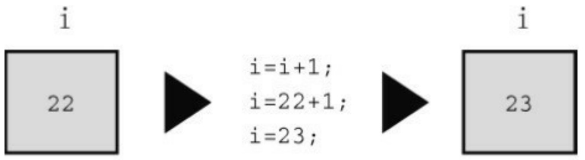
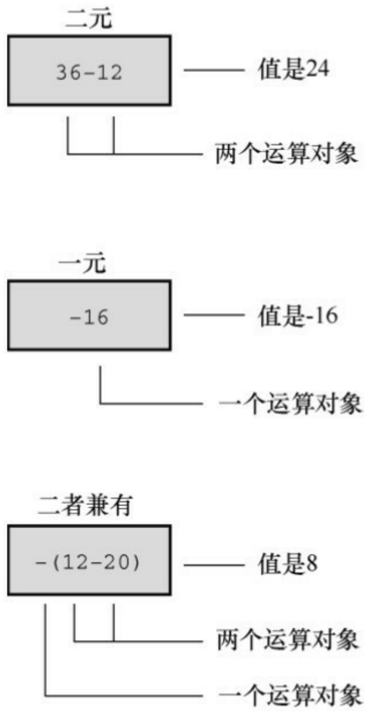

```c
double weight = 242.5;

printf("Enter a field width:\n");

scanf("%d", &width);

printf("The number is :%*d:\n", width, number);

printf("Now enter a width and a precision:\n");

scanf("%d %d", &width, &precision);

printf("Weight = %*.*f\n", width, precision, weight);

printf("Done!\n");

return 0;

}
```

变量width提供字段宽度，number是待打印的数字。因为转换说明中\*在d的前面，所以在printf()的参数列表中，width在number的前面。同样，width和precision提供打印weight的格式化信息。下面是一个运行示例:

Enter a field width:

6

The number is : 256:

Now enter a width and a precision:

**8 3**

Weight = 242.500

Done!

这里，用户首先输入6，因此6是程序使用的字段宽度。类似地，接下来用户输入8和3，说明字段宽度是8，小数点后面显示3位数字。一般而言，程序应根据weight的值来决定这些变量的值。

scanf()中\*的用法与此不同。把\*放在%和转换字符之间时，会使得scanf()跳过相应的输出项。程序清单4.17就是一个例子。

程序清单4.17 skip2.c程序

```c
/* skiptwo.c -- 跳过输入中的前两个整数 */
#include <stdio.h>

int main(void)
{
int n;

printf("Please enter three integers:\n");
scanf("%*d %*d %d", &n);

printf("The last integer was %d\n", n);
return 0;
}
```

程序清单4.17中的scanf()指示:跳过两个整数，把第3个整数拷贝给n。下面是一个运行示例:

Please enter three integers:

**2013 2014 2015**

The last integer was 2015

在程序需要读取文件中特定列的内容时，这项跳过功能很有用。

## 4.4.7 printf()的用法提示

想把数据打印成列，指定固定字段宽度很有用。因为默认的字段宽度是待打印数字的宽度，如果同一列中打印的数字位数不同，那么下面的语句:

printf("%d %d %d\n", val1, val2, val3);

打印出来的数字可能参差不齐。例如，假设执行3次printf()语句，用户输入不同的变量，其输出可能是这样:

12 234 1222

4 5 23

22334 2322 10001

使用足够大的固定字段宽度可以让输出整齐美观。例如，若使用下面的语句:

printf("%9d %9d %9d\n", val1, val2, val3);

上面的输出将变成:

| 12 | 234 | 1222 |
| --- | --- | --- |
| 4 | 5 | 23 |
| 22334 | 2322 | 10001 |

在两个转换说明中间插入一个空白字符，可以确保即使一个数字溢出了自己的字段，下一个数字也不会紧跟该数字一起输出（这样两个数字看起来像是一个数字）。这是因为格式字符串中的普通字符（包括空格）会被打印

出来。

另一方面，如果要在文字中嵌入一个数字，通常指定一个小于或等于该数字宽度的字段会比较方便。这样，输出数字的宽度正合适，没有不必要的空白。例如，下面的语句:

printf("Count Beppo ran %.2f miles in 3 hours.\n", distance);

其输出如下:

Count Beppo ran 10.22 miles in 3 hours.

如果把转换说明改为%10.2f，则输出如下:

Count Beppo ran 10.22 miles in 3 hours.

本地化设置

美国和世界上的许多地区都使用一个点来分隔十进制值的整数部分和小数部分，如3.14159。然而，许多其他地区用逗号来分隔，如 3,14159。读者可能注意到了，printf()和 scanf()都没有提供逗号的转换说明。C语言考虑了这种情况。本书附录B的参考资料V中介绍了C支持的本地化概念，因此C程序可以选择特定的本地化设置。例如，如果指定了荷兰语言环境，printf()和scanf()在显示和读取浮点值时会使用本地惯例（在这种情况下，用逗号代替点分隔浮点值的整数部分和小数部分）。另外，一旦指定了环境，便可在代码的数字中使用逗号:

double pi = 3,14159; // 荷兰本地化设置

C标准有两个本地化设置:"C"和""（空字符串）。默认情况下，程序使用"C"本地化设置，基本上符合美国的用法习惯。而""本地化设置可以替换当前系统中使用的本地语言环境。原则上，这与"C"本地化设置相同。事实上，大部分操作系统（如UNIX、Linux和Windows）都提供本地化设置选项列表，只不过它们提供的列表可能不同。

## 4.5 关键概念

C语言用char类型表示单个字符，用字符串表示字符序列。字符常量是一种字符串形式，即用双引号把字符括起来:"Good luck, my friend"。可以把字符串储存在字符数组（由内存中相邻的字节组成）中。字符串，无论是表示成字符常量还是储存在字符数组中，都以一个叫做空字符的隐藏字符结尾。

在程序中，最好用#define 定义数值常量，用 const 关键字声明的变量为只读变量。在程序中使用符号常量（明示常量），提高了程序的可读性和可维护性。

C 语言的标准输入函数（scanf()）和标准输出函数（printf()）都使用一种系统。在该系统中，第1个参数中的转换说明必须与后续参数中的值相匹配。例如，int转换说明%d与一个浮点值匹配会产生奇怪的结果。必须格外小心，确保转换说明的数量和类型与函数的其余参数相匹配。对于scanf()，一定要记得在变量名前加上地址运算符（&）。

空白字符（制表符、空格和换行符）在 scanf()处理输入时起着至关重要的作用。除了%c 模式（读取下一个字符），scanf()在读取输入时会跳过非空白字符前的所有空白字符，然后一直读取字符，直至遇到空白字符或与正在读取字符不匹配的字符。考虑一下，如果scanf()根据不同的转换说明读取相同的输入行，会发生什么情况。假设有如下输入行:

-13.45e12# 0

如果其对应的转换说明是%d，scanf()会读取3个字符（-13）并停在小数点处，小数点将被留在输入中作为下一次输入的首字符。如果其对应的转换说明是%f，scanf()会读取-13.45e12，并停在#符号处，而#将被留在输入中作为下一次输入的首字符；然后，scanf()把读取的字符序列-13.45e12转换成相应的浮点值，并储存在float类型的目标变量中。如果其对应的转换说明是%s，scanf()会读取-13.45e12#，并停在空格处，空格将被留在输入中作为下一次输入的首字符；然后，scanf()把这 10个字符的字符码储存在目标字符数组中，并在末尾加上一个空字符。如果其对应的转换说明是%c，scanf()只会读取并储存第1个字符，该例中是一个空格 [4]。

## 4.6 本章小结

字符串是一系列被视为一个处理单元的字符。在C语言中，字符串是以空字符（ASCII码是0）结尾的一系列字符。可以把字符串储存在字符数组中。数组是一系列同类型的项或元素。下面声明了一个名为name、有30个char类型元素的数组:

char name[30];

要确保有足够多的元素来储存整个字符串（包括空字符）。

字符串常量是用双引号括起来的字符序列，如:"This is an example of a string"。

scanf()函数（声明在string.h头文件中）可用于获得字符串的长度（末尾的空字符不计算在内）。scanf()函数中的转换说明是%s时，可读取一个单词。

C预处理器为预处理器指令（以#符号开始）查找源代码程序，并在开始编译程序之前处理它们。处理器根据#include指令把另一个文件中的内容添加到该指令所在的位置。#define指令可以创建明示常量（符号常量），即代表常量的符号。limits.h和float.h头文件用#define定义了一组表示整型和浮点型不同属性的符号常量。另外，还可以使用const限定符创建定义后就不能修改的变量。

printf()和scanf()函数对输入和输出提供多种支持。两个函数都使用格式字符串，其中包含的转换说明表明待读取或待打印数据项的数量和类型。另外，可以使用转换说明控制输出的外观:字段宽度、小数位和字段内的布局。

## 4.7 复习题

复习题的参考答案在附录A中。

1.再次运行程序清单 4.1，但是在要求输入名时，请输入名和姓（根据英文书写习惯，名和姓中间有一个空格），看看会发生什么情况？为什么？
2.假设下列示例都是完整程序中的一部分，它们打印的结果分别是什么？

a.printf("He sold the painting for \$%2.2f.\n", 2.345e2);

b.printf("%c%c%c\n", 'H', 105, '\41');

c.#define Q "His Hamlet was funny without being vulgar."printf("%s\nhas %d characters.\n", Q, strlen(Q));

d.printf("Is %2.2e the same as %2.2f?\n", 1201.0, 1201.0);

3.在第2题的c中，要输出包含双引号的字符串Q，应如何修改？
4.找出下面程序中的错误。

define B booboo

define X 10

main(int)

int age;

char name;

printf("Please enter your first name.");

```javascript
scanf("%s", name);
```

```javascript
printf("All right, %c, what's your age?\n", name);
```

```javascript
scanf("%f", age);
```

<div class="docvortex-algorithm" style="white-space: pre-wrap; font-family:monospace;">
$\mathrm{xp} = \mathrm{age} + \mathrm{X};$
</div>

```txt
printf("That's a %s! You must be at least %d.\n", B, xp);
```

```txt
rerun 0;
```

```txt
}
```

5.假设一个程序的开头是这样:

```txt
#define BOOK "War and Peace"
```

```txt
int main(void)
```

```txt
{
```

```python
float cost = 12.99;
```

```txt
float percent = 80.0;
```

请构造一个使用BOOK、cost和percent的printf()语句，打印以下内容:

This copy of "War and Peace" sells for \$12.99.

That is 80% of list.

6.打印下列各项内容要分别使用什么转换说明？

a.一个字段宽度与位数相同的十进制整数

b.一个形如8A、字段宽度为4的十六进制整数

c.一个形如232.346、字段宽度为10的浮点数
d.一个形如2.33e+002、字段宽度为12的浮点数
e.一个字段宽度为30、左对齐的字符串

7.打印下面各项内容要分别使用什么转换说明？

a.字段宽度为15的unsigned long类型的整数
b.一个形如0x8a、字段宽度为4的十六进制整数
c.一个形如2.33E+02、字段宽度为12、左对齐的浮点数
d.一个形如+232.346、字段宽度为10的浮点数
e.一个字段宽度为8的字符串的前8个字符

8.打印下面各项内容要分别使用什么转换说明？

a.一个字段宽度为6、最少有4位数字的十进制整数
b.一个在参数列表中给定字段宽度的八进制整数
c.一个字段宽度为2的字符
d.一个形如+3.13、字段宽度等于数字中字符数的浮点数
e.一个字段宽度为7、左对齐字符串中的前5个字符

9.分别写出读取下列各输入行的scanf()语句，并声明语句中用到变量和数组。

a.101
b.22.32 8.34E−09

c.linguini

d.catch 22

e.catch 22 （但是跳过catch）

10.什么是空白？

11.下面的语句有什么问题？如何修正？

printf("The double type is %z bytes..\n", sizeof(double));

12.假设要在程序中用圆括号代替花括号，以下方法是否可行？

```txt
#define ( {
#define ) }
```

## 4.8 编程练习

1.编写一个程序，提示用户输入名和姓，然后以“名,姓”的格式打印出来。
2.编写一个程序，提示用户输入名和姓，并执行一下操作:

a.打印名和姓，包括双引号；
b.在宽度为20的字段右端打印名和姓，包括双引号；
c.在宽度为20的字段左端打印名和姓，包括双引号；
d.在比姓名宽度宽3的字段中打印名和姓。

3.编写一个程序，读取一个浮点数，首先以小数点记数法打印，然后以指数记数法打印。用下面的格式进行输出（系统不同，指数记数法显示的位数可能不同）:

a.输入21.3或2.1e+001；

b.输入+21.290或2.129E+001；

4.编写一个程序，提示用户输入身高（单位:英寸）和姓名，然后以下面的格式显示用户刚输入的信息:

Dabney, you are 6.208 feet tall

使用float类型，并用/作为除号。如果你愿意，可以要求用户以厘米为单位输入身高，并以米为单位显示出来。

5.编写一个程序，提示用户输入以兆位每秒（Mb/s）为单位的下载速度和以兆字节（MB）为单位的文件大小。程序中应计算文件的下载时间。注意，这里1字节等于8位。使用float类型，并用/作为除号。该程序要以下面的格式打印 3 个变量的值（下载速度、文件大小和下载时间），显示小数点

后面两位数字:

At 18.12 megabits per second, a file of 2.20 megabytes

downloads in 0.97 seconds.

6.编写一个程序，先提示用户输入名，然后提示用户输入姓。在一行打印用户输入的名和姓，下一行分别打印名和姓的字母数。字母数要与相应名和姓的结尾对齐，如下所示:

Melissa Honeybee

7 8

接下来，再打印相同的信息，但是字母个数与相应名和姓的开头对齐，如下所示:

Melissa Honeybee

7 8

7.编写一个程序，将一个double类型的变量设置为1.0/3.0，一个float类型的变量设置为1.0/3.0。分别显示两次计算的结果各3次:一次显示小数点后面6位数字；一次显示小数点后面12位数字；一次显示小数点后面16位数字。程序中要包含float.h头文件，并显示FLT\_DIG和DBL\_DIG的值。1.0/3.0的值与这些值一致吗？

8.编写一个程序，提示用户输入旅行的里程和消耗的汽油量。然后计算并显示消耗每加仑汽油行驶的英里数，显示小数点后面一位数字。接下来，使用1加仑大约3.785升，1英里大约为1.609千米，把单位是英里/加仑的值转换为升/100公里（欧洲通用的燃料消耗表示法），并显示结果，显示小数点后面 1 位数字。注意，美国采用的方案测量消耗单位燃料的行程（值越大越好），而欧洲则采用单位距离消耗的燃料测量方案（值越低越好）。使用#define 创建符号常量或使用 const 限定符创建变量来表示两个转换系数。

[1].其实，符号常量的概念在K&R合著的《C语言程序设计》中介绍过。但是，在历年的C标准中（包括最新的C11），并没有符号常量的概念，只提到过#define最简单的用法是定义一个“明示常量”。市面上各编程书籍对此概念的理解不同，有些作者把#define宏定义实现的“常量”归为“明示常量”；有些作者（如，本书的作者）则认为“明示常量”相当于“符号常量”。——译者注
[2].注意，在C语言中，用const类型限定符声明的是变量，不是常量。译者注
[3].再次提醒读者注意，本书作者认为“明示常量”相当于“符号常量”，经常在书中混用这两个术语。——译者注
[4].注意，“ -13.45e12# 0”的负号前面有一个空格。——译者注

# 第5章运算符、表达式和语句

本章介绍以下内容:

关键字:while、typedef

运算符:=、-、\*、/、%、++、--、(类型名)

C语言的各种运算符，包括用于普通数学运算的运算符

运算符优先级以及语句、表达式的含义

while循环

复合语句、自动类型转换和强制类型转换

如何编写带有参数的函数

现在，读者已经熟悉了如何表示数据，接下来我们学习如何处理数据。C 语言为处理数据提供了大量的操作，可以在程序中进行算术运算、比较值的大小、修改变量、逻辑地组合关系等。我们先从基本的算术运算（加、减、乘、除）开始。

组织程序是处理数据的另一个方面，让程序按正确的顺序执行各个步骤。C 有许多语言特性，帮助你完成组织程序的任务。循环就是其中一个特性，本章中你将窥其大概。循环能重复执行行为，让程序更有趣、更强大。

## 5.1 循环简介

程序清单5.1是一个简单的程序示例，该程序进行了简单的运算，计算穿9码男鞋的脚长（单位:英寸）。为了让读者体会循环的好处，程序的第1个版本演示了不使用循环编程的局限性。

程序清单5.1 shoes1.c程序

```c
/* shoes1.c -- 把鞋码转换成英寸 */
#include <stdio.h>
#define ADJUST 7.31 // 字符常量
int main(void)
{
const double SCALE = 0.333;// const变量
double shoe, foot;
shoe = 9.0;
foot = SCALE * shoe + ADJUST;
printf("Shoe size (men's) foot length\n");
printf("%10.1f %15.2f inches\n", shoe, foot);
return 0;
}
```

该程序的输出如下:

Shoe size (men's) foot length

9.0

10.31 inches

该程序演示了用#define 指令创建符号常量和用 const 限定符创建在程序运行过程中不可更改的变量。程序使用了乘法和加法，假定用户穿9码的鞋，以英寸为单位打印用户的脚长。你可能会说:“这太简单了，我用笔算比敲程序还要快。”说得没错。写出来的程序只使用一次（本例即只根据一只鞋的尺码计算一次脚长），实在是浪费时间和精力。如果写成交互式程序会更有用，但是仍无法利用计算机的优势。

应该让计算机做一些重复计算的工作。毕竟，需要重复计算是使用计算机的主要原因。C 提供多种方法做重复计算，我们在这里简单介绍一种— while循环。它能让你对运算符做更有趣地探索。程序清单5.2演示了用循环改进后的程序。

程序清单**5.2 shoes2.c**程序

```c
/* shoes2.c -- 计算多个不同鞋码对应的脚长 */
#include <stdio.h>
#define ADJUST 7.31 // 字符常量
int main(void)
{
const double SCALE = 0.333;// const变量
double shoe, foot;
printf("Shoe size (men's) foot length\n");
shoe = 3.0;
```

while (shoe < 18.5) /\* while循环开始 \*/

{ /\* 块开始 \*/

foot = SCALE \* shoe + ADJUST;

printf("%10.1f %15.2f inches\n", shoe, foot);

shoe = shoe + 1.0;

} /\* 块结束 \*/

printf("If the shoe fits, wear it.\n");

return 0;

}

下面是shoes2.c程序的输出（...表示并未显示完整，有删节）:

Shoe size (men's) foot length

3.0 8.31 inches

4.0 8.64 inches

5.0 8.97 inches

6.0 9.31 inches

...

16.0 12.64 inches

17.0 12.97 inches

18.0 13.30 inches

（如果读者对此颇有研究，应该知道该程序不符合实际情况。程序中假定了一个统一的鞋码系统。）

下面解释一下while循环的原理。当程序第1次到达while循环时，会检查圆括号中的条件是否为真。该程序中，条件表达式如下:

$$
\text {shoe} <   18.5
$$

符号<的意思是小于。变量shoe被初始化为3.0，显然小于18.5。因此，该条件为真，程序进入块中继续执行，把尺码转换成英寸。然后打印计算的结果。下一条语句把 shoe增加1.0，使shoe的值为4.0:

$$
\text {shoe} = \text {shoe} + 1. 0;
$$

此时，程序返回while入口部分检查条件。为何要返回while的入口部分？因为上面这条语句的下面是右花括号（}），代码使用一对花括号（{}）来标出while循环的范围。花括号之间的内容就是要被重复执行的内容。花括号以及被花括号括起来的部分被称为块（block）。现在，回到程序中。因为4小于18.5，所以要重复执行被花括号括起来的所有内容（用计算机术语来说就是，程序循环这些语句）。该循环过程一直持续到shoe的值为19.0。此时，由于19.0小于18.5，所以该条件为假:

$$
\text {shoe} <   18.5
$$

出现这种情况后，控制转到紧跟while循环后面的第1条语句。该例中，是最后的printf()语句。

可以很方便地修改该程序用于其他转换。例如，把SCALE设置成1.8、ADJUST设置成32.0，该程序便可把摄氏温度转换成华氏温度；把SCALE设置成0.6214、ADJUST设置成0，该程序便可把公里转换成英里。注意，修改了设置后，还要更改打印的消息，以免前后表述不一。

通过while循环能便捷灵活地控制程序。现在，我们来学习程序中会用到的基本运算符。

## 5.2 基本运算符

C用运算符（operator）表示算术运算。例如，+运算符使在它两侧的值加在一起。如果你觉得术语“运算符”很奇怪，那么请记住东西总得有个名称。与其叫“那些东西”或“运算处理符”，还不如叫“运算符”。现在，我们介绍一下用于基本算术运算的运算符:=、+、-、\*和/（C 没有指数运算符。不过，C 的标准数学库提供了一个pow()函数用于指数运算。例如，pow(3.5, 2.2)返回3.5的2.2次幂）。

## 5.2.1 赋值运算符:=

在C语言中，=并不意味着“相等”，而是一个赋值运算符。下面的赋值表达式语句:

$$
\mathrm{bmw} = 2 0 0 2;
$$

把值2002赋给变量bmw。也就是说，=号左侧是一个变量名，右侧是赋给该变量的值。符号=被称为赋值运算符。另外，上面的语句不读作“bmw等于2002”，而读作“把值2002赋给变量bmw”。赋值行为从右往左进行。

也许变量名和变量值的区别看上去微乎其微，但是，考虑下面这条常用的语句:

$$
\mathrm{i=i+1};
$$

对数学而言，这完全行不通。如果给一个有限的数加上 1，它不可能“等于”原来的数。但是，在计算机赋值表达式语句中，这很合理。该语句的意思是:找出变量 i 的值，把该值加 1，然后把新值赋值变量i（见图5.1）。



<details>
<summary>text_image</summary>

i
22
i=i+1;
i=22+1;
i=23;
i
23
</details>

图5.1 语句i = i + 1;

在C语言中，类似这样的语句没有意义（实际上是无效的）:

$$
2 0 0 2 = \mathrm{bmw};
$$

因为在这种情况下，2002 被称为右值（rvale），只能是字面常量。不能给常量赋值，常量本身就是它的值。因此，在编写代码时要记住，=号左侧的项必须是一个变量名。实际上，赋值运算符左侧必须引用一个存储位置。最简单的方法就是使用变量名。不过，后面章节还会介绍“指针”，可用于指向一个存储位置。概括地说，C 使用可修改的左值（modifiable lvalue）标记那些可赋值的实体。也许“可修改的左值”不太好懂，我们再来看一些定义。

几个术语:数据对象、左值、右值和运算符

赋值表达式语句的目的是把值储存到内存位置上。用于储存值的数据存储区域统称为数据对象（data object）。C 标准只有在提到这个概念时才会用到对象这个术语。使用变量名是标识对象的一种方法。除此之外，还有其他方法，但是要在后面的章节中才学到。例如，可以指定数组的元素、结构的成员，或者使用指针表达式（指针中储存的是它所指向对象的地址）。左值（lvalue）是 C 语言的术语，用于标识特定数据对象的名称或表达式。因此，对象指的是实际的数据存储，而左值是用于标识或定位存储位置的标签。

对于早期的C语言，提到左值意味着:

1.它指定一个对象，所以引用内存中的地址；

2.它可用在赋值运算符的左侧，左值（lvalue）中的l源自left。

但是后来，标准中新增了const限定符。用const创建的变量不可修改。因此，const标识符满足上面的第1项，但是不满足第2项。一方面C继续把标识对象的表达式定义为左值，一方面某些左值却不能放在赋值运算符的左侧。有些左值不能用于赋值运算符的左侧。此时，标准对左值的定义已经不能满足当前的状况。

为此，C标准新增了一个术语:可修改的左值（modifiable lvalue），用于标识可修改的对象。所以，赋值运算符的左侧应该是可修改的左值。当前标准建议，使用术语对象定位值（object locator value）更好。

右值（rvalue）指的是能赋值给可修改左值的量，且本身不是左值。例如，考虑下面的语句:

$$
\mathrm{bmw} = 2 0 0 2;
$$

这里，bmw是可修改的左值，2002是右值。读者也许猜到了，右值中的r源自right。右值可以是常量、变量或其他可求值的表达式（如，函数调用）。实际上，当前标准在描述这一概念时使用的是表达式的值（value of an expression），而不是右值。

我们看几个简单的示例:

```txt
int ex;

int why;

int zee;

const int TWO = 2;

why = 42;

zee = why;
```

$$
\mathrm{ex} = \text {TWO} * (\text {why} + \text {zee});
$$

这里，ex、why和zee都是可修改的左值（或对象定位值），它们可用于赋值运算符的左侧和右侧。TWO是不可改变的左值，它只能用于赋值运算符的右侧（在该例中，TWO被初始化为2，这里的=运算符表示初始化而不是赋值，因此并未违反规则）。同时，42 是右值，它不能引用某指定内存位置。另外，why和 zee 是可修改的左值，表达式(why + zee)是右值，该表达式不能表示特定内存位置，而且也不能给它赋值。它只是程序计算的一个临时值，在计算完毕后便会被丢弃。

在学习名称时，被称为“项”（如，赋值运算符左侧的项）的就是运算对象（operand）。运算对象是运算符操作的对象。例如，可以把吃汉堡描述为:“吃”运算符操作“汉堡”运算对象。类似地可以说，=运算符的左侧运算对象应该是可修改的左值。

C的基本赋值运算符有些与众不同，请看程序清单5.3。

程序清单**5.3 golf.c**程序

```c
/* golf.c -- 高尔夫锦标赛记分卡 */

#include <stdio.h>

int main(void)

{

int jane, tarzan, cheeta;

cheeta = tarzan = jane = 68;

printf(" cheeta tarzan jane\n");

printf("First round score %4d %8d %8d\n", cheeta, tarzan, );
```

```scss
return 0;
}
```

许多其他语言都会回避该程序中的三重赋值，但是C完全没问题。赋值的顺序是从右往左:首先把86赋给jane，然后再赋给tarzan，最后赋给cheeta。因此，程序的输出如下:

```txt
cheetah tarzan jane  
First round score 68 68 68
```

## 5.2.2 加法运算符:+

加法运算符（addition operator）用于加法运算，使其两侧的值相加。例如，语句:

```txt
printf("%d", 4 + 20);
```

打印的是24，而不是表达式

<div class="docvortex-algorithm" style="white-space: pre-wrap; font-family:monospace;">
$4 + 20$
</div>

相加的值（运算对象）可以是变量，也可以是常量。因此，执行下面的语句:

```txt
income = salary + bribes;
```

计算机会查看加法运算符右侧的两个变量，把它们相加，然后把和赋给变量income。

在此提醒读者注意，income、salary和bribes都是可修改的左值。因为每个变量都标识了一个可被赋值的数据对象。但是，表达式salary + brives是一个右值。

## 5.2.3 减法运算符:-

减法运算符（subtraction operator）用于减法运算，使其左侧的数减去右侧的数。例如，下面的语句把200.0赋给takehome:

$$
\text {takehome} = 2 2 4. 0 0 - 2 4. 0 0;
$$

+和-运算符都被称为二元运算符（binary operator），即这些运算符需要两个运算对象才能完成操作。

## 5.2.4 符号运算符:-和+

减号还可用于标明或改变一个值的代数符号。例如，执行下面的语句后，smokey的值为12:

$$
\text {rocky} = - 1 2;
$$

smokey = –rocky;以这种方式使用的负号被称为一元运算符（unary operator）。一元运算符只需要一个运算对象（见图5.2）。

C90标准新增了一元+运算符，它不会改变运算对象的值或符号，只能这样使用:

$$
\text {dozen} = + 1 2;
$$

编译器不会报错。但是在以前，这样做是不允许的。



图5.2 一元和二元运算符

## 5.2.5 乘法运算符:\*

符号\*表示乘法。下面的语句用2.54乘以inch，并将结果赋给cm:

$$
\mathrm{cm} = 2. 5 4 * \text {inch};
$$

C没有平方函数，如果要打印一个平方表，怎么办？如程序清单5.4所示，可以使用乘法来计算平方。

程序清单**5.4 squares.c**程序

```c
/* squares.c -- 计算1~20的平方 */
#include <stdio.h>

int main(void)
{
int num = 1;
while (num < 21)
{
printf("%4d %6d\n", num, num * num);
num = num + 1;
}
return 0;
}
```

该程序打印数字1～20及其平方。接下来，我们再看一个更有趣的例子。

## 1.指数增长

读者可能听过这样一个故事，一位强大的统治者想奖励做出突出贡献的学者。他问这位学者想要什么，学者指着棋盘说，在第1个方格里放1粒小麦、第2个方格里放2粒小麦、第3个方格里放4粒小麦，第4个方格里放 8 粒小麦，以此类推。这位统治者不熟悉数学，很惊讶学者竟然提出如此谦虚的要求。因为他原本准备奖励给学者一大笔财产。如果程序清单5.5运行的结果正确，这显然是跟统治者开了一个玩笑。程序计算出每个方格应放多少小麦，并计算了总数。可能大多数人对小麦的产量不熟悉，该程序以谷粒数为单位，把计算的小麦总数与粗略估计的世界小麦年产量进行了比较。

程序清单5.5 wheat.c程序

```c
/* wheat.c -- 指数增长 */
#include <stdio.h>
#define SQUARES 64 // 棋盘中的方格数
int main(void)
{
const double CROP = 2E16; // 世界小麦年产谷粒数
double current, total;
int count = 1;
printf("square grains total ");
printf("fraction of \n");
printf(" added grains ");
printf("world total\n");
total = current = 1.0; /* 从1颗谷粒开始 */
printf("%4d %13.2e %12.2e %12.2e\n", count, current,
total, total / CROP);
while (count < SQUARES)
{
```

```javascript
count = count + 1;
```

```txt
current = 2.0 * current; /* 下一个方格谷粒翻倍 */
```

```javascript
total = total + current; /* 更新总数 */
```

```txt
printf("%4d %13.2e %12.2e %12.2e\n", count, current,
```

```javascript
total, total / CROP);
```

```txt
}
```

```javascript
printf("That's all.\n");
```

```txt
return 0;
```

```txt
}
```

程序的输出结果如下:

<table><tr><td>square</td><td>grains</td><td colspan="2">total</td><td>fraction of</td></tr><tr><td>added</td><td>grains</td><td>world</td><td>total</td><td></td></tr><tr><td>1</td><td>1.00e+00</td><td>1.00e+00</td><td></td><td>5.00e-17</td></tr><tr><td>2</td><td>2.00e+00</td><td>3.00e+00</td><td></td><td>1.50e-16</td></tr><tr><td>3</td><td>4.00e+00</td><td>7.00e+00</td><td></td><td>3.50e-16</td></tr><tr><td>4</td><td>8.00e+00</td><td>1.50e+01</td><td></td><td>7.50e-16</td></tr><tr><td>5</td><td>1.60e+01</td><td>3.10e+01</td><td></td><td>1.55e-15</td></tr><tr><td>6</td><td>3.20e+01</td><td>6.30e+01</td><td></td><td>3.15e-15</td></tr><tr><td>7</td><td>6.40e+01</td><td>1.27e+02</td><td></td><td>6.35e-15</td></tr></table>

| 8 | 1.28e+02 | 2.55e+02 | 1.27e-14 |
| --- | --- | --- | --- |
| 9 | 2.56e+02 | 5.11e+02 | 2.55e-14 |
| 10 | 5.12e+02 | 1.02e+03 | 5.12e-14 |

10个方格以后，该学者得到的小麦仅超过了1000粒。但是，看看55个方格的小麦数是多少:

55 1.80e+16 3.60e+16 1.80e+00

总量已超过了世界年产量！不妨自己动手运行该程序，看看第64个方格有多少小麦。

这个程序示例演示了指数增长的现象。世界人口增长和我们使用的能源都遵循相同的模式。

## 5.2.6 除法运算符:/

C使用符号/来表示除法。/左侧的值是被除数，右侧的值是除数。例如，下面four的值是4.0:

$$
\text {four} = 1 2. 0 / 3. 0;
$$

整数除法和浮点数除法不同。浮点数除法的结果是浮点数，而整数除法的结果是整数。整数是没有小数部分的数。这使得5除以3很让人头痛，因为实际结果有小数部分。在C语言中，整数除法结果的小数部分被丢弃，这一过程被称为截断（truncation）。

运行程序清单5.6中的程序，看看截断的情况，体会整数除法和浮点数除法的区别。

程序清单**5.6 divide.c**程序

/\* divide.c -- 演示除法 \*/

```c
#include <stdio.h>

int main(void)
{
printf("integer division: 5/4 is %d \n", 5 / 4);
printf("integer division: 6/3 is %d \n", 6 / 3);
printf("integer division: 7/4 is %d \n", 7 / 4);
printf("floating division: 7./4. is %1.2f \n", 7. / 4.);
printf("mixed division: 7./4 is %1.2f \n", 7. / 4);
return 0;
}
```

程序清单5.6中包含一个“混合类型”的示例，即浮点值除以整型值。C相对其他一些语言而言，在类型管理上比较宽容。尽管如此，一般情况下还是要避免使用混合类型。该程序的输出如下:

```txt
integer division: 5/4 is 1
integer division: 6/3 is 2
integer division: 7/4 is 1
floating division: 7./4. is 1.75
mixed division: 7./4 is 1.75
```

注意，整数除法会截断计算结果的小数部分（丢弃整个小数部分），不会四舍五入结果。混合整数和浮点数计算的结果是浮点数。实际上，计算机