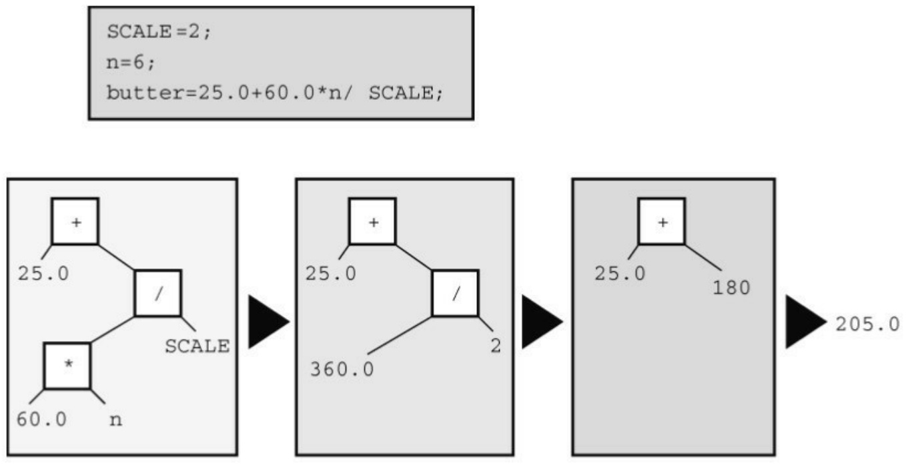
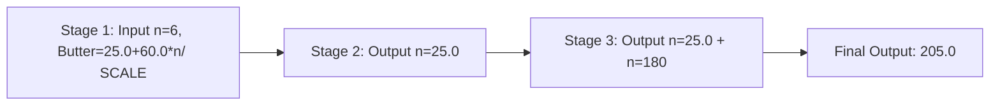
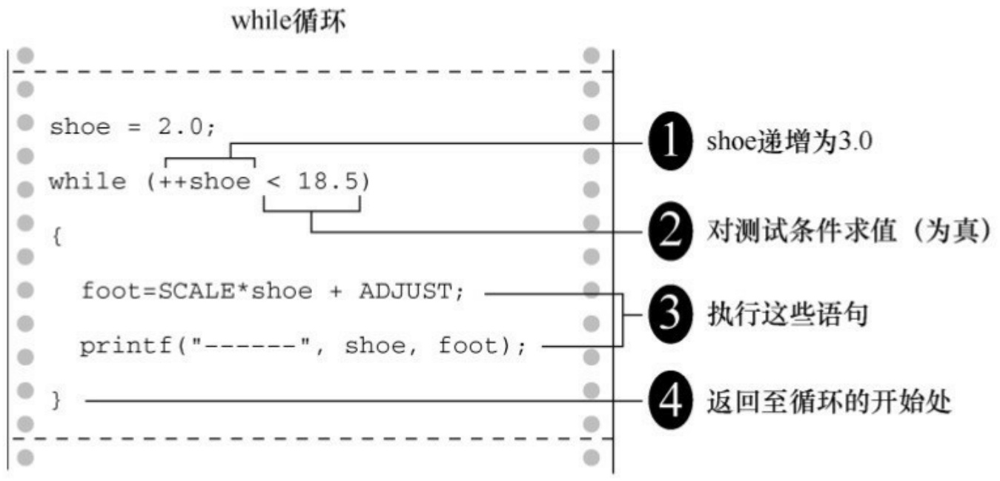
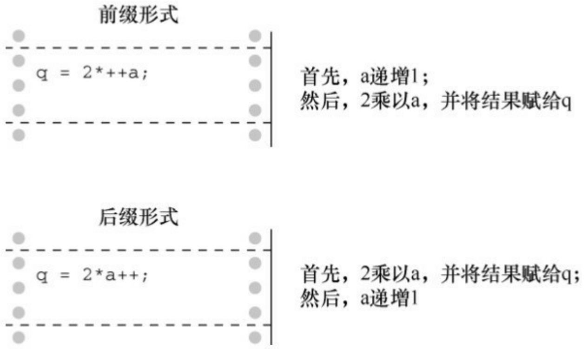
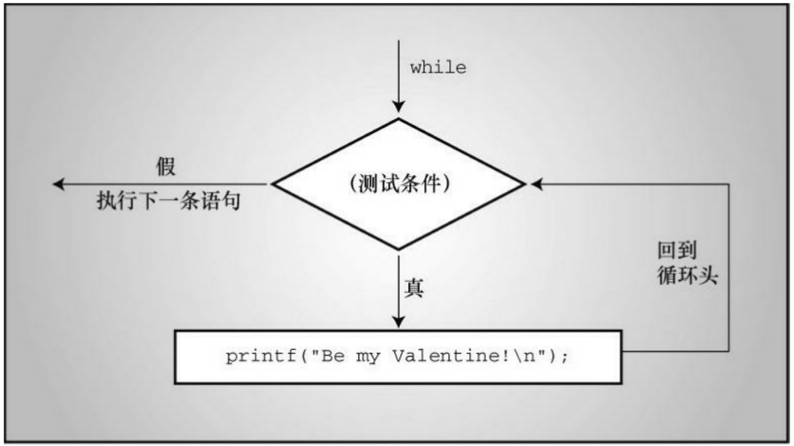
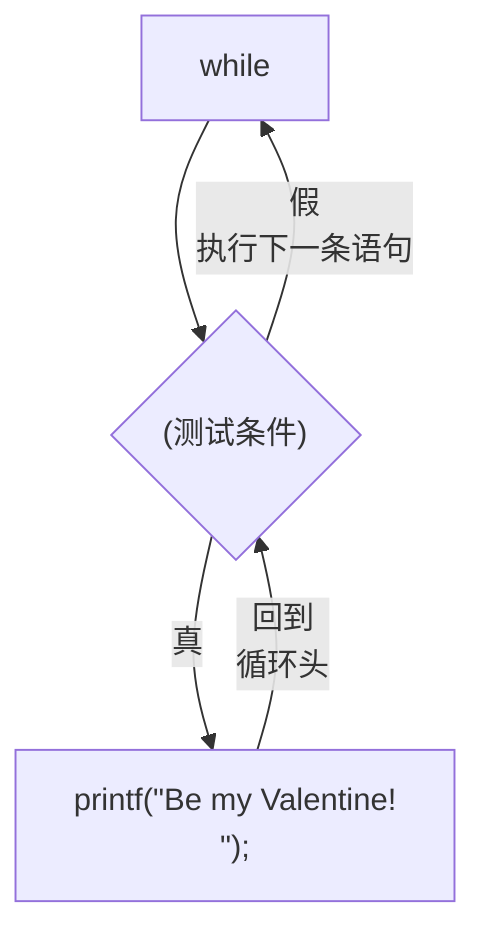
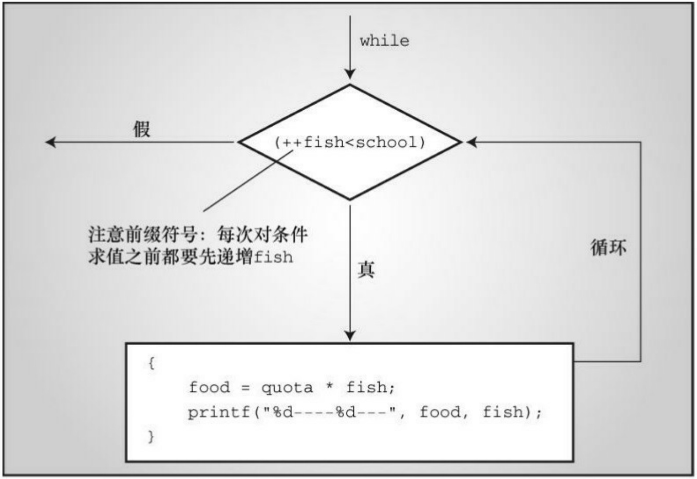
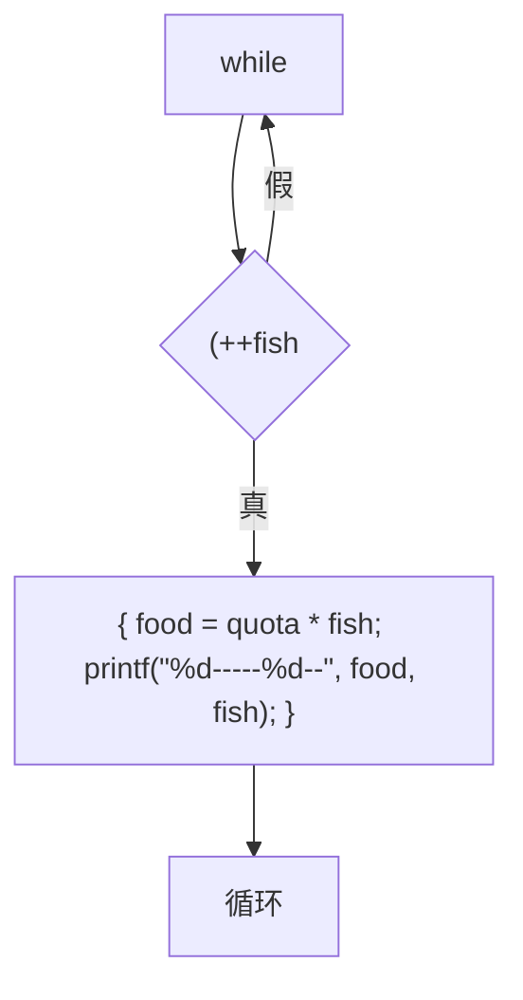

不能真正用浮点数除以整数，编译器会把两个运算对象转换成相同的类型。本例中，在进行除法运算前，整数会被转换成浮点数。

C99标准以前，C语言给语言的实现者留有一些空间，让他们来决定如何进行负数的整数除法。一种方法是，舍入过程采用小于或等于浮点数的最大整数。当然，对于3.8而言，处理后的3符合这一描述。但是-3.8 会怎样？该方法建议四舍五入为-4，因为-4 小于-3.8.但是，另一种舍入方法是直接丢弃小数部分。这种方法被称为“趋零截断”，即把-3.8转换成-3。在C99以前，不同的实现采用不同的方法。但是C99规定使用趋零截断。所以，应把-3.8转换成-3。

## 5.2.7 运算符优先级

考虑下面的代码:

$$
\text {butter} = 2 5. 0 + 6 0. 0 * \mathrm{n} / \text {SCALE};
$$

这条语句中有加法、乘法和除法运算。先算哪一个？是25.0加上60.0，然后把计算的和85.0乘以n，再把结果除以SCALE？还是60.0乘以n，然后把计算的结果加上25.0，最后再把结果除以SCALE？还是其他运算顺序？假设n是6.0，SCALE是2.0，带入语句中计算会发现，第1种顺序得到的结果是255，第2种顺序得到的结果是192.5。C程序一定是采用了其他的运算顺序，因为程序运行该语句后，butter的值是205.0。

显然，执行各种操作的顺序很重要。C 语言对此有明确的规定，通过运算符优先级来解决操作顺序的问题。每个运算符都有自己的优先级。正如普通的算术运算那样，乘法和除法的优先级比加法和减法高，所以先执行乘法和除法。如果两个运算符的优先级相同怎么办？如果它们处理同一个运算对象，则根据它们在语句中出现的顺序来执行。对大多数运算符而言，这种情况都是按从左到右的顺序进行（=运算符除外）。因此，语句:

$$
\text {butter} = 2 5. 0 + 6 0. 0 * \mathrm{n} / \text {SCALE};
$$

的运算顺序是:

许多人喜欢用表达式树（expression tree）来表示求值的顺序，如图5.3所示。该图演示了如何从最初的表达式逐步简化为一个值。



<details>
<summary>flowchart</summary>


</details>

图5.3 用表达式树演示运算符、运算对象和求值顺序

如何让加法运算在乘法运算之前执行？可以这样做:

$$
\text {flour} = (2 5. 0 + 6 0. 0 * \mathrm{n}) / \text {SCALE};
$$

最先执行圆括号中的部分。圆括号内部按正常的规则执行。该例中，先执行乘法运算，再执行加法运算。执行完圆括号内的表达式后，用运算结果除以SCALE。

表5.1总结了到目前为止学过的运算符优先级。

表5.1 运算符优先级（从低至高）

| 运算符 | 结合律 |
| --- | --- |
| () | 从左往右 |
| + - (一元) | 从右往左 |
| * / | 从左往右 |
| + - (二元) | 从左往右 |
| = | 从右往左 |

注意正号（加号）和负号（减号）的两种不同用法。结合律栏列出了运算符如何与运算对象结合。例如，一元负号与它右侧的量相结合，在除法中用除号左侧的运算对象除以右侧的运算对象。

## 5.2.8 优先级和求值顺序

运算符优先级为表达式中的求值顺序提供重要的依据，但是并没有规定所有的顺序。C 给语言的实现者留出选择的余地。考虑下面的语句:

$$
\mathrm{y} = 6 * 1 2 + 5 * 2 0;
$$

当运算符共享一个运算对象时，优先级决定了求值顺序。例如上面的语句中，12是\*和+运算符的运算对象。根据运算符的优先级，乘法的优先级比加法高，所以先进行乘法运算。类似地，先对 5 进行乘法运算而不是加法运算。简而言之，先进行两个乘法运算6 \* 12和5 \* 20，再进行加法运算。但是，优先级并未规定到底先进行哪一个乘法。C 语言把主动权留给语言的实现者，根据不同的硬件来决定先计算前者还是后者。可能在一种硬件上采用某种方案效率更高，而在另一种硬件上采用另一种方案效率更高。无论采用哪种方案，表达式都会简化为 72 + 100，所以这并不影响最终的结果。但是，读者可能会根据乘法从左往右的结合律，认为应该先执行+运算符左边的乘法。结合律只适用于共享同一运算对象运算符。例如，在表达式12 / 3 \* 2中，/和\*运算符的优先级相同，共享运算对象3。因此，从左往右的结合律在这种情况起作用。表达式简化为4 \* 2，即8（如果从右往左计算，会得到

12/6，即2，这种情况下计算的先后顺序会影响最终的计算结果）。在该例中，两个\*运算符并没有共享同一个运算对象，因此从左往右的结合律不适用于这种情况。

学以致用

接下来，我们在更复杂的示例中使用以上规则，请看程序清单5.7。

程序清单**5.7 rules.c**程序

```c
/* rules.c -- 优先级测试 */

#include <stdio.h>

int main(void)

{

int top, score;

top = score = -(2 + 5) * 6 + (4 + 3 * (2 + 3));

printf("top = %d, score = %d\n", top, score);

return 0;

}
```

该程序会打印什么值？先根据代码推测一下，再运行程序或阅读下面的分析来检查你的答案。

首先，圆括号的优先级最高。先计算-(2 + 5) \* 6中的圆括号部分，还是先计算(4 + 3 \* (2 + 3))中的圆括号部分取决于具体的实现。圆括号的最高优先级意味着，在子表达式-(2 + 5) \* 6中，先计算(2 + 5)的值，得7。然后，把一元负号应用在7上，得-7。现在，表达式是:

$$
\text {top} = \text {score} = - 7 * 6 + (4 + 3 * (2 + 3))
$$

下一步，计算2 + 3的值。表达式变成:

$$
\text {top} = \text {score} = - 7 * 6 + (4 + 3 * 5)
$$

接下来，因为圆括号中的\*比+优先级高，所以表达式变成:

$$
\text {top} = \text {score} = - 7 * 6 + (4 + 1 5)
$$

然后，表达式为:

$$
\text {top} = \text {score} = - 7 * 6 + 1 9
$$

-7乘以6后，得到下面的表达式:

$$
\text {top} = \text {score} = - 4 2 + 1 9
$$

然后进行加法运算，得到:

$$
\text {top} = \text {score} = - 2 3
$$

现在，-23被赋值给score，最终top的值也是-23。记住，=运算符的结合律是从右往左。

## 5.3 其他运算符

C语言有大约40个运算符，有些运算符比其他运算符常用得多。前面讨论的是最常用的，本节再介绍4个比较有用的运算符。

## 5.3.1 sizeof运算符和size\_t类型

读者在第3章就见过sizeof运算符。回顾一下，sizeof运算符以字节为单位返回运算对象的大小（在C中，1字节定义为char类型占用的空间大小。过去，1字节通常是8位，但是一些字符集可能使用更大的字节）。运算对象可以是具体的数据对象（如，变量名）或类型。如果运算对象是类型（如，float），则必须用圆括号将其括起来。程序清单5.8演示了这两种用法。

程序清单**5.8 sizeof.c**程序

// sizeof.c -- 使用sizeof运算符

// 使用C99新增的%zd转换说明 -- 如果编译器不支持%zd，请将其改成%u或%lu

```c
#include <stdio.h>

int main(void)

{

int n = 0;

size_t intsize;

intsize = sizeof (int);

printf("n = %d, n has %zd bytes; all ints have %zd bytes.\n",
```

```txt
n, sizeof n, intsize);

return 0;

}
```

C 语言规定，sizeof 返回 size\_t 类型的值。这是一个无符号整数类型，但它不是新类型。前面介绍过，size\_t是语言定义的标准类型。C有一个typedef机制（第14章再详细介绍），允许程序员为现有类型创建别名。例如，

```txt
typedef double real;
```

这样，real就是double的别名。现在，可以声明一个real类型的变量:

```txt
real deal; // 使用typedef
```

编译器查看real时会发现，在typedef声明中real已成为double的别名，于是把deal创建为double 类型的变量。类似地，C 头文件系统可以使用 typedef把 size\_t 作为 unsigned int 或unsigned long的别名。这样，在使用size\_t类型时，编译器会根据不同的系统替换标准类型。

C99 做了进一步调整，新增了%zd 转换说明用于 printf()显示 size\_t 类型的值。如果系统不支持%zd，可使用%u或%lu代替%zd。

## 5.3.2 求模运算符:%

求模运算符（modulus operator）用于整数运算。求模运算符给出其左侧整数除以右侧整数的余数（remainder）。例如，13 % 5（读作“13求模5”）得3，因为13比5的两倍多3，即13除以5的余数是3。求模运算符只能用于整数，不能用于浮点数。

乍一看会认为求模运算符像是数学家使用的深奥符号，但是实际上它非常有用。求模运算符常用于控制程序流。例如，假设你正在设计一个账单预算程序，每 3 个月要加进一笔额外的费用。这种情况可以在程序中对月份求模3（即，month % 3），并检查结果是否为0。如果为0，便加进额外的费用。等学到第7章的if语句后，读者会更明白。

程序清单5.9演示了%运算符的另一种用途。同时，该程序也演示了while循环的另一种用法。

程序清单5.9 min\_sec.c程序

```c
// min_sec.c -- 把秒数转换成分和秒
#include <stdio.h>
#define SEC_PER_MIN 60          // 1分钟60秒
int main(void)
{
int sec, min, left;
printf("Convert seconds to minutes and seconds!\n");
printf("Enter the number of seconds (<=0 to quit):\n");
scanf("%d", &sec);           // 读取秒数
while (sec > 0)
{
min = sec / SEC_PER_MIN;    // 截断分钟数
left = sec % SEC_PER_MIN;   // 剩下的秒数
printf("%d seconds is %d minutes, %d seconds.\n", sec,
```

```txt
min,  left);

printf("Enter next value (<=0 to quit):\n");

scanf("%d", &sec);

}

printf("Done!\n");

return  0;

}
```

该程序的输出如下:

```txt
Convert seconds to minutes and seconds!
Enter the number of seconds (<=0 to quit):
154
154 seconds is 2 minutes, 34 seconds.
Enter next value (<=0 to quit):
567
567 seconds is 9 minutes, 27 seconds.
Enter next value (<=0 to quit):
0
Done!
```

程序清单5.2使用一个计数器来控制while循环。当计数器超出给定的大小时，循环终止。而程序清单5.9则通过scanf()为变量sec获取一个新值。只要该值为正，循环就继续。当用户输入一个0或负值时，循环退出。这两种情况设计的要点是，每次循环都会修改被测试的变量值。

负数求模如何进行？C99规定“趋零截断”之前，该问题的处理方法很多。但自从有了这条规则之后，如果第1个运算对象是负数，那么求模的结果为负数；如果第1个运算对象是正数，那么求模的结果也是正数:

11 / 5得2，11 % 5得1

11 / -5得-2，11 % -2得1

-11 / -5得2，-11 % -5得-1

-11 / 5得-2，-11 % 5得-1

如果当前系统不支持C99标准，会显示不同的结果。实际上，标准规定:无论何种情况，只要a和b都是整数值，便可通过a - (a/b)\*b来计算a%b。例如，可以这样计算-11%5:

$$
- 1 1 - (- 1 1 / 5) * 5 = - 1 1 - (- 2) * 5 = - 1 1 - (- 1 0) = - 1
$$

## 5.3.3 递增运算符:++

递增运算符（increment operator）执行简单的任务，将其运算对象递增1。该运算符以两种方式出现。第1种方式，++出现在其作用的变量前面，这是前缀模式；第2种方式，++出现在其作用的变量后面，这是后缀模式。两种模式的区别在于递增行为发生的时间不同。我们先解释它们的相似之处，再分析它们不同之处。程序清单5.10中的程序示例演示了递增运算符是如何工作的。

程序清单**5.10 add\_one.c**程序

/\* add\_one.c -- 递增:前缀和后缀 \*/

```c
#include <stdio.h>

int main(void)

{

int ultra = 0, super = 0;

while (super < 5)
```

```txt
{
super++;
++ultra;
printf("super = %d, ultra = %d \n", super, ultra);
}
return 0;
}
```

运行该程序后，其输出如下:

```txt
super = 1, ultra = 1
super = 2, ultra = 2
super = 3, ultra = 3
super = 4, ultra = 4
super = 5, ultra = 5
```

该程序两次同时计数到5。用下面两条语句分别代替程序中的两条递增语句，程序的输出相同:

```txt
super = super + 1;
ultra = ultra + 1;
```

这些都是很简单的语句，为何还要创建两个缩写形式？原因之一是，紧凑结构的代码让程序更为简洁，可读性更高。这些运算符让程序看起来很美观。例如，可重写程序清单5.2（shoes2.c）中的一部分代码:

```txt
shoe = 3.0;

while (shoe < 18.5)
{
foot = SCALE * size + ADJUST;
printf("%10.1f %20.2f inches\n", shoe, foot);
++shoe;
}
```

但是，这样做也没有充分利用递增运算符的优势。还可以这样缩短这段程序:

```txt
shoe = 2.0;

while (++shoe < 18.5)
{
foot = SCALE*shoe + ADJUST;
printf("%10.1f %20.2f inches\n", shoe, foot);
}
```

如上代码所示，把变量的递增过程放入while循环的条件中。这种结构在C语言中很普遍，我们来仔细分析一下。

首先，这样的while循环是如何工作的？很简单。shoe的值递增1，然后和18.5作比较。如果递增后的值小于18.5，则执行花括号内的语句一次。然后，shoe的值再递增1，重复刚才的步骤，直到shoe的值不小于18.5为止。注意，我们把shoe的初始值从3.0改为2.0，因为在对foot第1次求值之前， shoe已经递增了1（见图5.4）。



<details>
<summary>flowchart</summary>

```mermaid
graph TD
  A["while循环"] --> B["shoe = 2.0;"]
  B --> C{"}
  C --> D["while (++shoe < 18.5)"]
  D --> E["{"]
  E --> F["foot=SCALE*shoe + ADJUST;"]
  F --> G["printf(&quot;--------&quot;, shoe, foot);"]
  G --> H["}"]
  H --> I["① shoe递增为3.0"]
  I --> J["② 对测试条件求值（为真）"]
  J --> K["③ 执行这些语句"]
  K --> L["④ 返回至循环的开始处"]
```
</details>

图5.4 执行一次循环

其次，这样做有什么好处？它使得程序更加简洁。更重要的是，它把控制循环的两个过程集中在一个地方。该循环的主要过程是判断是否继续循环（本例中，要检查鞋子的尺码是否小于 18.5），次要过程是改变待测试的元素（本例中是递增鞋子的尺码）。

如果忘记改变鞋子的尺码，shoe的值会一直小于18.5，循环不会停止。计算机将陷入无限循环（infinite loop）中，生成无数相同的行。最后，只能强行关闭这个程序。把循环测试和更新循环放在一处，就不会忘记更新循环。

但是，把两个操作合并在一个表达式中，降低了代码的可读性，让代码难以理解。而且，还容易产生计数错误。

递增运算符的另一个优点是，通常它生成的机器语言代码效率更高，因为它和实际的机器语言指令很相似。尽管如此，随着商家推出的C编译器越来越智能，这一优势可能会消失。一个智能的编译器可以把x = x + 1当作++x对待。

最后，递增运算符还有一个在某些场合特别有用的特性。我们通过程序

清单5.11来说明。

程序清单5.11 post\_pre.c程序

```c
/* post_pre.c -- 前缀和后缀 */

#include <stdio.h>

int main(void)

{

int a = 1, b = 1;

int a_post, pre_b;

a_post = a++; // 后缀递增

pre_b = ++b; // 前缀递增

printf("a a_post b pre_b \n");

printf("%1d %5d %5d %5d\n", a, a_post, b, pre_b);
return 0;

}
```

如果你的编译器没问题，那么程序的输出应该是:

```txt
a a_post b pre_b
2 1 2 2
```

a和b都递增了1，但是，a\_post是a递增之前的值，而b\_pre是b递增之后的值。这就是++的前缀形式和后缀形式的区别（见图5.5）。



<details>
<summary>text_image</summary>

前缀形式
q = 2*++a;
首先，a递增1；
然后，2乘以a，并将结果赋给q
后缀形式
q = 2*a++;
首先，2乘以a，并将结果赋给q；
然后，a递增1
</details>

图5.5 前缀和后缀

a\_post = a++; // 后缀:使用a的值乊后，递增a

b\_pre= ++b; // 前缀:使用b的值乊前，递增b

单独使用递增运算符时（如，ego++;），使用哪种形式都没关系。但是，当运算符和运算对象是更复杂表达式的一部分时（如上面的示例），使用前缀或后缀的效果不同。例如，我们曾经建议用下面的代码:

$$
\text {while} (+ + \text {shoe} <   1 8. 5)
$$

该测试条件相当于提供了一个鞋子尺码到18的表。如果使用shoe++而不是++shoes，尺码表会增至19。因为shoe会在与18.5进行比较之后才递增，而不是先递增再比较。

当然，使用下面这种形式也没错:

$$
\text {shoe} = \text {shoe} + 1;
$$

只不过，有人会怀疑你是否是真正的C程序员。

在学习本书的过程中，应多留意使用递增运算符的例子。自己思考是否能互换使用前缀和后缀形式，或者当前环境是否只能使用某种形式。

如果使用前缀形式和后缀形式会对代码产生不同的影响，那么最为明智的是不要那样使用它们。例如，不要使用下面的语句:

b = ++i; // 如果使用i++，会得到不同的结果

应该使用下列语句:

++i; // 第1行

b = i; // 如果第1行使用的是i++，幵不会影响b的值

尽管如此，有时小心翼翼地使用会更有意思。所以，本书会根据实际情况，采用不同的写法。

## 5.3.4 递减运算符:--

每种形式的递增运算符都有一个递减运算符（decrement operator）与之对应，用--代替++即可:

--count; // 前缀形式的递减运算符

count--; // 后缀形式的递减运算符

程序清单5.12演示了计算机可以是位出色的填词家。

程序清单**5.12 bottles.c**程序

#include &lt;stdio.h&gt;

#define MAX 100

int main(void)

```c
{
int count = MAX + 1;
while (--count > 0) {
printf("%d bottles of spring water on the wall, "
"%d bottles of spring water!\n", count, count);
printf("Take one down and pass it around,\n");
printf("%d bottles of spring water!\n\n", count - 1);
}
return 0;
}
```

该程序的输出如下（篇幅有限，省略了中间大部分输出）:

100 bottles of spring water on the wall, 100 bottles of spring water!

Take one down and pass it around,

99 bottles of spring water!

99 bottles of spring water on the wall, 99 bottles of spring water!

Take one down and pass it around,

98 bottles of spring water!

...

1 bottles of spring water on the wall, 1 bottles of spring water!

Take one down and pass it around,

0 bottles of spring water!

显然，这位填词家在复数的表达上有点问题。在学完第7章中的条件运算符后，可以解决这个问题。

顺带一提，>运算符表示“大于”，<运算符表示“小于”，它们都是关系运算符（relational operator）。我们将在第6章中详细介绍关系运算符。

## 5.3.5 优先级

递增运算符和递减运算符都有很高的结合优先级，只有圆括号的优先级比它们高。因此，x\*y++表示的是(x)\*(y++)，而不是(x+y)++。不过后者无效，因为递增和递减运算符只能影响一个变量（或者，更普遍地说，只能影响一个可修改的左值），而组合x\*y本身不是可修改的左值。

不要混淆这两个运算符的优先级和它们的求值顺序。假设有如下语句:

$$
\mathrm{y} = 2;
$$

$$
\mathrm{n} = 3;
$$

$$
\text {nextnum} = (\mathrm{y} + \mathrm{n} + +) ^ {*} 6;
$$

nextnum的值是多少？把y和n的值带入上面的第3条语句得:

$$
\text {nextnum} = (2 + 3) ^ {*} 6 = 5 ^ {*} 6 = 3 0
$$

n的值只有在被使用之后才会递增为4。根据优先级的规定，++只作用于n，不作用与y + n。除此之外，根据优先级可以判断何时使用n的值对表达式求值，而递增运算符的性质决定了何时递增n的值。

如果n++是表达式的一部分，可将其视为“先使用n，再递增”；而++n则

表示“先递增n，再使用”。

## 5.3.6 不要自作聪明

如果一次用太多递增运算符，自己都会糊涂。例如，利用递增运算符改进 squares.c 程序（程序清单5.4），用下面的while循环替换原程序中的while循环:

```txt
while (num < 21)

{

printf("%10d %10d\n", num, num*num++);
}
```

这个想法看上去不错。打印num，然后计算num\*num得到平方值，最后把num递增1。但事实上，修改后的程序只能在某些系统上能正常运行。该程序的问题是:当 printf()获取待打印的值时，可能先对最后一个参数（ ）求值，这样在获取其他参数的值之前就递增了num。所以，本应打印:

5 25

却打印成:

6 25

它甚至可能从右往左执行，对最右边的num（++作用的num）使用5，对第2个num和最左边的num使用6，结果打印出:

6 30

在C语言中，编译器可以自行选择先对函数中的哪个参数求值。这样做提高了编译器的效率，但是如果在函数的参数中使用了递增运算符，就会有一些问题。

类似这样的语句，也会导致一些麻烦:

$$
\text {ans} = \mathrm{num} / 2 + 5 ^ {*} (1 + \mathrm{num} + +);
$$

同样，该语句的问题是:编译器可能不会按预想的顺序来执行。你可能认为，先计算第1项（num/2），接着计算第2项（5\*(1 + num++)）。但是，编译器可能先计算第2项，递增num，然后在num/2中使用num递增后的新值。因此，无法保证编译器到底先计算哪一项。

还有一种情况，也不确定:

$$
\mathrm{n=3;}
$$

$$
\mathrm{y} = \mathrm{n} + + + + \mathrm{n} + +;
$$

可以肯定的是，执行完这两条语句后，n的值会比旧值大2。但是，y的值不确定。在对y求值时，编译器可以使用n的旧值（3）两次，然后把n递增1两次，这使得y的值为6，n的值为5。或者，编译器使用n的旧值（3）一次，立即递增n，再对表达式中的第2个n使用递增后的新值，然后再递增n，这使得 y 的值为 7，n 的值为 5。两种方案都可行。对于这种情况更精确地说，结果是未定义的，这意味着 C标准并未定义结果应该是什么。

遵循以下规则，很容易避免类似的问题:

如果一个变量出现在一个函数的多个参数中，不要对该变量使用递增或递减运算符；

如果一个变量多次出现在一个表达式中，不要对该变量使用递增或递减运算符。

另一方面，对于何时执行递增，C 还是做了一些保证。我们在本章后面的“副作用和序列点”中学到序列点时再来讨论这部分内容。

## 5.4 表达式和语句

在前几章中，我们已经多次使用了术语表达式（expression）和语句（statement）。现在，我们来进一步学习它们。C的基本程序步骤由语句组成，而大多数语句都由表达式构成。因此，我们先学习表达式。

## 5.4.1 表达式

表达式（expression）由运算符和运算对象组成（前面介绍过，运算对象是运算符操作的对象）。最简单的表达式是一个单独的运算对象，以此为基础可以建立复杂的表达式。下面是一些表达式:

4

-6

4+21

$$
\mathrm{a} ^ {*} (\mathrm{b} + \mathrm{c} / \mathrm{d}) / 2 0
$$

$$
\mathrm{q} = 5 * 2
$$

$$
\mathrm{x} = + + \mathrm{q} \% 3
$$

$$
\mathrm{q} > 3
$$

如你所见，运算对象可以是常量、变量或二者的组合。一些表达式由子表达式（subexpression）组成（子表达式即较小的表达式）。例如，c/d是上面例子中a\*(b + c/d)/20的子表达式。

## 每个表达式都有一个值

C 表达式的一个最重要的特性是，每个表达式都有一个值。要获得这个值，必须根据运算符优先级规定的顺序来执行操作。在上面我们列出的表达式中，前几个都很清晰明了。但是，有赋值运算符（=）的表达式的值是什么？这些表达式的值与赋值运算符左侧变量的值相同。因此，表达式 $\mathrm { { \bf { \hat { q } } } } = 5 \mathrm { { * 2 } }$作为一个整体的值是10。那么，表达式 $_ \mathrm { i q } > 3$ 的值是多少？这种关系表达式的值不是0就是1，如果条件为真，表达式的值为1；如果条件为假，表达式的值为0。表5.2列出了一些表达式及其值:

表5.2 一些表达式及其值

| 表达式 | 值 |
| --- | --- |
| -4 + 6 | 2 |
| c = 3 + 8 | 11 |
| 5 > 3 | 1 |
| 6 + (c = 3 + 8) | 17 |

虽然最后一个表达式看上去很奇怪，但是在C中完全合法（但不建议使用），因为它是两个子表达式的和，每个子表达式都有一个值。

## 5.4.2 语句

语句（statement）是C程序的基本构建块。一条语句相当于一条完整的计算机指令。在C中，大部分语句都以分号结尾。因此，

$$
\text {legs} = 4
$$

只是一个表达式（它可能是一个较大表达式的一部分），而下面的代码则是一条语句:

$$
\text {legs} = 4;
$$

最简单的语句是空语句:

**//**空语句

C把末尾加上一个分号的表达式都看作是一条语句（即，表达式语句）。因此，像下面这样写也没问题:

8;

$$
3 + 4;
$$

但是，这些语句在程序中什么也不做，不算是真正有用的语句。更确切地说，语句可以改变值或调用函数:

$$
\mathrm{x} = 2 5;
$$

$$
+ + \mathrm{x};
$$

$$
\mathrm{y=sqrt(x);} \quad
$$

虽然一条语句（或者至少是一条有用的语句）相当于一条完整的指令，但并不是所有的指令都是语句。考虑下面的语句:

$$
\mathrm{x} = 6 + (\mathrm{y} = 5);
$$

该语句中的子表达式y = 5是一条完整的指令，但是它只是语句的一部分。因为一条完整的指令不一定是一条语句，所以分号用于识别在这种情况下的语句（即，简单语句）。

到目前为止，读者已经见过多种语句（不包括空语句）。程序清单5.13演示了一些常见的语句。

程序清单**5.13 addemup.c**程序

/\* addemup.c -- 几种常见的语句 \*/

#include &lt;stdio.h&gt;

int main(void) /\* 计算前20个整数的和 \*/ {

int count, sum; /\* 声明[1] \*/

count = 0; /\* 表达式语句 \*/

```c
sum = 0;                      /* 表达式语句          */
while (count++ < 20)      /* 迭代语句          */
sum = sum + count;
printf("sum = %d\n", sum); /* 表达式语句[2]       */
return 0;                     /* 跳转语句              */
}
```

下面我们讨论程序清单 5.13。到目前为止，相信读者已经很熟悉声明了。尽管如此，我们还是要提醒读者:声明创建了名称和类型，并为其分配内存位置。注意，声明不是表达式语句。也就是说，如果删除声明后面的分号，剩下的部分不是一个表达式，也没有值:

int port /\* 不是表达式，没有值 \*/

赋值表达式语句在程序中很常用:它为变量分配一个值。赋值表达式语句的结构是，一个变量名，后面是一个赋值运算符，再跟着一个表达式，最后以分号结尾。注意，在while循环中有一个赋值表达式语句。赋值表达式语句是表达式语句的一个示例。

函数表达式语句会引起函数调用。在该例中，调用printf()函数打印结果。while语句有3个不同的部分（见图5.6）。首先是关键字while；然后，圆括号中是待测试的条件；最后如果测试条件为真，则执行while循环体中的语句。该例的while循环中只有一条语句。可以是本例那样的一条语句，不需要用花括号括起来，也可以像其他例子中那样包含多条语句。多条语句需要用花括号括起来。这种语句是复合语句，稍后马上介绍。



<details>
<summary>flowchart</summary>


</details>

图5.6 简单的while循环结构

while语句是一种迭代语句，有时也被称为结构化语句，因为它的结构比简单的赋值表达式语句复杂。在后面的章节里，我们会遇到许多这样的语句。

副作用和序列点

我们再讨论一个C语言的术语副作用（side effect）。副作用是对数据对象或文件的修改。例如，语句:

$$
\text {states} = 5 0;
$$

它的副作用是将变量的值设置为50。副作用？这似乎更像是主要目的！但是从C语言的角度看，主要目的是对表达式求值。给出表达式4 + 6，C会对其求值得10；给出表达式states = 50，C会对其求值得50。对该表达式求值的副作用是把变量states的值改为50。跟赋值运算符一样，递增和递减运算符也有副作用，使用它们的主要目的就是使用其副作用。

类似地，调用 printf()函数时，它显示的信息其实是副作用（printf()的返回值是待显示字符的个数）。

序列点（sequence point）是程序执行的点，在该点上，所有的副作用都在进入下一步之前发生。在 C语言中，语句中的分号标记了一个序列点。意思是，在一个语句中，赋值运算符、递增运算符和递减运算符对运算对象做的改变必须在程序执行下一条语句之前完成。后面我们要讨论的一些运算符也有序列点。另外，任何一个完整表达式的结束也是一个序列点。

什么是完整表达式？所谓完整表达式（full expression），就是指这个表达式不是另一个更大表达式的子表达式。例如，表达式语句中的表达式和while循环中的作为测试条件的表达式，都是完整表达式。

序列点有助于分析后缀递增何时发生。例如，考虑下面的代码:

$$
\text {while} \quad (\text {guests} + + <   1 0)
$$

$$
\operatorname{printf} \left(\% \mathrm{d} \quad \backslash \mathrm{n} ^ {\prime \prime}, \quad \text {guests}\right);
$$

对于该例，C语言的初学者认为“先使用值，再递增它”的意思是，在printf()语句中先使用guests，再递增它。但是，表达式guests++ < 10是一个完整的表达式，因为它是while循环的测试条件，所以该表达式的结束就是一个序列点。因此，C 保证了在程序转至执行 printf()之前发生副作用（即，递增guests）。同时，使用后缀形式保证了guests在完成与10的比较后才进行递增。

现在，考虑下面这条语句:

$$
\mathrm{y} = (4 + \mathrm{x} + +) + (6 + \mathrm{x} + +);
$$

表达式4 + x++不是一个完整的表达式，所以C无法保证x在子表达式4 + x++求值后立即递增x。这里，完整表达式是整个赋值表达式语句，分号标记了序列点。所以，C 保证程序在执行下一条语句之前递增x两次。C并未指明是在对子表达式求值以后递增x，还是对所有表达式求值后再递增x。因此，要尽量避免编写类似的语句。

## 5.4.3 复合语句（块）

复合语句（compound statement）是用花括号括起来的一条或多条语句，复合语句也称为块（block）。shoes2.c程序使用块让while语句包含多条语句。比较下面两个程序段:

/\* 程序段 1 \*/

```txt
index = 0;

while (index++ < 10)

sam = 10 * index + 2;

printf("sam = %d\n", sam);
```

/\* 程序段 2 \*/

```lisp
index = 0;

while (index++ < 10)
{
sam = 10 * index + 2;
printf("sam = %d\n", sam);
}
```

程序段1，while循环中只有一条赋值表达式语句。没有花括号，while语句从while这行运行至下一个分号。循环结束后，printf()函数只会被调用一次。

程序段2，花括号确保两条语句都是while循环的一部分，每执行一次循环就调用一次printf()函数。根据while语句的结构，整个复合语句被视为一条语句（见图5.7）。



<details>
<summary>flowchart</summary>


</details>

图5.7 带复合语句的while循环

提示风格提示

再看一下前面的两个while程序段，注意循环体中的缩进。缩进对编译器不起作用，编译器通过花括号和while循环的结构来识别和解释指令。这里，缩进是为了让读者一眼就可以看出程序是如何组织的。

程序段2中，块或复合语句放置花括号的位置是一种常见的风格。另一种常用的风格是:

```awk
while (index++ < 10) {
sam = 10*index + 2;
printf("sam = %d \n", sam);
}
```

这种风格突出了块附属于while循环，而前一种风格则强调语句形成一个块。对编译器而言，这两种风格完全相同。

总而言之，使用缩进可以为读者指明程序的结构。

总结表达式和语句

表达式:

表达式由运算符和运算对象组成。最简单的表达式是不带运算符的一个常量或变量（如，22 或beebop）。更复杂的例子是55 + 22和vap = 2 \* (vip + (vup = 4))。

语句:

到目前为止，读者接触到的语句可分为简单语句和复合语句。简单语句以一个分号结尾。如下所示:

赋值表达式语句: toes = 12;

函数表达式语句: printf("%d\n", toes);

空语句: ; /\* 什么也不做 \*/

复合语句（或块）由花括号括起来的一条或多条语句组成。如下面的while语句所示:

```c
while (years < 100)
{
wisdom = wisdom * 1.05;
printf("%d %d\n", years, wisdom);
years = years + 1;
```

## 5.5 类型转换

通常，在语句和表达式中应使用类型相同的变量和常量。但是，如果使用混合类型，C 不会像 Pascal那样停在那里死掉，而是采用一套规则进行自动类型转换。虽然这很便利，但是有一定的危险性，尤其是在无意间混合使用类型的情况下（许多UNIX系统都使用lint程序检查类型“冲突”。如果选择更高错误级别，许多非UNIX C编译器也可能报告类型问题）。最好先了解一些基本的类型转换规则。

1.当类型转换出现在表达式时，无论是unsigned还是signed的char和short都会被自动转换成int，如有必要会被转换成unsigned int（如果short与int的大小相同，unsigned short就比int大。这种情况下，unsigned short会被转换成unsigned int）。在K&R那时的C中，float会被自动转换成double（目前的C不是这样）。由于都是从较小类型转换为较大类型，所以这些转换被称为升级（promotion）。
2.涉及两种类型的运算，两个值会被分别转换成两种类型的更高级别。
3.类型的级别从高至低依次是long double、double、float、unsignedlong long、long long、unsigned long、long、unsigned int、int。例外的情况是，当long 和 int 的大小相同时，unsigned int比long的级别高。之所以short和char类型没有列出，是因为它们已经被升级到int或unsigned int。
4.在赋值表达式语句中，计算的最终结果会被转换成被赋值变量的类型。这个过程可能导致类型升级或降级（demotion）。所谓降级，是指把一种类型转换成更低级别的类型。
5.当作为函数参数传递时，char和short被转换成int，float被转换成double。第9章将介绍，函数原型会覆盖自动升级。

类型升级通常都不会有什么问题，但是类型降级会导致真正的麻烦。原因很简单:较低类型可能放不下整个数字。例如，一个8位的char类型变量储存整数101没问题，但是存不下22334。

如果待转换的值与目标类型不匹配怎么办？这取决于转换涉及的类型。待赋值的值与目标类型不匹配时，规则如下。

1.目标类型是无符号整型，且待赋的值是整数时，额外的位将被忽略。例如，如果目标类型是 8 位unsigned char，待赋的值是原始值求模256。
2.如果目标类型是一个有符号整型，且待赋的值是整数，结果因实现而异。
3.如果目标类型是一个整型，且待赋的值是浮点数，该行为是未定义的。

如果把一个浮点值转换成整数类型会怎样？当浮点类型被降级为整数类型时，原来的浮点值会被截断。例如，23.12和23.99都会被截断为23，-23.5会被截断为-23。

程序清单5.14演示了这些规则。

程序清单**5.14 convert.c**程序

/\* convert.c -- 自动类型转换 \*/

```c
#include <stdio.h>

int main(void)
{
char ch;

int i;

float fl;
```

$$
\mathrm{fl} = \mathrm{i} = \mathrm{ch} = ^ {\prime} \mathrm{C} ^ {\prime};
$$

/\* 第9行 \*/