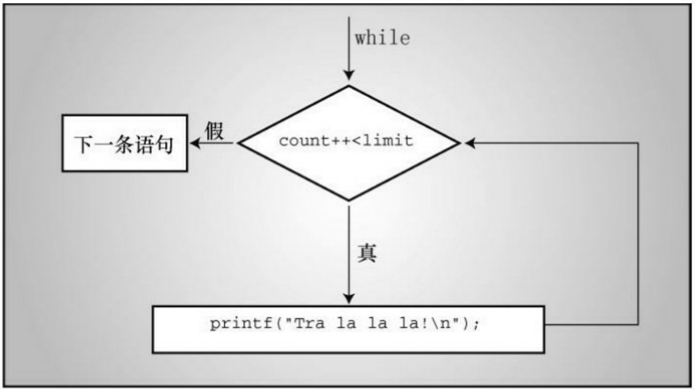
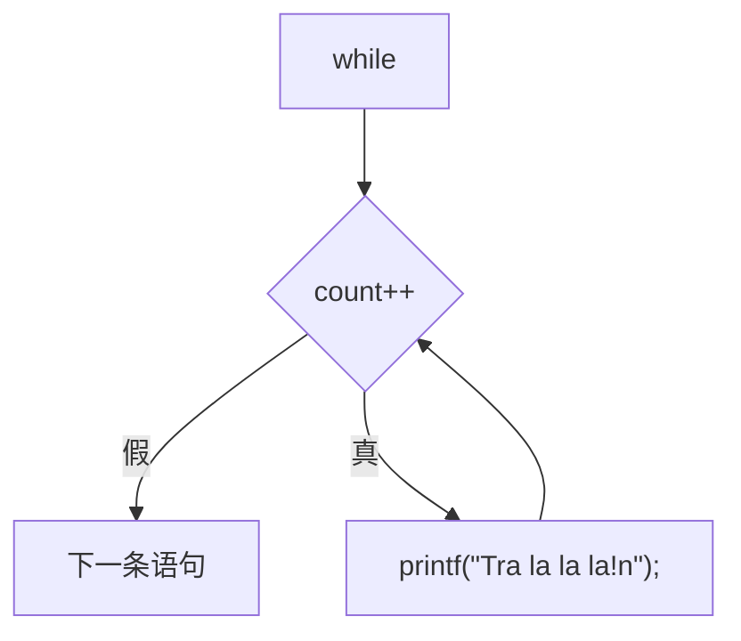
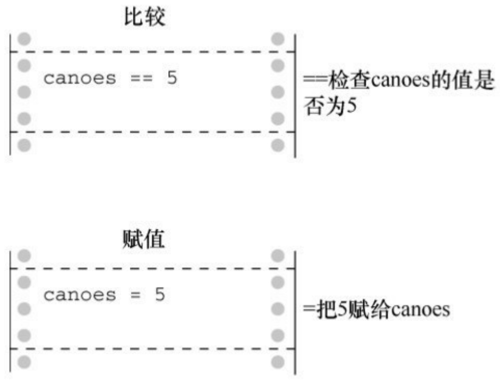
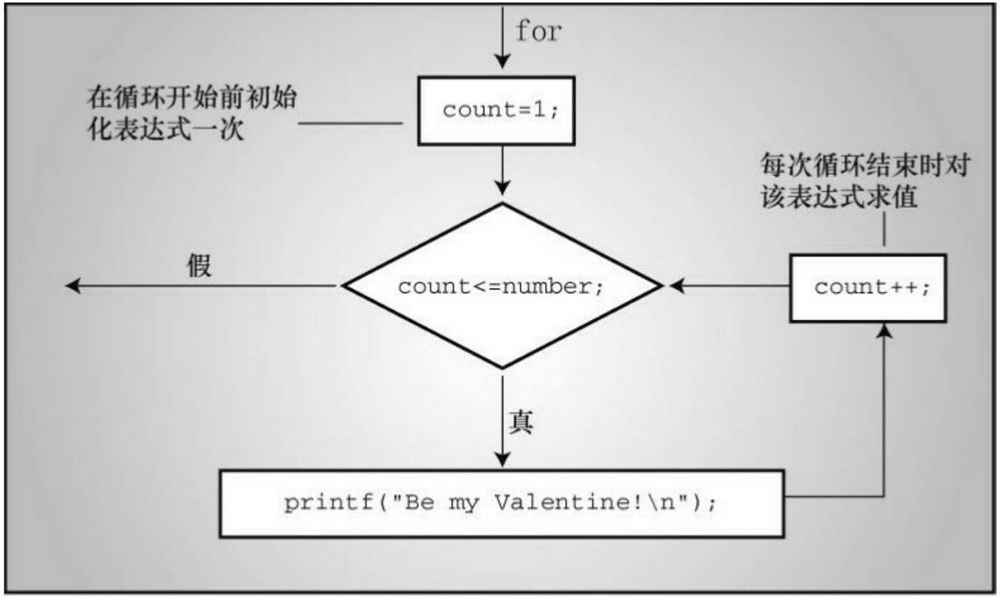
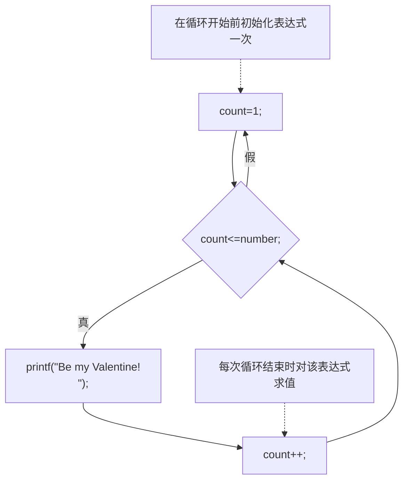

## 6.2 while语句

while循环的通用形式如下:

while ( expression )

statement

statement部分可以是以分号结尾的简单语句，也可以是用花括号括起来的复合语句。

到目前为止，程序示例中的expression部分都使用关系表达式。也就是说，expression是值之间的比较，可以使用任何表达式。如果expression为真（或者更一般地说，非零），执行 statement部分一次，然后再次判断expression。在expression为假（0）之前，循环的判断和执行一直重复进行。每次循环都被称为一次迭代（iteration），如图6.1所示。



<details>
<summary>flowchart</summary>


</details>

图6.1 while循环的结构

## 6.2.1 终止while循环

while循环有一点非常重要:在构建while循环时，必须让测试表达式的值有变化，表达式最终要为假。否则，循环就不会终止（实际上，可以使用break和if语句来终止循环，但是你尚未学到）。考虑下面的例子:

```lisp
index = 1;

while (index < 5)

printf("Good morning!\n");
```

上面的程序段将打印无数次 。为什么？因为循环中index的值一直都是原来的值1，不曾变过。现在，考虑下面的程序段:

```txt
index = 1;
while (--index < 5)
    printf("Good morning!\n");
```

这段程序也好不到哪里去。虽然改变了index的值，但是改错了！不过，这个版本至少在index减少到其类型到可容纳的最小负值并变成最大正值时会终止循环（第3章3.4.2节中的toobig.c程序解释过，最大正值加1一般会得到一个负值；类似地，最小负值减1一般会得到最大正值）。

## 6.2.2 何时终止循环

要明确一点:只有在对测试条件求值时，才决定是终止还是继续循环。例如，考虑程序清单6.2中的程序。

程序清单**6.2 when.c**程序

// when.c -- 何时退出循环

```c
#include <stdio.h>

int main(void)
```

```c
{
int n = 5;
while (n < 7) // 第7行
{
printf("n = %d\n", n);
n++; // 第10行
printf("Now n = %d\n", n); // 第11行
}
printf("The loop has finished.\n");
return 0;
}
```

运行程序清单6.2，输出如下:

```txt
n = 5
Now n = 6
n = 6
Now n = 7
```

The loop has finished.

在第2次循环时，变量n在第10行首次获得值7。但是，此时程序并未退出，它结束本次循环（第11行），并在对第7行的测试条件求值时才退出循环（变量n在第1次判断时为5，第2次判断时为6）。

## 6.2.3 while:入口条件循环

while循环是使用入口条件的有条件循环。所谓“有条件”指的是语句部分的执行取决于测试表达式描述的条件，如(index < 5)。该表达式是一个入口条件（entry condition），因为必须满足条件才能进入循环体。在下面的情况中，就不会进入循环体，因为条件一开始就为假:

```txt
index = 10;

while (index++ < 5)

printf("Have a fair day or better.\n");
```

把第1行改为:

```javascript
index = 3;
```

就可以运行这个循环了。

## 6.2.4 语法要点

使用while时，要牢记一点:只有在测试条件后面的单独语句（简单语句或复合语句）才是循环部分。程序清单6.3演示了忽略这点的后果。缩进是为了让读者阅读方便，不是计算机的要求。

程序清单**6.3 while1.c**程序

```c
/* while1.c -- 注意花括号的使用 */
/* 糟糕的代码创建了一个无限循环 */
#include <stdio.h>
int main(void)
{
```

```lua
int n = 0;

while (n < 3)

printf("n is %d\n", n);

n++;

printf("That's all this program does\n");

return 0;

}
```

该程序的输出如下:

```asm
n is 0
n is 0
n is 0
n is 0
n is 0
...
```

屏幕上会一直输出以上内容，除非强行关闭这个程序。

虽然程序中缩进了n++;这条语句，但是并未把它和上一条语句括在花括号内。因此，只有直接跟在测试条件后面的一条语句是循环的一部分。变量n的值不会改变，条件n < 3一直为真。该循环会一直打印n is 0，除非强行关闭程序。这是一个无限循环（infinite loop）的例子，没有外部干涉就不会退出。

记住，即使while语句本身使用复合语句，在语句构成上，它也是一条单独的语句。该语句从while开始执行，到第1个分号结束。在使用了复合语句的情况下，到右花括号结束。

要注意放置分号的位置。例如，考虑程序清单6.4。

程序清单**6.4 while2.c**程序

/\* while2.c -- 注意分号的位置 \*/

```c
#include <stdio.h>

int main(void)

{

int n = 0;
```

while (n++ < 3); /\* 第7行 \*/

printf("n is %d\n", n); /\* 第8行 \*/

```txt
printf("That's all this program does.\n");
return 0;
}
```

该程序的输出如下:

n is 4

That's all this program does.

如前所述，循环在执行完测试条件后面的第 1 条语句（简单语句或复合语句）后进入下一轮迭代，直到测试条件为假才会结束。该程序中第7行的测试条件后面直接跟着一个分号，循环在此进入下一轮迭代，因为单独一个分号被视为一条语句。虽然n的值在每次循环时都递增1，但是第8行的语句不是循环的一部分，因此只会打印一次循环结束后的n值。

在该例中，测试条件后面的单独分号是空语句（null statement），它什么也不做。在C语言中，单独的分号表示空语句。有时，程序员会故意使用带空语句的while语句，因为所有的任务都在测试条件中完成了，不需要在循环体中做什么。例如，假设你想跳过输入到第1个非空白字符或数字，可以这样写:

$$
\text {while} \quad (\operatorname{scanf} \left(\% \mathrm{d} ^ {\prime \prime}, \& \text {num}\right) = = 1)
$$

; /\* 跳过整数输入 \*/

只要scanf()读取一个整数，就会返回1，循环继续执行。注意，为了提高代码的可读性，应该让这个分号独占一行，不要直接把它放在测试表达式同行。这样做一方面让读者更容易看到空语句，一方面也提醒自己和读者空语句是有意而为之。处理这种情况更好的方法是使用下一章介绍的continue语句。

## 6.3 用关系运算符和表达式比较大小

while循环经常依赖测试表达式作比较，这样的表达式被称为关系表达式（relational expression），出现在关系表达式中间的运算符叫做关系运算符（relational operator）。前面的示例中已经用过一些关系运算符，表 6.1列出了 C 语言的所有关系运算符。该表也涵盖了所有的数值关系（数字之间的关系再复杂也没有人与人之间的关系复杂）。

表6.1 关系运算符

| 运算符 | 含义 |
| --- | --- |
| &lt; | 小于 |
| &lt;= | 小于或等于 |
| == | 等于 |
| >= | 大于或等于 |
| > | 大于 |
| != | 不等于 |

关系运算符常用于构造while语句和其他C语句（稍后讨论）中用到的关系表达式。这些语句都会检查关系表达式为真还是为假。下面有3个互不相关的while语句，其中都包含关系表达式。

```txt
while (number < 6)
{
printf("Your number is too small.\n");
scanf("%d", &number);
}
while (ch != '$')
{
```

```txt
count++;
scanf("%c", &ch);
}
while (scanf("%f", &num) == 1)
sum = sum + num;
```

注意，第2个while语句的关系表达式还可用于比较字符。比较时使用的是机器字符码（假定为ASCII）。但是，不能用关系运算符比较字符串。第11章将介绍如何比较字符串。

虽然关系运算符也可用来比较浮点数，但是要注意:比较浮点数时，尽量只使用<和>。因为浮点数的舍入误差会导致在逻辑上应该相等的两数却不相等。例如，3乘以1/3的积是1.0。如果用把1/3表示成小数点后面6位数字，乘积则是.999999，不等于1。使用fabs()函数（声明在math.h头文件中）可以方便地比较浮点数，该函数返回一个浮点值的绝对值（即，没有代数符号的值）。例如，可以用类似程序清单6.5的方法来判断一个数是否接近预期结果。

程序清单**6.5 cmpflt.c**程序

```c
// cmpflt.c -- 浮点数比较
#include <math.h>
#include <stdio.h>
int main(void)
{
const double ANSWER = 3.14159;
```

```c
double response;

printf("What is the value of pi?\n");

scanf("%lf", &response);

while (fabs(response - ANSWER) > 0.0001)
{
printf("Try again!\n");
scanf("%lf", &response);
}
printf("Close enough!\n");
return 0;
}
```

循环会一直提示用户继续输入，除非用户输入的值与正确值之间相差0.0001:

What is the value of pi?

**3.14**

Try again!

**3.1416**

Close enough!

## 6.3.1 什么是真

这是一个古老的问题，但是对C而言还不算难。在C中，表达式一定有一个值，关系表达式也不例外。程序清单6.6中的程序用于打印两个关系表达式的值，一个为真，一个为假。

程序清单6.6 t\_and\_f.c程序

```txt
/* t_and_f.c -- C中的真和假的值 */
```

```c
#include <stdio.h>
```

```txt
int main(void)
```

```txt
{
```

```txt
int true_val, false_val;
```

```txt
true_val = (10 > 2); // 关系为真的值
```

false\_val = (10 == 2); // 关系为假的值

```txt
printf("true = %d; false = %d \n", true_val, false_val);
```

```txt
return 0;
```

```txt
}
```

程序清单6.6把两个关系表达式的值分别赋给两个变量，即把表达式为真的值赋给true\_val，表达式为假的值赋给false\_val。运行该程序后输出如下:

```txt
true = 1; false = 0
```

原来如此！对C而言，表达式为真的值是1，表达式为假的值是0。一些C程序使用下面的循环结构，由于1为真，所以循环会一直进行。

while (1)

```txt
{
...
}
```

## 6.3.2 其他真值

既然1或0可以作为while语句的测试表达式，是否还可以使用其他数字？如果可以，会发生什么？我们用程序清单6.7来做个实验。

程序清单6.7 truth.c程序

```c
// truth.c -- 哪些值为真
#include <stdio.h>
int main(void)
{
int n = 3;
while (n)
printf("%2d is true\n", n--);
printf("%2d is false\n", n);
n = -3;
while (n)
printf("%2d is true\n", n++);
printf("%2d is false\n", n);
```

```scss
return 0;
}
```

该程序的输出如下:

```txt
3 is true
2 is true
1 is true
0 is false
-3 is true
-2 is true
-1 is true
0 is false
```

执行第1个循环时，n分别是3、2、1，当n等于0时，第1个循环结束。与此类似，执行第2个循环时，n分别是-3、-2和-1，当n等于0时，第2个循环结束。一般而言，所有的非零值都视为真，只有0被视为假。在C中，真的概念还真宽！

也可以说，只要测试条件的值为非零，就会执行 while 循环。这是从数值方面而不是从真/假方面来看测试条件。要牢记:关系表达式为真，求值得1；关系表达式为假，求值得0。因此，这些表达式实际上相当于数值。

许多C程序员都会很好地利用测试条件的这一特性。例如，用while (goats)替换while (goats !=0)，因为表达式goats != 0和goats都只有在goats的值为0时才为0或假。第1种形式（while (goats != 0)）对初学者而言可能比较清楚，但是第2种形式（while (goats)）才是C程序员最常用的。要想成为一名

C程序员，应该多熟悉while (goats)这种形式。

## 6.3.3 真值的问题

C对真的概念约束太少会带来一些麻烦。例如，我们稍微修改一下程序清单6.1，修改后的程序如程序清单6.8所示。

程序清单6.8 trouble.c程序

```c
// trouble.c -- 误用=会导致无限循环
#include <stdio.h>
int main(void)
{
long num;
long sum = 0L;
int status;
printf("Please enter an integer to be summed ");
printf("(q to quit): ");
status = scanf("%ld", &num);
while (status = 1)
{
sum = sum + num;
printf("Please enter next integer (q to quit): ");
```

```txt
status = scanf("%ld", &num);

}

printf("Those integers sum to %ld.\n", sum);

return 0;

}
```

运行该程序，其输出如下:

```txt
Please enter an integer to be summed (q to quit): 20
Please enter next integer (q to quit): 5
Please enter next integer (q to quit): 30
Please enter next integer (q to quit): q
Please enter next integer (q to quit):
Please enter next integer (q to quit):
Please enter next integer (q to quit):
Please enter next integer (q to quit):
```

（„„屏幕上会一直显示最后的提示内容，除非强行关闭程序。也许你根本不想运行这个示例。）

这个麻烦的程序示例改动了while循环的测试条件，把status == 1替换成status = 1。后者是一个赋值表达式语句，所以 status 的值为 1。而且，整个赋值表达式的值就是赋值运算符左侧的值，所以status = 1的值也是1。这里，while (status = 1)实际上相当于while (1)，也就是说，循环不会退出。虽然用户输入q，status被设置为0，但是循环的测试条件把status又重置为1，进入了下一次迭代。

读者可能不太理解，程序的循环一直运行着，用户在输入q后完全没机会继续输入。如果scanf()读取指定形式的输入失败，就把无法读取的输入留在输入队列中，供下次读取。当scanf()把q作为整数读取时失败了，它把 q留下。在下次循环时，scanf()从上次读取失败的地方（q）开始读取，scanf()把q作为整数读取，又失败了。因此，这样修改后不仅创建了一个无限循环，还创建了一个无限失败的循环，真让人沮丧。好在计算机觉察不出来。对计算机而言，无限地执行这些愚蠢的指令比成功预测未来10年的股市行情没什么两样。

不要在本应使用==的地方使用=。一些计算机语言（如，BASIC）用相同的符号表示赋值运算符和关系相等运算符，但是这两个运算符完全不同（见图 6.2）。赋值运算符把一个值赋给它左侧的变量；而关系相等运算符检查它左侧和右侧的值是否相等，不会改变左侧变量的值（如果左侧是一个变量）。



图6.2 关系运算符==和赋值运算符=

示例如下:

$$
\begin{array}{l} \text {canoes} = 5 \\ \text {canoes} = = 5 \\ \end{array}
$$

要注意使用正确的运算符。编译器不会检查出你使用了错误的形式，得出也不是预期的结果（误用=的人实在太多了，以至于现在大多数编译器都会给出警告，提醒用户是否要这样做）。如果待比较的一个值是常量，可以把该常量放在左侧有助于编译器捕获错误:

$$
5 = \text {canoes}
$$

$$
5 = = \text {canoes}
$$

可以这样做是因为C语言不允许给常量赋值，编译器会把赋值运算符的这种用法作为语法错误标记出来。许多经验丰富的程序员在构建比较是否相等的表达式时，都习惯把常量放在左侧。

总之，关系运算符用于构成关系表达式。关系表达式为真时值为1，为假时值为0。通常用关系表达式作为测试条件的语句（如while和if）可以使用任何表达式作为测试条件，非零为真，零为假。

## 6.3.4 新的\_Bool类型

在C语言中，一直用int类型的变量表示真/假值。C99专门针对这种类型的变量新增了\_Bool类型。该类型是以英国数学家George Boole的名字命名的，他开发了用代数表示逻辑和解决逻辑问题。在编程中，表示真或假的变量被称为布尔变量（Boolean variable），所以\_Bool是C语言中布尔变量的类型名。\_Bool类型的变量只能储存1（真）或0（假）。如果把其他非零数值赋给\_Bool类型的变量，该变量会被设置为1。这反映了C把所有的非零值都视为真。

程序清单6.9修改了程序清单6.8中的测试条件，把int类型的变量status替换为\_Bool类型的变量input\_is\_good。给布尔变量取一个能表示真或假值的变量名是一种常见的做法。

程序清单6.9 boolean.c程序

```c
// boolean.c -- 使用_Bool类型的变量 variable
#include <stdio.h>

int main(void)
{
long num;
long sum = 0L;
_Bool input_is_good;
printf("Please enter an integer to be summed ");
printf("(q to quit): ");
input_is_good = (scanf("%ld", &num) == 1);
while (input_is_good)
{
sum = sum + num;
printf("Please enter next integer (q to quit): ");
input_is_good = (scanf("%ld", &num) == 1);
}
printf("Those integers sum to %ld.\n", sum);
return 0;
```

}

注意程序中把比较的结果赋值给\_Bool类型的变量input\_is\_good:

$$
\text {input\_is\_good} = (\operatorname{scanf} (\% \text {ld}", \& \text {num}) = 1);
$$

这样做没问题，因为==运算符返回的值不是1就是0。顺带一提，从优先级方面考虑的话，并不需要用圆括号把

$\mathrm{scanf} ( \mathrm{s1d} , \mathrm{scnum} ) = 1$ 括起来。但是，这样做可以提高代码可读性。还要注意，如何为变量命名才能让while循环的测试简单易懂:

while (input\_is\_good)

C99提供了stdbool.h头文件，该头文件让bool成为\_Bool的别名，而且还把true和false分别定义为1和0的符号常量。包含该头文件后，写出的代码可以与C++兼容，因为C++把bool、true和false定义为关键字。

如果系统不支持\_Bool类型，导致无法运行该程序，可以把\_Bool替换成int即可。

## 6.3.5 优先级和关系运算符

关系运算符的优先级比算术运算符（包括+和-）低，比赋值运算符高。这意味着 $x > y + 2  和  x > (y + 2)$ 相同，x = y > 2和x = (y > 2)相同。换言之，如果y大于2，则给x赋值1，否则赋值0。y的值不会赋给x。

关系运算符比赋值运算符的优先级高，因此， $\mathrm { x \_ b i g g e r \; = \; x \; > \; y ; }$ 相当于$\mathrm{x\_bigger} = (\mathrm{x} > \mathrm{y});$ 。

关系运算符之间有两种不同的优先级。

高优先级组: $< < = > > =$

低优先级组: == !=

与其他大多数运算符一样，关系运算符的结合律也是从左往右。因此:

$$
\mathrm{ex}! = \mathrm{wye} = = \text {zee与} (\mathrm{ex}! = \mathrm{wye}) = = \text {zee相同}
$$

首先，C判断ex与wye是否相等；然后，用得出的值1或0（真或假）再与zee比较。我们并不推荐这样写，但是在这里有必要说明一下。

表6.2列出了目前我们学过的运算符的性质。附录B的参考资料 $\mathbf { \cdot } \mathbf { \Pi } ^ { c } \mathbf { C } .$ 运算符”中列出了全部运算符的完整优先级表。

表6.2 运算符优先级

| 运算符(优先级从高至低) | 结合律 |
| --- | --- |
| () | 从左往右 |
| - + ++ -- sizeof | 从右往左 |
| * / % | 从左往右 |
| + - | 从左往右 |
| &lt; > &lt;= >= | 从左往右 |
| == != | 从左往右 |
| = | 从右往左 |

小结:**while**语句

关键字:**while**

一般注解:

while语句创建了一个循环，重复执行直到测试表达式为假或0。while语句是一种入口条件循环，也就是说，在执行多次循环之前已决定是否执行循环。因此，循环有可能不被执行。循环体可以是简单语句，也可以是复合语句。

形式:

while ( expression )

statement

在expression部分为假或0之前，重复执行statement部分。

示例:

```txt
while (n++ < 100)
```

printf(" %d %d\n",n, 2 \* n + 1); // 简单语句

```txt
while (fargo < 1000)
```

{ // 复合语句

```txt
fargo = fargo + step;
```

```txt
step = 2 * step;
```

```txt
}
```

小结:关系运算符和表达式

关系运算符:

每个关系运算符都把它左侧的值和右侧的值进行比较。

< 小于

<= 小于或等于

等于

>= 大于或等于

> 大于

!= 不等于

关系表达式:

简单的关系表达式由关系运算符及其运算对象组成。如果关系为真，关系表达式的值为 1；如果关系为假，关系表达式的值为0。

示例:

5 > 2为真，关系表达式的值为1

(2 + a) == a 为假，关系表达式的值为0

## 6.4 不确定循环和计数循环

一些while循环是不确定循环（indefinite loop）。所谓不确定循环，指在测试表达式为假之前，预先不知道要执行多少次循环。例如，程序清单6.1通过与用户交互获得数据来计算整数之和。我们事先并不知道用户会输入什么整数。另外，还有一类是计数循环（counting loop）。这类循环在执行循环之前就知道要重复执行多少次。程序清单6.10就是一个简单的计数循环。

程序清单6.10 sweetie1.c程序

```c
// sweetie1.c -- 一个计数循环

#include <stdio.h>

int main(void)

{

const int NUMBER = 22;

int count = 1;                      // 初始化

while (count <= NUMBER)          // 测试

{

printf("Be my Valentine!\n");  // 行为

count++;                             // 更新计数

}

return 0;

}
```

虽然程序清单6.10运行情况良好，但是定义循环的行为并未组织在一起，程序的编排并不是很理想。我们来仔细分析一下。

在创建一个重复执行固定次数的循环中涉及了3个行为:

1.必须初始化计数器；
2.计数器与有限的值作比较；
3.每次循环时递增计数器。

while循环的测试条件执行比较，递增运算符执行递增。程序清单6.10中，递增发生在循环的末尾，这可以防止不小心漏掉递增。因此，这样做比将测试和更新组合放在一起（即使用count++ <= NUMBER）要好，但是计数器的初始化放在循环外，就有可能忘记初始化。实践告诉我们可能会发生的事情终究会发生，所以我们来学习另一种控制语句，可以避免这些问题。

## 6.5 for循环

for循环把上述3个行为（初始化、测试和更新）组合在一处。程序清单6.11使用for循环修改了程序清单6.10的程序。

程序清单**6.11 sweetie2.c**程序

// sweetie2.c -- 使用for循环的计数循环

```c
#include <stdio.h>

int main(void)
{
const int NUMBER = 22;
int count;
for (count = 1; count <= NUMBER; count++)
printf("Be my Valentine!\n");
return 0;
}
```

关键字for后面的圆括号中有3个表达式，分别用两个分号隔开。第1个表达式是初始化，只会在for循环开始时执行一次。第 2 个表达式是测试条件，在执行循环之前对表达式求值。如果表达式为假（本例中，count大于NUMBER时），循环结束。第3个表达式执行更新，在每次循环结束时求值。程序清单6.10用这个表达式递增count 的值，更新计数。完整的for语句还包括后面的简单语句或复合语句。for圆括号中的表达式也叫做控制表达式，它们都是完整表达式，所以每个表达式的副作用（如，递增变量）都发生在对下一个表达式求值之前。图6.3演示了for循环的结构。



<details>
<summary>flowchart</summary>


</details>

图6.3 for循环的结构

程序清单**6.12 for\_cube.c**程序

/\* for\_cube.c -- 使用for循环创建一个立方表 \*/

```c
#include <stdio.h>

int main(void)
{
int num;

printf("    n    n cubed\n");

for (num = 1; num <= 6; num++)

printf("%5d %5d\n", num, num*num*num);

return 0;
```

}

程序清单6.12打印整数1～6及其对应的立方，该程序的输出如下:

```csv
n n cubed
1 1
2 8
3 27
4 64
5 125
6 216
```

for循环的第1行包含了循环所需的所有信息:num的初值，num的终值[1]和每次循环num的增量。

## 6.5.1 利用for的灵活性

虽然for循环看上去和FORTRAN的DO循环、Pascal的FOR循环、BASIC的FOR...NEXT循环类似，但是for循环比这些循环灵活。这些灵活性源于如何使用for循环中的3个表达式。以前面程序示例中的for循环为例，第1个表达式给计数器赋初值，第2个表达式表示计数器的范围，第3个表达式递增计数器。这样使用for循环确实很像其他语言的循环。除此之外，for循环还有其他9种用法。

可以使用递减运算符来递减计数器:

```c
/* for_down.c */
#include <stdio.h>
```

```c
int main(void)
{
int secs;
for (secs = 5; secs > 0; secs--)
printf("%d seconds!\n", secs);
printf("We have ignition!\n");
return 0;
}
```

该程序输出如下:

5 seconds!
4 seconds!
3 seconds!
2 seconds!
1 seconds!

We have ignition!

可以让计数器递增2、10等:

```c
/* for_13s.c */
#include <stdio.h>
int main(void)
```

```txt
{
int n; // 从2开始，每次递增13
for (n = 2; n < 60; n = n + 13)
printf("%d \n", n);
return 0;
}
```

每次循环n递增13，程序的输出如下:

可以用字符代替数字计数:

```c
/* for_char.c */

#include <stdio.h>

int main(void)

{

char ch;

for (ch = 'a'; ch <= 'z'; ch++)
```

```txt
printf("The ASCII value for %c is %d.\n", ch, ch);
return 0;
}
```

该程序假定系统用ASCII码表示字符。由于篇幅有限，省略了大部分输出:

```txt
The ASCII value for a is 97.
The ASCII value for b is 98.
...
The ASCII value for x is 120.
The ASCII value for y is 121.
The ASCII value for z is 122.
```

该程序能正常运行是因为字符在内部是以整数形式储存的，因此该循环实际上仍是用整数来计数。

除了测试迭代次数外，还可以测试其他条件。在for\_cube程序中，可以把:

```txt
for (num = 1; num <= 6; num++)
```

替换成:

```javascript
for (num = 1; num*num*num <= 216; num++)
```

如果与控制循环次数相比，你更关心限制立方的大小，就可以使用这样的测试条件。

可以让递增的量几何增长，而不是算术增长。也就是说，每次都乘上而不是加上一个固定的量:

```c
/* for_geo.c */

#include <stdio.h>

int main(void)

{

double debt;

for (debt = 100.0; debt < 150.0; debt = debt * 1.1)

printf("Your debt is now $%.2f.\n", debt);

return 0;

}
```

该程序中，每次循环都把debt乘以1.1，即debt的值每次都增加10%，其输出如下:

```txt
Your debt is now \$100.00.
Your debt is now \$110.00.
Your debt is now \$121.00.
Your debt is now \$133.10.
Your debt is now \$146.41.
```

第3个表达式可以使用任意合法的表达式。无论是什么表达式，每次迭代都会更新该表达式的值。

```c
/* for_wild.c */

#include <stdio.h>

int main(void)

{

int x;

int y = 55;

for (x = 1; y <= 75; y = (++x * 5) + 50)

printf("%10d %10d\n", x, y);

return 0;

}
```

该循环打印x的值和表达式++x \* 5 + 50的值，程序的输出如下:

```txt
1 55   
2 60   
3 65   
4 70   
5 75
```

注意，测试涉及y，而不是x。for循环中的3个表达式可以是不同的变量（注意，虽然该例可以正常运行，但是编程风格不太好。如果不在更新部分加入代数计算，程序会更加清楚）。

可以省略一个或多个表达式（但是不能省略分号），只要在循环中包含